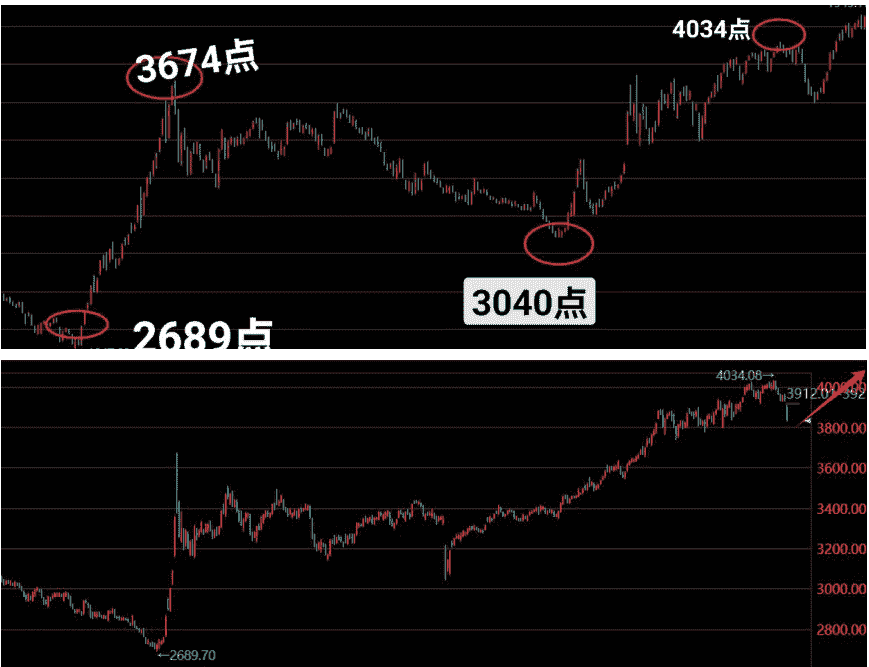

# 股市行情（11月24日-11月28日）

本周 A 股大跌后市场分歧加大，笔者截取了 A 股历史上相似走势（第一张图），对照了从 2689点到现在的大盘走势（第二张图），发现相似度极高。

如果未来走势延续类似，这轮快速下跌也会快速拉起来并创造新高。这只是一种思路，大盘在回补五周缺口后，再创新高可能比这个图走势复杂得多。

大盘处于牛市的观点不变，但牛市也有调整，不能一直涨。前两轮大牛市线连拉几根阳线后都会出现一根阴线，但从来没有出现连续两根阴线的情况，所以，11月大盘如果收阴，12月概率会收阴。

大盘短期走势：

深度视野VIP群 人工追踪50+大V 付费群微信cuk255 微信CHP5568

本周大盘从 3040 的上涨趋势结构遭到破坏，调整确立，但周五疯狂暴下，留下了 3912-3927 缺口。A股有回来回补缺口的传统，短期大盘有回补五缺口的需求。所以，下周大盘以反弹为主，等回补缺口后再预测下一阶段的走势。

操作上，先以反弹补缺口来操作。

下周大盘：有先跌后弹的趋势，底部在周一二。

周一震荡反弹到周二有所回落调整，周三继续反弹周五回调。

24 号大盘：冲高后回调，反弹还有阻力。

如果上午继续调整，那么反弹就会出现在下午。

深度视野VIP群 人工追踪50+大V 付费进群微信cuk255 微信chp5568
