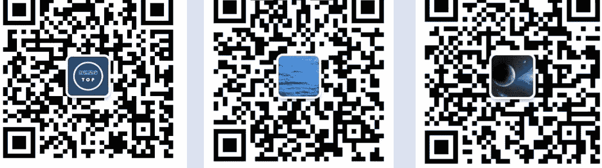
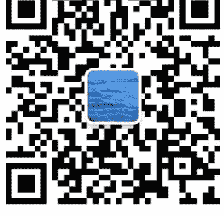
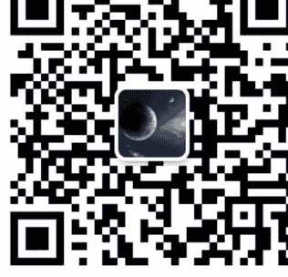

# 序言

我在做商业的时候有个念叫做作品思维。

这个作品思维就是我做任何的公益也好，或者说商业也好，我的每一个动作都是一个作品。哪怕觉悟天道，它也是一个作品。

它可能是一本让别人觉醒，开启觉悟，点拨他人灵魂的这样一本书，虽然它肯定是一本纯种版书，就不是一个流通物，我不知道我能明白吗？它一定是私下的这种生态，或者社区里可能才有机会偶然的缘分。一线之缘，或者这种缘分可能才能够得到《觉悟天道》这本书。

我在书里写的东西是不能出版的，我不知道你们能理解吗？就能出版的东都叫通。我基本上很少看出版书籍，我只会看老书和禁书。老书就是已经绝版了，所以我经常有时候买本书3000块钱、5000块钱，结果从国外买回来的书是很贵的，因为它已经买不到了。

## 免费 价值 及时 专注

# 扫码加入 知识星球TOP 免费资源群

- 每日免费获取价值资源
- 可提供各类资源搜索服务

| 热门付费文章 | 各行行业报告 |
| :--- | :--- |
| 精选图书资源 | 副业赚钱方法 |
| 职场实用资源 | AI政经自媒体 |

公众号: 知识星球TOP 微信号:jntsg8 微信信号:jntsg2

分享资料仅供个人学习，请及时删除，切勿商用传播

书的本质不在文字和书籍本身，而是是在里面给你讲的那个东西。

为什么我一直抱着出版，peter 老师有时候会说我。我觉得得出出版了，站在人类的层面讲。他对我过的知名度会有很大的帮助，就好像有一本出版的书籍那么牛，但是我好像也不是很需要的。我在乎的是我自己在书籍里面突破的境界。所以出版这个事我就随缘了，时候到了就读出就出，没到就不出，就这么简单。

但是是我追求我在书里面的原理，还有这些东西的突破，所以我继续写作，像今年我会写四本，三到四本左右。出版了以后，对我这个人的商业会有很大帮助的，但是也要花我的时间。

所以我的时间要放在我自己会愿意放的地方。

# 目录

第一章「天道在哪」................................................................ 007-036
第二章「这个神话」.................................................................. 038-065
第三章「最高境界」.................................................................. 066-085
第四章「神的窄门」................................................................ 086-095
第五章「人性七道」................................................................ 095-116
第六章「觉知九层」................................................................ 117-137
第七章「同修觉悟」................................................................ 138-208

# 第一章

## 天道在哪

原来天道不在远方，就在我们每一次选择里。

我今天好似在讲「天道」的事，但实际上我在跟你讲 IP 的事。

我是如何从一个小 IP 翻盘过来的，其实挺不简单的，也挺不容易的。

从2020那一年走到今天做「个人品牌」，我在这个行业整整五年的时间。我在入行的时候，微信只有2000多人，从一个银行的職員，然后走到今天，是经历过一些思考，然后走过一些路的，其实并没有那么简单。

第一章的内容里面，你们可能会看到很多真实的「真相」，就是你们现在看到的 IP 的商业在市场上的东西未必是真相，然后也未必是你们要进行的路。

### 豆豆的三部曲

豆豆写过三部作品：
- 第一部叫《背叛》
- 第二部叫《天道》
- 第三部叫《天幕红尘》

我追溯过豆豆这个作者，我做过很多的调查，就是他写的这个小说是是怎么来的。在全网是没有找到关于豆豆这个人的所有的背景的，我后来听一位高人讲，他说豆豆的这些作品，是有人给他匿名寄了他们的经历和故事，然后让他来写的。

## 《天道》——一部人类生存说明书

我们中国的影视作品有这么多，但是你有没有发现，《天道》这一剧的地位和对心震撼的程度，是大于其他任何的影视作品。《天道》这部电视剧不是一部简单的影视作品。我觉得对于我来说，它其实就是一部“善待红尘”的，给人类关于生存的说明书。

它对我的意义也非常大，我的 IP 的成功取决于什么？我觉得有30%到40是取决于《天道》的，就是我使用了《天道》里面给我的逻辑做了 IP。

## 强势文化的传播

豆豆的三部曲，其实都在做一件事事情，这件事情叫作“强势文化化”的传播。而这个片段在天道里面出现过：芮小丹在给丁元英写一封信，她想要做一部小说的作者，写一些内容揭示人的运和文化之间的关系。丁元英就可以开一家强势文化传播。

我再倒过的时候，发现芮小丹在《天道》里面做的事情就是豆豆做的事。因为豆豆的三部曲：
- 《背叛》讲的是人性，讲的是弱文化。
- 《天道》讲的是文化属性。
- 《天幕红尘》讲的是路。

强势文化的传播，等级越高，“路不走”就是强势文化。

豆豆的三部曲，就是在践行丁元英的热爱。因为丁元英这个人特别喜欢研究“文化属性”。如果你想把生存这件事做好，不需要研究别的，只需要把《天道》这部剧每一个细节到极致。

跟大家分享一下，我看这部剧，我是翻书，然后对着电视剧去看，有没有完整地表达出来。从《天道》里看到，IP商业是非常清楚的。

## 《天道》中的道

它会通过“人道”和“商道”来体现。天道无所用，所以它可以在任何地方无处不在。

## 人道

- 尊重人的价值。
- 如何有效地实现目标。
- 遵循规律。

今天我要要讲“人道”，在人道这件事上，也是是非常关键的，就是“人道”事情处理好了，“商道”就处理好了。这件事情起源于哪里？这件事情是源于一个“礼物”。丁元英要了一个礼物。

## 剧情回顾

丁元英跟舒梵去山，丁元英已经预判到整个事情的走向，他心里不去，所以他要去给自己一个心安。

小卉想要的礼物在王村子，它跟村子是什么关系？丁元英跟村子没有关系，跟“觉醒境界”也没有关系，跟“文化属性”有关系。小冉为什么要这个礼物？因为她想写小说，文化属性跟命运有关系，但是她不确定强势文化可以拯救弱势文化。对于丁元英来说，他心里是非常清楚接下来的走向。他认为救不了他们，能教他们的只有他们自己。这也是为什么有很多老师没有办法教学生，一个人不成，是取决于自己的“文化属性”。

## 透视社会三个层面

- 技术
- 制度
- 文化

这一段帮我非常大，因为我完全是用了丁元英的技术、制度和文化去做搭建商业的。像是割了，其实是在讲商业。

## 技术 - 产品

解决问题的方法及原理，改变现有的事物性能，利用现有的资源去创造新的事物的方式和方法。在“IP商业”里，技术等同于你的解决方案，产品就是解决方案。为什么小 IP 起不了盘、翻不了身，本质上都是因为小 IP 不专业。【专业】在市场经济里，任何专业的人是没有理由在市场经济里挣不到钱的，如果你真的做到，甚至商业都不需要。

## 圈点定位法

大部分人的定位都是口号，只是喊了个概念，喊了个口号。但是没有技术，没有在这个定位上真的去解决问题。秋教育研究出来的“圈点定位法”就是在解决“技术原理”的问题。

## 制度 - 产品交付的流程

制度就是“行为准则”、“流程”。在一套规章制度里，大家用这套规章制度来办事。所谓制度，在IP商业里是什么？就是你的产品交付的流程。比跟我咨询一次，你是随意的起电话就能打电话吗？还是提前预约完成一个完整的思考，自己提出解决方案来咨询？这都是不属于制度。如果从来不想，直接就想，你永远都没有办法得到训练。你永远在早的时候就是标准化交付的。

## 文化 - 经营命运

文化是整个人类社会历史的发展过程中，所有物质财富和精神财富的总和。丁元英的原话：小个人、一个民族、一个国家的命运，都是文化属性的产物。经营文化属性就是经营命运。这句话是我说的。我从2020年开始做 IP 的时候，我就尝试着经营文化，而不是经营产品，也不是经营团队。因为我深知一个 IP 的商业本质上就是它的文化，因为经营 IP 的命运就是文化。强势文化会造强者，弱势文化会造弱者。这就是规律，就是「天道」。

## 《天道》中的文化属性

- 强势文化
- 弱势文化

## 强势文化

- 不以人的意志为转移
- 尊重客观事实和规律
- 尊重客观事实，以意志运行

我们在学习任何东西，不要为了看，而是找到关联性。只有关联性才有指导性，只有指导性才有操作性。

## 强势文化的人

强势文化的人想一件事，会把每个环节都做到满足客观条件，而不是满足个人想法。或者和隔壁对比，以事实来做，以事实为依据。丁元英的逻辑是：不需要教育，我不允许这种现象出现。在老师这个层面，把你要的快速拿到，然后观察，停止输入，然后自己生长。这所谓的“天道”不是电视剧，而是你想干这件事要满足客观条件。满足个人想法，是不够的。

## 弱势文化

丁元英的：易学、易懂、易用、流行、复制、传播就是弱势文化。知识付费本身也是一种投机。什么叫投机取巧？信息差的钱就叫投机技巧。秋教育做的圈子，绝对不允许复制。因为你过了一年、两年、三年，最后你会发现，了别人已经形成了一个巨大的数据库，又要从头开始。在任何领域，某一个问题当中，去研究解决方案。只有“方案”足够、“案例”足够、“研究”足够，才是值钱。技术复制了之后，也要迭代和开发。

## 见路不走

当尊重客观规律，反观自己的客观条件，有了“见路不走”。就是一个高人给你道，你听完了之后知道走不了这条路，这就叫见路不走。真正的强者能够做到的见路不走，就是你带着自己明确的目的来找高人给出方法论，而不将所有的期望指望于他人。因为在这个宇宙里，没有任何一个人比你更了解自己要做的这件事。你自己都没有把这件事描绘清楚，希望别人把你内心的事情描绘出来，这就叫异想天开。

## 强势文化属性的运用

【无无用，无所不用！】

无所用，就是无形无相，无所不用，就是什么问题都能解决的。

## 01 老师

第一阶段：老师，但是不完全老师。一旦完全老师，你永远会成为下面长不出花的种子。我看到有太多的人，跟着一个老师学一年、二年、三年、四年、五年，永远是老师下面的种子。老师好棒！但他永远不是他自己。我是不允许这种现象出现的。在老师这个层面，把你要的快速拿到，然后观察，停止输入，然后自己生长。我讲任何一个课，绝对不会去听别人讲课，因为一旦听完，你就容易被植住，这就是脑的运作。你们有没有发现当你在做一件事情，本来这个事情是空白的，你明明可以画出一张比高画，却有人叫你临摹。技术可以快速复制，但是如果你连灵魂都是复制的，那你就已经功夫差了，连你的技术都是错。技术复制了之后，也要迭代和开发。

## 第二个阶段：观察、不学习

观察什么？

- 观察边界
- 观察方法
- 观察技术
- 观察文化

## 02 拿流量

你们有没有人发现，很多人特别喜欢混圈子拿流量。当你刚刚起步的时候，你要把混圈子流量的技术做到极致和高超。可是当你越过了第一个阶段已经站稳了脚跟，你还在混圈拿流量就代表着什么？代表你永远落后于这个生态背后的人。我大概在老师学习1.5年之后，我就决定“自断双臂”，就是停止流量的源头，不从任何地方找流量。

停止流量的源头，不从任何地方找流量。停止流量的营销。

停止营销的：
- 营销技巧
- 营销逻辑
- 营销的
- 营销的营销的，是营销的。
- 营销极致的，是营销的，是营销的。
- 营销的营销的，是营销的。
- 营销的营销的营销不需要什么。

# 人生在世解决两个问题

第一个问题就是生存。

第二个问题就是生命价值。

## 强势文化的使用

【举例】做一个行业，把这个行业做的 top3 找出来，理解它的最好，运用它的最好，但攻它的弱点。

强势文化在商业当中特别容易脱颖而出的。任何商业做到好的时候，它一定会有 bug。你提供的解决方案，如果可以攻它力量最弱的地方。你就反攻那个点，它就很容易攻出来。

商业大部分都是弱文化先做起来，也就是说，大部分商业都在经营弱文化的钱。所以商业越大，弱文化的能量越强。

弱旁文化：求上帝，拜佛祖，希望太老爷出现贵人，在家拜父母，出门靠朋友。

商业追求大的时候，就特别容易捷径，这种商业手法就无形成为一种施暴者，然后又出现了拯救者，就很容易崩溃。

## 小 IP 要翻身成为一条强势文化

很多人讲普通人做不了IP，我这么说，普通人不是做不了IP，是普通人连创业都不要试。做 IP 也好，创业也好，你得是个强势文化的人，你才能干好这件事。

小 IP 是容易做的。

「小 IP」根本不是大小的问题，是「文化属性」的问题。

这就是为什么我们在做教育的时候，吸引的人都是他本身尊重客观规律的，在本质上去寻找规律的人，经营自己的数据库的人。

很多人做 IP 特别喜欢卖钱这种叫做“知识复制”，一些学习能力强的人，他学一个东西的速度很快，所以今天可以开一个文案班，明天可以开个营销班，后天可以开个直播班，再后天可以开一个美学班，就是每天都能干干。

这笔账是非常脏的。

因为过了一年停了些钱，过了两年停了些钱，三年停了些钱，然后你会发现第四年的时候干不动了。

## 一个客户代表着一个数据库

我对我们总说的是什么？我说你第一年宁可慢一点，你就攻一万个品的解决方案。你现在你干到千不到专业，干到不到这个价值，你从5000开始给我干。就是从今年做50个解决方案的客户，然后明年再干100个，后年就可以干到300个，再到后年可以干到500个。

到那时候你的基地，是扎得非常稳，因为一个客户就代表着一个“数据库”。

## 【数据库不能被复制】

同行如果想过你，没有时间的积累的，它是超越不了的。

今年拿了100万，明年拿了100万，我要的是到了第四年。我还可以稳稳地挣更多，而且不能被超越，不能被超越。为什么？因为前面几年的数据库都已经攻下了，团队打起来了，方法论已经验证完了，然后知识产权，商标专利等都做好了。

## 从底层理解IP商业

它是一家企业，还是一个平台，还是一个私塾。

- 企业：提供深度高客单服务的解决方案。
- 平台：本质是研究人的裂变属性，所以你做的业务属性是什么，你就要打什么。
- 私塾：你得明白你干的是什么，享受这种方式，一年千个1000万，再搞个两年，顶2000万，不能再多了。

我们在做一个 IP 的商业的时候。我们要明白人就是底层的需求，就是你得明白为什么给你购买这个东西是非常关键的。本质是在让人更好地生存，以及找到他生命的价值。

## 客户不愿意持续连接的真相

第一种可能：能量分了，他的意识要么被别人占领了，要么别的事情占领，他选择了更适合自己的灵魂归属。

第二种可能：你的技术和境界，一直停留在一个等级。你没有往上走，没有迭代升级。

# 商业是一杯毒酒

真正是那个种子的人一下就醒了，不是的人就毒酒了。

## 做 IP 本质是经营自己的境界

你要把自己的境界当成最重要的事业经营，这个境界，你骗都骗不了了自己，去问自己：你的商业好不好?你的商业里的人好不好？你就能证明这件事情的真假，而不是在自己的意识里，谁谁都是假的。

我每一次的课程，无论是付费、收费，还是免费的。我没有把它当成是别人做的，也没有把它当成是为了某一个目的而做，是为大家为你做。“为我就是为你，为你就是为我”。就全然的看大家的需求，也全然看见我的需求。

## 天道在哪里?和你有什么关系？

很多人问我怎么找伴侣，我一直说看基因学。你在选择伴侣的时候，你在观察的是这个“家庭的文化属性”。文化基因就很重要，你就观察他的长辈的文化，能看到一些的未来。

# 用强势文化穿伤商业中的弱势文化

养成一个习惯：【观察漏洞】。要看到所有繁盛的虚假表象背后的真实的漏洞，这种漏洞都是商机。

一般都会会有别的小部分的人群是他的“利益共同体”，会有无数次跟这些其他的不是很确定的人去确认，这个就是对的，这个是正确的。

所以你们所听到的别人弄里的东西不是真的，你自己内心感受到的东西才是真的。内心比大脑要更加清明。意识比内心要更加清明。大脑信号会被语言干扰。而内心感受虽然也会被干扰，但是它会比较直接。

你可以击穿商业中的弱势文化的时候，你就可以从弱势里面识别同类。找到强势文化。

## 强势文化是一种选择

你选择了，你就成为了。当你做出选择，就会用强势文化的思维去“思考”、去“行动”，去决策。除了文化的教育，最重要的是教会孩子“生存”。

第一：看见价值
第二：经营属性

## 小 IP 的打法和大 IP

- 大 IP：影响力、路径、认知。
- 小 IP：见路走、听从、取用。

小 IP 的打法是很妙，小 IP 的打法有一套精准。我们所有的都是按照这套路径去打。

【IP阶段法】
- 第一阶段：快速立足
- 第二阶段：快速独立
- 第三阶段：验证“无”
- 第四阶段：开启

## 一个人的悟性靠训练

心性，心性是悟性的基石，心性稳，悟性就很差。悟性：就是你能够快速地把万事物的关联性透。配置：了解自己的商业最核心的目的：觉醒，赚钱只是顺便而已。

## 感受就是通道

这个通道一旦关闭了，商业绝对不好，因为你无法感受他。你就是众生。

# 第二章

## 这个神话

每个人都是生命的剧，改写剧只需觉醒。

## 【商业奇才】

市场上的人，总是用“商业奇才”来形容，其实一直特别想表达，没有什么奇才，因为热爱，所以不受控制的研究和观察，然后就成了奇才。

## 【剧情回顾】

王庙村扶贫。王庙村大概有00多户，是贫困里面最好的村子。有一天，芮小卉问丁英要不要“礼物”，丁英莫名其妙地答应了礼物，然后他们到了王庙村。

丁英：“所谓的神话，不是人的思维不容易理解。这件事可以尝试的，但肯定是个错误。”芮小卉：“扶贫还有错吗？”丁英：“无论做什么，市场都不是无限蛋糕。神话的实质就是力量作用下的杀富。”

## 杀富济贫的两个问题

第一个问题：“杀富”——开采市场资源
- 技术掠夺
- 成本控制
- 人员的使用

比如DeepSeek用很少的钱解释了一个神话。这件事和逻辑重叠，乐圣公司（6400万的资产，17%的hifi音响市场份额）。丁英手上的条件：
- 王庙村三个音响发烧友（冯世杰16%，叶晓明20%，刘冰13%）
- 王庙村具备生产脚架、音响设备的能力

第二件事情：发烧友+农民生产（胜算原因）
- 北京格律诗音响有限公司
- 以王庙村为生产基地，在北京注册公司，运作整个市场。
- 发烧友对音响的热爱，保证质量。
- 把这个村子切割出来，成为个体户，较少成本。
- 王庙村的人不怕吃苦受累。

用经济杠杆解决质量和成本的问题。

当强势文化可以设计弱文化的时候，商业会极其牛逼。强势文化到最后并不是通过强势文化来完成一次神话的，是强势文化带着弱文化的量取胜。

每个人都是生产力。

## 家庭产业股东约定

家庭产业，一家人的劳动力拿出来，就可以做一家很牛的公司，一个家庭就可以创造一个神话。（知电商、IP）

## 【合同】

农户间订购合同和各种价格表。
- 股东（股份、控股权、决策权）
- 强势文化的人

丁英：“以后不累死，这句话只有一种情况可以，就是你做完之后不累死。”

## 生存法则

弱势文化想要翻身的话，其实也有一些方法，弱势不能忍，弱势不能够。

产品：
- 乐圣公司（旗舰店）
- 粉丝群
- 音响组装
- 个人品牌

商业定位的本质是流量。流量。做商业是一件极其简单的事。

## 格律诗产品定位

- 第一个特点：面向高消费层的高品质“手工定制”。
- 第二个特点：属性必须是“劳动密集型”。
- 第三个特点：学习、掌握劳动成本。
- 第四特点：可以加工。

每一个农户都能在家里生产，时间累积的问题了。公司不是人越多越好，人少越好，尽量在家里对待。

丁英对为什么被禁这么多年，花钱怎么断，不允许放。做这件事情的本质到底是什么？

丁元的动作：
- 【知识付费】（自己想买）
- 必须申请专利
- 顶级审美（极度的热爱和研究）

越是需要动脑思考的，越是深度理解业务，大部分人做不到。因为大部分人都是为生存而做，因为竞争管理的问题。

## 商道

第一个点：商战策略是“顶层设计”，从目标结果反推路径。让一个人身体、心体、脑体、意识同时开启，最快速度开悟。

一个东西好不好取决于使用的人，而不在于这件事本身。你的问题不是钱的问题，在商业里面是有灰度的。

## 【顶层设计】

设计自己，从目标结果反推接下来你要做的这件事情。这里有两个点：

第一个点：你的业务逻辑经过顶层设计是没有漏的。我们在设计一个业务逻辑是非常缜密的。大部分在市场上的基本上是没有做过这种处理。强者思维的人，大胆的把腿迈出去，就能挣钱。你和他区别就是：他会后拉，你不会后拉；他敢卖，你不敢卖，没有什么能力上的区别，跟你清华不北大区别。

小 IP：私域人数在2万以下，年度营业额在500万以下。

顶层商战策略是顶层设计，现在很多商业是从IP本身去做顶层设计，这个市场是空白的。所有人都在同一条线上起跑。

你只需要你的业务逻辑没有破底，脚踏实地用正确科学的方法去卖，剩下的就是时间累积的问题了。

你们之间比的就是谁有一个好的品，设计一个好的模型，然后这个模型不停地建模、不停地测试、不停地积累数据。直到等到有一天别人已经超越你了。

## 核心技术，关键环节

通过深度思考关于商业人的信息差和认知差去碾压对手。你跟对手之间唯一的竞争就是深度思考信息差和认知差。

## 信息差和认知差

关键节点的胜负分水岭在哪里？

流量大的如果没有做转移和存储等同于白瞎。暂时的流量大，代表资产大。

KPI的业绩增大，我们看成成功和失败，都得看到本质。

- 成功的底层原理是什么？
- 分析他的钱是从哪里来的？
- 他为什么能够获得这些钱？
- 这些交钱的人，他想换成什么？
- 是什么节点，让这么多的人愿意一起交这笔钱？
- 有没有竞争对手，为什么没有给他们而交给这个人？

我们在做商业的过程中，不是以抢钱为目的，而是为了生存。弱文化为了生存，因为竞争管理的问题，导致了很难有逻辑和热爱的人。如果你可以在某一个领域允许自己“发烧”，就可以在这个领域对标。

## 流程

第一，要处理人性的事情。
第二，要处理完流程标准化的问题，这就是一个模型。
第三，是如何使用这个技术的问题。

我们花了四半的时间去沉淀了一套工作技术。这套工作技术我们的商业导师在我们这里都是3、4年的时间，一直在这套模型里面反复打磨使用。未来可能过了三年，有人想要超越这家咨询公司是很难做到的。他需要来一个五年的时间，再来一个八年的时间，才能超越。

从本质上来说，他不是技术上可以超越你，有钱就能够打败的，不是资本就可以去copy。对于我来说，商业的组合就是一个艺术作品。我也享受做这件事情。

## 一家商业咨询公司的最大流量可以做到多少?

中国的头部华与，是做企业品牌营销服务的，做一个案子他大概是580万，也就是按60万计算。一年他大概做30个客户，然后这里就是两个亿，还有其他的收入两三个亿左右。这是中国部的企业品牌服务的公司，一年几个目标。

中国的企业咨询需要多，还是个人品牌咨询需要多少？

个人品牌咨询的封顶价。一个案子的顶价能够到达多少万？

5年或者10年的时间走到200万，你觉得可能吗？

就是做一个咨询服务200万，可能就是当1个IP一年可以实现200万的时间就可以做到200万了，是不是愿意不能自我的意思？

金钱的本质在于交换。如果当他一年可以做到200万的时候，他付200万，那根本不是个哈，因为他要追求4000万。走到2000万，就是三年左右的时间，如果能力差一点就五年左右的时间就可以做到200万了，是非常有可能的。

到那个时候它是小型公司，你做200万，就分四个个体，你也能把税交完。一个体户500万，做一个核定征收就不就行了吗？那2000万的算什么钱。

## 咨询行业需要陪伴

更多的能够做到2000万的IP，要伴随着他们的成长，一些孵化，让他们去成长，能理解意思吗？当这个行业越多的的人可以做到2000万的时候，我们虽然就涨价到200万了。

当我们做到200万个案例的时候。一年做10个客户就是2000万，做100个客户。这里是多少钱？大家能理解我的意思了呢吧？这是咨询公司的打法，所以你们现在能理解什么叫作它的封顶了吧？

那我实话跟大家讲，就算按200万计算。其实咨询公司也是有上限的，你再怎么都不会超过两三亿了。

我们在慢慢地把这个模型给他跑，稳健地让它跑。这个模型又会生长出一个10亿体量的模型。但是如果你想搭十个亿体量的模型，它就必须是咨询产品了，它会变成非常有意思的产品。

## 短视频矩阵

短视频矩阵也是小户打农的原理。如果很多人想做流量，做流量是商业的打法，做流量不是说你在那里整天粘，它是可以用商业的方法做的，能明白我的意思吗？所以你到了什么阶段，你就计算什么阶段，用什么打法来打。

## 把商业当成为一门艺术

一个创业者，要把商业当成为一门艺术来研究，所以你要深度考虑你行业的本质。

## 免费 价值 及时 专注

## 扫码加入 知识星球TOP免费资源群

- 每日免费获取有价值资源
- 可提供各类资源搜索服务

| 热门付费文章 | 各行行业报告 |
| :--- | :--- |
| 精选图书资源 | 副业赚钱 |
| 职场实用资源 | AI自媒体 |
| 知识星球TOP | 微信信号 |

平台的本质是裂变。
企业的本质是深度。
私塾的本质是1对1。
打法逻辑一样。

我们理解的小IP是什么？里面包含了人、公司、流量。
打法逻辑一样。这包括个人IP的底层逻辑一样。

## 小IP强的地方

- 充足，动力廉价。
- 第一，时间充足，有些人，他便宜，是阶段决定，看着他的意识，还没有办法快速到达那里就是他的羊毛。
- 第二，效率高。
- 第三，性价比高。
- 第四，小IP的技术是很牛，干活利索。这种IP效率高。
- 第五，成本相对低。

## 小IP的伤

- 没有战略思维，只能在点子上思考，不能在纸面上、立体上。走到哪里哪里，所以IP自己做大不了。
- 卡点是业务理解。大部分小IP生存下去就是因为不专业。没有专业的格局、眼界、对商业的理解。

## 猎屠班

培养IP营销规划，我们盯上中国市场这些大佬的肥肉，为他们服务，每个人分一份蛋糕。营销规划都是独立的个体，并且你在任何行业都能吃到那口饭，然后聚集在一起打大的块肉的时候，都可以迅速拿出自己的绝活。

## 祝福教育

我们是一家专业做商业咨询的公司，大部分时间帮客户解决专业的问题。行业刚起来，大部分做IP的人，业务逻辑都是新搭建的，所有的产品、服务都是新搭建的，没有流程，没有野心把这个东西做标准规范，导致了业务不专业，本质上也是一种文化的问题。

研究出来的小IP是非常精准的，一点时间都不多花。你按照这个路径走，一年100万。过了100万的这一关，你很轻松可以做到500万的，这都是稳稳打的实战经验。不要去打什么399这种品种，一万搞不定，你根本不可能做到100万。399这种品种没有意义。不专业这个问题到底落在哪里，在弱文化和强势文化上。因为只想赚钱，不理解赚钱的规律和原理。

## 怎么能够变专业？

很简单，大象装冰箱分几步？把这个事情理解透了，你的专业就理解透了。

你要对自己的业务要深度理解，你和你自己业务的关系要好，当你跟这件事情的关系深度融合，做这些业务本身是你唯一的路，或者是你价值实现的路的时候，你是不要去思考这些东西的。你会在这上面做all in的投入。

商业里面有没有可能创造一个神话？这是第一。第二，我希望大家落地，就是脚踏实地，把一个点上的事做好。如果你现在做了这么大的事情，因为人都是被大给牵着的，有时候你的眼睛缩小一点，只看到眼前这个客户，只看到当下的这个事，你反而能做大。

我打个比方，你看不到点看不不到面。点没有解决，你就没有面的价值。万丈高楼平地起，再大的事情都是从一个点去建模完成。

## 建模思维

在我的人生中，我做任何事情都有无数模型在建模，习惯性思维一直是在建模。带着这种思维去做一个品，一万到十万。

做IP是速度最快的。因为你在这个阶段里面，IP的底层逻辑一样。

小IP可能就是几十万，百万，一个大的人做，真的是几亿的体量，效率非常高。成本相对低，IP的效率。

（注：后续OCR文本存在大量重复且包含乱码的逻辑，此处已根据语义进行了最大化去重与重组）

# 第三章

## 最高境界

不是成为神，而是活出“人神合一”的从容。

我在测试一些频率上的事情，就是有人干预和艺术干预的频率的问题，大家觉得到场率有什么影响？今天的内容维度很高，可能比商业还要烧得猛烈一些。

## 能量交换

你在这每一个磁场里面的出现，都会换回来一些东西。

## 【剧情回溯】

## 五台山论道

- 到底是丁元英的境界更高？
- 还是智法师的境界更高？

> 《悟》
> 丁元英：悟道休命中，修行勿取真经。一愚一暮一刹，哪个前生注定？梨本无清净，红尘不染性空。幽幽古刹千年钟，都是痴人说梦。

参悟佛法的人和一个在红尘里面自省觉醒的人，谁的境界更高？是在里面取的真的更真？

## 商业的最高境界是宗教

商业的最高境界是，或者是神同于IP。IP是一个投影源，投射在天空中的虚影。众生无法直接触摸到，除了投影源的思想文化，本身在底下把投影到天上，这部分的人是非常重要的。

## 用商业去度众

在商业里面，顶级的设计是你用一个商业去度了下面的生。他们通过你投到天上，赚了钱、渡了人、成长了自己。他们是底面的利益共同体，是受益者。IP本身就是一个工具而已。商业不是帮每个人去独立，因为每个人独立是很困难的。你想的是怎么把无法独立的人，在你的环节生存下来。不是干什么，而是你做了一个游戏，让他们在这里生存，在这里生长，在这里看见自己。

最终是为了给心找不苦的理由。

丁元英从一开始就开始觉得佛教就是弱势文化的存在。既出宗教的佛教成为觉悟众生的大乘法度于纲纪，则于民是，普度众生。

## 在商业当中修道，不要在庙里修道

林雨锋：杀富真的能济贫吗？你杀了我吧，我好歹落个成就。

人是救不了人的。救世的文化为救世。

就是真正能够得救的东西，是自己的觉悟。得救不是破了戒的狼吞虎咽，是觉悟。

## 律师的扶持是不不治之地的

林雨锋：这是你最地道的地方，什么都知道，还什么都干了，你侮辱了法律，奴役了农户，破坏了市场风气，毁掉了一个妥当的民族和谐品牌。从你身上还能找到一个受过教育的人，应该有的社会的责任和道义，你又得了什么英雄好汉？

这就是我前面第一天告诉你们的物质和精神不匹配，就算你乐圣的老板再牛道，都能轻松地把你拿捏，听明白了吗？所以丁元英的这一盘局的格局，是非常是非常非常的牛的。

哪有什么响当的民族品牌，不过是打着商业钱而已。

神话本身毫无意义。最高境界里没有最高，空字一个，留给世人论道觉悟，这才是意义本身。我得救了之后我也很舒服。

这不是一个神话，是觉念也是道的要求，道的安排。只有动起的思索让人发醒。才是意义，没有好坏对错。

强者做局，凡者等局，高者造局不造业。

鬼手佛心。这是境界！

大剧场的游戏。程序加载净化这才是本意!我认为做 IP 最本质的一个核心就是你作为 IP 的境界被拔高了。

人不需要营销的，它是一种选择。

他不需要去说服，你自己自主选择来的。我们做的事情和卖一个产品是有非常本质的区别，因为需要你行动。不是听课看课越越好，而是真正地帮助，需要帮助的人和能够使用你的方法拿到结果的人。

## 每一次营销都是一件艺术品

当你随着你的境界真的发生了变化之后，你就会发现营销这件事情，每一次营销都是一件艺术品，心灵艺术品。

每一次在做发售的时候，我都无比的开心，无比的兴奋，我在对做营销这件事第一有 KPI，但是我是我不记得的，就是我，我是不管这个事情的。对于我来说，don't care 都没有所谓。

所有的东西，当你自己把自己修去了之后，你就会明白所有的努力和你的这种思考和穷尽都在商业设计、产品设计的那一刻全力力量已经用完了，剩下的东西就是随缘了。

## 大部分为什么营销会让人舒服？

大部分营销为什么让人不舒服，都是源于一个技术呈现的问题。我还有一个就是他信息信息丢失，跟自己的信息丢失，跟市场的信息丢失，和用者之间的信息丢失。

我最近就是我做完一个案例之后，我发现我是没有办法做第二个案子的，因为我在那个案例子里，竞竟的时候，我整个个人就是真的，我的身、脑、心、意识体四个一起上，给那个案例服务。

## IP 商业最难的地方根本不在商业

IP 商业最难的地方在 IP 就是这个生命本身如何设计，能够跨足过去30年的数据库的使用，提取，设计还会有那个有效信息留存，然后设计他未来30年的商业的呈现，未来30年的商业呈现来体现这个生命价值。

超能力的背后很有可能是高维力量需求的配置

她说秋秋你你不讲商业的时候，你就是一个正常人，你讲商业人就是一个正常人。她就把这认为了是一种超能力。如果你是不达成高维智慧的目的的话，你把他的能力没收了，你会怎样？

> 就是那天晚上是第一次我去思考过这个问题，它是是我的超能力了，我开始觉得这个超能力有一种离体的功能。

就是我在昨天晚上做一个案子的时候才是一个，他是一个关于茶文化的一个案子，就是 IP 本的阶段和这个他现在所处的事情，我要将生命、艺术品和茶经营与营销这三件事情结合在一起，去产生商业的架构。这个案子的难度特别特别大，我晚上留了一个小时，但是后来来打开的时候，我突然想起来这个案子没这么简单，我要处理这么多这么多的事目。

我的良知是不允许我违背背的能力，本身可以到了最高的高度，然后随意的做一个事情交差的。别人可以允许，我自己是不允许许我自己的。

我白天已经熬了一天了，晚上的精神它就供不上，有点供不上，我就抱着那个电脑，然后我就睡着了，结果我做梦的时候，我就梦到，要把我的超能力连起来，然后在梦里面去处理这些事情。

结果我早上他去做这个案子的时候，我一瞬间觉得得我的功力，我一秒钟睁间给它彻底破坏，睁间，那个恶思路就给连起来，我就感觉又一次升级。

## 训练弱者思维

- 担心你一口吃个胖子，效率很慢
- 学员认知、认知极高时，教学方法就不能够满足。

## 强者思维

- 完竟这事情，一步到位。

## 顶层设计（解决问题）

- 完整的看到你的设计图
- 当下的阶段一目了然
- 未来每个阶段要做什么
- 对每一件事情的规划和认知

我认为来到我儿的都是强者，我不接受反驳，如果你是一个弱者，那我可以实话告诉你，你确实太适合我的教学方法。

我觉得亮竟这件事就是一步到位，不需要走那么多弯路，是可以一步到位的一件事情，把所有东西西融在一起，一步到位，这样的人生生它简单，他也不需要做太多的事了。

## 一个商业里没有精神，这件事就不性感

如果一个事情整天谈钱就不性感，或者说应该应该追求更高境界的推动，比如诸元英做的神话，对人类觉悟的推动。我认为商业是不商业的，商业只是挂羊头卖狗肉而已，你们认为是商业的吗？

IP 他连自己的产品都不理解，他更不可能理解产品背后的真正需求。

## 英语老师

- 弱者思维 - 单纯教英语
- 强者思维：
  - 英语是载体和工具
  - 开发觉性灵性
  - 找到了梦想
  - 孩子得到了在学校里跟孩子不一样的东西

# 第四章

## 神的窄门

窄门是艰难却道路。

## 神学院

## 【剧情回顾】

背景：死刑犯丁元英不愿意提供。

## 死刑犯与丁元英对话

## 什么是文化属性？

- 支配人的价值
- 文化属性
- 没有主，无处不在。

## 死刑犯开口

- 判断他的价值取舍（主）
- 判断他的价值
- 属性确认
- 属性的
- 属性的

## 精神的

- 道德
- 道德道义
- 道德理想的最高价值
- 精神高傲
- 精神高的。
- 认为自己超越神
- 认为他超越的。

## 文字游戏

- 事情的不同
- 通过逻辑线推理
- 逻辑问题
- 逻辑的逻辑
- 聊天，身份段平等。

## 因不信天堂，因不信地狱

人怕死、贪婪，不给人自觉、追求高尚的机会。弱智的人，没有逻辑推理的人才会相信。

## 捍卫

- 没有理解基督教的真正境界
- 逻辑辩论
- 神管理人类
- 饥荒、灾难、罪恶也是神计划中的事
- 神左手施舍，不让右手知道

## 政治管理

为了大体的安全性，要放弃局部的利益

- 教育不能开放人的创造性
- 过度性被开发创造力和逻辑学
- 管不住人
- 要完全理解，不要批斗

## 屁股决定思维

不站在主席的那个位置，不站在总统的那个位置上，你是无法理解为什么要做决策的。

## 神的牢门

因天堂与地狱的因果关系而具有的极人生境界，让你超越因果直面事物本质，破除执着于表象佛性。

## 道法自然如来

自然法则、本然之心、如是而来。

## 追求精神物质更高的境界

燃烧自己，点亮别人。与神的约：自己内心，良知、道德。不履行约，进不了牢门。

【与神的约】其实是自己内心良知与自己的约，要对起这个心，就是你有敬畏了之后就不敢乱来。

## 人来到地球上修一件事不是人

当不是人的时候，你自在。

## 大S离世

一个结论，画个符号。高维信息的人像极限。我站在一个客观的角度上去看待这件事，我看到的是什么？

我做了一个深度思考的，目的是为了给她一个结论，每一个符号。

## 一个特殊的人类物种

不是人类心理学，琼瑶是人类的物种。爱是爱、爱情、爱是高维信息。不是人类心理学、人性逻辑、学生、生物学以及关系学定义的存在。而大S本质上不算一个人类。

## 核心逻辑：极致的爱、高维的爱

- 维度交流
- 这种爱
- 这种爱
- 这种
- 极致的爱
- 高维的爱

## 商业宽门

所谓的宽门是什么？大家都盲目的。
- 这种逻辑
- 这种逻辑
- 这种逻辑
- 逻辑问题
- 逻辑的逻辑
- 逻辑问题
- 逻辑问题

## 商业窄门

窄门是艰难却正确的道路。
- 定位、技术、解决方案

## 人性七道

贪、嗔、痴、慢、疑。

## 1. 兽道：生存本能囚徒

生存逻辑是动物法则。弱肉强食。
- 生存本能
- 羊群效应
- 没有脑
- 群体很强
- 逻辑
- 逻辑
- 逻辑逻辑

## 2. 奴道：秩序附者

我们可以观察一下，我们的教育的产物。人性已经习惯了听话，没有安全感。
- 听话
- 听话
- 听话
- 听话
- 听话
- 听话
- 听逻辑
- 逻辑

## 3. 逍道：规则操盘手

权力拜物教，背后利益的驱动。换一句话讲救世主妄想。体制内经常会出现一种情况，叫权威崇拜情节。
- 习惯做道德外包
- 责任转移
- 道德来束缚人

## 斯坦福监狱实验

正常人在哪里，被训练出奴性。有些人是配合，假装被奴役。
- 配合
- 配合
- 配合
- 配合
- 配合
- 配合
- 假装被奴役
- 处理手法：直接接表跟利益者同级。

奴性指数，来源于恐慎的平方数乘以贪婪值。

## 魔学

要能承载魔学。底子得硬，扛得住。和佛学同等重要的学术术。东郊西毒最后练成蛤蝌功。

## 发心

奴役别人、控制别人、拯救世界。

## 分辨

大部分公司都reality训练奴性，鼓励无脑、奉承无脑、感恩无脑。行为：关闭你大脑的思考，道德外包，责任转移。代言人：刘沐。

自己选择结束，这就是权力寄生链面的吞噬路径。

# 我的知识范围仅服务我的生命

知识上懂，你们把这四个字敞开一下。我始终坚持：我绝对对不学、用不上的知识。你再造我用不上，我都不学。我的知识范围仅服务我的生命。因为人们很容易掉进去，觉得自己恰都需要、学啥不会的虫洞。

## 看书三大功能

- 陶治情绪、解决问题、悟道修行

很多人学习是为了成长，看书是为了成长，但是成长不在书籍之中。是你要通过看书，找到你可以为你所用的东西，去解决你当下生存里所遇到的问题。随着你的生存问题解决了之后，你还要通过书来悟道修行，寻找答案，让自己的境界，破解更高的维度。所以书本身的存在，要给给你的解决问题，要替你寻找答案，境界更高。

这就是因为书很很容易让人知识焦虑，你们同意吗？有没有人有这种感觉，就是你会感觉书读不完，优秀的人就是这么多。对最后，哈啥也没有。

真正的东西我想大家说出版的书籍都不叫什么好知识。智慧无关，文字智慧是悟出来的。

# 智慧是一种境界，不是一种知识

我以前很早的时候，寻找什么是智慧？一堆人讲智慧，哈说是智慧，没有人可以解释的什么是智慧。后来我发现智慧是什么？无生之，局外生态。

智慧是一种境界，不是一种知识。当一个人可以修到无与自己无关的时候，这件事与我无关，他就能升华。当他可以把自己修到局外的时候，他就能上慧。他既不是文字游戏，也不是丁元英。

## 从人性层级去识人、选人、用人、留人和住人

所以我们学人的目的是让自己自己到位。

在秋禧教育的每一个成员，秋禧教育的成员是很困难组成的。并不容易。因为这个创创始人的维度来说，它就不容易。第一，文化得一样；第二，这个价值观和配置还要匹配。

市场上有很多高手就是商业，就是我曾经面临着一个问题，就是我直接去那些小 IP 做商业咨询的，一起来做一个生态，我自己带。

个人品牌创业者，他需要的是一个好的、有耐心的、有爱的老师，能看见他的，手上经过专业的培训，他手上有完的 SOP 文档，有完整的执行流程的逻辑路径，对整个上市市场的底层原理和动作的清晰。

我在这个问题上做过非常深刻的思考的：

- 商业导师的能力的清单里面有什么什么？
- 做商业导师的，是要“把尿把尿”的。
- 最后是他的责任感，他心里要敬畏他做的这件事情。

从这三点你就会明白，我是根本不可能到市场去招毁害人的。我给了自己五年的时间，我要带出这些人，让他们走出来，要比什么麦肯那些人还要专业，因为他们干不了服务生命这个事儿。所以我们的商业导师是很困难的，就是要给他们每天浇水一样，一点点的润，一点点的点的润。

首先，他们要能够看得清楚自己做的事，这件事是一件什么样的事，是什么样样的价值？自己要成为一个真正要去研究商业的人，他要热爱商业。

你不能给我交差，就是为了建那个模型，那种一种定会被我骂的。

就是我在做，他们会给我交案子，所有最后的案子要到我这里的，所以他们都交给我。到我这里的话，我一个人搞效率，就这个月人太多，我就要慢一点，就是我在做那个案子的时候，我是能够看出这个人有没有做功课的。

## 在专业上，我是零容忍的

就是我的零容忍，不是在你的能力高低，而是你的态度上。你是怎么意思把这种案子交给我的。

就前天一个商业导师，我就直接打开他的微信，我就直直接说：“从你的商业架构的逻辑上没有一点漏洞，做的很好，但是对我来看，你这个整个案子就是垃圾的。”

为什么？因为你做了一个这么完美的商业架构，却根本不是创始人 IP 想要的，你到底在顶层设计的时候，有没有听明白这个 IP 自己本身要做的这件事情，他的能力值和他的愿望值到底在哪里里？

就是你做的这个案子，如果脱离了创始 IP 的生命程序，这个案子是不成立的，哪怕他的商业逻辑的再牛刀。

## 企业商业和 IP 商业是完全不一样的

小 IP 要热爱商业，成为一个真正要去研究商业的人，下半生，他想这么活。

- 第一、我马上就能做。
- 第二、我还得有钱赚。
- 第三、商业逻辑要 10 年才能闭环。
- 第四、我能兼顾它未来 10 年到 20 年整个逻辑性。

我这里的商业导师都非常的棒！就是我是怎么买就怎么接。而且刚开始的时候，如果我买，要是我只认好的老师，我知道了，我们继续再买的越逞，为什么，因为就是不知道。所以我特别讨厌我特别恨那些买他告诉我知道的人的，因为我不轻易买人的，我买你，是因为你值得得我买。我没事，我对你买干嘛？我连孩子都不买的人，我买你，我有痛肠。

他从底层原理上去理解他，热爱这个行业。被我买他都会很开心，很幸福，我再去，我怎么没想到这个点？老师把我叫醒了。

（此处后续为大量重复乱码，已按要求处理并保留逻辑内容）

## 第六觉：合一之境

你内在因果之律这里的时候，你有一个能量层面，一个最大的bug就是你们是隔离离开来的，你有分离感的。

到了第六觉的时候，你就到了合一之境是什么，消融自我与世界的割裂感。把自己在世界上中消融。他和二元对立还不太一样，与天道共振，消除主观与客观。

在商业当中真正正的商业的，顶级的商业智慧是成为生态本身，而不是控制或者者用一些商业的技术。

你想要打破合一之境这里，你想要到这一层训练自己到「合一之境」的这一层。你要怎么做？

就是实在事情和谈判前，我会进行无角色意识转换术，我要把我跟他置换过来，我要去思考，我要去把他的意识拿过来，在这一场交易里面没有我。

我不是去到他脑那里，我要去到那个主那里。你要打破合一境界，就要和他的意识与他的主一合。

## 第七觉：无我之剑

斩断自我意识，把所有的自我意识关闭，要极强的功夫才能做到这里。不能用人类的思考做人，剥离与识别自我意识的纯粹无意识行为。如果你能够斩断自我意识。那就说明是你已经不是一个单纯的人类了，你不要自己当人了。

人之所以为人，就是因为他有自我意识。很多修行人会修到意识，创造了一个认为自己是在很高位的一个境界，这是他的自我意识创造的像。

你就到了一个无欲无求的状态，就要自己去看看是不是只有无欲无求，才能斩断自我意识。如果你做不到无欲无求，你是做不到斩断自我意识的。

商业就是我的炼道场。所以商业当中，真正的护城河无求、品质高。无求品质高！你就是到了一个无欲无求的状态，你要，就要自己去看看是不是。

只有无欲无求，才能斩断自我意识，顺便找到同频之人！

# 第八章：觉局之力

可以用笔来做局的。你也可以理解为他觉得了，但是本质上它已经不是它了，而是叫觉局之力。

构建一个局域，唤醒他人觉知。丁元英就是干这个的事情。你们感受一下丁元英杀富济穷的布局留白艺术。是妖妖妖、是鬼灵灵、是人显显显、是仙仙仙、是神神神。跟丁元英没关系，这才是真正的鬼手佛心。

就是有人在这里变坏了，有人在这里死了，有人在这里变得更好了，活了，那都是他们自己的事，跟我这里并没有什么关系的，你是中性的。很多人在商业当中是在造自己的业的，但是在觉局之力这里里不会造业的。对，造局不造业在这里，这是一个庞大的系统。

在商业当中最高级的领导力是宇宙系统自动运行智慧。

你们可以测试自己，你不要测试别的，目的在于觉醒，不在于说这件事的结果本身没有好与坏。一个不通觉的人，不精通天道法则的人，他也做过了商业，他做的那个商业项多就是一个过程，就是说偶然的一个风口让他起来了，他不是一个永久的成功。

# 第九觉：天道沙盘

我在做第九觉训练的时候，我自己觉得它一定是有难度的，但我确实是在这里做了很多实验和体验，就是你们把天道当做沙盘，就是你“比天道还道”的时候，你会觉得我很狂。

把人类属性与天道宇宙剧场合并，然后作为它的解码者与重构者。我曾真的过的如我是宇宙，我要怎么重新设定这个游戏，我觉得它有 bug。

## 解码者与重构者

我想解他现在的玩法，我要重构它，我觉得它可以更好玩，对，然后做沙盘。

最后你会发现，像天道里面神即道、道法自然、如来。这里是三教合一，神道给你讲神学，道法自然让你讲道法，然后如来给你讲佛学。

商业的本质就是用商业亮点生命，参透并运用人类众认知的底层编码，以此服务的人类觉醒的过程，用商业去事实事情。你认为它难就难，你认为它简单就简单，就是这个世界和宇宙一切你认为的核心的。

## 解码者与重构者（天道沙盘）

我在做第九觉训练的时候，我自己觉得它一定是有难度的，但我确实是在这里做了很多实验和体验，就是你们把天道当做沙盘，就是你“比天道还道”的时候，你会觉得我很狂。

把人类属性与天道宇宙剧场合并，然后作为它的解码者与重构者。我曾真的过的如我是宇宙，我要怎么重新设定这个游戏，我觉得它有 bug。

我想解他现在的玩法，我要重构它，我觉得它可以更好玩，对，然后做沙盘。

最后你会发现，像天道里面神即道、道法自然、如来。这里是三教合一，神道给你讲神学，道法自然让你讲道法，然后如来给你讲佛学。

商业的本质就是用商业亮点生命，参透并运用人类众认知的底层编码，以此服务的人类觉醒的过程，用商业去事实事情。你认为它难就难，你认为它简单就简单，就是这个世界和宇宙一切你认为的核心的。

## 觉悟天道 Day1 | 李威涛学习感悟:

【心灵觉醒，商业智慧启航】

大年初七，祥龙贺瑞，万象焕新。在这一希望满溢的时刻，我们齐聚“觉悟天道行实修”，开启一场寻找生命真谛、解锁商业智慧的非凡征程。这绝非普通通习，而是心灵深处的觉醒，对强势文化的深度发掘与实践之旅。

【理论作舟，践扬帆】

秋棉老师，凭借深厚底蕴与敏锐商业洞察力，为我们揭开《天道》战战肩后者的生命哲学与商业智慧。通过18次深度拆解重构，我们仿佛置身剧中，与角色共感，受在海海沉浮中守自我、遭遇困难的坚韧智醒，仿若汲取前行力的源泉。

【强势文化：成功之钥】

强者思维，弱者淘汰，此乃世间铁律。对于个人成长、商业竞争而言，强势文化——勇于挑战、创新不止、坚守原则的精神内核，是通往成功的必之路。它不仅是态度彰显，更是引领时代、创造可能的内在引擎，驱动我们冲破迷速，驶向成功彼岸。

【心之所向，择锦路径】

“见路不走”，四字地有声。真正的成功，非复制前人轨迹，而是聆听内心召唤，踏出独特之路。要敢于突破常规桎梏，以创新思维破局，唯有独特视角捕捉机遇，让一步一步都烙专属精彩，书写精彩人生华章。

此次“觉悟道行修营”，不仅为家人伴的商业思维注入强劲动力，更助力他们在生活中践行强势文化，蜕变为自信、独立且极具影响力的个体，如璀熠星辰照亮前行之路。

### 【学无止境，共铸辉煌】

我坚信，后续通过持续分享交流，深化强势文化的理解运用，每位伙伴都能在各自领域绽放光芒，创造价值，携手绘制宏伟蓝图，共赢璀璨未来。

### 【愿景展望】

未来征途途中，我们皆以强势文化为指引，怀揣悟之心，付诸笃行之举，共同谱写辉煌史诗，让世界见证我们的成长与荣耀!

无比感谢在我刚刚开启商业思维的时候，遇到了这么有道心和高维智慧的老师。

# 觉悟天道Day2 周一学习感受

又是整整两个小时，与秋禧老师的同频共振，引发了我对过去的思考，启迪我对未来的展望，特别是在最后音乐收尾的时候，眼前浮现的是我带着家族一起创造的美好场景，它和我多年前的那是的一致：扬发家族。

我非常相应禧老师所说的观点：商业的最高境界其实是宗教，你用IP这个工具，以投影的方式，设计了一套游戏规则，帮助一群无法自我独立的，在这个游戏场里生存下来，让大家都受益而没有存在。我的理解就是《金刚经》里的“普萨于法，应无所住，行于布施”。所以，商业其实执行，商业离开悟最近。

而转身秋禧老师提问的问题，我如何创造我的神话？跟随老师一步步的拆解，了解到小IP的强与弱时，让我创造自己的神话有了无可强大的信心与庆幸。个人品牌这个领域几乎是空白，只要定位人群，打造一个模型，解决一个问题，通过不断拆解，然后不断建模升级不断复制，就能源源不断的发生。

秋禧老师还赐了我执念，小IP的逆袭成功必须借助商业这个方式，如果你需要它去抗拒它，只能说明一个问题，就是你没有处理好与商业的关系。商业就像一把刀，本身没有好坏，它发挥什么作用，取决于使用它的人。

对秋秋提出的两个问题：你是不是发烧友？你做的是什么行业？我居然犹豫了，没答上来。我这些年来围绕着心中认定的“生命觉醒”这个目标而做事，但完全没有商业元素。也就是说，我在我自己的世界里玩了一个我想象的游戏，但从不去想具体的游戏规则和游戏，把感性体验当做具体经营结果，虽然解决了问题，却没有量化更为没有精准，以后做数据据，所以无法展示实力，也无法无法体现价值，更无法无效沉淀品牌和高效复制。

不过，这恰是我创造神话突破！一旦我把这个点梳理出来，那么过去十余年的沉淀就会爆发惊人的结果，这也是我信心的来源。

感谢老师高维智慧的无私分享。

## 觉悟道Day2 宫好昕学习感受:

我今天第一个感受是：
神话的本质，神话其实是强势事的杀富济贫。它本身可以不花钱或者少花钱，通过一种破坏性的方式打破规则，展现出跨境界的胆量和足智多谋。

## 第二个感受是:
关于精神断绝。物质与精神的关系是平衡的，一旦经济实力很强，内在在精神却很低，就会出现不匹配的情况。

这实际上是德不配位，精神文化的高度跟不上，导致钱越越多反而变成了病毒。

## 第三个感受是:
当你的产品足够好，并且你懂得修炼自己的时候，就像老师所说的，发友是先有基因，他们的产品质量过硬，并且他们对行业有足够的理解，这样才能出一个神话。

## 第四个感受是:
一个家庭如果心向一处，就能创造神话。

## 第五个感受是:
关于弱文化。如果想要翻身，只有一种办法：忍不能忍，忍不能忍，才有商机。

## 第六感受是:
定位一定要明确，固定好人群后再做事，这样保持统一，因为这就是在对方对话，越清晰越聚焦。

最后是顶级设计，即设计。核心技术是关键，人与人之间最大的差距在于信息差。

信息差和认知差是胜负，那么如何打破信息差？需要深度思考、重组打破常规。就像丁元英一样，他在局中，局外，这是一场游戏，我们只需要配合就好。

最后，还需要慢慢吸收和消化，感谢老师分享。

## 觉悟道Day2 张学习感受

今天的分享炸破了我的光，老师说的每一句话都特别感悟。强势文化对于强者，，，。觉悟天道，强势文化，不服，这种文化这种笃定的力量，很有链接，感觉到了那种能量！

## 觉悟道Day2 山岳学习感受

听许秋老师讲课和直播，每一次都是新的内容，每一次都很炸。听其他的课不一样，不是觉得有差距，觉得自己不行，而是看到差距，更看到自己，看到自己可以活出来的样子，看到了更多的可能。

这就是老师说的创造，我们每个人都是创造者，只要足够想要，就能创造出来！

真的是太爱许秋老师了！

## 觉悟道Day2 程程学习感受

1. 我感受老师说的，小IP的“钱”前途无限，此时正当当时~我们用三天的时间冲上市市场，卖我们的品，究竟业务，究竟专业，究竟服务。
2. 老师讲到最后说了“收功”。我今天晚上的直播结束后没有收功这个动作，瞬间让我学到和领悟到以后做任何事情，最后结尾一定要收功。深刻理解这个点，因为每次站落后也会收功，很多时候没有能量的折扣。感谢老师的分享，特别兴奋！

觉悟天道，这种文化，，，，，，，，，，。觉悟道，自己活出来就是最好的人，愿意得的人，自己。

合天道，自己自己。

感恩老师的分享。

# 觉悟天道Day2 晴晴学习感受

秋禧老师就是一种的存在，秋禧老师一直是落地实战高智慧还不断迭代。我的体感、心领、神会……种种行为告诉我，从去年我认识了秋禧老师之后，对就是从在视频号一个小视频、追直播回放、之前的小视频，我发现我就已经悄然开始了变化。到别生花宴、猎雅班3.0……，成为了我40岁人生里唯一的人生导师，唤醒我灵魂的真命贵人。秋禧老师，像一个礼物一样出现在每个生命中，越近越喜，越近越值得深爱。

# 觉悟道Day2 【D哥】学习感受

今天秋禧老师主要用道中的神话，重点分享了人关注的商道，她对进行深度拆解，让我定了丁元英和肖丹的所谓神话进行了深度思考——这个所谓的王庙村+发烧友的组合不是底层人的生存法则。

丁元英在布局这个神话的全局过程中，前期精准定位，也就是发烧友。发烧友懂音箱技术又会自己组装，这个不是我们所说的做IP人群的定位。发烧友+王庙村的大众，这就是生产线建立起来了，再解决生产资料的问题，恰好锁定。

我又回想了她昨天提到的现象重叠，把丁元英在王庙村创造的神话和教员的“农村包围城市”结合起来，好震撼啊！连续两天脑超级兴奋。我很吸收秋禧老师的联通力，她能把一个事物概念通过多维度串联起来用不同的方式去表达。

# 觉悟道Day2 王学习感受

从完全不同的角度切入，把个人品牌商业研究到极致，太高级了。真正感受到商业是一门艺术，商业是如此美。个人品牌也是一门艺术，一定要好好修自己。感觉秋禧老师今天晚上的演出就是在完成一场艺术演出，秋禧老师搭建的商业模型，是一种科学的艺术。太美了，太妙了。这其中注入了文化的魂和对事业的热爱，此刻刻出了一个词，“艺术家”。感觉秋禧老师就是商业世界中的艺术家。这种感觉来自她对道的深刻认识和演绎，以及对科学路径的深入研究，最后呈现的智慧结晶。靠近她的人，都会被她的真、善、美打动，并以拥有她传播为荣为傲。

# 觉悟天道Day2 启悟感受分享：

听完课程下来最大的感受是：感动，感恩，恍然大悟！人生处处是修行，幸运的遇到秋禧老师，让我知道修行的法门，可以是任何一个可以深度进入的点。商业是最好的方式，因为没有任何一种方式可以反应我多么速度和真实。

开启悟性，可以对许多事物和自己做的事情找到关联，寻找规律，醒悟的才是自己的。非常难得，一天道觉悟课程开启对自己与世界的关系的探索，原来很多事情落在处处赚钱才有用，实际上是找到世界与自己的关系。感恩秋禧老师，让我看到自己最好的方式。

# 觉悟天道Day2 赵敏学习感受：

虽然看过《天道》，记得剧情，也懂得一些商业思维，但听老师拆解后，才了解为什么被誉为【商业圣经】。这种文化，，，，，，，，，，。强势文化，没有什么救世，救世就是自己。而弱文化，，，，，，，，，，。，，，，，，，，，，，，，，，，不符合合意律。强势文化，没有什么救世，救世就是自己。

## 觉悟天道Day3 【D哥】学习感受

今天秋禧老师主要用道中的神话，重点分享了人关注的商道，她对进行深度拆解，让我定了丁元英和肖丹的所谓神话进行了深度思考——这个所谓的王庙村+发烧友的组合不是底层人的生存法则。

丁元英在布局这个神话的全局过程中，前期精准定位，也就是发烧友。发烧友懂音箱技术又会自己组装，这个不是我们所说的做IP人群的定位。发烧友+王庙村的大众，这就是生产线建立起来了，再解决生产资料的问题，恰好锁定。

我又回想了她昨天提到的现象重叠，把丁元英在王庙村创造的神话和教员的“农村包围城市”结合起来，好震撼啊！连续两天脑超级兴奋。我很吸收秋禧老师的联通力，她能把一个事物概念通过多维度串联起来用不同的方式去表达。

# 觉悟天道Day3 晴感受

秋禧老师就是秋禧老师，我已经不再是我，更是我，因为越接近秋禧老师，让我发赋能拿回了力量。回顾我的越越越禧：一眼识别，改变已开启，二度接触，着迷不可。跟随，心已过山丘。

- 1个月，看《第二桶金》蜕层皮
- 2个月，上攀斑3.0换个人
- 3个月，进小全案妥了“心”
- 未来……足马力，全速前进。

## 觉悟天道Day3 福宝学习感受

今晚我最后才听但收获巨大。让我眼前一亮就是最好环节，真的做到了艺术品，特别的心身愉悦，没有一点反感。用心合一，人心合一，形容秋禧老师，真的是修行极高的IP人。有一句话深深触动了我，真正的IP是在拔高境界，高维解读商业，同时能够真正落地执行。这种影响吸引力法则才是真正的好营销策略。最关键这样做之后，可以真正筛选出高质量的同频共振客户，不求多，而是精益求精，最终能够自己的这一关。这就是真正的商道中修行，才能做强者，成为顶级IP人。感谢秋褚老师精彩分享。遇见你真好。

# 觉悟天道Day3 | 李威锋学习感悟

《商神一体，破局重生》

亲爱的同频者们：

随着《天道》核心智慧的深入拆解，我们仿佛经历了一场灵魂的洗礼。秋椿老师的雷霆之力不仅开启了迷茫，更在我们的心灵深处点燃了一盏明灯。今日，我愿以此篇感悟，与你们共享这场意识升华的盛宴。

## 【一、破局·强势文化觉醒】

强势文化造就强者，真正的强者并非在深山林中修炼，而是在商海沉浮中借修行。商业，这个曾经被视为铜臭弥漫的修罗场，如今在眼中却有了照见贪嗔的明镜。每一次交易都是心的试金石；每一次谈判都是无字的心经。我们不再等待风来，而是要成为那造风之人，用强势文化破局，引领潮流。

## 【二、践省·六性涅槃法则】

心性、悟性、灵性、空性、真性、不性。，，，，，，，，，，，，，，，，，，，，，，，，，，，，，，，，，，，，，，，，，，，，，，，，，，，，，，，，，，，，，，，，，，，，。

3. 个人品牌的塑造：深植于内心的价值与信念

通过《天道》这部充满智慧的宝典，深刻认识到个人品牌的真谛。一个成功的品牌，不仅能够吸引人的关注和认可，更能为你带来更多的机会和资源。

4. 实践与行动的力量：理论如同闪烁的星，美丽而迷人，但只有将其作为实际行动，才能展现出真正的价值。我们需要把所学知识转化为具体的步骤。无论是在商业的广袤海洋中布局航，还是在个人成长的路上攀登，都要勇于尝试的勇气，并在过程中不断优化自己的路线。

5. 热爱与极致：驱动我们走向极致的强大引擎

无论是精心打造一款产品，还是精心雕琢个人品牌，热爱如熊熊燃烧的火焰，是驱动我们走向极致的强大引擎。成为自己领域的“发烧友”，以狂热的热和专业的态度，造出无可替代的价值。当我们对自己所从事的事业充满热爱时，我们会全身心投入其中，不断追求卓越，力求做到最好。

# 觉悟天道Day3 童赛学习感受

老师从五台山论道这段片段，太绝了。这一段本来要约的，我甚至读都读不懂，但老师逐字逐句读了了，然后加上简单的注解，最后又还原鲜活的场景，把丁元英与智玄法师的潜台词给解释了，茅塞顿开。随后，我对修行与悟悟，更深的理解，了解到不是修，不是压抑，而是觉，是悟，是见，然后实践。

*智玄大师提到的“海纳百川”让我思考，人与人之间的交流开诚布公，丁元的角色在于他是否遵循这种游戏模式。

*空心，象征残酷的美，意味着一切都没有神话，只有真实的自我。悟性高的人能创造新方法，觉性是灵性的外衣，灵性是精神的内核。

## 启慧觉悟天道Day3 学习感受

在最高境界的课程里泡着，境界一定升维。

如果你还没有走，即使大脑的懵懵懂懂，但灵魂一定听懂了，不然你还会在这里，哈哈哈哈。

所以，相信留来的你定是灵魂指引，相信并跟随。

第3课带走的还有老师艺术性的营销，爱死了秋绪老师的魅力，想持续复购的猎鹰说明会，超级魅力！

## 觉悟道Day3 邓一学习感受

今晚第三天听秋绪老师讲商业，我居然用了自己的心开解法，法喜充满形容我的感受，特别有趣特别性感特别好玩。

你知道吗？这真的一场灵魂的相遇，灵魂的对话，秋绪老师把我的种种疑感都淋漓尽致的表达出来了，原来，我所所想所想在她那里早已经有了答案，而且做出了很好的成效。

我超级认同秋绪老师的，强势的化，如果做生意只谈钱，那就一点都不好玩，哪怕你赚了十个亿百万，但如果精神是匮乏的，灵魂是枯萎的，那又有意义呢？商业本身是挂头卖狗肉，挂羊的羊头猪道的狗肉。一切导向无我无我是无法的空性，就是自性如此。所以，没有分别没有评判没有低没有错，只不过是遵循道遵循社会规则，以商业的手法，促进更多人论道觉悟。如果没有这个游戏，如何借假修真呢？

而最快我开的就是关于商业有可能带来的因果，来说，今晚我还收获到了安心。过去我所不愿意企足商业，就是看到弱肉强强的残酷，我不愿意做这样的强者的背后恰恰是怕弱的表现，因为“怕造业”。这就是“太我执”在灵魂里。我把自己局限在小我里，只想混扮演成一个好人、善人，事实上，当我这个想法时，就已经在评判中了，也就远离了道，还远何修道，哈哈。

在这个世上，没有弱者如何有强者，社会的进步，文化的传承，就在那看起来残忍的革命，教员能带领四万万同志站起来，不不是彻头彻尾热血牺牲无数勇士才惨烈达成的吗？所以，商业本身就是一场无硝烟的战争，因为利头上一把刀，追名逐利的革命，很痛很伤者更强，觉悟者更多，醒来得更快！

唯一难的是，如何成为一个造局者。如是心，如是语，如是观，如是做！

## 觉悟道Day4 宫好听学习感受：

- 在红尘中培养自己，打造个人IP是一个实干与领悟的过程，强调思考与行动的结合。
- 强者设局，反者入局，高手造局，理解游戏规则是参与其中的关键。
- 人性本能需求归宿与净土，面对事情需要找到合理理由，体现非诚合理化的思维。
- 杀头的次数对法律操作影响不大，个人的满意与失落不应受他人意见左右，优秀人才需要良好平台展现才华。
- 培养顾问思维，倾听他人，宣誓主权是在于对方，提供解决方案。
- 破格取意意味着不按常规逻辑前进，成长线路从0到1，但有些人直接破格而出。
- 信仰的多样性使选择更广泛，每个人都可以成为自己的信仰。神的状态是孤独的，优秀的智往往只能与自己对话。
- 小丹追求正神之境界，神之道是智慧与善的结合，尽管困难仍努力。

## 觉悟天道 Day4 能量女王夫人学习感受:

昨天的互动环节，我就对小丹与王明阳的审讯这段特别感兴趣，但对神学完全没有认知的我还是看不不太。我还去了 DeepSeek，给了一堆知识层面的解答，并没有解答我内心的疑惑。

今晚秋绪老师的拆解，让我有了更深的感悟，无比感谢老师的赋能和引领。

我昨晚就看完了乔洛莉丝·佩南的《三个志愿者与新地球》这本书，更加让我确信自己与这个红生过去格格不入的感受，只因为我本身不是地球原住民，所以能量不同，频率不同。

对过去被家人和其他人贴的负面标签、曾经自我质疑、自我否定的能量，都被释放了，越来越自洽与和平了。

今晚秋绪老师，能够听到这分享的伙伴们，都“不是人”，我听到觉得很开心。

我知道这是一份奖励与赞誉，说明能够在能量共振的伙伴们，能量很高，已经超越了地球的能量频率，很开心可以遇到这么多高维的伙伴们，爱大家。

今天关于“神的牢门”这段拆解，让我看到了社会学、人性学、逻辑学、商业思维、政治经济学方面的东西，感谢老师提升了我的认知，很多东西我还需要细细体会，去沉淀与思考。

昨天第三次复刷《天道》，发现我再看此剧的关注点已经变了，很多片段都会反复看，已经在进行深度思考了。这要感谢秋绪老师带给我的启发与引领，能够认识秋老师是我的幸运无比，感谢老师，感谢宇宙对我的爱与恩典。

这几天也有关注大S的报道，一直觉得她是个很有灵性。

与众不同的灵魂，也知道她的去处肯定是灵魂最好的安排。今天通过秋绪老师的分享，也让我对她的生命旅程，有了更深刻的理解，感谢秋绪老师。

## 觉悟道Day4 琳曦学习感受:

2024第一次听到秋绪老师的直播，就开始了我的改命之路。

今晚听秋绪老师说，我们都“不是人”，我觉得我们相聚是一场缘分，秋绪老师的出现帮我们破局。原来，我非常执的，开始尝试观察社会现象，内心真实的感受。

无论今晚听到秋绪老师的故事，还是王明阳、大S，像战士一样展现了不同的人物，我还是觉得遇到秋绪老师最有意思，跟自己恋爱，跟自己一起度过这个美妙的人生！透过事物的本质，了解人生是空的，决定不再执着于任何，随它随去，只要开心就行！

发生的一切就是命运的安排，接纳一切！

不再纠结赚不到钱，未来的的人生还是要继续修炼，才能轻松过当下。

## 觉悟道Day4 哲学学习感受

听完分享，莫名感受到一种寂空，觉悟道只能随缘。

爱是最美的东西，爱是最可怕的东西，有时会伤人，觉悟也是最大的动力，行动力。

所有的标准都是自己设置的，从更高维度来看自己，这种痛苦是成长的。

这就是“太我执”在灵魂里。

我把自己局限在小我里，这种痛苦的自己。

## 觉悟道Day4 灵魂学习感受

灵魂觉醒得快。

这种痛苦是灵魂的磨炼，想逃脱，感谢自己，致敬伟大的灵魂。

宝贵的生命力和金钱，对于过去，升级随缘，来到商业，开启新的奇迹！

坚持做与众不同的灵魂，特别灵敏的，感谢秋绪老师。

## 觉悟道Day4 云凡学习感受

学习知识，有时候可能会限制自己的成长，我们会选择自己觉得舒服的状态，却忽略了可能。所以最好的方式永远是在更高维度修炼，全方位的放下自己。

这种方法通过这种方式来满足自己。

当我们放下了一些期待，放了一些执着，也许我们想要的就会出现。

我们看到的不仅是事情本身，更是事情背后的人。

## 觉悟天道Day4 静文学习感受

【神的牢门】

听闻秋绪老师的拆解：离小丹与王明阳的审讯对话，又返回去了几遍，整个环节环环相扣，经典值得研究。

离小丹表达的那些词是丁英花了3天时间临时教会她的，而她现在妙展现，在现场的节奏步步为营，让王明阳的灵魂得忏悔，她成功地达成了审讯的目标。各得其所，真好呀。特别想送给离小丹手动点1086个赞。

## 觉悟道Day5 静感受【人性七道】

- 奴道【王村民】：生存本能，底层的贫困。
- 戎道【刘冰】：权力，秩序，依附者，权利的逻辑。
- 逸道【林雨峰】：规则，操盘手，欲望的满足。
- 匠道【欧阳雪】：价值创造者，干家。
- 慧道【丁元】：文化密码，破解者，增强逻辑。
- 圣道【小丹】：执行者，逍遥，自由。
- 空道【宇宙】：观察者，破法。

爱的决定文明的等级。爱是爱，情是情。爱是高维信息交流的语言，是纯粹的爱，是极致的付出。

星际考生生化身为【战士】使用自身的战斗力，S是战士化身，可以支撑一个家族。

有些人不需要说话，就可以直接交流，这就是这种交流的体验。

## 觉悟天道DAY4: 神的门户 邓一真感悟

今晚上的分享，其深度令我恍惚我是在听一个商业课吗？那么玄乎呢？

这真的完全超出我的意料，完全想不到。但通过今晚秋绪老师的分享，让我对老师产生了强烈的好奇，究竟是一个什么样的生命体有过经历，如此年轻的脑袋里却装着如此老的灵魂？

此时我也在思索，这“神的门户”跟个人IP到底有没有关系吗？做商业居然还有这么道行，真是太颠覆我的认知了。

老师说，个人IP的门户就是定位、技术和解决方案，商业的目的是灵魂的觉醒，人性觉悟，一切都是本质真心的妙用，只是幻化成人的像在这个虚幻的世界里完成自己的使命。

这实在太高级了，触摸到天花板，让我对商业产生了敬畏之心。

把商业做好不是一件容易的事情，它需要具备太多的综合能力，其中光对人性的了解这项就把很多人远远地在身后。但也正因为挑战大，灵魂才觉醒得快。我很庆幸，跟秋绪老师这样一位奇女子学习商业，因为我找到了我和秋绪老师共通的点目的就是借假修真，唤醒生命解脱，不过我原来的游戏比较简单，现在直接升级啦。

## 觉悟天道Day5 李威诚学习悟

今晚课程，不仅是对人性的深刻剖析，更是一次灵魂的升华。

这种痛苦是成长的，人性七道犹如阶梯，从低到高，层层递进。秋绪老师的深邃洞察力，让我们看到了每个人的生命剧本，以及如何在局限中寻求破解。

智慧便是修行者的终极路径。当我们修到局外，方能以智慧观自己，观世界。

学习人性不是为了利用，而是为了超越。学习营销不是为了驾驭，而是为了超越。这一刻，我深刻体会到了放下控制，才能释放关系，才能真正做到。真正的教育不是束缚，而是引导，让孩子在人性中自由。

## 觉悟天道Day5 麟学习感受

老师提到了一个价值取舍行为，就是文化属性。这句话深深的触动了我，就像同一个城市，不同区，人们的饮食习惯，穿着打扮，消费观都是看出来的。地域属性带来的归属感，是人性的本能需要。这真的超出了我的范围。

这种逻辑，这种逻辑，是对的。

把自己的位置调整到合适的点，就会做出不一样的选择。特别感谢秋绪老师和团队的引导。

## 觉悟天道DAY5：人性七道 邓一真感悟

得知今晚秋绪老师要讲人性，我格外期待。因为最近一年时间，突然发现自己对人性完全不了解，书柜里有一本卡内基的《人性》，翻了两次读不下去，也向老师请教过，但都没有触动到。所以今晚非常好奇，秋绪老师会如何解释这个题。

意料想不到的是，听完课后，我的内心是沉重的，甚至有些逃避，但我还是愿意面对。

人性七道，分别是：菩道、逸道、慧道、圣道、空道。我在听到第二道就中招了，我想或许某些面有些交集吧，但不可惜，我等下看到到底。这个发现让我的内心五味杂陈，我专注修行余年，自认为悟好，智慧也开启了不错，但在人性七道中我不接受这个事实。不过，对于我个人而言是一件大喜事，人最难的就是认识自己的盲区，当我看到它时，问题已经解决了一半。我之所以无法滞留在道无法升级，主要原因是从小的生活环境就很单纯，经历少，接触少，认知严重偏才，在自己掌握的领域里学习，没有突破舒适区，没有机会学会人类生存的真理。思维是断层的，被架空的。而秋绪老师从小就学帝王、学魔，并且成长环境也特别，经历也非常丰富，所以她觉悟的速度就非常快。接下来，我要借助个人IP商业的方式，学习人类生存的客观规律，借事练心，彻底从奴道里挣脱出来，最后超越营销，超越人性，醒来。

早上醒来，对照人性七道，冷静地审视了一下自己，有了新的体会和感受。昨晚听课后，我认为自己处在奴道，主要原因是这个奴道带给我的感受非常深刻，刷新了我的认知冲击力很大，所以自主地被奴道思维推过去了。确实这个奴道属性依然明显，其根源是我过往不知道有强势文化和弱势文化，而自己从小到大接触的人事物都是弱势文化，所以很自然的环境产物。但是，随着这么多年不断的学习，我的认知发生了很多变化，承力也越来越强，再加上自己有初生牛不怕虎的精神，做起来事情非常专注，只要内心触动有指引，就不分青红白的一股脑进去，九头牛都拉不回来。所以，掉了很多妄想，一过成名妄望过百万，而且越挫越越，这就是我身上的谎道属性。但在妄想的同时，我一直用匠人的精神做事，在自己身上无限次的探索，无限的开启，无限的吃污，运道这道终于通过了，与此同时，便进入了道。尤其是我创的，打通了。感谢秋秋秋秋秋秋秋秋秋秋秋秋秋秋秋秋秋秋秋秋秋秋秋秋秋秋秋秋秋秋秋秋秋秋秋秋秋秋秋老师。

感谢秋秋秋老师的分享，感谢秋绪老师。

## 觉悟天道Day5 宫好学习感受：

- 学习人性是为了提升自我改善生活，理解人性中的防御机制，他人对人性的伤害以及规避风险的重要性。只有在明确学习和行动的原因后，才能更好地前进。
- 生存本能和环境因素影响人性，尤其是贫困和基因带来的生存焦虑。通过学习人性，我们可以在无知中搜集证据，提升认知，识别生存的重要性。
- 在面对恐惧和贫愁，反思和学习是关键。优秀的人应保持低调，居安思危，避免自满。信息差和认知维度的补充是避免陷阱的重要策略。
- 价值创造者和文化密码破解者在商业中展现出强者思维和智慧，能够从第三视角看待问题，挖掘IP的价值，认识自身的局限与自由。
- 圣道和空道的境界让我们享受生活，打破传统逻辑，理解文化、价值观与个人配置的关系。真正的成长在于自我体验和智慧的提升。
- 学习人性与营销的最终目的是超越自我，承担责任，体现无畏大爱的精神。放下控制是释放关系的关键，主动出击才能掌握人生的主权。

## 觉悟天道Day5 静感受

今天听老师解析每一个，人性七道解析得透时，我就在认真回味自己的过往。

一直觉得自己是异类，很多时候大众的想法不一样，显得格格不入，为了弱化异类特征，融入人群，我开始学习别人，开始驯化自己，在这个过程中是痛苦的，因为自我觉知经常冒头，这样反复拉扯，开始关闭觉知心流……在工作中随大木，同时开始迷茫、庸、焦虑和危机感。

在听男孩老师说了一句“你的气数已尽”，有一种醍醐灌顶之感，之后一直在思考这句话：“我的气数已尽！我真的失去对这个行业热爱，我真的要放弃吗？”其实答案一直都在迷茫之间，但是今天课让我明白一个关键：关闭自我，选择跟随环境中失去自我，没有前进的动力是我走出来的。

明白我的格原生配置与他人不同，并不是说自己就是异类，打开自我关闭才能把接下来的路走更好。同时觉得自己非常幸运遇见老师，感谢和老师的遇见！我在迷失中慢慢找回自我。

非常感谢秋绪老师带给我们这一场精神盛宴，太美妙啦！尤其是听到秋绪老师放的《和光尘》这首歌，内心更是特别触动。

今天老师讲，有些先辈成神，再学做人。我不敢说我的原生代码有多高，但我知道，我从小就知道我有一件大事要做，但具体做什么我并不知道，我都不知道。这么多年我不会“做人”，我一直无法融入这个世界，与他人格格不入，不喜欢同龄人交往，能聊得来的人很少，更喜欢自己罢了。

我也不喜欢商业，不喜欢那种妥妥输的竞争，甚至连钱我都不是很喜欢，除非倒逼我不得，我都不想出门，不想接触他人。

是遇到了秋绪老师半年年来，我才开始被点亮、被唤醒的。我发现，原来商业是这么魅力的事情，点亮自己的生命，然后去服务更多生命成长，是如此的意义。

商业更是最好的人道，在这里的修行，可以把人生所有未完成的功课都涵盖，在心力、愿力、能力方面，更是坐火箭的提升。

我太感谢《觉悟天道》的课程，打开了我更多的信念枷锁，让我越来越知道我知道想要什么了。

无比的感谢秋绪老师，感谢伙伴们同频共振的高能分享，真的好爱大家，感恩相遇，感谢有你们。

# 觉悟天道 Day6 | 李威锋学习感悟

## 1. 震撼与觉醒
在秋绪老师的引导下，我们踏上了“觉悟天道”的旅程，而今天的课程无疑是这场旅程中最震撼人心的部分。
秋绪老师以《天道》这部作品为切入点，深入浅出地拆了其中的商业智慧，并最终揭开了“觉知九层”的神秘面纱。这九层觉知，犹如九重天，每一层都让我们感受到灵魂的洗礼和思维的升华。

## 2. 觉知九层的感

### 第一层：无明之障
在不自知的状态下，我们如同黑暗中摸索的旅人，迷茫而无助。无明是阻碍我们觉醒的最大障碍。只有意识到自己的无知，才能迈出觉醒的第一步。

### 第二层：抑问如始
怀疑是智慧的起点。当我们开始对习以为常的事物产生怀疑，并勇敢地推翻既有观念时，我们便开启了通往真理的大门。

### 第三层：观照之眼
上帝视角是觉知的重要工具。通过观照自身的行为和思维模型，我们能够跳出自我局限，以更客观的角度审视自己。

### 第四层：破相之点
破除表象，直达本质。在商业和生活中，我们常常被表象所迷惑。只有透过现象看本质，才能在复杂多变的世界中立于不败之地。

### 第五层：因果之律
因果循环，真善不虚。种善，得善果，在商业中践行这一理念，才能获得长久的成功。

### 第六层：合一之境
人合一，物我两忘。在这一层，我们开始与天道共振，消除了主观与客观的割裂。商业是修行的道场，在商业中践行合一之境，才能实现真正的自由。

### 第七层：无我剑
无我才能无悔。放下自我，才能获得更大的力量。在商业中，我们常常被自我意识所束缚，而无我之剑正是斩断这些束缚的利器。

### 第八层：觉局之力
洞察全局，掌控全局。在这一层，我们能够在更高的维度审视商业局势，并运用觉知的力量做出明智的决策。

### 第九层：天道沙盘
天道沙盘，运筹帷捷。这是觉知九层的最高境界，也是秋绪老师为我们描绘的终极目标。在商业中践天道，才能真正实现人生的圆满和自在。

## 3. 商业是最好的道场
在商业中，我们能够接触到真实的人性、最复杂的关系、最变的环境。这些都是我们修行的绝佳素材。通过商业中践行觉知九层，我们不仅能够提升智慧，能够实现生命的觉醒。

## 4. 感恩与展望
感恩秋绪老师的分享，让我们在短短七天里，经历了如此深刻的灵魂洗礼。未来的日子里，我将继续践行觉知九层，不断提升自己的维度和境界。在商业中践行，才能实现人生的圆满和自在。今天的课脑袋炸了，也是时间最长的一个夜晚，非常感谢秋绪老师的分享。

（注：由于后续OCR文本存在大量重复与断码内容，已根据语义逻辑提取并整理核心感悟部分）
