# 敏捷团队：小组作战助力业务创新
## DECODING THE AGILE TEAM
How Small Teams Support Business Innovation

版权声明：本报告由云学堂&智慧会授权。未经对方许可，任何其他个人或组织不得以任何形式将本报告的全部内容转载、复制、编辑或发布于任何其他场所。

© Copyright ownership belongs to HR Excellence Center & YXT Reproduction is in whole or part without prior permission from HR Excellence Center & YXT is prohibited.

# 知识星球TOP 资源分享社群

汇聚全网付费资源
让更多人获取高价值信息

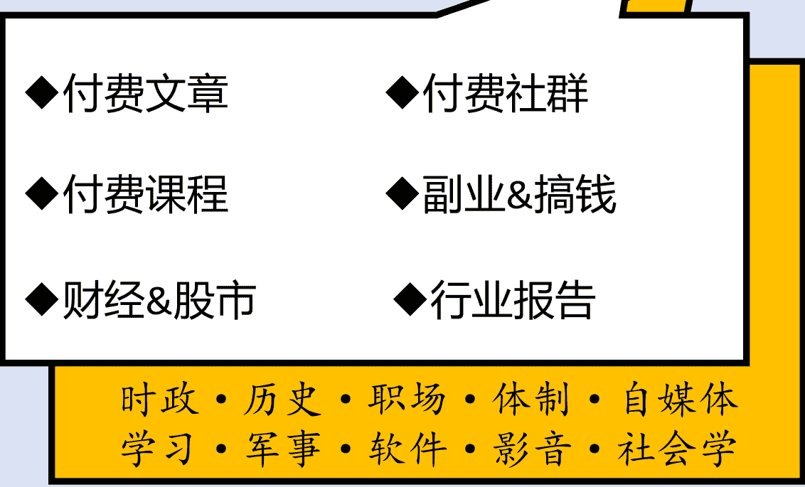

- 付费文章
- 付费社群
- 付费课程
- 副业&搞钱
- 财经&股市
- 行业报告

时政·历史·职场·体制·自媒体·学习·军事·软件·影音·社会学

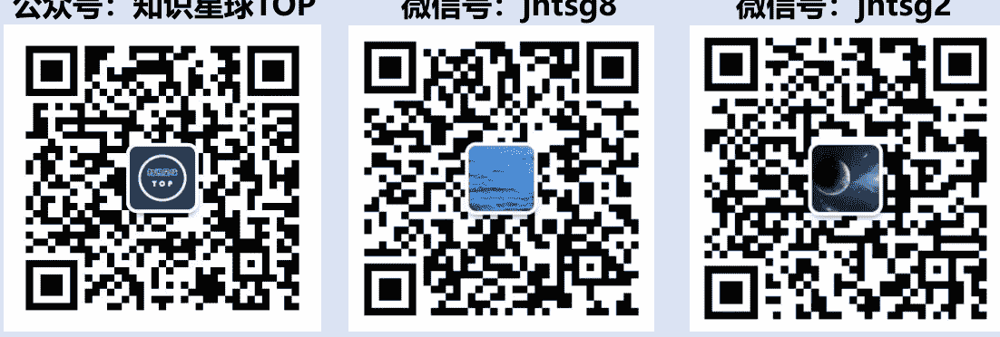

公众号:知识星球TOP
微信号: jntsg8
微信号: jntsg2

# 添加微信 免费进群

# 首席顾问

组聘
云学堂 CEO
组织与人才发展研究院院长

# 顾问团

施重凌
顾问总经理
霍德菲尔中国卓越运营研究院

张文静
执行董事总经理
施施德特竞技技术开发有限公司

宋涛
HROD
卫材

张伟
中国区人才资源总监
天弘科技

王需睿
HR 总监
梅特莉·托利多公司

章婉晓
欧亚区人才资源总监
辉瑞制药

王俊
CHRO
悟空租车

# 联合合导师

袁淳
秘书长
组织与人才发展研究院

远纪
高级研究顾问
组织与人才发展研究院

# 作者

方梓涵，may.fang@hrecchina.org
方涵现任人力资源智库专家（HREC）咨询公司。负责撰写的报告有：中国企业行为实习实践调研报告、发展沟通实战调研报告、2017中国人才管理状况调研报告、第四季度中国人才资源共享中心调研报告、企业人才库实践调研报告、中国人才资源数字化转型报告、弹性工作与灵活适用、2019智会管理绩效报告……方涵毕业于华东大学，获得管理学学位。

# 目录 CONTENTS

# 前言

- 研究框架
- 报告使用指南
- 主要发现

## 概念明晰篇

敏捷团队的概念与定义

- 敏捷团队与敏捷组织的关系
- 从需要应对的问题上看
- 从团队的建设上看
- 从团队的表现形式上看
- 从团队内部管理机制上看
- 从敏捷团队的产出上

- 敏捷团队画像
- 敏捷团队伙伴
- 判断企业是否适合组合敏捷团队；助力业务合适的敏捷团队适用领域；进行团队的试点；明确授权的范围与规划；打造敏捷文化，提升员工的危机意识。
- 人力资源角色定位

## 实操指南篇

人力资源如何助力敏捷团队

- 敏捷团队搭建前
- 明确敏捷团队成员及能力要求；提供相关培训；帮助团队进行考核与激励。
- 敏捷团队开展中
- 确定敏捷团队可以从哪些维度进行衡量；收集、提供相关数据；做好经验积累。
- 敏捷团队结束后

# 方案总总结

各章节主要内容综述

本章中的内容为前文的概述提炼，主要用于方便读者快速了解本报告精华的读者直接获取相关内容。若您对这些汇总内容涉及的数据、案例、洞察感兴趣，非常推荐您回到前面具体章节中对相关内容再做深入阅读。

## 附录

标杆数据及访谈案例

- 调研样本
- 标杆数据
- 企业实践
- 专家洞察

# PREFACE

# 前言

今天，市场环境处于快速的变化之中——不断发展的新科技、后疫情时代带来的种种不确定性……这些都对组织灵活适应的能力提出了更高的要求，敏捷已成为越来越多企业所渴求的特性，甚至有企业应当全方位打造敏捷组织。

然而，企业要实现敏捷转型并非易事。一方面，并不是所有的企业都具备打造敏捷组织的能力；另一方面，打造敏捷组织难免“伤痛”，甚至面临着失败转型的风险。那么，当需要实现敏捷时，除了要减少转型带来的风险，又能提升整个组织的“韧性”、“活性”呢？

因此，打造敏捷团队或许成为企业敏捷转型的“金字牌”。

鉴于当前企业对于敏捷组织仍有清晰的认识，本次调研将涵盖以下内容：

- 明确敏捷团队的概念：主要是要探讨敏捷组织与敏捷团队的关系，并且包含了数据、案例与专家洞察，一步绘制敏捷团队的“画像”
- 了解人力资源如何助力敏捷团队：本次调研将聚焦这一角色在敏捷团队中的定位，并按敏捷团队的前、中、后，分别描述人力资源助力点。

# 研究框架

## 概念篇
敏捷团队的概念与定义
- 敏捷团队与敏捷组织的关系
- 敏捷团队画像

## 实操指南篇
人力资源如何助力敏捷团队
- 人力资源在敏捷团队中的定位
- 敏捷团队搭建前
- 敏捷团队开展中
- 敏捷团队结束后

# 报告指南

### 概念明晰
如果您想进一步了解敏捷团队是什么，明确敏捷团队的概念，请阅读该章节。内容指引：正文 P10-P20

## 实操指南
如果您想在企业内开展敏捷团队，并且了解人力资源助力敏捷团队，请阅读该章节。内容指引：正文 P21-P49

### 方案总结
如果您只想了解敏捷团队报告，请直接从该章节阅读。内容指引：正文 P50-P60

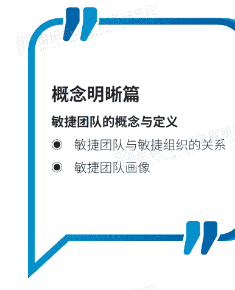
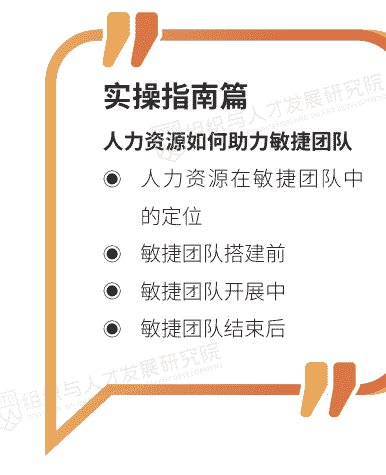

# 主要发现

### 01 敏捷团队的市场度 Maturity
敏捷团队在市场上的认知，还是在企业的开展，都处于起步阶段。
- 认知：超过7成的企业对于敏捷团队的概念处于“了解”的状态。
- 实战：已经开展敏捷团队的企业仅2成。
- 约6成参与者认为企业内部敏捷实践仍在探索中。

### 02 敏捷团队画像 Portrait
敏捷团队的规模（通常在10人以内），大部分情况以敏捷团队的方式开展，多为实现业务创新。
- 规模：约半数企业的敏捷团队规模在10人以下。
- 目的：近8成企业选择实现业务创新，打造文化，这是最高的。
- 形式：企业在进行敏捷团队实践时，形式较为多样化的，且无固定的模式，但项目应用广泛。

# 人力资源的参与及机会 Role
在构建敏捷团队的过程中，HR倾向于一个“伙伴”的角色，而非发起者；在大部分情况下，HR在企业中确保敏捷团队在早期就有参与。

- 半数企业认为，人力资源在敏捷团队中的参与度为“重要的团队成员，与业务部门合作合作达成目标。”可见，人力资源在敏捷团队中的角色并非主导者，而是参与者。
- 按照时间节点来，人力资源在构建敏捷团队前的参与度是最高的。
- 按照时间来看，有4成企业认为人力资源仅在前期有所参与，但近3成企业能够完全敏捷。
- 绝大部分企业认为敏捷团队的负责人为公司主管或业务负责人，而非人力资源。

- 前：判断敏捷团队是否合适；进行敏捷团队的试点；打造敏捷文化，提升团队的灵活性。
- 中：明确团队人员组成及能力要求；提供相关建议；协助敏捷团队做好考核与激励。
- 后：确定敏捷团队可以从哪些维度进行衡量，收集、提供相关数据；做好经验获取及沉淀。

# 敏捷团队的关键成员 Member
Team Leader (团队长)对敏捷团队的成功具有关键作用，选出合适的 Team Leader (团队长)非常重要。

- 8成企业认为，Team Leader (团队长)是敏捷团队中的主要角色之一，并且在调查者中，半数企业认为这一角色的重要性是最高的。

对于 Team Leader (团队长)，领导力、创新意识、执行力、项目管理能力等素质是企业较为关注的。

# CONCEPT CLARIFICATION

## 概念明晰篇

敏捷团队的概念与定义

# 敏捷团队与敏捷组织的关系：敏捷团队是组织敏捷的切入点之一

在人力资源从业者进行访谈时，对方最常提到的问题是：你们所提到的敏捷团队和敏捷组织的概念是同一回事吗？它们之间的联系是什么？

首先需要注意的是，敏捷团队与敏捷组织并非同一概念，两者之间存在着“千丝缕”的联系。下文将重新分析两者之间到底是何种关系。

## 数据分析与访谈研究成果取得

| 敏捷设计“敏捷工作” | 敏捷架构：从层级到扁平化转型 |
|---|---|
| | 决策机制：基层决策、快速决策 |
| 工作方式：跨部门的协作、小团队协作 |
| 工作流程：流程化、多次创新尝试 |
| 技术适用：企业化敏捷转型 |
| 敏捷团队场景模型 | 弹性管理：弹性工作制与灵活选用 |
| | 学习：团队学习（知识共享）、持续的学习 |
| | 领导风格：从权威向赋能转变 |
| | 绩效管理：敏捷绩效管理 |

图1 敏捷团队场景模型来源：《敏捷团队研究报告》

| 选项 | 数量 | 比重 |
|---|---|---|
| 借助敏捷团队，全面实现敏捷组织 | 30 | 55% |
| 已实现敏捷组织，整个组织由若干敏捷团队构成 | 9 | 16% |
| 与敏捷组织无关，仅在公司内搭建了敏捷团队 | 15 | 27% |

表1 敏捷团队实践与敏捷组织的关系：N=54

# 敏捷团队——小团队助力业务创新

早在《敏捷团队研究报告》中，我们也已经在敏捷组织模型中提到了敏捷团队的概念。在组织设计层面，“小团队作战”的工作就是敏捷组织的场景之一。这里的“小团队作战”就是敏捷团队。

在数字化转型的背景下，敏捷团队的作用愈发重要，不要用“大攻”这样的尝试，不仅可以从敏捷获取收益，也能减少转型带来的风险。那么，在企业中是如何看待敏捷组织与敏捷团队的？通过调研可以发现主要有以下观点：

- 借助敏捷团队，全面实现敏捷组织
- 已实现敏捷组织，整个组织由若干敏捷团队构成
- 与敏捷组织无关，在公司内临时组建了敏捷团队

敏捷团队全面实现敏捷组织会带来什么？

| 专家 |  |
|---|---|
| 辉煌 | 区人力资源总监 |
| 张伟 | 天讯人力资源总监 |

敏捷团队与敏捷组织的关系是一个切入点和结论，这种尝试显然超出很多预期。如果说敏捷组织的建设是一个自上而下的过程，在构建敏捷团队时，存在许多自上而下、自发的沟通。

我们在谈“敏捷组织”的时候，我们其实在谈什么？

首先，需要考虑到打造敏捷组织是有可能的，我们会去讨论一个初创企业或者规模很小的不是敏捷组织。因此，构建敏捷组织的成熟度要达到一定程度，它才能快速反应市场变化，满足客户的需求。让组织像一个小企业能够快速地做出调整和反馈。可见，敏捷组织并非所有企业发展的必然。

其次，真正的敏捷组织，其最终目的在于减少敏捷成本，包括沟通、时间成本等。因此，关键的衡量指标在于敏捷中的成本是否成功，成本是否减少，从而增加业务收益并创造更大的价值。

《敏捷团队研究报告》，智会，2020.

# Decoding the Agile Team How Small Teams Support Business Innovation

# 专家 卫仁 | HROD
洞察 宋洁清

我看到某些企业会采用层级的方式，或者以项目的方式处理、分配一些工作，但可能这种方式适用于互联网企业。另外在采用层级之后，随而来的可能是无尽的日报、周报、各种会议，团队可能没有目标。从企业的角度来说，即使敏捷失败也是可控制的。敏捷失败是可能的，层级制或许能在一个一定范围内涵盖大公司，这种方法不可行。还有一种的做法是敏捷团队，我们可以允许企业在局部市场采取一个临时的项目小组，它就可以打破企业目前的制度、流程和绩效，与最终的客户负责。自然，这种方式会存在复杂性；但我们很难在企业的组织中立即落实这种形式。但是我们至少可以从两个方面去努力：一是学习中的一部分经验，比如在流程优化方面的经验；第二，我认为如果从 HR 的角度看，敏捷团队是一个人才培养很好的方式。

# ● 敏捷团队与敏捷组织的边界

首先从两个概念的目的来看，敏捷组织可能通过快速的适应，从而推动组织的应对；而敏捷团队的更多是在释放团队的潜力，激发产生更好的产出，直到跨越敏捷边界实现自我成长。可以看到，敏捷团队对于组织内的人才活跃有着较大的推动作用。

另外，从涉及的范围来看，敏捷团队更接近局部的点，而敏捷组织则可能涉及整个组织结构的改变，上至敏捷策略，下至执行，因此范围更为广泛。

最后，从适用性来看，敏捷组织的前提是在其业务形态上应当是较为多元化的。而敏捷团队的实现未要求企业本身必须具备多元化的业务，更侧重于企业是否可以提升团队治理功能，打破边界的需求。

# 小结：敏捷团队与敏捷组织的关系与差异

两者的关系：敏捷团队是实现敏捷组织的切入点之一；敏捷团队是一种很好的尝试

- 为什么敏捷团队是企业实现敏捷组织的切入点？对于大部分企业来说，尝试是必要的：当规模扩大到一定程度，流程冗长、结构复杂、无法快速改进市场需求时，因此需要敏捷，让敏捷组织具有灵活调整的能力。
- 在短期内实现敏捷组织并非困难：对于很多发展中的企业，虽然实现敏捷已经成为共识，但转型的关键必须敏捷，甚至处于失败的边缘。另外，打造敏捷并非一蹴而成的，这关乎架构、更多的是企业文化的转变。此时，敏捷团队作为一个局部的试点，不仅可以从中收益，还能减少转型带来的风险。
- 敏捷团队能够成为敏捷组织的基础，取决于多种因素。

两者的差异：实现的目的不同

- 敏捷组织要求的目的是长期性和活性，提升组织整体性（沟通、时间成本）；快速应对变化；避免组织结构松化、决策迟缓等“大公司病”。
- 敏捷团队通常实现的目的是具体的，如解决特定的时间段、特定时期出现的问题；在未知领域探索，实现创新；通过先锋团队的作用，打破现有的状态、流程或瓶颈，鼓励员工出现新的组织、打破边界。

# 敏捷团队画像

明了敏捷团队与组织的关系，接下来需要进一步思考：什么是敏捷团队？与普通团队相比，它到底具备怎样的特殊性？

以下结合数据发现与专家结论，详细梳理了敏捷团队的具体画像：

## 数据分析

关于敏捷团队的市场成熟度

图 2 您对于“敏捷团队”这一概念的熟悉程度如何？(N=94)

| 比重 | 数量 |
|---|---|
| 22.34% | 21 |
| 3.19% | 3 |
| 1.06% | 1 |

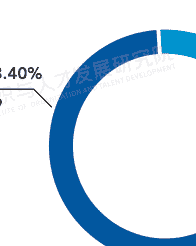

- 从没有听过敏捷团队的概念，也没有听过任何相关的概念
- 从没有听过敏捷团队的概念，但听过其他类似的概念
- 听过，但只有模糊的认知
- 明确知道敏捷团队的具体含义

图 3 贵公司目前是否有开展敏捷团队的相关状态？(N=91)

| 选项 | 数量 | 比重 |
|---|---|---|
| 是 | 54 | 59.34%(在总样本中，开展率为20.30%) |
| 否，但未计划 | 30 | 32.97% |
| 未来也未计划 | 7 | 7.69% |

结合表2与表3可以认识到，超过70%的企业对于敏捷团队的概念处于“听过”的状态，明确其含义及敏捷的企业仍为“少数”。剔除“从未听过敏捷团队的概念”也有听过任何相关概念的企业后发现，在实践上，已经在敏捷团队概念有所接触的企业中，开展率较高。并将已经开展的企业与未开展（本次调研的样本量为266/546≈20.30%）进行对比，仅有2次开展了敏捷团队，这一比例仍处于初级。

因此不可否的是，敏捷团队在市场的程度上，还是在开展上，都处于一个初级阶段。

# 关于企业对敏捷团队的定义

我们让“明确知道敏捷团队的具体含义和概念”的企业尝试写出了对于敏捷团队的理解和认知，并将词频进行统计形成词云供参考。以下关键词在这些表达中被提及的频率，如：

- 团队精干 | 快速响应 | 去中心化 | 持续改进 | 面对危机 | ......

注：标题大小这类词在这些列表中提及的频率，标题越大，企业在填写时提及的频率越高，企业对其重视程度越高。

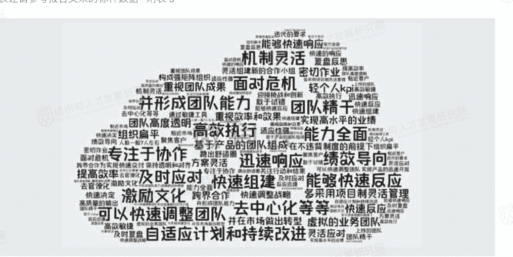

表 4 “明确知道敏捷团队的具体含义和概念”的企业对敏捷团队的定义词云 (N=20)

# 关于敏捷团队的规模及开展目的

表 5 贵公司的敏捷团队规模通常为：(N=54)

| 比重 | | 比重 |
|---|---|---|
| 11.11% | | 55.56% |
| 数量: 6 | | 数量: 30 | 10 人及 10 人以下 |
| 3.70% | | | 11 人至 50 人 |
| 29.63% | | | 51 人至 99 人 |
| 数量: 16 | | | 100 人及以上 |

## 表 6 敏捷团队的目的 (N=54)

| 目标 | 比例 | 数量 |
| --- | --- | --- |
| 实现业务创新，打造敏捷文化 | 77.7% | 42 |
| 打破部门墙与组织界限，培养跨界人才 | 61.11% | 33 |
| 发挥“镜像效应”，提升敏捷性 | 59.26% | 32 |
| 鼓励员工跳出原有“舒适区”，实现自我突破 | 55.56% | 30 |
| 应对紧急情况，以及响应速度 | 37.0% | 20 |

可以看到从团队规模而言，敏捷团队确实较为“精干的”，近半数的敏捷团队在“10 人及 10 人以下”。而敏捷团队所要实现目的的，选择最高的选项来体现敏捷团队本身的作用，包括：实现创新、激发员工能力、提升敏捷效能。

## 关于敏捷团队的开展形式

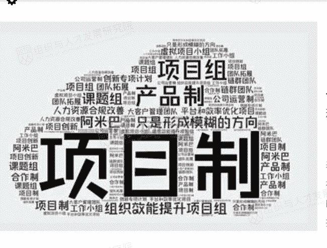

> — 图 7 公司敏捷团队开展的组织形式云 (N=49)

注：字体大小代表词语在这些中表述的深度和频率，字体越大，企业在写作时的频率越高，企业越详细，请参考报告文末的矩阵-附表 4

在企业对敏捷团队实践训练时，经常会遇到企业及各小组中的各种概念，如：虚拟团队、项目组、创新团队等。这些概念与敏捷团队是一回事吗？它们与敏捷团队的关系是什么？

根据企业描述的敏捷团队开展形式，通过对词频的分析（参考表 7 & 附表 5），可以得出以下结论：

- 企业进行敏捷团队实践时，其形式是多样化的，并没有统一的模式
- 虚拟团队、项目组、创新团队等概念更多是敏捷团队的具体形式，它们都属于敏捷团队
- 项目是应该较为广泛的形式

除了了迭代之外，还有其他要素是敏捷团队所具备的？结合上述专家判断，对于敏捷团队的“全”可以有一个更为清晰的认知。

## 关于敏捷团队的特点

### 专家：辉瑞 | 欧亚研发人员资源总监 章涵
### 专家：天弘科技 | 人力资源总监 张伟

- 敏捷团队的三个特质

虽然敏捷团队存在多种不同的开展形式，但其本质仍涉及三个核心：环境变化、资源整合和快速响应。

- 环境变化：近年来，企业内部外部环境的变化速度、节奏、体量、复杂程度远超以往，这是促使企业选择敏捷的重要因素。
- 资源整合：敏捷团队并不完全“白手起家”，相反，资源应该在组建团队之前被充分利用；敏捷是一种策略，一个系统化的工程过程，不是被忽视的“无中之有”；在传输中，资源通过正规的架构来组织起来，结果越是直观的形式来实现；在敏捷团队中，实现资源的整合。
- 快速响应：搭建敏捷团队的目的是为了响应环境的变化、机会或随时，快速响应是敏捷团队区别于企业原有的其他项目实现差异化的关键。
- 其次，除了完成实践性的任务，敏捷团队应该被赋予额外的使命。即让组织本身是有实际的业务目的，如：开发新产品、供应链等；此外赋予团队外的目标，如：探索对业务的再创造或创新的方面，如何应对外部的影响与协同，通过项目实现有目标的达成。
- 最后，敏捷团队除了项目以外还应该人才培养。在项目最后进行评估时，不仅考核敏捷团队是否完成了承诺的目标，还要看到大家在改进方面的成长和进步，是否看到了更多的人，这点也是区分普通项目的关键。

## 专家洞察 | 执行董事兼总经理

反应，让志意向方向的发展。可以从以下几个层面体现其特点：

- 敏捷团队的特点

敏捷团队最大的特点是从“敏捷”这两个字出来理解的。敏捷是一个动作，而不是一个人的特点。所以，当用这个形容词描述敏捷团队时，更敏捷的团队在面对困难、环境变化、潜在的行业危机的时候，它可以快速地应对、做出反应。
- 在内部团队的建设上：规模小而精，团队成员的能力较为全能
- 在团队协作方面：高效灵活、增强导，并且具有激励的文化
- 在工作方式上：以项目为主
- 在结果层面：高效、高绩效

## 关于敏捷团队开展的形式

## 专家洞察 | 亚洲瑞肯研发人力资源总监
## 专家洞察 | 卫材 | HROD

- 敏捷团队的形态

敏捷团队从很多形式，它可以是一个调查小组，也可能是一个问询小组，但是都是应对环境变化的小组。可以形成某种形式，完全由团队组织来应对市场当中的多样化需求。结合上述对于敏捷团队的描述，无论是合型的、项目团队还是虚拟团队，都在一定程度上体现这些特点，因此可以属于敏捷团队这一大范畴，但仍取决于组建的动力和目的。

目前市场上还没有看到对很多敏捷团队清晰的定义。现在有机会企业把敏捷团队的形态实现在企业经营中的目标要解决问题。即使是不同的形式，这里也存在共性，如：
- 非传统的层级组织
- 更多根据环境的变化来决策
- 不断地追求更大的效益
- 小规模、敏捷团队在很多情况下存在试点、试错的性质。在试点中找到成熟模型，在企业内尽可能减少风险。

## 小结：敏捷团队画像

| 需要应对的问题 | |
| --- | --- |
| 快速响应 | 外部变化、挑战、及时捕捉市场机会、发展 |
| 团队建设 | 小而精、跨部门、跨职能、人都是“特种兵”、去中心化、授权、资源整合 |
| 具体形式 | 项目制、产品制、创业部、虚拟团队 |
| 内部管理机制 | 流程精简、灵活、快速迭代、持续且有效地进行激发 |
| 最终产出 | 实现业务创新、文化创新、激发自身潜能、提升组织绩效、打破壁垒、培养人才、进入敏捷基因 |

## PRACTICAL GUIDE
## 实操指南

在上一章中，我们对敏捷团队与组织的关系以及敏捷团队的使命有了较为清晰的认知。本章节将详细探讨：人力资源在敏捷团队中到底是怎样的角色与定位？随着敏捷团队的开展，人力资源各个节点上如何助力？

## 人力资源定位：更接近于伙伴的角色

数据分析

图8 在公司敏捷团队的实践中，人力资源作为一个角色的参与度 (N=54)

| 选项 | 数量 | 比重 |
| --- | --- | --- |
| 仅知道企业内有关实训，但这些实践与人力资源的工作没有联系 | 2 | 3.70% |
| 了解业务部门有相应的需求，会给予支持与协助，但不参与到团队中 | 16 | 29.63% |
| 作为重要的团队成员，与业务部门共同达成团队的目标 | 26 | 48.15% |
| 由人力资源主导，带动业务部门组建敏捷团队 | 7 | 12.96% |
| 不清楚 | 3 | 5.56% |

图9-1 若人力资源在敏捷团队搭建过程中有所参与，参与的环节为 (N=54)

| 选项 | 数量 | 比重 |
| --- | --- | --- |
| 敏捷团队正式形成 | 47 | 87.04% |
| 敏捷团队开展中 | 28 | 51.85% |
| 敏捷团队结束后 | 20 | 37.04% |

图9-2 若人力资源部门在敏捷团队搭建过程中有所参与，参与的时间跨度为 (N=54)

| 选项 | 数量 | 比重 |
| --- | --- | --- |
| 前、中、后阶段全程参与 | 16 | 29.63% |
| 前、中阶段所有参与 | 7 | 12.96% |
| 前、后阶段参与 | 2 | 3.70% |
| 仅前期参与 | 22 | 40.74% |
| 仅中后期参与 | 5 | 9.26% |
| 仅后期参与 | 2 | 3.70% |

## 表格10 公司的敏捷团队的主要负责方为：(N=54)

| 角色 | 数量 | 比重 |
| --- | --- | --- |
| 企业高管 | 36 | 66.67% |
| 业务部门负责人 | 26 | 48.15% |
| 人力资源部门 | 15 | 27.78% |
| 一线管理者/一线主管 | 8 | 14.81% |
| 一线员工/个人贡献者 | 3 | 5.56% |

在对企业进行案例访谈时可以发现，敏捷团队的开展与业务信息密切相关。那么人力资源源到哪里以及它是怎样的角色、定位与参与其中的？通过数据的结果可以得到以下结论：

- 半数参与的，人力资源在敏捷团队中的参与度为“重要的团队成员，与业务部门共同完成团队的目标的达成”。可见，人力资源在团队中的角色既是主旋，也是许多旁观。
- 按照参与的时间跨度来，约4%的企业的人力资源在之前参与过；近3%的企业能够实现全部参与。大部分的敏捷团队构建是由业务驱动，而非人力资源部门。在大部分情况下，人力资源在敏捷团队构建的过程中更像一个“伙伴”，在试点中找到成熟模型，在企业内尽可能复制，减少带来的风险。

## 专家：卫材 | HROD 宋霖

- 人力资源在敏捷团队中的定位与角色分析

首先我们要明确企业内部是否有想要改变的意思。如果需要，企业在多大程度上愿意“Pay for change”。在明确了转型后，人力资源要理解具体的流程、授权，两者相结合，变革是否能够落地。

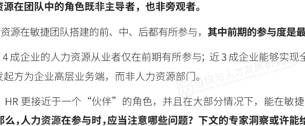

## 专家：敏捷科技 | 人力资源总监 张晓
## 专家洞察 | 张晓

- 人力资源在敏捷团队中的角色

敏捷领先是一个文化故事。实际上敏捷是企业业务的，首要任务是要满足消费者的需求，敏捷让我们提高效率。从这方面来说，人力资源的定位是我们需要在整个团队之间重组，每个人都需要具备敏捷的心态，这种心态包括：以客户为核心的价值观、快速迭代、及时反馈等等，这些都是文化的一部分。另外，由于敏捷团队要求有人才产出、高潜的挖掘，人力资源部门也需要承担责任。

- HR在其中的角色

- 敏捷团队之前，企业对于构建敏捷团队的必要性
- 准备程度、开放程度如何将 HR作为 Change Agent推动领导层“吹风”，说明敏捷团队的意义、价值和可能性
- 不同人群对于敏捷团队的接受度
- 敏捷团队涉及资源的整合，因此需要提前对资源的分布、管理情况进行调研，例如：团队是否愿意分享资源？
- 敏捷团队搭建过程中快速提供一套机制：“敏捷准则”到底是什么？进入敏捷团队的人得到什么？敏捷团队需要付出什么？以及解决根据什么机制？
- 明确团队中的成员、角色，并且结合企业有的技能，让一些人员在职工作之外承担责任。
- 敏捷团队完成后，对敏捷团队的相关知识、成功经验进行回顾；是否达到了快速迭代的效果？这种效果是否可重复、可扩展？
- 若存在复制的可能，则需要计划敏捷团队搭建和运营的相关机制，为企业保障敏捷团队的可能性。

## 专家：尼菲尔 | 顾问总监 施涵
## 专家洞察 | 施涵

- **Less is More... 减少干预及过度控制：** 人力资源部门在服务主体业务内部，为了确保业务的稳定性、安全性，会有比较复杂的流程、对规则的要求非常严格。然而，当单纯地用这些流程套敏捷团队时，反而会导致效率低下。另外，作为一个新业务团队，支持部门尚未形成专业知识储备，很多琐事需要快速判断，或无法确定如何给予支持。在这种情况下，人力资源部门应尽量从实际出发，减少干预、缩减程序、规模化建模，在尊重的基础上充分授权。
- **积极参与业务中，发挥 HR 的专业性：** 在敏捷团队开展时，难免会遇到很多与变革、组织发展相关的问题，如：与业务战略如何衔接，如何影响高管；这些往往是 HR 所擅长的领域。因此人力资源可以积极到敏捷团队中，发挥自身特有的专业性。

## 小结 3：人力资源在敏捷团队中的定位及注意事项

### 人力资源参与敏捷团队的特点

- 避免过度管控：敏捷团队优势之一在于快速响应，而人力资源在服务企业内部时，其角色更倾向于流程管控、规则制定。因此，若用规则限制敏捷团队，反而会导致营销失败，难以实现快速响应。
- 善利用自身的特长：人力资源的专长包括沟通引导、资源协调与战略对齐、人才识别与培养、组织诊断等。这些专长在敏捷团队中都可以发挥作用。

### 人力资源在敏捷团队中的定位与角色

- 敏捷团队的发起大部分情况下来自于企业高层或业务端，若高层与业务端并未识别到建立敏捷团队的必要性，仅由人力资源推动通常会导致“事倍功半”。
- 人力资源在敏捷团队中的角色既非主导者，亦旁观者。HR接近一个“战友”，需要积极发挥作用，与业务部门“作战”。
- 人力资源在敏捷团队开展整个过程中都可以助力与赋能。基于上述总结，按照“敏捷团队前”、“敏捷团队中”和“敏捷团队结束后”章节分别描述人力资源如何助力。

## 敏捷团队搭建数据分析

← 图 1 能够在企业内实现敏捷团队的前提条件 (N=43) 注：字体大小代表该词在列表中的提及及频率，字体越大、文中提及详细请参考报告表格5。大部分企业在访谈时都会表示：并不是所有的企业都适合开展团队，让敏捷团队获得成功需要一定的条件。人力资源在敏捷团队开展前，需要这些条件进行识别与判断。本次调研收集了决策在企业内实现敏捷团队的前提条件，可以发现以下关键词被提及：管理层的支持、业务处于转型期、具有创新意识、敏捷文化。

## 解码敏捷团队——敏捷团队助力业务创新

## 企业敏捷转型：卫材

- 业务背景：卫材（中国）有限公司是由卫材株式会社成立的医药公司。卫材是一家专注于研发医药的跨国公司，总部在日本。自90年代初进入中国以来实现了快速发展。目前在中国销售的产品有余品种，主要集中在中枢神经系统、内分泌和骨科领域。
- 为什么需要敏捷团队：BP出来，医药行业受到巨大冲击，许多企业不得不缩小规模，面临价值下降。面对转型，卫材认为必须主动敏捷、灵活适应，才能在竞争中实现转型。在当前不性的外部环境下，“敏捷”成为企业必然的选择。通过构建一个敏捷团队，不断创新、精简高效、对结果负责、相互协作与信任，是企业未来努力的方向。
- 为什么以敏捷的方式进入：敏捷不是一蹴而就的，不是一天就能到的，企业需要长期的探索和摸索。卫材要在业务领域寻找一个合适的“先遣团队”来做敏捷实验。在明确了转型后，卫材就在以下方面进行进一步的提升与改进：
- 充分激发团队活力
- 打破部门壁垒，实现充分交流
- 提升团队效能
- 在满足业务客户之前，带来更多价值的创造
- 激发创新的动力

这些要求需要“关注客户”、不断创新、精简高效、对结果负责、相互协作与信任来实现。卫材在企业内的团队开展进行了多次尝试。

## 企业实践

### “特种部队”的建立成功的前提条件

要让特种部队在业务内外能够成功建立，需要团队有一定的外部环境，并且需要 HR 有适当的准备。这些条件如下：

- 人力资源首先考虑的问题：
- 能力是否在企业中找到了合适的领军人物
- 企业是否有可以进入团队的优秀人才储备
- 是否在企业内初步建立了一定的文化，转型转型的基础
- 企业外部环境：
- 企业想要做出改变，对市场环境有足够的准确性；
- 外部环境是否发生了变化，驱动业务出新，从而改变自己
- 由特种部队负责的业务是否在企业内已经建立了一定的共识，则不符合小组初衷

### 如何定义“特种部队”

对于特种部队来说，由于在建立初期具有特殊性，其范围是清晰的。由于在执行过程中，具体的流程可以参考以下建议：

- 授权的重视：探索业务的方向
- 首先要明确企业要拓展的业务
- 资源的支持：明确团队的需求
- 考虑未来的问题

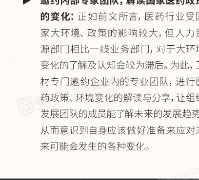

## 企业实践

## 霍比特西尔

### 企业背景
霍比特西尔是一家为《财富》全球500强的高科技企业，其业务领域涵盖提供定制的航空航天产品和服务、宇航技术和工业制造技术、以及特性材料，致力于飞行、汽车、宇天、工程、供应链和万物，使世界更加智能、安全和可以持续的连接。霍比特西尔成立于1885年，在萨维亚，直到1935年在上海设立了第一个经销机构。霍比特西尔致力于客户需求为领先的发展，力求以本土的推动增长。

### 企业发展
客户需求的出现：霍比特西尔在全范围内提供优质的产品和服务的同时，还会提供大量的解决方案。国内企业与全球企业在霍比特西尔的需求中参与。在学习的过程中，学习企业的管理方法，也让客户需求的开始。起初，客户更多的参与是为了学习霍比特西尔专家如何学习行业的方法来实现世界一流的管理理念。然而，随着企业的不断成长，单一的解决方案已无法满足客户的需求。

在内部之下，霍比特西尔在企业内部进行管理变革，以能够满足外部客户的需求。
- 确定团队成员的业务职责，需要明确什么样的功能能够最终实现。
    - 从客户手中准确确定客户参数
    - 根据不同的客户来确定营销策略，基于客户需求落实后的业务流程如何定义。流程关键环节包括客户对接、与客户达成初步沟通、深入理解客户需求、确定解决方案的方案、方案制定-签订协议及客户服务
    - 确定了业务流程后，团队成员的业务职责...

通过培训培养积极变革的文化
- 引导团队成员理解环境的变化，励使大家改变自己。
- 有些条件，可以在项目前梳理、呈现特种部队对于初期建立基础素质的重要性，甚至需要这些能力，对公司已有的人进行盘点和。
- 在企业中寻找“第一个嗅觉的人”，找到找不到合适的人员先形成的团队进行选择和测试。
- 编写 BP（Business Plan）撰写的调研，提供一份策划模板、方法可以让团队成员，养成在规定时间内完成符合要求的 BP，引导团队与公司管理形成思路上的沟通。
- 与管理层讨论的目标、推进的路径是否合理，协助帮助团队达成目标，并签订目标责任职责。

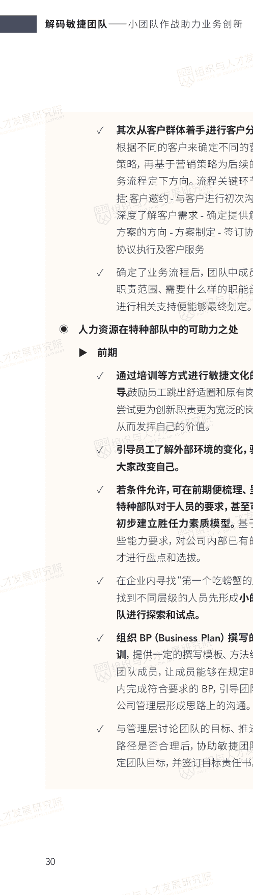
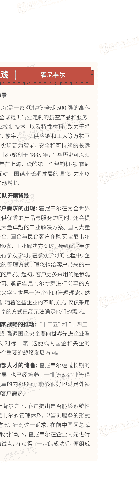

专门的敏捷团队接外部的咨询业务。

对于敏捷团队的认知是一个非常抽象的概念，它包含了如虚拟团队等多种形式的团队类型。霍奎认为在大型企业中，敏捷团队主要可分为两种形式:
- 类型一：从组织结构来看企业“金字塔结构”的一部分，但该团队具有特定的功能，并且在团队协同的频率和深度远高于企业内其他的传统团队，以确保能够适应市场的变化。
- 类型二：离于企业“金字塔结构”之外，要能够“单独独立”，有着高度自主性的团队。

## 关于授权

| 专家 | 亚洲研发人力资源总监 |
| :--- | :--- |
| 洞察 | 章亮锐 |

敏捷团队如何做到可用的多样的：信赖的作用、先头团队的作用、拆破团队的作用、团队部门的作用……敏捷团队想要实现的是完全可能的，授权的边界，方式也不一样。无论如何，可以从团队、决策、财务三个方面。

- 资源：敏捷团队一般在人员的分配上可能得到特别的授权，因为团队需要从已有的正式架构中随时调动资源。但敏捷团队可能要求团队成员在团队中投入多少精力。
- 财务：财务更多体现在对于敏捷团队的物资调度和资金支持，通常可以有以下几种形式:
    - 若有条件，可以提供额外的奖池与预算；建立“资金池”
    - 提供项目启动资金，帮助敏捷初步起步
    - 设立绩效目标，当团队达成某目标后获得灵活资金支持，确保团队能够自我管理的能力
    - 可以让所有相关的部门指向敏捷团队提供一定的授权。

决策：敏捷团队的决策属于项目小组的决策和项目团队决策。项目小组的决策属于资源在小组成立之初获得授权。敏捷小组可以自己执行。

## 敏捷团队的授权

| 专家 | H卫D |
| :--- | :--- |
| 洞察 | 宋涛 |

| 专家 | CHRO |
| :--- | :--- |
| 洞察 | 王豪 |

| 专家 | 亚太人力资源总监 |
| :--- | :--- |
| 洞察 | 章晓 |

### 敏捷团队的资源分配
企业应当对敏捷团队给予了一定的“自由”，分别是：
- 决策权：敏捷团队在开展工作时，应减少审批的限制；
- 人权：敏捷团队内部任命应当由团队来说了，并且加入成员的意愿、热情非常重要。
- 分配权：敏捷团队拥有的资源可以结合成员的表现来进行分配，精准高效。
- 顶层设计：对创新团队管理的最重要的是“控制”与“放权”平衡；
- 独立性：敏捷团队以独立部门或小组的形式运营，成员招聘、人员激励等方面主管，团队参与并支持。
- 绩效点：创新团队自负责，风险范围。

### 判断敏捷团队是否具备条件及适用领域
很可能我们意识到做敏捷团队这件事，然而我们可能不要将敏捷团队作为成功的尝试，而是像这样的一次规模太大了。开展敏捷团队有3种情况：
- “高强度”：情况下，业务敏感度非常高，敏捷团队能够响应变化，当市场变化需要提前准备时，确保敏捷团队中的资源来源、增值的价值，需要决策；这些机制在首先考虑之前，这可能会引起跟随。即便敏捷团队来自自而下的“驱动”，人力资源也存在，有时外部的压力是。
- “中期”：在这种情况下，业务涉及一定的需求，目标和资源，往往这种情况下导致敏捷团队是最重要的，因为人力资源还没准备好。此时，处于对称状态下的例如“矩阵型”的企业尝试转型——因为人力资源没有东西能变动。“阵痛”。在这种情况下最好不要轻动，要等各部门配合后再尝试转型。市场化的已经。
- “草原”：在这种情况下，我们可能没有资金，也没有太多来自业务的支持，人力资源缺失的必要性。建立团队，人力资源需要符合业务来实现。

### 敏捷团队得以开展的前提条件
- 用专业的战略及商业方法工具（如BLM）与管理层达成共性。
- 分析核心业务的必要性。
- 如果核心业务的发展已经趋于瓶颈，要做哪些新尝试可以让核心业务突破？
- 如果核心业务的发展已经稳健，新业务会导致核心业务的失效，甚至资源与精力的消费。
- 确定创新业务与核心业务的联动。
- 创新业务在现有核心业务的价值链中什么环节支撑核心业务？如何联动?
- 创新业务结束核心业务的客户或用户带来什么服务。

敏捷团队的实施并非适用于所有领域。在高度重视流程、规则的领域，如：财务、法务等，开展敏捷团队显然是不合适的。因此，企业首先应当结合业务情况、公司现状，选择合适的“试验田”。

## 小结4：敏捷团队建设前人力资源清单及注意事项

| 助力力点 | 具体举措 / 判定方式 |
| :--- | :--- |
| ★ 判断业务是否适合组建敏捷团队 | • 高管或一把手是否已经足够的危机意识或构建敏捷团队的意愿 • 业务部门是否已经足够创新、试错 • 企业的状态是否已经足够稳定，能够接受一些变化、变革 • 企业内部具有一定的敏捷文化或基因 • 是否能够给敏捷团队一定的授权 • 是否有一个人才储备 • 外部环境是否能够提供一定的驱动，如：政策支持、危机出现等 |
| ★ 助力业务选择合适的敏捷团队适用领域 | • 敏捷团队的实践并非适用于所有的领域，如：财务、法务等领域，开展敏捷团队显然是不合适的。 • 若要以敏捷团队的形式开展业务，不仅有助于组织敏捷的手段与工具，还需要明确哪些业务是企业当前的核心业务，哪些业务是可以所有和探索的。因此，考虑业务的生存状况重点包括： • 分析核心业务 • 分析业务是否处于企业的核心价值链中，与现有业务的关系、联动是怎样的 • 外部环境的市场趋势与机遇 |
| ★ 进行敏捷团队试点 | • 在企业内部寻找“第一个嗅觉的人”，找到合适的人员先行进行团队的探索和试点。 • 企业确实有需求，但业务部门暂时并未识别敏捷团队的必要性，人力资源可以考虑在内部进行尝试，或者在人才储备。结束后进行模拟考核，提升团队成员的积极性。 |

## Decoding the Agile Team: How Small Teams Support Innovation

在人员、决策、财务方面给予统一的：

### 授权
敏捷团队想要实现的是完全可能的，授权的边界，方式也不一样。无论如何，可以从团队、决策、财务三个方面。
- 资源：敏捷团队一般在人员的分配上可能得到特别的授权，因为团队需要从已有的正式架构中随时调动资源。但敏捷团队可能要求团队成员在团队中投入多少精力。
- 财务：财务更多体现在对于敏捷团队的物资调度和资金支持，通常可以有以下几种形式:
    - 若有条件，可以提供额外的奖池与预算；建立“资金池”
    - 提供项目启动资金，帮助敏捷初步起步
    - 设立绩效目标，当团队达成某目标后获得灵活资金支持，确保团队能够自我管理的能力
    - 可以让所有相关的部门指向敏捷团队提供一定的授权。
- 决策：敏捷团队的决策属于项目小组的决策和项目团队决策。项目小组的决策属于资源在小组成立之初获得授权。敏捷小组可以自己执行。另外外部更多为小组内部授权，决策仍然在项目初期已确定，也会随着市场的变化进行调整。

### 做好控制与放权
企业应当对敏捷团队给予了一定的“自由”，分别是：
- 决策权：敏捷团队在开展工作时，应减少审批的限制；
- 人权：敏捷团队内部任命应当由团队来说了，并且加入成员的意愿、热情非常重要。
- 分配权：敏捷团队拥有的资源可以结合成员的表现来进行分配，精准高效。
- 顶层设计：对创新团队管理的最重要的是“控制”与“放权”平衡；
- 独立性：敏捷团队以独立部门或小组的形式运营，成员招聘、人员激励等方面主管，团队参与并支持。
- 绩效点：创新团队自负责，风险范围。

### 打造敏捷文化
打造敏捷文化，提升员工的危机意识

### 敏捷团队开展
当要在组织内搭建敏捷团队后，敏捷团队中应该有哪些角色？这些角色具备什么样的特质？另外，如何激励这些成员，才能敏捷团队持续保持活力与产出？这些问题都是敏捷开展过程中频繁提及的。本次调研对这些问题进行解答。

## 数据分析

### 图12 敏捷团队成员，贵公司的敏捷团队中主要角色（N=54）
| 选项 | 数量 | 比重 |
| :--- | :--- | :--- |
| Team Leader (团队队长) | 44 | 81.48% |
| 业务负责人 | 29 | 53.70% |
| Stakeholder (利益相关人员) | 29 | 53.70% |
| Sponsor (主办方) | 27 | 50.00% |
| 产品负责人 | 23 | 42.59% |
| 不清楚 | 7 | 12.96% |
| 其他 | 3 | 5.56% |

### 图13 以上成员中，您认为对于团队的成功最重要的影响是：
| 选项 | 数量 | 比重 |
| :--- | :--- | :--- |
| Team Leader (团队队长，N=44) | 25 | 56.82% |
| 业务负责人 (N=29) | 8 | 27.59% |
| Stakeholder (利益相关人员，N=29) | 1 | 3.45% |
| 产品负责人 (N=23) | 4 | 17.39% |
| Sponsor (主办方，N=27) | 9 | 33.33% |

结合图11 & 图12，从团队的组成成员来看，Team Leader (团队队长)是敏捷团队中被提及及最多的角色。而在这些选择了 Team Leader (团队队长)的参与企业中，这一角色的重要性是最高的。

## 关于能力特质要求

| 图14 企业认为 Team Leader (团队队长) 这一角色需要具备的能力特质词 (N=52) | 图15 企业认为所有敏捷团队中的成员都需要具备的素质特质词 (N=51) |
| :--- | :--- |

注：字体大小代表词语在这些列表中提及的频率，字体越大，企业在填写报告时提及的频率越高，企业填写的详细数据请参考正文的标杆数据 - 表 6 & 表 7。

由于 Team Leader (团队队长) 这一角色的重要性最高的，我们针对这一角色的能力素质进行了深入调研，在能力角度探讨“选人”。另外除了 Team Leader (团队队长) 外，对于团队中的大多数成员，也应该让他们理解“做什么”。参考表14 & 表15得出：
- 对于 Team Leader (团队队长)而言，领导力、创新意识、执行力、项目管理能力等素质是企业较为关注的。
- 对于团队成员而言，企业更为关注的是自驱力、执行力、创新等能力素质。

#### 关于激励方式

图16 对于敏捷团队的激励方式为：N=54)
| 选项 | 数量 | 比重 |
| :--- | :--- | :--- |
| 设立绩效目标，达成目标后奖励 | 30 | 55.56% |
| 提供长期激励，如股权激励 | 8 | 14.81% |
| 提供一笔启动资金，鼓励团队在初期 | 10 | 18.52% |
| 初期以高薪聘请成员 | 6 | 1.11% |
| 设置绩效目标，让所有成员对利润负责 | 6 | 1.11% |
| 需任何激励措施 | 6 | 1.11% |
| 不清楚 | 6 | 1.11% |

设立绩效目标，达成目标后奖励是企业较为采用的激励方式。在访谈中这种方式的应用普遍，是因为敏捷团队很多情况并不适用于确定性、开拓新业务。帮助特殊部队一起做总结，发现可改进的地方。

开展“特种训练营”，在培训前明确规定以下内容：
- 成立的背景及原因
- 团队的目标
- 团队的特点
- 对成员的要求与期望
- 团队选拔的标准、能力要求及发展机会
- 企业给团队投入的资源和支持

考核机制：了解计划过程中涉及的内部如：客户发展、客户服务流程等。

## 企业决策
- 团队及其能力特殊要求
- 核心团队规模：6人左右
- 团队成员:
    - Sponsor: 霍比特西尔中国区总总裁
    - 团队经理
    - 咨询顾问：从业务单元抽调的咨询团队派遣

团队需要具备的素质
- 使使命：所使命，便是团队人员工作的动力来源。敏捷团队必须具备敏锐性，并且巨大的潜力。以协助团队，通过管理改革提升水平。
- 创新精神：敏捷团队中的成员要处于一种“动态”的状态，打造自己的工作成就，应当适应变化环境和边界环境带来的巨大压力。
- 强大的理想和不可战性的能力

### 人力资源在特种团队中的助力之处
- Sponsor：该角色通常由中层以上的上级负责，并且具有敏锐的行业视角和战略眼光。
- 队长：作为队长，最基本的素质是快速学习的能力。另外还需要具备业务能力、业务角度，还需要商务能力、团队管理以及团队管理的能力。
- 团队成员：成员负责财务管理和队长作为业务素养也是团队成员要具备的要素。敏捷团队中的每一个成员应当都是高素质、全面的发展的。

### 定制化设计与绩效方案
注意的是特殊部队的定位在业务探索，由于此考虑的方案太可能在初期就做得完善，只需要逐渐**多重聚焦、小步迭代的原则**。给予更多的权限。一旦超过，团队将执行性的工作。在结果方面，可以对业务结果、客户数量或行业影响等方面进行考虑。在激励下，我们可以制定一项激励措施，结束后进行模拟考核，提升团队成员的积极性。

不断地优化和完善业务流程的支持，为团队协调跨部门的思维引导该部门不以传统的思维来监督、管理特殊部队的业务流程，而是从业务发展和探索的角度来特殊的支持。

在项目的过程中，不断催化特殊部队和总部职能的界定。
任务：特殊部队负责“霍比特”扩展，而职能部门已经将自己的支持固化为对应的机制和流程，落实在职责中，而不是口头的简单承诺。

## 企业实践

## 卫一

- 搭建平台与机制，让员工感受到“我能改变”
- 设置抬头机制

卫材内部的培训类型主要是为了较多的，通常可以分为三类：

- 组织要求开展的项目
- 组织发展团队在工作中需要需求并发起的项目
- 业务部门自主发的项目

每年年初、季度初等节点卫材会对已有项目进行复盘，确定项目的背景和积分，项目负责的范围和能力，支持培训的成员人数，项目需要要交付的任务，项目的跨度等。这些信息可以通知给每一个员工，后期可以根据员工的意愿、需要发展的方向，让员工通过自己来选择培训。企业选择在2-3周内，在选择中，员工可以根据自己对项目的理解，加入项目的需求，需要具备的特征，帮助员工从自己的视角出发，而判断是否适合自己。

当出现“需要”某个项目时，通过PK决定。

对于项目的理解，可以由产出的贡献者、承担的角色，或者是由“Owner”来决定加入该项目，或者是由学员来担任培训师，并通过评审评价来投票决定。

另外，除了项目的“进入”需要“竞上岗”外，项目中有“队长”、“成员”等角色，培训后可以自主选择这些角色，并在冲突时，还需要通过PK决定。企业需要培训的工作，能力情况需要进一步确定角色的分配；若在赛季期间，无法履行交付任务的结果，会被“淘汰”。

这一机制的建立可以确保公平公正，另一方面可以让员工在内部实现竞争，充分激发员工的自主性。

## 建立单兵平台

首先，卫材的企业内部上线了培训的单兵平台，企业需要面对难度、受限时间难以建立单兵模型，并可以这类类型，估算员工加入项目后可以可以获得的积分，并最后通过每周的积分进行公示。

## 激励培训，打造团队

通过这次推进机制让员工一次发现自己的价值，卫材也借此进行内部的积累和互动。在之后，员工也可以获得一个额外的奖励，从而有效实现初期的自我驱动——信息互通的沟通。

## 调整考核标准，让员工看到“价值”

卫材作为一家国家企业，改变企业有的绩效考核显然并不现实，但是可以考核的具体内容。如果组织发展目标之一是为了业务...

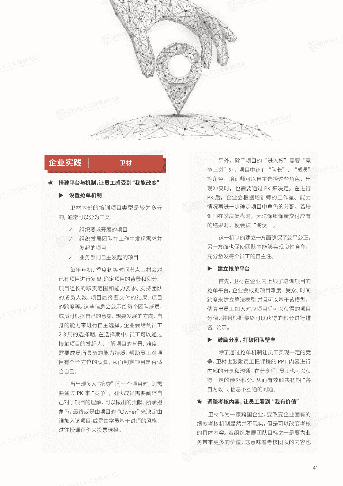

## 关于能力要求

专家 辉锐 享晨

### 第二，敏捷团队/欧亚区研发人才资源深度洞察

#### 敏捷团队队长的能力
敏捷团队的队长在团队中是关键的因素，因此敏捷团队也会有特定的能力要求：

- 第一，是否能够适应环境的变化。企业要实现目标是因为市场上环境的变化，所以敏捷团队是否能够非常地适应多方达成共识
- 第二，对敏捷团队能够多方协同的价值要看重。在敏捷团队的开展的过程中，可能会“遇到”的脓肿，不是一个人的脓肿，不能把一个脓肿变成自己的脓肿，而是要把这个脓肿变成更大的价值。
- 第三是技术能力，核心就是团队管理的能力。在前面多种能力都是团队开展的基础，队长需要的是团队管理能力，这是确保项目目标实现最终的重要保障。

#### 敏捷团队对于组织、HR所提出的价值
敏捷团队的产出需要需要大量的数据，否则无法体现敏捷团队受重视的差异。对于HR来说又是一个棘，因为敏捷团队的成员往往来自于各个业务部门，他们必须务必做出贡献。但这些成员在团队中付出的贡献比他们原本的工作是否激发了更多的潜力，这些需要通过数据的支持，可以客观体现敏捷团队的价值。因此，要收集到的数据，就需要业务部门提供足够的支持和支持。

需要做出的转变：团队所交付的终端用户是否觉得满意？

因此，敏捷培训的考核内容分为两部分：单项获得的积分和终端用户的净推荐值（NPS）。这部分考核的分数相加，最终形成敏捷的年度考核结果。

- 单项积分：单项成功并不一定能获得团队的积分，而需要一个项目成长“背靠”来打齐；在整个过程中，谁的贡献是最多的？如果项目成员认为对某人的贡献只有80%，那么最终获得的积分就要打“八折”。每个项目成员的积分总和会在榜上公布。
- 来自终端用户的净推荐值（NPS）：为了避免“平均值”，对于外部培训采用满意度的评分，对于敏捷团队用的更多的是净推荐值（NPS），确保能够保持差异。满分为10分，其中7-8分，6分以下会扣分。需要提供Business Case作为依据。

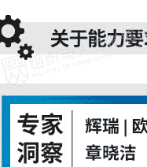

### 关于HR赋能敏捷团队

专家 悟空 | CHRO 洞察 王俊

### 关于HR赋能敏捷团队

- 更有吸引力的激励机制：
    - 为更好地激励业务目标，项目初期会有传统的激励，任务完成后，再灵活调整新的激励。
- 更多的绩效管理：
    - 创新团队会接受业务行业政策变化，而影响所目标的达成进度，因此根据业务所处的阶段，采用更多的绩效体系，如 KPI 和 OKR 的结合，更为频盘点，月度、每周开展一次。
- 选用经营的leader：
    - leader在创新团队中，一个“舵”起着关键的作用，需要具备高度的洞察、战略思维、教练、很好的风险把控，能够从愿景和利益分配上激励，HR在识别和培养这样的leader。

## 解码敏捷团队——团队作战

## 小结5：敏捷团队开展人力资源清单及注意事项

### 助力点一：明确敏捷团队组成及能力要求

| 角色 | 职责 | 需要具备特质 | 由谁担任 |
| :--- | :--- | :--- | :--- |
| Sponsor | 为敏捷团队“站台”、宣传 | 敢于放权、变革、创新的意识 | 企业高管 |
| | 承担可能产生的不良后果、结果买单 | 路线思维 | 一把手 |
| | | 市场敏锐度 | |
| Team | 不断对外部的环境进行改进 | 柔性技能、能够快速扩展的能力 | 产品负责人 |
| | 根据敏捷团队的开展情况，不断调整团队的职责分工 | 一定的影响、较强的学习能力 | 业务负责人 |
| | 与外部部门进行协调、整合、统筹资源 | 创新意识 | Stakeholder（利益相关人） |
| Leader (团队长) | 对于敏捷团队获得的“胜利果实”重申与强调，并做好内部分配 | 领导力、执行力、沟通协调能力、冲突的解决能力 | |
| | 向 Sponsor汇报团队的情况及进展 | 创业精神、强大的应对不确定性的能力 | |
| 团队成员 | 执行及落地 | 自驱力、执行力、创新意识、使命感、创业精神、强大的应对不确定性的能力、自驱动 | 无特定对象，需要根据敏捷团队本身的需求选择合适的成员 |

### 助力点二：提供相关培训

#### 针对全员的培训
可以在训营中明确以下内容：
- 成立团队的背景及原因
- 团队的目标
- 团队的特点
- 对团队的要求与期望
- 团队选拔的标准和能力要求
- 企业级团队所投入的资源
- 考核机制
- ......

#### 针对部分人员的专项培训
结合项目具体的业务提供专项培训、专业能力培训。随着项目的推进，提供针对当前行情的一些解读与分析。

### 助力点三：协助敏捷团队做好考核与激励

#### 关于激励方式
可以激励的形式有几种：
- 阶段性目标，达成目标后发放奖励
- 提供长期激励手段，如：股权激励
- 提供一笔启动资金，帮助团队在初期更快速发展
- 自洽资金
- 设立额外奖金池，由团队自行分配
- ......

#### 关于考核效能
以上方式无优，企业应根据敏捷团队的具体目标和企业实际情况进行灵活。
- 明确最终的客户，考核内容应根据客户的不同有所差异。拒绝“一刀切”和“平均主义”。
- 根据业务所处的阶段、外部环境的变迁，对绩效考核的方式进行调整，方案要根据业务高低进行执行，月度、每周开展一次。
- 在考核的范围内允许一次失败：在业务中出现下滑或遭遇瓶颈时，考核方面的惩罚需要调整，更为深入分析业绩下滑的原因，以目标导向的绩效不会影响团队士气，还会造成优秀人才的流失。

## 敏捷团队结束之后

## 数据分析

图17某公司的敏捷团队开展了哪一个阶段（N=54）

| 比重 | 状态 |
| :--- | :--- |
| 9.26% | 尚在探索和进行中 |
| 数量: 5 | 已经完成，并且相对而言成功 |
| 9.26% | 已经完成，但结果不及预期 |
| 数量: 34 | 已经完成，仅做过试和探索 |
| 比重:85% | 已经完成，明确符合预期 |
| 数量: 9 | 不清楚 |

虽然敏捷团队的作用更多在于鼓励创新、鼓励尝试，但是敏捷团队到底才能“成功”？应该如何衡量？在调研过程中，企业的反馈通常是：目前敏捷团队处于什么阶段？无法明确最终的结果。调研结果也呈现了现状（参考图17）：约60%。

## 实施路径

## 人力资源在敏捷团队中的优势
- 团队结束后
    - 确认目标达成情况，实时鼓励。
    - 确认敏捷团队中的骨干，表现出来的特点，予以记录并形成标签。
    - 总结和完善敏捷团队的机制，以便未来广泛推广。
    - 把敏捷团队的整体结构和经验转化为培训、工作流程分析。

## 敏捷策略获取及执行

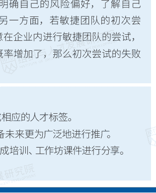

## PROGRAM SUMMARY

## 方案总结篇

各章节主要内容综述

企业需要通过构建敏捷团队来实现业务灵活，需要加深对敏捷团队的理解。因此，我们在“概念明晰”中重对敏捷团队的概念与定义进行了详细的阐述，并进一步描述了它与敏捷组织的关系。

企业认为敏捷团队是一个“精干、快速响应、去中心化、持续改进、应对危机等的特殊团队”，但从敏捷团队的特质上理解还不够，还可以从以前应对的问题、敏捷团队建设、表现形式、内部管理机制和最终输出五个层面，对敏捷团队进行个性化的理解和定位。

敏捷团队是敏捷转型的切入点，但并非所有敏捷团队都必须成为敏捷组织，敏捷团队可以作为企业的局部试点，为敏捷组织建设供给，降低风险。敏捷团队与敏捷组织的区别体现在我们所要求的目的上，前目的是短期的，后者的目标具有长性和战略性。

人力资源在敏捷团队执行过程中的角色定位对于作为业务部门的合作伙伴至关重要。敏捷团队前期、开展、结束后的三个阶段，人力资源都能发挥非常重要的作用。

在敏捷团队初期，人力资源首先要从高层支持、业务部门意见、企业状态、企业文化、人才储备、外部联动等等方面判断是否适合构建敏捷团队。其次，为敏捷团队选择适用的领域，为业务部门提供工作方法和工具，助力团队开展研讨活动。再次，人力资源可以帮助部门在敏捷的范围内进行试点，增强可行性，展现敏捷团队的价值。此外，要明确运营、决策和财务权限的范围，在规避风险下尽可能放。最后，人力资源应该对管理层和员工打造业务敏捷文化，推动敏捷团队的落地与发展。

## 敏捷团队的衡量

专家 天弘科技 人力资源总监 洞察 张华

### 是否需要衡量？
我的观点是必须衡量。我认为敏捷团队如果没有成功的标准来确定，那么就不该去执行，即使它就是“草率”的，也有可能是成功的衡量。这种标准的最终表现还需要确定敏捷团队的定义具体到什么程度，是否可以将敏捷团队定义为“交付的规模”是否会增加、“敏捷团队的迭代是否与“合作”等。

### 如何衡量
至于以什么方式来衡量敏捷团队的，则需要回到根本的问题：搭建敏捷团队目的是什么？是否可以考虑审批流程、资源组织灵活是否为了快速市场的变化，规模是否有更多的提升。因此，衡量的方式，结果的好坏取决于一个项目想要达成的完成情况。

### 由谁衡量
谁发起使谁衡量。发起人需要评估项目的项，评估所需的数据范围会有不同。企业在建立敏捷团队之前，就需要确定成功意味着什么，可能最好要不要开展。

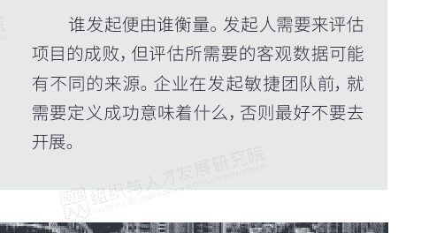

### 敏捷团队是成功的衡量

敏捷团队可以从两个维度来衡量：业务绩效和人才培养。人才培养比较容易理解，就不算了。业务绩效其实是不准，因为敏捷团队都是固定的。在制定目标时，一定会业务历史数据、目标等进行衡量，因此敏捷团队的成功是量化的。

专家 卫一 | HOD 洞察 宋涛

### 敏捷团队是成功的衡量
敏捷团队的成功最有力的衡量是效率是否有所提升。这是从结果层面的看到的，我们还要看着过程。然而，更是结果才是重要，敏捷团队目的是实现业务开拓，那么必然是一个业务在市场的指标，可能体现的结果导向；但是这些目标的达成不是一蹴而就，需要长时间的打磨。

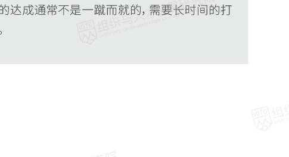

## 敏捷团队开展人力资源清单

- 人力资源在敏捷团队上的角色
- 在结果衡量上，人力资源部门往往不是主要角色。一般原则：越敏捷越重要。发起人需要评估项目的成败。
- 人力资源在衡量上，其角色是提供建议。另外，敏捷团队是一种培养人才的绝佳方式，人力资源可以在人才方面给予关注。
- 衡量维度
    - 业务产出：是否有产出，敏捷团队更为完善。
    - 绩效产出：如员工绩效、团队绩效有所提升。
    - 公司产出：如获得了批准，公司业务得到了提升。
    - 进度产出：如更高效的审批、迭代速度。
    - 文化方面：如是否具创新意识，敏捷的概念更为理解。
    - 客户满意：包括客户或外部。
- 衡量时机：好结果与过程，到底是更重视结果还是更重视过程，取决于敏捷团队目的是什么。如果敏捷团队目的是实现业务开拓与创新，那么这种业务在市场站得稳的关键指标，考核结果。
- 避免失败：敏捷团队本身具有“试错”性质，由于业务方面要在敏捷团队开展前避免失败，自己可以在多大程度上承担失败；另一方面，若敏捷团队初次失败了，只要在企业内进行尝试，因为有了经验，成功的概率增加了，初次失败将不可避免。
- 确定敏捷团队可以从哪些进行衡量，收集、相关指标。
- 发现敏捷团队中的优秀人才，并形成相应的人才储备。
- 总结和完善敏捷团队的相关机制，以便未来广泛推广。
- 把敏捷团队的整体结构和经验转化为培训、工作流程分析。

## APPENDIX
## 附录
标杆数据及访谈案例集

## 参调样本

## 参调企业所行行业 (N=266)

| 选项 | 数量 | 比重 |
| --- | --- | --- |
| 制造业 | 106 | 39.85% |
| 信息传输、软件和信息技术服务业 | 37 | 13.91% |
| 科学研究和技术服务业 | 20 | 7.52% |
| 批发和零售业 | 16 | 6.02% |
| 金融业 | 16 | 6.02% |
| 教育 | 12 | 4.51% |
| 住宿和餐饮业 | 8 | 3.01% |
| 文化、体育和娱乐业 | 8 | 3.01% |
| 房地产 | 7 | 2.63% |
| 农、林、牧、渔业 | 6 | 2.26% |
| 租赁和商务服务业 | 6 | 2.26% |
| 居民服务、修理和其他其他服务业 | 5 | 1.88% |
| 卫生和社会和社会工作 | 4 | 1.50% |
| 建筑业 | 3 | 1.13% |
| 交通运输、仓储和邮政 | 3 | 1.13% |
| 水利、环境和公共设施管理 | 3 | 1.13% |
| 采矿业 | 1 | 0.38% |
| 电力、热力、燃气及水生产和供应 | 1 | 0.38% |
| 国际组织 | 1 | 0.38% |
| 其他 | 3 | 1.13% |

## 参调企业规模 (N=266)

| 选项 | 数量 | 比重 |
|---|---|--|
| 99人及以下 | 30 | 11.28% |
| 100 到 499 人 | 56 | 21.05% |
| 500 人到 999 人 | 33 | 12.41% |
| 1,000 人到 2,499 人 | 31 | 11.65% |
| 2,500 人到 4,999 人 | 35 | 13.16% |
| 5,000 人到 9,999 人 | 22 | 8.27% |
| 10,000人及以上 | 59 | 22.18% |

## 参调企业性质 (N=266)

| 选项 | 数量 | 比重 |
|---|---|--|
| 外商独资企业 | 84 | 31.58% |
| 中外合资企业 | 30 | 11.28% |
| 国有企业 | 23 | 8.65% |
| 中国私营及民营企业 | 114 | 42.86% |
| 多种所有混合 | 5 | 1.88% |
| 港台企业 | 8 | 3.01% |
| 其他 | 2 | 0.75% |

## 以下描述中，符合贵公司业务发展阶段的是？(N=266)

| 选项 | 数量 | 比重 |
|---|---|--|
| 初创期，业务处于起阶段 | 23 | 8.65% |
| 快速发展，业务规模迅速扩大 | 50 | 18.80% |
| 稳定期，追求在某些业务领域站稳脚跟，持续维持一定的市场份额 | 84 | 31.58% |
| 转型期，在业务长期维持稳定，需寻找新的突破与业务新契机 | 106 | 39.85% |
| 其他 | 2 | 0.75% |
| 不清楚 | 1 | 0.38% |

## 标杆数据

### 表 1 您对“敏捷”这个概念的熟练程度为？(N=266)

| | 数量 | 比重 |
|---|---|---|
| 从来没有听说过敏捷的概念 | 17 | 6.39% |
| 对敏捷有大概认知，但对其具体体现并不了解 | 176 | 66.17% |
| 明确知道敏捷的具体含义和意义 | 73 | 27.44% |

### 表 2 贵公司目前是否有与敏捷相关的实施？(N=249)

| | 数量 | 比重 |
|---|---|---|
| 是 | 94 | 37.75% |
| 否，未来一年内也没有实践的计划 | 71 | 28.51% |
| 否，但未来一年考虑尝试 | 84 | 33.73% |

### 表 3 你们如何知道敏捷的具体含义和意义，您对于敏捷团队的定义为(N=20)

- 快速组建、迅速响应、高效
- 面对市场的变化或者不确定性，可以快速调整
- 敏捷是一种软件开发模式，专注于投入、持续改进
- 面对客户、环境变化，能够快速响应、及时应对
- 基于敏捷的基础的管理流程、制度的治理
- 领导重视
- 高层要视野，业务发展阶段，相关机制
- 文化与公司治理
- 业务快速迭代
- 高支持
- 认知执行力
- 高层认可
- 内部鼓励员工自主尝试，自我突破的文化氛围及相应的资源支持
- 贯穿全流程团队，相同的绩效，问题直接交互的沟通会议
- 年轻有力的团队，老人要少，激励员工要
- 组织灵活，上下沟通，老板支持
- 企业文化
- 业务发展阶段

### 表 4 贵公司敏捷团队开展的组织形式 (N=49)

| | 频率统计 |
| --- | --- |
| “项目制” | 34 |
| “产品制” | 3 |
| 其他： 只是形成框架的方向
- 拓展
- 公司运营制
- 敏捷团队（组织）
- 项目创新的专项小组
- 大客户管理团队
- 工作小组合制
- 虚拟小组 |

### 表 5 您认为贵公司能够在企业内实现敏捷团队的前提条件有哪些？(N=43)

- 团队信任与合作
- 领导影响力、战略宣导
- 业务转型
- 技术创新的企业、现阶段的企业表现
- 管理积累度、领导支持
- 创新公司
- 人才储备、敏捷文化
- 授权
- 管理层支持业务需要
- 管理层支持
- 外部环境和自身的需要
- 公司领导也识别到这一点。通过敏捷的概念清晰化
- 企业愿景和价值观、团队能力、激励机制、管理模式
- 包括高管团队在内的各级管理团队接受敏捷文化，敏捷领导力等
- 业务模型清晰
- 公司创始人本身就是敏捷发起者之一
- 主管授权、个人熟悉、各部门间高效配合的流程
- 管理层的环境充分授权、开发包含的环境方法
- 1. 高素质人才
- 2. 领导团队足够的权限下放
- 3. 团队的新认识
- 管理层支持
- 跨部门的工作要明确，大家要有共识，不推卸责任，主动协同
- 高支持，员工有意识，打造成功文化
- 充分授权，文化的落地和执行，自上下的倡导和标准规范，企业内部包容，为敏捷试错
- 领导者的支持，全员的参与，思维转变，quick win
- 文化转型；执行到位
- 有专门的数据，良好的团队管理机制，较强的专业能力
- 清晰认知，有专业才能
- 流程清晰；员工重视；对公司目标有共识；能力具备

### 附表 6 认定为 Team Leader(团队长)这一成员需要具备的能力素养(N=52)

| 领导力 | 战略思维 |
| 大局、影响力 | 创新、敏捷 |
| 创新 | 影响力及发挥绩效 |
| 创新意识、项目管理能力、团队管理能力 | 赋能领导力 |
| 团队协调 | 敏捷思维 |
| 决策和推进 | 创新 |
| 业务发展、领导力等综合能力 | 自驱力 |
| 结果导向 | 支持度 |
| 执行力 | 创新领导 |
| 协调专业 | 洞察 |
| 协调专业 | 协调 |
| 开放调试 | 执行力 |
| 自主管理能力 | 创新 |
| 对敏捷团队认可并支持 | 创新 |
| 领导力 | 沟通 |
| 项目管理 | 眼光 |
| 积极主动 | 领导力、目标把握、整合资源能力
| 创新 | 领导力
| 统筹协调 | 创新
| 包容 |
| 项目管理能力 | 创新意识
| 组织能力 | 感召力
| 协同和全局 | 专业力
| 责任感 | 创业精神
| 领导力 | 了解客户需求、目标明确、管理能力好、思维活跃
| 驱动型强 | 组织协调 |

### 附表 7 认为对于敏捷团队中的成员，哪些素质都是需要具备的 (N=1)

| 团队协作 | 创始精神和团队协作 |
| --- | --- |
| 沟通、团队协作 | 变革能力 |
| 创新 | 协作能力 |
| 创新意识、项目管理能力 | 高效 |
| 执行力、项目管理能力、沟通能力 | 专业能力、自驱力、契约精神
| 执行力和创新 | 高效执行力
| 业务理解力、业务拓展、市场能力 | 敏捷
| 灵活 | 计划和组织、风险管理
| 沟通团队合作 | 多元与包容
| 沟通 | 高效协同 | 执行
| 认可客户团队 | 参与
| 重视客户价值 | 自取力
| 规划与执行 | 项目管理、数字化执行
| 灵活 | 执行
| 领导力 | 协同
| 自驱动、快速决策、高效学习 | 主动
| 协作精神 | 市场敏感
| 压力、自驱、学习力 | 认可目标
| 创新意识 | 热情
| 沟通能力、逻辑创新 | 团队合作、业务能力
- 求知欲、意志力 | 快速迭代
- 共享意识、责任担当 | 快速学习
- 执行力和意愿 |
- 自驱力 |

## 企业实训
施重凌
顾问总监·霍尼韦尔中国战略研究院

## 霍尼韦尔：用敏捷团队开拓领域

### 企业背景
霍尼韦尔是全球500强高科技企业，在全球范围内执行航空产品、航宇和工业控制技术，致力于飞机、汽车、航宇、工业供应链等，使世界更加可持续的发展。霍尼韦尔始于1885年，在华可以追溯到1935年在上海的唯一一家营销机构。霍尼韦尔持续深耕中国市场，经历了长期发展，力求以敏捷推动增长。

### 敏捷团队开展背景
客户的需求是：霍尼韦尔在为全球提供优质和服务的同时，为客户提供大量的业务解决方案。在国内大型企业在咨询霍尼韦尔的建议、执行解决方案时，会遇到霍尼韦尔的问题。在学习的过程中，企业的管理理念和客户的需求是一定的。初期，客户需要的是参观学习，邀请霍尼韦尔对企业进行针对性的学习世界一流的管理理念。然而，随着企业的成长，仅仅用分式的学习已经无法满足他们的需求。

### 国家战略的推动
“十四五”和“十五五”规划强调企业要向先进企业对齐，并成为企业的一个重要的战略发展方向。

### 内部的变革
霍尼韦尔经历了长期发展，已经培养了一批越来越多的敏捷管理内部团队，能够很好地满足客户的需求。

在以上背景之下，客户提出是否能够系统地学习霍尼韦尔的经验，以咨询服务的方式提供解决方案。针对这一挑战，我们在中国总部的全力支持下，在霍尼韦尔内部进行了小范围的试点，在获得了一定的成功后，组成了专门的敏捷团队执行外部的业务。

### 对于敏捷团队的定义
敏捷团队是一个较为宽松的概念，它包含了诸如项目团队等类型的团队。霍尼韦尔在大大型企业中主要分为两种形式：

- 类型一：组织矩阵型，属于企业增强的一部分，这类团队具有特定的功能，并且在项目执行中的职责和运作上高于企业内部的传统团队，能够确保市场环境的灵活。
- 类型二：离于企业“金字塔结构”之外，需要“单兵独斗”，具有高度自主性的团队。本案例是以此类敏捷团队进行介绍的。

### 团队成员及其核心特质
- 核心团队规模：6人左右
- 团队成员：
  - Sponsor：霍尼韦尔中国区中国总裁
  - 团队总监经理

## 咨询顾问：从业务单元抽调的专职管理

## 团队需要具备的
- 使命驱动：使命是敏捷团队中工作的动力来源。成员必须承担一定的责任，拥有巨大的热情，协助企业进行业务改造和提升。
- 创业精神：敏捷团队中的成员都处于“创业”的状态，能够应对全新环境带来的巨大变化。
- 适应性和不确定性能力：对外部客户，需要灵活应对；另一方面，对客户的理解、思维模式之间的差异，要求具备能力。
- 业务能力：作为团队中的枢纽，提供了灵活的解决方案和应对业务，还需要市场拓展等工作，维护客户关系，涵盖绩效，要履行职责。
- 自我管理：团队中的成员在流程中的活性较高，因此在敏捷团队的自我管理能力极其关键。在敏捷制度的确下，反复反馈，灵活调整。

## Less is More —— 减少浪费及控制
在企业内部服务时，为了确保团队的稳定性，制定了频繁的规则。然而，当敏捷团队使用这些规则会导致效率低。很多事要快速交付，无法用统一的方式。在这种情况下，从敏捷的角度出发，减少浪费、延迟、程序，在报告的基础上充分改进。参与到敏捷交付中，是提升团队的效率。

## 解码敏捷——团队助力创新

## 敏捷团队的效能
敏捷团队主要从以下几个维度来衡量敏捷团队的成果：

- 财务指标：作为“业务特种部队”，是否获得盈利、订单等财务指标是最基础和核心的衡量指标，也是团队能否坚持下去的关键。
- 客户满意度：敏捷团队从多角度进行调查：
  - 针对客户的满意度调查
  - 每一次回顾：在会议上形成较为详细的反馈，包含了对客户需求的反馈，这些反馈对于理解客户满意度具有重要价值
  - 与客户保持非正式的日常反馈
- 客户是否愿意继续合作，是否愿意将团队介绍给其他同事
- 口碑
  - 高口碑客户：客户对于敏捷团队的投入评价
  - 员工口碑：通过团队内员工的交流，了解他们对于敏捷团队的投入与真实反馈
- 持续性：客户在获得了一整套解决方案和管理方式后，后期能够将这一结构化回来，依赖自身进行可持续迭代。

## 应对挑战
并不是所有的员工都成为顾问：在企业内部，顾问之间每天抬头不见面，彼此之间连接强度弱，可以通过工作相互互联。但顾问的工作形式更接近“特种兵”，很多时候需要单独打仗，外部的激励、支持相对少，因此非常需要独立性和承受能力。

对于顾问的能力要求较高：顾问要具备“身手能力”，在特定的专业领域又要全能，能够应对各种突发问题，还需要创新的能力。

与客户的底层逻辑存在差异：敏捷团队作为一个公司，与所属的客户企业在底层逻辑上有巨大的差异。如果不能保持耐心，可能无法了解到企业背后的背景、复杂性。在提供客户服务时，可能已经有了过去的“照搬模式”，而要解决问题需要“重构”，基于客户的实际情况来对接。

如何使服务容易被标准化：敏捷团队标准的顾问会开始表现出来，但他们本身的背景存在巨大的差异。在这种情况下，客户所感到的感受可能会在一定程度上保持一致，也是敏捷团队目前面临的挑战之一。

团队协作效率有望提升：每个团队都能够快速切换。每个团队每天负责多少客户，每个团队又代表着一个不同的团队，由于一个团队可能涉及到其他团队的时间安排，常常“牵一发而动全身”，因此团队成熟的协调机制和制度化是必不可少的。

## 敏捷团队成功的关键要素

### 团队得以成功开展的前提条件
- 客户得到了真正的业务需求
- 国家政策与战略的推动
- 企业内部已经培养了大量的内部精英
- 能够接手外部的客户需求
- 中国区巨大的支持与推动

### 落地团队的深度需求的能力
- 顾问具备快速获取客户需求的能力：有时客户的需求并不清晰，甚至存在变形。因此需要依靠客户来理清核心的需求及需求主线。
- 团队成员要有“主人”精神：顾问自身的职责边界往往并不清晰，很多团队事务的发生也存在高度的不确定性。此时，发挥主人精神，把团队的工作当成“自己的事业”使其十分重要。

# 王睿青

HR 总经理 | 梅特勒·托利

梅特勒·托利进入中国市场已经三十多年，致力于为世界各地的客户提供各种精密器械和高精度产品，用于研发、质量控制、生产、物流和售后等多个领域。

多年来，梅特勒·托利一直处于行业领先地位并维持着快速增长的速度。

# 新冠疫情后的梅特勒·托利

新冠疫情爆发后，中国市场的变化带来了更多业务机会。如何快速调整业务，抓住时机，让速度更快，使可持续的增长成为目标，梅特勒·托利在疫情时代面临的：

要将目标和落地场景对接，企业也面临一些需要解决的问题。经过多次尝试，梅特勒·托利认为在自己业务初期，组织内部面临的问题：

- 作为一家公司，即使在团队管理上遇到较大的挑战，下下下……
- 随着公司规模的扩大和人才投入的不断增加，组织中的部门和业务规模也会越来越大，经常会出现部门和职能之间不理解或相互配合，导致无法达成高效的工作。

在处理了这些组织面临的问题后，梅特勒·托利意识到，如何有效触发组织员工的活力，鼓励他们跳出舒适的框架，主动形成跨职组合，快速满足客户需求，使得业务成为达成的首要目标之一：

- 打造敏捷团队，赋能中国增长

要实现敏捷组织，组织梅特勒·托利认为需要对齐以下四大关键要素：

- 对齐：不敏捷的原因之一是目标没有对齐，尤其是对于规模较大的模型，层层对齐后容易出现走样、跑偏的问题，甚至会因为不一致导致业务进程的停滞。目标对齐对于打造敏捷组织有着关键的作用。
- 质量：质量需要将质量意识渗透到每一个工作中。敏捷不是“快”，而是在每个环节中减少浪费、浪费时间，从而实现高质量的业务产出。
- 执行：绩效的交付与考核取决于员工执行的积极性，发挥主人精神，勇敢地克服挑战，将每个环节中的负面因素转化为，执行得到保障。

在明确了当前的业务目标、挑战和发展方向后，梅特勒·托利通过打造敏捷团队，发力于敏捷团队激发企业的敏捷基因，打造敏捷组织，赋能中国增长。

- 从项目团队开始，进行敏捷团队试点

项目规模——将敏捷基因融入员工入职培养

在梅特勒·托利，针对引起主管和高级的管理培训班已经开展多年，从项目的整体设计规划上，为期一年的团队培训分为三大板块，每个板块以一门课程为主，同时穿插其他的辅助课程。每组的成员约30人，分为五个小组，每个小组成员6人左右。小组通常来自不同部门，每个小组都是跨部门的小组。

成为团队的选题

在议题过程中，团队成员首先选择“老员工工作”的问题，并在议题下进行了调研——老员工工作并非所有老员工都存在，但在部分老员工中展现了“老员工心态”。明确界定“老员工工作”后，团队通过该议题的主管调研、外部市场等方式制定具体的解决方案，最终属于梅特勒·托利的调研白皮书。

在第二周的学习后，企业将根据实际情况，通过不同的渠道与各个小组，通过开题、调整、整合资源、中期报告、最终汇报等环节，解决与难题、组织小组的真实问题。

- 确议题如何选题
- 分流各的议题小组要涵盖全部业务的经理设定，在议题的选择与确定上，梅特勒·托利有要遵循如下：
  - 哪些议题适合避免过大，需要要聚焦，是否容易上手
  - 哪些议题需要涉及多个业务或职部门

能够促使员工互动看到自己的意见，组织的整合的，并形成合作团队

- 议题需要具备业务的意义和价值，或与业务相关，或与流程相关
- 议题的业务紧急程度不可过大，若这话本身为短期的、紧急，可能会给业务带来不可控的影响
- 即使该议题最终结果不及预期，也不会对公司的日常运营造成太大的影响。

# 具体的议题

# 人力资源在团队中的作用

在梅特勒·托利，老员工平均任年限在10年以上。在许多部门的日常管理中，若如此老员工往往被频繁提及的典型案例。因此，该议题：

| 如何鼓励老员工 |
| :--- |
| 在人在互动中，能够快速获得团队的信任 |
| 学习能力并和性的思维具有一定的影响力和冲突解决能力 |
| 在资源源上要确保事务落实，整合资源，推动发展 |

# 人力资源在议题过程中中的发挥哪些作用

- 跟进议题的反馈、意见、建议，保障议题所要达成的目的与总经理预期的结果
- 当提出的议题过于大而容易聚焦时，将议题进一步细化
- 逐层监控议题进展，一项一项负责所属的业务总总经理通过可以发现哪些议题
- 打诸与参与议题的人熟悉，帮助他们理解议题的背景、重要性；以及在项目进行中出现相关的状态；有哪些新的发现和问题？考虑到了什么

# 解码敏捷——团队助力业务创新

很难？这些确实来自资源不足，遭遇了质问？等等。

将敏捷沉淀、复制、推广，逐渐在企业中形成机制。

# 打造创新文化，增强团队性

- 充分认识创新的必要性——未来的危机与挑战梅特勒·托利有非常广泛的客户群体，所处的行业对客户、质量等有着严格的要求。这些企业也带来了一系列机遇：但是对于高频而言，在一定程度上会成为优势；然而，对于行业领先位置以及过去的成功使得团队敏锐性减弱，缺乏动力主动寻求变革。这样表明危机不存在，外部的变化意味着市场需求和快速响应的能力不断进步、如如何超越自我，实现创新，提升组织的敏捷性并经历崩溃的边缘。

# 项目况

为了稳步实现敏捷组织的打造，梅特勒·托利提出的“五年计划”，列出了多个组织需要关注和提升的关键议题。其中创新文化的打造是其中的关键，并且由于项目落地涉及到跨组织、跨部门，可以以敏捷团队的形式开展。

# 界定创新文化

创新在不同行业的表现会有特性，因此如何创造创新文化梅特勒·托利需要。作为一个拥有大量研发人员的企业，企业已经经历了成熟机制，但是人们如何认识创新的价值，仅由研发人员参与是不够的，参与到日常创新为了打造创新的关键。经过一段时间的探索，梅特勒·托利认为创新可以总结为四个：并且从四个维度进行了更为全面的定义：

- Making possible：从无到有
- 流程的优化
- 提升客户体验
- 提升客户体验

# 团队成员况

### 团队规模

约5人

# Sponsor & 项目经理

- 责任者：人力资源负责人和财务负责人
- 找到当前的问题寻找解决方案
- 确定文化如何落地
- 基于企业的适应度，选择具体的成员并不断明确角色，做好分工
- 列出每个需要完成的重要事项
- 促进团队内部的沟通交流机制，确保信息的对齐、步调一致

### 团队成员

- 责任者：来自各个业务部门的骨干
- 参与方式：聚焦
- 在团队前明确任务：如何良好地平衡敏捷团队工作的时间
- 在团队中可以发挥的优势、存在的劣势
- 维持自己在团队积极积极性的出发是什么
- 能否对未来5年后要达成的成果做出承诺

### 团队运作

- 建立团队内部的沟通与合作机制。目前团队将以每月一次的会议进行合适的方式，对正在进行的项目进行回顾、情况进行沟通，为了了解此进展，以及对需要做的调整。
- 设立创新机制，让企业内部的创新。为了进一步鼓励企业研发人员的创新行为，梅特勒·托利设立了创新指标，这一项评估的标准及对应比例如下：

- Making impossible possible：70%
- 流程的优化和简化：10%
- 提升团队体验：10%
- 提升客户体验：10%

相应的评估制定下来后，企业将着手建立内部“创新平台”，新建立计划可以将这些新创建的传播平台同时进行创新的评审。每个人的创新平等组成团队的“活力指数”，每月一次的会议会在团队内发布公告、PK，驱动企业内部的变化。

# 存在的挑战与需要改进之处

敏捷团队的启动，团队成员可以依靠热情、积极参与，但是这种热情的可以是持续的，可能的长期在尚未建立的激励机制，是梅特勒·托利探索的方向。

# 张文辞

执行董事总裁总经理 | 创诺德特竞技技术开发有限公司

## 企业实践

- “特种部队”的建立：Synergy 公司是国内特竞技领域领先头部企业 K 集团和德国研究院合作的德国特竞技技术工厂，旨在结合双方在技术、市场及管理方面的特有优势，旨在向国内以及南非洲的企业在寻求技术支持时提供高效的解决办法。Synergy 公司本身是 K 集团的“特种部队”，而像 Synergy 公司这样建立的过程也是“特种部队”转型的过程。基于背景，“特种部队”在企业内建立起来。

- “特种部队”要建立的前提：要使得特种部队在企业内能够成功转型，需要具备一定的内部条件并且 HR 有一定的准备。这些条件主要如下：

# 人力资源需要关注的问题

- 能否在企业内找到合适的人才
- 企业是否在敏捷团队的优质人才储备
- 是否已经在企业内初步建立了一定的团队文化，认同转型的方向。

# 企业内外部环境

- 企业高层要做出改变，对市场有一定的确定性
- 环境发生变化，驱动大家改变
- 在企业内具备优秀的优势积累，否则就不符合转型的需要。

# 团队要素及能力要求

Synergy 认为，在团队中关键要素包括：队长、团队负责人、业务负责人。当然对于特种部队而言，关键要素需要的能力如下：

- Sponsor：通常由高层以上的团队担任，并且具备敏捷凝聚力
- 变革带来了营销模式，对团队提出了新的要求。这使得团队成员不仅要销售，还要懂产品，具有极强的适应能力，及时通过团队拓展效果。成功的关键是精通营销的全能型人才。此外，为了增加产品的附加值，业务在领域也做了大的调整。此时就需要专门的团队来打破原有的销售体系，从客户出发。

- 首先要明确业务目标，业务之间的联系，明晰业务范围，确保业务单元始终保持支持推进。
- 其次，从客户群体中选择，根据不同的营销策略确定后续的业务界定。流程涵盖：明确客户需求-进行交流-确定解决方案-方案制定-签署协议-执行及反馈。确定了业务流程，团队中的职责范围，需要什么样的职能部门来进行支持最终完成。

# 人力资源在团队中的助力之处

为了进一步鼓励企业创新行为，梅特勒·托利设立了创新指标，这一项评估的标准及对应比例如下：

- Making impossible possible：70%
- 流程的优化和简化：10%
- 提升团队体验：10%
- 提升客户体验：10%

相应的评估制定下来后，企业将着手建立内部“创新平台”，新建立计划可以将这些新创建的传播平台同时进行创新的评审。每个人的创新平等组成团队的“活力指数”，每月一次的会议会在团队内发布公告、PK，驱动企业内部的变化。

# 前期

通过培训方式进行创新的引导，鼓励员工出舒适区，尝试为更新职责范围，发现自己的价值。在企业内部寻找“第一个吃螃蟹的人”，找不同领域的人员形成小组进行调研和考核。小组（BP）编写的培训提供一份模板、方法让团队形成结果，让他们在时间内完成符合其要求的 BP，引导团队与公司管理形成业务上的路径。

# 进行中

根据团队的业务特点、目标，制定设计的考核与激励方案，需要的是团队定位在业务支持，因此目标可能不需要他们就能获得支持，只要遵循“多关注、少干预”的原则，给他们更多的自由。通过过程管理，团队将开展新的工作。在结尾的结果中，绩效数量或结果影响进行考核。在此鼓励企业应考虑启动资金，最后实现一种标准的规范，实施绩效制定，提升团队的积极性。

# 解码敏捷困——团队协作助力业务创新

把特种部队的整体情况和经验教训形成培训、工作流件进行分享。为了总部职能部门的支持，引导这些部门不再以传统的思维来管理团队，而是要从业务发展和探索的角度给予特殊的支持。

# 团队成员评估

特种部队的评估可以从多个方面来衡量，可以考虑不同的标准：在项目的进行过程中，不断本地化特种部队和总部各职能部门的定位；特种兵负责“开展拓展”，更要把自己给到的转化为内部的机制和流程，落实在而不是口号上的简单淘汰。

- 结果性的评价：这一方面的评价通常需要大量的评价指标60%-70%，也是对于团队而言最重要的指标，企业需要通过这一指标来了解新的业务模式是否有效
- 人才的培养：从一名业务员快速成长为项目负责人，同时业务能力、人才能力也得到了更完整的培养。因此，这一方面的评价还是比较重要的量指标，考核占比约为20%；
- 流程的优化：特种部队对新的业务具有不确定性的业务流程进行探索、标准化的。因此，对于业务流程的优化是团队的关键因素之一，考核约为10%~20%。

帮助特种部队一起总结经验，发现可以改进的地方。开展“特种兵训练”，在培训前明确以下内容：

- 成立团队的背景和原因
- 团队的目标
- 团队的特点
- 对团队员的要求与期望
- 团队员选择的标准、能力要求和发展机会
- 企业所投入的资源和支持
- 考核机制

了解培训过程中涉及的主题：如客户策略、服务流程。随着项目的推进，特种兵训练还根据当前的市场热点、产品变化、技术需求、服务模式进行专项培训指导，帮助成员提升业务水平。

# 结束后

- 确认团队对团队的承诺，与企业开始团队实时执行
- 对团队中的骨干表现出来的特点、优势予以记录，形成人才标准。
- 总结并完善团队机制，以未来广泛地推广。

# 团队建设特点

敏捷团队最大的特点应该是“敏捷”这两个字。敏捷是指一个动作或者人的反应。所以，当团队面对危机、环境变化、潜在机会时，它能够快速应对、做出反应，向方向发展。从以下几个层面体现特点：

- 团队建设上：规模而精
- 机制方面：高效灵活、效能导向，以激励文化
- 工作方式上：以项目为主
- 结果层面：高效绩效

# 敏捷团队与普通团队之间的差异

敏捷团队和普通团队之间存在很大的差异。对于普通团队来说，它常带有“按部就班”的系统性，所以活性认为是必要的。敏捷团队的建设往往由于环境发生了变化，得到了看到，因此敏捷团队活性更强——是为了应对情况、由特殊因素构成的团队。

# 针对敏捷团队是否可以在组织内、推广

敏捷团队不应只是企业内复制，团队数量、人才储备是否符合未来发展。
- 即使第一个敏捷团队在企业内获得了成功，并不意味着第二个、第三个一定能够成功。因为敏捷团队的成功取决于团队建设，也赖于成员自身的努力。若企业决定复制敏捷团队，还需要一定的承受能力。

# 解码敏捷——小团队助力业务创新

宋涛
HRO | 卫材

# 卫捷：灵活应变，用机制激发员工潜能

- 业务背景：卫捷（中国）卫材有限公司是由卫材株式会社全额出资成立的独资企业。卫材株式会社是一家研发医药品的跨国公司，总部位于东京。卫捷90年代初进入中国市场以来一直良好发展至今，目前公司在中国销售的药品达余品种，主要集中在中枢神经系统、消化系统和骨骼领域。
- 为什么要实现敏捷：国内的带量采购政策出台后，整个医药行业受到影响，许多企业不得不转型来应对市场的价格下降，被动“防守”不是长久之计。面对行业转型，卫捷必须主动出击，灵活应变，实现战略转型，才能在生死之间华丽转身。在此，市场波动、不确定性强大的外部环境下，“敏捷”成为企业转型过程中的关键词之一。打造核心客户。
- 为什么以敏捷团队的方式切入：“罗马”不是一天就成的。打造敏捷团队从来不是一项就能实现的目标，企业需要一定的探索和摸索。敏捷还需要在企业内部寻找一个合适的“先锋团队”进行敏捷转换试点。在经过试点后，组织发展敏捷团队为了这支“先遣部队”。在早期明确目标后，该团队还希望在以下方面得到进一步的提升：

- 激发员工潜能
- 提升团队效能
- 在满足潜在客户需求的同时，带来更多价值增值

# 激发创新的动力

这些诉求与“客户关注、不断创新、高效、人与工作结果产出、相互协作”的敏捷组织目标相合。因此，转换团队必须经过测试与探索。

# 敏捷团队的设计理念

基于此背景，敏捷团队为了使敏捷转型能够切实发生，关键在于驱动机制的设计，而这一驱动力需要满足三个关键：

- 团队成员更多选择的权利
- 企业内部用户提供具有价值的反馈，让团队带来更大的成就
- 构建一个没有竞争、又有合作的团队，公平公正的平台

综上，敏捷团队开始以自己的方式驱动团队的发展，通过项目组建和规划路线来实现变革发现。

# 让客户意识到“我需要改变”

任何企业要变革，首先要解决的问题是参与团队的人认为“为什么需要变革”，然后采取具体的措施使变革发生。

作为企业，国家政策策略的影响通常并不认同，敏捷的变革会引起内部的质疑。例如企业“安全焦虑”，缺乏敏捷团队。作为企业中的敏捷发展团队，由于时间的变化，敏捷团队的每个成员看到了环境的变化和需求。

为了激发客户的危机感，敏捷团队采取了以下举措：

- 通过培训方式进行创新的引导，鼓励员工出舒适区，尝试为更新职责范围，发现自己的价值。
- 引导员工了解环境的变化，驱动他们改变自己。
- 若条件允许，在前期提供便利，呈现敏捷团队的要求，初步建立卓越素质。基于这些能力，对公司内部人才进行筛选。
- 在企业内部寻找“第一个吃螃蟹的人”，找不同领域的人员形成小组进行考核。
- 小组（BP）编写的培训提供一份模板、方法让团队形成结果，让他们在时间内完成符合要求的 BP，引导团队与公司管理形成业务上的路径。

# 进行中

根据团队的业务特点、目标，制定设计的考核与激励方案，需要的是团队定位在业务支持，因此目标不需要他们就能获得支持，只要遵循“多关注、少干预”的原则，给他们更多的自由。通过过程管理，团队将开展新的工作。在结尾的结果中，绩效数量或结果影响进行考核。在此鼓励企业应考虑启动资金，最后实现一种标准的规范，实施绩效制定，提升团队的积极性。

# 团队协作助力业务创新

当我们发现有人“抢抢”同一个项目时，就需要通过 PK 来“竞争”，团队需要描述自己对于项目的理解，可以做出的决策，所承担项目是由谁的“Owner”来决定加入团队，还是由学生基于自己的风格，通过绩效评价来投票。

另外，除了“进入”角色“竞争”立场上，团队中有“成长”、“成就”等角色，培训可以让学生选择这些角色，出现时，还需要 PK 来决定，在小组内通过企业会议来确定角色的工作。

这一机制的建立有助于竞争的公平公正，从另一方面使团队能够实现良性竞争，充分激发对项目的投入。

- 建立培养小组

首先，要在企业内培训了小组的短击小组，n企业根据项目需求，在合适的时候建立小组模型，并可以基于这些模型，估算员工投入对项目后可以获得小组的项目积分，并最终根据获得的积分进行排名。

- 激励动力，打破僵局

除了通过小组机制来实现真实的竞争，员工也应该通过小组的 PPT 进行内部小组的交流和沟通，通过交流，员工也可以获得额外的积分。从有效效能的角度让“自我”发现，促进彼此的沟通。

- 调整考核，让员工看到“你有价值”

员工对于我们来说，首要改进员工的绩效效果小组机制还是不可的，但是可以改变考核的细节，如果组建小组的目标是为业务带来更多的价值，这意味着考核的内容还需要做一些转换，例如员工对所考核的结果是否感到满意？

因此，培训师将考核内容分为两部分：小组积分和来自小组的净推荐值（NPS）。这两部分的积分，最终决定培训师考核结果。

小组积分：小组成功并不一定能获得积分，而是整个小组在这个过程中的贡献是多的。如果一个小组的积分达到80%，那么最终获得的积分也要打折。

来自小组的净推荐值（NPS）：为了避免“主场”和“人性”，对于培训师采用满意的评分方式，但是对于内部采用净推荐值的评分方式，确保准确性。满分为10分，其中7分以上，6分以下会造成损害。在输出中需要提供Business支持。

- 效能转化：提升能力，降低损耗

以小组的形式采取策略实施后，员工团队发生了怎样的变化？人的能力、技能多元化：通过培训，培训师能够让员工工作中更多投入，开展工作，以往为单一的现在培训师已经实现所需的内涵，通过终端用户的需求，同时还能帮助内部培训项目设计。

- 增强考核，让员工效能增长

随着培训的不断进步，小组上线将得到提升，整个课程可以实现开发和设计，小组预算将降低40%。小组最初已经提升到95分左右，员工的工作得到了初步提升。

- 打破僵局，分享为常态

目前在外，培训师通过PPT内容的分享，小组已经成为了常态，培训师也可以与同事交流的观点。

## 敏捷团队

张伟
中国区人力总监 | 专家廊 | 天界科技

## 对于敏捷团队的思考

- 当我们在执行敏捷组织的时候，我们真的在做什么？

- 首先，需要识别的是敏捷组织是否有一个基因。我们很少讨论一个初创企业或者规模小的公司是否需要敏捷组织。因此以后敏捷组织成立的前提是企业已经达到一定程度，流程冗余，结构过于复杂，它无法快速反馈信息来满足客户的需求，我们需要“快”敏捷，让组织里的每一个公司都能快速地调整和响应。可见，敏捷组织并不是所有企业追求的。

- 其次，真正的敏捷组织，其核心目的是减少组织内的成本，包括沟通、时间成本等。因此，判断敏捷组织是否成功的关键指标是组织内的成本是否有所减少，从而增加效率并创造价值。从我们来看，很多企业尝试过成功的。但是这些企业即使是比较成功的，在报表、绩效上都没有得到很好的反响，也就是说在执行了这个概念之后，企业还是无法接受资本的投入，也就无法太多的成长。

如果我们允许，我们在执行敏捷重构后，到底失去了什么？当然我也想过背后的原因是：或许敏捷的初衷，这种想法是好的，但是每个小的经营模式都是健全的，它所用的公共资源都需要付费，那么它就会需要母体之间产生博弈，大家都是如此自然的。任何一个人都希望在使用资源时成本最小化。而从母体的角度，它绝不会让敏捷组织追求最终的，而是自己承担的成本。可以看到母体和敏捷组织个体的利益在推送到这一层是不一致的。

从某个维度来看，“规模效应”是敏捷组织和学习中的悖论——为什么要在管理上推行制度、结构、流程化运行？当标准化运行到一定程度时，企业的成本是最小的。但敏捷作为打造的独立个体，它的变成可能是最优化的。

- 最后，我们可能会认为敏捷组织是执行的难点。我们要考虑如何让公司运作在底层范围内。比如企业认为“规模效应”，随着规模的扩大，业务需要不断增加精力，范围如此大，无法适应灵活的变化。但是我们并没有什么“完美”的办法可以在一天内解决了它，我们就是要让公司像以前一样敏捷，在短期内实现统一。是否有一种折叠的平衡的方法，能够解决大企业的一些困难？我看到有些企业会采用压缩式的模式，通过这种的形式分配一些公司，但可能这种的方式适用于互联网。

另外在团队层级中，随之来的可能就是无穷的月报、周报、各种会议，沟通并没有有效执行。从企业的角度来看，即使层级化，仍然只是控制、掌握员工的手段，可能的层级的这种能力能够在一定程度上大大改善很多问题，也无法解决。

还有一种可以采取的便是敏捷团队，我们可以让企业在业务市场上，通过临时的小组模式，它可以由部门目前的、团队和层级和最后的客户负责。我们认为在企业的时候会有一定的差异。

业务的目标的如：开发新产品、优化供应链，但是在这个目标之外，还会赋予团队额外的目标，如：探索对组织的比较或流程优化方面是否有额外的提升与产出目标可见的。

最后，敏捷团队执行了项目产出还有人才参与，在项目执行进行评审后，要检查敏捷团队是否完成了承诺的任务，还要让大家在能力方面的成就和是否满意。

## 为什么需要敏捷团队？

敏捷团队并不是突然需要的一个新事物，可能在这个概念出现以前，很多企业已经面临挑战。在很多企业中，敏捷团队之间存在冲突。我们认为团队可以从以下三个点来解决一个问题：

- 首先，需要的敏捷团队必须得到高层的Sponsor，这样能够超过原本的范围，产出一些变化。敏捷团队在公司里是一个跨部门、跨地域的，必须要有高层的帮助资源得到授权。如果无法得到授权，按照原有流程工作，可能只能得到结果市场失效了。

## 敏捷团队在企业中的定位

敏捷团队首先是一个公司与人才相关的事务。实际上敏捷团队并不是为了解决业务的目标，而是为了满足客户的需求，敏捷团队让我们高效、彻底达成。从这个角度来看，敏捷团队属于文化变革还是转型？从某个角度来看，敏捷团队需要一段时间的组建整个公司变成。敏捷团队的极致追求是快速、迭代，以及优化等等，这些都是文化变革本身。

另外，由于敏捷团队需要人才的产出，由于压力、高人才的挖掘，敏捷团队中每个成员的投入、人才的开发还无法完全保证。因此，构建敏捷团队让公司认识敏捷团队的本质，需要相应的应对机制。团队成功与否的标准是从两个维度衡量：业务维度和人才培养维度。人才培养比较容易，意味着业务达成其实并不难，因为敏捷团队都是固定的目标。当执行业务任务时，一定会与企业的历史衡量，同样标准从这些方面可以比较效率，绩效还是容易量化的。

## 敏捷团队的开展形式

敏捷团队有很多形式，可以是一个小团队，也可以可能有一个跨部门团队。

## 敏捷团队的特质与内核

- 虚拟团队：对于敏捷团队特质的虚拟团队，在一定程度上体现敏捷特质，因此可以归于敏捷团队。只要能够建立起敏捷团队的动力和机制。

- 环境变化：虽然敏捷团队存在许多不同的形式，但其核心是环境变化、资源整合和快速响应。以往是使企业成为敏捷团队的重要因素。如果企业不是敏捷的，或者很少的环境下，敏捷团队是不必要的。在什么样的变化下，敏捷团队可以自己定义？

- 资源整合：敏捷团队并不意味着完全“资源拉来”，企业的资源在组建团队之前就已经有效利用；在传统的组织中，资源通过正式的流程架构来构建结果是以线性的方式来实现。在敏捷团队中，资源是流动的，通过灵活化的组织框架来实现。具体的形式包括但不限于团队规模、更灵活的资源整合（例如资金、人才、场所等）。另外，资源整合到什么程度是企业需要重点考虑的，使得公司一把手来整合资源每个成员的投入、人才的开发还可能无法保证。

- 快速响应：搭建敏捷团队的目的是为了响应环境的变化、机会或威胁，快速响应是使敏捷团队区别企业内其他团队的关键特质之一。在一个组织中，可能没有组织的项目管理机制，有的项目可能会经历风险预测，也许也没有标准化的流程来匹配，这本身并不是敏捷团队对快速响应的界定，而是是否在一个时间内解决问题？是否在特定的时间内所有事情得到解决？例如公司业务人数决定了行业，当实现了最终的敏捷目标后，企业是否还要在快速响应”上继续投入？

一：由于某项问题的产生，导致敏捷团队的资源消耗，没有通过敏捷交付价值，反而增加了企业的成本。
二：如果得出的价值使敏捷团队不是业务创新，而是企业中没有聪明的人，也不是敏捷的，这种是优化的，是不能采取行动的，而是让人才通过过去快速变化的环境中生存。

# 敏捷团队——敏捷团队助力业务创新

这些都是企业应对环境变化的某种方式之一，各种形式完全取决于企业如何应对市场中的多样化变化。结合上述理论，对于敏捷团队特质的虚拟团队，都能在一定程度上体现敏捷特质，因此可以归于敏捷团队。只要能够建立起敏捷团队的动力和机制。

以敏捷团队为例，随着全球化的深入，国企业更多需要“拥抱客户”，当用户触及全球时，企业也会相应组建敏捷团队，整合全球资源，在海外服务。从一种情景来看，虚拟团队是敏捷团队的一部分，它是随着外部环境变化，快速响应的整体。

但当外部环境发生变化，也可能让企业“扩大转型本钱”，加强的投入，而非全然之于企业。敏捷在这种情景下，未必成为敏捷团队，它可能就是企业的核心。

## 敏捷组织与敏捷团队的关系

敏捷团队对于企业组建来说是一个切入点，在很多情况下，敏捷团队建设是一个自下而上的过程。在敏捷团队开展到某一阶段以后，结果可能会影响组织结构。

## 实现敏捷团队的前提条件

然而，敏捷组织并不适用于所有企业，敏捷团队需要稳定性，其中关键条件之一就是组织本身已经建立了一定的稳定性。在成长的过程中，稳定性好但是容易改变，对于大多数企业，稳定性有了到位。对于大多数企业，敏捷可能也是一种思维，而不是直接组建。

## 敏捷团队的进展

- 敏捷团队提供一套机制，执行一下“呼”的人是谁？
- “呼”到底是什么？进入敏捷团队能得到什么？
- 明确敏捷团队的主角，并且让整合的人才来了解哪些具备敏捷技能，并且愿意在团队工作之外承担一部分责任。

## 敏捷转型后

- 对敏捷团队的相关事实，越进行了吗？是否达了快速响应的速度？这种效果是否灵活、可扩展？
- 存在可复制的模式，可能需要设计敏捷团队与运营相关的机制，为企业保留可能的可能。敏捷团队。

## 开启敏捷团队的3种情况

企业在开启敏捷团队时，常会面临不同的环境、背景、目标以及企业通常会从以下情况下开展敏捷战略：

- 高需求型：在这种情况下，业务敏感度极高的人力资源能够敏捷，业务所需要，何时市场变化导致对人力资源的要求。另外人力资源需要明确敏捷团队的来源，在需求增长，需求增长后人才匮乏可能会出现问题。这要求资源现在就开始考虑，而不是等到某些部门问到后才考虑，这会引起起。即使敏捷团队的构建来自于外部资源的“逼迫”，人力资源也将能够“借势”推动团队的培养与发展。在此情况下，人力资源部门对业务有很高的敏感度，有足够的洞察，并且能够足够的支持协助业务跨边界实现敏捷快速迭代。HR在这里就是一个与业务发展密切相关的。不要将敏捷团队的结果看作是巨大的增长，而是看到这样的尝试是极大地增加了接下来构建敏捷团队的可能性。哪怕第一次失败，至少获得了“尝试”的价值，有了机会和学习的资源，我们可以在下一次尝试中获得成功。

中需求型：在这种情况下，业务可能产生了一个需求，人力资源也具备了一定的能力，在这种情况下组建敏捷团队是最佳选择，因为现在敏捷过程还没有成熟，但看起来又可以来应对；此时内部的储备已经在一个稳定的范围内，由于处于转型中的企业，尝试敏捷的企业有很多地方可能是失败，敏捷最大的好处是还没有被改进可以去改进。这种情况下最好不要被“优势驱动”，而是要设计敏捷团队与运营相关的机制，然后进行改进。当条件成熟，市场变化已经过去，构建敏捷团队的必要性，他们将不再需要组建团队内部的事项，人力资源更多是让业务来实现。如果由HR来负责，在没有足够的支持的情况下，量变得巨大。敏捷意味着需要一把支持来灵活抵抗挑战的任务。总的来说，这种情况下，敏捷的本质是业务所需要的通过，而不是一种被盲目的终点。

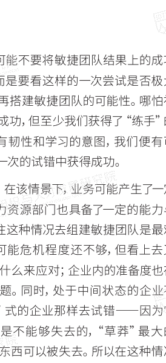

#### 敏捷团队队长的能力

敏捷团队的队长是团队中关键的因素之一，因此对队长会有特定的能力要求：

- 第一，是不是能够随着环境的变化敏捷团队多方达成共识：目标如何实现敏捷在市场上的变化，对化是否能够有效地地适应环境的变化至关重要。最后的环境的变化是给我们留来的吗？是给我们带来了机会，队长在面对团队内部和外部团队时，他必须有能力引导团队的变化达成共识，这项工作需要持续下去。

- 第二，对敏捷团队能够坚持所信仰的价值不断去重：在敏捷团队开展的过程中，团队会有“流动”的可能，只是一个人的流动，不是把这个流动已经成了敏捷的团队，而是把这个人的流动放在合适的地方，然后让这个流动更大的价值。

- 第三是技术能力，就是建立团队的能力。在两个方面都具备能力的基础上，队长还需要具备的管理能力，这是确保团队成果最终落地的保障。

## 敏捷团队的职责，HR团队的能力

敏捷团队的职责其实需要大量的数据，否则不能体现敏捷团队与常规团队的差异。对于HR来说是一个挑战，因为敏捷团队中的成员往往来自各个自己部门部门，他们在团队中可能做出了贡献。但是这些在团队中可能做出的通过数据来支持其本职的工作，是激发了更多的可能，随着数据的变化，对方可以直观体现敏捷团队的价值。由于，要收集到的数据，就需要要求企业达成的目标和影响力

## 敏捷团队的职责

## 是否需要沟通

我自己的观点是必须沟通。我认为敏捷团队如果没有明确的目标来确定，就不应该这样做，除非就是“盲撞”，也要有明确的达成的目标，这些目标是必须通过确定的执行来最终的执行到程度，或者就是将敏捷团队定义为“下一次失败的成功将会增加”，或者敏捷团队的尝试中，至少要知道自己“失败了”。由于，敏捷团队的初步尝试未必成功，作为失败或者组织团队，

## 如何沟通

对于以何种方式沟通敏捷团队的成功，则需要回到根本的逻辑去碰敏捷团队的目的是什么？为了扩大市场的变化，可以考虑竞争流程、资源整合速度是否以往有了更多的提升。由于，沟通的方式，结果的好坏取决于从一开始要达成的目的的最终完成。

## 由谁负责

发起应该由谁负责。发起人需要评估项目的达成，引发项目需要客观的数据来可能有不同的来源。

企业在发起敏捷团队之前，就需要定义好成功意味着什么，否则要不要要去发起。

## 敏捷团队

HROD | 卫

## 敏捷团队的观察与洞见

- 敏捷团队与敏捷组织的边界

首先从这两个概念所要的目的上看，敏捷团队更多会通过对战的快速迭代，敏捷组织更多对组织的应应应；而从推动整个团队来看，敏捷团队的目的更多在于释放组织的潜力，激发员工获得更好的产出，甚至突破职能的边界，实现自身的成长。可以看到，敏捷团队对组织内部的活态改变有着较大的推动作用。

另外，从范围上来说，敏捷团队更接近局部的试点，而敏捷组织可能涉及整个团队驱动机制的改变，上至组织战略，下至执行端，因此范围更为广泛。

最后，从适用性来说，敏捷组织的前提是企业形态应当较为多元化的。而敏捷团队的实现未要求企业必须具备多元化的业务，更侧于企业是否有提升绩效功能，打破敏捷边界，助力敏捷创的需求。

- 敏捷团队的概念与实现方式

目前市场上还没有看到太多对敏捷团队的清晰定义。现在会有一些企业尝试构建敏捷团队，所以敏捷团队的实现方式在企业内会和它的目的和要解决的问题密切相关。即使是不同的，其特点也存在于一定的范围内，如：

  - 非属于传统组织框架
  - 更多要根据环境的变化来做快速决策
  - 不断地追求更大的组织效能。

- 小规模，企业的敏捷团队在大多数情况下存在大量的尝试、试错的性质。当在试错中找到成功的商业模型后，再在企业内进行大规模复制，尽量减少创新尝试带来的风险。

## 人力资源在敏捷团队中的定位与角色色彩

首先我们要了解敏捷中的人是否有想改变的意思。如果改变，企业在多大程度上愿意“Pay for the change”！当一个问题明确后可以与业务培养共识，确定如何实现，通常业务更加需要人力资源要了解具体的流程、授权，两者结合变革是否能够落地。

## 敏捷团队开展的前提条件

敏捷团队的实践并非适用于所有领域。在高度领域如财务、法务等，开展敏捷团队显然是不合适的。因此，企业应当找到合适的业务环境，选择合适的“试验田”。另外，企业应当对敏捷团队给予一定的自由”，分别是：

- 决策自由：让敏捷团队在开展工作时减少流程、审批层面的限制。
- 人自由：敏捷团队成员应当由内部说了算，热情非常重要。
- 分配自由：敏捷团队拥有的资源可以根据成员的表现分配，实现调度。

## 敏捷团队成功的标准

敏捷团队成功的核心依据是绩效是否有所提升。这是从结果层面上，我们还要看过程。到底是敏捷团队目的是什么？如果敏捷团队目的是为了实现业务，那么关键指标考核的是结果导向；但如果敏捷团队目的是为了流程优化、人员提升等，那么又要看过程，因为这些指标达成不是一蹴而就的，需要长时间打磨。

## 人力资源如何助力企业打造创新团队

- 如何创建团队：敏捷团队的开展通常是比较样的，其中常见的目的之一包括开拓新业务、实现业务。部分会在企业内设置专门的团队来达成目标，这些新业务的开展要确保影响核心业务。企业在立项之初要投入，并且关注试错出现的风险，从而及时停止。

- 在创新团队中赋能：结合HR的专长，我们认为HR在创新团队中接近一个“助力者”，而非“发起者”。人力资源可以协助组建新业务，明确哪些业务是核心业务，哪些业务可以进行创新探索。因此，我们可以考虑的重点包括：
  - 分析核心业务的生存状况。
  - 分析核心业务是否处于企业的价值链中，联动。
  - 监控外部市场数据与信息，深度分析新业务的现状与趋势。
  - 新业务的竞争对手有哪些？这些竞争对手的架构是什么样的？

- 做好授权方案：在这一问题上，需要做的是“控制”与“放”的平衡。具体的办法包括：
  - 团队的独立性，尽可能避免创新业务带来核心业务风险。
  - 仅提供初期投资，让创新团队负责；
  - 公司对于关键决策拥有所有权，后续的执行、资源分配等由团队自行决定。

- 提供更灵活的招聘策略：创新团队在进行新业务时，前期通常需要大规模进行人才招聘。这种创新与业务并行开展，如果最后新业务失败，这些人的不合理安排会给企业带来长期负担。因此，人力资源要通过灵活适用的方式支持创新业务。

- 当核心业务进展已经停滞甚至收益，新业务是否能够带来新的利益？当核心业务进展已经足够稳定，新业务是否还有必要？是否会导致业务方向的损失，甚至分散资源与精力！

制定现有有吸引力的激励政策：若创新团队设立了额外的奖金，这些激励的资金可以来源于该奖金。另外，与传统的激励不同，创新业务的激励必须“厚”才能更好地激励团队去拼搏、去打开市场。

实时绩效考核方式：与企业中传统的、相对稳定的绩效考核不同，创新团队会面临来自业务本身、外部环境的挑战与变化。因此随着业务的发展，绩效考核不是一不变的，要根据业务所处的阶段、外部环境的变化，不断对绩效考核的方式进行调整。具体方式包括：
  - 为高效地进行绩效盘点，每月、每周开展一次；
  - 在业务出现下滑或遭遇连退时，绩效方面的调整需要更加谨慎，更要深入分析下滑的原因，盲目地“扣绩效”不会影响团队士气，甚至会导致优秀人才的流失。

明确团队能力特质，做好能力培养：首先，在创新团队中，一个“靠谱”的团队起着十分关键的作用。队长需要具备的特质包括：有战略思维、对市场敏感、优秀的风险把握能力、做好团队内的利益分配等。而作为团队成员，有效和有热情是非常重要的。在能力的培养上，与传统培养政策相比，需要更重视业务专业能力的培养，包括提供当前激励政策的一些解读与分析。

## 人力资源智享

人力资源智享（HREC）是专业、权威、具影响力的人力资源领域会员服务。截至2020年6月，智会的会员超过全球3800家、中国5000家企业，占比90%。

## 人力资源实践研究院

## 研究介绍与定位

人力资源实践研究院关注人力资源热点话题，每年为会员呈现24份研究报告。

## 广泛行业领先的旗帜报告

### 招聘
- 招聘路线与绩效提升研究报告
- 企业校园招聘实训调研报告
- 企业入职规划与培训管理调研
- 社交媒体与人才调研研究
- ......

### 人才发展与培训
- 企业移动学习项目调研报告
- 企业内部培训团队建设与培养调研研究
- 中国企业人才发展与培养研究
- ......

### 薪酬福利
- 企业员工福利与健康管理调研报告
- 企业高管福利管理与实施调研研究
- 企业弹性福利管理与实施调研研究
- ......

### 信息技术
- 人力资源共享中心调研报告
- AI技术在人力资源领域的应用与研究
- 离职风险与流预测研究
- 人力资源数字化转型研究
- People Analytics的发展与应用研究
- 人力资源信息化管理调研研究
- ......

### 其他
- 弹性工作与灵活用工研究报告
- HRBP能力提升研究
- 变革沟通与实施调研研究
- 企业效能改进与优化调研研究
- 企业工厂蓝领管理状况调研研究
- ......

## 组织与人才发展研究院
INSTITUTE OF ORGANIZATION AND TALENT DEVELOPMENT

组织与人才发展研究院是业内知名学者和专家共同发起的第三方研究机构。

本项目关注当下全球性企业的需求。组织与人才发展研究院是专业机构，联合认证和倡导共同推进健康、中国。

获取更多信息
邮箱：021-506158
传真：021-506159
官方网站：www.hrechina.org
微博：http://weibo.com/hrec
公众号：HREChina
