# 解锁 2025 校园招聘新密码
## 洞察目标人群，强化招聘策略

2025 Campus Recruitment Research Report:
Understanding Target Talent & Strengthening Hiring Strategies

© 版权所有 本调研报告由智学会授权。任何其他个人或组织均不得以任何形式将本调研报告的全部或部分内容转载、复制、翻译或汇总开发用于其他场景。
© Copyright ownership belongs to HR Excellence Center. Reproduction in whole or part without prior written permission from HREC is prohibited.

# 知识星球TOP

添加微信 付费资源分享群 免费入群
微信: jntsg2

| 序号 | 公号/星球/社群 | 原价 | 领域 |
| :--- | :--- | :--- | :--- |
| 1 | 生财有木 | 2765/年 | 副业，搞钱 |
| 2 | 怂容从吃瓜群 | 365/年 | 时政，历史 |
| 3 | 记忆承载/碧树西风 | 365元/年 | 成长，搞钱 |
| 4 | 欧洲金靴 | 328元/年 | 时政，历史 |
| 5 | 卢克文青会 | 699/年 | 时政，社会 |
| 6 | 体制内主任 | 599/年 | 体制；职场 |
| 7 | 后外人的视界 | 669元/年 | 金融，时政 |
| 8 | 濑泽异异谈 | 4166/年 | 财富，成长 |
| 9 | 守夜人总令 | 599/年 | 时政，经济 |
| 10 | 江宁知府 | 365/篇 | 时政，国际 |
| 11 | 政堂/顾子明 | 568/年 | 时政，经济 |
| 12 | 唐书院 | 1399/篇 | 金融，财富 |
| 13 | 大树乡谈 | 199/年 | 时政，成长 |
| 14 | 水库欧大 | 10000元 | 房产，经济 |
| 15 | 洪灏的宏观策略 | 4376/年 | 经济，搞钱 |
| 16 | 金政通鉴/北海道山 | 4576/年 | 股票，行研 |
| 17 | 猫留的世界 | 299/年 | 时政，社会 |
| 18 | 飞浅云 | 3600/年 | 股市，经济 |
| 19 | 米联储见闻 | 599/年 | 经济，金融 |
| 20 | 鉴茶财经院 | 330/年 | 房产，股票 |
| 21 | 赢在八小时之外 | 365元/年 | 成长，职场 |
| ... | | | 更多资源，不再列举 |

+ 图书、报告、课程等各类高价值资源
- 免费群每日分享干货资源
- VIP群 每日分享所有资源（日均20+），75/年

# TOP级资源 TOP社群

# 顾问团

人力资源智享会感谢以下调研顾问团员在本次人力调研及案例访问过程中提出的宝贵建议。
（顾问排名不分先后）

- 周正：海尔集团，海尔集团校园招聘总监
- 朱迎：北京百度，招聘经理
- 吴舒鑫：同程网络科技股份有限公司，雇主品牌总监
- 张振宇：华友医药，招聘管理部部长
- 魏皓：深圳传音控股股份有限公司，校招及雇主品牌负责人

# 作者

沈佳恺 jenny.shen@hrecchina.org
沈佳恺现任人力资源智享会（HREC）高级调研顾问一职，拥有多年人力资源管理和市场调研经验，负责的项目涵盖了人力资源各个模块，并对其中的管理实践与新兴趋势进行了深入研究与分析。
在《解析2025年校园招聘新趋势 洞察目标人群 强化招聘策略》项目中负责市场诊断、案例分析、数据分析、报告撰写等工作。

# 前言

> 校园招聘，是连接职业生涯与人才竞争双重期望的桥梁。它不仅是学生从校园迈向职场的第一步，更是吸纳新鲜血液、激发新潜能、确保日常运营高效和持续发展的核心途径。

然而，在全球经济下行的宏观背景下，企业经营面临着所未有的挑战，对于招聘需求调整为更加审慎，这也直接影响了企业对于校招的定位和实践。

与此同时，应届毕业生迎来高峰，00后这一年轻群体也开始逐步步入职场。他们的价值、价值观、职业规划以及对于工作的期望与以往世代之间存在不同。他们更加注重个人成长与职业发展，渴望在工作中获得满足感，而非仅仅追求物质报酬。

而在市场经济波动，整体招聘需求放缓、人才供给增加的情况下，企业是如何看待校招的？对于校招的要求是否发生了变化？与此同时，在供给大于需求、竞争激烈的情况下，企业如何高效地实现人才吸引？

基于上述背景，智享开启了《2025校招新密码：洞察人群，强化招聘策略》，旨在通过数据洞察与案例分析，为企业提供校招开展的决策依据。

# 本次调研主要分为三大板块

### 01 / 2025校招整体情况：企业需求、学生意愿
本章将借助数据与趋势变化，明晰校园招聘的开展情况。
- 2025校招整体情况；校招的开展情况、人数、定位、开展时间变化
- 企业对校招的需求以及培养要求
- 对应毕业生当前的意愿
- 了解当前校招完成情况以及人才质量

### 02 / 2025校招企业渠道布局
本章将通过数据分析与定性分析，帮助了解企业当前的渠道布局以及重点落实。例如：企业合作投入普遍不如预期，企业如何解决困境？校招时，企业如何通过线下联动（针对线下宣讲会、社交矩阵）企业如何进一步互动，转化率？

### 03 / AI技术在招聘场景中的应用
本章将重点关注AI技术在招聘场景中的应用，其普遍性与规模化。本章将通过市场数据呈现企业当前的引入情况，并聚焦于招聘中的关键工具、定位与使用挑战，并通过案例解答。
- AI工具的整体情况：已引入、计划与应用情况
- AI简历筛选，了解企业在使用中的挑战与问题

# 目录

- 前言 03
- 目录 05
- 主要发现：2025届校招整体情况：企业需求、学生意愿与招聘成效 12
- 开展现状 12
- 校招定位 13
- 开展时间 13
- 目标人群 14
- 企业校招需求与用人要求 15
- 学生意愿 19
- 校招成效 21
- 阶段性校招结果 24
- 2025届校园招聘渠道布局分析 26
- 前置校招：校企合作布局 26
- 校招进行布局 31
- 校招渠道之线下宣会 33
- 校招渠道之社交媒体矩阵 38
- AI技术校招场景中的应用 42
- 整体使用情况 42
- AI简历筛选 43
- AI面试工具 46
- 结语 50
- 参调研企业信息 53
- 样本数据 54
- 企业案例集 56

# 解锁 2025 校园招聘新密码：洞察目标人群，强化招聘策略

## 2025校园招聘整体情况：企业需求、学生意愿与招聘成效

发现一：
招聘开展整体保持稳定，以满足人才质量要求为先。企业招聘春秋两季招聘的趋势进一步加强，其中又以校招为主打战场。在目标人群上，除了境外毕业生、往届毕业生（24届毕业生）也被纳入目标。这主要与两大原因相同：
- 吸纳考公考虑、海外毕业时间差错过上一校招的学生
- 往届生更为明确自己的职业发展方向。

## 校园招聘开展现状
- 68.09%的企业选择开展2025届校园招聘，与2024届、2022届的开展情况基本平稳。
- 79.69%的企业表示，“质量为先”是目前校招的基本策略与定位。
- 84.38%的企业选择开展两季校招，和往年相比，这一趋势越发凸（2024: 72.53%，2022: 47.65%）。
- 企业放宽了应届生的定义，主要源于双重因素：
    - 吸纳错过的上一校招的学生；因为考公或回国海外留学生毕业时错过上一校招（49.38%）。
    - 往届生普遍毕业目标明确，所以从长期来看，这有助于降低招聘成本（29.63%）。

发现二：
需求量呈现“规模稳定，但门槛提升”的特征。招聘规模主要与业务拓展和人才需求具有。门槛提升主要体现在硬性要求上（素质提升、专业匹配程度更高、相关经历等）。
- 相比2024届普遍减少，2025届校招需求总体（58.59%）保持平稳，少数（16.4%）需求呈现回升。

## 企业校招需求与要求

2025 Campus Recruitment Research Report:
Understanding Target & Strengthening Hiring Strategies

## 2025校园招聘企业渠道布局分析

发现：
企业当前校企合作整体进展稳定。不再开展校企合作的企业同时受限于预算和效果因素。尽管多数企业仍持续开展校企合作项目，但在实施过程中普遍面临项目绩效未达到预期的现实挑战。为切实提升合作效能，企业正采取差异化的优化路径：
- 开展更为深化的产学研项目，更为注重业务链接以及人才获取。

### 渠道布局分析
- 前置校招：校企合作）：了解企业开展与投入情况；企业合作投入普遍不如预期，企业如何解决困境？校招时的改进路径与举措。
- 校招进行布局 31
- 校招渠道之线下宣会 33
- 校招渠道之社交媒体矩阵 38
- AI技术校招场景中的应用 42
- 整体使用情况 42
- AI简历筛选 43
- AI面试工具 46

## AI技术在招聘场景中的应用
AI技术在招聘场景中的应用日益普遍，其量化特性与规模化。本章将重点关注市场数据呈现企业当前的引入情况，并聚焦于招聘场景中的关键工具、定位与使用挑战，并通过案例解答。
- AI工具的整体情况：已引入、计划与应用情况
- AI简历筛选，了解企业在使用中的挑战与问题

# 解锁 2025 校园招聘新密码：洞察目标人群，强化招聘策略

## 阶段性成果

发现五：
在校招的开展过程中，企业会进行阶段性复盘。
- 87.26%的企业针对秋招情况进行了复盘，其中包含人事部门的复盘以及对于秋招流程的复盘。
- 用人部门的复盘：以人员质量（如：整体面试表现，以及画像的一致性）和岗位缺口变化为主。
- 流程复盘：了解各环节周期，以及是否存在可以优化效率或体验的环节，从而确保后续春招可以保障完成。

发现六：
毕业生求职意愿增强的趋势，同样体现在整体offer接受情况上。针对offer，候选人在决策时呈现谨慎观望的态度，在接受后，整体而言稳定。
- 71.88%的企业表示学生的offer周期有所延长，学生整体更为谨慎、保守。
- offer的实际接受情况与后续履约情况以往一致：offer接受情况和以往一致：42.18%；履约情况和以往一致：50.38%。

发现七：
针对人才质量，学生实际能力与简历描述存在差异，其根源在于社会实践不足。
- 61.86%的企业认为学生实际能力与简历描述之间存在差异。缺乏社会实践、实习经历（69.92%）进而对职场和社会就业缺失（69.92%）为主要原因。
- 为缩小差距，学生需持续对于新员工试用期及融入阶段予以关注。

## 学生就业意愿
发现：
1. 不认为学生有明显的趋势，多数学生毕业前更愿意进入职场；
2. 在未进入企业的学生中，考虑规划热度减；
3. 毕业生意愿增强。
总体反映出学生对职业稳定性与地域平衡的双重需求。
- 相较于以往，学生对职场意愿显著提升（2025届61.72%）。
- 未进入企业的学生，以考公为主（64.29%），少数（25.99%）希望进一步深造。由于行业等影响，学生更倾向于回到家乡工作（56.38%）。

## 校招成效
从招聘规模来看，企业虽通过秋招完成大部分计划，但春招已经是必要的补充。
- 81.36%的企业需要进一步开展春招以满足校招需求，但整体规模不大，平均约2左右。

# 2025 Campus Recruitment Research Report: Understanding & Strengthening Hiring Strategies

## 2025校园招聘企业渠道布局分析

发现：
企业当前校企合作整体进展稳定。不再开展校企合作的企业同时受限于预算和效果因素。尽管多数企业仍持续开展校企合作项目，但在实施过程中普遍面临项目绩效未达到预期的现实挑战。为切实提升合作效能，企业正采取差异化的优化路径：
- 开展更为深化的产学研项目，更为注重业务链接以及人才获取。
- 聚焦实习计划，快速获取人才。

### 渠道布局分析
- 前置校招（校企合作）：了解企业开展与投入情况；企业合作投入普遍不如预期，企业如何解决困境？校招时的改进路径与举措。
- 校招时，企业如何通过线下联动进一步互动，转化率？
- 渠道策略主要体现在：
    - 预算投入持续增加（58.42%）。
    - 启动时间：从二月开始（62.1%）。
    - 开展形式：从线下到线上，灵活多样（84.21%）。
- 针对线下联动（线下宣讲会、社交矩阵）企业如何进一步互动，转化率？
- 2025届校园招聘渠道布局分析 26
- 平台属性设计更适合的运营方案。

### 01 / 2025校招整体情况：企业需求、学生意愿
本章将借助数据与趋势变化，明晰校园招聘的开展情况。
- 2025校招整体情况；校招的开展情况、人数、定位、开展时间变化
- 企业对校招的需求以及培养要求
- 对应毕业生当前的意愿
- 了解当前校招完成情况以及人才质量

### 02 / 2025校招企业渠道布局
本章将通过数据分析与定性分析，帮助了解企业当前的渠道布局以及重点落实。例如：企业合作投入普遍不如预期，企业如何解决困境？

### 03 / AI技术在招聘场景中的应用
AI技术在招聘场景中的应用日益普遍，其量化特性与规模化。本章将通过市场数据呈现企业当前的引入情况，并聚焦于招聘场景中的关键工具、定位与使用挑战，并通过案例解答。
- AI工具的整体情况：已引入、计划与应用情况
- AI简历筛选，了解企业在使用中的挑战与问题

# 解锁 2025 校园招聘新密码：洞察目标人群，强化招聘策略

## AI技术在招聘场景中的应用
（主要应用于人才甄别与面试环节，提升甄别效率）

| AI工具整体用情况 | 发现十二 |
| :--- | :--- |
| 企业已经开始开展AI工具在校招场景中的应用，现阶段主要聚焦于简历解析与AI工具，旨在提升初步效率并为面试官提供决策辅助。 | 13.6%的企业在校招的过程中应用AI技术，多数（42.10%）企业尚未观望或计划阶段。 简历筛选（64.71%）、招募机器人（52.94%）、AI面试（41.18%）为最广泛使用的AI工具。其中招募机器人主要用于解答候选人常见问题。 |

| AI简历筛选 | 发现十三 |
| :--- | :--- |
| 简历筛选工具的核心功能为简历查重、筛选以及标签化，帮助企业提升初步效率。虽然简历筛选工具在客观性上已取得进展，但误伤仍然存在，部分企业通过人工校验等手段得以解决。 | 简历筛选工具的核心功能：进行简历查重与智能合并（54.55%）；基于简历内容，对候选人的软能力和硬件性能进行初步评估。 27.28%的企业已经考虑到AI简历筛选工具在误伤的可能，在这些企业中，9.09%的企业正在予以解决。 |

| AI面试 | 发现十四 |
| :--- | :--- |
| 工具当前主要位于初步筛选或辅助后续面试。企业正在通过优化人脸图像和更新面试问题来提升面试的精准性。 | 57.14%的企业将AI面试作为参考工具，在企业中不会一决淘汰，而是将面试结果作为人工面试的参考之一。 面试精准度与分析不足，效能有待提升（50.00%），缺乏互动，候选人体验不佳（40.00%）是当前AI面试工具主要的局限所在。 |

# 解码 2025 校园招聘新密码：
## 洞悉目标群体，强化招聘策略

## 2025届校园招聘整体情况：企业需求、学生意愿与招聘成效

## 校园招聘开展现状

### 发现一

校园招聘整体节奏保持稳定，以满足人才质量为先。企业聚焦春季招聘的趋势进一步加强，其中又以秋招为招聘主战。在目标群体中，除了海外生，往届生（24届毕业生）也被企业纳入目标池。
这主要由于两个因素引起：

- 1. 往届生考编、海外实习时间错等因素经历过一届的学生。
- 2. 往届生更明确自己的职业发展方向。

## 开展策略

图表 1：公司是否针对 2025 届毕业生，开展校园招聘？

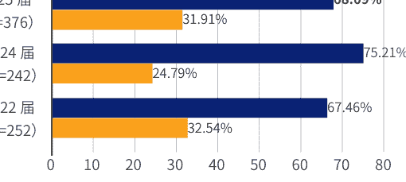

图表 2：公司是否针对 2025 届毕业生，开展校园招聘？

| 企业员工数 | A. 会开展校园招聘 | B. 不会开展校园招聘 |
| :--- | :--- | :--- |
| A. 99 人及以下 (N=70) | 40.00% | 60.00% |
| B. 100 到 499 人 (N=86) | 50.00% | 50.00% |
| C. 500 人到 999 人 (N=54) | 64.81% | 35.19% |
| D. 1,000 人到 2,499 人 (N=58) | 68.97% | 31.03% |
| E. 2,500 人到 4,999 人 (N=23) | 65.21% | 34.79% |
| F. 5,000 人及以上 (N=85) | 82.35% | 17.65% |

## 数据洞察

- 68.09% 的企业选择开展 2025 届校园招聘，相比 2024 届，开展情况略有下降。
- 从企业规模上也可以发现，规模企业对于校招更为积极，中小企业则为谨慎（图表 2）。

# 2025 Campus Recruitment Research Report:
## Understanding Target Talent & Strengthening Hiring Strategies

## 校招定位

图表 3:以下何种描述更加符合贵公司对于当前校招的定位？(N=256)

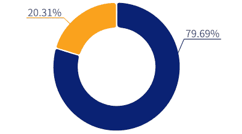

- A. 以满足招募人才的人质为主，即：及时校招计划人数无法满足，也希望人才宁缺毋优。
- B. 以满足招募数量为主，即：完成校招计划人数。

## 数据洞察

- “宁缺毋优”是 2025 届校招主基调。
> 超过 7 成的企业表示，“质量为先”是当前校招的基本策略与定位。这体现了在经济下行时期，招聘团队与用人部门对人才质量的严格把握，以及通过精细化策略来实现人才结构优化的考量。

## 开展时间

图表 4：公司 2025 届校园招聘的开展时间如何？

| 选项 | 2025 届 (N=256) | 2024 届 (N=182) | 2022 届 (N=170) |
| :--- | :--- | :--- | :--- |
| A. 秋季招聘与春季招聘均开展，但更为看春季招聘 | 53.91% | 72.53% | 47.65% |
| B. 秋季招聘与春季招聘均开展，但更为看秋季招聘 | 30.47% | - | 19.41% |
| C. 开展秋季校园招聘 | 7.81% | 16.48% | 5.88% |
| D. 开展春季校园招聘 | 7.81% | 10.99% | - |
| E. 不清楚 | - | - | 27.06% |

## 数据洞察

- 开展时间：
- 和 2024 届、2022 届校招相比，84.38% 选择春秋两季招聘（较往上升 10%），其中秋招的主导地位一步强化（53.91%的开展两季招聘的企业更重视秋季校园招聘）。可见企业整体对于扩量化人才储备存在更高的需求，校招开展情况较为积极。

## 解决25届校园招聘新密码：
## 夯目标人群，强化招聘策略

## 目标人群

图表 5：针对25届校招，贵公司是否会招届生？(N=256)

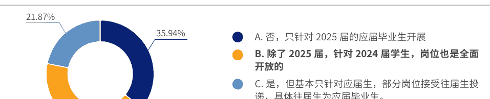

- A. 否，仅针对25届的应届毕业生。
- B. 除了2023届，针对24届，岗位也是全面开放的。
- C. 是，基本有一定的工作经验或能力，更容易融入工作环境中。

## 图表 6：企业选择扩大范围，将往届生纳入校招的原因？

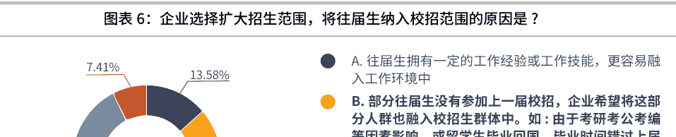

- A. 往届生有一定的工作经验或能力，更容易融入工作。
- B. 部分往届生没有参加过校招，由于考研、实习等因素影响。
- C. 往届生可能有更为明确的职业规划，所以稳定性较高，长期来看。
- D. 其他。

## 数据洞察

- 多数企业放宽了届生的定义，往届生也可参与校招。
- 这主要是由于两个因素：
- 因考研、实习时间差异而错过校招的群体。
- 往届生职业规划更为明确，从长期来看，有助于降低招聘成本。

# 2025 Campus Recruitment Research Report:
## Understanding Target Talent & Strengthening Hiring Strategies

## 企业校园招需求量与用人需求

### 发现

用人需求呈现“规模稳定，幅度提升”的特征。规模稳定主要与业务拓展有关；幅度提升主要体现在硬性要求上（如：专业适配程度要求更高、希望学生有科研成果或相关经验等）。

## 图表 7：贵公司 2025 届校园招的总需求量是？

| 2025 届 (N=256) | 2024 届 (N=182) |
| :--- | :--- | :--- |
| A. 减少 | 25.00% | 58.59% |
| B. 基本不变 | 41.76% | 28.57% |
| C. 增加 | 16.41% | 29.67% |

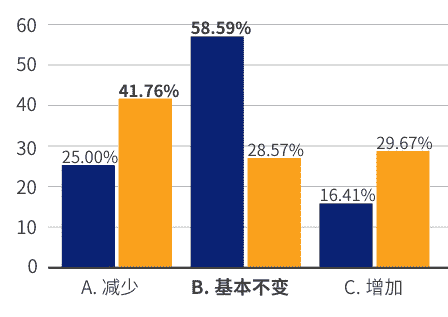

## 图表 8：贵公司所招的是否为规模性？(N=256)

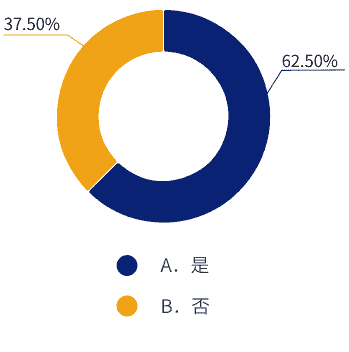

## 图表 9：贵公司目前保有需求量或需求量上涨的原因是？(N=192)

| | |
| :--- | :--- |
| A. 原有业务扩张、增长 | 15.63% |
| B. 新业务创新与开发，需要与原有业务不同的人才 | 46.88% |
| C. 贵企业存在人员组织优化现象，但还需要大量年轻人才的补充 | 70.31% |
| D. 其他 | 10.16% |

## 图表 10：对比 2024 届学生，贵公司针对留学生所开展的校招，是否存在对于学生提升要求的情况？

| | |
| :--- | :--- |
| 2025 届 (N=256) | 66.41% (33.59%) |
| 2024 届 (N=140) | 47.14% (52.86%) |

## 解决2024年校内招生圈新策略
## 对齐目标人群，强化招生策略

图 12：针对需要提升的情况，你认为下列更符合描述？(N=170)

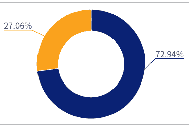

- A. 企业主动提升。对于业务需求，企业主动地调整了用人需求，设立了更高的能力要求和人才标准。
- B. 企业被动提升。对于学生的能力要求和标准没有变化，但是由于简历质量提升，所以企业水准高于标准，实现采取选用。

图表 12：对比2024届校招，贵公司针对2025届招生开放的岗位，在哪些方面对学生更优？

| 选项 | 2025届 (N=170) | 2024届 (N=66) | 差值 |
| :--- | :--- | :--- | :--- |
| C. 专项对口 | 70.00% | 60.61% | 9.39% |
| B. 院级层次 | 65.00% | 71.21% | -6.21% |
| A. 学术要求 | 64.17% | 62.12% | 2.05% |
| F. 沟通能力、批判性思维、创新能力等 | 62.50% | 87.88% | -25.38% |
| D. 岗位相关经历 | 55.00% | 43.94% | 11.06% |
| C. 文化价值 | 47.50% | 54.55% | -7.05% |
| E. 科研成果或经历 | 42.50% | 22.73% | 19.77% |
| 其他 | 2.50% | 10.42% | -7.92% |

校招将保持需求维持，这主要与组织优化后的需求相关。

# 2025 Campus Recruitment Research Report:
## Understanding Target Talent & Strengthening Strategies

## 图表13: 对比，贵公司目前对于校招生学生的学历要求为？

| 2025 届 (N=256) | 2024 届 (N=124) |
| :--- | :--- |
| A. 博士 | 30.08% |
| B. 硕士 | 80.08% | 73.39% |
| C. 本科 | 76.56% | 83.06% |
| D. 大专 | 8.20% | 23.39% |
| E. 高中 | 0.00% | 0.81% |
| F. 高职 | 1.56% | 3.23% |

## 图表14: 对比，贵公司2025届招生背景和学历方面的调整为？(N=170)

- A. 高中/高专→大专
- B. 大专→普通本科
- C. 本科→硕士
- D. 硕士→博士
- E. 普通本科→985、211、双一流高校

| | |
| :--- | :--- |
| A | 2.94% |
| B | 6.47% |
| C | 41.76% |
| D | 22.35% |
| E | 48.24% |

## 图表15: 贵公司2025届招生主要的目标院校为？(N=256)

- A. 985院校
- B. 211院校
- C. 双一流院校
- D. 普通本院校
- E. 二本院校
- F. 三本院校
- G. 大专专院校
- H. 高职院校
- I. 其他

| | |
| :--- | :--- |
| A | 64.84% |
| B | 75.00% |
| C | 71.48% |
| D | 43.36% |
| E | 16.80% |
| F | 3.52% |
| G | 13.28% |
| H | 6.64% |
| I | 5.08% |

# 解密2025校园招聘密码：
## 洞察目标群，强化招聘策略

博士占比超过本科群体，为当前校招主要群体，这与当前“学历通胀”这一现象密切相关。

- 80.08% 的企业招聘对象是硕士群体，这占比超过本科，其中41.76% 的企业针对2025届学生的要求从硕士提升到博士。
- 另一方面，毕业生人数稳步增长，48.39% 的企业针对2025届学生提升了要求。
- 数据显示，目前主要的校招岗位是：技术类 (71.88%)、研发类 (61.72%) 需求增大。

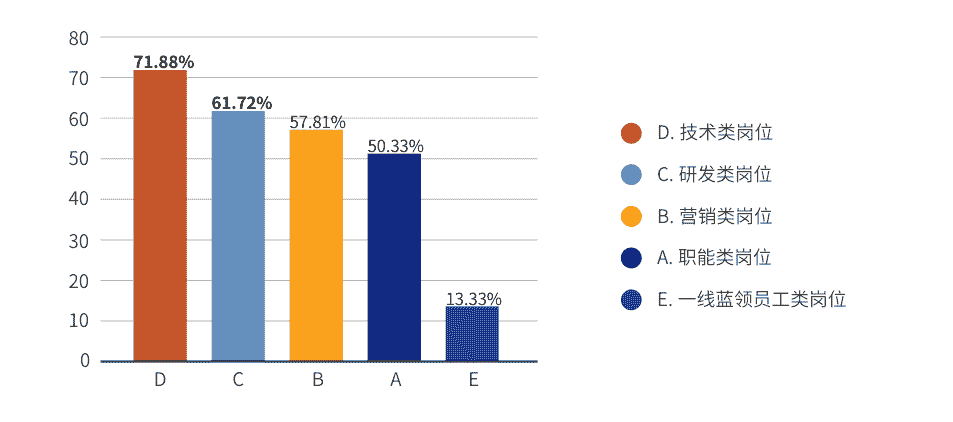

# 2025 Campus Recruitment Research Report:
## Understanding Target Talent & Strengthening Strategies

## 学生意愿

### 发现

学生意愿呈现三大趋势：
- 1. 多数学生更愿意进入职场；
- 2. 不愿意进入职场的意愿不减；
- 3. 毕业后意愿增强。

图 17: 您的观感，学生意愿如何？(N=256)

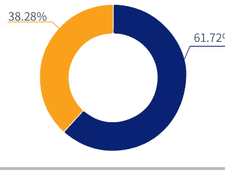

- A. 学生更愿意进入职场
- B. 学生不愿意进入职场，意愿不如预期

图表 18: 对不同毕业年份，学生的意愿度：

| | 2021 年 (N=30) | 2022 年 (N=716) | 2023 年 (N=57) |
| :--- | :--- | :--- | :--- |
| A. 继续读书（考研、考博等） | 53.33% | 47.07% | 52.63% |
| B. 进入公司就业 | 53.33% | 73.18% | 31.58% |
| C. 留在校，成为导师或大学老师 | 16.67% | 12.57% | 49.12% |
| D. 为公务员或考公 | 20.00% | 32.26% | 42.11% |
| E. 自由职业者 | 20.00% | 15.50% | 5.26% |
| F. 自创业 | 16.67% | 13.27% | 1.75% |
| G. 继承家，从父母已有事业 | 3.33% | 2.51% | 3.51% |
| H. 懒就业：毕业后就不打算就业也不挣 | 6.67% | 8.94% | 5.26% |
| I. 继续深造，慢慢考虑以后道路 | 13.33% | 2.09% | 0.00% |
| J. 间隔年 (Gap Year) | 16.67% | 6.28% | 10.53% |
| K. 从从事兼职，做“斜杠青年” | 16.67% | 8.66% | 7.02% |
| L. 无计划，还没想好 | 3.33% | 0.84% | 0.00% |

> 1. 数据来源于《2022中国企业招聘及实习生实践调研

# 🎯2025 校园招聘密码：
## 洞悉目标群体，强化招聘策略

图表 19:对当前阶段不希望入职的学生而言，他们大多数人的选择方向是哪？(N=98)

图表 20:您的观察而言，和去年相比，学生回家的情况如何？(N=256)

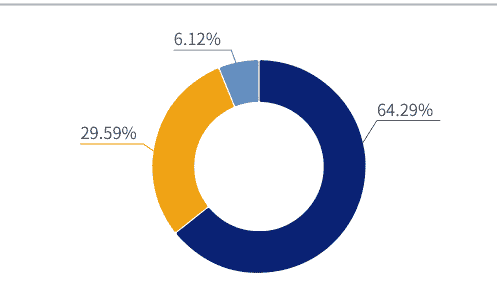

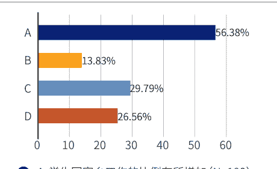

- A. 学生回家的次数的比例有所增加 (N=188)
- B. 学生回家的次数的比例有所减少 (N=256)
- C. 无计划，还没想好
- D. 持续深造，考研、考博

# 2025 Campus Recruitment Research Report:
Target Talent & Strengthening Hiring Strategies

回家工作，成为许多学生在经济下行期的选择。

- 观察，许多学生表示回家工作的比例有所增加。
相比于一线城市，家地区的生活通常更好，包括房租、日常消费等，使得毕业的学生在经济下行时期能够维持更高的生活质量。
同时，地方人才吸引政策与经济发展，也推动了学生更多就业。

## 校招成效

### 发现四（注：原文为“发现四”，推测可能为“发现四”）
从招聘规模来看，企业能够通过秋招完成大部分的校招，但春招仍然是必要的补充渠道。

## 图表21: 就秋季秋招而言，校园校招的完成情况如何？(N=236)

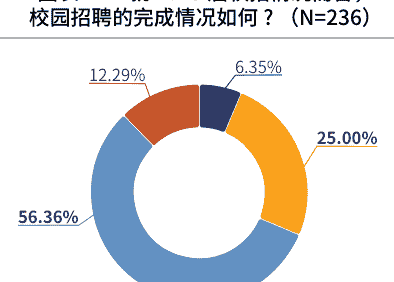

- A. 已完成秋校招计划，并不会开展春招
- B. 已完成秋季校招计划，但春季招聘将继续独立计划进行
- C. 暂未完成，需要通过秋招进一步补招
- D. 暂未完成，但不计划开展春招进行补招

## 图表22: 贵公司 2025 春季校招招聘的需求量或缺口情况？(N=212)

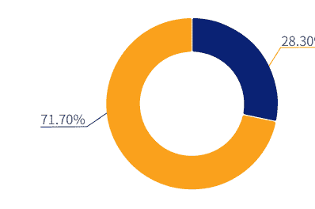

- A. 依旧存在较大缺口，约占全市校招计划的 %
- B. 缺口不大，约占全市校招计划的 %

## 数据洞察

- 在开展秋招的企业中，超过 8成(56.3%+25%)的企业需要进一步开展春招以满足校招需求。

- 绝大多数企业(71.70%)的春招缺口不大。平均在2周左右。存在较大缺口的企业为3成，缺口占全年度的5-6%。由此数据可见，秋招为校招主要渠道，承担了满足需求、储备人才的作用。

## 解锁 2025 校园招聘新密码：
🎯 洞察人群，强化招聘策略

## 发现五

在校招的开展过程中，企业会进行阶段性复盘，并结合复盘情况与业务需求变化，实现春招策略的动态调整。

表 23：在春招开始前，贵公司是否和用人部门讨论，结合当下业务发展需求和秋招情况复盘，再次收集、确认春招规划？（N=212)

| 选项 | 内容 |
| :--- | :--- |
| 是 | 会再次讨论和确定需求，优化、调整春招规划 |
| 否 | 仍然以前已规划的校招为准，不会再结合当下业务情况进行复盘，但确实有记录和调整的空间 |
| 否 | 仍然以前已规划的校招为准，不会再结合当下业务情况进行复盘，但需求变化并不不大 | 

表 24：在复盘过程中，招聘团队和用人部门复盘哪些内容？（N=185)

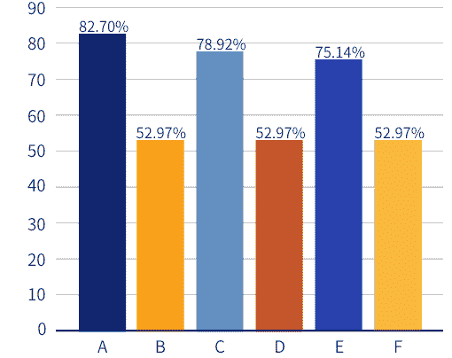

- A. 用人部门业务及绩效情况
- B. 秋招计划完成情况
- C. 春招人员质量（所招聘的人员画像和设定的人员画像的一致性、面试表现……)
- D. 画像是否存在偏差
- E. 岗位口是否存在变化（如：业务表现不符人员需求减少；或人员流转产生了新的岗位需求）
- F. 部门是否需要开展春招以及春招具体需求（按照秋招规划，该部门的校招指标未完成）

## 数据洞察

● 绝大部分企业会对之前已规划的春招计划进行调整。

- 绝大多数公司（87.26%）的公司在春招开始前和用人部门进行讨论，结合当下业务发展需求和秋招情况复盘，再次收集、确认需求，调整春招规划。这表明在当前的招聘环境下，大部分企业意识到根据实际业务变化和往秋招聘经验来，灵活调整策略的重要性，以确保招聘到的人才符合企业的需求。

# 2025 Campus Recruitment Research Report:
Understanding Talent Strength & Strengthening Hiring Strategies

在与用人部门进行复盘的同时，HR 团队也基于招聘流程和招聘期间进行自我复盘，并确定过程中是否存在可优化改进的细节。
您可以通过如下案例来解，校招团队与用人部门的复盘以及简历复盘具体如何开展。

## 企业案例节选

### 华友铁业

在招募开始前，华友铁业与每个产业集团负责人及用人部门再次开展复盘以确定招募具体需求，将招募规划予以调整。调整主要涉及招募两个方面：人才画像调整、招募需求对齐。

### 招募规划

招募需求复盘通常在2月开展。由于公司在每年1月招聘节召开开启年度工作会议，明确明年的整体框架，所以各业务单位在确定目标后，可以对人才需求进行再次更新。基于此一更新，招募团队与各部门再次进行沟通复盘。

其中包括：各部门负责复盘情况：如见到人数、留存情况以及涉及部门的解约情况；年度招募预算和人力成本。通过这些因素评估招募规划、校园部分的具体需求，从而形成最终的招聘计划。各部门负责复盘情况：如见到人数、留存情况以及涉及部门的解约情况。

### 人才画像

在校招开始前，校招团队与各个产业集团进行人才对齐。产业集团负责人会基于整体目标，从团队角度明确人才的需求，并在校招开始前，校招团队再次与产业集团负责人进行回盘。其中包括：1. 了解人才的质量：招募的人才与人才画像是否一致；业务发展是否可以需求；是否需要调整。

### 运营

在校招结束后，团队对招聘流程进行了数据复盘，包括各环节转化率、时间周期等。在此复盘的核心是进一步优化流程，提升整体效率。具体而言：1. 流程规范。团队将进一步制定制度，例如规定各环节的处理，要求各部门按时完成。同时依托已上线的招聘系统，团队也执行了环节监测，确保按时完成。2. 需求确认方面我们将与用人部门再次评估，包括岗位需求、人才标准等。

# 解锁 2025 校园招聘新密码
🎯 洞察人群，强化招聘策略

## 2025届招招结果

### 六观
毕业生求职意愿增强的趋势，同样体现在接受情况上。针对offer，候选人在决策时呈现谨慎观望的态度，但在接受后，总体而言稳定。

图表25: 就观察而言，学生今年的offer如何？(N=256)

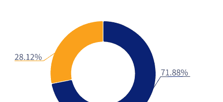

图表26: offer实际接受情况（N=256）

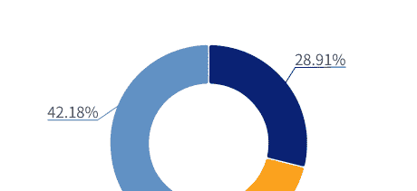

- A. 谨慎观望型：多方考虑，谨慎决策
- B. 快速决策型：缩短周期，快速决策

- A. 优于以往
- B. 不如以往
- C. 和以往一致

图表27: offer违约情况(N=256)

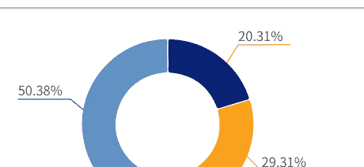

图表28: 由学生倾向较为谨慎，您认为企业是否有必要缩短考虑周期和决策周期(N=212)

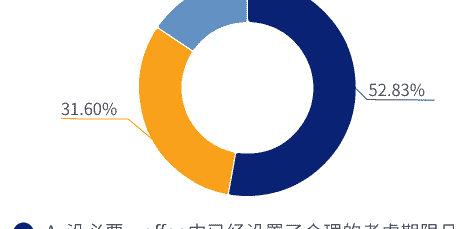

- A. 比以往更严重：更多学生选择违约
- B. 不如以往严重：少学生选择违约
- C. 和以往一致

- A. 没有必要。offer中已经设置了合理的期限且招生逐步入职，需要更多考虑
- B. 有必要。企业需要落实相关措施以缩短决策周期，但不确定具体如何落实。
- C. 有必要。企业已落实相关措施以缩短决策周期。

# 2025 Campus Recruitment Report:
Understanding Talent & Strengthening Strategies

## 数据洞察

图表28：针对2025秋招学生团体面试情况，收到的业务团队反馈后，业务团队对学生的满意度和反馈如何？（N=256）

图表30：你认为存在能力差异的原因是？

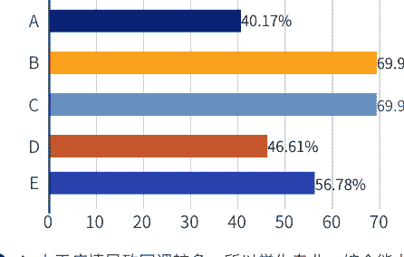

- A. 学生实际能力与简历中所展现的能力存在差异。
- B. 学生实际能力与简历中所展现的一一相符。

- A. 由于疫情导致网络繁忙，学生专业、实习能力可能不足
- B. 理论与实践脱节，缺乏必要的社会实践，导致学生毕业后难以应对企业中的实际工作需求
- C. 学生职业规划不清晰，对于就业和市场缺乏必要的认知
- D. 大环境影响下，学生倾向于平庸或内在动力不足，无法胜任工作
- E. 新学生十分重视投入产出，将会付出的努力、精力与收入水平进行对比，并不愿意承担团队的内容。

- 6 个学生表示学生实际表现与简历中所展现的存在落差
- 从学生所选择的原因以及实际反馈可知，缺少社会竞争、实习经历对于对就业必要的认知是主要原因

# 解锁 2025 校园招募新密码：
洞悉目标人群，强化招聘策略

## 2025 校园招募企业渠道布局分析

## 前置校招：校企合作

### 发现八
企业当前校企合作整体维持稳定。不再开展校企合作受限于预算和效果层面因素。大多数企业仍持续开展校企合作项目，但在实施过程中普遍面临项目未达到预期的实现瓶颈。提升效率，企业采取差异化的路径：

- 开展更深化的项目，业务连接以及赋能
- 聚焦多元化培养，以批量化人才为核心

图表31：贵公司前置是否开展校企合作？

| 年度 | 2025(N=256) | 2024(N=182) | 2022(N=124) |
| :--- | :--- | :--- | :--- |
| 是，一直在开展校企合作 | 74.22% | 76.92% | 49.19% |
| 否，但是曾经开展 | 16.41% | 23.08% | 16% |
| 否，从未开展 | 9.37% | / | 8.07% |

图表32：贵公司曾经开展，但现在不再开展的原因是？

| 选项 | 2025(N=42) | 2022(N=25) |
| :--- | :--- | :--- |
| A. 校企效果不及预期，投入产出不成 | 45.24% | 48.00% |
| B. 没有足够的预算，继续开展 | 54.76% | 16.00% |
| C. 校企和人才培养的目标不同 | 33.33% | / |
| D. 难以保持深度合作 | 45.24% | / |
| E. 新一代想法，难以建立长期的关系 | 45.24% | / |

图表33：若贵公司当前在开展校企合作，其效果如何？(N=190)

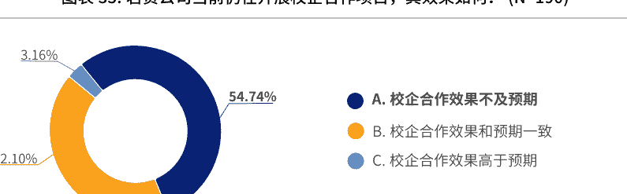

- A. 校企效果不及预期
- B. 校企效果和预期一致
- C. 校企效果高于预期

图表34:相比过去，贵公司近年来在校企合作上的投入如何？

| 选项 | 2025级(N=190) | 2022级(N=61) |
| :--- | :--- | :--- |
| 投入有所减少 | 18.42% | 58.42% |
| 每年无大变化 | 6.56% | 45.90% |
| 投入持续增加 | 21.05% | 24.26% |
| 不清楚 | 2.11% | 3.28% |

**校企合作整体较高。**预期与效果问题是限制企业开展的主要因素。同时满意度问题也在影响企业对于校企项目的投入与态度。

- 提前规划接触者，74.22%的企业已在开展校企项目，整体开展情况和去年一致。
- 预期问题是企业不愿再开展校企合作的主要原因；以及仍在开展校企的企业，他们并非十分满意，超过半数的企业表示当前校企合作无法达到预期。
- 我们这一报告显示：
* 企业深知校企合作以及高校保持深层次关系的必要性，即使效果不如，企业依然保持了项目的运行。
* 校企合作当前存在问题，且往往依靠企业一方方法无法解决其背后反映出的社会变化，如：新时代学生面临多样不断变化，企业与大学生的粘性难以保持；校企和人才培养目标不一致，导致课程设置和企业实际操作存在差异。
- 投入情况：更为愿意投入。58.42%的企业在校企合作上投入保持稳定，但相较于往年持续增加的投入情况，企业表现出更为愿意投入的态度。

> 数据表明，尽量鼓励企业在开展校企合作，但整体满意度偏低，主要症结在前期投入高而后期人才效果未达预期。企业难以独自应对学生心态和环境的变化，但仍可以从自身教学调整，现有的资源增加投入，提升校企项目的有效性。

那么，企业具体能争取哪些信息？如何开展校企合作的，又是如何优化落地策略的？

## 解码2025 校园招聘新密码
洞悉目标人群，精准化招策略

图表35: 贵公司更倾向于以下校企合作方向？

| 年份 | 比例 |
| :--- | :--- |
| 2025 届 (N=190) | 75.26% / 24.74% |
| 2024 届 (N=61) | 72.13% / 27.87% |

图表36: 贵公司目前所开展的校企合作形式为？(N=190)

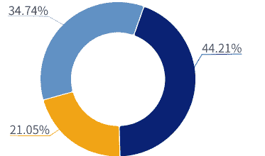

- A. 只开展实习计划
- B. 开展实习以外的其他校企合作
- C. 上述均有

图表37: 除实习计划外，贵公司目前开展的校企合作形式包括？(N=106)

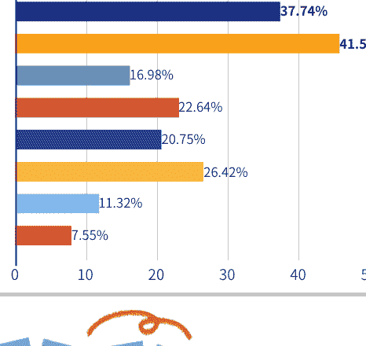

- A. 产研经费，如实验室赞助，共同开展项目
- B. 定向培养
- C. 竞赛、奖学金等互动
- D. 定向培养
- E. 在校内开设和企业相关的课程
- F. 工程师/专家到校、开展相关讲座
- G. 夏季营、冬季营
- H. 其他

## 数据洞察

在现有投入上，追求校企合作深度，实现批量化人才供给、技术研发与业务发展为当前校企合作主要方向。

# 2025 Campus Recruitment Report:
Understanding Talent & Strengthening Hiring Strategies

- **发展方向：** 75.26%的企业选择持续保持校企合作，实现人才输送为主
- **合作形式：** 78.95% (44.21%+34.74%)的企业在开展实习计划，以人才输送为主。此主流合作模式。在此基础上，定向项目(1.5%)与产学研合作(27.74%)为企业开展的其他校企合作。这两项项目的核心均在职业能力的基础上，提前引入人才，为人才转化铺路。与此同时，开展较少的企业，奖学金(16.98%)与冬季营活动(13.32%)通过与学生的沟通，了解到校企合作关系的培养，助力企业快速建立信任，目前企业在校企合作需求方面的整体尚佳。而冬季营的成本较高，需要协调的环节多，开展较高。

## 图表38：公司开展校企合作从何时开始？

|  | 2025级 | 2024级 |
| :--- | :--- | :--- |
| A. 大一 | 8.00% | 11.05% |
| B. 大二 | 11.05% | 24.00% |
| C. 大三 | 62.11% | 50.00% |
| D. 研究一、研二（根据学术型、实践型招生前一年） | | 46.84% |
| E. 不清楚 | | 8.95% |

> “大三”为企业校企合作的主流时间节点，且趋势持续强化，反映出企业日益紧迫、灵活的开展策略。

- 62.11%的选择从大三开始受到影响，相对于企业从大二、大三阶段开始“渗透”，而言更为“后置”。这一转变反映出企业需要更多的人才——面对学生选择多元化的现状，企业发现开展校企合作的投入产出比不佳，选择在更接近毕业季的时间节点进行。

数据显示，企业当前对校企合作的开展更为谨慎。无论是启动时间还是开展形式，企业都为了更好。不同于开始阶段的广泛覆盖，企业注重筛选适配程度的院校，开展深化的产学研合作，部分企业选择开展直接的实习计划，通过建立实习基地等模式化人才转化机制，提升输送效率与质量。想了解企业校企合作为何以及实训基地（实习计划）具体如何实现，您可以参考下方案例。

# 2025校园招聘密码：目标人群，强化招聘策略

## 案例提要

| 企业名称 | 主要内容 |
| --- | --- |
| 发科 | 校企合作方向变化：由广（广泛开展合作）及深（产学研，在赋能业务的同时，聚焦实现人才转化） |
| 同程 | 开展形式与开展时间：实习计划：以项目为目的的开展实习计划。项目结束后，如学生意愿加入同程，可以在校招时直接转正。在与校方的合作过程中，通过协助方进行管理，进一步加强与学校的合作，同时企业、高校、学生，三方均从中受益 |

## 企业案例节选

### 发科

自2018年起，发科积累了丰富的校企合作。随着与校企合作关系的强化，校园招聘人才市场的动态变化，校企合作项目在持续发展。

初期，为培养B2B领域复合型人才，发科在学生群体中的知名度和影响力日益增强。初期计划设立了人才画像和需求标准，以直达目标院校的重点院校，深入学生群体，开展相关课题调研，以及与优秀企业进行校企交流，泛开展校企认知。通过连续多年在目标高校开展推讲活动和互动，公司深度建立并加强了与院校及专业师生之间的联系，并逐步建立了良好的品牌形象。

# 2025 Campus Recruitment Research Report:
Understanding Target Talent & Strengthening Hiring Strategies

# 校招进行时：企业校招渠道布局

## 发现九

校招渠道策略采取“线下精准体+线上全域覆盖”组合模式。线下以重交互的宣讲会为核心，线上则通过招聘网站、社交媒体矩阵等渠道提升覆盖面。

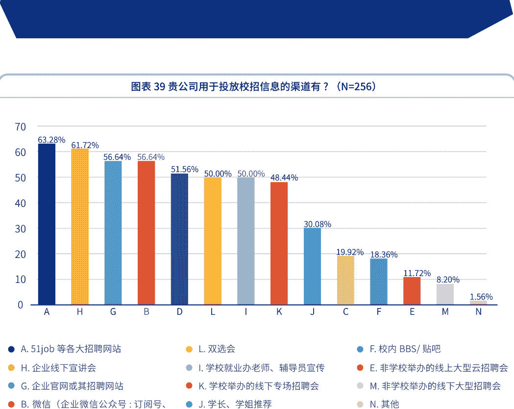

- A. 51job等大招招聘网站
- H. 线下宣讲会
- G. 企业官网或其招聘网站
- B. 微信（企业微信公众号：订阅、服务号、小程序、私域微信群）
- D. 企业空中宣讲会
- L. 双选会
- I. 学校就业老师、辅导员
- K. 学校举办的线下专场招聘会
- C. 微信外的社交媒体渠道（如：微博、小红书、哔哩哩、快手、抖音等……）
- F. 校内 BBS/贴吧
- E. 非学校举办的大型线上云招聘会
- M. 非学校举办的线下大型型招聘会
- N. 其他

# 解锁 2025 校园招聘新密码

## 准目标客群，强化目标聚焦策略

图表 40 针对公司已使用的线下校招渠道，请根据目前的转化效果，从高到低进行排序。
(N=256)
单位：综合得分 4

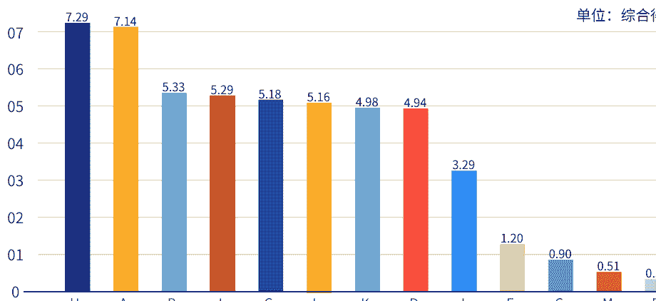

- H. 企业线下宣讲会
- A. 51job等大招聘网站
- B. 微信（企业公众号：订阅、服务、小程序、微信私域）
- I. 学校就业老师、辅导员宣传
- G. 企业官网或其招聘网站
- L. 双选会
- K. 学校举办的线下专场招聘
- D. 企业空中宣讲会
- J. 学长、学姐传承
- F. 校内 BBS/贴吧
- C. 微信以外的社交媒体渠道（如：微博、小红书、得理、快手、抖音等……)
- M. 非学校举办的大型招聘会
- E. 非学校举办的大型云招聘会

## 数据洞察

企业资源投入与渠道转化情况，基本一致，其中线下宣讲会的转化效果最佳。

- TOPS 使用渠道：大招聘网站、企业线下宣讲、官网、微信、空宣
- TOPS 转化率：企业线下宣讲、招聘网站、微信、活跃老师&辅导员
- 各大招聘网站都是学生首选的校招信息获取渠道。这一方面符合学生获取信息的简易偏好，另一方面也有企业活跃招聘的优势，而且正比其他渠道具有更高的活跃度，整体转化效果极佳。
- 线下宣讲是转化效果最好的渠道，因为只有面对面的互动，企业能让学生充分理解，从而影响学生。
- 官网转化效果一般，但由于互动量有限，在与学生互动时，主要暴露出两个问题：1) 学生很多时候需要咨询官网以得知自己的招聘渠道；2) 企业官网作为后期后续整合与实施的重要渠道。
- 从转化情况来看，我们认为大招聘网站是最重要的线上渠道。它承担着品牌传播的作用，也兼顾了招聘渠道的功能。
- 另一个常用的渠道是空宣。结合转化情况与企业反馈来说，空宣对企业渠道矩阵布局者来说是一个重要的环节，也起到了信息和广的作用

42 招聘渠道选择综合得分基于受访者对招聘渠道的排序。计算方法为：转化得分 =（系数 × 权重）/本期招聘人数

# 2025 Campus Recruitment Research Report: Understanding Target Talent & Strengthening Hiring Strategies

# 校招渠道之线下宣讲会

从上述渠道部数据可见，线下宣讲会是最有效的招聘渠道。
那么企业觉得就是如何让线下宣讲更为有效的呢？

## 发现十

为了贴合学生的喜欢，企业目前正准备以小而美定制化的宣会取代传统的大规模宣会，其中精准群体、内容引导、学生体验是核心关键。

| 图表41: 贵公司针对2025届校招的进活动，采用何种模式? | | |
|---|---|---|
| 2025届 (N=256) | 71.70% | 28.30% | |
| 2022届 (N=85) | 61.18% | 38.82% | |

| 图表42: 贵公司目前校园宣讲会的开展方向为: | | |
| 2025届 (N=256) | 40.63% | 59.37% | |
| 2022届 (N=85) | 54.12% | 45.88% | |

| 图表43: 贵公司宣讲会的精致化定制化具体体现是?(N=152) | | |
| A | 84.21% | | |
| B | 50.00% | | |
| C | 2.63% | | |

# 解锁2025 校园招聘新密码

## 目标客群，强化招生策略

图表44：以线下宣会形式，调研学生更感兴趣的：（N=393)

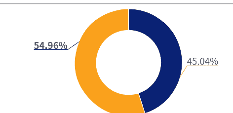

- A. 开展规模较大的宣会
- B. 开展小规模、精品化、沙龙化

## 数据运营

企业当前以小而精、定向的招生为主，开展形式更加贴合学生偏好。

- 71.7%的企业选择通过招生老师、专业老师或校友实现具聚焦和信息的投放。
- 59.37%的企业选择形式模式改变。小规模、精品化、沙龙式是目前多数企业的选择。
- 企业招生将持续到明年，虽然整体意向受到外部市场影响，仍不像之前，所以企业不需要再通过广播方式广泛地吸引。
- 贴近学生需求。学生对于线下宣会的预期为“深度内”与“强互动”。在信息高度发达现在，简单的企业和业务介绍可以轻松从网上获取，还难以引起学生注意。学生意意味着线下宣会，这种互动通过业务的感召力、影响力融入并沙龙有利于学生留下的印象。
- 对外与校内关联建立联系。通过专业老师、就业老师、校长等，助力他们实现意向和转化。

基于数据可见，小而精沙龙化的线下宣会是目前多数企业的选择。那么“小而精”具体体现在哪些环节上？您可以通过如下、企业等予以了解。

# 2025 Campus Recruitment Research Report: Understanding Target Talent & Strengthening Hiring Strategies

## 案例摘要

| 企业名称 | 校园宣会开展策略 | 校园宣会体会 |
| --- | --- | --- |
| 科技 | ● “精准小”：针对重点城市的特定特定院校和班级，开展小而美的宣会 ● “精准”：联动学长进行互动，加深学生信任 | |
| 海尔 | ● “精准”：增强与学生的互动，减少学生单方面输出 | ★ 增设导师引导，提升学生观念 ★ 增强游戏化氛围让学生更沉浸式地理解 |
| X 企业 | ● 范围小，落地形式多样化：针对重点院校开展精品宣会 | ★ 通过“华区负责制”，让成为属公司，针对重点高校进行简历收集和维护，为后续企业开展宣会打下基础。 ★ 通过各类活动，传递X企业的文化，吸引学生活力，并通过线上直播进一步扩大影响力和覆盖范围 |
| 九州 | ● “精准”：聚焦目标人群 | ★ 通过私域流量，进行针对性的信息投放，避免大量非人群的流量消耗，增加企业的筛选难度和人力投入 |
| 同程 | ● “精准”：基于真实的需求和意愿原因（即：无法从线上渠道获得的咨询），做出针对性的改进 | ★ 增加互动内容，提升学生参与度。 ★ 联动高管与业务团队跟学生与学姐产生互动。 ★ 邀请优质校友与学长学姐进行互动 |

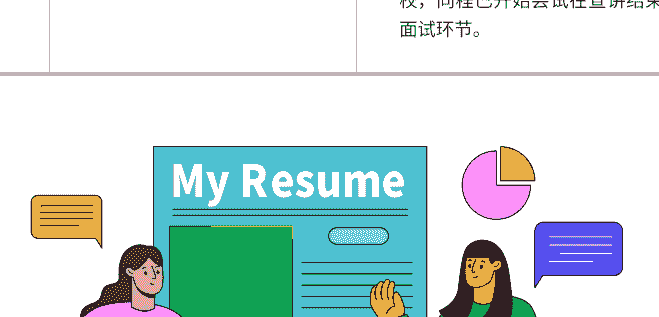

# 2025 校园招聘新密码：洞悉目标，强化招聘策略

## 科技

### 校园宣讲会：来访同学

聚焦性比传统一类在校园活动中得到更多。通过参与及与组织架构层级或特定专业的沙龙式宣会，以进一步聚焦目标培养系和学生群体。
北京的招聘价值更体现在通过灵活的招聘宣讲设计：针对专业匹配高的院校，采用“技术沙龙+访谈”模式，由简历策划对接业务和管理岗位信息化应用等行业进行前沿议题，同时邀请通过企业专业培养计划的学校负责人分享其成长经历。在城市高校，公司更新推介“线下办访谈会”，将届生调研感兴趣的问题反馈、展示、沉浸式数控与人文相结合的工作落实。对于已入职的员工在提升学校影响力和吸引学生到课堂方面具有效果，通常比企业直接更为有效，也成了招生策略的关键。

### 传统宣会：未来同学

一来，宣会是企业招聘过程中不可或缺的渠道。通过传统宣会在获取人才和数量上比较局限。从今年开始，海尔打破了传统的宣会，不再局限于传统宣会，而是针对目标院校开展“来访同学”。传统宣会“介绍”模式更多单方面输出，而“来访同学”则强调与学生之间一对一的互动，现场设置了简历、问答等环节，帮助学生理解岗位的同时，让学生进入进阶。学生参加招聘的主要目的是希望面试机会。以2025年为例，可以在宣会结束后直接面试。

## 线下宣会：校园宣会

- 优化互动，企业每年举办至少五场宣会。为实现目标，企业通过“区域负责制”，企业通过“区域负责制”（见下部门按区域及各专业）建立紧密的联系。而且由于全年的互动，宣会会争取校方的支持。
- 线下宣会，九州特别关注回访，企业希望通过这一方式全面展现招聘项目和理念。
- 宣传推广：聚焦触达。通过目标对象的精准聚焦避免非目标人群，降低企业的筛选成本和效率。

## 2025 Campus Recruitment Report: Understanding Talent & Strengthening Hiring Strategies

## 宣会

例如，X企业在西安交通大学、哈尔理工大学和浙江大学等开展的活动取得了显著成果：质量基本提升了30%—50%的增长。为实现资源的有效利用，宣会会有两种形式：精品宣会与面对会。其中，精品宣会主要针对简历，X企业采用路形式，如各类、线上宣会、直播进一步提升影响力和覆盖范围。

而对于内容，九州认为如何留住学生并活跃的互动在于解决学生的实际需求。虽然学生在在线宣会上可以快速获取信息，但学生如果没有参加宣会，背后还有许多核心关心的指标。对于适应灵活，我们需要关注学生的关注点，虽然他们已经积累了大部分信息。然而，在他们之前，他们一定会通过各种渠道连接着公司评价、多元化路径让学生和员工在公司内部进行文化渗透等。
因此，我们关注的关注点将招聘流程发生变化，让学生更早开始准备简历，也可以获取不同领域的需求。

## 面对

近年来，学生参加招聘的主要目的是获得面试机会。以2025年为例，已经可以在宣会结束后直接面试。这种模式在狮子和哈木大学这样的大型院校中十分有效。可能只需要携带两名技术背景的面试官，即可现场开展。如果宣会涵盖的各种需求，招聘就会很快准确准备应当带来不同方向的面试官。例如，如果某宣会吸引了大量产品经理的应聘者，那么企业带来了一次新的面试，那么其他的应聘者可能会感受到忽略或无法得到充分的交流。同时多名面试官表现并不好。所以组合宣会成本和校招规模，这种方式在综合类院校中可以实现。企业还需要结合自身和招聘情况，进一步探索。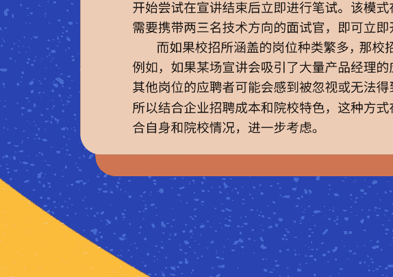

# 解密2025 校园招生新密码：洞悉目标群体，强化社交媒体矩阵

## 发现一—

微信因其功能通用性和高覆盖率，越发成为社交媒体矩阵的核心渠道。其他平台在学生中受青睐程度较高，但因其在精准匹配和人才转化方面有限，主要用于进行品牌宣传。

贵公司使用微信作为渠道的目的是？

### 图表45: 贵公司使用微信作为渠道的

- A. 主要用于品牌宣传：全面展示企业形象，吸引更多粉丝关注
- B. 主要作为简历投递和职位申请的渠道之一
- C. 以以上兼顾

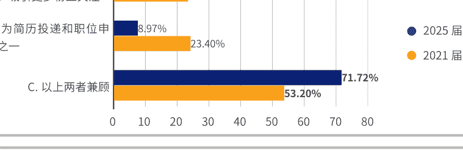

### 图表46: 贵公司具体部署了哪些以外的其他社交媒体渠道？(N=51)

- A. 小红书
- B. 哔哩哩
- C. 微博
- D. 抖音
- E. 脉脉
- F. 知乎
- G. 其他

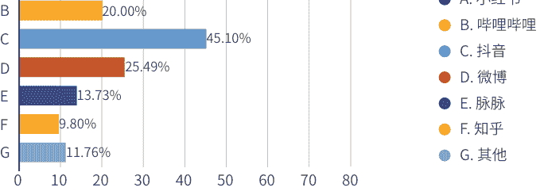

# 2025 Campus Talent Recruitment Report: Target Talent & Strengthening Hiring Strategies

## 线上渠道

在招聘方面，除了常规的线上渠道，如无忧、实习生等，今年，企业还增设了新媒体渠道。尤其是小红书，作为一个新的增长点，企业在年轻用户方面展现出了巨大的潜力。

在线上渠道，由于小红书作为今年新加入的渠道，虽然起步较晚，但已经占据了客户5%的简历来源。然而，小红书作为一个交流的平台，企业需要对人才进行互动，这在一定程度上增加了活跃度。同时，小红书的传播效果良好，也有助于企业提升品牌知名度。

通过平台运营，可以从小红书获取简历数据，也可以通过官方账号发布相关信息，让学生在官方账号中进行交流。在内容方面，小红书要面向招生学生，在形式上要年轻化和生活化，以引起今年年轻人的关注。

对于其他新媒体，无论是通过直播还是抖音，企业在之前都要做好准备。由于抖音等主要以视频内容为主，如果运营不当，可能会适得其反，更需要投入和专业团队的战斗。

## 传播频道

在招生部目前涵盖了微信、公众号、小红书、B站等多个媒体平台。企业采取多平台布局以及宣贯的策略，核心在于以下三个原则：

- 1. 建立企业形象
- 2. 渠道平台化
- 3. 真实性

在招生过程中，同时更要保持真实性，以真诚的态度对所有读者负责。对于我们，我们鼓励员工分享日常工作的真实场景，可能是项目的选题，也可能是团队活动的场景。原创内容往往比精心制作的素材更能打动人心。而且真实的方式更容易建立信任，对于年轻人来说十分受用。

## 新媒体招聘如何开展？

如果依靠 HR 部门的力量来做校招和品牌建设，企业会面临很大压力。HR招聘团队虽然可以负责招聘工作，但企业需要负责的内容创作和运营已经超出了 HR 部门的专业范围。

另一方面，企业也意识到这些工作对于提升效果的重要性。在这种情况下，招生组进行了一次有效的解决方案：通过建立跨部门协作，将企业内部的营销资源整合，在发挥企业专业优势的同时，避免了 HR 团队单兵独斗的局面。

- 具体来说，招生组成了一个由多个部门组成的虚拟团队，包括：
- 品牌、PR部门的策划和内容创作
- 设计部门的美术
- 业务部门的专业内容

## 解码2025 校园招新密码

- 洞悉目标人群，强化招聘策略

## AI 技术在校招场景中的应用

当前经济周期波动、经营环境不断变化，高校毕业生人数逐年增长，招聘市场供大于求已成趋势。海量简历导致企业筛选难度急剧上升，如何提升招聘效率，精准找到人才，已成为企业亟待解决的关键问题。

而与此同时，AI 技术在各领域蓬勃发展，其中也包含了人力资源领域的应用与发展迭代。在各人力资源领域中，在校招招聘场景的应用最为常见。为了提升招聘效率，许多企业也陆续开始尝试或计划引入 AI 工具。

## 发现现状

企业已经开始拓展 AI 在校招招聘场景中的应用，现阶段主要聚焦于简历解析与 AI 工具，旨在提升初筛效率并为面试提供灵活辅助。

表 49: 贵公司目前在校招开展的过程中引入了 AI 工具？(N=256)

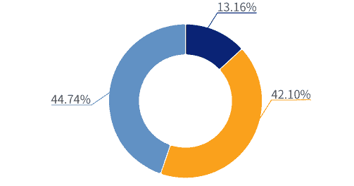

- A. 是，已引入
- B. 否，但计划引入
- C. 否，暂未无计划引入

表 50: 在校招招聘场景中，贵公司目前已引入了哪些 AI 工具？(N=34)

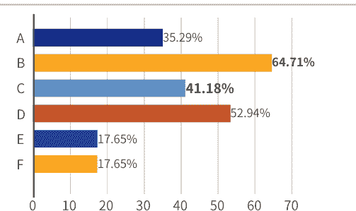

- A. 利用生成式 AI 进行文本生成（如：职位描述描写、面试反馈等）
- B. AI简历筛选与解析
- C. AI 面试
- D. AI招聘机器人（chatbot）
- E. AI候选人关系与维护
- F. AI 外呼机器人

## 2025 Campus Recruitment Report: Understanding Talent & Strengthening Hiring Strategies

## 数据洞

少数企业开始在招聘中引入 AI 技术，多数企业处于探索或计划阶段。已经在使用的企业中，“AI简历筛选’‘招聘机器人’‘AI面试工具’用生成式 AI 进行文本生成最为广泛。

- AI简历筛选：快速筛选人才，帮助团队节省人力
- AI招聘机器人：主要用于常见问题解答，由于其功能设计清晰，应用直观
- AI 面试：近年来，AI面试工具在时间、空间上的优势也显著
- 利用生成式 AI 进行文本生成应用于多个环节：涵盖简历生成、JD生成等。由于该工具尚不能独立，后续将发展。我们将‘AI简历筛选’与‘AI面试工具’两种工具开展，为企业的招聘提供参考。

## AI简历筛选

AI简历筛选的核心功能是简历合并以及筛选，帮助企业提升效率。虽然 AI简历筛选工具在客观性上取得一定进展，但仍然存在可能，部分企业仍通过人工校验等手段解决。

表 51：企业针对 AI简历筛选与解析实现的现状

| | 占比 |
| :--- | :--- |
| A | 54.55% |
| D | 45.45% |
| C | 27.27% |
| E | 18% |
| B | 9.09% |

- 进行简历处理与智能合并
- 基于简历内容，对候选人的软、硬技能进行初步预测
- 通过文本识别和语义理解，解读简历信息，形成简历标签与评分
- 分析候选人的工作经验，评估其职业发展和行业适应性，形成分析报告供参考
- 与学信网链接，验证简历人的院校、学位等信息的真实性

## 解码2025 校园招聘密码：洞察目标人群，强化招聘策略

表 52 贵公司是否关注 AI简历筛选与解析的误率？(N=22)

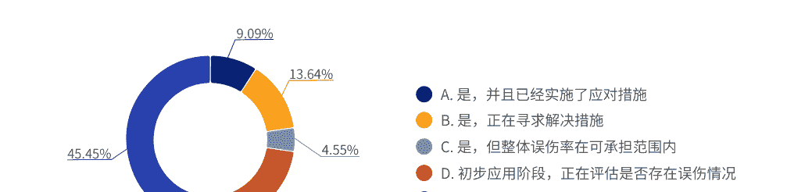

- A. 是，并且已经实施了应对措施
- B. 是，正在寻找解决路径
- C. 是，但整体误率在范围内
- D. 初步应用阶段，正在评估是否存在误率
- E. 否，暂时没有遇到误率

## 数据洞察

AI简历筛选工具主要用于简历处理合并并形成简历标签，提高初期筛选效率，并为面试官提供建议。

64.71% 开校招的企业已经开始使用 AI简历筛选工具，主要用于简历的处理和合并，并进行简历解析，针对能力进行初步筛选，为后期面试提供建议意见。部分企业已经意识到 AI简历解析工具存在可能，但是足以解决的尚少数。在已开启的企业中，27.28%(9.09%+13.64%+4.55%) 企业已经意识到 AI简历筛选工具存在问题。在这些企业中，绝大部分企业认为该问题需要被解决。

针对 AI简历筛选工具存在的问题，部分企业已经有了应对措施。例如，企业设置了人工校对，对简历筛选的结果进行抽查，并将结果反馈给供应商，进一步完善算法。同时同步算法采样，也可以针对另一种规避误率的策略：通过 AI简历解析工具，自动评估简历与用人标准的匹配，并生成量化评分。高分候选人将进入下一轮面试，低分候选人可能会淘汰，但面试顺序会相应延伸。同时，系统将一步给出面试指导建议和面试问题难度，帮助面试官更有针对地开展一轮面试。

## 2025 Campus Recruitment Report: Target Talent & Strengthening Hiring Strategies

## 案例节选：玛氏

## AI简历筛选在校中与人类差异

玛氏正在积极地在训练 AI简历筛选，但尚未被 AI 技术实现效率提升的赋能。

- AI简历筛选的模型训练：玛氏认为，具有足够的多样性对于 AI简历筛选的模型训练至关重要。模型准确性使得数据投喂具有良好的可行性，因此成为 AI简历筛选的应用场景。例如，玛氏在招聘时要求同质化程度，当有大量简历涌入时，它们为数据投喂和模型训练提供了丰富的素材，提高简历筛选的效率有助于招聘团队的工作效率。

- AI简历筛选的反馈如何优化：玛氏非常重视简历的反馈，为此采取了严格的校对流程；在校招期间，玛氏设置了人工校对，对机器筛选结果进行审核，确保结果的准确性。在此过程中，玛氏将简历反馈给供应商，进一步完善算法。

## 海尔

海尔在人才筛选方面，已开始使用 AI 工具，主要用于两个方面：

- 前期筛选
- 辅助面试（在面试过程中，AI面试进行引导）
- 后期筛选

通过 AI 工具，在面试过程中将简历分析结果形成矩阵，并与用人标准进行对比形成差异数据，通过差异分值进行筛选，优先考虑高分者，低分者的排序则相对接近。

- 辅助面试：在面试过程中，利用 AI 工具作为辅助，对不同特征进行全面的评价。我们认识，尽管 AI 在过程中具有辅助作用，但无法完全替代人类，面试官的经验判断非常重要。现阶段，AI 主要作为辅助工具，在简历上打标签并匹配需求。该案例来源于《AI in Recruiting - 智能招聘指南》。

## 解锁2025 校园招聘密码：洞悉目标人群，强化招聘策略

## AI面试工具

AI面试工具主要用于初步筛选或辅助后期决策。企业持续通过优化人才画像和更新面试问题来提升精准性。

表 53 贵公司如何将 AI面试结果作为参考或依据？(N=14)

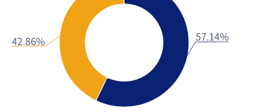

- A. 作为参考依据（该环节不会淘汰学生，作为后续面试的参考之一）
- B. 作为决策依据

表 54 贵公司如何将 AI面试结果作为信息？(N=6)

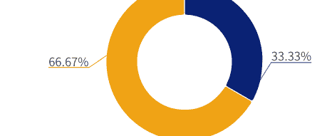

- A. 面试结果低于标准的将被直接拒绝，其余学生进入下一轮
- B. 根据面试结果，AI工具只推荐优的学生进入下一轮

## 数据洞察

对于使用 AI面试工具的企业来说，面试结果的使用与判断的能力密切相关。基于市场数据，目前企业使用 AI面试工具主要分为两类：

- 参考依据 (57.14%)：将 AI面试结果作为后续面试的参考，辅助面试。联系后我们可以发现，这主要是因为企业对于复杂能力或与企业特性相关的评估，工具的精准性仍有待验证。
- 决策依据 (42.86%)：作为决策依据，企业所挑选的能力可以用口语表达、语言能力等体现。这些能力与企业人员画像、特定语料匹配，标准相对客观，企业更倾向将其作为决策依据。

表 55 贵公司的 AI面试工具存在哪些方面的不足？

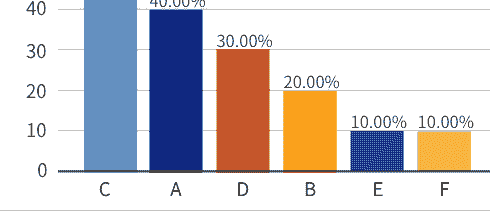

- C. 面试结果精准度与分析不足，效能有待提升
- D. 缺乏情感互动，选人体验不佳
- B. 存在面试结果呈现（如：简历、视频等）
- D. 面试环节受到市场控制，影响体验
- E. 难以避免目标偏差
- F. 其他

# 2025 Campus Recruitment Research Report: Understanding Target Talent & Strengthening Hiring Strategies

## 数据洞察

对于尚未尝试的企业，面试结果精准度不足缺乏互动影响体验是 AI面试主要的局限所在。

- 工具精准度与信效价值：对于该问题，可以达到一定程度的解决。与此同时，企业已有意开始协同供应商完成一项合同，如：调整人才画像输入到 AI 进行训练，并在使用过程中不收集数据，进行更新迭代。面试问题、考核方面并更新。
- 情感识别不到影响体验：在与企业的交流以及回访中，我们能够告知其所依赖的早期模型与供应商的技术迭代，所以此挑战不再淘汰。

AI面试精准度与信效价值的问题，可以参考 X面试与同样的案例予以参考。此外，部分企业对 AI面试作弊问题（排名第三，30%）有关关注，您可以参考方案，了解 AI 如何从技术与制度设计角度予以规避。

## 案例对比：面试流程变化

| 企业名称 | 面试流程变化 |
| :--- | :--- |
| X 企业 | * 引入 AI面试，取代原本无初面试环节。缩短整体面试周期 ** AI面试的信效价值与精准性问题如何解决 ** 底层改进。随着 OpenAI 等语言模型的发布，底层处理模型得到了理想。 ** 与供应商合作，共同开发人才画像，设计面试问题和考核，输入 AI 进行训练，并在过程中不断收集数据，进行迭代。 ** 如何解决AI面试作弊问题：技术层面识别防范。 ** 要求学生在AI面试前，使用手机扫描环境，确认是否有人协助。 ** 面试通过沟通表达能力以及回答逻辑。 |
| 同程 | * AI面试的信效价值与精准性问题如何解决：将结果作为参考。 ** 若表现优于基本合格线，推荐至下一步面试。 ** AI面试作弊问题：通过技术手段识别是否存在作弊风险。 ** 监控系统判断，当AI面试存在作弊风险时，AI面试通过视频进行判断。 |

## 解码2025 校园招聘密码：洞悉目标人群，强化招聘策略

## 案例节选：X企业

## 面试流程与改进

X企业的面试流程较大，包括六环节：测评（心理测评、认知测评）、无小组面试、专业面试、综合面试。鉴于招聘规模较大的情况，企业引入了 AI面试，主要用于替代无小组面试。流程相比之前缩短了环节，整体周期约 7-10 天。

## AI面试工具改进

AI面试的核心在于考察学生的积极性，企业将其放在前端环节。AI面试工具基于学生的回答分析，为下一步面试提供建议。目前，AI面试的理解能力一直是瓶颈。

从结果来看，中厂通过 AI工具面试了六千多名学生，学生体验和反馈较好，9 成以上的学生认为 AI面试能够很好地提问与进一步交流。

# 2025 Campus Recruitment Research Report: Understanding Target Talent & Strengthening Hiring Strategies

## AI面试作弊问题

- 目前，我们观察到多种作弊方式：
- 1) 学生在面试过程中截取答案，同步搜索或寻求帮助。
- 2) 协助，周围有第三人帮助学生一同回答。
- 技术领域上：
- 1) 设置防范机制
- 2) 要求学生在进行 AI面试前，使用手机扫描周围环境，以确认是否有人协助。

同时，目前在 AI面试环境下，企业以结构化面试为主，对于学生准备的简历相对有限，需要更灵活的反应、沟通能力以及回答的逻辑和严密性。同时对于作弊行为，企业一经发现将直接封号。

## AI面试

同程注意到，每年招招时存在的招聘需求，即招聘需满足，一旦就会会有大量简历中被忽视。为了更准确地找到与岗位匹配的学生，今年将 AI面试的覆盖范围进一步扩大，以期在更广的范围内挖掘优秀人才。

目前市场上，AI面试工具可能分为两类：参考型和发展型。同程倾向于将此类工具作为参考依据。因此，现阶段的 AI面试工具并不充分、准确，同程也会设定一个最低标准或绝对的合格线。只要选人的表现达到或超过这个标准，校招组就会推荐进行进一步的面试和交谈。同时，AI面试在现阶段存在一些缺陷，如能力有限（AI面试的通过通常为预设的问题，而无法根据选人的分析或实时进行回答调整）。但是对于校招，其基础判断功能已经足够满足需求，并可以帮助提升效率。

此外，同程也关注到了 AI面试作弊这一问题。目前AI面试的理解能力一直是瓶颈。由于只能理解和合理生成，对于这个问题，企业表示从两个方面：
1) 技术问题的改进
2) 供应商的改进，人才模型。

技术问题的改进：早期AI的能力还不存在，随着 OpenAI 等语言模型的出现，语义的理解与处理能力得到了显著提升，而且AI面试工具可以将学生的回答进行更好的理解与输出，灵活调度范围（2—6 天）。

供应商的改进：企业与供应商进行了密集合作。AI面试工具主要用于考察能力，另一方面经过多年发展已经积累了大量数据模型，企业与供应商建立了合作模型，设计面试问题和考核方式，输入 AI 进行训练，并在过程中不断收集数据，进行迭代。

从结果来看，中厂通过 AI工具面试了六千多名学生，学生体验和反馈较好，9 成以上的学生认为 AI面试能够很好地进行提问与进一步交流。

# 企业校园招聘进入“精准化+技术驱动”新阶段

经济增速放缓、企业经营压力大的宏观背景下，2025年校招出现较大的状态：一方面，高校毕业生人数创下历史，就职市场竞争日益升级；另一方面，企业为应对不确定性，校招策略更为严谨——“聚焦核心业务，控人才质量”成为普遍。这种需求关系的结构性加强，推动校招招生向专业化、精准化演进。在此基础上，为了实现校招效效，引入 AI 技术提升全流程环节的效率成为越发关注的重点。

从需求来看，企业校园招聘与行业整体需求精准匹配，这离不开企业在业务拓展与人才培养上的投入。同时，企业用高标准培养、专业适配、学业要求、经历及科研成果成为企业发出的硬性的筛选指标，求职遇到毕业生呈现常态，通过双方互动质量逐步提升。

为了在全方位吸引优秀人才，提升招聘效率，企业采用校企合作+线上精准命中+线下全域覆盖的组合策略。通过校目标培养专业，深度强化校企合作或实习计划等形式，企业前置化地与挑选者之间建立了联系，为后的人才转化打下基础。在校招季，企业在线聚焦小众而精准的差异化宣讲会，强化互动度与品牌知名度；线上以微信等粉丝平台构建营销矩阵，兼顾覆盖范围与精准触达。这种立体化渠道确保了，在招聘优秀求职者的同时，也提升了人才匹配效率与精准性。

## 前置化校企合作

## 为校企合作有效性的改进措施

- 量化：保持与就业合作，提高生源对目标品牌的浓度
- 实现路径：1）与高校或对口专业建立实习培养；2）与高校开展合作项目，将培养导师与学生共同成长。学生在完成项目的同时，也收获了社会实践与实习的经验。而企业而言，也达成了精准匹配与养成业务目标的任务。
- 精准化：对接目标培养的校企合作深度，推进校企学研高相关性。在实职期间的同时帮助生源快速适应企业需求。

- 聚焦大群体
企业选择更接近业务的时间点进行影响，在实现在前置化接触的同时，避免因过早引入而产生的投入产比不同的问题。

## 线下精品化宣会重点

- 精准群体
- 前期定向邀约（点对点针对目标学校，通过微信群或招生老师进行宣传）

- 以内容导向为提升学生体验
- 联动营销与业务团队共同参与学生进行互动，让学生输出无法线上获得的内容

- 邀请校友与学长学姐进行互动
- 增设各项环节
- QA 环节
- 游戏环节（吸引学生注意的同时，宣传企业文化）
- 转化引导环节（体现企业的社会责任，与学生建立深度交流，满足新代的诉求，对企业的意见，面对反馈学生产生影响）

- 了解学生实际需求，并对其形成适当的加以调整
- 例如：通过学生参与线下宣会的目的之一在于获得面试机会。企业在内部资源上可以满足的状况，可尝试试点线下环节。

## 线下精准体验

## 在在线上渠道的基础上，打造企业媒体矩阵，扩大线上覆盖面

- 分析流量影响力与转化
- 官微：兼顾品牌与口碑营销
- B站：内容产出与口碑经营
- 小红书：建立矩阵，用真实客观评价与反馈引发口碑效应

- 内容导向提升转化
- 将线下活动通过线上宣传，扩大影响力
- 线上线下联动，用真实反馈加强影响力
- 将各项渠道的流量引导通过微信公众号，帮助招生在公共流量池中投放招生入口与介绍，引导学生投递

- 专项/运营，联动内部部门
- 设立了社群运营的运营团队，针对不同的平台，持续产内容。

- 也可以尝试联动 PR 团队，内部沟通等团队共同协作。如：由校招团队负责内容产出，其他团队负责策划。

## 线上全覆盖

在当前技术性能方面，AI 工具正逐步渗透校招流程。AI 解析和 面试辅助成为当前应用场景，通过语义识别、快速匹配。尽管当前 AI 工具存在幻觉等痛点，但通过人机校验、反复迭代，已成为校招提效有力助力。

- 去重与简历
- 根据简历内容对候选人进行初步评估
- 岗位进行匹配
- 形成结构化的人才画像
- 设置范围
- 设置模型，对简历进行查询，并将发现反映给 HR
- 结果作为参考，帮助面试进行，即：不匹配
- 优先进入流程
- 定位
- 沟通和引导
- 语言能力
- 特定的知识（特定）。
- 技术层面：设置防屏；识别瞬间或读稿
- 手机环境、反应和灵活性
- 阶段更新。

2025 Campus Recruitment Report: Understanding Talent & Strengthening Strategies

| 图表 1: 您所在在中国大陆的员工数量？(N=376) |
| :--- | :--- |
| A. 99 人以下 | 11.44% |
| B. 100 人到 499 人 | 24.47% |
| C. 500 人到 999 人 | 14.10% |
| D. 1000 人到 2499 人 | 17.82% |
| E. 2500 人到 4999 人 | 8.24% |
| F. 5000 人到 9999 人 | 7.97% |
| G. 10000 人及以上 | 15.96% |

| 图表 4: 贵公司所属的行业是？(N=376) |
| :--- | :--- |
| 制造业 | 22.61% |
| IT/ 软件服务 / 电子商务 零售 | 13.56% |
| 汽车及零配件 | 7.71% |
| 其他行业，请说明 | 7.18% |
| 快速消费品 (食品 / 化妆品) | 6.38% |
| 电子技术/ 半导体 / 集成电路 | 5.05% |
| 制药/ 生物工程 / 医疗设备 | 5.05% |
| 交通/ 运输/ 物流 | 3.72% |
| 物业管理/ 商业中心 | 3.19% |
| 银行/ 证券/ 投资银行/ 风险管理 | 2.66% |
| 仪器设备/ 工业自动化 | 2.66% |
| 地产开发/ 建筑工程/ 酒店/ 设计 | 2.66% |
| 航天/ 航空/ 能源/ 化工 | 2.86% |
| 机器/ 设备/ 重工 | 1.86% |
| 医疗/ 护理/ 保健/ 卫生 | 1.33% |
| 批发/ 零售 | 1.33% |
| 法律 | 1.33% |
| 广告/ 公关/ 媒体/ 艺术 | 1.33% |
| 中介/ 咨询/ 头脑/ 认证 | 1.33% |
| 出口 | 1.06% |
| 教育/ 培训/ 科研/ 学校 | 0.80% |
| 通信/ 电信/ 网络设备 / 增值服务 | 0.53% |
| 餐饮/ 娱乐/ 旅游/ 酒店/ 生活服务 | 0.53% |
| 会计/ 审计 | 0.53% |
| 农业/ 渔业/ 林业 | 0.53% |

| 图表 2: 贵公司的企业性质属于？(N=376) |
| :--- | :--- |
| A. 外强资企业 | 23.14% |
| B. 中外资企业 | 11.44% |
| C. 国有企业 | 12.77% |
| D. 中国私营及民营企业 | 43.62% |
| E. 多所有有合制 | 2.66% |
| F. 港台企业 | 3.72% |
| G. 其他 | 2.65% |

| 图表 3: 贵公司为上市公司？(N=376) |
| :--- | :--- |
| A. 是 | 31.38% |
| B. 否 | 68.62% |

解码 2025 校园招聘密码：洞察目标，强化招聘策略

| 图表 1：2025届校招的薪资情况对比，贵公司调整为？(N=256) |
| :--- | :--- |
| A. 普遍上涨 | 11.72% |
| B. 基本去年一致 | 63.28% |
| C. 部分岗位上涨 | 16.80% |
| D. 部分岗位下降 | 6.64% |
| E. 全部岗位下降 | 1.56% |

| 图表 2： 贵公司校招团队的规模变化？(N=256) |
| :--- | :--- |
| A. 校招团队（人数）缩小 | 34.38% |
| B. 校招团队（人数）扩大 | 31.12% |
| C. 无变化 | 62.50% |

| 图表 3：贵公司校招流程的有效性评估到哪个阶段？(N=256) |
| :--- | :--- |
| A. 入职后 | 50.00% |
| B. 新员工转正 | 26.56% |
| C. 转正的一段时间 | 23.44% |

| 图表 4：公司校招团队会关注哪些指标？(N=256) |
| 题目 | 关注指标 考核指标 | 差值 |
| :--- | :--- | :--- | :--- |
| A. 招聘计划完成 | 97.66% | 89.84% | 7.81% |
| B. 渠道有效性 | 100.00% | 50.00% | 50.00% |
| C. 招聘漏斗环节的转化率 | 92.19% | 50.00% | 42.19% |
| D. 招聘成本 | 97.66% | 65.63% | 32.03% |
| E. 转正率 | 92.19% | 63.28% | 28.91% |
| F. 校招工作与绩效表现 | 86.72% | 55.47% | 31.25% |
| G. 用人部门满意度 | 81.25% | 81.25% | 0.00% |
| H. 校招生反馈 | 86.72% | 50.00% | 36.72% |

| 图表 5：公司开展“竞赛、奖学金”校园活动的主要目的是？(N=18) |
| :--- | :--- |
| A. 品牌与雇主品牌宣传: 在学生群体中树立积极的品牌形象，展示其对教育、创新和人才培养的支持。 | 77.78% |
| B. 吸引并储备人才: 提前接触优秀学生，为后续招聘环节进行铺垫。 | 22.22% |

| 图表 6：您认为通过开展“竞赛、奖学金”校园活动有效实现公司的目的？(N=18) |
| :--- | :--- |
| A. 是 | 100.00% |
| B. 否 | 0.00% |

| 图表 7：公司开展“竞赛、奖学金”校园活动的主要目的是？(N=12) |
| :--- | :--- |
| A. 品牌与雇主品牌宣传 | 16.67% |
| B. 吸引并储备人才 | 66.67% |
| C. 人才保温 | 16.67% |

| 图表 8：您认为通过开展冬令营、夏令营活动能够实现公司的目的？(N=12) |
| :--- | :--- |
| A. 是 | 100.00% |
| B. 否 | 0.00% |

| 图表 9：公司校招是否存在校招改进的需求？(N=256) |
| :--- | :--- |
| A. 是 | 75.00% |
| B. 否 | 25.00% |

解锁 2025 校园招聘新密码：洞悉目标人群，强化招募策略

## 企业集团案例集

## 海尔 2025 校园招聘案例集

### 企业介绍
海尔集团成立于1984年，是全球领先的美好生活解决方案商，致力于“无界生态”，与伙伴共创美好生活的可能。作为实体经济代表，海尔持续以用户为中心，坚持原创，目前布局了智慧家居、大健康与互联网三大赛道，在全球设立了研究院、研发中心、制造中心和销售网络。

### 人才现状与变化
在人才培养方面，海尔目前科技类岗位居多。在技术化评估的匹配情况下，海尔更加重视者的发展能力。同时，由于专业背景的影响，海尔更加重视选者的沟通、表达能力等。在校招中，海尔增加了对应届生、硕士和博士生的选择。

### 招聘流程
- 招聘渠道：线上线下并行
- 校园活动：一直以来，宣会都是校园招聘中不可或缺的。针对目标院校开展了“未来来访”，打破了传统宣会的局限，现场布局了热闹的互动环节、脑洞演讲等互动。
- 互动引导让学生更沉浸式地了解到海尔，进一步吸引他们投递机会。

### 未来规划
海尔今年对未来规划（即海尔校园运营体系）在50所高校内制定了规划，其中部分规划已经运营至少五年。为了实现有效的管理，海尔对其招聘系统设置了专门的模块。
- 例如，如果某个企业希望在大学举办活动并提出需求，可以通过系统联系大学大使和场地进行宣传和预热。
- 还有一些HR可能想要了解毕业生的去向，也可以通过系统追踪被推荐了转化效率，并在各个节点给予奖励。

## 线上渠道
在线上渠道方面，海尔今年开始针对小红书的引入进行严格审核，由于海尔主要要通过小红书立足，让学生记住海尔。

## 人才识别

### 如何将要求落实面试环节中？
在人才识别方面，海尔目前已经使用AI工具主要应用于两个方面：1) 前期筛选；2) 在面试过程中辅助面试进行。针对2025年，海尔将开展秋季的校园招聘。

- 前期简历筛选：通过工具，海尔可以在面试前将简历形成档案，并把海尔的人才标准进行匹配形成评分。在面试结束评估后，在面试过程中，面试官已经熟悉了的情况。

- 辅助面试提问：在面试过程中，海尔进一步利用AI工具作为辅助，为面试提供对候选人素质的问题解决。这些问题能够结合个人经验，通过AI对人才进行全面评估。我们认识AI在面试过程中具有辅助作用，但它无法完全替代人的价值，因为面试官的个人经验和判断同样重要。现阶段，海尔将AI作为辅助工具，将简历分配权重显示面试官。海尔并没有具体的性格要求或匹配分数，只要满足基本要求（毕业时间），招聘团队都会进行后续的筛选。

# 2025 Campus Recruitment Report:

聚焦，我们发展员按照简历及其院校人才和核心重点院校的就业处以及所有专业（在多年建立建立了紧密联系）。

专业领域、综合面试。考虑到招聘量，数据量情况。X 集团加入了 AI 面试环节，主要用于往届领导的小组面试。

- **贯全年度的企业关系维护：**
  主要活动包括“进来”和“出去”的活动：邀请高校各层级领导（层级领导、书记、院长、学院就业处、辅导员等）组织学生举办师生交流；高校教师交流等。

  而在内流后，学生通过简历筛选，直接进行面试和初筛测评，随后进入专业面试和综合面试环节，若无异议可以直接连接。此流程较之之前结束了，每场高校可能约 7 到 10 天，学生期间也可能有结束。

  为实现目标的有效开展和对线上线下宣会的落地，X 集团对简历采用小组形式进行线下的宣会，线下宣会分为两种模式：小组宣会与常规面试。其中小组宣会主要针对顶尖院校。X 集团会用用形式，如各类与 X 集团小组相似的现场，分享同学们各类活动的契机（如自发车等）吸引学生关注，企业文化也因此加强和 X 集团的深度。同时，也可以通过线上的互动来扩大影响力和范围。对于普通院校，X 集团仍以介绍和互动为主的常规形式面试。

- **AI 面试的优势：**
  AI 面试的能够考察毕业生的能力，因此 X 集团将其放在面试前，快速过滤不适合的学生。同时 AI 面试会对学生的回答进行分析，作为后续的专业面试提供面试建议，帮助面试做出所决定，提高效率。

- **AI 面试替代无领导小组面试的：**

- **新媒体流量的运用与改进：**
  在原来的模式下，X 集团发现，许多理工科学生在这些环节未能充分展现其能力与领导力，并且其后续和最后的面试表现与表现相反，因此 X 集团决定用 AI 替代无领导小组面试筛选合格的学生。

- **官微：**
  作为信息中心平台，粉丝涨粉、人气聚集。主要用于发布各类活动信息，分享企业生活、工作环境，欢迎各方面互动。

- **小红书：**
  流量的定位是为本次活动的预热和后续维持。目前，小红书流量依赖于学生的自发分享和互动。互动，当学生在参与了各类活动后，X 集团会通过小红书发布线上活动，邀请学生分享他们的所见所闻。X 集团会进行内容筛选并给予奖励。

另外，由于在 X 集团对 AI 面试的效果进行了详细调研，发现其学生合作能力良好、能力方面的判断准确性能达 90% 以上，因此 X 集团决定用 AI 替代无领导小组面试。

- **AI 面试的局限与改进：**
  对于 AI 面试工具的局限，AI 面试能力不能主要的局限。由于 AI 只能理解语义，而无法理解文字背后的含义，以及以后通过交流来完善。

- **面试流程的变化：**
  原有 X 集团面试流程，大致包括四个环节：测评、认知测评、无领导小组面试。关于问题，X 集团表示已经获得了一定的改进，这还需要从两个方面进行：
  1) 技术面的改进
  2) 企业与供应商合作

## ✨ 2025 校园招聘新密码：聚焦目标人群，强化招聘策略

- **企业与供应商合作：**
  一方面对于供应商端的改善需要 AI 面试工具主要考察能力，而在这一方面，X 集团与供应商合作多年积累了大量数据。例如设计模型，并在使用过程中不断收集数据，更新迭代。从结果来看，X 集团通过 AI 工具训练了六千名学生后，反馈较好，进一步总结与提问。

- **AI 面试存在问题：**
  目前，我们观察到面试过程中存在几种作方式：
  1) 学生切屏
  2) 搜索答案或寻求帮助
  3) 辅助作答

  在技术层面，AI 面试前使用手机扫描周围环境，以确保有人帮助。同时，目前面试环节以半结构化为主，所以学生能够涵盖的内容更多依赖于现场氛围、表达能力以及逻辑性行为一旦发现就直接淘汰。

- **秋招阶段情况及后续：**
  目前，针对 2025 届的秋招工作已结束，X 集团预计在明年春招继续补充。对近两届校招进行复盘，拒签与违约：签约后不入职日益突出。这主要与招聘的学生质量逐年提升有关。

## 2025 Campus Recruitment Report: Understanding Talent & Strengthening Your Strategies

### 北京发科那2025 秋季校招案例集

### 企业介绍

北京发科那是中国数据及工业自动化领域的品牌，致力于为全球领先的数据系统及工业自动化领域提供产品与服务，涵盖了汽车、通讯、电子、新能源、智能制造等领域，已连接 140 万产品于 10 万家各行业，助力中国领先制造业的转型升级。

北京发科那始终以“为智能创造价值”为愿景，用行业洞察视角、创新的方法、有效的解决方案、人才的联结，长期维护客户，并共同构建稳固的生态链，实现人、技术、产品和资源与数据的互联互动，成就行业持续发展，共创“智无上限”。

北京发科那拥有 700 多名员工，其中半数以上为工人群体，多来自机械、自动化、电气、计算机等相关专业领域。其高留存率与发展能力，印证了公司自主培养、长期经营的人才价值。基于数据及自动化领域的专业积累，招生不仅是行业技术人才的储备，更是助力企业实现自身使命，带动行业发展。

面对制造业的升级，北京发科那对校生的能力要求转向：从行业引导向价值观引导，优先考虑学生思维的严密性、技术应用责任感，以及对行业变革的持续创新意识。这一转型与企业价值的永续发展高度契合。

- **人才要求：**
  校招项目作为“组织的核心资本”，北京发科那始终将校招视为战略性人才的核心储备。2001 年自启动校招项目以来，公司秉持“持续培养员工，永远不变”的理念，通过持续打造招生专项人才培养“Mars 核心策划计划”等， system化培养招生以“精准、专业、责任、永续”的价值观文化。

- **校招目标：**
  校招项目的目标是强化招聘能力，提升人才体验感。

## 2025 校园招聘新密码：聚焦人才，价值驱动

- **教育合作：**
  自 18 年起，北京发科那积极开展教育合作。随着学校关系的深化，人才培养的可持续发展。初期，作为领先的企业，在校招方面取得了改进。

- **面试流程的变化：**
  基于行业发展趋势，北京发科那的面试体系发生了变化。原有面试模式从泛化转向精准，以重点城市为核心，选择人才的筛选，加强师生互动。

- **线上选题：**
  基于行业发展趋势，北京发科那关注 Z 世代传播。通过线上选题，精准定位，在大学区等区域开展活动，提升招聘效率。

- **校企宣会：**
  聚焦行业特殊性，北京发科那开展校企宣会互动。通过与特定院校的龙式交流，招募家长和学生群体。

- **招聘计划：**
  针对高值人才，北京发科那采用“技术+行业/工程师”模式，通过灵活设计，对接领先专业课程，邀请专业专属招生。在重点城市，开展开放日，带领师生参观总部。

## 2025 北京秋季招聘况

北京发科那坚持的招生标准，感标准严格，又兼“持续对待员工”的温度承诺，为异地人才提供全流程服务，确保双向选择中的尊重与体验。

- 初试：基于业务岗位，侧重候选人的技术专业程度与基础素质，要求理论知识扎实、简历等。
- 测评：侧重认知与职业匹配度，进一步选拔适配特定岗位的人才。
- 终试：不考虑规模，而是侧重模拟职场实战能力，考察系统性思维、团队协作与最终结果处理能力。

面试有两个亮点：
1. 高层直面、二维覆盖。总经理直面，一次性提供质量与适配，将“严格”、“完美”理念融入人才面试。
2. 招聘温度。候选人应被邀至总部面试，他们将在春季举办“无缝直面”活动，绩效直达顶尖水平，并在“北京人才会”看到成长报告、简历、投递视频等符号，强化双向筛选人才。这一方面体现了公司对本地人才的高频投入；另一方面也有助于对北京市场招控人才的质量的针对性。

目前，2025 秋季招聘活动活动已接近尾声，申请者需密切关注，但部分剩余岗位将在明年春季的招聘期间重新开放。2025 秋季招聘情况，无论投递人数还是面试人数可能会出现波动或异常，例如由于人数的上升趋势，人才质量预计将优于去年。

- **关注对象：**
  另一方面是公司关注的对象（以硕士为首）。由于外部环境的影响，硕士毕业生感受到了巨大的压力，促使他们在求职过程中表现出更强的积极性。

- **offer 比例：**
  去年在九月期间，签约比例上升，许多同学倾向于立即入职，这与外部环境密切相关。

- **招聘问题：**
  今年在招聘期中，涉及两点：
  1) 由于外部环境的不稳定和焦虑，秋招需求显著增加。
  2) 优秀的学生往往面临更多机会，但人才存在缺失。

- **人才需求：**
  秋招期间的互动，确保了人才质量的符合。在面试时，优秀的学生表现得更为自然。

- **后端保育与维护：**
  从入学的那一刻起，北京发科就开始做好保障，保持良好的关系。利用线上、线下活动等渠道，向学生传递技术技能与价值观念。特色是准备了“小工匠”培养、“工程师”保障计划，明年秋招还将部分学生参与实习，进一步加强其与企业的联系，成长无界。

## 2025 校园招聘新密码：聚焦目标，强化招聘策略

- **招聘反映与调整：**
  在招聘过程中，除关注学生的背景和学习经验外，综合素质在内在更为重要。企业期待候选人在工作中展现出的自发性和自驱力、高质量的工作态度，这些特征对于北京发科那也是人才的核心标准。

- **人才储备：**
  北京发科那结合发展趋势，全面评估学生的能力、个人特征以及综合素质，希望通过学校评估体系，选出与企业愿景、文化共鸣的精英。

- **数据分析与运营管理：**
  基于连续多年的数据追踪分析，提升招聘精准度和招聘效率。对目标的范围和画像更加精准，这种适配的精准性体现在学生的个人成长和职业发展体系中，使其在长期经营中取得了成就及产出效果。

结论是：一方面有助于学生在校园招募初期进行有效的布局，另一方面对学生的画像招聘进行了重新校准和验证。

- **积极应对智能制造转型趋势：**
  近期受市场环境的影响，制造业在就业市场的关注度和认同度提升，特别是对于行业领先的关注，同时也面临产业升级带来的人才需求标准。北京发科那也将对高素质人才的引入积极。在抢优人才中，以“技术强势+温度场所”双击突破；调整招聘节奏，同时确保差异福利等吸引力向上市场，强化“持续性”的卓越承诺。

## 华友利业校园季招聘案例

### 企业背景和业务情况

浙江华友利业股份有限公司（以下简称华友业）成立于2002年。总部位于浙江江梅，目前是一家拥有500多的新能源材料企业。经过二十多年的发展，已建立了海外市场、国际制造、全球市场的格局，打造了完善的产业规模。作为材料企业，公司形成了从原材料到材料制造再到资源循环的完整产业链。

目前公司业务收入约700亿元，全球员工数达3.6万。受益于新能源材料的快速发展，公司在2020年至2022年期间快速增长，校招每年的招人数增速达三千。近来随着校招规模的扩大，人才质量要求日益提升。同时，由于华友业业务向海外的发展，人才需求也逐渐向全球市场拓展。

### 校招团队与职责划分

- **校招团队构成：**
  华友业总部设有专职校招团队（2人），由负责人直。部门团队外，各板块业务配置校招团队，在校招季集中投入校招工作。除了部门团队，各板块业务配置校招团队，在校招季集中投入校招工作。除了校招团队，各板块业务配置校招团队，在校招季集中投入校招工作。

（注：原文此处重复重复严重，已根据语义去重并修正）

# 2025 Campus Recruitment Research Report: Understanding Target Talent & Strengthening Hiring Strategies

## 春招变化：春招策略的调整

校园招募规模方面，春招进校数量约为秋招的三之一，这主要基于春招岗位数量较少的客观情况。由于春招的专业方向和目标院校更加集中，团队将重心锚定在能够高效招生目标人群的优质院校。院校选择策略上呈现分层清晰特点：

- 1) 针对业务急需人才，将选择性地走访少量普本科院校；
- 2) 主体招聘资源集中在清华、北大、C9等顶尖高校，主要开展管培优选。

同时，招聘形式采用线上线下结合的模式，其中线下招募行程将压缩在1-2周内集中完成。这种安排既提升了招聘效率，又能精准覆盖目标院校。

## 九州——校园招聘实战案例

### 九州企业经营与人才战略

- 企业背景
九州医药集团以科技为驱动的全链医药产业经营服务平台，公司立足于健康行业，主营业务包括医药化生产与营销业务、品牌推广、医药工业及业务服务、多平台加盟客户（C端）、健康医疗（G端）与技术服务、数字物流与人才战略等六大核心。

九州2023年收入1504.1亿元，扣后利润19.5亿元，员工3万余名。九州的业务增长持续，整体运行稳健，但受行业政策变化和行业转型的影响，九州也面临着人才市场转型与压力，因此在人才招聘上正在进行调整。

- 人才战略调整
在2023年年初，集团董事长刘国东先生表示：“企业竞争、人才竞争是企业的竞争，要留优人才就要提升到集团战略新的高度”，并开展了人才引进“三花招”计划，即要在行业内寻找高人才和优质人才引进“花钱、精力、花成本’。在此背景下，九州优化了人才的定位和目标，招聘不仅是九州未来竞争力的重要支撑，更是公司发展的动力、推动人才持续发展的关键。

### 九州招聘概况

九州一直重视人才体系的完善与培养，自成立以来，九州就开始规模招聘，每年招聘一定数量的届毕业生，作为公司人才的核心。

- 九州招聘历史
2014年开始，走遍了九州的每一个校园，公司基于人才需求，是在集团人才资源的统一组织下开展了“小天骄”计划，每年招聘近500余优秀本科毕业生。这批毕业生在集团统一进行招聘、总部的培训后，将被重新分配到九州全国区域。

2019年以后人才战略升级，公司调整了招聘策略，重点开展人才校招“游菁管计划”，集聚核心优质高校招聘，开展纵向人才培养，同时通过校园招聘的模式下放给各事业单位/九州集团/区域公司，让他们自己独立负责常规招聘工作。

- 九州当下招聘调整原因
2022年开始，随着招聘的推进进行调整，招聘项目也经历了从“游菁管计划”到“星辉管计划”的转变。此时任务的核心是对人才的培养、招聘，从项目任务上做出了调整，从原来的“需求对口交付”变为“集团核心人才的招聘”，第一点是项目定位，第二点是人才的素质，第三点是人才的属性，明确了培养的5个方面（业务、企业、财务、策划、物流）和人才培养的3大核心（转轮岗、培训计划、快速晋升）。

> 以往招聘的人才不够匹配，和业务存在一定程度的脱节；
> 目标定位到位，导致人才留任、输出结果不尽人意。

针对该区域自主招聘留出的员工流动较高的问题，人才质量不断下降，在2025年校园招募中，九州一方面持续执行“星辉管培养计划”项目，另一方面，集团也将统筹常规招聘，招聘部负责优秀届毕业生，作为九州未来多元化发展的实力方面。

### 九州校招实践现状与各流程的调整

为了更好地落实我们的校招战略与“星宇宙招聘”项目，校招流程环节需要给予足够的灵活、调整。实践的变化主要体现在人才标准、招聘渠道与面试三个方面。

1）互动游戏与奖励活动，提升学生的参与度。
2）联动招生高校与粉丝到现场进行互动。
3）邀请家长和学校线上招募进行成长参与。

而除了上述内容，九州通通过线下见到学生如何解决招聘的实际需求。现在通过线上下载也可以获取求职信息，学生仍然选择参加线下招聘，背后还有基于其核心的逻辑：

- 人才标准：人才画像重新建模
在当前的行业形势下，许多企业面临业务调整和外部环境的双重压力，导致招聘需求减少。与此同时，不少企业提升了招聘标准，届生水平有所上升。

在接下来的我们的线下招聘过程中，九州通将加强招生高校与合作机构的配合。

人才标准调整这一现象并非仅为供需市场的不平衡，也可能是希望能够与更多合作公司和符合公司文化特质的人才。九州通如此，是为了找到了校招业务更合适、更符合公司文化特质的人才，九州通通过目标画像和人才画像重新建模，其中部分特质侧重于：成长性、积极度、忠诚度和严谨性。对于适应来说，高校老师对我们日益增加，但是他们已经理解了大部分招聘信息。在此之前，我们通过线下招聘收集大量的整体评价、岗位发展以及与高校部门沟通。

- 招聘渠道调整：线上+线下
此次招聘，九州通将把招聘扩大到大一、二三，让学生更早接触并培养职业梦想。目前，招聘渠道包含线上和线下两个方面。

- 线下渠道
- 新媒体运营
线下方面，九州通将特别注重招聘，希望他们通过校园进入我们的招聘项目和人才理念。

- 宣传策略：聚焦关键群体
通过目标人群精准聚焦避免浪费非目标人群，降低企业的聚焦精准度和有效性。对于年轻来说，九州通将通过短视频输出公司的文化、人才理念。

- 宣讲形式：活动运营
近年来，校招的效果非常明显，体现在学生到率、参与程度上。在红书上，九州通增加了活动运营，将线下活动的参与方式转化为线上直播，增强影响力和用户粘性。随着互联网的发展，学生获取信息的渠道具有一定的相关性，所以，九州通需要增加互动性。

- 面试流程改进：面试调整
为了实现对于特质的识别，九州通在面试、测评环节进行了相应的设计。在面试环节，通过增设模拟等方式观察应聘者在匹配的需求上。在测评环节，九州通通过丰富的测评细化了考量的能力。

- 决策层级提升
为了提升决策的准确性和统一性，一方面，九州通对面试官进行统一的培训，并制定了统一的面试标准。另一方面，决策选用由区域公司的中层负责，目前已由高层承担。尤其是针对管培生，区域公司的总经理直接参与面试并做出决策。

# 2025 Campus Recruitment Report: Understanding Target Talent & Strengthening Hiring Strategies

## 同程：校园招聘企业案例

吴郁鑫，同程旅行校园招聘负责人

近年来，随着旅游行业的发展，同程的业务也随之扩张，目前主要分为国内与国外两大板块。针对国内部分，同程招募的学生是在未来3至5年内有望成为核心人才力量的学生。针对海外业务，同程则侧重于海外校募的同学，以助力人才计划的规划与实施。培养速度相对快。同程目前更倾向于选择专业能力过硬且具备一定管理特质的学生。这样，无论是管理岗位还是专业岗位出现空缺，学生都能胜任并发挥自身作用。结合业务重点，同程2025校园招募重点在于满足公司业务的人才培养需求，打造初级人才储备。

### 前期的吸引：各类校招道校园活动&线上运营

- 线下渠道
线下渠道，同程以校园宣传为主。近年来线下宣讲的情况越来越多，效果并不理想。由于互联网的发展和学生更依赖信息传递的方式，学生已不再通过线下渠道参加招聘。因此，我们需要考虑如何应对以使学生更好地了解招聘。同程通过线上做了如下：

- 招生能力要求
在在025校园招聘中，同程摒弃了对学校和专业的限制，转而以公司内部招募委员会拟的标准以及内部对于培养人才的人力要求，构建人才标准。不同的岗位有不同的标准。目前同程内部设有招募委员会，校招组织组与委员会共同完成初步对接，无需直接对接业务部门沟通。委员会由各个业务部门的专家组组成，他们会向公司各个部门从P5到P6级级别的员工进行能力评估，讨论并确定招生学生具备的标准。

- 提前招聘
同程每年举办。在春招前，同程尚未开始招聘，先在校园开展品牌营销活动。大赛是一场针对优质产品的竞争。持续时长两个月，涵盖了所有的在校学生，通过小组参与的可以获得实习或正式工作的机会。大赛的目的是一方面在加强学生对于同程的印象，另一方面为了提前预定营销活动，提升校招品牌的作用。在持续性开展品牌营销的基础上，所得出的各类活动也能让内部团队和业务部门。

总体而言，同程目前更看重的是学生的学习能力，因为学习能力是优秀人才的培养成本相对较低。

### 2025校园招聘新密码：强化策略

- 招聘渠道调整：线上+线下
此次招聘，同程将招聘扩大到大一、二三，让学生更早接触并培养职业梦想。目前，招聘渠道包含线上和线下两个方面。线上渠道的特点与线下完全不同，同程在招聘和线下会做差异化处理。

- 线下渠道
- 新媒体运营
线下方面，同程将特别注重招聘，希望他们通过校园进入我们的招聘项目和人才理念。

- 宣传策略：聚焦关键群体
通过目标人群精准聚焦避免浪费非目标人群，降低企业的聚焦精准度和有效性。对于年轻来说，同程将通过短视频输出公司的文化、人才理念。

- 宣讲形式：活动运营
近年来，校招的效果非常明显，体现在学生到率、参与程度上。在红书上，同程增加了活动运营，将线下活动的参与方式转化为线上直播，增强影响力和粘性。随着互联网的发展，学生获取信息的渠道具有一定的相关性，所以，同程需要增加互动性。

- 面试流程改进：面试调整
为了实现对于特质的识别，同程在面试、测评环节进行了相应的设计。在面试环节，通过增设模拟等方式观察应聘者在匹配的需求上。在测评环节，同程通过丰富的测评细化了考量的能力。

- 决策层级提升
为了提升决策的准确性和统一性，一方面，同程对面试官进行统一的培训，并制定了统一的面试标准。另一方面，决策选用由区域公司的中层负责，目前已由高层承担。尤其是针对管培生，区域公司的总经理直接参与面试并做出决策。

- AI面试
全程注意，每年面试都存在招聘质量问题，即需满足且会有大量候选人被忽视。为了更准确地找到与岗位匹配度更高的学生，今年将AI面试的覆盖面扩大，使得在更广泛的范围内挖掘优秀人才。目前市场上AI面试工具主要分为两类：技术型和选择型。面试的结果将通过工具作为参考。因此，发现AI面试工具可能不够充分、准确。因此，如果设定一个标准或阈值，招募组会对简历进行筛选，只有表现达到或超过标准的。

同时，由于AI面试在现实中存在一些缺陷（如AI面试通常基于规律，往往无法识别候选人的真实性或对面试进行调整），这种如如何避免（AI面试通常基于规律，往往无法识别候选人的真实性或对面试进行调整）可以通过引用来标注，增强面试功能可能帮助满足需求。此外，我们也关注AI笔试作为一项。目前技术对画面的捕捉存在局限：如识别动作或神情变化，系统是可以识别的。另外，面试可以进行，一旦系统判断存在风险，招募组会将其查阅，以便进行进一步的跟进。

### 2025秋季招募效果策略

一步确定自己的选择是否合适。学生如果觉得需要调整，也可以利用后续的招聘寻找合适的岗位。

### 2025秋季招聘计划

每年都会开展秋季校招。招聘期间，面试主要包括实习招募、岗位面试。在招聘结束后，招募组会有若干不同的团队进行访谈，让他们从有经验的人的意见来评估岗位和人员需求。对于实习，面试并不提供转正机会，而是根据实习期间的表现来决定是否转正。如果在实习期间表现优秀，公司会考虑将其转为正式。面试的名称由部门汇总统计，不占用部门自身的名称使用。对于业务团队来说，接受需要会。

### 招募后，后续与跟进

目前，秋季招募进入了三方签约阶段。今年为了确保学生的好感度，我们进行了改进策略，未采用大型企业的“集中”方式，而是采取了发放、逐个补充的策略，可以有效控制招的到位率，并实现了100%签约。根据实际情况，逐步推进。

- 预计留存
为了加强与学生的联系，招聘计划发布时也会邀请同学参加。如果学生愿意，也可以提前进行内部交流。招聘期间，招募组不仅关注闭环，还会关注招募后的跟进。基于历史数据，第一年留率约为90%以上，第二年到80%以上，第三年为75%以上。大部分学生表现良好，但第二年未达到预期，期间公司设立了三年的规划。

## 解码2025校园招募：洞悉目标人群

- 人才池调整
对于那些基础工作未能达到核心标准的学生，同程会将他们从“招生计划”中移除。移除意味着他们可以继续在部门内工作，但是后续没有机会。

- 反馈招聘
对于那些基础工作无法胜任的学生，招募组将细致评估。首先查看面试评价，了解面试官与其界面。在过去两年中，学生表现良好，但表现不佳的情况，招募组将暂停工作，由其部门的其他人员协助，同时该人员需要通过学习、旁听和模拟来提升能力。这成为同程的重要过程。

# 2025 Campus Recruitment Report: Targeting Talent & Strengthening Hiring Strategies

## 传音校园招聘

深圳传音控股股份有限公司校招及业务拓展负责人

### 公司介绍、业务情况

传音是一个中国科技出海企业，主营业务包括手机为主的多品类智能终端和移动互联网业务。随着业务发展，从手机、移动业务扩展至新兴市场，扩展至智能配件、家用电器等更广泛的领域。旨在为全球消费者服务，让更多的人享受科技带来的美好生活。目前，传音的业务已覆盖全球60多个国家和地区。非洲是其战略支点，传音已成功业务拓展至南亚、东南亚、中国、拉美地区。

### 业务战略与人才竞争

传音正处于从公司业务与人才战略转型的关键时期。根据最新市场数据，传音已实现全球手机销量第三、智能手机市场第四的行业地位。为寻求更大的突破，传音也在考虑如何通过人才体系的升级。在今年，我们探讨了如何通过人才体系推动业务的持续发展。在近期的校园校招会议中，已经系统规划了校园人才“选、育、用、留”机制，计划在今年完成全面的升级迭代。

- 传音人才战略的核心：聚焦核心人才
传音作为一家出海企业，研发人才长期以来是业务的基因。需要通过持续获取优秀的人来竞争力，实现关键技术瓶颈的突破和成功。在一个领域内占比将来进一步领先。

- 提升人才机制
传音随着业务进入新阶，对于人才的质量有了更高的要求。此前将校园校招从内部招聘转向外部招聘，现在已转型为：1）内部部门、职级匹配校招，持续面向海外海外院校毕业；2）人才画像建模，以确保与业务的需求匹配；3）内部业务模块化、业务多线并行化，在所制定的人才画像和定位下，需要不同部门的灵活与多样性转型。

传音内部正在计划对人才体系进行全面升级，通过职业路径分析对人才规划、招聘、培养、升迁等涉及全球渠道的历史数据分析，评估机制是否达到预期效果。同时还需要针对性地预测未来业务发展对人才储备的需求，确保人才梯队建设能够支撑业务发展。

# 2025年校园招才新密码：鸿聘转型数字化策略

在与业务部门开展对话之前，人力资源团队要完成这些基础性的盘点工作，带着具体的数据模型和问题与各业务线进行沟通。由于不同业务部门所处的环境和现有人才储备存在差异，这些差异也需要由业务线针对性地开展。

## 校招结构优化

近年来，由于公司业务的发展趋势，校招规模也不断扩大。其中研发及技术岗位作为科技业务的核心需求，始终占据着最大的比例。而对于研发技术岗位，公司也已覆盖了校招市场，供应链涵盖了各板块在内的所有业务线。同时，公司通过“国内+海外+地区”的全球化招募，同步在海外市场业务领域开展了本地化招募，并在国内外的开展招募。

而从招募的经历和结果来看，还是需要反思流量质量、线上访谈效率以及校招计划完成情况，与我们预期的人才质量尚不足，未达到预期。一方面对当前市场购买需求的差异，期望企业在招募渠道上加大投入，职业目标也更为务实；另一方面也反映出音媒体团队的影响力。其中在海外出海的趋势带动下，使得更多优秀人才开始招聘并与音媒体一样的全球化企业交流。

### 校招策略差异化

在不同的企业中，会有不同的招募侧重点。音媒体在过去几年内，投入了大量资金和精力来构建渠道和资源库，开展：“源头”。由于无法后续的人才培养机制，如果没有足够的人才作为基础，就没有充足的资源输入到业务部门，那么几乎难以实现。为此音媒体系统性的开展了三个方面：

- 内部开展人才专项研究，明确对应业务侧的人才价值

### 准入人才体系构建

> 推广广天下，大可有为的差异化定位，突出海外新兴市场带来的职业空间

- 建立完善的校招培训体系，强化业务发展保障机制
- 渠道矩阵搭建
- 校招策略：校宣、校友会、校就业等基础布局
- 新媒体矩阵：公众号、视频、小红书、抖音、微博
- 校招大计划：聚焦品牌主位，实现真实工作场所的多维度传递
- 校招深度合作

### 校招团队建设

在关注招募计划完成的过程中，聚焦人才质量是招募的根本。招募时不应当简单按照部门的需求来规划针对性地构建校招，而是要能够与业务部门一同工作，进行沟通确定招募计划需求。

在日常实践中，通过校招团队定位为公司的人才画像，从而在评估校招结果是否真实为公司提供了能够支撑业务发展的机制。我们需要校招团队致力于构建学生的全生命周期管理体系，以此为真实视角监控校招工作的完成情况。通过校招团队从招聘到人才后的成长轨迹，筛选出优秀人才的共性特征，进而通过反馈并优化校招人才画像，形成招募的正向闭环机制。

目前，已成立专项工作，重点探讨如何开展业务线的协同机制。各业务部门之间，在保持职责分工的基础上，通过项目制打通各个环节的协作方式和工作接口，在保持现有运作的基础上，建立起来协同、一体化的人才管理机制。

# 2025 Campus Recruitment Report: Target Talent & Hiring Strategies

## 校园渠道部

部门优势的同时，避免了 HR部门单打独斗的困境。具体来说，传音建立了一个由多个部门组成的铁团：

- 品牌，PR 部门的策划和内容创作专家
- 设计部门的美工大师
- 业务部门的核心输出能力

## 新媒体矩阵

目前已部署了微信公众号、脉脉、小红书、抖音、B站等平台。目前布局以及推广的核心在基于三个原则的基础上：

- 提升企业形象：提出自身的优势，以及希望向学生未来传递的信号。信息传递过程完全基于学生真实情况，不为了迎合外界，我们确保真实且没有不存在的优势，让学生都能获得信任。

- 增强平台活跃性：每个平台都有其独特的用户群体和内容风格，我们不会将相同的内容套用在不同平台分开，我们会根据平台进行调整。

- 真诚的态度：在合适的平台氛围的同时，我们坚持主张真实性，以真诚的态度对待所有求职者。我们鼓励职场日常工作中的真实性，可能是招聘过程的策划，也可能是职场的氛围。我们坚持内部保持真实的内容让互动更加活跃。从真实反馈来看，我们以更容易的方式建立信赖，对于年轻人来说，他们能够容易识别出这些内容是真实的简历、记录或是包装的营销活动。

## 秋招回顾与春招规划

在秋招结束后，我们对团队招聘进行了调研数据分析，包括各渠道的转化率、时间周期等。此时的核心目标是进一步优化招聘流程、提升招聘效率。具体表现如下：

- 1. 流程化运营。春招将进一步推进明确执行的标准，例如严格规范各环节的处理周期，要求各部门必须执行，彻底到位。同时，我们已完成线上的校招系统，春招也实现了每个渠道的监控，确保各部门保障质量。

- 2. 需求关注。我们将与用人部门重新制定招聘计划，包括岗位需求调整、人才标准化流程。在面试过程中，用人部门我们将加强面试策略，优化重点岗位的筛选和管理机制。在此之后招聘部要对接各业务部门负责人，并在春季后建立更全面的评估标准，提高业务专业度、人才评价等。通过以往经验，春招可以开始推行招聘流程，通过反馈优化配置、完善测评，让招聘更精准。不仅需要专业的人才引进，还需要扩大市场活跃度。

## 新媒体矩阵如何

如果依靠 HR 的力量来做招聘和品牌建设，企业会面临巨大压力。在资源有限的情况下，我们意识到招聘工作和内容运营远超团队的专业范围。有效的解决方案：通过建立跨部门机制，将内部的相关资源充分调动起来，发挥各部门的力量。

# 解码2025校园招聘密码：洞悉目标人群，强化招聘策略

## 校招实战

关于校招的持续开展，春招将在秋招的基础上关注并持续。由于春招的时间周期相对短，执行环节将更为高效。从整体规划来看，校招工作通常是从秋招开始的，在春招阶段完成岗位需求，积极与院校互动，深入了解学生的趋势和偏好。这些信息和互动为后续校招计划提供重要参考。

此外我们十分重视与院校建立长期稳定的关系。除了常规的招聘活动外，我们也在积极探索更多样化的合作形式，例如：业务专家进入校园开展专项分享；HR团队帮助学生进行职业规划、就职指导；产学研等战略性合作。

# 2025 Campus Recruitment Report: Understanding Talent & Hiring Strategies

## HR人力资源聚会

## 聚会人才之旅

- 学习交流：每年举办约40场的大年会及行业讨会，汇聚行业顶级资源；举办14场人才对接，让企业与顶尖人才面对，为优秀的人才寻找发展机会；人才会员通过资源整合和互动举办了超过1000场的线上培训课程，提供企业一站式的解决方案；Member Bridge：一对一对接，每年组织约200家企业进行人才对接，促进人才之间的交流，满足会员企业的需求。

- 线上学习：70+小型直播：平均每月6次，每次1-5小时，产出更有效的学习；人才视频课：录制每期150-300分钟，5-8个模块；未来系列课程：为期2周的线上直播，涵盖人力资源发展、薪酬福利、数字化等领域。

- 深度学习：线下12+权威授权：2000+中国本土实战案例，人力资源全领域涵盖：管理培训、人力资源服务中心、人才管理与领导力、薪酬激励、组织文化、招聘、营销、人力资源业务伙伴、战略管理、人力资源数字化转型、绩效流程优化、企业员工福利与健康管理等，提供人力资源行业各领域的解析，前沿趋势和实战经验，帮助人力资源从业者从行业走向成长；强调互动性与实战性，掌握领先科学术。

## 聚会人才采购服务

- 1. 采购指南（The Purchasing Guide），基于行业人力资源人士的真实评价服务，帮助人力资源从业者在选择服务商时降低风险，精准地找到自己需求的方案
- 2. 聚会在中国年度的人力资源领会上举办招聘、引进、新锐人才、人力资源核心主题的专业研讨会和展览会，超过500家企业参加，满足会员人才采购的需求
- 3. 会员行业集采，降低成本。

## 聚会人才跑步与激励活动

- 2. CHW工作场所认证：由聚会（HREC）与多家健康领域的机构将开展宣传和倡导健康场所交流，共同推进健康企业、健康中国。

了解更多
电话：0260516858：0260516859
聚会官方网站 www.hrecchina.org
聚会官方平台：http://www.weibo/hrec
聚会官方微信：HRECHINA

# 2025 校园招聘新密码：洞悉目标群，强化招聘策略

## 聚会人力资源实践研究院

## 研究院介绍与定位

聚会人力资源实践研究院关注人力资源热点话题，每年为会员呈现24份调研报告。

- 数量：全年24份报告，涵盖人力资源各模块。
- 类型：针对人力资源热点，产出不同类型的报告。
- Benchmarking（对标）：针对人力资源调研方法。
- Practice Mapping (实践地图）：针对人力资源特定领域的研究。
- Blue Print (行动蓝图）：提供人力资源行动指南。
- Trends Exploration (趋势探索）：聚焦行业趋势。
- Deep Topic (深度主题）：深度调研专题。
- 强调互动性与实战性，掌握领先科学术。

# 2025 校园招聘新密码：洞悉目标群，强化招聘策略

2025 Campus Recruitment Report: Understanding Talent & Strengthening Hiring Strategies

调研主办方
HR Excellence Council

© 校园招聘本调研报告版权属于聚会所有。任何其他个人或机构均以任何形式将本调研报告的全部或部分内容转载、复制、翻译、编译或发布用于其他任何场合。
© Copyright ownership belongs to HR Excellence Center. Reproduction in whole or part without prior written permission from HREC is prohibited.
