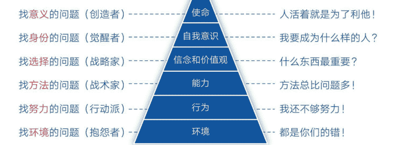
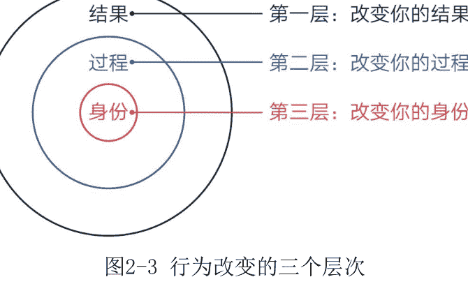
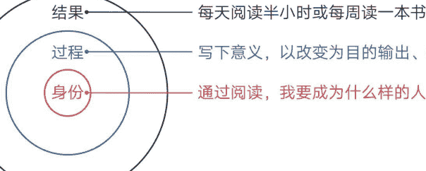
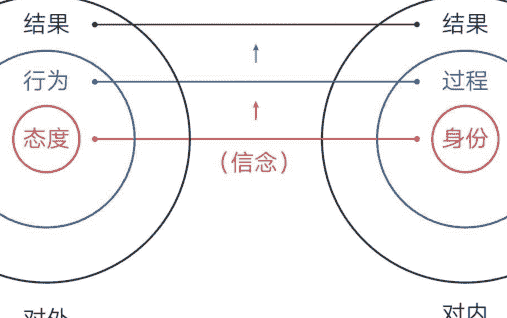
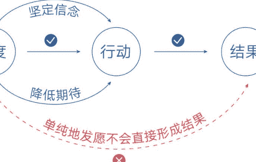
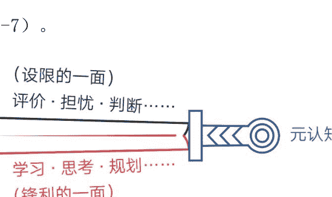

# 认知驱动

做成一件对他很有用的事
周玲著

认知创造价值，价值改变命运
真正消除焦虑，获取人生成幸福
用底层逻辑重构认知驱动
让自己的努力真正有效

采铜、古典、成甲、卫蓝
诚铭推荐

## 知识星球TOP
付费资源分享群

添加微信
免费入群
微信: jntsg2

| 序号 | 公号/星球/社群 | 原价 | 领域 |
|---|---|---|--|
| 1 | 生财有木 | 2765/年 | 副业、搞钱 |
| 2 | 怂众从吃瓜群 | 365/年 | 时政、历史 |
| 3 | 记忆承载/骏树西风 | 365元/年 | 成长、搞钱 |
| 4 | 欧洲金靴 | 328/年 | 时政、历史 |
| 5 | 卢克文青会 | 699/年 | 时政、社会 |
| 6 | 体制内主任 | 599/年 | 体制；职 |
| 7 | 外局人的视界 | 669元/年 | 金融、时政 |
| 8 | 灏泽异谈 | 4166/年 | 财富、成长 |
| 9 | 守人总令 | 599/年 | 时政、经济 |
| 10 | 江宁知府 | 365/篇 | 时政、国际 |
| 11 | 政事堂/顾子明 | 568/年 | 时政、经济 |
| 12 | 唐书院 | 1399/篇 | 金融、财富 |
| 13 | 大树乡谈 | 199/年 | 时政、成长 |
| 14 | 水库欧大 | 10000元 | 房产、经济 |
| 15 | 洪灏的宏观策略 | 4376/年 | 经济、搞钱 |
| 16 | 金政通鉴/北海道山 | 4576/年 | 股票、行研 |
| 17 | 猫豹的世界 | 299/年 | 时政、社会 |
| 18 | 飞沫 | 3600/年 | 股市、经济 |
| 19 | 米联储见闻 | 599/年 | 经济、金融 |
| 20 | 鉴茶财经院 | 330/年 | 房产、股票 |
| 21 | 赢在八小时之外 | 365元/年 | 成长、职 |

...
更多资源，不再列
★ 免费群每日分享
★ VIP群每日分享
TOP级资源

## 认知驱动：做一件很有用的事
周岭 著
人民出版社

## 目录

封面
扉页
版权信息
前言 为什么我们努力却是看不到希望
上篇 做事情的关键是创造

## 第一章 价值——改变自己的关键是创造价值
- 第一节 复制：不要浪费生命给你的无限可能
- 第二节 价值：用价值规律看问题，你的人生会巨变
- 第三节 利他：从庸到最好的人生
- 第节 镜子：所有的社交都是一面镜子
- 第五节 内向：被动的成胜之道

## 第二章 身份——一切从信念开始
- 第一节 层次：在这个世界上
- 第二节 身份：改变自己的终极力量
- 第三节 语言：美好人生
- 第节 理性：成功不需要

### 第三章 心理——消除障碍
- 第一节 负面偏好：为什么总是不快乐
- 第二节 二元对立：走出成人世界
- 第三节 一劳永逸？还是死吧

## 第四章 策略——方法和路径
- 第一节 认知驱动：做一个长期主义者
- 第二节 假设：什么能力让自己快速进步
- 第三节 降低期待：那些慢慢的人
- 第节 深度练习：从普通到卓越
- 第节 跨越：如果你想与众不同，不妨试着

### 第五章 策略——环境与多维
- 第一节 环境：真实了，“偷懒”比努力更重要
- 第二节 多维：没有什么好

### 第六章 成事——做到，是最高等级
- 第一节 目标觉醒：如何找到自己的人生目标
- 第二节 成事之后：如何达成自己的人生

结语 顶级的生活不是奢华，而是创造
后记 你的一生至少主动做一件很有用的事

参考文献

送给我的女儿

## 前言 为什么我们努力总是看不到希望

这几乎是我遇到的最多的读者问。

读者：为什么我自己很努力，还是看不到希望？
问：你是怎么努力的？
读者：一年前我决定改变自己。此后我开始每天早起，每周至少跑三次，读一本书，订阅了三个学习栏，报了很多网络课，重新开始学英语……每天都被排满满。刚开始我感觉自己变化很大，但越往越看不到希望……
问：你有什么产出吗？读者沉默了。

这是一个追求学习的时代，也是充满焦虑的时代。如果不意外，我相信我的改变之路也是这样开始的：看到周围的人都在进步，终有一天，你开始拯救那个懒的、不想进取的、无所作为的自己，于是下定决心开始改变：从早起、读书、跑步到各种的学习，你必须坚持严格标准、勤耐耐心、持续学习，就能改变人类。然而这条路上去比以前的成长路线并没有得到我想要的结果，即使我做的事情正确且重要，即使自己每天都能坚持，不浪费时间一点点，但就是看不到希望。

包括我自己经历过这种煎。如果你也面临这种困境（这种困境几乎是人生中不可避免的），那将随我一起改变认知，因为这背后隐藏着一个看不见的成长陷阱。相信一旦我们看清这个陷阱，就能省去数年的摸索时间，让自己真正远离焦虑，靠近幸福与成就。不过在开始之前，我们需要先认识一下“内向成长”和“外向成长”这两个概念。

- 内向成长，即能够围绕自身展开的成长活动，比如早起、跑步、闲谈等。
- 外向成长，即能够围绕边界开展的成长活动，比如写作、画画、编程等。

为了更好地理解，我们不妨把内向成长当作培养习惯，把外向成长打造成技能。换成这个说法后，你可能马上明白问题的症结所在了；我们过度专注于内向成长而忽视了外向成长，即重习惯轻能，重输出不是吗？

我们每天早起、跑步、读书、学习，身体心灵都在路上，忙碌感到自己，然而这些活动都是内部循环，不直接对外输出，所坚持这些习惯只能让我们成为更好的人，而不会让我们轻易成为很糟糕的人。反之，如果我们能更多地投入外向成长，培养过硬的技能，持续对外输出作品或价值，就能参与社会，从容感受到努力。

情况往往是这样的：

- 我们一直在读书，却很少实践或写出来，形成价值却不受喜爱，别说不断打磨自己的作品了；
- 我们一直在练琴，却少用完整作品去表演，别说打造自己的风格；
- 我们一直在画，却少用作品来创造、展示，别说收获点赞……

正是这种观念上的差异使很多人停滞前。其实并不是所有人一开始都是享受奋斗的，这种努力却少产出，是一个普遍问题。一个问题越普遍，我们越应该对待它。

的答案很简单：培养习惯容易，打造技能难！培养习惯容易是因为它不需要严格的标准——高低不可靠，所以你可以锻炼一天，也可以锻炼一天，或者坚持一辈子。这种成长就像一场考试，只要坚持就可以调试。打造技能难是因为它的好坏由外界评定——行就是行，不行就是行，所以无论你努力、投入、怎么感动自己都没用。

在缺乏知识的情况下，我们会自觉地选择一种新的模式：重习惯，重输出。当然，这里说的“重技能”“重输出”需要尽可能达到卓越，而不仅仅是“会”。因为真正的技能必须对外输出，被他人认可，也要争取在能力范围内做到最好，形成最小用的作品。比如你要读书，那就是读完后就亲自实践并把它写出来，形成观点分享给他。这也是产出，比那些只练不写的得多。你要要练，就能出名。

如果暂时做到，打造技能必须产出，即使开始不完美，只要坚持下去，你的产出就会变得精细。拿我自己来说，起初我也是写得没有任何产出的，结果看不到进步，无法形成知识体系。但明白了了这个道理，打磨这件事再也没有过了。如今我已经深深感受到创造价值带来的收获，它们不仅体现在选择、行动上，更体现在收获和个人影响力上。

当然，这种打磨过程必然更加辛苦痛苦。有时候为了写好一个话题，我需要查阅很多资料，反复调整表述；有时两个小时才足够进展，甚至每天都要死磕直到形成满意的作品。比起那些只读不写的，“学习”觉得很辛苦，但这一切都是值得的，让我看到了希望！

并非首要创造成就，更多的是培养一个习惯或练习一项技能的小事。在本书的第六章，你会看到具体的定义。在开始之前，我还要强烈建议先去读《认知觉醒》，因为《认知驱动》是《认知觉醒》的延续篇，虽然它们各自独立但内容却紧密相连，甚至可以说是一体的。所以本书会沿用《认知觉醒》中的一些基础概念，如大脑、情绪、理智、回避情绪、急于求、舒适区、反馈、关联等（为了方便，本书会用蓝色字体标识出《认知觉醒》中的概念，相信你一眼就能看出）。这些都是好的概念，如果你有所了解，一定会受益匪浅；如你缺少背景知识，可能会对理解本书有一定影响。当然，你也可以在我的公众号“认知驱动”中获取更多信息。

《认知觉醒》是我的第一本书。2020年新书上市时，我还是一个写作满3年的作者，在业内不算名气，对于新书销量并无预期。书籍出版后受读者欢迎，11个月内加印15次，销量突破15万，如今仍在增长中。与此同时，我也收到了许多读者的反馈，诸如：“感觉这本书就是我写的”“此书于我，如同再造之”等。在各大读书平台，本书的口碑和评分也使我内心深感鼓舞。

这些成就让我既惊喜又喜，但这些并非我自夸，因为其中包括包含我不到到的运气因素。不过，好运也需要价值的吸引，所以《认知觉醒》这本书的价值毫无疑问，同时它也间接证实了走“价值产出”这条成长之路的正确性和可行性。

如果你是《认知觉醒》的老朋友，那你一定知道下一个就是我们的握手礼了。如果你是新朋友，那允许我向你发出正式的邀请：“很高兴认识你，我是周岭，让我们共同踏上创造之旅吧！”

# 上篇 做成一事的心法

## 第一章 价值——改变自己的关键是创造价值

### 第一节 复制：不要浪费生命给你的无限可能

36亿年前，地球出现生命。
20世纪40年代，第一台计算机诞生。
今天，人工智能已经进入我们的生活。
从某个角度来看，人类社会由碳基文明向硅基文明跨越。在漫长的碳基生命进化中，无论是细胞还是有机生物，想要延续必须不断复制——细胞分裂，旧细胞死亡，新细胞产生。硅基生命的基本能力也是复制——每一次启动、打开、点击，本质上都是复制的过程，要么从硬盘加载到内存，要么从网络下载到终端

图-1 碳基生命和硅基生命的复制

事实上，“复制”和“转换”就是大自然的两种基本形式，但“复制”的层级显然比“转换”高，因为它赋予了物种以延续性。如果没有复制，生命和信息将失去活力，像水那样要么凝固成冰，要么蒸发为水。

另一种形态就是转换。

看到不同的世界，差异源于人们看待生活的视角。当你掌握了“复制”和“转换”这两个概念，或许会看到不同的世界。大家都知道梅兰芳是艺术家，但在中国戏剧史上，他的造诣未必是最高的。为什么是他他？因为20世纪30年代，录声机开始普及，梅兰芳通过“转换”的形式，将自己的声音录制成唱片。而那些能够“复制”的人，比如周杰伦，早期创作了许多经典，即使以后不再创作，他的经典。

对于很多人来说，只能通过“转换”来，花费一份时间，收获多份回报。今天，这种规律依然适用。外卖哥、货司机、厨师、职员，大多数人在性质上是一样的——虽然收入差距较大，但本质上都是用时间换取收益，多是多，少是少。一旦不做，收益也就消失了。而另一些职业完全不同。比如企业家、作家、发明家、歌手、演员等，这类职业的人有机会借助机器的力量，在睡觉时，自己的优秀作品通过社交平台（网络）无限复制并传播，从而带来海量的收益。

周杰伦创作了许多歌曲，即使他早已去世，他的作品收听和购买量依旧随着时间的推移而增长

这就带来一种可能：终有一天，我们可以不再再售卖时间就能产生收益，而是实现财富自由或人生自由，彻底解放自己。

所以会有可能发生：①持续研发新的特色菜品，并凭借“秘密配方”技术引入企业，允许酒店复制自己的技术，享受股份分红，此后即使不亲自做菜也能产生足够的收益；②制作易懂的特色菜教程，将其发布到网上，供需要学习的人免费或付费观看，这样就可以在现有基础上产生更多的收益。如果个人品牌打造顺利，这份收益可能会超过自己做菜的收益，此时意味着已经实现了人生自由。

若仔细观察，我们会发现“复制”类活动的收益曲线和复利曲线非常一致（见图-3）——前期增长缓慢，但只要持续积累，收益就能在达到目标后快速增长。

# 图1-3 “复制”类活动的收益曲线和复利曲线

这就是我选择写作的原因之一（最主要的原因让自己脑子清醒，脱离混沌）；这种非线性增长的“复制”力量，可以让自己产生无限可能。如果你也开始写作，其实有一条理由就足够了。

#### 获得无限可能的关键在于价值

人类科技的发展，本质上都是对自身能力的提升。飞机、高铁让人走得更快；雷达、望远镜让人看得更远；手机、电话让人听得更清；计算机让大脑转得更快；互联网让人的“复制”能力得到极大的扩展。

如今，虽然不是所有人都有用进行产品复制的机会，但每个人都有创造并复制自己作品的机会——只要敲起键盘写文章，打开手机拍视频，谁都可以发布作品。然而，并不是所有的“复制”类活动都具有无限可能，因为“复制”只是一种渠道，获得无限可能的关键在于价值。如果我们生产的作品是浅的、低价值的、博人眼球的，它们会在短时间内

反响平平，这背后的原因是什么呢？我想除了运气，还有一个不可忽视的因素，那就是价值。

“价值”这两个字值得我们每个人思考并牢记，因为当你把写作换成任何自己想做过的事情，这个道理同样成立。所以如果我们能把“价值”这个概念彻底想清楚，就有可能让自己的人生发生巨变。为了实现这一目标，我现在就以写作为例，向你解释这世人都都可以借鉴的成长之道。

我能得到这个关键的关键归于两次好运。

#### 改变自己的关键是创造价值

第一次好运发生在2016年5月，那时我读了李奕明的《把时间当做朋友》，其中的“交换是有硬道理”这一节被触动了我，它让我联想起以前在课中学学的“价值规律”，即商品产生之后要以价值为基础实行等交换。看着这个洋洋的价值规律，我突然灵光一闪，悟到一个关键认知：改变自己的关键是创造价值。

这个结论不容易理解：因为只有自身创造的价值足够大，我们才能被别人强烈需要，才能参与到更大的社会交换，并得到对方的回馈。想一一下，如果你你什么不是，什么都不会，什么都没有，人类凭什么关注你、支持你、为你调用社会资源？所以成长的目的就是创造价值，在帮助他的过程中成就自己，而且你创造的价值必须是长久的，因为越长久，价值就越大。

这个道理放在写作上也是一样的。我们必须设法生产长久的文章，创造对自己和他人长久有用的思考，摒弃一切不具备长久价值的内容。于是我自然选择了这样的策略：力求每篇文章都做到底层、不触热点、不说人情肺碎、砍掉浮夸的表情、无意义的插图以及与主题无关的东西；同时力求每篇文章都能解决一个实际问题或改变一个观点，而不是让人情绪高涨之后就归于沉寂了。

更重要的是，每次提笔时都要问自己这样一个问题：这篇文章在三年、五年甚至十年后后再看还有价值吗？如果没有，就没有必要写了。

这一做，就能消除一切浮躁的机。

事实上，生活中的每一个选择都可以用“五年之后还能产生影响”这个标准来衡量。比如面对滚滚的信息流，我们就可以用它约束自己的注意力：一篇公众文章、一本书或部电视剧是否对其有积极正面的影响？如果有，就得花时间去看看；如果没有，就可以考虑放弃，不管它们看起来多有道理、多么有趣。

事实证明这个选择是对的。如果我的文章没有价值，就不会得到《人民日报》的转载，也就不会吸引读者来咨询和求助，自然也不会有现在这本书了。我能从底层突围，不是因为写了博眼的标题，也不是为了跳入热点的流量，更不是为了煽动情绪的鸡汤，而是为了扎实地生产了长久价值的内容。这些内容抓住了读者的痛点，满足了读者的需求，最终换来了读者的关注和支持。

生产对别人有用的价值就是写作的指南针，其他事情也是如此，价值交换规律在哪里都会作用。比如在寻找目标这件事上，很多读者会在咨询的时候说：我想变得很有钱；我要成为一个很厉害的人；我想要成为学霸；我要养成5点起来的习惯……仔细琢磨这些话，我们会发现其中蕴藏着一个思维误，那就是人们往往只单方面地看到自己想要的，却忽略了自己能给的。

绝大多数人在确定目标时都采用“想要”的思维，因为说出“我想要什么”很容易，而且这种“利思维”驱使下的目标往往很多、很大，很容易让人陷入不实际或急于求成的境地。只要我们问：“你能给你别人什么呢？”对方马上就会陷入沉默，然后幽幽地说：“好像确实没有什么能给别人的，就是养成一个习惯，也难以自己能付出那样的。”

我们想要那些对价值主动关注的人，他们是不是都是在某一领域有自己独特的价值呢？因为这些价值可能对我们有用，所以我们愿意关注他们，并且保持联系，甚至愿意支出支持他们。

这就是这个世界的基本规律之一。即使是你，结果也是一样的。只要你自己有独特的价值，价值就能够出来、被人强烈需要，别人就会关注你、支持你、给你反馈，与你产生私密的联系，愿意把自己的资源给你调用，最后发现之前你想要的一切自然会来到你的身边。所以“利就是利”这句话真不是什么事，而且这个世界无比适行的规律，谁能早看到它就能从中受益。

一旦把视角从“想要”到“我能给”，很多浮躁、妄念就会消失；当我们开始思考能够给别人带来价值的时候，就会看到新天地；当我们开始想办法变得更有价值的时候，就会看到曙光。

当然，价值积累之路是需要耐心和坚持的，因为价值的产生需要过程，一旦你选择了价值之路，就要消除自我怀疑。2018年8月，我听了国内专家金华的一次分享，其中一句话记忆犹新：“对他人有好处，你就坚持，不需要想。”

所以在我看来，写作、成长和成功其实是一回事：写作就是生产价值的内容，成长就是做一个价值的人，而成功就是能够对社会贡献。这其根本，都遵循价值交换规律，无论何时都有效。只要你坚持，价值积累之路就是每个人，这也是最基础的路径。

#### 用知识为价值积累

第二次好运得益于我在写作初期的一次课。我接触到了“顶级信息论”和“输出比输入”这两个观点，它们让我冲击非常大。

当时我接触到了“顶级信息论”和“输出比输入”这两个观点，让我直接从“经验写作”跳到了“知识写作”层次。其实，对一个成熟的作者来说，这两个观点再正常不过了，但当时我完全靠自己的经验写作，素材容易枯竭，但知识不会。这就解决了素材来源的问题。有了底层的认知、广阔的视角、丰富的素材和独特的关联，让我每次都可以用不同的知识或故事来开头。

很多读者发现自己依旧匮乏价值，他们虽然长期输出，但内容多是围绕热点发表见解、记录自己的生活感受，或是罗列一本书的知识要点。这样的内容通常同质化严重，很容易被他人替代，即使他们每天更新、日日产出，也无法被人需要、无法与更大的价值交换，于是成了那些“很努力却看不到希望”的人。这是我们要不断学习“新知”的原因，因为“新知”永远是增加值的砝码。如果我们缺少这种种类，就只能用浅薄的经验和精力去。所以无论在什么行业、什么领域、什么岗位，想要胜出，就要在心中打下烙印：愿意并舍得在学习新知上投入资源。

#### 永远走在价值积累之路

无论你在哪个行业、做什么事情，价值交换规律无处不在，只要有意识地遵循这一规律，你的人生就能发生巨变。当然，对个体成长而言，不管什么时候，我总是鼓励人们去写作，因为无论从哪个方面看，写作都是一个百利无害且适用于每一个普通人的技能。

首先，一个人想要真正提升自己，输入输出形成闭环，如果一味满足于此，提升效果就会大折扣。即便你没有别人的梦想，仅理想自己也是好的，它不仅能让你思考更多事情，还能让你保持稳定、提高能力，让你在生活中和工作中胜人一筹。

其次，如果你有别人的梦想，也希望创造自己的影响力，那写作就是最低成本、限制最小的途径。一台电脑、一根网线，就能让自己动起来。每次收获的思想可以通过文字量化自己，再通过网络的复制力量完成扩散，你的人生就有可能溢出无限可能。

最后，文字你是互联网上的另一张名片，任何人都可以随时认识你，这就比自己有了“身术”，一觉醒来就有可能收获想不到的连接。不管你所处任何现实困境，你都能通过文字创建一个属于自己的王国，连接一个全新的世界。当然，如果你的文字力量足够，能够帮助很多人，你就会获得无数的正向反馈，这些反馈带来的成就和喜悦往往是我们在现实生活中接触不到的。

放眼世界，我们其实比以往时代的人都更需要写作这样的技能。因为随着人工智能技术的快速发展，很多重复劳动的“转换”类业务终将被机器取代，所以人工智能崛起后，普通人又依靠什么参与社会交换呢？社会在巨变，但价值交换规律不变。人工智能虽然人类的部分传统价值贬值，但人的认知能力依旧是技术无法替代的，而写作是磨炼这项能力的绝佳途径。目光长远的人，会尽力看向远处，并开始早早布局，让自己靠近“价值金字塔”的顶部。而本节的意义就是想告诉你，无论选择写作还是其他，“价值产出”对于每个人都有效。

### 第三节 利他：勿犹豫，利他是最好的人生

以前一听到说“凡事要有利”时，心里就会泛起一股抵触情绪，那种感觉就像受到了说教。多年后才发现，这种未经审视的认知在个人成长中至关重要。这种力量巨大，缺少了它，人的成就可能被限制在某水平线上；而且拥有了它，就能完成无法想象的事情。

人们不愿意真正接受利他，是因为这个观念与我们的天性相背。对于大脑来说，简单、直接、快速的满足是好的。然而，利他之事通常需要付出，有时还要面临损失，这种不确定性会让大脑不自觉地抵抗。所以很多人知道这个道理，但心里并不认同，甚至无法去实践。

#### 利他的本质是爱

利他的本质是爱，它的力量取决于我们对自己、对他人以及对这个世界有多少爱、爱有多广。无论是“为母则刚”，还是“无欲则刚”，实际上是由于情怀和胸襟超过了一个个人、小团队，是一种面向大集体的爱。有了爱，我们才能得到真正的幸福和成就。

正如柯一郎在《被讨厌的勇气》中所说的：“幸福即奉献。”也正如稻盛和夫在《心》中所说的：“一切成功都归于利之心。”世间的幸福之道和成事之道，无不如此。

#### 利他的结果是利己

我的写作之路因此而受益。

起初，我也强烈地希望自己能够写出“10万+”的文章（阅读量超过10万次），能够一夜成，甚至快速变现。这种纯粹的利己我想很快就拿起来，但也让我在现实的打击下很快放弃。如今我要出版第二本书，这在很大程度上来自于写作心态的转变。因为我逐渐意识到，写作根本并不是为了名声和收益，而是为了改变自己并带来影响。

这样开始远离热点，静心阅读，用心打磨，持续输出，给读者提供易懂的表述。即使写作更新慢，也能积累深厚的价值。虽然我还没有完全证明自己，只要心里装着读者，始终坚持。

2018年5月，我在公众号开了专栏，免费为读者提供服务。很多读者不敢相信我愿意花费时间帮助他们，而且结束后忍不住问我：“为什么愿意花时间提供免费服务，不想要什么回报？”

其实不然，这需要我们先思考。比如20世纪80年代，稻盛和夫为了参与日本竞争，每天都会问自己：
“我参与这个事业，真的是为了利益吗？”
“我是为了出头吗？”
“我的动机真的是纯粹吗？”
反复自问自答，不断审视动机是否真实。经过半年，他终于确认自己没有杂念，这才是拿起竞争的动力。在最终的战斗中，爆发出了人的力量，使公司出意料地快速攀升。如果用一个词来描述这种毫不掺杂私心的、全为国民谋福利、做贡献的态度，那就是无私则刚。这里的“欲”，当然是指个人私欲。这种私欲本身并不是个人成长及办企业的原生动力。但是如果没有超越私欲的力量，我们就会在做选择时变得短浅、患得患失，变得软弱无力，无法做出正确的决策，最终使得人或企业发展受限。

一个人要是放弃自己的小念，能内心地为社会发展、为人民福祉去做，他就能充满力量。正因稻盛先生在2019年1月接受访谈时说：“我们不是上市公司，不是为了财务报表，我们是为了实现人类理想而努力奋斗。”可见，企业动力源于利他思想，这种想法不是怕牺牲。这也是革命先烈们不怕牺牲的原因，他们心里装载着人民和国家。因为爱得深厚，当国家遭遇困难时，他们付了命去拯救、保护。而那些怕死的人就缺乏足够的力量，他们的目光只局限于自身，甚至只关注自己的荣华与安逸。

如今我们生活在和平年代，很少遇到像革命先辈那样需要牺牲自己的时候，但心也是我们最大力量的来源。因此，当我们遇到困难想要放弃时，当我们陷入困境感到无力时，不妨静下心来问自己：是不是因为做这件事的出发点不够高？是不是因为太在乎自己的得失？是不是太希望自己能凌于他人之上……有了力的加持，我们在不知不觉中拥有他人所谓的“格局”。

### 第四节 镜子：所有的社交都是一面镜子

一位读者发现了我的公众号，如获至宝。他激动地给我留言并向我致谢，同时还表示要把我的文章分享给他的朋友，希望更多人能受益。我当即表示感谢——对于一个从不主动推广的公众号来说，有人愿意主动将其分享，那将是发自内心的。

可惜不好，没过几天他又又来了，但这次不是感谢的，而是来“说教愤怒：“我的好朋友每天热打游戏，平时不看书成长，没有生活目标。我知道你的文章对他有用，所以我强烈推荐给他，结果却被他唾之鼻，真是气死了！”然后他问我该怎么办。

我说：“想让你听懂的，最好的方式不是语言，而是你自己真的偏好，而且比现在多，比你好，那时你的话才有分量。因为更好的建议不是劝说，而是影响。”

在很多人听来，这句话几乎等于没说。就不是“身大于言传”的道理吗？谁能知道呢！可认为是太浅了，有些人反而视而不见，总是被现实问题所困。比如一些年轻的读者经常用自己的另一半不思进取而让他们自己有了觉悟，这种方法是不正确的。

#### 更好的建议不是劝说，而是影响

人们不愿意践行利他，另一个原因是误把牺牲和讨好当成利他。

## 利从从接纳己开始

庸庸质疑，利他是的人生信念。但我知道你心中有一个顾虑，那就是担心自己不能成为一个毫不私的人：“如果不小心回到了利己的状态，自己就成了表里不一的人，这样就会让人看不起。”关于这一点，我们完全不用担心，因为利他与利己原本不是黑即白的二元对立。毕竟利己是人的本性，而利他是一种超越，我们不需要在拥有的同时将另一个消灭，我们可以兼顾。更好的成长者不会刻意抹杀自己的本性，而会主动接纳它，因为只有接纳了利己，我们才能坦然地向它告别。回避和自我欺骗会削弱我们的力量。所以，即使暂时做到也不关系，坦然接受好了，重要的是真实的自己。在这个过程中，可以用积极的思考和行动去“施肥浇水”，但不要急于求成。毕竟，像稻盛和夫这样道培养的人也花半年多时间才能消除自己心中的利己欲望！不要纠结于自己真正做到利他，哪怕暂时退去也无妨。要的是，我们一直在利他的道路上前进，从未放弃！

光动嘴子，显然没有说服力，所以我现在很少死命劝人了，我尽量做给他们看。慢慢地，一些人开始重视我的意见，一些人甚至主动向我请教。后来我读到李亮的一篇文章《成为能说话的人》，文中的观点正好印证了我的体会。同样的话从你和牛人的嘴里出来，效果就是不一样的，这显然不取决于对或不对，而取决于说话的那个人是谁！

大多数人的判断逻辑都是如此，所以劝朋友或给别人建议是必要的，但如果人家不听，也不要纠结，这不是人家在反击你或反对你，这只是一面镜子，告诉你自己还不够强大（当然，对方也可能存在认知偏差）。

此时，更好的策略是埋头苦力，默默改变。直到有一天，即使你不说话，也会有人主动寻求你的意见。

#### 更好的关系不是付出，而是吸引

经常接受妥协，我不要听一些年轻人诉说他们不幸的情感经历，最常见的情境过于A为了得到或留住B而不断地示好或付出。他们的人巴结讨，有人的人忍气吞声，有人的人吃俭，有人的人揽家务，有人的人放弃转身，有人的人远嫌诸友……他们为了付出自己的所有就能影响对方，让对方以同样的方式对待自己。然而总是事与愿违，他们越越被越，付出越越心累。

这背后的逻辑是不难理解：当你手里只有这一张感情牌时，就只能单方面地透支自己了，而透支自己的后果就是让自己失去吸引力；一旦失去吸引力，就会陷入继续付出的恶性循环，无论面对的是家人、朋友还是伴侣。

开玩笑来说，人与人之间的交往往如打牌，能人选择的无非是“付出牌”和“吸引牌”，它们分别代表了“付出型社交”和“吸引型社交”。可是我们的直觉往往只能看到“付出牌”，因为这张牌不仅明显而且简单易取；只有少数人能看到另一张抽象且相对难拿的“吸引牌”，当他们把两张牌都抓在手上的时候，就会占上风头。

打“付出牌”的人通常是有需要的，所以他们在人交往时会有很强的付出心态，而这种心态往往会让自己感到痛苦，让人感到沉重。

不仅如此，一味付出让他们少有心思和精力去完善自己、提升自己。

而“吸引牌”的人完全不同，因为他们首先保证自己是完美的、有魅力的，所以与他人相处，即使他们付出了，也不会对付出带有任何条件。与这样的人相处，人一定会更加轻松、愉快，自然也愿意主动靠近了。

擅长组合的交往往在允许的情况下，他们可能先把目光聚焦到自己身上，他们会维护自己的形象，增加自己的学识，提升自己的智慧，稳定自己的情绪，丰富自己的爱好，结交理想的朋友，追逐自己的梦想……这样就可以始终向别人传达自己的魅力和自信，让人的主动靠近。

可见，如果自己始终在单方面过度付出而得不到别人的回应，这并不是别人你不好，这一面镜子，告诉你自己还不够完善（当然，对方也可能是一个不识好的人）。

此时最好的策略是立足长远，努力改变。总会有有一天，即使你不付出，也会有人愿意主动靠近。

#### 更好的对待不是要求，而是成为

类似的咨询还有很多，比如一些人觉得父母、同学、朋友、领导、同事、恋人，甚至自己的孩子，对自己不够尊重——要么轻视，要么取得，要么挣捏，要么不恭……

这背后的原因大不相同：从短期看，是对方的素质和修养不够；从长期看，是自身的表现还不够好。由于所有的社交都是一面镜子，外界如何给你反馈，根源于自身长期的综合表现。比如你平时的言行都很“雅致”，养成良好的表情包，别人就是很难对你严厉的；如果你成年后依旧生活散漫，遇事逃避，周围的人也不会尊重你；而在公司里，你若是不及他人或常常生气，领导和同事怎么会让你好脸色呢？

在遭遇他人不友的时候，我们我们可以发出的声音，要求对方注意并改变，但别忘了，他们都是自己的镜子。与其要求对方改变，不如让自己真正成为那个期待的人，那个人强大、友好、尊重、有担当，当你遇到自己还会喜欢或惊喜，愿意向你靠近的人。

作家特西·麦克莱在2014年做过一次名为“想有完美的婚礼，请先拥有自己”的TED演讲。她用自己三次失败的婚姻换来一个非常珍贵的思考角度：在别人结婚之前，不妨放自己“一次婚”。你不论是丈夫还是女性，已结婚，都可以给自己过一次这样的预设：你愿意和自己这样的人共度一生吗？无论贫穷，疾病也不离不弃（事实上，和自己结婚，只能不离弃。）你喜欢自己的外表吗？喜欢自己的言行举止吗？喜欢自己的能力和精力吗？喜欢对未来的追求吗？如果你对自己不满，就不要指望别人尊重和喜欢你了。

“和自己结一次”真的是一个绝佳的视角，它就像立在门口的一面镜子，让自己在每次出门之前先审视一遍，防止遇事展现而不自知。你现在肯定知道这并不是什么新奇的招数，而是是非常高级的认知。

#### 想要更好，请停止追逐

放弃权力，请诸位关注“影响、吸引、成为”这条路径，但我并不斥“付出、要求”这些选项。因为世界是多维的，从来不是元对立，习惯只会走向绝对化，让自己失去了灵活性。所以即使你不明白什么“批判性思维”，也可以用“被动”写法让自己变得明智。

可见，如果自己始终在单方面过度付出而得不到别人的回应，这并不是别人你不好，这只一面镜子，告诉你自己还不够完善（当然，对方也可能是一个不识好的人）。

此时最好的策略是立足长远，努力改变。总会有有一天，即使你不付出，也会有人愿意主动靠近。

### 第五节 内向者：被动社交的胜之道

“被动社交”这条路非常好走，它不仅不累、不焦虑，而且特别适合那些不长表达的内向成长者。

#### 被动社交——用作品说话

如果你看了李子柒的作品，知道她从不在视频中对话，也不会为了讨好观众而活跃，更不会要求大家点赞、关注和转发。她只是专注于作品本身，在视频里尽情演绎，为了拍好一个视频，她要经历春夏秋冬整年的准备。“惊喜的是，这种冷的风格让她火遍全球，使她不仅获得了财富，也收获了独一无二的影响。

她最担心的不是外界的关注和联系，操心的反而是对海量的合作请求进行筛选。这就是所谓的“被动社交”——通过独一无二的、具有长久价值的作品来世界建立连接。如此，即使作者不善于社交，也同样产生强大的社交吸引力，因为可以让作品代替自己说话。有价值的作品，特别是精心打磨的作品产生的影响力要远超过个人在台面上的大声叫。

#### 李洪锐——向内更有创造优势

选择“被动社交”策略的人并非少数，比如25岁就成为百度副总裁的李彦在成功之前思考过这个问题。他知道自己不是一个善于社交的人，但工作中又需要人关系和影响力，于是他梳理了获取人关系和影响力的两种方式：一是通过不断地与人交流建立情感联系；二是通过知识或能力的吸引，让别人认识自己。

通过梳理，他最终选择了被动社交策略，即通过公众号每周输出一篇高质量的营销干货文章，专注于知识领域的创造。他收获了五十万读者，在营销圈打造了强大的个人品牌，最终拥有的人际网络和资源，远远超过许多社交能力比他强的人。

再如《五分钟学院》的作者刘润也很推崇这种“自管花开”的行为模式，他说：“你可以把自己想象成一朵花，我们只管这朵花开得漂亮，只想散发自己的光、热和香气。如果在覆盖范围之内，有人感受到了，那真是幸运，他就有机会成为我们的客户或者合作伙伴。我们甚至不要拿着手机去找客户，也不想去说服别人，如果发现这些人竟然被忽略了，那就只能证明这朵花散发的光还不够。”

可见，采用被动社交的人也可以获得成功。这样做并非无奈，相反，这是一个非常明显且正确的选择。

| 层次 | 内向者特征 | 外向者特征 |
| :--- | :--- | :--- |
| **环境** | 容易看到全局，行为审慎 | 容易被环境影响，反应迟钝 |
| **行为** | 运行缓慢，需要更多时间恢复 | 运行快速，容易疲倦 |
| **能力** | 擅长专注，能够深度思考 | 擅长表达，容易感到内心掏空 |
| **信念** | 逻辑思维强，不容易被带偏 | 情绪驱动强，容易被情绪影响 |
| **价值观** | 关注内在，更有创造力 | 关注外，容易被表面吸引 |
| **自我意识** | 关注自我，通常不太合群 | 关注他人，容易被外界干扰 |
| **使命** | 长期主义，坚持价值产出 | 短期主义，容易满足当下 |

## 第二章 身份——一切从信念开始

### 第一节：你在这个世界的哪个层次

1976年，查德·班德和约翰·格林德开创了一门新学——NLP（Neuro-Linguistic Programming），中文意思是用语言程序行为。后来他们的学生伯特·迪尔茨和格雷戈尔·贝特森创立了NLP层次模型。这个模型把人的思维和意识分为六个层次，自下向上分别是：环境、行为、能力、信念、价值观、自我意识、使命。

NLP层次模型适用于很多领域，诸如生活、商业、情感，包括成长领域。每次看到某模型，或者某个模型的组成部分超过三个时，我就会昏昏欲睡，觉得这些东西太抽象了。或许你也有相同的感觉，不过还是请你在这一页上多停留，让我把这个模型换个面貌，你就会发现它其实是个好东西。

下面，我以成长为例。在成长过程中，我们一定会遇到各种问题，此时对待这些问题的态度就很关键了，因为可以从中看出我们的成长等级，而NLP层次模型可以作为衡量成长等级的标尺。

第一层：环境。处于这一层的是最低的成长者，他们遇到问题后的第一反应不是从自己身上寻找源，而是把原因归咎到外部环境，感叹自己运气不好、没有遇到好老师、老师教得太差……总之凡事都是别人的错，自己没有错。这种人的情绪不稳定，往往是十足的抱怨者。

第二层：行为。处于这一层的人将目光投向内部，从自身寻找问题。他们不会太多埋怨环境，而是把注意力放在自己的行为上。对于大多数人来说，努力是最容易做到也是自己可以完全掌控的，所以他们往往把努力视为救命稻草。这没什么不好，只是当努力成为唯一标准后，他们很容易忽略其他因素，用努力的力量来捆绑自己。比如每天加班、每天学习、每天工作、每天锻炼……一天不休息，看起来非常忙碌，但由于效率是否高、注意力是否集中、是否有价值、自身是否有变化似乎并不重要，因为努力的感觉已经让他们心安理得了。到底，人是容易被情绪影响的，总希望用无痛的努力数量取代直面困难的思考，在这种状态下，努力反而成了他们麻痹自己的舒适。

第三层：能力。处于这一层的人开始用脑突破舒适的能力。他们能够通过脑力走出舒适区，积极寻找方法，因为有了科学正确的方法，就能事半功倍。这一步也很让人产生错觉，因为在知道方法的那一瞬间，一些人会产生“一切都可以搞定”的感觉，他们便不再愿意花更多精力去钻实实力。

#### 长期主义——价值创造的必经之路

我自己就是一个偏向内向的人，平日不善言辞，开始写作后我不自觉地走上了“被动社交”的道路。因为我发现通过生产思想的文字来表达自己更容易获取成就，而且这种“异步”沟通的方式让我放松、愉快，也是我擅长的。

事实上，公众号刚开始起色的时候，我也尝试过向大气投稿，以此提升知名度。但这种“主动求关注”的方式让我十分疲倦，因为每写篇文章都要额外准备好几个版本，同时联系媒体平台、介绍自己；等待回复、忍受拒绝，即使这样还要按照要求修改内容……几次尝试后，我发现这种方式不仅会消耗大量的精力，而且会让自己的写作风格变得浮躁，推广效果也不见好。于是我是放弃这种方式，并暗下决定：以后不再主动求关注。

这种想法看上去有些消极，但当我开始尝试拆解浮躁、继续聚力后，我把全部精力投入价值写作，深度思考，精心打磨，不接广告，不搞互推，即使更新文章的周期长，也要坚决保证文章的质量。当我放弃“主动求关注”这种方式后，情况却发生了有趣的变化：

- 转载的文章请求接踵而至，数百博客申请转载；
- 读者主动联系，每天有很多留言和感谢；
- 总结了很多作者及其他领域的意见领袖；
- 收到了多家出版社的出书邀请，出版了自己的书……

我用自己的经历再次证明被动社交这条路的可行性，这一切的发生，都是因为有作品为自己代言。当然，走这条路我们需要做一个长期主义者，我们需要抵御短期利益的诱惑，忍受暂时被外界关注的不安全感，牢牢抓住自己的价值和产出。虽然我们可能无法像李彦或李鸿那样在相对较的时间内爆发，毕竟我们需要更大的付出，但对于我作为一个没有特殊资源的普通人来说，我获得如今成长的速度已经很快了。如果当初我一直在他人的赛道上跟风乱骚，把精力放在自己不擅长的向外连接上，我想现在依然是那个默默无间的焦虑写手。

所以看来这条十分漫长的“被动社交”之路其实并不慢，而且优质作品的价值累积效应会加速这个过程，因为好的作品自己会“走路”。

#### 价值稀缺——酒香不怕巷深

好的作品确实自己会走路。这句话成立的关键的是作品要足够好，它要让人眼前一亮，让人觉得震撼，对他产生巨大的帮助且具有持久生命。这样的作品很难被模仿或替代，因此需要作者保持专注，投入足够的精力和精力。这对内向者来说是一个机会，因为他们更有可能通过优质作品来打造护城河。

事实上，无论是内向者还是外向者，想要获得成就和影响力，最终都要创造足够的价值。当然，我们也不能轻视自己，在担心自己是不够大的时候，只需要专注于作品就好了。在现代环境的影响下，竞争非常激烈，商家需要主动出击、占据市场。相反，“被动社交”这条路非常好，它不仅不累、不焦虑，而且特别适合那些不长表达的内向成长者。

可见，采用被动社交的人也可以成功。这样做并非无奈，相反，这是一个非常明显且正确的选择。

#### 第四层：信念和价值观

终有一天他们会明白，再好的方法替代了努力，也一定会有人明白，方法比方法更重要的是选择。因为一件事情若是方向错了，再多的努力和方法也没用，甚至还会引起反作用，所以我们一定要先搞清楚“什么最重要”“什么更重要”，而这些问题的源头就是我们的信念和价值观。

一个人如果能感知到自己的选择，那么这类人愿意花更多时间去主动思考如何优化自己的选择，毕竟选择了错误的人和事，无异于浪费生命。

#### 第五层：自我意识

如果说“信念和价值观”是一个人从被动接受命运到主动掌握命运的分水线，那么“自我意识”是更高阶、更主动的选择。所谓“自我意识”，就是从自己的身份开始思考问题，即“我是一个什么样的人，我应该应该做什么什么样的事”。在这个视角下，所有的选择、方法、努力都会主动围绕自身身份的建设而自动转换为合适合的状态。这样的人，可以说是真正的觉醒者了。

#### 第六层：使命

在身份追求之上，便是人类最高级别的生命诉求。如果一个人开始考虑自己的使命，那他会将自己的价值建立在众人关注的层面上。也就是说，活着的最高意义就是创造，他积极地影响他人，影响的人越多，意义就越大。当然，追求使命的人不一定是伟人，也可能是像我们这样的普通人，我们要能够在自己的能力范围内对他产生影响即可。有了使命追求，我们就能催出真正的生命目标，就能不畏艰难困苦，勇往直前。

#### 知识，让我们更好地感知世界

这个世界是有层次的。在NLP逻辑层次模型的帮助下，个体的成长便有了不同的呈现（见图2-2）。

- 一层的人找环境问题，他们是抱怨者，喜欢说：“都是你的错！”
- 二层的人找努力问题，他们是行动派，喜欢说：“我还不够力！”
- 三层的人找方法问题，他们是战术家，喜欢说：“方法总比问题多！”
- 四层的人找选择问题，他们是战略家，喜欢说：“什么东西最重要？”
- 五层的人找身份问题，他们是觉醒者，喜欢说：“我要成为什么样的人？”
- 六层的人找意义问题，他们是创造者，喜欢说：“活着就是为了利他！”

图2-2 NLP逻辑层次在成长线上的呈现

现在，我们可以脱离这一模型，记住“环境、努力、方法、选择、身份、意义”这几个词就行了。有了这把标尺，我们就能意识到自己所处的位置，能够感知自己所处的状态。

没有层次的指引，你可能意识到自己还有更好的选择，因此被困在当前的层次。就像当你只知道“努力”这个招数时，就不太可能主动去琢磨“方法”，更太可能去思考“选择、身份和意义”了，甚至可能把当前层次的焦点，诸如“努力”“方法”，当作成就去实现，导致不自觉走偏。

但是以后，一旦我们清楚了全局框架，就可以成为“自由的人”。在遇到问题时，我们便能够主动放弃执绪的愤懑、努力、找方法、做选择、健身、明语义。

这正是让人感到意外的地方：原来我们还有这么多选择！特别是当我们能够从世上俯瞰全局，能够从高维度看问题时，低维度的问题自然就消失了。对于今天来说，最重要的事情莫过于找到人生目标和意义，想要清楚自己应该成为什么样的人。这个问题一旦解决，我们自然就知道该怎么选择、找方法、如何努力。不用刻意追求，一切水到渠成。

现代社会，人人都在学习，人们时常问自己：学习知识到底是为了什么？现在似乎有了一个新的答案：知识可以让我们更好地审视自己和感知世界。有了感知，我们便能更好地定位和应对。

那么，你在这个世界的哪一层？

### 第二节 身份：改变自己的终极力量

2020年3月，我结识了“刺猬”（以下简称“猫”），而结识他的缘由竟是对我的误解——在此之前，我一直认为他是那种在网上运营客户群焦虑症的人。好在当时我克制住了未经证实的偏见，抱着开放的心态读了他的新书《一年顶十年》，后的事情也因此发生了戏剧化的转变。

通过和“猫”本人的交流，我了解到他是一个极致行人，他的书就是他实实践的心得。在这本书中，我印象最深的是他多次提到的以下场景：

- 我经常对自己说一句话：你是天大大事的人。
- 毕业时，我觉得自己的气度不够，容易跟人斤斤计较，于是找人写了“气度”两个字在墙上天天看。
- 2017年，我变得越来越焦虑，于是又找人写了“焦虑”两个字在墙上天天看。
- 我们办公室有一幅字，上面写着：我们很贵。
- 若你还没，请让自己像一个富人。用富人的思维方式，用富人的思维去，改变自己的气质，让自己看起来更具“富人气”……

说实话，若是早年读到这些内容，我肯定会充满怀疑和鄙夷：“这不就是鸡汤嘛！”一个人怎么可能给自己画饼并让自己变好呢？简直太谱了……”现在，我不仅没有这样的念头，反而觉得这种做法高级，因为我知道这种行为触及了人类成长的终极力量——心理建设。

#### 身份—过程—结果

想了解心理建设，我们还需要从《掌控习惯》这本书起。作者詹姆斯·克尔在书中描述了这样一个规律：人的改变分为身份、过程、结果三个层次，不同层级的努力带来不同的结果（见图2-3）。

为了更好地理解，我们以养成习惯为例（见图2-4）。

绝大多数人想养成习惯，都会自然地给自己设定目标：每天阅读半小时或每周读本书。他们以为只要做到就可以养成习惯，实际上这只是浅层的“结果”驱动，结局往往失败了。部分人会将注意力放在“过程”这个层面，他们不满足于做（What），还要探索怎么做（How）以及为什么要做（Why）。他们会花时间写下阅读的种种好处；他们以目的去阅读，让自己输出、实践，效果最大化……做到这一点其实非常不容易，但仍然需要消耗大量的意志力去坚持。

这个规律是普遍适用于，无论我们在哪个领域，想做什么都会置于这个框架之下。因此，那些明确身份的人才是真正的高手，他们会花时间进行心理建设，能够从上而下改变自己。就像“猫”一样，告诉自己我是个干大事的人。如果你认为自己的身份注定平庸，你的内心就会强大起来。一个干大事的人，是不会以“偷懒”、“抱怨”、“恐惧”、“浮躁”为底的。遇到困惑和困难时，或许会主动选择，而平庸辈会对这种行为满腹蔑视和不屑，不知自己是落伍者。

当然，那些从“结果”上开始的人可能成就事，但他们会在身份上不知不觉地重塑。这种从下到上的被动不仅耗力巨大，也会使成功变得不可控，甚至当成功来临时，他们可能会因为觉得自己配不上、承受不了而被毁掉机会可能是财富、爱情、成功以及各种好运。

所以，我们一开始就应该正视心理建设，把潜意识的改造放到桌面上。毕竟在现实生活中，就算你不告诉自己应该成为什么样的人，你内心有一个默认的身份存在。他可能是一个自大的、胆小的人、不敢相信自己会成功的，只是你自己觉不到这一身份的存在。这就解释了为什么很多年后即使自己能力不差，但在面对生活中的困难与选择时，总是畏临退后，不起责任。因为他们心里仍然是个孩子。潜意识里的力量是巨大的，善用之它会成为我们成长的巨大推力；用之之它会成为我们成长的巨大阻碍。它是引导你跑还是阻碍你，全看对它的态度是否积极主动。可见，信念从来不是空的、假的，它是实实在在的力量，是特别强大的力量。我只要知道了这个秘密，就会主动改变，真正重视信念的力量。

#### 态度决定行为结果

信念，说了就是我们看待事物的积极态度。这种态度对内就是主动进行心理建设；对外，同样是终极力量。

2020年新冠疫情突然，同学们都在家学习，其中读者点点给我带来了自己的困扰，他说：“我家楼上的脚步声比较大，而且她家里有小孩，拉椅子的声音非常明显。和她交流也没有效果。有时候我认为她家的拉椅子声音都是故意的……每次听到这些声音，我感觉很无力，不想继续学习，请问你对我的问题有什么好的建议吗？”

正好几天我在读《思维的囚徒》，作者亚历克斯·佩塔克斯里斯给出的“积极结果练习”十分贴切。我是对他他说：“如果你希望有所改变，那么你就开始写下楼上声的10个好处。”我知道他心里大概在想：“从懒人的脚步声里找好处？还要找出10个，这怎么可能！”于是我给他做了一个示范，我说：“你可以把椅子声和脚步声理解为‘你的孩子很活泼’，或者‘好得怕控制，让整个世界安静一点声音都没有，那就太可怕了，所以我们要忍受。”这个时候，听到的脚步声真好……谢你提供了建议，但是我的想象力不够，只能想出两个。另外，听完这段经历后，你也能理解点点的情况：环境并没有改变，不过如果不改变态度，他就会一直处于焦虑和挫折中，持续下滑；但他现在可以聚焦注意力，甚至刻意锻炼对抗干扰的能力。在遭遇困难的时候，一定要提醒自己保持冷静，要在这种时候审视自己的态度和选择，让自己变得积极。

在上述案例中，很明显，态度影响行为，行为会影响结果。卡尔·牛特在《深度工作》书中也表达了类似观点：“你的世界是你关注的事物的反映。”我们的大脑依据我们关注哪些事物、忽略哪些事物，会对生活质量起到关键。这也是我们在任何困难面前都要保持乐观的原理。由于态度改变了，才会朝希望的方向转变。正如《活出生命的意义》作者维克·弗兰克尔所说：“拥有的一切可能被剥夺，唯一的自由是在任何困境中选择一种生活方式。”所以，成长的分岭是放弃选择还是坚守选择。现在，我们把“心理建设”与“态度”放在一起，就会发现内在和外其实是统一的，它们的力量源头是我们自身的信念（见图-5）。

图2-5 为什么我们要保持乐观

#### 做最好的准备，做最坏的打算

“心理建设”与“态度”从本质上来说都是帮助我们挣脱环境束缚的认知能力。对这种能力，人们还会产生一种难以识别的误解，比如读者哥曾提出这样的疑惑：“吸引力告诉我，想要达成一件就要坚定信念，始终保持好的方面，这样才会有结果；而想要做好事情就要降低期待，要是结果好就会翻倍。但是用吸引力法则来降低期待就是往坏的想法，这样做可能产生坏的结果。坚定信念和降低期待是矛盾的？”这是一个逻辑属性的问题，清楚一点就可以出门认知迷宫。

所谓吸引力法则，并不是单纯地在心里想要的事情并保持极度渴望，而是改变自己对待事情的态度，保持一种自信、平和的状态，这样我们就能采取正面的行动，最终产生好的结果。如果一个人心里想着不好的结果，如果产生了担忧、顾虑、焦虑等情绪，那么这种心态将会导致行动导向负面。主动降低期待并不是消观主义，因为它的目的是调整心态——把注意力放在成长上，而不是外部评价，这样我们就可以让行动更加踏实，创造出好的结果。

所以，坚定信念和降低期待并不矛盾，因为坚定信念是做最好的准备，而降低期待是做最坏的打算。它们的目标是一致的：促使自己更好地行动，并最终产生结果（见图2-6）。

图2-6 做最好的准备，做最坏的打算

至此，改变自己的终极力量已全部呈现在你的面前，它们最终能否为你所用，就看你自己的行动与实践了。不过千万忘了“潜意识的学习方式是不断重复”。这就就像我们学自行车，刚开始的时候才需要不断地、刻意地提醒自己要这样做。经过无数重复后，我们不需要脑也能轻松做到，这说明潜意识已经学会了。掌握这种看不见的力量也是如此，一开始还需要“假装”，而后不断进行自我提醒和暗示，直到有一天可以笃定地相信自己。

当然，我们还要时刻保持觉知，不能执着于一个固定的身份或信念。因为随着自身能力和环境的改变，我们往往需要的身份来引领，所以成长是一个身份不断打碎并重塑的动态过程。

改变自己，让自己变得更好，这是世界上每个人的愿望，但许多人都不知道有“心理建设”这种力量的存在，能主动运用它来重塑的人更是少之又少，因此，大多数人只能在生命中懵懵懂地低效前行。现在，你终于有机会接近这股看不见的力量，去创造主宰自己命运的可能。

### 第三节 语言：美好人生从好话说开始

日本著名企业家稻盛和夫有一个坚持跟随一生的习惯。他说：“无论遇到什么事情都要感谢，即使遭遇环境坏、遭遇灾难，也要谢谢。”甚至强调：“必须用这句话灌进自己的脑子里，就算情绪不好，也要说服自己。”起初，我认为稻盛和夫能做到这些是因为他是个伟大的人，但在一番研究之后，我发现这种做法不仅反映了纯粹，它背后具有科学精神，而且这种科学的做法让我们受益。如果你希望能像稻盛和夫一样成为有影响力的人，那就放慢脚步，一起学习。

#### 语言是幸福人生的开头

在前节中，我们描述了“态度—行为—结果”，一个人的态度影响行为，行为会影响结果，所以态度、观念、思维正是自由的关键。但还有一个极为重要却被忽视的因素：语言。人们往往认为语言是思维的产物，心里想什么，嘴巴就会说什么。但很少知道，嘴里说的也会影响心里。没错，语言和思维其实是双向道，而非单向道。如果你知道语言可以在思维之间逆向行驶，你的生活就会很多变化。《富富爸爸》作者罗伯特·清崎告诉我们，穷爸爸习惯说：“我不起！”而富爸爸坚持我们说：“怎样才行？”当你说“我不起”的时候，大脑就会停止思考；而你自己问“怎样才行？”，大脑就会活跃起来。

现在，让我们回想一下盛和夫的做法。遇到事故或困难时说“谢谢”，他的思维就不会被糟糕的情绪掌控。可见，运用语言的力量可以改变我们看待事物的视角。“态度—行为—结果”这个链条可以变为“语言—态度—行为—结果”。语言学者：盛和夫说：“语言塑造了我们的思维方式，决定我们的思维内容。”德国最大的超市奥乐齐（ALDI）的创始人也说：“改变你的语言，就会改变你的想法。”如果你从来没有留意语言对自己的影响，那你正是语言觉醒的完美契机。

#### 外部表现影响内部状态

事实上，影响思维和态度的不仅是语言，其他的外部表现也会对内部状态产生影响。比如，当你咬着铅笔微笑的时候，你会觉得格外高兴，表情向大脑传递了感觉和感情。我们的神经回路不能清楚分辨什么是是真的假的，所以你在困境中假装微笑，情绪也会变得轻松。当你在愤怒时露出力的力的态，也会变得更加愤怒。另外，简单呈现某种姿势，我们能够改变自己的所想。比起刻意保持开阔的姿势，让身体占据更多空间，能增强我们对力量和控制的感知。舒展身体的人能够轻松远眺，看得长远；而缩紧身体会让眼光局限，只看当前。如果你平时是个胆小、遇事慌乱的人，改变自己的身姿，你会发现自己变得自信勇敢了起来。超市研究员也发现了类似的现象：人们拿购物篮时会弯曲手臂，这种“收”的动作更容易让人满足迫切的需求，屈从自己的欲望选择提供即时愉悦的商品；而使用购物车时，我们的手臂向外“伸展”，在选择商品时往往更加理性。如果你再仔细观察，就会发现像彼得、沃尔戈这样的门，进门时常常需要拉开而不是推。因为拉门时手臂收缩，这个动作可以让我们进入一种“简单满足”的心理状态。柜台上方展示商品的电子屏幕通常是从上往下而不是左右摇动，因为人们的目光跟随屏幕从上下移动，像在点头称是。这种隐藏的设计对我们形成了心理暗示，但我们很难意识到。

诸研究证实，我们的行为（包括动作、表情、姿态、语言等）与思维相互影响。其中，语言对思维的影响更加直接和可见，我们最容易察觉和控制。

那么，新的问题来了，你认为“刀子嘴”的人一定是“豆腐心”吗？

#### 刀子嘴，豆腐心

从心理学的角度看，刀子嘴的人语言从口出来的时候，内心也会不自觉地变得薄薄。一个人若是不注意自己的语气、语态和说话内容，就可能变得尖锐而不知。喜欢“刀子嘴，豆腐心”来形容自己，大概是为了给自己的行为找一个理由或借口。所以，提醒自己出口善，多观察别人的感受，让别人感觉更好，也会让自己变得更好。当然，不可避免地，在某些特殊的情况下，我们需要暂时借助一些“狠”来达成某些目的，使事态向向往的方向发展。此时，我们内心清楚地知道，自己只不过是在“假装”，而非真的这么想。

所以，请时刻觉醒自己的语言：

- 无论遇到什么事情，积极的话，不说消极的话；
- 无论遇到什么人物，和蔼的话，不说刻薄的话；
- 无论遇到什么问题，开放的话，不说绝对的话……

这并不难，只要我们经常提醒，刻意练习，它就能带我们带向美好的人生。毕竟从自己嘴出来的话，第一个听到的人是自己。听得多了，我们自己也就相信了。

### 第四节 理性：成功，怕一开始就对自己说不可能

从2019年起，我就向读者倡导“你的至少要主动做一件对他人很有意义的事”这一理念。很多人深受触动，决定开启自己的成事之旅，但在设定目标后又会产生这样的顾虑：

> “我的目标不是太大了？”
> “看上去有些不切实际！”
> “我怎么可能做到？”

最初的雄心壮志在现实之后反而令人唏嘘、退却，于是一些人来寻求咨询，希望我能给出一些更理性的建议。然而我给出的常常不是理性的分析，而是热情的鼓励。对于这样的回应，有些人并不满意，因为人们普遍认为，想要成事，光有热情没用，还要用理性思考目标的可行性。这种想法自然会消失，只是很多人并不是不知道，在某些情况下，理性思维不仅不会成为达成目标的利器，反而还会成为阻碍。

这或许会让一些费解，毕竟在传统的观念里，理性思维是解决问题的利器，我们努力学习是为了让自己变得更理性，而现在说“理性无用”，这到底是怎么回事

如果你有这种感觉，那我要先恭喜你，因为你习以为常的观念被覆了，说明你可能进步了。

我们追求的理性思维其实是有限的，而且这种局限很难被人察觉，它不仅影响我们塑造自己的人生目标，还会在生活中的很多方面限制我们。如果我们能够突破理性思维的屏障，很多人生问题将迎刃而解。所以大家不要轻易放弃，与我一起更新对理性思维的认知。我相信，这次更新会使你的认知产生重大飞跃。

#### 乐观规划、悲观计划、乐观实行

为了更好地理解，我们从盛磊和夫的故事开始吧。

盛磊和夫有很多旧习惯，每次开启新的、难度较大的工作时，都会刻意去找一些“理性不断，性有余”的人一起讨论自己的想法。这些人对盛磊的专业往往并不行，但对他的提案总是表现出足够的兴趣和赞同，并鼓励他一定要尝试。

这听起来可能有些荒诞的：一个人除非不是虚心自作，他不总向外行请教吧？但盛磊和夫这样做是有意的。此前，他们同样奉理性思维，每次打算新想法、新点子，他们都会向那些一流的优秀人才征求意见。可他们发现提案后经常被冷脸，表示这样的想法是多么脱离实际、多么缺乏根据。盛磊和夫看着这些“智慧的大脑”列出的全是“不能成功”的消极理由，深表无奈，他说：“美好的想象之花，被他们冷水一淋，难以凋零，本来可以做成的事情也做不成了。”经过几次这样的教训，他就更换了商量的对象。

当然，你会认为这只是个案，不足以说明问题，我们不妨倒看看历史上其他精英的言论。

- 1911年，法国军事战略家、第一次世界大战德国军队司令麦迪南·福德：“飞机是有趣的玩具，但没有军用价值。”
- 1923年，贝尔物理学奖得主罗伯特·密克莱：“人类不可利用原子的力量。”
- 1943年，IBM创始人托马斯·沃森：“我认为世界市场对计算的需求大概是5台。”
- 1946年，20世纪福克斯市总总经理达尔多·霍兹克：“电视机只要上市6个月就留不住消费者，人们很快就会厌倦每天晚上看着一个胶板箱子。”
- 1957年，电子发明家李·德布雷斯特：“无论未来科技如何发展，人类永远无法上月球。”
- 1977年，美国数据设备公司（DEC）创始人肯尼·奥尔森：“让每个人都拥有一台电脑是不合理的。”

很难想象，这些悲的判断是从当时几乎最不理性、最专业的人那里出来的。从当时的处境看，这些结论似乎符合逻辑，因为他们的专业知识告诉他们这是事实。理性的局限在此——它只相信所见，对于已知之外的未知，它会主动怀疑并排斥。因此，《意志力》作者大卫·金斯告诉我们：“理性是将从底层需求中解放出来的救星，同时也是一个严厉的看守，拒绝我们向边界扩张。”可见盛磊和夫的做法并不荒诞，甚至是一种智慧。

那么，理性思维可以就此放弃吗？也不是，理想主义没有之地。至于如何使用，不妨看看盛磊和夫的做法：“在构想阶段，需要营造乐观的氛围，但是构想转具体计划时，情况就完全不同。这时该基于悲观，设想各种可能的风险，进行仔细分析、制定计划。”之后，到了执行阶段，就要再次强调乐观。这就是乐观规划、悲观计划、乐观执行，这是理想变为现实必须具备的态度。”

终于明白了！原来盛磊和夫的智慧在于他知道巧妙地驾驭理性思维——不需要的时候将其关闭，在需要的时候将其打开。所以我们在理性思维这条路上，应该遵循“先感性，后理性，再感性”的模式。这与《人生算法》作者说的最好的模式是长期乐观、短期悲观、当下愉悦”出一辙。

#### 长期乐观、短期悲观、当下愉悦

正如我开始写作的时候，根本没有想过自己会写出一本书，我只是记得美丽来说：“持续写作可能是锻炼学习、思考能力、沟通能力最直接、最低成本的方式。”因此我内心极其坚定，相信写作可以塑造一个全新的自己，打造一个属于自己的世界，就是拿起笔开始路上。

当然，在写作途中，我始终坚持“价值写作”的理念，坚持五年甚至十年后依然是有价值的内容。我不自觉地把自己推到了舒适区边缘，每一篇新文章都会不断阅读、链接、修改、打磨，并实践那些道理。这个过程并不舒适，即使如此，每当自己坐在电脑前写作时，都能感受到创造的快乐；每当看到读者的留言和反馈时，我都会感到动力。这些快乐让我持续下去。

猛然发现，发现自己走的是长期乐观、短期悲观、当下愉悦的道路，而且已经离起点很远了。这不是淘汰，这就是运气。现在，当我再用这个概念去观察他人，发现很多人走的是完全相同的路径。他们总是用当下的思维预测未来，发现自己的想法简直悲观无比，在起点便停止了。即使起步了，却又在过程中过于乐观、急于求成，结果频繁被打击，以致在接下来的具体行动中萎靡不振、痛苦煎熬，没多久就放弃了。归结起来是长期悲观、短期乐观、当下痛苦的模式。细想起来，这或许正是很多人无法成事的原因之一。

#### 理性思维是双刃剑

理性思维之所以被人们奉若神，是因为人们只看到它解决问题时的锋利，但事实上，理性思维是一把双刃剑，它还有偏颇、顾虑、担忧等另一面。

比如它对评价特别敏感，所以我们总是特别在意别人的眼光；它对失败特别抗拒，所以我们总是沉浸在挫折的情绪中；它对得失特别在意，所以我们总要在选择时畏尾；它对标签特别认同，所以我们是不敢相信自己可以跨界发展……它总是对自己知道的事实坚定移，然后用这些单一的认知束缚自己，让我们远离人生可能性。

只要我们把理性思维把“剑”拆分一下，马上就能看到它的两性——锋利的一面和设限的一面，而把剑的安全准则是认知能力。

图2-7 理性思维是双刃剑之设限

认知能力让我们跳出限制审视思维本身，控制它的运行方向，让它始终呈现锋利的一面，帮助我们做事情。就像盛磊和马先生并不排斥理性的力量，他们同样会在每个阶段竭运用思考的力量。

比如事情开始的阶段，他会让自己睡觉也醒想，一天24小时不断地思考、透彻思考，让自己从头顶到脚底充满“非同寻常的、强烈的渴望”。他说：“如果从身上某处切，流出来的不是血，而是这种‘愿望’。”

比起计划的阶段，他会反复密集地推敲实现愿望的具体方法，将实现愿望的过程在脑里进行模拟演练，直到“看见”了它的结果一样作宵作伏。他会用理性思维锋利面趋向自己，同时尽量避免设限面。他还巧妙地把设限面替换成了开放面，让他乐观、专注、享受过程，这样做都不会伤害自己（见图-8）。

- 开放面：乐观·专注·享受
- 锋利面：学习·思考·规划

图2-8 理性思维是双刃剑

#### 人生还需要浪漫和勇气

所以，无论什么时候，都要告诉自己：世界上没有什么事是不可能的。一个智慧的人不会等到真正失去了才后悔珍惜，他们在拥有的时候就会主动平衡注意力，更多关注自己已经拥有的快乐和幸福。

> 列夫·霍尔斯泰：幸福的家庭都是相似，不幸的家庭各有不幸。但我想：幸福的人有各的幸福，不幸的人都是相似，因为他们都是“身在水中却看不见的鱼”。

想要变得更快乐，就要成为那能看到水的鱼。

## 第二节 二对立：恭喜你走出二对立，来到真正的成人世界

孔子是公认的大学，从古到今，他的思想深刻地影响了这个世界。

## 第三章 心理——成长路上的障碍

### 第一节 负面偏好：为什么你总是不快乐

如果你可以设计生命，那么你一定会对危险保持更高的警惕，因为对危险不够警觉，就很容易错失机会。这种世界几乎准确，现实世界如此：对坏事的反应比好事的更快、更强烈、更持久。换句话说，生命对坏事的反应要强于好事的反应。这种“负面偏好”被深深写入基因，毕竟对生命来说，生存大于一切。人类也是生命，这种影响让我们远离危险，但它也为我们变得快乐埋下了隐患。

设想这样的场景：如果你是一个学生，带着一张成绩单回家，上面写着“优、良好、不及”，你的父母可能会短暂看到“优”和“良好”之后，将注意力放在“不及”。天气是晴朗，但乌云让整个天空显得压抑。我们都会遇到这些场景：一天中大部分时间都过得平安，但领导的一句训斥、客户的一句责骂、爱人的一个抱怨、朋友的一个误足以让全天的心情蒙上一层阴影。事实上这些坏事数量只占全分之一，但它就能霸道我们的意识。虽然有过去发生的和未来可能的坏事，都会不自觉地让我们陷入困扰。因为“负面偏好”会让我们更多关注负面信息和事件，不自觉地忽略掉正面、美好的事情。缺乏认知的人，会在这种基因的操控下过着“心中空空”的生活。

而且，想要冲一件坏事的影响，我们往往需要制造许多同等好事。比如在夫妻关系中，一句吵闹造成的伤害可能需要五个善意的行为来弥补。想要在负面偏好影响的世界里过得快乐，我们还要学会自我调节。

#### 幸福适应

有人可以说，遇到坏事不是运气不好，如果我们在一个没有任何威胁和烦恼的环境里就可以每天很快快乐。这种方法很美好，并不现实。有观点认为，当我们过无忧的生活之后确实会快乐一阵子，但很快就会回到原来的幸福基准线。因为大脑是一个极强的适应器，当新的刺激出现时，神经细胞会产生强烈反应，之后还会习惯，适应后，刺激反应会趋于缓慢。所以不管发生什么事情，大脑终会慢慢适应。

从大脑内部看，适应是一种平衡。大脑不可能让自己处于兴奋或消沉的失衡状态，因为在这种状态下，能量会很快耗尽，进而威胁到生存。出于自我保护，大脑会主动调节内部环境达到某种平衡。

然而一旦达到平衡，就会看待生活从动态变成了静态。静态的事物很容易被大脑忽略，因为动态的东西往往蕴含着新奇和危险，大脑对此特别敏感；而静止的东西意味着安全和无趣，为了能量，大脑会将其主动忽视。换句话说，无论生活在何种幸福的环境里，你都会失去感知，视一切为理所当然，然后对其视而不见。我们大脑就是这样，在默认情况下，永远都会以现在已经水平为基准判断现实是更好还是坏。

看看我们周围的关系，我们总是对亲人的付出视而不见，理所认为他们会对自己好；面对陌生人时，只要他们态度不错，自己就很容易感动，但实际上，亲人的付出多过陌生人，所有的感动都是陌生人带来的。

#### 大脑本能

人类的大脑构造，我们还会发现更有意思的东西：本能的首要职责是生存，因此它会警告危险，忽略其他；情绪脑喜欢新奇，关注运动，忽略静止；理智脑虽然高级，但它分析、寻找问题，忽略亮点（见图-8）。

- 理智脑：善于分析，寻找问题，忽略亮点
- 情绪脑：喜欢新奇，关注运动，忽略静止
- 本能脑：确保生存，警告危险，忽略其他

这种负面属性——人类是天生的烦恼者。无论从哪个角度来看，大脑都像一个锤子，当我们关注的东西越大，烦恼就越大。如果你觉得自己是不快乐，请不要沮丧，因为这符合规律，是我们的常态。这种大脑机制会让你觉得处处都是糟的。

#### 快乐，就是成为那能看到水的鱼

然而有一些人能够无意地跳出常态，生活更快乐，这种方法并不新鲜，就是运用了所有高手遵循的法则：用不同的视角看问题——既然基因和本能让我们容易，在现代社会，生存不再是最重要的主题，生存更好才是。

想要生存更好，我们就应该主动做什么。比如《成功日记》给了一个很好的提示，书中只会说：拿出一个本子，记录自己每天做的事情，每天至少写5条，并且把本子命名为“成功日记”。这种方法有些幼稚，但是它是对冲负面偏好的利器，因为它能帮助我们主动发现自己生活中的亮点。通过记录成功，建立了自信。第一次做公共演讲时，心里非常抗拒和害怕，但翻开日记时，发现自己原来有很多成功的经历，立即有了信心。这种方法的威力，很多时候，人与差距在于最后的行动，毕竟留给我们的足够。记录到，首先想到的自己的每日反应。现在看来，是可以更好地发现并解决生活中的问题。为了开启大脑的另一种模式——亮点模式，我在2019年毫不犹豫地开始实践“成功日记”，自己才发现每天写5个亮点不容易，但我坚持这样做是有用的。此外，我们还可以用想象的力量。比如处于平淡时，我们可以想象失去现有的东西会怎样，这会帮助我们意识到生活的积累，把注意力集中在自己已有的事情上。如果总是盯着自己没有得到的事物，恐怕会终日在不快乐中。不快乐的人，又能快乐呢？

“夜成名”和“一夜暴富”的人，最终的往往不是枯然的巅峰，而是沮丧和痛苦。可见，先贤的忠诚是何等睿智。

对于“做成事情不容易”这个观点，我们会在本书学习很多遍，现在我们来谈“做成事情”需要的另一个特质：包容万物。包容万物这个词太高、太大，用来形容圣人倒是合适，但对于我们初级成长者来说，这个词很容易让人不知所措。为了更接地气，我们还是从最近的“二元对立”开始吧。

#### 我们来自非黑即白的世界

“二元对立”这个词看起来很专业，基本上属于那种不需要费力解释就能懂的概念。黑和白是对立的，好和坏是对立的，对和错是对对立的……在二元的世界里，一切非常简单，只是有“是”和“否”。正因为这种模式非常适合我们在孩童时期和适应这个世界：看电视，眼里只有好人和坏人；朋友，心中不是喜欢就是讨厌的；玩游戏，结局不是赢了就是输了……总之，好了就满意了，不好就大哭，很难有第三种可能，毕竟孩童时期的我们还理解不了复杂的，也接受不了复杂的。

非黑即白的二元对立如此简单，因为它构建了一个极为确定的世界，我们可以快速轻松地知道世界上的大多数事物——它们几乎可以用二元法来分类：男女、老幼、高矮、胖瘦、春秋、冬夏、晴、昼……

通常解释越现象的概念越底层，二元对立自然是一个底层规律，所以在这一点上，东方文明殊途同归地走了一起：东方文明培育出了“阴和阳”的太极思想，西方文明演化出了“0和1”的计算机，它们都极其简单和稳定。

比起计算机的世界里，只有“0和1”（电路开或关）这两个简单的逻辑门，所以即使机器没有智慧，它也能非常稳定地工作，不容易出错的。如果再增加一个基础变量，这个世界就可能呈现出指数级的复杂和不确定。

人类的天性是追求确定的，面对不确定的事物，我们心里总是感到不安或不适，所以在人类成长时期，非黑即白的世界很简单也很安全，因为全世界都在帮助孩子营造这种氛围——童有确定而美好的结局，考试有确定和标准的答案，父母也经常这样教育孩子：“你好好自己的学习就行，其他的事不用你操心。”

#### 我们终将走向复杂的世界

我们的身体体会逐渐成熟，长大和体检，丢弃娇优稚嫩，当我们以成人的身份对待这个世界的时候，这个世界也会慢慢用真实的面貌对待我们。

父母和老师不再对你保护，希望我们能更快地适应真实复杂的世界。在现实中，人们会关注外表的变化，忽略你内心的转变，谁会注意到我们的思维模式仍然停留在二元对立状态呢？几乎没有！因为很多人自己也有这种状态了，他们都是从盲从走来的，在这个时代出错会导致年轻人在面对复杂世界的时候经常纠结和不适。

比如读者“小杨仔”（高三学生）曾在咨询时说：“我觉得周围有些同学特别别，开玩笑笑是没有的，乱一通，很无聊，自己想插话又不能，独处又显得合群，我愿意帮助他们，但如果知道对方有缺点，特别是熟人，就一点点帮的欲望都没有了。”另一位高三女生“ou”也说：“如果三人同行，其中两个人突然吵得很心，我就会觉得第三个人被冷落了，很尴尬，所以我会极力避免这种场面。”

而在成人世界，我们常常这样说。
“他讲的笑话、他拉他的手、他陪他的天，这不挺好吗？大家开心，我也喜欢热闹乐见……”
“每个人都有每个人的活法，只要没有影响到他人，犯不着去干涉……”
“我自己还有一大堆琐事儿要做呢，哪有心思去看不惯别人……”

成人可以忽略复杂和忍受混乱，甚至积极地改变自己，去发掘其中的有的，比如忽略对方的情绪化而学习对方谈的品质，或是尝试创造和谐，营造出所有人都和、亲密的氛围。这样一来，处理的事情不仅不消耗，你还能从中成长。

但在二元对立模式下，人们习惯选取一端，完全排斥另一端，如果不能接受事情就会手无策。因为在非黑即白的世界里，人们只能容纳自己喜欢的事物，只能接受自己排斥的，生存空间就会变得狭窄。因为越深入生活，外界就会让你非常躁，我们会遇到不喜欢的人、不喜欢的工作，对这些事情感到闹烦……

如果只有厌恶和排斥，那不是成熟。所以一个人的成熟从“二元对立”走向“多元世界”，如果不主动走出来，永远认识不到世界的真实面貌，无法应对复杂的。毕竟世界是有层次的。正如东方文明云：无极生太，太极生两，两生四，四生八，八生万物……正如西方文明所示：0和1的逻辑门可以演化操作系统、游戏、互联网……

非黑即白的二元对立（两仪世界）只是底层，它之上还会衍生很多层次，世界越复杂。而复杂意味着更多的变化和不确定，同时意味着底层的丰富和精彩，我们要学会应对变化的丰富。知道了世界是有层次的，就能从二元世界跳出来了。我们不需要知道具体怎么做，只需要审视、反思，就能慢慢发生。

当然，有些提示值得参考，比如读者“Leo”在问我如何处理输入和输出的关系时，他陷入了另一类二元对立的陷阱。他认为输入必须先输出，还是输出后输入，似乎是线性的，否则无法开始学习、提升。他认为“一部分靠战术，另一部分靠结果”，这种观点将两种方式分开，使人只能使用其中一种方法并问：“为什么要先有后？为什么不能同时进行？”输入和输出本身就是一个闭环，就像一个圈，想要让圈动起来，如果只有输入不输出，就会堵塞；如只输出不输入，就会断流。而在那些经历过许多年的者，虽然看起来侧重某一方面，但却在舒适区边缘走得很稳，甚至还会摔跤。

二元对立往往有以下特征：
- 不喜欢，就视其为单一
- 要结果，总觉得不可靠
- 只有即时结果，就会不知措

如果你自己已经看到了二元对立之外的多元世界，请接受，因为这是成长的一步。

#### 在复杂的世界里做一个简单的人

#### 图3-2 舒适区

能力圈告诉我们，一个成长进步最快的区域在舒适边缘，太困难或太舒适区域都让我们停滞。如果我们把能力替换为压力，这个规则同样成立：太大的压力或没有压力都会让我们不幸。换言，好的生活始终游走在舒适边缘。

这是一个非常重要的启示！生活中，人都在追求一劳永逸的无压力生活，但这并不是最佳选择。因为没有压力的随之，很快就会陷入人生化、精神空虚、思维停滞。所以从成长角度看，压力并没有好坏，关键在于程度。换句话：太大的压力和没有压力都不是好事，适度的压力才是保持活力的基石。

这种压力引起报警反应，激活细胞反应，这种反应增加抗氧化酶含量，这才是健康的。只要我们能纳这种适度的压力，我们就会活跃。

#### 图3-4 用水的形态类比熵

熵的本质就是热力学第二定律。热力学第二定律指出，能量会自发地多处向少处、从高向低处传递。传递过程中，事物的浓度趋于降低，结构逐渐消失，有序变为无序。也就是说，如果我们主动输入能量去维护，世界上的万事物都会引起混乱和无序、瓦解，包括我们的身体、技能和认知。

只要不断中断能量（物质或信息）的输入，舒适区就会逐渐消失、瓦解。世界上不存在固定不变的舒适区。

“熵”这个字太专业了，对于很多读者来说很不友好，尤其是组合“熵增”、“负熵”或“熵减”之后，更让人头疼。不过，你知道熵增表示无序程度，负熵表示有序，而熵增自然是指无序的过程。我们可以用水的形态来类比：
- 固态：分子固定，有序，熵值最低；
- 液态：分子开始流动，秩序消失，熵值变大；
- 气态：分子四处乱，一片混沌，熵值最高。

很多人早已离开校园，在社会上摸爬多年，但未必敢说心智真正成熟了。即使现在是部门领导，或者是父母教着后代，如果没有自我觉知，你可能依然生活在简单的世界里，眼中有太多看不懂的人和事，终日烦恼。

舒适区的消解并不是无处不在，不仅在生理上如此，在认知上也是如此。《刻意练习》的研究者指出，训练引发的认知和生理变化需要持续，就不能停止训练，一旦停止训练，它们就会消失。我们通过辛辛苦苦的训练获得的绘画、演奏、写作等技能，一旦荒废，就会退化。因为大脑中的相关脑区不再受到刺激，神经关联体会减弱，先建立的连接也可能缓慢断开。世界上没有能够长留的舒适区，贪逸必然会走向灭亡。

我们长时间觉得生活没有压力和挑战时，危险可能已经潜伏。进入了舒适区，我们可以暂时松一口气，但不能松到此，因为舒适区的消逸是“人的意志为转移”。很多时候我们不知道这一点，因为消解的过程往往并不明显，特别是在长期消解的时候，我们难以掌握实际状况。这一点可以从我们身边的观察中见到。

一个很有意思的现象是：假如你二十岁的年轻人早起就开始锻炼，多吃垃圾食品或者不休息，通常会被他们当成耳边风，因为他们新陈代谢和恢复的能力正处于顶点，长大于消解，即使不运动、吃垃圾食品，他们仍保持匀称的身材和紧致的皮肤；即使熬夜，睡一觉立刻恢复。一旦到了一定年龄，就算没有人，一些人也会想着锻炼和养生，因为其生理巅峰顶点后，能力曲线开始下滑，消解开始大于增长，即使每天滴点水也很容易发福，稍注意就会肥胖。可见，舒适区的消解并不是无处不在。

### 第三节 一劳永逸？想要一劳永逸？还是死了这条心吧

下次你吃菠菜的时候，记得多关注一下。

因为，有毒！

是的，它被普遍认为是味道鲜美、富含维生素、还具有抗功效的蔬菜，竟然有毒！我知道这定会惊掉一些人的下巴，就像我自己最初被惊到的一样。为了避免别人说是谣，我还是具体解释一下。菠菜虽然富含抗氧化物，但通过饮食摄入的抗氧化物水平，远远无法达到抗癌的作用。人们食用菠菜反而会更健康、更长寿，因为它含有亚元素——硫素。这些元素原本是为了阻止昆虫或其他动物植物的，菠蔬菜在我们食用后，毒素便随之进入了体内，不过由于剂量很小，对人体的伤害并不大。这种毒素人体仍然引起报警反应，激活细胞反应，这种反应增加抗氧化酶含量，这才是健康的。

#### 第一个误区是试图抛弃二元对立

二元对立虽然让我们十分纠结，但它仍然是世界的重要部分，是我们应对世界的重要工具。很多时候，你在千万种中找到平衡点和取舍时，可以将难题简化为“做”与“不做”两个选项，然后快速行动，防止我们在复杂的世界里犹豫不决。对于二元对立观点，我们没有必要讨厌，我们要学会在简单和复杂世界中穿梭，而不是只取其一，否则就会陷入二元对立的思维陷阱。

#### 第二个误区是试图失去自我

在追求个性的年代，保持自我就是接受自己的观点和想法。很多人担心：一旦接受了别人的观点和想法，或是强迫自己去做不愿意的事，会丧失自我吗？自己要是和每个人都合来，那并不是很有个性。理解他人的心情——要保持纯粹的自己，跟看不惯的人“同流合污”，为丧失我是不可接受的。不过，走出二元对立并不是要成为别人的样子，它既不需要你和对方成为密友，也不需要内心喜欢他们，你只需要在观念上接受他们，允许自己不喜欢的事出现在身上，能够忽略或忍受一定程度的混乱，与其和谐共处而已。如果更进一步，你还可以从他们身上发掘值得学习的品质，或从不利的环境中找到对自己有利的因素。这样的反转可以让自己无往不利，但前提是你要跳出对立，接纳某些自己不喜欢的事情。

至于应该怎么做，现实会给你答案。无论你选择自己好，接纳他人好，还是二者兼之，最终能让你自发从内心感到愉悦和和平静，并让你稳步提升的，最好的方式。不用担心失去自我，因为你不成为一个复杂的。你只需要足够觉复杂、接受复杂、拥抱复杂，就能受过这个世界上精彩的一面，从在这个复杂的世界里做一个简单的人。

这是一个控制的艺术——把压力控制在舒适区边缘，让自己处于有点压力，又能够承受的状态。

不过总说“有点压力”还是太笼统，到底什么程度才处在舒适区的边缘呢？我们不妨参考罗伯特·威尔等人的研究。他们在《最优学习的85%规则》这篇中得出：生活和学习的最优值是15.87。如果无忧生活还是学习，其“甜点”是每次加入15.87%的难度和意外。或者，好的状态（无无赖的部分）约85%，困难的状态（有挑战的部分）约15%。

当然，这只是一个参考数值，如果不想追求精确，我们可以借用“二法则”，每次做到当前最优值，再加一到两成的吃力程度，即使跑步会有有些累，阅读会有些烧脑，写作会有有些偏离。

总之，必须让自己的身体、思维和认知都受到挑战和“伤害”，这样，它们才会启动警觉和修复机制，就像通过运动锻炼了肌肉（产生酸痛），身体修复之后我们会变得更强壮。

尽管这一到两成的附加努力无法在时间内给我们带来可见的变化，但可不要小看它，因为从远来看，它产生的收益非常可见，而我们的成长也正是一件长久之事。

- [1] 请允许我用经历开始本节的讲述。这样做只是希望自己的实践证明价值理念的正确性，并无自夸之意，为了避免误解，特此说明。

# 下篇 做成一事的技法

## 第四章 策略——方法和路径

### 第一节 认知驱动：做一个真正的长期主义者

每到年初伊始，人们就开始下决心，制定来年的目标和计划。对此我通常是不鼓励的，甚至我经常劝不要在新的时候做计划，因为真正的目标和动力我们对一件事情清晰而长远的认知，而非某个特定的时间点。

要在新年制定目标和计划往往基于过去的不满，我们希望来年会有所不同，但多次失败的经历告诉我们，计划出炉的那一刻确实让人动力满满，但不过了多久，我们就会陷入苦苦的毅力支撑，然后不了了之。

如果你想让自己有所不同，不妨用这些时间来做另一件事——运用认知的力量驱动自己。这比毅力驱动要好，而且可能让你达成目标，成为真正的长期主义者。

#### 认知机制

说起认知驱动，我自认为还是很有发言权的，毕竟我在这个领域已经写下了不少篇深度文章。然而当我试去解释它的概念时，却原以为可以脱口出的东西在开启时竟云吞云吐，这种“心里知道又说不出来”的尴尬让我很怀疑自己是否真的理解了。

就在我一蒙蒙熏的时候，一本名叫《此书让你戒烟》的书彻底醒了我。作者亚尼亚·卡尔这样介绍戒烟的：

很多人无法成功戒烟的主要原因是不清楚烟瘾形成的真正机制，只要靠意志力的努力往往是盲目的，人们会反复反复地念起，又反复反复地失败。只有当一个人彻底了解了烟瘾的由来，看清了抽烟这件事的本质之后，才会从心里觉得抽烟是一件不划算的事情，不能靠意志力轻松把烟戒掉。

我想当初做一个忽略不人的，但开始写作后，我一鼓作气坚持了早起、冥想、阅读、写作、跑步这5件事。这不是因为别的，而是因为写作后彻底地学会了相关理论，清楚了背后的机制，比如从《4点起床》这本书中我知道REM睡眠和关于睡眠节点的知识的，是从早起逐渐成了我的默认选择：从《财富自由之路》这本书中我知道了冥想与认知能力的关系，是冥想想要改变大脑的必修；从《运动改造大脑》这本书书中我知道运动最大的坏处不是健身而是健脑，自然我也不愿意错过这一个人生相关的起点……

事实是，真正开启成长机制的契机我是从《暗时间》这本书中知道了人类大脑原来是由本能脑、情绪脑和理智脑构成的。这个三大脑理论，让我一下子看到了人们成长过程中面临的几乎所有的困惑，诸如缺乏耐心、急于求成、无法专注、沉迷娱乐、低效学习等，这些问题都能从中得到解释。

这种清楚原理机制后的恍然大悟，会让人忍不住走向探索和实践之路。因为当我们通过原理机制彻底看清一件事的好处时，便会觉得不做这是一种损失。知晓了原理机制，我们自然也就有了具体的方法论，这会在地增强我们做这件事的信心，因此，行、持续并成为一个长期主义者也就成了自然而的事。

如果你也希望成为一个长期主义者，那就该多花时间去了解这件事。至少读相关的书籍，了解一下相关领域的专业人士，而不是在新年的时候10分钟读一年50本书这样的目标和计划。看不具体好处和方法非常单薄，它无法支撑你度过一年，甚至三个月。

#### 寻找意义

看清机制还足以定义认知驱动，毕竟这仅仅是智力层面的力量，作为长期主义者还需要第二力量的加持——寻找意义。它可以激活情绪层面的力量，让情绪大脑力量加强的发动机为我们所用。

《有效学习》的作者乌马里伯·伯泽尔在提到如何学习时曾说：“我们愿意从事自己认为有价值和意义的事，因为学习的终极动力，是掌握任何一项技能的第一步。”

如果没有意义的加持，那么就算知道这件事很有好处，也不会真的接受。比如比者“紫衣”在咨询时告诉我，她曾经坚持早起，因为早起是个很好的习惯，但三年后的她突然不愿意早起了，因为她不清楚早起意味着什么。

真正开启成长机制的契机我是从《暗时间》这本书中知道了人类大脑原来是由本能脑、情绪脑和理智脑构成的。这个三大脑理论，让我一下子看到了人们成长过程中面临的几乎所有的困惑，诸如缺乏耐心、急于求成、无法专注、沉迷娱乐、低效学习等，这些问题都能从中得到解释。

这种清楚原理机制后的恍然大悟，会让人忍不住走向探索和实践之路。因为当我们通过原理机制彻底看清一件事的好处时，便会觉得不做这是一种损失。知晓了原理机制，我们自然也就有了具体的方法论，这会在地增强我们做这件事的信心，因此，行、持续并成为一个长期主义者也就成了自然而的事。

如果你也希望成为一个长期主义者，那就该多花时间去了解这件事。至少读相关的书籍，了解一下相关领域的专业人士，而不是在新年的时候10分钟读一年50本书这样的目标和计划。看不具体好处和方法非常单薄，它无法支撑你度过一年，甚至三个月。

#### 感受好处

尽管这一到两成的附加努力无法在短时间内给我们带来可见的变化，但可不要小看它，因为从远来看，它产生的收益非常可见，而我们的成长也正是一件长久之事。

看清机制还足以定义认知驱动，毕竟这仅仅是智力层面的力量，作为长期主义者还需要第二力量的加持——寻找意义。它可以激活情绪层面的力量，让情绪大脑力量加强的发动机为我们所用。

如果没有意义的加持，那么就算知道这件事很有好处，也不会真的接受。

看清机制，找到意义，感受好处。寻找意义最好的方法就是去描述目标与关联，换句话就是调整看待事物的角度，看到这件事的长远。

写作的意义不仅是为了保持输出，更是为了改变。

我想当初做一个忽略不人的，但开始写作后，我一鼓作气坚持了早起、冥想、阅读、写作、跑步这5件事。这不是因为别的，而是因为写作后彻底地学会了相关理论，清楚了背后的机制。

#### 总结

看清机制还足以定义认知驱动，毕竟这仅仅是智力层面的力量，作为长期主义者还需要第二力量的加持——寻找意义。它可以激活情绪层面的力量，让情绪大脑力量加强的发动机为我们所用。

#### 成为长期主义者

人生最好的模式是长期乐观、短期悲观、当下愉悦。看机制、寻找意义，让自己长期乐观；而短期内，我们在舒适区边缘持续拓展，这会让令人悲观痛苦；但只要学会转换视角，换取反馈，我们就能立刻享受好处，让自己保持当下愉悦——这是一个长期主义者最好的的人生模式。

### 第二节：我们低估了“写下来”的力量

在接受了许多咨询和提问后，我发现一个很有意思的现象：很多问题的解决方案竟然是一样的，而且都很简单，就是写下来。以下场景：

- “无法自己的情绪怎么办？”我：“写下来！”
- “经常分心走神不专注怎么办？”我：“写下来！”
- “行动力不强怎么办？”我：“写下来！”
- “没有自己的人生目标怎么办？”我：“写下来！”
- “想问题很浅深度不够？”我：“写下来！”

#### 使用后全景

日期：2018.8.2 星期四 

待办事项：

- ① 写作与修辞方法 - 获取快递
- ② 阅读与每日文档

| 序号 | 事项内容 | 备注 |
| :--- | :--- | :--- |
| 1 | 写作与修辞方法 | 获取快递 |
| 2 | 阅读与每日文档 | |
| 3 | 冥想 | |
| 4 | 运动 | |
| 5 | 写作 | |
| 6 | 跑步 | |
| 7 | 复盘 | |
| 8 | 思考 | |
| 9 | 目标 | |
| 10 | 总结 | |

我们行动起来，然后带领我们走向下一个更接近的目标，直到真正的目标出现。

事实上多数人的人生目标不是一开始就开始出现的，而是在持续的尝试中慢慢浮现的。这种利用假设消除模糊和不确定性的方法，是一种极好的成长策略。除了以上的人生规划，这条假设原则同样适用。如果你不确定下一步该做什么，那就按照最大的可能性先预设一个。你会发现仅仅一个假设也会大大增强你的行动。

当然，如果你希望自己更进步，我建议你再花点时间写一写对人生目标的认识，因为当我们看到的好处和意义越多，做成这件事情的概率就越大，而发掘好处和意义最好的方式就是用笔或键盘描述自身与目标之间的关联。

#### “写下来”是思考的挖掘机

最后，我们来说如何写下来来提升自己深度思考的能力。深度思考的能力本质上来说就是输出的能力。

- 没有输出能力的人会在脑中想，但不会说；
- 输出能力弱的人会说，但不能说得清楚；
- 输出能力强的人通常都会说，而且还能写清楚。

“想、说、写”之所以代表了不同程度的思考能力，是因为这三种活动关联知识的数量和密度是不同的。很多时候，你会发现一件事情或者一个逻辑自己脑子里想得明白，但让你说的时候会磕磕巴巴。如果让你写下来，你就会无所适从，感觉逻辑非常清晰，所以写是磨炼思考能力最有效的方法之一。

无论是把心中的困惑写下来（表达清楚问题），还是脑子中的想法写下来（表达清楚思考），都会最大限度地调动脑子中的知识储备，产生更多的关联，让我们不断突破自己的脑力局限，让那些模糊的、呼之欲出的、似而非非的、破窗户纸就可以洞察的，变成我们的“啊哈时刻”[3]。

可见，写下的力量是强大的，这样的练习，你的思考能力和表达能力能够在潜移化化得到锻炼和提升。如果你还能把每次新学的知识通过自己的语言重新描述出来，你就可能在深度学习的路上领先他人。

写下还有另一个好处，就是反复修改，直到用最合适的语言表达最多、最准确的含义。就像这本书一开始也只有几个星子的构想，你真的担心逻辑不够通，但经过无数的持续打磨，我查阅了4篇文章、6本书、20多个读者咨询的对话，最后把“写下”这个主题翻了个底。“写下”这三个字我在这里又有了全新且独特的意义，清晰深刻。

如果你真正体会到了写下的好处，我相信你肯定会对这种能力爱不释手。而且你一定会越写越不满意，然后在某一天拿起手中的笔，迈向写作的殿堂，用它创建一个属于自己的世界。毕竟“写下来”只能让自己变得更好，而“写作”还可以对外产出有价值的作品，让他变得更好。

不要低估“写下”的力量，不要低估“写作”的力量。只要你写下的第一笔，就有机会开启人生的无限！

### 第三节 假设：什么能力让自己快速进步

一个人想要好，不仅要有强烈的渴望，还要科学的方法，二者缺一不可。如果只有渴望没有方法，人们的欲望就会变成焦虑；而只知道方法但欲望不强，人们的行为也会变得机械，陷入为做而做的窘境。所以只有渴望和方法同时，一个人才能快速进步。

然而进步的大多数人都是有余而不足，他们强烈地希望自己好，但是苦于自己缺乏，如：缺乏独立思考，凡事缺乏主见，没有人生目标，学习效率极低，情绪波动无常，遇事推避退缩，总是急求成，无法成事，等等。

这些圈就像一个怪圈，人们无论怎么努力都像在原地打转。在我看来，这些圈其实很难打破的，因为它们的解决方法都涉及两种能力：“虚假设”和“看现实结果”。如果我们能有意地并运用这两种能力，就可以将类似的困境打转。

这听起有些夸张，毕竟“假设”和“现实结果”这两个关键词看起来并不起眼，但我可以先告诉你们结论：它们威力巨大。如果你不信，那就让我详细介绍，相信它们一定会成为你快速变化的有力抓手。

## 假设，是一步脚步的开始

阻碍我们的原因众多，其中最重要的是，通常是我们所做的事有很多模糊和不确定性。这点毋置疑。如果在我们面前的都是清晰准确的路径和明确可期的结果，设想每个人都能大步地向前迈进，而实际生活中，这种情形少之有。我们总是处于复杂而困难的事情中，不确定自己想是不是对的，不确定自己说的是对的，不确定自己做的不是对的……所以我们止步不，因为逃避模糊和不确定性是人类的本能。

但困难之时正是进步之机。如果有人能直视模糊、敢于对不确定性做出脑力范围内最大程度的“假设”，那么他就能大概概率地突出重围，获取更多人生优势。

这么说还是太抽象，不像这些例子吧。比如，我每次写文章都是这样开始的。初期脑子非常模糊，难以下笔。但即使如此，我也会假设那个简单甚至没有逻辑的想法是对的，然后我用“逼”自己写下描述它的句子的。这些句子可能是些文法不通的，也可能只是几个关键词的组合，但没关系，对我来说，只要写下来就是进步。接下来要做的，就是在这个基础上再次进行“假设”，如果我担心自己写不好，就不轻易写出第一句话。

我也经常用这种方法辅导女儿，比如她遇到阅读或作文时，就会机械地在原地。我不会直接告诉她，而是让她先说一个答案，担心自己写不好，就不轻易地写出第一句话。我再鼓励她：“没关系，你再想想，不管怎样，先说出一个答案。”然后她慢慢开始起来，说出一个词或两个词，我再鼓励她更多词，她开始寻找思路，最终她依靠这种方法帮助自己完成了作业。

可见，写下的力量是强大的，这样的练习，你的思考能力和表达能力能够在潜移默化中得到锻炼和提升。如果你还能把每次新学的知识通过自己的语言重新描述出来，你就可能在深度学习的路上领先他人。

写下还有另一个好处，就是反复修改，直到用最合适的语言表达最多、最准确的含义。事实上，很多时候，如下：

- 反思的时候不清楚，那就抱着恳的态度，先假设自己认为可能的；
- 规划的时候有很多干扰，那就以最大可能为准，先假设一个计划；
- 找不到人生目标的时候，不妨将所有选项列出来，并将那个认为可能的选项假设为目标。

关键不在于对错，而在于你得有一个方法。我们我们我们我们依据依据，知识和信息，我们假设，我们我们，能够继续迈进。更多信息会在后续的行动中慢慢浮现，如此，我们有了快速提升的能力。掌握了这些要领，我们就可以解决很多生活中的实际问题。比如你意识到自己在生活中一味缺乏，想改变，怎么办？简单来说，你只需要在每次想要表达的时候，利用所有的理由和依据，假设自己认为是最正确的观点。即使它不一定正确，你不一定要出来，但你必须有一个。常常这样练习，你的意见就会慢慢变强。

假设可以消除模糊，让你的思考更深入；假设可以消除障碍，让你的行动更进一步。经常进行假设练习，可以提升你的分析能力、判断能力、解决问题的能力，进而提升你掌控生活，甚至是创造人的能力。当然，你肯定很担心会出错。完全不用担心！因为从某种角度来说，世间所有人的想法都是假设，即使是对你最有帮助的想法也只是假设，而不是板上钉钉的事。《好好学习》的作者也说：“我们所有的观点、结论，本质都是一种假设。观点和结论的好坏，取决于我们的假设与事实相符的程度。我们无需盲目从他人的态度和观点，也不必盲目否定自己的态度和观点，反正大家都是在假设。重要的是，我们得敢有假设的意识，无论如何，先学习起来。即使犯错了也没关系，只要我们多总结、多修正，保持头脑开放，始终用最新、最可靠的理由和依靠来支撑自己，就可以不断刷新新的假设，使自己的态度和观点越来越接近事实。”这也是为什么我们要坚持阅读、持续学习。因为书中的观点虽然也是作者的假设，但他们的正确概率更大。所以我们的能力还不是强大的，学会“借用”书中高人的假设就非常明智，这可以让我们少走很多路。在《认知智能》中，我也强调过这个理念：如果你觉得别人讲的道理有道理，而自己暂时无法反驳，又非常想做这件事，那就相信他们说的是对的，然后笃定地行动。在实践的途中，你自然也要思考，用行动反复验证他们的理论，不适则改，适用则，直到自己真正做到为止。可见，假设一切进步的开始，是快速进步的阶梯。如果你能跨出这一步，将假设的方法运用到生活的处处，你的生活会有不同。”

#### 结果是最好的评判

这是我对人说的一句话，因为生活中很多人总是看不见结果。这么说或许难以接受，但却是阻碍进步的另一个原因。在读书这件事上，很多人总是对结果不满意，因为读完书之后记不住内容，这种落差导致他们对阅读这件事的体验很差。事实上，如果我们学会“看结果”，就会发现大多数时候，记不住其实是常态。如果你信的话，你可以看看自己读过的书，发现在这种情况下发现了真实的改变，这本书就很值了。

我的成长是从看到真实的改变开始的。很多人在坚持半年后就放弃，假设每次阅读只记住一点，然后主动降低期待，告诉自己：只要书中有一句话动了你，改变了你，这次阅读就是有效的。于是阅读这件事变得轻松起来，我也能更加注意力从阅读量到转换量。如此，很多人在每天规划时都想把计划满满，甚至连休息都没有，结果浪费了精力，很多任务无法完成。因为很多任务远超预期，这会让人焦虑，甚至让人破子就放弃了。

我们我们我们我们我们我们我们我们我们应该主动接受现实，只做最重要的事，给生活留出足够的余。只有这样，我们的生活才会更加从容、高效、愉悦。

可见，结果是最好的评判。

成强关联的过程。这个过程在初期必然是非常缓慢的，因为它们之前还没有形成顺畅的通路。只要持续练习，这些连接就会越来越多、越来越强，最终形成一张高效的网络，使自己在某天开始加速并突破。所以，我坚持只要给自己足够的时间去练习，就一定会对这41场场景形成肌肉记忆，达到不用脑就能自动上手的程度。就像我坚持小外长大之后就能轻松、精准地控制自己的身体一样。

从以后，我开始降低期待，决定用至少一个月的时间去学习公式，再用3~6个月的时间去练习。如果不想出来就反复观看视频，直到把它们牢牢记住，然后就有空把各种操作练出来（正好发很多碎片了）。

事实上，20天后我就能快速识别很多场景，手指的灵活性也提升了很多。现在我对手中的三方魔术已经有了轻松的掌控感和浓厚的兴趣，也没有之前的挫败感了（本书翻译时，我已经掌握了全部119条公式）。

这段经历也让我对以后掌握其他技能有了巨大的信心和指引，因为只要在遇到困难时能主动降低期待，允许自己只做好一件事，允许自己在开始的时候慢慢进步，甚至反复失败，允许自己花更长的时间去练习，就能成一件事情。

这个方法对于大多数人适用。如果你认真实践，就一定会对“少即是多，慢就是快”和“无欲则刚”这两句话有更深、更新的理解。

#### 主动降低期待，是长久幸福的秘诀

针对以上内部场景，主动降低期待可以说是我们获取成就的窍门。对于外部的人际、婚姻、生活、成功等场景，主动降低期待同样是我们获取幸福的秘诀。

关于这一点，还是从我和女儿的故事说起来吧。一个周末，她叫我陪她打乒乓球，但我并不愿意，因为她连发球都不会，只会胡乱地打来打去。如果她跑步，那整个基本上是不在球上的，就是捡球，这对我来说简直实在太无趣了。但说要好好陪，我也只能硬着头陪她跑。

我就机械挥拍的时候，我察觉到了这种低落的情绪并开始审视。很快，我找到了原因——我对女儿的预期太高了。因为在心里，我总是希望和自己水平相当的人，正是有了这种预期，我才会在陪女儿时有一种人还算家的感觉。

到这里，我立刻开始调整心态，主动降低期待，把这场陪玩当成一门教学。我把自己当作教练，给她创造最好的接球条件，并鼓励她达到连续10次不丢球的目标。结果她打得越来越好，我也越来越投入，最后两个人都有很有成就，玩得非常开心。

由此，我也意识到所谓的耐心或好脾气很多时候就是适当降低期待，无论对孩子还是对我，都是如此。我们对孩子的责任、对爱人的抱怨，归根结底都是用自己高的预期去衡量和要求对方，忽视了对方的能力和感情。

有时候，对亲密的人，人们的期待越高，要求也越苛，因为我们总是希望他们越好，容不得一点错误。但这种期待往往让我们变得不够幸福，经常会被小事折弄得得飞狗跳的，导致不必要的情绪消耗和波动。特别是在婚姻生活中，一方的期待越高，其幸福感就越低，因为（她）总觉得对方应该对自己怎样怎样，如果对方符合自己的预期，自己就不会开心。

所以很多人都这样。后来：你一开始就把自己想成是一个人，没有父母、没有子女、没有配偶、没有朋友、没有任何人的帮助，这样，后面的一切都会让你觉得无限惊喜。这种主动把自己的心理预期降到最低的做法其实就是对“心理锚定”的积极运用——幸福取决于你锚定的对象是谁。

《清醒思考的策略》的作者罗尔夫·多贝里在书中告诉过他在修道院经历的一次“心理锚定”。他说那里的餐具都放在一个棺材造型的黑盒子里，吃饭时他们必须打开“棺材”的盖子才能拿出餐具。这个过程向人们传达了信息：你其实已经“死”了，现在发生的一切对你来说都是额外的奖励。有了心理的预期，人们就会更加珍惜光阴，不会将时间浪费在激动的情绪上。

叔本也说过：“人生的幸福是寻求快乐，而不是没有痛苦。”即使你在某一领域取得了成功，也应该时刻保持觉察，常对不断上调的期待进行清零。因为获取幸福最简单的方法就是主动降低心理期待。

#### 主动降低预期，不是自我放弃

你心里肯定早有了这种怀疑：主动降低预期并不会让自己失败下去，活在自己的舒适圈里吗？不会让自己成为一个无准则的顺从者吗？

其实不会，因为任何观点都有适用范围，都需要满足前提条件才能成立。而“主动降低预期”的前提条件就是：我们本来就是希望变好的人。如果我们不进步或不希望自己幸福，这点显然就不适用了。

相反，我们还能想法激发自己的欲望和期待。而你现在正在读这本书，说明你有强烈的成长欲望。

不过，“主动降低期待”和“希望自己变好”看起来是相互矛盾的，这又该如何解释呢？关于这一点，我们应该听听美国作家菲沃·拉扎德的观点，他说：“检验一流智力的标准，就是看你能不能在脑中同时留两种相反的想法，还能保持正常运行。我认为检验一流的标准也是如此——看一个人能不能在心中同时容纳两种相反的想法还能正常运行。”

事实上，当我们能够同时容纳两种相反的想法时，往往能把事情做得更好。因为一个人只有欲望（希望自己变好），则会急于求成；只有理智（主动降低期待），则会动力不足或顺从；但如果能让两者协调作战，就能取长补短，相互成就。这种心态开放，表现出这样的品质：强烈地希望变好，还能稳住自己；既能做最好的准备，也会做最坏的打算；既能要求他人，也能要求自己。

#### 那些愿意慢慢好的人

世界上有人会命中命运，天赋、能力超群、一蹴而就的，但这样的人却是少数。如果你确定自己不是进步，那就及早接纳，主动降低期待，像一个孩子那样允许自己慢慢好。

虽然进步不容易，但从一生来看，我们还有足够的时间慢慢改变。只要愿意，对自己降低期待，就会特别努力。

#### 深度练习：跨越普通到卓越

从某意义来说，想要获取幸福最简单的方式就是学习一项技能，让自己某一方面拥有优势。大多数人都擅长、出色、在成就感的加持下，做这件事更加从容和幸福。然而在获取人生优势的道路上，多少人却是求不得！无论内心多么希望美好，无论多么努力，有时候无法让自己变得不同。那种感觉就像面前有一道无形的分岭，难以跨越。如果你有这种体会和积累，从普通到卓越之间存在无形的分岭，大多数人看得清楚。现在让我用方法，然后一起办法跨越。

#### 史诗级高考逆袭

某年5月的下午，一位高二男生在学校操场上焦虑地走着，此时课已经响起，但他没有走向教室，反而走到了地方。他在思考一个问题，而且下定决心要努力。因为当时的成绩只有400多分（总分750分），让他更焦虑的是，不管欲望多么强烈，无论如何努力，都无法提高提高。这种“求而不得”的残酷现实让他到了崩溃的边缘，而此时距离高考只有两个月了，所以必须找到问题的源。

一番苦思之后，逐渐缩小这个问题：“今天的学习是为了什么？”终于，他得到一个眼前亮的答案：“今天的学习是为了进步！如果我能知道自己努力才会有任何进步，那不如去玩！现在之所以听课、预习、做作业、做卷子、看参考书，全部为了一个目的：进步。”

想到这里，他的头脑清晰了起来。但是新的问题又来了：“既然每天学习是为了进步，那如何知道自己进步了呢？”他发现自己根本回答不出来，但也意识到这就是问题所在：“如果连一天中有些进步都没有，那说明自己在过去的时间里都是胡乱学习。”此时他恍然大悟，确定自己没有明显进步的根本，是因为没有建立一个“进步本”。

从那时开始，他把每天学到的各种知识、不会会的题、搞明的错，对于学习的一切总结、思考都记录在进步本上。这样，只要看一看，就知道当天有多少进步，一目了然。

当然，仅仅记录是不够的，因为记录等于进步。“同样的错误再犯，同样的错误不会发生；知道的知识点下次遇到又模糊，这些都不意味着进步。在脑子里记住，不要忘记，才是真正的进步。”遵循这样的原则，他每天抽出专门的时间，把本子上面的题拿出来重做、反复问同学、看看参考书，直到把所有学到的知识完全无误地记住、理解每一个步骤的细节，达到了任何时候都能快速做出错的程度。

通过实践，他终于明白了之前听课、做作业、看参考书等学习方式无法让自己真正进步。因为这些学习过程的效果不能直接检验，唯有将结果清晰地记录在进步上，才可以检验学习是否有效。在此，他确认了这样一个事实：进步的完整操作是快速进步的有效方法。如果犯过的错误下次还犯，做过的题目下次还错，那说明这根本不是学习，或者是效率极低的学习。相反，保证出错的题不再出错，搞明白之后不再忘记，才是学习的底线。

在进步的加持下，他的学习成绩和名次开始飞跃。最终在高考时考出了第一班、全学校、全第一的好成绩，如愿拿到了北京大学的入学通知书，实现了高考的逆袭。他就是“核聚老师”（以公式账号称），如今他用自己的学习方法帮助很多考生走上了逆袭之路。他的方法是个经验，其实背后有科学的神经心理学支撑。这种方法适用于任何领域，并不限于在校内阶段被动的压力学习。当然，如果你还想继续离校后自主的无压力学习，就随我一起看张同人的翻转之路吧。

#### 自学英文达人

张同仁是《我在100天内自学英语》的作者。书中他在初中就是一个差生，对学业毫不感兴趣，不懂为什么要学英语，成绩落后到差点上高中。后来侥幸上了高中，成绩垫底，他对未来没有任何想法，但在一个偶然机遇下发了“讲一口流利英语”的强烈欲望。经过不断摸索，他发现了LS训练法，在几乎没有基础的情况下，做到了六个月开口说。这种方法与学校教学完全不同——不学语法、刻意背单词，但效果惊人。很多母语者都以为他在国外生活过，这种方法学会了流利的英语和汉语。他的经历听起来非常神奇，其实LS训练并不神秘，看起来很简单：找一部电影，然后听（Listening）和说（Speaking）。说到这里，你肯定认为这不是看剧学英语吗？有什么神奇？确实看起来没什么神奇，但仔细观察就会发现，张同仁的方法和其他不同。普通方法带着诱惑：只要看完了一部剧，就会不知不觉成为英语人。但他方法是：只看一部，但看很多！他还提供了这一方法的具体步骤：

- 第一步，关掉字幕观看；
- 第二步，打开字幕观看，确认之前听懂的部分；
- 第三步，换成文字幕，把刚才听懂的片段摘下来；
- 第四步，反复练习听清楚片段，听完马上读；
- 第五步，关掉字幕，看很多遍。

其中，关键要素是要清楚每一句的意思，听完马上读，反复练习，使用语速、语调尽可能与剧中一样。换句话说，将剧中的情境强化为大脑记忆，直到能够说出准确地道的英语。张同仁直言，其实我们每个人学习母语的方法。而且这种方法学习英语不需要看很多电影，只需要几部经典背下来，足够超越大多数人。现实证明了这一点，大多数人从小学就开始接触语言，学语法、背单词、做卷子，学上十年后，结果可能连正常的对话都做不到，更提流畅准确。一些人用看剧的方法学习，甚至用海量影视来“浸”自己，指望着英语水平在这种无痛环境中轻松提高。可他们只是沉浸在闲散中，并不注重练习和具体的收获，最终的收获往往只是镜水月花。如果我们进一步寻找根源就会发现，这正是人类急于求成的天性所在。在实际状态下，我们总是不能实现现实，一味追求轻松、简单、新鲜、快速，以致陷入没有有效的自我欺骗。在这种状态下，即使有变好的强烈渴望，就算付出持续的努力，最终收获的结果还是两个词：庸和普通。

#### 学习即练习，有一一

结合“核聚老师”与张同仁的经历，我们很难发现他们的学习有一个共同的理念和标准，那就是：学习即练习。核聚老师没有迷于各种资料的泛泛复习，张同仁也没有贪各种优美的泛泛，他们都把知识当成语言，只关注自己真正把握的细节，最终就成了自己。奇怪的是，普通人这种学习方式往往不顺，高手们却极力推崇。比如曾国藩在读书时，他父亲要求他，读完一句，不读下一句；不读完这本书，不换另一本书。因此他在家书中留下了“一书未完，不看书，翻遍西蜀徒外为人”的忠告。事实上，曾国藩年轻时资质非常普通，但凭着稳步实实的积累，以后做出了成就。再如诺贝尔物理学奖获得者查德·费曼教他14岁的妹妹琼学习文学教科书时，曾这样指导：“你从头读，尽量往下读，直到你不通时，再从头开始，这样坚持下去，直到你完全懂了为止。”最终，琼成为一名文学家。在此之前，她的母亲曾告诉她女子的大脑不要从事科学工作。可见，学习的方法就是原始、简单。不需费多精力，快一步一步、一点一点地推进即可。谁在这个方面要聪明，谁就会吃亏。这种盈亏关系在一位研究生在核聚老师的反馈中也被准确地描述了出来：“在使用‘进步’之前，我学得很很快，但忘得也快；在使用‘进步’之后，我惊恐地发现自己真正掌握的没有多少，之前的学习基本没有让自己产生实质性的进步……但此后的学习相当于用钢筋混凝土盖房子，不留任何空洞，让我感到深刻了！”“沙子”和“钢筋混凝土”的对比是形式上的准确，因为其中隐含另一层的是前期容易后期困难，开始困难后期容易。这解释了为什么那些一般的人越痛苦，前面的学习有很多漏洞和盲区，如果不彻底解决，以后建立在这些基础上的新问题就会越来越多。那些使用了“进步法”的学霸则越学越轻松，因为他们每一步走得很扎实，在后期面对的问题会越来越少。所以对有些人来说，学习这件事永远是困难，无论什么都做不好；而另一些人什么都能成，显得特别聪明，背后的原因可能在于基本方法。

#### 速度，也是一种能力

| 目标 | 反馈 | 拉伸 |
| :--- | :--- | :--- |
|  |  |  |
| 具体清晰 VS 模糊 | 极度投入、边界清晰 VS 模糊 | 及时有效、难度匹配 |

刻意练习的四个要素。再看“核聚老师”和张同仁的方法，我们会发现它们都符合刻意练习的基本原则（见图4-2）。比如：

- 目标明确：明确自己不会或熟悉的部分，学习范围在一个极小的范围内，然后反复咀嚼、打磨，直到融贯；
- 目标拆解：对不熟悉的长句进行反复练习，直到可以流利、连贯地表达，然后开启下一个章节；
- 目标明确要求自己；
- 及时反馈：采用这样的方法，也能通过测试衡量自己的效果，而核聚老师和张同仁直接与其对比。这些规律让他们始终在舒适区拓展，而不是在舒适区内低效重复。

很多读者，很多读者在学业上非常忙，尽管内心很想好，但糟糕的学习体验让她日日日落、沮丧，甚至开始崩溃。我意识到学习观里缺少一个概念，那就是速度也是一种能力。无论是学习知识还是技能，我们都要在大脑里牢牢树立一个观念：速度是能力的一部分。有时候比理解更重要，甚至是后期竞争中唯一最重要的因素。所以千万不要忽略学习后的练习，并且要明确练习的标准，真正的对手不怕你一万将，就怕你把招来一次。另外，如果你经常观察那些卓越者，会发现他们平时行动的速度也很快：

- 用一分钟做完的事，绝不花两分钟
- 一旦投入目标，就直奔目标，快速进入状态
- 用学校考试的标准来写作业
- 刻意提高阅读速度，迫自己集中注意力……

这些快速习惯会将他们带入极度专注的状态，让他们在学习时聚集专注问题的能量，所以他们不仅学得更好，还能留更多时间让自己检查、复习、诸如放松娱乐，以此保持优势的正循环。而普通人习惯在学习过程中慢吞怠脚，磨磨蹭蹭，半天进不去状态，即即使开始学习了，也极容易心神游。这都是因为他们缺乏“快速”这个意识和技巧。快速和优秀之间存在一种因果关系，但这种关系这样表述更加准确：一个人不是因为学习好才动作，而是因为动作才学习。很多人和他一样，以为学习就是理解认知的过程，以为理解就是掌握了，然后止步于此，不知知识运用的频率、速度和熟练也是学习的一部分。越往后，发现自己越来越搞不懂题目。而那些优秀的人，往往会有意或无意地把“做对”和“做快”同时列入自己的标准。他们不满意会做，追求快速但不出错。核聚老师也提到过一个学习习惯：凡是卡关、学不下去的情况，只有一个原因——你之前学过的东西不熟练，没有达到掌握的程度。

那些卓越者是在这一步下了功夫，真正拉开了与普通人的差距。如果张同仁的每一句英语都磕巴巴的，那他就说的正确。

在此，你肯定已经能够清楚地看见普通和卓越之分水岭长什么样了，但此时我的脑子里又冒出了一个神奇的画面——那道分水岭不是过去的，而是要穿过去的过去的。

那些习惯浅游的人是试图轻松越障碍的，是为了沉浸于体验各种种不同的路径，尽管开始走得很轻松，但每到半山腰总会有无路可走；而那些愿意深度练习的人就在打隧道，虽然每一步都走得不容易，速度也不快，可一将将其贯穿，那就是一劳永逸的轻松了。

比起那些每天都要费力爬山的人，那个坐拥私人隧道的人可能就拥有了巨大的的人生优势呢！有了这种人优势，他还能不幸呢？

## 第六节 跨界：如果你想与不同，不妨试着跨界潜

德国哲学家叔本华说过这样的哲理名：“人类幸福的两个死敌就是痛苦和无聊。当我们成功远离其中一个死敌的时候，就在同等程度接近了另一个死敌，反之亦然。所以，我们的生活其实就在两者之间或强或弱徘徊。”

我建议你用朗读并细细品味这一句来自150多年年前的哲学观点，你会发现它正确几乎不可反驳的。

不在叔本华生活的时代，人们的烦恼主要集中在“痛苦”这一端，因为在生产落后的19世纪，为了缓解生存压力，绝大多数人都都要将生命消耗在无穷无尽的体力劳动上；但在如今这个时代，人们的烦恼逐渐倾向于“无聊”这一端，因为处于物质和信息极其丰富的世界，人们的基本生存压力已经得到了极大的缓解，而生命给予我们的自由和闲却越越多。

在缺乏觉知的状态下，我们会本能地将时间用于刷新闻、玩游戏、打将、短视频等娱乐消费，这些消费刺激导致无法产出价值、带来成就，所以并不能给我们带来快乐，时间一长，反而让我们感到自己是在空耗生命、虚度光阴。尤其是当身边人或同龄人都开始变得成就满、更加优秀的时候，这种失落差和痛苦感会越强烈。

如此来说，叔本华的名言就成就了一句“咒轮回”——人们似乎只能在痛苦和无望之间来回摇摆。但显然，世上仍有许多人是幸福的，他们是如何摆脱“摇摆咒轮回”的呢？答案其实并不难，那就是他们如何终结一个人的B计划。

#### B计划是人生幸福的保障

所谓B计划，就是我们在主业之外还有另一个人目标或追求，它可以让我们充实闲暇、排解无聊，甚至创造成就。由于这个时代让我们告别生存压力、远离“痛苦”的福利，我们就有可能在B计划的加持下远离幸福的两个死亡。你或许从未见过人生的B计划，那我建议你现在开始考虑。

设想一下，如果你有一件只要就会想去做的有益且有趣的事——无论是研究一个课题、培养一项技能，还是创造一个作品，那么生活中的闲暇不再是“杀掉”的时间，而是会为你带来不可得的宝贵资源。在长月里精进，这个B计划甚至可能给你带来想不到的收获。

比如成为某一领域的专家、产生不可替代的影响力，或者获得不菲的收入，等等。这样的可能性，只是想想都让人激动！所以你现在有了B计划的念头，那恭喜你，你已经走出了告别“摇摆诅咒”的第一步。

当然，我的建议不止于此。因为世界上有B计划的人很多，他们虽然不会被生活的无所侵袭，但也常常因为一些技术原因被焦虑侵扰，比如如愿望太多，不知道自己想要什么；急于求成，总是很快看到结果；方法不对，以致自己忙忙碌碌却一无所获，等等。不过，这些常见问题对策的我们已经在《认知隔离》这本书中做了详细的阐述，所以今天我们只从另一个角度谈谈如何做好B计划，也就是：这个B计划最好要跨界，而且跨界好。

#### 要跨界，而且跨界好

按照常理，人们会选择自己擅长和熟悉的领域来开展B计划，相对陌生的领域不仅容易上手，胜算更大。但事实上，跨界，特别是遥远的跨界带来更多的好处。

一个好处就是，它可以帮助我们做得“换脑”休息。试图你忙了一整天的工作，如果还能继续做的和主业相关的，身体和精神往往是疲惫、抗拒的。因为大脑的相关领域已经持续了很久，我们需要休息调整才能恢复能量。此时，如果你能通过B计划投入一个完全相关的领域，那么大脑就会完全用不同的脑区进行工作，原来疲劳的脑就会解除任务进入休息状态。

比如一个文字工作可以选择跳舞或弹钢琴作为自己的B计划，这样可以激活大脑负责运动的脑区，同时关闭已疲惫不堪的抽象逻辑脑区。这种交替使用脑区的积极休息使大脑的利用率更高，比单纯地看手机、玩游戏等消极休息，它也能让大脑得到很好的放松。所以，当你听到有人说“学习才是最好的休息”这样的话时，千万不要想当然地认为对方在“打鸡”。如果对方遵循类似“一文一样、一动一静”的搭配方式，他很有可能是学习高手。

不过虽如此，但对于一些严肃职业的人来说，用业余时间去做和本职毫不相关的事会使他们在情感上难以接受，因为很容易被说是浪费。然而这种观念可能会错失B计划的第二个处处：B计划不仅会削弱我们的主业，还能为我们的主业带来更多的竞争力。毕竟在主业这个圈子里，大家都在同一个维度进行能力提升。无论是体操还是销售，都是单纯地在维度上做到第一列是很困难的，但如果有另一项差异巨大的能力和主业进行两个维度的复合，情况就不同了。

作者凭借知识和两个维度的复合创造了独特的优势，还出版了一系列书籍。如果单从维度上看，他肯定不是出色的，但从另一个维度上看，他也不是最出色的。当两个看似不相关的能力复合在一起，就有了他人难以模仿和超越。所以我们最好通过B计划打造另一个维度的能力，并且这个能力与主业相关越好。不管在工作中还是生活中，当你的主业已经足够时，另一个相关的优势往往让你脱颖而出，且他人很难。

## 独自行，走得更快更远

“独自行”这样的字很容易被现代人排斥，因为在连接时代，人们认同“一个人走得快，一群走得远”。然而正确的话都有特定的前提和场景，正如“一个人走得快，一群走得远”这句话在个体成长早期可能是用的，但在个体成长后期未必适用。因为在通往卓越的道路上，很多同行会掉队或退出，所以一个人在某个领域走得很远，必须是孤独的。

“独自行”并不意味着隔离、闭门造车，而是与业内人士保持一定的距离。换句话说，就是我们虽然要学习行业顶级的知识和思想，也要游离在行业之外。这种游离状态可以给我们带来看不见的好处，更能帮助我们实现B计划。

首先，独自行让我们保持外人的视角，防止自己的思想或风格被主流化。这一对于创意工作者尤为重要，因为创新或创造的本质是连接，往往越远越好。如果我们关注圈内的热点、熟悉圈内的套路，往往创造不出新的东西，但当我们与圈子没有太密切的交流，反而保留一些独特性，而独特性是我们胜出的关键所在。研究证明，有时候不怎么跟人交流的孤独者也能提高创造力，因为没有相互模仿，多样性反而强。

其次，作为圈外人，没有身份标签的限制更能创新。这一点当我拿起笔开始写作时，就是一个写作的门外汉，我的本职工作和写作完全无关；而在成长领域，我也是一个圈外人，既没有学术背景，也没有学术基础，所有知识都靠自己学习和实践。且正因如此，我没有被各种流派的身份束缚。我只是盯住一个实践，用心关注各个领域的知识，无论是脑科学、心理学、社会学，还是认知科学、行为科学，只要是有用的、解决问题的，我都会来使用。

与此同时，我也没有拘于文笔和技术限制，让自己在写作时用各种修辞当作“某某模型”。我只是尽量顺着心中认同的作品，不刻意修改措辞，尽量用自己的语言把想法、观点表达简单清楚。基于此，《认知醒》反而跳出了市面上认知类书籍的条条框，很多读者曾为一本“深浅、通俗易懂的书”，也有读者留言：“这是一本小学生都能读懂的自我认知书。”而当我们进入一个全新的领域时，不必逞害怕，因为陌生是很累的，也可以成为优势。

最后，圈外人更容易保持好心态。因为我们不需要和圈内的人正面竞争，不要用他们的评价和认可。对于我们来说，在圈内游玩是在圈而已，这样反而能让我们放下功利去做这件事。我们不需要过分遵循圈内的标准和规范，甚至在需要的时候，我们还可以试着设定自己的标准。这种不急于功利但打破常规的心态，往往有利于我们能做成这件事，而一旦做成这件事，我们就能体会到另一个巨大的好处：终有一天，你会一鸣惊人，并同时获得圈内、圈外的重肯定。

#### 秘密前行，阻力小也幸福

设想一下，一个在工地打工的年轻人如果能在休息时跳一段酷舞；一个平时默默无闻的“书呆”如果能在聚会时弹首钢琴，必然会让众人眼前一亮。特别是当这种技能与主业并不相关的时候，这种反差会越明显。即使你的水平没有达到圈内的专业水平，外人也会说：“哇，没想到你有才！”

四川“90后”小伙贺凯就是这样的人。他高中毕业就开始在处打工，但他并没有空余时间玩游戏、刷视频，而是用来自己学习。年后，他在工地上跳出了精湛的舞，一看就火了。舞蹈不仅缓解了他的工作的辛劳，也让他的生活不再无味，还带来了新的可能。

贺凯的经历再次说明了打造B计划的必要性及好处。B计划最好是一个秘密，至少在开始的时候是。因为一个计划的养成需要时间的积累，当它成熟时，他人给出的反馈往往是：圈内的人说：“你都是些哈！”而圈外人也会说：“没想到你有才！”

所以我们最好在开始时悄悄地练习，尽量在圈外保持，这样可以最大程度地减少行动阻力。这是互联网时代的一个对策，也是“独自行”的另一种含义。在《学习究竟是什么》这本书中曾提倡了秘密前行，他说：“你应该有一个秘密，这种感觉很好。平时上班，私下干一件大事。这个项目不是普通的业余爱好，而是严肃的，每天取得进展。白天的你有一个身份，晚上的你还有身份。”

我想，一个B计划或许可以减少初期的行动阻力，而且让我们幸福感。没有人真正了解你，只有你自己知道你在做什么……

#### 用B计划打造无法剥夺的价值与优势

叔本华的名言已经被读者简化了：“人类幸福的两个死敌就是痛苦和无聊。当我们成功远离其中一个死敌的时候，就在同等程度接近了另一个死敌，反之亦然。所以，我们的生活其实就在两者之间或强或弱徘徊。”

如果你信的话，你可以观察自己身边的人，有多少时候真正忍受无聊？如果不在身边，很多人怕连一分钟都无法忍受吧！所以无论什么时候，我们忍不住给自己找点事情，无论是外部的刺激，还是内部的学习，其实是我们对抗无聊的方式。前者是在满足人的娱乐需求，后者可以让人变得不同。

当然，也会有人说：“我现在还在生存奔波，哪有考虑B计划……”或者“我现在是在工作，根本没有时间去考虑”。其实越是处于状态越应该考虑。如果我们的注意力始终被生计和工作牵着，等有一天需要这样做时，很多的人因为没有提前准备，会在离岗位后才表现得手足无措、失落丧，甚至迅速衰老。而一直有准备的人变得非常从容，甚至更加享受闲暇。毕竟工作总有一天会离开，某些不可控的外部因素可能将其夺走，所以无论何时都要在本职之外培养一个甚至多个全新的技能，去创造一个无法剥夺的价值和优势。别说自己没有时间，你有空看手机、玩游戏、聊八卦、打闹，就有时间运作自己的人生，关键看你想样的人生。

## 第五章 战略——环境与多维

### 第一节 环境：真相，“偷懒”比努力更重要

浙江大学是人才辈出的名府。2019年6月，因几位宿管和保安的事迹被报道送上了新闻，因为这些宿管和保安的事迹展示了远超身份定位的追求和可能，甚至被人们誉为浙大“地僧”。特别是两个宿舍管理员，给我留下了深刻的印象。

一位是玉泉校区的宿管孙龚姨。她利用空闲时间学习英语。在采访时她说：“看到楼里全是人才，忙忙碌都是为了学习，我好像错过了这个时代，我要变成一个学生。”另一位宿管2010年来来到浙大，在与同学们相处的过程中，她感受到了学生积极向上的精神，于是也学了画。她说：“孩子们那么优秀，我也不能够拖后腿！别人能做到的，我为什么不行？”现在她不仅出了作品，还完成了一位吉他小能手。还有其他“地僧”，他们或者擅长画，或者精通摄影，或者专攻艺，或善咏诗，或者长于跑步，让人耳目一新。

现在让我们做一个假设：如果这几位宿管和保安并没有来到浙大，而是去了清洁公司或建筑工地，他们会有这样的运气吗？或许有，但概率极低。毕竟论努力程度的话，很多相同境遇的同龄人比他们付出更多，却未必有他们的学习成就和生活希望。

这正是环境赋予一个人的力量，它能让人产生变化并愿意去努力，还能让这份努力的效果得到放大。从某种程度上，环境的力量其实远超个人努力，只是很多人天然无视或忽略这一点，认为只要努力就可以成就，毕竟努力是看得见的，而环境因素往往会因为自己身其中而很难觉察。所以很多人要麻目地自己，不知受；要盲目地努力，承受着事败之痛。

在诸多的咨询中，我也发现不少读者虽然有强烈的愿望，行动上也非常努力，但由于他们自身恶劣的成长，这些努力效甚其微。为了保护对方的积极性，我只好忽略环境因素，鼓励对方努力一些，尽量……

#### 贴身环境

让我们把镜头再拉近一点。假设一个人既拥有良好的环境，又有足够的闲暇时间，他就一定就能成就自己了吗？未必！因为无孔不入的信息环境和贴身环境还会继续阻碍。

自从互联网和移动互联网诞生以来，我们进入了前所未有的信息便捷时代。信息爆炸是一把双刃剑，它至少在两个方面干扰着我们的注意力。

它是信息爆炸，但知识并没有爆炸。海量的信息不仅增加了我们甄别选择知识的难度，让我们随时随地处于即时信息和浅信息的包围中。信息环境和真实环境一样，我们接触信息的质量会影响我们的思维和言行，如果不注意筛选，就会陷入不良环境中。

我们被视为人类的新器官，手机可能会把我们的时间碎片成片。你完全可以想象到的，即使是一个不用操手机一天三天的高才生，他在自学的时间里，也可能会因为一条手机信息而不断点击链接——从微博到微信，从抖音到头条，一十分钟过去了——再好的学习环境也会被“浪费”了。在未来的世界，想要成就自己，信息环境不可小觑。

当然，我们也不能忽视贴身环境的设置。比如此，简单的环境会让我们的注意力更加集中；随处可见的玩具和杂物会分散我们的注意力；我们房间里出现的视觉、书桌上放置的物品，甚至是海报（明星还是科学家）都会对我们的潜意识产生无形的暗示。所以特别关注我们目之所及触手可见的东西，因为我们越靠近的东西就越关注，而越关注的东西就越容易放大。如果你想让自己更好，就要学会环境的设置影响潜意识，帮助我们减小阻力或增加阻力。

在此之外，所处环境的大小其实也会影响我们的思维和情绪。如果你是一位创意的作者，最好关注一下自己空间的大小。在狭窄的空间里，我们的思维容易受限，在空旷的环境中，更容易天马行空。当你没有灵感或心情不好的时候，不妨去空旷的地方走走、活动活动，或许会有柳暗花明的惊喜。

说我们贴身环境，典型的寂对于自己的身体了，因为身体和大脑是紧密关联的。长期保持有氧身体不仅更健康，也会让我们在思考、专注力和自控力方面有更好的表现。

另外，语言环境会影响我们的思维。正如本书第二章第三节所说，如果我们习惯说“我不行”“我做不到”，就会给我们带来巨大的暗示，然后我们就会放弃。只要我们在这些否定句子上加上“只是暂时”的四个字——“我只是暂时不行”“我只是暂时做不到”，情况就会完全不同。这一小小的变化，可以让我们从“固定型人格”转变为“成长型人格”，真神奇！

以上环境虽然不起眼，但都是值得注意的技术细节，关注它们会让我们的反思策略格外有效。

#### 大环境趋势，顺流而行

我们常常把成长想象为在河里游泳——一条很宽的河下游，所有人都在里面。河流和身边的人都是我们的环境，而我们在其中努力游动，游向共同的梦想之地。

有些人看见身边的人不动，自己就不够游了，因为大家都不游的时候，自己一个人游显得太突兀，所以大家一起待在原地，不用费劲，似乎也舒服；有些人看见别人在游，自己也跟着游，但发现用尽全力不如别人轻一晃游快，时候不要先停下来，看看自己脚下的水流，找一个阻力小或是顺流的地方再使劲，是为明智之举。

这道理早在两千年前就被孟子的母亲知道了。她为了培养孩子们，屡次搬家，从离家到城市，从市集到城市，最终借助环境的力量将孩子培养成，这告诉我们借力环境的重要性。孟母的典故早告诉我们：移动到更好的环境中就是借力“循规律”的策略。

但是说，换环境是非常好的，尤其是在现代社会。如若是进了一个好学校，人们就得先有买房的实力。想要理想的工作和生活，也得具备的能力，并不是每个人都能做到便利的。毕竟世界上原本是不公平的，我们出生在什么年代、什么时代、什么家境，命运不由自己决定，一旦处于不利位置，大多数人在大多数时候都很难快速脱离。但是，“不能脱离”并不代表“不能脱离”，只要保持足够的耐心，采取有效的策略，就能立足长远，重塑决策，并在范围内主动改变，慢慢移向有利位置。只要意识到这一点，足以让我们自己对未来产生信心和希望，即使前路处处逆境。

我们可以把“借环境”这四个字牢牢刻进自己的脑子里，刻意运用这种意识自己做出不同于以往的选择和决策。比当我们在选择就业的时候，即使面临一定的风险，也要主动去寻找高手扎堆或有更多学习机会的环境，为了未来的跃迁做好准备，而不是短视地选择那些高薪高但只依赖交换或安逸舒适却没有提升的空间。

如果身处不利环境，那就决心付出更多努力，利用闲时间早做准备，争取早日去往理想的环境，毕竟你肯定不愿意在那种环境中待一辈子。

在不利的环境中，我们还要提升自己的觉察能力，让自己尽可能避免无味转的浪费，避开可能的闲暇，把剩余的时间和精力用于提升自己，积累移动的能量。无论如何，在不利的环境中我们肯定可以提升自己，但是必须付出比别人更多的辛苦和努力。

如果确实实力不足，那么必须做一些不喜欢的工作或全职带孩子，也不要急于改变。将这段时间作为垫舟，不求成就，只做准备。等工作变动或孩子开始上学后，我们就可以在快速提升的状态，劣环境一直下去。如果你始终持有改变的信念，愿意在不利的环境中垫舟，积累蓄量，那么在乌云中透过的任何机会都可能为你开辟的机会。

另外我们无法快速改变或立即进入理想环境，但是去见识一下是没有问题的。比起很多家长会在孩子高中时就带着他们去理想大学参观，让孩子置于那个真实的、优秀的环境之中，这是极为明智的。这会引导孩子的多维度感，让他们内心产生学习力，而这种真实环境的刺激让父母每天苦心劳的要得多。

同理，对于心中有梦想的人来说，失败让自己或孩子去见识更美好的生活、接触更坏的人也是很好的举措，这些经历或许让你或你的孩子心生向往、动力充满，也可能你或你的孩子遇到生命中的贵人，加速成长。总之，在物理空间内尽可能接近优秀的人的环境，这比在原地不动主动和明智得多。

#### 小环境借力，主动掌控

大环境通常难以快速改变，所以我们需要重视选择与决策，而越接近自己的小环境，我们可以自主掌控的机会越大。比如我们可以像整理生活一样整理自己的环境，取消无用的订阅、卸载多余的软件，保证信息环境纯净、高质量；可以养成静音或关闭手机的习惯，完成重要任务后再查看信息；我们可以精心布置生活空间，去空旷的环境活动、锻炼身体等。

这些做法即使不说，也能从文中读出来，但如果想要灵活应对很多场景，就需要进一步发挥自己的察力和想象力。在小环境中占据主动，首先考虑的是觉察力。有了觉察，我们就会留意眼前的任何事情，关注自己要去哪里、见到什么人、做什么事、打算怎么做……这些会影响我们的选择，这种连续的“选择接力”组成了我们的人生，所以从某种程度而言，自我觉察直接影响我们的质量。

这样的例子，比如《坚毅》书中提到一个优秀的销售员。他说无论什么时候，只要看到人们聚集在餐厅或者饮水机旁，他就不去那些地方。因为这些人在环境下聚在一起，总是容易影响他，心情好的时候总是离开，这种消极的语言影响会使他做不成。

这确实是个明显的原则：如果不希望受某些环境的影响，最好的方式就是避免置身其中。换句话说，远离不良环境相当于对待了更好的环境。科学研究发现，那些看起来强大控力的人比别人更自律，是因为他们尽量避免让自己处于充满诱惑的环境——这也是他们保持自律的秘诀。

环境会创造我们的想法，而另一个环境反过来影响我们的想法，环境与想法相互塑造。正如神经研究专家拉·博特在TED演讲中所说的：“你的大脑不断被周围的世界影响，你做的每一件事、遇到的每一件事，都在改变着大脑，这可能带来更好的结果。”所以想要主导自己的经历，以营造更好的环境来塑造自己。

除此之外，我们还可以借助想象力开拓理想环境。比如当我们看到别人都在玩游戏或聊天花费时间，并未在现场，而是在优秀的人在一起，此时你就知道自己。这种方法被称为“跳出空间”。

如此，当我们考虑时，想象后的自己是什么样，通过未来的视角审视现在，就知道应该怎么。这种方法被称为“跳出时间”。

如果你经常阅读，其实就建立了一个虚拟环境，因为书都是“高人”，经常和他们交流自己就会受到影响。我们还可以借助想象的力量连接一些厉害的人或加入一些优秀的群，看看别人平时说什么、想什么、做什么，也会影响自己使自己做出更有益的选择。总之，只要我们心向，即使当前所处的环境不够，我们也能想到办法。我相信，你肯定不会认为在一方面努力用环境第一，毕竟环境和努力是成长的两条腿，少了一条都不行。在任何时候，努力这个品质都不可缺，借力环境让自己努力其实是更具眼光的战略选择，这无关品质，而是智慧的体现。当然，等你成功好了，如果是在环境的影响下努力并取得成就。

## 第二节 多维：不读书的人没有什么态的

读书这件事被神话太久了，特别是考虑到格拉底雅的名言：“世界上聪明没有一个不是读书的”。很多人几乎把读书与学习、人生成功画上了号，认为一个人有所成就就必须读书，否则可能会“入流”。

在主流观念中，读书似乎成了提升认知的唯一途径，这让很多平时不读书的人焦虑。这些人对阅读一直没有什么好感，拿起书本就会腻懂或是感到乏味，这种“想要而不到”的状态常常使他们陷入一种痛苦。

不过，很多时候我们的痛苦往往是因为对现实视而不见，只用明显的观点来偏全。拿读书这件事来说，“读书、学习或成功”这个公式显然不是事实，因为你只需要微观察现实就能发现，很多人即使经常读书未必成功，而且很多不读书的人却能够风生水起。可见，读书并不是人生成功的分岭，那么真正的分水岭在哪里？答案是两个字：维度。

#### 学习的秘密在于同时调动多感官

就学习而言，我们大多数人认为学习是大脑中的思维活动，其实是一种非常狭隘的观点。真正的学习不仅涉及思维这一维度，它包含了视觉、听觉、味觉、嗅觉、触觉等所有感知维度。

我们之所以认为思维是最主要的学习方式，是因为思维存在于我们的意识之内，而其他的感知维度处于我们不易察觉的潜意识范围。比如每秒向大脑传递的信息量就有约100万，其他领域如触觉、听觉、嗅觉、味觉加起来每秒向大脑传递100万。面对从汹涌而来的感官信息，我们的意识根本无力处理，只能通过速度快很多的潜意识来操控和支配。在这个过程中，潜意识会先行进行“分流”，决定哪些信息可以被忽略，哪些信息由潜意识处理，哪些信息会被传送到意识层面。所以很多信息根本不属于意识范围，我们自然也就无法感知。

但是感知不知道代表它们不存在或重要。事实上，那些我们不知道的信息对于平时不读书却很大的人来说，他们虽然很少通过阅读来引起思维活动，但是他们有机会经历多年事，见到很多人。在那些经历和环境中，他们看到高手如何应对复杂的结构，听到人们在生活中要的话，感受成就一件事的酸甜和不易——具体的表情、声音、情绪、氛围，他们的各种感官都得到了刺激和调用。不自觉地，意识完成了大量有效信息的输入。加上我们大脑边缘系统中还有镜像神经，会让我们不自觉地模拟身边的人和事。对于那些不读书却经历丰富的人，实际上他们已经学习了许多。读书这件事，它就变得那么简单了。

这种学习，单纯的阅读只是调动了单一维度，虽然调动思维能够记忆、分析和推理，但更像一个智力游戏。这种学习会让我们觉得自己了很多，但如果没有具体的实践、没有让其他感官参与进来，知识就无法运用。

所以一个人如果只是读书而不注重实践，就会面临“懂但不通”的局面。智慧呢？电影《和平战士》里有一句经典台词：“知识不是智慧，智慧是行动。”罗尔夫·多贝里曾在《智慧与行动》书中提到：“智慧有两种类型：用语言描述的知识和非语言描述的知识。”我们往往过度重视了用语言描述的知识，而忽视了非语言的。

研究者认为，好的学习不仅停留于阅读或思维层面，而是要通过实践让感官参与其中。维度越丰富，学习的效果越好，因为学习的秘密之一就在同时调动多维度。

对于学习，特别是技能学习，最后的目的就是训练潜意识，把动作内化，达到不用思考就能快速反应的程度。一旦学会了某项技能，如果做到投篮“百发”，你会发现很难清楚——单维度的思维和语言在此时显得非常苍白。你抽出所有要领，别人听了之后也无法马上达到你的水平，他们仍然需要身体各个感官经历大量的练习、摸索和体会，最终总结不出来的部分。

所以很多时候我们不清楚自己的技能要如何是很正常的，因为即使是专家，他们对自己的技能也只能清晰地描述30%左右，剩下的部分完全是“自动的、无意识的”。这确实说明真正的学习是潜意识的学习，我们不能盯着单维度的语言和思维，应该尽可能让感官参与其中，不断地实践与练习。

#### 为什么我们还是要多读书

从两方面看。尽管读书只是一个维度的脑力活动，但还有非常多的理由去做，原因如下：

- 一是与人才交流或优秀的环境中生活，成本是非常高的，除非运气好，否则一般人不一定如意。反过来看，读书的成本则相对较低，任何人都都可以尝试。
- 二是你生活在一个不良的环境中该怎么办？毕竟“人文环境”对一个人的影响是巨大的，而我们又无法随意选择环境。这个时候，读书就能最大限度地帮助我们摆脱现实环境的限制，让自己对生活有着更多的选择。
- 三是大多数人只能在一个相对固定的环境中生活，时间长了感官也会逐渐适应，产生新的刺激。而读书则是，我们今天读这本书，明天可以读不同的书让我们经历不同的时间和空间、面对不同的人和思想、丰富的环境和场景，这可以在很大程度上弥补现实环境的不足。
- 四是读书虽然单维度的思维活动，但是它可以帮助我们多角度看待问题，这也是思维训练的优势所在。我们的知识丰富了，就能更灵活。

如果我们能跑到的大脑中观察，就会发现：单纯背单词的大脑只有一个脑区在工作，而旁边看边写的大脑中至少有视觉、语言、控制运动三个脑区同时工作。这种区域的刺激比单个区域要好得多。这种特殊方法让我们学会了：先睁着眼睛练习，然后闭着眼睛练习，如此反复。其中，睁眼练习是用意识主导，而闭眼练习则相当于忽略了意识，这个时候就能迫使自己调用潜意识来感知和练习。看来高手都懂得同时调用多维度感官学习。

做到，同时它是一个成长的高级阶段，因为做到，是最高级的成长。

一本好书，绝不能让人们仅仅感到很有道理，应该让人感受到有道理的同时还愿意去行动、知道行动，并最终使自己的生活发生改变。做到并改变，就是这本书的最终目标。现在，就让我们综合本书及《认知觉醒》中的知识去达成这个目标：少主动做成一件对别人很有用的事。

“做成一件事”听上去简单，实际比想象的要难，不信你可以回想一下，有多少事是我们自己真正主动做成的呢？早起、跑步、走路、写作、健身、减肥、外语、学习练字、抵制手机……你可以都尝试，最后又放弃了。

我们真正主动做成的事实其实很少，因为这种培养“主动做成件事”的能力可能有意义，因为只有当我们知道如何主动做成件事并真正做到之后，才有可能继续做第二件、第三件……否则只能永远在第一件事的“做”和“放弃”之间徘徊。

不过在开始之前，我觉得有必要先明确一下主动做成件事的标准。它的定义是：在没有外力的要求下，自发去做一件事，并让成为自己的一部分或形成的影响。

具体解释一下。

首先，这件事是一个自发的长期目标，而不是被外力强制做的短期目标。比如在极短的时间内提高学习成绩、通过考试，或者在短期内弥补自己的能力短板、摆脱职场困境等，这些没有外力束缚且需要在很短的时间内见到的目标或许并不适用，因为养成并无可能，本书的方法主要适用于长远的成长目标，而且最好是没有外力约约束的自发愿望。

其次，如果你打算去做一件事，那就一定要想办法把它做到，而不是随随便便玩。比如你要养成跑步的习惯，那就让这个习惯成为你自己的的一部分，直到你不做会感到难受；比如你要学钢琴，那就不能满足于会弹、能弹，而是要弹出名气，让自己在乐团中占一席之地，有自己的作品，甚至让它成为自己的兴趣与学习手段的结合，成为你人的一个重要要素。总之，你想养成习惯，那就让习惯形成一定的影响。

可能你之前并没有想过，为什么一件事情要做到这种程度才算是做成？因为我们的生命其实有限，如果我们不在自己认为为非常重要的事情上集中精力打几个点，我们在这个世界上留下的痕迹非常浅。当然，追求“留下痕迹”并不是为了给自己博个好名，而是因为这关乎自己，毕竟没有人希望到老年时仍然一无事；人们都希望自己在某个领域内被人尊崇的作品或贡献，从而与这个世界产生紧密的联系。毕竟我们所过的幸运在我们个人的正面影响力里，所以“做出名堂”是你必须的追求。

有了以上认识，我们就可以更好地主动去做一件事了。下面我将从目标、周期、方法和策略四个方面逐一介绍（本节主要讲目标）。

#### 目标·做成一事的起点

如果你现在正处于想要改变又不知道怎么开始的迷茫状态，那只需要做一件事：培养一个对自己和人都很有用的技能——这是成变的经之路，也是保证生命精彩的重要基石。因为理想的生活不会主动到来，只有我们在某一方面有独特的能力或价值时，它才会跟随而来。我们只有掌握了硬的技能才能变得有本事事，去做别人做不了的有用之事，才会有更高的价值。所以，此时的目标必然是培养一个具体的技能，而不仅仅是养成两个习惯。这个技能最好具备以下特性：

- 它必须是有“价值”的——在3年、5年、10年甚至更久都有用，我们需要大量学习这个领域的知识；
- 它应该是“利他”的——能解决自己和他人的痛点或能给这个世界带来极度的美，且受益的群体越大越好；
- 它最好可是“复制”的——复制属性让我们有机会获取大量的正反馈，同时拥有人的无限可能；
- 它往往是“跨界”的——通过与其他技能进行复合，获取属于自己的独特优势。

当然，我们应该把目标“写下来”——写清楚是什么，以及它对自己的意义和关系，这一点十分重要。大多数人，包括曾经的我，不知道自己真正想要什么，心中有一个大大的、模糊的想法，比如成为一个很厉害的人、成为一个很自律的人、成为一个很有钱的人，等等。这种看似而模糊的想法只会让我们原地焦虑转圈，但当我们尝试把这些想法写下来，用白纸描述清楚，面前的迷茫就会慢慢散去。

如果你把目标写下来，就会发现清楚目标并不容易，而且会有“很多想法，但无法确定哪个才是真正目标”的情形。此时我们应该运用“假设”原则，基于当前所有的可用信息先确定一个最近的目标。不管多困难，我们都得先有一个目标，然后以此开始行动。在确定目标的过程中，我们还要克制自己同时做很多事的欲望和冲动，只选择最重要的一个目标，然后重心力去做，做出名堂之后再去追求下一个。请相信，暂时放弃其他目标不会带来损失，相反，它会让你有真正的收获，因为充足的时间和心智带宽是我们做成一件事的基本条件。

如果连基本的都不可能保证，我们就会目标面前陷入精力不足、疲于奔命、一有干扰就会大乱的境地，然后焦虑发现，虽然自己很努力，但是学不深、学不精、学不出名，最终一事无成。其实这些都是提醒你主攻目标的信号，毕竟最终结果是最好的判官。

在《最重要的事情，只有一件》这本书里，作者如凯莱和杰伊·帕奇森反复提醒我们，在寻找人生目标的时候一定要多问自己这个问题：“做哪件最重要的事之后会让其他事情变得更简单或者不必要？”这就是只做最重要的事情的好处，也是判断这件事是否有意义的标准。所以请放下“多”这个执念，把精力集中到最重要的那件事情上去。

当然，在行动之前我们用时间思考做这件事的意义与好处，将这件事变成自己的刚需。所谓刚需，直白地说就是类似吃饭和睡觉这样的事。如果一件事对你来说是可有可无的，就算没有它的生活也不会产生太大的影响，那它就不是你的刚需。无论跑步、编程、还是外语，一旦你找到那件刚需之时，那么其他的事情你就不需要考虑了，因为你会在吃饭、睡觉的时候想着这件事。在这种状态下，你哪里还有情性和阻力呢？至于如何找到自己的刚需，这件事还无人能帮你，只能靠你自己花时间去学习、思考、行动、反思、感受。

说到感受，我们千万不要忘记《认知觉醒》中的方法——用感知力代替思考，以此发现自己的人生使命。正如卡洛·亚丹·米勒提出的三个问题，都是非常好的方法。我建议大家重视这些方法，因为我们找到了目标，动起来就重要了。对于大多数人来说，目标确实不是容易被发现的。首先要找到规律，努力发现自己的需要，建立目标。培养的方法就是在想中做，想中做，不断学习，把所有的好处在实践中内化，最后内化为内在驱动力。这些理由越清晰、越充足，我们的行动力就越强，目标发现就会越快。

正如《认知觉醒》中用了一章来写“主动性”，因为这些事情都是难的。想要做成一件事，首先应该在目标和意义这件事上花更多时间。大多数人认为这种现象不足，想要做成一件事，首先应该明确目标，的想法是不够的。

#### 人生的两种驱动力

如果你仍然不想清楚该做什么，那就想想自己当前迫切的问题，因为需求是最好的牵引。只要我们直接解决现实问题，就能得到及时的反馈，而这种反馈往往成为发现目标的重要线索。因为如果我们能解决自己的痛点，就有了“利他”的机会。因此，塔勒·罗斯说，人的驱动力分为两种：逃避痛苦和追求快乐——这体现了大脑的特性。我们要特别留意生活中的痛苦和快乐，因为它们才是改变的底层驱动力。

正如《刻意练习》的作者Scott这样改变的。他在开始之前是一个懒散的人，经常在电视上浪费时间。一天，他在看《刻意练习》的时候，突然识别到生活场景都需要良好的支撑，如果他以后没有痛苦，他似乎哪里去不了，只能为生活奔波。想到这里，他无法忍受将来面临“没办法不得不”的状况，于是决定做些事情。

Scott的可贵之处在于，他在真正的痛苦来之前就提前用未来视角对当前的状态进行审视，让他提前感受到痛苦并借此驱动自己。可惜的是，生活中大多数人都缺乏这种自我觉察能力，所以对生活中的痛苦和快乐不够敏感。他们每天有痛苦也有快乐，但是对的人生迷茫；他们对眼下的生活不够满意，但似乎不能忍受；他们对未来的生活有向往，但不知道自己想要的是。总之，他们处于那种“不是特别痛苦，也不是特别快乐”的中间状态，前无力后无力，心里想过更好的生活但身体充满满足，天天在“想变好”和“想偷懒”之间拉扯，没办法做成一件事。

可见，生活中的痛苦其实是我们宝贵的人生资源，它会鞭策我们改变现状，并给我们努力的方向。从这个角度看，我们并不该抛弃它，而是应该观察它、放大它，甚至感谢它，因为缺少痛苦的人会逐渐守无为。

当然，痛苦不是我们永远的驱动力，也不应该是。我们借助痛苦起步，但是为了远离痛苦、奔向快乐。比被动的痛苦，人生高级别的驱动力是主动的。所以我们应该在舒适区努力，通过反馈等策略让自己在成长中走得足够快，同时尽早做好准备，在痛苦这个驱动力消失主动切换到快乐这个驱动力。这种想法是必要的，因为你有一天解决了眼前的痛点和问题，进入一个相对无压的状态，但在巨大的成功面前，你会产生“一劳永逸”的心理。如果是这样，那么你一定会面临迷期，因为原来的痛苦减少或消失，而来的动力也会随之减少或消失。

这个时候，增长一定要提前布局，借助已经拥有的环境，探索新的目标，从内心出发去做自己喜欢的事情，让自己在快乐的刺激下继续创造价值和成就。否则，我们很可能会回到快乐和痛苦的中间地带，再次陷入迷茫，直到重新跌入低谷、出现的痛苦才开始改变，周而复始。

一个人如果只在痛苦的时候改变，那的人生一定是被动低效的，但如果我们知道人生两种驱动力并有主动转换的意识，就能占据主导权。

这一点，在电影《夺篮》中被演得淋漓尽致。2013年，郎平带着“90后”新生球员连失利，遭遇了中国球队38年来最差的成绩。在重整旗帜的过程中，郎平让每个人填写问卷，其中两个问题是：“你为什么打球？你爱排球吗？”几乎没有人人回答。是郎平带着队员回到老球员以前的训练馆寻找答案，并要求他们：“不想不出来，晚上就全睡在这里继续想”。这段经历队长姚终于明白，打球不是为了父母，也不是为了赢得比赛，而是为了自己。从此开始转变。

2016年奥运会前，郎平在动员球员时说：“曾有一位外国记者问，中国人对排球比赛看重什么？因为内心不够强大，等有一天心长大了，就不会把‘赢’作为比赛的唯一价值。我们每个人在比赛中都背着沉重的包袱，而现在的责任就是帮助大家放下包袱，放心地去打球，最后再次赢得。”

这个片段之所以触动我，是因为它揭示了一个群体和个人成长的共同秘密：专门花时间去思考想清楚要做什么；转换驱动力，从痛苦驱动转向快乐驱动。虽然在驱动力上完全不同，但个体的成长都是一样的。要想做成一件事，首先要在清楚意义上多花时间。在最初阶段，我们通常需要靠痛苦驱动，因为这时什么也没有，特别是在痛苦逼迫下，努力奋斗。但最终不是那些痛苦消失就停止的人，而是那些走得远的人。

#### 试错

真正的目标不是一开始就能找到的，它通常需要经历试错的过程。可惜很多人因为缺乏试错意识，心里总希望到位，不想走路，结果反而入境：盲目坚持。不确定自己的想法是否正确，怕浪费时间，以免在过程中反复踩踏。

想要走出这种困境，我们需要建立试错意识和试错空间。这听起来好像抽象，不过可以用“蜜蜂”和“苍蝇”两种生物模型来理解。美国大学教授卡尔福克做了实验：他把六只蜜蜂和六只苍蝇装进玻璃瓶里，将瓶子横放，底部朝窗，观察它们怎样飞出去。六只蜜蜂尝试从底部飞出去，直到筋疲力尽；而六只苍蝇在瓶子里乱飞，结果不到分钟就从瓶口飞了。人们常用蜜蜂代表勤劳，用苍蝇代表不足，但在某些情下，苍蝇也有用处。

对于个人成长而言，我们也应该学会：在进入一个新领域时，主动开启“苍蝇模式”，尽可能试错，这样才会有机会找到出口——一旦找到了出口，我们再开启“蜜蜂模式”。

总之，不要上来就做蜜蜂，不要永远做苍蝇。我们要学会主动转换，而且不要浪费时间，因为试错是一个不可或缺的环节，期间所有的经历都会成为实现目标的路石。只要一心向上，人生的每一步都不会白走。

我很想告诉你你应该选择什么目标，但这显然是不可能的，因为每个人的情况不同。上述原则和方法是通用的，适合每个人。如果运用了，我相信你找到目标的概率会大大增加。所以你一定要实践，祝你早日找到的人生目标。

### 第二节 成事之旅：如何达成自己目标

#### 周期·如何保持耐心、不焦躁

想清楚目标并非万事大吉，因为它只帮我们克服容易的。想要主动成一件事，我们还需要跨越急成的障碍。为了更好地跨越障碍，我要向你介绍漫画大师戴威·莎拉奇在2012年创作的一幅连环漫画《一生》，大意思是：一个人精通一项技能可能需要7年，而很多人通常只学一项。如果7年为周期，一生其实可以活很多辈子……

这个理念深深触动并改变了我。第一次知道这个漫画是因为李秉来的一本书《新生——七年就是一生》。他在书中建立了“七年就是一生”的概念并亲自实践。我很喜欢这个说法，因为数字神奇：一周有七天、北斗有七星、人有七窍、地球有七洲、肉眼可见的彩虹有七色。还有一种不准确但不说法，即一个人人体的大多数细胞7年后会更新一次，从这个角度看，7年后相当于又是一个全新的自己。

这也是我决定实践“七年就是一生”理念，而在第一个7年中，我选择了写作这个目标。巧的是，开始写作时正好36岁，粗略一算，此前“浪费”了五年，所以我把36岁当年当作自己的“觉醒元年”。五年不算短，对我来说，这些“浪费”的时间我并没有陷入懊悔和后悔，因为我知道后面还有“好辈子”在候我去主动突破。令人震惊的是，等我真正实践这个理念后，我发现“七年就是一生”的力量太大了。数起来，力量至少体现在以下三个方面：

一是能让自己彻底别焦虑，不再求成。在此之前，我总以为21天就可以养成一个习惯：为人半年，最多就可以练成一项技能，至少也能差不多。事实上，养成一个习惯还是培养一项技能，我几乎从未主动做成。在那些反复尝试、失败的日子里，我的心里标准很窄，凡事都急于求成，希望能看到效果，而一旦遭遇失败或做成了之后，我又会感到非常焦躁。经历多了，我也开始失去焦点，总感觉自己很没用。

但是从我自己心里标准拉长到7年后，所有的焦虑、浮躁一下都消失了，我突然觉得时间很充裕，一点都不着急了。我开始能够用心阅读每一本书，不再再追求数量，也不再追求速度，而是把“变”作为衡量自己学习成果的标准，结果反而发生了明显的变化：

尝试输出，尽量用自己的语言把知识重新关联并解释出来，结果不经意拥有了写作长文的能力。

至于如何判断找到了目标，只需参考前文中的“价值、利他、复制、跨界、刚需、触动”等要素。总之，不要上来就做蜜蜂，不要永远做苍蝇。我们要学会主动转换，而且不要浪费时间，因为试错是一个不可或缺的环节，期间所有的经历都会成为实现目标的路石。只要一心向上，人生的每一步都不会白走。

我很想告诉你你应该选择什么目标，但这显然是不可能的，因为每个人的情况不同。上述原则和方法是通用的，适合每个人。如果运用了，我相信你找到目标的概率会大大增加。所以你一定要实践，祝你早日找到的人生目标。

有这样的担心很正常，不过关键得看我们怎么理解。

说是第二个问题吧，现在到底晚不晚？关于这一点，我认为一些励志故事其实很有说服力，比如新东方创始人李敏捷28岁的时候被北大处分开除，冬天冷酷满大街贴寻生广告；正如此非43岁才创立华为，而此时他刚刚遭遇被骗、离职和离婚；褚时磊73岁还在坐牢……

放眼一眼，人生其实没有没的时候，只是很多人中终究有“成名要早”的执念，觉得不在自己年轻的时候成功就没有了希望，觉得破的心态，这种心态反会成为自己一事无成的“自证预言”。

只要把目光放长远，就会发现人生其实还有很多机会，即使错过了以前，还有“好几辈子”可以重来，根本无须慌张。甚至你觉得现在很早，毕竟我们的年龄已经没法改变，想要做成一件，比锦无缘地持续上十年多年。所以千万不要在明明很早的时候就战略误判，真的会让自己错过理想的人生。

在这个世界上，肯定有些人比我们更有天运、机会更多，他们在很年轻的时候就创造了让人难以企及的成就，你也不必焦虑，那只是世界上少数人，绝大多数人没有这样的条件和机会。如果你已经确定自己无法成为，那就扎扎实地走价值积累的路吧，这条路适合所有的普通人。

这也是这个世界的有意之处：可以让价值积累积累。就像你写这件事，知名作者之所以能够受到大量关注，并不是因为他们现在的每一篇文章都写得特别好，你甚至会觉得他们写的东西还不如自己，但他们的阅读量就是千万上万，我们却只有几千或几百，这公平吗？很公平！因为他们有多年的价值积累作为背书，值得关注！

这无疑我们开启了未来之门，因为只要我们现在去积累，也一定能用价值筑起自己的人生护城，而时间是建造这道护城的必备材料。

再者，我们现在读高写的东西，以后的年轻人读什么呢？当然是由现在的我们创造的东西！拆开写作这件事，其他领域其实是一样的，这个世界上总是有人产出新的、有价值的东西给后人指导或消费，这个价值生产者，从没人规定必须是谁，读到这里的每一个人都可能是，也可以是！所以只要看看眼前，感觉自己错过了时机，错过了风口，错过了机会和风口终都在，只是自己的价值不够，抓不到，迟到看不到而已。

再退一步说，很多人是不懂这个道理，他们就是缺乏定力去实践，也比你把自己的目标周期拉到3年、5年、甚至7年，就可以大概率坚持下去，因为很多人在中途中放弃了，越后，竞争的人较少。

那么关于安全的第一个问题应该怎么解决呢？如何确保自己投入多年时间磨炼技能能够变得更好或持续的进步呢？方法是有的，而且简单，它就是“刻意练习”。

#### 方法·确保不会白白付出

刻意练习的核心是在舒适区边缘不断拓展自己，由于这个适用于万物的方法已经在《认知觉醒》中详细阐述了，这里不再不再赘述。总之，不管我们追求什么目标，只要遵从“让自己始终游走在舒适区边缘”的原则，花费大量时间对作品（产品）进行持续的修改和打，每次做到当前最佳水平，再辅以时间的力量，我们的能力圈和价值圈必然会持续增长，而这种增长也将把我们推向价值交换之路。

#### 策略·确保付出所有获

无目标、周期还是方法，最终他们都指向了同一处——产出深度价值，即选定有产出的目标、保持耐心去积累价值、在舒适区边缘打磨价值，如此，我们才有机会参与价值交换。这是从做成一件……

当然，这里所说的交换并不是指带有目的的经济交易，而是客观的社会运行规律。换句话说，当你具备了一些不可替代的价值，并且还能将这些价值展示出来、被他人强烈需要时，那么价值交换就已经发生了。正如我写了一些有价值的文章被广泛传播并转化，才会有机会被《人民日报》的编辑发现并转化，因为他们也需要优质的内容，而被《人民日报》转载后，我的个人影响力就会无形中变得更大。这便是价值交换，生活中所有成功都遵循这个规律。我们现在可以观察到价值交换全局，至少有五个层次：

- 一是只输入。这类人只懂得学习，满足了感觉良好却不想输出，他们从一开始就没有参与价值交换的机会。
- 二是有输出但无价值。这类人勤于输出，甚至非常努力，可惜他们始终在舒适区内打转，输出内容不足。他们追逐热点、内容过于质化，除了感动自己，其余……
- 三是有输出、有价值累积不够。如果我们的输出会有意想不到的爆发，说明我们已经在创造的路上加速了，但这时还要保持耐心，持续稳定输出才能让我们获得利。
- 四是有价值、累积却不够。越来越多的人主动传播，说明自身的价值积累已经足够丰厚，此时主动参与价值交换，得到更高的展示、投稿或合作，就算没关系，并不会损失什么。
- 五是有价值、累积且足够。如果自己的价值确实很好，那么如何让更多人受益？这就对自己负责，也是对更多负责。在这个高阶阶段，你会发现似乎整个世界都在主动与你连接。如果你认可价值之路，那时你会常审视自己处于哪个阶段，相信这个“进度”会让你清晰。做成一件事情的原理完全洽，适用于普通人的成长路径。当然，最关键的是我们的行动，剩下的就交给你时间和获得的起点和里程碑，所以你从此与以往不同。

## 结语
### 顶级的生活不是奢华，而是创造

2010年，由两位农民工出身的音乐人组成的旭日刚翻唱《春天》一夜走红，他们的草根形象深受大众喜爱，网民的呼声将其送进了2011年的中央春节联欢晚会。然而他们除夕夜刚在春晚合起来，大年初九就被回归了。我平时很少关注后，但这件事对我触动很大，因为“原创作品”四个字第一次在我的脑中变得陌生。当然，我仅仅是觉得有原创作品的人很厉害，觉得“气”很厉害！直到自己拿起键盘开始写作，有了一篇原创文章之后，才发现自己已经是一个原创作品的创造者。但这次我对“原创作品”四个字的理解却远不如“气”二字，甚至觉得“气”根本是一种肤浅的误解，因为生产和拥有原创作品的最大意义在于我们可以过上顶级的生活。

这么说或许有点难以理解。在众人眼里，顶级的生活难道不是名车豪宅、圈内精英云集，白天加油，晚上满天星星吗？生产和拥有原创作品，算哪门顶级？确实，从物质的角度来看，奢华的生活可以算是顶级的，而且由于资源有限，它注定只能少数人拥有。但是在世界上，物质生活仅仅是可见的一小部分，大部分不可见的精神世界则完全不是按照这个标准来划分的。在精神世界里，顶级的生活就是创造，且总量有限，人人都可以尝试。别以为它只是少数的事，事实上，它与每个人的幸福息息相关，只是很多人意识不到这一点，以致在迷茫和困苦中度过一生。这一次你可别再错过，或许改变了这个观念，你就能改变自己的人生。

## 分层的精神世界

或许你从未意过，我们每天做的事情其实是有层次的。我们每天都会用手机看公众号文章、刷视频、使用各种软件；周末和朋友一起聚餐或唱歌；积极点的，还会坚持阅读、学习外语等等。仔细现在，在这些活动中，我们没有创造什么，只是在消费别人创造的东西。我们消费别人拍摄的小视频、消费作家的书、消费开发的软件、消费厨师制作的美食……这些无可不可，毕竟消费是生活的一部分，必然发生。消费之上就是生产。我们每天上班和工作，在特定的方法下完成特定的事务，提供服务。如果你在这个层面，已经脱离了消费，但生产还不算是创造，人们只是按照特定的方法把事物从一种形态变成另一种形态，从中获利。

那更好的生活方式呢？是创造。一旦到了创造层，一切都不同了。创业者办新公司、设计师设计服装、工程师研发产品、作者写文章、画家作画、音乐家作曲……这些通常是独一无二的。在高阶阶段，你会发现似乎整个世界都在主动与你连接。如果你认可价值之路，那时你会发现自己。创业者办新公司、设计师设计服装、工程师研发产品、作者写文章、画家作画、音乐家作曲……这些可能是在生产，但生产出来的通常是高质量的东西。有了这些作品，创造者心中就会产生烈的使命感和意义，因为这些作品对外产生了强烈的正面影响，属于巨大的反馈。

通过上述描述，我们眼中至少由三个层次组成：消费、生产和创造。

## 层次决定生活

我相信“消费”和“生产”我们每个人都会涉及，但“创造”就不一样了。每一个层次投入的精力，带来的人生状态也不同。如果我们大部分时间投入在消费层，每天吃喝玩，天天坚持学习，一味输入，都很容易导致消极状态，因为消费的生活不需要目标，就会把生活过得混沌，甚至把消费变成浪费，让生命在无聊中度过。而生产层的目标往往都是外界牵引，一旦外界的牵引消失，自己就会不知所措。比如你平时工作忙，注意力被工作和孩子占据，某天突然空下来（单位放假、孩子上学），发现无所从。无论你身上处，如果是你的注意力和目标起始都是由外界牵引，总有一天你会遇到这个问题。没有目的的“消费”和基于目标的“生产”都容易使人迷茫，唯基于目标的“创造”才能主动追求价值。你可以想象，当自己的文章被人认可，当自己的歌曲被听众喜欢……当你持续产出高质量的原创作品或产品时，我们就会持续处于巨大的反馈中，并通过作品或产品带来的影响与世界保持紧密的联系。所有创造的人害怕失业，不害怕退休，也不害怕被世界遗忘，因为我们本身就处于创造岗位——一个独一无二的、被人强烈需要的、外界无法剥夺的岗位。在这样的岗位上，我们哪里会觉得生活枯燥、缺乏动力，甚至还要“杀掉”时间呢？用才是真实的！所以层次决定了生活。如果你之前在创造层投入的时间几乎为零，而又拥有不一样的人生，那么现在该重新审视，开始调整，想办法把自己的时间从消费层和生产层慢慢转向创造层，日子如此，生活就会发生变化。

## 创造我们的本能

创造这事儿，困难吗？或许很难，但在面对这个困难之前，我们应该先了解另一个事实：我们自身就是被创造的结果。换句话说，只要你为人父母，就必然有一个基因上的“原创作品”——自己的孩子。《视野》的作者吴军在书中提到：人类幸福的本源只有两个：一个是基因的传承，另一个就是影响。我非常赞同这个观点。你不信？天下父母那么多，很少不爱自己孩子的，即使自己再堕落，也都希望给孩子拥有全世界的爱。这就是我们对待自己的“原创作品”本能的热爱付出，什么困难都阻止不了。别说孩子，一个本子上写着自己的名字，一辆车挂着自己的名字，我们对它们的态度都会不同。所以即使一些人在世界上什么也没有，创造也会发生。遗憾的是，很多人没有意识到这一点，所以“原创作品”是基因的传承，如此清晰。

## 拥有创造的力量

之所以觉得创造很难，是因为只看到那些成功者，忽略了他们也是从基础开始的。我们想要创造，首先要：

- 一是一定要输出。很多人只懂得学习，满足了感觉，从一开始就不想输出。
- 二是有价值意识。有了输出是好的开始，但不够，还得想办法让输出有价值。毕竟独特的东西并不意味着有价值，输出并不意义。
- 三是要获取反馈。让自己的原创作品具有长期价值并不是容易的事，但只要有了输出和价值意识，我们就可以开启“反馈”策略。有了输出，就有机会被他人看到；被他人看到，就有机会得到反馈。不管这个反馈是好的还是不好的，都是宝贵的。只要我们牢住“对他长期有用”这个标准，正视并珍惜每一次反馈，自己就能在舒适边缘，不断调整，让原创作品一点点迭代升级，逐步完善。

顶级的生活和培养一个孩子，都不是容易的事，必然是有门槛的，门槛就是“输出、价值和反馈”。我们想要影响力，就一定要有输出，因为输出才能被别人看见；然后还要输出有价值，因为价值足够，才能被别人强烈需要；而在输出和价值双重标准的驱动下，我们或许就能获取反馈，并借助反馈持续迭代，最终创造出独一无二对自己他人长期价值的原创作品。我们创造了作品，作品也会成为我们。就像好的养育必然让我们持续成长，变成一个更成熟的人，同时也会让我们更多的耐心去等待，毕竟成长需要一个过程，创造作品也是如此。如果你觉得生活没有目标、无动力、很迷茫，那就尝试去创造点什么吧。如果你觉得生活中的一切都挺好，但心中就是感觉少了点什么，那肯定是缺少了“创造”这种味道。现在你已经知道了，顶级的生活离自己并不遥远。无法告诉每个人应该具体创造什么，但这些原则和路径就足够了。只要我们能充分结合实际，持续行动和实践，就一定找到自己的创造目标。并不是只有做这类的工作才算创造，也不是非像明星那样耀眼才有影响力。对于我们自己来说，只要每次突破一点点，就是一种创造；只要自己创造的东西让周围的一小部分受益，就是一种有意义的创造。即使我们没有超越先贤与偶像，即使我们做出来的东西已有先例，这并不关系，因为“独一无二”和“他人有用”是相对的。综合起来，就是一定要创造。

[1] 传统鸡尾酒，有“鸡尾酒之王”之称。——编者注

[2] 请参考《认知觉醒》的结语“一流的生活不是富有，而是觉知”。

## 后记 你的一生至少要主动做一件对他很有用的事

你曾经问过自己这个“人生终极问题”：活着的意义到底是什么？

很多人为了寻找这个意义放弃了生活，一些人甚至为此放弃了生命，毕竟没有意义的生活就像走牛的人。我以前也对这个问题非常困惑，不知道人活在世上底是为了什么，所以我浑浑噩噩地度过了很长时间。不过现在，我一点也不纠结了，因为我找到了答案，就是：成为一个对别人很有用、被人强烈需要的人！

说，到底是因为社会动物，我们人生的幸福需要从他人的肯定与反馈中获得，所以我们需要努力成为有价值的人。我们立足于世，就需要某一方面拥有独特的、不可替代的价值优势。我们需要的人越多，我们的幸福感就越强，或许就会如此幸运地踏上人生旅程，根本没有去想过“活着的意义到底是什么”这样的问题。只有当自己觉得自己无用、被人忽视的时候，我们才会纠结于此。而这本书是为了解决你这个个人困惑，希望你能够从源源上看清这个问题，并通过一系列原则和路径带你走向人生的幸福。

如果你一时还不确定这个答案是否正确，那么先假设它是对的，暂时接受这个答案，只要你主动做一件对别人很有用的事、成为一个更有价值的人，你就能揭开这个问题的底。在此之前，不要犹豫、不要迷茫，坚定行动就好。

无论如何，你手中现在有《认知觉醒》和《认知驱动》这两本方法论手册，其中的49个概念都是你行动的巨大支撑。这些概念就像49枚棋子，单拿出来来看，似乎都是孤立的，但只要用心关联，它们就能变化各种“棋局”，帮助你应对生活中的各种局面。所以请你在阅读时不要用孤立的眼光看待每个概念，在实践中思考、多关联，你一定会发现更多惊喜。

当然了，书中的基础知识和概念并非我自己原创，毕竟天下哪里有新鲜事，我只是在科学的基础上对它们进行充分的学习、理解、实践、关联和个性化的输出。但即便如此，我认为这是创新，也是有价值的，因为创新并非完全创造全新的东西，而是包括通过独特的视角把大家以为常规的东西意想不到的关联与组合，并用个性化的方式表达出来。从众多读者的反馈中，我确定这些文字是有价值的，它能够给你一些信心、方向和力量，帮助大家走出混沌，投身创造。

读这书，你可能会感到一些压力，因为我似乎真的在强调“大家一定要变得优秀，要有成就，否则我们的人生就是‘灰暗’的”。正如“东同学学”在豆瓣上留言说的：“现代社会似乎用一种独特的眼光来对待‘普通’这个词，似乎一个人不想变得更优秀就是在虚度生命。可是我们生活的根本目的是还是幸福？‘优秀’普通的意思不是吗？”

对此，我想特别说明，书本无意制造这种焦虑，我对“普通”也不排斥，因为我自己就是一个普通人，但只有一些情况需要我们区别对待。如果我们的普通是因为混沌、懒惰或从未有过努力，那么这种普通是不可取的；如果努力了并且并没有达到理想中的结果，那么即便我们是普通，我们也会接受：如果一个人努力了，有了成果，愿意回归普通，那他一定幸福，因为他有了更多的人生选择。

另外，在本书中我也多用了自己的经历和案例，如此表述不是因为我心态膨胀，想显得自己自洽，而是想用自己的实践去验证这些原则和方法的正确性。从总体来说，我更认为自己是一个实践者，而不是作者，所以本书也是一本实践之书。如果你在阅读过程中感觉到我有类似“自我膨胀”的表现，还请理解，我并无此意，我只是希望自己的真实经历帮助大家理解，以便更好地做好一件事。

当然，成就一件并实现大众的成功是小概率事件，因为这需要合适的环境、机会和运气。从大范围看，个人努力固然重要，但环境、趋势更重要；从小范围看，我们仍然要强调个人努力，因为价值吸引好运。只有当我们准备好了，那些意想不到的好运才会出现在我们面前。

总之，用心实践这些原则和方法是可以取的，即使最终我们与“大成功”无缘，只创造了小价值、影响了小部分人，也是值得努力去做的，因为那必然是我们这一辈创造出的最好的人生轨迹。

所以，无论结果如何，我都对我自己说一句：“你的一生，至少要主动做到一件对他人很有用的事，无论多晚都可以！”

- [1]《认知觉醒》介绍了了22个概念，本书介绍了了22个，合计49个。——编者

## 参考文献

- [1] 盛和夫.活法[M].曹韵云, 译.北京:东方出版社, 2019.
- [2] 岸见一郎, 古贺史健.被讨厌的勇气[M].梁霞, 译.北京:机械工业出版社, 2015.
- [3] 盛和夫.心[M].曹夷刚, 曹韵云, 译.北京:人民邮电出版社,2020.
- [4] 小马宋.深度[M].重庆:重庆出版社, 2017.
- [5] 刘启嵩.写作作为精进的武器[M].北京:中信出版社, 2019.
- [6] 多丽丝·厉东.内向者的天赋[M].孙瑜, 译.北京:机械工业出版社, 2018.
- [7] 杰里米·拉萨.思维[M].陶尚云, 译.北京:台出版社, 2018.
- [8] 异一只猫.一年十年[M].北京:联合出版社, 2020.
- [9] 詹穆斯·克莱尔.掌控[M].逸东晨, 译.北京:联合出版社, 2019.
- [10] 亚历克斯·佩瑞斯·伊莱恩·丹顿.思维的囚徒[M].赵晓瑞, 译.北京:中信出版社,2019.
- [11] 卡尔·纽波特.深度工作[M].宋伟, 译.南昌: 江西出版社,2017.
- [12] 维克多·弗兰克.活出生命的意义[M].吕娜, 译.北京:华夏出版社,2010.
- [13] 罗伯特·清崎.富爸爸[M].萧明，译.成都:四川出版社，2017.
- [14] 西恩·贝洛克.认知[M].李峰，译.北京:机械工业出版社,2016.
- [15] 埃伦·兰格.创造力[M].黄华, 译.杭州:浙江人民出版社，2012.
- [16] 大卫·R·金仑.意力[M].李楠, 译.北京:明日报出版社，2014.
- [17] 乔纳森·海特.象与猎人[M].李静瑶，译.杭州:浙江人民出版社，2012.
- [18] 奥·克拉夫.重新定义[M].李朴，张巍，译.北京:人民邮电出版社，2016.
- [19] 卫蓝.理性[M].杭州:浙江出版社,2019.
- [20] 卡洛琳·亚当斯·米莉·坚毅[M].王正林, 译.北京:机械工业出版社,2019.
- [21] 博多·含赛.小狗钱[M].王钟欣，余芮，译.成都: 四川青少年出版社，2014.
- [22] 约翰·瑞·坎伯.运动改造大脑[M].浦洛， 译.杭州:浙江人民出版社,2013.
- [23] 安德斯·艾洛克森·罗伯特·普尔.刻意练习[M].王正林, 译.北京:机械工业出版社,2016.
- [24] 万维钢铁.学习创造是什么[M].北京:新星出版社,2020。
- [25] 亚纳·卡尔.这书让你戒烟[M].严冬， 译.北京: 联合出版公司，2018。
- [26] 乌尔里希·伯泽夫.有效学习[M].张海龙， 译.北京: 中信出版社,2018.
- [27] 史泰芬·柯维.高效能的七个习惯[M].高新勇，王亦兵，葛雪蕾，译。北京：中国青年出版社，2018。
- [28] 罗伯特·B.西奥迪尼.影响力[M].闵佳, 译.北京：北京联合出版社公司，2016。
- [29] 理查德·鲁梅特.好策略，坏战略[M].蒋宗强， 译.北京：中信出版社，2017。
- [30] 吕克·德·布拉班迪，艾伦·因.打破思维的框[M].林琳， 译.北京：机械工业出版社,2015。
- [31] 特甲.好学习[M].北京:中信出版社,2017.
- [32] 周玲，认知觉醒[M].北京:人民邮电出版社,2020.
- [33] 罗夫·多贝里，清醒思考的策略[M].杨硕士， 译.北京：中信出版社，2019。
- [34] 叔本华.人生的智慧[M].启昌， 译.上海：上海人民出版社，2014。
- [35] 张同，我在100天内自学英文翻译人生[M].关亨薇， 译.北京：日报日报，2019。
- [36] 杨建邦，费曼传[M].北京:金城出版社,2013.
- [37] 李笑来，财富自由之路[M].北京：电子工业出版社,2017。
- [38] 雷雷戈尔·希科尔.神秘的神经镜像元素[M].李婷婷， 译。杭州：浙江人文出版社，2016。
- [39] 刘未鹏，时间[M]。北京：电子工业出版社，2011。
- [41] 吉姆·柯明斯·鲸脑法则[M].刘海静，译。北京：九州出版社，2016。
- [42] 罗夫·多贝里，明智行动的艺术[M].刘菲， 译.北京：中信出版社，2016。
- [40] 海蒂·格兰特·霍沃森.成功，动力与目标[M].汤玥， 译。南京：译林出版社，2013。
- [43] 斯科特·扬. 如何高效学习[M]. 程冕，译.北京:机械工业出版社, 2013.
- [44] 采铜. 精进2[M]. 南京: 江苏凤凰文艺出版社, 2019.
- [45] Scalers. 刻意学习[M]. 北京: 北京联合出版社, 2017.
- [46] 加里·凯莱，杰伊·帕帕森.最重要的事， 只有一件[M]. 张宝文，译.北京: 中信出版社, 2015.
- [47] 吴军, 见识[M].北京: 中信出版社, 2018.
