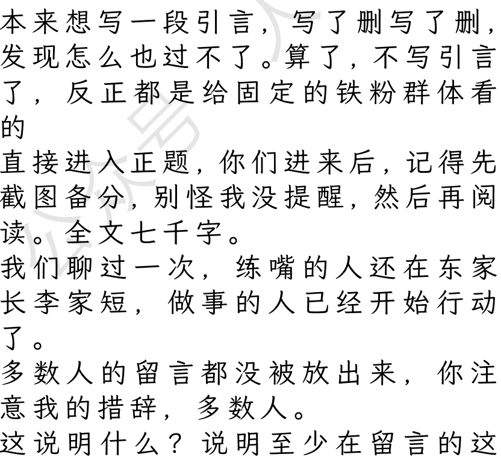

# (西风付费文)有些秘密，决策者永远不会告诉你

时间：2022-12-15
微信号:jntsg8
微信号:jntsg2

免费资料群

群体里，想赢的人未过半。
为什么会出现这个现象？
其实很简单，因为大多数人都是听命令的而非发命令的。
执行命令的人，站在本人的立场上，也是希望命令的准确度高的。你像张飞领了诸葛亮的命令，到某个关险处把守，希望敌真的会来；关羽领了诸葛亮的命令跑到上放水，希望会淹个寂寞。
谁也不希望自己像没头苍蝇一样被调来调去，回回打空，没有苦劳，也没有功劳。
但真正发命令的人很清楚，自己的命中能有三成，妥妥的业内传奇了。
三成的意思是说让你的手下提前去埋伏，10 次里面有 3 次不走空。还有 7 次怎么样？当然是走空了。
一般来说，你遇到的绝大部分上司的命中是不可能超过一成的。
正因为大部分人从事的都是听命事的工作，都是执行命令的人，所以他觉得，成功的关键在于什么？在于决策。

加微信intsg2，资料分享群

你把路都给我指错了，你让我怎么赢？
这种观点会被他们平移到生活当中的时刻处处。你比如投资，绝大部分人都会认为为什么最重要？眼光最重要，所谓买对的股票。

买对的股票，要能涨的那支；进对的公司，要能上市的那个；娶对的老婆，贤惠的那位。
这就是绝大多数人的思维惯性，他们的人生经历决定了他们一定是这想问问题的。为什么我不这么想？因为凭巧两种事我都做过，我既做过听命行的，也做过发布命令的。

在听命行的那些年里，我也幻想过诸葛亮，但是很快就放弃了，为什么？因为我的经历足够丰富了。经历丰富很有助于你理解一个角色。
一个女人，如果一辈子从一而终，你只跟一个男人有过亲密关系，你很难说你懂男人。你对这个男人不满也许是他的问题，也许是你自己的问题，也许是相处方法的问题。

如果这个女人是老鸦呢？起了，你才能懂一切。我当年做执行者的时候，就是老鸦级的。不仅被直接上司指挥，不仅被越级指挥，而且驾带着很多很多多商派来的杂七杂八的团队从事联合行动。
一千个不敢说，但是我当年和几百个决策者联合行动，这就足够的样本了。这么大面积接触下，我才给了你一个数据。我说命中率超过3成的决策者，已经是传奇了。绝大多数都不会超过1成。
就像一个良女子说男人没有一个好东西，这话没有可信度的，一个老鸭说出来，就有一定的参考价值。当我意识到根本没有诸葛亮的时候，我再去要求诸葛亮，有意义吗？
为什么我那天跟读者讲，绝大多数事情都是依靠执行而非决策？正因如此。
通常情况下，决策的成功率都低到难以以置信。那为什么有的团队总能赢呢？
很简单，看你能不能把队伍带回来。

我在职场上被火速提拔的原因

在这里，我回回都能把队伍带回我的指挥者，也曾学诸葛亮，给我一个锦囊妙计，告诉我，去哪里哪里埋伏，铁定能把敌人包饺子。
结果我一去，就进了敌人的包围圈。次数多了，有时候我都怀疑我的上司是不是敌人派来的，故意隐瞒。
结果我回回都能把队伍带回我的指挥者，也曾学诸葛亮，给我一个锦囊妙计，告诉我，去哪里哪里埋伏，铁定能把敌人包饺子。
结果我一去，就进了敌人的包围圈，方向对了还是错了。
所谓的执行者，就是每次都拿错的锦囊，每次都落空。
所谓的执行者，就是每次都拿错的锦囊，每次都落空。
所谓的执行者，就是每次都拿错的锦囊，每次都落空。
所谓的执行者，就是每次都拿错的锦囊，每次都落空。
所谓的执行者，就是每次都拿错的锦囊，每次都落空。
所谓的执行者，就是每次都拿错的锦囊，每次都落空。
所谓的执行者，就是每次都拿错的锦囊，每次都落空。
所谓的执行者，就是每次都拿错的锦囊，每次都落空。
所谓的执行者，就是每次都拿错的锦囊，每次都落空。
所谓的执行者，就是每次都拿错的锦囊，每次都落空。
所谓的执行者，就是每次都拿错的锦囊，每次都落空。
所谓的执行者，就是每次都拿错的锦囊，每次都落空。
所谓的执行者，就是每次都拿错的锦囊，每次都落空。
所谓的执行者，就是每次都拿错的锦囊，每次都落空。
所谓的执行者，就是每次都拿错的锦囊，每次都落空。
所谓的执行者，就是每次都拿错的锦囊，每次都落空。
所谓的执行者，就是每次都拿错的锦囊，每次都落空。
所谓的执行者，就是每次都拿错的锦囊，每次都落空。
所谓的执行者，就是每次都拿错的锦囊，每次都落空。
所谓的执行者，就是每次都拿错的锦囊，每次都落空。
所谓的执行者，就是每次都拿错的锦囊，每次都落空。
所谓的执行者，就是每次都拿错的锦囊，每次都落空。
所谓的执行者，就是每次都拿错的锦囊，每次都落空。
所谓的执行者，就是每次都拿错的锦囊，每次都落空。
所谓的执行者，就是每次都拿错的锦囊，每次都落空。
所谓的执行者，就是每次都拿错的锦囊，每次都落空。
所谓的执行者，就是每次都拿错的锦囊，每次都落空。
所谓的执行者，就是每次都拿错的锦囊，每次都落空。
所谓的执行者，就是每次都拿错的锦囊，每次都落空。
所谓的执行者，就是每次都拿错的锦囊，每次都落空。
所谓的执行者，就是每次都拿错的锦囊，方向对了还是错了没重要。因为你的战损几乎没有，能意识到这意思吗？战损几乎就是说你可以无限穿越战场，无限次进出。你有对的时候吧？对了你就没有损失，对了你就赢，这不就是稳定盈利吗？什么是关键？零损是关键的。巴菲特讲过句话，他说投资的第一准则是不输，第二准则是不输，你不输久了，总会赢。

很多人听不懂。为什么？因为巴菲特早年是高频出身的，大部分人不是。大部分人理解的不输是不输，不输就不会输，问题是不输也不会会赢呀。如果你和早年的巴菲特有过相似的经历，你马上就理解他的意思了。一年交易几千次，猜错了不输，对了赢，那不是你赢谁？这才是不输久了迟早都是你赢的原因，因为你把大家耗死了，你的战损是零，人家是正数，随着时间的推移，他们都会脱离战场，最后轮到你挣装备。
他是个高频出身的长线投资人，你不是，所以你并不明白到底在说什么。你以为他是靠预测的，人家根本不是。很多时候你听过别人说什么，不等于你听懂了别人在说什么。因为你们的经历不同。正是因为不同的经历导致了你不预测，你指望领导的决策，而别人清楚，降低每次战损，才是关键。你理解了这一点才能理解我此前说

加微信intsg2，进资料分享群

多次的那句话。我说的每一晚不是一种策略，是种高执行力。我多次引用过郭德纲的那个段子，人家问他哪一出的名，他说每一晚。

有些人明白了，有些人不明白，有些人觉得自己明白了了，其实并不明白。我记得曾有一个读者问我。我说过，我先做实习生，一年后做了内核工程师，两年后做了系统工程师，三年后做了软件架构师，五年后做了系统架构师，六年后做了副总裁，八年后变成了一个纯粹的资方。
她问我，是什么公司有这样完备的晋升途径，顺便还感慨一下，这样的公司现在很少见。
实话实说，是很少见，因为我自己没见过这种公司。
这段经历不是一家公司，甚至不是一个行业。涉及了家公司，多次创业，以及科技和金融。如果这段经历发生在一家公司，我认为除了老板之外，没有什么好解释的。

所以这不是多见与少见，这就不是你想的可能认为这段经历发生一家公司里？是什么导致你天真？你以为你在干嘛？你不起，你攀岩，其实是你自己。你攀岩，而且是没有安全绳的那种。有一部电影，叫做《攀岩》，记录了美国攀岩大师 Alex Honnold。他在漫长的七年里研究过此前所有命丧这山峰下的高手们的尸骸。

那种有一部电影，叫做《攀岩》，记录了美国约塞米国家公园一千米高的攀岩全过程。他在这七年里，漫长时间的准备。他复盘过所有高手的攀爬记录，他们攀的是哪条路线，什么天气，最后死在哪块凸起的石头，或者哪个转身的姿势。
他带着安全绳尝试过前人的所有尝试，而且摸索过各种可能的路径。七年，不停地爬这座山，在不同的天气下爬这座山，在不同的路线下爬这条山，用不同的方法爬这座山，他在干什么？他在整理数据。
Alex眼里没有与败这种笼统写法，没有的。他眼里是一个个的数据。他有自己的表格，上面罗列了不同天气，不同的路线，针对每一个转弯采取不同的技术手法，以及不同的高手各自的胜率。
最后就是一张表格，张三用A途径，B方法，在C天气下胜率是XX%，李用D途径，E方法，在F天气下胜率是XX%。

Alex是个很聪明的孩子，考上了名校，但很快就辍了，发现自己喜欢攀岩。离开学校之后，他就租了辆房车，从此住在车里，每天到处寻找合适的地方攀岩。无保护的情况下，征服了很多峰，攀岩是几代人的梦想，为此准备了七年。他重复这条路线，一遍，每一步，每一个姿势，都重复了无数遍。
有的位置，只能容纳半个拇指，有的位置，身体只能以什么姿势通过，当人疲劳的时候，以什么借力，怎样把全身的重量压在一个点的支撑上，完成高难度的动作，这一切，他重复过无数遍。
在Alex看来，这不是冒险，这是完美地完成每一个动作。如果你要说有什么不同，唯一的不同点就是：人家拿不到金牌，就得打道回府；而他，拿不到金牌，就会粉身碎骨。

所以这部拿奥斯卡奖的导演，大神级的夫妻导演国威和伊莎莉呈现给你看的不是最后的四小时，而是四小时之前的七年。Alex是不是一定能够完成？答案定的。摄制组跟拍了七年，他们做了两套方案，一套是Alex成功登顶，一套是他命丧悬崖。没有人知道结果，因为在这么漫长的拍摄过程中，摄制组已经彻底理解了他们拍摄的这些人，这件事这就是一个概率问题。

大多数最难以理解的两个概念，一个是概率，一个是时间。大家习惯了二元思维，成或者败。成或者败，事情结束了之后，站在观众的视角上，站在麻瓜的视角上，对于那个魔法师，对于那个做事的人，对于那个创业的人，对于那个投资人，对于那个亲身经历的攀岩者Alex，没有成或者败这种描述，没有。
