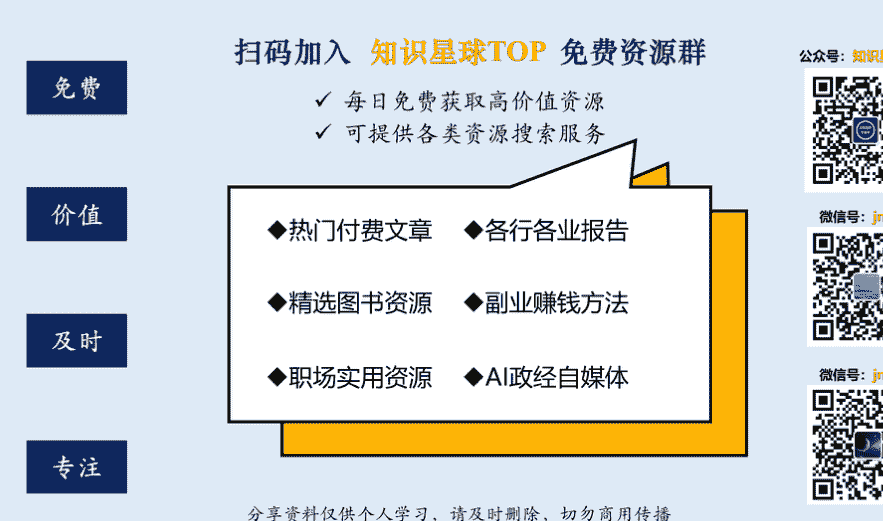
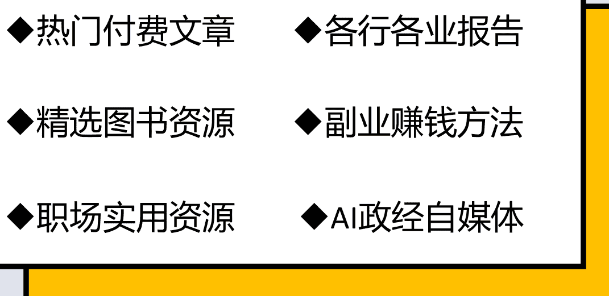

# 普通的房子到底还有没有前途？
250614 亿承载

一直都有人问我这个话题，就是问我那些不是核心城市，核心地段，不是高品质改善的房子类话题。我们统称为普通的房子。

单纯房子本身，不值得开一期话题，我准备以普通的房子为主线，聊两个大类。

第一个大类就是房子本身，普通的房子，售价不高的房子，卖给普通收入者的房子。这类房子本身的前景，城市的运营方围绕着这类房子的打算，新拍地王与二手房的关系，以及包括农村宅基地，城市地王周边二手房等读者们关心的话。

第二个大类则是普通人，确实地讲，就是普通收入的人。

普通的人有什么机会，普通的企业有什么机会，普通的岗位有什么机会。既然咱们讲普通，干脆一次性把普通讲到底。

# 人，企业，都标上普通，我们都在讲什么？

我们在讲经济。

大部分人的经济状况就是经济的晴雨表，我就是为了这碟，才包的这饺子。希望读者们能读出来......

全文有两万多字，一个前言+五个话题，文中多处有链接，俗称画中画，文中中文，阅读留心莫错。本文下面的留言，每一条我都会看到。

以下进入正文：前言部分：前情回顾。

房地产这个话题，我讲好几年了。21年之前的两三年里，读者每问我这个话题，我摆表达的态度基本上都是不看。不看的意思就是说，我觉得还不如投资点别的。确实有人说，我没有办法，我一家人得住候。所以那时候有读者问我自治，我的观点都是，你找一些高收入者密的板块。哪怕你不在那个区域工作，你尽量住在高收入者密的区域里去。

如今你再回忆，我想你能够理解我当年的良苦用心，你们家周围都是高收入者，不是有点流动性吧？那到了几年前，读者还来问我房产能不能投资，我就讲一种情况。也就是三核：核心城市，核心区块，高质量的开发商，要怎么样？要去摇。

高挂我的意思？好有个安全垫。你有可能破，但他破的概率总远小于人家同期高价买二手损的概率。事实上三核新房破发的概率极低，真正不容易的地方在于摇不中。这些年来，留言我反映说自己摇中的读者，屈指可数。因为三核外加高倒挂，几乎都是社保顶，一旦到了限售地步，你是投资的，又要选择放弃。那你连摇几年不中都很正常。可我们可以回头来说，我当年给出的建议，确实中签概率低，但至少不让你亏钱吧？这就是我一直以来的观点，我们可以做一件事情特别难，我们甚至可以最后做不到。但是我们不要亏。

你不要轻易的去做一件简单的事情，然后搞一个大的亏损，再用半辈子后悔。与其这样，不如去做一件难的事情，做不到就放弃，至少你没亏，至少你的本金在，你还有下次机会。

相反的案例我见过多了。18年的投资经历让我见过太多散户，余生只后悔一件事，后悔自己当初为什么要觉得自己自己。也就是说，他当初是想占便宜来的，余生只想回本，但再也回不了本。这就是为什么，我对你们建议的时候，从来都遵守巴菲特的那个原则：不要亏，不要亏，不要亏，我可以加难度，可以做难的事情，也可以做到，但是不要亏。

如果你不认同，那只能说，你心里太慌，还静不下。

那到了去年，我唯一一次讲二手房，我讲的依然是三核：核心城市段高品质改善。我说有些房东被砸了，一旦跌出穿仓毛利，这种二手房，可以接。有些读者接到了。到了今年的阳春期间，部分读者又来问，他们发现去年我讲的三核房产，回升了，从底部上来十几个点，甚至二十个。如果去年你捡到了穿仓毛利价，可能你的那套有30个点也未知。有些读者急了，想要追高，被我制止了。我说千万不要急，等春天过去，等流量季的到来，你再去看。现在其实还没等到夏天了，有些读者已经开始感慨，又被我言中了。有些阳春期间成交价上调15%，现在又回调7、8个点。三核房产是极贵的，那根本就不是工资阶层能负担的，差一个点都好多，你怎么7、8个点。这就是为啥我说，不要追。

## 第一个话题：普通的房子到底有没有前途？

前言部分，我把之前讲过的房产有关的主要观点，都整理了一遍。你会发现一个问题，我谈的都是三核。但其实更多人关心的，是普通的房子。

这里有两种情况：一种和自己生活的地方不沾边。国内有三核的城市本身数量就很少，哪怕我有钱，我不跟那儿生活。或者反过来，我确实生活在一个核心城市，但我的购买力够不上。这类房子统称为普通的房子。

### 普通房子的分类

- 第一类：房子本身，售价不高的房子，卖给普通收入者的房子。涉及城市运营方、新拍地王与二手房的关系，以及农村宅基地、城市地王周边二手房等。

### 核心逻辑分析

普通的人有什么机会，普通的企业有什么机会，普通的岗位有什么机会。既然咱们讲普通，干脆一次性把普通讲到底。

普通房子的前途，取决于人口的需求。在需求范围内，有人愿意买，有人愿意租。如果没有需求，普通房子就没有意义。

我从 2024 年就一直讲三核房产，因为我很清楚，下面的换换链是断的。你看核心城市、核心地段、高品质改善，你看着基本上企稳了，成交量也还行，为什么？

因为那是另外一拨人。拥有 80% 存款的 2% 里面的人依然富人，那 2% 里面相对穷的，买了总价 1500 万的，于是脱手了 1500 万的人，他去买 3000 万的。这部分人倒不差钱，他即便卖不出 1500 的，他也有钱买 3000 的，但他并不愿意买房太多。

所以还是得有人接接之前的房，他才会继续向上换换，也因为小范围内，换换链条打通了，这个局部市场就企稳了。

但是那个买总价 200 万的，他是真凑不出首付。所以你想让别人接的盘，你就得让人先有钱，而不可能说你都沉迷于提前退休了，对方在找食口呢，那他真糟不起。

你把这个底部的逻辑丢到美国，是一样的。我上一期开了个脑洞，我说如 1991 年，美国把制造业部署在美洲大陆。其实他们即便当年真这么做，也有很多人性的难题是无解的。

其中一个很重要的要素就是美国的资本，得耐心赚慢。得想办法提升美洲大陆的普通人的收入水平，缩小和美国人的收入差距。

你觉得那帮美国资本，乐意么？不乐意的。大家宁愿说我借债，我要移民火星，到时候所有人都可以提前退休啦。宁愿做这个。

因为说到底，做梦比做事容易得多，鼓励杠杆比实操真需求的钱容易得多。可反过来，容易的事情，问题也多。最大的问题是什么？出来混，始终是要还的。大家都希望我出来混，让别人还，哈哈。老美也这样，他混出来的问题，拉着我们还，我们不搭理，拉着欧洲还。

当年的二战就不这点事儿么？都想混，不想还，最后一起还。

你看懂人类的历史，就会发现很多你以为的永远，都是暂时的。巴菲为什么会在别人贪婪的时候恐惧，恐惧的时候贪？因为他看透了这一点。

每只虫都觉得春天不会结束，正冬的时候，它们也觉得不会结束。发债的时候你总以为不会结束，正如同发债的时候，你总以为永远都不会发债了。其实一切都会开始，正如它们都会结束。周而复始。

所以你不需要担心自己的收入不会增加了，这种担心是杞人忧天。长期看，收入总是增加的，因为货币税的存在，正如同长期看，每个人都会死一个道理。

第三个话题，需要你有钱的时候，你就会有钱的。曾经有个段子，电梯里有三个人，一个在高，一个在俯卧，一个在拿大顶。电梯升到高楼层之后，有人采访他们：你们是怎么上来的？

有人说我是高腿上来的，有人说我是俯卧撑上来的，有人说我是拿大顶上来的。可是就有人笑了，因为他是电梯里的第四个人，他一不动，也跟着上来了。

我们来看房地产这件事，这几十年的房产红利当中，的确少数是炒房客，有少数是想方法的。

绝大多数赚到钱的人是怎么赚到的？是莫名其妙就赚到了。你过去 80、90 年代单位分的房子，忽然有了市场价值；你毕业的时候房价低，买了自住房，忽然升值了；甚至干脆就是拆迁，祖祖辈居住的不值钱的地，值钱了。

这个过程叫什么？叫城市土地的货币化。城市土地作为资产，它一直沉淀在这里，几千年了都沉淀在这里，你太爷爷的时候哪不拆迁呢？

说是简单，过去那些年，发展城市要钱，只能向土地要钱，向城市土地要钱，于是城市土地这个资产就被货币化了。你想通了这一点，就会发现，财富是可以依靠空造出来的。拆迁一块地，一方面可以让城市发展基建的资金，另一方面也可以让被拆的那批人有钱去消费。这个过程就资产货币化。

过去的几十年，大部分的城市居民不是因为做对了什么，而是因为你需要钱，于是，你有钱了。你品，你仔细细品。

所以我，担心收入不会增加了，这件事情本身，是杞人忧的。你好好想看，城乡居民的收入是怎么大的？

或许，同样是农民，张三是大城市郊的，李四距离城市很远，张三拆迁得了一千万，李四还是李四。很简单，就是货币化的过程呀。张三家的宅基地被货币化了，李四家的还没有嘛。

我知道讲到这里，读者们会问什么，你们想要农村的宅基地，对吧？

的确，站在宏观视角下，广大地区的宅基地如果像前面十年的城市土地一样，能够被货币化，这是最大的潜在消费力。这比发什么补贴好使，比什么每个月退休金从 100 多涨到 300 多好使。

但是也要明白一件事。什么是货币？货币就是欠条。你看看香港上面印着什么？印着“欠据”。

（注：此处原文文本存在大量乱码和重复，已根据语义逻辑深度重组）

### 核心逻辑：土地货币化与收入预期

货币的本质是欠条，土地货币化是第一步。以下是基于原文内容的逻辑框架：

- **财富的来源**：绝大多数人的钱不是靠努力，而是靠上了“城市土地的货币化”。
- **拆迁逻辑**：拆迁让城市获得基建资金，也让被迁者获得消费能力。
- **收入差距**：80% 的人只有 20% 的存款，收入与消费呈现边际效应。
- **稀缺性**：只有当资产的稀缺性比 2% 的群体还要稀缺时，你才能跟着他们的购买力。

### 宅基地货币化的困境

宅基地如果想要货币化，面临以下核心问题：

1. **接盘侠问题**：农村宅基地面积巨大，缺乏足够的接盘人群。
2. **价值支撑**：农村土地的价值不取决于土地，而取决于人的需求和稀缺度。
3. **功能属性单一**：
   - 工业：难以大规模城市化。
   - 农业：耕地无法货币化收益。
   - 度假：这是唯一可能的路，但受限于配套设施。

### 结论

宅基地可以货币化，正如昔日城市地的货币化。但它能及的人群极少数。

  同样的“拆”字，含金量是不同的。当年城市货币化人们得到了好几套房，你或许只能得几辆经济型的车。

吃利息，这辈子的总收入，也明显比上岸那个强呀。

她不理解为啥父母那样想，也不理解为啥社会都说，码农的年收入，至少赚到上岸的两三倍，才能等价。

难道大家的金融都是体育老师教的？

我看到后就乐了。

大家的金融是谁教的我不清楚，但老人终归有老人的经验，因为都是过来人。

年轻时候还没见过几个靠运气赚钱的人呢？

有多少人能守住？

没几个。

父母那代人看待这件事很简单，两个字：常识。

一个普通人，他年轻的时候如果是运气赚到的钱，他能守住吗？你说起来都很简单，一个码农赚1000万，然后吃利息，现实中没几个能做到。

那个上岸的，每个月的工资就那点，很多都是要扣公积金，都是福利，不是现钱，他想要买个大十万的车，可能吗？

不可能，现实管着他，约束着他，他慢慢被逼得量入出了。

过来，一个年轻人，毕业就高薪，买个50万的车不过分吧？每年换个新款手机不过分吧？平日里消费不过分吧？

那么接下来，让太太全职不过分吧？让孩子读国际学校不过分吧？

赚的多，花的也多，消费这东西，上去容易，下来难。

都攒了1000万，咬牙，加个杠，ALLIN，投资个什么，万一楼层跃了呢？

是不是都这么想的？

其实父母那代人担心的就是这个，你真要是巴菲特那种，他本来就是靠玩钱赚的钱，父母反倒不担心了。

人家就这碗饭的。

父母那代人最怕的就是你嫁给青春饭，他们是怕你年轻得老体衰，因为他们见过了。人生不会一帆风顺，往你年轻的时候，容易赚快钱的年代，投资回报率也很高，进而利息也很高。

银行是靠存差过日子的，投资回报率高，利息才有可能高。

等你这个码农40了，即便你年轻没有消费，中年也没有乱投资，真攒了1000万，你也会发现，进入低利时代了。

你根本拿不到多少利息。

过几年，又然通胀了，你发现投资也不是办法，因为你的钱贬值了。可那个上岸的，人家的收入，是随着社会的变化，水涨船高的。也就是说，人家赚的不是一份薪水，是一份购买，是一份在任何时代下，都相当于中等人家的购买力。这才是父母代的考量。

人家的盐比你吃的多，人过的桥比你走的路多，这就不是一笔经济账，这是一笔人性账。

而你说你的那个码农男友，他要是能走出这一切人性的坑，经济规律的坑，那就不是个普通的码农了。他就是个人人才了。

有真本事的人，有硬实力的人，才能靠自己的力量，穿越周期。

所以你想透这一点，就会发现，所有靠债的钱的所谓好时代，某种意义上，恰恰是甜蜜的陷阱。你没有赚快钱，你也不容易背着很大的债。反之，往往会因为穷入入难，看似曾经有过风光，但最后结算，都是过眼烟云。

这就靠运气赚到的钱，不仅会因为实力输回去，还会因此背上这辈子还还不不完的债。

## 第五个话题，这是最差的时代？这就是最好的时代。我们从普通的

## 我，一直说到普通的人，最后一个的话题我想讲点什么？

我想讲，我们该做什么？我们能做什么？

我举一个商业案例，一个最近暴雷的案例。

出于各种原因，我隐去了这家企业的名字。

简单来说，就是几个顶流高校毕业的学生，放弃了大厂的offer，去做了一门生意，装修。

这不是一个乱创业的故事，因为这几个学生是有几千万粉丝的网红，而且都是垂直领域的。

也就是说，粉丝都是有装修需求的人。

按说，这种天胡开局，怎么会暴雷呢？

> 答案很简单，对经济所处的阶段，没有清醒的认知，以至于方向走错了。

他们把大量的钱，花在了装修展厅，比如装修几千米的展厅，万平米的展厅。但是我们想想看，装修这件事，客户的是什么？是购物体验。

最后他看到自己家里，是什么？最终的结果是一塌糊涂。很遗憾，他们做得非常好。

他不是你哄他下单的那一刻，欠货的贷款，由于各种原因，他隐去了投资的钱。

你知不知道，同样的大环境下，同样是互联网思维，这里的差异在哪？答案很简单，客户的需求不同。

开一个盲盒，客人买一个卡片，他在追求什么？

最终交付给他的商品本身多少价值重要，他要的是购买。

看到了吗？任何时期都有机会，或者一个时代，模式变了，从谁胆大，变成谁是发烧友。

## 装修完了，越是难。这种扩张规模的。

因为债务在扩张，这个时期，买房子总是能卖掉。

就是速度快，比胆子大不如步子大。

现在呢？昔日胆子大，步子大的那位在广场，在还债。

胆子大，步子快，而是人家弄清楚了，年轻人要什么？属于自己的小确幸。年轻人不喜欢喝酒，也不喜欢玩，喜欢收集卡片。所以人家瞄准的是购物体验，这个东西足够便宜，交付就不会是问题了。

确实是一张卡片，可是卡片之间朋友可以炫耀，我得到了愉悦的体验。

说了这是什么？这不就是新时代的家具吗？年轻人玩了，但是他们想要炫耀的那颗心，又改变了，按照时代需求，把整个文创重新做。很多人都按照这个思路，把生意做成了。有人把黄金，用全新的思路，设计成首饰；有人把铜，用全新的思路，设计成工艺品；有人把抽奖，用全新的玩法，设计成游戏。

不仅创造了商业上的神话，有些甚至创造了资本上的神话。就像你去日本，80年代的时候，有LOGO的例如奢侈品，卖得很火。到了居民部门负债表修复期，有LOGO的生意，无印品牌，卖得很火。

你自己不是一个有趣的人？你不能用你的独特，把原有的行业解构掉，给大家带来眼前亮的全新的产品？或者体验？你不是这样的人，不等这样的人没有，而且还有。无论是黑猴的横空出世，还是拍摄芜的导演，你站在资本的视角，会看到大量的有趣的年轻人。

他们就是下一代的风云人物。里面没有你有呢？

我希望有。就像多年年前，马老师说的那句话，他说明：未来能赚钱的孩子，不是可以为了钱很努力的那种人，而是很会玩的那种人。

现在玩的时代，机会给到你了。你不要小时候读书时想玩，现在给你机会，你说自己已经变得很无趣，也没啥想法，就没了。就像企业一样，总能脱颖出的，就像房子一样，总能脱颖而出，就像人一样，总能脱颖出的。但很遗憾，从来不是一起。昔日的侏没一起脱颖而出那回事，那么接下来的白世纪，也是一样的。

# 免费 价值 及时 专注

# 扫码加入 知识星球TOP 免费资源群

- 每日免费获取有价值资源
- 可提供各类资源搜索服务

| 热门付费文章 | 各行行业报告 |
| 精选图书资源 | 副业赚钱方法 |
| 职场实用资源 | AI经营自媒体 |

公众号:知识星球TOP  微信信号:jntsg8  微信信号:jntsg2

分享资料仅供个人学习，请及时删除，切勿商用传递
