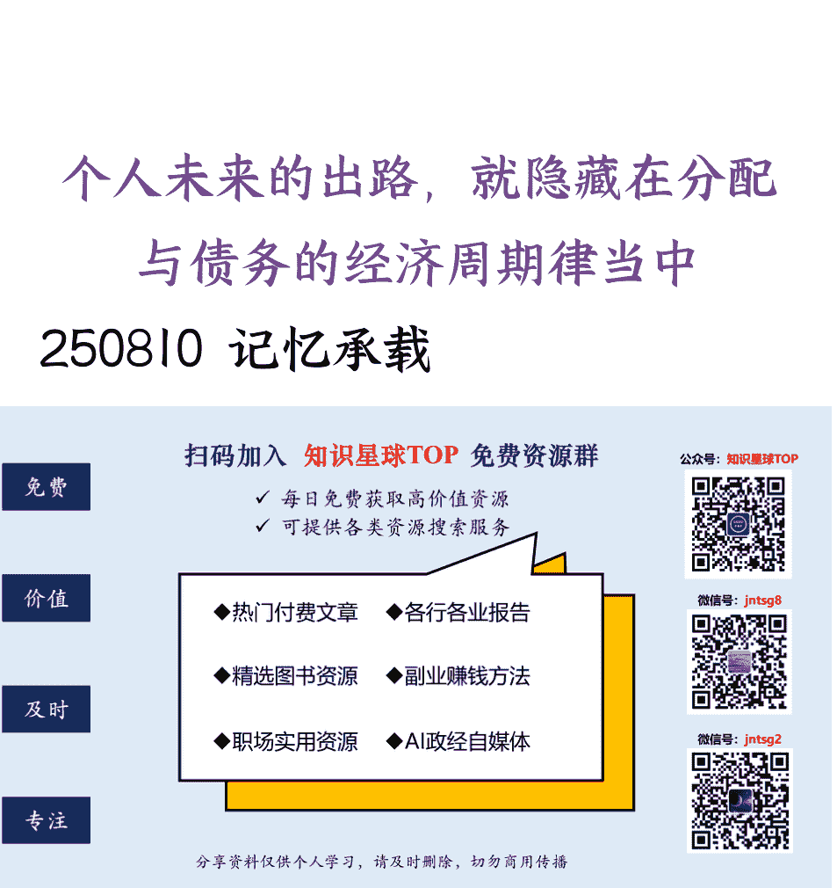

# 个人未来的出口，就隐藏在分配与债务的经济周期律当中

# 250810 记忆承载

# 记忆承载付费合集和解读意见专属群内分享

今年三季度以来，尤其是这个月，我去年十月份强调的，埋加微信jntsg2，进资料分享群。

伏在草丛里的八个军团，终于陆续出来了。

我们看到了很多关于促销费，关于补贴，关于福利的提升，都在纷纷纷纷展开。

于是很多读者留言，希望我聊一期经济话题。

我不想就事论事，我想借此机会，聊一个深层次的话题：经济的周期律，确切点说，人类不同生产力阶下，关于分配与债务的经济周期律。

大多数人一生的命运，包括我们这一代，下代人的出口，都落在不同时代的这个分配与债务的周期规律之下。

全文两万一千字，共两大话题，文中多处有链接，俗称“画中画”，文中文，阅读时留心莫错过。

本文下面的留言，每一条我都会看到。

以下进入正文；第一个标题：你看不懂生产力的三阶段对社会的重塑，你就做不好选择。

我们今天从什么地方讲起呢？

就像盖楼要先打地基，我们自然要从最深层次的地方讲起，从地基讲起。

这个地基就是生产力，它的不同阶段决定了社会形态，以及你看到的各种商业机会，最后才衍生出个人选择。

石器时代，农业社会我们不去讲了，这个太遥远，我们从工业化开始。

工业化诞生了之后，生产力可以划三个阶段：初级、中、高级。

生产力在初级阶段的时候，其典型的社会特征是少数哄多数人劳动，并且给多数人发工资，然后多数人去负责消费生产出来的商品里的大部分，其余的，通过负债来消费。这个少数人，我们把他叫做工厂主。

工厂主在产品发布会的时候哄着买车，回到工厂里，哄着工人造车。这叫做“两头瞒”。

我们想象一个简化后的模型，我们把社会浓缩下，假如只有100个人，1个是工厂主，99个工人，这是他们在生产中的关系。

下班之后，他们都有同一个身份，那就是消费者。

其实就是一个最简单的百分比饼图，我只是方便你想象，没给你加百分号，你把1%的人理解成工厂主，99%的人理解成打工仔，就变成了数学模型。

好，在这个模型中，假设通过这个工厂主悠悠99个工人劳动，生产出来了价值为n100的商品。

那么请问，他们会不会按人头分钱，每个人都只拿1呢？当然不会。真这么干，千多千少都一样，干好千坏都一样，创造不创造都一样，那就没有积极性了，就不会诞生工厂主。

绿茶肯悠悠，你还是图钱呢，要是没有好处拿，工厂主才不会悠悠你。

所以这个分配的方案是工厂主独自拿走了40，其余的99个工人分60。

这99个工人之间也不会平均分的，工人里面的高管、主管们多拿，基层里面有不可替代技术的多拿，销冠多拿，包括被工厂主安排的小舅子多拿，都很正常。

## 这么分配完了之后你会发现一个问题，那就是这99个工人所产生的购买力总数，顶天了，也只有60。因为你分到的蛋糕总额，也只有60呀。

工人里面的管理层、技术大、小舅子们，是不是总得有点结余、有点积蓄？你一个月薪十万的高收入者，尽管还属于打工仔，但你不太可能月光吧？

所以这个总额一定是60，比如我们假设它是50。除此之外，还有一个消费者，就是那个工厂主，他分走了40。

（注：此处OCR文本存在大量重复和乱码，根据语义逻辑，已剔除冗余并还原为“工厂主，他分走了40”的逻辑）

## 这么分配完了之后你会发现一个问题，那就是这99个工人所产生的购买力总数，顶天了，也只有60。因为你分到的蛋糕总额，也只有60呀。

工人里面的管理层、技术大、小舅子们，是不是总得有点结余、有点积蓄？你一个月薪十万的高收入者，尽管还属于打工仔，但你不太可能月光吧？

所以这个总额一定是60，比如我们假设它是50。除此之外，还有一个消费者，就是那个工厂主，他分走了40。

（注：原文后续部分出现大量逻辑重复和乱码字符，以下基于文中“生产力三阶段”的核心逻辑进行结构化还原）

### 生产力的三阶段对社会的重塑

1. **初级阶段：工业化初期**
   - **特征**：少数哄多数人劳动，发工资。
   - **分配**：工厂主拿走40%，工人分60%。
   - **模型**：体力劳动（流水线）。
   - **问题**：当工人分到的蛋糕下降，消费力会减弱时，出现螺旋下降。

2. **中级阶段：工业化后期**
   - **特征**：劳动力形式改变，脑力劳动占比提升。
   - **模型**：从“理发匠”变为“工程师/白领”，从“车间”变为“办公楼间”。
   - **分配**：总商品额扩大到200，工人分得120。
   - **解决**：通过负债消费，将未来的工资挪到今年来满足需求。

3. **高级阶段：AI与自动化时代**
   - **特征**：生产力发生质变（如35个人完成3.5万人的工作）。
   - **矛盾**：生产力与消费力严重错配。35个劳动者提供了巨大的生产力，但无法提供对应的消费力。
   - **结果**：对负债的要求越来越高。

## 总结与思考

总得有人借钱去产生消费力。你看懂我今天说的这个分配方式的经济模型，就能看懂美国过去做了什么，以及当下在做什么，未来要要做什么。

因为他走得最快，高级阶段的问题也是他第一个遇到的。他遇到这个问题，他就只能想尽办法扩充债务上限，比如美国搞稳定币，就是一种策略债务上限扩容的策略。

那么我们不由得会思考一个问题：为什么非得发债呢？少数人拿了这么多，多数人拿了这么少，这件事情本身就有问题呀，直觉难道不是这样吗？

这样，但这里有一个巨大的精神层面的包袱。我们来想：一个团队，老板需要张三，张三干得多、价值也大，只是出于某种不公平，老板让张三少拿了。这种事好不好纠正？相对好纠正。因为大不了不要这个老板了，张三不是价值大吗？张三自己独立出去，张三自己当老板。

此前某个网红和他的老板之间的问题，大家觉得这种事是可以解决的吗？

说到底，这个世界上你看到的一切，都是人家在这条路上已经探索了几代人之后的结果。没谁是傻的。再傻，摸索几十年，博弈几年，你能想到的，人家也早就试过了。

你去日本，搞来搞去也无非就是继续负债，然后给没啥社会竞争力的张三们，再发点生育补贴。

再多生一个试试嘛，万一生出一个爱因斯坦呢？这就不等于抽奖中了么？

你去美国，搞来搞去，也无非就是怎么搞稳定币，怎么继续扩大债务规模。

用债务去填补这个越拉越大的生产力和消费力之间的差额。

这就是我前面提到的，所有的解决方案，都需要契机，当聪明的阿凡遇到愚蠢的巴依老爷时，就有办法。

当你明明是那个输出最多，本事最大，创造了生产力的孙悟空，却没有得到匹配的回报时，就有办法。

如果不是上述情况呢？

如果阿凡与巴依老爷合体了呢？聪明的就是有钱的那个呢？

如果你只是浪浪的小妖怪，人家孙悟空一棍子可以打死三万个妖怪，你三万天也打不死一个。

## 那这个性能该怎么算？

现实当中就是这个问题呀，我们小时候有很多地方性的品牌，每个地方都有自己的啤酒，现在这种底部品牌还能活下去吗？

我们小时候有很多小店，有各种小厂生产的食品，商品，他们卖的东西不一定多性价比，如如今互联网时代，他们还存在吗？

当一个人一场发布会就能卖几万台车的时候，他就是孙悟空；而那无数个业绩为零，不得不抱着个人物品离开公司的汽车销售，就是浪浪山的小妖怪。

所以问题从来不是公平，问题在于太公平了。

如果公平是谁创造的生产力，谁该得到消费力，那么生产力就是少数人创造的时候，按照公平法则，多数人，就是没办法被分配消费力。

于是，生产力和消费力不同步。

我们可以能够人为的破坏坏谁的公平？

生产力明明是悟空创造的，我们可以偏要分配给没有功勋的浪浪的小妖怪么？

不可以，这么做，就击了真正能够创造价值的人，他们就会就会奔驰，就会流失，就会资敌。

一家公司，是没法把保阿姨都留下，把销冠都赶走的，那你就真变成家政公司了。所以，除了用举债的方法竭力弥补这种生产力和消费力之间的差额，还能做什么呢？

只能悠悠。

你看美国就在致力于忽悠，今天忽悠富人们们花几个亿搞个太空旅行，明天忽悠富人们们再怎么金融消费下，去投资什么滴血人工。

没法子，孙悟空这个群体，钱太多，人太少，不整花头，如何拉动消费？

但实话，即便整蒙头，孙悟空们的人数总额有限，也拉不动消费总量的财务黑洞，还是不断的在产生。

好，当我们把整个世界的过去，现在，未来的脉络都梳理清楚，你就会发现很多忧虑是不必要的，很多现象是可以得到解释的。

前者我就不去举例子了，这东西太容易引发歧义。

我只说句话，通过前文的描述总结出来的一句话：一个人，这辈子，唯一该忧虑的，是自己到底有没有价值。

除此之外，一切都是精神内耗。

## 你足够有价值，一切问题都不是问题，你所有的担心焦虑，归根结底，还是你价值不到位

你自己慢慢品吧，我这番话其实包含了太多太多场景。那么第二件事情，我举一个现象，比如上岸的考试热度，已经超过了考研。

怎么看？答案就是前文所述，当很多人发现，我既可能是马斯克，也不可能进 WhatsApp 的时候，他明白的是什么？是：“其实我不具备竞争力”。

他已经明了随着生产力进入高级阶段，的确不是每个人都有用，而随着 AI 的普及，这种没有没用的群体还在扩大。而更不幸的是，自己很难通过努力，晋升成为前百分之多少的有市场竞争力的群体。

那么这种时候，找到一份工作，就要比继续提高自己的竞争力，更重要。我读书，深造是要花时间花钱的，这么多时间砸下去，如果最后我还是没有竞争力的那个人呢？那不如一开始认清现实，先去找一份工作。

- 想要升迁
- 想要过日子
- 想要找一份工作
- 想要参与劳动
- 想要上岸
- 愿不愿意去偏远地区寻找服务性质的工作
- 愿不愿意在大城市找一份基层的工作
- 愿不愿意出海去发达国家定居去做最基层的工作

- 愿望当主角
- 愿望配角
- 愿望龙套
- 愿望台词
- 愿望背景
- 愿望彻底躺平

随着生产力的不断发展，社会基础福利一定是抬升的。因为生产力超出消费力的部分剩余，总得有部门去购买。第三方就会替你负债，将其低次的部分商品当作福利免费发放。这件事情我在第一个话题里讲得很清楚：不是为了你，而是必须这么做，不这么做，生产力和消费力不同步产生的矛盾就无法平衡。公共部门替你负债，让你了免费的低次的部分商品，你也不需要觉得欠了谁，你应该为自己发挥了用而感到自豪。

除去这些情况，是不是还有很多人觉得自己行？我相信一定有，而且很多，尤其咱们读者里面，特别多。所谓真的勇士，敢于直面现实，我看清楚社会发展规律了，我也知道时代竞争会越来越激烈，但我依然觉得行，我行，你行对吧？

我今天接下来的内容，都是写给那些一句借口都没有的读者。从这句话开始，依然往下阅读的读者，觉得自己都是行对吧？那我也不藏着，打开天窗说亮话：人这辈子，所有的安全感，都来自于你有用。

菩提祖师猴子参禅打坐，念经拜佛，猴子为什么不学？他说很清楚：念佛诵经，不如本事在身，求仙问卜，不如自己作主。你看这猴多聪明，不经意间两句话，道破了人类文明的发展脉络。

## 人类，是唯一一个企图掌握确定性的生物

所以才走出与动物截然不同的道路。人类远古时期摘果靠天吃饭，多轻松？为什么要辛苦耕作？求个什么？无非求个确定性而已，无非要把命运掌握在自己手里。从采集到耕种，获得的不只是更多的粮食，而是获得了确定性。在捡野麦子的时代，虽然活着轻松幸福，却是像普通动物一样，无法掌控自己的命运。那只猴子为什么三更夜求见祖师：“弟子愿学的，再苦再难也要学呀”？因为它想掌控自己的命运，它想求的不是长生，是我命由我的确定性。一只猴都明白的事儿，难道我们还不明白么？所以，这是一种选择。

与其说佛系了，不如说在时代，人与人的差距实在大了。放弃不是什么都不做，而是不断降低要求，从指望当主角到配角也行，跑龙套也行，台词也行，背景也行。如果你这些都不想要，彻底躺平也行。随着生产力的不断发展，社会基础福利一定是抬升的。因为生产力超出消费力的部分剩余，总得有部门去购买。第三方就会替你负债，将其低次的部分当作福利免费发放。这件事情我在第一个话题里讲得很清楚：不是为了你，而是必须这么做，不这么做，生产力和消费力不同步产生的矛盾就无法平衡。你应该为自己发挥了用而感到自豪。

除去这些情况，是不是还有很多人觉得自己行？我相信一定有，而且很多，尤其咱们读者里面，特别多。所谓真的勇士，敢于直面现实，我看清楚社会发展规律了，我也知道时代竞争会越来越激烈，但我依然觉得行，我行，你行对吧？

我今天接下来的内容，都是写给那些一句借口都没有的读者。从这句话开始，依然往下阅读的读者，觉得自己都是行对吧？那我也不藏着，打开天窗说亮话：人这辈子，所有的安全感，都来自于你有用。

菩提祖师猴子参禅打坐，念经拜佛，猴子为什么不学？他说很清楚：念佛诵经，不如本事在身，求仙问卜，不如自己作主。你看这猴多聪明，不经意间两句话，道破了人类文明的发展脉络。

人类，是唯一一个企图掌握确定性的生物。所以才走出与动物截然不同的道路。人类远古时期摘果靠天吃饭，多轻松？为什么要辛苦耕作？求个什么？无非求个确定性而已，无非要把命运掌握在自己手里。从采集到耕种，获得的不只是更多的粮食，而是获得了确定性。在捡野麦子的时代，虽然活着轻松幸福，却是像普通动物一样，无法掌控自己的命运。那只猴子为什么三更夜求见祖师：“弟子愿学的，再苦再难也要学呀”？因为它想掌控自己的命运，它想求的不是长生，是我命由我的确定性。一只猴都明白的事儿，难道我们还不明白么？所以，这是一种选择。

与其说佛系了，不如说在时代，人与人的差距实在大了。放弃不是什么都不做，而是不断降低要求，从指望当主角到配角也行，跑龙套也行，台词也行，背景也行。如果你这些都不想要，彻底躺平也行。随着生产力的不断发展，社会基础福利一定是抬升的。因为生产力超出消费力的部分剩余，总得有部门去购买。第三方就会替你负债，将其低次的部分当作福利免费发放。这件事情我在第一个话题里讲得很清楚：不是为了你，而是必须这么做，不这么做，生产力和消费力不同步产生的矛盾就无法平衡。你应该为自己发挥了用而感到自豪。

除去这些情况，是不是还有很多人觉得自己行？我相信一定有，而且很多，尤其咱们读者里面，特别多。所谓真的勇士，敢于直面现实，我看清楚社会发展规律了，我也知道时代竞争会越来越激烈，但我依然觉得行，我行，你行对吧？

我今天接下来的内容，都是写给那些一句借口都没有的读者。从这句话开始，依然往下阅读的读者，觉得自己都是行对吧？那我也不藏着，打开天窗说亮话：人这辈子，所有的安全感，都来自于你有用。

菩提祖师猴子参禅打坐，念经拜佛，猴子为什么不学？他说很清楚：念佛诵经，不如本事在身，求仙问卜，不如自己作主。你看这猴多聪明，不经意间两句话，道破了人类文明的发展脉络。

人类，是唯一一个企图掌握确定性的生物。所以才走出与动物截然不同的道路。人类远古时期摘果靠天吃饭，多轻松？为什么要辛苦耕作？求个什么？无非求个确定性而已，无非要把命运掌握在自己手里。从采集到耕种，获得的不只是更多的粮食，而是获得了确定性。在捡野麦子的时代，虽然活着轻松幸福，却是像普通动物一样，无法掌控自己的命运。那只猴子为什么三更夜求见祖师：“弟子愿学的，再苦再难也要学呀”？因为它想掌控自己的命运，它想求的不是长生，是我命由我的确定性。一只猴都明白的事儿，难道我们还不明白么？所以，这是一种选择。

## 真正有问题的，你不赚钱

所以当我们把问题聚焦之后，就会发现这个世界上压根就没有什么安全感。真正有问题的，你不赚钱。很多人喜欢回避真实的原因：钱不一定是你喜欢，也许是你爸爸有钱，但没钱的原因就一个，你不努力，你在回避这件事。你觉得高考考了全省五千名，成绩不好，让你不安，你想着考五百名就好了就了。你觉得上班会被输送到社会当人才，让你不安，于是你考虑了一堆证，你觉得有这些证你才安心。但我实话告诉你，五千名也好，五百名也罢，或者没有这些证，都只是别人给你构出来的世界。人家让你以为那些关键，其实他们把真正的关键隐藏了。我高中时文科排名是全年级第二，第一就是我们那一届的省状元。后来高考出来，那一届全省文科前几名被我们学校包圆了。学校知道自己的文科实力，为了总体利益最大化，忽悠我不要争文科状元了，去理科班争理科状元。我说理科排名全级十几名，真的有机会吗？老师悠悠说我根骨不凡，是理科奇才，把我纳入理科状元种子选手。结果我是陪太子读书的，是垫背的。我们全级前十的全省排名是前二十，而我的理科排名一直都是全省几十，争个状元。所以我高三一整年很郁闷，成绩一路跌一路跌，跌到全级十九名，最后高考全省一百多名。学校为了晃我？因为他们测算好了，有把握的不想自己内部抢，想让更多学生去抢学校没把握的。那我为什么想要抢状元？因为能出名呀，那是90年代，报社电视台不来采访你，你是不可能出名的。出名了就能出书，就能办辅导班，就能挣大钱。你看学校和我都是明白人，只是我经验不够，咽了对方的洗脚水。学校跟我讲，文科状元根本无人关注，你拿了也没用，也出了名，只有理科状元才会被热捧。这是实话，只是结果上我高估了自己，做不到。

但从目的的角度，双方都是捡得清。只是表面上看起来不一样，儒商和老板的区别，但骨子里一样，反正最后都是投机客。那有什么不安的呢？当你你知道做不了儒商也会老板的时候，你真的会对考试不及吗？

需要，又是怎么被定价的。那挣钱这件事对你而言，就不跟呼吸一样自然么？

这跟你小时候做过无数遍的各类事情有什么区别？没区别的呀。这一点，恰恰是人与人之间，最大的差别。

论成绩，我可能不如我高中时的年级前十名，但走入社会后，我竞争力强得多的。因为他们满脑子跨学科大红花，而我早早的习惯了，这就是门生意。在学校眼里，理科状元卖多少钱，文科只能卖多少钱，是有定价的。

然后这门生意的一小部分利益拿出去分给老师，老师再再去跟你讲什么跨学科大红花。

是这样一个模式。

而我当年想做的，是参与这个生意，而不仅仅是被做这门生意的人，当枪使。这是非常的区别，这个区别说明我对这个商业世界，对状元的商业价值，定价体系都是有认识的。哪怕我没有做成，起码我知道自己在干嘛，我不是在高考，我是在创业，而很多同学，他们知道自己自己在干嘛？

当你对这个商业世界的构成，运行，一无所知的时候，你很努力的考分数是为了换什么呢？你很努力的加油又是为了换什么呢？你自己都理不清的呀。

那你怎么可能参与这场的生产力越来越越往少数身上聚焦的竞争呢？

你又怎么会不沦在一群产品经理定义的消费主义下，换了一身债务的人呢？

他们绝大多数人都不理解的。或者说，他们理解的努力，和我理解的努力，是两码事。他们理解的努力是单纯努力这件事，而我理解的努力，是这份努力到底能换钱，还是只能换小红花？

这东西不叫功利，这东西叫做你知道自己在干嘛。

你千万不要觉得这东西随着年龄大了就会，不会自然生成的。如果你的目光主动聚焦在商业上，你小学生时代就可以有，就可以像我那样实际上变成一个小小的推主。如果你不肯把目光聚焦在商业上，你去给人家打工十年，你也不会被动的形成。

我沿着前面的例子，前面的例子是我高中时时期。

后来等到零几年，我读了研，我和我的同班同学，某次关于发论文有过讨论。他当时有篇论文不错，准备发 SCI，我就问他，你要读博么？他明确不要，硕士毕业就工作。

我说，那就没必要发 SCI。我们这种人，发两篇核心就能毕业，除非要读博，那至少要四篇 EI 或者两篇 SCI，当年的要求。

发核心最简单，就是 IK一篇的事儿，而且这钱导师给报的。随便对付下，咱好实习去，别跟学校里浪费时间。你就是发一堆 SCI，有卵用？公司又不需要这个，发再多 SCI，都不如有一年实习经历。你不如把手头这篇 SCI 转让掉。路子我都给你联系好了，转让掉，你拿 5K，我作为介绍人，友情价，我只抽 IK。因为那个年代成立了很多新学校，这些新学校急需成果，否则他们立不住脚。于是就会给给他们新招的教师以奖励，一篇 EI 是 8K，SCI 翻倍。你站在那些人的角度想想，他绝对划算呀。他只是把他能得到的名利部分的利让渡给了你，他享受受成果，他肯定是乐意的，他背后的学校，也是受益的。

三赢。

这道理非常简单，就像打麻将，他手里有六万七万，他等着八万就能胡，我们要八万没用的。这个东西对他们学校有商业利益，对那个让渡奖金给你的的人，有人利益。对我们自己来说，要把这个虚名没用的。

说穿了，这就是个生意，你把自己想象成耶鲁刚成立时的校长，你不想办法做大名气你怎么招生进入收支平衡？如果你能提供他要的，那不妨和他做个生意。

我觉得我已经嚼碎了，讲得不能再直白。

## 这种三赢的事情，你多干两回，人家得名，你得利，你攒点钱首付，回头毕业就可以买房不香吗？他难接受，结果那一年，我出去实习了，他在实验室里，一连发了四篇 SCI，......当然他导师很高兴，因为四篇里面他导师都是第二作者嘛。他们实验室的硕士人人每月只有 300，这钱不是导师给的，这是规定的人人都有的份。也就是说，他导师是一毛不拔的铁公鸡，但是对他例外，他每月 600，其中 300 是导师给的。

四篇 SCI，换了多少钱？300*12=3600。六万多的买卖，愣是被他做成了 3600。6万块，那年代大城市里买套近郊的三居室，首付也不过六万块。...........本来一毕业就能有房的人，煮熟的鸭子被他给倒了，我我都无语。

然后他毕业了，去做了什么？去做了销售，去做了某个大厂海外销售。因为他没有实习经验，我实习了一年，有经验，所以我做了研发，他没有，只好做销售。其实班里那些混混最后也是做销售。你花时间去搞那堆 SCI 干啥？你既然是八万，最搞笑的是，他都要去做销售，居然去非洲，欧洲，你家里没钱，攒了钱了。

## 这种三的的，钱是不够的。

## 这种事情的，你打算去欧洲，回国没钱。

## 这种三赢的事情，你多干两回，人家得名，你得利，你攒点钱首付，回头毕业就可以买房不香吗？他难接受，结果那一年，我出去实习了，他在实验室里，一连发了四篇 SCI，......当然他导师很高兴，因为四篇里面他导师都是第二作者嘛。他们实验室的硕士人人每月只有 300，这钱不是导师给的，这是规定的人人都有的份。也就是说，他导师是一毛不拔的铁公鸡，但是对他例外，他每月 600，其中 300 是导师给的。四篇 SCI，换了多少钱？300*12=3600。六万多的买卖，愣是被他做成了 3600。6万块，那年代大城市里买套近郊的三居室，首付也不过六万块。...........本来一毕业就能有房的人，煮熟的鸭子被他给倒了，我我都无语。然后他毕业了，去做了什么？去做了销售，去做了某个大厂海外销售。因为他没有实习经验，我实习了一年，有经验，所以我做了研发，他没有，只好做销售。其实班里那些混混最后也是做销售。你花时间去搞那堆 SCI 干啥？你既然是八万，最搞笑的是，他都要去做销售，居然去非洲，欧洲，你家里没钱，攒了钱了。

## 这种三的的，钱是不够的。

## 这种事情的，你打算去欧洲，回国没钱。

## 这种三赢的事情，你多干两回，人家得名，你得利，你攒点钱首付，回头毕业就可以买房不香吗？他难接受，结果那一年，我出去实习了，他在实验室里，一连发了四篇 SCI，......当然他导师很高兴，因为四篇里面他导师都是第二作者嘛。他们实验室的硕士人人每月只有 300，这钱不是导师给的，这是规定的人人都有的份。也就是说，他导师是一毛不拔的铁公鸡，但是对他例外，他每月 600，其中 300 是导师给的。四篇 SCI，换了多少钱？300*12=3600。六万多的买卖，愣是被他做成了 3600。6万块，那年代大城市里买套近郊的三居室，首付也不过六万块。...........本来一毕业就能有房的人，煮熟的鸭子被他给倒了，我我都无语。然后他毕业了，去做了什么？去做了销售，去做了某个大厂海外销售。因为他没有实习经验，我实习了一年，有经验，所以我做了研发，他没有，只好做销售。其实班里那些混混最后也是做销售。你花时间去搞那堆 SCI 干啥？你既然是八万，最搞笑的是，他都要去做销售，居然去非洲，欧洲，你家里没钱，攒了钱了。

(注：由于原始OCR文本存在大量严重的重复和乱码，以上内容已根据语义进行了逻辑去重与纠错)
