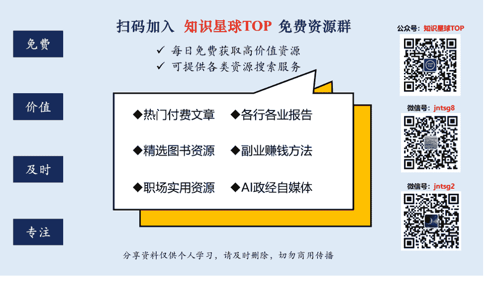

# 某某大学的，实际上就是问，回馈
才能对得起自己的付出
220817 记忆承载

很多读者在背后发消息，让我聊下某大学的事儿。

不是我不认同你，我打心里一百个、一千个、一万个认同你。

可是我觉得没用，理解吗？
如果今天我们花几千字聊些这个，我相信十年后还是一样的，就像十年前。

那我们到底图什么呢？为什么呢？为了你输赢还是为了发一通牢骚？
我是个理科生，我对于概率为零的拯救银河系的事情没兴趣，我对于概率为1%，能够改变万人命运的事情很感兴趣。

因为前者相乘之后，数学期望仍然是，后者相乘之后，可是真的有改变百人的命运啊。
这就是一个标准的理工男。

在我看来，改变一个人的命运，哪怕改变了一个人的命运，也好于空谈拯救银河系最后什么都不落了。

微信jntg2，进阶分享群

学城这个话题，来说来说去，你本质上是在问什么？

你在问我一个回报率的话题，你觉得你的回报对不起你的付出，是不是这点事儿？

其实很多人看了此前人形核电站一期，就问过相似的问题。

他们问我：“你觉得得牛B和赚钱，是不是一码事？”

这个真不是，不牛B还想赚钱，那你只能指运气；可是牛B，并不意味着你一定能赚钱。

很多人是有才的，目标也有，动力也有，人也自控，也能足够心力来为十年的目标花十年的时间去做。但它怎么说呢？就是事半功倍，总是付出远大于回报。就像我们都佩服二舅，可是我们都清楚，二舅的得到配不上他一样的付出。

这是一个问题，这个问题就是说牛B你有了，就是不赚钱，这是意思吧？又或者说，怎么才能让自己的付出不要白费，尽可能跨领域获得真金白银的回报？就像巴菲特说的那样：“我的努力真的配不上我的所得，对我来说太浅了。”

无论我们多佩服二舅，我们都想像巴菲特那样表达自己的遗憾，而不是像二舅那样被人佩服了一下的事。难道不是吗？你敢说你这么想的吗？

这么想没有错，想要让回报对得起自己没有任何错，既然我们找到了问题，那就针对这个问题。让回报对得起自己。

全文七千字，下面进入正题。

我们吃透这个问题之前，我们一定要理解人性，这个世界归根到底是人的游戏。
我曾经说过：“金融比实体容易赚钱，是因为金融是渠，实体是庄稼。庄稼地没有水，渠未必没有水，庄稼地发大水，渠一定是满满的。”资料群：kaiwu7878

所以有好处，都便宜了渠。这叫近水楼先得月。

那么同样的道理，无论你具备什么样的才能，你做了什么样的事儿，只要这是人类的世界，什么是渠？人性就是渠。

你想向阳花木为春，你就要先理解人性是怎么回事，人是怎么想问题的。

历史上有很多大神，个人能力没有任何问题，但是最后，你被那些玩人的完了，比如韩国。

也有很多人，他的个人能力或许并不是最出众，可是他太懂人性，于是他把人家的果实给窃了，比如刘邦。

咱们先来看一个问题，反复有人问过我的问题。

很多人跟我说：“美元的背书不是美军吗？美元全球实力第一，这就是美元的背书呀。你不持有美元，提到就是了，提到持有为止，这不就是美元霸权吗？”

为什么你还说美元的背书是多种因素组成的呢？好，我们来看这个问题。

你想理解为什么美元的背书不仅是美军，这是非常简单的。换个参考物就可以。比如俄罗斯。

那些美军可以随随便的存在，俄军是不是同

有人说：“不对呀，俄军不是第一呀。”确实不是第一，问题是，so what？不影响使用的。

面对那些小家伙，美军怎么接就怎么接，俄军也是想怎么接就怎么接；面对那些同样能够让地球不长草的，俄军惹不起，美军同样惹不起。

那为什么卢布不是霸权货币呢？
你说全靠头大呀，你说准不听话修理准呀，为什么卢布不是呢？
很简单的例子就可以把你从思维区拉出来，因为这个世界上不存在绝对实力。

如果只有美军有核武器，那么真如你所说，美元的背后是美军了。
问题是，有核武器的，还有那么几个可以让地球不长草的，还有那么几个。

这就叫在不在灭灭的前提下思考问题。
美国很清楚他们不是灭灭，所以美军只是辅助工具之一，要成霸权货币，需要很多要素的。

韩信真要是灭灭，敲个响指就能让刘邦见上帝，那他后来也不会那么憨……到底，只要你没有成为灭灭级，就不可能靠单一的实力来解决问题。

项羽就是没想清楚这一点。之所以这是一个玩家的世界，因为谁也没有掌握绝对的实力。
能力很重要，可是没有绝对实力的前提下，运作能力同样重要。
俗称不能现的牛B是不完整的。美元能够取得霸权，至少需要三个要素：

第一个要素是巨大的市场。美国必须是最大的消费市场，是出口大于进口的国家。
第二个要素是长期信用，必须有足够的债。
第三个要素是军事实力，能够维持全球贸易。
