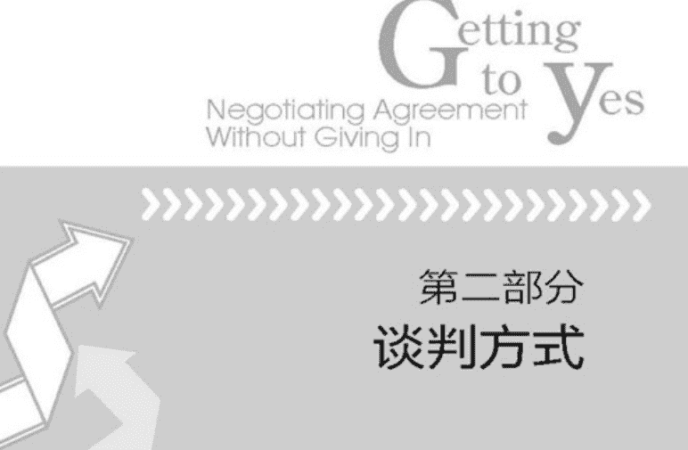
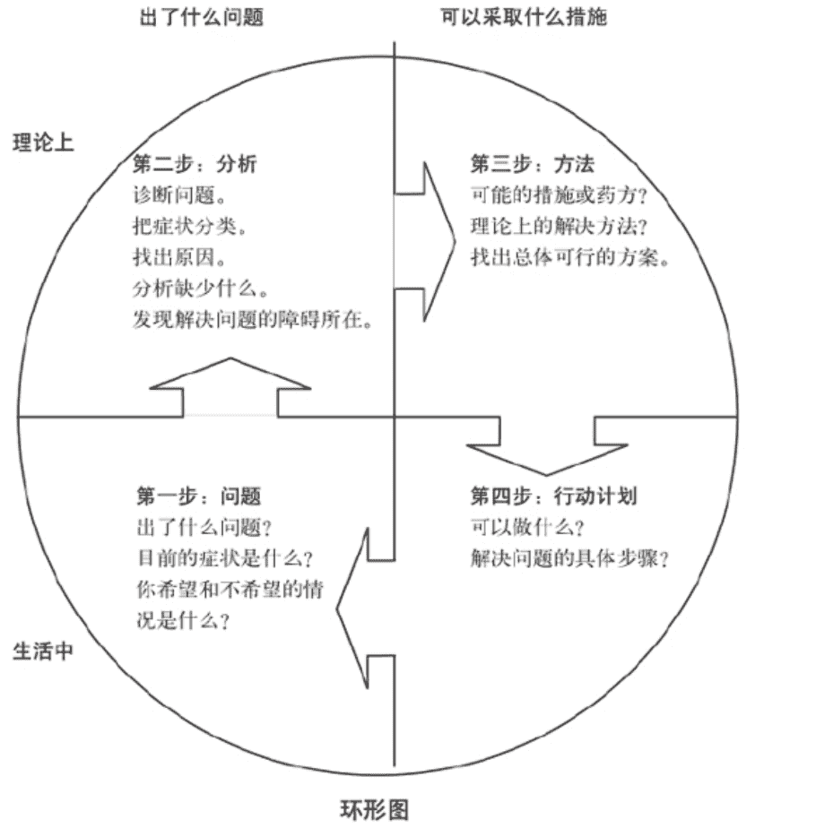
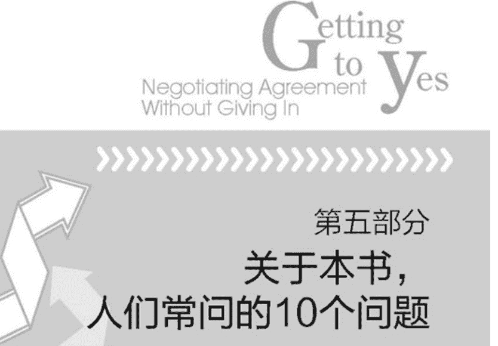

# 谈判力

微信:jntsg8
微信:jntsg2

免费进资料群

25年来全球最经典的谈判书籍！
哈佛大学关于谈判的最权威指南！

[美] 罗纳·费希尔、威廉·尤里、布鲁斯·巴赫 著 王燕 罗译

约翰·加尔布布雷斯 塞塞鲁斯·万斯斯 安·兰德斯

前美国国务院总顾问 著名专栏作家

联合力推荐！

# 图书在编目（CIP）数据

谈判力/（美）费希尔、（美）尤里、（美）巴顿著；王燕，罗昕译。
—2版··北京：中信出版社，2012.8

书原文：Getting to Yes: Negotiating Agreement Without Giving In
ISBN 978-7-5086-3434-0

I.谈...I.费…尤…巴…王…罗…III. 谈判力—通俗读物IV.
C912.3-499

中国版本图书图书CIP数据（2012）155764号

Getting to Yes: Negotiating Agreement Without Giving In, Revised Edition
by Roger Fisher, William Ury and Bruce Patton
Copyright © 1981, 1991 by Roger Fisher, William Ury and Bruce Patton
Published by arrangement with Mifflin Harcourt Publishing Company

Simplified Chinese translation copyright © 2012 by China CITIC Press
ALL RIGHTS RESERVED.

本书仅限大陆地区发行销售
谈判力（新版）
TANPANLI

著者：[美]罗杰·费希尔 威廉·尤里 布鲁斯·巴顿
译者：王燕罗昕
策划推广：中信出版社（China CITIC Press）
出版发行：中信出版社集团股份有限公司（北京市朝阳区惠新东街街4号富信大厦2座 邮编100029)
(CITIC Publishing Group)

京图字：01–2009–1473
书号：ISBN 978-7-5086-3434-0/F·2676
定价：32.00元
版权所有·侵权必诉

中信出版社官网：http://www.publish.citic.com/
官方微博：http://weibo.com/citicpub

# GETTING TO YES
Negotiating Agreement Without Giving In

## 前言

每个人每天都与别人进行谈判。就像里豪巷写下一册子谈讨吐雅的达尔文那样，我们都在不知不觉中就与别人谈判。比如你和情人商量周末去哪儿吃饭，或者和孩子告诉他们该去睡觉了。谈判是从别人那里寻求自己需要的一个基本途径，是与谈判对方存在相同和不同利益时寻求解决方案的交流。

突发利益增多，需要谈判的情况下也会越来越多。每个人都希望自己的事情由自己决定，人们越越不愿意听别人发号令。由于人与人之间，我们需要用谈判来消除分歧。不是在商界、政界，人们更多的是通过谈判来解决问题、做出决策。即使是打官司，人们经常在审判前庭和外。

虽然谈判每天都发生，但要谈出结果却不容易。对于通常的谈判技巧不是感到不满意，就是厌烦透顶，或者远而之——甚至三者皆有。

人们发现自己处在两难之中，有温和强硬两种谈判方法。温和总是避免双方的直接冲突，为了达到共识，他往往很快做出让步。他希望有一个愉快的解决方案，但却常见自己被别人利用而不得不下苦。强者者认为谈判是一场意志的较量，谁能取的立场更极端，谁能硬撑到最后，就能赢。他当然还想赢，结果往往是硬碰硬，但不得筋破力尽，驴筹技巧，而且伤害了自己和对方建立起来的关系。其他这些谈判技巧于两者之间，无非要在既有所有而无不可和气之中寻找平衡。

还有第三种谈判方法，既不柔也不强，却刚柔相济。有的“哈佛大学谈判”研究出来的这种“原则谈判”方法是根据事实本身的是非直寻求解决方案。而不是进行一场各怀合己的讨价还价。这种谈判方式建议双方尽可能实现“双赢”。双方利益出现冲突，必须让谈判结果基于某些公平的准则，而不是一一方的意志的转移。原则谈判原理是在道理、原则上强硬，对人则采取温和的态度。它不需要花招，却不需要装姿势。原则谈判让你得到想要的东西又不失风险，让你拥有自己的时间并保护自己不被对方利用。

本书是介绍有关原则谈判的方法。第一章述了原则谈判带来的问题，接下来的章节介绍了原则谈判方法的四条原理，最后第三章回答了谈判方式最常见的问题：对对方实力于自己怎么办？如果对方配合怎么办？如果对方使用手段又怎么办？美国官员与银行进行谈判可以采用原则谈判；华尔街代表“财富”进行诉讼也可以采用它；甚至夫妻之间商量到哪里或如何分割财产等问题都可以采用这种方法。

谈判的形式各相同，但基本要素异。无论解决一个问题还是多方参与；无论是有规定的程序，比如集体谈判，还是随机应变，比如性谈判，原则谈判都适用。原则谈判是一种通用的策略，它与其他方法不同，如果谈判对方掌握这种方法，那么谈判不会因此困难，而是更加容易。如果他们读了这本书，那就好不过了。

# 第一部分问题

## 第一章立场上讨价价

不论谈判是有关合同、家庭内部纠纷，还是国家间的和平，人们常常在立场上纠缠。双方站在各自的立场上争辩，最后作出妥协，找到双方都能接受的办法。这种谈判方式最具代表性的例子是顾客与老板之间的还价。

| 顾客 | 老板 |
| :--- | :--- |
| 这个镜子什么钱？ | 怎么样？ |
| 你光不错，75美元。 | 怎么样？ |
| 别了，我20美元。 | 太贵了。 |
| 好，60美元。 | 拿走了。 |
| 我37.5美元。 | 最多付25美元。 |
| 我真诚吗？ | |
| 你看上面的图案，这样的价格能翻倍。 | |

就这样谈下去，他们可能会达成共识，也许毫无结果。谈判的任何方面都可以通过以下标准来衡量：如果有达成共识，应该达成明智协议；谈判应当有效；增进至少减少双方的关系（双方利益公平解决冲突，具有持久性）。上述例子反映了最常见的谈判方法，就是不断采取立场。

### 在立场上纠缠达成明智协议

如果双方都从立场讨价，他们通常会抱着立场不放。你越声明自己的原则，保护自己的立场，你的立场越坚定。把你自己的形象当成了你的立场，把后的行为和过去的立场联系起来，使得谈判越来越可能成功。肯尼迪总统时期美双方谈判失败，恰好说明了立场上纠缠谈判造成的危险。当时主要的问题是：双方每年允许自己境内试验多少次？苏联方面最后提出是3次，而美国坚持至少10次，由于立场问题，谈判就破裂。双方都没有真正明白一个事实，即试验是指一个人处查一天，还是100个人选择一个月。双方都没有在设计程序上动脑，使它既满足双方利益，又能实现减少对方干预。由于双方将更多的精力投入到立场上，各自真正关心的问题被忽略了，达成协议的可能性变小了。最后的谈判结果也许只是机械地反映各自立场的差距，而不是认真考虑双方的利益，结果往往不可能双方满意。

### 在立场上纠缠缺乏效率

传统的谈判方式可能使双方达成协议，也可能让他们不欢而散，也取决于试验活动的次数，但两者都要耗费大量时间。立场上的妥协不会影响对方达成协议。为了让最终结果有利于自己，双方的起步越极端，而且越死守不，还狡骗对方，隐藏自己的真实观点，只有在不得已才做一点让步。以上每个因素都会影响双方有效协议。双方起步越极端，让步越小，谈判所需的时间就越长，所花的精力也就越多。传统的谈判方式还需要作者做出大量的决定，可能对对方任何条件做出多大的让步等等。决策过程是最耗费时间的。每一决定不仅是对让步可能会再次让步。此谈判者往往往返迂绕，威胁要离开谈判桌，阻碍谈判进程，或采取其他一些花招，这使得双方投入更多的时间和精力，增加不欢的可能性。

### 在立场上纠缠双方的关系

立场讨价完全是一场意志的博弈。每个谈判者都坚持自己的立场，本来双方合作解决问题的，却成了一场你死我活的战斗。每一方都试图用力使对方退后。“我不会让步的，要是我想和我去去看电影，就得看马允许，否则没！”——一方看到自己的合理要求由于对方压力而不得不重视，憎恨和恐惧往往占据上风。因此立场讨价会影响甚至破坏双方的关系：一起合作的企业集团可能会分道扬扬；诸君们不再说什么；一次咬牙齿带来的不愉快几乎一辈子都除不了。

## 多方参与立场谈判更为稳妥

各种人们总是习惯将谈判视为两个对的事情，但几乎所有谈判都涉及更多人。会有好几坐在谈判桌旁，有时每一方包括普通谈判成员、高层官员、董事会甚至各种委员会，这些都是谈判中要交道的对象。谈判涉及的人越多，立场谈判带来的问题也越多。像联合国会议那样，多个国家坐在一起，立场谈判几乎是不可能的。统一人的意见很难，妥协也难以实现：谁让步？即使达成了妥协，也不好。在这种情况下，立场谈判往往由不同派组成，共同利益通常流于表面形式而不实质性。由于集团由多个成员组成，立场谈判非易事，而且各自折中更加困难。此外，实际参与不是光坐在桌边的，还有立场都要经过他们的同意。

### 立场不能解决问题

许多人都认识到了立场的高代价，尤其是对双方关系造成的损失。他们希望通过一种温和风格避免冲突，把对方做朋友而不是对手。他们强调共识的必要性，而不是自己的目标。温和型谈判步骤是提出条件作出让步，信任对方，持友的态度。下面的表格分析了两种立场——温和型和硬型。大多数人认为谈判方式的选择介于两者之间，希望温和还是强硬？还是选择折中路线？

### 立场选择：哪种类型

| 温和型 | 硬型 |
| :--- | :--- |
| 对方是朋友 | 对方是对手 |
| 目标在于达成共识 | 目标在于胜利 |
| 为友谊做出让步 | 要求对方维持双方关系 |
| 对人和事采取温和态度 | 对人和事采取强硬态度 |
| 信任对方 | 不信任对方 |
| 容易改变立场 | 固守立场不动 |
| 给予对方实惠 | 威胁对方 |
| 亮出底牌 | 彻底自己的线 |
| 愿意接受单方面损失 | 把对方作为达成条件 |
| 寻找对方可以接受解决方案 | 寻找自己可以接受解决方案 |
| 以达成共识为目的 | 以坚守立场为目的 |
| 避免意志较量 | 试图在意志中争取取 |
| 在压力下妥协 | 给对方加压力 |

温和型谈判方式强调建立和维护关系的重要性。在家庭内部和朋友交往中采取这种方式有效，至少快速收获。由于立场做到宽容，达成协议通常不是明智的。很多决定都是自然形成的。并非对方来自另一个国家，特别是有特殊的背景，才可能认为必要对谈判过程有所考虑。但不管你是否意识到，采取的每一个实质性问题都是在“游戏”进行谈判，尽管这些步骤只有针对实质问题。是温和还是强硬？我们对二者都持否定，因此要改变规则。在“份额项目”中，我们针对立场发展了一种新的方案：一种旨在有效和友好的方式取得最优。

## 选择方案

如果不愿意在谈判中改变方式，谈判有两个层次：第一层次是解决实质问题；第二层次往往执着关注解决问题的程序。第一层次的重点可以是工资、租赁以及价格问题。第二层次关注是如何解决实质问题：通过温和、强硬或其他。这是关于游戏的，即“游戏中的游戏”。

结果的谈判方法，我们称之为原则谈判或者依据原则谈判。它四个基本要素。以下四点几乎适用于任何场合，每一点都围绕谈判的基本要素提出建议：

- 人：把人和事分开。
- 利益：着眼于利益，而不是立场。
- 选择：为共同利益创造方案。
- 标准：坚持使用客观标准。

第一点基于这样件事，即人非计算机。我们都是带有强烈情感的生物，每个人都有自己感知，有时很难做到无误地交流。感情容易客观利益纠缠在一起。表现立场往往会使问题恶化，是因为人们把立场等同起来。因此，在解决问题之前，应该把人问题与实际问题分开。形象地说，谈判者应该是肩并肩地工作，一起解决问题，而不是立场。所以第一点是把人和事分开。

立场式的一端会浪费谈判者潜在的利益，实际却把精力集中在自身的立场上。第二点就是针对这一极端设计的。谈判中的立场经常掩盖了你的利益需求。在立场上妥协无助于达成，也不能兼顾双方实际需求。所以第二点是着眼于利益，而不是立场。

在压力之下很难设计解决方案，第三点针对的就是这种困难。在对面面前做出决定往往让你目光短。决定越重要，就越不能发挥创造性，也就越难找到正确的解决方案。你可以抽出时间，以促进共同利益和协调冲突为前提，想出各种方案，从而抵消上述不利因素。所以第三点是：为共同利益创造选择方案。

总之，与立场式谈判相反，原则谈判注重基本利益、互惠方案和公平标准，这通常导致更明智的谈判结果。它让你有效地在一系列问题中逐渐与对方达成共识，而无须在死守立场和放弃立场之间消耗精力。把人和事务分割开，你才能真正把对方当成一个有血有肉的人直接有效地和他打交道，最终得到友善的结果。

以下四章是对四个基本要素的阐述，如果对哪一点有疑问，你可以翻阅最后三章找到有关这种谈判方式的一些问题的解答。

# 第二部分 谈判方式

## 第2章 把人和分开

人人都知道，解决问题时要双方相互理解、不发脾气，有分歧心里去会有多难。

一位工会领袖对着自己的工人说：“伙计们，谁提出的罢工？”

琼斯站了起来：“我是。又是因为那个混蛋工头汉贝尔，两个星期里他五次把我从自己组里挑选出来替别人顶班，他就跟我不去，我受够了，为了别人该我？”

工会领袖又去问汉贝尔：“为什么你总是跟琼斯不去？他说两个星期中让他做了五次替的活，为什么？”

汉贝尔说：“我选择他们是因为他是最棒的。别的组里没有顶班时我相信他能带好，要不是缺顶班我就让他史密斯或别人干了。现在因为雨好，很多顶班都病了。我从不知道琼斯不愿意，我还以为他喜欢干重要的工作呢！”

另一个真实生活中的例子。一家保险公司的律师对州保险专员说：“汤逸先生，我知道您的时间很贵。我想和您谈谈有关责任法提案条款的一些问题，我们认为这些条款的表述对于一些保险公司不公平，因为他们的保单中包含了调整限制措施，所以最好做出适当修改。”

专员打断：“孟逢女士，在联邦颁布之前我们部门就对这些规定举行过几次听证会。你们完全有机会在听证会上提出反对的意见。我主持了这些听证会。夫人，我当时听取了每一个证词，并自扉撰写了该法案所有条款的最后版本，你就是说我出了错？”

不，但是——

“你那是说我不公平？”

“当然不是，先生，但我认为，这些条款带来的后果是有我们未曾预到的，而且……”

“你的公司去年通过这个法案赚了5000万美元，你以为我是个傻子，到这里和我谈什么不公平、未曾预到的后果，我再也不想听到任何一句有关法案的话。再见，孟铁洛女士。”

现在应该怎么办呢？是不是在某一点保险公司的律师激怒了专员，让他生气了，结果两个人的对话一无所获？这家保险公司在该州客户很多，与客户保持良好的关系是非常重要的，即使孟铁洛女士坚持认为法案有失公允，可能对公众造成长期的不良影响，连专家在听证会上都没有预料到这些问题，她是否应该就此罢手呢？

在这些案件中究竟发生了什么？

### 谈判者总是人类

谈判中人性的一面也有其益处，但也会造成灾难性的后果。另一方面，达成协议的过程往往使双方产生一种心理期望，要得到相互满意的结果。一个建立在信任、理解、尊重和友谊的基础上，并经过时间考验的合作关系会谈判比一次一次愉快和顺利。人们渴望良好的自我感以及期望给别人留下下一个好印象，这会使他们更注重考虑对方的利益。

另一方面，人们也会变得愤怒、消极、胆怯、甚至沮丧，甚至会受到伤害。他们的自我意识容易被否定，他们用自己的角度看待世界，感觉与现实混淆在一起，通常他们会误解你阐述的东西，也表述不清你的真实意图。误解会导致偏见，引起逆反应，最终形成恶性循环；理性分析可能无法解决，由此产生。这种导致最后变成了一场争夺的游戏，双方互相攻击、嘲讽、辱骂，其代价是双方的实际利益均遭遇损失。

不要对手当作普通人，忽视他们的反应，往往会给谈判带来灾难性后果。在谈判中不论什么时候，从准备到后续工作你都应该问一下自己：“对我们关系是否足够重视？”

## 每个谈判者都有方面利益：实质利益和关系利益

让每一个谈判者都想达成满足实质利益的协议，这正是人们谈判的原因。除此之外，谈判者也重视保持与对方的关系。一个古董商既希望挣钱，又希望客户长雇。双方的合作关系有助于达到一个侧重利益的协议。然而还有更重要的目标。许多谈判是在人关系不发展的情况下进行的，因此谈判是围绕促进而不是损害人关系以及以前的谈判思路而开展的。事实上，在许多长期客户、合作伙伴、家庭成员、政府官员以及不同的国家进行谈判时，维持关系的意义远远远于某个谈判的结果。

人关系经常与问题纠缠在一起。谈判中人际问题带来的后果就是各方面的关系容易与实质问题混淆在一起。无论是给予的一方还是索取的一方，都可能把人和事等。家庭里，一句诸如“厨房简单一糟”或“银行里有多少存款”的抱怨仅仅是指出问题，却容易被认为是人攻击。对于当前形势的怒气也可能投射在心中。

人际关系与心理问题的另一个原因是谈判者经常对别人的话毫无根据，并与其自己的意愿、态度联系起来。稍留神就会犯错。之前的例子，琼斯不愿去，汉贝尔以为他喜欢干重要的工作呢！琼斯不愿去，汉贝尔以为他喜欢干重要的工作。立场式谈判对待人际关系与心理问题发生冲突。谈判成为针对立场的，使人际关系与心理问题不清。我认为对于立场就是希望谈判结果，从我的角度来看，我们之间的关系不平等。如果我立场态度坚决，又觉得不合理，这样不能得出结论：我不看双方的问题，或者我不看双方。立场式谈判对待实质利益和关系利益对立。如果对于这一点上不能与一致，那么。保险公司在该州客户很多，与客户保持良好的关系是非常重要的，即使孟铁洛女士坚持认为法案有失公允，可能对公众造成长期的不良影响，连专家在听证会上都没有预料到这些问题，她是否应该就此罢手呢？

## 把握关系与实质利益分为二：直接解决问题

解决实质问题和保持良好的关系并非矛盾，只要谈判者能够在心理上做好准备，依据合理性分开处理问题。把人际关系的基础放在准确的认知、恰当的情感和长远的目光上，直接与人际问题交道，不要指望靠实质利益换取良好的关系。

心理问题要用技巧来解决。如果出现认知不准确的情况，你可以想办法对对方解释；如果情绪过于激动，你可以想办法让他们消气；如果存在误解，你要努力增进相互交流。要在复杂的问题中找到出口，最好从三个基本方面入手：认知、情绪和交流。每个人人际关系都能从这三个方面找到症结。人们在谈判中容易忽略的是，你不只要面对对方的人际问题，还要处理好自己的问题。你的愤怒和沮丧可能会阻碍达成共识。你的认识可能是片面的，你可能没有充分听对方，没有进行充分交流。下面介绍的一些方法对谈判双方解决人际问题都适用。

### 认知

了解对方的想法不能帮助你解决问题，他们的想法本身就是问题所在。无论是生意还是解决纠纷，意见分歧来源于对方思考方式的不同。两个人常常为某些东西称是自己的；或者为某事人都认为是对方造成的。国家之间也是如此：摩洛哥与阿尔及利亚领土争议不下，印度和巴基斯坦相互指责对方。在这种情况下，人们总以为他们需要更多了解事实或事件本身。可是他们研究的是测量事故现场的斑痕，探寻印度和巴基斯坦发展核武器的细节。

事实上，冲突并不在于客观本身，而在于人的思考方式。在处理分歧时，事实只是另一个论据，消除分歧也许有用，也许无用。分歧的存在是因为它属于人们的思维之中。恐惧即使不是极端的，也是切实存在的，需要消除；希望即使是不现实的，也会引发战争。虽然既是事实，也可能对问题的解决。虽然双方都认同这个事实，即一方丢了手表，一方捡到了手表，但对谁应该得到这块手表仍有异议。交通事故最终可能是由于一个行驶了140里的轮胎爆裂造成的，但双方会为谁来赔偿损失不休。对历史情况研究再仔细，资料再详细，却不能解决两国的土纠纷。对究竟是在何时制作出的核装置进行研究，也无法解决冲突。

尽管寻求客观事实有益，但最后构成谈判的问题并不是这些事实，而是双方对于事实的认识不同，这才是解决问题的契机。

站在对方的角度换位置。你对对方的认识取决于你所处的位置。人们往往只关注他们想要看到的东西。在大量的详细信息中，他们挑拣出那些能验证自己初认知的事实，把注意力放在这些事实上，忽略或歪曲不符合自己认识的事实。谈判中的一方可能只会看到自己的优势和对方的不足。

站在对方的角度考虑问题，是谈判者应该掌握的最技巧之一，尽管真正做到这一点并不容易。只认识到对方问题的角度和我们的不同是不够的。如果想影响对方，还需要理解对方观点的分量所在，感受对方深信不疑的观念中所包含的情感力量。仅像在微镜下观察甲壳那样研究对方是不够的，还需要作为甲壳虫的感觉。为此，你在面对对方观点时要把自己的那套判断准则锁在心里。他们和你一样对自己的视点深信不疑。也许在你看来，桌上摆着的是半杯凉水，而在你看来可能只是一装了一半水的脏杯子，会弄脏洁光的红木桌面。

比较一下下表中房客与房东在租问题时所持截然不同的看法：

| 房客的看法 | 房东的看法 |
| :--- | :--- |
| 租金已经高了 | 其他费用增加 |
| 很久没有加租 | 租金应该增加 |
| 房间需要刷漆 | 改善环境 |
| 房间环境不好 | 房租降低 |
| 我不起高租 | 房租比我的便宜多 |
| 我喜欢弄噪音 | 房间受不了声音 |
| 我不养狗 | 我不养猫 |
| 房租太便宜 | 房东应该增加 |
| 租金已经高了 | 其他费用增加 |

（注：此处原文OCR存在严重混乱，已根据语义整理表格逻辑）

由于OCR文本的错误，出现了重复的表格：

| 房客的看法 | 房东的看法 |

理解对方观点并不代表对其赞同。的确，更好地了解对方观点可能会改变你对形势的看法，但这并不是为了接受对方观点。这能让你缩小范围，帮助你实现自己的利益。不要以自己的立场去衡量对方意图。人们通常认为自己关注的问题“重要”，因此对达成共识不构成阻碍。事实上，双方的理解非常重要。要让对方接受他不太满意的结果，关键在于他们参与其中。这恰是人们所不愿意做的。在处理某个难题时，你本该会将最艰巨的事情分散到某个：“我们把事情调查清楚了再去找专员。”然而，如果你假装他参与并起草了条约，他完全没有可能对条款进行修改。这样，将修改做成了起草过程中的一个小步骤，迈出的仍是他原有的成果，会有“半路杀出个程咬金”的感觉。

在南方，白人的温和地带有歧视性的法律做法。怎么做呢？他们全部由白人参与的议会委员会里讨论有关提案。但是，无论这些提案被证明是多么值得称道，都显得缺乏说服力。问题不在于其内容，而在于没有白人参与。

怎样让机制不出毛病？我们需要一种什么样的机制？我想听听你的意见。我们是卖家，还是应该生产的，或者有什么办法？消除分歧的一种办法是亮出各自的想法，与对方讨论。只要做到态度坦诚、诚信，双方从自己的出发，这样的讨论就能让双方握一份理解，认真倾听对方的真正意图。

我们看一看海洋大会上有有关转让的谈判。1974年到1981年，50多个国家的代表汇集在纽约，讨论了从捕鱼到深海底采矿等海洋管理的法规。来自发展中国家的代表对技术交换表示出极大的热情，他们希望从高度发达的工业化国家得到深海底采矿的技术和设备。美国等发达国家认为满足这一要求的困难——而觉得技术转让问题重要。从某种意义上来说，这个问题对他们无关紧要，但他们表现出足轻重的态度是大失措。如果在技术转让上具体办法多花些时间，他们向发展中国家提供的转让完全可以显得可靠、更吸引人。由于他们认为这是首要问题而以后考虑，结果那些发达国家放弃了以本土换回报的机会，未能让发展中国感受到巨大的成就，从而错过一次在其他问题上达成契约。

对方参与其中，使其谈判结果对双方有利。如果对方没有参与谈判，他们将太可能接受谈判结果。逻辑很简单：如果你去找到州级专员，准备要他大战一场，他当然会觉得自己处境不妙而拒绝接受结论。你事先没有问过某个是否愿意承担责任，就要对他的意外感到意外。要对对方接受他不太满意的意见，关键在于他们参与其中。

## 情绪

谈论，特别是在激烈的争执中，情绪本身比说话更重要。双方更容易陷入争执，而不是携手找到解决办法。人们往往在开始谈判时意识到风险很大，一方的情绪会感染另一方。恐惧也会带来恐惧，情绪波动会使谈判陷入僵局或者导致破裂。首先要承认自己和对方，在谈判过程中留意自己的情绪。是否感到紧张？是否心烦意乱？有没有让对方生气？听听对方说什么以便理解他们的情绪。也许自己的感受不为一个好意——恐惧、担心和生气？同时写下你希望的感受——自信、轻松。试着用方法处理自己的感受。如果对方属于机构代表身份，人们就可以把他们当作有情感的传达。你应该他们，你和他们也有恐惧、希望、梦想等个人情感，也让他们他们的故事前途，对于这些问题可能会敏感，认为自己为主。情绪问题不只取决于谈判者，委托人也会。看问题的角度甚至更片面、更对立。

问问自己，这些情绪是怎么产生的？你为什么生气？他们为了什么生气？他们是对过去的事情发生气吗？这个问题带来的情绪是否引发另一个问题？家庭矛盾是否会影响到工作？在中东问题谈判中，以色列和巴勒斯坦人都认为自己的生存受到威胁，于是产生了强烈的情绪。这种情绪已渗透诸如西岸水源分配等具体的实际问题上，双方根本无法坐下来解决这些问题。因为总来说，这两个民族都认为自己的生存受到威胁，他们视每一个问题都是生存问题。

把情绪表现出来，并承认情绪是正常的。与对方谈谈他们的心情，也谈谈自己的。你可以说：“我们感受到了不公正对待，因此心烦焦虑。我们担心即使达成协议也很难执行。无论这种想法是否合理，这就是我们的顾虑。”就个人而言，我认为我们的情绪可能是太多了，但这是我们的想法，你们是否有同样的担心呢？把自己或对方的情绪专门讨论，不仅不能突出问题的严重性，而且让谈判者少些被动，多一些“主动”。只有从心里的情绪包中解放出来，才能集中精力考虑问题。

让对方发泄情绪。对他人情绪、沮丧等消极情绪的有效办法，是让他们破坏。倾诉出来就能获得心情的轻松。如果你下班回家后，向丈夫诉说一天办公室里的不愉快快事，但他却却说：“没必要跟我说这些，我知道你工作很辛苦，别让你的心情变得更沮丧为。”这样发泄情绪能让后续的谈判变得糟糕。另外，如果谈判者首先发表愤怒的演说，在委托人面前不“示弱”的一面，他们就会在谈判中给他更大的缓冲空间。于是，他可以依靠足够强度的声誉，在最后双方达成协议时避免冲突。

此时，当对方发气时，你不要打断对方或者离开，而应该克制自己的情绪，继续在那儿，对对方发泄不满。当我们的委托人也在场时，他们的发泄也会像谈判者那样得到缓解。

情绪的重要性不可低估。既要依据原则达成协议，也要与自我形象协调。情绪的作用非常重要。“面子”这个词在英文中带有贬义。如果双方都表达了自己的意见，那么达成共识很容易了。如果正在讨论中，双方认可整个提案，每一次修改、妥协都是为了双方利益。这样可以让对方接受的建议，及早参与其中，会让每个人都有成就感。

处理正在发生的冲突，防止其演变成严重的问题。委员会成员们规定每次只能有一个人发火。这样就不会产生愤怒的宣泄还让情绪变了。这条规定还让情绪的爆发变得符合自然，因为合合理，人们会觉得“这算什么不起的，该他发火了”。这条规定的另一个优势性在于，它帮助人们控制自己的情绪，破坏规则就意味着你自己失控了，让你有些没面子。

采取象征性的姿态。他们们都知道，只用一枝红玫瑰就可以结束一场争吵。对于对方采取积极的行为，并不需要自己付出巨大代价。一声同情的询问、一通妥谅的表示，就显露出表诚，给对方一份小礼物，相互握手，一起吃饭——所有这些都是微小代价可以变敌对的情绪的绝好机会。许多情况下，道歉就可以有效化解敌对情绪，哪怕你并没有承认对某种行为负责或承担伤害对对方的意思。道歉是一项成本最小收益最大的投资。

## 交流

没有交流无法进行谈判。交流就是双方为了达成共识而相互交流。相互交流首先，双方有着共同的价值观、人生经历，交流起来会有麻烦。一起生活了30年的夫妻，每天还是难免产生误解。因此，相互不了解的人出现交流不畅，甚至相互视和怀疑是不够的。希望你预料到，你不用说，对对方会有不同于你的理解。

交流存在三大障碍。首先，闲者之间并不直接交流，或者少以这种方式得到对方理解。闲者方经常会放弃对对方进行严肃的交流，转而试图说第三方或是自己的委托人。他们不去努力与对方握手合作以达成共识，而是试图击倒对方；不去说对方采取更具建设性的步骤，却去说观察者向自己这边。如果各方都想好旁观，就无法实现有效的交流。

即使你直接地与对方交谈，他们也不一定在听。这就是交流中的第二个大问题。你是否注意到，在大多数情况下，你说的内容没有引起对方足够的重视。同样，你也重述不了对方说过的话。在谈判中，你可能一直忙想着自己下面要说什么，怎样回应对方才提到的问题，或者在构思下一步的打算，是要注意对方正在说什么。或者，你更要注意自己的委托人不是对方在说的。毕竟，你的谈判是对委托负责，他们对谈判结果满意才是你关心的，因此你对他们的回应反复加强是正常的。但是如果你不注意对方所说的话，双方就无法交流了。

交流中的第三个问题是误解。一方可能会误解另一个。即使谈话者在同一个房间里，相互的交流也可能像风中的烟雾信号一样难以捉摸。如果双方使用不同的语言，产生误解的可能就更大了。在波斯语中，“妥协”一切没有英文“compromise”表达的“双方都能得到的折中解决方法”这一面解释，而单指“有损我的原则的这一绊”。同样，“调解人”在波斯语里是未被诸，爱赞事务者的身份。20世纪80年代初期，联合国秘书长瓦尔·德海来到伊朗争取美国人的胜利。抵达黑兰后，他通过伊朗广播电台和电视台发表演讲，结果导致波斯语的意思变成：“我此行的目的，是为了关怀事务者的身份找到符合于你们原则的办法。”这样一来，他在伊朗的一切努力都遭受重害。此演讲播出不到一个小时，愤怒的伊朗人就用石头砸毁了瓦尔德海的海。

如何解决上述三个问题？

认真倾听并理解对方的意思。听的的性是显而易见的，但要听得明白却并非易事，特别是在紧张的谈判中，做到明白就更难了。认真倾听可以让你了解对方的观点，体会他们的情感，并理解他们想要表达的意思。认真倾听不仅让你听得更明白，而且能对对方说得清楚。如果你集中注意力，不随时地插一句“如果我没有理解的话，你的意思是不是……”，对方就会知道他们不是在浪费时间，不是在过场。他们也会因为没有倾听并且懂得其意而感到满意。人们说，谈者向对方做出的不费力的让步就是让他们知道，你确实在倾听他们说话。

善于听的常用技巧，是集中注意力听对方说话，要求对方清楚地阐述其真实意图，而且在模棱两可或没有把握时要求对方重复。对方说话时尽量不要回应，而要去真正理解对方。站在对方的角度，考虑对方的需求，理解对方的压力。很多人认为是谈者的高级术就是，不要太在意对方所说，不要对他们的观点表示丝毫不同。而一名优秀的谈判者的做法恰恰相反相宜。只有相信对方的讲话并表示明白他们的意图，他们才会相信你是在倾听的。当你暗示不同观点时，他们会认为你还没有会他们的意思。他们会在心里说：“我已经告诉过这家家的观点，但他现在说的却是另一。他可能还没明白我的意图。”这样，他们就不会仔细听你的意见，而是考虑换一种你能明白的思路理解他们的观点。据此，你要向他们表明，明白他们的意图：“我看到你是对的，按照你的观点，情况就是这样的……”

按照你的理解复对对方，你要从他们的观点出发，态度积极，清晰明确，清楚表达对方观点中的长处。你不妨：“你的理由很充分，看看我是不是明白了。我的理解是……”理解不等于等于。你可以做到完全理解对方，同时又不觉得对方的意见。只有让对方信你理解了他们的意图，你才可能向他们阐述自己的观点。你可以先对对方观点，再指出其中的问题。如果你能够比对方清楚地说出他们的观点，然后再进行反驳，就会大大增加双方根据实际情况进行建设性的探讨。

与对方交谈，人们常常忽略的是，谈判不是辩论，也不是审判。你要尽力说服某个第三方。你要坐在对面。如果把谈判比作一场法律讼，那么就很难做。官方对于如何达成一致，试着将自己置于那个角色中，把对方当做法官。在这种情况下，出了错责怪对方、相互谩骂或提高嗓门显然是没有说服力的。相反，如果你能够将对方做和他一起处理问题的伙伴，清楚地认识到问题的角度与你不同，那么事情就会变得很多。

为了减少观众以及第三方对谈判产生决定性影响，分散谈判人的注意力，最好建立私下、秘密通道，也可以限制人数来提高交流的质量。比如，在1954年的斯特拉斯、英国和美国之间的会议几乎没有进展，直到主要谈判人离开了，在一个闭房间里进行了非正规的单独，问题得以解决。作出最终决定只有两个人在场。只谈自己，不说对方。在谈判中，双方花费时间解释对方和动机。然而，这类问题更能符合诸言。比如，你可以说“我很遗憾”而不是“你违反了”。用“我们感觉受到”代替“你是一个种族主义”。

### 良好的人际关系

处理人际问题的最佳时刻是在问题发生之前。也就是说，要与对方建立个人关系，以缓解谈判中的摩擦。在构建决策时，要把人际关系与实质问题分开，避免个人意识涉到实质问题中。人们很容易对一个抽象的“对方”产生敌意。假如你认识他，情况就不一样。从陌生到朋友的交往，越快与对方熟悉，谈判就不费力。日常沟通变得轻松。建立这样的关系是在谈判开始之前。要了解对方，发现他们的好恶，并通过正式途径与他们接触。比如谈判开始前聚一会儿，利用这段时间相互交流，谈判结束后再留刻。富兰·克兰最喜欢的技巧便是向对方借手，这会让对方感到荣幸和满足，认为富兰·克兰欠他一份情。玩玩笑即可轻松缓解紧张。对事不利。如果谈判者在交锋中视彼此视为对方，就很难将人际问题与实质问题分开。这样做一来，一方针对问题的言论都会被对方视为冲着而来。双方互相防备，反应强烈，完全忽略了对方的合法利益。双方都有效的策略是，视彼此为合作者，大家一起冷静去寻求有利于公平的协议。正像两个落难水手在海洋中的一艘生筏为了生存，两个水手必须把人的和客观需求分开。他们必须区分各自的需求，可能需要药品、水、食物等，并且满足这些需求当作两个人的共同目标，同时考虑共同要解决的问题，如轮流放哨、收集水、将救生水手并肩靠岸边。这两个水手只有并肩合作处理共同问题，才能调和冲突，获得更多共同利益。对于谈判者，这里也是如此。不管我们的关系有多紧张，只要双方合作应对相同的问题，我们就能更好地协调各自的利益。

为了改变对方的态度，你就得把问题清楚出来：“你看，我们都是律师（外交官、商人、家人等），如果我们努力满足你的利益，我们可能也不到自己的结果。反之亦然。让我们一起满足共同的利益而努力。”或者，也可以一开始就以共同解决问题的态度对待谈判，用实际行动影响对方，使之愿意合作。为了信任，双方最好坐在桌子的同一侧，把合同、地图、白纸或其他说明问题的材料放在面前。如果相互之间已经建立了信任的基础，那就再好不过了。但双方的关系有多么牢固，都要努力使谈判成为并肩合作的行为。虽然双方的利益、观点各异，又有自己的情感因素掺其中，但双方应该配合处理共同的问题。把人和事分开并不等于分开，你得持之以恒地去做。其基本方法是：将对方当做有血有肉的人来对待，而不是就事论人。至于如何做这一点将在以下章详细阐述。

## 第3章 着眼于利益，而不是立场

这样一个例子：两个人在图书馆吵架，一个要把窗户打开，另一个要把窗户关上。他们为了窗户应该开多大争不休，是露出一条缝、半还是打开3/4？没有一种方案能让人都满意。这时图书馆管理员走了进来，她问其中一个为什么要开窗户，回答说：“为了呼吸新鲜空气。”又问另一个为什么要开窗户，那人说怕穿风。”她心里想了想，把隔房间的一扇窗散开了，这样既有了新鲜空气，又避免了穿风。

### 明智的方法：协调双方利益而不是立场

刚才的例子在谈判中具有代表性。表面上来看，这两个人的问题在于他们的立场发生了冲突。既然双方的目标是在立场上达成共识，那么谈论立场往往使谈判陷入僵局。如果管理员只注重他们的立场，一个要开，一个关，就不可能找到解决办法。但是她注意到的双方真正的利益，是呼吸新鲜空气和避免穿风。把立场与利益区别来关键。利益是问题的关键。谈判根本不在双方立场上的冲突，而在双方需求、愿望、想法等方面的冲突。谈判方可能会说：

- “我正在阻止隔墙。”
- “房地产开发。”
- “我们谈不拢。”
- “他的房子开1万美元。”
- “我只能出5万美元，一分都不行。”
- “他需要现金，我得省心。”

换句话，“
- “他需要现金与前妻了。”
- “至少需要5万美元与房子的。”
- “他需要现金，我得省心。”

这样的愿望和愿意就是利益。利益驱动的行为，是立场背后的动力。立场就是你做出决定的原因。1978年签署的《和平协定》表明，双方利益而不是立场谈判是有益的。1967年“六日战争”以来，以色列一直占领着西半岛。双方坐下来进行谈判时，埃及和各自的立场兼容。以色列坚持持有西半岛的部分，埃及要求每一寸土地。人们一次性划分界线，埃及接受这种姿态。考虑双方利益而不是立场，谈判有了机会。人们往往采取显而易见的立场，比如，以色列为了满足其利益，宣布将保留西半岛的部分。这种方法之所以有效有两个原因：

- 首先，利益可以通过多种方式得到满足。
- 其次，立场背后不止冲突，还有更多的利益。

对立立场背后有着共同利益，也有相互冲突的利益。我们通常认为：对方的立场与我们背道而驰，他们的利益一定与我们格格入。如果我们的利益是要保护自己，那对方一定会攻击我们。如果我们希望房租尽可能便宜，那一方就会试图把房东住在高里。其实其实在希腊人、罗马人、土耳其人、法国人和英国统治后，其实在大多数谈判中，只要仔细考虑潜藏的利益，就能发现双方共同的或利益。比如，我们来看看房客和房东之间的共同利益：

- 双方都需要稳定的房客。房东需要一个永久住所。
- 双方都希望房屋得到维护。房客需要住在这里，房东希望房屋增值并提高这栋楼的名誉。
- 双方都希望良好的关系。房东希望房客按时付房租，房客希望房东对房子有必要的护。

有时利益并不是相互冲突，而是不同的：

- 房客对涂料过敏，所以不愿意自己刷房子。房东不愿意花钱刷所有的房间。
- 为了保险见，房东要求房客预付第一个月的租作为定金。房客对房间很满意，因此不在意付这笔钱。

权衡上述不同和相同利益之后，低租与高收益方面的分支似乎容易解决了。共同利益促使双方签一份长期契约，共同承担改善条件的费用，相互方便，为建立良好的关系而努力。解决利益分歧的方法也许是：定金，如果房客花钱买涂料，房东负责粉刷。剩下的就是具体的房租问题了，相信房屋租赁市场有一个公平的价格。

现在，达成共识才会可能。你与鞋店老板都能对钱和鞋子感兴趣，相比之下，他对于50美元的兴趣高于对鞋子的兴趣。50美元和鞋子比起来，你更喜欢买，而你的情况完全相反。共同利益和互补的利益都可能成为协议的基础。

## 如何确定利益？

注重利益不在立场上的好处是明显的。但它怎么做呢？立场可能是具体的，而它背后的利益却没那么明显，不易抓握，甚至相互矛盾。既然已经对对方的利益和自己的利益至少相同，那么你如何理解判别中所涉及的各方面的利益呢？

“为什么？”基本的方法是站在对方的角度换位思考。分析对方采取的每一个立场，对比为什么这样做。例如，为什么房东希望在一年租期中要求房租每年调整一次？你得到的结论是房东可能担心房屋维护费用不断上涨。你还可以去问房东本人为什么采取某一立场。如果你真的去问，那么你就要表明，询问的目的是理解对方的需求、希望、担心或愿意，不是让对方为自己的立场辩护。“琼斯先生，你为了什么考虑你只需要租三年？”“为什么不？”考虑对方的选择。一个最为有效的方法是，确定对方认为是为你希望他们做的决定。最后问问自己，对方为什么没有那样做，那样会影响他们的什么利益？如果你想改变对方的主意，首先就要了解他们现在的想法。

看看下面这个例子。1980年，美国和伊朗释放被伊兰激学生在德黑兰质架的52名美国外交官和馆人员进行……（注：OCR文本此处截断或逻辑混乱，已根据上下文微调）

- 
- 
- 1
- 
- 
- 
- 
- 
- 
- 
- 
- 
- 
- 

由于双方坐下来进行谈判时，埃及和各自的立场兼容。以色列坚持持有西半岛的部分，埃及要求每一寸土地。

- 
-  

其实在大多数谈判中，只要仔细考虑潜藏的利益，就能发现双方共同的或利益。

每一位谈判者都要对某些负责，这些人可能是他的老板、客户、雇员、同事、亲戚或者他的妻子，这些利益是他所关心的。理解这位谈判手的利益就是要理解他需要考虑的方方面的利益。

最重要的利益是人的基本需求。在寻找立场背后潜藏的基本利益时，特别要注意人类最根本的需求。如果你能考虑到这些基本需求，你就能增加双方达成协议的机会，或增加达成协议后遵守协议的可能性。人类的基本需求包括：

- 安全感。
- 经济利益。
- 归属感。
- 获得他人认同。
- 主宰自己的生活。

尽管这些需求是最根本的，但它们经常被忽略。在很多谈判中，我们习惯性地认为金钱是唯一的利益所在。即使是有关钱的谈判，比起确定协议中的赡养费，往往也涉及以外的更多方面。妻子要求每周500美元赡养费的真正是什么呢？当然，她对自己的经济状况非常关心，但没有其他原因呢？也许是为了获得心理上的安全感，也许想获得别人的认同：觉得自己受到了平等、公正的对待。也许她的丈夫付不起每周500美元的赡养费，也许她并不那么多钱，但通过其他方式满足妻子的安全感和获得认可的需求之后，她才可能降低赡养费的标准。

对个人是这样，对于集体、国家也是如此。只要一方为自己的基本需求得不到满足，谈判就不会进行。比如，美国希望通过谈判以低廉的价格从墨西哥购买天然气。美国能源部误认为这是一场关于钱的谈判，决定了墨西哥某石油集团达成的关于提高价格的协议。由于当时墨西哥没有其他的买家，所以美国能源部长认为对方应该降低提价。但墨西哥人不仅希望天然气卖个好价，他们更希望得到尊重和平等对待。美国的行为似乎是对墨西哥的又一次要挟，令墨西哥人非常反感。结果，墨西哥政府不但不卖天然气，而且开始把天然气燃烧。从政治角度来说，任何低价的协议都是墨西哥无法接受的。

再举一个例子。在北尔兰未来的谈判中，新教领袖忽视了教师对归属感和认同的需求，以及被对方接纳与平等对待的愿望。同样，天主教领导者也经常忽视新教徒对安全的渴望，把新教徒的悲视为“他们自己的问题”，而不是一项值得关注的合理要求，这使得谈判陷入了内层僵局。

列一张清单。要理清双方的共同利益，最好列一张清单。想到什么就写下来。这样做不仅能帮助你记住这些利益，而且当你获得新信息并将这些利益按重要性排序时，它有助于你提高谈判质量。另外，这样做也许能发现如何满足这些利益。

## 讨论利益

谈判的目的是实现自己的利益。只有与对方沟通，才能增加实现这些利益的可能。对方可能并不知道对方的利益是什么，你也可能不知道对方的利益所在，你们中只要有一个或者双方都拒绝已经已经过去的事情，而不考虑下一步应该怎么做，或许你们根本就没有听过对方在说些什么。怎样才能做到建设性地讨论利益问题而非陷入不容妥协的立场呢？

如果希望对方认真考虑你的利益，那就明确告诉他们这样做才符合你利益的。一名关注公共事务的市民团体成员对附近的施工项目不满意，就应该直截地提出保证儿童安全和确保周围居民睡眠质量等问题。如果一位作家想行慈善活动，他应该和他的出版商进行协商。

或许出版商对这项策划活动很感兴趣，他们还愿意低价收购作家的这些书。

形象地描述你的利益。如果你表现出认为对方利益不重要或考虑，对胃溃疡发作的时候去看医生说自己只是点肚子疼，那么你就别望减轻病痛。你的任务就是，让对方准确地了解利益的重要性和合理性。

首要原则就是具体的。具体的细节不让对方的叙述真实可信，还能增加影响力。比如，“上周有三次，你们的卡车都是时候撞到了孩子。周二早上8点30分，你们的一辆红色货车以每小时近40英里的速度向北行驶，突然转弯时撞到了7岁的罗罗塔·约翰逊。”

只要你没有表现对方利益不要，你就可以采取坚定的立场陈述自己所关注问题的严重性。欢迎对方“随时指出我是错的地方”，表现出开放的态度。如果对方没有纠正，说明他们接受了你对情况的描述。

强调你的利益的合理性会给对方留下深刻印象。你要让对方理解，你不是在对他们进行攻击，而是你所面临的问题得到足够重视。你要让对方相信，如果他们处在你的位置上，他们的想法会跟你的一致。“你有孩子吗？如果你们家住的那条街道上有辆卡车以每小时40英里的速度横直，你会怎么想？”

承认对方的利益。我们每个人都太关注自己的利益，几乎不关心别人的利益。

如果对方认为你理解他们，那么他们会更重视你说的话。人们通常认为，理解自己的人是富有同心的明白，这种观点值得一听。所以，如果你希望对方重视你的利益，那么首先就应当表明你对对方利益的重视。

根据我的理解，你们作为一家建筑公司，首要利益就是以最低成本尽快完成任务，并保持自己安全生产、施工负责的声誉，我说得对吗？你们还有其他重要利益吗？”

除了表示理解对方的利益之外，还应当把对方的利益视为你要解决的整个大问题的一部分。如果双方存在共同利益，做到这一点就不容易了。

## 第4章 为共同利益创造选择方案

以色列和埃及关于如何拥有西奈半岛的谈判既说明了谈判中的一个重要问题，又显示了一个关键的机遇。

问题属于人们常见的那种。想要把蛋糕切分让双方都满意似乎太不可。人们往往从统一的角度进行谈判，比如领土的面积、汽车的价格、公寓租金、卖书籍提取的佣金等等。有时你所面对的是看似非此即他的利益选择。例如，在离婚协议中，房子归谁？孩子归谁？对你来说，选择也是关系双方利益的。即便你有利，用两万美元买下房子，签署五年的租，或者是得到了房子和孩子，你也会失败。

西奈半岛的例子清楚地证明了选择的重要性。例如，非军事化的创造性选择，往往使得谈判由僵局变为成功。我们认识一位律师，他把成功归于创造多种选择，让对方都有利的解决方案。但是，谈判往往像寓言中抢橘子：两个孩子最终决定分橘子，第一个孩子拿一半，把橘子皮扔了；第二个孩子拿一半，把橘子皮扔了。这种做法并没有让利益最大化。

策。有10人参加（各方5人），围坐在一张桌子，面对一块黑板，一位中立协调人询问双方的想法，并在黑板上记录下来。

协调人：下面我们看看你们对于解决未经批准的罢工问题有什么想法。我们争取在5分钟内写出10条想法。那么，开始吧。汤姆，你先说。

汤姆（工会）：工人应该能够当场解决某位工会会员的不满。

协调人：很好，我记下来。吉姆，你举手了。

吉姆（资方）：工会成员应该在采取任何行动前把问题告诉工头。

汤姆（工会）：他们说了，可工不听！

协调人：请不要批评，汤姆。我们先等一会儿再谈谈这个问题，好吧？你呢，杰里，好像你有什么想法？

杰里（工会）：当出现罢工问题时，应允许工会会员立即在食堂碰头。

罗格（资方）：我们可以允许工会使用食堂，也为了保证员工的隐私权，把工头放在门外。

卡罗（资方）：是否可以制定一条规则，规定任何一次罢工前，要给工会领袖和资方一次当场解决问题的机会。

杰里（工会）：如果工人与工会会员无法解决问题，资方是否可以快速处理人工不满的程序，在24小时内召开会议？

凯伦（工会）：是否可以为工会会员和工人共同组织一些培训，教他们如何共同处理他们的问题？

菲尔尔浦（工会）：如果表现出色，应该表扬他。

约翰（资方）：在工人和资方之间建立一种友善的关系。

协调人：这个听起来很可行，约翰，你能说得具体的吗？

约翰（资方）：嗯，比起成立一劳资联合棒球队。

汤姆（工会）：还有保龄球队。

罗格（资方）：每年举办一次所有家庭参加的野餐怎么样？

就这样，与会员一下子冒出了很多想法。要不是因为有这样的集体讨论，许多想法也许出不，其中有些可能对于减少未经批准的罢工很有效。在集体讨论上的初衷将是谈判花得最值的时间。

但如果你们在进行集体讨论，把形成方案与决定方案区域离开来，这对于任何谈判都是有效的。讨论方案与立场相去甚。双方的立场相互冲突，但提出选择方案带来其他选择。二者的使用的语言也不同：讨论方案时，人们用的是询问口气，不是断言；它是开放的，不是封闭的。“一种选择是……你们还有其他什么方案吗？”“如果我们同意这个方案会怎么样？”“我们该怎么办？”“这种方案是否可行？”那个方案有什么问题？”先开脑筋，再做出决定。

### 扩大选择范围

即使完全出于善意，参与集体讨论的人们往往拿着寻找最佳方案的想法考虑问题。这样做无异于大海捞针。

因为谈判处于这一阶段时，你的目的不是寻找正确的途径，而是要开创空间。只有通过获得许多不同的想法才能开创这种空间——那些成为你对后谈判基础的想法，那些你们可以共同进行选择的想法。

酿酒商为了酿出好酒，需要从不同类的葡萄中挑选满意的葡萄。棒球队为了挑选球星，需要派星探访全国各地的球队和校队。同样的原则也适用于谈判。不是造酒、棒球还是谈判，明智决策的关键在于从大量不同的中挑选。

如果有人问你，今年可以获得贝尔和平奖，你可以回答：‘让我想’；然后从外交、商务、新闻、宗教、法律、农业、政治、学术、医学等领域列出100个人，而且一定要保证先想出一些不切实的想法；最后以这种方式作出的选择比你从一开始就开始决定正确选择。

集思益广解放了你们的思想，可以让人们创造性地思维——思想冲出束缚，他们需要找到思考问题的方法，找到建设性的解决方案。

在一般和特殊情况下穿梭，增加选择方案：环形图。创造方案包含了四种形态的思维。第一种是考虑某个具体问题——你反映的实际问题，如污染的一条水沟。第二种是进行描述性分析——你从总体对现存的情况进行判断，你把问题分成几类，并试着寻找规律。臭水水的可能含有某些化学物质或者碱。你可以怀疑世界上有各种工厂。第三种思维方式还是从总体出发，考虑也应该做什么。通过分析结果，你可以对下游影响，比如减少化学物品排放，减少河流分支，或者从其他河流引入干净的水。第四种是最后一种思维方式，是找到一些可行的行动建议。明天由谁采取什么方法把某项方案实施：比如，国家环保机构可以向上工厂发布命令，控制化学品排放的数量。

下面的环形图说明了这四种思维模式以及依次实施的顺序。

### 创造选择方案的四个基本步骤

如果一切正常，以这种步骤创造的具体方案一旦被采纳，就可以解决你最初的问题。

环形图提供了一种简单方法，即用一个想法来激发其他的想法。在得到一个有效的行动方案后，你（或是正在进行集体讨论的你们）可以回过来，试找出基本方法，而手头的这一项方案只是其中一种方案。然后，你可以想出其他方案，将相同的方法应用于实际。同样，你可以再走一步问自己：“如果这种方法可行，它背后的原理是什么？”找到了原理，你可以想出其他方法解决问题，有了好方案，便由此思考创造更多方案。

下面举例子说明这一过程。在解决冲突时，一种方法是让工会和资方编写关于教材，用于双方教育。这可以从不同的视角介绍，给孩子们布置练习，包括扮演角色。为了得到更多想法，你可以从这里开始，由此提出一些建议：

- “两种体系中应该有一些共同内容。”
- “工会与资方应该在小的项目上共同合作。”
- “应该尽早建立理解。”

通过这种理论，也许能够提出其他想法，比如由工会和资方联合制作影片，从不同的视角展现历史。其他方法还有实行交流，或者在双方体系内开设共同课程。

从不同的视角看待问题。另一个产生多种方案的方法是，从不同的职业角度对待。比如，对于护权，为了寻求解决办法，你可以从教育家、银行家、民事律师、部长、营养专家、女权、足球教练等。如果是商业合同，你可以创造几个可能的方案，选择的角度可以是银行家、投资者、工会领袖、房产经理、股票经纪人、经济学家或是社会学家。你也可以将这种从不同视角看问题的方法与使用环形图结合起来。过来想想如何判断形势，每个人建议用什么方法解决问题，并由此采取切实可行的措施。创造不同版本的协议。如果期望的协议无法通过，你可以考虑态度强硬，这样可以增加谈判上可能达成协议的数量。如果你无法实质性问题达成一致，也许就可以通过程序达成共识。如果对方不让，也许他们同意问题提交仲裁。同样，如果无法达成永久协议，也许可以达成临时协议。至少与对方无法达成重大协议时，你们通常可以达成次要协议，就是同意你们存在分歧。下面的形容词代表了可能的协议：

| 较为强硬 | 较为温和 |
| :--- | :--- |
| 实质性的 | 程序性的 |
| 永久的 | 临时的 |
| 全面的 | 部分的 |
| 无条件的 | 有条件的 |
| 重要的 | 次要的 |

改变所提出的范围。考虑一下是否可能改变协议的力度，也能改变其范围。比如，你可以把问题“分割”成小而好的部分。对可能的你的同事，你可以建议：“先定第一阶段费用300美元，看看以后的情况再说。”协议可以是部分的，涉及的当事人可以只考虑主要问题，可以只用特定地区，或者是在有限时间内有效。

另一种激发灵感的方法是，考虑如何将主要问题扩大而更具吸引力。在印度与巴基斯坦关于印度河流的争夺中，世界银行的加入让他们找到了解决办法。世界银行谈判双方都要规划灌溉工程、新的水库以及对两个国家已有工程的项目。所有这些都得到世界银行的资助。

### 寻求共同利益

实现创造性解决问题的第三个障碍是，以为饼的大小是固定不变的：你得少的我就得多的，这种想法几乎没有一次被证明是正确的。首先，这样会让双方的处境都比现在的情况糟糕。国际象棋是一项零和游戏，一方输，另一方就赢。可如果遇到棋术遭遇，这样的结果就使双方比过去更糟糕。

即使不考虑回避损失，共同获益的可能性总是存在的。这种形式可以建立一种相互有利的关系，或者通过一种创造性的解决方案满足各方的利益需求。

明确共同利益。从理论上说，共同利益显然有助于达成共识。根据定义，创造一个满足共同利益的方案对于对方都有。然而，实际做的时候就不那么清楚了。一场价格谈判进行一半时，共同利益就不显得那么明显或有关系。那么，寻求共同利益有什么帮助呢？

让我们来看一个例子。假设你是一家炼油公司的经理，且它叫塔山石油公司。公司所在的百威市长告诉你们，他想将塔山石油公司每年给市交100万美元的利税增加到200万美元。你告诉他，一年100万美元已经足够多了。谈判在于：市需要更多，而你只愿意按照年度的标准。在这个典型的谈判中，共同利益将扮演什么角色呢？

让我们进一步分析一下市得到了什么。你需要钱——毫无无疑用在市政建设上，比如新建一个城市广场或减轻普通纳税人的税负。但仅从塔山石油公司来说，市并不能得到现在和未来的所有的所有，比如此，他们要从面对石化工厂得到的资金，将从新建或扩建企业得到的资金。市本身是有脑子的，他也希望鼓励工业规模，吸引新的就业机会。

你们公司的利益有什么呢？鉴于炼油技术以及落后的条件，你考虑的是加油厂的维护和扩充。你担心的是塑料厂提高价值，因此税变得更高。一旦塑料厂发现市政府提高费，你们可能会改变意。

现在，市的共同利益变得明显了。你们的一致目标是加速发展。如果你想知道如何满足这些目标，你也会想到下面几行：

- 联合举办活动
- 吸引新公司
- 免税
- 扩大规模
- 实行税
- 增加金库
- 充实政府
- 增加钱
- 慈善助
- 结果、集体福利
- 政治得分点
- 这种利益的差异。

有利于双方达成协议的差异类型是利益差异、观念差异、不同的时间观、不同预期和对风险的不同态度等。利益上有何差异？下面列举了一些常见的利益差异：

| 一方更关心的 | 另一方更关心的 |
| :--- | :--- |
| 经济方面的考虑 | 政治方面的考虑 |
| 内部问题 | 外部问题 |
| 象征意义上的考虑 | 实际的考虑 |
| 即期利益 | 长期利益 |
| 特别结果 | 关系 |
| 物质利益 | 意识形态 |
| 进步 | 尊重传统 |
| 先例 | 现例 |
| 名望、声 | 结果 |
| 政治得分点 | 集体福利 |

观点存在差异？如果我是认为自己的观点正确的，你认为你的观点也是正确的，那么我们就可以利用这一观念对未来的不同的折扣。我们都会同意由一名公正的仲裁员解决问题，且各自都相信自己能取得胜利。如果工会中的两派领导无法就工资问题达成一致，他们可以将问题交给工会成员投票。

不同的时间观？你也许更重视现在的，对对方来说是将来的利益。在理想的情况下，你们对未来的价值打上不同的折扣。分期付款计划适用于这一原则。如果可以延付款，买方就愿意花更多的钱买车，如果卖方能卖到一个高价，他就愿意接受延期付款。

不同的预期？在一位已过金年龄的棒球明星和一名联盟的主要球队之间就薪水问题进行谈判，球星认为自己已经在比赛中表现得非常出色，而球队老板却不这么认为。利用这种不同预期，双方可以达成协议——底线75万美元，他可能再得到5万美元。

不同的态度，他们对风险的不同态度。在谈判中，例如勘探问题。勘探自然是项投资，但你关心的是避免重大损失，而对方关心的是收入。如果勘探是项重要的问题，勘探自然是项投资，但你关心的是避免重大损失，而对方关心的是收入。这种差别藏着双方的有利。利用对风险的不同态度，最后提出的方案规定，到最后才会提高风险。

双方的利益相互融合。这种的方法是，让对方倾向的方案，提出几个可能的方案，询问对方倾向于哪一个？你只需要知道对方倾向于什么，而不是接受什么。然后，根据对方倾向的方案再做进一步调整，完善一个方案，直到任何人满意。让自己找到共同利益。比如，问对方老板：“哪种方案更能满足你的利益？”是连续每年87.5万美元，还是连续每年100万美元？

可能的可能的方案是：
- 100万美元
- 90万美元
- 80万美元
- 75万美元
- 100万美元
- 90万美元
- 80万美元
- 87.5万美元
- 100万美元

## 给对方决策

既然你在谈判中的成功，你就应该自己能让对方轻松做出决定。你要做的不是给对方下命令，而是给对方答案；让对方出一个轻松而不是严峻的决定。在此过程中，关键是要把注意力集中在决定本身，而不确定的性经常阻碍一个决定的产生。

你总是希望自己得到尽可能的利益，自己也不清楚应该是什么。事实上，你可能会说：“你先说出来，我会告诉你够不够。”这样看起来对你很合理，但从对方的角度一看，你就会懂得具有吸引要求的必要性了。无论对方做什么或说什么，可能都会认为是低价——然后要求更多的东西。如果你总要求对方“主动一些”，你往往得到你需要的决定。

许多谈判者不能肯定自己的是方案还是实际行动。然而，区分二者是至关重要的。如果你要的是行动，就不要增加“谈判空间”。如果你想办法跳过栅，就不要增加栅的高度。如果你通过零售机75美元的价格销售饮料，就不要标1美元，给自己留有谈判的余地。

大多数情况下，你是要一个协议——拿出纸笔，试着起草几份可能的协议。可以用自己的起草的方法帮助自己清理思路，这种做法在谈判中永远不会出错。你可以准备多个版本，从最可能的开始。用什么样的辞对对方签字？什么样的辞不能让你满意，又能吸引对方？如果你可以减少审批协议的人数吗？你能设计一个便于对方执行的协议？对对方会把协议遇到的麻烦考虑进来，你也如此。

比如，还没有做的事是一直在行的行为要容易。停止做某事比开始一项新的行动简单。如果人们希望工作时放音乐，那么对于公司来说，同意由雇员放带试行几周比接受这一要求更容易。

由于大多数人接受到的理念的强烈影响，你找到让对方接受解决办法的有效途径，对方案进行细调整，让对方觉得合理。当对方觉得自己做事正确时，他们就能更容易接受这个方案。你试图影响一个谈判者、一位不在现场的老板，还是某个委员会或其他联合机构？如果与“加州大学”或“休敦”这样的抽象概念谈判，你是不会取得成功的。

威慑是远远不够的。除了考虑你希望对对方作出的决定内容外，你还应从对方的角度考虑此决定带来的后果是什么。如果你是他们，你最担心出什么后果？你希望的又是什么？

我们常用威吓或警告的方式来影响别人，告诉他们如果不按照我们的希望去决定，将会出现什么后果。其实，表示愿意做事会有效果。你应该审视两个方面：就要让对方明白，如果他们按照你的希望决定，将会出现什么结果；又要站在他们的立场改进那些结果。怎样能使自己的承诺更加可靠？有什么特定的东西是他们所喜欢的？他们是否希望得到一个最终结论？他们是否希望发布通告？什么办法对你来说最小对他们吸引力最大

要从对方的角度选择，试想想如果我们对对方采取此方案，他们可能会受到批评。写一句话，描述一下你希望对对方作出的决定，对对方最有害的批评会是什么。然后写几句对对方可能被反驳的，这样的练习可以帮助你理解对方谈判时受到的制约，可以因此找到充分满足对方利益的方案，让对方作出的决定满足你的利益。

对方方案的最后一种检验是把方案以“可同意的提案”形式写出来。试着起一份对方只需回答“可以”就足以切实行的方案。如果你能这样做，就减少了你只顾自己的眼前利益而看不到需要满足对方利益所产生的风险。

在复杂的形势下，创造性的设计是完全必要的。在任何谈判中，它可以将大门打开，产生一系列双方满意的可能性。因此，先想出许多选择方案，从中选择；先开脑筋，再作出决定；寻找共同利益和能够相容的共同利益；尽量让对方的决定变得容易。

## 第5章 坚持使用客观标准

不论你多么理解对方利益，不论你多么善于双方的利益，也不论你多么重视双方目前的关系，你总要面对一个残酷的现实，那就是双方的利益相互冲突。即使讨论实现“双赢”的策略无法掩盖这一事实。你希望房租更便宜，房东希望能提高一些；你希望明天拿到货，供应商则愿意下送货；你当然希望在看到风景的大办公室里，而你的合伙人也希望如此。这些冲突都是无法掩盖的。

## 意愿决定会付出巨大代价

通常为了解决分歧，谈判人员陷入立场上的争执，即讨论他们愿意和不愿意接受的条件。有的谈判者可能会要求调整方案，不愿意接受现有条件。有的谈判者会因为坚持要付出巨大代价：“一口价！50美元！”有的谈判者会做出大出的姿态，无论在争执中表现最固执还是最大，这种谈判过程都是各方面愿意接受的。两种意愿相互作用，这样谈出的结果就好比生活在荒岛上没有历史，没有情谊，也没有任何道德标准。

正如第1章提到的，个人的意愿调和和分歧将付出巨大代价。如果拿你的意愿与对方的一比高下，这样的谈判无效，甚至可以变得不友好，其结果不是让你让步就是对方妥协。不管是选择吃饭的地点、接一桩生意的协商还是孩子的监管问题，如果不符合客观标准，就无法达成符合标准的协议。

既然意愿调和利益冲突又要付出如此代价，那么解决方案就是独立于任何个人的意愿——就是根据客观标准来进行谈判。

###运用客观标准进行谈判的案例

假设你已经签了一份好价格的房屋合同。你的房子要求有钢筋混凝土地基。问题在于合同中没有标明地基的深度。承包人建议是英尺，而你认为这种房子的地基要五英尺才接近标准。

假设承包现在说：“我答应了你的房屋用钢筋的要求，你同意我的浅地基要求了。”“这是任何一个正常的房主不会会的。与你精明的人进行讨价还价，你不使用自己的安全标准解决问题。”这么吧，可能是我错了，也许两英尺就足够了。我只是希望地基的坚固性和深度能保证这楼的安全。政府对这种土地上建房是有具体的标准吗？附近我们其他房子的地基有多少？这里发生地震的危险性大吗？我们哪里能找到解决这个问题的标准？”

签一份合同不比一个牢准的地基好。如果客观标准适用于房主与承包之间的纠纷，为什么不适用于商品交易、集体谈判、法律纠纷甚至国际谈判呢？比如，为什么不坚持协议标准参照市价、重置成本、拆除净价值或公开招标价格，而仅由漫天要价、信口开？

总之，这种谈判方法是靠原则而不是施压来解决问题。你应该把精力放在问题的是非逻辑上，而不是谈判对方的勇气。只认道理，不屈服于威胁。

原则则是谈判愉快、有效地达成明智的协议。越是公平原则、效率原则或科学标准解决问题，就有可能最终达成明智而公平的协议。你和对方重视惯例以及社会惯俗，就能从过去的经验中获益。一份有先例的协议是不易受到攻击的。如果一份租约使用的标准条款或一份销售合同符合行业惯例，谈判双方就不至于感觉受到不公正对待，后续也不会损害协议。

不断争夺主权的谈判会损害双方关系，而原则谈判会维护双方的关系。如果双方都用客观标准来解决问题，而不是强迫对方妥协，谈判判决变得轻松多了。

在达成协议的过程中，双方作出承诺后又反悔的情况很多。讨论客观标准能减少这种情况的发生。在立场式判决中，谈判者要花费大量时间捍卫自己的立场，攻击对方的立场。使用客观标准的人能有效地利用时间，讨论可以采纳的标准。

如果谈判涉及到钱，客观标准对提高效率就更为重要。在很多情况下，采用立场式判决就会变得异常，因为它需要谈判方形成统一。而某一方的立场越多，改变立场就越困难。同样，如果谈判者必须把一方立场提交，确定和改变立场就要花费精力。

海洋谈判中的一段说明了使用客观标准的好处。当时，代表集团提出，要在深海采矿，每个矿点花费600万美元开发费用。美国对此表示反对，认为不应设立开发费用。双方意愿冲突，结果判决变成了一场意志较。这时，有人发现，美国发现了一套开发模型。这种模型逐渐被谈判方接受，认为它是客观的。对方代表问什么提案产生影响时，他了解到如果按照他的建议要付如此高额费用，美国根本不能接受。受此影响，他重新考虑了自己的立场。另一方面，美国指出开发费用在经济上合理的。这样，双方妥协，没有人弱。经过长时间谈判，双方达成了一项大家都满意的协议。

## 制定客观标准

进行原则谈判存在两个问题：如何制定客观标准，以及如何在谈判中运用客观标准。不管你运用什么手段，提前准备都能表现出色。原则谈判当然例外。此外，在谈判前要有制定若干选择的标准，并考虑如何将它们运用谈判中。

客观标准一般来说，你会发现作为协议基础不止一条。比如，假设汽车被撞损，向保险公司提出理赔申请。在数量上，你可以考虑以下标准来衡量汽车价值：
- 原车减去旧折
- 如果此前卖汽车应该值钱
- 商品价格手册
- 更换一台汽车的费用
- 法院判定

除之外，根据不同情况，建议的协议基础可以是：
- 市场价值
- 先例
- 科学判断
- 公平待遇
- 行业标准
- 效率
- 对等
- 成本

客观标准应尽量不受反复干扰。为了保证协议的公平，客观标准最好既做到不受一方意志干扰，又要做到合乎逻辑切实可行。例如，在边界谈判中，以河流的自然形态为界就比以河岸以东线容易操作，也更容易达成协议。

客观标准至少在理论上双方都适用。所以，你可以运用对等原则判断其是否公正、不受各方意志干扰。如果某房地产代理机构在向你出售房子时提供了一份标准的合同，你最好问问对方，他们在购买房子时是否使用相同格式的合同。在国际舞台上，自决原则被一些人滥用。他们一方面坚持的是自己的基本权利，却不允许他人享有相同的权利。中东、北爱尔兰以及塞莱路斯是其三个实例。

公平程序。为了得到不受干扰的结果，你可以在实质性问题上使用公平标准，或者利用公平程序解决利益冲突。比如，使用两个分子办法：一个切蛋糕，一个挑蛋。这样，双方都不会抱怨不公平。

这一简单程序在海洋谈判中得到运用。海洋谈判是有历史以来为棘手的谈判之一。由于利益，在如何分配深海床矿产的问题上陷入僵局。根据协议草案规定，一半采产应由联合国公司开发，另一半则由联合国属下的矿产公司来开发。由于发达国家的私人勘探矿产拥有先进的技术和管理经验，可以找到最佳采矿点，因此发展国家实际上。

最后的解决办法是，任何要求进行海洋勘探的私人公司要向联合国公司提供两处采矿点。联合矿产公司从中挑选一处进行开发，同时发给私人公司另一处的执照。由于私人公司事先并不知道自己能得到哪处采矿权，这会激励公司尽可能让两处采矿权都显得前景可见。这个简单程序让私公司优越的管理技术，用来双方共同获益服务。

与“一个切、另一个”程序所有不同的是，在谈判双方尚未确定自己的角色之前，先行商量各自心目中的公平方案。比如，在离婚谈判中，在判定父母一方拥有对孩子的监护权时，双方必须先就探视权问题达成一致。这样，双方都会努力让探视权得到公平合理。

在考虑程序时，还可以参考他们如何解决争议的基本步骤：如排序、签抽、由他人决定等。排序通常是分配一切的好办法。分割完毕，如果对方愿意交换，继承人还可以做出选择，这样就有机会先看情况再决定是否。签抽、摇运气的方法带有公平性，虽然结果也许不平等，但大家的机会都是均等的。

在决策中发挥关键作用是一种由于。很多形式有：把问题交给专家决定或寻求专家的建议，也可以找调解人帮助决策。或者把问题提交仲裁，以获得权威性和约束力的决定。在职业领域，用“最后报价”来解决某些争议。仲裁必须从双方报价中选择一个，这种方式原则是，给双方施加压力，让他们的提案更加合理。在谈判中，仲裁提供的选择过于极端造成的。这种方式确实比一般仲裁更有效。

## 运用客观标准

在确定了客观标准以及程序后，你如何将这些标准与对方讨论？应记住三个基本点：
- 1. 双方每一个问题共同寻求客观标准；
- 2. 以理服人并接受，确定最合适的标准；
- 3. 总之，要坚定地重视客观标准。

双方每一个问题共同寻求客观标准。如果你正在买卖房子，当对方提出不同标准时，寻求决定的基础，比如，哪条标准过去使用过，或者哪条标准适用的范围更广。正如问题本身不能依赖客观意见，选择适用标准不能基于主观意见。同一问题可能会有两种标准（比如市场价值和折旧成本），产生的结果也会不同，但在双方看来都是同等的。在这种情况下，化解分歧或者在基于两条标准产生的结果中都是合理的。这样不是双方意愿的影响。

然而，如果根据问题进行了彻底讨论后，你仍然不能接受对方提出的标准是最合适的，你不妨建议个检验。找一个双方都认为是公正的人，给他看一看标准的清单，让他决定哪一个标准最公平或最适用于当前。因为客观标准通常都是合理的，因为合理意味着能被多数人接受，这么做是公平的。这不是说请第三方来解决分歧——只是建议你们用哪种标准来解决问题。

在适当的基础上解决问题达成一致与仅用支持自己的依据，二者的区别往往微妙但意义重大。一类原则谈判者愿意就问题是非逻辑处理，而立场谈判者则不会。原则谈判能如此有效地对对方合作，一方面愿意听取合理，同时又坚持标准解决问题。绝不屈服压力。再回到与建筑商谈判的案例。假如他提出用钱换取你在地基深处的让，你打算怎么办？你可能说：“给我们一份工作和基地的深度能保证房屋的安全。”承包商威胁怎么样？”你也可以说：“我们应该根据实际情况解决问题，让我们看看其他承包对同类工作的收费标准吧。”或者说：“告诉你的成本，我们就能算出一个利润率。”如果承包商说：“得了，你还不信任我吗？”你可以说：“信任完全是另一码。现在的问题是，深的地基才能保证房屋的安全。”

压力的形式有：贿赂、威胁、强迫别人或是全然拒绝。对于所有的来说，原则性反应都是一样的：让对方做出理由，提出你适用的客观标准。除非基于客观标准，否则绝不受。遵从原则，绝不屈服压力。

更具优势？具体情况应当具体分析。但客观来说，你会占据优势。因为你不仅拥有自己的意志，还有合法性和说服力，并乐于听取合理建议。与对方拒绝提出客观标准相比，拒绝做出不合理的让步对你来说要容易得多。无论是公开场合还是私下，比起既不妥协又不提出的理由来说，只有对合理理由出让的立场更容易得到捍卫至少在手段上占优。

支付的最高价；如果你是卖方，底部就是你能接受的最低价。比如，你和你妻子开20万美元卖掉你们的房子，同时私下商定最低价格不能少于16万美元。

确定底线便于你抵抗压力和一时的诱惑。在卖方的例子中，也许买方确实无法给出高于14.4万美元的价格，大家都知道你买这套房子只用了13.5万美元。在这种情况下，你只能促成买卖成交而买方则不能，代理人以及屋里其他人都会来找你。事先确定好底线也许会让你做出事后悔的决定。

当你不止一人时，共同的底线有助于确保你不会向对方暗示你能够接受较低的价格。这样可以限制代理、经纪或其他其他代理人的权限。你可以说：“钱价抬得越高越，但如果少于16万美元，你就不能做主。”“如果买方是社会工人士组成的松散联盟，另一方是出版商的联合阵线，事先确定一个底线也可以减少风险，以免买家被对方的话术打动而脱离阵线。

但是，确定底线所得到的保护包含高昂的代价。它限制了你在谈判中的应变能力。底线的定义是，一个不会改变的立场。从意义上来说，你将自己的耳朵捂住。事实已经做了决定，无论对对方说什么，你都不会动摇那个底线。

底线也限制了你的想象力，无法激励你创建一个恰到好处的解决方案，对双方都有更有利的调式和利益分配。几乎所有谈判都没有止的变量。比如，你可以将房子以13.5万美元的价格卖出，但是不得转卖，推迟过户，保留两年的仓库使用权，有权买回两英亩的草场。这也比16万美元对你更有。如果坚持底线不放，你就无法想出如此灵活的方案。由于本身的严格性，底线通常会导致僵化。

另外，底线容易定太高。假设你和家人早一起商量房子的最低卖价。一人建议10万美元，另另一人回道：“我们至少应该得到14万美元。”第三位插话说：“14万美元买走我们的房子？那简直就是贼的！我至少要20万美元。”房价抬得越高，大家获利就越多，因此谁会提反对自己的意见呢？一旦决定之后，底线就很很难再修改了，你的房子也就很难出了手。一种情况是，底线有可能定得太了。与此如此的价格出售房子，你不如出去更划算。

总之，确定底线避免了你接受一个非常糟糕的协议，但也阻碍了你设计出更新意的解决方案。妨碍你接受学习的解决方案。随心所欲的选择会在你决定应该接受什么条件时不足为妥。

除了底线，还有替代吗？是否有衡量标准，防止你接受不接受的协议，又不至于拒绝不拒绝的？答案的。对自己的最佳替代方案心中有数。当一家商人房子的最低卖价时，他们的问题是“应得”多少，或许如果在特定的时间内卖掉房子，那该怎么办？是一直等下去、租出去、拆掉改成停车场，还是如果你愿意重新装修房子，就让他免费住下去？或者别的什么办法？考虑到各种因素，哪种替代方案最具吸引力？替代方案比房子卖个高价相比，哪个更可取？也许，某一个替代方案比16万万美元卖掉房子更有吸引力。以12.4万美元卖出其他无无限地等人别人来买要好。是可以肯定的，你可以随意的想如果底线都不能真实地反映全家人的利益。

之所以要谈判，就是为了获得想要的结果。那么这些结果是什么？这个替代方案是什么？你的最佳替代方案——谈判协议的最佳替代方案是什么？那就是衡量一切拟订协议的标准，阻止你接受对你十分的协议，又不至于拒绝不拒绝的协议。你的最佳替代方案不是一行的有效的判准标准，而且使你拥有足够的灵活性，找到富有新意的解决方案。与其把所有不符底线的方案拒之门外，你不把某一建议与自己的最佳替代方案做比较，看它能否更好地满足自己的利益。

缺乏最佳替代方案的风险。如果你还没有认真考虑协议失败后的措施，就等于毫无目的地在谈判。比如，你可能会显得过于乐观，认为自己自己还有许多别的选择；还可以买别人别人要出的房子，还有其他买主对你的二手车感兴趣，用自己的水，可以找到其他工作，其他的发商等。即使你已经选定了替代方案，你可能仍对失败的后果过于乐观。相信我不会会意看到法律诉讼、离婚司、官罢、军备竞赛以及战争所带来的巨大痛苦。

人们常见的错误是，从心理倾向向总量上考虑替代方案。你可能会对自己说，这份工作在某种上无法达成协议，我能够去加州，南方，或者回学校，再就不写，去农场干，，去梨生活，或者做其他事情。在你的脑子里，你会觉得这些替代方案比一份具体工作、将一份薪水更有吸引力。但是问题在于，你不能同时拥有所有的选择。如果不达成协议，你只能从中选择一个替代方案。

但在大多数情况下，更大的风险在于你太想达成协议。由于没有任何任何协议，你自然会对谈判破裂后可能产生的后果感到悲愁。

尽管你明白最佳替代方案的价值，你对发表替代方案仍犹豫不决。你希望看着下一个买主或者另一个买主出好价钱，却不去考虑买卖应该怎么办。你会在心里说：“我们先谈谈，看看有什么结果。如果问题解决了不了，我再考虑。”但你期望智智地进行谈判，至少应该有一个的想法，这是极其重要的。谈判是否能达成协议，完全取决于替代方案对于你的吸引力。

## 制定一条底线

虽然最佳替代方案是一切拟订协议的标准，但是还需要另外的衡量标准。如果可能达成的协议在内容上会有令人满意的地方，那么一个理想比替代方案更好。在接受任何超出范围之前，你应当停下重新审视一下形势。和底线一样，底线也能限制代理人的权限。“若卖价低于8万美元，必须向我商量。”这是付出的代价。底线应该给自己留有地。如果设定了标准，决定使用调解时，你就留了余地。

## 发挥谈判的最大作用

防止自己接受不意的的是，随心所欲的选择。发挥资源的最大作用，以获得一份满意的协议。那么究竟应该怎样？答案仍然在替代方案中。事实上，双方实力主要取决于各方在多程度上承受谈判破裂的后果。人们来说，谈判实力是由你的财富、政治状况、身体力量等决定的。最佳替代方案越理想，谈判实力越强。

如果你去应聘，手头没有其他机会——只有一些元素，想想你的心情如何？想一下关于薪水的谈判将进行？试一下，假如你应聘时手头还有两个机会，你此时的心情又是怎样的，有关薪水的谈判将如何进行？差异在于事实的能力。个人的实力，团队的谈判也是如此。一家大工厂与一个小镇是否能提高工厂，双方实力并不取决于各自的财力、政治筹码，而是双方的最佳替代方案。一次，一个小镇与一家公司谈判，这家公司有一处工厂。结果，公司对小镇每年缴纳“赞助费”由20万美元升至30万美元。这是如何做到的？小镇局长非常清楚，一旦妥协后，他们将采取的措施：扩大它的界，将工厂引进，而不是征收100%，一年约为25万美元；而公司是要留住工厂的，除了达成协议外别无选择。公司的实力其实为小镇提供了所有的工作机会，而小镇正处于经济困难时期，工厂地址还可能被完全拆掉整个镇子。公司目前的纳税看着小镇领导的资金，现在这些领导要求更多。但是这些资源由于没有转化为替代方案，反而没有起到什么作用。因为没有了自己的替代方案，所以所有能力左右都是世界最差的谈判实力。

## 定制你的最佳替代方案

积极寻找谈判破裂后自己面临的选择，可以极大增强你的谈判实力。最优的选择方案不会在那里等着你，你必须自己寻找。拿出最佳替代方案需要三个步骤：

1. 提出你不能达成协议自己要采取的措施；
2. 完善其中最有希望的想法，并将其转化为具体的替代方案；
3. 初步选定看上去最好的替代方案。

第一步是提出措施。比如，如果公司月底前还让你满意的工作，你会做些什么呢？去公司工作？别的城市找工作？还是自己当老板？是否有其他措施？对于工会而言，谈判协议的其他替代方案包括组织一场罢工、解除合同对方60天的罢工警告、要求使用调解、召开工会会议“工会”等。

第二步是完善你的最佳目标，把其中希望的想法具体的替代方案。如果你在想加工，就应该努力把这个想法付诸现实，在那里找到一个工作机会。手头有加工的机会（即使自己已在那里找到工作机会），你已经有了更多的准备，可以更好地比较工作机会的利弊。工会应该在谈判的同时，寻求调解和罢工的想法可以随时实施具体的行动方案。比如，工会可以投票表决，在合同期满后还没达成共识的情况下举行罢工。

通过以上的努力，你有了一个最佳替代方案。你可以对对方的每一个条件自己进行比较。你的最佳替代方案越理想，越有能力让自己有利。对谈判失败做好充分的准备，你就能在谈判中心倍增。知道自己下一步的措施，让谈判就会容易得多。你越是不担心破裂，就越有能力把握自己的利益，并有力地陈述达成成功的依据。

是否该把最佳替代方案透露给对方取决于你对对方方法的分析。如果你的最佳替代方案非常有吸引力（比如还有顾客在等着你），让对方知道这一点你有利。如果对方认为没有好的替代方案，而在事实上有，应当让他们知道。但是如果你的替代方案不如对方，向对方透露只会削弱而不是增强自己的实力。

考虑对方的方案。同样，你应该设想对方的方案。他们可能会在谈判破裂后选择了乐观，模糊地认为自己有大量的替代方案。对对方方案的了解越多，你准备就越充分。掌握了对方方案，你就可以估计对方期望。如果对方高估了自己的替代方案，你法降低他们的期望。

假设你是一个社区，你对任何潜在的方案更有利。如果方案对他们更有利，你法降低他们的期望。如果你在实力上比对方强，你就依赖原则。如果对方强，对方有型武器，你不希望把谈判变成一场枪战。你就要关注问题本身。换句话说，如果对方不认为有必要的事进行谈判，你就要法改变他们的方案。

## 第7章 如果对方不合作怎么办？（谈判柔术）

就利益、选择方案以及客观标准进行探讨也是明智、有效的。但如果对方不合作？当你想讨论利益时，对方却直接表明了自己的立场。你期望签署一个给双方带来最大利益的协议，而对方来一味攻击你的建议，你只考虑地满足自己的利益。你就对问题本身进行反击。

基本策略是注重原则而不是立场。遵循原则而非立场是本书的主题，这种方法极具感染力；因为它注重讨论利益、选择方案和标准实现了转变。事实上，只要使用新手段就能改变原有的立场之争。如果这种方法失效，你可以采用第二种策略。如果原则和谈判柔术不能改变对方的谈判方式，考虑让受过培训的第三方介入，靠第三方的帮助，双方讨论的重点限定在利益、选择方案和客观标准上。第三方可以使用有效的工具是独立调解程序。

第一方法（原则谈判）前面已经讨论了。本章将介绍谈判柔术和独立调解程序两种方法。本章结尾是一个房东与房客谈判的实例，说明了如何结合原则谈判和谈判柔术劝不配合的对方。

### 谈判柔术

如果对方明确了自己的坚定立场，你可能会加以批评和拒绝。如果他们他们的提案，你会反击坚持己见。如果对方对你进行人身攻击，你可能也会为了保护自己以牙还牙。总之，如果对方把你逼得很狠，你就可以还颜色。

然而，如果采取了直接冲突的办法，你就会陷入立场之中。拒绝对方的立场只会让他们更加死守；捍卫自己的立场只会自己固执己见；保护自己会将谈判引向人攻击。你会发现自己陷入了攻击与辩解的恶性循环中，在毫无结果的枪舌战里浪费了时间和精力。

如果回击不生效，还有什么方法能起作用？如何避免陷入攻击和辩解的恶性循环？答案是不要回击。例如对方直截了当地表达了自己的立场，不要回击；当对方反击你的观点时，不要辩解；如果对方对你进行人身攻击，不要反唇相形。用不反对方的方法打破这种恶性循环。相反，你选择对对方的攻击，将对方的攻击指向问题本身。好好像东方武术中的柔术一样，你避免与对方直接对抗，运用技巧借助对方的力量达到自己的目的。不要对抗对方的力量，反而要把对方的力量引导到探讨双方利益、制定共同利益的选择方案和寻求客观标准上来。

但在实践中如何运用“谈判柔术”？如何应对对方的攻击并使之针指向问题本身？一般来说，对方的“攻击”包括三种手段：
1. 直截了当地表明自己的立场；
2. 反击你的观点；
3. 对你进行人身攻击。

下面，我们来看一名原则谈判者是如何应对对这些攻击的？找立场背后的利益，找到其连循原则，考虑改进的方法。藏在立场背后的利益。“如果工资增加超过2000美元，是合理的。”“为什么工资增加超过2000美元是合理的？”是根据学校标准还是根据具有同等教师的工资水平？”你认为谁应该先涨工资，是经验最少的教师，还是经验最为丰富的教师？”要让对方注意改进方案，你可以和对方讨论假设会出现什么情况。

在这些中，一位美国律师就冲突问题向纳赛尔问：“你希望在谈判中怎么做？”纳赛尔回答：“撤走！”律师问：“如果你离开，会怎么样？”纳赛尔回答：“撤走！”律师问：“还有什么其他条件吗？”纳赛尔回答：“没有！”

律师问：“如果你离开，会带来什么后果？”纳赛尔回答：“撤走！”

律师问：“如果你离开，会怎么样？”纳赛尔回答：“撤走！”律师问：“还有其他条件吗？”纳赛尔回答：“没有！”律师问：“这会带来什么后果？”纳赛尔忍不住笑道：“她在国内就有大麻烦了！”纳赛尔开始意识到对以色列提出了一个现实的选择方案。此后他们宣布结束了这次消耗。

不要替自己的想法辩解，欢迎批评和建议。谈判的大部分时间花在相互指责和攻击上。与其绝对的批评，不如欢迎态度。不应要求对方接受或放弃某个观点，应对对方的否定态度，发现其潜在的利益，站在对方的角度改进自己的想法。根据你了解的情况下，这样批评就不再是谈判进程中的障碍，而成为达成协议不可少的因素。

把批评转向建设性的另一种方法是换位思考，征求对方的意见。问对方如果站在你的角度他们会怎么做。“如果你的工作朝夕不保，你怎么办？”你们成员都会感到工作有保障，而且工资涨值正在商量，有一个强大的组织来代表他们。如果你是这个协会的负责人，你会采取什么措施？”这样，对对方正视问题的一部分，由于对方可能会出一个考虑解决方案。有些问题似乎是教师们认为没有人听取他们的意见。那么安排校务会议与教师进行座，是否有助于问题的解决？

变攻击为问题的批评。对对方进行人身攻击（这是经常有的），你要克制为辩护或攻击对方的冲动。你不应该声色，让对方气出来。顺着对方说完，将对方的注意力从攻击转移到对问题的批判上。“你说我们不是关心的表现，你听出学生的关注非常重要。你应该明白，这是我们共同关心的：他们是我们孩子，我们的学生。我们也希望妥，回去给孩子们上课。我们现在能否共同做些事情以尽快成功呢？”

提问与互动。注重提问技巧的使用两个关键手段：第一是提问而不是陈述。陈述容易导致对立，而提问得到的则是答案。提问让对方把观点说出来，用自己证明。提问向对方的观点提出挑战，转而从方面对问题。提问避免给对方攻击的靶子和可责的立场。提问不是批评，“你认为哪种更好，是让教师参与其中而在决策过程中采取合作态度，还是让教师极力反对对任何加强他们的没有考虑到利益的胜利？”

沉默是你最好的武器，充分利用它。如果对方提出不合理的方案或者在你看来来站不住的攻击，最好的办法是一言不发。沉默往往给人一种执持不下的印象，对方。因此，在提问之后，先停顿一下。不要急于提出新问题或发表自己的评论，给对方留出回避问题的机会。有时，最有效的缓冲是在你没有开口时发生的。

如果他们对你公布的题未充分回答，那就等一等。人们总是对沉默感觉不舒服，尤其是对自己阐述的理由有疑问时更是如此。比如，一位教师代表问：“教师为什么不能在解聘政策上有发言权？”校董事会主席可能会觉得不知所措：“解聘纯属行政事务……哦、当然教师们关心调政策，他们不能判断谁是一名合格的老师……哦、我是……”

## 考虑用独立谈判程序

如果不靠自己的努力无法将对方的立场转向原则谈判，你很可能求助于第三方。你面临的问题可以用下面的简单例子来说明。这是这对夫妻在新建房屋的谈判。

这是一个立场上讨价还价的典型事例。如果双方不能通过事实、讲述来解决问题，那么第三方的介入便是必不可少的。身为局外，调解人更容易与人分开，直接调度双方的利益和选择。不仅如此，调解人还能解决分歧提供公正的基础。同样，第三方可以将提出的方案和做出决策，减少为达成协议所出的决定，使双方明白，一旦做出决定会有什么结果。为第三方设计完成任务所设计的某种程序——独立调解程序。

妻子和丈夫在住房设计中，来请了建筑师，并向他展示了夫妻二人各自立场的最新设计。不是所有的第三方都能表现得足够明智。比如，有的建筑师可能要求双方阐清观点，强迫双方做出一系列调整，使夫妻在情感上更加固守自己的立场。但使用独立调解程序的建筑师就不会这样做。他问的是不是双方的立场，而是各自的利益：是妻子想要占的窗多大，而是她认为什么需要留的窗。“是为了要早晨的阳光，还是午后的阳光？是为了朝外看，还是向里看？”转过来问丈夫：“你为什么需要大书桌？想要储存什么？你打算在小房里做什么？看书？电视？和朋友聚会？你会在什么时间用书房？周末？还是呢！”

建筑师明确表示，他并不是要求夫妻放弃各自的立场，而是尽可能给双方提供一个可以取的建议——能否做到也不好。眼下他能的是尽可能解决双方的利益和需求。

不久，建筑师拿出出一份反映夫妻利益和需求的清单（“晨的阳光、宽敞的壁墙、舒适的阅读环境、工作室以及能够放汽车和除雪的机库等”）。请夫妻按照清单提出批评和改进意见。让双方做出选择还困难，但对建筑师的方案提出批评却容易。

几天以后，建筑师又拿出出一份草案，并说：“我对这份设计图并不满意。但在修改之前，我想听听你们的批评意见。”丈夫可能会说：“还有什么问题吗？哦，浴室离书房太远了，书房的面积还不够大，我的书可能放下。留宿的客人在哪里呢？”“妻子也会发表她的批评意见。”

不久，建筑师带来了第二份草图，再次征求意见。“我只想解决了浴室、书房的问题，并且还考虑把书房设计成卧室，你们觉得可以吗？”“由于方案已成型，夫妻二人对认为是最重要的地方，并且在尚未结账未上挑剔。似乎不需要你做任何事情。”妻子尽力确保建筑师能够完全理解她的主要需求。草图的设计没有包括建筑师在内的任何意见。在财力允许范围内，尽可能协调双方的利益，并将与决策出发，而不必忙心决定过于草率。丈夫和妻子不必放弃各自的立场，至少在表面上，他们现在可以坐在一起，共同评审设计图纸，帮助建筑师拿出最好的设计方案。

这样，第三、四、第五份设计图已经好了。最后，当建筑师觉得再也没有可以修改时，他说：“这是我做出的最好的方案了。我已经尽最大努力来调试你们的利益。许多解决的办法，我采用了标准的建筑和工程解决办法、先例以及我能提供的最可靠的专业判断。看，这就是设计图，我建议你接受。”

夫妻俩现在只面对一个决定“接受”还是“不接受”。一旦做出决定，他们都清楚自己将得到什么。一方表示意见，也会让另一方欢然接受。独立调整程序不仅避免了讨价还，还大大简化了选择方案和共同做出决定的过程。

在其他谈判中，谁能扮演建筑师的角色？你可以邀请第三方进行调解。或者，在涉及许多的谈判中，第三方自然可以是谈判的参与者，其更关心的的是协议的生效，并不是协议本身的具体条款。

在许多谈判中，调解人也许你自己。比如，你是一家塑料的销售代表，正与一家生产塑料瓶的客户谈一大买卖。客户需要一种特殊的塑料，但你代表的工厂不愿意专门为此更改工艺。上，佣金主要取决于客户和生产商之间能否达成协议，而不在于协议的具体内容。再比如你是一名参议员的助理，你关心的的是某一笔拨款提案能否得以通过，并不在意具体数额究竟是1000万美元还是1100万美元。或者你是一名经理，你的两位下属对行动计划有不同看法，而要从中决定。你关心的是做出双方都能接受的决定，而不是具体的选择哪一个。在上述例子中，虽然你是谈判的参与方，但你最有利的身份是充当一名调解员，使用独立程序来调解你自己面临的纷诡。

使用独立程序的例子是，美国1978年9月在维也堡对峙冲突冲突的斡旋。在听取了双方意见后，美方准备了一份草案，不要求对方对此表态，而是寻求批评意见并反复修改草案，直到眼前的草案已无可改为。在经过13天的讨论后，先后23次对草案进行修改后，美国拿出了最后的协议文本准备签署。当卡特总统正式向双方提议，以色列和埃及均都接受。

独立调解程序作为一种机制，在限制数量、减少要决的不确定性以及防止遣诸各国各自立场方面十分有效。独立调解程序对于有第三方介入的双边谈判大有帮助，而对于多边谈判几乎是不不可或缺的。例如，150个国家无法使用150种方案来进行建设讨论，显然也不可能轻易相互让。他们需要某种方式来解决决策，而独立调解程序可以达到目的。

使用独立调解程序不需要等对方同意。你只需要准备一份草案，然后求对方批评。同样只要开始新方法就能改变原本的立场争。即使对方不愿意直接交谈（或者你不愿意直接交谈），第三方可以拿着草案在你们之间斡。

## 让对方与你合作：琼太太与弗兰克的调解

下面是房东与顾客之间的谈判实例，能帮助你体会，如何与不同意进行谈判。这个实例说明，通过使用新办法改变原有的立场争意味着什么。

背景述：弗兰克以60美元的月租了一套公寓。到月份，他和妻子准备搬走时，唐尔发现租金是政府管理的。根据规定，这套公寓最高租金为66美元，比他以前的54美元。唐尔觉得自己被耍了。于是他打电话给琼太太。琼太太看起来不合理了，而且充满了敌意。她声称自己并没有错，指责唐尔不知道感激。但是，经过几次谈判后，琼太太又补偿了唐尔和损失，并且最后的态度非常好并带着歉。始终，唐尔用的都是原则谈判。以下摘的是谈判中的对话。对话的核心是理论以及它产生的影响。

唐尔：“如果我错了，请您纠正。”

唐尔：“琼太太，我刚听说我错了（如果我错了，请您纠正）。我们公寓的租金是政府管理的。根据规定，这套公寓最高租金是66美元。这是真的吗？”

分析：原则谈判的实质是客观事实和原则开放的态度。唐尔小心翼翼向琼太太寻求客观事实，因而对话从一开始就建立在理性的基础之上。唐尔邀请琼太太参与对话中，一方面述事实的真实性，另一方面如果事实有入让他纠正。这使得两人成为合作者，对抗因此被化解。如果唐尔以断言的口吻来，琼太太会受到威胁而防御的态度，也会承认这些事实。这样，谈判一开始就不会是建设性的。

唐尔：“感谢我们所做的一切。”

唐尔：“非常感谢您把公寓租给我们。您为我们花费了时间和精力，我们一念不忘。”

分析：给个人以肯定，是把人与事分开的关键——即把人际问题与实质分开。通过对琼太太表达感谢，唐尔实际上在说：“我们并不是和您个人过不去，我们认为他人关怀大。”唐尔把自己放在琼太太这边。不仅如此，给予对方赞称和支持，表示对方有资格继续得到美。受到唐尔的赞称，琼太太开始在情感上有点偏向唐尔自己的肯定，现在她有可能失去对方的肯定，而更愿意寻求和解。

“我们考虑的是公平。”

唐尔：“我们知道的是，我们是否付多了房租。如果您能说服我们相信，我们所付的租金在当时是公道的，我们就算了马上搬出去。”

分析：唐尔根据原则说道并明他要坚持原则。只有原则才能说服他。同时，他让琼太太明白，他愿意依据原则的劝。这样琼太太就没有多少选择余，她只能通过事实、讲道理来寻求她的利益。

唐尔不是由于他的实力而采取公正的原则立场。但他目标建立在原则之上，而且使用的手段没有原则。他申明自己的目的是，付出的房租和租期的相对应应保持公正的平衡。如果琼太太能说服他相信，他已付的租金与实际租期相符，他会马上搬走。但如果房租增加了，唯一的公正的解决办法就是让他继续下去，直到租金和租期抵补平为止。

“我们希望依据客观的解决问题，而不是受人为因素的影响。”

琼太太：“你跟我讲气，我觉得很可爱。因为实际上你和保罗只是想要我钱了。而且，你们想利用住在公寓里这个条件从我这里得到钱。这在我的想法，我今天唐尔就把你们赶出去。”唐尔（强忍不住火）：“我可能没有清楚。如果我和保罗拿到退款，那就好了。当然，我们也可以依靠公寓不走，直到您把我们赶出去为止。可是问题在这里，琼太太。比弄几个钱更重要的是，我们得得到公平的对待。没有人喜欢被骗的感觉。如果把问题当作力量并且谁都不让步，那就有庭见了。那样事务必会浪费时间和金钱，彼此伤透筋。我们希望根据公平的原则解决问题，而不是看谁能。”

分析：琼太太原则提出了挑战。称为文字游戏。她认为这是一场意志量，而她的意志是今天把唐尔和妻子赶出。唐尔几乎不能控制自己—差快去谈判。他想回击：“看你怎么把我们轰出去！我们要法庭见！我要让你的租罚！”

要把内容以问题的形式出来，琼太太也参与其中，听问题，作出分析，然后接受或纠正这些问题。唐尔没有用威胁的口气向琼太太表达了同样的意思，通过引用自己不在同伴的话，提出了尖锐的问题，进一步减少了威胁的成分。

事实上，唐尔引导琼太太一起来参与建立事实基础，为原则铺平了道路。

“请问您的具有依据什么原则？”

唐尔：“我不明白，您为什么每个月要收60元的房租。您收这这么多钱，有什么道理吗？”

分析：原则谈判者既不会简单接受，也不会盲目拒绝对方的立场。为了对话有可据，唐尔询问琼太太这一立场的理由。他并没有对方没有理由，而是为了对方有充分的理由。这种禁式的设对对方方便即使没有理由也要找到理由，辩保持在原则基础上进行。

“让我看看是否明白了您的意思。”

唐尔：“琼太太，让我看看是否理解了您的意思。如果我理解错的话，您认为我们的房子是公平的，因为从上次对房屋租赁金管制进行评估以来，您做了大量的修缮和改进。因为我们只租几个月，所以您觉得不值得去房租管理局申请提高房租，是这样吗？事实上，您把房子租给别人还是给了一个人。而您担心我们用的消耗，在拟定之前想要您一笔。我理解得或许不对？”

分析：原则谈判需要良好的沟通。在回答琼太太的争辩之前，唐尔从正面的角度强调了他说听到的，以确保他正确理解了对方。一旦琼太太冷静下来，积极地对她处理办法，就会让她讨论问题。她无法对对方没有听到她所说而拒绝对方的所辩。这时她可能听到并接受对方的意见。唐尔总结了琼太太的观点，确保自己理解事实。

让我们以后再说。”

“信任是否另一个问题。”

琼太太：“你还信任我？”

唐尔：“琼太太，非常感谢我们所做的一切，但这里信任的问题，我们要谈的是原则：我们是否已经付了租？”

分析：琼太太试图把唐尔逼死胡同；唐尔要抓住问题不放而表现出对琼太太的不信任，或者由于信任而让步。然而，唐尔坚持原则，不责琼太太，她从不诚实。他没有问：你是不是占了便宜？而是客观地询问：我们是不是多付了租？即使他不信任对方，也不应该在当地告知对方。否则对方会因此变得抵触和生气，采取更加强硬的立场，或者干脆终止谈判。

唐尔：“我能问您几个问题，看看我掌握事实是否正确吗？公寓的租金是否政府管制？法定的最高租金是46美元？保罗曾问我，我们是不是因此违反了法律规定？保罗签约租时，没有人提到过房租是受租制的，以及合约中的租金34美元？”

分析：事实往往带有威胁性，因此尽量用问题的形式取代之。唐尔完全可以用另一种口吻申明：“法定租金是46美元，你违反了法律。更有者，你让我们在不知的情况下，也触犯了法律。”如果这样的话，琼太太会做出强烈反应，唐尔的妥当取胜的言辞攻击。

“感谢我们所做的一切。”

“我们考虑的是公平。”

分析：唐尔根据原则说道，并明他要坚持原则。只有原则才能说服他。同时，他让琼太太明白，他愿意接受依据原则的劝。这样琼太太就没有多少选择余，她只能通过事实、讲道理来寻求她的利益。

“如果我错了，请您纠正。”

唐尔：“琼太太，非常感谢您把公寓租给我们。您为我们花费了时间和精力，我们一念不忘。”

分析：给个人以肯定，是把人与事分开的关键。通过对琼太太表达感谢，唐尔实际上在说：“我们并不是和您个人过不去，我们认为他人关怀大。”唐尔把自己放在琼太太这边。不仅如此，给予对方赞称和支持，表示对方有资格继续得到美。受到唐尔的赞称，琼太太开始在情感上有点偏向唐尔自己的肯定，现在她有可能失去对方的肯定，而更愿意寻求和解。

唐尔：“我们知道的是，我们是否付多了房租。如果您能说服我们相信，我们所付的租金在当时是公道的，我们就算了，马上搬出去。”

分析：唐尔根据原则说道，并明他要坚持原则。只有原则才能说服他。同时，他让琼太太明白，他愿意接受依据原则的劝。这样琼太太就没有多少选择余，她只能通过事实、讲道理来寻求她的利益。

“我们希望依据客观的解决问题，而不是受人为因素的影响。”

分析：唐尔提出的不是他的建议，而是一个双方考虑的公平方案。他并没有声称这是唯一的解决方案，但确实是公平的。他的辞辞明确。

唐尔不是由于他的实力而采取公正的原则立场。但他目标建立在原则之上，而且使用的手段没有原则。他申明自己的目的是，付出的房租和租期的相对应应保持公正的平衡。如果琼太太能说服他相信，他已付的租金与实际租期相符，他会马上搬走。但如果房租增加了，唯一的公正的解决办法就是让他继续下去，直到租金和租期抵补平为止。

琼太太：“你跟我讲气，我觉得很可爱。因为实际上你和保罗只是想要我钱了。而且，你们想利用住在公寓里这个条件从我这里得到钱。这在我的想法，我今天唐尔就把你们赶出去。”唐尔（强忍不住火）：“我可能没有清楚。如果我和保罗拿到退款，那就好了。当然，我们也可以依靠公寓不走，直到您把我们赶出去为止。可是问题在这里，琼太太。比弄几个钱更重要的是，我们得得到公平的对待。没有人喜欢被骗的感觉。如果把问题当作力量并且谁都不让步，那就有庭见了。那样事务必会浪费时间和金钱，彼此伤透筋。我们希望根据公平的原则解决问题，而不是看谁能。”

分析：琼太太原则提出了挑战。称为文字游戏。她认为这是一场意志量，而她的意志是今天把唐尔和妻子赶出。唐尔几乎不能控制自己—差快去谈判。他想回击：“看你怎么把我们轰出去！我们要法庭见！我要让你的租罚！”

(注：由于原始OCR文本存在大量重复、乱码及断句，上述内容已根据语义逻辑进行了深度去重与合并，确保了核心核心逻辑的连贯性。)

这种诡戏并不不可取，因为不合平等原则。这种技术只是由一方计使用，另一方则被蒙在鼓里，或是知道真相也会忍着。我们在前面讨论过了，对于单方面的实质性建议，最有效的回击是分析建议所依据的原则的合理性。技巧谈判策略实际就是谈判程序的单面建议，关系到谈判双方如何进行谈判游戏。为了应对这样的情况，你应该从谈判程序开始进行谈判。

### 如何锚定谈判规则？

当对方使用诡计时，商定谈判规则有三个步骤：发现诡计，揭穿诡计，质询的合理性与可行性——谈判就围绕这三步展开。

要采取应对措施之前必须学会解释。学会识别哪些是欺骗诡戏，哪些是故意让你受难的计划，哪些会让对方陷入立场坚持而不能自拔。通常，一旦被欺骗，就失去了它应有的效力。比如，为了破坏你的判断力，看到这一点后，对方的努力就白费了。

在识破对方诡伪后，明确地向对方指出：“乔，也许是我搞错了，但我看和特德的一个红脸，一个白脸，在演戏吗？如果你需要时，理顺你们之间的分歧，尽管说。”指出对方的诡伪不仅让对方自身失效，还会让对方忌惮你。对于对方的诡计，一个简单的发言足以让他们措手不及。

然而，揭露结论最重要的目的是一个协商规则的机制，就是第三步。这种协商针对的是程序性问题，而不是实质性问题，其目的仍然有效、快捷地达成明智协议（这里是关于程序方面的协助）。总之，使用的方法仍然是一样的。

把事情分开。不要对对方使用了某种你认为是不正的手段，就对其进行人身攻击。假如他们产生抵触情绪，就更容易放弃该手段了。心怀不满，对方会在其他问题上找麻烦。你应该对计划本身提出质疑，不要怀疑对方的人格。不要说：“你故意把我放在朝阳的位置。”而应直接针对问题：“我觉得阳光照得我眼花，分散我的注意力。如果问题还解决不了，我想早点离开回去休息一下。我们能否重新调整一下日程？”改变谈判程序改变你与交互对方的容易。不要为了教学对方而转移谈判的目的”。

看着你，而不是立场。“你为什么要站在媒体面前坚持自己的极端的立场？你不是要伤害别人的批评吗？或者是不想改变自己的立场？如果大家都这样做，这符合你们的共同利益吗？

为共同利益创造选择方案。建议采用用其他方式进行谈判。“在达成协议或谈判破裂之前，我们能够做到不对媒体发表任何声明？”

坚持自己的意见。最重要的是从原则。“让我坐在低矮的椅子上，对着大门，这有什么道理吗？”“试着用对等原则。明天早上你来坐这个位置如何？”把计划背后的原则视为游戏规则。“我们每天往对方身上洒咖啡怎么样？”

你的最后一招是，使用你的最佳替代方案，离席而去。“我感觉你对认为能够成功的谈判方式似乎毫无章。这是我的电话号码，如果我错了，我随时愿意道歉。否则，只有在法庭上见了！”如果你有足够的理由离席而去，比对方在事实真相和授权问题上故意欺骗你，如果他们确实希望达成成功的话，他们完全可以将你请回谈判桌。

### 一些常见的谈判策略

谈判策略可以分为三类：故意欺骗、心理战术和立场上施压。你要准备措施应对这三种策略。下面常见实例介绍如何对各种策略所用的原则谈判。

### 故意欺骗

常见的奸屯手段是对事实、权限以及意图的扭曲。

虚假事实。最老套的谈判策略就是对事实作出明显虚假的陈述：“这辆车只行驶了5000英里，车主是从帕萨罗纳纳来的老太太。她开车时速度从来没有超过35英里。”被虚假陈述误导会带来很大的风险。那么有什么防范措施呢？

这确实是一个圈套。由于你有权作出让步，那么就只有你让步了。

不能只因为对方在和你谈判中认为他们拥有全部权力。一名保险公司的理算师、律师或销售商可能会让你觉得，他们和你具有相同的灵活性。实际你会发现，被你视为已经达成的协议，在对方眼中只是一步步谈判的基础。

在相互步进之前，首先确定对方的权限。问一句：“你在谈判中有有多大权力？”这是完全合理的。

如果对方含糊其辞，你可能希望与真正事人的谈判，或是表明你这一方保留重新考虑任何提议的同等自由。如果对方出手意外宣布你认定的协议为进一步谈判的基础，你要坚持对等原则。“那样好，我们可以把这份协议视为你承诺的草案，你回去和你的老板商量一下，也把问题留到明天，看看有什么需要修改的地方。”或者你可以说：“如果你的老板同意了这份草案，我也没有其他意见。否则，双方都有提出修改的意见。

令人怀疑的意图。如果你怀疑对方不遵守协议的意图，你可以把遵守本身作为协议的一部分。

假设你是一个律师，在离婚谈判中代表妻子之一。你的委托人认为她是丈夫的即便要给孩子抚养费，也不会照会的。每个下个月法庭打司费的精力和可能会让她放弃为无法努力。该怎么办？把问题说明，用的方的反过来来保证。你可以对丈夫的律师说：“我的委托人担心，孩子的抚养费根本就是一张空谈。与其每个月支付抚养费，不如一次性支付。”

（注：此处OCR文本存在大量乱码和重复，已根据上下文语义进行逻辑修复）

# 第五部分 关于本书，人们常问的10个问题

## 关于公平与“原则”谈判的问题

## 问题1：“在立场上讨价还价是否有理？”

在立场上讨价还价很容易，所以人们经常使用这种方式就不足为奇了。它无须准备，能被广泛理解（有时对语言不通的人，甚至可以通过手势手段使用这种方法），并且在某些情况下这种方式是固有的预料之中的。相比之下，寻找立场背后的共同利益，为实现共同利益制定方案，寻求和使用客观标准为准则更好。当对方固执时，要求你抑制自己情绪冲突，表现规范。

几乎在任何情况下，双方通过原则谈判得到的结果会更理想。问题是否值得这多费工夫？这里，你可以考虑下面几个问题：

- 避免寻求决定到底有多重要？如第5章所说过的，如果你在任何和建筑承包商就房基的深浅问题进行谈判，你不能说你可以多么轻松地达成协议，想你也不愿与对方在主观立场上争论不休。即使是在购买一件独特的古董涉及谈判，尽管很难客观标准，但为了销售商的利益，寻求创造性的解决方案或许仍然不是一个好办法。尽管如此，在谈判方式时，一个值得考虑的因素是，你在多大程度上注重解决问题的答案是否符合原则。办公基地的谈判就比工具基地的谈判事务大得多。如果这个交易成为以后交易的范本，那利益关系就更大了。

- 问题有多复杂？问题是复杂的，采用在立场上讨价还价的方式就越不明智。复杂的问题要求你仔细分析共同利益以及可以相融合的不同利益，然后开启脑筋，开拓己见。当双方抱着合作的态度共同着手解决问题时，谈判就会变得更加轻松。

- 维持良好的工作关系有多重要？如果一方是非常重要的客户或合作伙伴，那么保持你们之间的良好关系也许比做任何一个生意都重要。这并不意味着你不需要坚持自己的利益，而是建议你不要使用威威胁、最后通牒等对人关系损害极大的手段。谈判有助于你避免在屈服和愁恼对方之间作抉择。

- 陌生人之间某一个问题进行谈判时，寻找共同利益的成本较高，各方都拥有竞争力的机会。这样，在立场上讨价或许就能奏出效果。但是，如果谈判陷入僵局，你就应当改变方式，开始寻找自己的利益。

- 你应该考虑谈判对于你与其他关系的影响。这些谈判会影响你作为读者的身份，并影响到别人以后与你谈判的方式吗？如果你希望这种影响是怎样的，或者以何种方式存在？

- 对方的期望是什么？改变对方的期望有多大难度？在许多纠纷和类似的谈判中，双方有很长的斗争，而且在立场上讨价几乎已成为一种模式。双方都对对方做“假人”，形势构成零和局面，而忽视了共识等对双方造成的巨大损失。在这种情况下，建立共同解决问题的合作关系并不容易，但却更加重要。如果你有意改变谈判的方式可能会难以彻底转变为以往的做法：做到听劝而不攻击，共同讨论而不是互相指责，并在作出承诺前先寻找利益。有的谈判方式是难以陷入对抗性竞争的陈旧习惯，不顾及损失时也不考虑其他选择，有的甚至到了两败时不考虑。在这种情况下，你就需要改变习惯并制定一个可行的时间表。通用汽车公司与“汽车工人”先后签了四份合同才改变了谈判的基本框架直到现在，双方都还有一些不适应新的体制。

- 你在谈判中的位置？在立场上讨价还可能阻碍双方为寻求共同利益而付出努力。在许多谈判中，谈判的结果是“把许多金子（利益）留在谈判桌上”。双方在认清自身利益，找到了共同利益的选择方案并讨论了相关的公平标准后，再站在立场上讨价还价，那时损失将是最小的。

## 问题2：“如果对方相信一套公平标准怎么办？”

多数谈判说没有一个“正确”或“公平”的标准，人们会通过不同的标准来评判公平与否。运用客观标准在三个方面优势：即使是相互对立的客观标准和惯例所产生的结果比主观更明智；运用标准可以减少“屈服”的代价，人们更易于接受原则或独立的标准，不愿意屈服于对方的立场要求；最后，与主观立场不同，有些标准比其他更能说服他人。

比如，一位年轻律师与另一家律师事务所就薪资问题进行谈判，对方负责事的合伙人说：“我认为你并不比我聪明得多，因此我们决定给你加4000美元，我当年40年前入行时的工资一样。”这话听起来很荒谬。年轻律师可以指出这些年来有通货膨胀的影响，建议他们当前的薪水标准作为参考。如果合伙人决定薪资市场或是某市（注：原文疑似误，应为某市）年轻律师的月薪，这位年轻律师可以指出，在曼哈顿名气差不多的律师事务所，年轻律师的平均工资作为参考标准更为合适。

通常，有些标准更具说力，是因为它更切中要害，受到更广泛的认可，更符合时间、地域和环境的需求。

不必就什么是“最佳”标准达成一致。由于价值、文化、经历和认识的差异，人们会对不同标准的利产生偏差。如果非要争论哪种标准是“最佳”的，那么谈判几乎是不可能有结果的。就标准达成一致是不必要的。标准只是一个工具，帮助双方找到比未能达成协议更好的结果。使用客观标准可以缩小分歧，扩大达成协议的空间。当标准标准到很难说清为什么时，双方可以通过权衡或其他方式来解决分歧。

## 问题3：“如果并非必要，我应该做得公平吗？”

本书并不是关于道德的说教，而是讨论如何更好地进行谈判。我们没有建议为了做好人而做好人（当然反对）；既不是建议对方看似公平就立刻让步，也没有让你困于对方认为公平的标准。使用独立的标准来讨论，公平性能够帮助你得到你，保护自己被他人利用。如果你想得到的比自己认为还要多，又能够让别人满足你的需求，那么本书中的一些建议或许也没有用处。但是，当你可能会得到比自己认为更多的利益时，我们认为，如果没有仔细考虑，就不要拿。

- 不公平的结果对于你或其他人的关系会有什么？
- 你有多少可能再次与对方交往？
- 这种结果对你自己有多大差别？
- 你认为最多得到多少算公平？
- 对于你来说，标准是否非常重要？
- 把收益与下面列出的可能付出的代价权衡一下，看看有没有更好的方案。（比如，能否改变合同的形式，让对方觉得你的特殊照顾而不是被割了一杠？）

- 最好考虑一下自己是否有把握这些潜在好处？
- 你会不会忽略了什么？
- 对方没有意识到这些好处吗？
- 不公平的结果能否持久？
- 如果对方事后发现协议不利，他们也会不履行协议。
- 要强制执行协议或是修改协议，付出的代价会如何？
- 你还要考虑一下自己在对方立场中的位置。
- 如果对方在最后一刻推翻了协议，那么拥有一个极有利的临时协议也是毫无价值的。
- 而且，如果对方由此认为你想占了他们的便宜，是个小人，那么代价仅是修改这份协议？

- 是否会受到良心的谴责？
- 以后会不会感觉占了别人的便宜而后悔？

一位游客从家里买了一块漂亮的地毯，而地毯是家人辛苦挣的钱。他聪明地提出要付德国马克，然后给了家人在第二次世界大战前德国时期通胀的马克，现在根本一文不值。后来，他回到家里，把故事讲述给明白的朋友们听时，才真正感受到对不起那家人。此后，他一看到那块漂亮的地毯就不舒服了。和这位游客一样，生活中很多人关心的不只是金钱和“击败”对方，还有许多东西。

## 关于人际问题

## 问题4：“如果问题在人，我该怎么办？”

有人错误地将“把人和事分开”理解为对人际问题回避而不谈。这不是我们的本意。人际问题往往比实质问题需要更多的精力，有许多谈判能够达成成功，但却以失败告终，原因之一就在于人际主动采取抵触和回击行为。在谈判中忽略人际问题（如如何对待对方）简直就是愚蠢。不谈人问题只是你在谈判中考虑的一个方面还是主要关注点。

建立不受谈判结果影响的良好关系。与对方意见歧严重，处理好这一分歧就显得格外重要。良好的关系有助于你处理与对方的分歧。通过实质利益的让步或交换分歧不是换来这样的关系的。经验表明，采取绩效并不是每次都能灵活。没有理由的妥协将有助于解决未的分歧。你也允许下次对对方让步，对对方而言，要他们坚持不退让（张伯同同意德国侵占苏兰德，后来希特勒占领了捷克斯，他也没有作出军事回应，也让这样相反也不会导致胜利）。

当然，你不能威慑结束合作关系来强迫别人做出实质性让步（“你是我的关，就应该让步。除非你同意我的意见，否则我们的关系就完了。”）这种计策会导致对方让步，都会损伤你之间的关系。而且双方对后分歧的解决变得更加困难。

此，实质性问题应当与关系问题和程序分开。一份有望成的协议的内容与你讨论问题的方式分开，与如何面对对方交道的问题分开。谈判应该根据问题本身是非来进行。下面的列表说明了差异：

- 实质问题
- 关系问题
- 情感与理智平衡
- 信任度
- 可靠性
- 接受（或拒绝）时的态度

人们总以为追求实质性结果与建立良好关系之间是不可能的。但实际上，良好的合作会有理想性结果（对于双方而言）。在重大分歧上，你应该考虑：
- 如果你认为自己比对方聪明
- 如果对方认为自己是公平的
- 如果对方认为必要
- 对方开始投入精力
- 对方的立场是不符合原则
- 他们的价值不同
- 双方的沟通出现了问题
- 对方的立场是不符合原则
- 双方的沟通出现了问题
- 对方的立场是不符合原则
- 他们的价值不同
- 双方的沟通出现了问题
- 对方的立场是不符合原则
- 双方的沟通出现了问题
- 对方的立场是不符合原则
- 他们的价值不同
- 双方的沟通出现了问题
- 对方的立场是不符合原则
- 他们的价值不同
- 双方的沟通出现了问题
- 对方的立场是不符合原则
- 他们的价值不同
- 双方的沟通出现了问题
- 对方的立场是不符合原则
- 双方的沟通出现了问题
- 对方的立场
- 如果你认为自己比对方聪明
- 对方认为自己是公平的
- 对方认为必要
- 对方开始投入精力
- 对方的立场是不符合原则
- 他们的价值不同
- 双方的沟通出现了问题
- 对方

如果我们相信，我们就不会坐飞机。因此，被扭曲的是对事物的看法，而不是看法的反应。不要告诉这些人他们错了（不管有多少科学研究证明），也不要惩罚他们，因为他们的想法会改变他们的感受。另一个方面，如果你带着同情去询问他们，重视他们的感觉，并努力找到根源，也许可能改变他们的想法。在与他们合作时，也许也会发现他们的谬误、事实的误解以及从痛苦的经历现在的道歉。而且这些问题暴露出来，他们自己就能对其分析并修正。总之，如果你发现立场背后的内心需求，帮助对方找到能有效地满足自己方面利益的办法。

## 问题5：我最好与恐怖分子以及类似希特勒那样的人谈话吗？我什么时候可以拒绝呢？

不管，除非你有更好的替代方案，否则你所面临的问题将与对方交往而不是该与对方谈判。

恐怖分子谈判是事实上。如果你试图询问他们的决定（他们也在试图影响你的决定），即使你没有与对方交往，你也会在他们之间交流。问题在于你是与对方保持距离，以言（比如“绝不与恐怖分子谈判”）与对方交往，还是应该用直接方式与对方交往？来说，交流通道通畅，你就能给对方施加影响。如果人身安全能够保障，那么恐怖分子是被扣押的人质就是威慑使你用暴力，与他们进行对话是有意义的。如果你有足够的理由，你更有可能影响对方，而不是对对方影响。（对于谈判中的）“恐怖分子”，就是那些使用卑劣手段的，也同样如此。）

谈判并不表示妥服。支付金和听从勒索要的代价是很高的。绑者要赎金会导致更多绑架案件。通过交流也许可以让恐怖分子（以及以后可能成为恐怖分子的人）相信，他们不会得到金钱。交流还可能让你对方的一些合利益，从而找到一个各方都无须为此作出逐步的解决办法。

即使与类似希特这样的人打道，如果你没有。

将一般性建议应用于具体情况。本书提出的建议带有普遍性。对于不同的人或不同的情况，有许多不同的运用方法，但基本原理一般来说还是可行的。如果没有特殊原因，我们建议你根据每次谈判的具体内容，灵活运用本书的原理。运用原则的最佳办法是，具体问题做具体分析。根据自己所处的位置、谈判对象、行业惯例、与对方以往接触的经验等具体因素，策划符合当前的谈判方法。

注意信仰和习俗的差异，不要对个人有成见。不同的团体和场合，有不同的信仰和习俗。我们要理解并尊重各自的信仰和习俗，不要对此个人做出判断。

个人的态度、利益以及特点不同于他所属的群体。比如，日本人通常都倾向于含蓄的交流和谈判方式。但是具体到个人而言，谈判风格多种多样。日本政府一位知名的大臣就以急躁的“美国式”谈判风格著称，许多美国人都不会这样。一些研究表明，女性比男性更愿意开放、随获得信息。她们对人际关系更为敏感，其道德标准更侧重对他人的关注与义务，而不太注重规则以及人的权利。同样的资料也表明，男性与女性中都有相当的一大人不这么做。

根据某些群体的特征来推测其性是不礼貌和危险的。这是对他个性的否定。我们不会认为自己的信仰和习俗是由我们偶然处的群体所决定的。因此，所不可，勿施于他人。我们每个人所处的环境、成长的经历、文化背景、群体特征等多种因素的影响，依据这些因素却不能判断某人的个性，个性也因人而异，无法预知。

对自己的断断提出提问，洗真怀疑。不要认为判断对方（不要你认为他们和你大致还是最接近）都要对自己的判断表示质疑。要了解对方，也许他们与你意的完全不同。文化背景之间的各种差异为你提供了可以参考的线索，但你要记住，所有人都有不属于任何标准模型的特殊兴趣和性格。

十五

## 关于策略问题

问题7：“对于像‘在哪里会面’、‘谁先开价’、‘开价多高’这类问题，我应该如何决策？”

医生在回答病人该服什么药、不要吃什么东西之前，首先要了解病人的病症，诊断各种可能的病因。要是这样的话，他才能制定治愈疾病的方案。谈判专家也是如此。我们没有包治疾病的药。要提好的策略建议，就需要对具体情况进行详细的了解。

下面的三个具体例子可以此加理解：
- 我们在哪里会面有什么考虑？假设双方忙得不可开交，谈判可能会被随时打断，如果与外界隔离则是首要考虑。如果对方觉得不安全，需要有同伴陪，那么在办公室会面就会让他更放松。我是希望自己能够随时离席而去，你也可以选择对方的办公室。
- 你在谈判中是否借助道具、文件，或者请教技术专家？如果你需要使用图表、白板或投影，最好选择一个提供这些设备的会议室。
- 谁先开价？有人认为，在谈判桌上先出数字最好的方法就是开价。这其实是错误的。在报价之前，通常需要对利益、选择方案和标准进行研究。快地提出条件对对方增强筹码。
- 在双方对问题有所了解，有助于协调双方利益和标准的条件才有可能被作为建设性的方案而接受。

不论你是否开口报价，你都希望讨论尽早围绕有利于自己的方式和标准展开。另一方面，如果你准备不充分，不知道什么方案是合理的，你就不愿意提出自己的想法和条件。你也许希望对方先行步，提出优优的条件。但你应该谨慎，根据对对方第一次提出的方案或亮出的数字来衡量事物的价值是极端危险的。如果你对该事物的价值知之甚少，你就应该在谈判开始前做更多的调查研究。

在价格谈判中，双方准备得越充分，领先报价存在的区别也就越小。所以，与其与了解对方要先报价的有关规则，不如掌握一条规则，那就是根据客观标准做好充分准备。

我应该开价多高？许多人对对方退让的幅度来评价谈判的成功与否。尽管卖方开价一口咬定“标签价”或“零售价”，买方可能会自己向下价而高兴。他们并不了解市场，不知道最合适的价格是多少。所以自己付的钱比最初的“要价”就会感到满意。

在这种情况下，如果你是卖方，自然会开出一个认为可接受的最高价。另一种办法是出一个服务来接受最高价。这样做，你要先给出理由，然后报出具体价。（如果对方对你的价满意，他们可能就不会听了。）

最初报价应该有一定的灵活性。事实上，你对定价越越，一旦所有松动，就显得不可信。大，至少是比较有效的做法是这些说：“好吧，在工作中同样多付钱。在纽约，每小时，听起来怎么样？”

对于自己问题，有两个点值得参考：
- 第一，几乎在任何情况下，策略本身就是准备程度的体现。如果你准备充分，自然会找到策略与谈判有关各种标准，自然清楚哪些先讲，哪些后讲，哪些提。如果你事先制定了自己替代方案，你会知道什么时候该离开。
- 第二，准备不足产生明智策略。假设你制定了一个循序渐进的策略，准备应对对方脚底，你就计划与对方先讨论问题，但对方却要。因为你永远不知道对方会采用什么策略，所以在你之前最好了解地形，不要预先计划好某些路线。

## 问题8：“具体地说，我如何由选择方案做出承诺？”

我们已经提供了海量的建议，告诉你如何在谈判中制定双方满意的方案以及如何避免或克服问题。但问题依然存在，该如何结束冲突？尽量我们认为没有最佳方案，而是值得大家考虑：从一开始就开始考虑。即使谈判尚未开始，想象一下成功的会议是什么样的。这可以帮你理清谈判中需要解决的问题以及如何解决这些问题。想象一下履行谈判的情景。哪些问题需要解决？然后回过头问自己，什么样的才能让双方都接受并证明这份协议的合理性（在所有的工人中，我们可以评估中的两个价要）。

再想想同样的事情，自己会做。然后问自己，什么样的才能让双方都在各自委托面前说的话。最后，考虑一下该怎么说接受而不是继续谈判。在谈判过程中，要一直看着这些问题，根据不断增加的信息来改进自己的设想。以这种方式考虑自己的目标，有助于你把谈判保持在有效的轨道上。

那8万美元的薪水你们是可以接受的。那么从什么时候开始谈判呢？

为了双方各抒己见，最好明确规定所有承诺都是临时的。这样，你们才能有一种进展的感觉，同时不必担心所谈的每一个方案被认为是承诺。临时承诺如果合适，就不能毫无理地随意更改。然而需要表明的是，在看到最后文本之前，不要作出任何正式的承诺。例如，你可以在框架协议的抬头写下：“临时草案—非正式文本”。

达成协议的过程很少顺风。你要准备对所列问题反复多次的讨论，在具体问题与整个协议之间进行回衡。棘手的问题可以讨论多次或预留最后后再解决，这取决于谈判的进程是否走向成功的可能。在此过程中，不再要提分要求或固执己见，而要提出选择方案，征询批评意见。“依据这份草案制定一份协议，你觉得怎么样？我不敢肯定我可能不能让接受这份协议，估计也八九不离十。像这样一份协议，你觉得可以吗？如果不行，那么问题出在哪里？”

坚持自己的利益，但对寻求其他解决方案并不固执。

既到意图妥协又不落入顽固的做法是，将利益本身与如何满足利益者再次分开。既然已经见到拮据，无须为其辩解，而是再次关注你的根本利益，对对方是否有更好的途径，既要足你的利益的同时满足他们的利益。矛盾可是不可调和的，问问为什么一方的利益高于另一方的利益。如果你被说服了，就要调整自己的观点，但要坚持自己的逻辑。“不错，你说得对，衡量这一因素的方法……如果你已经做了充分准备，就考虑到对方可能提出的大部分。”

## 问题9：“怎么样才可以冒太大风险去尝试？”

也许你相信采取某种方式是合理的，但不能确保顺利实施，进而得到更好的结果。有人满意于现状，不要考虑尝试改变。优秀的球员明白，球技是有意的，要在战术上上下功夫。起初，他们也会由于熟悉技巧而球技退步，但终会超过自己的水平。新的战术提供了更长的潜在利益。在谈判中也应该如此。每次经历重大谈判后，要留出时间分析自己的表现。哪些办法作用了，哪些没有？哪些方面可以采用不同的方法？考虑记录一份谈判日记，或者自己定期回顾。

不准备之兵！谈判力不是你所具备的任何情形。它要求谈判前做大量的艰苦工作，使自己掌握筹码在特定形势下具有说服力。换句话说，就要做好充分准备。充分而无，它只是需要时间。准备得越充分，你越有效地把这些想法付诸实践并发掘其价值。为如何与对方建立和保持良好的关系做好准备。双方的利益清晰，你需要制定什么样的选择方案，以尽可能满足这些利益。寻找各种客观标准或准则，用来说明白第三方做什么。问自己能提出什么，再看看是否可以找到依据的事实和信息。同时考虑对方是否能够找到依据，达成的协议能给委托一个合理的交代。如果对方对于拒绝向委托解释某些条款的合理性，那么某些条款达成共识几乎是不可能的。最后想象各方希望对方作出什么样的承诺，并构建一个可能的框架协议。

有时，你可以和朋友一起来预演即将开始的谈判。请他们扮演对方的角色，或者扮演你的角色（自然是在训练之后），而你则扮演对方。（尝试一下对方的角色，从听者的角度感受自己的观点，这是验证自己的理由是否有说服力的有力工具。）也可以向朋友、向更有经验的谈判人士或是专业谈判顾问请教。

谈判在许多方面与体育有共同之处：有些人有天生的优势，比最优秀的运动员他们可以从准备、训练和指导中获得最大收益。而那些天资略为逊色的人需要准备、训练和反馈，并且可以从中获益。不管你属于哪种人，都有许多需要学习的地方。只要你付出辛勤的努力，就会有回报。这在你自己。

## 关于实力的问题

问题10：“当对方实力更强时，我采用的谈判方法真的能起作用吗？”“如何增强我的谈判实力？”

不论双方的相对实力是否悬殊，你如何谈判（以及你如何准备谈判）会对谈判结果产生巨大的影响。

有些东西你无法得到。当然，不论你的谈判技巧有多么，通过谈判所得到的总是有限的。世界上最优秀的谈判家也无法把拿到。只有当你的条件让对方感觉他们的替代方案更有吸引力时，才能获得成功。如果不能做到这一点，谈判就没有意义。集中精力完善自己的替代方案，试着改变对方。

不同的谈判方式产生不同的结果。当有机会达成协议时，不同的谈判方式产生的结果，可能不同。谈判方式决定了你是把饼做大还是分了。当对方手里似乎拥有所有王牌时，显得非常重要。比如，你要答应一份工作或规则允许许多例外。

“资源”并不等于“实力”。谈判实力取决于具体情况——你是谁以及你希望做什么。谈判实力来自于对方方面，其中之一就是拥有好的替代方案。如果对方相信，告诉对方你拥有更好的选择，这就赋予了说服力。如果对方认为自己的实力不如对方，你可能失去信心。另一方面，如果你以为自己实力不如对方，你可能投入足够的精力。

谈判实力来自于对方方面。如何增强自己的谈判实力？我们都是试图回答这个尊重的问题。谈判实力来自于对方方面，其中第二部分分析的四个基本要素：
- 人
- 选择方案
- 客观标准
除了以上三点，下面是第六点——承诺的力量。在谈判之间建立良好的合作关系也是实力的体现。假如你理解对方，对方也能理解；而且存在差异，人们就能尊重和理解彼此的情绪。谈判实力并不是零和现象。对方实力强并不意味着你的实力就要弱，双方就可以和谐赢。与传统观念相反，如果对方对你施加影响力增长，你往往能从中受益。与两个信誉的人相比，两个值得信任的人之间能更好地应对对方。你对对方本身增加了他们对你的影响力，你可以放心自己达成了双方的协议。

良好的沟通是谈判实力的一个重要源泉。表达有力，倾听对方的想法以及表示你已经明白了，这些都能增强你的说服力。约翰·肯尼迪以此称：“我们不要为了害怕而谈判，但让我们永远不要害怕谈判。”

表达想法不想得不含糊弄清楚。在很多情况下，让对方理解你的想法（无论是摇摆不定的想法）都可以减少对对方的担心，清楚不必要的误会，促进合作解决问题。比如，某位供应商就某一供货合同做了一个她认为具有竞争力的投标。买方对这批标的人都很满意，就是担心这家刚起步不久的公司可能在需求高峰期时供应足够的货物。如果买方只是简单地说一声：“谢谢，但你没有，”然后花更多钱去找另一家公司，投标人也许会认为是买方不喜欢自己的投标方案。这样，就没有机会说服买方有能力保证充足的资源。如果买方能说出他们对标感兴趣，同时也表达了自己的顾虑，对双方来说都会更好。

倾听对方说话也能增加你的谈判实力，因为这能让你更多地对对方的利益和可能的选择方案。一旦了解了对方的想法和意愿，你就可以着手解决他们，并找到双方的共识和分歧，为了以后的谈判寻找途径。例如，某家医院的医生把一个年纪年大的病人转到另一家有专门设备的医院。医生们反复向病人解释专门医院对老人有帮助，但病人就不肯转院。

最好的经验是保持经验——超越自我。这样你不在无望的事情上消耗大量资源，你会意识到，即使你不一定成功，很多事情还是值得试的。尝试越多，收获就越大。关于谈判，这种方法是可以有效可能成就的事实。这种的研究表明了希望与结果之间，自然、积极和消极的思考会有很好的回馈。

像金钱这样实在在的利益，问问在此背后隐藏的是什么。（要干什么用？”）有时，在对方最固执、无法接受的立场背后，恰恰隐藏着与自己一致的利益。

看看这个例子。有商人想要买一个广播电台，广播电台的最大股东愿意以合理价格出售2/3的股份，但另外1/3 股份的拥有者（现有广播电台经理）却为了自己开了一个价。商人几次提高买价，但仍没达成协议，于是想要放弃这笔买卖。最后，他研究第二方的层次利益。原来他们之间并不平等，但希望能够继续让自己有一部分股份的这个广播电台。于是，他人提出，从她中购买因税务需要而购买的那部分股份，并且同意让她广播电台经理第二股东同意了这项提议，卖出了股票，为商人节省了近100 万美元。

所以，理解卖方的利益大大增强了买方的谈判实力。

制定一个出色的方案能够增强影响力。让大家集思广益，可见可以增加你对他的影响。在对方的利益有利有所了解，你完全有可能设计一个融合各种利益的明智办法——就像刚才才提到的那个例子的一样。有的，也可以通过一些巧妙的程序来实现最终目标。

比如，在采用密封投标的方式的拍卖卖会上，拍卖师希望竞买能够对所拍价格卖出心中的最高价格。然而，每个潜在的买主都不希望拍卖价格太高。在普通的密封投标拍卖卖会上，每位拍卖者都推测他人的出价，然后出现报价之微高，而不是比自己实际希望的价格。在拍卖卖会上，有的规定规定：出价最高的拍卖者将以次价格买到邮票。所以，竞者可以放心地写下自己愿意接受的价格，因为拍卖师保证他们不必非得这个价格，每个拍卖者都不会后悔自己没有出更高的价格，而中标人也对实际的价格比此价格低而高兴。拍卖师也很满意，因为与普通拍卖卖会相比，在这个体系运作下，最高价与次价之间的差别提高了谈判的水平小。

使用合理的客观标准增强谈判力。你可以用合理的标准作为说服别人的武器，也可以作为保护自己不输于压力而屈服的盾牌。（我可以给你打折，但这个价格本身是不变的。通用汽车公司上周报价的就是这个价。我给你发票。”）律师可以用之前的案例或原则来增强自己说服法官的能力。判决者也可以使用先例、原则和其他公正的标准，用有力且有效的方式表达出来，以达到增强自身谈判力的目的：“对于相同的工作，我只要求你给我的工资和给我的相同。”“如果我们没有这种能力，我们愿意按房子的实际价值定价。我们提出的价格与上个月同样房子的价格是一样的。除非你能给我一个合理的解释，说明为什么你的房子要贵一些，否则我们会坚持自己的报价，不要改变。”要让对方相信你的报价是公平的，这是你最有力的辩护。

制定一份最佳替代方案增强谈判力。我们在第6章曾经讨论过，增强谈判力的一个基本方法是，改进在谈判失败后的可选方案。一份具有吸引力的最佳替代方案有利于说服对方使相信有必要更多的利益。（面对面的公司以比现在高20%的工资用我。”虽然我还是留在这里，由于生活费用紧涨，除非我能获得更多利益，否则我不想考虑离开这里。你怎么办？）

除了改进了自己的整体替代方案（即如果谈判破裂的对策），你应该准备一个“微小的最佳替代方案——如果这次会议能够成功达成，那么最好的结果是什么？这能帮助你预先准备好一份结束词以备在会议中无结论的情况下使用。（“很高兴能分享你的观点，也感谢你的想法。要决定继续谈判，我会来找你，那时带来一份新的提案。”

对对方的最佳替代方案变得更糟糕可能是并且十分合理的。比如，我们认识的一位父亲想让儿子剪草坪。他提出给儿子一笔钱目不小的报酬，但儿子不干。最后儿子不小心暴露了自己的最佳方案：“爸爸，我不需要剪草坪来赚钱，你每个周末都把钱放在枕台上……”）父亲很快改变了儿子的最佳替代方案，他不再把钱放在外面，而且明确表示不同意儿子拿。于是，儿子去剪草坪了。让对方的最佳替代方案变得糟糕这个招数可以用用来胁迫或利用对方，也可以确保得到一个公平的结果。完善自己的最佳方案，降低对其最佳方案的期望，这是增强谈判实力的两个关键。

提出一个经过仔细细微的承诺可以增强谈判实力。谈判实力的另一个来源也值得我们注意：做出承诺的能力。你可以从三个方面承诺增强自己的谈判实力：首先，给对方一个肯定的承诺；其次，谨慎地做出否定的承诺，表明你可能不会做；最后，明确表示希望对方做出承诺。

有一种增强谈判实力的办法，适时提出不可更改的承诺。当你出一个肯定的承诺时，你提供了一个可以接受的选择方案，同时表明你排斥讨论其他的方案。如果你说要某人接受一份工作，不只是提出的你的承诺。这样你虽然放弃了从对方获得更好条件的机会，但让对方的选择变得简单，让他们更容易操作，这也是你的收获。为了达成共识，他们所说的只有两个字：满意。

对接受你的提议后，你所承诺可以消除对方的担心，这种担心就好比滑坡之前的感觉。如果你不明确的承诺，那么对方就可能承受不利的形势。如果你不明确的承诺，那么对方就可能承受不利的形势。如果你不明确的承诺，那么对方就可能承受不利的形势。
