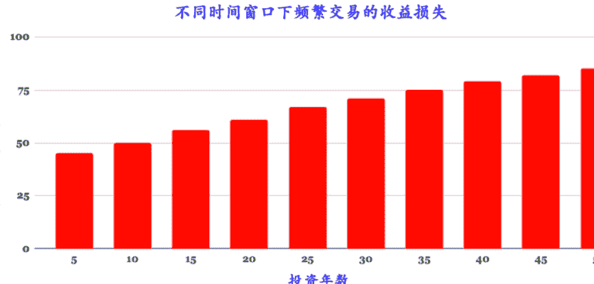
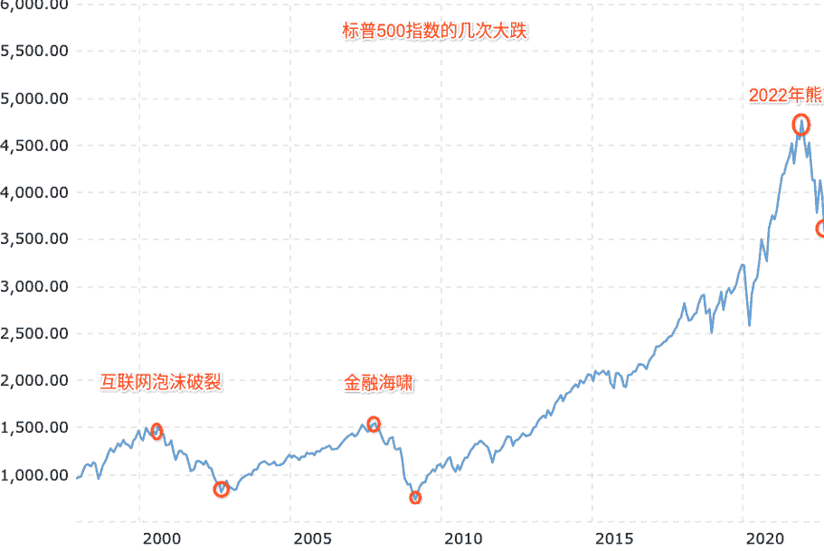

# 财富捷径

直达财务自由的路线图


# 硅谷居士

加微信号top28688，免费进资料群

# 知识星球TOP 资源分享群

添加微信
免费入群

微信:top28688

| 序号 | 公号/星球/社群 | 原价 | 领域 |
| :--- | :--- | :--- | :--- |
| 1 | 生财有木 | 2765/年 | 副业，搞钱 |
| 2 | 众宗众吃瓜群 | 365/年 | 时政，历史 |
| 3 | 记忆Legacy/望树西风 | 365/年 | 成长 |
| 4 | 欧洲金轨 | 328/年 | 时政，历史 |
| 5 | 卢克文青云会 | 699/年 | 时政，社会 |
| 6 | 体内主任 | 599/年 | 体制，职场 |
| 7 | 局外人的视界 | 669/年 | 金融，时政 |
| 8 | 溯泽异贷 | 4166/年 | 财富，成长 |
| 9 | 宁夜人总司令 | 599/年 | 时政，经济 |
| 10 | 江宁知府 | 365/篇 | 时政，国际 |
| 11 | 政堂/顾子明 | 568/年 | 时政，经济 |
| 12 | 唐书 | 1399/年 | 金融，财富 |
| 13 | 大树乡谈 | 199/年 | 时政，成长 |
| 14 | 水库恢大 | 10000/元 | 房产，经济 |
| 15 | 洪灏宏观策略 | 4376/年 | 经济，搞钱 |
| 16 | 金企通鉴/北海南山 | 4576/年 | 股票，行研 |
| 17 | 猫哥的世界 | 299/年 | 时政，社会 |
| 18 | 飞浅龙 | 3600/年 | 股市，经济 |
| 19 | 米联诸见闻 | 599/年 | 经济，金融 |
| 20 | 茶茶财经财经 | 330/年 | 房产，股票 |
| 21 | 赢在八小时之外 | 365/年 | 成长，职场 |

......
更多资源，不再列举

+ 图书、报告、课程等各类高价值资源
- 免费群 每日分享数字资源
- VIP群 每日分享所有资源（日均20+），75/年
- 赠送免费资源集合，市场原价数

# 目录

序言...............................................................................................................................7

版权声明......................................................................................................................................8

理财笔记#0: 我的理财原则......................................................................................9

理财笔记#1: 成熟的证券市场是什么样子的？................................................11

理财笔记#2: 为什么股票为王？................................................................12

理财笔记#3: 为什么指数基金是最安全可靠的股市投资产品？................................13

理财笔记#4: 什么是基金定投？................................................................15

理财笔记#5: 指数生而不平等................................................................17

理财笔记#6: 为什么大部分投资者在亏钱？......................................19

理财笔记#7: 为什么你如此勤却却没有财富？................................21

理财笔记#8: 为什么我不买终身寿险？..............................................23

理财笔记#9: 百万翁是怎样炼成的？......................................26

理财笔记#10: 神奇的累积复效应......................................28

理财笔记#11: 你需要多少资产才能实现财务自由？..............................30

理财笔记#12: 为什么不提前还清房贷？................................33

理财笔记#13: 指数基金复利纪................................................35

理财笔记#14: 为什么谷歌公司在拼命回购股票？................................37

理财笔记#15: 投资理财的几个基本数学法则................................38

理财笔记#16: 为什么美联储一直在加息？..............................40

理财笔记#17: 为什么标普500指数可以独步天下？................42

理财笔记#18: 为什么美国政府一直在在信钱？................................44

微信号top28688，免费进资料群

理财笔记#19: 如何预测基金的回报率？......................................................................................48

理财笔记#20: 为什么美国的农民不需要政府扶贫？..................................................................49

理财笔记#21: 为什么美国有这么多软件工程师？......................................................................51

理财笔记#22: 为什么发达国家的家庭债务高不下？................................................................53

理财笔记#23: 为什么我喜欢目前华盛的政治局势？................................................................55

理财笔记#24: 为什么美国经济持续健康增长？................................................................57

理财笔记#25: 银行是如何挣钱的？......................................................................................59

理财笔记#26: 美国的金融业概况......................................................................................62

理财笔记#27: 美国的健康保险概况......................................................................65

理财笔记#28: 债券的基础知识......................................................................................68

理财笔记#29: 普通投资者如何投资房地产？................................................................72

理财笔记#30: 美国家庭如何在投资中税？................................................................74

理财笔记#31: 美国家庭的省税账户视................................................................................79

理财笔记#32: 人民币资金如何投资美股？................................................................81

理财笔记#33: 投资者眼中的历史......................................................................83

理财笔记#34: 衡利的投资者的收益率更高......................................................................86

理财笔记#35: 美国家庭如何降低房贷月供................................................................88

理财笔记#36: 天下无双斯达克指数................................................90

理财笔记#37: 投资者的常见误区................................................................94

理财笔记#38: 九条401k/457b基本知识................................................98

理财笔记#39: 我为什么当房东？................................................................104

理财笔记#40: 如何评估理财水平？................................................109

微信号top28688，免费资料群

理财笔记#41: 如何用杠杆加速富盛？...............................................................113

理财笔记#42: 我为什么不投A股？................................................................118

理财笔记#43: 我的投资策略是在玩吗？................................................................123

理财笔记#44: 人民币投资美股基金的总体成本................................................127

理财笔记#45: 退休需要持有债券？................................................129

理财笔记#46: 美股又创新，你还在望吗？................................................131

理财笔记#47: 我为什么不投加密货币？................................134

理财笔记#48: 几个典型国家级的理财策略................................................137

理财笔记#49: 如何购买人寿保险？................................................139

理财笔记#50: 江湖潮起，你买落了吗？................................................142

理财笔记#51: Roth IRA，美国国家的省税神器................................145

理财笔记#52: 全球主要股票市场................................................................148

理财笔记#53: 标普500的分红率为何下？................................................151

理财笔记#54: 70后的好运无法复制？................................................154

理财笔记#55: 巴哈特的资产配置................................................157

理财笔记#56: 领取美国社会的最佳年龄................................................160

理财笔记#57: 最好的指数基金是哪一个？................................................164

理财笔记#58: 中国未来的房价将去？................................................167

理财笔记#59: A股的估值，此值得吗？................................................171

理财笔记#60: 人民币计价的美股，价格如何波动？................................................175

理财笔记#61: 美国家庭如何投资债券？................................................178

理财笔记#62: 有多少家庭在投资美股和美债？................................................182

微信信号top28688，免费资料群

理财笔记#63: 中国养老的收益有多低？................................................185

理财笔记#64: 如何击败沃尔尔街精英和其他散户？................................................189

理财笔记#65: 如何通过理财跨越阶层？................................................192

理财笔记#66: 美国以外的外国人如何投资美股？................................................196

理财笔记#67: 美国股市里的老字号................................................198

理财笔记#68: 哪个年龄的家庭最富？................................................201

理财笔记#69: 哪些人必须设立遗产？................................................204

理财笔记#70: 你需要设立信托吗？................................................207

理财笔记#71: 为什么我推荐股票基金？................................................210

理财笔记#72: 国内有哪些优秀的美股 ETF？................................................213

理财笔记#73: 最好的定投频率是什么？................................................216

理财笔记#74: 标普和纳斯达基金，如何选择？................................................219

理财笔记#75: Mega Backdoor Roth, 美国家庭的省税利器................................222

理财笔记#76: 我为什么预测股市的短期走向................................................225

理财笔记#77: 如何让孩子里的钱慢慢贬值................................................228

理财笔记#78: 男生女生，谁更擅股票投资？................................231

理财笔记#79: 为什么不买高红基金？................................................234

理财笔记#80: 我们什么时候开始投？................................................237

理财笔记#81: 不分红的基金有复利效应吗？................................240

理财笔记#82: 最省的资产配置策略是什么？................................243

理财笔记#83: 退休后如何正确取钱？................................................246

理财笔记#84: 频繁交易的后果有多严重？................................................249

# 微信号top28688，免费进阶资料群

理财笔记#85: 工作多少年才能财务自由？...............................................252

理财笔记#86: 如何在国外买房？...............................................................255

理财笔记#87: 如何应对股市大跌？......................................................258

理财笔记#88: 如何把指数基金513100 换成159501？.........................................261

理财笔记#89: 定投如何战胜跌股？...............................................................264

理财笔记#90: 如何应对美股基金的溢价？...............................................267

理财笔记#91: 股市新手如何开始投资？...............................................................270

理财笔记#92: 股市投资者常犯的五个错误...............................................................273

理财笔记#93: 我为什么不买黄金？...............................................................276

理财笔记#94: 我为什么喜欢基金投？...............................................................279

理财笔记#95: 大陆居民需要去香港开户投美吗？...............................................282

投资经验#1: 我走过的坑...............................................................285

投资经验#2: 我的极简投资组合...............................................................288

投资经验#3: 我是如何抄底的？.........................................................291

投资经验#4: 我是如何击败标普500的？.........................................................294

我的理财书单...............................................................297

我的投资理财公告...............................................................300

在 2000 年的股市高点入场，结果如何？...............................................303

标普500 的历史回率到底有多恐怖？.........................................................306

什么是4%取钱法则？...............................................................309

为了那一万美元，你必须学习投资理财...............................................312

哪个房贷策略最好？...............................................315

# 加微信信号top28688，免费进资料群


- 我为什么不再追求早退休？...................................................................................................... 307
- 如何购买幸福？............................................................................................................................... 310
- 美国投资者如何选择证券公司？...................................................................................... 312
- 如何面对投资中的逆境？............................................................................................... 315
- 财务自由以后，我有哪些变化？...................................................................................... 317
- 我错过了硅谷房市的黄金期了吗？...................................................................... 319
- 美国投资者如何通过捐赠省税？...................................................................................... 321
- 富人的十七条思维方式，你知道多少？...................................................................... 322
- 如何在车险和房险上省钱？...................................................................................... 325

# 序言

我在 2005 年底参加工作。到 2006 年底，家里有了一些积蓄。
从 2007 年，我开始在美国证券市场投资，至今已经 18 年了。期间，我经历了 2008 年的金融海啸、2020 年和 2022 年的股市大跌等风雨时刻。

回首我的理财之路，我觉得自己走过不少弯路，也度过了无数的煎熬时刻。所幸这些经历没有影响我的工作和生活，反而使我变得更加成熟和自信。在此期间，我仅仅阅读的理财书籍就超过 20 本；阅读的理财和理财相关的网站不计其数。

投资理财后，我就开始记录每年的投资流量、资金状况以及家庭资产等。由于我早就坚持稳健的长线投资策略，加上积极的储蓄和合理利用杠杆，投资回报可谓可见。比起，我的家庭资产平均年化增长率超过 30%。过去 10 年，我投资账户的平均收益率达到了 14%。

在过去的十几年时间里，我一直在公司里举办讲座，分享自己的理财经验。
从 2022 年起，我有一个三十多人的微信群，指导在中国大陆的同学、亲戚和朋友们一起学习理财。鉴于很多朋友缺乏基本的理财知识，我开始在微信群里发表科普文章和心得。这篇文章，获得了朋友们的赞誉。

所谓“独乐，不如快乐”。我觉得我自己能够通过这种渠道，让更多人从我的理财经验和知识中获得哪怕一点的收益，都是我的荣幸和满足。

在朋友们的鼓励下，我在 2023 年在海外网站学院创了博客，笔名叫“硅谷居士”。
我开始在博客和知乎的“投资理财”论坛分享投资理财知识和经验。我的文章获得了无数读者的认可。

2024 年，在另一位好朋友的鼓励下，我从小红书开了账号，并开始转发我的在知乎领域发表的文章。

很多读者希望我将这些文章结书，以便传递和阅读。
因此，我重新整理了这些笔记和文章，把它们集结成书。

硅谷居士
2025 年 2 月于硅谷

# 版权声明

本书的版权，属于作者硅谷居士。

任何人，都可以免费阅读、分享本书。

但是，如果用于商业用途，使用者必须在明显位置注明作者为“硅谷居士”。否则，作者会保留追究相关法律责任。

# 理财笔记 #0: 我的理财原则

我推崇稳健的长线理财理念，反对频繁交易和短期炒作。我建议投资组合以指数基金为主。

我奉行的投资策略是基金定投，不推荐试图根据市场价格来买卖的时机。仅在需要用钱的时候，才买出合适数量的基金。总结起来就是：有钱就买，需钱就卖。从本质上讲，就是把基金账户等同于一个存款账户。

过去十几年，我的投资组合主要包括标普 500 指数基金和纳斯达克/信息科技指数基金。

对于身在北美的朋友，可以选择这类美股 ETF：

- 标普 500 指数基金，例如 VOO/VTI/SPY 中的任何一个。过去 15 年平均年化收益率是 12%。
- 纳斯达克指数/信息科技基金，例如 QQQ 或者 VGQ。过去 15 年平均年化收益率是 17%。

对于身在中国大陆的朋友，可以直接用人民币在中国的券商账户购买类似的美股 ETF：

- 标普 500 指数：博时标普500ETF，代码：513500。其对应的场外基金是 050255。
- 纳斯达克 100 指数：比嘉莱纳斯达克 100 指数 ETF，代码号为159501；其对应的场外基金是 016532。

我反对购买此类理财产品：

- 证券养老或者银行推荐的任何理财产品。它们的年化收益率为 4% 左右。
- 任何封闭期、不能随时取用的理财产品，因为它们的流动性太差。
- 终身险、万能险及各类保险产品。这些产品的年化收益仅为 3%，且流动性极低。
- 加密货币、外汇等。都是投机产品，不具有任何长期投资价值。
- 黄金、白银等重金属类。它们的年化收益约为 6%。
- 个股，即单个股票。单个公司都有破产的可能，而长远来看，大部分公司都会破产。
- 房地产以外的标的，比如艺术品、古董、邮票。它们的年化收益仅为 2%，同时还有较高的成本和风险。

提示：在开始任何高风险投资（房地产、股市）之前，我建议准备半年到一年的家庭应急储备，必须存在低风险的地方，如银行存款、政府债券。

我推荐的书：
- 《The Simple Path to Wealth》
- 《Bogleheads' Guide to Investing》

# 理财笔记 #1: 成熟的证券市场是什么？

证券市场包括股票市场和债券市场，是一个现代金融市场的基石。美国证券市场相当成熟，已经有了多年的历史。目前的规模约为 100 万亿美元（占全球股市的 40%），其中基金规模约 27 万亿美元（占美国证券市场的 27%），说明基金是市场成熟最重要的参数之一。

除了基金以外，美国股市上机构投资者（比如资产管理公司、对冲基金、各种养老基金）拥有了 75% 的份额，散户在交易中的份额不到 10%，而中国股市散户交易量高达 85%。

# 理财笔记 #2: 为什么股市为王？

过去 50 年，美国每年的通胀大约为 3%，随着货币贬值，商品、服务的价格自然会涨高。但是，股市仍然有 8% 的额外收益，这是怎么来的？

资本、技术是驱动现代社会经济增长的核心要素。过去 70 年末，驱动增长的第一就是资金，其次是技术。从本质上，股票是为了募集资本而发行的权益证书。对于这些投资，因为公司随时可能破产会让投资者本无归。为了弥补这个风险，资本市场必须提供者额外的补偿，这就是股市的额外收益。

当然，我们可以购买指数基金而不是单一股票来规避破产风险，在几乎不需要额外成本的情况下获得股市的高回报。因此说指数基金是人类过去 50 年最大的财富增长。如果你在 50 年前投入了 1 万在指数基金，你现在的资产是 14 万，整整增加了 8 倍！

另外，股票和基金的流动性是天下无双：大部分交易可以在几小时或者几天完成。

如果你不幸投资了其他资产，它们的总体年化收益率和拥有的资产如下：
- 房地产：收益为 10%，资产 17 万，相当于股票的 6%。实物房产的流动性较差，交易周期高达数月。
- 黄金：收益率 6%，资产 8.4 万，相当于股票的 1%。
- 债券类（包括理财产品）：收益率 5%，资产 15 万，相当于股票的 6%。
- 保险（包括终身寿险）：收益率 3%，资产 4.4 万，相当于股票的 2%。
- 收藏品（包括艺术品、古董、邮票）：收益率 2%，资产 2.7 万，相当于股票的 1%。
- 银行定期存款：收益率 3%，资产 4.4 万，相当于股票的 2%。

# 理财笔记 #3：为什么指数基金是最安全可靠的股市投资产品？

一个股市投资者可以接触的主流产品三种：个股、主动性基金和指数基金。这其中指数基金的安全性和可靠性最好。为什么这么说呢？

我们首先看个股。不言而喻的是，单个公司破产的风险是非常高的。比如在美国股市上的 6000 家上市公司，每年都有超过 180 家公司被挂牌，也就是说每年都有 3% 的股票清市！在一个长时间的波动里，如果跌 40%，超过半的公司都会破产。如果你持有 5 只股票的，其中一个突然因为经营不善而破产，你的资产可能瞬间崩塌 20%。

除了破产这种极端情况下，超过 80% 的公司其实表现都非常不错：它们回报率还低于普通股市。而在股市的回报最好那就是 20% 公司带来的。如果你错过了这些优秀的公司，你的收益率基础就不太稳妥了。

我们后面看指数基金。这种基金由一个经理带领一个团队在市场上上市一些股票，进行各种择时交易试图击败指数。听起来是一个不错的主意，但是这些基金面临很大风险，比如积累了一堆错误的操作，或者在错误的时间采用了高杠杆导致巨大亏损。事实上，大多数主动基金在 30 年内成立，通常是因为表现太差而被投资者抛弃。

最后看我们喜欢的指数基金。跟主动基金相比，这种基金策略非常简单——基金经理只需要按照下标买入全部成分就行，比如熟悉的标普 500 指数，里面有苹果公司、沃尔玛、迪士尼公司等。指数基金交易完全由电脑完成，基金经理不需要干预。所以指数基金成功地避开了主动基金固有的风险，同时它是股市里市值最大的，破产的概率是零。

Copyright © 硅谷居士
加微信信号免费获取资料

# 理财笔记 #4: 什么是基金定投?

基金定投是最简单有效的投资策略。它的基本原理就是用固定的频率（比如每个月或者每个季度）买入基金，完全无视当下的价格。另一个常见的法是“平均成本法”，即 Dollar Cost averaging (DCA)。这个策略优势如下：

- 一、无脑攒，节省精力。你根本不需要关心市场行情和近期走势，这种让你用最少的时间精力去投资，而不是影响你的工作生活。
- 二、降低风险。在股价较低的时候，由于定投的习惯，不会因为恐惧而跌（这正是大部分投资者都会犯的错误）。你可以用同样的资金买到更多的股份，从而降低你的平均成本。这就是“平均成本法”。假设你每个季度定投 10000 元，而基金在四个季度的价格分别是 10.0、7.0、10.0、11.0。那么你每个季度买到的股份数量就是 4000，你的平均成本就是 40000 / 4337 = 9.22。一年的平均价格（10+7+10+11)/4 = 9.5，降低了成本。
- 三、帮助你积累更多的财富。由于你自己把闲钱投入股票，一方面看到收益，同时也防止你把银行里的闲钱不经意地花掉。
- 四、稳定。通过分析股市近百年的历史，如果你每个月或者每个季度都定投，在任何超过5个月的时间里都会赚钱。心里有了信念，你可以坦然面对市场的风雨而处不惊。

希望这是最后一次提醒大家：不要问我或者别人这样的愚蠢问题：现在的股价不是太高了太低？

一个常见的问题是：如果我突然有了一笔钱，卖了房子或者继承了一大家产，那我该如何投资？

策略一：分散风险。将资金分成若干份（比如十份），每个星期或者一个月投一份。这个原理和我们讨论的基金定投原理如出一辙。

策略二：简单粗暴一次性投入股市。

出人意料的是，多个专业人士根据历史数据分析发表的研究表明：在 70%的时间里，策略二获取的投资收益率更高。原因很简单：大部分的时间里，股市是上涨的，所以越早投资的人获得的收益就越大。

然而，如果我认为股市处在历史的高点，而担心买在最高点，我会采取更加稳妥的策略一。

# 理财笔记 #5: 指数生而不平等

（注：指数基金投资，已经成为当今世界最被人推崇的投资方式。不过，所有的指数都是平等的。

沪深 300 指数（000300）是国际上研究中国股市最重要的指数，类似于美国的标普 500 指数。该指数成立于 2005 年，用于上海和深圳交易所最大的 300 家公司。自此成立以来的 18 年里，沪深 300 指数的平均年化收益约为 9.1%。

在该指数成立的最初 6 年（2005 年至 2011 年），该指数的……（此处内容不完整））


在中国股市卖股票和ETF时，股民需要花费0.1%的印花税给政府（有一段时间曾经是经验人听过的0.3%），还要缴纳交易费用和券商的佣金，合计可以高达0.15%到0.4%。如果一个人平均每年把自己的股票换手20次，仅交易费用的成本就是3%到8%！如果股市本身的回报是10%，那么扣除成本后，散户的回报就只有2%到7%了。这看起来不起眼的差距，在30年的时间里就会放大很多；如果你投资1万元，并且收益率是10%，最终你将拥有17.4万；如果收益率是7%，那么你只会获得7.6万，仅相当于前者的44%。

那么散户如何避免这些错误呢？

- 放弃自己的傲慢，抱着指数基金，以最小的成本获得股市的固有回报。
- 做长线投资，避免必要的交易。只有在需要钱的时候，才卖出相应数量的基金。

# 理财笔记 #7: 为什么你如此勤劳却没有什么财富

一代王麦克·泰森在短短的职业生涯中，挣了3亿美元。可是，他退休后不到十年就欠下了4000万美元的债务，最终不得不宣布破产。他的钱去哪儿了？原因很简单：他的钱都花掉了，他没有进行有效的储蓄和投资用于支持他的奢华生活。

这是一个极端的例子，但是这个世界上很多人一忙碌碌，也挣了很多钱，然而终却没有价值的财富，有的甚至像泰森一样惨不忍睹。

所以我们鼓励大家节约消费，积极积累并有效的投资。这样，才能保证你积累足够的财富，给自己的退休生活打下坚实基础。

可是，虽然大家都喜欢蓄钱，也喜欢花钱。其实我们花出去每一分钱，绝不仅仅是当下的一元钱，还包括为了失去这笔钱而损失的“机会成本”。

比如，你花100元买一件新衣服，它的纸面成本就是100元。但是，如果你把这100元省下来投资到标普指数基金里，在40年后就变成了450万！你这件新衣服的成本就是4500，是纸面价值的45倍！

下面是一些你的开销，和你付出的机会成本：

- 结婚成队，花费5万，成本225万。
- 一只名牌包，花费2万，成本90万。
- 一辆汽车，花费20万，成本900万。

再如此，你每天喜欢喝一杯星巴克咖啡，花费30元，一年就是1.1万。如果你把每天省下来的咖啡钱去投资，40年后就可以积累485万！你每天喝咖啡的这30元，实际上的钱就是1320万，是纸面价值的440倍！所以，日常重复的消费，其成本高得人难以置信。

下面是你可以的一些日常开销，和你付出的机会成本：

- 每天一杯咖啡，每年花费1.1万，成本485万。
- 每月一件衣服，每年花费2千，成本88万。
- 每天一包香烟，每年花费6千，成本265万。
- 每月几次聚餐，每年花费7千，成本308万。

所以，明白了金钱的机会成本，在你下次花钱的时候，一定要先问问自己：这个东西真的值得你付出如此高昂的成本吗？

有趣的朋友可以算出，如果你把生活中不必要的开销减掉，或者是降低花销的档次，你可以积累下来多少财富。我相信大部分人会得出一个不可思议的数字！

所以我坚信：我们中的绝大部分，只要敢践行合理的存钱原则和我们的投资策略，都会成为百万富翁，有很多人甚至成为千万富翁或者亿万富翁。

# 理财笔记 #8: 为什么不买终身险？

随着人们收入的增长，更多的人在购买寿保险产品，用于抵御家庭不幸跨世代的财务风险。目前主流的人寿保险产品有两种：定期寿险和终身寿险。

名义上，定期寿险是有固定保障期限的，比如10年或20年。这是我推荐的唯一的保险产品：简单直接，目标明确。比如，如果我是家庭的主要收入来源，而我的孩子还有20年上大学毕业。那么我就可以买一份20年的定期储备保险，保障孩子能完成毕业。

但是，终身寿险的保障期是终身的：未被保险人死亡时，保险公司必须支付保险金；而且为了储蓄和投资功能，被当作产品推销给消费者。这种产品的性质非常混乱，试图保险和投资两种属性混合在一起，吸引那些不太花时间研究投资者或不懂如何进行合理的消费者。

和大部分理财专家一样，我不推荐购买终身险，并且认为它是保险业发明的最糟糕的产品。

我为什么要这么下结论呢？

首先我们要明白，一个人为什么要给自己购买寿险？从本质上来说，目的是为了防止被保险人不幸死亡，其家庭的生活水平不会出现严重危机，比如无法保障生存、无法继续学习等。

根据这个原理，人类就不需要购买任何寿险：

- 有很多人，如没有参加工作的孩子，家庭主妇，以及已经退休的人士。
- 就算这类人，家庭的财务状况也不会出现现在的下滑。有些家里还给哄呀学的儿童购买寿险：这简直是滑可笑的荒行行为。
- 已经积累了足够财富的所有家庭成员。就失去了某个成员的收入，这个家庭只靠储蓄和投资就可以维持一种的生活水平。这也是我追求财务自由的目标之一，就是拥有有“自我保险”的能力。
- 没有任何受扶养人（如未成年孩子以及没有收入的父母）的人士。如果我的孩子已经成年，我的配偶也有可能有收入，父母就不需要太多的自我的财务支持，我就不需要购买寿险。

从这个需求出发，终身寿就不靠谱，因为大部分人都会退休并失去收入：
一旦一个人没有了收入，他就没有再买保险的意义了，终身保险如此也就也没有了存在的价值。而且，一个超过65岁的退休人士，子孙已成家立业，父母多半已去世，他基本没有购买保险产品的需要。

此以外，终身寿的弊端很多，我就简单列出几个：

- 高昂的保费。在相同金额（比如100万）的情况下，终身寿的保费是定期寿的10倍甚至更高。
- 棘手的投资收益。除了费用，大部分终身寿的投资年化收益有3%左右。在50年里，把这些钱投资到简单的标普500基金里，收益将是寿的25倍！比如你花了10万，买了一个终身寿；如果你把10万在标普500指数基金里，将获得250万！
- 惨的低流动性。如果家庭遭遇变故，想提前退出保险，人可能会损失高达80%的资产。而且在死亡之前，几乎无法从保单里积累储蓄。这相当于开了一个无限的存款，但在死亡之前无法取出钱，你怕愁。这是多么又愚蠢的设计！以及巨大的风险。

基于上述分析，我认为：

- 如果需要，购买一份合适的定期（比如20年或者15年）。
- 把省下的钱投资到基金里，不仅可以获得更高的资产和更低的风险，而且确保资产的流动性。

另外，终身险有很多，为了便于识别，我把它们列出来：

- Whole life insurance（终身险，储蓄性）
- Indexed whole life insurance（指数型终身险）
- Universal life insurance（万能险）
- Indexed universal insurance（指数型万能险）
- Variable life insurance（投资型终身险）
- Variable universal insurance（投资型万能险）

# 理财笔记 #9: 百万富豪是如何炼成的？

根据最新的财富报告，中国港澳台地区有50万家庭资产超过600万（约88万美元），占家庭总数的1%。在2024年的美国有1200万家庭拥有10万美元以上的资产，占美国总数的14%。由于财富的积累效应，年纪越大，财富越多，所以超过55岁的家庭里百万富豪的比例越高。

如果我们跟随指数基金策略，每年实现10%的回报率，那么每年需要投资多少钱，才能在65岁成为拥有100万（约70万人民币）的富豪呢？是你开始越早，每年需要投入的资金越少。如果你从25岁开始，你每年只需要1.4万！听起来不可思议，但这就是复利的魔力，也就是爱斯坦所说的“世界奇迹”。下面是计算结果：

| 起始年龄 | 每需要 |
| :--- | :--- |
| 20岁 | 1300美元（约91万人民币） |
| 25岁 | 2000美元（约14万人民币） |
| 30岁 | 3300美元（约2.3万人民币） |
| 35岁 | 5500美元（约3.9万人民币） |
| 40岁 | 9200美元（约6.4万人民币） |
| 45岁 | 1.6万美元（约11万人民币） |
| 50岁 | 2.8万美元（约20万人民币） |
| 55岁 | 5.4万美元（约38万人民币） |
| 60岁 | 13.0万美元（约91万人民币） |

所以我们说，只要从早开始，大部分家庭都能成为百万豪。根据上面的结果，你也可以推算出你在65岁时大致拥有的财富数量。比如30岁，每年计划投资5万元，因此你的投资额是百万富翁门槛的2倍。那么恭喜你，你在65岁应该拥有200万！

# 理财笔记 #10: 神奇的累积投资倍数

如果你每年投资Y元，投资每年增长10%，经过N年，你拥有的资产数就是：

$废产 = Y \times 10 \times (1.1^{N+1} - 1)$

我们将资产和每年投资额之间的倍数，定义为累积投资配比P：

$P = \frac{废产}{Y} = 10 \times (1.1^{N+1} - 1)$

我把常见的P列如下：

| 年数 N | 累计投资倍数 P |
| :--- | :--- |
| 50 | 1281 |
| 45 | 792 |
| 40 | 488 |
| 35 | 299 |
| 30 | 182 |
| 25 | 109 |
| 20 | 64 |
| 15 | 36 |
| 10 | 18.5 |
| 5 | 7.7 |

比如，你坚持每年投资1万元，50年后，你将拥有1281万！但是如果你开始得晚，离需要花钱的时间只有20年，哪怕你每年投资10万，你也仅仅拥有 $10万 \times 64 = 640$万。

当然累计投资系数和平均化收益是相关的。如果投资的年化回报率是15%，那么它的公式就是：

$P = 7 \times (1.15^{N+1} - 1)$

我们可以计算出常见的P：

| 年数 N | 累计投资倍数 P |
| :--- | :--- |
| 50 | 805 |
| 45 | 426 |
| 40 | 248 |
| 35 | 155 |
| 30 | 101 |
| 25 | 66 |
| 20 | 49 |
| 15 | 36 |
| 10 | 24 |
| 5 | 8 |

也就是说，如果你坚持投资1万美元，50年后，你将拥有805万！如此，我们鼓励大家早投资，享受复利的魔力。就像天才Fisher说的那：在市场中，买的时机更重要。

# 理财笔记 #11: 需要多少财富才能财务自由？

追求财务自由是很多人一生的梦想之一，因为财富很重要。研究表明，超过70%的家庭处于困境。什么是财务自由？可以说，财务自由就是：你不再需要工作，而是利用积累的被动收入来支撑家庭开销。收入来源主要是股票基金、存款、债券产生的收益、分红和养老金。

第一情况：你希望现在退休。我们考虑退休后的人，因为他们的财务状况。首先要计算你一年的开销，然后比较你的被动收入。只要后者大于前者，那么恭喜你：你已经实现财务自由了！通用的算法是“4法则”，也就是说你每年可以从金融资产里取出4%而保证资产不耗尽。下面我们要取得：

金融资产 $\times 4\% \ge$ 家庭开支

按照上面的例子，假设退休后每年的被动收入（退休金、社保等）是万元，你需要在退休时积累的金融资产F：

$F = (10万 \times 2.7 - 80万 - 3万 \times 2.7 - 4万) / 4\% = 9.5万 \times 25 = 238万$

如果你现在的金融资产只有M万，而且全部投资在年化收益率是10%的基金里。那么N年后资产增长成为$M \times (1+10\%)^N$。那么缺口D就是：

$D = F - M \times (1+10\%)^N$

假设现在的M是10万，那么差额就是：

$D = 238万 - 10万 \times (1+10\%)^{25} = 238万 - 108万 = 130万$

那么你每年需要多少钱在退休时填补这个缺口D呢？我们需要用倒推法。假设你每年存储Y，并在收益率是10%的指数基金上，那么N年后这些资产的总量就是：

$Y = 10 \times (1.1^{N+1} - 1)$

所以我们的第二定律就是：

$Y = 10 \times (1.1^{N+1} - 1) \ge D$

我们把这个“累积投资系数” $P = 10 \times (1.1^{N+1} - 1)$ 算好之后，Y等于 D / P。未来方便大家，我把常见的P列如下：

| 年龄 | 退休年数 (N) | 累计投资倍数 |
| :--- | :--- | :--- |
| 25岁 | 40 | 488 |
| 30岁 | 35 | 299 |
| 35岁 | 30 | 182 |
| 40岁 | 25 | 109 |
| 45岁 | 20 | 64 |
| 50岁 | 15 | 49 |
| 55岁 | 10 | 36 |
| 60岁 | 5 | 24 |

第二情况：你希望退休时实现财务。下面考虑更复杂的情况：你还在工作。我们引入通胀因子。众周知的是，通胀时货币的购买力随之减。假设每年的通胀是R，在N年以后的价格就是：

$INF = (1+R)^N$

这里，“^N”是数学上的指数函数。我们把“INF”叫做通胀因子。如果R=3%，N=24，INF就是2.0。这就是著名的“72法则”：

$N = 72 / R$

如现在40岁，打算在65岁退休，每年的通胀率是4%，那么通胀因子就是：

$INF = (1+4\%)^{25} = 2.5$

有了通胀因子，就可以预计退休时的家庭开支和被动收入。通常人们用退休年前（不是今年！）的生活开支的60%到80%作为退休后的基准。因为要考虑通胀，你可以用下面公式计算退休后的开支：

今年的开支 $\times$ 通胀因子 $\times 80\%$

通常认为房租的增长能够上通胀的水平。所以修改后的第一定律就是：

未来的金融资产 $\times 4\% +$ 通胀因子 $\times$ 房租 + 未来的被动收入 $\ge$ 未来的家庭开支

按照上面的例子，假设退休后每年的被动收入（退休金、社保等）是10万，你需要在退休时积累的金融资产F：
（同上公式）


# 财经贴 #13: 指数基金复利

美国纽约证券交易所于1792年（大乾隆57年）成立，距今已经超过200多年了。特别是在最早的100多年里，股市的运营和监管比较原始，可以说是野人横行的地方，卖交易、操纵股价、数据造假等见不鲜。

在大萧条之之后的1934年，美国才通过法律建立了美国证券交易委员会（SEC），监管股市和上市公司。从以后，美国股市的运行逐渐更加规范。而与此同时，美国政府更多地在股市跌的时候干预，尤其在2008年金融危机和2020年疫情大爆发期间。这些都进一步增强了投资者对股市的信心。

早期的基金都是“主动性”基金，其表现取决于基金管理团队的水平和运气。如此，基金经营不善或关门的事情经常发生；这让投资者们苦恼不已。

1976年是基金历史上最早具有里程碑意义的年代。那时，世界还在进行剧烈的文化变革。在美国，先锋集团的创始人——约翰·博格（John Bogle）——发起了世界上第一只指数基金，就是标普500指数基金。

当时，指数基金的基本思想在学术界开始流行，但是这些思想被华尔街嗤以鼻。所以当博格发行指数基金时，几乎所有的基金业内人士都在笑，他说基金是“博格的蠢货”。然而，这个基金迅速成长起来，今天的规模高达8000亿美元，成为美国最大的单个基金之一。

此时至今日，博格创建的基金已成为美国最大的基金，管理着数万亿美元的资产，占美国基金规模的30%。由于先锋集团的发展，许多指数基金在雨后异军爆发。到2023年，指数基金已经占据美国基金总规模的50%，而且这个份额还不会增加。在诞生不到半世纪的时间里，指数基金把主动基金打得落花流水！

由于博格生的巨大贡献，在1999年，他与沃伦·巴菲、彼得·林奇以及乔治·索罗罗斯共同被《财富》杂志列为20世纪的四大投资者。

虽然在这四个人里面，博格的个人财富是最低的，这很大程度上由于他倡导的另一个基金的革命：大幅降低基金的管理费。当时一般主动性基金的管理费在1.5%左右，而先锋集团的指数基金的管理费只有约0.1%，是前者的十五分之一（甚至更低！）博格的原则是：降低基金运营成本，把更多的市场收益还给投资者。这个革命也深深影响了美国基金界，到目前，美国平均的基金管理费已经降低到0.7%左右。

正如此，我认为博格在这四个人里影响最大。他改变了全世界的基金产业，拯救了数以亿的普通投资者。

中国的第一款指数基金，出现在2002年。在那一年，华安基金发起了上证300指数基金。2013年，华安基金发起标普500指数基金，同年，国泰基金发起纳斯达克100指数基金。

# 理财笔记 #14: 为什么谷歌在拼命回购？

2023年4月25日，谷歌发布第一季度财报，批准回购计划：花费700亿美元购买股票。在2022年，谷歌花费了200亿美元购买股票。在标普500指数里的公司都在大幅回购。

为什么美国的公司愿意回购股票而不是发红？

## 一、为投资者省税

美国人发现：有两种方式回馈投资者，一个是发放现金红，二是回购股票。如果是股票涨值，只要不卖出，就可以延迟交税。

## 二、让所有人都觉得危险

人们对股票的增长比较敏感，对短期波动敏感。如果一个公司的股价在10年内涨了100%，投资者会非常开心。两种情况下，虽然投资者的平均化收益率是7.2%，但是拿到现金红（比如苹果，在过去的10年里每年把20%的发红，其余80%用来回购股票），大家都高兴！

# 理财笔记 #15: 投资理财的几个数学法则

投资理财涉及金钱和很多数字的变化，除了基本的精算和会计以外，我们还需要一些数学常识来预测和规划长期的财务。今天每个理财人都掌握最基本的数学规律。

### 二、七十二法则

如果你标普基金账户里有10万元，而这个基金预计每年收益率是10%，那么你在28年后退休时，你的基金账户会有多少钱？数学家为了方便数学不好的人回答这种问题，发明了著名的“72法则”：如果一个数字每年的增长率是X%，那么这个数字翻倍需要的时间：72 / X。我们用这个法则回答上述问题就很简单了。首先计算基金翻倍需要的数：72 / 10 = 7。因为是估算，我们就用7来近似。也就是说每隔7年，基金总额会翻倍。我们再算算28年后基金基金会多少倍：28 / 7 = 4。4倍是多少？注意：不是2*4=8！而是4的次方，就是4个连续相乘：2 * 2 * 2 * 2 = 16。所以，28年后你的基金总额是16万。这个法则也可以计算物价、平均工资等持续增长的数字。但是不适合计算不可能持续增长的数字，人口等等。

## 二、二八定律

为什么你买了很多公司的股票，但是大部分的表现都很差呢？这里可以运用著名的“二八律”。这是一个应用非常广泛的定律，比如20%的人口拥有80%的社会财富，20%的优秀论文获得了绝大部分索引。在股市里，这个定律也成立了：股市的超额回报是由最好的20%的企业创造的。80%的上市公司其实很糟糕，它们的股票回报率至少低于通胀率。所以你买入的大部分股票都是垃圾，更多是客观事实造成的，不是你的眼光不好，所以你不需要自责。

## 三、4%法则

如果你有100万资产，并依靠它们的收益退休，那么你每年可以安全地取出少量资金而不会导致“人还在，但是钱却没了”的窘境呢？国际上有一个通用的法则：你的资产年化收益正常，每年可以提取4%的资金，而不会导致你的资产缩水。这个收益率正常的前提是，收益减去4%以后，还能跑赢通胀率。比在美国，平均通胀率是3%，只要你的资产平均收益率超过7%，你就可以每年提取4%，就是4万。比如，你的资产部署在标基金里，而收益是10%，那么年初你就有110万。取出4万后，你的资金是106万，其购买力仍然超过100%。如果你的资产收益率太低（比如只有5%），那么安全的取款率只有1%。

# 理财笔记 #16: 为什么美联储一直在加息？

为什么美联储一直在加息？2023年3月，美联储在委员会会议上决定连续十次提高基础利率，达到4.75%到5%的区间。大家都知道，利息越高，公司贷款成本、房贷利息、信用卡都会飙升。为什么美联储要毫不力地打击经济呢？美联储可以说是当今世界上最复杂的系统，对经济的影响举足轻重。早期的美国就是一个草台，从1776年建国到1861年内战爆发，美国政府没有任何中央银行。从1837年至1862年的“自由银行时代”，美国没有正式的中央银行。从1862年至1913年间，由摩根领导的私营银行强化了。1907年美国爆发了恐慌，大银行倒闭。通过法律，成立一个中央银行来执行货币政策并避免再次发生银行倒闭。1913年12月23日，总统德罗斯·威尔逊签署成立。根据法律，美联储的主要职能是制定、执行货币政策，以此管理利率基准和货币供应，以维持美国稳定的通胀率、经济增长率和行业水平。美联储的核心功能里，稳定价格始终是第一。美联储的目标是维持2%左右的通胀。为什么？因为无数历史告诉我们：通胀对经济的打击是核级的，它会打击消费者的信心，严重通胀会导致货币贬值。关注历史的朋友可以参考二战前的德国和当代的内瑞拉、津巴韦等失败国家。当然，比通胀更可怕的现实就是通缩。了解了这些我们就可以回答一开始的问题了：其实美联储一直在评估通胀水平和就业状况。在就业稳定的情况下，美联储必须把通胀降到合理的空间；加息是控制通胀的最有力武器。过去两年，美国的通胀居高不下，最高接近9%，与此同时，美国就业市场异常火爆，失业率降低到3.5%左右，是50年的新低。因此，只要通胀率继续居高不下，美联储必须加息，这是她的天职。在1970年代末到1980年代初，由于全世界发生石油危机，美国通胀一飞冲天，最高达到14%。美联储发动一系列加息战，甚至一度把基础利率提到空前的20%，最终打赢了这场战争，成功地把通胀降到了2%以下。

# 理财笔记 #17: 为什么标普500指数可以独步天下？

标普500指数自1957年成立以来，平均年化收益率达到了11%，领先所有的宽基指数。请注意的是，虽然30年纳斯达克指数的表现比标普500指数更好，但是由于纳斯达克指数里科技公司的比例过于大了，我们不能把它与之并论。

标普500指数的成功，是由于它包含了美国成功的企业。美国股市大约有600多家公司，而标普500指数选取市值最大的500家公司。能够成功进入标普500指数的这些公司，肯定经历了激烈的市场竞争，并且经历了考验的成功商业模型和可靠的团队运作。自然如此，这些公司的整体表现才会如此可靠。

从整体上看，500家企业市值的中位数是160亿美元，每年的利润增长率高达11.7%，每年的营收增长率也高达11.4%，净净回报率更是高达23%，说明他们具有高超的盈利能力。

下面，我们来看标普500指数最大的25家企业，让我们对这些商业巨无霸有一个初步的认识：

| 序号 | 公司名称 | 市值 | 每年盈利(亿美元) | 每年营收(亿美元) | 成立时间 | 行业 |
| :--- | :--- | :--- | :--- | :--- | :--- | :--- |
| 1 | 苹果公司 (Apple) | 2.7万 | 950 | 3870 | - | 电子 |
| 2 | 微软公司 (Microsoft) | 2.3万 | 670 | 2100 | 1975 | 软件 |
| 3 | 谷歌公司 (Google) | 1.4万 | 580 | 2800 | 1998 | 互联网 |
| 4 | 亚马逊公司 (Amazon) | 1.1万 | 420 | 5100 | 1994 | 电子商务 |
| 5 | 伯克尔哈撒威 (Berkshire Hathaway) | 7200 | 180 | 2300 | 1970 | 金融 |
| 6 | 英伟达公司 (Nvidia) | 6800 | 430 | 2700 | 1993 | 半导体 |
| 7 | 脸书公司 (Meta) | 6100 | 140 | 1000 | 2004 | 社交网络 |
| 8 | 特斯拉公司 (Tesla) | 1000 | 6 | 86 | 2003 | 汽车 |
| 9 | 美孚石油公司 (ExxonMobil) | 4800 | 55 | 3900 | 1911 | 石油 |
| 10 | 联合健康保险 (UnitedHealthcare) | 4500 | 33 | 3300 | 1977 | 医疗 |

# 理财笔记 #18: 为什么美国政府一直在借钱？

经常关注美国政治和经济的朋友注意到一个现象：每隔几年，美国政府和白宫就会因为债务上限的问题陷入马拉松式的谈判，有时导致政府停摆。这是因为美国实施立法、行政、司法三权分立的制度；白宫代表的行政机构要征税，必须得到立法机关的批准。不仅政府增加税收需要批准，每年的财政预算都必须经过白宫和国会的拉锯战而获得妥协。所以白宫想提高债务上限必须得到国会同意。

美国是世界第一大经济，人均GDP8万美元；2023年，联邦政府的财政赤字占GDP高达4.4%。为什么美国政府还要借钱？毫无例外，全世界所有的政府都在借钱。下面是一些主要经济体的财政赤字率：

- 美国：6.2%
- 中国：3.9%
- 日本：4.2%
- 德国：4.2%
- 英国：4.4%
- 法国：4.2%

下一个问题是：为什么政府要借钱？难道赤字不可怕？答案可能和想象不一样：不是政府不得借钱，而是政府心甘情愿地借钱！也就是说，政府借钱这件事不是政府缺钱，而是政府的一个功能！早在十二世纪，意大利和英国就开始发行利息的国债。当然，一个国家的财政出现赤字，借债是无奈之举。但是政府借债很多时候是为了帮助经济增长和社会稳定。

# 序：市场的货币是怎么产生的？

假设一个老板把100万存入银行账户（第一个100万），而银行把这些钱按需贷款给了一个买房的人。买房拿到房子的时候把钱交给了开发商，银行账户里多了100万（第二个100万）。然后一家建材企业需要扩大经营规模从银行贷了这一百万，并把它存在自己的银行账户里以付今后的开支（第三个100万）。一家城市投资公司又从银行贷了这100万用于修建城市新区的公路，而银行将其临时存放在自己的银行账户里（第四个100万）。

当初老板拿的100万，在金融系统里转了几次，就变成了400万的货币。通过通畅的借贷，社会上可以产生无尽的货币。现在确实如此，银行需要把一部分存款存在中央银行里作为储备。

这就是现代经济学的基本理论结论：货币的发行不需要任何物质基础，更不需要资本；大部分的货币产生是通过信用资产产生的。财富产生的链条是：需求导致借贷更多的货币和资本。


# 理财笔记 #19: 如何预测基金的回报率?

大部分投资人最关心的问题是：我的投资的未来年化收益率是多少？

比起一个简单的定期存款产品，储户关心的就是每年的利率，到底是 3%，还是 4%。

那么，对于一个股票基金来说，情况就比较复杂了，因为股票的回报不像定期存款或债券那样显而易见的。那么我们怎么预测呢？

基金无非一些公司股票的集合，我们可以用一个公司的股票做类比。一只股票的回报来自两个方面：每年的分红和净分红率加上股票的价格增长。在基金上同样适用。一个基金未来的年化回报就等于平均分加上每年股价的增长率：

分红率 + 股价增长率

假设一个股票的市盈率是稳定的，那么股价的增长率其实和公司的盈利增长是一回事。但是，由于我们都没有水晶球，所以无法精确预测未来公司的盈利状况；我们只能够退而求其次，可以根据近 10 年或 20 年的净利润增长率来近似。这样我们就可以用公式预测基金的未来收益率：

目前分红率 + 长期利润增长率

下面是美股两个主要指数和他们的分红率和净利润增长率参数，我们可以此预测它的未来收益率。

- 标普 500 指数：分红率 1.6%，利润增长率 8.5%，未来收益率约为 10.1%。
- 纳斯达克 100 指数：分红率 0.6%，利润增长率 12.4%，未来收益率约为 13.0%。

# 理财笔记 #20: 为什么美国的农民不需要政府扶持？

我生长于中国偏山乡村的一个传统农民家庭，家里的收入几乎全来自务农。上学之前，我经常下地干活，真正做到了：我布，亦耕于南阳。

在我的印象中，我们家只有两亩土地，家里的收入非常低。其实，自古以来，中国农民的生活非常艰辛。唐人有诗云：

春种一粒粮，秋收万子。
四海无田闲，农夫饿死。

根据官方数据，中国农村的人均可收入为 2.2 万，而城镇地区的人均可收入为 5.2 万，农村人均收入为城镇的 24%。因此，“三农问题”一直是被特别关注的问题之一。

美国是世界上最大的农产品出口国，每年的农产品的总出口金额接近 180 亿元。美国是一个农业国家，美国的农民数量非常少，总数只有 260 万，占就业人口的 1.3%。

但是，由于发达的农业技术、大量的资本投入和政策支持，美国农民能够创造巨大的财富。在 2023 年，美国农民家庭的平均收入高达 9.8 万美元，而全美国的平均收入为 8.1 万美元，所以，农民家庭的收入是平均水平的 120%。

由此，美国的农民不仅需要政府扶贫，反而是社会里富裕的阶层！按照美国农民家庭有 3 个人，美国农民的人均收入是 3.3 万美元，约合 24 万人民币。

可能根据我的一般常识，农业生产的周期非常长，如种粮需要很慢，而农业生产其实是非常稳定的。农业生产因为各种因素（如天气、土地、虫害等）的影响非常不稳定；与此同时，现代农业的成本也很高，化肥、种子、农药和现代农业机械的花费却不容忽视。

那么，美国的农民家庭又是如何获得如此收入的呢？

### 1、 规模经营
美国农民依靠巨量的资本投入，购买大部分的现代农业机械，实现了规模经营。美国共有 54 亿耕地，平均每个农民经营 200 亩。

### 2、 政府补贴
世界上的主要发达国家都意识到了农业的重要性和农业生产的产值问题，都积极给予农民补贴以提高他们的收入水平。比如，美国政府每年投入 280 亿美元直接补贴给农民，平均每个农民获得 1.1 万美元的补贴。

这些补贴直接导致了美国的农产品价格非常廉宜。低廉的粮食价格不仅降低了普通美国家庭的食物开支，而且由于美国是世界上最大的农产品出口国，这也变相资助了许多农产品进口国。

### 3、 技术进步
美国农民不仅耕作土地面积巨大，而且技术发达，比如大量使用转基因技术、先进的种子和农药，单位土地的产量也非常突出。比如，美国农民每亩玉米的产量是 1500 吨，在范围内都是名列前茅。

### 4、 广开路
美国没有农村和城镇人口的区分，不少农民家庭的成员，特别是妻子，会从事当地的其他行业，增加家庭收入的多元化，比较常见的是教师和其他政府工作、银行、医院等等。

# 理财笔记 #21: 为什么美国有这么多的软件工程师

2021 年的暑假，我们一家五口人住在自家的路上，去太平洋西北的几个旅游胜地。在高速飙车时，我突然意识到身边都是载货的大卡车，很多卡车属于响当当的标普 500 公司，比特特斯拉、亚马逊、好市士、加多、可口可乐、百事可乐等等。作为一名软件工程师（就是俗称的码工），我突发想到：到处都是美国的卡车司机，还是软件工程师多？

根据我的一般常识，农业生产的周期非常长，如种粮需要很慢，而农业生产其实是非常不稳定的。农业生产因为各种因素（如天气、土地、虫害等）的影响非常不稳定；与此同时，现代农业的成本也很高，化肥、种子、农药和现代农业机械的花费却不容忽视。

那么，美国的农民家庭又是如何获得如此收入的呢？

## 1、规模经营
美国农民依靠巨量的资本投入，购买大部分的现代农业机械，实现了规模经营。美国共有 54 亿耕地，平均每个农民经营 200 亩。

## 2、政府补贴
世界上的主要发达国家都意识到了农业的重要性和农业生产的产值问题，都积极给予农民补贴以提高他们的收入水平。比如，美国政府每年投入 280 亿美元直接补贴给农民，平均每个农民获得 1.1 万美元的补贴。

这些补贴直接导致了美国的农产品价格非常廉宜。低廉的粮食价格不仅降低了普通美国家庭的食物开支，而且由于美国是世界上最大的农产品出口国，这也变相资助了许多农产品进口国。

## 3、技术进步
美国农民不仅耕作土地面积巨大，而且技术发达，比如大量使用转基因技术、先进的种子和农药，单位土地的产量也非常突出。比如，美国农民每亩玉米的产量是 1500 吨，在范围内都是名列前茅。

## 4、广开路
美国没有农村和城镇人口的区分，不少农民家庭的成员，特别是妻子，会从事当地的其他行业，增加家庭收入的多元化，比较常见的是教师和其他政府工作、银行、医院等等。

# 理财笔记 #21: 为什么美国有这么多的软件工程师

2021 年的暑假，我们一家五口人住在自家的路上，去太平洋西北的几个旅游胜地。在高速飙车时，我突然意识到身边都是载货的大卡车，很多卡车属于响当当的标普 500 公司，比特特斯拉、亚马逊、好市士、加多、可口可乐、百事可乐等等。作为一名软件工程师（就是俗称的码工），我突发想到：到处都是美国的卡车司机，还是软件工程师多？

根据我的一般常识，农业生产的周期非常长，如种粮需要很慢，而农业生产其实是非常不稳定的。农业生产因为各种因素（如天气、土地、虫害等）的影响非常不稳定；与此同时，现代农业的成本也很高，化肥、种子、农药和现代农业机械的花费却不容忽视。

那么，美国的农民家庭又是如何获得如此收入的呢？

# 理财笔记 #24: 为什么美国经济持续增长？

过去20 年，美国实际 GDP 的平均增长速度在 2% 左右，在发达国家里列在前茅。在2022 年一度达到 5.9%，在发达国家里一枝独秀。到底美国经济有什么寻常的地方？

从股市的角度分析一下。美国的主要企业都是私营上市公司，他们代表了美国经济最重要、最有活力的部分。标普 500 指数包含了美国最大的500 家上市公司。我们可以按照不同的视角，分析这些企业在指数里的权重：

- 信息技术：市值权重 28%，净利润占比 24%，代表有苹果、微软、英伟达。
- 消费品：市值权重 19%，净利润占比14.1%，代表有亚马逊、特斯拉、沃尔玛、可口可乐、百事可乐、麦当劳、宝洁。
- 健保：市值权重 13.5%，净利润占比 15.2%，代表有辉瑞、戴尔森、联合健康保险、强生。其中超过80%都是制药公司。
- 金融：市值权重 12.5%，净利润占比18.2%，代表有摩根大通、伯克希尔、美洲银行。
- 通信服务：市值权重 8.5%，净利润占比9.4%，代表有谷歌、脸书、美国电信。
- 工业：市值权重 8.5%，净利润占比8.8%，代表有波音、联邦快递、福特汽车。
- 能源：市值权重 4%，净利润占比7.3%，代表有美孚石油、雪佛龙。

其实如果我们仔细观察，绝大部分通讯板块和超过一半的硬件板块（主要是医药公司）都属于高科技行业。所以，合起来看，高科技企业占的比例是：28% + 8% + 8% = 44%。

比如，在标普指数里，前十名有八个都是科技企业，分别是苹果公司、英伟达公司、微软公司、谷歌公司、亚马逊公司、脸书公司、博通公司和特斯拉。

我们知道，推动一个经济持续增长的最大动力来自两个：人口增加和劳动生产率的提高；后者要依赖技术进步和资本投入。通过分析美国企业的构成，我们可以看到，美国的经济已经经过由技术进步主导的可持续经济体。

最后提一下美国的人口。受限于开放的移民政策和难民接受计划，美国的人口增长率依然可以达到1%左右，在发达国家中列在前。过去40年，美国人口从2.3亿增加到3.3亿，平均每年增长250万。很多机构预计到2050年，美国人口会增长到4亿左右，平均每年增长280万。人口的持续增长为经济的扩张提供了不断的劳动力消费动力。

附：标普500指数十大权重股：
苹果公司、英伟达公司、微软公司、谷歌公司、亚马逊公司、脸书公司、博通公司、特斯拉、摩根大通。

# 理财笔记 #25: 银行是如何赚钱的？

从一个故事讲起，哈利银行是二十世纪最著名的故事。有一次在法庭上，法官问哈利银行为什么要抢劫？哈利回答：“因为那里有钱！”这个故事后来成了现代金融的基石。

很多人认为现代银行是“印”出来的，其实不是。现代金融分为两类：投资银行和商业银行，后者是银行的大部分。大家都知道银行是如何盈利的？这听起来非常简单：银行用较低的利率获得存款，以较高的利率把钱借给贷款，赚利差。比如，老王把100万存入银行，拿了4%的利息；银行把这些钱借给老李，利率是5%。银行从老王那里拿了1万利息，这就叫赚钱了。

但是银行也有风险。最大的风险就是挤兑：如果储户提前把钱出来，银行上没有足够的现金来支付。为了降低这种风险，几乎所有国家都建立了准备金制度。在这个制度里，银行必须把一部分存款作为储备存在银行那里，储备金占总存款的比例等于准备金率，比如10%。这个制度限制了单一银行发放贷款的数量。

但是作为一个整体，一个国家或地区的商业银行系统产生大量的贷款和货币。绝大多数货币不是银行“印”出来的，而是商业银行通过贷款创造出来的。

众所周知的是，银行的利润源于：贷款总额 X 存款利差。我们不难看出，利差越大，银行的利润就越高。通常，银行的利差和央行的基础利率密切相关；央行的利率越高，银行的利差就越大。比方在2023年，由于美联储控口的持续，美国银行的平均利差已经从前几年的2.5%增长到3%以上。

银行的另一个风险是坏账，也叫不良贷款。如果贷款人不能还贷，银行就会有损失，这种贷款就成了不良贷款。碰上这种事，银行必须严格执行风控控制，把不良贷款比例降低到可控水平，风险控制能力也就成了银行的核心竞争力。美国第一银行摩根大通银行，坏账大约在0.5%左右。

根据上面的分析，我们大致明白了银行是如何挣到天量利润的。比如2022年，美国所有上市公司的总利润里，40%都是由银行创造的。

# 理财笔记 #22: 为什么发达国家的债务居不下？

美国居民家庭债务占GDP的比例，过去10年一直徘徊在67%左右。无独有偶，世界发达国家债务也是居不下：
- 日本68%
- 德国56%
- 英国90%

那么，发达国家的居民债务是房贷，而房贷是几乎所有债务里利率最低、风险最低的债务，是家庭可以利用的最便宜最方便的财务杠杆吗？在过去10年，美国30年利率房贷的利率只有4%，远高于美国历史上的平均通胀率（3.5%）。

如此，房贷是一种良性债务，因为它允许普通居民以低廉的成本购置房屋。这不仅提高了家庭的生活质量，也给普通居民提供了积累财富的路径。与此同时，房产业和金融因此变得健康，给经济增长注入了不断的动力。有些理财专家并不怕低利率的房贷作为债务，鼓励居民把多余的资金用于投资而不是优先清房贷。

中国债务占GDP的比例从2012年的32%，升到2022年的66%，几乎翻倍。和美国一样，中国居民的家庭债务也是以房为主。因此，我觉得这是好事，说明中国家庭的财务杠杆已经达到发达国家的水平。我们可以对比其他国家的债务水平：
- 俄罗斯19%
- 印度14%
- 巴西20%
- 南非40%

众所周知，中国的房地产是中国的支柱产业，相关产业占到了中国GDP的30%左右。过去20年，居民家庭债务杠杆的提高，是拉动房地产和经济增长的巨大动力。我们可以看到，在过去20年，中国经济的平均增长速度是国家里最高的，这完全得出益于中国债务杠杆的快速增长。

美国人均GDP是8.6万美元，人均可支配收入是6.3万美元，人均负债是5.6万美元，即使按照4%的利息率计算，人均年利息大致为2200美元，负担还是比较低的。

# 理财笔记 #23: 为什么美国有这么多软件工程师？

美国实行三分立制度，总统（行政）、国会（立法）和法院（司法）相互制衡。在2023年，政治局势是不利于任何党的。虽然总统是民主党，国会参议院（上院）是少数，众议院（下院）由共和党占多数。由于没有任何党同时控制总统和国会，这保证了任务的完成。

从过去数据来看，美国软件工程师的格局：
格局一：总统：民主党，国会：共和党，占比14%
格局二：总统：民主党，国会：共和党，占比9.8%
格局三：总统：民主党，国会：共和党，占比13%
格局四：总统：民主党，国会：共和党，占比5.2%
格局五：总统：民主党，国会：共和党，占比12.9%
格局六：总统：民主党，国会：共和党，占比4.9%

我们可以看到，目前的局面是不利于任何党的。在过去90年里，民主党上台时，平均年回报是14%，而共和党执政时，平均年化收益率只有10%。


最大的全球资产管理公司包括：

- 贝莱德公司（Blackrock）：这是全球最大的资产管理公司，成立于1988年，管理资产约为900亿美元。
- 先锋集团（Vanguard Group）：这是全球最大的基金公司，成立于1975年，管理资产700亿美元。
- 富达投资（Fidelity Investment）：成立于1946年，是美国第二大基金公司，管理资产3.7万亿美元。
- 道富集团（State Street）：成立于1792年，是美国最悠久的金融公司之一；管理资产350亿美元。
- 摩根士丹利（Morgan Stanley）：成立于1935年，也是著名的投资银行；管理资产3万亿美元。在中文里，还有一个译名“大摩”。
- 高盛（Goldman Sachs）：成立于1896年，是华尔街最著名的投资银行。管理资产为1.4万亿美元。

## 三、保险业

保险业是美国金融行业中从业人数最多的产业，高达240万人。美国保险业的主要业务是人寿保险、医疗保险、汽车保险和房屋保险等。

按照保费规模，美国保险业是全球最大的，每年收获的保费高达2.7万亿美元，远超第二名中国的7千亿美元和第三名日本的4千亿美元。美国保险业规模占到全球的41%，几乎占了地球的半壁山。

标普500指数里最大的保险公司有联合健康保险公司（United Healthcare）、CVS、安森公司（Anthem）、信诺（Cigna）等。

## 四、风险投资

简称“风投”或者“创投”。美国是现代风险投资的发源地，汇聚了全世界最著名的创投公司。这些公司专注于投资那些被认为高增长潜力或已经表现出增长的早期创业公司，帮助创业公司快速成长从中获利。硅谷的大部分公司和中国的互联网企业，在早期都有美国风险投资公司的介入。

美国的风险投资公司们每年募集的资金约为1300亿美元。著名的风险投资公司包括红杉资本公司、霍罗威茨公司、凯瑟华基公司等。红杉资本是最著名的创投公司，曾经投入了苹果公司、谷歌、思科公司、英伟达公司、YouTube、Airbnb（爱趣）、WhatsApp 等名满天下的科技公司；而红杉资本的中国分公司也先后投资了中国的阿里巴巴、大疆、比亚迪、字节跳动（抖音和今日头的母公司）等。

## 五、私募

私募是一种不通过公开发行（公募）的方式募集的一种证券融资方式，多数向小规模特定投资人发行。美国有4700家私募公司，每年吸引7000亿美元投资，总共管理着3万企业。

著名的私募企业是黑石集团（Blackstone），该公司成立于1985年，管理资产约为1万亿美元。在2007年，中国财政部直属的中投公司曾经向黑石集团投资了300亿美元。

# 理财笔记 #27: 美国的保健板块概况

在标普500指数里，保健板块仅次于信息科技和消费的第三大板块，市值权重为13.5%，而利润占比高达15%。

今天，美国的保健产业占全美GDP高达18%，是美国最重要的经济支柱产业之一。该产业创造了1900万岗位，占全劳动力市场的13%，是农业从业人口的7.3倍。由于这种原因，美国的人均医疗支出是全世界最高的，平均每人每年1.3万美元。

按照绩效规模，美国的保健产业规模一无二，大部分的保健产业其实属于非营利机构，包括所有的医院和诊所。对于投资者而言，我们只需要关注这些市场的公司，它们主要要从事医药研发、医疗器械制造和医疗保险。

## 一、制药

众所周知的是，开发一款现代医药是一项极其艰巨又持久的过程，要经历漫长的研发和多轮的临床试验，很多药物最后还是被美国药监局绕而无法上市。在美国，开发一款药物的平均花费为25亿美元，平均花费时间为15年。

美国是当之无愧的制药大国，因此这个领域的投资是冠全球。其中，仅美国政府每年就要拨款55亿美元给国家卫生研究院从事各项医学研究。在私有领域，美国的制药公司们也投入了千金，每年花费1000亿美元左右进行研发，约占全球医药研发的45%。

在标普500指数里，制药的公司有：

- 1. 辉瑞公司 (Pfizer)
  成立时间：1849年，每年营收1000亿美元。
  这是一家历史悠久的制药公司，产品涵盖很多领域。著名的产品包括廉价青霉素、土霉素、四环素、伟哥、新冠mRNA疫苗、新冠特效口服药Paxlovid。该公司的降脂神药立普妥（Lipitor）自1997年上市以来，已经卖了1600亿美元，成为历史上第一次突破1500亿美元销售的药物。

- 2. 强生公司 (Johnson & Johnson)
  成立时间：1886年，每年营收960亿美元。
  该公司产品有诺赛明药物、生姜婴儿用药等。

- 3. 礼来公司 (Eli Lilly)
  成立时间：1876年，每年营收580亿美元。
  礼来的药物跨越思维调节、糖尿病、癌症治疗等，涵盖包括非小细胞肺癌、胃癌、大直肠、乳腺及肿瘤等疾病领域，并在免疫疾病药物领域，如干疮、类风湿性关节炎、慢性性关节炎、硬性脊椎炎等领域取得了突破性的进展。

- 4. 艾瑞维公司 (AbbVie)
  成立时间：2013年，每年营收580亿美元。
  这是一家非常年轻的制药公司，专注于免疫学、病学等领域。该公司开发的治疗类风湿性关节炎的神药美瑞达（Humira），2002年被美国食品局批准上市以来，已经给公司带来超过2000亿美元的收入，成为人类最成功的药物。

- 5. 默沙东公司 (Merck)
  成立时间：1917年，每年营收590亿美元。该公司在美国也叫“默克”。
  默沙东是获药品数量最多的制药公司。其产品涵盖心血管、抗感染、男性健康、女性健康、骨骼、疼痛、皮肤、呼吸、糖尿病、专科药物、辅助生殖等。

## 二、医疗器械

医疗器械领域生产各种医疗设备、手术器材、植入物等。最大的公司是成立于1975年的敦力（Medtronic），年收入300亿美元；该公司发明了世界上第一台便携式心脏机。

## 三、医疗保险

由于美国医疗费用高不下，美国人口都拥有保险，因此医疗保险的市场是非常大的。最大的公司是联合健康保险公司（United Healthcare），年收入达3300亿美元。

# 理财笔记 #28: 债券的基础

现代证券市场主要两类产品：股票和债券。你知道它们的主要区别是什么？

首先，股票是权益类产品。顾名义，股票的拥有者就是股东，他们拥有很多权利，比如选举董事会、决定公司的重大事项。通过两种途径获得回报：分红和股价上涨。

此相反，债券属于固定收益类产品，是一种债务：债券发行人承诺在债券到期前支付固定利息，在债券到期时全额还人的本金。

其次，风险和回报差异很大。由于债券的特性，它的回报比股票低，但是波动性也小。美国来说，债券平均收益率是4%，最差年份是下跌，最好年份上涨。

## 一、债券的基础

决定一个债券产品风险和收益有三个：发行人的资质、债券年限和利率。发行人的资质决定了债券评级，从最高的AAA到最低的D（或者垃圾）；评级越高债券风险越低。比如美国的国债是AAA，欧盟是AA，日本是A+。

债券年限是发行人承诺还金的时间。比较流行的年限有一年、十年、三十年。通常年限越长，债券产品的风险越高。发行人的财务状况决定利率。另一个决定债券价格参数是当前的利率变化：在加息周期，债券下跌；在降息周期，债券上涨。

## 二、债券的分类

按照债券评级，债券可以分为投资级债券（评级较高）和垃圾债券（评级较低）。垃圾债券的风险非常高，当然利率也高。

按照发行主体，债券可以分为几类：

- 1. 国债
  这是一个主权国家发行的债券，以国家的信誉做担保。美国联邦政府的债券通常被称为“美债”或“美国国债”；中国政府发行的债券通常称为“国债”。由于风险低，它们的利息也是最低。比如美国三十年国债的利率通常只有3.8%左右。美国的投资者如果购买国债，利息是不缴纳税的。在美国债券市场，国债的规模占全市场的35%。

- 2. 企业债
  顾名义，企业债是企业发行的债券。通常这种债券的风险最高，毕竟钱无保障，公司运营不善而发生倒闭的事情屡见不鲜。资质越差的，发行的债券利率就越高。比如曾经的中国龙头企业恒大地产，为了缓解资金紧张，在2018年曾经发行过年利率为12%的境外债。在中国，大部分优质收益类的产品其实就是企业债，因此风险不容小视。2023年，美国十年期企业债的平均利率是5.5%。在美国债券市场，企业债总规模占全市场的22%。

- 3. 地方抵押债（MBS）
  这类债券是金融公司把一些资产（通常是房产）打包成债券，再分成小份卖给投资者。这其实是一种衍生品，可以吸引那些希望获得高利息而又希望一定资产背书的投资者。在2023年，美国资产抵押债的利率在5%左右。在美国债券市场，这类债券的比例约26%。

- 4. 地方债
  这是地方政府发行的债券，风险通常比国债高，而比企业债低。在美国，地方债是非常高收入者偏爱的债券产品，由于地方债的利息是不缴联邦税和州的。在2023年，地方债占全市场的10%。

## 三、如何投资债券？

和股票一样，我们可以购买某些债券基金以降低风险；同时，债券指数基金是大部分投资者的首选。

先锋集团发行了许多针对当地居民的市政债券基金，例如：
- VCA（加州）
- VNJ（新泽西）
- VPAL（宾夕法尼亚）
- VWIT（华盛）

如果你是高收入家庭，在应税账户里考虑免税的市政债券基金（Muni Funds），因为利息不需要交联邦税。

在退休账户里，或者应税率较高的家庭，考虑先锋总债券指数基金（Vanguard Total Bond Market Fund），代码VBTLX或ETF：
- BND

由于美国国债风险非常低，我们也可以购买短期债ETF，例如：
- VGSH

我们还可以购买单一期的T-Bills（美国国债）。如果你觉得当前的利息比较较高，未来一段时间利息降低，你也可以购买十年的中期债。这些国债可以在财政部官网购买：https://www.treasurydirect.gov/

# 理财笔记 #29: 普通投资者如何投资房地产

衣食住是人类的根本需求；对于大部分人来说，一生中最大的开支就是住房。不仅普通人需要住房，很多公司也经营商业地产，如医院、商场等。2023年，美国的住房市值高达45万亿美元，接近股市规模。

投资房地产是一个悠久的行为。对于大部分家庭来说，购买住房是积累财富的极佳途径。如果你想投资房地产，通常有两个渠道：

第一种是直接购买实物并将其出租。这是传统的投资方法，在华人市场来说非常熟悉。这种方法的好处是你可以控制房屋，包括装修、寻找租客等，还可以通过BRRRR策略来实现快速扩张。BRRRR指的是 Buy, Rehab, Refinance, Repeat：
- Buy（购买房屋）
- Rehab（装修或升级房屋）
- Rent（出租房屋）
- Refinance（利用租金收入进行贷款，拿出更多资金）
- Repeat（重复）

当然，这个方法需要启动资金，购买一套房还需要花费很多事情。如果你没有足够的精力坚持下去，可能需要专业的地产管理公司帮你打理。另外，实物房地产投资的流动性差，如果你需要资金，卖房周期往往难以计算。

第二种比较流行的资产方法是通过购买房地产信托（REITs）。这种基金操作起来和股票基金一样，这类基金全部都是专业的投资公司在市场上融资、开发、经营地产项目，并把投资收益回给投资者。先锋集团有一款历史悠久的基金，代码为VGSL。截至2023年，该基金过去20年平均收益率为9%；其他基金也有类似的产品。需要注意的是，这类基金的分红率很高，经常超过4%。如果你是高收入人群而不愿缴纳过多的分红税，最好在退休账户（IRAs、401K/403B）里购买这类基金。

投资 REIT 的好处是显而易见的：
- 高流动性。投资者可以随时卖基金，最多几天内完成交易。
- 省时省力。不管是投资万元还是投资千万，你花费的时间几乎是固定的。

那么，你的投资组合里可以配置多少 REIT基金呢？通常推荐不要超过投资组合总额的10%。本人不太喜欢房产，在我的资产组合里，唯一的房产就是我的自住房。

# 理财笔记 #30: 美国家庭如何在投资省税?

美国国父之一富兰在1789年给朋友的信中写道：“我们的新宪法看起来能够永下去；但是这个世界上，除了死亡和纳税，没有事情是确定的。”

两百年后的今天，美国的宪法依然稳健；而这句话的后半段也成了世人皆知的箴言。作为普通家庭，如何合法地避税或省税是一个经久不衰的议题。今天我就和大家分享一下如何在家庭理财中尽可能省税，从而获得更高的投资收益。

## 一、充分利用主提供的退休账户

大部分雇主提供员工缴税前的一部分退休金账户；大家最熟悉的是401K计划，非营利机构（如学校、医院和政府）也有403B计划。为了方便，我的讨论将统一以401K为主，其他计划的操作流程完全一样。

401K计划如下：
- 延纳税。计划里投资的分红和资本增值可以继续增长，直到员工退休后取钱时才交税。以此项可以对比应纳税节省大量税费。
- 降低税率。大部分人在工作期间工资较高，税率也高；而退休后的应税收入可以比较低，从而需要缴纳的税率会下降。退休人士也可以搬到州税较低的地方居住，进一步降低州税和地方税。


如果你觉得身体健康，本身没有足够的医疗支出来撑起 HSA 账户积累的财富，那么国局允许你在退休后把里面的钱取出用于它的目的，只需要缴税就行了。和普通税前 401K 的待遇是一样的；在最坏情况下，它仍然是一个省税利器。正因如此，国局严格限制每年入境 HSA 的资金额；在 2023 年，每人 3850 美元，每个家庭 7750 美元。

## 三、个人用退休账户 (Individual Retirement Account, IRA)

只要你的家庭有收入，你就可以在大本基金公司开设自己的 IRA 账户，就是那些没有收入的家庭主/家庭主妇。

IRA 有两种：传统 IRA 和 Roth。虽然还有 Rollover IRA 和它的类型，它们超出了我们的讨论的范围。

看到 Roth 这个词，你大概能够猜它是一种和 Roth 401K 一样的永久免税账户，而是说是最优惠的退休账户。

但是，国局设定了可以直接 Roth IRA 存款的限制；在 2023 年，个人收入上限是 15.3 万美元，家庭是 22.8 万美元。

超过这个收入限制的，只能把税后的钱存入 IRA 账户，而退休后从这个账户取时增值部分是需要缴税的。那有什么办法可以突破限制？

还有，那就是另一个著名的省税法，Backdoor Roth IRA，也叫“后门 Roth IRA”。其原理和“超级后门 Roth”类似：

- 员工把钱从银行账户转向 IRA 账户。在 2023 年，这个存入的上限是每人6500 美元。
- 一旦钱出现在传统 IRA 账户（通常在周内，最快两天），员工立刻把这些钱从 IRA 账户转向 Roth IRA 账户。

根据我的计算，在 30 年内，通过后门 Roth IRA 转换的 6500 美元，可以为家庭节省2 万美元的税金，足是本金的3 倍。

这里我们可以做一个小结，看看一个双职工家庭如果全部放满了这些免税和延税账户，每年可以存多少钱？

2 x 6.6万 (401K) + 2 x 6500 (Roth IRA) + 7750 (HSA) = 15.275万。

如果他们从 25 岁开始，并持续到 65 岁，假设他们的投资年化回报率是 10%，那么他们的这些退休账户里会有多少金融资产呢？参考我的文章“神奇的投资累计倍数”，这个数字就是：

486 x 15.275万 = 7408

而且这里，大部分的资产是永远不交税的。即使家里只有一个人，理论上他们每年可以照样存到很多钱：

6.6 万 (401K) + 2 x 6500 (Roth IRA) + 7750 (HSA) = 8.675 万

在 40 年后，这些房产的资产仍然相当可观：
486 x 8.675万 = 4216

## 四、利用房贷省税

对于普通家庭，房贷差不多我们能够拿到的利息最低的资本，所以要充分利用。对房贷利息还可以抵扣收入，是锦上添花的福利，更是不容忽视的。我建议通过不期的再贷款（Refinance）或者提现贷款（Cash-out Refinance），延长持有房产的时间，最大化房贷带给我们省税和低成本优势。

## 五、其它

如果你有孩子且孩子有上学的可能性，你又在努力上述上述省税后仍有心不甘的话，你可以开设 529 账户，给孩子的大学做准备。它的工作原理非常简单：进去钱是税后的，取出的钱只要用于教育以及它符合条件的教育支出，那么收益部分不用交税；否则部分要交税。

如果到了年底，你的账户有账面亏损，你可以考虑税务损失收获（Tax-loss Harvesting）。比如，有账面亏损的基金转换为同类的基金（比如把标普 500 基金换成全球指数基金），造成实际损失；这些损失可以用来抵消当年的资本收益，最多可以抵消 3000 美元的普通收入，而多余的部分可以延续到未来年份。

请注意的是，为了保持投资组合的稳定性，不要把有亏损的基金换成属性差异太大的基金，比如把标普 500 指数基金换成纳斯达克基金；否则的话，你的投资组合的风险和收益参数可能会意想不到的大变动。

免责声明：美国的税法几乎是天下最复杂的税法；如果你有具体疑问，请咨询你的税务顾问。

# 理财笔记 #31：美国家庭的省税账户通俗

在我之前的文章中，“美国家庭如何在投资中省税？”，我分享了几个可以大范围普及美国薪工家庭省税的理财账户。由于每个家庭的收入是有限的，我们需要决定这些账户储蓄的优先级。今天，我就试着分析一下。

## 一、黄金阶梯：健康储蓄账户（HSA）和税前401K/403B（Pre-tax 401K/403B）

401K/403B 是主推的，允许员工将工资的一部分存入退休账户；大家最熟悉的是401K 计划，非营利机构有对应的403B 计划。为了方便，我下面的讨论将以401K 为为主，其他它的操作完全一样。

HSA 和税前401K 的好处是减少家庭目前的税收入，起到立竿见的省税效果。由于退休后家庭收入和税法的不确定性，我们能够做好、落袋为安、先“老”为优。

如果你的账户匹配的401K 贡献，比如 50%，那么现在的储蓄就会瞬间产生 50% 的收益；这是绝对不容错的天福利。在这种情况下，税前401K 的优先级高于 HSA。

如果你的账户没有401K 贡献，那么 HSA 的优先级高于401K。原因是显而易见：用于医疗费的 HSA 在取时是完全免费的，而税前401K 在你取时属于税收入。在省税方面，HSA 绝对是天无无下。

## 二、白阶梯：Roth IRAs/Roth 401K

这些账户的好处是永久有效，甚至可以以后继承下去。另一个隐藏的好处是，Roth IRA 的储蓄本金是可以提前取出来的；如果是直接 Roth IRA 的本金，马上可以取出；如果是通过“后门 Roth”（Backdoor Roth IRA）或者“超级后门 Roth”（Mega Backdoor Roth）存入的本金，你需要等待五年。如果你在 60 岁之前急需钱买首付或者孩子学费，你可以把 Roth IRA 账户里的本金取出。国局是定你先取的钱，简化了报税烦恼。

如此，我在做超级后门 Roth 时，没有选择计划内自动转换成 Roth 401K，而是手动把 401K 转入 IRA。只有在你离开公司后，才能把 Roth 401K 的资金转入 IRA。

## 三、青铜阶梯：529 计划

为了鼓励家庭为孩子早积累，某些州给 529 储蓄提供州方面的减免。是在很多华人居住的，要你没有州减免（比如德州、夏威州）。

和 Roth IRA 相比，529 计划的劣：

- 只有在支付大学和其他教育费用时，收益部分不用交税。
- 529 计划里的基金选择有限。
- 529 账户要额外收取管理费。

和前面两类账户相比，529 账户只能用。

总结一下：如果你的雇主匹配税前401K 贡献，那么这些账户优先级就是：税前401K > HSA > Roth IRA/Roth 401K > 529。

如果你的雇主不提供，那么优先级就是：HSA > 税前401K > Roth IRA/Roth 401K > 529。

# 理财笔记 #32：人民币如何投资美股

我之前提到，那些在中国大陆的朋友，可以用人民币在券商购买两款主流美股基金：

## 一、标普500指数基金

如标普500 ETF，代号：513500。这个对标的美股 VOO 或者 SPY 类相似。目前基金规模很大，每年的管理费和托管费高达0.85%，高于 VOO 的0.3% 和 SPY 的0.09%。过去10 年、15 年，标普500指数的平均年化收益率分别是12%和16%。

## 二、纳斯达克100指数基金

如嘉实纳斯达克100 ETF，代号：159501。这个对标的美股 QQQ 等。管理费和托管费合计0.6%。过去10 年、15 年，纳斯达克100指数的平均年化收益率18%和16%。

其实，中国的基金发行了许多类似的标普500 ETF 和纳斯达克指数，只不过这两只基金的历史比较悠久。如果你有海外人民币资产，可以在券商购买这两款基金。我从2019 年开始，就开始投资这些美股基金。他们都是在A股吃过亏，决定这篮不要破。但是，我利用自己的投资经历坚如磐石，五年下来，不少朋友收获收益，有些人的基金已经涨了100%了！

另外，对于大家来说，用人民币配置一些美股基金不仅可以获取收益，还能分散资产对人民币贬值的风险。例如，在2022 年，美股大跌，标普500 ETF 下了18%。然而，由于美元对人民币大幅升值，国内的标普500 ETF 513500 也跌了13%。

类似的事情发生在2023 年。美国的标普500指数上涨了24%。但是由于美元对人民币的大幅升值，中国的标普500基金513500却上涨了28%。

# 理财笔记 #33：投资者眼中的历史

在研究理财之外，我的另一个兴趣是阅读历史著作，接触了近代金融、科技、医学、战争等历史。学习历史，让我更加珍惜那些不易的人类知识，也让我对金融市场怀有更深的敬畏心，自然也增加了我对美好未来的信心。在这里，我总结了一些我认为对于投资者来说重要的一些历史事件。虽然流水般的账，希望引起大家的关注和讨论：

- 康熙7年（公元1668年），中海上的威尼斯宪章发行了利率为5%的国债。
- 嘉靖8年（公元1215年），英国通过《大宪章》；它奠定了现代英国政治的基石。
- 宋许（公元1250年），法国的Basel公司在公开市场买卖股票，成为人类历史上第一股份公司。
- 洪治7年（公元1494年），意大利数学家卡卡·帕西奥利在著作中阐述了复式账法，也被称为“会计之父”。
- 万历30年（公元1602年），世界上第一个交易所，荷兰阿姆斯特丹股票交易所，正式成立。为现代银行的先驱。
- 万历37年（公元1609年），荷兰阿姆斯特丹银行成立，荷兰爆发“郁金狂热”，为现代历史上第一次“经济泡沫”。
- 康熙26年（公元1687年），牛顿发表了《自然哲学原理》，奠定了经典物理的基础，也让科学了运行。科学的光辉照亮了黑暗中的世界。
- 雍正年（公元1720年），英国爆发“南海泡沫”。
- 乾隆41年（公元1776年），亚当·斯密发表了《国富》，是经济学的开山之祖。同年美国独立。
- 乾隆57年（公元1792年），纽约证券交易所成立。
- 嘉元年（公元1796年），爱德华·詹纳发明了痘疫苗，是现代医学最重要的发现。
- 1804年（公元1804年），摩根银行（JP Morgan）成立。它是历史上最具影响力的银行。
- 1886年（公元1886年），梅赛德斯奔驰诞生；莱特兄弟尝试了第一架飞机。
- 1905年（公元1905年），爱因斯坦发表了相对论，包括光电效应。
- 1913年（公元1913年），美国联储成立。
- 1914年（公元1914年），第一次世界大战爆发。
- 1924年（公元1924年），第一个基金出现在美国。
- 1927年（公元1927年），凯恩斯发表了《就业、利息和货币论》。
- 1928年（公元1928年），弗莱明发现青素，是现代医学最重要的发现。
- 1929年（公元1929年），美国股市爆发，大萧条开始。
- 1932年（公元1932年），道琼斯指数从最高点下降89%。
- 1934年（公元1934年），美国证券委员会（SEC）正式成立。
- 1945年（公元1945年），第二次世界大战结束。
- 1949年（公元1949年），上海证券交易所关闭。
- 1957年（公元1957年），标普500指数发布。
- 1958年（公元1958年），美国银行（Bank Of America）发行了第一信用卡。
- 1971年（公元1971年），纳斯达克交易系统建立。
- 1975年（公元1975年），先锋集团（Vanguard Group）发行了第一指数基金。
- 1983年（公元1983年），互联网出现在美国。同时，摩托罗发布了第一款手机。
- 1987年10月19日，美国股市发生“黑色星期”，当天标普500指数跌20%，创造历史最大单日跌。
- 1990年（公元1990年），上海证券交易所重启。
- 2000年（公元2000年），互联网泡沫达到顶峰并开始破裂。到2002年，纳斯达克指数从最高点跌77%。
- 2008年（公元2008年），美国次贷危机引发金融海啸，标普500指数从高点跌77%。
- 2020年（公元2020年），新冠疫情席卷全球，金融市场一片风声鹤唳，标普500指数在几个期内跌34%。

# 理财笔记 #34：躺着的投资者收益更高

以前，美国的一批研究者分析了券商的客户数据。他们惊奇发现：普通投资者的股票账户收益率比大指数低约5%，甚至基金投资者获得的实际收益都要比基金本身的收益率低。进一步的说明表明，投资者交易的频率和取得的收益率反比：交易越频繁，收益率越低；或者说投资者投入账户的时间和精力越多，收益率越高。收益率最高的分为两类人：

- 闲心的人：他们曾有一个投资者账户，所以没做任何折腾。
- 不幸的人：人不折不扣。

根据我个人的亲身经历，和对周围人的观察，这些发现其实合理。我们在之前的文章中，“为什么很多股票投资者在亏钱？”，分析了主要原因，总结起来就是：

- 绝大部分投资者是不可能击败大指数的，这是基本规律。根据定义，全体投资者能够获得的收益率，是市场收益减去交易成本（基金管理费、券商佣金等），导致绝大部分投资者的收益率必然低于大指数的收益率。
- 投资者挑选基金和股票的努力通常是徒劳的：追热点和明星往往事与愿违。
- 绝大部分普通投资者的买时操作是错误的，往往是高点买入，大跌卖出。


## 三、ARM, ARM, ARM

在同等条件下，ARM的贷款利率往往比30年固定贷款产品的利息率低，范围在0.25%到1.25%之间。按照上面的例子，30年固定贷款的利率是5%，而55年ARM的利息率是4%的，月供仅有4770 元，比30年固定贷款的月供低11%。

当然，使用 ARM 贷款产品是具有利率风险的；如果在固定贷款的利率期限（比如5年或7年）结束后，市场的利率水平会上升，月供也会水涨船高。如果使用 ARM 房贷，建议尽量用7年 ARM，这样可以有更长的利率保护期；同时，要和你的银行贷款专员保持联系，一旦市场利率下降，或者7年锁定定期结束，要提前做重新贷款 (Refinance)，再次定一个可以接受的利率。

## 四、美国银行行的利率折扣

美国有4800家大小的银行，对银行行的竞争异常激烈；所以它们会提供不少优惠政策给优质的房贷客户。

比如，很多银行会给机构的员工和特殊群体（比如退伍军人、教师以及政府员工）提供房贷的利率优惠。因此我们在贷款时要尽量享受这些优惠。那些巨头无霸的综合金融机构，比如美国银行（Bank Of America）、摩根大通银行和富国银行等，通常有资产管理部门。如果你把自己的资产，比证券商账户里的股票或者黄金，或者 IRA账户里的资产，转移到这些金融机构的资产管理部门的账户，那这些银行通常给他们的房贷提供不同的折扣。

比如，美洲银行拥有 Merrill Edge，其实就是美洲银行在金融危机期间设立后成立的资产公司。如果你在美洲银行办理理财期间，把10万美元的金融资产从它的券商那里转移（注意，是转移，不需要卖出！）到 Merrill Edge，美洲银行可以提供0.5%的贷款利率折扣。

# 理财笔记 #36: 天下无二的纳达克指数

美国证券交易所是世界上最大的股票交易所，其历史可以追溯到1792 年。1792 年后的1971 年，为了方便股票的报价和交易，美国国家证券交易协会建立了全国证券交易协会自动报价系统，英文全称为 National Association of Securities Automated Quotations，首字母写为 NASDAQ，中文翻译成纳达克。这就是大名鼎鼎的纳达克交易所。

目前，纳达克交易所是世界上第二大的证券交易所，规模仅于纽约证券交易所。纳达克综合指数和标普500 指数、道琼斯指数是美国乃至最重要的股票指数。

标普 500 指数是全球投资者心中的标的；过去 10 年、20 年，标普 500 指数基金的平均年化收益率分别为 13%、11%。与此同时，纳达克 100 指数的平均年化收益率是 19% 和 15%，二者的差距高达 6% 和 4%。如果你在 20 年前投资 100 万万美元在纳达克 100 指数基金里，那么今天你就拥有 1560 万美元，积累 1460%！

那么，纳达克指数意味着什么相对于标普 500 指数呢？

我觉得由于两个指数的构成。标普 500 指数包含了美国经济的所有板块。以下是主要板块和它们在指数中的权重：

- 信息科技: 28%
- 消费品: 19%
- 健保: 13.5%
- 金融: 12.5%
- 通讯服务: 8.5%
- 工业: 8.5%
- 能源: 4%

但是，纳达克 100 指数只包括有限的板块，如下：

- 信息科技: 49%
- 消费品: 21%
- 通讯服务: 16%
- 健保: 7%
- 工业: 5%

明显的区别是，在纳斯达克指数中，以高科技企业为主的科技板块和通讯服务板块的占比总和高达65%，远高于标普 500 指数的36%，距离高达71%。

自从 2000 年的互联网泡沫破裂以后，以互联网信息科技为代表的高科技行业经历了涅火重生，产生了一系列名震天下的巨头“美股七龙”，即谷歌公司、微软公司、亚马逊公司、英伟达、脸书公司和特斯拉公司。这些公司的高速增长带来了纳斯达克指数的快速上涨，最终使得这个指数成了世上无双的“准盘”指数。纳达克指数是“准盘”，是因为它有很多板块，却也缺少了美国非常重要的板块，包括金融和能源等。

顺便提一下，标普 500 指数的企业，全部都是美国企业；而纳达克 100 指数的股票，是纳斯达克交易所里规模最大的公司，而不仅限于美国公司。正如此，中概股中的京东公司和拼多多公司也赫然在列。而在概股中的头号选手阿里巴巴，是在纽约证券交易所上市的；所以它既不在标普 500 指数中，也不在纳达克 100 指数中。附：纳达克 100 指数的前15 名市值公司和它们在2023 年运营数据：

- 1. 苹果（Apple） 成立时间：1976 年；所属行业：消费电子
- 2. 微软公司（Microsoft） 成立时间：1975 年；所属行业：软件
- 3. 谷歌公司（Google） 成立时间：1998 年；所属行业：互联网
- 4. 亚马逊公司（Amazon） 成立时间：1994 年；所属行业：电子商务
- 5. 英伟达（Nvidia） 成立时间：1993 年；所属行业：半导体
- 6. 特斯拉公司（Tesla） 成立时间：2003 年；所属行业：汽车
- 7. 脸书公司（Meta） 成立时间：2004 年；所属行业：社交网络
- 8. 博通公司（Broadcom） 成立时间：1991 年；所属行业：半导体
- 9. Adobe 公司 成立时间：1982 年；所属行业：计算机软件
- 10. 好市公司（Costco） 成立时间：1976 年；所属行业：零售
- 11. 百事可乐公司（PepsiCo） 成立时间：1898 年；所属行业：饮料
- 12. 思科公司（Cisco） 成立时间：1984 年；所属行业：网络设备
- 13. 奈飞公司（Netflix） 成立时间：1997 年；所属行业：视频媒体
- 14. 康斯特公司（Comcast） 成立时间：1964 年；所属行业：通讯
- 15. 超威半导体（AMD） 成立时间：1969 年；所属行业：半导体

# 理财笔记 #37: 投资者的常见误区

我的理解是：投资是一门艺术，而不是科学。投资者在从事这项“艺术”活动中，本人的心理素质和偏好会极大影响行为，从而产生不同的结果。2002 年，贝尔委员会出人意料地授予心理学家丹尼尔·卡纳曼（Daniel Kahneman）他在心理学方面做出的卓越贡献。卡纳曼等人发现，普通人在面对经济和财务上的风险（如股市波动）时，会做出不理性的选择，陷入损失厌恶。今天，我尝试总结一些常见的心理误区。

## 一、从众（Bandwagon Effect）

从众也被称为“羊群效应”（Herd Mentality），或者“从众心理”。顾名思义，就是人们看到许多人的思想或行为，而跟随大众。这个现象在普通投资者司空见惯，比如追明星基金、跟风炒作最火的科技新宠。更糟糕的是在牛市到来时，赶着入股；而在熊市之下，大部分投资者割肉。我们如何克服这些误区？我觉得一个优秀的投资者必须建立并坚持自己的投资原则和纪律，比如指数基金，做到不慌，泰然面对股市的风险和波动。如果进一步，天赋异异的投资者可以反其行之，就像股神巴菲特那样：在别人恐慌时贪婪，在别人贪婪时恐慌！

## 二、损失厌恶（Loss Aversion）

所有的投资者都讨厌亏钱，而“损失厌恶情绪”发现损失产生的消极情绪远远超过收益的积极情绪。比如，如果有下面两个方案让你选，你会选哪个？

- 方案 A：100%损失 800 元
- 方案 B：有 50%的可能性损失 800 元，另有 50%的可能性没有任何损失。

通过概率的朋友，不难发现方案B期望损失400元，而明显方案A更差。但是经过心理测试后，大部分被测试的人还是选了方案B。那么，收益达到多大的比例，才能消除损失的厌恶情绪？这个比例注定是人而异的。通常越理性的人，这个比例接近1；反之则越大。在投资领域，很多人就会被损失情绪困扰。比如投资者最后选择基金A，且账面上亏损了10%。然后投资者发现了一个更好的基金B，比标普更好。这个投资者通常会将新获得的资金投入到基金B里，而不想卖掉基金A，投资者就要承担“割肉”的损失。由于此时，投资者相当于承认了自己之前的决定是错误的，这也违背了另一个心理原则：一致性原则，即人在理性总是保持各种多样性。

## 三、幸存偏差（Survivorship Bias）

这个偏差是指：当一个人关注“幸存者”的人或事物时，会忽略那些幸存的（可能为无法观察到的）样本，从而得出错误的结论。普通投资者在周围朋友的沟通中，或者关注财经媒体时，经常遇到某些“股神”惊如天人的表现，或者如上帝的神预。如果你只从这些“幸存者”那里获取信息，就会以为自己也可以暴富。

## 四、赌徒谬误（Gambler’s Fallacy）

也被蒙卡罗谬误（Monte Fallacy）。这是一种概率谬误，主张由于某事发生了多次，因此不可能发生；或者由于某事没发生，因此可能发生。在简单的硬币实验中，赌徒谬误认为：掷一次公平的硬币，连续出现正面，下次正面的概率越小，出现反面的概率越大。通过概率的朋友知道，每次硬币都是独立的事件，因此出现正面反面的概率都是50%。如果你去拉斯维加斯或赌场，就会发现无数玩家，很多玩家盯着某个出现过的排列，来预测下次出现的图案，基准上是错误的。在投资领域，也有投资者这种错觉：如果某只股票连续下跌，那么它一定会涨。

## 五、本土偏好（Home Country Bias）

顾名思义，投资者偏好“熟悉的”股票，比如本国股票，或者祖国股票。第一代移民，特别热爱美国上市的股，甚至到中国股。

## 六、归因错误（Attribution Error）

被认为是归因错误。它是评估行为时，仍然倾向于高估个人或影响，而非外在因素（也许是特殊的规则）。在投资领域，有很多误认为成功就是自己的天赋，大部分投资者以为自己是股神。以本人为例，我注重资金增长；我的401k计划里100%是标普500指数基金，没有任何债券类基金。挑选基金的时候，要详细阅读基金说明，在相同基金里（如股票基金里），我挑选管理费用低、历史超过10 年、回率较高的基金。大部分投资者，只需考虑指数基金。

股市的波动，试图预测股价的短期涨跌。我之前也尝试做技术分析，还看了几本技术分析“大神”的书。我后来发现，技术分析基本上就是幻想。股市是一个庞大的混沌系统，而影响股价的因素很多都是未知因素。因此，任何预测短期股市走向的尝试都是徒劳。

# 理财笔记 #38: 401k/403b/457 基本知识

在我之前的文章，普通家庭如何在投资中省税？我简单介绍了普通家庭利用雇主提供的各种账户省税；其中大家最熟悉的401k、403b和457b账户。今天就会详细介绍这些账户的一些简单知识，希望帮助你更好地做好退休准备。

## 1.为什么401k/403b/457b?

1978年，美国通过了新的《税法》，该法的第401条款允许员工把部分收入为延迟薪酬，从而减少当年的应收入。1979年，一个天才的财务专家——Ben（Ben）给银行客户设计了利用税法401条款允许员工提供更多福利的方案，但是被银行客户拒绝了，因为这种事情以前。于是，Ben给自己的员工设计了401k计划。他一步，成了时代的开创。到1983年，美国全国已经有了雇主支持的401k计划。对于从事教育、医疗以及非营利机构来说，一个类似的条款403b允许他们提供退休存储计划。政府雇有类似的457b计划。截止2023年，美国大约有7000万员工参与了这些退休金计划。由于它们的机制，我们在下面的讨论中，以401k为例。为了简化日常沟通，人们已经习惯把“401k”写为“401k”，把“403b”写成“403b”，把“457b”写成“457b”。

## 2.401k计划有什么优势?

401k计划如此行，是因为它具有以下优点：

- A.延迟纳税：401k计划产生的分红和资本增值可以继续增长，直到员工退休时才需要交税。此一项就可以比普通储蓄账户省税。
- B.降低税率：大部分人在工作期间收入较高，税率也高；从退休后的收入可能比较低，而需要缴税的税率也会下降。退休人士也可以搬到州和地方税率较低的地方居住，进一步降低税赋负担。
- C.公司的匹配：为了鼓励员工参与计划，很多雇主提供了慷慨的储蓄匹配。比如员工存2.2万，公司会匹配50%，即1.1万美元；这样的员工的投资瞬间产生50%的回报。这个完全是天上掉饼，大家绝对不能错。

## 3.三个不同的类型

很多人以为401k里面的钱都是税前的（Pre-tax），其实401k计划里有三种类型：

- A.税前401k (Pre-tax 401k)：这是经典的401k类型：员工税前存入账户；在退休取出时按照当时的收入缴税。注意雇主匹配的部分都是税前的。
- B.Roth401k：另一种常见类型：员工税后存入账户；在退休取出时本金和收益全部免税。
- C.税后401k (After-tax 401k)：这种类型较少，约40%。雇主提供这种选项。其规则是：员工把税后收入存入账户；在退休取出时本金不需要缴税，但是收益部分需要缴税。如果你了后401k，一定要把这些资金转换为Roth IRA。

## 4.两个不同的储蓄上限

由于401k太多，IRS限制了401k的储蓄上限。第一个储蓄是针对普通储蓄上限，即：税前401k + Roth401k的总和。在2023年，这个总上限是22500元。如果员工年龄超过50岁，上限提高7500元。第二个储蓄是整个401k的所有类别，包括：税前401k + Roth401k + 税后401k + 雇主匹配。在2023年，这个总上限是66000元。如果员工年龄超过50岁，上限提高7500元。每年，IRS根据通胀调整这些上限。

## 5.如何挑选401k的基金?

通常，雇主在401k计划里提供几十种基金，包括股票基金、债券基金以及混合目标退休基金 (Target Retirement Fund, TRF)，比如Vanguard/Fidelity Target Retirement 20XX。或者你比较忙，可以选择目标退休基金。如果你有基本的投资经验，可以根据自己的年龄和风险偏好，选择股票和债券的组合。以本人为例，我更注重资金的增长；我的401k计划里100%是标普500指数基金，没有任何债券类基金。

## 6.Traditional 401k还是Roth401k?

根据前面的讨论，二者的区别一个是退休纳税，一个是现在纳税。因此，哪种方案更加省税取决于你现在的税率和退休后的税率。比如，你有20000元前收入准备401k，边际税率（联邦税加上州税）是35%。你打算在30年后取出这些投资，而投资年化增长率是10%，所以这些投资的累积倍数是17.4倍 ((1+10%)^30=17.4)。

- A.假设退休后的税率仍然是35%：如果是普通401k，那么30年后税后是：2万*(1-35%)=1.3万万。而不是Roth401k，你存入的不是2万，而是2万*(1-35%)；30年后你有：2万*(1-35%)*17.4=22.62万。显而易见的，如果你想要达到存入2万美元Roth401k的目的，那么你的税前成本就是2万/65%=3.07万。此，存入等量的Roth401k，允许你把更多的当前税前收入存入401k账户。

- B.假设退休后的税率下降到20%，那么存普通401k更好。如果是普通401k，30年后税后收入是：2万*17.4*(1-20%)=27.84万。
- C.如果你退休后税率更高，比如会美国税律、或者你有太多收入，税率变成40%，那么Roth401k更好。如果你存普通401k，30年后税后为：2万*17.4*(1-40%)=20.88万。

由于大部分退休后收入会下降，而且退休人士可以选择州税和地方税更低的地方倾斜养老，因此绝大部分人的税率都会下降；对于这些人来说，税前401k是更好的选择。


如果你有 10 万美元的 Rollover IRA，在下次报税时，IRS 把传统 IRA 和 Rollover IRA 看成一个整体；因此，我们原本为转入 Roth IRA 的 6500 美元全部是税后收入，但是 IRS 是按照比例计算这些转入 Roth IRA 的税后后的，即：

```
6500 / (6500 + 10000) = 40%!
```

正因如此，为了避免这种复杂的情况，我不建议把前公司的 401k 转入 Rollover IRA。如果你离开了公司，不管你年龄如何，都可以把前公司 401k 计划的 Roth 401k 转入个人的 Roth IRA 账户。

## 9. 退休后怎么处理 401k?

在你满 59.5 岁以后，你就可以从 401k 账户里取钱了。在 72 岁以后，政府会有最低取款要求（Required Minimum Distribution, RMD），迫使你开始从 401k 里取钱。

如果你担心退休后的税率持续上升（非常罕见！），或者你不想受 RMD 约束，你可以提前安排，把 401k 的税前部分分次取出并转入 Roth IRA 账户。值得注意的是，这些取出的资金属于应收入；如果你还有其他收入以及社保收入，即 Social Security Income，这些收入可能会提高你的税率。这种事情要仔细规划。

免责声明：美国的税法几乎天下最复杂的。如果你有具体疑问，请咨询你的税务顾问。

## 理财笔记 #39: 我为什么不当房东?

我以前的文章里提到，我的投资生涯是从 2007 年开始买股票开始的，我从来没有想过投资租房或商业地产。等到 2021 年换房的时候，在搬新子的三个月内，我就果断把之前的房子卖掉了，因为我连一天的房东都没有当过。当时，很多朋友对我的行为非常不理解，因为根据我的观察，绝大部分身边朋友在卖房子的时候，都会把以前的房子租给别人。

了解我投资原则的朋友知道，我推崇的最靠谱的两个资产就是股票基金和房地产。我不当房东，绝对不是我讨厌投资资产，而是我个人生活方式的选择，就像身边没有非常富裕的家庭选择住一套。

我发现周围的朋友家里，选择房东的比例远远远于美国一般家庭。的原因有很多：不过我觉得很大一部分是因为第一代移民从小接触过债券证券，因为对买房产生畏惧，从而而选择了历史悠久、容易理解的房地产。另一个因素可能是中国过去十几年房价价格快速上涨的感惑，以为美国的房价价格也会像中国房价价格一样涨。

今天，我就简单对比一下股票基金和住租房两种投资资产，顺便分享我只投资基金的理由。

首先我们要澄清的是，我并不是反对自住房；恰恰相反，我强烈鼓励大家早买房；对于历史而言，自住房是最有效的积累家庭财富的途径。但是，购买自住房的主要并不是投资，更多的是一种消费和生活方式的选择。因此我们今天把自住房除外。

其次，排除房地产和地产投资信托（Real Estate Investment Trust, REIT）。普通家庭投资房地产，几乎是作为合伙人身份参与其中，本质上和投资者一家商业公司类似，比合伙投资一家中餐馆或者麦当劳连锁店。而 REIT 基金，本质上是股票基金；只不过基金的公司从事的是商业性的开发和运营而已。

## 一、普通家庭的投资选择

为了说明我的投资选择并不是独特运行，我们先看看美国家庭是如何选择股票和房产投资的。

首先，根据国税局 IRS 的数据，仅有 6.7%的家庭有出租房，高达 60%的家庭拥有股票或股票基金，两者相差将近 10 倍。所以，美国家庭很少有人房东，但是超过半数的家庭持有股票产品。中国的家庭财富分布情况和美国相差很大，主要是国内的证券市场非常不成熟。

其次，根据国税局和消费者金融调查（Consumer Finances, SCF）的研究，美国家庭的财富分布中，仅有 5% 是住宅以外的地产，其中还包括度假房和商业地产；而股票和股票基金的份额是 9%，是房产的 1.8 倍。头部 20% 的富裕家庭的财富，住所以外的地产占 11%（其中一部分是度假房和商业地产）；而股票和基金的份额是 25%，是房产的 2.3 倍。

最后，按照规定，美国所有出租房产的规模依然为 2500 亿元。而苹果公司一家收入高达 3800 亿元，是整个租赁市场规模的 1.5 倍！就算只考虑上市公司的净利润，仅指标普 500 指数的 500 家大公司，每年产生的净利润高达 1.46 万亿美元，是出租房市场收入（不是利润！）的 5.8 倍。

下面，我们从不同维度比较股票基金投资和出租投资。

## 二、投资收益率

这可能是投资者最看重的指标。

- 股票基金：标普 500 指数过去 50 年的平均年化收益率为 11%。从 1985 年成立以来，纳斯达克 100 指数的平均年化收益率是 15%。
- 出租房：根据标普的数据，出租房投资的平均回报率为 10%。

结论：二者旗鼓相当，算是打平手。

我的选择：我的投资组合既包含了标普 500 基金，也包含了纳斯达克 100 指数的先锋科技基金（VGT）。按照历史数据，理论上年化收益率应该在 13% 左右。我认为股票基金优于出租房。

## 三、投资风险波动

风险有很多，大家经常关注的是价格波动。

- 股票基金：最差年份，标普 500 指数价格可以跌 35%，最好年份以上 35%。
- 出租房：不同于股票基金，出租房是一个地域密切相关的产品。经济衰退时，比如 2008 年，旧金房屋下跌了约 20%。

结论：股票基金胜出。

## 四、投资多样化

另一种风险是多样化程度。大家都知道一个原则：不要把所有的鸡蛋放在同一个篮子里。

- 股票基金：标普 500 指数涵盖了最大的企业，任何一家经营甚至倒闭都不会影响整体安全，多样化程度很高。
- 出租房：大部分普通家庭往往只有一个；而且为了方便管理和维护，房屋往往集中在同一个地区，比如硅谷，一场地震可能让你所有的房子全部夷为乌有。

结论：股票基金胜出。

## 五、流动性

投资积累中，最后是要收回资金的便利性。

- 股票基金：如果家里急需钱，投资者可以马上卖出并在几天内拿到全部资金，流动性极高。
- 出租房：卖房子通常需要周至几个月，同时还要把部分收入作为佣金给经纪人，算是额外的成本。

结论：股票基金完胜。

## 六、现金流

- 股票基金：通常每个季度有分红。标普 500 指数每年的分红率大约在 2% 左右，很多家庭不喜欢分红更喜欢股票回购。
- 出租房：对于大部分房东来说，租金收入是主要的回报方式。有些地区租金收入可以达到房价价格。

结论：各有千秋。

## 七、投资门槛

- 股票基金：大部分基金和 ETF 甚至 1000 美元以下开始。
- 出租房：门槛比较高。美国平均房价是 40 万美元，就算只放 20% 的首付，投资者也需要 8 万美元。有些地区的房价比较低，但各地都存在限制，出租房门槛更高。

结论：股票基金完胜。

## 八、需要投入的时间和精力

- 股票基金：如果是指数基金且采用被动投资策略，投资者只需要每个月或者每个季度登录账户直接购买就够。就算每月购买一次，每次操作需要 10 分钟，总时间就是两个小时。这种投资容易规模化：管理 10 万美元和管理 1000 万美元，花费的时间几乎一样。
- 出租房：购买房产需要投入大量的时间，包括融资、选择房子、购买、装修等。房子准备好后，还有租客等人交道，包括打广告、面试租客、收金、维修、解决租客的问题等等。当然房东可以把房子交给资产管理公司，但是仍然需要处理一些重要事项。总而言之，这项投资更像一份工作，需要良好的人际能力和投入大量时间，而且很难规范化：投资 100 个出租房所需要的时间远大于一个房子。

结论：股票基金完美。

我的选择：这是我不当房东最大的理由。我是双职工，工作非常繁忙；家里还有三个小孩子，还需要我们投入大量的时间和精力。另外，我和太太是不善言辞、内向的理工出身的人，缺乏和各类人沟通的技术和耐心。因此我就没有想过当房东的念头。

看了这两者产品的主要特性后，如果时光倒流让你重新投资，你会选哪一个呢？

我觉得对于大部分家庭来说，股票基金是比出租房更好的投资选择。如果投资者担心股票市场的高波动，可以搭配一些比较稳定的投资产品，比如债券基金等。当然，如果你有足够的精力、兴趣和能力，也可以买几个分散在不同地区的出租房，降低整体家庭资产的波动性，进一步提高资产的多元化。

## 理财笔记 #40: 如何评估你的理财水平?

复利是世界第八大奇迹。了解了的人从中获利；不明白的人将付出代价。
—— 阿尔伯特·爱因斯坦

对于富人来说，理财一生中不需要。在我们年轻时，用自己的人力（体力、脑力和时间）赚取并积累资产；在我们停止工作后，用这些资产维持生活，这就是理财的主要部分。那么如何评估一个人的理财能力呢？

今天我引入一个简单的“理财指数”来帮助大家计算自己的财商。为了方便，以家庭为单位。首先我们要计算净资产（Net Worth）；它是总资产和总债务的差值：净资产 = 总资产 - 债务。

总资产包括所有资产和非金融资产。金融资产包括存款、股票、债券等；非金融资产包括房产、汽车、珠宝、收藏品等。例如，一个普通家庭：银行存款、股票基金 50 万，居住住房 50 万，汽车 5 万。总资产 = 50 万 + 50 万 + 5 万 = 105 万。总债务包括房贷、信用卡等 22 万。净资产 = 105 万 - 22 万 = 83 万。

其次我们计算工资收入。注意我们只考虑日常劳动获得的收入，而不是考虑被动收入，比如存款利息、股票分红或者出租租金。对于退休人士，用退休前的工资收入。

最后，理财指数定义为：理财指数 = 10 × 净资产 / (年龄 × 工资收入)。

以上为例，如果夫妻人的税前收入总是 9 万，而平均年龄是 50 岁，那么该家庭的理财指数：10 × 83 万 / (50 × 9 万) = 1.84。

我们再举一个富豪的例子。假设一个年龄为 50 岁的家庭，拥有一套 700 万的房屋以及 200 万的其他资产；同时债务包括 100 万的房贷。我们可以计算出家庭的净资产 = 700 万 + 200 万 - 100 万 = 800 万。理财指数：10 × 800 万 / (50 × 9 万) = 17.7。注意家庭里的净资产大部分是通过继承或者他人赠与获得的，为了公平起见，我们在计算理财指数时要把这些部分扣除。另外，由于财富需要时间的积累，工作不足 5 年的家庭不适用上述算法。

下面定义：一个家庭的理财指数越高，说明该家庭的理财状况越高。理财指数的格线是 10。在阅读下文以前，我们可以简单计算看看你是否合格。

## 二、一些实例

首先我们来看看两个超级富豪的理财指数。

- 2023 年的世界首富、特斯拉的老板、埃隆·马斯克：他今年 52 岁，年收入是 2.45 亿美元，净资产是 220 亿元。他的理财指数：10 × 220 亿 / (52 × 2.45 亿) = 173。
- 天才沃伦·巴菲：他今年 93 岁，每年的工资只有区区 10 万美元，而净资产高达 1100 亿美元。他的理财指数：10 × 1100亿 / (93 × 10 万) = 1182。

巴菲的理财指数是马斯克的 683 倍！什么是天才？这就是天才！

下面我们分析美国家庭的普通理财指数。

我们先看收入位于位数家庭的普通家庭。在 40 岁，这些家庭的收入是 9 万美元，净资产是 14 万美元。他们的理财指数：10 × 14 万 / (40 × 9 万) = 0.4。他们离格线还很远了。

到了 50 岁这一年龄，这些家庭的中位数收入是 10 万美元，净资产是 27 万美元。他们的理财指数：10 × 27 万 / (50 × 10 万) = 0.5。

在 60 岁这一年龄，这些家庭的中位数收入是 8 万美元，净资产是 80 万美元。他们的理财指数：10 × 80 万 / (60 × 8 万) = 1.6。他们勉强接近格线。可以看到，位于收入中位数的家庭其理财指数低于格线。

下面我们看收入头部 10% 的富裕家庭。

- 40 岁：家庭收入 25 万美元，净资产 120 万美元，理财指数：10 × 120 万 / (40 × 25 万) = 1.2。他们已经越过了格线。
- 50 岁：家庭收入 30 万美元，净资产 260 万美元，理财指数：10 × 260 万 / (50 × 30 万) = 1.7。他们又上一层。
- 60 岁：家庭收入 31 万美元，净资产 310 万美元，理财指数：10 × 310 万 / (60 × 31 万) = 1.67（注：此处数据略有出入，逻辑一致）。可以看到，富裕家庭的理财指数和50 岁家庭几乎一样。

最后看财富顶部的 1% 的家庭。

- 40 岁：家庭收入 100 万美元，净资产 800 万美元，理财指数：10 × 800 万 / (40 × 100 万) = 2.0。

显而易见，富家的理财指数领先于其他阶层。值得注意的是，这里高收入家庭其实并没有多少资产，导致理财指数非常一般。而一些普通收入家庭，如果积极储蓄并理财，一样可以取得优异的成绩。举一个极端例子，美国有一个著名的门卫 Ronald Read。他是一个汽车修理工，退休后的年工资就几万美元。但是他在股票账户里有 80 万美元，他的理财指数高达30！

## 三、如何提高理财指数?

由于理财指数的主要因素是净资产、年龄和工资收入，而工资收入通常比较难改变，我们需要提高净资产，并确保净资产随着年龄继续增长。

首先就是提高储蓄率，开源节流。就算工资不涨，我们可以通过减少不要的开支把更多的工资存下来变成净资产。就像谚语里说的：省下一元钱，等于额外获得一元钱。

其次是要提高投资收益，增加资产的增长率。这是不言而喻的，我们必须学会让钱更快产生。

最后越早越好。大部分的投资比股票基金和房地产都有内生的复利增长巨大威力：越早开始，你的资产就有更多的在市场上帮你赚取更多的财富。巴菲特的理财指数如此高，和他早就开始投资有很大关系。再比如，假如你从 25 岁开始每年投资 1 万元到标普 500 指数基金，到了 65 岁，仅此一项，就让你拥有 64 万资产！

## 理财笔记 #41: 如何利用杠杆加速财富增长?

在理财界，利用杠杆（Leverage）是个极具争议的话题。由于不慎用杠杆可以导致倾家荡产的严重后果，很多理财专家强烈反对普通家庭过度使用自住房贷款以外的杠杆，比如借钱投资股票或者租房；对于保守的专家甚至反对贷款购买自住住房。

这种观念像嗜赌性行为一样，已经被主流社会抛弃了。我觉得这些观点对于保证家庭资产的安全性是有道理的；但是理财界的共识是：高回报意味着高风险。如果不承担风险，家庭资产的增长率必然会下滑。而且，大部分年轻家庭都不可能买到第一套房产。因此，我们必须接受贷款买自住住房的正性和意义。

我今天尝试分析一下家庭常见的几种利用杠杆实现财富增长的方法。

### 利用杠杆买房

不论是在美国大部分地区，房支出都是普通家庭一生中最大的一笔。我所在的加州硅核心地区圣克拉拉县（Santa Clara County），在 2023 年，别墅（Single Family House）的中位价格已经接近 170 万美元；而家庭中位数收入有 15 万美元；所以房价收入比是 11 倍。在中国的北京市和上海市，房价收入比超过 28 倍以上。

因此，贷款买房是很多家庭的无奈之“首选”。随着房价的上涨，家庭买房的首付在买房的杠杆后快速增长。那么，如何计算这些买房的投资收益率呢？它看似不可攻得。我们需要换一种思路。

（注：OCR文本在此处中断，后续内容未提供，此处已根据原文逻辑结束）

的计算估计自己住住房的首付的投资收益率。你只要市场上找一个和自己房子类似的出租房，拿到房子的固有收益率数据；再套用上面的公式就行了。

在大部分情况下，与用贷款买租房类似，利用房贷买自住房可以获得很高的资产收益率。这也是为什么大部分理财专家都鼓励年轻人尽早买房，快速积累家庭资产。

在美国，房贷利息还有税务优惠，这是政府给普通家庭又一个大礼包。这天上上掉来的大便宜，是不容错过的。

如何最大化这个房贷神器呢？就是尽量用低的利率贷款更多的钱，放大杠杆的威力。

当然，在持续房贷的过程中，房贷占房子的比例会随着时间下降，意味着杠杆会持续下降。为了保持的高收益率，可以考虑运用融资的资金（Cash-out Refinance），把房子的净值拿出来，把房贷规模增大。详情请看前篇文章的，“为什么提前清房是一个精装修的房子？”

## 二、利用杠杆股市投资

姆佛置换的这个策略，更具有争议性！

首先，我们必须适当选择加了杠杆的基金产品，比如 3 倍纳斯达克指数 ETF 或者 3 倍标普 500 指数 ETF。

这些都是投机产品，其持有的大部分都是短期债券基金，本质上是真正的股票；而且其波动性比迪士尼乐园的过山车还厉害，普通投资者几乎无法承受。比 2020 年疫情爆发时，3 倍标普基金 SPXL 在一个月内暴跌了 75%！另外，随着时间的流逝，这种基金会出现严重的衰减（Decay），并最终导致价值无限趋于零。

第二种加杠杆的办法是融资，用自己的资金来买股票，并支付一定的利息。这种策略的风险也较高；如果你的股票价格跌到危险水平，券商为了自己的利益，强制平仓。这意味着在低点被迫卖股票，而往往是极其糟糕的卖出时。如果你想要尝试这种策略，就必须关注基金的波动性，注意不要加过太高的杠杆。

第三种比较安全的策略是上文中提到的从自住房拿出资金来投资股票基金。从根本上来说，它和从现有房子拿出资金买下一个出租，是异曲同工的方法；只不过我们出的钱买了较大的股票基金，而不是住房。

为了简单起见，我们假设一个家庭的房贷已经还清了，房屋价值是 C。这个家庭去新做房贷，把杠杆率提高，派出 L% 的净值。

我们仍然用 R 代表房子固有的投资收益率，用 S 代表股票基金的投资率。这些资金的收益就是：

$R \times C + (S - D) \times L\% \times C$

那么，房子净值 C 的投资收益率就是：

$ROI = R + (S - D) \times L\%$

依然按照之前的例子，R=6.5%,L=70，贷款利息=3%,S=11%（比如，标普500指数基金的年化收益率）。那么：

$ROI = 6.5\% + 8\% \times 70\% = 12.1\%$

可以看出，房产有收益率为 6.5% 多出的 5.6%，这就是这个杠杆获得的额外收益！

如果在做再贷款之前还没还，房子并没有有 L%，那么原有的净值 C 的杠杆率 N就是 L / (100 - L)，而收益率就是：

$ROI = R + (R - D) \times N$

比如，R=6.5%,L=50,N=50/(100-50)=1,D=3%。那么：

$ROI = 6.5\% + (6.5\% - 3\%) \times 1 = 10\%$

此时，如果做现在再贷款，把贷款额提高到 L1，贷出的资金就是：

$(L1\% - L\%) \times (1 + N) \times C$

那么总体的收益率就是：

$R \times (1 + N) \times C + (L1\% - L\%) \times (1 + N) \times C \times S - D \times L1\% \times (1 + N) \times C$

收益率就是：

$ROI = R \times (1 + N) \times (L1\% - L\%) \times (1 + N) \times S - D \times L1\% \times (1 + N)$

$ROI = (1 + N) \times (R + L1\% - L\%) \times S - D \times L1\%$

比如，L=50,L1=70,S=11%，则：

$ROI = 2 \times (6.5\% + (70\% - 50\%) \times 11\% - 3\% \times 70\%) = 13.2\%$

所以，再贷款购资产的收益率从 10% 提高到 13.2%，足足了 3.2%！

在过去8年，我一直采用这个策略。我的基金组合的收益率是 14%，利息大约在 3% 左右，L1为 70，L = 50，N = 1。那么，收益率就是：

$ROI = 2 \times (6.5\% + (70\% - 50\%) \times 14\% - 3\% \times 70\%) = 14.4\%$

所以，我取得的额外收益率 $14.4\% - 10\% = 4.4\%$！

# 理财笔记 #42: 我为什么不投 A股?

一个成功的投资者，85% 的资产来自于正确的配置，5% 依靠上帝的保佑。我之前提到，很多海外华人由于本土偏见，喜欢投资 A股。其实我未能持有过 A股股票，更有很多海外华人直接投资 A股股票或基金，也不建议投资 A股。我给所有朋友的建议就是：远离 A股。今天我就总结一下我不愿意投资 A股的主要原因。

### 一、A股的收益率

不知道从何时开始，A股收益率高于股市的说法成了投资圈里的神话。很多理财主声称：A股平均年收益率为12% 左右，超过标普500 指数的 9%。让我们简单回顾一下 A股的历史。

上海股市成立于 1990 年，几乎同时，深圳交易所也成立（1990 年12 月）。上证指数以 1990 年12 月为基点为 100 点。到了 2023 年 1 月底，指数升至 3400 点。按照这 33 年的时间段计算，上证指数的平均年涨 1%，加上分红，超过了 12%。但是这个算法不大。上证指数成立后，包含了上海股市的所有公司，只有 8 家！由于股市是个新鲜事物，大批投资者涌进来，短短两年内就把指数推高到 1400 点。指数在两年内涨了 4 倍！如此指数的公司数量少，这段时间的数字很难说服。因此，我认为这个时期的数据对于计算整体收益没有参考价值。

到了 2005 年，沪深300 指数空出了上海和深圳交易所最大的 300 家公司，对标标普500指数。沪深300 指数以 2004 年12 月31 日为基点为 1000 点。而在 2004 年前后，恰好是经济发展最快的年代。如此，沪深300 指数是目前国际跟踪 A股的大盘指数。截止 2024 年12 月底，指数升为 3927 点。在成立的 20 年间，加上分红，平均年收益率为 9%，离很多人声称的 12%差甚远。

过去 50 年，标普500 指数的平均年收益率为11%。过去 10 年，沪深300 指数的平均收益率高达 6%，而标普500 指数的平均收益率为13%，纳斯达克100 指数的平均收益率更是一绝尘，高达19%。因此，我认为 A股的收益率太低，不值得我投资。

### 二、A股的波动性太大

在投资界，大家通用标准差评估一个股票、基金或者指数的波动。一个投资产品的标准差越大，说明该产品的波动性越大，就意味着投资者需要承担风险越大。

标普500 指数的标准差为 17.8，纳斯达克100 指数的标准差是 22.4，而沪深300 指数的差达到了惊人的 24.1，比标普高35%!投资小白们可能会说：高风险意味着高回报！这些人建立了一个错误的逻辑：高回报的确意味着高风险；但是，反之却不然。很多风险的投资，回报却不忍睹。如果你连续天天买卖股票，或者去拉斯维加斯上的老虎机或者轮盘游戏，就能体会“高风险、低回报”的奇妙世界！

### 三、A股的分散性低

德国的经济学家诺斯·霍华有一言：不要把所有鸡蛋放在同一个篮子里。现代投资的知识也是把分散投资视为一个重要的原则。在全球化的趋势下，有能力和远见的投资者尽量把投资分散在更多的国家和地区，对冲本地长期低迷的风险。从这个角度来看，美股的标普500指数或纳斯达克100指数就是一个很好的标。虽然这些公司基本上都是美国公司，但是他们绝大部分都是跨国公司，40%以上的收入来自美国以外的地区；因为他们是在做遍天下的生意，挣全球的钱，享受着全世界人口增长和经济发展的红利。因此，我们买了他们的股票，就差不多相当于投资了全球的未来。

分散投资就是这么简单！再看 A股，发现这些公司的集中度太高；他们大部分的收入来自中国大陆。上海股市最大的那些公司包括贵州茅台、腾讯等。我们发现，这些公司的集中度几乎可以忽略。如果中国增长缓慢或者出现问题，A股投资者可能会受到冲击。当然，很多海外投资者会说：买 A股还能挣财富！事实上，早在2013 年，中国股市陆续推出了人民币指数，比如标普500、纳斯达克100等。中国的投资者只需要用人民币就能买A股。

# 补充：为何A股收益如此低？

这个话题其实非常大，今天我就简单分析几个层面。首先我们要理解：股市的长期收益来自于所有公司的增长和分红。A股收益率低的直接原因就是A股里面的优质公司太少了。绝大部分国企效率低下，这是天下皆皆明的真理，神仙也救不了。如果国有企业效率高，中国就不需要1980年代改革开放了。比如，中国经营的隐形成本非常多，导致企业的利润率低下。再如此，公司的管理水平非常落后。连阿里、爸爸和腾讯这样一流企业，都曝出中国高层管理人员亏高达百万至千万美元的荒闻。在美国企业，这完全是无法的。最后，为了好玩，我们可以拿一个标准的美国企业和中国企业作为对比。中国工商银行是中国第一银行，是标准的具有垄断地位的从事银的企业。摩根通银行是美国第一银行；和美国企业一样是一家私企。

过去10年，中国工商银行的股价从 3.8 美元涨到 4.8 美元，加上每年 4.5%的分红，平均每年的收益率是6.8%。该公司的净资产收益率是8.0%，年利润490亿美元，市盈率是4.9，市值是2400亿美元。截止2023年第三季度，该行的收入同比下降3%，利润仅增长0.7%。

过去10年，摩根通银行的股价从57 美元涨到153 美元，加上每年 2.6%的分红，平均每年的收益率是13%，几乎是工商银行的二倍。该公司的净资产收益率是16.7%，是工商银行的二倍。年利润为480亿美元，还不工商银行；然而市盈率是9.1，市值是4400亿美元，却是工商银行的1.8 倍。截止2023年第三季度，该行的收入增长率约为25%，利润增长率约为30%。两者对比，我们不难发现：摩根通银行不仅运营效率高，增长还比工商银行强。强弱，一目了然。

# 理财笔记 #43: 我的投资策略是在玩火吗？

不要把所有鸡蛋放在同一个篮子里。先说过，对于普通投资者而言，指数基金是最安全的产品了；但是指数基金仍然有风险，那就是整个股市的系统性风险。比如2021年标普500指数收益率是28.7%，2022年却是-18%。这种大跌就是大家所说的“高风险”。这段时间，我分享了我的投资策略和未来预测，很多朋友问风险控制是否到位。今天直言不讳，我们必须定义风险：财务带来巨大负面影响的概率。比如一个家庭把首付放在股票里，股票跌了30%，这种程度的负面结果就是家庭财务的巨大打击。风险越高，收益率越低。比如美国国债是公认的“零风险”产品，这是市场上无可挑剔的。收益率高的产品，自然风险越高，比如标普500指数和纳斯达克100基金。风险高必须承担的代价，我们想要完全退出。另外，一个家庭的风险高，其实是因为资产集中度太高，不能简单概论。比如一个家庭把首付放在股市里，股价跌了40%，这种程度的下跌对于家庭来说是致命的。因此，我鼓励每个家庭根据自己的情况，评估自己的承受风险，采取自己的投资策略。经常说风险不是问题，首先我们需要清楚常识：风险是那些可能发生的风险，比如战争、长期经济增长，这类风险基本上是无法回避的。其次，资产价格波动性不是一事。去年纳斯达克指数下跌32%，但是如果一个家庭没有持有的纳斯达克基金，这种程度的下跌对于财务的影响几乎为零。下面，我们将你提出的三个核心问题进行分析。

### 一、我的资产组合波动性极大

目前的资产组合非常激进，分布如下：

- 大约75%在先锋板块指数基金(VGT)
- 大约25%在标普500指数基金
- 不足1%在美国市政债券

按照传统的分散化投资建议，资产在股票里的配置不应该超过75%，其余应该配置在债券上。我之前分析过了，再重复一遍：

- 美联维持低息政策导致收益偏低
- 为了明显降低投资组合波动性的目的，债券的比例必须足够高，超过20%，这将显著提高投资的收益
- 我的资产抗风险能力和心理素质已经足够

比较传统的股票基金和债券基金各占一半的组合，我的这种组合不仅高回报，它允许我用更少的资金来实现财务自由。在传统的资产组合理论上，混合组合的平均收益率为7%左右（取出4%包括分红），一年后资产仍有103%，可以抵御3%的通货膨胀，保证获取之不漏。但是，我的全股票组合预期回报率是10%到11%，理论上我每年可以取出的就是7%，而不是4%。这样就可以就可以更少的财富实现了财务自由。

其实，高波动性会危害家庭安全，是一种非常常见的误区。比如当股市下跌，媒体就会说：即将进入退休年龄，需要从退休金账户取钱的人士将会面临损失。这是怎么的呢？假设一对65岁的老夫妻今年准备退休，刚好赶上股市跌30%（这在历史上其实是非寻常的）。我们打算计算一下，发现他们的损失微乎其微。首先，他们有社会基金收入，可以解决一些基本生活开。其次，他们的基金还有分红，标普500指数每年就有1.5%的收益。如果他们需要从退休账户取钱来卖基金剩余的开销，那么按照4%取法则，他们卖出的基金应该是总额的2.5%。最后，他们卖出的基金也应该逐渐卖出，而不是一次性卖出；美国股市的平均周期仅为九个月。因此，也许卖着卖，股市已经开始恢复至满血复活。如在新冠疫情爆发的2020年，标普500指数在2到3月份暴跌后，迅速反弹并在7月创造了历史。


这是另一个被人诟病的“高风险”操作，是违背传统的理财策略的。但是，仔细计算一下，这个风险并不可怕。

首先，我在做套再融资（Cash-out Refinance），只是把贷款额提到房产价值的70%到75%，杠杆率不到3倍。而众所周知的是，大部分贷款买房的家庭，贷款额通常是房产价值的80%甚至更高。如果我的策略是高风险，那么那些交了20%至5%首付的家庭，情何堪否？

其次，我的房贷利率只有3.5%，由于我的资本本身只有3.5%，而我的预期回报是11%（标普500指数包含了过去50年的平均年化收益率）。所以我的安全边界是非常大的。就下面看20年标普500指数的收益大打折扣，为8%的情况下，我的预期回报正是……

最后，和那些在房子里净值投资其他的，比比一个中餐或者一个投资房，我觉得我买标普500指数的风险，并不是更低，也没有高到不可理议的地步。这个指数里包含了美国最优、最高效率的500大公司，这些公司用了全世界最聪明的一群人；如果作为一个整体，他们都不能盈利，我就自认情辱了。

如果真的是山穷无路、家里揭不开心的最坏情况，就是我把房子卖了，回到那种房子的日子。这种级别的冲击，的确很大，但是我们仍然可以接受。

作为结尾，回到开头说的股票高波动的问题，我觉得我们需要改变想法，把高波动性作为为了获取高回报所付出的代价。否认：买西瓜，还是还是老虎？我们去迪斯尼乐园玩，也不需要买票吗？买了票，赌场不上配合起来闹，我们就会在中午把蛋掉吧！面对波动性，我们能够做的，就是提高自己承受波动性的素质，并积累更多以解决这种波动带来的冲击。

现在每天早上起来，太阳睁眼的第一件事，就是看股市行情，然后问：“老王，现在的股票跌了？”

我是苦笑一下：“小鬼，你还是换我闹吧！”

注：在英语里，Beats Me（换我闹吧）是“我不知道”的诙谐说法。据说起源于俚语，是被欺骗的无奈陈述。

## 理财笔记 #44: 人民币投资美基金的总成本

我之前写过文章，“人民币货币如何投资美股？”文中提到，身在中国大陆的投资者可以直接在券商账户购买中国基金发行的 QDII 美基金。比如：

- 标普 500 指数基金，比起标普 500ETF，代号：513500。这个对标就是美股的 VOO或者 SPY等等标普 500指数 ETF。该基金成立于2013年，目前规模为 75亿，每年的管理费和托管费总计0.85%。
- 纳斯达克 100 指数基金，比起纳斯达克 100 指数 ETF，代号是159501，每年的管理费和托管费总计0.6%。这个对标就是美股的 QQQ等纳斯达克 100 指数 ETF。

除了管理费和托管费，还需要0.06%的指数使用费。
除了上述费用，中国的基金公司还要支付所持股票的分红税。根据中基金之间的协议，中国的基金公司需要缴纳10%左右的分红税；但是基金在买卖时对应的美国股票产生的资本收益，是不交税的。

我们以标普 500ETF 513500 为例，分析投资者支付的总成本。

过去10年，标普 500指数的平均分红率是1.8%，以中国投资者需要支付的分红税就是1.8% x 10% = 0.18%。

因此，该基金的总成本就是：
0.85% + 0.06% + 0.18% = 1.1%

过去10年，标普 500本身的年化收益率是12.2%。如果不考虑交易费用、溢价和跟踪误差，那么中国投资者投资513500基金实际取得的年化收益率就是：
12.2% - 1.1% = 11.1%

另一个变量就是美元人民币的汇率。过去10年，美元对人民币累积涨值了7.5%；如果中国的投资者从10年前开始持有513500基金，那么10年以来的平均年化收益率就是：
11.1% + 1.5% = 12.6%

我们再看纳斯达克100指数159501。过去10年，该指数的平均分红率是1%。因此，中国投资者持有该基金的总成本就是：
0.6% + 0.06% + 1% x 10% = 0.76%

过去10年，纳斯达克 100指数本身的年化收益率是17.9%。如果不考虑交易费用、溢价和跟踪误差，理论上中国投资者159501取得的年化收益率就是：
17.9% - 0.76% + 1.5% = 18.6%

## 理财笔记 #45: 退休后需要多少债券?

在传统的理财观念中，组合债券的比例应该随着年龄的增加而增长，比如一个简单的规则是股票基金的比例等于60%，其余都是债券。按照这个规则，一个60岁接近退休的夫妻，股票的比例为60%，而债券的比例应该是40%。这种配置的原因：老年人每年需要拿出资金支撑生活，对抗股市下跌；而债券波动性较低，同时可以提供收益。

但是我觉得这种观念过于理想。我的计划是：退休账户里永远保持高比例的股票基金，如标普500指数基金，而只需要10%左右的债券。

假设有一个60岁准备退休、积累了20万美元的退休资金，按照4%每年提取8万美元用于补充缺口。按照传统策略，我们需要把120万（200万 x60%）投资在股票基金，80万（200万 x40%）投资在债券中。这种组合的平均回报率是8%，所以每年提取4%以上，可以有效抵抗通胀，就算股市大跌，我们只需要波动大的债券基金。因此，这个策略是非常稳健的。

10年后，组合增长到26万美元；这时，可以把股票变成债券，进一步提高抗风险能力。扣除取款后，这个组合的增长率仍然有6%。10年后，组合有38万，比传统策略低24%，意味着债券里的资金更加充足，可以更从容地应付股市起落。

10年后，我的策略比传统策略高20%，进一步增强了财务安全性。20年后，差距扩大到46%；30年后，差距到了惊人的77%。其实，这个90%/10%的比例，就是股神巴菲特的养老金账户指定的资产比例！有些更极端的投资者，比如《Simple Path To Wealth》的作者，干脆建议不需要任何债券。

当然，为了更好地抵御罕见的长期股市下跌，我们应该在退休前积累更多的资金，给自己的退休计划留冗余20%。如果你是一个特别保守的人，自然可以增加债券的比例，比如到20%或者25%。但是我觉得不需要持有40%或者更多的债券了。值得一提的是，如果你有银行定期存款，或者能够产生稳定现金流的租房，那么持有债券基金比例可以适当降低。由于这些资产和债券的性质类似，因而也应该计入债券类的资产。

## 理财笔记 #46: 美股又新高，你还在观望吗?

标普 500指数从2023年6月旬正式进入股市，至2024年1月，该指数在7个月里已经涨了14%。更为令人欢欣的是，指数在2024年创造了历史新高。如此，纳斯达克 100指数也未创造历史新高。作为一个满仓都是指数基金的投资者来说，我自然是心如意简。

但是不是初次进入股市、或者还在持市观望的投资者朋友，就来问我：“现在进场就处于最高点附近；我是不是等下跌之后再抄底？”

首先，作为长期投资者，我是反对择时交易（Timing Market）的。我一贯的原则就是眼睛盯着指数基金；换来说就是：有买就要卖。这和大家熟知的基金准则如此。此，如果你有钱需要，就不需要当前股市行情。

长期以来，95%的投资，取决于你的资产配置（即股票和债券的比例）和基金的选择（比如标普 500指数或纳斯达克 100指数）。而只有约5%的回报，来自于买卖的时机。作为一个长期投资者，我们一辈子需要投资上百次、甚至上千次；如此，我们不可能每次都买在最低。每次买卖的时机意义不大。

其次，股市熊短长；因此大部分时间里，股价是在高附近。我们可以看看标普500指数的历史价格。事实上，从1957年以来，牛市的平均时间接近5年，而熊市的平均时间不到1年。如此，在80%的时候，股市都是在牛市，大家要习惯在牛市继续买入。截至至今，标普500指数的平均回报率仅为14%。

最后，就算我们买了最高点，股市大跌也不是世界末日。根据近百年的股市数据，持有获得正收益的概率如下：
- 1年：75%
- 5年：89%
- 10年：94%
- 15年：97%
- 20年：100%

作为长期投资者，我们有足够的时间等股市下跌后的恢复。读到这里，希望你已经决定进场。如果你手里有一大笔钱，准备进场，那么该如何做？这里有两个策略：

- 策略一：分散风险，把资金分成若干份，在一个时期内（半年或一个季度）分批投资。这就是经典的平均成本法，也就是 Dollar Cost Averaging (DCA)。我不建议拖太久，因为当我们把时间窗口扩大到20个月后，已经把单次下跌带来的冲击了很多。
- 策略二：简单粗暴地一次性投入股市。这也是我自己采用的策略。

对于很多刚开始股市的投资者而言，策略二更加稳妥。意料的是，多个专业人士根据历史数据分析而发表的研究表明，在超过70%的时间里，策略二比策略一更好。原因其实非常简单：大部分时间，美国股市都是上涨，所以越早投资的人获取的收益就越大。

## 理财笔记 #47: 我为什么不加加密货币?

在我的生活中，我试过避免那些愚蠢、邪恶、让别人面前显得很糟糕的事情：比特币同时具备这三点：
- 清理
- 价格
- 价值

2017年，我的一个朋友为了离开我们部门，加盟他另一个朋友开的虚拟货币公司。记得他在我面前一次吹嘘：“下一个十年，最有途的产业是三个：5G、共享汽车和加密货币。”七年过去了，这三个“前途无量”的产业，好像只有加密货币还在延喘，另外两个已经是荒废了。即便如此，他们发行的加密货币已经从202年的最高点跌了97%。

我是一个投资者，这辈子严肃对待投资的东西只有三个：房、股票和债券。我从来没有投资过加密货币，也没有看过。然而，我经历很多年后，曾经投资比特等仍然有一些加密货币。我每次听到他们放弃加密货币，感觉对于年轻人，难度并不亚于一个人放弃一种宗教信仰。

我知道很多人非常推崇加密货币，的确通过加密货币得到了。今天买下天下大崩，睁眼发现没有比特币在内的加密货币。

首先，加密本身不产生利润。主流的投资产品，无论是债券、股票（对应的真实的），还是房产，都是可以稳定产生利润的。债券和出租房产不说，说股票基金，也会在每个季度产生利润。很多投资者，就是根据一个公司未来能够产生所有的现金流，来评估一个股票的合理价格。就连普通的法定货币，如美元或人民币，只要把它们存银行，就能产生利润。

加密货币不是，它完全就是一个凭空创造出来的一串“数字”。它们都是一种交易，自然不能产生利润；它们又不能产生利润，因为被银行买了它们，就无法取出收益。

正因为加密货币缺乏监管，发行新币如草，世界上已经有两千多种加密货币！为了适应，我们有两百年历史的美国股市，只有六千左右的股票。短短十几年间，加密货币的数量从零增加到近四倍！如果这不是泡沫，开玩笑话，加密货币是什么泡沫？

其次，加密货币无法进行合理的估值。目前加密货币波动极大，令人为观止。事实上，从1957年以来，牛市的平均时间接近5年，而熊市的平均时间不到1年。如此，在80%的时候，股市都是在牛市，大家要习惯在牛市继续买入。截至至今，标普500指数的平均回报率仅为14%。

作为长期投资者，我们有足够的时间等股市下跌后的恢复。读到这里，希望你已经决定进场。如果你手里有一大笔钱，准备进场，那么该如何做？这里有两个策略：

- 策略一：分散风险，把资金分成若干份，在一个时期内（半年或一个季度）分批投资。这就是经典的平均成本法，也就是 Dollar Cost Averaging (DCA)。我不建议拖太久，因为我们把时间窗口扩大到20个月后，已经把单次下跌带来的冲击了很多。
- 策略二：简单粗暴地一次性投入股市。这也是我自己采用的策略。

意料的是，多个专业人士根据历史数据分析而发表的研究表明，在超过70%的时间里，策略二比策略一更好。原因其实非常简单：大部分时间，美国股市都是上涨，所以越早投资的人获取的收益就越大。

对于很多刚开始股市的投资者而言，策略二更加稳妥，因为这样可以缓解赶上股市下跌罕见情况的冲击。

## 理财笔记 #48: 几个典型家庭理财策略

一个成功的投资者，85%来自于正确的资产配置，10%来自于投资目标，5%必须依靠运气——威廉·夏普

过去一段时间，我陆续分享了理财的基本知识，从不同角度阐述普通人的理财策略。

### 一、刚参加买住房的年轻家庭

在这个阶段，我们的优先任务是积累首付，争取尽早买一套房子。原因很简单：自住房是人生中最好的快速积累财富的手段之一。等到四十岁才开始理财：

- 满账户退休计划，如401k/403b在这些账户里，全部投资股票型的，最好是指数基金，比如标普500指数。切记：不要买债券基金或者包含债券的Target Retirement基金，或者Lifecycle基金；这些基金由于保守，回报不忍睹。
- 用于购买首付的资金，不要购买股票基金；可以买CD、债券基金（T-Bills）、或者市政债券基金。
- 如果不着急买房，可以放宽其他的渠道，包括Backdoor IRA、Mega Backdoor Roth、HSA。

### 二、已经买了自住房的中产家庭

这个阶段持续到退休；对于大部分家庭来说，这是人生中最长的时期。这个阶段的重点是积累足够的资金用于子女教育、退休和房屋（如果需要的话）等家庭开销。

- 满账户退休计划，如401k/403b。跟上案例一样，全责基金，最好是指数基金。
- 尽量利用省税的渠道，包括Backdoor IRA、Mega Backdoor Roth、HSA。这些渠道可以为家庭下缴税，事半功倍实现财富积累。
- 注意不要急清房。房是普通家庭可以获取的最好的杠杆产品，一定要尽量充分。我们可以通过再融资（Refinance）延迟房贷周期；如果更加激进的话，可以仿我的做法：通过再融资（Cash-out Refinance）把房子净值拿出来投资股票基金，放大杠杆！
- 如果还没有闲钱，并且担心孩子上大学时的工资或储蓄不足以支持大学，可以开设52户并存入一些资金。我没有52户，因为我们在Roth IRA账户和普通储蓄账户里积累了足够的，而且孩子上大学时我们应该在工作，因此我们不担心大学费用。
- 在退休前五年左右，可以考虑把一部分资产（比如股票的分红、或者每年家里新增的资产）转成固定收益率投资产品，如国债、债券、市政债券基金。

### 三、退休后家


漫长的退休时节，应该是普通阶层理想的人生阶段。希望到这个时候，已经积累了足够的资产，可以享受晚年。

- 当适当调整投资组合，适当增加收益率债券的比例（包括银行存款、联邦债券、市政债券基金）。注意：这个例子不要太高，我建议不要超过20%。
- 继续保持资产的80%以上投资在股票指数基金里。另外，股票是对通胀的最强武器。


- 没有很多收入人的，比如参加工作的孩子、家庭主妇、家庭主，以及已经退休的人士。
- 已经积累了足够财富、实现了财务自由的家庭成员。这也是我们追求财务自由的目标之一，就是拥有“自我保险”的能力。
- 没有任何受养人的。如果你的孩子已经成年，你的配偶也有可见的收入，父母不需要来自你的财务支持，你就不需要购买保险。

## 问题二：你应该购买什么样的保险产品？

简单的答案就是：购买一份适合期限（比如20年或15年）的定期寿险。

对于99%的家庭来说，都不需要购买具争议的终身保险（也叫万能险）。这种保险的缺点很多，主要有：

- 高昂的保费。在相同期间缴付（比如100万元）的情况下，终身寿险的保费是定期寿险的10倍更高。管理也是高高的。
- 糟糕的投资收益。大部分的终身寿险的投资年收益率只有3%左右。在50年里，总收益相当于股票指数基金的4%而言。
- 不忍睹的低流动性。很多终身寿险，有非常严苛的限制。如果你想提前终止保险，你可能失去80%以上的本金。

下面，我们来谈谈购买寿险的技术问题。

第一个问题是寿险的期限。这个比较容易确定，其实就是你的受养人你需要收入的年限。如果你最小的孩子只有7岁，你希望自己的收入一直扶养到大学毕业的22岁，那么你需要15年以上的保险？

再比如，你是家里唯一的收入来源，你的配偶也需要的你的收入维持生活，直到65岁可以开始领取社保金为为止。那么你的保险就需要一直延续到那时；如果你的配偶目前只有40岁，那么你的寿险年限就需要25年。

下一个问题是：你应该买多大的保额？

最简单的答案，就是保单的期限与你的年收入。比如，你的年收入是 10 万元，而你需要买一份 20 年期限的寿险，那么保额就是 200 万元。这个非常容易理解：因为万你不去世，保额刚好贴补了你的收入留下的空缺。

一个更复杂的，是要综合考虑家庭资产和现金流量问题。如果你的家庭的收支情况比较好，每年有余的工资和被动收入用于储蓄；在这种情况下，如果一个家庭成员失去了收入，那么我们就可以减少甚至完全停止储蓄，从而减少每年需要通过寿险补充的收入数目。

比如，你的收入是 10 万美元，但是你们家每年可以存下来 3 万美元，那么每年需要通过寿险弥补的收入就是 7 万美元。如果是买 20 年期限的寿险，那么保额就是 140 万美元。

## 理财笔记 #50: 江湖险险，你买雨险了吗？

从上一个故事说起吧。

我有一个老太豪同事，八十年代从麻省理工毕业后，远万里来到硅谷，加入蒸蒸日上的科技行业。那时加州还是共和，是共和党的大州，民保保守。大卫在一次面试时，碰到一位纯白华人律师；经理一看大卫的姓氏和长相，就知道他是犹太人。因此，就非常直接质问大卫：你为什么要当工程师？你为什么不当律师，或者去银行当经理呢？大卫觉得这不可理喻。

大卫在硅谷的山上买了一辆车，豪华奔驰车上上班。他去上班时，经过一个路口时，他的摩托车和一个横跨马路的骑行的少年撞在一起；少年却受了不小的伤。明明是少年的错误，是少年的父母却要大卫付一天赔偿；我估计他们知道大卫是富人，因此也想捞一笔。大卫有犹太典型的直性，起步毫不示。最后我们劝了律师，好了几个月。最后双方妥协，大卫竟性地跌了一些事。提到起事，大卫连连叹了。

美国可能是全天下最喜欢犹太的民族。我们只需要看一个数据就行了；律师的数量。美国有3.3亿人，却有130万律师；律师的数量比农民还多。而坐拥14.1亿的人口中，只有65万律师。在美国，高律师的比例可是中国的8%！

律师可以是如假换的高收入律师。这种法就是如此，吹嘴喷水的律师，自然会从各种行业中获取取不菲的利润。如此，在诉讼文化的推动和深刻影响下，美国的律师多如牛毛。像大卫遇到的这种由于交通事故引发的诉讼，司官惯。

曾经有一段时间，每次开车上路，我都会非常担心，撞到硅谷的某个高管或者医生、律师等高收入人士。如果是由于我的错把他们撞伤了，他们可以告诉我、并让我赔他们的医疗费和损失的收入，这的可能就要我的全部了！

后来，我发现了保护家庭资产的神器：雨伞险（Umbrella Insurance）！顾名义，雨伞险就像一把大伞，为家人避风挡雨；这个“风雨”，就是律师诉讼的狂暴雨。雨伞险全家（包括孩子你们！）提供了额外的责任覆盖。

大卫的例子。作为一个摩托车驾驶，大卫应该买了责任险（Liability）；但是汽车险和摩托车保险的责任额都不高。比如在美国，法律要求的最低责任额是：三万美元的人身伤害（如医疗费用）和五千美元的财产损失（如汽车修理）。如果是大卫过错导致少年的伤害，那么对方和律师要求的赔偿，大卫可能支付五万美元。如果大卫额外买了责任险，那么法律要求的责任额，大卫可能足够支付。

举个假设性的例子，如果大卫支付五万美元，那么大卫只有十万美元，再加上雨伞险，在整个过程中保护自己的利益；即使在这种情况下，我们的退休金（比如401k）里的资产还是安全的，不受破产的影响。雨伞险通常也是最好的解决方案。

## 理财笔记 #51: Roth IRA，美国的省税神器

这个世界上，除了死亡和纳税，没有什么事情是确定的。本杰明·富兰林对于普通家庭来说，如何合理避税或省税是一个经久不衰的议题。今天我就和大家分享一下如何利用 Roth IRA这一省税神器，在家庭理财中取得更高的收益。

### 一、什么是 Roth IRA?

IRA 指的是个人退休账户（Individual Retirement Account）。跟家庭支持的退休计划（比如401k/403b）不同，只要你的家庭有收入，你就可以在大部分基金公司开设自己的 IRA账户，就是那些没有收入的家庭主。

IRA 有两种：传统 IRA (Traditional IRA)，还有 Rollover IRA 和它的类型，都超出了这里的讨论范围。

看到 Roth 这个词，你就能是一种永久免税账户，说是最好的退休账户。锦上添花的，是 Roth IRA可以让你的后期免税增长下去。

根据国税局（IRS）的规定，在2025年，每个人可以存储7000美元到 IRA账户；年过50岁的人可以多存储1000美元，即8000美元。

你可以不要小这个数字！如果夫妻从25岁开始，每每年存储7000美元到 Roth IRA账户，到65岁退休，即使他们不再每年可以存款的上限，那么他们拥有了56万美元！按照每年10%的投资收益，他们的 IRA账户将会积累680万美元的永久免税资产！

就算他们从30岁开始，现在也有了45万的钱，加上收益，也有410万的永久免税资产！

正因为 Roth IRA 设置了可以直接 Roth IRA里存款的收入限制；在2025年，单个人收入上限是16万美元，家庭是24万美元。超过这个限制的人，只能把税后的钱存传统 IRA账户，在退休后从这个账户取钱时增值是要纳税的。有什么办法可以绕过这个收入限制呢？

真还有！就是另一个名闻天下的省税大法，“后门 IRA”，即 Backdoor Roth IRA。

### 二、什么是后门 Roth IRA?

名义上，后门 IRA 是美国国会给高收入家庭提供的一个省税“后门”。其工作原理如下：

- 我们把钱从银行账户转入传统 IRA账户。在2024年，存入的上限是每人7000美元。
- 一旦钱出现在传统的 IRA账户（通常在一周内，最快两天），我们立刻把这些钱从 IRA转入 Roth账户。

根据我的计算，在30年内通过后门 IRA转换的，可以为家庭节省税金足是三倍。如果你做了 Roth IRA转换，IRS会按照比例来计算哪些是免税的。如果你做了可扣的（Deductible IRA Contribution），报税时需要填写8606 表格。

值得一提的是，如果你先有税前账户，无论是普通的 Traditional IRA，还是 Rollover IRA，在后门 IRA转换时，不能把全部转入 Roth IRA，因为 IRS会把它们看成一个整体（Pro-rata Rule）。

### 三、可以提前取出 Roth 的资金吗？

按照 IRS 的规定，在59.5岁之前，不能从 Roth IRA账户取出收益部分，否则需要缴纳罚款和税。具体规定如下：

- 如果是直接进入 Roth IRA的本金，马上取出来；
- 如果通过“后门 Roth”或者“超级 Roth”（Mega Backdoor Roth）存入的本金，你需要等待五年。如果在59.5岁之前用钱比如买房的首付或者孩子上大学费，你可以把账户里的本金部分取出。

### 四、Roth IRA 的资金可以传给家人吗

按照税法，如果一个人去世了，他的配偶可以像自己的 Roth账户提取一样，并且不受 RMD规则的影响。好消息是，孩子们有十年的时间可以慢慢把这些资产取出，并且不用交税！

注意的是，Roth IRA资产将受到遗产税的影响。如果我们传给孩子的总资产超过遗产免额，孩子们需要为超过免额的部分缴纳税。好了，你现在知道了 Roth IRA的威力了。如果你还没有开始开设 Roth账户，那么从今年开始吧！

## 理财笔记 #52: 全球股市排行榜

一个不争的事实是，美国股市是全球最大的股市，市值占全球市值总的40%。不过，投资者关心的不是一个国家的股市规模，而是股市的收益率。

那么，全球收益率最高的股市是在哪里呢？我在之前的文章中提到，过去50年里，反映美国股市的标普500指数的平均年化率达到了10.3%，在我们星球上几乎天外无此。也有网友提出质疑，认为新兴国家由于GDP增速快，股市的收益率应比美国高。其实，一个国家的GDP和该国股市收益率之间有非常微弱的正相关，有些情况下甚至是负相关。这方面的学术研究可以说是充分了，我就不在在这里复述了。

众所需要的是，寻找可靠的证据！在投资理财方面，天花乱坠的数字没有说服力，我们必须依靠可信的历史数据支持我们的观点。今天，我就引用几个权威网站，比如morningstar.com，比较美国股市和世界上其他主要经济体的股市的历史回报，看看究竟才是最强。

针对每一个股市，我列出了过去十年、十五年的平均年化收益率，并给出十五年的累计投资收益。为了简化，我忽略了税因素。

首先，我们用美国股市和新兴市场、发达市场的整体进行对比。新兴市场包括中国大陆、台湾、印度等增长迅速的国家或地区。已发达市场包括美国以外的发展国家，包括德国、日本、韩国、澳大利亚等国。

| 地区 | 10年 | 15年 | 累计收益 |
| :--- | :--- | :--- | :--- |
| 美国 | 12.6% | 14.7% | 782% |
| 新兴市场 | 3.4% | 5.8% | 233% |

| 发达市场 | | | |
| :--- | :--- | :--- |
| 4.7% | 7.6% | 300% |

不难看出，作为一个整体，新兴市场的收益率大幅低于发达国家。这个不争的事实，再次反驳了GDP增长越高、股市就越高的观点。与此同时，美国以外的发达国家，其收益率显著落后于美国。

那么，我们就看看几个股市比较，看看表现是否让人满意。

| 地区 | 10年 | 15年 | 累计收益 |
| :--- | :--- | :--- | :--- |
| 美国 | 12.6% | 14.7% | 782% |
| 台湾 | 10.9% | 11.4% | 505% |
| 印度 | 8.5% | 8.9% | 359% |
| 法国 | 6.5% | 8.6% | 345% |
| 澳大利亚 | 3.8% | 8.5% | 340% |
| 日本 | 6.5% | 7.4% | 292% |
| 英国 | 2.8% | 7.3% | 288% |
| 加拿大 | 5.0% | 7.2% | 284% |
| 德国 | 2.9% | 7.1% | 280% |
| 中国大陆 | 4.8% | 7.0% | 276% |
| 韩国 | 2.6% | 6.6% | 261% |
| 新加坡 | 1.1% | 6.5% | 257% |
| 意大利 | 4.2% | 5.2% | 214% |

从上表看出，即使这些国家单打，美股仍然独占鳌头。比如15年前投资印度股市，你仅仅拥有3.9万美元，相当于一半不到。所以，我的结论是：美股是世界上最强的！不仅如此，标普500指数里面的大部分公司，作为一个整体，他们40%左右的收入来自美国以外。因此，我们投资美股，其实已经享受了全球增长的红利。建议大家投资美股，不需要为了分散风险去投资美国以外的股市。

## 理财笔记 #53: 标普500的分红率为何下跌？

很多投资者，由于目标产生的现金流，比如房产、股票以及股票基金的分红。今天尝试就分析一下分红率的问题。2023年4月25日，谷歌发布了当年第一季度财报，批准了新的回购计划；公司计划花700亿美元购买流通股，按照目前的股价，相当于一年内把股票的数量减少5%。

我们发现，大部分标普500指数的公司都是在大回自家股票。在2022年，这500家公司花了920亿美元购买自家股票，平均把各公司的股票数量减少了2.6%。考虑到他们的分红率只有1.6%，他们在回购股票上的资金是分红的1.6倍！

公司净了钱，有两种方式回报投资者，一个是给投资者现金分红，二是市场上回购自己的股票，让股数减少；在市值不变的情况下，股数少了，每股的价格自然就高了。为什么美国的公司更愿意回购股票，而不是给投资者很多现金分红？

省钱。富兰克林有句名言：在这个世界上，除了死亡和纳税，没有什么事情是确定的。投资者今年拿到现金分红，就需要等到今年交分红，仅意味着联邦税最高高达20%。而如果是股票升值，只要投资者不卖，就可以迟到卖股票。

让人们觉得自己非常危险。人们往往对长期单一数字的增长比较敏感，而对短期的小数变动无于衷。如果一个公司的股价在10年内涨了100%，投资者会非常开心，公司管理层也可以向任何人吹嘘自己的职业成就。而如果一个公司的股价10年不变，而是每年给投资者发了7.2%的分红。在这两种情况下，投资者的平均年化收益率都是7.2%，但是拿到分红的投资者多都不倒，他们还会觉得管理层应该被赶下了。

比起股票公司，在过去10年里，每年只把20%的利来拿分红，其余80%用来回购自家股票。十年后，公司的股票数量下降了40%，股价涨了11倍，不是管理层、公司员工，而是投资者，大家欢喜！


另一个极端例子是巴菲特的伯克夏公司。自从公司上市以来，公司从来不分红，而是把利润用于扩张业务、或者回购股票以抬高股价。这种操作的效果如何呢？单单从1980年以前以来，公司的股价就上涨了超过 6000 倍！如果你是该公司的早期投资者，那你自然能够感受到这种增长带来的震撼力和成就感。

由于越来越多的公司把更多的利润用在回购股票而不是分红，这就导致了标普500指数的分红率一高高下。在1980年代，该指数的分红率在5%以上，到了2024年，仅剩1.3%左右。

按照目前这个趋势，在十年之后，标普500指数的分红率有可能破1%。

虽然标普500的分红率持续下降，但是标普500指数的分红总量还是稳增长的。以先锋集团的标普500 ETF 为例，其每股的分红量从2013年的2.01美元增长到2023年的6.36美元，年增长16%，平均每年增长12%。

不仅如此，分红的降低也并不影响投资者的回报率。比起过去20年，该指数的年收益率达到了11.6%，超过了历史的平均值。而且，我们不需要关注分红的持续走低，这并不是美国的企业改变投资者的方法而已。

那么，作为一个投资者，我们如何应对这种变化呢？

如果你需要从股票投资中获得现金流，比如你处于财富积累阶段、或者你的被动收入需要以付养家庭维持，那么分红的减少却是一个好事，因为这可能会降低你的税。

如果你是需要从基金投资中获得现金流的退休人士，如果分红不足，那么就只能卖掉一些股票吧。

很多投资者纠结于持有股票（基金或者股票）的数量不变，这其实是一个认知误区。原因如下：

- 1. 如果公司进行了股票回购，每回购股票占总股的权益就上升了。比你持有的苹果股票，该公司通过回购流通股数降低了10%。那么你持有1000股的苹果权益就涨了10%。即使你卖了50股（5%），剩下的950股的权益仍然比公司回购前的相同。

- 2. 在股价上涨过时，公司和 ETF基金经常进行拆股，从一夜之间就让投资者持有的股份数翻倍或者更多。比如2022年，谷歌公司进行了拆股操作，一股拆成了二十股！先锋集团的很多股票ETF，近几年也由于股价过高陆陆续续进行了拆分。因此，单纯股数的变化根本不说明什么问题，我们完全不用纠结于此。

## 理财笔记 #54: 70后的运气无法复制吗？

复利的第一条准则是：除非非所不得，永远不要打断这个过程。
——查理·芒格

在我分享家庭投资经验的时候，经常听到朋友们说：“你的成功，是因为你赶上了去年十年或者过去三十年的好时候，运气占了很多因素。”更有朋友说：“今年三十年，美股的辉煌将不再到来，你的成功无法复制！”

我是喜欢看数据的人，今天我们就分析一下标普 500指数基金的历史回报，看看我们这些人是否真的赶上了美股“非寻常的好时候”。

按照规则，我使用权威网站dqydj.com的标普 500指数计算器，看看如果你在不同的历史时期投资标普500指数基金，或者相似的大股指数，你可以得到的投资收益。

针对每个时候，我们看看每月定投和一次性投入资产的平均年化收益率。参照我自己开始在退休账户开始投资的2006年4月到2024年4月。在这18年间，如果我们每月定投标普500指数，平均年化收益率是12.1%，而一次投入的平均年化收益是9.7%。这和过去100年的平均年化收益率9.5%差别不大。

我们先看20投资窗口期，我用一年年初开始，考察定投和投入获得的平均年化收益率和累计收益率，后者才是最终和总投资的倍数。

| 开始年份 | 定年化 | 投资累计 | 全年化 | 全额积累 |
| :--- | :--- | :--- | :--- | :--- |
| 2004 | 11.43% | 355% | 9.64% | 630% |
| 1999 | 8.32% | 246% | 5.33% | 282% |
| 1994 | 7.14% | 313% | 9.87% | 548% |
| 1989 | 4.08% | 153% | 7.02% | 389% |
| 1984 | 10.39% | 314% | 12.20% | 1001% |
| 1979 | 17.19% | 717% | 16.48% | 2119% |
| 1974 | 12.53% | 405% | 11.27% | 847% |

从上表可以看出，过去二十年美股的表现确实非常亮眼，但也远远不是过去五十年的最高的。标普500指数在此期间的表现，比1999年开始的历史时期多3%，但是1979年开始的17.19%又高了。即使是一个50年后，从1984年开始，在其二十年的投资生涯中，仍然可以获得优秀的结果。我们也可以看到，如果二十年为窗口，这种惊人的差异告诉我们，在一个较短的投资窗口里，何时开始确实可以影响最终的结果。

| 开始年份 | 定年化 | 定积累 | 全年化 | 全额积累 |
| :--- | :--- | :--- | :--- | :--- |
| 1994 | 9.47% | 518% | 9.97% | 1732% |
| 1989 | 8.60% | 439% | 9.28% | 1435% |
| 1984 | 8.98% | 471% | 10.49% | 1997% |
| 1979 | 8.02% | 393% | 9.73% | 1622% |
| 1974 | 11.62% | 787% | 10.06% | 2329% |

由此可见，以三十年窗口，不同时期最大的收益率是1974年开始的11.62%，最差的是1979年开始的8.02%。而1994年开始的三十年处于中间，最大值比最低高3%。

然而，对比二十窗口期的结果，我们发现投资窗口越长，这种起始时期的差异越小。如果从25岁开始工作，大部分家庭的定投窗口期高达四十年。因此，这种出生年份造成的“运气”成分作用越小。下表就是四十年窗口期的情况。

| 开始年份 | 定年化 | 定积累 | 全年化 | 全积累 |
| :--- | :--- | :--- | :--- | :--- |
| 1984 | 10.02% | 1166% | 10.91% | 6300% |
| 1979 | 9.93% | 1135% | 10.76% | 5985% |
| 1974 | 10.18% | 1219% | 10.06% | 4646% |

不出所料，在一个四十年窗口期内，最好时期的表现比差时期高3%。如果你从1984年开始投资，哪怕每月只投资千美元，到今天积累了595万美元！其实已经是退休的人士，他们还应该让资产继续在股市里增长。这样一个正常家庭的投资年限可以高达六。在如此长的投资生涯里，何时出生这个因素基本可以忽略了。

根据这些数据，我觉得我们这代人的确是幸运的。我信：随着生产效率的提高、地球人口和消费水平的增长、全球化的持续推进，在全球生意的美国大公司具有光明的前景。投资标普500指数基金或其他基金仍然是普通投资者不可错的目标。

## 理财笔记 #55: 巴法特的退休资产配置靠谱吗？

之前的文章，我否定了传统的资产配置方案，即60%放在股票上，40%放在债券上。我推崇巴法特的90%股票加上10%债券组合，并通过简单计算显示：在30年后，高股票方案比传统方案可以多出77%的剩余资产。

很多朋友怀疑这个高股票策略的可行性。他们的担心是，如果我们遇上长期的股市熊市，如果仍然按照4%的规则取钱，退休资金可能会提前耗尽。

值得庆的是，股市市场历史悠久，相关的数据非常充足。在学术界，已经很少的学者考察不同资产配置方案是否经得起历史的考验。今天我就简单介绍一下 Javier Estrada在2015年的一篇论文。这篇论文再次验证了巴法特策略的优势。

作者的研究基于几个基本前提：

- 退休跨期为30年
- 股票投资在标500指数基金
- 债券全部是美国短期债
- 每年从退休金里取出4%的资金
- 底前进行再平衡，把股票和债券恢复到目标比例。

作者引用了1900年到1985年的86个30年回溯期。针对不同的资产配置策略，他统计了下面几个数据：

- 失败率，即资金在30年结束前耗尽的比例
- 平均剩余资产，即30年后剩余多少资产
- 较好情况下的剩余资产，头部10%情况下的最终资产。
- 较差情况下的剩余资产，底部10%情况下的最终资产。

用X/Y代表一种资产配置方案，其中X是股票的比例，Y是债券的比例。下表是作者的结果，起始资金为100万美元。

| 资产配置 | 失败率 | 平均情况 | 较好情况 | 较差情况 |
| :--- | :--- | :--- | :--- | :--- |
| 100/0 | 3.5% | 323万 | 900万 | 18万 |
| 90/10 | 2.3% | 264万 | 670万 | 22万 |
| 80/20 | 2.3% | 212万 | 493万 | 24万 |
| 70/30 | 1.2% | 166万 | 362万 | 24万 |
| 60/40 | 0% | 127万 | 265万 | 20万 |
| 50/50 | 1.2% | 65万 | 201万 | 15万 |
| 40/60 | 3.5% | 65万 | 151万 | 4万 |
| 30/70 | 12.8% | 42万 | 110万 | 0 |

从上表我们可以看到几个结论：

- 只有60/40方案才能实现100%的成功率。债券比例超过70%，失败率高达12%，再次证实了我之前的结论，即退休人士必须持有足够的股票。
- 通常认为低于5%的失败率都是可以接受的，因为退休人士可以通过缩减支出躲过大市。基于90/10、80/20、70/30方案都是完全接受的。
- 虽然60/40方案可以更好地对极端情况，但在平均情况下，90/10方案的剩余资产超出80%！较好情况下的差距高达53%。
- 对于更保守的40/60策略，90/10不仅有更高的成功率，而且剩余资产也高出30%。这份研究再次确认了我之前的结论，对于大部分退休人士而言，持有90%比例的股票远远好于60%或少。

作者还对90/10方案进行了微调。如果股票优于债券，就从股票中取钱平衡；如果债券优于股票，就从债券中取钱但不做再平衡。下表是结果：

| 资产配置 | 失败率 | 平均情况 | 较好情况 | 较差情况 |
| :--- | :--- | :--- | :--- | :--- |
| 90/10 | 2.3% | 264万 | 670万 | 22万 |
| 微调版90/10 | 2.3% | 271万 | 675万 | 30万 |
| 60/40 | 0% | 127万 | 265万 | 20万 |

虽然微调后的90/10方案的成功率没有提高，但是其平均、较好和较差情况下的剩余资金都有了不少改进。这是一种简单且合理的调整。当然，为了更好地抵御长期股市下跌，我们应该在退休前积累更多的资金，给自己的退休计划留一些比如多存20%。如果你是一个特别保守的人，自然可以适当增加债券的比例，但是历史数据明确告诉大家：我们真的需要持有30%或更多的债券。

## 理财笔记 #56: 领取美国养老金的最佳年龄

我的长寿秘诀在于，不把人性想得太好。人性本身有很多缺陷，你若是一肚子脾气和运气，就相当于是在惩罚自己。

——查理·芒格

1935年，美国总统罗斯签署了社会保障法案（Social Security Act），标志着美国全民养老金体系的诞生。八十九年后的今天，社金也叫社会保险，成了美国退休老人一项最重要的收入来源。

在2023年，美国联邦预算中的21%是4800万退休人员发放社安金，人均发放2.2万美元。

如果你接近退休年龄，你可以登录社会保障官员的网站（ssa.gov），查看你的社金年度报告以及退休后的社金预估，从而更合理地规划退休后的家庭预算。

在了解社金政策的时候，我们需要明白“完全退休年龄”这个概念。什么是完全退休年龄呢？根据规定，只有达到完全退休年龄的人，才能拿到100%的社金。

根据美国现法律，出生在1960年以前的人，根据生日，完全退休年龄是65岁到67岁之间，而1960年以后出生的人，完全退休年龄就是67岁。

众所周知的是，我们最早可以在62岁开始领取社金。但是，如果在完全退休年龄之前开始领取，每月领取的数量将会大打折扣。比如，在完全退休年龄之前领取，每提前一年，领取的社金就会减少6%。

为了鼓励退休时候领取社金，政府已经规定：完全退休年龄领取社金的人，每推迟一年，社安金增加8%。一直推迟到70岁，就没有额外的奖励。以我来说，如果我在67岁开始领取，每月可以领取4.65万，这就是全额社金。加上对应的全额社金，约为93万。相反，如果我从62岁就开始领取，每年能领取3.6万。如果我从70岁开始领取，每年领取5.78万。

那么，我们应该何时开始领取？

## 一、单身人士

显而易见的，如果你在62岁时不再工作，并且也没有足够的收入，你必须依靠社安金。那么如何预测自己的寿命？取决于很多因素，由于生活习惯、身体状况，上述数据可能不准确。好消息是，互联网上有很多网站，可以根据我们提供的信息给出更靠谱的预期寿命。比如，根据这个网站 (https://www.myfinance.com/network/lifespan-index.html)，我的预期寿命是96岁。

假设我真的活到96岁，如果我从67岁开始领取，到那时一共可以领取29年，每年领取4.65万，总共就是135万。如果我从70岁开始，每年领取5.78万，26年下来，就领取了150万。难怪延迟领取的策略多出了15%。因此，对于大部分美国人，如果你已经过了甲子年，预期寿命可能超过82岁。因此，我建议推迟到70岁开始领取社金。在70岁之前需要额外社金维持日常，最好等到完全退休年龄后开始领取。

## 二、已人士

已人士的社金领取策略，单身人士具有更大的灵活性。

首先，按照美国法律，即使不参加工作的人也可以领取全部社金的一半，而且从62岁就可以开始领取。比如，丈夫的全额社金是每年5万；作为家庭主妇的妻子，从62岁就可以领取每年的部分社金。当然如果是提前领取，金额是打折的，大约是2.5万的三分之一，1.6万。值得注意的是，在这种情况下延到70岁，社金不会比67岁更多。

其次，如果退休后夫妻中丈夫之一不幸去世，幸存的低收入者的社金就会自动成为成员的高社金。例如，妻子从62岁开始领取社金，每年领取3万。丈夫等到70岁开始领取社金，每年领取5万。如果丈夫在75岁不幸去世，那么妻子就可以继承丈夫的社金，每年领取5万。

因此，如果一对夫妻在62岁时需要社金维持家庭生活，可以让低收入者尽早开始领取，而让高收入者推迟到70岁领取，既可以补足早期的家庭收益，也能保证后期的高社金收入。这就是著名的62/70策略。

当然，如果家庭有足够的被动收入或者退休金保证家庭生活，那么两个人最好是等到完全退休年龄至70岁以后，再开始领取。这样，他们一起生。


公司发行了跟踪这些板块的指数基金。如果你投资了这两个板块，你的投资收益就超过了标普500指数基金。

例如，先锋集团发行了非必需消费板块基金VCR。其中大家熟悉的公司包括亚马逊、特斯拉、波斯顿、耐克、百优达等等。在过去20年，如果你每月定投VCR，你取得的年化收益率为13%，标普500指数高达5.8%。

如果你每个月投资5000美元买入VCR，20年的投资资本总额为120万万美元。那么，到了今天，你的资产为512万美元，整体收益为327%。

作为一个从事互联网行业的工程师来说，我最爱的基金就是先锋集团发行的科技板块基金VGT。在过去的20年，如果你每月定投VGT，你取得的年化收益率为17.9%，标普500指数高达5.7%。

按照上面的例子，如果你每个月投资5000美元买入VGT，那么，到了今天，你的资产为936万美元，投资比标普500指数多了一倍以上！而整体收益为人的680%。

其实，由于信息科技板块权重增大，标普指数并没有把很多科技公司从科技板块中转移。例如，在2019年，谷歌、脸书等互联网公司被并入了通讯板块（ATT和Verizon）。在2023年，Visa、万达、PayPal等金融科技公司被并入金融板块，和摩根大银行、花旗银行等金融公司一起。

到2024年，这块中最大的三公司——英特尔、微软和苹果的指数占比高达46%！这些头部公司的占比比例，在众多指数基金中，都是领先级的。

另一个大家熟悉的指数基金就是纳斯达克100指数基金，代表性的基金包括QQQM、QQQ以及中国的投资者可以购买的159901。

在过去的20年，如果你每月定投纳斯达克100指数基金，你取得的年化收益率为17.2%，标普500指数高达5.0%，高出0.7%。

仍然按照上面的例子，如果你每个月投资5000美元买入该基金，20年的投资资本总额为120万万美元。到了今天，你的资产为800万美元，整体收益为617%。

为什么纳斯达克100指数的表现如此接近科技指数基金呢？

事实上，纳斯达克100指数不是一个严格的宽蓝指数，它只包含了有限的板块，比如：

- 信息科技 (Information Technology): 53%
- 通信服务 (Communication Services): 15%
- 非必需消费品 (Consumer Discretionary): 12%
- 保健 (Health Care): 6%
- 必需消费品 (Consumer Staples): 6%

不要看错，在该指标中，信息科技板块的比重高达53%，远超标普500指数的31%。而在过去20年，科技板块的表现独一无二。与此同时，基金没有表现强意的金融板块和能源板块。这些因素最终导致了该指标的表现如此接近科技基金，比如VGT。根据上面的分析，我们可以说，过去20年，VGT独占指数，是无可争议的最强基准基金。纳斯达克100指数基金优于标普500指数基金，则在末端。

如果我们考虑投资风险，结果会如何？

在投资界，人们经常使用夏普比率(Sharpe Ratio)来衡量股票或基金经过风险调整后的收益率。在过去十年，标普500指数基金的夏普比率是0.77，VGT的夏普比率是1.79，纳斯达克100指数基金的收益率是1.80。因此，从这个指标来看，纳斯达克100指数和VGT互不上下，都高于标普500指数。

那么，作为一个普通的投资者，该如何选择这些基金？

我认为，虽然科技指数和纳斯达克指数的涨幅高于标普500，但是它们不是大盘指数，只是侧重于科技公司。由于如此，它们的波动性和风险都高于标普500。所以，投资者需要更高的风险承受能力。我的建议是：普通投资者以标普500为主。如果看好科技板块，可以配置纳斯达克基金或科技基金。

---

## 理财笔记：未来房价将向何从？

最近这几年，中国房市形势不容乐观。根据数据，即使是上海、北京等一线城市，过去三年房价也下跌了20%左右；三线城市的房价更是大幅下降。

### 一、短期货币政策和政府监管
（此处内容省略...）

### 二、中期看土地供应
由于地方财政高度依赖卖土地，他们缺乏动力压力房价。因此，我认为政府不会轻易改变目前的土地政策，这应该有利于维持高房价。

## 三、长期人口
2023年，中国出现了1990年代以来的第一次人口下降。这只是一个开始。根据联合国的推算，到2050年，中国人口将从2024年的14亿下降到12到13亿，平均每年减少350万到700万。


再说了，基金溢价的波动，是完全无法预测的。我们不用浪费时间在自己无法控制的事情上，否则就是徒增烦恼。

比如，过去五年，美股标普500指数上涨了105%，而美元兑人民币上涨了5.5%，而中国的标普500基金513500上涨了106%，落后了4%左右。对于106%的总收益，这点折价就是毛毛雨了。

同样的，过去五年，美股纳达克100指数上涨了159%，而美元兑人民币上涨了5.5%，而中国的纳达克100基金513100上涨了171%，领先了6%左右。

注意，我这里只是价格变化，没有考虑分红和基金费用的问题。事实上，A股发这两个基金没有分红，而基金的管理费其实已经耗掉了美股基金分红的很大一部分。

另外，基金在运营的过程中，由于现金管理和外汇波动等情况，也会出现跟踪美股基金的一些误差。从长远的来看，这些都是小事情，瑕不掩瑜。

## 理财笔记 #61: 美国家庭如何投资债券产品？

我在前面介绍了债券的基础知识。但是，还有不少网友朋友给我发私信，询问购买债券的细节。今天我们就专门讨论一下这个问题。

和股票类产品不同，债券属于固定收益产品，其收益主要来自自利息。比如，你花了十万万美元，买了10期的，利利率为5%的美国国债，那么接下来的10年，美国政府每年都会给你5千元的利息，也就是5%。在10年期限到来之际，美国政府会把十万美元的本金还给你。

另外，债券的价格波动比股票低很多，自然整体收益也不高。历史平均年收益率为5%左右，远低于股票。

因此，我建议在工作的家庭，尽量不要购买任何债券产品。只有在退休前几年，或者退休后，才需要买入债券。

众周知的是，市场上的债券按照发行主体，大分为三类：

- 1. 国债。这是中央政府发行的债券，是国家的信誉背书，因此风险最低。在美国的市场上，国债的规模占债券市场的35%。

按照期限，美国国债可以分为：

- T-Bills，期限为一年及以下，比如三个月、六个月、一年等。在2024年7月，这些债券的利利率为5%左右。
- T-Notes，期限为二至十年。在2024年7月，这些债券的利利率。
- T-Bonds，期限为二十年或三十年。在2024年7月，这些债券的利利率4.5%左右。

另外，美国国债的利息是不交税的。

- 2. 企业债。这是企业发行的债券，因为风险高，而利率也最高。比如，曾经的中国龙头企业大地产，为了缓解资金紧张状况，在2018年曾经发行过年利利率为12%的境外美元债。到了今天，这些债券，几乎就是废纸。

2024年，美国十年企业债的平均利利率是5.2%。

值得注意的是，企业债的利息，是按照普通收入缴纳税的。

另外，一些高利息的债券，评分非常低；这些就是所谓的“垃圾债”。我坚决反对对买入垃圾债，因为其风险高，甚至超过了指数基金。

- 3. 市政债券（Muni Bond）。这是地方政府发行的债券，风险通常较高，而比企业债低。在旧，地方债是很多高收入者偏爱的债券产品，因为地方债的利息是不缴邦税和州税的。

在 2024 年，十年期地方债的利利率约为 3.2%。

那么，普通投资者如何投资这些债券产品呢？和股票一样，我们既可以买单债券，比如一年期的美国国；也可以购买的债券基金以降低单一债券的风险，如先锋集团的债券基金 BND。

## 一、如何购买债券基金？

债券的购买，和普通股票购买方式是完全一样的，你可以在任何证券账户买入。但是，你可以购买买单债券，在哪个账户买入债券基金，非常有讲究。

因为债券的收益主要来自于每个月或者每个季节产生的利息，而不同债券产品的税率是不同的，我们必须考虑税后的真实收益。

如果你是高收入家庭，请不要在税账户购买包含利息的债券基金，因为高额的税率使得税后收益率不忍睹。例如，如果你在税账户购买了利息为 5%的债券基金，但是由于你的税率为 45%，那么你收获的税后利息仅为 2.75%。

正如此，这些包含利息的债券基金必须在延税或免税账户买入，比如 401k、IRA 账户。比如，你可以在 IRA 账户里买入 Vanguard Total Bond Market Fund，即 VBLTX，其对应的 ETF 是 BND。

对于高收入家庭，你也可以在税账户购买市政债券基金，这些基金的利息完全免税。比如加居民可以购买 VNYUX，其 15 年的平均化收益率为 3.7%。又比如纽约居民可以购买 VNYUX。

先锋集团发行了若干只针对当地居民的市政债券基金，例如：

- VMATX, 马萨诸州市政债券
- VNJUX, 新泽西市政债券
- VNYUX, 纽约市政债券
- VPALX, 宾夕法尼亚市政债券
- VWITX, 中期市政债券

- 任何居民，所以利息不需要交联邦税，但是需要缴州税。如果你已经退休，或者家庭收入较低，那么也可以在账户里买单债券基金，比如 VG 或 BND。

## 二、如何购买单只债券?

由于单只企业债的风险非常高，我反对购买这种单只债券。从我们来说，可以购买单只债券就是国债。国债的利息不需要交州税，但是需要缴联邦税。对于高收入家庭，最好在税务优惠账户里买，如 IRA 账户。对于低收入家庭，包括退休人士，那么已经在证券账户里买，也可以去美国财政部网上直接购买：www.treasuryirect.gov。

如果现在的利率比较高，比如 2024 年，我们可以锁定一些长期债券，比如 10 年期国债，以保证未来的高收益。国债的利息派发一次。对于大部分家庭来说，我们的债券应该是灵活的。随着联储利率波动，导致风险较高。由于联储加息期间，先行的债券的价格会出现下跌。如果你的家庭需要卖出债券可能会会有本金损失。

另外，这种短期债券的利息是通过购买时的折价产生的，而不是每月领取的。因此，只有债券到期时向政府还金额。比如，你用 5 万美元买了一个期的、利率为 5%的债券。

如果你已经退休，而需要维持利支，你可以搭建一个国债组合，保证每个月或者每个季度都有债券到期。比如你有 8 万，你可以把它分成 4 份，每份购买 6、9、12 个月的短期国债。到期的债券，你可以把利息重新买入新的。这种策略既简单又灵活，是普通退休家庭的首选。

## 理财笔记 #62:有多少中国家庭在投资美股和债券?

近几十年来，中国富裕和中产家庭出现越来越大的需求进行全球化的资产配置，分散家庭的风险。为了方便中国投资海外资产，中国政府批准了一个机构，称其为合格投资者（QDII）。这些机构把中国的人民币换成美元购买海外产品，比如股票和债券。这些基金通常被称为 QDII 基金。

2013 年，中国基金发起标普500指数基金（ETF 代码513500），投资美国的标普500指数里的500家公司。中国发起纳达克100指数基金（ETF 代码513101），投资纳达克100指数里的100家公司。截止2024 年，中国的绝大部分基金已经运行了很多类似的基金，总数超过300 家。更多的基金需申请QDII基金。

众周知的是，中国实行严格的外汇管制，因此基金必须向中国外汇管理局申请额度才能兑换不同的外币。截止2024 年底，外汇管理局累计批准QDII的额度为167亿美元，换算人民币为2 万元。

那么，有多少人通过QDII基金投资股票和债券呢？根据公开的信息，截止2023 年，中国家庭的平均资产为130 万元，而这些资产中基金占比仅为3%，即4 万元。假设投资QDII基金的家庭，每个家庭的投资额约为2 万元。也就是说，超过六分之一的家庭通过QDII基金持有海外证券，主要是美国股票和美国国债。对于这些家庭而言，全球化的资产配置不仅可以降低风险，也有可能获得更高的收益率。

比如，过去 10 年，标普500指数的平均年收益率为13%，纳达克100指数的平均化收益率更是匪夷所思的19%!如果你还没有开始这些美股QDII基金，那么我建议你尽快开始，加入这六千万个家庭组成的队伍吧！

# 理财笔记 #63: 中国养老金的收益率到底有多？

最近，中国政府公布了新的养老金制度改革。其中最重要的有两个点：

- 需要缴养老金的最低年从 15 年逐步提高到 20 年。作为对比，美国是 10 年。
- 提高退休开始领取养老金的年龄，比如男性从 60 岁提高到 63 岁，女性从 50 岁/55 岁提高到 55 岁/58 岁。

根据统计数据，城镇职工基本养老保险的覆盖人数超过 5 亿，每年的支出金额约为6 万亿，是最常见、影响最大的养老保险。各地退休人士的待遇，每月从数千元不等。

城乡居民基本养老保险，虽然覆盖人数超过 5 亿，但是每年支出仅为 4000 亿，不到城镇职工基本养老保险的十分之一。每月的待遇是不忍睹，介于一百到数百元之间。

目前，城镇职工基本养老保险的余额约为6 万亿。而如何管理这些万亿基金，关系到亿民的生计，这是一个至关重要的事情。

美国的社保，通常采取稳健的投资理念。多年来，美国社基金的投资收益率约为5% 左右，远低于标普500指数的11%。

我们从投资的角度，分析一下普通城镇职工缴纳的养老金，在政府的运作下，实际取得的收益率。

大家都周知，和美国一样，中国的职工养老保险的缴费有两个部分：职工个人缴费和单位缴费，合计费率约为20%。而缴费的基础是当地社会平均工资以缴纳档位（60%到100%）。比如，如果一个职工在地区的平均工资为每月5000 元，而档位是60%，那么职工和雇主合计缴纳的金额就是：5000 元 × 60% × 20% = 600 元。

如果一个男性职工，从30 岁开始，按照这个档位缴纳30 年，每年缴纳了7200 元。那么他退休后每月可以领取1800 元。按照官方公布的数字，这样职工退休后每月可以领取1800 元，假设他的预期寿命是75 岁，那么他累计领取12.5 万。

对比，他缴了1.6 万，投资收益率为50%，似乎差许多人。如果是稳健的投资理念，就不太看出。我们用的数字说明，过去30 年，中国的平均通胀率为4%。如果按照4%的年化收益率，在30 年内，他的养老金增长为4 万，退休后每月可以领取3000 元。根据我的计算，中国养老的收益率约为2%，才能让这个职工每月领1800 元。

如果按照美国社保5%的收益率，在30 年内，他的养老金增长为4.8 万，退休后每月可以领取3800 元。

因此，给中国养老的建议是：如果你不是体制内的人，尽量少缴养老金，甚至不要参与！我们完全可以省下的这些钱，推荐的股票基金（比如513500），每年收益率为10%。如果按照稳健的投资策略，每年收益率为8%，他每月也可以获得5200 元。

## 理财笔记 #64: 如何击败华尔街精英？

很多投资者，都有极强的心态和冒险精神，希望自己在股市里到处，成为“神股”或者“投资大牛”。其实无可不可。首先，证券投资的风险非常高，随着时间的发展，我们可以看到自己账户的波动，这些因素使得普通人。我们之前写了一篇文章，如何评价自己的理财水平？从家庭净资产的角度衡量你的理财能力。那么，如何简单地判断你是否击败了其他散户？首先要分析我们的对手，也就是其他投资者的表现，其实不忍睹。比如，过去20 年，投资界最重要的标杆，标普500指数，其平均年收益率高达6%！如此，普通股市的平均化收益率只有2%，甚至比美国债券产品平均4.3%。同时，美国的通胀率只有2.5%。而我们的“对手”的成绩，即便仅比标普水平高1%。所以，只要你的年化收益率离标杆差距小于6%，你就击败了超过半数的投资者。比如，在2024 年，标普500指数从年初到现在的收益率为26%。那么，只要你的投资收益率高于20%，你就击败了半以上的对手！如果你像我一样长期持有指数基金，成绩和标普500一样，那么在20年的时间里，你轻松松击败了99%以上的散户，成为“百里挑一”的投资大牛！

你可能会想：散户的水准，华尔街专业的基金经理我们能够击败吗？他们的水平有多高？其实，他们也没有我们想象的那么优秀。在任何一年，只有40%的基金经理可以击败标普500指数。在一个五年窗口里，大约有20%的基金经理可以完成这个目标。在十年里，这个比例将下降到15%。当我们把时间拉长到二十年后，这些基金经理的平均年收益率会比标普500指数低2%左右，而只有3%的基金经理能够击败标普500指数！

因此，如果你和我一样坚持持有指数基金，经过五年，你将击败了华尔街上80%的专业投资者！经过十年，你击败的基金经理超过85%。而经过二十年，你将超越97%的专业基金经理！我在股市里打拼，已经满19年了。由于我坚持了长期持有指数基金的基本策略，因此获得的年化收益率和标普500指数上下。但是，我已经可以非常自信地说：我击败了90%以上的华尔街经理，以及更高比例的个人投资者！当然，并不是因为我们有多强大，而是因为我们的对手实在太弱了！如果你想在投资中稳妥地击败绝大多数竞争，我建议和我一样，毫不不动地持有指数基金。那么，随着时间的流逝，胜利的牌就会向你倾斜，而且越来越快！

# 理财笔记 #65: 如何通过理财跨越阶层

金钱是人类最伟大的自由工具。只有金钱会向人开放，而权力永远不会。—安菲尔德希

金钱是人类最伟大的自由工具。只有金钱会向人开放，而权力永远不会。—安菲尔德

金钱是人类最伟大的自由工具。只有金钱会向人开放，而权力永远不会。—安菲尔德

金钱是人类最伟大的自由工具。只有金钱会向人开放，而权力永远不会。—安菲尔德

金钱是人类最伟大的自由工具。只有金钱会向人开放，而权力永远不会。—安菲尔德


那么，我们如何调整我们的理财策略，追上富人们呢？

最重要的的一点就是必须能够承受更大的风险、采取更加激进的投资策略。所谓：富贵险中来：

最直接的方法就是加大高收益资产（比如股票基金）的比例，弃掉那种平稳安的全债者或者银行存款的落后办法。比如，如果我们采取80%股票基金加20%债券基金的组合，能够获得的投资收益约为9%。那么，我们和富人的差距每年就缩小了约3%。假以时日，我们就有可能跨越下一个富豪阶层！

另一个策略就是提高家庭的储蓄，加速资产增长速度。比如，如果我们的资产只有100万美元，每年的投资收益率为9%。但是如果我们每年还能留下5万美元，也就是5%的家庭资产。那么，我们每年的家庭净资产的增长速度就是14%，和富人的差距缩小到7%左右。

以我们家为例。过去十几年，我们不仅保持了很高的储蓄率，而且用了全仓股票基金的策略。另外，我们还从自住房里拿出净值投资股票基金，相当于变相加大了资产产能。综合这些因素，我们家庭资产的年增长率达到了30%左右。我们从一个寒四壁的穷家庭，变成了头部的“富裕”之家，快速实现了财富阶层的跃迁。

以上就是我总结的一点经验，算是敲击玉砖吧。

# 理财笔记 #66：美国以外的外国人如何投资美股？

众周知的是，美股不仅规模冠全球，而且过去百来的平均年化收益率是天下无双，达到10%左右。

正所谓皇帝的女儿不婚嫁、好不俗子深、天下无不良莫利，全世界的投资人，谁也曾错过它，都排着队到美国股市淘金。事实上，美国的股票，将近40%被美国投资人持有的！

当然，大部分普通投资人，还是通过本国或跨国金融机构间接投资美股，比如购买这些机构发行的基金。

比如，我之前发表文章，“人民币资金如何投资美股？”那些在中国大陆的朋友，可以直接用人民币在中国的券商账户里购买两款主流基金ETF，即标普500指数513500和纳斯达克300指数109500。

其实，中国的基金了若干类似的标普500指数ETF和纳斯达克ETF，不只是这两款基金的历史表现比较优秀了。

国外投资美国股，不仅可以取得更好的收益，还能起到分散资产配置、对冲本国货币贬值风险的奇效。例如，在2023年，美国的标普500指数基金涨了24%。但是对美元人民币的大幅升值，中国的标普指数513500上涨了28%。

如果有几个中国投资者，老王和老李，分别在2023年初拿出100万美元投资股市。老王购买沪深300指数基金，到年底只有89万。老李购买了标普指数513500，年底缩水了128万。二者的账户差距，在一年内大了44%。

如果时间窗口拉到十年，那么老王十年前投资沪深300指数的100万美元变成了160万。而投资标普500指数基金的老李，其资产规模从100万增长到327万，足比老王多了135%！

人生的很多时候，选择比努力更重要！

由于足迹遍全球，我也注意到，不少在其他国家的朋友给我留言，咨询关于购买美国股票指数基金的事宜。我今天就简单介绍一下：如果你是美国人眼里的“外国人”，你可以购买一些指数基金投资美股。

在下表中，我列出了几个主要地区发行的美股基金。和分析中国的情况一样，我会列出跟踪标普500指数的基金和纳斯达克100指数的基金。如果你愿意投资美股，就从今天开始吧！

| 地区 | 标普500指数 | 纳斯达克100指数 |
| :--- | :--- | :--- |
| 美国 | VOO, SPY | QQQM, QQQ |
| 中国 | 513500 | 159501 |
| 加拿大 | VFV, ZSP | XQQ |
| 英国 | VUAG | EQQQ |
| 欧盟 | VUSA | EQQQ |
| 日本 | 1655 | 1455 |
| 澳洲 | IVV | NDQ |
| 台湾 | 00646 | 00662 |
| 香港 | 3195 | 2834 |

## 理财笔记 #67: 美国股市里的数字号

美国纽约证券交易所成立于1792年，大清乾隆57年，至今已有230多年了。在这几百年时间里，无数企业经历了建立、壮大、兴盛、陨落这一生命周期，正所谓无百日红，长浪后浪浪前。这也是我不推荐投资股的主要原因之一。

但是有些公司，具有非寻常运气和企业文化，历数百年屹不倒，仍在创造财富。今天，我们简单看看标普500指数历史悠久的几个公司：

- 1. 纽约梅隆 (BNY Mellon)，成立于1784年，大清乾隆49年。
- 2. 道富士托银行 (State Street Corp)，成立于1792年，大清乾隆57年。
- 3. 高露洁 (Colgate-Palmolive)，成立于1806年，大清嘉庆年。
- 4. 哈特福德 (Hartford)，成立于1810年，大清嘉庆庆年。
- 5. 邦吉公司 (Bunge)，成立于1818年，大清嘉庆年。
- 6. 宝洁公司 (P&G)，成立于1837年，大清道光年。
- 7. 伯克希尔·哈撒韦 (Berkshire Hathaway)，成立于1839年，大清道光年。
- 8. 辉瑞公司 (Pfizer)，成立于1849年，大清道光年。
- 9. 运通 (American Express)，成立于1850年，大清光绪年。
- 10. 富国银行 (Wells Fargo)，成立于1852年，大清咸丰年。

可以看到，这些老字号企业，以金融、必需消费和制药为主。毕竟近两百年以前，还没有信息科技、通讯这些板块。而且金融和必需消费行业，不太受新科技的冲击，更能够经历考验。

# 理财笔记 #68: 哪个年龄段的家庭最富有？

几天前我发过这篇文章，“如何通过理财跨越阶层？”里面提到了美国富裕家庭高超的理财能力和想象的财富增长速度。

按照这个前提，我们难想到这种家庭的资产随着年龄的增加而快速增加。今天，我们就用一些数据分析一下：哪个年龄段的家庭最富有？

首先，我们先看所有家庭资产的中位数。下表是不同年龄段的数据：

| 年龄段 | 家庭资产中位数 |
| :--- | :--- |
| 小于35 | 4万 |
| 35-44 | 14万 |
| 45-54 | 25万 |
| 56-64 | 36万 |
| 65-74 | 41万 |
| 大于75 | 34万 |

看出来，美国家庭净资产的确随着年龄的增长而增长，并在65到74岁时达到最高值，约为41万美元。然后，在75岁以后缓慢下降。

如果我们观察家庭资产的差距，也能看出时间对家庭资产的影响。比如，处于职业收入高峰期的55-65岁的家庭，其资产45-54岁组高出64%；相当于每增加一岁，净资产增加5%左右。

此次，我们先看看全美家庭资产的平均值。下表是不同年龄的数据。显而易见，这与资产中位数的年龄段分布非常相似。由于平均数容易被头部的富裕家庭拉高，因此美国家庭净资产的平均值远高于中位数。

下面，我们再看看头部1%的“富”阶层。下表是在不同年龄段进入这个门槛所需的家庭净资产数据，这些数据来自DQ.com。

| 年龄段 | 家庭资产门槛 |
| :--- | :--- |
| 小于35 | 300万 |
| 35-39 | 500万 |
| 40-44 | 800万 |
| 45-49 | 900万 |
| 50-54 | 1400万 |
| 55-59 | 1600万 |
| 60-64 | 1800万 |
| 65-69 | 2300万 |
| 70+ | 2000万 |

可以看出，如果你是一个35岁以下的年轻人，只需要拥有300万美元就可以跻头部1%富人。但是这个门槛随着年龄增长加快，大约每年增加5%左右，在65-69岁时达到2300万！

这个分布和美国年龄段资产分布类似。我们可以得出几个结论：

- 年龄大的家庭越富有。
- 65到69岁之间的家庭最有钱。
- 年轻家庭的净资产是最低的。

其实，所有发达国家的逻辑非常简单！首先是财富积累。在这些发达的国家，普通家庭通过劳动获取资本，并将资本进行投资以产生财富。这非常简单。其次，健全的法律保护了私人财产，确保家庭财富像雪球一样滚越大。最近，我看到中国年龄段资产分布与美国完全不同，富豪财富明显集中在31-50岁之间。具体的原因我不清楚，在房价上涨的时代，他们的积累远远超过了上代人。

# 理财笔记 #69: 哪些人必须立遗嘱？

父母最根本的缺点在于让自己的孩子为遗产争夺。换言之，遗产规划是家庭财务的一个重要任务。通过建立遗嘱安排身后事宜，是遗产规划里最基本的策略。今天，我就简单分享一下立遗嘱的一些知识。

## 第一个问题：哪些家庭必须立遗嘱？

一、有未成年子女的家庭
很多青少年或中年人认为自己身体健康，从事低风险工作；年纪轻轻的人讨论死亡话题实在晦气。这种看法可以接受。但是如果你有了孩子，你必须改变这种错误认识了！

天有不测，人有万变。你想过如果坏的情况发生，比如你和你的配偶同时在车祸中丧命，那么未成年的孩子将会如何？

在很多国家，如果孩子成了孤儿，法院会按照一定的程序决定由谁来抚养孩子。如果父母没有立遗嘱、或者遗嘱里没有指定监护人，那么理论上任何人都可以向法院申请收养这个孩子。事实上，很多孤儿被陌生人收养长大。

雪上加霜的是，很多在海外生活的华人家庭，在异乡意外死亡。远在中国的亲属很难跨越万里距离出国寻找这些孩子。

而且，由于生活环境、教育、语言和文化等方面的差异，就算我们的孩子成了孤儿，我也不希望他们去跟着亲戚生活。我希望他们继续在我们当地的学校和社区上。

由于以上原因，建议这些家庭尽早立遗嘱！比如，我们在家里孩子的时候就开始立了遗嘱。我们找到了两个关系很好的朋友，把他们写进遗嘱。一个做孩子的监护人负责养孩子；另一个做孩子的资产管理人负责办理我们留给孩子的遗产。这样既可以减轻护人的负担，同时资产管理者可以确保资金没有被滥用。

二、财产分配情况复杂的家庭
如果一个家庭没有遗嘱，法院会按照既定的法律决定遗产继承的优先顺序。这对于大部分情况简单的家庭来说基础足够了。但是如果财产分配情况比较复杂的，最好在遗嘱里清清楚楚地写出来，避免日后的麻烦。

比如，你对某个资产有独特，比如一个传家宝，而你只想希望留给一个孩子。那么，这个就可以写入遗嘱。

或者，你的家庭是重组家庭或者是离异家庭，财产分配可能面临纠纷。建议通过遗嘱额外写清楚。

三、多子女家庭
如果你有很多孩子，而没有遗嘱，这些孩子如何平分财产？这种方案未必最好的。比如，你有两个孩子，担心某个孩子特别，兄弟姐妹争夺遗产。你可以在遗嘱里加上“追销条款”：如果某个孩子挑战，他或她将失去继承权。

## 第二个问题：如何立遗嘱？

最直接的方法是找专业律师一起办遗嘱。在美国，立遗嘱费用通常几百美元而已；在中国，这个费用在一千左右。当然，也有省钱的“自己动手”（DIY）法，就是用rocket.com上的免费模板，把遗嘱打印出来，然后找两个朋友见证并在遗嘱上签字就万事大吉。

# 理财笔记 #70: 你需要设立信托吗？

在世界上，除了死亡和纳税，没有什么是确定的。信托（Trust）是很多中产和富裕家庭常用的财产规划工具之一。根据公开的数据，最近美国75%的人有遗嘱，而大约18%的人拥有生前信托。

为什么需要信托？信托是一种财产管理制度和法律实体，用于确保资产最终归特定的受益人。常见的信托有两种：

- 不撤销信托（Irrevocable Trust）：顾名其义，这种信托一旦设立就无法更改或撤销。设立人放弃了对资产的所有权。
- 生前信托（Living Trust），也称为可撤销信托。它是在你活着时设立的信托，用于管理和分配资产。这种信托可以随时修改。

## 一、不可撤销信托

我们简单介绍一下不可撤销信托。由于它的特殊性，委托人已经放弃了资产的所有权并且无法修改，它经常被用来规避遗产。众周知的是，在美国目前的遗产税法里，个人留给孩子的资产只有超过一定金额的部分才缴税。在2024年，这个限额是每人1360万美元，夫妻合计就是2720万美元。也就是说，如果你和你配偶过世后留给孩子的资产低于2720万，你就不用担心遗产税的问题。这个限额每年还会根据通胀率进行调整。

只有那些“超富”家庭才需要考虑避税的问题。对于这些家庭，可以把部分资产转入不可撤销信托，从而规避遗产税。比如，他们可以成立一个慈善信托，并把部分资产转入该信托。

最近，刚得佛的英达老总亨仁勋，就是利用了一种不可撤销信托工具，规避掉了几十亿美元的遗产税。

注意，如果放入不可撤销信托的资产在信托设立时不计入应税准，那么这些资产就不能享受Stepped-Up Base（基础增）。这意味着如果设立人把增值的资产、股票放入，将来孩子们卖这些资产时要用原来的低成本计算资本利，因此要缴纳更高的资本利。

## 二、生前信托

我们讨论一下比较灵活、可以随时修改的生前信托。生前信托具有以下若干：

首先，它可以避免遗嘱认证（Probate）；这是生前信托最大的优势之一。遗嘱认证是一个法律程序，指在法院监督将去世者的法定财产所有权转给其受益人的流程。这个流程冗长且昂贵；通常需要半年到一年的时间，而且要花费高达1%的费用。比如，你有5000万美元，遗嘱认证大约需要花5万美元。如果你把资产转入生前信托，那么这些资产就不需要经过遗嘱认证，可以更快、更方便地分配给受益。

注意的是，生前信托的资产是不能规避遗产税的！它们会和资产一样被计入总资产，并按照法律计算资产。

其次，生前信托可以实现更好的资产控制和分配。你可以在信托协议中规定如何管理和分配你的资产，即使在丧失能力后。


美国的很多券商，甚至允许分股，比如0.1股VOO。这极大降低了新手投资指数基金的门槛。

反传统基金，它们通常有一个开户最低投资要求，通常有几千美元。我见过的最霸道的基金，就是先锋科技板块指数基金VITX，其对应的ETF是VGT。VITX基金的开户最低额度是10万美元！这是明目昭胆地欺骗人啊！

## 三、费用低

在美国，ETF基金的管理费，通常比传统的指数基金低。比如，先锋集团的VFIAX的管理费是0.04%，而它对应的VOO的管理费为我想的0.03%。当然，投资者在券商那里交易ETF时，有时可能需要付券商费；但是长期持有，一次性付出的券商费，还是低于年都要交的基金管理费的差异。

在中国，场内ETF没有场外基金那样的高昂申购和赎费。虽然投资者交易内ETF，的确需要交印花税和证券交易费等，但是整体费用还是低于场外基金。

## 四、没有限额

中国的很多银行和金融机构，限制某些场外基金每天的投资额。这让人非常头疼。如果你有100万元、每天只能投资1000元，那么你需要左右三年时间才能完成投资！

场内基金则完全没有这些问题。

# 理财笔记 #72: 国内有哪些优秀的美股 ETF?

我之前提到，如果我有人人民币资金，我可以直接在券商账户里购买中国基金发行的QDII 美股基金。我给出了两个历史悠久的标的：标普500 ETF 513500，和纳斯达克100 指数 513100)。

不过，很多朋友问过其他美股 ETF。我今天列出了几个我认为可以投资的 ETF。我的标准有下面几个：

- 基金的费用要低。影响基金收益率最重要的参数就是费用。指数本身的收益率减去费用，就等于投资者能够实际取得的收益率。
- 基金的规模要比较大。太小的基金，流动性就比较差。
- 基金的历史不能太短。我们需要时间考察跟踪指数的能力。

下表列出了我觉得可以投资的标普500 指数基金：

| 场内 ETF | 场外 | 规模 | 费用 | 发行时间 |
|---|---|---|---|---|
| 513500 | 050025 | 140 亿 | 0.85% | 2013 |
| 161125 | 012860 | 5 亿 | 1.05% | 2016 |

可以看出，513500 是最好的选择。

下表是一些优秀的纳斯达克100 指数基金：

| 场内 ETF | 场外 | 规模 | 费用 | 发行时间 |
|---|---|---|---|---|
| 513100 | 160213 | 130 亿 | 0.8% | 2013 |
| 159501 | 016532 | 38 亿 | 0.6% | 2023 |
| 513300 | 015299 | 25 亿 | 0.8% | 2020 |

可以看出，159501 是费用最低的基金，最好的选择。

我重仓的是科技板块指数基金(VGT)。国内也有跟踪这个板块的指数基金。

| 内 ETF | 场外 | 规模 | 费用 | 发行时间 |
|---|---|---|---|---|
| 161128 | 003721 | 16 亿 | 1.05% | 2016 |

如果要投资这些场内美股 ETF，我们需要去券商那里开户，就可以直接用人民币购买它们了。

我建议大家用头部的大券商。这种券商的客户服务质量高，而且更加安全可靠。例如国泰国际、中信证券、华泰、招商、海通、中信建投、广发证券、中金公司、国信证券和申万宏源等。

# 理财笔记 #73: 最好的定投率是什么？

基金定投，是最简单而又有效的基金投资策略。它的基本原理就是用固定的时间频率（比如每个月或者每个季度末）买入基金，而完全忽视基金当下的价格。

很多人有一种认知误区，即定投的频率越高越好，有些人甚至每天都要买入基金 ETF。我觉得每天甚至每周都买基金 ETF 的策略是不明智的。

首先，在很多券商那里，交易 ETF 是有固定成本的。同样万元，一次投入出的券商交易费，通常低于十分次交易的费用。日积月累，时间久了，这些额外费用就会侵蚀。

其次，不言而之，频繁的交易占用我们更多的时间和精力。

最后，高频率的定投并不一定就能取得更高的投资收益。比如，如果我们从 2006 年开始定投标普500 指数基金并坚持到 2024 年。下列列出了每天、每周、每月和每年定投的平均年收益率。

| | 收益率 |
|---|---|
| 每天 | 10.4% |
| 每周 | 10.4% |
| 每月 | 10.5% |
| 每年 | 10.5% |

可以看出，每月和每年定投的收益率，却是每天和每周还要高！下表是定投纳斯达克100指数的结果。

| | 收益率 |
|---|---|
| 每天 | 15.2% |
| 每周 | 15.2% |
| 每月 | 15.2% |
| 每年 | 15.2% |

可以看出，每个频率取得的收益率是一一样的。因此，为了降低交易成本和时间成本，我建议每月定投是最简单易行的方法。大部分人的工资和家庭开房租、房贷、水电费，也是按月进行的，便于我们规划财务。

# 理财笔记 #74: 标普和纳斯达克基金，如何选择？

全世界最著名的指数就是美股的三大指数：

- 琼斯工业指数。该指数成立于1896年，历史最悠久，代表美国股市大盘，它的影响力巨大。
- 标普500指数。该指数成立于1957年，包含了美国最大的500家蓝筹公司。
- 纳斯达克100指数。该指数成立于1985年，包含了纳斯达克最大的100家非金融公司，它涵盖了科技、能源等板块。

由于历史原因，它的基金许多，比如美国的VOO、SPY。人民币资金可以投资QDII基金513500、159501。由于纳斯达克100指数的表现远高于标普500指数，过去10年，其平均收益率高。

很多投资者提倡，新手要以稳健的标普500指数为主。如果你特别看好科技，可以适当搭配纳斯达克100指数。如果我有承受风险的能力，并且已经具备了足够的资金，那么可以适当增加比例。

附一：标普500指数历史收益率。
附二：纳斯达克100指数历史收益率。

# 理财笔记 #75: Mega Backdoor Roth, 美国家庭的省利器

我以前写过，“理财笔记 #38: 401k/403b基本知识”，介绍了美国最受欢迎的退休账户，即401k/403b/457b等。今天我就用401k为例，开展一下如何利用这些计划里的超级后门Roth（Mega Backdoor Roth），来节省大量税款。如果你有403b/457b计划，原理几乎一样。

###什么是税后401k?

401k计划里其实有三种类型：

- A. 税前401k (Pre-tax)。这是经典的401k类型：员工在税前存入账户；在退休取出时，按照退休的情况缴税。注意：雇主匹配的都是税前的，取出时也要缴税。
- B. Roth401k。另一种常见类型：员工把税后收入存入账户；在退休取出后本金和收益全部免税。
- C. 税后401k (After-tax 401k)。这种类型比较少。目前只有约40%的雇主提供这种选项。其规则是：员工把税后收入存入账户；在退休取出时，本金部分不需要缴税，但是收益需要缴税。

大部分人会优先选择税前401k或者Roth401k，并拿到雇主的匹配。如果我的家庭收入允许，我其实可以继续放税后401k。

你可以放多少税后401k?

IRS规定了整个401k计划的所有类别的上限，如：税前401k + Roth401k + 税后401k + 雇主匹配。

在2025 年，这个上限是7万万美元。如果员工的年龄超过50岁，上限再提高7500美元。

如果我放满了普通税前401k，$23500美元，雇主匹配了$11750（匹配50%），那么理论上我还可以放$34750美元的税后401k：

$70000 - $23500 - $11750 = $34750

##什么是 Mega Backdoor Roth?

由于税后401k在取出时，收益部分需要纳税；因此这种类别实在是个傻钩。好消息来了！超级后门Roth（Mega Backdoor Roth）允许这些资金转换为Roth 401K或者Roth IRA，从而从源永逸地解决了储蓄的税务问题！

这里面有两种方法：

- 1. In-plan Rollover。很多计划允许自动或者手动把税后401k的资金转换为Roth401k。
- 2. In-service Distributions。如果401k里没有选项，员工可随时将资金转入Roth IRA。

无论哪种渠道，这些资金的增值永远不需要纳税。根据我的简单计算，如果我在2025年后门存了$34750，在30年内，至少可以节省2万美元！注意，在这个过程中，只有收益部分需要缴税。

##其它细节

注意MegaBackdoor Roth和我提到的普通Backdoor IRA冲突。所以我，如果夫妻二人同时存$7000美元的MegaBackdoor Roth，每年可以积累很多万的Roth账户。这和普通Backdoor IRA不同。请看：为了降低交易成本和时间成本，我建议每月定投是最简单易行的方法。

# 理财笔记 #76: 为什么不预测股市走向

每个人在开始之前，都会预测股市走向。很多新手，只要股市开盘，就喜欢预测股市走向。但是，预测股市走向是不明智的。

对于长线投资者而言，预测股市走向毫无意义。我只需要知道：10年后的股市大概比今天高。

首先，我不预测股市走向，因为标普500指数大概比今天高得多；其次，我不预测股市走向，因为我不需要股市股市股市股市。最后，我不预测股市走向股市股市股市股市股市股市股市股市股市股市股市。股市股市股市股市股市股市股市股市股市股市股市股市股市股市股市股市股市股市股市股市股市股市股市股市股市股市股市股市股市股市股市股市股市的。

## 理财笔记 #77: 如何让房子里的钱帮我们赚钱

对于大部分家庭来说，购买住房可能是一生中最大的笔花费。而房产净值在家庭财富里的比例，也不容小觑。如果我是用抵押贷款买的房子，几年后，净值会慢慢增长主要来自两个因素：

- 房价的上涨
- 贷款额的减少

比方，当初投入了20%首付，买了一个价值100万的房子，贷款额是80万。那么我在房子里的净值就是20万。过了5年，房价涨到了130万，而贷款额只有70万。我在房子里的净值就是：130万 - 70万 = 60万。

如果我什么也不做，60万净值就躺着家里，每年收益就是0%！那么如何发动这些钱，让它们挣更多的钱呢？通常有下面三种作法，可以将房子里的净值拿出来投资，产生更多的财富。

### 一、房屋净值贷款，即 Home Equity Line Credit (HELOC)

HELOC是一个类似于信用卡的产品。我们去银行申请就能获得信用额度，比如10万。通常这个额度持续10年，在10年内按需要使用这个额度。如果需要用钱，就从这个额度里取出，但是还了钱之后额度就会恢复到最初的水平。一旦达到了信用额度的年限，将不再每月使用这笔钱，之后你就按月还贷。这种产品的限有限。其利息通常是浮动的，而且比房屋抵押贷款高。我不喜欢这个产品

## 二、房屋净值贷款，即 Home Equity Loan

和HELOC不同，我们可以一次性拿到全部的贷款金额，并在每个月还本金加利息。相当于房屋之外的第二个“小房”。房屋净值贷款的利率通常是固定利率，因此利率风险低于HELOC。按照本文上面的例子，你可以申请一个净值贷款，把净值里的30万拿出了第二套房，或者投资股票基金。

## 三、套现融资，即 Cash Out Refinance

这是一种Refinance，和普通Refinance的唯一区别就是我们把贷款变大了。按照上面的例子，我可以去银行重新做一个房贷，贷款规模现在是从房价的80%，即104万。那么我可以从银行获得的现金就是：104万 - 70万 = 34万。

套现融资的利率和普通再融资的利率，几乎一一样。而且我们可以选择30年固定利息，也可以选择可变利息房屋，或ARM。这是我比较喜欢的。事实上，过去十几年，我就持续采用套现融资，从房子里拿出净值。


如果我有的高分红基金过多，那么每年的分红可能超过了你的生活花费，那么我需要把这些分红重新投入成基金，但是我也要缴纳这些分红产生的收入税。

而大指数基金的低分红率给了我更多的选项。如果分红不够，我就可以卖一些基金；否则，就不用需要卖出基金，从而让我们更灵活地控制家庭的税务负担。我们可以举例说明。

标普500指数基金的分红率只有1.6%，而 VYM的分红率高达3%。如果你在应税账户里积累了20万美元的标普500指数基金，每年的分红只有3.2万美元。但是相同质量的高分红基金 VYM，每年的分红高达6万美元。

如果只需要从账户取出4万美元贴补资金，那么比起之前的情况，我需要额外2万美元的分红税，然后剩余的资金买入股票。

我之前写过文章，财笔笔记：标普500的分红率为何如此？在我的文中解释了，美国政府为什么倾向于回购股票而不是大量分红。因此，我们要习惯基金的低分红率和高股价增长。

# 最后，我们需要理解“高分红基金可以确保不卖股份”的认知误区。

我们的基金总额等于基金和股份的乘积。即使股份变少了，只要股价上涨得足够，我们的基金总额还是可以上涨的。因此，我们不需要纠结于具体的股份数。

举个例子，假设我有两个基金，持有不同的基金：

- 账户A：1万基金X，每股100元，总值100万元
- 账户B：5千基金Y，每股300元，总值150万元

那么，哪个账户更有价值呢？答案是不言而喻的。

而且，和股票一样，指数基金也是会拆股的。比如先锋集团的很多基金，由于多年的股价上涨，最近都进行了一拆二的操作，那么在拆股的当天，我持有的基金份数加倍了。你会觉得你的资产瞬间翻倍了吗？应该不会吧。

因此，如果我持有的大盘指数基金，而确实需要每年卖出一些股份，以弥补分红收入的不足，这是再正常不过的操作了。我们根本上不应该比较股份的涨跌，而是看总资产的变化。

综合以上分析，我觉得我们根本不需要持有高红基金。大道至简，终身持有大盘指数基金，是更灵活、更有有效的投资策略。

# 理财笔记 #80: 我们应该什么时候开始定投？

在市场中的时间，比买卖的时机更重要。

- Ken Fisher

在我们分享投资理财的过程中，遇到最多的问题就是两个：

- 在现在市场处于高位，是不是等到股票下跌后再开始投资？
- 在现在市场处于低位，是不是等到股票涨上来再开始投资？

可以看到，无论股市处于什么地方，总有朋友要不要等再开始投资！

甚至有些自以为是的朋友说：我们应该灵活、有效的策略，等股市涨了百分之 X 或者跌了百分之 Y，再进行投资。

每当碰到这些问题时，我都哑然失笑。

我总是回答：任何时候都可以开始定投！闲着眼睛投就是，不要看当下的行情。

当然，我理解股市新手的种种怕，害怕在最高点，或者害怕涨完之后，股市长期震荡轮回。

可凭，历史数据表明真相告诉我们：只要我们坚持长期投资，那么无论何时开始，我们都能取得非常出色的投资成果!

换句话说，我们要早进，让时间市场波动带来的创造！

空口无凭，我们还是拿数据来说吧。

我们首先要明确的是，我的考虑是长期的投资窗口。一个普通家庭来说，即使从 25岁开始，到 65岁退休后，他们也有 40年的投资窗口期。

不仅如此，按照主流的投资理念，即使是退休以后，我们还需要很大一部分资产分配在股市里。如果我们的预期是 80 岁，那么退休以后，我们仍然有 15年的投资窗口。

因此，普通家庭的投资年可以轻松超过 55 年！

当然，很多人退休以后，就没有多余的资金继续投资了。但是，我们仍然不要忽略了退休以后资金仍然会长期留在市场这一事实。比如，即使我们在退休前后恰好上了股市大跌，我们仍然有足够的时间等待股市反弹。

其次，我们看在不同的时间开始、每月定投标标普 500 指数基金，在 40年里取得的平均化收益率，看到底有多大的差异。

我用权威网站 dqydj.com上的标普 500 指数器，查看从不同年份的一份开始投资的数据。

| 开始年份 | 平均收益率 |
| :--- | :--- |
| 1960 | 11.9% |
| 1961 | 11.5% |
| 1962 | 10.7% |
| 1963 | 9.6% |
| 1964 | 10.3% |
| 1965 | 10.2% |
| 1966 | 10.4% |
| 1967 | 10.6% |
| 1968 | 10.3% |
| 1969 | 8.4% |
| 1970 | 9.2% |
| 1971 | 9.5% |
| 1972 | 9.3% |
| 1973 | 10.1% |
| 1974 | 9.6% |
| 1975 | 10.2% |
| 1976 | 9.7% |
| 1977 | 10.0% |
| 1978 | 10.4% |
| 1979 | 9.7% |
| 1980 | 10.2% |
| 1981 | 10.3% |
| 1982 | 10.6% |
| 1983 | 9.6% |
| 1984 | 9.9% |
| 1985 | 10.2% |

## 不同年份开始的年化收益


我们可以看到，从 1960 年到 1985 年间，定投获得的最好收益率是1960 年开始的11.9%，因为 40 年后刚好是互联网泡沫破裂的高点。最差的收益率是1969 年开始的8.4%，因为40 年后最低的9.7%。

如此，最差和最好情况之间的差异只有5%。

即使是最差的情况，在 40 年里，如果我们每月投资一千美元，最终投资了48 万美元，累计收益率为60%。这是一个惊人的数字！最后，根据很多研究，大部分投资者，尤其是新手，是非常常见的择时者。他们可能买在高点、卖在底部。这种非理性行为，使得他们的投资惨忍睹。因此，这些新手应该明白，采取长期的策略，强迫自己坚守投资，定投完全无视股市的行情。

这样的投资策略，最好的保证：无论他们何时进入，只要坚持投资，就能获得辉煌的投资成就，并尽早实现财务自由！股创新高，你还在望吗？从那时起，美股又涨了20%以上！如果你还在观察，请允许我大喊：时间就是财富，今天就开始定投！

## 理财笔记 #81: 不分红的基金有复利效应吗?

复利是世界第八奇迹。了解它的人从中获利，明白的人将付出代价。

- 阿尔伯特·爱因斯坦

众周知的是，长期投资者依赖复利效应，获得财富的积累增长。很多朋友问我：没有分红的股票指数基金，还有复利效应吗？我就简单回答一下这个问题。

## 一、什么是复利效应？

复利法（Compound Interest）最早是一种计算利息的方法。基本原理是：在计算利息时，除了考虑本金以外，投资者拿到的利可以产生更多利利，俗称“利滚利”或“滚利”。如我们把100万元存入银行，利率是5%。年底，我们获得了5万的利息。我们把这5万存进去，到了年底账户里就有105万了。到了第二年，我们获得的总收益，就不再是10万（5 + 5），而是：

5 + 105万 x 5% = 10.25万。

也就是说，我的利收益是10.25万，而不是10万。我的总收益率不是10%，而是10.25%。此类推，我投资的时间越长，再投资会导致我每年的收益加速上涨。这种效应就叫“复利效应”。

## 二、股票和基金如何产生复利效应？

虽然复利效应源于再投资产生的效应，它应该适用于完全没有利息的产品。比如，“股神”巴菲的公司，伯克夏说，从来不给投资者发股票红。相反，他们每年产生的利润，重新投入运营中，比如购买新的资产、回购自家股票等。这相当于公司的运营者帮助投资者进行了“利润再投资”。

但是，投资者仍然享受到了股票价格上涨带来的红利效果。如果我在20年前投资了100万买入这些股票，平均每年获得的收益率是10.8%。但是在20年后我的总资产就是：

100万 x (1 + 10.8%)^20 = 777万

这里，我们使用了复利的计算公式。即：

未来资产 = x (1 + y)^n

这里，“x ^ y”是指指数函数。我的总收益不是简单的 20 * 10.8% = 216%，而是 (1 + 10.8%)^20 - 1 = 677%。

当然，大部分股票和基金的收益，既有派发给投资者的分红，也有股价上的增长。我们把分红重新投入新的股份，可以产生复利，就像股票一样。美国的标普500指数基金，在过去40年里，分红率高达1.5%，而股价增长率为11.8%，总体的收益率为13.3% (=1.5% + 11.8%)。作为投资者，我们不需要纠结分红率的问题，只需要关注总体的收益率。分红的股票，如同复利效果一样！

## 三、人民币计价的美股为什么不分红？

其实大部分美国指数基金都会定期发放分红，通常是每个季度一次，比如VOO、SPY等等。投资者可以选择自动把分红再投资，或者手动把部分分红买入新的股份。那么，为什么人民币计价的QDII基金不分红呢？

首先，这些基金利用到的分红，把人民币兑成美元买入股票。相反，这些基金会将拿到的美元分红换成人民币，买入更多的股份。因此，基金希望持有更多的美元资产，那么人民币计价的总规模就会变小。这种行为是不明智的。

# 理财笔记 #82: 最省税的资产位置策略是什么？

一个成功的投资者，85%的成功来自于正确的资产配置，15%依靠运气保佑。在投资理财中，最重要的事情是确定资产配置（Asset Allocation），也就是股票资产、债券资产和现金之间的比例。这个比例很大程度决定了投资回报率。第二件事，就是每一类投资的目标。例如，在股票资产类别，我们可以选择安全可靠的优质基金，例如指数基金。我们也可以自己挑选单个公司的股票，或者购买跟踪市场的指数基金。第三件事，就是资产位置（Asset Location），即如何在不同的账户部署资产。

## 一、不同资产的“税务效率”

在美国，投资产生的很多收益是要交税的。如果是普通应税账户里的资产，其纳税规则如下：

- 1、银行存款、货币市场基金和普通企业债券的利息，是按照普通收入税。而言之，它们是最省税的产品。
- 2、美国国债的利息，不需要交税，但是需要按照普通收入缴联邦税。如果是美国居民，州税都不交税。
- 3、市政债券产生的利息，是不需要交联邦税的。如果是美国居民，州税就不交税。
- 4、股票和股票基金的合格分红（Qualified Dividends），要交税。税率取决于当年的家庭总收入。在联邦层面，税率在0%到20%之间。各州的税率又有许多，比如在加州，完全按照联邦税征收，最高达12%。
- 5、买卖股票和股票基金的资本利得（Capital Gain），也要交税。如果持有时间小于一年，收益就是短期资本利得，按照普通收入纳税。如果持有时间超过一年，收益属于长期资本利得，税率取决于当年的家庭收入。在联邦层面，税率在0%到20%之间。和红利的情况类似，很多州把长期持有按照普通收入征税。

知道了上面的以后，我们可以把资产分为几类：

- 1、税务效率资产。比如普通股票指数基金。如果我们长期持有，每年都需要缴纳分红税。而且相比利息要交的税率，分红税率是较低的。当然，长期持有的低分红股也是高税务效率资产。无言而喻的是，市政债券也属于这个类别。
- 2、中等税务效率资产。包括国债和国基金、主动股票基金。而目标基金（Target Date Fund）和生命周期基金（Life Cycle Fund），通常含有相当比例的债券属于此类资产。
- 3、低税务效率资产。包括货币基金、银行存款、企业债和REIT基金。虽然REIT属于股票基金，但是它的分红高。

## 二、不同账户的税务效率

众所周知的是，美国法律让账户有不同的待遇。我们将账户分成两个类别：

- 1、税务优惠账户。第一类是完全免税的，比如Roth账户（Roth401k/403b、Roth IRA）、健康储蓄账户 HSA、用于教育的529账户等。需要指出，在某些地方，HSA的收益是要缴税的。第二类是401k、Traditional IRA、Rollover IRA，这些资产只有在退休取钱时才交税。
- 2、普通应税账户。这就是我们在证券公司或者银行账户，里面的收益是在当年交税的。

## 三、最省税的资产位置策略

明白了上述规则，就可以确定我们的资产位置，从而尽可能省税。基本规则就是：

- 1、税务效率高的资产，可以放在任何账户。比如标普500指数基金。值得注意的是，市政债券是免税的，放在应税账户里。
- 2、税务效率中等或以下的资产，必须放在税务优惠账户。比如普通债券、货币市场基金、目标日期基金、401k或者IRA。这些账户都是普通应税账户。

# 理财笔记 #83: 退休后如何正确取钱?

我之前写过几篇分析退休人士的理财安排：

- 1、维持资产组合的股票比例，保持在80%到90%左右。毕竟股票是对通胀最有力的武器。过高的债券和现金比例会严重降低资产组合的增长率。
- 2、大部分人的预期寿命超过80岁，我们要尽可能推迟退休金，等到67岁到70岁。
- 3、如果在退休时的账户资产较多，包括401k/403b、Traditional IRA、Rollover IRA，我们需要提取RMD（Required Minimum Distribution，规定最低提额），分批把这些资产转入永久免税的Roth IRA里面。Roth IRA的资产不受RMD的影响，且继承这些资产时也不缴纳收入税。
- 4、取钱法则。如果我们退休后，可以每年从金融资产中提取4%的资金，能够保证资产不崩。比如假如我们在60岁退休后，还没有开始取钱，我们有300万美元的金融资产。我们每年提取300万 * 4% = 12万作为每年的生活开销。

整体原理请看我之前的文章：什么是取钱法则？今天，我们就把退休之后如何合理地取钱。大家周知的是，对于大部分普通家庭来说，养老（也叫社金）是退休收入的重要来源。因此，按照开始养老的时间点作为界限，分讨论两个阶段的取钱策略：

## 一、领取养老之前的阶段

目前，美国的退休年龄是64岁。如果在这个年龄左右退休，决定要等67岁或70岁开始养老，那么我们需要用自己的积累度过这几年的过渡。绝大部分家庭都有退休账户，如401k/403b、IRA等。由于这些资产属于税务优惠账户，我们要尽量推动里面的资金让它们持续增长。因此，我们优先从普通缴税账户里提取，最大化我们未来的资产规模。

比如，我们有200万美元的资金在退休账户里，而100万美元在普通税账户里（包括银行账户和券商账户）。我们需要领取的12万美元，就可以全部从普通税账户里取出。与此同时，我们也可以考虑每年从401k/403b/Rollover IRA账户额外转出5万美元，转入Roth IRA账户。那么我们的家庭总收入就是17万美元，对应的联邦边际税率是22%。

## 二、领取养老的阶段

一旦开始养老以后，我们仍然优先从应税账户里取钱。不过，取钱的规模自然。比如，我们的养老是5万美元，而我们需要的资金是15万美元，那么理论上我们每年只需要额外从应税账户里取出10万美元。在这种情况下，我们可以继续从退休前税账户里分批取钱转入Roth IRA。


按照我们上面的策略，到了 RMD 年龄后，如果我们受 RMD 影响的账户的资金规模可能会比较大，那么仅仅 RMD 的规模就可以把我们的账户推到更高的税级。

比如，假设我们在 65 岁时，401k 里有 200 万美元。那么到了 75 岁时，按照 10% 的年化收益率，这个账户将增长到 518 万美元。那么在 75 岁时，RMD 金额就是 21 万美元。再加上养老，我们可能会进入 24% 的税级。

所以我建议：在 RMD 之前税级较低的时候，我们应该把退休的一部分分转入 Roth 账户。

一旦我们到了 RMD 年龄，我们自然优先先从这些税前退休账户里取钱。

比如，假设我的税前账户里有 400 万资产，而普通账户里有 100 万美元。如果我是 75 岁，那么我的 RMD 就是 16 万美元左右。那么我可以额外 6 万美元存入应税账户继续投资。

如果我的 RMD 金额不足以支撑生活开支，我们自然可以动用税账户里的资产弥补不足。

与此同时，我们尽量让退休账户继续增长。

# 理财笔记 #84: 频繁交易后会有多严重？

经常有朋友问我：我的账面有点收益了，要不要卖掉止盈？
更多的朋友问我：现在形势太高明了，或者某人说股市在短期内会有大的调整。我是不是该把基金卖了，等股市大跌后再买回来？
每当遇到这样的问题，我是说：坚持定投，长期持有，不要打折！
我认为，一旦开始根据市场形势进行买卖，我们很容易陷入频繁交易的怪圈。而我就是旗帜地反对频繁交易的。
最重要的原因就是，大部分投资者往往在错误的时间买卖基金，比如高买低卖，从而导致收益率大幅优于指数本身的收益率。
而另一个重要原因就是交易本身的成本。现在我就详细分析一下。

### 在A股股票频繁交易的成本

众所周知的是，我们在 A 股交易股票和基金时，是要交费的。交易费主要包括印花税、过户费、规费和佣金等。具体标准如下：

- 印花税收取成交金额的万分之五，只收卖方单收。
- 过户费是买卖双方收取，收取成交金额的万分之 0.1。
- 规费：包含证管费和交易费，证管费是万分之 0.2，合计是万分之 0.687。
- 交易佣金，通常在千分之三和万分之三之间，最低为 5 元。所以，如果我只买了一千元的 ETF，我照样付 5 元的佣金，相当于资金的0.5%。

合计起来：

- 买入的总费用：最高 0.31%，最低 0.04%。
- 卖出的总费用：最高 0.36%，最低 0.09%。
- 倒手一次的费用：最高 0.67%，最低 0.13%，平均为 0.4%。

打个比方，如果我买入万元的标普 500 指数 ETF (513500)，最高费用为 31 元，最低只需要 4 元。如果一个月后我按照原价卖掉它们，我付出的成本最高为 36 元，最低为 9 元。

所以，折一次，我损失的资金最低为 13 元，最高为 67 元。

如果我一年内倒手 10 次，仅交易费用就会导致最高 6.7% 的损失。假设基金本金的收益是 10%，扣除交易费用后，我的期望收益只有 3.3%。

即使按照最低金额计算，倒手的一次成本有 0.13%。如果一年倒手 10 次，交易费用也高 1.3%。

如果我投资的是场外基金，虽然我避免了这些交易费用，但我可是需要缴纳申购费用和回购费用。

以涨时标普 500 ETF 联接 A 基金 (050025) 为例，其最高购费为 1.2%，最高回购费用为 1.5%，合计高达 2.7%。如果我一年倒手 10 次，付出的费用高达 27%！

这个成本，远远高于场内 ETF。我推荐投资 ETF，而不是场外基金。

由此可见，在 A 股投资指数基金的成本是不容忽视的。

假设我一年投入一批资金，买场内 ETF 513500，并一直三十年后我退休了，需要用钱时卖出它们。那么我投资这些资金的交易成本，就是倒手第一次的成本，最高为 0.67%，最低为 0.13%，平均为 0.4%。

假定这个基金的年化收益率是 0.8%。那么基金的管理费用是 0.8%。那么我每年获得的实际收益率是 10%。三十后，我获得的总收益就是：
(1 + 10%)^30 - 1 = 1645

就算扣除最高的 0.69% 的交易费用，我获得的收益率仍然是 1644%。交易费用几乎可以忽略了。

但是，如果我每年倒手 10 次，每次倒手的平均交易成本是 0.4%，那么我获得的实际收益率为：
10% - 0.4% * 10 = 6%

30年后，我获得的总收益是：
(1 + 6%)^30 - 1 = 179

由于 474% / 1645% = 29%。我们可以说，频繁交易的收益仅为长期持有的 29%。换句话说，交易费用吃掉了我们 71% 的收益！
如果时间窗口扩大到四十年，差别将会更大，而交易费用将吃掉 80% 左右的收益！

下表显示了不同时间窗口下，频繁交易导致的收益损失比例。



## 二、在美国股市里频繁交易的后果

在美国，交易 ETF 和传统基金本身并没有印花税和券金等费用。不过，在交易 ETF 时，仍然会遭遇交易价差（Bid-Ask Spread）。而交易价差通常认为是投资者要付出的成本。比如标普 500 ETF (VOO) 的交易价差为 0.01%，SPI 的交易价差也在 0.02% 左右，平均价差高达 0.04%。当然卖传统基金，比如 FTAX，就没有价差。

我们在账户里交易 ETF 和指数基金时，利得税是更大的成本。对于高收入家庭，其联邦税和州税合计超过 40%。如果基金的年化收益率是 11%，其中红利是 2%，而增长是 9%；假设我们都持有超过一年。频繁交易，即使我们不考虑价差，税前获得的收益仍然是 11%。假设我们的边际税率是 40%，按照 20% 计算，那么我们实际收益率就是：
2% * (1 - 20%) + 9% * (1 - 40%) = 7%

30年后，我们获得的总收益就是：
(1 + 7%)^30 - 1 = 661

如果我们长期持有，那么每年获得的收益率就是：
2% * (1 - 20%) + 9% = 10.8%

30年后，我们的账面收益率就是：
(1 + 10.8%)^30 - 1 = 2069

即使我们在那时全部卖出，并且我们要交最高利得税，即 20%，税后的总收益仍然是：
2069 * (1 - 20%) = 1655

而 661 / 1655 = 40%。我们可以看出，频繁交易策略的收益率只有长期持有策略的 40%。也就是说，70% 的收益被吞噬了！如果时间窗口扩大到四十年，差距将会扩大。注意上述交易发生在优惠账户里（如 IRA），那么收益就没有影响。

## 三、小结

通过上述分析，我们可以看出，无论在中国还是美国，频繁交易指数基金带来的成本都是极高的。它们会严重侵蚀我们的投资收益，拖累我们获得财务自由的脚步。其实放在其他国家，结论类似的。感兴趣的朋友可以自己分析一下自己的情况。

正因如此，我大家不要频繁交易，而是坚持长期持有的策略，才能把交易成本压缩到最低，从而获得更多的收益。

# 财务笔记 #85: 工作多少年才能财务自由？

我之前写过财务笔记 #1：你需要多少资产才能实现财务自由？那篇文章详细分析了如何计算财务自由需要的资产，以及我们需要投资多少资金在退休时实现财务自由。其实对于相对很少的人，比如刚工作的年轻人，或者刚刚摆脱债负担的家庭，我们有一个更简单的算法估算需要多少年才能财务自由。

我们有几个假设：

- 我们必须坚持把一定比例的收入用来投资。如果你是月光族，你永远无法实现财务自由，除非你改变。
- 我的投资是一个均衡的资产组合，如 80% 的标普 500 指数基金加 20% 的债券或银行存款。这个组合的收益率越高，达到目标的时间越短。
- 我们假定通胀率是 3%，而这个投资组合的平均年化收益率为8%。也就是说，在扣除通胀后，这个组合的实际收益率为 5%。

实现财务自由后，我们按照 4% 的取法则，从这个组合里取出钱来消费。剩余的资产继续原地增长。

毋庸质疑的是，在这些假设下，我们需要实现财务自由的前提是积累足够的财富，并按照 4% 法则提取的资金足够支撑我们的生活费用。

打个比，如果我今年的收入是 10 万，而每年需要的生活费是 6 万，那我每年储蓄 4 万投资资产组合。我的储蓄是 40%。如果不考虑通胀因素，我的目标是要积累 150 万的资产。因为按照 4% 的取法则，我每年可以提取的资金就是：
150万 x 4% = 6万

这就正好是我每年需要的生活费用。因此，只要我拥有了 150 万的金融资产，我就可以宣布：我实现了财务自由了！显而易见的，在投资组合收益固定的情况下，我的储蓄越高，我需要的工作份就越少。下列出了不同的储蓄率实现财务自由所需的年数：

| 储蓄率 | 所需年份 |
| :--- | :--- |
| 5% | 66 |
| 10% | 51 |
| 15% | 43 |
| 20% | 37 |
| 25% | 32 |
| 30% | 28 |
| 35% | 25 |
| 40% | 22 |
| 45% | 19 |
| 50% | 17 |
| 55% | 14.5 |
| 60% | 12.5 |
| 70% | 8.5 |
| 80% | 5.5 |

## 达到财务自由需要的工作数


你可以视一下自己的储蓄率，看看还需要工作多少才能达到财务自由。当然，如果我的策略过于保守，导致实际收益率低于 5%，那么实现财务自由就会增加。例如，按照 50% 的储蓄率，扣除通胀后的收益率是 7%，那么达到财务自由只需要 17 年。相反，如果我的策略比较激进，比如 100% 投资股票，那么我的实际收益率可以超过 5%。在这种情况下，需要的年份就会减少。此外，上述交易发生在优惠账户里（如 IRA），那么收益就没有影响。在我们刚参加工作的前几年，算一下够了。参考财务笔记 #1，计算所需年数。

# 理财笔记 #86: 如何买房？

对于大部分普通家庭而言，住房是一生中最大的开支。比如在美国，普通家庭通常把收入的三之一花在住房上；相比而言，住房开支不仅针对自住房，包含了房产税、交易费用。事实上，由于住房占比高达收入的三之二，买房子是非常困难的。刚参加工作的前几年，我觉得房价是泡沫，直到 10 年买了一个更大的别墅，把之前的房子卖掉了。这里介绍一下买房的入门知识。

## 一、为什么要买房？

- 1. 生活方式的选择：很多人一样，租房了五年以后就可以考虑买房，期间经历了很多事情，包括装修、修缮等等。进别墅后，发现生活质量提高了。我觉得买房最大的动力不是生活方式。

- 2. 财务上的考量：当然自住买的房子也有财务上的好处。首先，我们可以利用房贷杠杆，借助房价增值实现财富的快速增长。另外，依据美国税法，对于高收入家庭，房贷利息可以抵税。其次，如果使用固定利率，房子的月供是固定的，允许我们更好地控制住房开支。最后，房者有心，拥有自己的房产也会让我们在心理上有安全感，所谓心安。当然，买卖房屋是有交易成本的，平均成本是房价的10%。一般的共识是：如果不打算在一个地区生活五年，否则租房比较合适。

## 二、买房的过程

在美国，从开始看房到最后搬家入住，平均需要半年时间。其主要过程如下：

- 1. 贷款专员：首先我们需要找一个做贷款的专业人士。这个贷款员会在购房过程中起到关键作用。我们找几个大银行的华人贷款员帮忙，他们精通中文，还能使用微信联系非常方便。我们合作的大银行包括美洲银行 (Bank Of America)、富国银行 (Wells Fargo) 和花旗银行 (Citibank)。

- 2. 贷款预批 (Pre-approval)：有了贷款员，我们就会要求他们评估一下：我们到底能买起什么样的房子？她会考察你的家庭收入、信用分、家庭负债等因素，初步预计我们能够多少贷款。最后，她会出一封贷款预批信 (Pre-approval Letter)。有了这封信，我们就能向买家证明我们的购房实力。

- 3. 房产中介：一个经验、靠谱的房产中介是买房过程中关键的专业人士。对于初次买房的人，我建议你网络上或朋友圈里找到候选人，然后安排他们面对面的面试。面试的目的是确保你和家人信任这个人的专业能力和沟通技巧，同时确保你们可以愉快地在一起。另外，每个中介都有自己精通的领域，一定要在当地找多年经验的中介。

### 4. 选址目标地点 (Location)

在房产市场上，最重要的因素就是：地点、地点、地点。不言而喻的是，房子是可以买下来装修、加盖、甚至推倒重建的，但是房子是“不动产”，是不移动的。因此，它的地点的重要性再怎么强调都不为。我们要考察房子的时候，要考虑很多因素包括：

- 学区
- 社区环境
- 通勤的便利程度
- 噪声、空气污染、犯罪率等等

### 5. 房子

我们在看中的地区，挑选我们负担得起的房子。通常，我们可以从 Zillow 或者 Redfin 在网站上查看市场出售房子的基本信息，然后在此周末的开发 (Open House) 去实地考察房子。对于感兴趣的房子，一定要让房产中介帮忙。


# 理财笔记 #87: 如何应对股市大跌?

在别人贪婪的时候恐恐惧，在别人恐惧的时候贪婪。

- 沃伦·巴菲特

2025 年，注定是历史上不平的一年。

自美国新一届政府上任以来，白宫已经发布了将近 100 个行政命令，涉及政府改革、边界安全、财政支出等很多领域。在外交、国际贸易领域，新政府也是动作不断。

更加让人不安的是，新政府出招的频率丝毫没有降低，根本看不出什么时候“大招”的冷却。

这些事情，深触动了美国甚至很多人的神经，让人陷入了严重的焦虑。

有些人甚至开始怀疑美国的制度可能会被改变。

与此时，资本市场是一片风声雨哮。例如，CNN 的恐慌指数跌破 20 分，进入了“极度恐慌”区间。

反映股市的指数直观反映了这种焦虑。例如，标普 500 指数从二月份的最高点跌了 7%，而纳斯达克 100 指数则从最高点跌了 10%，正式进入调整期。

如果这些人的不安会让你感到焦虑，那其实是非常正常的。毕竟，不确定性是投资者最为害怕的。

然而，我根本不担心，继续每个月捡入入股票。

我为什么如此淡定？

首先，经历 2008 年、2022 年的股市大跌。那几次标普 500 指数的最大跌幅为 57%、34%和 25%，而纳斯达克 100 指数的跌幅为 50%、27%和 37%。我不仅幸运地度过了那几次大跌，甚至获得了很不错的抄底成绩。

所谓：曾沧沧海为山，却海山不是山。当下的这一点，在我眼里，根本不值一提。

其次，通过阅读书籍，我对美国的政治、军事和金融的历史有了非常深的了解。仅在过去一百百年，美国经历了两次世界大战、大萧条、金融海啸，以及无数规模的战争、股灾和政治动荡。

长期来看，美国的经济、政治和股市都挺过了。美国一次次展现了极大的纠错能力和韧性，那些认为美国要崩溃的人了大眼镜。

尤其是美国股市。在过去的 100 年里，无论从何时开始投资标普500 指数，只要投资期超过 30 年，投资者都能取得差不多 10% 左右的年化收益率。

此，我对美国的制度和股市的未来，充满了信心。

最后，从人生智慧角度来看，这些焦虑只会让我们的生活变得更加困难，影响我们的健康。与此同时，我们又改变了什么。这种无助和挫折，具有很大的破坏力。

因此，我们必须学会接受这些无法改变的现实，而且更专注于我们能够改变的事情上，如此：

- 贩卖焦虑的媒体，尤其是自媒体，看不好的新闻，更不要参与阴谋论和假信息。我们对朋友说：珍爱生命，拯救自媒体。我们也经常调侃：非物非视，非我理解。
- 阅读历史书籍，仔细了解美国和世界的历史。历史虽然不会完全重复自己，但是经常以另一种频率重新出现。
- 把时间用在自己和家人身上，比健身运动、陪伴家人、看影视作品等。

1934 年，美国学者尼尔堡写下了著名的“宁静祈文”：

> 亲爱的上帝，请赐我从容接受不可改变的事物，赐我勇气去改变不可改变的事，并赐我明智地分辨哪些是可以改变的，什么不是不可改变的。

我不是上帝，但我可以说：股市的波动和时局的动荡，的确是我们无法改变的，我们必须平静地接受，无论频繁的波动有多大！

但是，我们可以用新的态度和我们的行为，改变我们的生活习惯和关注点，提高我们的生活质量。
通过阅读历史和提高认知，我们会更加坚定的投资指数基金，相信我们最终取得 10 倍甚至 100 倍的投资收益。

长风破会有，直挂甘澜沧海！

# 理财笔记 #88: 如何把纳指基金 531300 换成 159501?

我之前介绍过几款中国基金发行的纳斯达克 100 指数 ETF，包括：

- 国泰纳指 ETF 531300，持有费用 0.8%，目前规模约 100 亿
- 嘉实纳指 ETF 159501，持有费用 0.6%，目前规模约 50 亿

可以看出，159501 的每年的费用比 531300 低 0.2%。这意味着，长期来看，159501 的年化收益率比 531300 高 0.2%。如果持有 30 年，二者的收益差距就是 6%。

另外，159501 的规模已经很大，因此流动性也相当足够了。

此时，我推荐购买 159501，而不是 531300。如果你已经投资了许多 531300，我也建议换成 159501。

具体如何操作呢？

由于 159501 和 531300 都是 T+0，你可以当天卖出 531300 并在当天买入 159501。

另外，由于买换的是同一个指数基金，即使在股市低点卖出亏损，不算“割肉”。

如果你持有的基金不是 T+0，那么你必须等到下一个交易日才能买入。这里有一个风险：如果一个交易日开盘时，ETF 的价格有大涨，比如涨了 1%，那么你买 B 就亏了差价。

为了避免这个风险，我建议分 5 天完成换，每天换 20%。如果你有 10 万基金 A，你可以这样：

- 第一天：卖掉 2 万 A。
- 第二天：把第一天获得的资金买入 B，同时卖出 2 万 A。
- 第三天到第六天：重复每天的操作直到全部替换。

注意：在更换过程中不要把资金留在场外，因为在此期间股市大涨你会错失良机。随着市场竞争因素，指数基金的管理费用下降。如果我们发现了费用更低的基金，我们可以采用类似的操作。更换 ETF 本身是有交易成本的，大约在 0.2% 左右，除非基金费用大幅下调，否则不要轻易更换。在美国也会碰到类似的事情，比如纳斯达克 100 ETF QQQ 管理费比低，因此是更好的选择。如果要更换基金，还要考虑利得税的问题，可以考虑在税务优惠账户（如 IRA）里进行，或者在亏损的时候。

# 理财笔记 #89: 定投如何战胜股灾?

众周知，投资中最大的风险就是不确定性。对于股票基金而言，最大的不确定性就是股市的大涨大落；这是股市本身的系统性风险，没有人可以完全规避。

回首美国过去 50 年的历史，我们就能看到股市发生过几次大跌，比如 1987 年的黑色星期、2000 年的互联网泡沫、2008 年的金融海啸、2020 年大跌和 2022 年熊市等等。很多股市新手经常用这些历史数据担心股市可能会导致亏损。有些人甚至看着标普 500 指数的历史曲线，并断言：如果在股市发生前的高点进场，10 年都没有收益！

首先，我们要明确，投资是一个持续的过程。大部分的资金都是陆续投入股市，也就是经典的“定投”，资金需要多年甚至十年慢慢投入。所以我们不可能在股灾爆发的那一刻把全部资金投入股市并且永远不再加仓。因此，讨论这种极端的现实其实没有意义。

其次，指数基金的收益来自两个部分：股票的上涨和分红。过去 50 年，标普 500 指数的平均每年分红约为 2%，而指数基金整体收益率高达 20%。因此，如果只是看着指数跌而不考虑分红，那就是犯了错误。

最后，投资有风险，成功的投资者必须保持乐观的态度。既然有了熊市，就会牛市。因此我们不能只看着最坏情况。我们需要更全面地了解股市数据，从而有一个更合理的投资理念。比起过去 50 年，每月定投标普 500 指数基金获得的平均收益率大于 11%。我们在熊市的最低点进场，获得的投资收益率远高于平均值。比如，我们在 2009 年年初每月定投标普 500 指数基金并坚持到 2022 年，在这 13 年里，我们获得的平均化收益率高达 15%！

退一万步，就算我们运气奇，在股灾发生前开始定投，那么只要我们持有分批买入、长期持有的策略，就可以克服股灾带来的巨大冲击，并最终获得优投资成绩。

下面，我就简单分析几个著名的股灾，看看我们如何用每月定投基金这一个简单策略投资。



## 一、1987年股灾

1987 年 10 月 19 日，星期一，美股发生股灾。在一天之内，标普 500 指数下跌了 20.5%，创造了空前绝世的记录。到 1987 年熊市的最低，标普 500 指数从 1987 年 8 月底的高点下跌了 30%。

如果我们在本次股灾前的高点，就是 1987 年 8 月开始定投标普 500 指数基金，到 1988 年 6 月也就是 10 个月以后就能盈利！即使是极端情况，即使我们在最高点一次性投入全部资金不再加仓，我们也需要 2 年。

## 二、2000年互联网泡沫

2000 年的泡沫破裂是大家讨论最多的股灾。标普 500 指数从 2000 年 8 月的最高点跌到 2002 年 9 月的低点，跌幅为 46%。直到 2007 年 5 月，指数突破了 7 年前的高点。如果我们从 2000 年 8 月开始投资标普 500 指数基金，到 2004 年 1 月就开始盈利，平均年化率为 5%。如果是极端情况，即在 2000 年 8 月一次性投入资金不再加仓，我们需要等到 6 年后才开始盈利。如果是定投纳斯达克 100 指数基金，只需要三个月。

## 三、金融海啸

2008 年全球爆发了金融海啸，标普 500 指数从 2007 年 10 月的最高点跌到 2009 年 3 月的低点，跌幅高达 50%。这次跌幅比互联网泡沫破裂更为严重。从 2007 年 10 月开始投资标普 500 指数基金，到 2012 年 3 月才创造了新的历史高。定投策略只需要不到 3 年。如果是极端情况，即在 2007 年 10 月一次性投入全部资金，我们需要等到 5 年才盈利。

## 四、二年熊市

2022 年初美股开始下跌。标普 500 指数从 2021 年 12 月的低点跌到 2022 年 9 月的最低点，跌幅了 25%。直到 2023 年底，突破了 2021 年的历史位。如果我们从 2021 年 12 月开始投资标普 500 指数基金，到 2022 年 2 月就开始有收益，只需要 2 个月。即使是一次投入全部资金的极端情况，也就是整整 2 年。如果是定投纳斯达克 100 指数基金，只需要 16 个月。

通过上面的分析，我们可以看到，即使我们运气特别差，在股灾发生前的最高点才开始投资，只要我们坚持投资，最多只需要 4 年就完全战胜股灾。即使是最极端的情况，如果在股灾发生前一次性投入全部资产不再追加投资，我们只需要耐心等待 6 年就开始盈利。况且对于大部分处于积累阶段的普通投资者而言，我们的投资可能会延续多年，走过股市大跌的时间就需要几年。

# 理财笔记 #90: 如何应对美股基金溢价?

很多人民币投资美股基金的经理经常问我：美股场内基金的溢价，我该怎么办？的确如此。截止 2025 年 4 月底，标普 500 指数基金 ETF 53500 的溢价为 1.2%，而曾经历过 10% 左右，4 月最低竟然出现 -2% 的折价！与此同时，纳斯达克 100 指数基金 ETF 19501 的目前的溢价也到了 1.8%，在年初也曾提到 8% 左右。

首先，我们要明白这些场内 ETF 溢价的来去。和所有商品一样，基金的价格是由供需关系决定。这些基金有溢价，说明更多投资者付出更高的价格买入，而基金无法提供更多的股份，导致供不应求。

既然如此，中国的基金为什么不提供更多的份额？因为他们必须向管理机构申请美元的额度，才能把更多投资者的人民币换成美元去购买美股股票。如果基金不能及时买到足够的美元额度，就会出现供不求的窘境。

另一个出现高溢价的原因是：市场上没有合理的做空机制。在美股市，如果一个基金 ETF 溢价，它就会被其他交易者做空，它价格自然回到合理水平。然而，美股基金也会及时以合理的价格向市场上投放份额，平衡供需关系，让 ETF 回归正常。

那么投资者应该如何应对这种溢价呢？首先，溢价是无法预测的，我们无法控制。今年在 -5% 到 10% 之间波动，没有任何规律。长期来看，溢价在一个范围内波动，但是不会变得太高。因此浪费时间关心溢价是非常不明智的。其次，对于长期投资者来说，买入时的价格其实是可以忽略不计的。例如，定投标普 500 指数基金，是在 2007 年开启的，到 17 年后的积累收益率是 42%，如果投资 30 年，那么总收益率高达 60%，溢价的影响也就是几个百分点而已。

最后，对于长线投资者，我们的投资窗口应该是很长的。即使每个月只投资一次，也不需要关心溢价，下单就够了！如果你确实是第一次投资这些基金，手上有一批资金，为了降低风险，你可以采用简单的分批投入法，比如把资金分成 10 份，每个每周或者每月投入一次。

# 理财笔记 #91: 股市如何投资?

根据我的观察，很多朋友对于股市非常敏感、甚至有抵触情绪。这并不难理解，毕竟很多朋友缺乏证券市场知识，会有距离感和恐惧感，这是人之常情。事实上，发达国家的股市非常悠久，纽约交易所成立于 1792 年，至今已经有 230 年的历史了。通过持有股票和债券进行投资理财，已经是大部分家庭的主流方式。在美国，接近 60% 的家庭拥有股票产品，与此同时，只有 7% 的家庭拥有债券。

相比其它投资渠道，股票和基金有以下明显优势：

- 与伦比的高收益率。比如过去 50 年，标普 500 指数的平均年化收益率在 11% 左右。
- 极高的流动性。买股票和基金可以在几秒钟完成。

如果你是一个小户，该如何开始股市投资呢？

## 一、哪些资金可以投资?

首先，我们需要明白哪些资产可以投资？为了防止突然失去收入导致家庭经济状况出现问题，我们必须留足够的家庭应急蓄金。应该留多少紧急储备？一般的建议是：如果家里有两份收入，金额应该是半年的开；如果家里只有一份收入，金额应该是一年的生活费。比如你家每年的生活费是 10 万元，有两份收入，那么你需要留 5 万应急蓄金。由于其特殊性，应急蓄金必须放在非常安全的地方，比如银行存款或者短期国债。除了紧急储备金以外的资金，都可以进行股票或债券投资了。

## 二、哪些资金可以股票投资？

对于大部分散户家庭来说，我们可以考虑的证券投资产品主要分为两类：

- 股票类产品，包括股票和基金。其平均年化收益率在 10% 左右。
- 固定收益类产品，包括债券、银行存款和货币市场基金。这类产品的平均化收益率在 4% 左右。

一个合理的资产配置，决定了我们资产组合的平均收益率和波动性。简单直接的是，股票类产品的比例越高，我们资产组合的收益率越高，而波动越高。因此，股票类产品的比例是在资产配置时最需要考虑的因素。我的建议：如果你有一份稳定的收入，如工资或租金），股票基金的比例可以在 90% 以上，甚至可以达到 100%，就像我家的那样。如果你已经退休了，股票基金的比例可以随着年龄的增长而逐渐降低，但是需要保持在 70% 以上。

## 三、如何开始股票投资？

首先，我建议普通家庭只投资指数基金，如标普 500 指数基金和纳斯达克 100 指数基金。我反对投资任何个股，因为它的风险太大了。如果你手里之前积累了一笔钱，比如一百万，准备进场买入指数基金。那么如何开始呢？这里通常有两个策略：

- 策略一、分批投入。就是把资金分成若干份，在一个时期分批投入。这就是经典的平均成本法，也叫 Dollar Cost Averaging (DCA)。
- 策略二、简单粗暴一次性投入股票。这也是我自己采用的策略。


# 理财笔记 #92: 投资者常犯的五个错误

在市场的时间，进入市场的时机更重要。—— Ken Fisher

我出生在一个贫穷的农民家庭。在 30 岁的时候，还不懂股票和债券的知识。天生我质。幸运的是，我是一个爱读书、爱思考、爱学习的“学霸”。而在立年之后开始学习理财，从一个“小白”快速成长为理财高手。在短短 18 年时间里，我就获得了不菲的财富。

我和很多股市新人的交流中，我看到了很多人盲目非的认知和错误。当然，有些错误，我曾经也犯过。

今天，我简单总结一些常见误区，看看大家有没有走过类似的弯路。

## 一、择时交易

很多投资者，尤其是新手，是以为自己能够成为股神。此时，他们幻想自己能够在股市低点买入、在高点卖出，从而封神，甚至击败大盘。

有些新手，觉得目前股市在高点附近，因此心存良恐，不敢退场。而另外一些新手，认为股市在低位了，希望等股市再跌一些，或者等股市反弹后，再进场。

所有类似的行为，都被称为择时交易（Time The Market）。这是新手最容易犯的错误之一。

> 事实是：大部分投资者，根本没有能力完美做到择时交易！全世界 80 亿人口中，能够准确预测股市走势并成功完成交易的，凤毛麟角。至少我不认识这种人，也没有听过有这样的人。股市菲等人也不是这样的人！不想想象，如果这个人的存在，他早已是富可敌国的大富豪了。

我的建议：投资者应该重视股市，坦然接受股市波动和无法预测的客观事实，用长期持股的策略，获得股市本身的收益率，每年 10% 以上。

如果你坚持 30 年，你的一万元的投资，就能变成 17 万元，累积收益率为 1745%。如果你坚持 40 年，收益率就是 4526%。这样的收益率足够了，不是吗？

## 二、盈利止损

语义上，止损就是为了投资获得一定收益时卖出基金，试图“落袋为安”。这是很多新手犯的错误。

其实股票和基金就是资产。我们应该像对待其它资产一样对待它们，长期持有。打个比方，如果你去年买了一套房子，今年房子增值了10%，你立刻把它卖了“止损”吗？如果你这样做，多大觉得你不太理智。

而止损，就是在股票下跌了一定幅度后，比如10%，就卖掉；试图在未来某个时候再买回来。这又是一种常见的错误，经常导致未来以更高的价格买入。

其实，股市大涨经常发生。在股市大跌的时候，我们应该筹措更多资金进场底部，而不是抛售资产。止跌，几乎就是自杀行为。巴菲特说过：在人饥饿的时候要备餐。需要的是……

## 三、不忍割损

所有的投资者都讨厌亏损和损失，而割肉则是因为不敢承认自己之前的投资决策是错误的。另外，割肉带来的消极情绪远超过收益的积极情绪。

正如此，很多投资者为了先前的错误，选择了一个错误的投资产品，比如一个糟糕的个或者表现不佳的基金。后来，有了账面损失，即使他们知道了更好的投资，他们也忍死守住这些仓位，“从而终止”，不忍割损。

聪明的投资者，会学会选择舍，割肉离场，然后，大方地拥抱收益率更高、风险更低的基金，比如指数基金。

值得注意的是，割肉和局面的止损不同。割肉是我们发现了更好的投资时，果断卖掉糟糕的基金或者股票，并立刻买入更好的基金。这里的止损，是在已经选定基金的前提下，试图控制损失并重新买入一个基金。

## 四、本土偏好

语义上，投资者偏好“自以为熟悉的”股票产品，比如本国的股票，或者祖国公司的股票。

很多美国的科技公司通过股票激励让员工持有本公司的股票。很多员工就一直持有这些股票，在很大程度上也是基于这种“本土偏好”。而理智的投资者，比如我，总在第一时间捡到的公司股票，买入我心爱的指数基金原因是不言而喻的：分散风险。

臭名昭著的安然公司，允许员工在退休账户401K购买本公司的股票。2001年公司破产，很多员工不仅丢了工作，退休账户里的投资也付于东流。

很多第一代移民，特别喜欢在美国上市的中概股，甚至到中国A股开户炒股。这种偏好是非常狭隘的认知。我们投资的目的是更高的收益率和更低的风险，因此，不需要锁限于自家的股票或者母国的股票。

事实是：美股是全世界最好的股市，吸引了来自世界各地的投资者。美国股市的股票，40%被外国人持有的。

## 五、噪声干扰

股市会面临各种噪声，比如：

- 某个分析师、媒体、投资人、甚至媒体发出的短期股市走势、估值走向、甚至美国经济者的言论。事实上，绝大部分这种预测和分析都是众口一说的无稽之谈。在任何时候，预言明天或下个月股市上涨还是下跌，都有50%左右的正确率；
- 某个涨跌，比如股市行情、汇率行情、国债行情、黄金行情、大宗商品价格。

很多人深受噪声干扰，开始影响自己的投资。糟糕的结果是，他们会出手仓位。事实上，绝大部分这种折腾最终不能长期持有。一个成功的投资者，必须具备耐心，忽视我们无法控制的事情。同时，要把时间放在能够控制的事情上，学习知识、提高技能、提高收入。历史数据和很多人的经验表明：在股市里，投入的时间越长，获得的回报越多，股市真的是最好的市场。经验就是：有钱投资，长期持有，忽视噪声！（注：此处OCR文本存在大量重复和乱码，已根据逻辑清理）

（注：原文OCR中该段存在严重重复和乱码，以下为基于逻辑恢复的内容）：
- 很多人深受噪声干扰，开始影响自己的投资。
- 标普500指数自1969年以来累计上涨了254%（此处数据参考）。
一个成功的投资者，必须具备耐心，忽视我们无法控制的事情。

（注：由于原始OCR在“噪声干扰”部分存在极其严重的文本重复和乱码，以下为根据理财笔记逻辑重新梳理后的核心内容：）

## 三、不忍割损

所有的投资者都讨厌亏损和损失，而割肉则是因为不敢承认自己之前的投资决策是错误的。另外，割肉带来的消极情绪远超过收益的积极情绪。

正如此，很多投资者为了先前的错误，选择了一个错误的投资产品，比如一个糟糕的个或者表现不佳的基金。后来，有了账面损失，即使他们知道了更好的投资，他们也忍死守住这些仓位，“从而终止”，不忍割损。

聪明的投资者，会学会舍弃，割肉离场，然后，大方地拥抱收益率更高、风险更低的基金，比如指数基金。

值得注意的是，割肉和局面的止损不同。割肉是我们发现了更好的投资时，果断卖掉糟糕的基金或者股票，并立刻买入更好的基金。这里的止损，是在已经选定基金的前提下，试图控制损失并重新买入一个基金。

---

# 理财笔记 #93: 为什么不买黄金？

受过人的影响，投资者对黄金似乎很有。从几十年前的“黄金狂热”到现在的购买黄金，黄金成了很多人特别喜欢的投资品。当然，作为一种贵金属，黄金是有内在价值的。在某些特定情况下，黄金可以用于通胀或经济不稳定时期作为避险工具。但是，每次都有朋友问黄金。

今天，我就简单分析一下：黄金是不好的投资品？

## 一、黄金无法产生现金流

这是所有实物投资的共同痛点，包括贵金属、邮票、纪念币、大宗商品（如原油、农产品）等。假设你有一块黄金，虽然金光闪闪，但是你也得不到现金流，因为它们本身不会变。如果你靠黄金过日子，你必须卖掉。

与此相反，股票和基金里面的公司比如微软、苹果、可口乐、麦当劳等。这些公司越大，利润越高，还会在季度派息。即使是债券或者银行存款，都会产生利息。从这个意义上讲，黄金无法创造新的价值。

## 二、黄金回报率低于股票

历史数据显示，黄金在某些时候的表现尚可，比起过去的高通胀。但是，从长期来看，股票的回报显著高于黄金。

比如，从1975年到2025年的50年里，美国股市标普500指数的年均回报率接近1%。与此同时，黄金的年均回报率约为6%。如果你在30年前投资10万买入标普500指数，你取得的年化收益就是10.2%。直到今天，你将拥有180万美元。

如果你投资的是黄金，就算不考虑高持有成本，你得到的年化收益率为8%左右。到那时，你将拥有100万美元。投资股票获得的收益，将是投资黄金的1.8倍！

## 三、黄金的高持有成本

如果你持有的是实物黄金，将付出很多额外的成本和风险，包括：

- 存储成本：无论是银行保险箱还是专业的仓库服务，存放黄金都需要高费用。如果把黄金存放在家里，我们会面临安全风险。
- 保险成本：防止盗窃或损坏，持有大量实物黄金的投资者通常需要购买保险。
- 交易成本：投资者在购买和出售黄金时，通常涉及到高于真实价格的溢价以及可能的佣金或费。

当然，我们可以选择证券化的黄金投资，比如黄金ETF。但是这种ETF仍然有高管理费。以著名的黄金ETF GLD为例，管理费高达0.4%，而标普500指数VOO的管理费为0.03%，两者相差13倍！

## 四、黄金的波动性

跟这类固定收益资产（比如短期债券）相比，黄金价格可能在短期内经历巨大的波动。这种波动性受到多种因素，包括市场情绪、美元价值、利率变化、地缘政治事件以及央行的买卖行为等。

比如，黄金价格在1980年飙升的850美元，然后一路暴跌。到28年后的2008年，黄金价格再次回到850美元！正如此，黄金投资的波动性远超想象，根本不是好的避险资产。

另外，我们也可以用回报率的标准来评估投资的波动性。标准差越大的投资，其风险越高。在过去十年：
- 短期债券的标准差是1.6
- 标普500指数的标准差是5.4
- 黄金的标准差是14.0
- 纳斯达克100指数的标准差是15%
（注：此处数据OCR可能有误，已根据逻辑修正）

由此可见，黄金的风险显著高于债券，而风险调整后的回报又低于股票。总来说，黄金不是优秀的投资品。

---

# 理财笔记 #94: 为什么喜欢定投？

在投资界中，很多新手都喜欢择时交易（Time The Market）。由于种种原因，他们试图预测市场的行情，多次引用投资大师Ken Fisher：“在市场中的时间比择时交易更重要”。这句话告诉我们要：坚持定投，而不要进行择时交易。那么，为什么定投比择时交易更好？我就简单分析一下主要原因。

## 一、复利效应和长期收益

数百年的历史无争议地表明：市场是长期向上的。任何短期的下跌都不会影响长期趋势。除此之外，无论价格如何，长期持有会让投资者获得收益。这进一步增强了复利效应。时间越长，获得收益的可能性越高。

## 二、定投分散风险，平滑收益成本

交易成本和税收。频繁的交易会增加费用，比如券商的佣金、印花税和交易价差。我之前分析过，在中国股市买卖一次基金，买卖一次ETF的平均成本在0.4%左右。如果一年倒手十次，交易成本就会达到4%。另外，很多国家都有资本利得税。频繁交易也会严重侵蚀投资者的收益。例如，如果你是一个美国投资者，在账户里拥有100万美元基金。如果今年通过短期炒作获得了15%的短期收益，就是15万美元。但是这些收益是按照普通收入征税的。如果你的边际税率是45%，那么你的实际税后收益就只有15% x 55%=8.25%。

定投的核心在于固定的时间间隔投入固定金额。这意味着当价格较低时，同样的金额可以购买更多的份额；而价格较高时，则购买较少的份额。这种机制自然地降低了一次性投入资金的风险。相比之下，择时交易要求投资者精准判断市场的顶部和底部。然而，市场走势受到宏观、政策、国际形势、投资者情绪等复杂因素影响，即使是业内人士也难以准确预测。错误的时机不仅可能错失行情，更有可能在市场高位导致重大亏损。

## 三、克服情绪交易，避免高低卖

人性中的贪婪与恐惧是投资的代价。择时交易者在市场下跌时容易情绪波动，害怕亏损。这种情绪化的决策往往会导致“高低卖”的悲剧。无数报告显示，在市场上涨时，总是伴随着大量资金流入，甚至让人们成为了股票专家。正如“均值套利”理论所描述的，而在股市低位时，投资者却大批离开。这些数据再次证明了我们的观察：普通投资者根本没有能力做好交易。他们总是在错误的时间做出错误的选择。定投通过其固定的投资规则，帮助投资者克服情绪波动，建立简单易于执行的投资策略。无论市场短期如何波动，投资者都按照计划买入，避免了主观判断失误而进行盲目操作的风险。这种方式更有利实现长期目标。

## 四、定投简单、门槛非常低

定投对资金量和专业知识的要求非常低；任何人都可以学会。每个投资者都可以根据自身情况设定一个合理的定投金额，哪怕每月一次，就可以开始定投。另外，投资者不需要紧盯股市走势，不用花费大量精力。这使得定投成为一种适合普通人的方式。而择时交易需要投入大量精力和学习分析能力和风险承受能力。

## 五、历史数据与启示

多项研究和历史回测显示，定投的长期收益往往不如择时交易，主要是因为择时交易会导致额外的费用和税费。值得注意的是：
- 完美时机（在市场低点买入）：年化收益率11.4%，积累资产15.5万美元。
- 最差时机（在市场高点买入）：年化收益率9.6%，积累资产12万美元。
- 分成12份（每月投入）：年化收益率10.4%，积累资产13.5万美元。
- 每年投入一次：年化收益率10.4%，积累资产13.5万美元。
- 买入短期国债：年化收益率1.5%，积累资产4.4万美元。
（注：此处数据OCR可能有误，已根据逻辑修正）

由此可见，定投的风险高于债券，而风险调整后的回报低于标普500指数（7%左右）。

## 六、结论

以上是我坚持长期定投股市指数的主要原因。我相信，大部分的普通投资者都可以学会定投策略。只要坚持定投这个简单可靠的策略，我们只需要很少的时间和精力，就能获得惊人的收益，并击败大部分的择时者！

---

# 理财笔记 #95: 大陆居民需要去香港开户投资美股吗？

几天前，一个朋友向我吐露，他的家人是在香港的证券公司开户炒股，被国局要求交20%的资本利税。类似的事情也被财经媒体大幅报道。有些在香港有账户的投资者，甚至被要求交几年的资本利税。今天，我就简单分析一下大陆投资者去香港开户投资美股的优势。

## 一、为什么要香港开户投资美股？

显而易见的，在香港开户炒股需要将人民币兑换美元或港元。对于富裕家庭来说，这不仅有助于降低人民币波动的冲击，更方便全球资产布局。此外，美元和港元都是全球自由转换货币。

其次，在香港银行或者证券公司开户，投资者可以买入更多股票且收费更廉。如果我们在优质证券公司开户兑换美元，就可以在香港买入美国基金公司发现的优质指数。比如，投资者可以购买先锋集团的标普500指数基金VOO，管理费只有0.03%。对于中国用人民币购买的博时基金发行的标普500ETF（513500），其费用（包括管理费和托管费）高达0.8%。

如果标普500指数本身的年化收益率为11%，那么投资者通过香港买VOO每年可以获得的年化收益率将是11%-0.03%=10.97%。但在大陆证券买513500可以获得的年化收益率将是11%-0.8%=10.2%。这看似微不足的差别，在20年后会导致不容小的收益差。比如，同样是投资100万美元，VOO的投资者在20年后将拥有802万美元，而513500的投资者会有698万美元。两者差104万美元，即15%！

正如此，很多富裕的家庭会选择香港开户投资美股。


由于绝大部分指数基金的分红比例特别低，比如标普 500 指数的分红率仅为 1.5%，这点胜负差异就可以忽略不计了。

如此，如果我们考虑了这 20% 的资本利得，在香港账户直接买美股 ETF 的优势还有多少呢？

还是按照上面的例子，如果一个投资者在香港买美股 VOO，在 20 年后卖出时，他需要缴纳的税是：

```
(802 万 - 100 万) × 20% = 140 万
```

因此，税后的净利润就是 802 万 - 140 万 = 662 万美元。这用人民币直接投资 513500 的情况还少了 36 万美元！

由此可见，2025 年开始的境外投资，大大降低了在香港账户投资美股的优势！

## 四、如何规避境外资本利得？

国局是通过共同报告准则（Common Reporting Standard, CRS）机制，获得大量投资者在香港的交易记录，从而计算资本利得的。

在当下，香港本地的银行和证券公司，以及中资的证券平台，比如老虎证券、富途等，都必须向中国国局提供相关数据。

但是，在香港经营的美国证券公司，则不会把大量投资者的交易信息报告给中国国局。这保护了投资者的个人隐私，允许投资者轻松规避新开账户的资本利得税。

主流的美国证券平台包括盈证券（Interactive Brokers）和嘉信理财（Charles Schwab）。值得注意的是，盈证券同时支持美元和港币账户，而嘉信理财只支持美元账户。

声明一下，我认为：国局对境外股票收益征税对 A 股来说，这本身就太不合理了；然而，纳税是投资者应有的义务。因此，投资者需要自己决定是否采用美国证券平台来规避投资收益。

## 五、总结

根据我的分析，对于大部分普通家庭而言，由于在香港账户有各种额外的成本，而获得的绝对收益有限，并不值得去开香港账户买美股基金。最简单的办法，就是用人民币在中国券商购买美股基金，包括标普500指数基金（如513500），或者纳斯达克100指数基金（如159501）。

对于富裕家庭，如果确实有布局全球资产的需求，可以考虑去香港开户。但是绝对要避开香港公司和内资券商平台，而必须选择外资平台，比如盈运证券和嘉信理财等。

# 投资经验 #1: 我走过的弯路

我在读研究生期间，偶然一次和实验室的一位朋友聊天，才知道自己的父亲在华尔街从事金融。受其父亲影响，我的同学在读研究生期间就开始在先锋集团（Vanguard Group）开了个人退休（IRA）账户指数基金。从以后，我开始关注投资，并开始阅读相关入门书籍，比如蓝筹的《Bogleheads' Guide to Investing》和《Intelligent Investor》。

2007 年，我在先锋集团网站开始投资基金和股票。回首过去 16 年的投资生涯，我觉得自己犯了几个错，最终总结如下：

## 一、过度分散 (Over Diversification)

分散投资降低风险，是现代投资组合理论（Modern Portfolio Theory, MPT）的基石。投资后，我写过这个信条，有时走过头了。在最高峰，我同时拥有的指数数量高达 7 个，包括：

- S&P 500 Index（标普 500 指数基金）
- Small-Cap Index（小公司指数基金）
- Mid-Cap Index（中型公司指数基金）
- Emerging Market Index（新兴国家指数基金）
- Developed Markets Index（发达国家指数基金，主要包括欧洲、日本和加拿大）
- REIT（房地产投资信托基金）
- Total Bond Market Index（债券市场指数基金）

第一个痛苦很快降临了：管理这么多需要时间。而且我曾经没有过一次尝试调整不同基金之间的比例分配，意图获得最大收益，结果往往是徒劳无功。

第二个观察是，标普 500 指数和全市场指数（Total Stock Market Index）的总体收益差异非常渺小，通常小于 1%；后者其实包含了标普 500 指数、小公司和中型公司指数里的所有公司。因此，我可以直接买标普500指数基金，或者全市场指数即可，而不需要单独考虑小公司指数和中型公司指数。

同样道理，REIT的整体投资回报率与标普500差别不大，而且由于配置比例太小（小于10%），对降低整体投资组合风险的作用有限。

第三个观察是，新兴国家和发达市场的表现并不尽如人意，和美国股市不可同而语。尤其是发达国家市场，走势与美国股市的相关性非常高，基本失去了分散风险的功能。

与此同时，我也意识到了标普指数里的这些公司，其超过40%的收入来自美国以外的市场；由于拥有这些公司的股票就可以享受全球经济发展和人口增长的红利，我不需要单独配置其他国家的股票。

最后，债券基金的利息是需要缴税的。雪上加的是，2008年金融海啸之后，美联储联邦基金利率下调至0.25%的历史低位，并多年保持在低位。这些因素导致债券基金收益率惨忍睹。在此后，我将投资组合简化为了两个基金：

- S&P 500 Index（标普500指数基金）
- California Intermediate-Term Tax-Exempt Fund（加州中期免税债券基金，即 VCAX）

对于加州居民来说，债券产生的利息是完全免税的，在几年内可以给我带来4%的收益。由于加州政府优秀的信用，这些债券的安全性也是稳妥的。多年后，我读了 Collins 的《Simple Path to Wealth》以后，我进一步调整了投资组合里债券的比例。现在的债券仅用于存放应急金，不是投资组合的核心部分。

## 二、纪律

我在坚持全基金组合后，感觉增长太慢，而且渴望快速积累财富，因此慢慢放弃了当初的思路，开始了冒险。比如，我在2010年把一部分基金换成股票，在随后的几年里我的整体收益率超过了标普500指数。然而我毕竟不是巴菲特，股市大跌时我开始恐慌并卖掉了所有的股票。然而，短短一年内，股市翻倍了。经过这些尝试，我彻底放弃了试图击败指数的行为。现在我严格执行定投并只持有，投资变得更加简单、高效。

# 投资经验 #2: 我的极简投资组合

在经典的投资组合里，一个投资者只需要三个基金：

- Total Stock Market Index（全美市场指数基金），比如 VTSAX，或者 VTI。
- International Stock Index Fund（国际股票指数基金），比如 VTIAX，或者 VXUS。
- Total Bond Market Index（全债券市场指数基金），比如 VBTLX，或者 BND。

在做投资早期，我基本上围绕着三个基金配置。但我逐渐做了如下调整：

### 1. 以标普500指数代替美国股票基金

这个决定对我来说，二者在过去几十年的收益表现不分伯仲，胜负不分，年化收益率差异非常小，在正负0.5%之间。我的401K投资里有全市场指数的选项，但我有标普500指数基金和扩展市场指数基金（比如 VAX）。我曾有一段时间使用75%的标普指数基金加25%的扩展市场基金，模拟自己，需要每年再平衡（Rebalance）。后来，我发现这些额外的工作对于投资组合的回报和风险的影响几乎为零。所以根据原则，我把所有账户的大盘指数换成标普500指数基金。

### 2. 放弃国际股票市场

在我们以前的文章提到，我的意思是提到下面三个点：

- 绝大部分标普500公司已经是国际化，超过40%的收益来自美国以外的市场
- 发达国家和美国股市相关性很高，降低风险的功能大打折扣
- 过去百年，美国股市的收益率打遍无胜手

### 3. 减少持有的债券比例，投资市政债券

这个我在以前分析过，主要是意识到下面这几点：

- 普通债券基金的利息交税
- 美联储持续多年的货币政策导致债券收益低廉

所以我很早就开始把债券转换为完全免税的超低收益的市政债券（Municipal Bond）基金。我是在加州居住，就买了 VCAX，曾经给我带来税后4%左右的回报。由于加州政府优秀的信用，这些债券的安全性也是稳妥的。说一句，如果你需要大量的低风险资金，比如准备买房的首付或3年内需要支付的大学支出，可以考虑用市政债券替代定期存款。定期存款的利息是按照收入收的，对于中产家庭，收益不再直视。

易见的是，如果想通过债券基金来降低投资的波动性，那么债券的比例就足够，不要超过20%。由于上面所说的原因，超低收益的债券组合整体表现良好。后来我亲眼经历了几次市场大暴涨，隐含资产总量的上升，我不再担心市场波动对心态和家庭资产安全的威胁。所以我开始大幅减少债券占的比例。至今日，我的投资组合里只有债券基金，它们仅仅用于存放储蓄。

### 4. 加入科技板块

这个决策其实是有争议的。如果某些人问我，俗话说：人怕错。过去30年，科技板块飞进，深刻改变了全球经济。值得注意的是，科技板块的波动性比标普500指数高，因此需要具备更高的风险能力。从2020年开始，我在资产配置里额外增加了科技基金（对应的 VGT和纳斯达克指数基金 QQQ）。也有这种妙处。总结起来，我目前的资产配置就是：

- 标普500指数基金，约占50%
- 科技基金，约占50%
- 市政债券基金，小于5%

这一次优化，我的投资组合终于不仅简单实用，而且符合未来。

# 投资经验 #3: 我是如何抄底的？

我觉得投资就是一门艺术，时间久了手艺自然提高。在基本原则下，95%的收益来自于资金本身的属性，另外5%来自其它因素，如入场时机和再平衡。下面我分享几个成功案例以及是如何带来额外收益的。不过先声明一下：这些都是锦上添花的技巧。

### 一、2020年：疫情阴霾下的底部

2020年初，疫情扫荡全球。全球市场风起，在3月9日、12日、16日和18日，美股在连续6个交易日内4次熔断，创造了多年最糟糕的记录。短短一个月内，标普500指数下跌34%，纳斯达克指数暴跌38%。股市急跌，身边的好朋友问我是否卖掉手中的股票，我说：我不是白痴，这是千载难得的机会！当时，我手里留了标普500基金，还有十万美元的市政债券，还有四万美元现金。但是，很快国税局就宣布暂停日期延至10月15日，让我有了更多的余裕。在三月底，我卖掉所有债券基金，连同现金并加到标普500指数基金。回头，这是一次成功的操作：到年底，这个小抄底跑了50%的收益。当然，由于投入的资金非常有限，对我家的净值的影响的影响乎其微；无论如何，按照投资回报来说，这仍然是我最成功的抄底。

### 二、2021年：远程办公期间的底部

硅谷的房价在2018年高峰后缓慢回调，到疫情严重的2020年后半段，独立屋的价格从峰值下跌了10%左右。当初我家面积并不大，疫情期间5个人同时远程办公、家里一片嘈杂。我和太太太犹豫，决定换一个面积大的房子。我们在2021年初开始看房，二月买了一个面积几乎翻倍的房子。由于我们是先买房后卖老房子，所以在过渡时期背负两个贷款，贷款达到了银行规定的贷款收入比（Debt-To-Income, DTI）的上限。最终我们卖掉了了很多首付，向银行贷款60%成功成交。我们四月初搬新家，七月先把之前的小房子卖掉，再把房所得重新买入标普500指数基金。一年后，随着疫情的复苏，硅谷房价大幅反弹，我们的新市价上涨了25%。这次换房，本打算只是想提高生活质量的，但是无插柳成戏；在短短一年里，我投进房子的资金产生了62.5%的回报，家庭资产高涨起来。这次换房，也成了我们家最成功的投资之一。

### 三、2022年：战争阴下的出奇之路

2022年2月24日，俄罗斯无视全球国家的再次警告和阻劝，猛然发动全面入侵乌克兰的战斗，世纪震惊；全球金融市场一片哀嚎：由于六月中旬，标普500指数从高点大跌23%，纳斯达克指数重跌30%。由于当初买房子时首付了40%的首付，加上房价涨，我房子里的资产大幅增加。看到市场再次下跌，给了一个机会。我决定做再贷款（Cashout Refinance），把贷款规模扩大到70%。六月底，我从银行拿到这笔贷款，一次性投入标普500指数基金。一年后，扣掉贷款成本，这笔贷款收益率超过30%!如果你想知道我做再贷款，请参考我之前的文章：为什么要抄底？

# 投资经验 #4: 我是如何击败标普500的？

一个成功的投资者，85%的收益来自于正确的配置，10%来自于选择，5%来自于运气。正如巴菲特那样说：在别人恐慌的时候贪婪！在20年时间里，大部分基金经理和散户的表现都低于标普500指数。无数研究表明，在20年时间里，大约一半时间里，我的表现优于大盘指数，其余时间则优于指数。所以我普遍用标普500作为衡量自己成绩的标准。我是从2007年开始投资生涯的，目标非常简单：击败标普500，只要能够获得每年1%左右的收益，我就满意了。因此我早期的资产组合里全是大盘基金；除了美国的大盘基金，我也买了一些国际指数基金。从2010年开始，我开始放弃标普500基金并换上。当时我刚工作不到五年，积累的财富很少，因此非常焦虑。我开始不满足于只持指数基金，在指数中额外增加一些基金，实现快速致富。2019年，我总结发现：去年的整体投资回报率没有超过标普500指数。因此，我心甘情愿接受这个教训，输最后一把，把资金全部转成标普500指数，要求获得一次投资回报。故事这里应该结束了，然而世上的事，没有那么简单。2020年6月的一个下午，我一个人在奎廷里独自徒步。我喜欢在那种3小时的道路里独行，因为人途往往往前走，连个人都看不到。那是新冠肺炎后的黑暗日子，美股刚从2月初大跌，而科技企业的上涨光亮周围。我走着心里想着什么时候可以实现财务自由。我曾经投资过一些非常优秀的公司，比如苹果、英伟达、亚马逊等，也投资过一些表现糟糕的公司，比如IBM、Oracle，也投资过一些起伏的公司，如腾讯、拼多多等。在那几年时间里，我读过很多财报、相关新闻报道和分析师的文章，不仅投入了很多时间，也过了很多焦虑。现在回想起来，还是如梦一样。幸运的是，我是个非常认真的人。我每年都会跟踪自己的买卖记录并计算投资回报，并且在年底和标普500指数对齐。在那九年时间里，大约一半时间里，我的表现优于大盘指数，其余时间则优于指数。

2019年以前，我曾经投资过一块，就是医疗保健板块，里面是有许多制药公司（辉瑞、莱恩、强等）和医疗保险公司。从我家母亲在56岁被癌症夺去世后，我就非常关注医疗和医疗领域的进展，而且很好美国的股票。可是，近十几年医疗板块的表现，可谓平平无奇，因此我就放弃了。而我现在是在奎廷的科技行业工作，亲眼见证了过去二十年科技的发展如日中天。因此，我觉得投资科技板块，应该是比较合理的。于是，那时爬山起来，我和老婆商量科技板块的事。她却等不及地同意了，还说：“当初我让你买特斯拉股票，你不买；当初我让你不要卖英伟达的股票，你也不听；你要听我的，我们早就出发了！”……（此处略去3千字）。

当晚，我开始计划把投资基金一部分转向标普500指数基金集团的信息科技指数基金，基金代码是VITAX，ETF代码是VGT。我的第一个计划是保持投资组合70%是标普500指数基金，30%是科技基金。后来，改为各一份。过去十年，标普 500指数增长了128%，而VGT则是足上涨了323%！


下面多年多的，科技板块继续活跃，我投资组合里板块基金的比重是一涨涨再涨；到2024年2月份，已经超过75%了。

今天看了投资账户，发现在过去五年，我的平均年化收益率高达16.9%，远超同期周期标普500指数的14.4%。就算看过去十年，我的平均年化收益也有14.3%，高于标普500指数的12.6%；而同一时期，巴哈特老爷爷的公司，伯克希尔公司，其股票（BRK-B）的年化收益率为12.2%。不经意间，我不只输了标普500指数，也输给了巴哈特老爷爷。

不想到，当初控空的梦想亚实现了，轻松地实现了。套用医药居士的词句：板块并不好，知道：安心处是吾么？

其实，就算我老老实实投资标普500而不是区块链指数基金，我的资产也不了多少。因此，这段小插曲，只能锦上添花如此。
我实在报告。

前几天，太让我自己汇报还净市值值了；我如实在
她站沾自豪地说：看来我们的投资能力很强啊！我没有想到自己能这么多钱！
我笑着附和了一声。然而，又开始什么资产可以达到下一个数量级。

附：“此安心处是吾么？”是苏轼《定风波·南海碧赠王国侍人娘里》里的名句。该词中的另一个，万里归来愿少年，演变成网络流行语；归你出走半生，归来还是少年！原文如下：

常人间赐玉颜，天安与点醉梅。闲道清窗传俗后，风起，雪裴海变清凉。万里归来愿少年，微笑，笑时就衔岭梅。试问岭南亦好，却道，此安心处是吾么。

## 我的投资理财书单

最近一段时间，没有不少朋友问询我关于投资理财方面的书籍。

今天，我就简单列列我读过的这个领域的重量级书籍，仅供大家参考。
这些书籍的英文版，可以在亚马逊、Google Books 等平台购买。中文版可以从“微信读书” App 等平台获取。

### 一、 投资技术

- 1. 《The Simple Path To Wealth》。中文版叫《简单致富》。
- 2. 《The Bogleheads' Guide To Investing》。目前没有中文版。
- 3. 《The Little Book of Common Sense Investing》。作者是指数基金之、先锋集团创始人约翰·奥·博克斯。中文版叫《投资稳稳》。
- 4. 《A Random Walk Wall Street》。中文版是《漫步华尔街》。
- 5. 《The Intelligent Investors》。作者就是股神巴菲特的老师格雷姆。中文版是《聪明的投资者》。
- 6. 《One Up On Wall Street》。作者是基金界不出世的天才·林肯。中文版是《战胜华尔街》。

### 二、 投资理财理念

- 1. 《Secrets of the Millionaire Mind》。中文版叫《有钱人和你想的不一样》。
- 2. 《The Millionaire Next Door》。中文版是《邻居的万富翁》。
- 3. 《The Psychology Of Money》。中文版为《金钱心理学》。

### 三、 经济学、金融学、会计学等

- 1. 《Freakonomics》系列。中文版是《魔鬼经济学》。
- 2. 《The Wealth of Nations》。这是近代经济学的开山之作，作者是亚当·斯密。中文译《国富论》。
- 3. 《The General Theory of Employment, Interest and Money》。作者为凯恩斯。这是过去百年最具影响力的经济学著作之一。中文版为《就业、利息和货币论》。
- 4. 《The Road To Serfdom》。作者为诺贝尔经济学奖得主哈耶克。中文版是《通向奴役之路》。
- 5. 《The Accounting Game》。中文版叫《世界上最简单的的会计书》。
- 6. 《Why Nations Fail》。作者们最近获得诺贝尔经济学奖。中文版是《国家为什么失败？》。

### 四、相关历史

- 1. 《The Power Law》。中文版叫《风险投资史》。
- 2. 《The Great Game: The Emergence of Wall Street as a World Power》。中文版叫《伟大的博弈：华尔街金融帝国的崛起》。

## 我的投资理财群公告

几年前，我建立了一个投资理财群；群里的朋友都是线下的，包括我的家人和他们的朋友。我在群里分享投资股票基金的基础知识和经验。

为了方便群友了解我们的基础理财策略、理财建议和群规，我写了如下群公告。

今天，我想把它分享给大家，希望对大家有所帮助。

### 一、我的基本的理财理念

我们推崇稳健的长线投资理财理念，反对频繁交易和短炒操作。我们建议投资指数基金为主。

我们对于投资基本策略为基金定，不推荐时根据市场价格来选择买卖的时机（即即时交易）。仅在我们需要用钱的时候，才买合适数量的金钱。从本质上讲，就是把基金账户当作同一个储蓄。

总结就是：有钱就，长期持有！

我们反对购买这类理财产品：

- 证券公司或者银行的任何理财产品。它的年化收益率为%。
- 任何封闭期、不能赎回的理财产品，因为它的流动性太差。
- 除了保险以及任何保险产品。这些产品的年化收益率为%。
- 加密货币、外汇等。这些都是投机产品。
- 黄金、白银等金属。属于大类。
- 房地产以外的实体物，比如艺术品、古董、纪念碑。它们的年化收益率为%。
- 个股，哪怕只是公司，都有破产的可能，而远来看，大部分的公司都会破产。

### 二、我们给新手的理财建议

不需要钱，我们推荐如下指数基金：

- 标普500指数，其过去10 年的平均化收益率是13%。中国的朋友，可以投资VOO。加拿大的朋友，可以选择VFV。
- 纳斯达克100指数，其过去10 年的平均化收益率是18%。中国的朋友，可以购买QQQ；也可以用先锋板块VGT代替QQQ。加拿大的朋友，可以买XQQ。

这些基金的交易方式和普通股票一样。要在投资上开：

- 在中国的的朋友，可以选择国泰证券、中信证券等。
- 在北美的朋友，可以选择 Vanguard 或者 Fidelity。

### 三、我们的群规则

我们简单的“三振出局”法：

- 该群为理财群，因此不建议讨论和投资无关的话题，尤其是不允许敏感话题，如政治、宗教。
- 我们不允许转发媒体内容，包括文章和视频。我们允许在群里拉票。
- 如果朋友在一个季度内三次违法，管理委员会将会决定让该朋友禁言。
- 在一个月内连续违规，管理委员会将会决定让违规者直接踢出。

### 在2000年的股市高点进场，结果如何？

一个成功的投资者，85%归功于正确的资产配置，10%来自于选择目标的功力，5%依靠上帝的保佑。——威廉·鲁春

![](img/1d1e47d1c17892887fbfa54f286d5d_298_0.png

交流中，我经常遇到一个问题：现在美股接近历史新高了；如果如此，是不是风险太大了？网友举最多的例子，就是2000年的泡沫破裂。这次美股的大跌，的确是史级的。标普500指数从2000年8月的1510点，暴跌到2002年9月的810点，最高跌幅为46%。直到2007年5月，该指数突破了7年前的高点，来到1530点。

那次的股市大跌发生时，我还在学校读书，是一个旁学生。因此没有亲身体会。我是2007年初开始投资美国股的。不过运气不好，第二年就碰上了大洪水！2008年，全世界爆发了金融海啸，标普指数从2007年7月的1550点，暴跌到2009年2月的730点。这次其实泡沫破裂时更加胆，跌幅竟然高达53%。将6年后的2013年2月，标普指数才重新创造了新的新高。

今天我就用权威网站的500指数计算器，看看如果你从2000年8月的美股高点进场，等到什么时候才开始盈利。

### 一、定投策略

我们先分析定投策略在工作期的投资者遇到的状况。就是每半个月、每月或者每季度，投资一定数量的资金进入股市，比如很多人投资于退休账户401k/403b那样。除了退休账户以外，我的普通纳税户，基本是每个季度投资一次变成指数基金。

如果你从2000年8月份开始每月定投，比如每月投资1000美元，到2004年1月就开始盈利了，平均年化收益率为5.0%。也就是说，你只需要定投4年，就走出了现代美股最长的熊市。到金融海啸前的2007年7月，你的平均年化收益率已经高达9.4%！当然，当你在2008年底时，由于金融海啸导致的股市大跌，你的收益率承受了负数。但是，到2009年10月份，你再次获利，并回到亏损状态。坚持到2024年3月，你的平均年化收益率为10.6%，累计金额为28万，但是你拥有15万，为4倍。

如果你坚持到底，就从2000年的最高点开始，只需要9年，就跨越了近代美股最惨烈的两次大跌。而且中间从2004年到2008年，由于金融海啸，你的账户再次遭遇亏损。等到2009年2月，你的账户再次盈利。

### 二、一次投入

下面顺便分析一个极端的情况：就是你在2000年8月投入全部资金，比如100万美元，从此再也不投入。在这种情况下，等到2006年，也就是6年后的，你的账户才盈利。等到2008年，由于金融海啸，你的账户再次亏损。等到2011年2月，你的账户彻底走出阴影。坚持到2024年3月，你的平均年收益率为6.9%，增长为48万美元。

如果你有一笔钱需要投资，并且现在股市处于最高位，以后再也不会追加资金，那么如何避免买在最高点带来的风险呢？我的建议是把资金分成十份或二十份，每月一份，在十个月或二十个月完成投资，这样可以极大降低大跌的冲击。比如，如果你从2000年8月开始，把100万美元分成20份，每月投资5万，到2022年4月全部投入。到那时，你的账户平均年收益率为9.4%，账面仅92万美元。不过，到了2004年11月，你的账户就开始盈利了，这代表了第一种定投的情况。采用这种策略，即使碰上了2000年史诗级的大跌，只需要4年，你就安全了。

即使经过2008年金融海啸的冲击，你的账户在2009年就开始盈利，这提前了一年多！持有到2024年，你的平均年化收益率为8.0%；你的资产增长为59万，比一次投入了22%。当然，如果你未来还有资金可以追加，就不用担心了。在这种情况下，我通常的建议是大道至简，把资金一次入市。如果你比较保守，也可以把资金分成十份，每月投资一份，五个月完成投资。

除了定投，应对股市大跌另一个常用策略就是资产配置。不要把鸡蛋放在同一个篮子里，而是分散投资以降低风险。对冲股市大跌的最常用投资是短期国债。对于那些即将退休或者已经退休的人士，应该把一定比例的资产，比如10%到30%，配置在短期国债上。即使碰到长期的股市低迷，我们可以依靠股票基金的分红、债券的利息，甚至卖出一些股份，度过股市低迷。

## 标普500的历史回报率到底有多谱

在主流的理财文献中，大家都认为：上分红，标普500指数的平均年化收益率约为10%左右。这个数字也被经常引用。然而，我也注意到不少质疑这个高收益率是过去十年乃至二十年的特有现象，因此不具有说服力。今天我就试着分析一下。

众所周知的是，标普500指数创建于1957年。那么，之前的数据如何获得呢？其实非常简单：标普500指数的成分，基本上就是美国上市最大的500家公司。因此，我们很容易遵循这个规则，遍历历史上各个指数的成分，然后计算指数在不同时期的收益率。

这种工作早有先行者。当然，我们不需要自己手动去做了：专业人士早就把这些数据整理好了。今天我就用权威网站的标普500指数计算器，总结一下这几个指数的历史回报率。

对于每一个时段，我同时总结了每月定投和起始投入两种情况的收益率。截至2024年3月：

- 1871年至1953年，定投的平均年化收益率是8.2%，起始投入的平均年化收益率是7.9%。在1871年投资1美元，今天就变成11万美元，增长11万倍！
- 1924年至2024年的100年，定投的平均年化收益率是9.5%，起始投入的平均年化收益率是9.3%。在1924年投资1美元，今天就变成7550美元，增长7550倍！
- 1974年至2024年的50年，定投的平均年化收益率是10.7%，起始投入的平均年化收益率是10.3%。在1974年投资1美元，今天就变成135万美元，增长135倍！
- 1984年至2024年的40年，定投的平均年化收益率是10.1%，起始投入的平均年化收益率是10.9%。在1984年投资1美元，今天就变成63万美元，增长63倍！
- 1994年至至今的30年，定投的平均年化收益率是9.6%，起始投入的平均年化收益率是9.9%。在1994年投资1美元，今天就变成17万美元，增长17倍！
- 2004年至至今的20年，定投的平均年化收益率是11.6%，起始投入的平均年化收益率是9.6%。在2004年投资1美元，今天就变成86万美元，增长3.6倍！
- 2014年至至今的10年，定投的平均年化收益率是13.5%，起始投入的平均年化收益率是12.4%。在2014年投资1美元，今天就变成3.2美元，增长3.2倍！

从上述数据，我们可以发现过去百年，标普500指数的年化收益率的确接近10%。此后平均年化收益率甚至超过了10%。希望这些历史数据，可以增强你对美股指数的信心。

## 什么是取钱法则？

在投资界，有一个公认的“取钱法则”：你可以安全地从一个组合里提取4%的资金，基本上可以保证资产不崩。逻辑其实非常简单：一个均衡的组合，比如包含60%的股票和40%的债券，其平均收益率为8%左右。这样在扣掉3%左右的历史通胀率后，剩余资金仍有5%的增长，允许我们提取出来消费。

比如你有300万美元的退休资金，包括401k/403b等账户，它们每年的投资回报是8%。如果你提取12万美元（4%），年底还有320万美元。相比年初的300万美元，你的退休资金增加了，轻松击败了美国近年的通胀率。

如果你的投资策略比较激进，比如90%的标普500指数基金加10%的债券，那么你的投资组合的平均年收益率就是9.5%。那么，理论上每年可以提取6.5%的资金，也就是19.5万美元。这个组合，其实就是股神巴菲特推荐的投资策略。我的投资策略更加激进，100%在股票基金上。因此，如果你在退休的话，理论上每年可以提取7%的资金。相反，如果你的投资策略比较保守，比如20%的标普500指数基金加80%的债券，那么你的投资组合的平均年化收益率就是5%到6%。那么，理论上你只能提取3%的资金，也就是9万美元。如果你的投资策略极其保守，比如100%在银行的定期存款或国债上，那么你的投资组合的平均年化收益率就是2%到4%。那么，理论上你只能提取1%的资金，也就是3万美元。如果你还按照4%的速度取钱，你很有可能在离开世之前耗光了你的退休资金。


此，工程师在学习理财的那几个星期期间，产生了额外的 1016 美元的收益！其在单位时间内产生的收益，远远高于其他专业或者基础培训。

正如此如此，在美国超过三分之二的州里，个人财务已经被列为高中生的必修课程：这一次，如果你的朋友告诉你，他没有时间学习理财。那么请直接告诉他：你必须学习，为了那额外的一千万美元。

更令人惊讶的是，退休以后，即使两人都不再新的投资，差距将继续扩大。假设两人不再投入新的资金，也不从账户里取钱，那么二十年后，医生的资产将增长为2540 万美元。与此同时，工程师的资产增长为1 亿零57 万，比医生高了 295%!

## 哪个房贷策略最优？

如果你欠银行 100 万美元的房贷，你该怎么办？

通常的逻辑是，银行的房贷应该尽快还清。但是，从理性的理财角度看，这不划算，特别是考虑到房贷利息多年徘徊在 4% 左右，而且在美国，房贷的利息是可以抵税的。

假设一个普通加州家庭，银行欠 100 万美元，贷款是 5 年的 ARM（Adjustable Rate Mortgage, 浮动利率房贷），假定前 5 年的固定利率是 4%（最近几年，实际的利率低到 4%）。假定这个家庭的边际税率是 35%（联邦税10%，加州税10%），那么实际的税后房贷利息是：

4% x (1 - 35%) = 2.6%

如果这个家庭有 100 万美元现金，计划在 30 年后退休，那么他们是立刻还清房贷，还是留着这个房子呢？

## A 计划：思维转换

按照传统做法，把房贷款还完，那么 30 年后，这个家庭仅仅有这个房子了，而100 万美元成了房子资产的一部分。如果需要用钱，就必须把房子卖掉，或者把房子抵押出去做房产贷款。而且，这个家庭的财务状况完全和房地产同步。

## B 计划和 C 计划：新策略

我推荐两个更性的非传统策略，其基本步骤如下：

- 在每次 5 年 ARM 固定利率到期之前，或者市场上 5 年 ARM 利息下降的时候，做一个 Cash Out Refinance，从银行拿钱，把贷款重变成一个新的 100 万的 5 年 ARM。这样，基本上把传统贷款变成了只需付 2.6% 利息而不付本的 Interest Only
- 我们把最初的 100 万，全部投资在标普500指数基金里，年化收益率为 10%。在扣了 2.6% 的利息后，我们实际的年化收益就是 7.4%。在 30 年里，这些资金将增长到 850 万美元。

30 年后，根据不同的选择，我们有两个方案：

- B 计划：一次性还所有贷款。我们需要卖掉 120 万资产，扣除资产增值税后剩余 100 万还给银行，这样这个家庭还有 730 万资产。这个 730 万就是比 A 计划出来的资产。

- C 计划：重新做一个 15 年的固定利率房贷，然后在退休后慢慢还清，继续享受房贷利息抵税的好处，那就是继续享受 15 年的房贷利息抵税优惠。在 15 年后，理论上可以比 B 计划多出至少 180 万美元资产。

显而易见，C 计划是最佳选择。

通过分析，我们毫不看出，B 计划和 C 计划优于传统思维的 A 计划。其实，即使没有房贷利息抵税这个优惠，就不用反复重新贷款，只要投资组合的年收益率大于房贷的利率，就不需要着急去清房贷。而且，把一部分资产放在证券市场上而不是全部部在房子里，不仅带来更大的灵活性和流动性，而且能够很大地分散资产的风险。

## 我为什么不再追求早退休

我不晓得哪个国家像美国一样，人是如此的热爱财富，而维持财富平等的理论被人民所强烈鄙视。

——亚历西斯·托克维尔

在投资理财这方面，我算是个迟到者。我 30 岁从学校毕业，从美国东部跑到硅谷乡“淘金”；32 岁开始在券商那里开启投资基金；39 岁时买了第一套自己住房。从很早开始，我就用一个表格记录自己每年的投资回报，并以标普500 指数对比以量衡自己的理念，我也用它跟踪家庭净资产的变化，从而清楚自己几斤以及何时可以达到财富自由。

在 45 岁左右的时候，我发现自己基本实现了财富自由，就开始琢磨如何早退休了。其实，从更早些时候起，我已经在美国风头一无二的 FIRE运动，英文是 Financial Independence, Retire Early，翻译成中文就是“财富自由早退休”。开始我比较他们他们的理念，就是早点晨朝晚五的攀绊，放飞自己，对自己过理想的退休生活。

然而，在去年，我的思想慢慢发生了变化：我已经不再追求早退休了。今天，我总想一下我想要改变的原因。

### 一、观念和财富的变化

我从小缺少“好”的理想，出生在世纪70 年代，周围都是穷的。由于出生环境的制约，我自己是有富有意识的：早退休，早退休，早退休，早退休，早退休，早退休，早退休，早退休，早退休，早退休，早退休，早退休，早退休，早退休，早退休，早退休，早退休，早退休，早退休，早退休，早退休，早退休，早退休。

天生我材有用，我是自己的资质不错，即使不能就着作业，也要尽力展现自己的才能；除了积累更多的财富以提高自己后的生活质量，也算是不良天吧。就像爱因斯坦说过：一个人的价值，在于他贡献了什么，而不是获得了什么。

### 二、健康观念的变化

以前我认为：早退休后可以无忧无虑地安排自己的生活，有利于身心健康，能够寿命。这几年，我看了几本和医疗相关的书籍，也读了一些网络上的文章；从此我再也不怕这种早退休了。比如，不少医学研究表明，相比于早退休的人，工作到 65 岁才退休的人，平均寿命更长。具体因素很多，我就不一一列举了。

至于环游世界这种“梦想”，其实是言过其实。地球巨大，我们不能全部都体验一番，而且很多体验未必是实心目的。地球之外还有太空，我们都要去看看吗？有些人说退休以后可以去做义工，更好地回归社会。我宁愿做我擅长的，把挣到的钱捐给自己喜欢的慈善机构，效率更高。

有一个朋友鼓励我早退休以后可以到美国买一块农场，搞些种植和养工作。我都累了；我可是农村长大的，下过地上过山的时候我可不想吃第二了！

其次，有人有更好的社交关系，良好的社交可以大大提高幸福感。说俗话的好：居闹中无人，富在深山有。富人没有朋友，而且富人的朋友素质和社会地位也高，也会提高他们的社交水平。

最后，富人可以自由地支配自己，而这种自由是普通人无法奢望的。比如富人可以选择一个想走走的旅行，或者换一个压力更小的工作。这就允许富人把时间花在自己最喜欢的事情上，就能获得更高的幸福感。

当然，如何更有效地用钱买幸福，也是有讲究的。比如，我们应该投入更多的体验消费和更少的实物消费。比如，放假、参加演唱会、和高端晚餐这种体验消费，除了让我们留下持久的记忆，还能带来更长久的幸福感。而装修房子或者买一辆豪车的幸福感持续时间就很短。我们对新东西（比如新家）的适应速度非常常异，而且很快带来的对比，比家人一起去黄石国家公园的旅行，就会历久弥新，并且之前的期待也会带来效用。

另外，把钱花在他人身上而不是在自己身上，也会更加有效。因为花钱在自己关心和喜爱的人身上，可以提高社交质量；而良好的人际关系可以提高幸福感。最后，多个意外惊喜，大快乐。作为结尾，请允许我用万达一个经典：

## 家庭如何选择证券公司？

很多初次开始投资的朋友，遇到的问题就是：我去哪家证券公司？今天我就聊聊流行的几家美国证券公司。首先，我们必须清楚的是：这些证券公司提供全套财务服务，包括交易股票、ETF，以及共同基金，比如标普500基金 VFIAX，还需要包括个人退休账户（IRA）、529 账户和未成年账户，比如 Robinhood、富达、先锋等。

### 一、先锋集团 (Vanguard Group, vanguard.com)

- 创建时间：1975 年
- 总资产规模 (Asset Management, AUM)：8 万亿美元
- 用户：3000 万

先锋集团不仅是美国最大的公司，也是全世界第一个发行基金的公司。按照总资产规模，它也是最大的证券公司。该公司拥有最大的 Vanguard Stock Market Index Fund (VTSAX，代码为 VTI)。我偏爱先锋集团，是因为我读的第一本理财书籍就是《Bogleheads' Guide to Investing》，该书作者是先锋创始人约翰·伯格（John Bogle）的忠实粉丝。受该书的影响，我的大部分资产都在该公司旗下。先锋集团的长处是提供很多管理便宜的指数基金。顺便提一下，博格先生和沃伦·巴菲、查理·索罗斯、彼得·林奇并称为二十世纪四大投资人。美中不足的是，先锋集团的网站虽然最近经过了版，界面看起来还是古板。

### 二、富达投资集团 (Fidelity Investments Group, fidelity.com)

- 成立时间：1946 年
- 资产规模：4.4 万亿美元
- 用户：4300 万

按照基金规模，富达是美国第二大公司。按照用户数量，富达是全美第一；富达也是美国最大的401k计划公司。富达公司的网站设计非常现代感，使用起来也非常流畅。由于以上原因，我把它放在第二位。

### 三、嘉信理集团 (Charles Schwab Corporation, schwab.com)

- 成立时间：1971 年
- 资产规模：8 万亿美元
- 用户：3400 万

嘉信理开启了低费股票交易，成了最大的证券公司之一。该公司拥有大量的客户。2020 年，她还收购了另一个证券公司 TD Ameritrade。该公司的总部是在旧金山，是少几个部设在西海岸的大型金融公司之一。我的一个股票激励计划，就是嘉信理财的管理。我发现该公司的网站非常难。另外，该公司在电视媒体上的广告明显多于先锋集团和富达集团；而我是比较反感广告爆炸的。我的理想是：好事不需要过多的推销。因此，很长时间我都不太喜欢这家公司的产品和网站。有一次，公司创始人查尔斯·施瓦先生（Charles Schwab）来到我们公司做演讲；我就去现场听了。我发现施瓦先生是一个真诚的人，他也有非常好的理念，希望让更多的投资者享受收费低廉的金融服务。这让我对公司有一些好感。

### 四、美林证券（Merrill Lynch, www.merrill.com）

- 成立时间：1941 年
- 总资产规模：1.5 万亿美元
- 用户：380 万

美林证券曾经是美国最大的证券公司之一。在2008年的金融海啸期间，公司陷入了破产边缘，并被美洲银行（Bank of America）收购。美林证券似乎没有像那样的，是一个纯粹的证券公司。

## 如何面对逆境？

上帝为你关上门，会为你开一扇窗。——谚语

詹姆斯·斯托克尔（James Stockdale）是美国海军中将。1965 年，他在参加越南战争期间被关在战俘营七年，作为战俘中最高的军官，他带领团队与战斗，增加了机会。著名的管理学家柯林斯对他做了一次访谈，下面是当时的对话：

柯林斯好奇地：你为什么能够坚持战俘营？
斯托克尔：简单，当然那些乐观者。
柯林斯问：在战俘营中谁活着？
斯托克尔回答：那些乐观主义和悲观主义者都没有活下来，因为他们最终在绝望中死去。最后，斯托克尔总结道：这是一个重要的教训，你没有信念和纪律。信念就是：你能够获得成功，你千万不要失去它。而纪律是：你要面对残酷的现实，无论是什么。这段对话给柯林斯留下了深刻的印象。在我们的投资生涯中，如何运用理论呢？不言而喻的是，高回报的投资意味着高风险。因此，如此高的风险，投资者要有足够的乐观精神才能坚持下去；悲观的投资者很难成功。此外，美国股市两百多年的历史证明，大盘指数长期来看是持续上涨的，整体股市的长期平均年化回报稳定在10%左右。因此，我们在投资标普500指数或者纳斯达克指数时，一定要有肯定的乐观信念，坚信我们会得到可见的回报；这是资本市场的基本规律决定的。与此同时，我们要清醒地认识到，短期的股市走势是无法预测的，并且会有大跌。在2020年春季，标普500指数在短短一个月内暴跌超过30%。因此，我们要接受股市起伏的现状，即使在熊市里也要坚守我们的纪律。这是我们获得高回报必须付出的成本，就像购买迪士尼门票一样。同样的道理，也适用于房产。美国历史上最成功的投资者，都兼具战略上的乐观主义和战术上的纪律性，比如伦·巴菲特、彼得·林奇等。

## 财务自由以后，我有哪些变化？

人生来是自由的，但却无处不藏枷锁。

——尹柯

在投资理财这方面，我绝对没有输在起跑线上。我30岁从学校毕业，来到硅谷淘金：32岁开始开户投资基金；直到39岁才买了人生的第一套住房。由于我出身于普通的农民家庭，又背着一身债务来到美国留学，因此早早“脱贫致富”，我实现了财务自由。由于，在刚开始投资的十年里，我努力学习理财知识，并尽量多存、多投资。在此期间，为了提高投资收益率，我曾经尝试投资个股；虽然结果并不理想。

当我在45岁实现了财务自由以后，心情并没有预想的那样，会“心花怒放”、“放飞自我”、擎天大笑出门。虽然其实早就过了财务自由的门槛，心里还有很多顾念，比如担心如果哪天股市暴跌，资产规模会大缩水，一切梦想都成了镜花水月。

不知道又过了几年。随着家庭财富的上升，我已经确认自己已经成功并且“永久”实现了财务自由。就算如今股市暴跌50%，公司也会把我解雇，我也不太担心家里财务的问题。

因为根据我的计算，只要我坚持投资指数基金，我在 65 岁左右时，我的财富足够达到九位数。

我现在的投资原则就是：不要冒没有必要的风险！

其次，是我投资理念的改变。

我不再刻意追求固定的资产组合比例，比如 90% 的大盘指数基金 10% 的短期债券，或者要把一点少量的资产配置在房地产上。

相反的，我更加多样化、个性化和适合个人偏好的资产组合。

比如，很多朋友问我：标普 500 指数基金和纳斯达克 100 指数基金的比例，如何分配才是最佳？我以前肯定要坚持以标普 500 指数基金为主。而我现在说是：不需要纠结这个比例，你喜欢的方案就是最好的方案！在坚持、不折腾。

最后，是我生活和职业的状态发生了变化。

在财务自由后，我的确再也不担心被公司解雇。这让我的心态更加平和，而减少了对于未来不确定性的焦虑。

同时，我也不会太在意的市场薪资水平的变化，更不会去琢着跳槽，找到下一个高薪位。这也允许我把更多的时间集中在自己喜欢的事情上，比如读书、健身等。

这些是财富带来的自由 —— 时间自由和选择自由。

## 我错过了硅谷房事的黄金期吗？

有一次，我在文学的投资论坛分享了自己的成绩。有网友评论说：如果我越早投资房地产，资产规模就越大！

今天，我就试着分析一下这个观点是否合理。

我以前说过，这个人特别内向，喜欢自己读书，不喜欢和人打交道，也讨厌麻烦，因此从来没有做过房东。

我小时候在农村长大的，的是普通的房、瓦屋。为了看管家里种的西瓜、萝卜等，很多晚上还要睡在地头的简单厨房里。因此，我对住房的要求低，更不符合美国人的。

我直到 39 岁才在硅谷买下自己的套住房，现在“湾区小区”，家里5 个人每天挤着上在线课程和工作；我太太太不忍了，决定换了一个大的房子，把原来的小黑屋卖了。

首先，我今天的讨论范围，仅限于独立屋，即所说的别墅，不是大公寓，购买和经营一个大公寓这种普通职工家庭可以很容易做到的。根据我的观察，独立屋也是绝对的主流房。很多时候，都是在升级时把之前的房子自然而然地变成了出租房。

过去 30 年，硅谷的房价在美国名列前茅。过去 10 年，年均增幅也接近 7%。由于房子越来越多，绝大部分涨幅来自于房子面积的增加。根据我自己的观察和数据，如果不考虑新房和建房屋的因素，一个独立屋的平均价格年增幅约 6%。这种房型的致命弱点是：租售比不目，通常只有 2% 左右。房税和保险、维护费，需要 1.5% 左右。

在此，硅谷，全款买这种投资的理论回报率会有：

6% + 2% - 1.5% = 6.5%

为此，为了取得足够的收益，我们必须杠杆。

我们最常用的投资就是 3 倍杠杆。

在这个地区，一个普通独立的房子的价格是 300 万美元。假设我用 75 万美元加 225 万贷款买下这个房子。贷款利是 4%，每年是 9 万。每月的租金是 5 千，平均每年有一个月空置，总租收入是 5.5 万。房税等成本是 4.5 万。我的现金流就是：

5.5 万 - 4.5 万 - 9 万 = -8 万

所以，必须额外填入 8 万美元，才能实现零现金流。

我的总收益就是房子价格的增值：300 万 x 6% = 18 万。

因此，我的 83 万美元总投资的年化收益率就是：18 万 / 83 万 = 21.7%。

问题是：我顶多只能有一个这样的房子；一个房子就要填 8 万，这会严重侵蚀我的现金流状况。

假设我想实现零现金流或者正现金，而不需要每个月填债。我的首付比例必须提高。

也就是说，贷款利息成本的上限是：5.5 万 - 4.5 万 = 1 万。
我自己只能贷 25 万，拿出 275 万首付。在这种情况下，收益率只有：18 万 / 275 万 = 6.5%。

假设我用 1 倍杠杆加起来，用 150 万贷款买房。那么现金流就是：

5.5 万 - 4.5 万 = -5 万。

那么每年的总收益额是 155 万，收益率：18 万 / 155 万 = 11.6%。

这样的话，我可以拥有两个房子，每年向房子里贴补 10 万。但是收益率还不及我基金账户 14% 的回报率。

结论：

- 如果我一开始就上三倍或两倍杠杆买了一个投资房，那些投资的可以获得更好的成绩。但是，我只能买一套，无法实现规模。
- 如果我用一倍杠杆，可以买两套房子，但是收益率不及基金。
- 如果我为了实现零现金流，最小杠杆，但是收益率只有 6.5%，惨不忍睹。

回头看看，我好像没有失去太多的，还不后悔！

## 美国家庭如何通过捐赠省税

经常有朋友问我：作为一名工人家庭，我如何才能省税？

其实我之前写过一文，“美国家庭如何在投资中省税？”里面列出了常见的省税办法，如：

- 充分利用雇主提供的账户，比如 401k
- 利用雇主提供的健康储蓄账户（Health Saving Account, HSA）
- 利用个人退休账户（Individual Retirement Account, IRA）
- 利用 29 账户
- 如果你有证券账户，可以利用损失收缴（Tax-loss Harvesting）
- 报税时采用各项折扣，而不是标准折扣（Standard Deduction）

还有一个省税的办法，就是捐赠喜欢的慈善机构，比如学校。其实普通家庭也可以通过捐赠家里的旧东西，美国家庭每年都会清理几次，把旧东西捐给慈善机构，比如 Goodwill, Salvation Army 等。这些东西包括旧衣服、玩具、手机、电脑、家居等等。捐赠慈善机构清空了家里，买二手车还能省一点钱。

美国人是全世界最慷慨的民族之一。根据税局统计数据，美国中产家庭平均捐赠 5% 左右。一个收入 40 万的家庭，每年捐赠约 2 万美元。

## 富人的十七条思维，你知道吗？

生活的目的是为了我们的后代增添价值。——巴克斯特·富克斯

最近我重读了亿富翁哈维·艾克（T. Harv Eker）的名著《富人和你想一样》（Secrets of the Millionaire），富有感触。这是一本非常畅销的理财书籍。作者从思想源解释富人和穷人的区别，试图引导读者从认知开始，培养富人思维，逐步走上财务自由之路。

当年读这书时，刚入职不久，家庭净资产仅十万美元而已，算是有收入无资产的“穷人”。此时，我还不太学会“富人思维”。如今我是一个富翁了，读此书才真正理解了作者所提倡的富人理念。所谓初读不懂，再看一看发现许多。下面我就简单总结一下作者富人的十七条思维和行为，和大家分享：

第一条、富人相信：“我创造的人生”；穷人相信：“人生发生在我身上”。这是 true，富人从身上找原因，创造属于自己的的人生，而不是像普通人那样抱怨、推卸责任。

第二条、富人玩钱游戏是为了赢；穷人玩钱游戏不重要。富人想的是成为百万翁、千千万翁，是不满足于中产者的舒适区。

第三条、富人努力自己赚钱；穷人只想得到钱。这很容易理解了：我们必须付诸行动，而不是只会夸夸、纸上谈兵。想起当年学过的《仙剑奇侠传》，我睁睁醒醒来到村里跳跃的孩子，这些孩子们用唱歌跳跃他们志高，想学登云，日上三夜不睡觉，天天快乐！

第四条、富人想很大；穷人想很小。作者告诉我们要坚持，争取创造价值，实现自己的的人生。在正常情况下，我们得到的报酬和我们创造的价值成比例的。

第五条、富人专注于机会；人专注于匮乏。就是经典的难题：杯子是满的还是半空的？富人专注于冒险，乐观向上。我的理解是：在投资领域，悲观主义者几乎不可能成功。

第六条、富人欣赏其他的富人和成功人士；而人却讨厌富人和成功人士。这是不是明显的：如果你执厌富人，你就不可能成为富人，因为人不愿接受自己向往的那种人。

第七条、富人和积极的成功人士交往；穷人和消极或者不成功的人士交往。正所谓“物以类聚，人以类群”，和富人交往，让我们学会富人身上的优点，并获得更多的财富机会。闲居者无为，富人在深耕。

第八条、富人宣称自己的价值观；而人却在推销和宣传自己不要的事。这一条，我当年不要理财，因为从小被推着随行，沉默就是这种误理念。在职场历了十年后，明白别人的苦衷。我必须相信自己创造的产品，并积极销销才能影响更多人，实现更大的社会价值。

第九条、富人关注他们的问题；穷人回避他们的问题。逻辑简单：要养成，必须直接面对问题，解决问题，而不是回避。遇到困难。

第十条、富人是慷慨的接受；人是别的接受。这一年也没有体会，当年的我，经常不好意思接受别人“过分”的帮助，害怕。其实这也是亚洲文化里一种普遍存在的习惯。作者们说，我们要大方地接受别人的帮助，甚至勇敢取得自己需要的东西，就像向老板提薪。

第十一条、富人根据结果选择；穷人根据感觉选择。这条是不言喻的，优秀的经理常常只能看到量化的结果，而不是太费工作。

第十二条、富人想：“如何选两个？”穷人想：“如何选一？”所谓：贫穷限制了想象力。富人都在追求成功，渴求快乐和幸福。

第十三条、富人专注于自己的净值；人专注于工作收入。这是很多人犯的错误。他们可能有收入，但是没有储蓄和理财，所以没有积累资产，一旦退休后，他们发现一无所有。

第十四条、富人管理他们的钱；穷人会丢掉他们的钱。这是显而易见的道理。很多人买彩票，普通人一直在做理财，希望更多人学会理财，早日实现财务自由。

十五条、富人让钱工作；人辛苦工作。不言喻的是，我们太可能一直出卖劳动力，我们必须投资获得收益，产生被动收入，比如购买基金和房产。

十六条、富人就算打算也会行动；穷人会挡住行动。所谓：千里之行，始于足下。在理财方面，要把所有积累存银行或者换成国债。

十七条、富人持续学习；穷人已经知道一切活到老。大家都懂的道理，随着财富水平的提高，你可以继续学习知识和新技能，收获美好的人生。看了这十七条，你想法呢？你觉得掌握了多少“富人思维”呢？我相信：只要你具备这些思维，即使现在的资产不多。

## 如何在车险和房险上省钱？

对于大部分家庭来说，车险甚至房险都是硬性支出。大家都知道，保险是一种纯粹花费，是不具有投资价值的。因此在保费上少花钱是明智的理财决策。今天，我就分享几个降低车险和保险的小窍门：

### 一、提高自付额 (Deductible)

自付额是决定保费最重要的因素之一。因此，如果你的驾驶状况比较良好，建议把自付额提高到最高水平。道理很简单：我们买车险和房险的主要目的，是缓解环境对家庭安全的毁灭性打击。比如我们开车时，由于自己的失误，撞上了一辆豪华汽车，或者对乘客造成了严重的伤害。这时，责任险（Liability）可以提供几十万美元的赔偿。对于这些数量，几千美元的自付额部分显得不足轻重。比如，我的保险是在GEICO购买的。前段时间，为了买新险，我提高了责任的上限：身体伤害（Bodily Injury）上限是五十万美元，财务伤害（Property Damage）上限是十万美元。我把两辆车的自付额设置为2500美元，每年的保费就是930美元。仅此一项，我每年就能省270美元！同样道理，也可以应用在房险上。我们把自付额提高，每年可以省700元的保费！

### 二、充分利用各种折扣

为了吸引客户，保险公司也会不同的家庭提供优惠折扣，帮助他们降低保险。常见的折扣包括：

- 把车险、房险甚至雨险保险在一起，在同一保险公司购买，可以获得很大的折扣。比如我的保险都是由GEICO购买。
- 在网站上设置好自动订阅。很多保险公司会给客户打折。
- 在汽车或者家里安装额外的安全措施，比如家庭防报警系统。
- 驾驶人员的职业和学历优惠。很多公司会给获得研究生学历、从事文学领域的额外折扣。

由于各家保险公司提供的折扣不尽相同，因此我建议购买保险时，尽量打电话给保险公司的专员，详细询问各项折扣政策，看看自己能省多少。就像GEICO公司的广告说的那样：

A fifteen minute call could save you fifteen percent or more on car insurance!

### 三、适时调整保险政策

对于很多家庭来说，车险和房险的责任是必要的。但是，车的全保（Comprehensive Coverage）并不是重要的。一辆普通的旧车，价值其实不高。就算被坏人偷了，或者由于我们的失误导致汽车损坏，甚至被报废，都不是什么损失。绝大部分华人家庭都有足够的储蓄来支付保险费。
