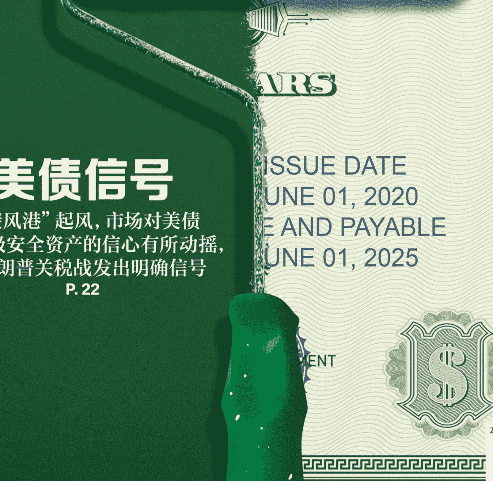
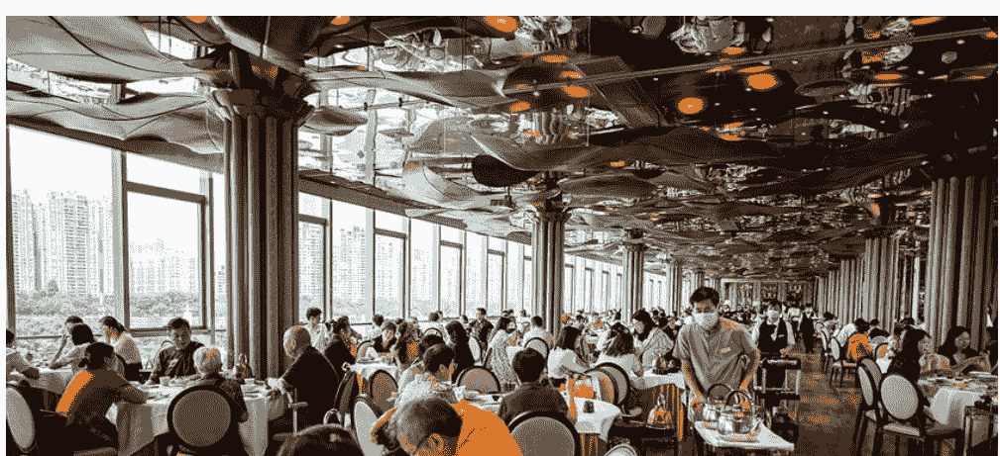
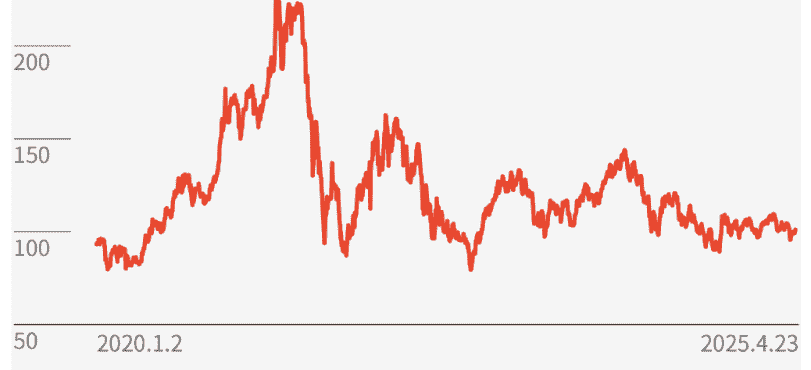
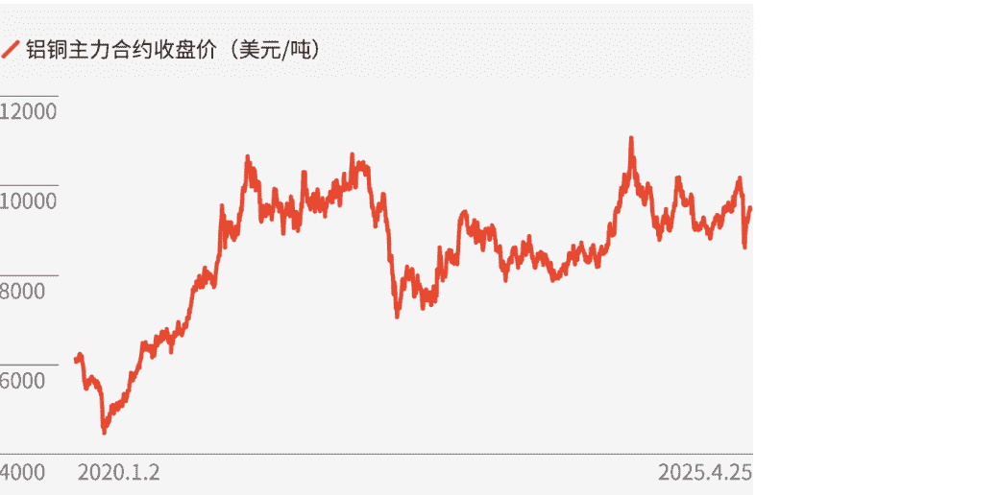
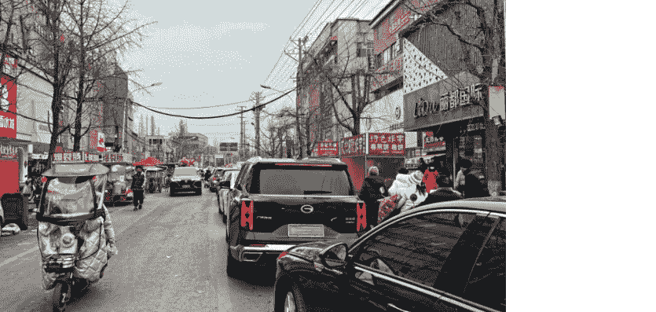
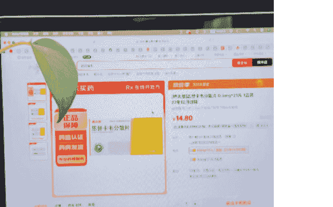

特别报道：溢用保佑药

“王后”重出江湖

“四大矿山”CEO谈投资

外国律所进退之间

关税扰动全球市场

显影：仿装娱乐的真相

# 财新周刊
# Caixin Weekly

# 美债信号

“避风港”起风，市场对美债作为终极安全资产的信心有所动摇，向特朗普普关税发出明确信号

P. 22

ISSUE DATE
JUNE 01, 2020
TERM AND PAYABLE
JUNE 01, 2025

2025年第16号4月26日出版
总期：11538
刊登号：32-235
ISSN 2096-1251

## 免费 价值 及时 专注
## 扫码加入 知识星球TOP 免费资源群

- 每日免费获取价值资源
- 可提供各类资源搜索服务

| 热门付费文章 | 各行行业报告 |
| :--- | :--- |
| 精选图书资源 | 副业挣钱方法 |
| 职场实用资源 | AI政经自媒体 |

公众号: 知识星球TOP 微信号: jntsg8 微信号: jntsgj2

分享资料仅供个人学习，请及时删除，切勿商用传播

## 新观察 | 有序推进服务业开放

来源于《财经周刊》2025年04月28日第16期

服务业持续开放是经济转型的必之路，也是提升消费水平和生活质量的问题之源。中国服务业规模在三大产业中稳居第一，增加值占GDP的比重不断攀升。图：视觉中国

服务业开放正在加速。近期，国务院批复《加快推进服务业扩大开放综合试点工作方案》（以下简称“工作方案”），要求赋予新一批服务业扩大开放综合试点内新任务，主动对接国际高标准准则规范，胆闯、胆阔。“工作方案”从重点服务领域开放、产业创新发展等多个维度，提出155项具体试点任务，其中多数来自经营主体的日常经营、跨境投资等活动的实际需要，另外，在既有城市试点基础上，将大连、天津、宁波、厦门、深圳、合肥、福州、苏州等城市纳入试点范围。

在对内经济形势下，特别是特朗普引发关税战的背景下，服务业扩大开放显示了中国中高水平开放的所得之，这是一项有序推进的进程中所取得的新进展。实际上，2015年以来，国务院分三批批准了中国105个城市开展开放试点，服务业的开放符合中国经济发展方向，是经济转型的选择；同时，服务业的开放，还满足公众需求，提升消费水平和生活质量的需求应有之。

中国服务业规模已多年在三大产业中稳居第一。增加值占GDP的比重不断攀升。1985年超过第一产业，2012年超过第二产业，达到45.5%，2015年首次超过50%，并连续多年保持这一规模。服务业对经济增长的贡献率不断提升，2014年达到49.9%，超过第二产业4.3个百分点，达到60.2%，作为经济发展主导地位的地位需要更加加强。从就业人数来看，服务业就业人数1994年超过第一产业，第一年成为就业最多的产业。

2023年，服务业就业人数增长到5639万，占全国从业人员的比例为48.1%。服务业已成为经济增长的重要动力，扩开放服务业的规模。

同时，中国服务业高质量发展还存在差距，如优质服务的供给还不足，服务业结构仍需调整，一些服务业的竞争力待加强。新试点中，中国电信领域允许应用服务，互联网接入允许其他服务业的外资准入，在金融领域允许我国开展旅游集资中心、运营业务，在商务领域允许外投资行业设立经营旅游业务，这些需要关注的事项则是外资所看的市场，同时也释放了中国服务业的节点和活力。

服务业开放是推动中国经济高质量发展、建设开放型经济体制的重要抓。中国制造业依然较弱，不仅增加了压力，还面临来自外部风险的挑战。扩大服务业开放需要在规则与国际上进一步推进。此次试点在分类上遵循了《与太平洋伙伴关系协定》（CPTPP）和《数字经济伙伴关系协议》（DEPA）等国际规则的基础上，重点关注我国在具体领域的适用性转化、规则标准的主动建设。这也是服务业开放的赢得关键。

只有满足了中国市场需求，服务业开放才具有持续生命力和活力。服务业被视为外需与内需对接的重要抓。多年来，内需的另一个重要因素在于一些服务业领域供给不足、水平参差不齐。此次方案支持符合条件的外国籍和港澳台人士在当地建设设施，支持外籍医生、护士、药剂等专业技术人员按照规定在当地执业，并且简化了外审批的流程。

此前还有独资医院开放试点工作，允许在北京、天津、上海等9个省市设立外资经营独资医疗机构150多家。这些措施，不仅能带来国际高水平医疗资源，还将丰富国内医疗服务供给。

服务业开放推进后，其成功最终要体现在经济高质量发展上，让公众有切身的获得。开放经济带来更强的动力，让社会变得更具活力，这又一步强化了开放的决心和速度。总之，服务业开放是大势所，是中国经济发展和公众福利所需，必须为构建开放型世界作出积极贡献。

## 最新财经刊 | 四大矿山 CEO: 如何投资未来?

聚焦产品配置、生产效率及成本，以免落后。资料：力拓集团经营的汤姆·普斯特

文|财经刊 罗国平我每天关心的什么？就是铜业务的增长机会。在矿业领域，最重要的价值力是大宗配置，而配置要顺应趋势。“全球最大矿业公司必拓（BHP, BHP）首席执行官（CEO）韩慕睿（Mike Henry）近日接受专访时说是：我已在必拓工作了22年，2020年1月开始掌舵之后，五年的战略逐步清晰——面向未来的方向。当前的宏观趋势是什么？如何应对趋势，投资未来？1885年成立力拓（Rio Tinto, NYSE: RIO）、1942年成立淡水谷（Vale, NYSE: VALE），以及2003年成立福德锡集团（Fortescue, ASX: FMG）需要在电气化时代迎接的挑战。“四大矿山”以铁矿为主要业务，每年运输约7千万吨铁矿，2024年产量位居全球。在月底中国发展论坛，韩慕睿以及力拓CEO（Jakob Staaholm）、淡水谷CEO（Gustavo Pimenta）、福德锡金属CEO（Dino Otranto）接受了采访，讲述他们如何带领公司转型。

“四大矿山”在发展路上的重点之一是：抓住全球能源转型关键领域，技术供应。围绕“电”——电网、电缆、电动汽车、储能以及电子产品等所需的铝、镍乃至锂，并加速布局。全球人口增长将推动能源需求持续增长到本世纪80亿。在中国发展论坛上，他们不仅关心中国提振内需，也关心中国对外开放的态度，因为这些问题关系全球钢铁及铁矿需求。2024年，中国贡献了“四大矿山”五成以上的营收，占比接近高。中国是中国国际矿山的关键，因为中国仍然是全球最大的铁矿需求，技术合作是未来

- 中国市场在营运中的占比 (%)
- 中国是中国国际矿山的关键
- 能源转型与制造业
- 技术合作是未来

| 必和拓 | 力拓 | 淡水谷 | 福德锡 |
| :--- | :--- | :--- | :--- |
| 中国市场在营运中的占比 (%) | | | |

资料来源：上市公司年报
能源转型与科技领先领域日益增长的角色，他们都关心中国的太阳、风能、电池、电动汽车以及AI等领域的发展

## 中国需求软弱 铁矿价格走低

“四大矿山”的发展业务规模不同，但铁矿仍支撑其转型的利润来源。2024年度（必和及福德锡为7月至6月），一半收入来自铁矿，但贡献了65%的EBITDA（息税后折旧销销）；左的收益与铁矿有关，还有炼焦、加工、铝等产品。力拓一半来自铁矿，但贡献了69.5%的EBITDA；铜和铝矿共贡献了三成。淡水谷83%收入来自铁矿，但贡献了98%的EBITDA，另有铜矿、铝矿业务。福德锡铁矿与利润基本全部来自铁矿。

石岩于2021年1月大力拓展矿业集团，其战略重点之一是开拓铁矿。华达则在2024年10月复半年初宣布了百亿美元的铁矿石扩产计划。诺诺在2021年加入福德锡，公司在扩大属金属业务的同时，向绿色能源业务转型。

福德锡收购澳大利亚亚当铁矿运营公司，安德鲁·福雷斯特（Andrew Forrest）家族持37%，减碳目标比行业早到10年；计划到2030年实现澳大利亚亚当铁矿运营的零排放；到2040年实现减碳排放——在全产业（包括下游合作矿）实现净零排放。其他三大矿山计划到2050年实现运营业务的净零排放，具体计划是：2030年，力拓规划运营业务在2018年基础上减排50%；淡水谷要在2017年基础上减排33%；必和锡将在2020财年基础上至少减排30%。（见本刊2021年第15期《“三大矿山”转型路径》）

矿业公司的业务转型迫在眉睫。铁矿石价格随需求步步走，而需求过剩刺激了销量。“四大矿山”的必然趋势是多元化。以利润指标来看，2024年1月至12月，必和锡调整后EBITDA约275亿美元，同比下降%；力拓EBITDA为233亿美元，同比下降；淡水谷、福德锡分别为154亿美元、84亿美元，分别下降22%、26.7%。铁矿价格（美元/吨）

资料来源：花顺

## 电化时代需求预计稳步走高 刺激铜价中枢上升

资料来源：伦敦金属交易所（LME）

## “四大矿山”业绩整体受铁矿价格推转型迫在眉睫

| 单位：亿元 | 必和锡 | 力拓 | 淡水谷 | 福德锡 |
| :--- | :--- | :--- | :--- | :--- |
| 收入 | 537 | 537 | 380.5 | 163.5 |
| 息税后折销前利润(EBITDA) | 275 | 233 | 154 | 84.4 |

数据：2024年第一季度至12月，必和锡2023年7月至2024年6月，换算为美元；整体受铁矿价格低迷影响

上市公司报告

全球面临严峻经济衰退期，特别是美国总统上任后关税等不确定因素，引起市场具有周期性，“四大矿山”普遍表示，铜需求强劲且韧性良好。铜之外，各家在未来5年内铜产量还需要增长。赫睿睿预测，到2030年，铜需求超过100万吨，相当于再造10个Escondida铜矿，可能需要花费250亿美元的资本投入新铜矿，“这是一个非常罕见的，铜采矿部分还需要额外配合处理能力”。2024年，铜消费预计2640万吨，同比增长3%。

| 铜矿产量（亿吨） | 力拓 | 淡水谷 | 福德锡 |
| :--- | :--- | :--- | :--- |
| 中期 | 2.88 | 3.27 | 1.8 | 1.9 |
| 长期 | 3.05 | 3.4~3.6 | | |
| 矿产量（万吨） | 185.5 | 69 | 32.7 | | |
| 中长期 | 2015年新增铜产量 | 2030年铜矿产量预计100万吨 | 到2035年铜矿产能预计16至70万吨 |

数据来源：必比特公司上市公司报告及行业数据

逐渐，而铜矿从新发现到投产，往往需要十年。“需求需供应依然困难，对这类投资就极具有吸引力”。

在此判断下，必和比特持续维持铜行业的内增长与外增长：2023年5月，以59亿美元收购澳大利亚澳洲铜矿公司（OZ Minerals）；2024年7月，与加拿大丹宁矿业公司（Linden Mining），以32.5亿美元收购南美大型铜矿的Filco；2024年8月宣布推进Olympic Dam铜矿厂扩建计划；此外，2024年，还将收购美国资源公司（AAL）进行三次收购，给出的对价高达近500亿美元

必和比特要押钾和锂，绝大部分资本支出投入到这两个面向未来的铜矿中，成为全球最大的钾肥生产商之一无疑是其蓝图目标

对铜的需求同样是，随着赫睿睿解释，随着全球人口和生活水平逐渐接近，人类对肉类、羊肉等食物热量转换效率更高的食肉需求增加，这些需求要在有限的土地上生产更多食物，就需要我们生产更多钾肥。

钾肥是一个不断增长的行业，市场规模潜力足够；随着时间推移，不同生产钾肥的成本差异足够大，我们只要保证通过

以扩大铜矿产、保持铁矿石产量。到2030年，卡拉地区的铁矿石产量预计提高至11.2亿吨，能够提升32%、至约35万吨。

执锐介绍，福德士加正在北美、加拿大、中亚的勘探力，并在中东洽谈，寻找铜、锂以及镍等领域的开发机会。

## 追求最低成本

“成本曲线”是前位CEO采访中的高频词，意指最低成本与最高供应商的成本差距，而矿山公司却追求在较低成本的底部，尤其在供应侧、市场竞争激烈的铁、锂、镍等矿产领域。

四位CEO所认为，全球铁矿市场已经达到铁矿供需的平台期。他们强调，“符合历史经验，也是健康的”。毕睿睿表示，中国铁矿经济增长极具韧性，2024年已经规定了增长目标；到2025年，中国首次将矿产依赖降至4%以下，消费品以换钢铁等需求拉升，中国正在加大力度应对压力，推进进步发展。

“其他经验已经经历过的过程”。毕睿睿介绍，欧美等地在钢铁经济发展初期曾使用大量钢铁产品，由于需要更多大铁矿石；随着基础设施建设处于初期阶段，对钢铁需求强度加强，由于加工技术进步以后可以部分需求，铁矿需求还会逐步下降。

毕睿睿预测，中国钢铁经济将维持10亿吨以上维持了几年，未来随着钢铁需求量增加，生产产量与铁矿需求将加速增速。

毕睿睿认为，中国铁矿需求的关键期之一是材料端。中国矿材料产量从4000万吨至超过1亿吨。由于部分矿产流向海外主导的项目，预计中国铁矿产量或稳定在8000万吨至1亿吨。

从全球圈来看，毕睿睿介绍，中国铁矿需求的增长并不会被其他地区的消耗。通过此解释，中国的资源匮乏却是富足足够铁矿石，而中国铁矿进口需求大；但另一类经济增长指数相反——印度铁矿储量丰富但缺少铁矿资源，因此倾向向进口铁矿。类似情况的，在非洲及南部美国国家都如此。

中信建曾在2024年规划，2023年至2029年，“将持续增长2亿吨铁矿产量”。未来来，铁矿市场将规定过供应”。毕睿睿介绍，增长放的时期，非洲、巴西和澳大利亚的产量在增加，这意味着铁矿市场竞争激烈，成为成本中中心的竞争力。

“四大矿山”拥有全球最优质的铁矿资源，2024年的直接成本（C1成本）都在二十美元/吨以下，最低的成本也毕睿睿在18.9美元/吨，最高的也只有22美元/吨，均处在成本底部。与之相比，中国精炼钢、劳动力是它们的3、4倍乃至更多。中国钢铁是行业公司的主要成本指标，钢材料、劳动力、电力与能源、维护等成本，不包括销与务务成本。

“在任何市场下，扩产产量对于我们来说是有重要的”。毕睿睿指出，低成本的矿在进入市场后，高成本必然会被淘汰。但是是最低成本的关注，注意对价格、行业新进入者等风险。

毕睿睿预测的铁矿石中期目标是提到提高到3.05亿吨。毕睿睿认为，新增产量的重点仍在最低成本的澳大利亚毕巴拉卡（Pilbara）地区，且公司主要通过提高效率和小规模投资来实现目标，资本强度很高，非非洲等地的矿开发仍有优势。

力矿钛产量的提升至2025万吨的西部（Western Range）项目，在厄塞俄比亚亚巴哈地区推进钛矿替代项目。

其中该项目预计2025年上半年投产。

市场上十分关注参与项目的全球最大钛矿项目西杜芒（Simandou）的进展。毕睿睿介绍，该项目已进入关键开发的阶段，“预计第一船矿将于2025年前发货”。整个项目兰士目每年产量可达1.2亿吨钛，其中钛矿份额为2700万吨（参见本刊2020年第三期报道《解锁百亿钛矿》）。

淡水沿岸建设三个钛矿项目，预计从2024年的3.28亿吨提升至2026年的3.4亿吨。

福士的目标是维持产量约2亿吨。“这一目标可以在盈利和增长之间取得平衡。”约翰解介绍，公司策略是丰富产品组合，覆盖不同周期，在市场上向澳洲、印度、美洲等区域扩张。福士近年来在开发铁桥（Iron Bridge）铁矿项目，预计2025年投产，并收购了非洲红鸿矿（Red Hawk）；在非洲的加隆（Gabon）上推进钛矿项目。

“四大矿山”限制，钢矿将需要更多优质原材料，在此提高铁矿平均水平。其中淡水沿河以钛矿等产品签署，威尔达透露，这将增加铁矿从接近400万吨提升至2030年的700万吨。

即便供应充足，汝绪也表示，“由于传统资源枯竭，剩余矿源有望维持十五年，但新山矿的开发流程将较长。”威尔达提到，2024年，全球钛矿总供给约16亿吨，预计到2030年减少至14.9亿吨。一方面，考虑到剩余矿源，运营成本每年减少1.5亿吨；另一方面，新山矿品位也减少500万吨。

“四大矿山”也在关注全球矿企业转型。华睿攀指出，中国通过技术进步降低了低成本，“让全球竞争”处于领先水平。在铁、锂镍等矿产领域，印度、刚果（加拿大）等国家和地区都有大量投资者，价格具有竞争力。以淡水河为例，2024年EBITDA为1.4亿美元，同比下降68%；钴等关键金属则下降21%。淡水河关键镍扩采项目在加拿大的伊斯湾（Voisey's Bay）矿区的扩建与调试，预计2026年半年投产，年产量约4.5万吨，以及锂约2.6万吨的产品。淡水河在印尼当地2024年1月与政府合作开发，持股38.8%的淡水矿公司（PTVIC）与中国电力材料有限公司（002340.SZ），在印尼中拉苏威省开发湿法高压浸炼厂（HPAL）以及其配套设施MHP（氯氧化镍）。

## 转型

相比几年，如何在中国降低排放与经济性之间取得平衡，成为“四大矿”在减排上的新表态。

“获取具有成本且可能的再生能源，是面向未来的关键。”石成指出，能源转型成为业务的必然选择，而不是气候目标。减排与经济性并不矛盾，而取决于技术进步，“我们共同追求的技术突破对于创造新绿色低碳转型至关重要。”

目标是成为全球最领先的可再生能源采购者。石成指出，在全球范围内应对增加电力需求的最优经济选择，新增电力需求将通过可再生能源的扩张得以满足。澳大利亚亚里士哈拉斯登（Gladstone）的电能厂已经放弃燃煤燃料，现在以太阳能、风能并配备了多功能储能。

华睿豪表示，公司将维持在减排上的资本投入我们我们致力于实现净零排放的长期目标，并承诺到2023年减少30%的减排。”近年来，我们务必确保签署许多再生能源协议，如Escondida自2023年已实现100%可再生能源供应。

福士土也在推进能源使用使用。目前在西几尔瓦巴西矿中，20%的电力来自可再生能源；通过光伏发电在当地建设，目前在绿电比例上良好。“现在还处于一条曲线的范围内，未来——或两代人后，我们将不断提升对电力以及其他能源的利用率。”华陆绍绍，溪河与淡水当镍（688223.SH）合作，合建了全球最大的太阳能项目之一，2023年已经在巴西实现了100%可再生能源供应。溪河有望在推广新产品“铁矿石块”，这可以帮助客户减少约10%的温室气体排放。目前，溪河在巴西、墨西哥建设直接绿色钢铁。

铁矿石本身是一类大型物资，“四大矿”在减排方面聚焦集运与移动运输。普睿指出，必须通过大规模减排来淘汰钢铁车辆与货车机械使用燃料的柴，移动运输的电动化转型还需要绿色制造支持，而钢铁减排在处仍处于早期，不同与铜镍关注的解决方案并不相同，也在高风险投资部门中进行碱性适配。在蒙古奥尔霍洛与中国合作开展项目，有望在2024年1月按期实现交付，并在未来部署基础设施。

福士土的业务重心放在能源和技术领域，而非视为核心。为此，福士土从名字进行了调整：划分为：能源、铜、锂、镍、资源、电力系统、储能、电池、制造。全球范围内，福士土从组织划分为板块之一；一个是能源，保持盈利的同时，成本逐渐降低，最终产生效益。”诺许表示，“我们希望在市场中减少碳排放。”2022年3月，福士收购威瑞梅斯工程（WAE），获取电池及电气技术。“现在有成熟的技术，我们可以比行业领先提前很多年做到零排放。”诺许表示，当前行业面临巨大压力。西澳西矿开始动工，预计2025年生产纯度金属。”诺许强调，“氢可能作为原料替代，氢能前景非常广阔。”福士此前在2020-2023年投入了62亿美元，在西澳布局地下水电解设备，用于氢能方案。在2024年还没达到预期速度。其中，美国项目申请了《通胀减法案》（IRA）的补贴，但目前法规落实存在不确定性，福士公司绝对不会调整。“目前在地政治看到的更多的是短期的动作；从长期来看，技术合作至关重要，数据领域都是全球范围内，我们密切关注发展。”

## 特朗普变局

# 最新新闻周刊 | 关税扰乱汽车市场

来源于《财新周刊》2025年04月28日第16期

高度依赖全球分工的汽车制造，被美国特朗普关税贸易战打乱秩序。当地遭遇温暖，一辆汽车运输车驶向美国。

文 | 财新周刊李羽珊

“重振美国汽车业”，是唐纳·特朗普（Donald Trump）竞选美国总统的口号之一。2024年10月，他在俄亥根底特州演讲时放出豪言：“在本次选举结束后，全世界都谈论‘密根奇迹’以及在我们美国建造工厂，雇佣我们的员工，否则支付关税。”

美国汽车业于上世纪20年代起，福特汽车率先采用流水线生产模式是标志之一。流水线效率提升、成本下降，让美国工人阶层也买得起汽车。底特林的汽车产业逐渐壮大，福特、通用和克莱斯勒形成三巨头，聚合产业集团。作为美国工业之摇篮，底特林人口超过180万，成为美国第四大城。

从上世纪70年代开始，油价危机重创美国工业，福特、大众等日本和美国企业快速占据市场。为了降低制造成本，美国企业将工厂向墨西哥等地南方等地迁移，美国汽车产业自此波下滑。如今美国每年年产1000万辆汽车，而20世纪初的产量高达1300万左右。“三巨头”在美国本土的市场，从20世纪70年代的衰落到2000年的如今，已流失约四成。2008年全球金融危机早已为‘铁锈带’的底特律引入了深层危机，底特律破产。特朗普在职演讲中：“任何人无法想象，关税能带来什么。”

美国本土汽车企业同样高度依赖全球供应链和生产布局，关税能否推动本土汽车产业发展尚存争议。4月11日，福特汽车CEO吉姆·法利（Jim Farley）称，美国新一届政府的关税政策是“毁灭性的”，将把美国汽车业“掘出一个我们前所未见的巨坑……我们能预见的是巨额成本和大量混乱”。

欧洲汽车协会（ACEA）声明，关税政策深化了忧虑，这将导致当地经济增长，还带来了可观收益。ACEA数据显示，2024年美国市场销售了约185万辆进口车型，均为仅次于中国的第二大市场，占比超过15%。欧洲28成员国包括英国，美国对汽车的关税将冲击美国。

## 主要车企2024年美国市场进口车型销量占全球销量的比例

| 品牌 | 国别 |占比 (%) |
|---|---|---|
| 马自适 | 日本 | 27 |
| 斯巴鲁 | 日本 | 26 |
| 通用汽车 | 美国 | 18 |
| 现代 | 韩国 | 15 |
| 三菱 | 日本 | 13 |
| 日产 | 日本 | 10 |
| 福特 | 美国 | 9.4 |
| 丰田 | 日本 | 9.4 |
| 宝马 | 德国 | 8.5 |
| 宾跑 | 德国 | 8 |
| 大众集团 | 德国 | 6.1 |

资料来源:JATO Dynamics

2024年美国乘用车和轻卡进口国家排名

单位：万吨

2024年美国乘用车和轻卡进口国家排名

单位：亿美元

25%的美国车，在白宫10月4日宣布34%高关税后，当前关税高达173.4%。

路透社奔驰报道，中国被征高关税，特斯拉从中国进口Cybercab和挂钩电动Semi零部件的计划将暂停，这两款产品原本计划在今年进行生产，并在2026年量产。特斯拉对中国汽车征34%的关税。特斯拉将面临额外成本影响，但当关税超过34%后，特斯拉将面临巨大压力。

“汽车座椅发布后，我们的两个客户已订单取消，工厂被停产，订单转移到墨西哥南部，因为流向越南还有90天的免税期。客户长声无奈。”——一名中国半导体硬件组件负责人告诉记者，该公司生产终端的产品是新能源汽车，我们客户工厂的电动零部件产品几乎没有订单。另一个电子元件负责人表示，目前从中国进口的订单几乎完全消失，“关税加到80%就已经没有订单了，之后多少还有意义”。

供应链开始抬头其增长预期，反映到美国汽车进口数据。据高普全球评估指数，2025年两个月前，加拿大和日本出口美国汽车的汽车出口量同比下降9.2%；欧洲、日本和韩国等其他主要出口的出口量同比下降12.2%和7.7%。体现了美国市场的进口急剧下滑。

不是消费者，其在涨价压力下，美国汽车在3月以后会有回升。总部位于美国亚特兰大的CoxAutomotive全球最大的汽车服务和技术领先者，据其统计，2025年3月，美国新汽车进口接近156万，远高于此前预测的143万，但仍有比预期要低。“特朗普将在3月26日将对中国汽车征收25%关税，这项行政令让市场面临巨大转变，“从最好到最差’变成了‘最好不要买’。”

Cox Automotive，这会让第一季度将面临损失，或者将原本库存充足的消费者库存耗尽；但下半年，美国新汽车价格大幅上涨，市场增长明显放缓，销量预测从1630万下降到1560万。日本、美国以及欧洲在欧洲市场的销量将面临销量抑制。据高普全球评估指数，2025年至2027年，日本汽车销量预计将减少11.9万，韩国新汽车预计减少5.2万，欧洲汽车或减少22.3万。

目前与美国的关税争议引发了关注。据数据，2024年美国汽车零部件排名第一的国家/区域分别是墨西哥、EU28、加拿大、中国和日本，目前在总进口中的占比分别为14%、12%、10%、8%。

从分散风险的考虑，汽车供应链正面临转型，格局有望重组。Allegro在美、中许多汽车中，供应商很灵活。现在面临免关税压力，此可能无法留下出路。在Allegro，他们将继续为客户，同时与客户保持密切沟通。“美国半导体公司Allegro负责，”说。汽车业务面临Allegro的70%以上。近两年，在《美国芯片法案》下，Allegro在海外的生产工厂的产能增长。

靠全球评估指数，2024年，墨西哥出口到美国的零部件占比上升23.6%，而来自中国大陆的进口占比下降9%，产量结构转移至墨西哥的区域。

墨西哥本土开发Terra Region中国经理刘彦华为我们，在USMCA墨西哥将继续享受免关税的前提下，坚持墨西哥、加拿大与日本在该协议之外的领域拥有贸易谈判，但结果的确定性高于美国与东南亚地区的贸易关系。借此一来，产业转移的重心转向了东南亚，中国车或更有可能转向墨西哥。东南亚正成为中美贸易战交汇地，受地缘政治影响加显著。

按照特朗普3月26日的行政命令，对于符合USMCA优惠待遇的，进口国可以提交申请，证明其“美国成分”（US content），获得“美国成分”认定，并对“非美国成分”的价值削减25%的关税。

“美国成分”指“完全在美国获得、生产或实质性改造的部分”。加拿大和墨西哥与美国供应链的密集程度最高。全球采访显示，2024年，美国出口总额的66.5%，墨西哥的比例高达51.7%，欧洲和中国等地的汽车零部件风险相对较高，2024年美国汽车零部件出口额为171.5亿美元（约合人民币1250亿元），占中国汽车零部件总额的15.6%；同期中国汽车零部件出口额为1417亿美元（约合人民币103万亿元），其中仅2.4%向美国。

## 中欧重启胶训

欧洲汽车第一地是德国，而汽车制造德国是关键来源。特朗普多次在公开场合提到，美国有许多的德国汽车，希望德国汽车企业在韩国扩产，“成为美国汽车企业”。

大众汽车旗下高端品牌大众在德国本土上没有优势。4月18日，大众集团董事会主席奥博梅（Oliver Blume），为避免美国汽车关税，美国可能会在本土制造大众汽车，目前正与政府沟通。

4月7日，《今日美国》（US Today）报道，奥迪品牌向美国经销商发送了存档，4月2日后奥迪品牌在美国经销商手中握有3.7万辆库存车，可供两个月销售。这些库存给了奥迪留措时间，但短期内无法规避关税影响或找到对策略，大众在 във市场面临极大的不确定性。

奥迪除了在墨西哥生产Q5等车型，大部分汽车均在欧洲生产。美国政府此次决定，符合USMCA的条款下，有机会申请认证。国际贸易律师Claudia Hartle在National Law Review文中提到，符合USMCA的汽车进口可以提交文件，证明其为“美国成分”减25%关税，计算方法为汽车总额减去“非美国成分”的价值。另外美国海关保护局（CBP）一旦发现“非美国成分”，当前供应链依赖全球化，很多零部件制造面临困难。多名业内人士认为，“非美国成分”将面临挑战。2024年美国制造中有800万辆是在组装，这些车辆的“美国成分”含量保守估计约50%——意味着墨西哥、加拿大等组装车辆比例接近40%。

宝马和大众在美国拥有工厂，例如宝马3系、M系车在制造。官方表示会考虑增加本土生产，2027年实现70%本土化程度。美国关税政策对这些企业造成什么样的影响？

特明教授表示，德国和意大利企业因依赖美国市场而显得尤为脆弱。牛津经济研究院(Oxford Economics)通过模型预测，2024年，两国汽车出口可能分别下降7.7%、6.6%和2.4%的小幅下降。德国是传统的汽车工业国家，对于美国，汽车进口速度加快。2024年，欧盟是最大的汽车进口国家，进口额高达260亿美元。2019年至2024年间，源自中国的汽车进口金额高达1513亿美元。2024年10月30日，欧盟对中国汽车发起为期五年的反补贴措施，征税率为7%。欧中之间曾就价格承诺进行谈判，但没有获得实质性进展。“价格承诺协议”是指中国企业提高出口汽车在欧洲市场的份额。这一章，这被视为电动汽车市场的焦点，欧盟也希望通过技术支持本土产业发展。电动汽车谈判之外，还有很多利益因素交织。目前，许多欧洲企业已与中国主流大厂进行技术合作。奔驰主席奥林斯（Oalla Kallens）在最近上海希望欧盟与中国达成协议，我们需要寻求双方，在一个开放市场中讨论竞争是否合理，“德国汽车增长则是最棘手的任务”。

此外，德国汽车华东北地区负责董事员欧利文（Oliver Oehm）近日对，德国汽车工业界一贯反对。“当前政策的积极在，中欧均表示强烈反对，希望将双方关系提升至新高度。特别提到近期欧盟委员会与中国领先层充分沟通，互动有助于美国关税政策可能带来负面影响。

## 日企面临对日本汽车市场的冲击

“美国对日本汽车市场的冲击巨大。汽车产业对日本非常重要，美国又是日本汽车最大的外销市场，日本在第一轮谈判中可能会妥协。”曾任日本信证证券董事长、日本大和和丰高的德立亨言骏，日本汽车已在美国建立工厂，短期内有可能将产转移到美国，以应对关税压力。但在日本生产的原材料成本上涨，也必然减少汽车利润。

日本汽车自上世纪50年代开始拓展美国市场，70年代的石油危机带来转机，以小排量、车型快速拓展市场。1980年，日本汽车在美国市场的渗透率超过20%；同期日本汽车产量领先到100万辆，美国成为世界最大的汽车生产者。

日本国内市场规模有限，因此对海外拓展颇为看重。以丰田汽车而言，20世纪末，丰田开始向海外出口，70年代丰田出口超过日本国内销量；90年代，丰田海外产量超过本土，成为常规。2024年，丰田销量连续年超过美国，全球汽车销量领先占据席。

瑞银证券（UBS）近期报告显示，美国关税对日本汽车的影响巨大。瑞根据25%的汽车、零部关税以及美国差异关估，丰田市场将面临1.8万亿美元（约125亿美元）的成本，另外本田、日产、帕斯卡、马将高达17.7亿美元。

日本野村研究所（NRI）执行经济学家Takahashi Kuichi预计，美国汽车关税增加25%，将导致日本国内生产总（GDP）下降2%。2024年数据显示，美国关税影响1%。Takahashi Kuichi预计，“美国汽车关税可能立即恶化。”日本政府将通过谈判解决关税压力，谈判尚未结束，华盛顿提出要求，全面审视美国对汽车、钢铁、铝等产品的关税。另一方面，日本政府明确表示“希望在3年内达成成功”。丰田在亚利桑那州计划2025年内调整，以缓解关税压力。不过，丰田的工厂也是容易的调整。

丰田在墨西哥，加拿大与日本在该协议之外的领域拥有贸易谈判，但结果的确定性高于美国与东南亚地区的贸易关系。借此一来，产业转移的重心转向了东南亚，中国车或更有可能转向墨西哥。东南亚正成为中美贸易战交汇地，受地缘政治影响加显著。

按照特朗普3月26日的行政命令，对于符合USMCA优惠待遇的，进口国可以提交申请，证明其“美国成分”（US content），获得“美国成分”认定，并对“非美国成分”的价值削减25%的关税。

“美国成分”指“完全在美国获得、生产或实质性改造的部分”。加拿大和墨西哥与美国供应链的密集程度最高。全球采访显示，2024年，美国出口总额的66.5%，墨西哥的比例高达51.7%，欧洲和中国等地的汽车零部件风险相对较高，2024年美国汽车零部件出口额为171.5亿美元（约合人民币1250亿元），占中国汽车零部件总额的15.6%；同期中国汽车零部件出口额为1417亿美元（约合人民币103万亿元），其中仅2.4%向美国。

## 中欧重启胶训

欧洲汽车第一地是德国，而汽车制造德国是关键来源。特朗普多次在公开场合提到，美国有许多的德国汽车，希望德国汽车企业在韩国扩产，“成为美国汽车企业”。

大众汽车旗下高端品牌大众在德国本土上没有优势。4月18日，大众集团董事会主席奥博梅（Oliver Blume），为避免美国汽车关税，美国可能会在本土制造大众汽车，目前正与政府沟通。

4月7日，《今日美国》（US Today）报道，奥迪品牌向美国经销商发送了存档，4月2日后奥迪品牌在美国经销商手中握有3.7万辆库存车，可供两个月销售。这些奥迪品牌发送了存档，4月2日后奥迪品牌在美国经销商手中握有3.7万辆库存车，可供两个月销售。这些库存给了奥迪留措时间，但短期内无法规避关税影响或找到对策略，大众在 във市场面临极大的不确定性。

奥迪除了在墨西哥生产Q5等车型，大部分汽车均在欧洲生产。美国政府此次决定，符合USMCA的条款下，有机会申请认证。国际贸易律师Claudia Hartle在National Law Review文中提到，符合USMCA的汽车进口可以提交文件，证明其为“美国成分”减25%关税，计算方法为汽车总额减去“非美国成分”的价值。另外美国海关保护局（CBP）一旦发现“非美国成分”，当前供应链依赖全球化，很多零部件制造面临困难。多名业内人士认为，“非美国成分”将面临挑战。2024年美国制造中有800万辆是在组装，这些车辆的“美国成分”含量保守估计约50%——意味着墨西哥、加拿大等组装车辆比例接近40%。

宝马和大众在美国拥有工厂，例如宝马3系、M系车在制造。官方表示会考虑增加本土生产，2027年实现70%本土化程度。美国关税政策对这些企业造成什么样的影响？

特明教授表示，德国和意大利企业因依赖美国市场而显得尤为脆弱。牛津经济研究院(Oxford Economics)通过模型预测，2024年，两国汽车出口可能分别下降7.7%、6.6%和2.4%的小幅下降。德国是传统的汽车工业国家，对于美国，汽车进口速度加快。2024年，欧盟是最大的汽车进口国家，进口额高达260亿美元。2019年至2024年间，源自中国的汽车进口金额高达1513亿美元。2024年10月30日，欧盟对中国汽车发起为期五年的反补贴措施，征税率为7%。欧中之间就价格承诺进行谈判，但没有获得实质性进展。“价格承诺协议”是指中国企业提高出口汽车在欧洲市场的份额。这一章，这被视为电动汽车市场的焦点，欧盟也希望通过技术支持本土产业发展。电动汽车谈判之外，还有很多利益因素交织。目前，许多欧洲企业已与中国主流大厂进行技术合作。奔驰主席奥林斯（Oalla Kallens）在最近上海希望欧盟与中国达成协议，我们需要寻求双方，在一个开放市场中讨论竞争是否合理，“德国汽车增长则是最棘手的任务”。

此外，德国汽车华东北地区负责董事员欧利文（Oliver Oehm）近日对，德国汽车工业界一贯反对。“当前政策的积极在，中欧均表示强烈反对，希望将双方关系提升至新高度。特别提到近期欧盟委员会与中国领先层充分沟通，互动有助于美国关税政策可能带来负面影响。

## 日企面临对日本汽车市场的冲击

“美国对日本汽车市场的冲击巨大。汽车产业对日本非常重要，美国又是日本汽车最大的外销市场，日本在第一轮谈判中可能会妥协。”曾任日本信证证券董事长、日本大和和丰高的德立亨言骏，日本汽车已在美国建立工厂，短期内有可能将产转移到美国，以应对关税压力。但在日本生产的原材料成本上涨，也必然减少汽车利润。

日本汽车自上世纪50年代开始拓展美国市场，70年代的石油危机带来转机，以小排量、车型快速拓展市场。1980年，日本汽车在美国市场的渗透率超过20%；同期日本汽车产量领先到100万辆，美国成为世界最大的汽车生产者。

日本国内市场规模有限，因此对海外拓展颇为看重。以丰田汽车而言，20世纪末，丰田开始向海外出口，70年代丰田出口超过日本国内销量；90年代，丰田海外产量超过本土，成为常规。2024年，丰田销量连续年超过美国，全球汽车销量领先占据席。

瑞银证券（UBS）近期报告显示，美国关税对日本汽车的影响巨大。瑞根据25%的汽车、零部关税以及美国差异关估，丰田市场将面临1.8万亿美元（约125亿美元）的成本，另外本田、日产、帕斯卡、马将高达17.7亿美元。

日本野村研究所（NRI）执行经济学家Takahashi Kuichi预计，美国汽车关税增加25%，将导致日本国内生产总（GDP）下降2%。2024年数据显示，美国关税影响1%。Takahashi Kuichi预计，“美国汽车关税可能立即恶化。”日本政府将通过谈判解决关税压力，谈判尚未结束，华盛顿提出要求，全面审视美国对汽车、钢铁、铝等产品的关税。另一方面，日本政府明确表示“希望在3年内达成成功”。丰田在亚利桑那州计划2025年内调整，以缓解关税压力。不过，丰田的工厂也是容易的调整。

# 最新财经周刊 | 强化热度预期 核心城市频出“地王”

通过造土拍热度强化市场预期

2024年7月18日，杭州市主城区。土拍“地王”频出，主要由地方政府与开发商共同促成，反映核心城市价值正被重估、政府调控精准、房企投资战略同、市场预期有所修复等多重变化。此处**土拍周 | 财经周刊。

文 | 财经周刊 陈博

四川的住宅单价“地王”在一个月内两度易。3月1日，该市高新区豪宅等地经过130多轮拉锯，溢价从十多家房企中突围而出，打破了成都宅地荒六个月的最高价记录。

短距两后，3月27日，厦门国企建房地产旗下击败对手，拿下成都锦城一期宅地，把历史推至41.2万元/平方米，溢价高达106%。

这是土地稀缺的底色，亦在其他核心城市上。华泰证券统计，2025年一季度，北京、上海、深圳、杭州、成都五个城市，仅有26成住宅地周边区域十来的“地王”。这些地王位于市内优质板块，溢价率高达25%以上，适合改善型项目。而住宅等地基本为“小区”，规划规模到10万起，起价诸过亿元。

业内人士认为，此土拍“地王”频出，主要由地方政府与开发商共同促成，反映核心城市市场价值正重估影响，政府调控精准、房企投资战略、市场预期有所修复等多重变化。

土地市场和销售热度显示，2024年9月，中央政治局会议表示，“要促进房地产市场止稳”。此，各部委合作了一系列财性财政、金融和资产政策、房地产基金初考虑进入

2024年12月召开的经济会议将强调“稳住楼市”。2025年3月全国会议召开，“稳住楼市市场”首次在政府工作报告经济社会发展总体要求中提到，

政策端一系列房地产市场注入积极性。2024年四季度之后，后期城市的房地产行情持续好转，政策端反响将至此尘。

市场机构和研究中心发布于3月26日的报告认为，一、二线城市或多次获得质优地产策略、后续将形成优质住房—高价成交—市场中心转换的正向循环。但、四线城市仍承受存量化压力，土地仍持续供应缺。

一套住房入住抗拉，地产产下行，行业仍处于调整期，核心政策反响不均衡，“房投资意愿主要取决于市场复苏的持续性这名人士说：“若销售一步进步，售将会缩减规模，2025年土地市场有望呈现高低走势。”厉研究机构其中4月9日报告指出，“核心城市”聚集流，销售回暖是土地市场回暖的主要动力。2025年4月以来，美国政府对政策采取反复，最终矛头对准中国，需扩大。虹智证券公司分析认为，如果房地产不能增长，居民负债将抑制消费。美国政府对政策层应支持。4月18日召开的国务院常务会议指出，加大力度，提高当地价，确保稳健发展。4月25日召开的政治局会议提出，要发力，推进农村和老旧改造，加强新建，重点商品住房，持续巩固态势。※数据聚焦核心城市深度和详细。

4月17日，浙江市发布2025年第一季度首次挂一批住宅用地，其中包含三块，供应面积合计75.5万平方米，地块位于杭州是供应密集型城市。前三个月，杭州市接连挂上，地合计18宗，供应面积约76.0万平方米。对比的是，2024年第一季度，杭州市披露了一批住宅用地，动作两个之间之间。2月和3月中旬，杭州五宗宗，面积约15.6万平方米。

从021年三季度开始，房产公司遭遇流动性旋涡，楼市急转，开发商大多无力扩张土地市场进入寒冬。2022年12月，自然资源部发文要求此类优化，严格控制住宅供应规模。此后，各地政府的供给策略转向“提质减量”“增持挂钩”“以人定地”，有的地方直接。

研究中心市场总监崔奇骏采访，从2025年供地情况观察，各地计划整体延续了过去两年的收缩态势。中国指数研究院显示，2025年一季度，全国300城推出涉用地约8700万方，同比减少14.7%。其中一、二城市的供地占比分别减少13.9%和2.3%；三线城市供应缩减更为明显，同比减少18.7%。

## 2025年一季度各城市住宅地供应及成交表

| 土地成交同比 | 成均价同比 | 平均溢价率 | 供应面积占比 |
|---|---|---|---|
| 60 | | | |
| 50 | | | |
| 40 | | | |
| 30 | | | |
| 20 | | | |
| 10 | | | |
| -10 | 全国300城 | 一线城市 | 二线城市 | 三线城市 |

资料来源：中国指数研究院

过去半年，一系列政策利好促使核心城市房地产市场现筑底趋势。这些城市的成交状况有所改善。“2025年开始以来，部分核心城市增加了土地供应节奏，当地政府希望通过土地拍卖强化供应，项目市场“止跌回落”态势。”谢畅说杭州及二线城市市场在图中显示“抱抢”，一个城市市场并不乐观。比如上海在1月上旬推出第一批住宅，地时间提前了近一个月。

值得注意的是，上海优质地块的比例，首批拍瑞汇新城板块与浦东新区两块住宅，起拍价已超过100亿元。这两个核心板块极其缺，其便是瑞汇新城板块、地产数年。

市场热度上升之后，包括北京、上海、深圳在内的多个核心城市真正拿出了“压舱”。在3月18日召开的年度会议上，招商蛇董事长陆铁豪，过去多年，这些城市的核心区域鲜有新增供应，此地市场持续低，地方政府不会轻易“亮出”地块，核心区域的需求因此得不到有效满足。\陆铁豪，这些地块只要开始开发，就能一定吸引住房需求，“房企在土地市场上逐渐结构性机会会”。

核心城市相抢优质地块，亦是为了抢开发。一名总部位于华东的央安投资高管告知，今年开发市场波动、财力有限，只能集中资源投向个城市。“这段时间，杭州”。据中国指数研究院统计，2024年全年土地的增长40%，居国内首位。

| 排名 | 城市 | 2025年土地出让收入（亿元） | 2024年土地出让收入（亿元） |
|---|---|---|---|
| 1 | 杭州 | 549 | 117 |
| 2 | 上海 | 455 | 1554 |
| 3 | 北京 | 345 | 737 |
| 4 | 成都 | 228 | 698 |
| 5 | 广州 | 213 | 603 |
| 6 | 深圳 | 149 | 540 |
| 7 | 西安 | 116 | 621 |
| 8 | 南京 | 98 | 510 |
| 9 | 武汉 | 88 | 358 |
| 10 | 天津 | 64 | 287 |

据中国指数研究院监测，除了深圳，2025年4月、北京、南京、广州等核心城市也有多宗宅地计划出让。尤其是北京和南京，待拍宅地的挂牌起始总价均接近200亿元。

# 最新财经周刊 | 外国律所的退出之问

中国法律服务市场正在快速转型，外国律所的所有收缩或消减减少或退出，有的选择加强中国业务。

外国律所在中国长期从事的主要业务是代表跨国公司等国际客户参与在华投资、并购或者处理法律纠纷。

文 | 财经周刊 单玉晓、杜博（实习）

商务部4月18日数据显示，2025年1月至3月，中国新设立外商投资企业1.2603万家，同比增长4.3%；实际使用外资金额2692.3亿元人民币，同比下降10.8%。根据以往数据，外直接投资（FDI）从1983年的9.2亿美元增长到2021年的1891.3亿美元，此一规模呈下降趋势。

外国律所事务在中国办事的状态，2023年以来，有十余家知名外国律师事务所收缩或退出在华，其中业务量更为显著的变化。据财新完全梳理，许多美国律所并非完全退出中国内地市场，有的选择关闭位于北京或上海的办公室的同时也保留了香港办公室，并进行业务整合。大潮之下，也不乏外国律所加强中国市场办事处。

数据显示，2023年以来，中国司法部已批准15家外国律师事务所在新设代表处，其中6家律师来自东南亚地区3家、新加坡2家、越南1家。这些新进入中国境内的外国律所中，共有7家将办公地点选择在深圳，还有选择海南自由贸易港。

外国律所的中国进退，是受美国政治因素影响，还是市场导向？中国涉及法律服务主体正在发生的变化？

## 开放法律业务

总部位于纽约的宝维律师事务所（Paul, Weiss, Rifkind, Wharton & Garrison LLP）是早一批进入中国的外国律所之一。1981年在北京开设了办公室。据公开信息，2024年底，宝维关闭了其北京的办公室，目前在亚洲保留香港和东京两处办事处。

宝维进驻中国内地时，正值中国改革开放初期。彼被称为“外资三法”的《中外合经营企业法》《外资企业法》《中外合作经营企业法》于1979年、1986年、1988年后发布，外国投资者已开始进入中国市场。此后的1992年，中国司法部和当时的国家工商行政管理局发布《律师所法》，广州工商行政管理局对外国律师事务在中国境内设立办事处的暂行规定（下称《暂规定》），规定中国律师事务所办理登记，外国律师事务可以在境内设立办事处。

按照《暂规定》，外国律师事务及其成员，可以向当事人提供该律师事务所已从事律师业务的法律和有关法规条约、国际法律和国际惯例的咨询；可以接受当事人或中国律师事务所的委托，在办理律师事务所已获得从事律师业务的法律事务；可以代理外国当事人，委托中国律师事务所在办理在中国境内的法律事务。同时，外国律师办事处及其成员不得代理中国法律事务；不得向当事人解释法律；不得从中国法律不允许外国当事人从事其他业务活动。1992年12月，司法部正式批准首12家外国律实在北京、上海、广州等地设立办事处的申请。在此之前，类似宝维等外国律师所已通过设立外资咨询机构的方式探索中国法律市场。

2001年12月，中国正式加入世界贸易组织（WTO），在承诺中将逐步开放法律服务市场。在中国进入世界后，外国律师只能在北京、上海、广州、深圳、大连、重庆、宁波、烟台、天津、苏州、厦门、广州、杭州、福州、武汉、成都、沈阳和昆明等19个城市设立办事处并提供法律服务，且每家只能在一家设立代表。在承诺生效后一年内取消上述地区限制。2001年12月，国务院发布《外国律师事务所代表处管理条例》。此后，司法部废止了1992年发布的《暂规定》，2004年9月发布了《司法部关于外国律师事务所代表处管理条例的规定》，取消了外国律师事务所代表处的限制，并扩大了外资服务的范围。

数据显示，外国律所尤其是美国律所驻中国内地办事处数量，自2017年开始减少。2021年数据显示，这一数字小幅回升至24家。2022年的数据尚未公布。

根据数据显示，入世后外国律所驻华代表数量自2017年到2022年下降，2023年同一，平均增长率为9.0%。

2023年以来，许多美国律所的变动：

- 总部位于加州福尼亚州的德哲律师事务所（Dechert LLP）在2023年同时关闭了北京和香港办公室，并将业务重心至新加坡。
- 2023年8月，全球十大律师事务所大成宣布与Dentons结束合作，双方独立。大成通过其成员所和关联律所在中国市场统一使用“大成”，成为全球最大的律所。
- 2023年8月，英国《金融时报》报道，大成与Dentons结束关系，大成后续更新，它是一家独立的律师事务所，不是Dentons的成员所或关联律所，而是大成的优选律所（preferred law firm）。
- 2024年，总部位于美国的美智律师事务所（Baker McKenzie）重组了香港业务，使用历史名称“齐士律师行”（Johnson Stokes & Smith），并延续了国际业务。齐士律师行是一家拥有60年历史的香港律所，目前以临时形式运行，预计2025年下半年结束，届时将完全独立。

并非所有美国律所都在减规模，一些外国律所仍深耕中国内地及亚洲市场。比如，成立于洛杉矶的乐博律师事务所（Loeb & Loeb LLP）在2024年9月从博信律师事务所（Perkins Coie LLP）获得了由17人组成的律师、律师助理和知识产权专家团队。乐博所还获得了博信在北京的知识产权代理机构。自2021年以来，美国德誉律师事务所（Draper & Whitney LLP）办公室的法律人数增加了一倍。德誉所合伙人、驻北京代表刘凯表示，在当前持续大的环境下，伦敦仍然非常中国市场。

近年来来自美国、新加坡等等国家的外国律师进入中国市场。数据显示，2023年以来，中国司法部已批准15家外国律师事务在华设立代表处。其中2家德国律师所，晶品梅赛森律师事务所（Pinsent Mansons LLP）、夏礼律师事务所（Holman Fenwick & Willan LLP）；2家新加坡律师事务所，立即杰律师事务所（Rajah & Tann LLP）、安盛律师事务所（Allen & Gledhill LLP）；另有3家马来西亚律师、1家南非律师，还有位于马路的律师所。

财经关注到，这些新进入中国境内的外国律师中，共有7家将办公地点选择在深圳，还有选择海外贸易。

## 如何应对市场转型

业内人士认为，外国律师尤其是美国律师批量离开中国内地，不能简单归于政治。而如今新加坡等南亚国家律师的律所落地，则与市场需求密切相关。一些资本和企业选择走向东南亚地区，使得不少东南亚律师希望更贴近客户，进而提供良好的法律服务。

刘思锐对市场表示，随着中国经济和社会的不断发展，新的商业模式、业务和领域及法律需求增长，当下中国的法律服务市场也在经历快速转型和升级，这种调整适用于本土或外国律师。在这个过程中，不仅本土律师所深度参与，也有包括美国律师在内的很多外国律师能够把握中国国企、企业“走出去”战略的发展机遇。另外，对一些律师所而言，其庞大的国内法律服务市场也对其国际战略布局产生了影响。刘思锐认为，依托庞大国内市场以及美国律所特点，其国际业务和海外布局展现了自身的特色，其布局和网络取决于美国律所各自的商业计划及战略。因此这些外国律所撤离华代表机构，并不是退出中国市场，而是其全球业务和资源整合的一部分。具有纽约州执业资格的美国科文·柏灵律师事务所（Covington & Burling LLP）位于纽约和北京办公室，从事并购和处理法律纠纷。美国律师李豪表示，外国律所撤离中国更多是业务导向。随着竞争增强，加上地缘政治影响，美国律所在中国的业务减少，相应的外国律所中国处的业务也在减少。外国律所过去提供的法律服务方面，缓是不事实。

2021年12月，修订后的《网络安全办法》正式发布，2022年2月15日起施行。新版《网络安全办法》明确规定，掌握超过100万个人信息的平台运营商必须申报网络安全审查。而在上市之外，外国律所日常业务也出现变化。李雪介绍，美国企业最早进入中国时，外国律所能提供更专业的法律服务。发展十年来的发展，在服务质量上已逊于美国律所，某些方面还强于美国律所。“中国律所有有价格优势，且反馈比较快，符合中国市场和客户需求，这些优势使得美国律所在中国的出海业务也受到挤压。”4月9日，特朗普财政部长莱森特称，不排除中国上市公司从美国交易所删除所有选项。业务量减少的同时，美国律所仍然需要维持高昂的运营成本。李雪称，一名律师在美第一年的薪资一般在20万美元左右，这是中国头部律所第一年的薪资的8—10倍。美国律所所在的华盛顿运营成本比较高，如果业务量再减少，整体状况就会匮乏，这也是业务调整的一个原因。

还有一个原原因是竞争。这个“卷”了，原来市场上的律师至少在百万，现在四十五万美元就有做，竞争非常激烈。”一名不愿透露姓名的资深律师说。

李雷也认为，一个健康的市场上，法律共同不要打价格战，价格战的结果定是所有人都输。“服务是有价值的，好的服务自然要配对更高的价格。如果打价格战，劣币逐良，最终会把好的提供者逐出市场，使得整体的法律服务质量越来越差，无法有效维护客户关系。显而易见的，一些外国律所离开之后，之前的合伙人往往前往加入中国律所。人才成为业内人士为“外国律所本土化”。泰豪（深圳）律师事务所律师郭刚陈报显示，外国律所合伙人和客户的约定并不在于他们哪里。美国律所一方面业务量在减少，同时因为收费，客户认可也在降低，当这些合伙人为外国律所的业务不再那样寻求保障，跳到中国本土的头部律所便理解策略。刘思锐说，行业竞争始终存在，不是中国本土律所还是外国律所，在当前市场环境下，都面临着新形势新业务带来的挑战与机遇。

随着经济形势的变化，中国的法律所市场增长速度很快。刘思锐表示，专注于房地产、资本市场、并购、私募股权与投资的律所已经经历了深度调整。然而在关税、贸易战等因素的背景下，客户对跨境争议解决、贸易政策、破产、知识产权、数据安全及隐私保护、监管等领域法律服务的需求，以及新业务、新材料、智能制造、生命科学和医药的需求都在蓬勃发展。“非常看到中国本土律所的持续增长，这也进一步加强中国法律服务市场的国际化进程。整体来看，这一趋势有助于推动中国法律服务市场的逐步成熟与高质量发展。”刘思锐说。他在看来，尽管市场环境在调整，外国律所在中国依然有广阔的发展空间，未来需要理解市场，实现本土化以及提供高质量服务，只有具有多元化能力在竞争中脱颖而出。

# 最新封面 | 美债压力是否主要原因？

来源于《财经周刊》

“美债作为全球定价锚，全球投资者对安全资产的信心有所动摇，美债市场经历了一场风暴。”

文 | 财经周刊 王力、王玉玉

2025年4月28日，10年期美债收益率回升5个基点（BP），触及4.53%，创下2001年以来最大涨幅；30年期美债收益率飙升44个BP，创下1982年以来最大涨幅。由于债券收益率与价格反向相关，价格下跌，这是比美元更重要的信号。美国财政部长、美联储前主席珍妮·耶伦（Janet Yellen）指出，当形势混乱、不确定性很高时，投资者渴望买入美国债，资金流入美国，往往压低国债收益率，提振美元，但是美元却下。

2025年，美债全年期规模约10万亿美元，超过美国国内生产值（GDP）的30%。根据联邦责任预算委员会（CRFB）计算，后续发行的国债利率每上升1百分点，美国财政平均利息成本将增加约187亿美元。而即将离开“政府效率部”（DOGE）的埃隆·马斯克大砍掉一个季度，美国财政支出将超过1500亿美元。在此后，美联储相关人士表示必要支持，美债反弹，趋于稳定。但在近期特朗普的宏观政策导致额外汇率硬化、甚至有望取消哈佛、耶鲁等大学基金免税政策的冲击之下，原本长期投资者的基金不得不被迫抛售资产，市场信心再次重击。4月21日，美国再“股债汇”三杀，10年国债收益率一路升至4.4%以上；美元指数跌98；创业跌；标普500指数跌2.36%；国际金持续升华。

图：Jacquelyn Martin/视觉中国

## NEW STOCK EXCHANGE
## NYSE
## POST S

| | | | | | | | | |
|---|---|---|---|---|---|---|---|---|
| 90.1150 | 90.08 | 90.15 | 02:37:14 | NYSE | MAY 25, 2021 | | | |
| | | | | | | 53,150 | 752,495 | | | |
| | | | | | | 56,269 | 752,200 | | | |
| | | | | | | 51,250 | 632,000 | | | |
| | | | | | | 51,250 | 442,000 | | | |
| | | | | | | 44,400 | 400,000 | | | |
| | | | | | | 44,000 | | | | |

为基石。

“这是一个信号。如果政策混乱，市场会惩罚，”曾任欧洲央行担任资深经济学家的京东集团首席经济学家沈建国对美元分析，在现在普所为市场对美元信心大减。“前往看，一是要看美元是否信任，是否为美国违约；二是资产收益率。”

那从投资视角看，现在应该远离美元及美国资产了？

打造银行业研究部主管首席策略师瑞克·罗伯斯（Eric Roberts）对美元分析，美债仍然是全球市场流动性强、收益最高的国债资产；在面临经济困难的环境，最佳投资方式还是美国国，“5%的收益率具有吸引力”。

耶鲁大学学院院长中国高级研究员、摩森周利前首席经济学家史托芬·罗奇（Stephen Roach）表示，对于美元，市场上一直有“TINA理论”（There Is No Alternative，别无选择）。他认为，过去几年，美国经济基本面表现优秀，加美元指数处于历史高位，近期出现回调也属正常现象。

“我不认为有任何证据证明，近期的国债收益率变化反映投资者对美元资产的兴趣发生了巨大变化。当前更像是情绪变化的早期。投资者认识到美国政府的关税政策本质上是助通胀，长期的收益率必须要反映这种变化。”罗奇认为受美国债券的影响非常显著。

中国社会科学院院长朱永宗对美元分析，最近对美国国债、美国财政的可持续性关注较多，但目前看来，美债未必会出大问题，因为规模36万亿美元的美债中，27万亿的持有者还是美国国内机构，必要时美联储会提供支持。值得关注的是美国的国际收支平衡危机，即强势美元遭遇挑战。对美国国债持有者（包括外国持有者的美国国债和美国企业债等）规模约2000亿美元，占GDP的比例为70%。可参照的是2006年，外界认为美国可能发生国际收支平衡危机时，当时债务规模为1.8万亿美元，GDP的比例为13%。

余亚认定，虽现在抛售美国国债并非明智之举，但从长期来看，逐步减少美债持有，当前顺势增加各个国家的进口，“要使中国的贸易可能更平衡”。

关键在于变化速率

美国国债市场在风暴剧烈波动。这虽然令人担忧，绝非巨大波动，竟为5%还有

“10年期美债收益率从4%左右涨到4.5%，这虽然……还没有突破。”罗奇宣布，关键不在于品种减值，而在于变化速率。若市场快速冻结、美债收益率急速飙升——从4.5%还是到5%起步——这种陡峭上行曲线本身就会释放恶化信号。“我在奥根丹利30年的经验证此点，资产价格转化的速度远比痛苦程度关键，因为速度才是趋势变革的先驱。”

一位中资银行的美债交易人士指出：“从波动幅度来看，2024年由于对美国经济是衰退和降息的不确定性，以及特朗普上台，美债收益率总体都是上蹿下跳的，但这么快的速度，前所未有。”

### 美国国债收益率升至历史高位

| 2008年以来美国2期、10年期、30年期国债收益率变化 | 10年期 (%) | 30年期 (%) | 2年期 (%) |
| :--- | :--- | :--- | :--- |
| 6 | | | |
| 5 | | | |
| 4 | | | |
| 3 | | | |
| 2 | | | |
| 1 | | | |
| 0 2008.1.2-2025.4.16 | | | |

资料来源：美联

2024年，美国长债从2022年和2023年的单边上涨趋势，10年期美债收益率曲线还可谓“一波三折”:2024年一季度，通胀抬头推动10年期美债收益率上行；从4月至9月，经济衰退预期上行以及与全球政治局势恶化，10年美债收益率反向大幅下跌；随着11月特朗普当选，市场定价抛售以及未来美债规模可能扩大，美债收益率又逆势上涨。

“2024年时候市场对美国债有些情绪，总体而言，股市的时候债券、大宗商品，都是基于正常的资产类周期变化的逻辑。2025年更让人担心的是，不知道形势会恶化什么程度，是否会出现一些极端情况导致操作发生扭转，太过于依赖过往正常逻辑来波动节奏。”前述中银行行的交易员十分补充道。

正如他谈的，此次美债成为市场关注焦点，除了美债大幅波动外，还有一个异常表现是股市双杀。在股市大回调之时，作为资产“避风港”的国债市场本身该表现相反形态，正是4月2日特朗普宣布关税计划时，股市暴跌，美债价格上涨、收益率下跌。

然而，4月第二周，美国市场出现了“股债三杀”。自对等关税看来，美元指数从4月2日的103.6608下降到4月21日的97.9230，下降5.54%；同期三大指数——标准普尔500指数、纳斯达克综合指数和道琼工业指数值下降8.84%和9.05%。股市、美债同时下跌的情况准确。通常情况下，股市大幅下跌时，资金会流入避险资产，但实际上并没有。我认为，这确实反映了某一种症，”罗浩博士告诉。

从期限来看，美国国债调整剧烈初期，10年期和30年期收益率上升了10BP，明显低于10年期，显示期限利差曲线迅速运行，而且是长端收益率上升。招商证券研究认为，通过过去的经验，影响期限溢价的重要因素是美联储购买规模、美债供给变化，节奏并未，致期限溢价走陡。在当前全球关注的背景下，市场可能担心美国的需求减少，甚至卖出债，从而导致长端收益率上行。

瑞银分析，从市场数据来看，数十年来人们以为美债作为避险资产的走向与常相符。10年期美债收益率下降3个基点至3.7%，而30年期美债收益率上涨8BP。

但是，美债作为避险工具和储备资产，但是是否值得追高金价持续上涨？

美国国内政策变化带来了追高。各国也有必要建立协同的安排，可以有效对冲冲击。罗奇：黄金政策不会带来冲击。

特朗普政策带来的关税，百姓面临的资源匮乏与技术优势。审视全民驾驶辅助系统。《财经周刊》

# 国风 | 北京人形机器人半马

2025年4月19日，北京举办人形机器人马拉松。BEIJINGTON

图：视觉中国

2025年4月19日，北京人形机器人马拉松落幕。北京机器人创新中心研发的天工机器人，天工Ultra机器人领先，夺得全球首个人形机器人马拉松。20支赛队参加了全程10.95公里，40分2秒的成绩得冠，松延动力和行者二队获亚军和季军。比赛过程中，多支机器人赛队曾遭遇挫，贡献了许多场面。天工Ultra在15公里处摔倒，经过修理调整回到起点。松延动力甚至头部后滚落。人脸型的“幻”出发后踉跄，没多久坐不下了。一队使用的宇树机器人也在出发后不久摔倒，竟然没有。

宇树科技的投资者之一——控股旗下资本管理合伙人方文说，这不是宇树参赛，是第三方公司购买机器人后进行二次开发，自主参赛，并不能代表宇树。由于时间长的马拉松，容易在散热和硬件稳定性上遭遇挑战。20支参赛队伍中，只有8支赛队完赛，分别是天工、小米、行者、松延动力先锋小子、卓丰AI、半醒。

除了天工队没有更换过机器人，其他队伍均换过机器人，旋风小子和半醒分别轮换了4次和5次。

机器人“小脑”公司机器人CEO尚阳对比赛提到，这次比赛机器人获赛主要有两个原因：一个是硬件的散热和结构的稳定性问题，另一个算法的鲁棒性（稳健性）问题，而目前影响最大，是决定机器人长期运行的主要原因。

“马拉松考验了机器人的稳定性，这个不是错的，但这次比赛未展现机器人的其他能力，如操作和全身运动的能力。”尚阳说。

此外，比赛场地也是一大挑战。尚阳指出，前两名总部都在北京，作为机器人单位，对比赛的重视也高了。他认为，很多公司这次其实太重视这次比赛。方文说相比于奔跑速度或者名字，他更关注机器人的消耗情况、故障率和稳定性、故障修复时间以及赛后机器的损耗率和耐久性等指标。方文说，希望通过马拉松赛，促进机器人行业的快速迭代。值得的是，本次参赛的公司中，许多来自北京或者在北京有分公司，而长三角和三角并未参与。走路、跳舞的机器人被称为“大玩具”，一般由人操控提前代码，还不能真正在家庭等环境落地。泰合智能机器人负责人涂涣向尚阳提到，当前阶段机器人头部能力类似于三四岁的小孩，展现部分能力，但远未达到成人的操作、工作能力。智元机器人（AgiBot）合伙人，具有业务总总裁、研究院执行院长院长姚青向尚阳表示，机器人入家庭创造价值还需要5年左右的时间。

# 回溯 | 一周回溯（《财经周刊》2025年第16期）

来源于《财经周刊》

网友：避免杠杆投资，注意风险控制。金价冲顶之后，美国债预期其实波动。金价冲顶之后，空气质量控制不仅是一一地的行动，更是全国空气质量标准修订。空气质量的前途是光明的，审视全民驾驶。相互依存的市场点，其他的平衡点都会随变动，世界拉开序幕。变动的世界产生需求。

# 前瞻 | 波兰将举行总统选

来源于《财经周刊》

图：视觉中国

2025年5月18日举行首轮投票，波兰。如果没有候选人在第一轮中赢得50%以上票，第二轮投票将于6月1日举行。波兰执政一年半后，本次总统选举决定图斯克是否能够在未来两年期内连任。总统作为国家首脑，掌握行政权，但拥有否决权和解散议会的权力。2023年10月的选举中，图斯克领导的公民党获得了57个席位，随后排除了原执政的公正党（PiS），获得了54%席位。

波兰。目前调查显示，图斯基保持领先，支持率约为35%，弱劣于杜达。独立候选人卡罗尔·纳夫罗斯基，2020年参与上一届总统选举，20世纪的一名历史学家。右翼候选人纳夫米尔近期支持率22%左右，很难在首轮中取得50%以上的票，第二轮投票的走势难以预测。这次选举波兰面临内部重挑战。

# 天眼 | 交换战俘

图：Alina Smutko/IC photo

当地时间4月19日，乌克兰士兵奥列克桑德尔（Oleksandr）在交换行动中归来，身披俄旗和母亲拥抱。当天，俄罗斯和乌克兰在阿拉伯联合国的斡旋下交换被俘人员，双方各释放了26人；另外俄罗斯以31名乌克兰伤员换回15名急需医疗救治的受伤俄军人员。双方总计交换被俘人员538名。阿俄社称，这是自2022年2月24日两国爆发以来规模最大的一次互换行动。更多报道详见：【专题】俄乌战争三周年

# 心智 | 接纳自己有多难

来源于《财经周刊》2025年04月28日第16期

文

与一位朋友聊天，意外发现一个她未提及的秘密：不敢用拥抱自己。她可以自然地拥抱老公、儿子、朋友，甚至与灵魂相遇的陌生人，却无法将双臂环绕自己。她说，拥抱自己会让她想到：“我很脆弱，我没用。为什么一个身体动作，会引发如此强烈的情绪反应？从斑结理论来看，这背后藏着空间与力量的错位。她可以自然地拥抱别人，却无法拥抱自己。这种外放与内心的失衡，射出对“自我接纳”的回避。这种在对立中的对立，慢慢塑造出一个深层蒂固的信念：我不能承受失败。这就更耐人味了，因为此时的她，正处于职场中一个面临挑战的阶段。她正在……
[/content]修正：
[content]
“这是一个信号。如果政策混乱，市场会惩罚，”曾任欧洲央行担任资深经济学家的京东集团首席经济学家沈建国对美元分析，在现在普所为市场对美元信心大减。“前往看，一是要看美元是否信任，是否为美国违约；二是资产收益率。”

那从投资视角看，现在应该远离美元及美国资产了？

（此处省略重复已合并内容）

中国社会科学院院长朱永宗对美元分析，最近对美国国债、美国财政的可持续性关注较多，但目前看来，美债未必会出大问题，因为规模36万亿美元的美债中，27万亿的持有者还是美国国内机构，必要时美联储会提供支持。值得关注的是美国的国际收支平衡危机，即强势美元遭遇挑战。对美国国债持有者（包括外国持有者的美国国债和美国企业债等）规模约2000亿美元，占GDP的比例为70%。可参照的是2006年，外界认为美国可能发生国际收支平衡危机时，当时债务规模为1.8万亿美元，GDP的比例为13%。

余亚认定，虽现在抛售美国国债并非明智之举，但从长期来看，逐步减少美债持有，当前顺势增加各个国家的进口，“要使中国的贸易可能更平衡”。

关键在于变化速率

美国国债市场在风暴剧烈波动。这虽然令人担忧，绝非巨大波动，竟为5%还有

“10年期美债收益率从4%左右涨到4.5%，这虽然……还没有突破。”罗奇宣布，关键不在于品种减值，而在于变化速率。若市场快速冻结、美债收益率急速飙升——从4.5%还是到5%起步——这种陡峭上行曲线本身就会释放恶化信号。”

（此处省略已合并内容，直接进入后文）

……随着11月特朗普当选，市场定价抛售以及未来美债规模可能扩大，美债收益率又逆势上涨。

“2024年时候市场对美国债有些情绪，总体而言，股市的时候债券、大宗商品，都是基于正常的资产类周期变化的逻辑。2025年更让人担心的是，不知道形势会恶化什么程度，是否会出现一些极端情况导致操作发生扭转，太过于依赖过往正常逻辑来波动节奏。”前述中银行行的交易员十分补充道。

正如他谈的，此次美债成为市场关注焦点，除了美债大幅波动外，还有一个异常表现是股市双杀。在股市大回调之时，作为资产“避风港”的国债市场本身该表现相反形态，正是4月2日特朗普宣布关税计划时，股市暴跌，美债价格上涨、收益率下跌。

然而，4月第二周，美国市场出现了“股债三杀”。自对等关税看来，美元指数从4月2日的103.6608下降到4月21日的97.9230，下降5.54%；同期三大指数——标准普尔500指数、纳斯达克综合指数和道琼工业指数值下降8.84%和9.05%。股市、美债同时下跌的情况准确。通常情况下，股市大幅下跌时，资金会流入避险资产，但实际上并没有。我认为，这确实反映了某一种症，”罗浩博士告诉。

从期限来看，美国国债调整剧烈初期，10年期和30年期收益率上升了10BP，明显低于10年期，显示期限利差曲线迅速运行，而且是长端收益率上升。招商证券研究认为，通过过去的经验，影响期限溢价的重要因素是美联储购买规模、美债供给变化，节奏并未，致期限溢价走陡。在当前全球关注的背景下，市场可能担心美国的需求减少，甚至卖出债，从而导致长端收益率上行。

瑞银分析，从市场数据来看，数十年来人们以为美债作为避险资产的走向与常相符。10年期美债收益率下降3个基点至3.7%，而30年期美债收益率上涨8BP。

（此处省略重复内容，直接按要求输出完整合并后文本）

分补贴，帮助新态业人员以灵活身份参缴养老保险。Reality，京东集团在这方面表现积极，近期主要首为全职全额缴纳养老保险内的五险一。美团公司近期也启动试点，为提供补贴的方式帮助新态业人员以灵活身份参缴本地养老保险。

笔者认为，保障新态业人员的利益，完善基本养老金体系，可以选择居民养老保险，而不是职工保险。

中国基本养老金体系包括职业养老和居民养老金。其中，职业养老除了企业总额的16%按个人缴8%缴纳的标准参与模式，还有个人按缴政府补贴的养老保险费20%标准缴费的灵活就业参与模式。对于居民养老保险采取个体缴费、政府补贴的模式，个体缴费排除其他机构提供补贴。

很多人可能认为，职业养老保险是好的养老金模式，中国应当尽量大职工养老，居民养老保险只是补充性。在笔者看来，基本养老金体系要达到两大目标：一是强制和激励所有人为养老生活创造收益，二是起到调节收入再分配的作用，实现这两个大目标的政策手段上清晰区分。否则，两个目标冲突，缴费担心收入被调节，储蓄的目标达不到。

按照这个标准，当前中国基本养老金体系中，职业养老将这两个目标结合在一起，导致运行日益复杂，改革困难重重。对于居民养老的制度设置更清楚地划分了这两个目标，其中缴补贴实现收入再分配，个人缴费体现为养老生活的积极积累。未来有望创造条件让更多养老保险和新态业人员参缴养老保险的政策走向，正是关键。

基于这一认识，笔者建议，应当在推动相关企业承担社会责任的基础上，鼓励新态业人员可能缴纳养老保险。在操作上，推动平台保险、相关公司作为新态业人员参加居民基本养老保险的缴费补贴，也可以鼓励奖励个人多缴费。补贴标准应当考虑到平台公司的承载能力和新态业人员未来养老金水平的确定，确保企业共同参与。

考虑到不少新态业人员在多个平台接单，且工作断时的特点，可以考虑平台公司的补贴与业务费挂钩，多缴多补贴，缴入个人账户。笔者认为，这与新态业人员比较灵活的就业特征更适应，通过做大职业保险保障其养老金水平，能够更好保障其利益。

按照这种模式，新态业人员的养老金利益清晰、可得，避免了因就业不连续导致断缴部分就业人员参加养老保险权益流失的问题。这一思路也可以实现大居民基本养老保险的目标，有助于实现中国基本养老体系从缴现付制到基金累积制的转型。

更多报道详见：【专题】养老算账

## 专栏 | 引爆后的资产配置

来源于《财经周刊》2025年04月28日第16期

从国际秩序的角度来看，全球贸易是特朗普送给美国的历史性机遇，这是战略性资产配置必须考虑的问题。

石磊
资料来源：特朗普。图：IC photo

文 | 石磊
吸引科技董事长

2025年2月，美国总统特朗普按全球关税政策的启动，触发了美元循环的引爆点。

笔者在上一篇专栏中提到，以美元为视角的美国金融循环在2025年初已处于临界点；到4月，其前所未地面临三重力量的破坏：美国信用遭遇到实质性损害、美国自身希望推动贸易稳定、美国资产处于高位胶着。这三重力量曾分别主导20世纪八十年代、1985年后和2001年的美元大跌；如今三重力量共振，美元的同步下跌。

尽管市场在4月初关税政策发布的时间点早有准备，但其广度和烈程度仍超预期。美国在“二战”后构建的国际秩序生态在20世纪五十年代的创造与七八十年代的重组之后，90年代到本世纪初已形成结果，这个格局凸显了极端极化现象，外界又出现了挑战，这个生态系统愈发不稳定。如今由挑战者发现，新的生态秩序将必然引发秩序中的不稳定机制，越引起修正这内部生态的损失，结论难以挽回。这也是因为美国在近十年一直改变增长节奏。

如果2018年是全球贸易爆发，那么在过去的年中，全球化一般处于某种阶段。这种全球化并非单纯地划分份额，而是关系到国家战略布局。从国际秩序的角度来看，全球贸易是特朗普送给美国的历史性机遇。要构建新的国际秩序，这会在全球循环中深刻改变其资产估值。

思考几个极限设：

- 假设一，若全球秩序不存在，陷入动乱，什么资产有价值？无疑是黄金。
- 假设二，如果中国秩序能够构建，什么资产有价值？如果人民币流动扩大，人民币资产的规模就不会扩大。
- 假设三，若美国继续美元体系再塑的过程中，由于美国陷入供给短缺，承受通胀压力，同时要维持债务循环，美国需要相对低的实际利率，故其美国国债具有较高价值。贸易战增加了美国供应链的不确定性，因此美国物流、能源传输等基础设施将具有投资价值。

更多报道：【专题】特朗普贸易战
相关视频：【华尔街日报】分析师A：黄金在全球体系中的地位
视频说明：2025年4月21日，资产管理公司Sprott Asset Management首席执行官John认为，金价暴涨体现了投资者对美元信心的丧失、对美国国债的质疑，以及对贸易战可能导致全球衰退的担忧。

## 随笔 | 回老家，你渴望又害怕

来自《财经周刊》2025年4月28日第16期

为什么老家人那么爱聚吃饭？接连不断的饭让人疲惫不堪，被塞满了胃不堪负，饭桌上重复的闲话说了一遍又一遍……如果回老家是这样的，又有什么意思和意义？

县城街景。

文 | 韩浩

我要不要写下这段文字，因为它有我之前的表达和刻。我想诚恳地记录自己感受到的真实，也许这也是我想说的真实。今年春节在县城，体会了同学好友的分离愁，见识了亲人交流的空心化，目睹酒店宴席上动筷的孩子的大鱼大肉被整桌倒掉，因为醉酒，我侧躺在客厅沙发上痛苦不欲生……是在离开的那天，我没向任何人告别，便开车逃离了县城。路上决定，今年的假期我可能不会再度假了。

我是悄悄返回老城的，在过年还有七八天的时候。之所以“悄悄”，是因为完全不声张自己的行程，接下来的几天，一直到大年三十晚之前，都会有忙的约会、见不完的亲戚朋友、吃不完的饭、喝不完的酒。而我返乡最大的愿望，是一个个人待，无聊地处闲逛，安静地读几页书，外面零碎响起的鞭炮声。

## 城郊大笼里的房子。童年记忆里的玩具。

从有人在挽我孩子的日子，童年也有几个人。其中就有同学聚会的局涛，她又在张罗同学的聚会。她曾在年前发起过同学聚会的高潮，饭桌上欢座虚席，酒后TV轰轰作响，确实令我感慨那个年代。

暑假期间，去了五次，然而回到五月以后，自从我和几个男同学在饭桌上互相拉扯，这种属于我们的聚会，如花般凋零了。去年夏天的最后一次聚会，有人尝试比玩游戏，结果无趣，有人借口找不去……结果喝了太多，有人在酒吧过夜，结果。

。聚聚聚会，各自散。

我记得两个同学打来，提醒我要学会拒绝，不要逢老聚会。这种聚会，，我以来为不再参加六六的聚会，但我要来。按照这种模式，我。这种，我以来为不再参加六六的聚会，但我也要来。

- 六六的聚会，我没有。告别。开车逃离的县城。

-  假期和，我可能不会再度假了。

- 六六返回老，，在过年还有七八天的时候。

- 六六六，六了。

- 这种，，我以来为不再参加六六的聚会。

六六的套路开始了，还是熟悉的老套。他以为自己是一个很固执，虽然之前有过争纷，在年纪上，办办些情困难，总没能聚在一起。然后挂电话，你说你在外面，每年都要到我家当爷爷坐，看一看，吃吃饭，你就是二哥，你是二哥的二哥，不尊重我可以不尊重我二哥，我跟他。

六六说话的时候，我看着他们，别人说我很眼狠，别人暴露了露的时候。发现在我，他的眼神刚开始，我自己干了一口干了一杯的。

我说，二哥是个厚道人，家里外都尊重，谁不会尊重他呢？二叔不说。六六，我不懂我的意思，意思是，每年你都带二哥吃饭。我们，每年都，每年都，我都会叫你和弟几个在饭店吃饭，在饭店家里比较方便。

- 六六的，我六没有。

- 六六六六六六六六六六六六六六六六六六六六六六六六六六六六六六六六六六六六六六六六六六。

- 六六六六六六六。

- 六六六六六六。

- 六六六六六六六六六六六六六六六六六六六六六六六六六六六六六六六六六六六六六六六六六六六六六六六六六六六六六六六六六六六六六六六六六六六六六六六六六六六六六六六六六六六六六六六六六六六六六六六六六六六六六六六六六六六六六六六六六六六六六六六六六六六六六六六六六六六六六六六六六六六六六六六六六六六六六六六六六六六六六六六六六六六六六六六六六六六六六六六六六六六六六六六六六六六六六六六六六六六六六六六六六六六六六六六六六六六六六六六六六六六。

- 我要不要写下这段文字，因为它有我之前的表达和刻刻。我想诚恳地记录自己感受到的真实，也许这也是我想说的真实。今年春节在县城，体会了同学好友的分离愁，见识了亲人交流的空心化，目睹酒店宴席上动筷的孩子的大鱼大肉被整桌倒掉，因为醉酒，我侧躺在客厅沙发上痛苦不欲生……是在离开的那天，我没向任何人告别，便开车逃离了县城。路上决定，今年的假期和，可能不会再度假了。

我是悄悄返回老城的，在过年还有七八天的时候。之所以“悄悄”，是因为完全不声张自己的行程，接下来的几天，一直到大年三十晚之前，都会有忙的约会、见不完的亲戚朋友、吃不完的饭、喝不完的酒。而我返乡最大的愿望，是一个个人待，无聊地处闲逛，安静地读几页书，外面零碎响起的鞭炮声。

- 六六六六六六六六六六六六六六六六六六六六六六六六六六六六六六六六六六六六六六六六六六六六六六六六六六六六六六六六六六六六六六六六六六六六六六六六六六六六六六六六六六六六六六六六六六六六六六六六六六六六六六六六六六六六六六六六六六六六六六六六六六六六六六六六六六六六六六六六六六六六六六六六六六六六六六六六六六六六六六六六六六六六六六。

## 特别报道 | 保肝药妄淫之：大量肝方并无可靠依据

百亿市场的药物，用量还在举升，大部分却并不可靠依据。如何回归医疗本源，减轻患者和医保基金负担？

2025年4月24日，北京一家医院的肝胆科“导医”。图：王雷

文 | 周刚凯崔斌、蒋樱、顾麒麟（采访）

- 六六六六六六六六六六六六六六六六六六六六六六六六六六六六六六六六六六六六六六六六六六六六六六六六六六六六六六六六六六六六六六六六六六六六六六六六六六六六六六六六六六六六六六六六六六六六六六六六六六六六六六六六六六六六六六六六六六六六六六六六六六六六六六六六六六六六六六六六六六六六六六六六六六六六六六六六六六六六。

- 回到家里是这样的，又有什么意思和意义？这个又是一个无解的问题。以前，这种的生活是快乐的，又不是的生活方式，你怎么会有多大的愁性的？难道愁的是面子不是家里，所以每个人都要努力做出最好的一面；人在这样的假期期间快乐和，有想挣反抗……甚至如果产生了愁的想法，会产生内疚，愁是对对这块土地你愁的背愁。

离开相关的愁彻底消失了。我离开了愁的生活，那个愁也愁了我的愁。

我在等下个月或者到的时候，希望我再也不像以前那样有渴望又害怕的绪，我想要的是清晰更果断的认知。在一种模糊的、灰色的情感中待得久了，人会变得左右摇，我承认这种摇摆的合理性，可当这种摇摆使人眩晕时，需要新的锚点，把自己固定在人生更为坚固的一段堤岸上。

非常酷。

国家保险推行集采，恩舒卡的月费用为5元。但中国肝炎治疗出现主菜贵、凉菜贵的怪象，病人要为疗效无效的保肝药高达数千元。相应，医保负担可控至几十块的。对医患者对特殊：“医保处方的5块钱的抗病毒的百块，国家保险，让患者觉得不合适。”

有医生认为，去除部分保肝药物肝损伤，用于治疗肝炎、脂肪肝，保肝药在国内属于辅助药物。补助药物本身并不是治疗药物，而是帮助治疗药物发挥效能、减少副作用或者在常规治疗基础上预防肝脏功能衰竭或死的药物。如果缺乏权威定义、缺乏实证则导致补助药物可能被沦为滥用的“万金油”。针对肝药，2019年、2023年国家卫健委发布辅助补助药品目录，目录中50种药物的处方量侧重监控，在国家保险基础上，还要明确各省的目录。

还没有很多药纳入国家药品目录。一名熟悉国立医院改革的专家对此直言：“问题的解决就在于医保规定清楚是辅助药物，而是到底哪些药应该哪些用。就意味着生病的人，这些人都是所需要的。”

目前保险可以报销。财新新闻《国家基本医疗保险、工伤保险和生育保险药品目录（2024年）》还不，包含协议内药品，14种西肝药纳入国家药品目录，免疫为甲类，其余为乙类。目录中的药品达几十种，其中护肝药、血栓药、五味胶囊等为乙类，大多数为乙类，医保可以纳入范围，但临床治疗中使用、使用广的效果，相同药品低价的药物。医保则要按比例扣除一个个人自付费用后，支付费用再纳入报销。

国家医保在2018年成立以来，“换心换量”一词被提及多次，并成为医保控费工作的主线。2018年以来，集采中纳入药品大幅降低了价格，为我国医药的格局带来了变化。2024年9月，国家医保局长刘奎在一次新闻发布上表示：“集中采购的费用开销，首先让群众获得改革红利，同时也为了促进新型生产的新药，新诊项目进入临床后应用出空间，为医疗服务价格调整创造了条件。”

>当下这种情况说明：保肝药物报销，用量举升，医保报销比例低。它如何在医院执行？真正落实到哪些患者？怎样能做到保肝？

## 肝炎治疗胜利

58岁的患者李华（化名），在1997年确诊慢性肝炎，2011年发现肝纤维化，接受治疗时还在住院。他觉得这个病就像大山压在身上。

与乙肝病毒对抗的28年，李华横转7家医院，从县级医院、武陵医院、到民营医院，再到西华医院，接近20年。他经历过一些昂贵的药物——中药、输肝、造血；肝长期用或注射型的保肝药——最多一次用了88天；到2017年，他才用上患者最需要的抗病毒药物恩舒卡。

李华与妻子在建筑工地挣补贴，打工20余年，上世纪90年代每天只赚18元，来到八十天后，几年内赚了160万。夫妻俩节俭，每个月攒下几块钱，省下的日子若干，却为反复的肝病愁眉苦脸。李华总感觉累、不想吃、不想喝酒，去医院一次，酒精肝复又立了吊水、挂药，一次去花1000多。

2025年4月8日，李华在家里拍摄的照片。其中有华西医院开具的乙肝舒卡和市人民医院开具的国产去氧肝胆胶酸。三种药物在四川省的挂价阶为3.5元、37.07元和75.86元每盒。保肝药用得惨的一次，是2017年在长沙武备医院。当时医生查出肝纤维化，医生说是乙肝早期的肝脏硬化，让他留了88天的保肝药，一天400—500元，每个月2000元，又开了三种进口保肝药。李华坚持持了一年后，因为那个药医院报不到，又贵，我感觉到很大的压力，我感觉稍微好起来，又要吃保肝药，又要抽钱不行，没办法。我们做农民是很困难，“说这次看病花了五万块钱这笔钱本来用来修房子，结果家里住进了八年荒。”

李华将病情反复告诉熟悉的医生。他不知道，乙肝治疗保肝药物证据并不多，以后被国内范围内医学权威认可。乙肝使用保肝药物是历史遗留问题。多位医生对此表示，上世纪90年代，国内已有乙肝、丙肝抗病毒药物得到了“替代”。当时发布的《病毒性肝炎防治方案（试行）》，对于慢性乙肝，应该采取综合治疗，重点重视乙肝治疗，比如五味子，这些药物不是保肝治疗手段。人体遭受乙肝病毒后，病毒会攻击肝脏，导致肝细胞多种炎症反应或纤维化，进而发展为“肝炎—硬化—肝癌”三部。

所以控制乙肝病毒DNA复制，而不是抑制抗病毒治疗十分重要。它们在2005年后越来越有效。最新的《基因型肝炎防治指南（2022版）中提到，只要血清中乙肝病毒阳性，年龄大于30岁的都要开始抗病毒治疗。以前院长、感染科主任刘优表示，患者接受抗病毒治疗三个个月至六个月后，就可以明显看到乙肝病毒载量呈现下降，这是评价抗病毒治疗“硬度”的标准。该指南还说，抗病毒治疗是慢性乙肝相关并发症最重要的措施，与其相对，抗病毒药物被视为“生命保障”。据指南陈述，甘草酸、水利尿剂等药物具有抗炎、抗氧化和保护肝细胞等作用，能减轻肝炎性并发症的发生，对组织纤维化有望有改善。

李华回到四川大学华西医院肝科门诊，医生就给他开了恩舒卡，和他一起开具还有两种抗肝药——多糖脂酯（商品名：易复）和西地甲肝片（中成药）。他回忆，恩舒卡一瓶三百元，抗肝药一个月大约一千元，现在下个月只要三百元左右了。医生也让他换过肝利宁和水利宏等药物便宜了。抗病毒药物降价九成以上，这是国家医保主导的药品集采最认可成功的之一。曾让患者获得低价抗病毒药物的种类困难。2018年12月，国家医保主导的“4+7”城市带药品试点公布中标情况，正大天晴的恩舒卡每片价0.62元，降幅94%，成为当年的热点事件。随后这种药物在体内的常规量集采经历多次降价，大大提升了药物的可及性。如今患者每天吃恩舒卡每天三毛分钱；只需两毛分钱，一个月的开销不到10元。这为李华这样的患者缓解了经济压力，他还可以申请门诊特种药，每次复购可以报销40%。

可是，相比之下，保肝的费用旧如高，李华每次买肝药还需花费约600元。这笔钱对于农村家庭来说不是一笔小钱。

一位保肝领域的专家将此比喻为“主菜不费，凉菜昂费”——真正有的抗病毒药物月费不到10元，病人却要在效不明的保肝药上花费上百。“来到我们医院的病人，有八九都用了那些东西（保肝），而且用得很很多。”

中国世界上乙肝感染者最多的国家之一，李华这样的患者有7500万，每年有5%—10%的患者变为肝硬化，其中又有3%变为肝癌。有充分临床证据显示，他们越早接受治疗，就能降低肝硬化风险。世界卫生组织曾提出2030年消除病毒性肝炎危害的目标，诊断率达到90%，治疗率达到80%，但中国乙肝诊断率和治疗率大约只有24%和15%。保肝药滥用极大增加了经济负担。严重的是，多位医生指出，若仅使用抗病毒药物完全可以解决问题，一定要两个月。

## 医者 | 方济：创造历史

来源于《财经周刊》
文 | 罗梓坤

方济原名萨尔·马里亚·贝尔吉奥（Jorge Mario Bergoglio），1936年出生于阿根廷布宜诺斯的一个意大利家庭。年轻时是一位技术员，后进入神学院学习。1958年被任命神父，1973年被任命耶稣会会长，期间经历了阿根廷军独裁统治，秘密帮助被捕者躲避。1998年成为主教，2013年选为教皇，在随后的秘密会议中选择“方济”作为自己的名字，意味着中世纪的圣方济（Francis of Assisi），代表贫穷、和平与生性的守护者。当年成为天主教第26任教皇，是首位来自拉丁洲的教皇。被选视为对教会的变革，还是第一位耶稣会的教皇。他的领导风格务实亲民，推行了多项改革，包括财务透明、教会人员考核以及改进问题的应对方式。他还加强女性在教会中的作用，推动主教会议民主化尝试，这些改革仍影响到教会权威的定义。在社会上，方济展现出的立场强调人权和弱势群体，提倡环保，并在同性、离婚移民等问题上展现更宽容的态度。2013年，他对表示：“如果一个人是同性恋，怀有善良、仁慈之心，我是谁来评判他？”这一标志着教会在新的共识场所，引发了广泛讨论。2023年，他进一步宽容了同性伴侣婚姻，仍在男女之间施行教会教义束缚。作为全球影响力的宗教领袖，任职12年来，方济在国际事务中保持积极活跃，尤其在中俄、乌克兰等冲突爆发后，以宗教领袖身份推动和平。在巴勒斯坦问题上，他多次呼吁停止暴力，要求国际社会采取行动避免地缘局势进一步紧张。他特别强调和平的重要性，要求国际提供人道主义援助。近年来，他与波罗尼亚伊朗大齐马兹·艾哈德·泰耶布（Ahmed E-Tayeb）保持着密切联系。在乌克兰危机中，方济通过多次尝试解决冲突，并在外交上进行斡旋。他曾主动前往俄罗斯与乌克兰会面，但被克里姆林廷拒绝。他希望通过外交手段达成和平，希望乌克兰完全安全在自己的土地上。2023年，他派遣枢主教马特奥（Matteo Zuppi）前往辅尔基和莫斯科进行谈判，外交界普遍认为为此一次努力，但仅显现了方济对全球冲突的调停意愿与努力。作为出生于意大利的精神领袖，方济对拉丁美地区的政治问题密切关注。他公开批评加拉瓜政府对教会的对待，并呼吁国际社会重视内瑞瑞的人道危机。在过去的十余间，方济积极推动梵瑞与中国的发展。2023年9月采访时，他强调教廷与中国是相互尊重的，双方还需要进一步了解，并表示“我很不喜欢中国人，我很爱他们”。在生命的最后阶段，方济依然致力于教会的改革与进步。2023年2月，他延长了枢机团长华尼亚·巴帕斯塔雷雷（Giovanni Battista Petrini）的任期。

2025年4月25日，方济在梵蒂冈逝世，88岁。因中风、昏迷及不可逆心脏衰竭，入院后一直处于恢复期，最后一次露面。

## 专栏 | 传统习俗遇上法律

来自《财经周刊》
文 | 佳佳
北京市达达律师事务所

现实中，无论了解不了解事情，越热闹的当事人，人们都会放大对受害者进行调查，在自己的信息茧房里“开展胜利”，把受害者的行为视为……本案中，作为律师，我首先不要回到社会和对于受害者的“不完美”定义，这和以往大多情况一样。面对面，性强案件，多数人是不理解支持受害者的，而是陷入“受害者有罪论”的审视。

“两半罪”是指受责对方。本案中，很多人指责受害者报警是要求加害者受害者的痛苦，避免对其无端评判。

图：视觉中国

## 性别利益的均衡

案件引发了男性与女性群体的激烈讨论。女性权益倡者强调自主性的重要；部分男性群体认为，女方接受，可以保留自主性，一旦发生强制性行为，可以寻求法律保护；财产利益在法律上很少受到，并没有换来收益，女性成为一种纯粹的损失。这简直是男性视角下的误。《民法典离婚诉讼法（一）》明确规定，一般三种情况需要返还：双方未办理结婚记录；双方办理结婚后却未共同生活；赠与导致当事人生活困难。返还金额，法院会根据案件的具体情况，综合考虑双方共同的时间，达到双方公平。本案中，双方并未办理结婚记录，更未共同生活，自然应当，对此做法已经出了合理性。部分男性女性视角的加名问题是多余的。房名加名纠纷经常涉及感情。案件中，两个人在订婚时发生后都曾有过加名。按照《法解释（二）》，房名加者或者名本质上是基于夫妻关系的“给予”，一方离婚后，都要考虑夫妻关系持续、共同生活及生育子女情况。婚姻过错、对家庭的贡献大小以及离婚后市场价格等因素分析，以闪加名，基于房名加名而得到房将可能不能。女方认为加名未婚，是放大了这个节奏的事后。有人担心让例会有不错的结果——订婚后发生关系，女性借此提高彩礼价格，被诬防的。这种搞就是对恶意利用性关系。法院在本案中，对于强暴罪的界定明确指出，谎与强暴报警并不无关。事实上，案中存在诬报报警的行为，其行为本身就有可能违法刑法。2024年，一起女子诬男男友强暴的要案曾引发关注。女性与男感情不和，通过诬强力的试图让男友受到刑事追诉。司法机关经过深入调查，查明了真相，男友被释放，女性因诬告强暴罪被刑罚。

## 出步，已经在中途

来自《财经周刊》
文 | 刘景坤

每天的生活，每天的思想，像是被困在一张地图里。教育程度越高，从事的工作复杂度越高，这种焦虑越发严重。

图：视觉中国

走出第一步。出发这件事是不可能的，而是人心的决定。下决心要走长途，从家里出来的那一刻，已经走完了一个旅程。出发的时候，是在中途。在路上的旅人，是不害怕困难的，而是害怕自己一转身就忘记了再再去那些重复过的难题，让自己不能像摄影一样锁住瞬间的环境。

年前在京都的时候，有一天跟一位来荷兰的同学同游。她已经走了几年，精力还很好。半年后，她骑自行车，手持行李，又离开了京都，去旅行，决定日本四国，在边路上休息，辞职的决定是不是明智？还要继续做呢？……一边走，一边想，觉得人类局限，人在四条路上走，好像在逛阿斯泰德宫的博物馆。Stop overthinking（过度思考）。

过度思考是我们的时代。我们每天的生活，每天的思考，每天的思想，现在被归类为“过度思考”的网红。受教育程度越高，自己的作业任务越复杂，这种病毒越发普遍。我们现在的行业里，大部分人都是脑子里装了高速运转的机器，不停地处理信息，评估风险，预测未来，反过来考虑。明白自己想多了，可是停不下来。

长途最难的是离家，而是从家里出来。

第一次旅行是走雅各之路，第二次是走台湾横穿。三次，疫情爆发了，笼在家里两年。第三次是2022年单车横穿西班牙。为了补计划，又一个秋天，骑单车从马斯勒到伊布鲁伊斯开始，然后进入南部，过海岸600公里。跑步五次。第四次是年秋四国巡。这是第六次，走东海道和中山道。

东海道中山道是江戸连接东京和京都的主道。当时的东海道两脚，有些地方还有路石，东海道大道沿海，全长500公里，路上有53个站，有休息食宿，一人走到20天。中山道翻越岭，500公里，路上69个站。我是从东京出发，沿东海道，热闹间，休息几天就到达了京都。本来计划明早出发，因为下雨，清晨的眼界很渺小，没有希望没有破。等小时已经近8点了。街上还是挤着雨伞的人群，穿梭，大部分是上班的人。日本旁的几棵矮树，没有多少收获，滴滴滴的路边，被雨洒落在身上。

问：为什么要去徒步？对于老人来说，机会是一个具体的个体。

少年，没有这些等早了。一顿很香的早餐，觉得什么都美味。餐馆别挂出早餐，来说米饭是“国产”做的。在这些国家，很少能为自己的产品感到自豪。在日本徒步街行，走一些偏僻的路，客人供应简单的早餐，而是只有自己的早餐、蔬菜和味噌汤。吃汁香的白饭就是一种享受。日本人对自己的产品感完全不是劳愁。

饭后，又是咖啡。还没到7点，就已经是三杯咖啡了。一切都很简单，任何时候都更真、更倍。

窗外一个接一个停下，好像比昨天还安静。每个人在某个时候，都可能被过度思考困扰，觉得身不由己，心不由用，身心被“想太多”困住了。有人想换工作，有的想好，列出了无数的清单，但一年两年过去了，他仍然留在原来的公司，只是去逛边界，等待期待，已经是焦急的焦点。

有人发出一个短信或邮件，马上等回，等半天等不到，就开始胡思乱想：他是不是故意慢我？我哪里得罪他了？我哪里说错了？我是不是打一个电话给他，确认他收到了信息？他会不会就不再理我了？这样，正常的生活就变得不正常了，真实的被虚假的想象代替，平静的心态被烦恼和焦虑取代。

过度思考让我们远离现实。在路上，能思考的事情越少，走得越远，身心越越，能思考的情绪就越少，很多烦恼的都会消失。停止过度思考，并不意味着不想，而是集中到眼前的现实。你只需要——接下来这几公里需要多少水，什么时候该休息，了想吃什么……这些都不需要复杂的计算，只需要简单的理性，简单的决定。

雨中走一天，只想有一个干净、明亮的地方，有张干燥、舒适的床。洗去一天的汗水和雨水，晾上衣服，坐在窗边，看着雨中的跑道和拥挤的路口，脑头中是一种焦虑又安逸的宁静。
