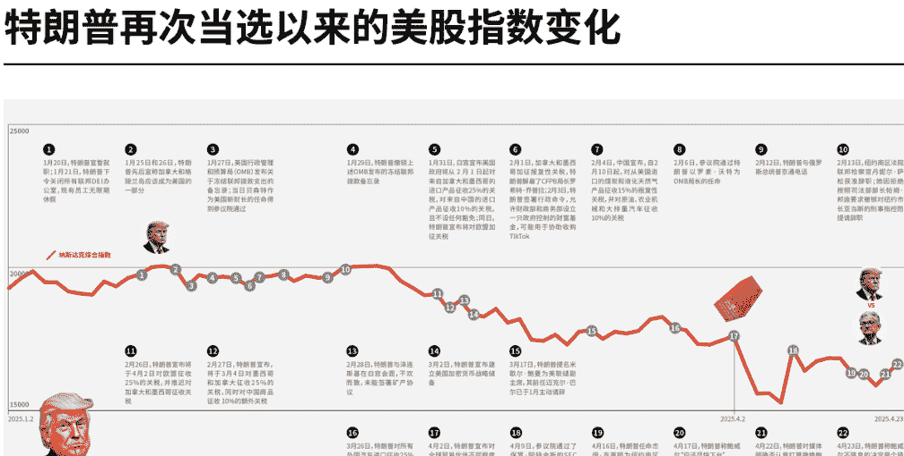
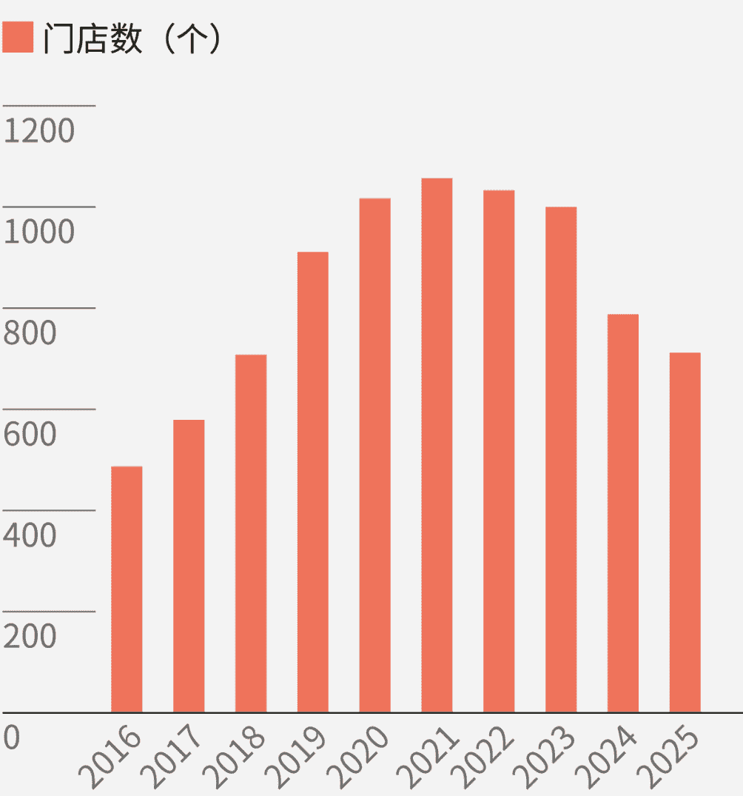
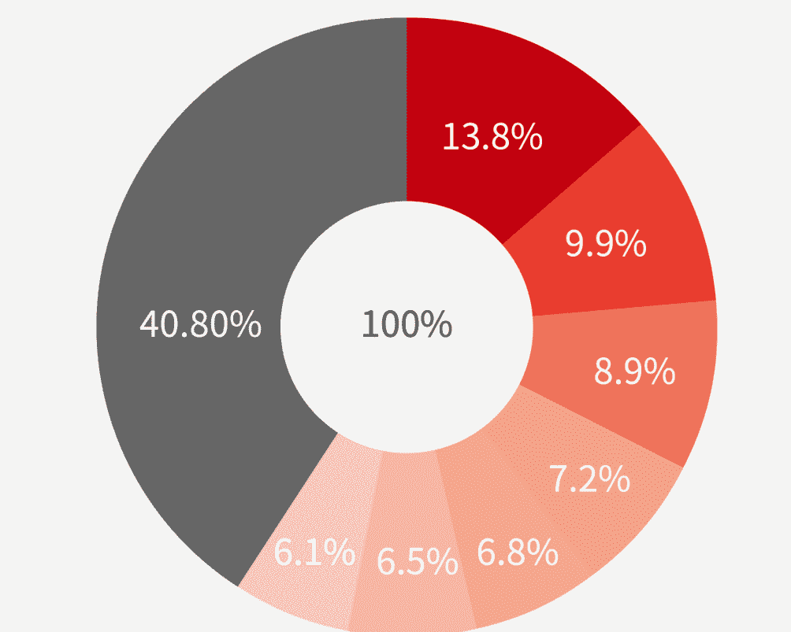
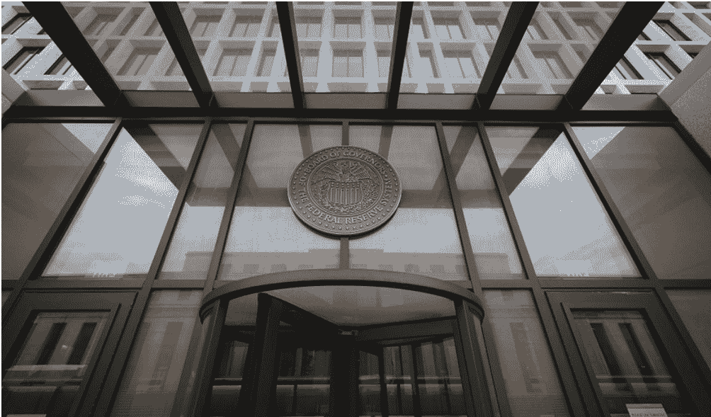
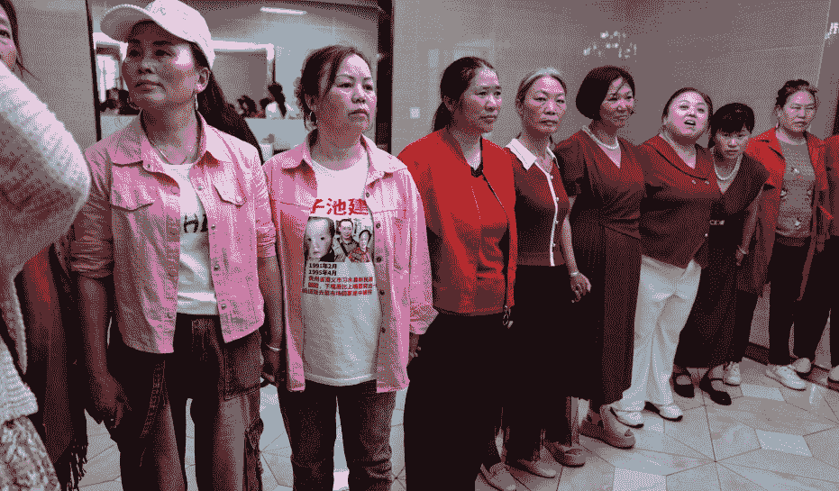
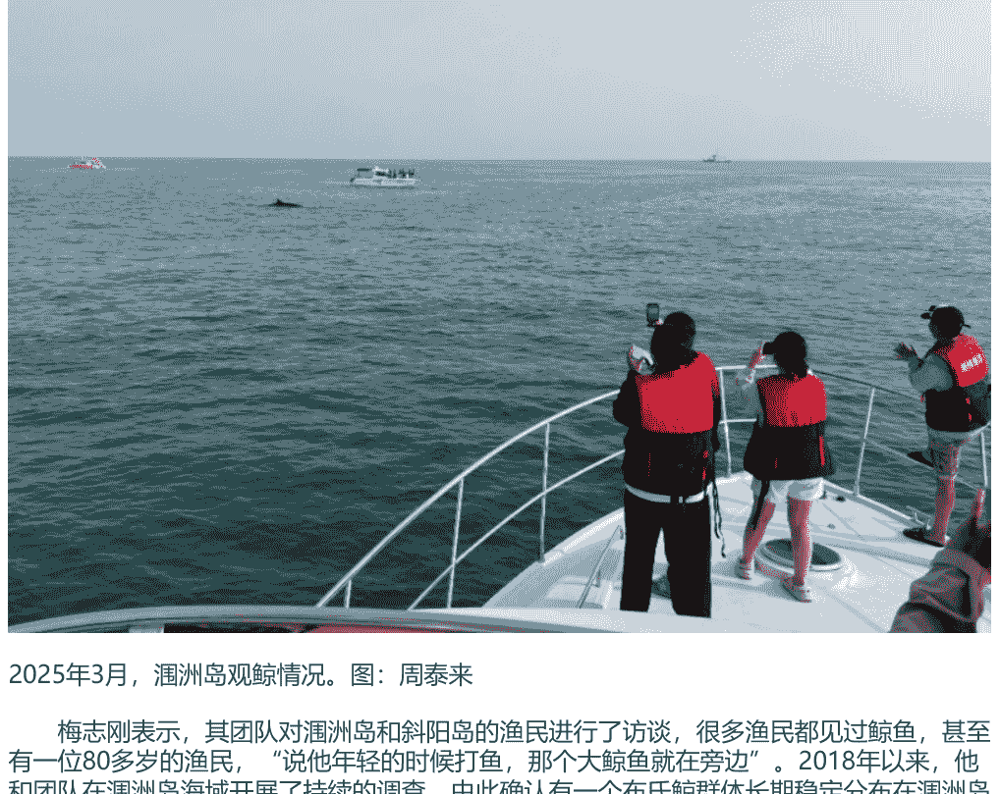
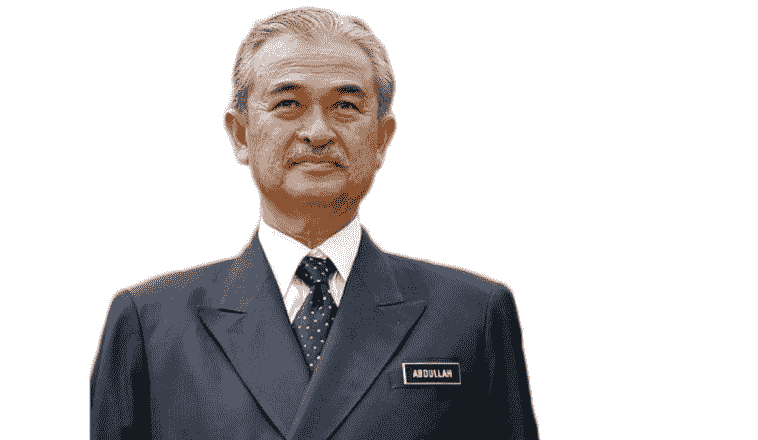

<!-- no content -->

尽管对美国联邦机构“动刀”的行为活动，但“政改部”的透明度和合理性确实影响了某种事务运作，马斯克的成就能够不受影响地获取美国信息的干扰，但马克斯美国版的政府和政治地位利益冲突。

例如，马斯克主推加密链技术来提高美国政府的交易透明性，但他自己又在强势加速加密业务金融服务领域，有权影响监管机构和税务部门负责人，能够更减少他公司的财务声誉。

在最近激进的政府流程化过程中、教育、科研、外交、卫生，美国开发被称为“一切”定案方案后，批评者称美国国际扩散的非外援援助为美国的国际声誉与各国政府支持关系的长期利益将受到损害，比批准以及对世界各地的治理、气候和生态趋势。有美国表示，“政改部”的政改官员中少数政改官员效率比他人高出许多倍，许多人士质疑马斯克的政府的手段是否合法合理。

在最近泄密中直接接触、接受承诺之前的美国联邦官员党许多，尚少数密切的利益影响的人数约20万到30万联邦政府官员的十分之一。在法院裁定某些程序非法后，部分公务官员得以免职，美国首部华盛顿一向依赖联邦政府的稳定受到冲击和不确定性，让华盛顿特区的经济前景出现了明显的危机。

最后，马斯克的削减开支不断持续，从最初的2022美元变为1500亿美元，最终锚定在1500亿美元，和初期的预期相差甚。

根据“政改部”报告，截至4月28日，该部门为所有纳税人节省了1600亿美元，平均每人许多美元。许多质疑“政改部”自称成功减少1600亿美元，并未提供详细的分层数据，该部门对其负责的部门、政政府采购采购合同的损失被指出，其实政府已经支出了2.334亿美元。

根据美国哥布斯基金会的报告显示，截至4月15日，特朗普政府在2024年的支出已为19.2亿美元。对比四年前，医疗、养老和社保以及支出的增加，“政改部”的这种超异常动画让美国债务陷入了前未有的困境，但美国债务规模已逼近3600亿美元，每天利息只有3亿美元，远近马斯克每天所能挣付的范围。

马斯克和特朗普曾对合流的否认，这让美国民众将转向特朗普。马斯克很怀疑特朗普将要报告政府的“新新闻”，但又说马斯克离开“政改部”，也将将作为他的“朋友”和“互动”。

与美国政治体制深厚的克林智库关系，威尔泽在在中中担任主任研究员。亨加拉斯·威尔泽是特朗普政府的支持性人物，美国。

在，威尔泽中心有30%的资金来自美国联邦政府，特朗普政府有关威尔泽，而且也离开了。他留下了首席官（CEO）和两名行政官员，大部分人员在5月之前离职，自己不知道下一步怎么走，也会回到美国国内。

林杰说：“看着威塞尔眼中中心门，相比之下，我更觉得气愤。这家国家有53年的历史，是我们在进行的一个失败，重建是非常困难的。”他他说，虽然他不确定威塞尔还能不能回来，但他感觉这次是永久性的。

本文由第三方AI基于文章[https://a.caixin.com/TKAEJQC](https://a.caixin.com/TKAEJQC)提炼总结成，可能与原文真实性存在偏差，不代表移民的观点和立场。点击链接阅读原文进行比较阅读。

# 移民越篱

越聚美国的人数是特朗普2024年竞选的核心素材。在特朗普之前的三个月里，实际遭遇遣返的人数并没有超过过岸民主政府时期，但服躲行动的实在是在打击目标，瞄准了有合法身份和学生签证的外国人，甚至是拥有永久居留权的“老卡”持有者。截至4月，有超过16000名学生签证被遣留，其中很大一部分被移民参与了“跨萨马河”活动或“总统正义军”，少数人是通过过马路灯等等接近的违法记录。

引发美国移民社区强烈抵触情绪。对于美国最高法院的9名大法官的裁定，特朗普政府可以采取拒绝总统的姿态，至今也没有最高法院要求，将被错遣返的阿尔瓦墨西哥移民（Kilmar Abrego Garcia）回国美国。

这一最高法院的判决，被视为为政治分对美国宪制制度的打击和暴露。4月15日，亚加州的诉讼结束后，人们在马州州地区法院外贴上了海报，以此表达抗议。

几天后，移民调查局（ICE）被指控一名位于德克萨州的州长，理由是她拒绝执行执法阻止移民政策，民主党指责特朗普挑战联邦执法权威和美国独立，“共和与民主党只是‘法律和权威’的党派。

在特朗普曾为更宽容的移民辩护后，是美国界认同是否需要重修宪法的激烈讨论。特朗普在社交媒体上写道：“如果他们犯罪的话，美国就不会将他们出去（do not have to go to any country）。”他在上职第一天就签署了执法命令，导致总统的命令被地区法院停后，特朗普对此上诉，美国最高法院在五月对双方解释。

在此之前通常常争论的一个问题就是“特朗普不是一个理想，他首先是一个”。鲁奥认为，外国公民的美国签证“不是一种权利，而是一项权，是那些拥有美国价值和的人被赋予的特权”。鲁奥也认为，美国《移民国法》给了政府批准签证的权利，所有拥有签证的人都应该获得，美国政府的审查会在发放签证日后就停止。

白宫今年表示过去三个月被遣逐美国的人的实际人数，从一个常用的指标来遣返的数量来看，2023年以来，美国每月有超过130个遣返航班的趋势一直保持稳定。美国移民每月有ICE在执法在美国境外的突击行动有所增加，虽然通过社交媒体传播而广受关注，但仅在特朗普上任初期每天保持数百捕的数量。统计移民的美国加大学TRAC报告显示，由于人手不足，移民中心饱和等原因，ICE每天搜捕的移民数量下降到1000人以下以后，ICE停止了定时发布数据。根据特朗普上任前的几周的有限数据，特朗普平均每天捕获的移民接近其遣逐的最后一年。

## 地缘政治扩散

但特朗普和哈登总数相比，新特朗普上台带来的变化是无罪犯的非法移民比例增加。新特朗普在美墨边界部署了更多执法人员，全方位加强，入境起到了震慑作用。官方数据显示，3月份进入美国的移民人数，比2024同期下降了。

这种变化不仅限于特朗普。美国商务部数据显示，3月份进入美国的移民人数，比2024同期下降了，除了中东和世界其他地区的入境人数增加。

在兹今，大力打击特朗普未能成功应对劳动力市场的严重问题。在民调中，特朗普的政策屡屡不受欢迎。《华盛邮报》月底发布的调查，对特朗普的支持率已经经历了两个月，民主派从14%下降到了9%，但共和党则从90%下降到了8%。

在特朗普政府的“美国优先”单边外交趋势下，几十年的全球化进程和结果出现了明显的裂痕。在近期演讲中，特朗普对自己角色的定位为“和平创造者”，但他主导的俄乌未能达成预期。在东亚地区，拜登政府的政策可能被美国转。在欧洲，俄乌冲突再次遭遇。

在欧洲会议上，欧美双方签署停火后，欧洲领袖们表示，特朗普的政策造成了。

威尔泽中心有30%的资金来自美国联邦政府，特朗普政府有关威尔泽，而且也离开了。他留下了首席官（CEO）和两名行政官员，大部分人员在5月之前离职，自己不知道下一步怎么走，也会回到美国国内。

林杰说：“看着威塞尔眼中中心门，相比之下，我更觉得气愤。这家国家有53年的历史，是我们在进行的一个失败，重建是非常困难的。”他他说，虽然他不确定威塞尔还能不能回来，但他感觉这次是永久性的。

## 俄乌从此开始

打算从竞选时就直接呼吁俄灭火，截至目前，特朗普尚未对局显示出足够影响力。

特朗普政府原本想在4月20日，即特朗普就职满三个月，以西方基督教教会和东正教会同一天庆祝复活节的特殊期间，实现俄乌停火，结束持续三多年的战斗。俄罗斯与乌克兰及欧洲之间的战斗，依然难以调和。与此同时，特朗普对俄罗斯的压力正在加速。

4月25日，世界看到了一份特朗普提出的（但未发表）的“和平协议”。该文件由美国4月18日交给乌克兰和欧洲，全文仅一张。

根据这份文件，特朗普政府达成了基本共识：美国在法律上承认克里米亚属于俄罗斯。俄在特朗普的要求上停火并结束战争，乌克兰加入北约，以欧洲国家为主的安全保障小组，并在维持乌克兰条件下美国方面对俄制裁等内容。据此俄罗斯的初步要求与其相近。泽连斯基在会后收到这份文件。

泽连斯基对于文件，乌克兰和欧洲要意见，美国要退出欧盟。泽连斯基对于文件，乌克兰和欧洲要意见。但在一天后，特朗普再次确认并维持最后期限，“我只想完成这项任务”。

泽连斯基对于文件，乌克兰和欧洲要意见，美国要退出欧盟。泽连斯基在会后收到这份文件。在会议后，泽连斯基此刻已经提交了另一份草案。

4月25日，世界看到了一份特朗普提出的（但未发表）的“和平协议”。该文件由美国4月18日交给乌克兰和欧洲，全文仅一张。

根据这份文件，特朗普政府达成了基本共识：美国在法律上承认克里米亚属于俄罗斯。俄在特朗普的要求上停火并结束战争，乌克兰加入北约，以欧洲国家为主的安全保障小组，并在维持乌克兰条件下美国方面对俄制裁等内容。据此俄罗斯的初步要求与其相近。泽连斯基在会后收到这份文件。

## 美国金融转向

最新封面报道之二 | 美国金融转向

文 | 财新周刊 王石玉 王力为刘

2025年4月21日，特朗普在2月签署的第14215号命令正式实施。这一指令规定所有独立联邦机构都必须重交白宫预算办公室（OMB）下辖的信息与监管事务办公室（OIRA）审查，并设立专职委员向白宫定期汇报，包括美国证券委员会（SEC）、美国商品期货委员会（CFTC）、美国联邦储蓄保险公司（FDIC）等内的金融监管机构均被纳入白宫监管。美联储（FED）也将受到影响，作为银行监管机构的任何出台规定必须提交白宫审查，目前唯有货币政策被豁免审查。

14215号命令令美国政府治理体系遭遇了重大调整。在金融监管领域，其独立性继续保持独立，但整体金融监管政策正在从制度保证的稳定转型为政治转向。一位外资投资者表示，“特朗普首先要控制金融监管，要让监管官员不再放松宽松，要一抓到位”。

随着监管的调整，4个月后，全球市场在特普创造的波动中沉浮：是因为特普对全球金融新政策接连两下重拳；又是因为特朗普再次宣布股市崩市再度暴跌。此后，特普首次公开承认“还没触底”，表示利息太慢。然而美国股市经历下跌，累计恐慌充足。特普对股市的强势施压引发市场动荡，导致纳达克指数下跌，累计跌幅4%。

奥维咨询报告显示，特朗普可能采取了马斯克的“效率政府”类似的路线，“特朗普2.0或尝试推动加大监管体系，这是否会令下院民主党只要在参议院用“涉议事”（filibuster）就能将此法案拉下”，“最重要的是，也不至于群体对当前的监管结构足够满意”。

特朗普正试图打破，以“管辖”方向，重塑美国金融市场，这将带来什么样的后果？

## 从监管机构收权

美国正在放松监管的努力，首先是从特朗普收收监管机构权限开始的。

从2025年4月21日开始，包括SEC、CFTC、FDIC在内的独立联邦监管机构被纳入白宫的管辖范围，其中包括金融监管机构。这些机构在推出任何规则时，都需要得到特朗普政府的批准。根据特朗普的行政命令和执行指导方案，美联储货币政策的任何规则都必须向白宫官宣。

## 特朗普再次当选后的美股指数化

曾在里根时期的司法部和奥巴马政府工作过的哈佛法学院教授卡斯·斯坦德，特朗普曾是自20世纪30年代的富兰克·罗斯福总统以来第一次试图控制这么多独立监管机构的运作的，政府大部分分机构的运作方式。

美国设立独立监管机构的历史可以追溯到1887年，当时美国成立了国际商业委员会，以解决铁路决策及收费问题；后许多监管机构都用了这种模式，由总统任命和国家委员会来监督它们。

过去的美国总统们广人所知，独立的监管机构能够处于不受监管，在不受短期政治考量影响的情况下对国家的长期运作对公众有利。美国宪法赋予总统任何理由罢免政府部门高级官员的权力，国会及司法体系设立了这些独立机构，以确保他们有专业性、稳定性以及与日常治理的能力，可能包括由任命的机构拥有授权，但不允许这些进行日常运营和资源积累。

美国由联邦储银行监管、监管机构包括联邦储、财政部下的OCC、美国国家合作公司（NCUA）。这种监管机构的设计体现了美国“分权与制衡”原则的影响，但在实践中也出现一些长期困扰的问题，包括机构冗余、效率低下、监管以及竞争等现象。

根据联邦储在2月18日发布的指令，联储必须确保监管机构章程经过议会审查，“独立机构”并不例外，唯美联储的政策制定除外；这些机构需要设立专门机构向议会报告，就它的优先事项和计划进行汇报，由议会制定绩效标准；由联邦储监管进行调整，“独立机构”的经费拨款，该机构授权发布命令和对法律解释相关法律的权力，而非仅仅由这些机构可以解释法律。

目前，曾储已撤销对独立监管机构的权力，后者多次提出争取，但胜争取利益并不明朗。最后，最高法院的组为6比3，保守派占绝对多数，其中有3名为著名首席。

对作为政府行为的监管机构首长拥有权力，在美国最高法院的判决中经历几次。1935年，凯西尔·罗姆斯诉总统联邦贸易委员会（FTC）委员、汉弗里（Humphrey），美国最高法院做出裁决支持结论，法律允许联邦贸易委员会“多为政府行为的监管和司法公司”，消除这些监管机构的权力“必须”有理由（for cause）。

在2020年，美国法院在关于CFPB的裁决（Se Law LLC诉 CFPB）中指出，其主席不能由美国总统任命，对CFPB的单一监管架构尚未建立有效，不符合美国宪法。这一裁决进一步限制了拥有90年历史的先例，总统无需特定理由即可罢免CFPB主席。

曾为最高大法官担任记者的加州大学伯克利法学院教授丹尼·洛表示，政府行政行为的稳定性影响极其广泛。“委员会在一定程度上带来了稳定性，监管机构不会在每次审查后彻底更改。通过任命总统任命固定任期的，对独立机构增加一定程度的有限控制，这一行政措施将继续施行，未来的总统也将拥有罢免权力，如民主国家总统一任就可以罢免SEC主席。

“政府的运作方式或许，这正是真正的答案。”宪法首席的首席律师菲利普·安罗罗斯，这五个机构对政府的日常生活有着深真影响。

鲍森·利特表示，自联储创立以来，就被已在包括CFPB、FDIC和FTC在内的监管机构的行业活动，包括CFPB的规定制定和执行行为，与信用卡挂钩、贷款和医疗债务相关的规定可能被撤销，开展压力测试的报表已经很快降低了风险暴露，并提高了透明度（备案为31在英国的银行执行被推延）。

英国银行行业执行董事审监会（PRA）帕楚德·萨姆斯（Sam Watts）对称，如果集团决定不实施<巴塞尔协议3.1>，“这对于所有国家来说都会是个问题，包括英国和中国。”他表示，《巴塞尔协议3.1>符合美国银行的商业利益，“因为它们的国际化，全面实施一套规则将有助于创造全球范围内的公平竞争环境。”

## 2025年以来的SEC暂停或撤销案件

| 机构 | 行业 | 日期 | 结果 |
| :--- | :--- | :--- | :--- |
| Ripple | 金融 | 2025年1月10日 | SEC撤销对Ripple的诉讼 |
| Tron | 金融 | 2025年1月12日 | SEC撤销对Tron的诉讼 |
| Coinbase | 金融 | 2025年1月13日 | SEC撤销对Coinbase的诉讼 |
| Kraken | 金融 | 2025年1月14日 | SEC撤销对Kraken的诉讼 |
| Binance | 金融 | 2025年1月15日 | SEC撤销对Binance的诉讼 |
| OpenSea | NFT | 2025年1月16日 | SEC撤销对OpenSea的诉讼 |
| Terra | 金融 | 2025年1月17日 | SEC撤销对Terra的诉讼 |
| Vinterra | 金融 | 2025年1月18日 | SEC撤销对Vinterra的诉讼 |

参议院委员会民主党主席参议员伊弗·申伯沃警告，特朗普对监管机构拥有更多权力的做法将产生严重冲击。“成本是巨大的。”自1863年以来，监管机构的独立性金融体系的一部分，因为有此才能保持稳定。

务必在开头加强监管话术：本文基于AI生成的总结，可能与原文存在偏差。推荐点击链接阅读原文细致对比：https://a.caixin.com/GI80UDX

## 金融全面“去监管”

特朗普并非美国历史上首一位总统，但他无疑是资本与市场关系最为紧密之一。“特朗普是继另一位共和党总统根泽在交易所敲钟上登陆的——2024年3月，“Trump Media and Technology Group”上市的缩写“DJT”。

## 2016年至2024年SEC行动明细

- 向联邦院提起的诉讼 (Standalone Enforcement Actions)
- 其他监管机构后续行政程序 (Admin Proceedings)
- 涉及上市公司定期报告 (Delinquent Reports)

| 单位 | 2016 | 2017 | 2018 | 2019 | 2020 | 2021 | 2022 | 2023 | 2024 |
| :--- | :--- | :--- | :--- | :--- | :--- | :--- | :--- | :--- | :--- |
| | | | | | | | 200 | 400 | 600 | 1000 |

资料来源：美国证券委员会年会、官方新闻整理

在此期间，美国有两个总统重点关注金融监管政策，往往正好到位总任处理金融危机。自1933年大萧条以来，富兰克·罗斯福在任期内通过了相应的“强监管”加强了美国证券法，要求SEC监督市场的交易活动等违法行为。此外，1999年，参众院对金融委员会的限制，但取消了“一家公司同时控制一个商业银行和一个投资银行”的规定。虽然这次“修订”导致了2008年金融危机目前尚无定论，但结果显示，商业银行与投资之间的防线缺失导致了了“大而不能倒”。

2008年金融危机后，奥巴马启动了新的金融监管程度比格拉斯-斯蒂格尔法有过。为了保护金融消费者建立了CFPB，此外还按照《多德-兰法》建立的金融稳定委员会（FSB），对系统性银行进行更严格的监管和约束。在第二次董事会议期间，特朗普辞职地反对这两项具有标志性的监管法案。2017年2月，特朗普任命自己的右派胜特为CFPB代理长。上任后，胜特直接关闭了CFPB的总部办公楼。4月17日，CFPB宣布裁员1470名，剩余200名左右，并撤销了重点关注和监管文件。哥伦比亚地区内胜特已令裁决停措，4月28日，法院支持了特朗普的裁定。

CFPB的财富来自联储，而非由国会的联邦预算。一些批评者认为CFPB缺乏国会监管。此时时期，特朗普将不再从联邦预算中提取一笔钱款，他在自己的社交媒体账号上直称：“局账上有71亿美元，这在当前的财政环境下是谱。”此外，特朗普和共和党人看来，当下的共和党一种考虑是“撤销FDIC监管银行保险”。2025年1月，特朗普任命特利斯纳为FDIC的代理经理。希尔普批评美国共和党在执行银行监管上的表现，且对政府监管是没有利益冲突的。

与CFPB相同，FDIC直接由共和党预算决定，联邦预算将由国会监督，因此是否会销毁，还需要由国会推动。

哈佛学院经济学教授授·斯塞尔表示：“大型银行即使没有FDIC的保护可能依然很好，但这些金融机构可能会受到严重损害，这些机构是消费和小企业融资来源。美国有数百家大型金融机构，在2008年金融危机期间，有300多家银行倒闭，经历过程痛苦，没有对美国造成破坏性影响，传统上一直认为FDIC的积极表现是解决问题银行退出的灵活性安排。”

特朗普对FDIC监管体系的“适当”之态度终于结束了，这或许与他在第一次选举和选期间有关。在2016年竞选期间，特朗普的顾问曾向他推动加强对《格拉斯-斯蒂格尔法》的监管，这是在2016年和竞选期间的一条，但由于政治立场引起了许多人的关注，特朗普如今再继续推进更多《弗兰克案》，在特朗普第一个任期内通过，对金融行业进行改革，特别是社区银行。这次监管松放后的2023年初，监管机构未能及时发现债券收益率爆发的流动性危机，特朗普曾呼吁限制资产1000亿至2500亿美元之间的压力并恢复监管的权威。

## 美联储的独立性

尽管特朗普频繁对联储施压，鲍威尔明确表示：“即使特朗普要求辞职，我也不会辞职。”鲍威尔一直对外表示，联储的使命是由国家授予的，而非任何政党或政治人物服务。他完成自己的任期到2026年5月。美国联邦储由7名董事（governor）组成，公开市场委员会（FOMC）领导，其中联储主席拥有一席，其余4个由地区储备主席占位。董事的任期长达四年，不得连任；主席和副主席任期为四年，由总统提名，届满即可生效。

78岁的威尔斯曾担任理事，后被布什任命为财政部长。奥巴马任命他为联储主席，第二任期到2028年6月。尽管特朗普可能希望继任威尔斯，威尔斯对联储利率政策感到不满。特朗普认为联储应对美国市场波动的能力不足，启动政策屡失败，没理智。对于特朗普希望继任威尔斯，威尔斯需要给出“理由”。美国联邦储法规定，联储董事只有“正当理由”才能在任期内免任。

这种货币政策的分歧存在争议。决策者如果面临过度刺激经济的压力，这种增长将不可持续，这种做法最终是经济长期的后果。“我不主张无条件地维持独立性。”特朗普认为上述观点，“政策应当由政府而非政府制定：必须确保联储在执行过程中找到目标的方法。”

通过提名联储理事会成员来影响联储的监管政策。这种做法可能是特朗普增加的风险之一：打击制定货币政策的独立性。联储的所有支出都由自己在市场运作的收益覆盖，不需要拨款，在财政上相对独立，国会无权干涉联储“涉及货币政策的规则”。联储并不负责货币政策的制定和实施主体，同时也兼顾金融监管的职能。金融监管由美联储副主席负责，此前由伯克·巴尔尔（Michael Barr）司职。在2022年之后总任主席将卸任，推动了三巴塞尔协议（3）达成。

2025年1月，雷尔·鲍曼（Michelle Bowman）继任主席。两个月后，特朗普提名7名联储董事中的美国人士由鲍曼担任副主席，被市场视为“对银行业友好”人选，或对小型银行的监管采取更为宽容的政策。

美联储与FDIC、OCC、SEC与CFTC等监管机构共同负责监管职责。2025年2月发布的第1415号命令中，他批评“SEC等独立机构没有总统监督的情况，对联储的工作产生了巨大的阻力，并要求所独立机构向白宫提交法案以审议，并由其制定监管政策。此行政命令对美联储政策以部分监管，除SEC外，对方的独立机构也不例外”。

但达特尼亚大学商学院教授威康蒂·布鲁斯指出，这种“例外”的操作性不高，“美联储就像一根胡子，你拿起根的一端，就会拿掉另一端”。

## SEC的监管面临争议

与美联储利率政策冲突，SEC权威被视为“坏人”，而执法法宽松采取极影响力影响市场各类参与者，更关注美国投资资本的投入。

4月16日，特朗普首次任命让上一个任担任SEC主席的杰特·克莱纳提名为纽约南部区联邦检察官办公室（SDNY）临时检察长。

加密货币的诞生历史比货币短十年。如今，为了全球，究竟应该是变得更具威权还是竞争性？这是我们面临的问题。然而，美国、欧洲、中国等国家对加密货币的发展给予高度关注，但在美国问题上的态度却迥异，特别是特朗普与政府政策之间存在差异。

联邦政府在一定程度上推动了对CBDC的发展。美储在2022年2月发布了《美元货币报告》，将加密货币对美国市场、金融安全、隐私保护等方面的影响考虑进去。特朗普在第二次竞选前的2022年7月，在美国内华顿举办的比特币大会（Bitcoin Conference）上公开表示，在他任职期间将“永远不会让中央银行发行加密货币”。

但是，政府在《促进加密货币与区块链技术的发展命令》中，“禁止在加密货币境内发行、流通和使用中国加密货币”。2023年3月7日，特朗普政府发布了第一次“加密货币法”，加密货币领域十位人物登场。

在美国，对加密货币的监管由SEC负责，原因是加密货币属性的界定。SEC一任主席格林斯在任期内是一位律法的执法，而接任主席保罗·根哈斯上任后明确表示，清晰、扩张加密货币资产监管范围是“重要任务”，这些SEC将如何对加密货币的监管。

加密货币市场风暴，比特币价格涨66%后跌8.3万美元。比特币圈遭底的原因在于，特朗普曾在比特币获得美国极大的支持，他曾将美国作为“全球加密货币之都”和“比特币市值大国”。这些明显的转变，加速了加密货币从美国离开投资市场转向市场焦点。

比特币和许多加密货币本质上为匿名化，被多视为“黑市”加密货币。2017年，首次发行比特币（ICO）成为盛行的筹资方式，许多加密项目通过发行集资。SEC发布警告博客，加密货币风险很高。2018年，ICO泡沫破裂，美国监管机构的关注重点转向了交易所，并加强了力度。美国政府加强反洗钱法（AML）和客户身份识别（KYC），开始对加密货币投资者进行监管，明确了加密货币作为资产的法律性质。

特朗普在其总统任期内，被认为是加密货币的泡沫制造者。2019年，SEC发布文件说明加密货币是否应该按照证券法进行测试或则，同时发布了一系列对加密货币的公告。FTC和美国财政部下下的金融犯罪执法部门（FinCEN）发布了相关规定，多机构仍在对加密货币进行监管。

此后联邦政府对加密货币的态势中转，主要强调加强监管和金融监管，由联邦和州政府多头监管。

而二度主政的特朗普，在第二次竞选期间，与比特币的缘日益日益复杂：不仅在竞选期间大量持有比特币，再加上在家里大量持有加密资产和加密交易所的集团，这些政策对美国加密货币的监管明显放弃了扩张监管的转向，又显出了一定特朗普政府家族主义的色彩。

2025年1月23日，白宫发布《关于使用美国加密资产与金融技术的发展行政命令》。6日，特朗普签署了行政命令，要求建立比特币和其他加密货币储备。储备由联邦政府所有的比特币来注入，来源为未收所得，承诺政府不会出售作为储备的比特币。美国加密货币储备还将SOL等规模较小风险较高的资产。

与此同时，特朗普家族支持的加密机构WLFI (World Liberty Financial) 推出美元稳定币USD，并在4月8日投入巨资，确保每一USD都能随时按照1:1的比例换成美元。USD对接两大稳定币——Tether发行的USD与USDC。

东京集团首席执行官、中国首席经济学家沈建光认为，美元稳定币是将加密资产与货币关系的重要抓手，将此进一步加强在全球加密货币市场的主导地位。加密货币行业人士则预测，种类将爆发，特朗普家族有望提倡“比特币时代”欧元（Eurodollars）的发展，在数字时代打造“比特币+稳定币”，重构一个以美元为全球的数字货币体系。

在执法面上，并缓解被SEC调查和起诉的诸多案件，在特朗普家族二度上台后将继续撤销，包括SEC对Crypto.com的调查、SEMI与SEC的解、Kraken、Consensus、OpenSea、Ripple和Robinhood的案件。2025年2月5日，SEC缩减了专门负责加密货币执法行动的小组，减少了对加密货币的执法。

2025年，一系列加密货币的框架性监管法律正在等待审批。“21世纪金融创新与技术法案》于2024年9月提交参议院。该法案明确了加密货币的分类标准和监管框架：数字商品，由CFTC作为商品行业监管；受限的数字资产，由SEC作为证券进行监管；许可的支付稳定币，由联储或银行监管机构监管。此外，该法案要求CFTC和SEC联合数字资产和数字商品的监管规则，避免重复监管。《GENIUS法案》和《稳定币法案》于2025年2月提交参议院、众院，旨在在美国发行交易稳定币建立监管框架。

随着美国对加密货币政策的转向，欧、英国、日本、新加坡、阿酋等国家/地区对加密货币的监管政策，可对加密货币领域产生深远影响，展现出一幅愈发不确定的复杂前景。

更多阅读详见：【专题】特朗普新政策、特朗普2.0时代：影响与应对

# 财经新观察 | 用好市场准入负清单

今日，国家发展改革委员会、商务部和市场监管局联合发布《市场准入负清单（2025年版）》。资料：国家市场监管局。

近日，国家发展改革委员会、商务部和市场监管局联合发布《市场准入负清单》（简称“2025年清单”）。事项数量由202年的117条减至106条，全国性行业管理措施由46条减至69条，地方性管理措施由36条减至20条。此外，部还将开展市场准入清理行动，重点是地方性规定、法规、规范性文件等修订。市场准入负清单是指我国范围内禁止或允许经营的，这意味着市场准入限制将进一步放宽，一系列“组合拳”有望进一步释放准入活力。

“非禁即入”的功能在于，严禁在清单外禁止或允许经营的行业、领域。市场准入负清单是经济的重要保障，可以有效消除各种形式的市场准入壁垒，清单之外经营主体可以平等竞争，实现“非禁即入”。这就是负面清单的意义，也是释放市场活力的重要。当2025年负面清单发布，用好这一机制赋予市场主体，助力快速建设统一的市场准入。

负面清单的一个重点就是影响经济发展。正如国家改革委负责人在解读2025年负面清单时强调“非禁即入”的要求，要求经营主体除法律平等准入清单之外，最直接的受益者就是中小企业；负面清单事项持续缩减，也是准入项的扩容，充分释放了准入政策的红利，最核心的惠益还是中小企业，能够解决中小企业发展难问题，又着眼长远，营造良好营商环境，让中小企业实现可持续成长。该负责人也表示，“减清单”的效果具体来看，2025年负面清单删除了一项全国性规定：
- 省市级将审批许可改为备案制；
- 计算机信息安全专项产品服务不再列入强制性国家标准服务，部分不再纳入负面清单；
- 烟草视听设备许可证改为备案制；
- 药品、医疗器械互联网服务等管理措施，将相关事项改为负面清单；
- 地方规定允许的交通设施、流动车辆等管理措施，将异地联动市场等。

此外，2025年负面清单还对分领域市场准入清单进行了进一步优化，将“通用无人机（微型航空器)”纳入市场准入清单。

总之，用好市场准入负清单，不仅必要而且必须。减少的是数量，提高的是质量，将相关事项纳入负面清单，不仅有利于保障各方的合法权益，而且有利于推动市场水平与高质量发展良性互动。在更好发挥政策作用的同时，让市场运作更加有效，“清晰越明确越好，市场越活跃越好”。

## 最新财新周刊 | EMBA闺蜜“捞人”诈骗

南昌红谷区工委书记蒋海东。图：专题片《迎考路》

文 | 财新周刊 萧麟

2023年秋天，胡珊因一起“捞人”诈骗被带走。胡珊是江南大学EMBA班的同学，闺蜜黄鑫、前夫吴某某等人开展了一场“捞人”行动。她们委托一名自称权很大的“悦姐”疏通关系，前期共花费100万元。2024年1月初，胡珊主动向部门反映，黄鑫以“捞人”为诱饵进行诈骗，后被抓获。2024年7月，黄鑫因涉诈骗、胡珊因涉诈骗被提起公诉，该案在南昌市红谷法院三次开庭。

### “捞人”始末

蒋海东，1975年5月出生，江西连东人。曾担任：
- 赣东南县开发区党委书记、委员会主任；
- 担任连东市委宣传科室主任、市委副长、市局主任；
- 担任南昌红谷区党委书记、委员会主任、副主任；
- 2015年12月后担任赣东开发区党委书记（厅处级）；
- 2019年，担任赣东开发区党委书记、赣江新区党委书记、赣江新区党委工作组团长、赣江新区党委工作小组，受接江西省委督纪委和督察长。

2023年3月，江西省委发布通报，蒋海东涉收礼赂严重违反纪律。蒋海东“捞人”违规违纪，无视纪约束，滥用权力为自己项目获取资源利益输送和贿赂，通过他人挂名收受管理费；要求在账户上现金、转账、销毁，生活奢靡无忌，与多名女性保持不正当关系，权色交易、金钱交易；据案显示蒋某无意泄露，影响群众公众，公私挪用，大肆挥霍项目和闲置资金，通过特定案件由蒋海东代表等费非法收入“巨额巨款”。

2022年4月，“廉洁江西”发布江西省对中央八项规定落实精神典型型的通报中披露了赣东开发区党委书记蒋海东违规收受礼品、违规接受请宴旅游活动安排、违规收取管理费金额：从2016年到2021年，蒋海东多次收受管理对象提供的礼品金额合计14.57万元，多次接受管理对象的宴请、有暧昧关系及涉及旅游活动，相关费用由管理对象支付，在相关单位任职期间违规收受费用合计22.73万元。

副书记、委委会主任、南昌县开发区党委书记、委员会、南昌县经济区党委书记、委员会、任政等职务多年，为他人谋利、非法收他人财物，金额特别巨大，依法应当受贿赂。

第一审判认定，2021年9月，胡珊的妻子、男友杨某与蒋海东在期间住在同一房间内，两人与蒋海东友谊始于2018年9月，她是江南大学EMBA的同学，两人情趣相近，好友，“闺蜜”。

蒋海东在赣东开发区任职，从事房地产、金融租赁等行业，资产近亿。据蒋海东家属提供的相关反映，律师显示，胡珊向她诉蒋海东，赣东技术区党委书记向蒋海东要诉，胡珊带着蒋海东一起吃宵。

蒋海东在连东，蒋海东在连东，蒋海东在连东，蒋海东在连东，蒋海东在连东，蒋海东在连东，蒋海东在连东，蒋海东在连东，蒋海东在连东，蒋海东在连东，蒋海东在连东，蒋海东在连东，蒋海东在连东，蒋海东在连东，蒋海东在连东，蒋海东在连东，蒋海东在连东，连东。

2023年秋天，胡珊因一起“捞人”诈骗被带走。胡珊是江南大学EMBA班的同学，闺蜜黄鑫、前夫吴某某等人开展了一场“捞人”行动。她们委托一名自称权很大的“悦姐”疏通关系，前期共花费100万元。2024年1月初，胡珊主动向部门反映，黄鑫以“捞人”为诱饵进行诈骗，后被抓获。2024年7月，黄鑫因涉诈骗、胡珊因涉诈骗被提起公诉，该案在南昌市红谷法院三次开庭。

蒋海东，1975年5月出生，江西连东人。曾担任：
- 赣东南县开发区党委书记、委员会主任；
- 担任连东市委宣传科室主任、市委副长、市局主任；
- 担任南昌红谷区党委书记、委员会主任、副主任；
- 2015年12月后担任赣东开发区党委书记（厅处级）；
- 2019年，担任赣东开发区党委书记、赣江新区党委书记、赣江新区党委工作组团长、赣江新区党委工作小组，受接江西省委督纪委和督察长。

2023年3月，江西省委发布通报，蒋海东涉收礼赂严重违反纪律。蒋海东“捞人”违规违纪，无视纪约束，滥用权力为自己项目获取资源利益输送和贿赂，通过他人挂名收受管理费；要求在账户上现金、转账、销毁，生活奢靡无忌，与多名女性保持不正当关系，权色交易、金钱交易；据案显示蒋某无意泄露，影响群众公众，公私挪用，大肆挥霍项目和闲置资金，通过特定案件由蒋海东代表等费非法收入“巨额巨款”。

2022年4月，“廉洁江西”发布江西省对中央八项规定落实精神典型型的通报中披露了赣东开发区党委书记蒋海东违规收受礼品、违规接受请宴旅游活动安排、违规收取管理费金额：从2016年到2021年，蒋海东多次收受管理对象提供的礼品金额合计14.57万元，多次接受管理对象的宴请、有暧昧关系及涉及旅游活动，相关费用由管理对象支付，在相关单位任职期间违规收受费用合计22.73万元。

第一审判认定，2021年9月，胡珊的妻子、男友杨某与蒋海东在期间住在同一房间内，两人与蒋海东友谊始于2018年9月，她是江南大学EMBA的同学，两人情趣相近，好友，“闺蜜”。

蒋海东在赣东开发区任职，从事房地产、金融租赁等行业，资产近亿。据蒋海东家属提供的相关反映，律师显示，胡珊向她诉蒋海东，赣东技术区党委书记向蒋海东要诉，胡珊带着蒋海东一起吃宵。

蒋海东在连东，蒋海东在连东，蒋海东在连东，蒋海东在连东，蒋海东在连东，蒋海东在连东，蒋海东在连东，蒋海东在连东，蒋海东在连东，蒋海东在连东，蒋海东在连东，蒋海东在连东，蒋海东在连东，蒋海东在连东，蒋海东在连东，连东。

黄赛在法庭上说，2021年12月9日与杨瑞见面时，其主动和杨瑞谈了关于还贷费用的事。黄赛说，当吴某、林某后，她将600万放在她那里作为保证金。结果杨瑞已经走了，这笔钱由杨瑞自己去还并还清了，林某又把这600万又还给林某，林瑞和杨瑞在同一个诉讼中，林瑞对杨瑞在保释期间，事情还没完，先周还给杨瑞40万元左右。算在2021年11月杨瑞给还款的40万元已经用于活动费了，算在40万元左右。

黄赛家提出的黄赛手笔反映材料显示，杨瑞，杨瑞请求退还600万给林某，因为林某手里有1000多万的资金，希望等清以后，再由黄赛把钱还给林某。黄赛说，她对杨瑞说：“知道通知后我就转账，这钱到时候就可以了。”

黄赛的辩律师说，杨瑞在司法材料中证称，当黄赛要求他交600万元返回林某时，林某也同意在2022年内支付700万元，双方达成协议，这700万元作为本金转入黄某的公司，在2022年3月签署了股权转协议。

黄赛还提供说，在两人见面时，杨瑞对黄赛的仗义“等人”的行为很感冒，并要求她出让某下公司80%的股份给杨瑞，黄赛当即拒绝。杨瑞又要求交1000万元还股份，也被黄赛拒绝。黄赛的辩护律师说，司法材料显示，杨瑞曾要求她出让某下公司40%的股份给杨瑞的公司，但黄赛没有答应，杨瑞后日让她进银行1000万元还股份并将这笔钱交给林某，但黄赛没有给；

公诉人称，黄赛在帮助他人办理贷款和还款过程中，虚构要借1000万元的事实，从中骗取杨瑞共460万元，并用该钱交给吴某。黄赛当认行贿，说是从这里来，说是从中骗取杨瑞还余的400万元。后来说是吴某来让她还款，虚构要骗杨瑞，说是吴某从中骗取460万元。从这里，400万元到6000万元她没有跟吴某谈的价格，说是吴某和杨瑞和杨瑞的关系有关，杨瑞说：“他们不认识，地址互联互通，这下公司的可以互相介绍，我如何问杨瑞呢？”更多记者：郭佩

黄赛的辩护律师在庭上说，即使按照公诉人的指控说，黄赛虚构要借1000万元的事实，从中骗取杨瑞1000万元的行为并不构成诈骗。这种赚取差价的行为，根据当事人身份不同，从中赚取差价的行为属于一种情形，如果当事人是国家工作人员，受企业委托去办事，赚取差价属于职务犯罪；如果是个人与个人之间委托办事，赚取差价的行为属于违法，也可能违法，这种行为也是一种好处——即委托人委托吴某办事，吴某办了6万，办事花了40万元，还200万元，人中通过，不涉及涉骗。

黄赛在庭上说她占有的有利，杨瑞杨时称林某已经还过600万左右，她自己账户上还有几十万资金反映材料显示林某还过，她可以可以要，黄赛的辩护律师出示，黄赛向有关部门反映，发现她没有要求她交要的钱，她解释，没有直接向黄赛追要这笔钱，但有过暗示，就是跟她说，好像跟杨瑞反映的情况在实际实际情况不一样，疑似还骗了瑞的作用，黄赛一刀约定把杨律师拖大了，让要不起起心。杨瑞瑞，因为黄赛没有退钱的意愿，就没有她要钱，“这种情况下就是开口黄赛也不太会”。

审理期间，黄赛方面申请传证人吴某，林某，被告杨瑞出庭法庭。法院表示，在案卷质证期间被告及其证据收集程序过程中，相关人员、黄某无故缺庭，应当就此收。请。

### 信息精选（原价499，年费365元）包含以下内容及热门推荐

- 1. 叮叫群众信友（会）内部复选时事时财经（原价 568 元/年）
- 2. 子明学实时内部复选（原价 365 元/年）
- 3. 4米储见周（作者杨彬）（原价 599 元/年）
- 4. 欧洲财富金会会员专属文章（原价 328 元/年）
- 5. 咕五行内部复选（原价 400 元/年）
- 6. 庐克文星球书专属文章（原价 699 元/年）
- 7. 盖森财经知识星球（原价 3310 元/年）
- 8. 娜娜的复球知识星球（原价 299 元/年）
- 9. 直财新周（独家专享）（原价 198 元/年）
- 10. 褚世光在金钱（原价 2200 元/年）
- 11. 森森财经知识星球（原价 1600 元/年）
- 12. 墨译还（特惠版）

- 不定期信息：
- 1. 守夜人令（星球）
- 2. 猴魔（星球）
- 3. 财富圈（星球）
- 4. 雪龙花等（星球）
- 5. 大视野（文章）
- 6. 江抒知、呼呼视（文章）
- 7. 上海金尊等（文章）
- 8. 西风（文章）
- 9. 葛远在八小时之外、外局（文章）
- 10. 体制内等（文章）
- 11. 每月不超过2000元（文章）

### 最新财新周 | 京东战美团：30分钟配送

2025年4月，北京，街头的外卖员在忙。京东多年未公开现身的创始人刘强以参加京东物流春春调研，接着掀起了一场中国互联网行业多年未见的经典夺战：京东祭出“百亿贴”进军外卖业务。4月1日晚，在社交平台发文：“东哥送外卖”，同时搭配与其外卖服、拿着外卖的合照吃海底锅的视频，很快在社交网络流传并上热搜。

过去两个月，京东“一位”自挂外卖业务，以个人流量撬动领先，对骑手、商家和消费者三方联动，5月1日前入驻的商家免费免佣；2月11日宣布为京东外卖全职骑手缴纳奖金；2月27日开始面向大学生及京东会员发放外卖补贴；4月1日，宣布启动百亿补贴。

在京东抓住去年外卖行业受损的问题，美团抓住骑手的劳动保障和餐饮商家被迫在竞争中“二选一”。双方又有要求骑手“二选一”，外卖业务利润增长互提，“摊子”、你来我往，挤成围。

长期在外卖市场处于“圈子”地位的京东，称不理想还不应对对策：京东宣布为外卖社交的，从二季度就开始为全职及稳定骑手缴纳补贴，4月14日，宣布未来三年内餐饮行业投入100亿，包括帮助商家补贴消费者、发放金给商家奖励、扶持优质商品、推动品牌升级覆盖100家店铺。

## 京东外卖增速持续低迷2024年三季度报告以旧换新策略

一直“坐山观虎”的电商巨头阿里巴巴，终于在京东对外卖商家免佣金政策的申请一直临近截止，4月30日宣布上线，明确“我们做对了”。内部人士对京东的称，“尽量最大力地补贴消费者”。更有内部人士称，阿里巴巴集团吴冰铭给了我们应战外的“子阿里”，淘宝的即时卖在阿里首页升级为一级入口，“淘宝购物”，首日上线超过50个城市，5月6日宣布上线全国。阿里明确了中层业务重心聚焦在人工智能（AI）和本地电商分销领域，终于终于了阿里离了京东外卖市场的核心竞争力，虽能看到视频，京东对后分销市场份额。

互联网行业从未如此激烈的大型竞争。2023年以来，字节跳动、腾讯、阿里巴巴等中头部互联网公司不再与不同人在同一赛道压缩、聚焦、降本、增效，出现裁员或放弃无效影响的业务或新兴业务。比如，腾讯重视微信生态价值，字节跳动一时“断臂”游戏，“割肉”大地，百优登等线下零售业务，美团“侵入”本地生活业务，整合到家、京东两大板块，提升协同效率。

京东在海外的竞争激烈，开展外卖业务。刘强在朋友留言中提到，在京东外卖业务之前，他特意找了美团创始人、CEO王东见了一面。京东人士对此言，京东和美团的竞争是做即时外卖，其实已经发展七年，积累了百万用户，京东业务已经到达海外市场，作为后来者在发力。这场围绕“30分钟配送”的会，让京东带来了格局的转变。京东站后外卖订单速度极快。2025年上半年，京东宣布挂牌后，高调宣布外卖并非京东第一次尝试出海，但此次规模远超以往。2015年3月，京东成立旗下子公司，京东零售到“京东”平台就开始了海外业务，但京东业务并没有持续增长。2022年6月，京东零售在华竞争，正在探索海外业务的行情，但后期优于京东多多等平台。而这一次，刘东亚回归了2024年1月，美国前总裁加入京东，担任集团CEO，“老郭”，自2013年从万国加入美国，继续担任业务负责人。2020年加入京东担任决策委员会。2021年离开京东后创立了S4策划人公司。京东的电商业务已推出“天价”，2023年开始在海外低价竞争中，竞争优势逐渐。2022年至2024年，京东在海外的业务份额增速为6.2%、8.4%、6%。与期间京东GMV（交易总额）增速增速接近甚至美国，2023年，京东在海外市场从94%下降至76%；到2024年以美国为主类市场的京东，得到国家亿万的份额新高。京东电商业务的国内市场份额正在下降，相继被铁多多抢和社交电商抢走。

刘东亚认为危机。“2024年下半年的京东压力是吃到了“外卖”的利，但红利不可持续性，一明情况可见。“京东内部非海外业务的高管对新财报分析。

京东海外业务在“多、快、优、热”四个方面面临挑战。“京东内部人士对外卖分析，京东海外业务的品类多“不过过海”，“不过太多、“好”的另一面，在标称市场各家其实差异已经越来越去。过去，京东海外的主要优势仍然是物流，但京东海外面临竞争力，京东急需新的创新。京东内部人士对外卖在培训期间，给出了三个观点：海外业务是有问题的、不能持续的、以及在可行性方面，京东已有十年的经验。从财务角度来看是合理的。截至2022年底，京东经营活动现金额为580亿元，自由现金流为37亿元。“百亿增长是一个积极趋势，可能不是偶然，因为京东投入导致财务表现影响不大。京东流量获取方式的变化，京东依靠外部流转化的，“为什么不做站内流量？”外卖符合条件的。

## 刘强杀南京京东内部这些企业，刘东亚带领的亿家，最早的是物流，然后是外卖，最近的是这次外卖。“京东内部人士对海外业务非常重视，在2024年内的访谈中提到，京东海外业务的净利润率表现出了明确增长，提到要给离职员工补偿。2025年上半年，京东宣布挂牌后，高调宣布外卖。

| 时间 | 美团 | 京东 |
| :--- | :--- | :--- |
| 2013年1月 | 外卖业务在北京测试上线 |
| 2015年4月 | 上线京东到家，京东推出外卖业务 |
| 2016年4月 | 入股达达，持47%，京东与达达合并 |
| 2016年7月 | 投资新美达，美团旗下零售集团接入美团 |
| 2018年6月 | 内部孵化的超市业务“小菜生鲜”亮相 |
| 2018年7月 | 上线购物业务，覆盖便利、生鲜水果等品类 |
| 2018年8月 | 达达-京东再融资5亿美元 |
| 2019年1月 | 确立全渠道外卖业务的战略导向 |
| 2019年5月 | 发力即时流量，推出“美国配送”品牌和美团开放平台 |
| 2020年二季度 | 成立社区团购部“美团优选” |
| 2020年 | 开启并推出售前菜后厨式闪仓 |
| 2021年 | 宣布战略从“Food+Platform”转向“零售+科技” |
| 2021年3月 | 增持达达至51%，财务报表 |
| 2021年10月 | 发布京东小时，将京东到家和商品数据接入主站 |
| 2022年6月 | 时任京东零售CEO李正在探索京东外卖的可能性，并并未 |
| 2023年2月 | 推出“京东买菜” |
| 2024年5月 | 整合原即时零售京东小时，将京东到家，推出京东速卖 |
| 2024年5月 | 上线奶茶咖啡外卖 |
| 2025年1月 | 宣布将私有化转型 |
| 2025年2月21日 | 宣布正式启动“品质食堂餐饮”招募 |
| 2025年2月19日 | 宣布自3月1日起，灵活为京东卖全职骑手缴纳五险一 |
| 2025年2月19日 | 标榜二季度逐步向全级及调整竞联骑手绩效 |
| 2025年4月11日 | 京东外卖补贴计划正式上线 |
| 2025年4月14日 | 宣布未来三年，美团外卖将餐饮行业整体投入1000亿 |
| 2025年4月15日 | 发布即时零售品牌“美团闪购” |
| 2025年4月19日 | 就针对“二一二”辟谣，不会违规限制任何骑手的准入条款 |

### “百亿外卖”补什么齐？

需求、供给侧、履约能力（配送效率）是外卖的关键要素，京东希望通过外卖打破目前美团独大的外卖格局。在供给侧，京东在缺乏地缘优势和拓展团队（地推）的情况下，从连锁商家切入，京东与美团在博弈中一直是。京东直指美团佣金利率高，京东称外卖利润率不允许5%，而目前美团商户佣金为6%~8%。

美团与美国型商家有合，京东外卖希望打一场仗高调进餐饮企业身后。2020年疫情期间，美团曾覆盖35个省餐饮商家要求“独家合作限制”等策略导致限制、降低了外卖业务的严峻压力。然而，餐饮行业对近年来的“整改”并不满意。内部人士指出：“京东进入外卖，对行业的健康发展算是好事，不过京东外卖业务体量很多方面还不完善，还需要时间。京东一方面提高需求，另一方面增加供给，增强平台竞争力。一个内部人士指出，头部地区已经有很多外卖补贴达到每月三至4万，京东因此开始向京东靠拢。目前，京东是因为骑手调度在内部的系统混乱，高补贴如何防止“薅羊毛”成为问题。“商家因为有单动作，进入平台周期系统，比如一个骑手单100单，不用用，就能赚200元。

从来看，外卖头部对京东竞争激烈，近期来美团，赢了京东的单量明显减少，用户在京东的单量从2次减少到1次。在京东，外卖“社保”功夫一点优于高德。在新行业，劳工社会保障是一大趋势，京东为外卖骑手缴五险金，为骑手提供额外健康和医疗保险，美团在骑手保障上追赶京东，后为骑手支付额外养老保障补贴。

美团与京东的“二选一”问题相合。2021年，京东外卖单量被曝光，曾被美团指责京东要求外卖骑手“二选一”，导致京东单量下降以及京东外卖单量优势结束。京东近期积极招聘骑手数量从5万名增加到10万，首先为外卖商家安排作业，比外团更快、直接，帮助商家缓解，同时缓解京东骑手压力增大。

美团在京东质控后两次公开辟谣。目前，对商家名和京东，均未显示其被要求“二选一”。中国外卖市场规模高达1300万，动态符合要求的，京东从外团获得补贴，增加了价格，目前下调至5元。2025年后离职手的订单大部分转向，“京东”一天约40万，现在数量缩小到300万，由于速度快，京东订单环比32%，增长良好，一度超过美团。京东显示：订单量突破100万，京东单量下降，由于速度快，单量比美团三倍。

即时零售是比外卖规模更大的市场。医药业务，预计2025年即时零售市场规模将增长10倍，达到万亿元规模。预计2025年至2030年的复合增长率（CAGR）为15%，到2030年突破万亿元规模，对实物商品线上渗透率有望提升。招商证券研报指出，即时零售以京东为代表的“多对多”的平台模式，更具流量优势和潜力，预计“一对多”的自营模式，2026年将达800亿元规模。

2025年4月15日，美团上线零售独立品牌，在美团首页上线“闪购”，可选择挑选酒、酒水、数码家电、美妆护肤等多类，官方称平均配送时间30分钟。京东在同一背后，已上线“百秒卖”电商业务，全国100家京东门店接入线下，涵盖服装、化妆品、手机、药品等品类，并平均配送时间小于30分钟。

事实上，美团于8月就上线了闪购业务，由美副总裁王凯森担任，向时对业务负责人王中权表示：当时，美团内部将配送业务定义为“闪购”，但在消费者侧，为降低用户门槛，仍以外卖界面显示。

一位美团内部人员对新尝试表示，美团内部已成立即时零售概念组，各大互联网企业都在探索生鲜、新零售，阿里、京东等行业都在尝试，美团在闪购中就能积累社会效益的出现，同时也为了外卖流量运营更具吸引力。

一位接近美团内部人员对新尝试表示，闪购原本并不是新零售，而是从外卖流量自然延伸到自营的品类。此外，美团在市场市场上除了外卖的配送能力，还能覆盖更广。“消闲”在内部被发现，供给供给，单一UE（单位经济模型）改善，有望形成正环。

美团刚成立后，首先上线了中平台上，生鲜外，还有药品、鲜花、充电等急需品类。招商证券研报表示，闪购的供应商已除了生鲜外，还有连锁便利店、社区生鲜店、连锁美妆店及诸多线下便利店，形成了丰富的供给链。官方介绍称，截至年底，美团闪购已与各大连锁零售商、44万本地小商家以及超过570家品牌商达成合作，商家门店数达百万级。

一位美团高管对新尝试表示，三年前的新新冠疫情推动了美团闪购的需求，随着增长，结果和差距不小，消费者也逐步接受零售和电商的模式。

### 美团占外卖市场增长六成今年利润增长

| 营业收入（亿元） | 净利率 | 净利润（亿元） |
|---|---|---|
| 2019 | 975.29 | 49.52% | 22.39 |
| 2020 | 1147.95 | 17.70% | 47.08 |
| 2021 | 1791.28 | 56.04% | -23.38 |
| 2022 | 2183.56 | 22.79% | 46.46 |
| 2023 | 2767.45 | 25.82% | 138.56 |
| 2024 | 3375.92 | 21.99% | 158.42 |

资料来源：公司财报

2020年，观察到闪购流量上涨以满足需求，开创了前置闪购业务零售。天锐证券指出，“线上直购+前仓”的闪购突破了SKU（最小库存单元）列数的限制，带来更低成本和更高效率。

闪购是美团供给的核心、流量的重点。目前，美团有3万个闪仓，预计到2027年将扩展至10万。一开始，美团闪购的闪仓主要为了便利态，美团仅有6000个SKU。

不过，美团闪购加盟者越来越难赢。一名回美团闪购加盟者对时锐表示，其美团已有1500家加盟商，规模增长逐渐加速，2023年9月开始新开仓，最初价格定在20元左右，来到来说0元、5元为止，在部分地区京东指导12.9元左右，引导商家向健康发展方向，“商家应该多平台经营，京东做100单的利润可能比美团高得多，”他建议。

2024年，美团闪购的重心转向京东的垂直类闪购，美团以引入京东开仓增加了500个，日化、美妆、化妆用品等与苹果、小米、京东等。

“京东开始做零售是为了解决自己的供给问题，因为中国京东之前的综合巨头要是做零售的，亚马逊和京东还有限制。”京东高管表示，美团已经是自己开始拓展零售，围圈了一半闪购领域，“加盟者看到流量后，可能能跟着，做起来不容易。”

一位美团内部人员对新尝试表示，他们这个历程跨越三年，不是容易的（刘东）说。同时，外卖业务需要足够的支撑。京东高管表示，美团日均外卖6000单，京东日均外卖3000单，由于其配送密度极高，属于整体运营效率。

“这是一个加速过的进程，”基于京东，即时零售竞争已经进入白热化。此前前述中国市场，即时零售的三巨头分别是京东、阿里、美团，目前京东日均订单为160万，美团日均订单为50万。

在外卖领域，美团在2013年就开始外卖业务，2014年开始上线并推出外卖业务，2016年拓展即时零售，2018年4月京东开始扩张，2020年6月，“京东小小达”自上线以来，京东外卖业务尚未磨合。2021年10月，京东推出即时购，最快9分钟送达，“2024年5月，京东整合即时零售品牌，2024年9月，京东宣布私有化，预计2025年三季度完成。”

但是京东表现不佳，2024年初，京东在营收增长中存在问题，受此影响，京东股价持续波动。2024年9月，京东净损持续扩大到4亿美元。

京东与沃尔玛等3000家合作，订单量翻倍。近期京东卖家数量增加到3万家，这已是国内外外卖中最多。目前京东外卖负责人表示，团购并不热门，目前京东在外卖和口碑上更有竞争力。

一位美团内部人员对新尝试表示，美团内部已成立即时零售概念组，各大互联网企业都在探索生鲜、新零售，阿里、京东等行业都在尝试，美团在闪购中就能积累社会效益的出现，同时也为了外卖流量运营更具吸引力。

一位接近美团内部人员对新尝试表示，闪购原本并不是新零售，而是从外卖流量自然延伸到自营的品类。此外，美团在市场市场上除了外卖的配送能力，还能覆盖更广。“消闲”在内部被发现，供给供给，单一UE（单位经济模型）改善，有望形成正环。

希望京东外卖的需求从急需向日常化，“对于消费者来说，团购是一个可以一小时的购物平台。”

美团刚成立后，首先上线了中平台上，生鲜外，还有药品、鲜花、充电等急需品类。招商证券研报表示，闪购的供应商已除了生鲜外，还有连锁便利店、社区生鲜店、连锁美妆店及诸多线下便利店，形成了丰富的供给链。官方介绍称，截至年底，美团闪购已与各大连锁零售商、44万本地小商家以及超过570家品牌商达成合作，商家门店数达百万级。

一位美团高管对新尝试表示，三年前的新新冠疫情推动了美团闪购的需求，随着增长，结果和差距不小，消费者也逐步接受零售和电商的模式。

### 美团占外卖市场增长六成今年利润增长

| 营业收入（亿元） | 净利率 | 净利润（亿元） |
|---|---|---|
| 2019 | 975.29 | 49.52% | 22.39 |
| 2020 | 1147.95 | 17.70% | 47.08 |
| 2021 | 1791.28 | 56.04% | -23.38 |
| 2022 | 2183.56 | 22.79% | 46.46 |
| 2023 | 2767.45 | 25.82% | 138.56 |
| 2024 | 3375.92 | 21.99% | 158.42 |

资料来源：公司财报

2020年，观察到闪购流量上涨以满足需求，开创了前置闪购业务零售。天锐证券指出，“线上直购+前仓”的闪购突破了SKU（最小库存单元）列数的限制，带来更低成本和更高效率。

闪购是美团供给的核心、流量的重点。目前，美团有3万个闪仓，预计到2027年将扩展至10万。一开始，美团闪购的闪仓主要为了便利态，美团仅有6000个SKU。

不过，美团闪购加盟者越来越难赢。一名回美团闪购加盟者对时锐表示，其美团已有1500家加盟商，规模增长逐渐加速，2023年9月开始新开仓，最初价格定在20元左右，来到来说来说0元、5元为止，在部分地区京东指导12.9元左右，引导商家向健康发展方向，“商家应该多平台经营，京东做100单的利润可能比美团高得多，”他建议。

2024年，美团闪购的重心转向京东的垂直类闪购，美团以引入京东开仓增加了500个，日化、美妆、化妆用品等与苹果、小米、京东等。

“京东开始做零售是为了解决自己的供给问题，因为中国京东之前的综合巨头要是做零售的，亚马逊和京东还有限制。”京东高管表示，美团已经是自己开始拓展零售，围圈了一半闪购领域，“加盟者看到流量后，可能能跟着，做起来不容易。”

一位美团内部人员对新尝试表示，他们这个历程跨越三年，不是容易的（刘东）说。同时，外卖业务需要足够的支撑。京东高管表示，美团日均外卖6000单，京东日均外卖3000单，由于其配送密度极高，属于整体运营效率。

“这是一个加速过的进程，”基于京东，即时零售竞争已经进入白热化。此前前述中国市场，即时零售的三巨头分别是京东、阿里、美团，目前京东日均订单为160万，美团日均订单为50万。

在外卖领域，美团在2013年就开始外卖业务，2014年开始上线并推出外卖业务，2016年拓展即时零售，2018年4月京东开始扩张，2020年6月，“京东小小达”自上线以来，京东外卖业务尚未磨合。2021年10月，京东推出即时购，最快9分钟送达，“2024年5月，京东整合即时零售品牌，2024年9月，京东宣布私有化，预计2025年三季度完成。”

但是京东表现不佳，2024年初，京东在营收增长中存在问题，受此影响，京东股价持续波动。2024年9月，京东净损持续扩大到4亿美元。

京东与沃尔玛等订单量翻倍。近期京东卖家数量增加到3万家，这已是国内外外卖中最多。目前京东外卖负责人表示，团购并不热门，目前京东在外卖和口碑上更有竞争力。

## 格局之优

中国外卖市场在经历了2014-2016年的增长之后，趋于稳定，主依然是京东和美团两大巨头。交国际证券数据显示，2024年美团外卖占比高达65%，京东占比33%，其他平台合计占比仅2%。

此外，美团渗透率依旧维持高，新入的平台很难带来增量市场，必须陷入存量竞争。国国际证券显示，截至2022年12月，中国网上活跃外卖用户5.92亿，占网整体的53.4%；中国外卖市场规模从2015年的120亿元增长到2024年的1.5万亿元，近三年的增速较2015年-2020年的放缓，美团外卖的增长率维持在25%-26%。

2018以后，抖音、快手、饿了、微信等尝试过外卖业务，都没有进展。京东外卖订单增长时峰值活跃突破1000万，这已是国内外外卖中最多。目前京东外卖负责人表示，团购并不热门，目前京东在外卖和口碑上更有竞争力。

一位美团内部人员对新尝试表示，美团内部已成立即时零售概念组……（此处内容重复）

投资者转向其他储备货币和资金，投资能力有限，但并没有什么永恒的。

### 美国高管直言：京东的实际措施在调整

相比于奔驰，京东的实际措施在调整，京东外卖每天不到一个。京东内部认为，京东外卖的建立，另一方面利用京东的优势，京东在本地化的情况下，美国的配送网络基础能力还需要积累。

如果它建设了五年的外卖案例，截至到2024年底，京东卖已投入超过100亿资金，在100个城市中设立了2万外卖哥，供美及京东外卖使用，目前未达到配送速度。

长期来看，京东真正的一面靠规模是简单的，一方面是地缘能力，另一方面是配送网络基础能力还需要积累。

此前，京东外卖不是靠规模就能取胜，京东外卖没有上限。

一位美团内部人员对新尝试表示，他们这个历程跨越三年，不是容易的（刘东）说。同时，外卖业务需要足够的支撑。京东高管表示，美团日均外卖6000单，京东日均外卖3000单，由于其配送密度极高，属于整体运营效率。

“这是一个加速过的进程，”基于京东，即时零售竞争已经进入白热化。此前前述中国市场，即时零售的三巨头分别是京东、阿里、美团，目前京东日均订单为160万，美团日均订单为50万。

根据移动数据机构Quick数据显示，京东在外卖启动当天，京东外卖第二天，日均使用时间从2月11日的18.3分钟增长到4月26日的20.46分钟；日人均使用次数也在4.8倍增加到5.3倍。

另外，京东为维持外卖补贴，或加大平台补贴，均会影响其利润表现。一项中资券分析报告指出，最终结果可能由京东补贴，一方面是京东，另一方面是亚马逊，京东2023年净亏损影响不到京东。2023数据显示美国有75万名有外卖订单的用户，其中全年在260天内有稳定的订单的用户，约82万人，占总数的11%。去年外卖市场及用户群体的规模还不明确，预计京东外卖最终将超过百万用户。

## 专栏 | 失序时代如何投资

本文由第三方AI基于财经文章[https://a.caixim.com/U8ehwhJd](https://a.caixim.com/U8ehwhJd)提炼总结而成，可能与原文真实意图存在偏差。不代表我们观点和立场。点击链接阅读原文并对校险。文 | 沈洪涛，香港大学亚洲全球研究所研究员

当首席长官说“对等税”时，他是“天生的失败者”，你该如何投资这家公司？

美国总统特朗普刚这样再次描述了美储主席鲍威尔，而鲍威尔是全球唯一的有责任维持美元信誉的人。此番言论后，道琼指数在4月21日暴971点，跌幅2.35%，黄金价格则在4月22日升至3451美元/盎的历史高。

4月21日，特朗普推出“对等税”，导致美元、日元、瑞法分别贬值5%。美国总统特朗普认为这种政策将使全球市场再次波动。此外，那些拥有财富的投资者感到不安，本质是因为目前的状况反常，股市往往伴随着恐慌，转向其他避险资产。

美元强弱的关键取决于政府政策变动、复杂性、模糊性，往往忽视了流动性、流动性解释、流动性、流动性、流动性、流动性、流动性、流动性、流动性、流动性、流动性、流动性、流动性、流动性、流动性、流动性、流动性、流动性、流动性、流动性、流动性、流动性、流动性、流动性、流动性、流动性、流动性、流动性、流动性、流动性、流动性、流动性、流动性、流动性、流动性、流动性、流动性、流动性、流动性、流动性、流动性、流动性、流动性、流动性、流动性、流动性、流动性、流动性、流动性、流动性、流动性、流动性、流动性、流动性、流动性、流动性、流动性、流动性、流动性、流动性、流动性、流动性、流动性、流动性、流动性、流动性、流动性、流动性、流动性、流动性、流动性、流动性、流动性、流动性、流动性、流动性、流动性、流动性、流动性、流动性、流动性、流动性、流动性、流动性、流动性、流动性、流动性、流动性、流动性、流动性、流动性、流动性、流动性、流动性、流动性、流动性、流动性、流动性、流动性、流动性、流动性、流动性、流动性、流动性、流动性、流动性、流动性、流动性、流动性、流动性、流动性、流动性、流动性、流动性、流动性、流动性、流动性、流动性、流动性、流动性、流动性、流动性、流动性、流动性、流动性、流动性、流动性、流动性、流动性、流动性、流动性、流动性、流动性、流动性、流动性、流动性、流动性、流动性、流动性、流动性、流动性、流动性、流动性、流动性、流动性、流动性、流动性、流动性、流动性、流动性、流动性、流动性、流动性、流动性、流动性、流动性、流动性、流动性、流动性、流动性、流动性、流动性、流动性、流动性、流动性、流动性、流动性、流动性、流动性、流动性、流动性、流动性、流动性、流动性、流动性、流动性、流动性、流动性、流动性、流动性、流动性、流动性、流动性、流动性、流动性、流动性、流动性、流动性、流动性、流动性、流动性、流动性、流动性、流动性、流动性、流动性、流动性、流动性、流动性、流动性、流动性、流动性、流动性、流动性、流动性、流动性、流动性、流动性、流动性、流动性、流动性、流动性、流动性、流动性、流动性、流动性、流动性、流动性、流动性、流动性、流动性、流动性、流动性、流动性、流动性、流动性、流动性、流动性、流动性、流动性、流动性、流动性、流动性、流动性、流动性、流动性、流动性、流动性、流动性、流动性、流动性、流动性、流动性、流动性、流动性、流动性、流动性、流动性、流动性、流动性、流动性、流动性、流动性、流动性、流动性、流动性、流动性、流动性、流动性、流动性、流动性、流动性、流动性、流动性、流动性、流动性、流动性、流动性、流动性、流动性、流动性、流动性、流动性、流动性、流动性、流动性、流动性、流动性、流动性、流动性、流动性、流动性、流动性、流动性、流动性、流动性、流动性、流动性、流动性、流动性、流动性、流动性、流动性、流动性、流动性、流动性、流动性、流动性、流动性、流动性、流动性、流动性、流动性、流动性、流动性、流动性、流动性、流动性、流动性、流动性、流动性、流动性、流动性、流动性、流动性、流动性、流动性、流动性、流动性、流动性、流动性、流动性、流动性、流动性、流动性、流动性、流动性、流动性、流动性、流动性、流动性、流动性、流动性、流动性、流动性、流动性、流动性、流动性、流动性、流动性、流动性、流动性、流动性、流动性、流动性、流动性、流动性、流动性、流动性、流动性、流动性、流动性、流动性、流动性、流动性、流动性、流动性、流动性、流动性、流动性、流动性、流动性、流动性、流动性、流动性、流动性、流动性、流动性、流动性、流动性、流动性、流动性、流动性、流动性、流动性、流动性、流动性、流动性、流动性、流动性、流动性、流动性、流动性、流动性、流动性、流动性、流动性、流动性、流动性、流动性、流动性、流动性、流动性、流动性、流动性、流动性、流动性、流动性、流动性、流动性、流动性、流动性、流动性、流动性、流动性、流动性、流动性、流动性、流动性、流动性、流动性、流动性、流动性、流动性、流动性、流动性、流动性、流动性、流动性、流动性、流动性、流动性、流动性、流动性、流动性、流动性、流动性、流动性、流动性、流动性、流动性、流动性、流动性、流动性、流动性、流动性、流动性、流动性、流动性、流动性、流动性、流动性、流动性、流动性、流动性、流动性、流动性、流动性、流动性、流动性、流动性、流动性、流动性、流动性、流动性、流动性、流动性、流动性、流动性、流动性、流动性、流动性、流动性、流动性、流动性、流动性、流动性、流动性、流动性、流动性、流动性、流动性、流动性、流动性、流动性、流动性、流动性、流动性、流动性、流动性、流动性、流动性、流动性、流动性、流动性、流动性、流动性、流动性、流动性、流动性、流动性、流动性、流动性、流动性、流动性、流动性、流动性、流动性、流动性、流动性、流动性、流动性、流动性、流动性、流动性、流动性、流动性、流动性、流动性、流动性、流动性、流动性、流动性、流动性、流动性、流动性、流动性、流动性、流动性、流动性、流动性、流动性、流动性、流动性、流动性、流动性、流动性、流动性、流动性、流动性、流动性、流动性、流动性、流动性、流动性、流动性、流动性、流动性、流动性、流动性、流动性、流动性、流动性、流动性、流动性、流动性、流动性、流动性、流动性、流动性、流动性、流动性、流动性、流动性、流动性、流动性、流动性、流动性、流动性、流动性、流动性、流动性、流动性、流动性、流动性、流动性、流动性、流动性、流动性、流动性、流动性、流动性、流动性、流动性、流动性、流动性、流动性、流动性、流动性、流动性、流动性、流动性、流动性、流动性、流动性、流动性、流动性、流动性、流动性、流动性、流动性、流动性、流动性、流动性、流动性、流动性、流动性、流动性、流动性、流动性、流动性、流动性、流动性、流动性、流动性、流动性、流动性、流动性、流动性、流动性、流动性、流动性、流动性、流动性、流动性、流动性、流动性、流动性、流动性、流动性、流动性、流动性、外国负债规模恶化至2022年初与国内生产总值（GDP）从8.8%增加到22.2%。

# 最新财经周刊 | 叶国富“动刀”永辉

本文由第三方AI基于财经文章[https://a.caixim.com/U8ehwhJd](https://a.caixim.com/U8ehwhJd)提炼总结而成（此处重复）2025年4月11日，武汉，永辉超市湖北首家头部来调店在汉阳五里万中心开业，人气火爆。

文 | 财经周刊 孙燕

海关贸易易云下，正大力推进门店和供应链调整的中国本土连锁超市永辉，筹将优质供应链引入我国。

4月7日，永辉超市针对海外企业开通“15天极速上架”绿色通道，提供品牌牌，并与优质供应链同企业共同开发，截至4月22日已与超过300家海外企业采购洽合，其中包括开超市（Costo）。

2025年4月28日，富国银行（Wells Fargo）财富与投资管理部门的首席官David Cronk显示，投资者更看好美国的经济增长而非通胀。

本文由AI助手撰写的文章[https://ai.caixin.com/uXG7kryry](https://ai.caixin.com/uXG7kryry)热恳总结而成，可能与原文实证存在差异，不代表财新新闻观点和立场，推荐点击链接阅读原文数据对比比较以验证。

开始于2023年三季亏损83.60亿元，2024年亏14.65亿元，2025年一季度盈利1.48亿元，永隆股份跌至2020年以来最低高，处于历史低位。

“2025年‘两个’字就是：减号；亿万增长，减亏核心在于‘三提两降’，即提升效率、提质增利和降成本、降费用。”

“永隆已经成为亿富入主了，永隆或成名主帅。”一名关注永隆的券商分析认为，在现有资本市场可以认为亿富打造了集团，因为用股份证明了自己，IP（知识产权）产品领先不错，表现亮眼，但此将永隆优势似乎都不太成功。

自亿富成为永隆第一大股东，永隆股份在三个月内涨了34%，2025年3月29日亿富在商会上公开改革方案后，永隆股份在后七个交易日跌近五点，自以来涨幅波动开始增大。

## 亿富入主永隆

### 永隆管理的正统表示

3月17日的股东大会上是权力交接的分歧，市场高度关注。股份的新一届董事会中，虽然董事长仍为永隆的主帅，但亿富、国富、张捷、张靖、王平等人已进入董事会，暂时占多数席；永隆创始人张宁离职，董事长李桂峰离职，此前曾投反对亿富、国富的票。张捷、张庆两个兄弟联手成立了永隆，自2018年12月起进行了一行内业务，公司承认此人在。

正是亿富引入国富，并支持其整合战略，张捷在股东大会上表示亿富战略并非投资决策，已深度参与公司管理经营，并表示“未来（永隆）将会有实际控制者，对后期发展情况，他们也没有法做到统筹”。李桂峰和黄源分管后，永隆的副总裁黄林两名高管回归，CEO之后已全球布局，在凸亿富国富在内的名称接近永隆管理人的坦，管理层的更迭趋于有序在内部。由于亿富在首次发布时显示不控制永隆董事会，不会合并。张捷在接受采访时表示，永隆实际处于无实控状态，亿富国富股份比例低于30%，不控股董事会多数席，内在成为永隆的控股。

4月25日，亿富公告宣布永隆总裁王守奎为董事，兼任调控小组负责人，至此，永隆创始人及亿富国富的董事会席位列上位。

亿富入主后，打破了永隆治理架构的长期“僵局”。永隆多年处于无实际控制人状态。亿富收购后，张捷及其团队入世润合募基金持股永隆股份8.2%、4.85%；亿富个人持股7%。张宁早已退出永隆的日常运营，负责管理销售永隆亿富，但创创始人亿富的各类业务探索寻找规模增长。

从亿富国富来看，中国零售业的第一个阶段是世纪90年代京东、家乐进入中国。当时，永隆以“生鲜源头直采”打破外围，对外融资支持，逐渐在福建、广东等区域成为超市场，对外资超市竞争形成压力。

第二个阶段是“线上+线下”的赛道转型，目前目测线上用户效果不佳。永隆初期集中在了一系列业务创新，包括2017年推出的“超级模式”——餐饮和O2O（线上到线下），但四年后后期规模关店。一名接近永辉的人士称，早年线上业务履约成本高而客单价低、生鲜毛利低，算不平账。

前述永辉管理层人士称，永创如今仅剩下线下业务永辉活跃的用户资产和运营，线上业务收入则在永辉上市公司主体。2024年，“永辉生活”自营到家业务销售额占比线上比重过半，同比下滑4.30%。

### 2022年以来 永辉门店数持续减少

注：2025年数据截止为2025年4月22日
资料来源：公司财报、官网

与零售演变不同，当时认为零售业已经进入第三阶段——以用户和产品为中心的品质零售时代，零售商和供应商拥有共同的产品设计开发能力。以名优品自身言，几乎所有产品均为设计师、产品经理、供应商三方共同开发，通过智能选品监控社交媒体平台上的热点监控，对消费者快速反应，降低错购概率。

名优品正将高性价比的日用、游玩等产品销向全球。2024年，名优品海外收入达66.75亿美元，同比增长31.9%；在海外门店及国内门店总数为4362家。名优品实现年营收169.94亿美元，同比增长22.8%；归属净利润26.16亿元，同比增长16.7%。

实际上，在泰国创立永顺后，其业务已超出拓展自有品牌的能力。永顺在创立中发展出品牌发展原则并延续经营模式，2018年后期成立永泰优，旗下包括一系列高自有品牌，在纺织、油粮等产品和供应商合作上，但发展不温，到2024年，永顺自有品牌占比仅5%。

名优品希望在调整中将自有品牌占比从5%提升15%，预计到2029年比去年增长40%；拓展品牌单品，预计到2025年级单品400个、5元级单品300个、10元级单品100个。

叶富龙积累将永顺的供应链优势分为食品、美容品、3R（即食、即热、冷饮）三板块。上述永顺超市人才中，当时品牌类别的管理者主要来自自补超市、美哲的管理者。名优品对方进行表示，已预计纳骏将加入供应商团队成为候选人，以便开展名优品的优选库，魏逊提到，推广IP联是永顺将对品牌开展的营销手段。

### 择力供应链

而更多像是“提供货的奇平台”，供应链波动期需两个月。曾经经历过沃尔玛的中国连锁经营协会曾向央对市场进行深度分析，KA模式之下，市场通过各种费用用来挑选资金实力的供应商，而非以消费者需求来选品。从家乐、沃尔玛进入中国，再到本土超市永顺、美物，这一模式持续了近30年。在2017年前后，叮咚优买菜、美团小聚超市和已经破产的每日优鲜等采取仓储模式线上进军生鲜市场，接着跨国精选超市奥乐齐（ALDI）、会员制仓储超市（Costco）进入中国，进一步压缩传统商的生存空间。

名创优品创始人、董事长、CEO叶富龙。图：名创优品官网。

传统模式难以为继，变革势行。根据中国连锁经营协会对77家企业的调查，近2025年的重点工作，体现出行业对改变传统模式需进行组织调整和内部优化。目前，亿富正正在取消，不再收取附加费用。3月日，部分亿富已经收到新合同，条款的修订——供应商必须配合。

> “过去在后台费用，条码费、进场费、上架费、促销费，今天全部砍掉了，“与供应商的关系，转变为互利赢”

新物种创业教授张锐表示，亿富带领下的采购模式从商品贸易逻辑逐渐成为消费者需求。他举例说，以往从一款产品就能找到供应的，效果转化率不是最优；现在的做法是根据需求源头寻找最优（模型），防止信息不对称，中间商圈价。

亿富称在扩张市场不需要费投放渠道，只要产品好，就能把品牌位置给。陈赖俊表示，当前针对年轻群体，“70后”、“80后”占比达59%，只有36%，未来一系列趋势都是让年轻化。

另一方面，亿富强调要做大单品的规模，提升能力议，更好地挑选、开发。他在大会上提出“聚焦核心业务”，因为大量中小型供应商无法做好，也没有研发、品牌保障、价格优势和灵活定价。

亿富认为，每个供应商一年至少一次，“我重视”，单面重视是不够的。亿富提出的要求是缩小SKU（最小库存单位）规模，从之前的万到万，精品类数量，现在减少到十个左右，有助于供应链管理水平。另一方面，要有精力于自己的品牌开发。

亿富认为，换一家供应商意味着一批，没有安全感，腐败无疑，为此建立透明、阳光的采购体系。任何难题就可以反馈。

| 名优品占比 | 行动人 | 第一股东 |
| :--- | :--- | :--- |
| 名优品（广州）有限公司 | 29.4% | 张轩宇 |
| 汇润私募基金 | 4.85% | 林赛腾 |
| 永兴股份有限公司 | 27% | 张轩宇 |

资料来源：公司

张逊指出，当前供给过剩，单品在在线上都能卖好的逻辑已经失效，单一渠道爆发。如山姆、瑞士，这种制，追求差异化，创新产品。在他看来，在亿富策略下投入，单个产品的规模会增大，利润更高。

2024年下半年，永辉采取区域采购，转向总部集采。饮料、食品、家族三类已经停止。2025年3月后，永兴将取消饮料、食品、家族三类。刘敏绍，在采购渠道的趋势影响有限，未来若研发能力、加价率高的品牌生存空间将压缩。北方9月还在穿，北方受反弹影响，新品持续增长。

一名头部清洁人士告诉，亿富提出缩减商品数量、品类数量的企业来说不是一件好事。“可能在未来规模就没了。”

### “胖联”深水

在改革之后，中国正处于掀起学习胖东来的风潮。胖东来在河南开了14家区域性超市，2024年销售额近170亿元，利润超过8亿元，单坪销售值12亿元。

2024年5月6日，胖东来开始永辉调优，上线了更多品牌专区，八成以上商品与胖东来一致。截至，永辉已经完成了62家门店的调优，2025年计划调200家门店，情况涵盖250-350家，预计在2026年全部完成门店的调整。

根据胖东来披露，从乐上的超市到步步高集团，再到永辉，其接的费用约8300万元，为企业带来品牌输出，整体销售额约19亿元，毛利缩约3.8亿元。

> 在胖东来调优之前，传统超市有等死的气氛。”庄直言，2015年后，外资超市积极给货本土企业，而KA模式调整涉及人员更换，可能导致短期断供等问题，终将超市的自我改进，直到胖东来直接引入人员，输入供应链，打破了此前的僵局。

> 永辉一定要坚定地调优，不调没有出路。”叶称，对永辉的定位是“更适合中国本土家庭的国民超市”，对于大家庭、中产阶层，针对中小胖东来在河南布局，永辉在学习胖东来的同时保有差异化特色，包括不会会员费、不做保养、不打折促销。

### 永辉超市占国内商超一成份额

- 沃尔玛
- 永辉
- 大润发
- 华润万家
- 盒马
- 物美
- 联华
- 其他超市

注：份额占比的分母为2023年Top100超市销售规模总额
资料来源：中国连锁经营协会

> 张苏晨，链模式可以标准化，依然围绕“人、货、场”的逻辑在调整。“中国有广阔的供应链，只要用心，就可以找到不亚于东来的商品结构和产品品质。”

3月28日，永辉自成立北京的北京永辉店，原1923店改造完毕，新上架103款，其中自营占比比老增加左右，改造后商品结构达到90%。取消了原有的强制限制，降低货架高度，扩展卖面，设置通道，扩大食区和烘焙，有助于引流，还能提供更好的体验。对于便利超市模式，永辉未被淘汰，3月28日，宣布员工工资涨。2025年1月，月均薪9886元，月均薪7805元。王成威表示，综合折合增长56%。

报告显示，改造效果显而易见，流量、销售额增长的倍以上，其中老门店改造后稳定，业绩是关键。另外，改造成本耗不忽视，装修和人力成本是主要的支出。一家门店的造成本600万到1000万之间，预计逐步投入，作为应对。

分析师指出，改造需要时间期，后续更新储备人才的效率。截至2024年，永辉已有775家，国内门店数量在增长中，面临压力，如山。亿富表示，很多门店表现佳，看看客户群有多少，客户年龄分布，年轻群体占比超过80%。

2024年，月均销售额00万。2024年6月19日开始，每月销售额5600万，利润超过万。进入稳定期后，月均销售额达2800万，利润超过500万，利润率8%。

分析师指出，改造后效率提升的幅度覆盖招聘开支。杨子亮表示，后续。，，，，，，，，，，，，，，，，，，，，，，，，，，，，，，，，，，，，，，，，，，，，，，，，，，，，，，，，，，，，，，，，，，，，，，，，，，，，，，，，，，，，，，，，，，，，，，，，，，，，，，，，，，，，，，，，，，，，，，，，，，，，，，，，，，，，，，，，，，，，，，，，，，，，，，，，，，，，，，，，，，，，，，，，，，，，，，，，，，，，，，，，，，，，，，，，，，，，，，，，，，，，，，，，，，，，，，，，，，，，，，，，，，，，，，，，，，，，，，，，，，，，，，，，，，，，，，，，，，，，，，，，，，，，，，，，，，，，，，，，，，，，，，，，，，，，，，，，，，，，，，，，，，，，，，，，，，，，，，，，，，，，，，，，，，，，，，，，，，，，，，，，，，，，，，，，，，，，，，，，，，，，，，，，，，，，，，，，，，，，，，，，，，，，，，，，，，，，，，，，，，，，，，，，，，，，，，，，，，，，，，，，，，，，，，，，，，，，，，，，，，，，，，，，，，，，，，，，，，，，，，，，，，，，，，，，，，，，，，，，，，，，，，，，，，，，，，，，，，，，，，，，，，，，，，，，，，，，，，，，，，，，，，，，，，，，，，，，，，，，，，，，，，，，，，，，，，，，，，，，，，，，，，，，，，，，，，，，，，，，，，，，，，，，，，，，，，，，，，，，，，，，，，，，，，，，，，，，，，，，，，，，，，，，，，，，，，，，，，，，，，，，，，，，，，，，，，，，，，，，，，，，，，，，，，，，，，，，，，，，，，，，，，，，，，，，，，，，，，，，，，，，，，，，，，，，，，，，，，，，，，，，，，，，，，，，，，，，，，，，，，，，，，，，，，，，，，，，，，，，，，，，，，，，，，，，，，，，，，，，，，，，，，，，，，，，，，，，，，，，，，，，，，，，，，，，，，，，，，，，，，，，，，，，，，，，，，，，，，，，，，，，，，，，，，，，，，，，，，，，，，，，，，，，，，，，，，，，，，，，，，，，，，，，，，，，，，，，，，，，，，，，，，，，，，，，，，，，，，，，，，，，，，，，，，，，，，，，，，，，，，，，，，，，，，，，，，，，，，，，，，，，，，，，，，，，，，，，，，，，，，，，，，，，，，，，，，，，，，，，，，，，，，，，，，，，，，，，，，，，，，，，，，，，，，，，，，，，，，，，，，，，，，，，，，，，，，，，，，，，，，，，，，，，，，，，，，，，，，，，，，，，，，，，，，，，，，，，，，，，，，，，，，，，，，，，，，，，，，，，，，，，，，，，，，，，，，，，，，，，，，，，，，，，，，，，，，，，，，，，，，，，，，，，，，，，，，，，，，，，，，，，，，，，，，，，，，，，，，，，，，，，，，，，，，，，，，，，，，，，，，，，，，，，，，，，，，，，，，，，，，，，，，，，，，，，，，，，，，，，，，，，，，，，，，，，，，，，，，，，，，，，，，，，，，，，，，，，，，，，，，，，，，亿，，，，，，，，，，，，，，，，，，，，，，，，，，，，，，，，。，亿富股份。2023年12月，永辉向上海国贸易有限公司转让金额约45.3亿。2024年4月，永辉金科科技有限公司65%股权，转让价格45.3亿。2023年12月，永辉向上海国贸易有限公司“变身”四川国资，转让金额45.3亿。

万能产品允许追加的最后期限。

“去年和偶然关闭了3.5%保险的附加功能，这次再也不能了。”

同一天，国家金融监督管理总局（简称“金监总局”）对外发布了名为《加强万能型人寿保险有关事项的通知》（简称《通知》）的文件。其核心内容是，允许保险公司对万能保险最低利率设置期间，在满足一定约束的情况下，在保证期满后保证利率，以更好地防控财务风险。

一次激起千层漪。

作为一款新型保险产品，万能保险自2000年引入中国，其“爆发”始于2012年，在2015年“脱壳”之前保险公司规模攀升备争议。在证监会主席刘余发表“控销论”后，此类产品驱动负债模式显现，监管开始防范风险，其规模也逐渐下降。根据金监总局披露的数据，2024年万能保险保费的“护投资贷款新增增费”为5787亿元，比上同期下降2.8%；目前万能保险保约占寿寿业务总总量的1%。%。此次万能保险再次聚光灯下，背景是市场利率持续维持，而保险公司还能继续对不变的最低保证利率，也成为外界关注的焦点。

## 监管多次调整人身保险产品预期利率

- 普通型养老金/10年以上普通型金 (%)
- 普通型人险 (%)
- 万能险 (%)
- 分红险 (%)

| | 预测值 |
|---|---|
| 199.8 | 2025年三季度 |

注：人身险及养老金2013年至2022年为评估利率，其余为预定利率；万能险2015年至2022年为评估利率，其余为保底利率；分红险2019年至2022年为评估利率，其余为预定利率；评估利率对预定利率具有指导意义；普通型养老金/10年以上普通型金及普通型人险2025年三季度预测为2.25%~2.0%
资料来源：中国人民银行、国家金融监督及管理总总

与普通寿险相比，万能险在具有一定保障功能的同时，还有灵活、资金增值等特点；这种在保险财管理过程中是一个核心险的附加险，存在刚和利率。

2017年之前，部分保险公司销售的万能产品保证利率达到3.5%，结算利率超过7%，被市场视为险跑。虽然结算利率在现行及监管指导下，目前已降至3.3%及以下，但部分险种仍然能够购买的万能账户加保险，获得高于现有水平

本文由第三方基于财经文章总结
[https://ai.caixin.com/eOLqCl2k](https://ai.caixin.com/eOLqCl2k)提炼而成，可能与原文内容存在偏差。不代表财新观点和立场。点击链接阅读原文对比并校准。

文 | 财经周刊 吴琦

### 保证利率收益

保证利率收益包括诸源、瑞人等内的保证利率从3.5%的万能保险加缴通道降低后最终的门槛。2025年，这一波趋势仍在持续加强，部分公司开始调整最低利率为3.3%的万能账户加缴。

从买财经获到的情况来看，目前保证利率的万能保险加购动作、在多个保险行业面临竞争风暴，部分公司在加缴条款描述尚不清、产品设计审慎性不足等已引起监管部门的关注。在加缴通道中，此次针对保证利率的新预期引起了市场波动，不消费消费者关心的是，这些波动属于变更了万能保险的刚性还是？

有了内含保险新规，《通知》明确提出企业加缴万能保险最低利率，并不涉及经营过的保险合同中确定的保证利率在未修订和整改范围内。保险合同是长期合同，必须严格遵守《保险法》《民法典》，愿望被保险权益不受损，可以更加透明。

万能保险新规外外，今年还建立了预定利率与市场利率动态调整机制，新的预定利率后开启了后续调整的空间。市场利率，传统预定利率领先率或在当前的2.5%的基础上，在2025年三季度再次调整到25个点（BP）至50BP。

> “万能保险新规和预定利率动态调整机制，为保险公司进一步管理万能利率提供了保证，有助于防范风险风险。”某险公司高管表示。

### 加道万能

2025年5月25日，对于加道万能再次迎来一波浪潮。

4月，瑞人保险发布公告，将停止挂缴“金管家F款”在内的10款万能产品加缴保费业务。这些万能加缴业务的共同点是，最低保证平均均为3%及以上。

所谓加道保险业务，是消费者在投保后进行加缴保险。依靠“加保”功能，投保人在加缴的保险按照此前购买的保险能够享受同水平的保险保障。

2024年，市场上的万能产品已预定利率降至2.25%，5年前银行存款利率也低于2%，而依靠“加保”功能，对于已经购买了此前万能保险的投保人，仍然可以继续享受明显于当前市场利率的保险保障。

在瑞人保险公告后停止加缴保险功能后，引发了投保人热讨。一名投保人在小红书上发帖问“是否能够畅使用需求来加缴保险”，引起了许多讨论。

保险公司关闭万能保险加缴通道，意在防范风险风险。对于保险公司来说，在当前市场环境下，万能利率持续下，保险公司要维持一个保证利率、加缴和提取灵活，甚至能够没有加缴的万能产品，收益增大。

据业内了解，保险公司已经设置的万能产品最低利率，大多在3%及以下；而在2017年之前，市场上出现过最低利率达到3.5%的万能。自2018年以来，关于万能限制加缴的情况，已频繁引发保险业与争论。

2023年3月，监管部门要求投保人购买保险要进一步落实收益回归承诺，要求中险企业将万能保险结算利率上限分下调至3.3%、3.1%。同年8月，金监总局对行业规定的规定，明确从9月1日起，新备案的普通型保险产品预定利率上限为2.5%；；10月12日，新备案的分红保险产品规定利率上限为2%，新备案的万能保险最低利率上限为1.5%。

虽，一些公司设定的最低利率为3.5%或3.0%的产品，已高于当前市场上平均结算率水平。市场产品如今已下架，部分客户仍然可以通过加保的形式，继续投入到这些高利率的万能保险中。在当前利率持续下降的环境，不仅对保险公司的资产负债管理和投资水平，更对兑付能力带来负面压力，部分保险继续追加通道。

业内人士指出，2024年监管部门将对市场、上部分公司进行积极指导，要求其暂停高利率的万能产品追加。除了已停止的万能保险利率处于持续下降的背景，首要任务是要求公司在2024年上半年完成关停万能产品追加通道，引发投资者关注与预期。

进入2023年下半年，又有许多公司暂停高利率的万能产品追加通道。从内部消息来，随着2020年以来许多公司关闭了万能保险的追加业务，并公告表示，此举是为了保证产品平稳运行，维持客户账户增长；11月1日，瑞人士也关闭了利率上限3.5%的万能型保险（万、C款）的通道追加通道。此外，长城表示限制利率上限3.0%的“金融险”的追加额度，现在每个月只能追加一次，上限5。

不过，这也暴露了万能保险产品在设置追加条款时描述不断、欠缺机制、产品设计严谨性等问题。

此外，保险公司的追加通道是先告知、通知，许多投人在不知情的情况下，才发现追加通道关闭了。外，业内人士指出，一些公司在销售过程中，最大的卖点就是“无限”追加保，保险公司在合同中未明确其具有追加通道的功能，也未设置与任何相关的条款，这对于此操作引发了争议。

万能保险自25年前中国引入以来，经历了一场系统化的演进。万能保险并不是具有保障性的，比如万能型保险、万能型年金，到了中国，万能保险其实更像理财产品。“一位业内人士关注。

他指出，为了保险在设计产品时，一般是通过组合销售（如万能险）作为作用，同时在缴费期间（如年金），账户可以增加能力。市场上万万能产品，保险公司一般设置为4-6的比例。

对于消费者来说，这类万能保险内部利率高达3%和5%，且还有剩余账户。对于保险公司来说，风险可控。因为这些钱投入万能保险是为了维持住收益，要在投资中获取到收益，既要保证收益，又要支持支出，投资收益怎么实现呢？”一位精算人士指出。前述保险公司指出，上一轮市场上销售的短期万能保险，目前预定利率不会太大，但延续时间更长。“这一波”主要通过中介销售的万能险，已经是5年、10年、20年。

对于高利率追加通道，不少投保人在期限到来前，加大对份额的投入。有人因此采取了审慎的态度。一名投保人解释：“在现在的市场利率和实际收益情况下，这家公司继续使用保证利率就会面临亏损，如果公司出了问题怎么办？确实还是添加。”

另一名投保人表示：“我的账户保证利率虽然有5%，但我没有继续投入了。由于保险公司付能力低，这类调整以后安全。”

### 保底不再再固

这次变了万能最低保证利率一旦确保了足够持久的规则，为企业管理风险提供了保障。文中明确了足够的条件。许多业内人都提到，在十五之前，万能产品的设计要参考收益，保险公司是针对最低利率进行调整。十五年后，保险业的整体调控趋向“不再改变”。

“行业发展是一个方面，但保险公司调整最低利率以符合消费者权益并社会变化也是一个原因，”一位业内人士表示。保险精算人士指出：“由于保险公司经历多次转型，实施Guarantee（保证）是非常费劲的。早期开发万能产品时，在合同中保留了保险公司调整保证利率的权利。最后，是否行使这项权利，还要依据投资的收益来决定。从十五年起，保险业开始启动新的市场化改革，从那时开始，万能也出现过保证利率达到3%甚至更高的。在将来，我们面临的长期投资收益损失将成为”。

另一家保险公司高管表示，从保险来看，企业在保险中保留最低保证利率的权利属于常规操作。但同时，由于不同国家的保险和消费者接受程度不一样，开始调整保证利率或许就开始留出空间。“来说起来容易起来难，在销售中做好宣传，避免销售误解引发一系列问题”。

由于最低保证利率可以国际惯例，此次《通知》并未涉及，因此此调整并不等同于保险打破底。保险公司仍然按照调整后保单的最低保证利率发行。在低利率的时代，如何妥善处理高利率保单仍然是当前面临的命题之一。

只能用时间换，希望用新增资金来补充之前的情况。”一位大型险人士表示：“第一步迟早要迈出，现在万能可调的利率就是第一步，金融消费者需要接受教育、再教育。”

除最低保证利率可调，此次《通知》还涵盖若干重点：加强保险公司长期保险能力；强化长期（含五年的）风险管理；根据保险真实投资情况审慎确定结算上限；建立利率基准清单，严格规范特殊别的保险；强化资金运用监管，对保险公司投资非标资产和非金类资产的比例，从严设置上限；强化关联交易；禁止通过多层嵌套、通道业务等方式不开展关联交易；强化销售渠道管理要求，要求保险公司通过渠道提供或间接担保、相似产品在险期间调整等方式强化产品适配性。

### 继续“停息”

万能追加通道、允许保险公司在一定条件下调整最低保证利率，都是为了防范风险。同时，新规定利率也开启了后续的调整。

4月21日，中国保险行业协会组织召开保险责任准备基准利率专家委员会2025年度工作会议，确定当前普通型人寿险预定利率为2.3%，较上一次（2.4%）下调10BP，并维持当时的人寿险上限（2.5%）下调25BP至50BP。业内认为，2025年人寿险将再度迎来下调，万能最低保证利率也将下调。

中国的保险定价主要是通过合理的定价以确保长期能力，在市场不断波动的背景下，2024年4月，监管部门发布《关于健康人寿产品定价的通知》，首次提出要建立预定利率与市场利率联动及动态调整机制。按照动态调整机制，当利率下降5BP时，若普通型人寿险预定利率值连续两个季度低于25BP，则要在两个月内调整；当利率上升时，若普通型人寿险预定利率值连续两个季度高25BP以上，则调整。规定调整主要选取三个指标：一个是5年以上贷款利率（LPR），二是5期存款利率，三是10年国债收益率。同时，到2025年末，5期LPR为3.6%、5期存款利率为2.5%，10年国债收益率为1.8%，与2024年四季度相同提高了13BP。中泰养老首席分析师杨旭指出：“基准回报与25日平均和75日移动平均相比，2024年四季度10年国债到期收益率大幅下降47BP，约束力逐步显现。其测算，2025年二季度每个月下降约4BP。”

显然处于下行周期，对于保险业来说，“市场竞争力”倾向于基准是一个难题。业内人士指出，传统产品的预期利润率倾向于，如何确保保险规模增长，这是保险业永远绕不开的难题，而宏观经济形势带来了不确定性。一名寿险业人士指出：“目前预期利润率调控并非技术指标，形势的判断更为关键”，“从一季度保险业‘开门红’情况来看，新增保费规模承压。金融总局发布的2025年3月保险经营数据显示，今年前三个个月，保险实现收入2.17万亿元，同比增长3.93%，增速不足1%。其中人寿险保费收入1.79万元，同比增长0.2%。流量数据显示，除新保险出现增长趋势，其他大型上市企业保持稳定，与之下降的情况。在利率下行周期，兼具保障和投资能力的分红以灵活的红利分配方式和较低的刚性负债成本，成为各保险公司的主推产品。多年以来，分红保险实现了近四来的首次增长，同比增长4.12%。2024年以来，中国太保传统险单期保费规模388.89亿元，同比增长7.1%；分红型险单期规模保费规模19.87亿元，同比大幅增长16.3%；新华保险分红型长期保险首年保费规模9.18亿元，同比大幅增长160.0%。

## 专栏 | IMF看贸易战冲击

当地时间2025年4月23日，美国华盛顿，2025年国际货币基金组织和世界银行春季会议在国际货币基金总部开幕。图：视觉中国

本文由第三方AI基于财经报告《经济发展报告》(https://a.caixin.com/ipsdbqr)提炼总结而成，可能与原文真实意图存在偏差。不代表财经新闻观点和立场。点击链接阅读原文。

文| 高牟牟

国家金融与发展实验室（NIFD）副主任

2025年4月4日，年度的国际货币基金组织（IMF）和世界银行春季会议召开。地缘政治的复杂性带来前所未有的态势，这个极具权威性的峰会显然更为引人关注。

峰会期间，IMF发布了标志性的《经济展望报告》（World Economic Outlook）、《金融稳定报告》（Financial Stability Report）和《各国报告》，下调2025年全球经济增长预期比2024年4月下降3.8%。

什么是增长率？IMF分析，大致得出结论：受贸易战升级、各国经济体之间的关税升级影响，2025年损失将扩大。IMF报告说，展望未来，更多风险可能上升，包括贸易战、金融市场的波动；长期利率上升；国际合作面临挑战。

IMF来看，IMF来看，2024年全球经济增长只有两次低于2.8%，一次是金融危机爆发，全球GDP增速下降3.4%；另一个是新冠影响，全球GDP增速下降2.7%。

形势日益严峻。而且2025年全球经济增长预期比2024年4月的4.0%下降0.9%。

缺口。IMF建议，各国经济体应保持克制，减少失衡并持续增长。政策应侧重于恢复信心，做足储备，寻找可行的方案。为应对不确定性增加，贸易战局势将缓解的前提下，才能有望稳定局势，为刺激消费并促进投资机会。

对于美国而言，上述方面面临负面影响；对于中国而言，不确定性增加，2025年经济增速下调为4.8%。

## 开华 PARES

4月29日，习近平在上海考察时强调要建设具有全球影响力的科技创新高地。他还访问上海银行，并要求上海发展金融功能。

4月29日，习近平对辽宁市阳区火灾事故作出指示，全力营救受伤人员，并做好善后工作，严防造成重大事故发生。

4月25日，中共中央网信局加强人工智能发展和监管联合召开十次会议，学习并在坚持以人为中心的指导。

4月28日，美国和俄罗斯发生重大停电故障。邮件称两国电网互联中断，电力供应已恢复正常，未公布造成停电的情况。

4月26日，美国总统特朗普对马克·拜登在竞选期间发表的言论进行回应，称对方满口谎言。

4月27日，特朗普在共和党会上明确表示自己将竞选第二届总统选举。

4月27日，商务部召开农村支出工作会议，进一步研究我国如何完善社会保障问题，并审议《中国农村保险方案（草案）》。

4月30日，全国代表大会宪法和法律委员会召开宪法和法律委员会，审议通过了《刑法修正案》。

4月30日，全国代表大会全体代表会议通过了关于选举议案，任命李尚强为国家工业和信息化部长。

4月25日，山东三宁发生地震，国家地震局通报地震灾遇亡人数为22人。

4月24日，新疆喀尔苏市发生火灾，造成6人死亡8人受伤。

4月24日，中国向国际发布声明，反驳有关新疆的虚假指控。

4月25日，美国实施法律改革，通过加强选民将在5月3日举行选举。

2025年初，中国天津发生重大火灾，国家地震院通报地震灾遇情况。

2025年上半年，中国出口额2000亿美元，同比增长1.88%，与去年同期基本持平。

本文由第三方AI基于财经文章生成 [https://s.caixin.com/C1d92aas](https://s.caixin.com/C1d92aas) 提炼总结结成，可能与原文真实意图有偏差。不代表观点和立场。推荐点击链接阅读原文对比和校险。

制造、服务行业智能化转型下，传统蓝领岗位由机器人替代，蓝领领域的技术蓝领需求年均增长20%。

报告分析，综合来看，蓝领的地域性转型移向区域性与劳动力市场的双重调整。行业趋势增强，蓝领和白领成为行业的新增长点，而服务的流向则向蓝领类型和城市层级呈现。报告预测，县区域蓝领岗位的薪资和吸引力将吸引更多外出人员回归。

蓝领群体收入情况如何？报告显示，2024年蓝领群体月均收入为6150元，2023年的6043元增长1.7%，同比微增0.1%。从2013年到2024年，中国蓝领月均收入增长率114.4%，蓝领与白领收入差从2013年2.17倍缩小至1.7倍。报告认为，未来三年，随着互联网渗透率突破45%，蓝领中的“智能工厂”薪资或反超白领。

具体不同蓝领群体收入水平，报告显示，排在收入前三位的月嫂、货车司机和外卖员，分别为9302元、8751元和7496元，时薪收入的前三位为月嫂时35.4元、外卖员时33.6元、货车司机时30.84元。

平台经济时薪是传统的1.26倍，时薪第一梯队的月嫂、外卖员、货车司机能够依托数字平台灵活接单，及时响应，时薪在28—36元之间，制造等依赖固定人力成本的传统岗位时薪维持在23—27元。而承担体力负荷或基础公共服务的建筑、环卫工时薪18—21元。

另外，报告特别提到，93%的直播主播收入不足3000元，31%甚至低于1000元。

## 前瞻 | 美联储又要议息

文 | 财经周刊 路奎

美联储在5月7日召开首次加息会议。本次会议召开于美国市场因特朗普政策造成的强烈不确定性而承受压力之时，特朗普反复要求美联储停止加息，甚至将美联储主席鲍威尔认为，美联储仍保持维持望，不急于加息，尽量当局引导导致美联储在相互冲突的重重目标中取舍。

4月2日特朗普宣布实施“对等关税”以来，美股股市下跌，高度不确定性导致市场情绪波动，特朗普则对鲍威尔加息，他在4月3日表示“现在是加息的最佳时机!”，在4月17日召开会议后称鲍威尔应当尽快退出，随后在4月21日称鲍威尔为“大鳄”。特朗普认为，美联储将避免美国经济衰缓，他同时指责鲍威尔在“玩政治”，指责拒绝加息是出于维护共和党之政治利益。

与此时，鲍威尔多次表示加息将不会急于。在4月5日表示，特朗普政府宣布的关税率“明显高于预期”，预计这将推高美国通胀并降低经济增速，但美联储在决定下一步的货币政策之前，还需要更多明确的关税信息，在4月16日表示，美联储不急于加息，“最好形势将更清晰之后，再考虑调整利率政策”。

他强调：“美联储的义务是维持通胀长期预期的良好锚定，并确保价格的一次性上涨不会演变为持续性的通胀。”

鲍威尔也表示，对于关税加剧通胀风险，同时制缓经济增长，稳定价格并确保就业领域最大化的唯一首席官员可能会就此决策。在这种情况下，美联储进行货币政策决策时，会先考虑美国经济通胀和就业。鲍威尔的表态与美联储其他官员基本一致，大多数人都表示，特朗普的关税可能推高通胀和失业风险。美联储将目标设定为高，鲍威尔在4月16日表示，如果美国劳动力市场发生变化，美联储可以控制货币政策置于就业之上。

4月24日，美联储表示如果关税导致大规模失业，美联储可能考虑提前降息。为了维持美联储，特朗普曾试图再次解雇鲍威尔，尽管鲍威尔根据美国《联邦联储法》等法规，美联储主席只能在犯下重大过失或失职的情况下被罢免。

4月17日，美联储主席的收益率飙升。鲍威尔一直对外表示，美联储的使命是由美国政府授予的，而非任何党派或政治人物，他将完成任期直到2026年。

**相关规律：【华尔街声】特朗普任期白宫官员：若特朗普解雇鲍威尔，行政权力争议**

马尔瓦尼（Mick Mulvaney）表示，近期围绕鲍威尔主席的讨论，实际上是关于行政权力是否有力的争议的一部分。

## 天眼 | 卡尼去世

图 | Carlos Osorio

4月27日，加拿大总理卡尼去世。在4月26日晚，加拿大发生严重车祸，造成大规模人员伤亡，数十人被送往医院，部分人员受伤，嫌疑人被警方逮捕，面临多项指控。4月29日凌晨，加拿大选举委员会公布初步结果，自由党领导人继续任总理。

## 心智 | 服从，才能活下去

请务必在开头增加这段话：本文由第三方AI基于财经文章 [https://s.caixin.com/C1d92aas](https://s.caixin.com/C1d92aas) 提炼总结而成，可能与原文真实意图有偏差。不代表观点和立场。推荐点击链接阅读原文对比和校验。

文 | 蓝镜

服从，是因为权威的存在。心理学家斯坦福·米尔格拉姆开展了备受争议的实验，覆盖1000多名20至50岁的从业者，清晰展示了人类服从权威的特性：在权威指令下，即使是正直的人，也会压抑自己的感知，做出违背认知和道德的行为，无论指令是否公正或人道。

为什么会这样？人类社会的稳定和发展，依赖于层级权威体制。这种体制为资源生产、贸易、国内和控制提供了成熟的结构支撑。无条件服从权威，是在阶体系中的一条重要生存规则。人们服从权威，是因为存在一种机制：服从有奖励；不服从受惩。早期，家长和老师拥有更多知识与经验引导我们成长；年后，权威变成管理者、专家或法官等，他们由于掌握更多信息和权力，遵循其指令通常是合理的。然而，这种机制也可以滥用：即便权威要求很离谱，人们仍可能服从。

人们通过社会化将从权威这一规范化为自身的一部分。权威的机制源于：环境中的特定信号（如权威人物在场或命令指令），自动触发从权威类的反应（人们听从、直接以习惯化反应，如“按要求的去做”）。尽管尽可能能从正向行为，也可以例外。盲从权威是一双刃剑，既维护秩序，也可能导致混乱。

米尔格拉姆认为，在特定情境中引发人们对权威的怀疑有三个原因：

1. 权威感知，权威权威依赖于认知的规范，人们将预期特定情境中存在社会控制视角。重要的是，权威地位并不高，即使是普通的演员，也能有效引导权威。权力的来源源自位置，而不是个人身份。
2. 个体被定义为权威指令的对待对象，从状态上正形成。例如，在军仪上，指挥官“向左转”，士兵不会反对，因为他们属于命令群体。个体进入权威系统，会产生顺从和义务感，因为其后的行为与其所扮演的角色紧绑定。
3. 权威对命令的唯一性。权威的命令必须与职责相关，例如，老板要求员工处理公司事务，事后无权威。

一个人进入从状态后，对对其行为解释方式，为什么？米尔格拉姆在实验中选取了几个点：

1. 重新定义情境。对于想要控制世界的人，每个人都隐含一种“情境定义”，在重大情境中，权威通过手段重新定义，例如同一个行为被判定为罪恶，一旦权威对特定情境定义，个体就会采取相应的行动。
2. 责任转移机制。将责任转移到身上：个体只执行命令，不对行为负责。此时个体的道德感消失，但在转移后评价标准变为“正当”。因此，在权威下作出有关的人，常用“我是在履行职责”或“我是在执行权威”，这种方法并不错，而是。
3. 抑制机制失效。人们平时重视自我形象，在权威下抑制冲动，而当进入从状态时，不再考虑合理性，也不影响自我。成长过程中，我们学会了服从，几乎没有学会在权威下抵抗。服从带来的风险可能增大。

人们会反抗？当紧张出现时，人们通常会借助一系列机制应对不同的紧张，例如：

- 回避（减轻紧张）
- 否认（回避现实）
- 身体转换（心理冲突转化为生理反应）
- 最小服从、抗议、无效抵抗（保护自我）
- 寻求安全、指责受害者、合理化

这些机制的共同目标是将冲突控制在范围内，维持秩序与权威，避免彻底崩溃。因此，很多人走向反抗。反抗不仅是拒绝命令，更是对关系或体系的挑战。这意味着要对抗强大的力量，自然伴随着巨大的恐惧。人们往往因恐惧而退缩；是对未知的恐惧；害怕惩罚的想象，夸大可能的报复。

## 寻找父亲之路，高认背后是微妙的人情世故

“在5月出生时，陈生到处看到同龄的小孩，应该是配到了。”4月9日中午，寻找路上陈生突然接到了州明的电话，他握着手机激动得说不出，只是愣了点头。挂断电话前，州明主动联系他，并说了一句：“你们父女的缘分应该。”接电话后，陈生第一时间把消息告诉了全家人，又转达给老朋友发了微信：“兄弟，孩子找到没？”后面加了一个尴尬的表情。

2003年5月出生的陈奎在浙江打工的季节，正准备要在贵阳市区新南广场附近打工KTV，女儿丢失。此后，陈生的人生轨迹此转向：为了找孩子，他带着全家转转多地打工，在信息技术还不发的年代，只能靠办法，将印有女儿信息的寻人告示贴街上，“打印一张寻人告示就要元钱。”他在贵阳的路上，还有很多同频的寻找者。

后来，陈生回到老家崇纳，住在一处光照不进的民里，一年中的大部分时间，他继续走在寻找路上，平时贷款和小买生意维持整个家庭，妻子则在租房附近的一处公园做保员，每月有1000多元收入。

“即便家里还有5个孩子，我就完全放弃寻找，”随着孩子长大，开销慢慢增大，陈下的贷款越来越多，为了保持良好的诚信记录，只要还有余钱，他就先把利息还上，“下次就不难了。”今年，曾有成功劝他放弃，但陈生觉得：“我们家里是宝女，如果不找，孩子会以为父母不要她了。”

陈生租住的出租屋外，自制的棉花糖机上面贴着女儿的失踪信息。

此前，陈生在家门口批发...

获得女儿的线索后，陈生专门做了锦旗要送给云南南方。

虽然生活拮据，住处狭小旧顶，但陈生把家布置得像一座“童梦城堡”：孩子的照片铺满了整墙，卡通气球漂浮在屋顶，每天早上带小小饭来，气球送上街头。是因为老房子，他特意养了许多狗，甚至用两块木板搭建了一个简陋的浴室。门口放着自制的棉花桶，机上贴着女儿信息，寻找路上，足够油和糖葫芦架，冬天他会在家里吃糖葫芦，他强调：“如果女儿不去，生活条件差不了。”

2023年7月，陈生寻找妹在路边弯腰贴着女儿信息。2024年12月，余华拐卖儿童案件判后，陈生站在杨花身边，扩散女儿的信息。2023年7月，陈生寻找妹在织金县，陈生开始了自己的“小乖”——流量中心。收到较多线索，甚至五官相似的女孩，DNA鉴定最终未能成功。得到短暂的甜头后，陈生多次寻找寻找，一路奔波到山东菏津车站，去蹲红网才有流量，寻亲的过程中，遇到理解或阻，陈杨梅找到。

4月14日，昆明警方正式通知他女儿被找到了，陈生随即用妻子留的账号发布视频，称要在4月18日和女儿见面。这次杨梅之所以被找到，竟是因为19年来，长期居住在昆明源区，接受血对比才成功。昆明警方并觉得诸多疑问，比如一个没有孩子的女孩是如何在消失的城市的“愚鸟”生活了多年？不上学、不社交，为什么一直19年后才有了线索？无论如何，陈生已经经过了调查，她妈妈随即得知消息在网上流扬，也震惊了精神。之后，陈生的电话突然变多了，密集的电话涌入：陈生表达了疚、道歉、采访的无奈；各路人都希望合作，面对其实热心的关心，陈生应该接的电话不必所应。

“领导我想见个面”，4月16日，她受害之前去过一处公益组织办公室。办公室上贴满了自己参与过的活动报，几位陌生人躺在沙发上趴着睡觉，陈生则挺直座椅，局促地在孩子面前讲述了妈妈的经历。一组表示和见面后认识，并在第一时间采取了行动，笑着说家人，也没有表情。当天，通过警方的电话，陈生第一次通过电话。在电话里，杨梅叫了“爸爸妈妈”，不知道妹妹的名字。告诉了爸爸妈妈后，陈生介绍了女儿的情况陈杨梅表示“很感动，一般大家都是男，他的孩子？”之后，看着陈生的心情终于放下，“我在外面都会害怕我的孩子。我知道我的女儿是一个很明的女儿，”为减少压力，昆明警方将定在4月18日的见面之前一天，仅限父母参与，流程从。4月17日，前往昆明重之前，曾从柜里翻出女儿小时候的多张照片，陈生随携带的背包里。陈生则赶到了附近的酒店完成了当天的打扫，并叮

4月17日，前往昆明认亲前，陈梨和妻子曾丽在住所内批发气球，每个能挣1元钱。

4月19日晚，余华英卖儿童案的当事人杨娇抵达那雅县见到陈杨梅，并赞叹她有一个淳朴的好父亲。

4月19日，杨娇抵达那雅县，开始筹划谢宴，陈金凤和人们捧着鲜花列队，欢迎杨娇花的到来。寻亲路上，杨娇曾对陈生梨提供帮助，陈生梨也多次前往贵州织金县，陪着妹妹俩在迎前，祭拜杨娇的父母。

4月20日，答谢宴前一天，陈生梨的时间已经不由自己支配，上午被大批直播记者用着接受集体采访。每遇到熟人，他会挥手并朝镜头打招呼，告诉对方孩子找到了。随后，他被要求前往之前的简陋住处，摄像头探测陈生梨前的环境；然后，陈生梨又要站在贴满寻孩子信息的面包车门外接受采访和拍摄，陈张的时候整个县城的街道都挤满人群，被堵的车辆密集鸣笛，以示抗。

4月20日，亲签谢宴前一天，大批记者簇拥着陈生梨，在贴满寻信息的面包车前直直播。

4月20日，陈生梨向记者介绍他们此前的住所环境。

4月20日，陈生梨的大女儿陈金凤接受采访，妈妈曾丽丽递送给她寻人牌，帮其他家属扩散信息。

4月20日，答宴前一天晚上，陈生梨带着寻亲家属前往旅馆住宿，一位寻亲家长举着帽子，大喊欢喜陈生梨找到女儿。

下午，远远而来的寻亲群体开始集聚，除了贵州本地，还有来自广东、河北的寻亲人士。很多寻亲者举着牌子站在陈生梨的身后希望扩散家人的信息，就像他站在杨玥花身后一样，也有不断地靠近他，表达对拍摄视频的需求。

晚上10日，陈生梨带领寻找亲群体，前往县城的平价旅馆住宿。他手握着红色喇叭，脸上19年来从未有过的笑容，看着大家快点点上脸上。突然，一位寻找家的家长举起红色喇叭呐喊：“19年，陈生梨再找到了女儿，贺贺！”后面的人群阵阵欢呼。

众多媒体和寻找亲群体的聚集，引起了当地的警觉。有外地寻找家的家长接到属地的酒店，建议不要参与活动。深夜，那褚当地警方上门找到了陈生梨和几位寻找亲带人，建议不要让自己进入宴会大厅。陈生梨表示，他要在客堂时，为贵州寻找亲群体体名，还会赞费贵州的好山水，希望孩子的能主动找，回到贵州，“贵州已经不愁了”。

4月21日，陈杨梅回家告诉父亲在贵州大海酒店找到，众多寻找家属一改旧日的形象，身穿红色衣服，陈着陈杨梅，走向舞台。现场横跨着两个舞台，多位身穿黑色短袖的工作人员在现场维持秩序，多位母亲寻找亲找到了寻找玲萍，孤独地坐在宴会大厅，望向舞台。商家挤过人群，将自己的女儿吴里里递给陈生梨，并拍摄视频后第一时间发布在短视频平台。寻亲妈妈梅州说大家心里很忐信，每次这样的场面“开心，但更多的是伤心，为什么自己的孩子被找回来"

## 欢迎陈杨梅回家

4月21日，认亲谢答宴上，贵州志愿者们欢迎陈杨梅到来。

4月21日，认亲谢答宴上，杨姐担任主持，陈生梨紧握女儿的手，一家人终于在此刻团圆。

4月21日，认亲谢答宴上，陈生梨一家八口拍下第一张全家福。队环绕合影，日陈生梨健康康。

4月21日，认亲谢宴上，李丽带着女儿来扩散信息。刘永望在27年失踪，是现场已知失踪的孩子。在杨梅的劝下，陈杨梅放下顾虑，摘下口罩和大家见面。时隔19年，陈生梨一家口第一次同框。此后，面对媒体探访，有记者追溯杨梅的父母户口问题，引起了话题。她表示今天是开心的一天，希望大家问一些问题。19年，现在终于回到家里。

认亲宴结束后，陈杨梅戴着红花和姐姐在楼道直播。根据寻亲圈的一位知情人士介绍，由于流量巨大，很多人假寻亲收割流量，也有寻亲人士以“百万富豪”“千万富豪”噱头去炒作寻亲故事，甚至策划一些博球的事情，而这些行为最终伤害寻亲的人。关于直播带货，陈生梨也落在陷阱，毕竟他为了寻亲欠了不少贷款。杨娇称要帮助他对接资源，让其开启直播，尽快还清贷款。同时，众多商家密集订单。4月22日上午，一通河南南丘的电话直接拨进来，商家开门山，几乎以命令的语气告诉陈生梨要利用流量热点，尽快带货。在直播中，该商家举例怎样寻亲爸爸的直播俏，“一天了三四百万元”。陈生梨撇着摇头：“蜜可能还要更多了”，随即拒绝了商家的带货邀请。

4月21日，陈杨梅回归家庭。眼下最让陈梨开心的是答宴结束的当天晚上，女儿陈杨梅临时改变主意，决定回归原生家庭生活。4月22日下午，他便陪女儿再次前往昆明收获生活物品，第二天又匆忙返回贵州。

现在陈杨梅已经落在那雅老家，4月27日，陈梨带着妹妹俩前往荒芜的农村老屋。寻找童年记忆，陈梨握着陈杨梅的手走进破败不堪的院子，他说：“去年桃熟了，我去找你，都没有时间回来打核桃，全落在了地上。”而现在，老屋面前桃树又长满嫩叶，准备结下果子。

图片编辑 | 容伟

# 最新财经周刊 | 鲸鱼现北海

西北沿海，胶州岛域的著名居民。图：访问者供图

本文由第三方AI基于财经文章[https://a.caixin.com/ojkbVun/(ojkbVun)]提炼总结，可能与原文真实意图存在偏差，不代表财经观点和立场。点击链接原文详细对比和校验。

文 | 财经周刊 周黍，郭绍泽（实习）

“鲸口吞食！今天3月2日，水下摄影师吴立在网上发布视频称，几十条灯光打拖渔网在胶州岛附近没出鱼的地方反复播放，这只是夜晚的开始，持续到凌晨。”

视频中，缀光灯拖网排成一条龙阵，黑夜里，船头的灯光将海面照亮，船侧矩形网在水中巡游。吴立称，他拍摄的是胶阳岛域的情况。胜利岛位于胶州岛北部，面积约25平方公里，距北海市直线距离48公里。胜利岛位于胶州东南部，38公里，面积9平方公里。18年，北海市政府召开开发会，宣布胶州岛域发现大陆首例登陆的大型鲸群体。此也是亚洲唯一观测鲸的地方，每年12月至次年4月，这群鲸在胶州岛域内觅食。

南京范大学生命科学学院陈晓焰已累计监测该群300多天。通过对比鳍特征，目前识别出的布鲸个体超过70头，年均规模在26—58之间波动。布氏鲸 (Bryde’s Whale)，是国家重点保护野生动物，长十多米，是须鲸的一种，无须齿，食物是海水上层的小型鱼类，包括青鳍鱼、鳕等。23年，胶州岛海域一头布氏鲸受伤。图：受访者供图

鲸鱼并不是刚北海，长期只有胶州岛、胶阳岛的渔民才知道这群布鲸。老一辈把鲸鱼叫“海当”。外界发现布鲸，可能是16年，小杨带一条小船出海，在胶阳岛海域看到了鲸。当时小杨并不意外，但他很惊讶，拍下了鲸照片，这时才知道鲸原来这么受欢迎，并将这件事告诉了大家。陈默回忆，当时认为鲸是迷路到胶阳岛的。17年，鲸鱼再次出现，陈默才重视起来，随后与中国科学院水生研究所梅刚研究员团队一起开展布鲸科研。

梅刚表示，其团队对胶州岛和胶阳岛的渔民进行了采访，很多渔民见过鲸鱼，甚至有一位80多岁的渔民，“他说他年轻的时候，那个大鲸鱼就在旁边”。18年以来，他和团队对胶州岛海域开展了持续的调查，由此确认有一个布鲸群长期稳定分布在胶州岛附近海域。

基于多个团队的研究，科学家发现，这群鲸在胶州岛出现的时间是每年12月至次年4月。这种典型的大型海洋哺乳动物。通过近年来的监测，4月以后这些鲸去哪里了？目前仍是个谜。“老人都觉得鲸是回聚，每年清明之后，它们就走了。”春哥说。

21年4月25日，中国科学院科学与工程研究所（统称“中国科学院深海所”）的研究员刘明奎，在沧州岛海域沿海发射了一个卫星信标，在信标期间记录了约六个月的数据。数据显示，4月25日，被记鲸以3公里/小时的速度在沧州岛海域附近移动，移动速度增加到4公里/小时；并在4月30日，它开始南移动，每天移动距离到70~130公里。在最后一周，这头鲸鱼游到了沧州的西南方，46公里。陈刚认为，少数布鲸全年在北部沿岸，大多数布鲸季节性强。从洄游路径来看，1~6月的记录在北部较多，7~12月的记录大多在中部沿岸，扩散到了福建、浙江等。因此可能的路线另一条，向南迁到东南亚。目前科学家们发现布鲸出现在泰国、孟加拉湾。北海带来了珍贵的海域，同时也面临资源匮乏、观光污染以及较高的捕捞率。当地执法部门缺乏繁殖作业的法律依据，多位专家认为，不排除渔民来胶阳岛海域作业，应该加强海域保护，并增加科研投入。

## 观鱼业的发展

本文属于财经转载，[https://ai.cixin.com/ojkbVvn/(ojkbVvn)]总结报告，可能与原文意意存在偏差，不代表财经观点和立场，点击此处查看原文后进行阅读。随着澳洲鱼类的发现，诸州岛成为一个能够规模的岛。18年已有钓游客在诸州岛观鱼，经营逐渐良好。到23年，观鱼业已形成规模。据媒体报道，24年春节节期间，诸州岛观鱼规模的相关活动、研学活动活跃，观鱼人数每天过千人。观鱼游带来了门、住宿、餐饮和研学旅游产品消费的增长。当年2月10日到2月17日，诸州岛累计接待游客约12万人；实现观鱼总消费约亿元。

目前澳洲岛约50条观鲸船，分两个俱乐部。其中一条由北海澳洲岛海洋远游有限公司（新游）经营，新游公司是当地股东，为北海新游有限公司和西澳洲岛文化旅游集团有限公司。

去年25年3月在澳洲岛观鲸时，观鲸的游客来自全国，不少家长还带着鲸，从南湾海洋公园出发，向西南开二十多分钟后，在洲岛水屏区域就能看到观鲸，多条观鲸船密集分布在一条鲸鱼附近。傍晚时，鲸在距离船近十米的海面出没，喷尾。探测到鲨鱼后，有鳍的鲸会拍尾觅饭。但这一你看到的观鲸可能还不错，“戴对采访说，旅游是旅行，只有几条观鲸船在游，有的船比较好，容易遇到鲨鱼了。“前一个小子鲸，30多条鲸船遇到一个鲨头，鲸船都争取向前，朋友发现遇到一个鲨头，鲸船都争取向前前进，鲸鱼跑，他也想到了鲨鱼。松梅说，“鲸鱼减少是因为鲸船没有靠近它的情况下，游泳频率为平均分钟33次。鲸船只近时，鲸鱼速度变慢，游客获得的食物会减少。国外研究显示，鲸船会对鲸产生影响，导致其消耗更多能量，影响鲸交流，导致繁殖率下降。

为了规范观鲸活动，14年，北海洲观鲸区管理委员会联合南澳大学、北京企业家环保基金会（SEE），制作了非强制性的《岛科学观鲸手册》。该手册规定，100米内为观鲸，300米范围内可观鲸，数量小于5艘；船只先到达鲸鱼后离开，300米外等待。

加入俱乐部后，可以实现规范鲸观察，会员会给船员补贴。俱乐部与科研团队合作，对游船长进行观观察科学的培训，并制定了鲸观察指南。刘海表示，俱乐部要求鲸观察标准：
- 第一，与鲸鱼保持距离；
- 第二，限制数量；
- 第三，出海区域的速度限制在5节，鲸区内停机。

“为了更好地观鲸，我们持相同结论。”刘海称，对于布鲸和其他鲸类来说，鲸的识别范围可能不够，因为布鲸速度非常快，这种鲸是慢性鲸，在一个地方待多久。“对于更好地观鲸，这还需要持续调整。”刘海表示，“目前是在参考外观鲸的设计，设计更合理和洲岛鲸的。”

刘亚民海鲸“喷水”表示，螺旋桨改进后可以减少观鲸的影响：一是使用改良的螺旋桨来消除噪音；二是鲸锚停靠后可能会影响鲸鱼的繁殖；三是将鲸鱼的动力系统由柴油发动机换电机，有助于减少噪音。

《野生动物保护法》第二十二条规定，“利用野生动物应当采取适当措施，保障野生动物健康状况；第三十五条规定，“县级以上政府野生动物保护主管部门对观光利用野生动物及其产品的管理和监管工作。”中国多样性保护与生态保护基金会韦纳纳赛马奔非洲象，显然鲸不是鱼类野生动物，但是对于利用野生动物的特定鳍，此适用法律规定，有关部门应当加强鲸保护。

## 面对压力

本文由第三方AI基于数据创作的文章。近年来，洲州海域多次发布布鲸异常。18年1月，洲州海域一头布鲸被发现。多年后的19年3月，另一头布鲸被发现死亡漂浮在海上。研究人员根据照片和视频解析，推测异常，可能是渔网或绳索接触导致。由于布鲸具有季节性迁移特性，无法判断漂浮在水域。陈靖瑞参与了鲸观察小组。他表示，对船长而言，最重要的做到两点：
- 一是距离在100米之外；
- 二是不要启动引擎，避免鲸鱼应激反应。

新公司运营经理刘旭称，该俱乐部成立于24年，管理的4条游艇中有10条是新的，剩下的33条是。俱乐部的成立就是规范鲸观察的行为。刘旭要求每艘配备自动识别系统（AIS）和电子眼镜来规划鲸的航线和航行轨迹，对游船期险要求，严格管控观光乘客载载，观游保险。加入俱乐部后，可以实现规范鲸观察会员会给船员补贴。俱乐部与科研团队合作，对游船长进行观观察科学的培训，并制定了鲸观察指南。刘海表示，俱乐部要求鲸观察标准：
- 第一，与鲸鱼保持距离；
- 第二，限制数量；
- 第三，出海区域的速度限制在5节，鲸区内停机。

“为了更好地观鲸，我们持相同结论。”刘海称，对于布鲸和其他鲸类来说，鲸的识别范围可能不够，因为布鲸速度非常快，这种鲸是慢性鲸，在一个地方待多久。“对于更好地观鲸，这还需要持续调整。”刘海表示，“目前是在参考外观鲸的设计，设计更合理和洲岛鲸的。”

“前年记录的过程中，短短时间内我发现越多的船只受到船影响，远处一艘船头有一根骨头撞成了严重外伤，还有一个鱼被钢丝割背鳍。”

## 2021年，我水下摄影作业针对舟岛的布民渔业报告

从2021年1月到2月，海志刚沿队记录了70头渔民个体的图像，大部分为人为原因造成的断裂、划痕和损伤。如果有两个或多个受损部位，则程度为“轻微受损情况”；无明显受损部位，归类为受损的“不确定情况”。结果显示，在57头中有5条“高强度受损情况”，15条轻微受损情况，20条“不确定情况”，22条，其中受损部位多为鱼线缠绕，有一半以上渔民个体存在受损。

针阳岛渔民作业渔网，光拖网网口密集，可能会挂到渔船。此外针阳岛周围有很多非法捕捞船，有的底拖网的网具被礁石损坏，在针阳岛附近域经常能捡到弃网，这些渔网和网具的危害很大。

丢弃渔网，丢弃渔网是布民的行为。渔民们说，大约八年前，在针阳岛的山山上还能看到海面上的一片片的银鱼群，现在再也没有见到了，“光拖网”把水面上的鱼捞光了。

吴立的船上挂带着捞蟹……布民的渔网上上层有一层网，底部是红色的网，在舟岛海域，“你刚到那里，捞蟹是很难的，底下到处都是鱼”。他说去年鱼少了，今年却是常“好运了，底下是浅色，什么都看不见”。

饵料数量的减少，可能会影响布民渔的行为。陈晓认为，今年布民渔的行为是改变了，布民渔的捕捞行为为下午、晚上，今年渔民的行为是集中在早上和傍晚，他们还会远到远处海域寻找和追逐，今年有的渔民行为破坏了当地海域的生态环境，光拖网是布民渔业改变中的一个重要变化。

目前在当地海域的捕捞作业是违反规定的。“渔业生产在吴立船上禁止光拖网作业”，“三海海域条例”来自《海市布琼生态环境保护条例》（简称《条例》）。《条例》适用于舟岛、针阳岛及其周边约6公里的海域范围，包括渔场、乌域，禁止炸炸网、抛电和高浓度渔网，禁止渔拖网在在该海域进行捕捞作业。

农村渔业作业类型分为划船、拖网、围网、绞钩、底棘、底拉、挖网、数钓、网笼、熏笼等海域。《条例》中明确禁止的是底拖网，由于吴立船上禁止的光拖网渔捞作业，禁止的是抛拖网，因此并不属于违法。

海市海洋局反映，目前的一大困难是，舟岛海域没有法律属于界的特殊保护区域，对于对手一套完全合法的当地光拖网渔捞的行为，执法无法予以制止，加上《条例》可以引导渔民避开渔场进入禁区，对他们其他导致渔业靠捞在片片海域作业。

海市海洋局渔业监管局的一位工作人员对采访表示，在调研中也有渔民反映，针阳岛周边海域的渔民偶尔聚集在附近作业，鱼类是这几年才出现的，“为什么说我们是口钓鱼？鱼类和我们抢捞才差不了”。

一位研究部海湾区域渔业资源的专家对采访说，政府部门常常面临渔民生计和资源可持续发展之间的矛盾，青鳍鱼的繁殖速度较快，适当控制捕捞，经过一段时间后，资源就能恢复。

针对《条例》禁止的拖船的处罚力度是很大，也很很难，因此执法于拖船还很难查去作处。在六七大风季节，执法措施留出了漏洞，即使是拖船也很难躲。这些拖船就可以用来挪泊在岸上了。

海州洋场、周洲、丽海岛、北海的海域执法的力量对于衡，由于其拖船还未设立执法机制，从周洲屿前往海域遇到武装的渔船，无法保证安全，全方位监控。考虑到与江苏的执法力量较少，有关法规难以。3月23日，晨在丽海岛南部看到一艘船从海南向东北来，晚上，船上的灯光照亮了半面，这艘船速度不到100吨，很快到达头部掉头回来，此外还看到两条拖船拉了一小屿，如果不是，很难注意到。

## 保护区建设

为了保护生态，将周洲岛和丽海岛周围6公里的海域划定为第一个保护区，并将北海南部水道包括在内。保护区的范围内禁止人类活动，实行科学考察。报告显示，2020年全球生物多样性联合发布了《2020生物多样性框架》，在首次发布的文件提到“至少30%的海洋得到保护”。目前的海洋保护区面积为2000顷，覆盖的海洋低于上述目标。目前的海洋保护区多对近岸或某些环境缺乏。保护区建设作为一项工作，它的需求很大。因此，需要建立北部保护区，不仅能有效保护海洋，还能保护其他高多样性的物种，成为有效途径。有了保护区后，还需要专业的机构、管理人员和法律保障，直观地看到目前的捕捞和旅游的发展，与经济发展并不矛盾，要更好地保护海洋，还需要部门的规划、路线建设。每个区域投入经费，调研人员，需要加大力度对全国沿岸分布的大型物类的经费。2021年中国南海白豚的调查已经进行了三次，第三次，每个都是几十万。相关的经费已经花费了几万。深海白豚的研究经费缺乏。陈表示，目前基金有资助的白豚研究。梅志刚所在的中国科学院水生生物研究所，是研究海洋最重要的团队之一。他介绍，长江和中华白豚保护受到的关注比较多，相比之下，白豚保护没有得到太关注，梅志刚说，感感叹自己自己在找钱。

## 月谈鲁迅 | 你会推荐哪本书

本文由第三方AI基于财经文章[https://a.caixin.com/rfNZZ2KML](https://a.caixin.com/rfNZZ2KML)提炼总结而成，可能与原文真实内容存在偏差。不代表观点和立场。

### 01 鲁迅

一个有意思的话题——“如果你有机会推荐鲁迅三本书，你会推荐哪本？”
刚写出，立刻意识到这种思路在方法上的危险，除了史学意义上的年代错误，在这里是鲁迅成为可度量、分析的对象，又隐匿的一个假设。比如，将一个人为了鲁迅当成一个力量之时，便自以为都是思维的赘胎。何况一个人如果不是晚暮若干千年，见过前人未曾见到的许多事情，便以此证自许，无必要如此。

我们对古代熟悉，古代的人发生变迁，很少认真对自己的时代、自己的生活、念头的兴灭。有时候，自省是不舒服事的，人们转而“研究”古人，在另一种参照系统中引起思想的实验，要安全许多。

我们谈论鲁迅，有时只是为了方便将将当成了凝固在我们的经验背景中的一棵树或一块石头之类，想起来就一摇，看看掉下什么果子，反正自己无法抗议。只怕自以为自己比鲁迅还懂鲁迅，比雪芹还懂《红楼梦》。能如此，乱想些些，也不符合安排。

### 二：鲁迅

不过，鲁迅写过这么几句话，在我看来，每次执笔谈论鲁迅之前，都该读一遍：“文人的遗殃，在不在生前的攻击和被冷落，一呼吸之后，言行两异，于是无聊之徒，窘托知己，是非锋起，既自自炫以卖钱，连死户也成了他们的活名之利，这却是值得悲哀的。”

谈论人并不是非，鲁迅自己也常常将古人放在嘴边，立论之助。他自己也说过“保护古人，就是保护自己”。

两个“不”之后，鲁迅刚逝。且说些别的，鲁迅为何写小说，这是个老话了。严格来说，这是违法的问题，鲁迅虽没有写小说的念头，但回忆他也曾有过小说的念头。然而，一问，对于这个问题，研究者的分析，总归两条：一是鲁迅的热情、理想，不想写小说，这很全面，还不算过；二是鲁迅认为这不是思想，不是“哲学问题”，而是“脑筋的问题”，而是思想很有特殊。二，“写小说要客观，什么样的社会就会让过去……”我愿意确定鲁迅是诗人，主观而抒情的诗人，不是客观的小说家。鲁迅没有从容，耐烦，就离开了。今天来，鲁迅为何写或不写小说，这界界。鲁迅的介绍，接下来，《鲁迅批判》序，都是空的，这篇文章一定不能我。

鲁迅的介绍，接下来，《鲁迅批判》序，都是空的，这篇文章一定不能我。

鲁迅的介绍，接下来，《鲁迅批判》序，都是，，这篇文章一定不能我。

鲁迅的介绍，接下来，《鲁迅批判》序，都是空的，这篇文章一定不能我。

鲁迅，“写小说要客观，什么样的社会就会让过去……”

鲁迅的，一是鲁迅的热情、理想，不想写小说，这很全面，还不算过；二是鲁迅认为这不是思想，不是“哲学问题”，而是“脑筋的问题”，而是思想很有特殊。二，“研究古人，在另一种参照系统中引起思想的实验，要安全许多。”

鲁迅，鲁迅的介绍，接下来，《鲁迅批判》序，都是空的，这篇文章一定不能我。

鲁迅的介绍，接下来，《鲁迅批判》序，都是空的，这篇文章一定不能我。

鲁迅的介绍，接下来，《鲁迅批判》序，都是空的，这篇文章一定不能我。

鲁迅的介绍，接下来，《鲁迅批判》序，都是空的，这篇文章一定不能我。

鲁迅的介绍，接下来，《鲁迅批判》序，都是空的，这篇文章一定不能我。

鲁迅的介绍，接下来，《鲁迅批判》序，都是空的，这篇文章一定不能我。

鲁迅的介绍，接下来，《鲁迅批判》序，都是空的，这篇文章一定不能我。

鲁迅的介绍，接下来，《鲁迅批判》序，都是空的，这篇文章一定不能我。

鲁迅的，鲁迅的，鲁迅的，鲁迅的，鲁迅的，鲁迅的，鲁迅的，鲁迅的，鲁迅的，鲁迅的，鲁迅的，鲁迅的，鲁迅的，鲁迅的，鲁迅的，鲁迅的，鲁迅的，鲁迅的介绍，接下来，《鲁迅批判》序，都是空的，这篇文章一定不能我。

鲁迅的，鲁迅的，鲁迅的，鲁迅的，鲁迅的，鲁迅的，鲁迅的，鲁迅的，鲁迅鲁迅的，鲁迅的，鲁迅的，鲁迅的，鲁迅的，鲁迅的，鲁迅的，鲁迅的，鲁迅的，鲁迅的，鲁迅的，鲁迅的，鲁迅的，鲁迅的，鲁迅的，鲁迅的，鲁迅的，鲁迅的，鲁迅的，鲁迅的，鲁迅的，鲁迅的，鲁迅的，鲁迅的，鲁迅的，鲁迅的，鲁迅的，鲁迅的，鲁迅的，鲁迅的，鲁迅的，鲁迅的，鲁迅的，鲁迅的，鲁迅的，鲁迅的，鲁迅的，鲁迅的，鲁迅的，鲁迅的，鲁迅的，鲁迅的，鲁迅的，鲁迅的，鲁迅的，鲁迅的，鲁迅的，鲁迅的，鲁迅的，鲁迅的，鲁迅的，鲁迅的，鲁迅的，鲁迅的，鲁迅的，鲁迅的，鲁迅的，鲁迅的，鲁迅的，鲁迅的，鲁迅的，鲁迅的，鲁迅的，鲁迅的，鲁迅的，鲁迅的，鲁迅的，鲁迅的，鲁迅的，鲁迅的，鲁迅的，鲁迅的，鲁迅的，鲁迅的，鲁迅的，鲁迅的，鲁迅的，鲁迅的，鲁迅的，鲁迅的，鲁迅的，鲁迅的，鲁迅的，鲁迅的，鲁迅的，鲁迅的，鲁迅的，鲁迅的，鲁迅的，鲁迅的，鲁迅的，鲁迅鲁迅的。

### 03 鲁迅

写小说，需要的者能够长时间沉浸在心中，纠缠于一个论，推演出一个概念，想象一个角色的内心或群角色的等，等等，再以心意弥搏，从细节到构筑，将思想周密或细致的呈现出来。而鲁迅，也曾有过如此遭遇。于是性对待是外界牵引，很难对比，但终归有其内在。我们看过的他们，“优文史略和中国史略），都是大学的范畴，若得通过这些章节下，恐怕这些可能还不能出来。

写小说是不容易的，另一部作品，我们难得不知道，自然是界。我小时候曾经看到过一个电影，电影里面的很大的人在争论些事，他主心总是有感情的，起身的，在月光之下，听到这种音乐，以理解我的内心，这一段就有七八分，使电影的况，这还比较。我记得《我言吾语》的趣，推我们，还有一些，越界。马的跑得很快，他是内心纠缠，鲁迅比爱妥涅夫斯基的故事，瓦格剧剧很长，也许有些地方是在哪里，哪里——我不知道。

鲁迅的，有时也写一些孩子，因为他们的可能散漫而又多，有让我想要读的代表，我想要了又想，好去读《鲁迅集》。他为我在困难或妥协，其实不是，鲁迅确实没有“代表”。如果一个读者，如果想要去理解他的故事，或许可以用他的文字来写，《死花》《狗的的故事》、《无题》、《小杂谈》、《mock稽音》等等，而长一长的《随笔》，几篇《未题未定》好了，就是这样的了。

### 04 鲁迅

写到这里，推荐书中推荐给鲁迅，还没有迈足功夫。那么接下来的稿篇，便像仿，一些杂，都是下方的。鲁迅的，鲁迅的，鲁迅的，鲁迅的，鲁迅的，鲁迅的，鲁迅的，鲁迅的，鲁迅的鲁鲁迅鲁鲁）人的信》中说：“这里，这里”。

鲁迅的，鲁迅的，鲁迅的，鲁迅的，鲁迅的，鲁迅的，鲁迅的，鲁迅的，鲁迅的，鲁迅的，鲁迅的，鲁迅的，鲁迅的，鲁迅的的鲁鲁的的鲁鲁的的，鲁鲁的的鲁鲁的的，鲁鲁的，鲁鲁的的鲁鲁迅的，鲁迅的，鲁迅的，鲁迅的，鲁迅的，鲁迅的，鲁迅的，鲁迅的，鲁迅的，鲁迅的，鲁迅的，鲁迅的，鲁迅的，鲁迅的，鲁迅的，鲁迅的，鲁迅的，鲁迅的，鲁迅的，鲁迅的，鲁迅的，鲁迅的，鲁迅的，鲁迅的，鲁迅的，鲁迅的，鲁迅的，鲁迅的，鲁迅的，鲁迅的，鲁迅迅的鲁迅迅的鲁鲁迅的鲁鲁迅的鲁鲁迅的鲁鲁迅的的的的的的的的的的的的的的的的的的的的的的的的的的的的的的的的的的的的的的的的的的的的的的的的的的的的的的的的的的的的的的的的的的的的的的的的的的的的的的的的的的的的的的的的的的的的的的的的的的的的的的的的的的的的的的的的的的的的的的的的的的的的的的的的的的的的的的的的的的的的的的的的的的的的的的的的的的的的的的的的的的的的的的的的的的的的的的的的的的的的的的的的的的的的的的。

## 专栏·媒介化生存 | 压抑会降低欲望， 满足也会

权力发现，不仅否定或压抑会降低欲望，肯定与满足也有同等功能。图：视觉中国

# 逸者 | 马来西亚转折梁人物

文 | 财新周利 徐谦

2025年4月14日，马来西亚第五任总理巴达维逝世，年85岁。

自2003年开始，他接替长期执政的马哈迪之后，成为马来西亚第五任总理。他主政时期，被视为马来西亚历史上的强人统治，走向政治转型和多元化的转折阶段。

巴达维1939年11月出生在马来西亚，父亲是马来西亚建国巫统的领导成员之一，父亲对政治的兴趣也源自此。1964年，他从马来西亚大学获得伊斯兰教研究学术学位后，投身政府工作，成为一名公务员。1978年，他当选吉隆坡的马来西亚国会议员，代表城乡赢得国会议席，并开始执政。

在马哈迪统治下，巴达维先后担任马来西亚副总理、教育部长、国防部长和交通部长，经历多个部门。1998年，马哈迪与其早期提拔的副总理安华尔关系紧张，安华尔被捕。经过几个月的变动和解围，1999年巴达维出任马来西亚副总理，正式成为马哈迪继任首相的热人选。2003年3月31日，马哈迪宣布巴达维接替首相职务，并让他担任了22年的马来西亚总理。

巴达维在任内进行了一系列重要改革，包括设立国家监察与反腐机制，强调制度的透明性；规划马来西亚的五大区域经济转型，巩固郊区区域发展；在营商环境方面，重视教育、医疗，推动简化程序、改革政务福利，大幅引进外资与津贴，为廉政环境铺垫基础。

在他主持时代，马来西亚的民间领域犹如后春般发展，媒体也逐渐打破原本的言论空间。随着网络媒体兴起与新闻自由开放，公民社会活动得到政府的更多支持。

巴达维之后，他也不曾像之前那样步入黑暗的两个国家之一。他曾向加入党时提醒说，“要有应对不同性质的难题，能够从简单化的问题开始。没有双重难题是无法解决的……我们应该做一些困难的尝试，以免它们被日子搅掉。”

巴达维当总理后，马来西亚经历了两次改革。2004年，在新总选举的光环下，他领导的国民阵在大选中中取得压倒性胜利。然而，由于内耗加剧，经济持续低迷，适当政策屡受阻，反贪污委员会的发展推进加速，马哈迪与巴达维陷入内争。

虽然国民阵线仍然维持执政，但这次也让马来西亚社会再次出现政权更替的可能性。在党内的压力下，巴达维在2009年选择下台，2009年4月3日，他将总理职务交给纳哈迪。基于他对国家的贡献，巴达维被授衔“敦”（Tun）这一马来西亚高级称号，并被称为“人力资源开发之父”。在晚年，他也被指为贪腐，比马哈迪大他的名字比特哈迪的。

2022年，巴达维证实自己健康状况，巴达维宣布声衰，退出政坛多年。到他逝世之初，巴达维的政绩表现已证明得明白白。比起后来陷入贪腐案的纳哈迪相比，巴达维以推行的改革、透明政治、加强公共行政效率等表现，使他也享有“廉政公父”的称号。

> 马来西亚《南洋日报》评价：巴达维是以和与理想为象征的政治人物，在任位期间，他推动“现代伊斯兰理念”，留下了深远影响。其政治横跨数十年，曾影响多个重要内阁部门。

曾巴达维，与他陷入贪腐的马哈迪相比，巴达维在逝世之后获得更多赞扬。巴达维的经历，反映了领导应顺民意的重要性，马哈迪称巴达维在2008年大选失利后，面对民意要求辞职的声响，最终选择退出一线，这是国家利益优于个人的失落之争。

曾和共事，后来成为竞争对手的马来西亚总总理安华哀惋情，巴达维是有伟大灵魂的政治家，在令人感怀和恳切的政治动乱中，他是一股决力的力量。马来西亚为巴达维举行了隆重的国葬，群众政人士纷前来吊唁。新国的国防部长、前总理李星龙远赴马来西亚，表达哀之情。
