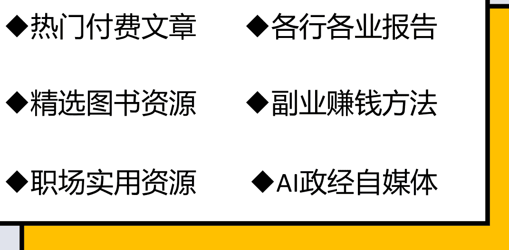
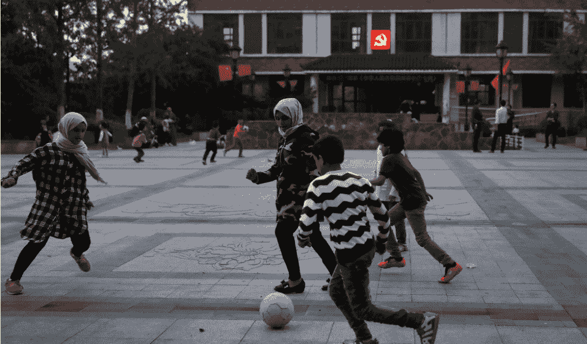
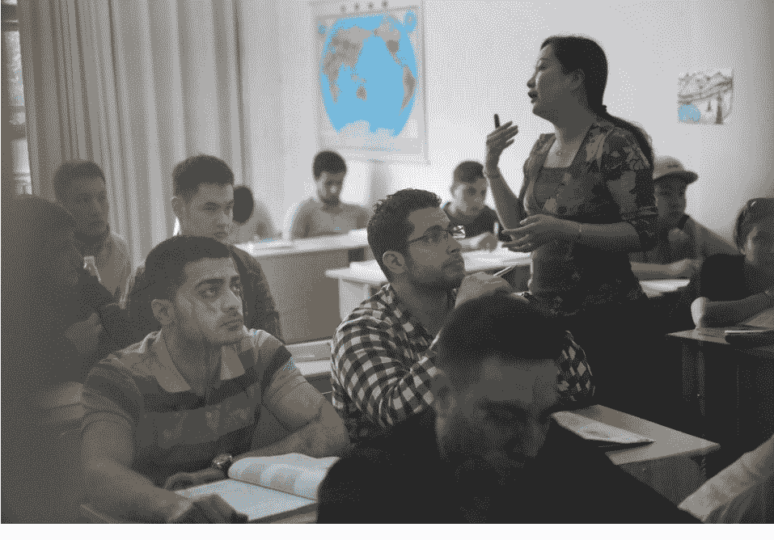
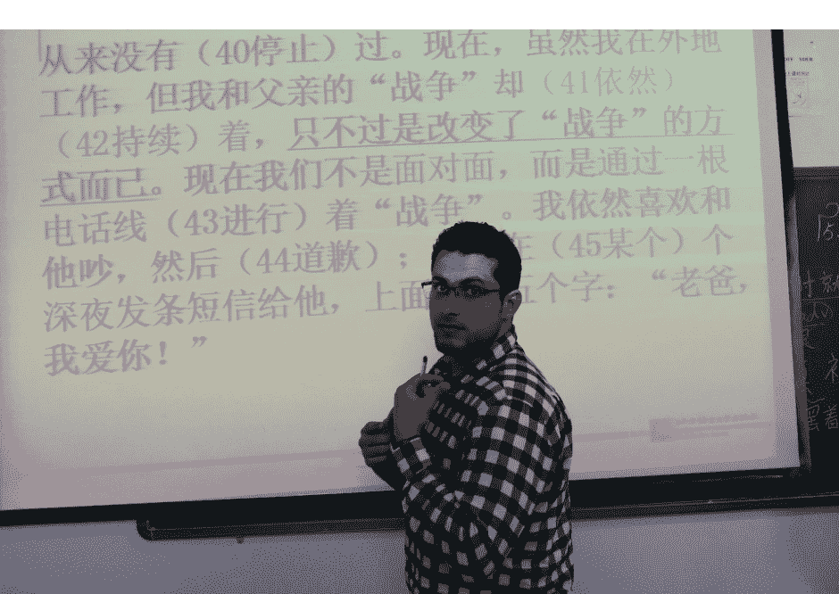
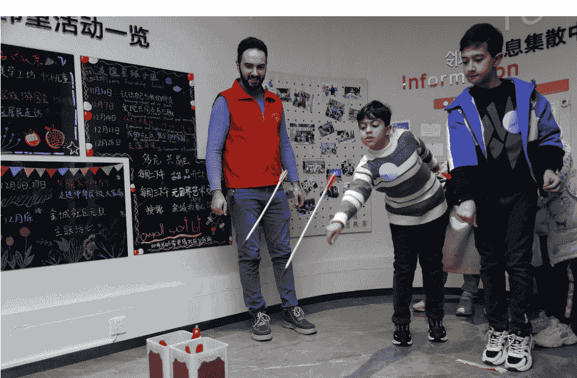
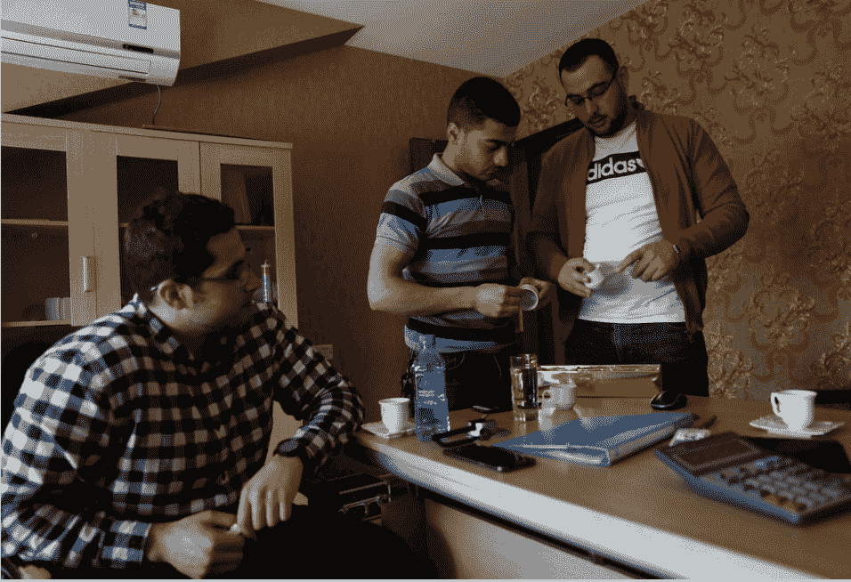
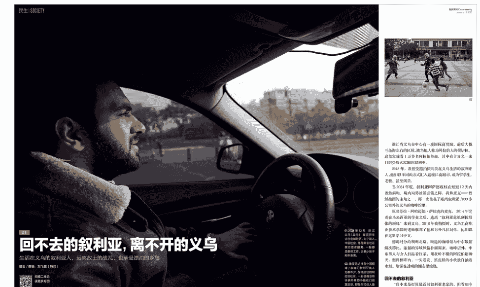

## 欧洲政策赢冬将至
保险费跨行至深水区
27
议赛未来
50
跨年政策轮回续接
15
专访新加坡金管局局长
31
描写生命演史
60

## 财新周刊
Caixin Week

### 平台治病
如何破解信息茧房、谣言围网、困在算法里、大数据杀熟、“仅优款”黑产，在用户、劳动者、平台等各方利益之间找到合理平衡?

P.36
2025年第2期1月13日出版总计139期
登刊号：32-235
ISSN 2096-1251

加微信：ntsg2 免费资料分享群

# 免费 价值 及时 专注
# 扫码加入 知识星球TOP 免费资源群
- 每日免费获取价值资源
- 可提供各类资源搜索服务

| 热门付费文章 | 各行行业报告 | 精选图书资源 | 副业赚钱方法 |
|---|---|---|---|
| 职场实用资源 | AI政经自媒体 | | |

公众号:知识星球TOP 微信号:jntsg8 微信号:jntsg2

分享资料仅供个人学习，请及时删除，切勿商用传播

## 财新观察 | 治理乱检查，让企业安心发展

# CAIXIN| 听文章
针对企业反映强烈的乱检查问题，近日，国务院办公厅印发《关于严格规范规范开展行政检查的意见》（简称《意见》）。《意见》开篇即指出“坚决遏制乱检查，切实减轻企业负担”。内容十分具体详尽。

《意见》明确行政检查主体，严禁不具备主体资格的组织实施行政检查；清理并公布行政检查事项，从源头上遏制乱检查；合理确定行政检查方式，最大限度减少企业检查次数；严格行政检查标准、程序，杜绝随意检查，严格控制专项检查，避免“走过场”、运动检查；规范行政检查行为，防止逐利检查、任性检查；压实规范管理责任，加强行政检查的执法监督。

由此可见，《意见》针对行政检查事项、频次高、随意性大，以及任性检查、运动检查，以各种名义相检查突出现问题。它从主体、职权、程序和行为等多个方面予以细化，全力堵塞各层面、各环节的漏洞，可视一份规范行政检查的“负面清单”。倘能够切实落实这些部署，营商环境将得到进一步改善；或许还有一片安宁，企业可能聚集聚力发展，无心劳干事业。

泛滥的行政检查严重干扰正常经营，影响企业家的信和预期。2024年11月，司法部发布的第一批行政执法监督典型案例中，就有一起涉企重复检查案例。有企业反映，从2021年到2023年，公司每年都接受多次检查。检查主体涉及多个主管部门，检查层级涉及市、县、四级以上。对于企业而言，应对多次检查已经成了重负担，怎样能聚力发展？

出现这种现象，原因是多方面的。就直接原因而言，如上述案例的剖析，部门内部统筹机制不健全，检查缺乏规划性、执法审批不严格，同一部门不同科联动执法机制不健全。同时，部门之间执法机制不畅，检查缺乏协同，部门之间互不通气、各自为政。另外，检查标准统一，上级指导力度不够，导致随意执法、重复执法。行政机构内部机制和程序问题，逐步外化，最终由企业承受。在财政压力大的地方，需要防止此类检查。此外，还警惕检查背后可能的腐败。

当务之急是把《意见》落实。文件以简明的语言概述了行政检查红线，如“五个严禁”“八个不得”。例如：
- 严禁干扰企业正常经营，不得随意到场；
- 严禁任性处罚，不得乱查、乱扣；
- 严禁变检查，不得乱结；
- 严禁变相，不得乱搞等。

这些规定极具针对性，为后续行政检查划出了清晰底线。《意见》还要求主管部门严格落实权力清单，梳理领域行政检查事项并动态管理，对没有法定依据的检查及时清理，对发生变化的依据及时调整，将大大减少违法检查的数量。显然，这是建设法治政府的问题。

《意见》特别要警惕思想靠“好处”的部分可能导致合理检查，让监管人员拥有丰富的经验和技巧。在此问题上，“权力关进笼子”愈发重要。防范以“走过场”的方式贯彻《意见》，必须避免企业反映负担，要注意听取企业心声。

### 最新封面报道 | 着眼算法与规则 新一轮平台整治开幕

# CAIXIN| 听文章
文 | 财经周刊 关畅孙嫣包云红

岁末年初，新一轮针对中国平台经济的治理行动拉开序幕。上一轮关注平台扩张和竞争，此轮整治聚焦于规则与算法，在商品或服务供给方、用户和平台等方发力中，纳入新的监管框架和目标。

2024年1月22日，中共政治局常委会、国务院总理李强主持召开国务院常务会议（称“国常会”），会议强调规范市场竞争秩序，健全监管制度，推动平台经营规范、有序竞争、提升质量，促进各主体互利共赢。同时，会议还要求切实保障消费者和劳动者的合法权益，线上消费投诉、消费后评价等制度，指导企业依法规范使用，更好发挥平台对就业的作用。

“我们理解，国常会首先是中国平台企业的作用，尤其是对就业的意义。”一家服务平台资深人士指出，实际上在国常会前后，针对所有领域互联网平台的新轮监管方向已经明确：
- 电商要求低价“内卷”，调整“仅退款”政策；
- 外卖、网购劳动保障问题，转向用工时长等确保保障而非非社缴等；
- 算法透明度也被提到了前所未有的监管高度：“新的监管框架将加强自查自律，但有一些可以讨论的空间，更多的平台已经做到，但这次监管是想要把尺度拉平、全行业执行。”

清华大学公共学院副院长陈天昊对新表示，国会提出的规范市场竞争秩序和保障消费者、劳动者的合法权益，两方面都指向了民生问题；而要兜民生，最好的办法就是就业稳定，内需才能有基本的保障，供给侧才能向好。

目前，中国平台经济的影响在单一行业中重要。中国网民规模近十亿，普及率接近八成。截至2024年6月，中国平台经济规模近十亿。以电商为例，商务部数据显示，2024年上半年网上零售额15万亿元，同比增长8%，其中网上零售额占消费零售额超过四分之一。多年增长的互联网平台自2020年初开始进入一轮垄断调查，直到2022年底召开中央会议，工作表述为“要大力发展平台经济，创造就业、引领国际优势”，此后平台经济进入相对宽松、包容的发展时期。2023年7月12日，国务院总理李强主持企业座谈会，听取企业建议，促进平台经济健康持续发展。在宏观经济运行过程中的压力，暴露出平台经济隐藏的异常现象，监管部门再次集结。2024年8月24日，国家市场监管局召开大会，发布《关于开展网络平台算法整治工作要点》，要求平台优化。

整治重点问题包括：
- 违规操控热点、信息造谣“信息茧房”；
- 盲目追求利益侵害劳动者权益；
- 利用算法侵害用户权益等问题。

国家信办开展专项行动，要求各大平台在2024年12月日前自查清理，并在2025年1月日前完成评估。月初，国家市场监管局公开了系列治理内容，要求平台优化规则公平、降低负担、净化行业生态。

平台企业不得不动起来，电商平台纷纷收紧严重不利于商家权益的“仅退款”政策。拥有超过700万活跃骑手服务的美团（0390.HK），其竞争对手阿里巴巴（NYSE: BABA:0988.HK）旗下本地平台快了也跟进，启动骑手防疲机制，并称2025年底逐步取消超时扣款。2025年1月初，抖音也将公开算法原理和审核机制，主要治理方向包括“防沉迷”、“信息茧房”等十项内容。紧接着，短视频内容更“下沉”的快手（01024.HK），也明确算法“向上向善”，并提出算法共治，即用监管、行业协会联动以及让用户掌握内容推荐。

> “此次治理要求中，某些策略调整是相对容易的，如此骑手罚款问题、切断流量传播。”前述平台人士指出，互联网企业目前仍有很多领域要课，但大数据“杀熟”对多数平台、“退款”对拼多多多、“擦边”内容（备注：部分用户认为是有暴露或性暗示的）对一些直播或短视频平台而言，不是简单的治理问题：“可能要动摇平台的商业模式，规则和算法的不同，就是公司商业定位不同，到底哪里？这可能是长期的博弈，不是靠一次运动能够解决的。”

中国第一和第二电商平台京东和东方陷入增长困境，几乎只有多多在逆增长。

此外，平台企业的跨域经营对跨部门监管增添了挑战。由于宏观经济增长承压，市场总需求走弱，企业竞争更加激烈，竞争失灵现象日益出现，这时需要监管部门有效协调。从长远来看，上海交通大学经济与管理学院教授陈天昊认为，监管应当遵循基本秩序，在有限时间内将不同部门注意力集中在一起，构建监管体系，给予更多自由，以激励市场活力。

2024年本届政府工作报告提出“努力建设人民满意的法治政府、创新政府、廉洁政府”，表示要“深入推进政府职能转变，不断提高执行力和公信力”。显然，规范行政检查的治本之策在于此。

平台政策钻漏洞，逐步形成黑产业；此外，短视频和直播涉及的暴力、青少年保护等问题，常规引发舆论关注。相关立法也在持续推进。2024年12月21日，十四届全国人大第十三会议审议了《中华人民共和国反不正竞争法（修订草案）》，针对网络不正当行为，草案第13条将过去规定的经营者不得“技术手段”实施不正当竞争行为，进一步细化规定经营者不得利用数据和算法、技术、平台规则等，实施恶意交易等不正竞争行为。

平台方不认为自己为“信息茧房”背锅。“现在普遍对“信息茧房”的担忧，其实是所谓的“信息偏食”，即信息来源单一。“抖音视频平台相关负责人告诉财经，从商业逻辑来看，平台并没有动力去制造“蚕茧”，而是最有动力打破“信息茧房”，刻意做多样化推荐，避免越推越界。比用户对萌宠感兴趣，在不考虑针对性的情况下，这个用户可能会被连续推荐1个宠物猫和其它内容；但平台加入多样性参数后，用户可能只会被推荐1个宠物猫，并增加其他内容。

平台广告变现的基础，也在推荐千人千面的营销内容带来更多的潜在消费群体，而非局限于既有消费群体。一名字节跳动广告优化师告诉财经，抖音上的短视频广告和内容都不是“强推逻辑”，客户很难通过买量在抖音推出爆素材，需要内容能力。

实际上，无论“沉没”还是防“信息茧”，治本之术在于改变用户画像和内容推送的单一。今日头条相关负责人告诉财经，接下来会从算法入手，通过用户画像和内容特征，让新内容进入视野，而这些动作对业务产生正面影响。

上海大学经济与法律创新中心主任许可的团队，以“公众对算法认知”为主题做了一项调研，成果报告《算法和AI模型认知报告(2024)》显示：2024年，约66%的访者对企业提供的服务是“完全清楚”或“比较清楚”。2022年的数据，这两个比例分别是44%和16.9%。

在基于个人信息的算法推荐方面，用户接受程度有所提高，人们认识到个性化推荐的优势，选择“推送精准、获取有用信息”的时间访者占比合计从40%上升到了52%；而“推送内容过于娱乐、容易上瘾”“限制知识获取的多元化”这两个选项的访者比例则从43%下降到了37%。

许可告诉财新，过去几年，算法治理的进展体现在：利用算法乱市场秩序、人为信息扭曲和大数据杀熟等问题得到了部分改进，消费者认知也有提升，但仍有七成访者认为算法存在一定风险，仍需进一步治理。端侧模型、人工智能（AI）智能这些新的软硬件工具，很快会成为日常生活的一部分，未来仍需根据监管框架进行调整。

许可指出，与此同时，算法治理最显著的变化是透明和公平。相对于“信息茧房”，改进的有限在于：“信息茧房”本身具有两面性，有传播虚假信息、造成观点极化、加剧冲突的风险，但用户的确有获取兴趣内容的需求，平台也会迎合用户。

一家平台内部人士说，各平台的用户群体关注的内容并不相同，为了尽可能扩大用户群体或维持原有观点，不同用户之间需要隔离，就会进一步加重“信息茧房”。在他看来，防止“信息茧房”，增加不同内容“被看到”的概率，不是技术问题，更是公司用户群定义的问题，“比如小红书的人和快手的人就不是一样的，如果破坏信息蚕茧是要要求快乐提供小红书的内容，监管目标可能很难达成”。

### 谁管谣言、网暴、青少年？

相比温水煮青蛙的“信息茧房”，短视频等内容平台更显性的挑战性来自内容治理，其中尤以谣言、网络暴力最难管。

“因为你是一个拥有足够力量来掌控舆论的平台企业，因为有这样的背景，所以请你承担一个企业的文明的准则和规则。”2024年11月20日，农山泉（09633.HK）创始人钟骏峻在江西信华演讲现场“喊话”字节跳动创始人张一鸣，要求今日头条、抖音删除与其相关的谣言和黑内容。

钟骏峻谈的谣言问题，始于2024年初娃哈集团创始人、前董事长庆后去世后，农山泉和娃哈两家饮用水企业的“种种往事”在网络上发酵，因舆论不断蔓延至钟骏峻的圈子、农山泉旗下产品“东方卉”包装上有“本土元素”，农山泉后来选择备案、起诉造谣者。

知名企业公开办话平台，要求治理传播谣言问题。这一事件将抖音等平台推上风口浪尖。李亮坦，处理谣言、网络暴力、青少年保护等是目前平台治理的重点。

2023年7月，中央网信发布《关于加强自媒体管理的通知》，明确网站平台应要求“自媒体”对其转载的信息真实性负责，需关注虚假内容或追逐流量、蹭热点的平台流行文化之下，内容生产方容易有造假

但在内容生产方容易有造假冲击，而平台却缺乏监管的法律支持、意愿或能力。大多数造假在网络上上不了了，一些产生流量的造假信息更容易被发现和惩罚。

如，2024年4月，伪造“小学生作业本丢在巴黎”视频的网红“Thurman猫”一条抖音账号永久封禁，所在公司遭受处罚；江苏泰州的张某冒充卖手机，以“低廉、拍卖回款”发布虚假短视频卖命，被警方依法拘留。

按照《民法典》，互联网平台在内容管理上遵循删除原则，即“避风港原则”，因此平台在没有足够依据的情况下，不能随意关闭用户账号或处置用户视频，拥有权利人投诉内容侵权。

李亮解释解释，平台主要收入来自广告和电商广告，其中大部分是品牌广告。如果平台上有大量谣言，会损害品牌客户对平台的信任，打击谣言本身符合平台自身利益，但在实践中并不容易，需要平台付出时间和成本。

他举例称，诸如“流一猫”这样创作者和自媒体制造的热点信息，平台很难在第一时间内掌握真实情况。而2023年被抖音封禁的乡村网红“爱秀”，抖音是在收到用户反馈并派人实地调研后，才发现其确有符合条件的违规行为，因此封禁其账号。

李亮透露，对于事实空白期未经证实、在存在争议的言论或内容，抖音一方面会请专业媒体调查核实，另一方面会依据主管部门的调查结论判定。

而观点性争议内容，抖音的做法是将其分级，对极端情绪和攻击对立、网暴辱骂等做更严格的管控，直接截断流量，允许正常的情绪表达。“在这个过程中，算法判断了否，所有的内容标准都需要人工介入。”

抖音介绍，算法会把辟谣内容推荐给看过的人，实现精准辟谣，抖音安全中心自主研发的反诈模型、风控策略可以通过算法技术主动拦截93%的欺骗行为。

网络暴力方面，李亮指出，目前法律上对网络暴力定义困难，不同用户的个体体验差异巨大：“我们和中国法律援助中心有所合作，为自己遭受了网暴的用户提供法律咨询，结果了一年后，大部分案例中对用户展示的被攻击言论数量较少，还不法律规定对于‘网暴’信息的认定条件。”

公众在热点信息上的集中参与和内容分发，也加剧了平台治理的难度。2024年底，此前吴柳芳在抖音发布被指“裸脚”的视频，引起争议，但恢复后流量大幅涨粉。吴柳芳曾一次被抖音禁言，其所在的MCN机构“大辰”被限制了账号功能。

今年12月24日，抖音告诉财新，吴柳芳的内容并不在平台推荐范围内，快速涨粉是因为吸引了用户关注。作为平台生态治理的一部分，不良信息一直在开展。2024年10月以来，国家网信办针对不良信息环境开展整治，清理违规文字、直播等内容。

2024年9月9日，国家网信办发布暑期“清明”专项行动成果，曝光了典型案例，包括拍在厕所吃橡皮、校园围架等情节，监管部门指导平台完善审核标准，从严处置万个违规账号。

这类被称为“软视频”的内容，还有一个流行名称“酷文化”，内容包含涉及成年人结婚生、亲密动作、露衣着、站在公共厕所蹲上方等。然而，整治未成年人内容直到2024年1月22日，财新报道中，快手人士称，打击涉及未成年人的不良内容很难从技术判断，平台只能一刀切。

虚假信息传输或扩散，导致危害成年人健康，短视频存在违法问题，违反《网络安全法》规定被公安机关给予处罚。

2024年12月25日，字节跳动旗下免费短剧App因明显违反要求的微短剧集被广电主管部门约谈后，暂停了相关关注。

2025年1月7日，影视明星鹿晗因直播中出现不良范势，多个平台账号被处罚。

1月10日，国家网信办就《网络信息内容多渠道分发服务活动规定（草案稿）》向全社会征求意见，规范MCN机构相关业务活动，要求严格管理违规账号，不要制造谣言、煽动群体情绪、传播不良价值观、传播低审美。

### 保护劳动者权益

国家网信办专项行动提出，重点整治损害新就业形态劳动者权益。落到具体做法，包括建立对骑手、网约司机等的防疲劳机制，处理劳动者超时、取消订单等情况，以及新就业形态劳动者建立畅通的发声渠道。

新就业形态主要集中在电子商务、共享经济、平台经济、众包经济、零工经济等领域，最常见的职业包括网约司机、骑手、快递员等。

2023年3月披露的第九次职工工况调查，全国职工总数约2亿左右，其中新就业形态劳动者有8400万人。

许可告诉财经，平台方在《互联网信息服务推荐管理规定》中被称为调度决策类算法，其实不全是算法问题，核心是劳动者保护。难免于平台一种全新的经济组织形式，和传统企业完全不同。工业时代的劳动者和企业之间有很多人身依赖，有清晰的工作时间表、任务清单；但劳动者可以随意加入和退出工作。基于大工业生产的劳动法体系，无法一致地适用到新型经济组织形式。

比如，不太可能有一家企业像美团这样有700万骑手。许可认为，原本的劳动者关系和劳动者保护都需要转型，“每个平台上的劳动者都是即插即用的，因此劳动者保护应该是本人挂钩，是‘USB式的权利保护’，无论人在什么地方，都能享有的保险、休假和安全保障。”

注意的是，2022年以来，外卖骑手和网约司机大多数都处于过剩状态，个人收入普遍下滑。一名珠海地区美团骑手表示，两三年前月收入可达1.2万元，现在收入很难过万元；随着寒冬来临，其覆盖的大学生为主的区域进一步面临订单少的局面。“去年每天跑百单的人会有三五个，现在能赚70单已经很不错了”。

武汉汉区滴滴司机王利也表示：“前两年每天工作12个小时左右，500块就能回家，现在跑到300块就不错了。”

截至2024年10月21日，交通运输全国各地发放网约车证74.3万本，过去一年同比增长18%。事实上，很多网约司机并没有领此类证。

2024年9月9日，杭州林区发生一名外卖骑手猝死事件，再次引发争议。财新报道，美团、饿了么等平台都有疲劳机制，很多外卖骑手在某处的日均单量480左右，资深骑手中属于常规水平，月入万元左右。

美团相关负责人表示，最早在2021年7月就开始在华东地区试点疲劳机制，骑手跑单超过8小时强制休息20分钟，之后可以继续接单。2024年12月，进一步覆盖华东、上海、杭州等城市。2024年12月17日，美团开始施行疲劳机制，骑手跑单超过8小时强制下线，实际是极少数，平均占当天骑手人数的2%。

2024年8月17日，饿了么在全国上线骑手休息措施：如果连续跑单时长累计满4小时，应当一次性休息不少20分钟；驾驶时长累计满10小时，应当滚动休息；24小时内时长累计满18小时，应当一次性休息6小时。

滴滴方面也针对司机推出了相关对策：驾驶员服务时长累计满4小时，应当一次性休息不少20分钟；驾驶时长累计满10小时，应当滚动休息；24小时内时长累计满18小时，应当一次性休息6小时。王利说，疲劳机制推出后，很多司机带着被子在车里睡，绝大多数时间都在线。为了维持收入水平，都需要不断延长工作时间，很难疲劳驾驶。

2024年12月23日晚，容易打到“臭车”的帖子一度冲上微博，滴滴官方发文道歉，并表示正在开展车内功能、空气采样率较高的司机暂停服务培训学习等方面改善用车体验。

“现在网约行业内内卷得非常常态了。”王利称，自从聚合平台上线，现在网约都在打价战，司机拿到手里就一块多，“有洗车的时间，不如多跑两单”。

被指“在算法里”的外卖骑手最大的约束条件是时间，骑手一旦超时会面临用户投诉、平台罚款等。为了保证订单不超时、逆行、闯红灯等危险行为在外卖手中非常普遍。

美团在2021年9月开始试点订单送达时间从时间点改为10—15分钟左右的时间段，用半年时间铺开。美团骑手相关负责人称，改进后相关超时问题减少了50%。从2022年3月起，在绍兴、太原、昆明等15城市，对骑手收差评、超时的情况从扣款为扣分，骑手可以通过安全培训、模拟作业等分项进行惩罚。目前这一规则在北京、上海、广州、深圳、成都、武汉、杭州等50多个城市落地。

美团骑手相关负责人介绍，新骑手头部多次有免责卡，超时不长则扣较少，扣分后后再申诉直接扣款后申诉，骑手体验更好。

美团骑手对超时的焦虑很难消除。美团近期宣布逐步取消超时扣款，改罚处罚为正向激励。前述珠海地区美团骑手表示，其所在地区超时时不同时长扣分不同，单跑有相应积分，月底分排名对应不同星级，取得最高级一个月能多拿1000多元:“超时时不扣钱，但奖励减少，相当于扣了薪”。

目前，各项制度主要覆盖外卖平台的专送骑手，美团正在推进对骑手管理方式的优化，预计2025年底完成其他类型骑手覆盖。

超时问题不仅需要外卖骑手配合，商家也需承担责任。为了避免超时，美团在2024年9月开始针对商家管理，将压力转移至商家，减少18%左右的损失。人员表示，接下来要保证骑手健康，尽量减少由于天气等不可控因素导致的超时。

此外，还要针对闯红灯、超速、逆行等违法行为，加强交通安全教育，监管部门根据违法程度和频次，分别对骑手警告、强制参加考试、限制单。

同时，为了保护成年人健康，监管部门指导平台完善审核标准，从严处置违规账号，将违法情况纳入考核指标。

国家网信办专项行动提出，重点整治损害新就业形态劳动者权益。落到具体做法，包括建立对骑手、网约司机等的防疲劳机制，处理劳动者超时、取消订单等情况，以及新就业形态劳动者建立畅通的发声渠道。

新就业形态主要集中在电子商务、共享经济、平台经济、众包经济、零工经济等领域，最常见的职业包括网约司机、骑手、快递员等。

### “杀熟”猫鼠游戏

实际上，针对不同用户提供不同价位的商品选择，本质是商业模式，体现了平台的技术能力。积累的数据，就是“杀熟”的秘密。各大平台承认，调查显示超过60%的消费者遇到过差异化营销，只有7%的消费者没有遇到过。

这种，无论是监管还是平台，都没有给出有效的解决方案。向携程、飞猪、美团、滴滴询问关于“大数据杀熟”问题，都没有获得回复。

2024年末，社交平台突然掀起反对“杀熟”的热潮。年轻人分享经验，从小红书等社交媒体平台上上传“机票专用帖”，在评论区发“机票太贵”，迫使算法推送低价机票。一名红书用户晒出的截图显示，原为553元的同一航班机票，在他不断评论“机票太贵”两天后降价到356元。

很多参与“反向流量”的用户将网名为“momo”，这是近两年流行的共用匿名名，以此规避平台对用户个性化特征的识别。广东大学法治与经济发展所张宪伟表示，个性化广告需要识别并整合用户的个人信息，普通用户可以采取混淆策略来规避搜捕，例如更改网名等，意图收集者不能识别出用户是谁，从而阻断连续性的信息收集；以及这种混淆策略也无效，因为搜索可以通过手机号、手机IMEI识别，“平台与用户之间的数据收集和反收集就像一个猫捉鼠的游戏，用户改变了一些身份符号，平台也可以相应调整策略。”

陈宪分析，不想被大数据“杀熟”，就得和平台算法博弈，显示一个价格敏感的“人设”：“网约车平台可能对有优惠券不打高型的用户持续派券，而对无所谓的用户很难再购。”

中国社会科学院法学所吴亮对此表示，在调研中发现，在网约平台，如果用户多次取消远订单，往后可能就会收到更多的订单，“平台在检索每个人的反应，来适配对平台最大化的经营方式。”

目前，消费者对大数据“杀熟”的维权诉讼已成功判决。

针对“大数据杀熟”这种问题，国家网信办专项行动明确提出，严禁用算法实施大数据杀熟。具体而言，严禁利用用户年龄、职业、消费水平等特征对相同商品实施差异化定价；为提升透明度，清晰说明优惠券的获取条件、发放数量和规则；规范说明获取失败原因，掩盖真实原因。

曾引发泛关注的“大数据杀熟第一案”显示，2020年7月18日，一名携程钻石会员客户通过携程App代理渠道预订酒店，订单为2889元，退房时发现发票显示房价仅1377.63元，而携程客服在沟通后同意还1268元差价。该客户认为携程通过其个人信息，根据其“高净值客户”的用户画像将其报出高价，构成欺诈，遂对其提起诉讼。一审中，绍义市柯桥区法院判决，携程构成违法。

2024年8月24日，国务院发展研究中心等部门召开了主题为“电商过度竞争和相关建议”的闭门会议，邀请了阿里、京东、拼多多、抖音、腾讯等平台代表、商家代表以及相关专家参加，重点讨论了“卷”低价和“仅退款”等问题。

据财新了解到，市场监管部门向某电商平台发送了一份详细的整治工作清单，要求平台平衡消费者和商家的合法权益。最大首要要点是限定“仅退款”规则、适用情形；要求加强对“薅羊毛、恶意索题”等行为的识别。

表现而言，上述整治工作清单要求平台在制定、修改协议规则时，要取纳采购商家合理意见并在过程中提升透明度；围绕绩效规则、申诉机制等内容，对商家开展专门教育培训和普法宣传；督促平台自主经营权，对平台主动介入商家经营活动、售后服务的条件进行限制，不得鼓励、引导消费者申请“仅退款”，防止滥用。

此外，督促平台健全商家申诉机制、弥补机制，不得对商家的正常申诉出台限制，对于确实不属于商家责任的，平台应补偿对商家造成的损失。

各大平台迅速应对政策风险，2024年中，淘宝开始优化“仅退款”政策，宣布依据店铺体验单方面确定商家售后后机制，在“仅退款”申诉环节，商家发起申诉后，平台会引入第三方检测机制对商品进行抽检；若检测通过，平台将赔付损失给商家。同时，淘宝算法识别异常高“仅退款”、寄回空包件、高频虚货问题退款等，日均拦截不合理“仅退款”超过40万笔。

快手则在2024年11月底调整了售后规则，废除了“退款不退货”服务，“仅退款”需要经过商家的同意，而平台基于用户申请、用户催促、用户投诉或店铺售后、物流状态等因素，自行决定适当缩短处理时间、代表同意申请、平台主动介入等措施。

抖音电商对“仅退款”一直比较谨慎，从严评估。根据平台最新规则，经审核查验，商家实存在描述不符、虚假宣传等行为的，平台将视情况对该店铺订单“仅退款”或“退货退换”的处理；同时，为了防止个别用户恶意产生“仅退款”，损害商家利益，平台一直在针对争议场景的判处，保障商家权益。

抖音电商在2025年1月6日发布的九条新措施中，包括中小商家减免金、推广优惠、降低运费与保证金等内容。针对退款问题，平台承诺算法分发机制，尽量让消费者在下单前比价商品，从而减少用户在下单后、收货前频繁比较相同商品；平台还将主动申请“仅退款”的用户，关注其合理性，会从严处理，维护商家权益。

最早推出“仅退款”的拼多多已有调整。市场传出拼多多将取消“仅退款”政策，拼多多目前也只是细化“仅退款”操作。拼多多向财新表示，2024年9月，拼多多对商家售后服务体系进行了专项升级，全面支持商家对异常订单、恶意投诉订单、消费者负向体验订单等进行申诉，不再限定可申诉次数。商家发起申诉后，平台售后服务团队对商家和消费者的双方发起进行全面核查，商家申诉成功后将平台对相关订单进行赔付。

拼多多还补充，在商家端，根据店铺的消费者客诉、售后服务等行为进行综合评定，对“商家信用”高的新商家交易订单，平台不介绍“退款”；对商品存在轻微问题的订单，平台不支持“全额”退款；对短时间内难以界定责任的订单，平台延迟介入处理等。在消费者端，针对恶意用户，平台在完善内部打标机制，通过售后记录进行分析研判，定向停止恶意用户的“退款”售后支持，同时对订单退款金额上限进行了调整。

1月8日，拼多多宣布成立“商家权益保护委员会”，由拼多多集团董事、总裁CEO赵佳臻担任委员会主席，统筹平台治理、招商、客服、技术、产品等团队，称要“全面研究商家需求，收集商家反馈意见，优化商家经营体验，完善商家服务机制，持续提升商家满意度。”

实际上，电商平台的核心症结不在于低价，而在低价竞争的实现方式，是遵循了不公平竞争原则，还是依靠自身优势收割商家或消费者。

2024年“双十一”，淘宝不再重强调低价。淘宝平台业务部总裁指出，一味的低价挤压商家的利润空间，让中国的营商环境、消费、制造业倒闭！“强强调淘宝、天猫的价格力，不是一味的低价，而是指的是每个价格带的竞争力，淘宝希望品质和服务重新成为商家的核心竞争力。”

阿里巴巴集团首席执行官（CEO）吴铭在直管淘宝期间，提出以分层用户的角度组织商品供给、提供服务。淘宝工厂主要承接低价阶段的价格，京东的逻辑并不是运营商家，而是运营单链接。一名接近京东集团的人士告诉财新，京东工厂的产品在功能上做一些取舍，降低成本；同时，工厂型商家拿到大量订单，形成规模效应，单成本更低，就能给出更低的价格。

近期京东在“双十一”延续618“便宜又好”主题，一名接近京东的人士向财新表示，京东低价主要来自提高供应链效率，包括实施数据驱动的选品，提升供应链管理和执行效率，提高规模效益并降低成本，以做到“便利”。

“低价之王”京东的逻辑依然是“价格换流量”，即给予优质者更多的流量倾斜。对于市场上关于拼多多低价伤害的观点，一名熟悉拼多多的人士对财新分析，拼多多能做到低价的原因，一方面是运营成本特别是流量成本低于别的；另一方面是国内产能。近期，拼多多响应政策，上线了“低价预警”功能，在商家提交订单时，结合历史数据弹窗，避免价格过低。目前，已有商家反映拼多多流量变贵。“光打价格卖得动，但平台一直控制着流量的自然。”拼多多试图提升平台优质供给。2024年8月至今，拼多多先后推出“百亿减免”以及“商家扶持计划”。财新指出，行业的基本共识是，在需求、供给过剩的市场环境下，平台倾向消费者是必然的，拼多多的“退款”和低价策略高度匹配其竞争优势，如果完全改变，可能导致拼多多竞争优势不存在；而拼多多如果不改变，其他平台也会再次卷入新轮“内卷”竞争。“拼多多增长已经放缓，但其他平台的业绩增长并没有恢复。”一家电商高层直言，“内卷”并不是平台希望的结果，但在大家都更差的情况下，用低价换GMV必然持续：比此前经历的任何时期都要长。”注：本文发表《财新周刊》2025年第2期，原文为：封面报道。

# 最新财新周刊 | 欧洲凛冬将至

## CAIXIN | 文章

文 |财新周刊 李忆

美国当选总统特朗普1月20日的就职尚未到来，但深受美国政治气候影响的欧洲多国，已笼罩在特朗普再次当选后的冲击波中。从2024年12月以来，欧洲大陆的两大引擎——德国和法国都不太平。

12月中旬，2021年才接替梅克尔成为德国总理的奥拉夫·朔尔茨，因未能通过联邦议会的信任投票，决定决定散的联合政府，提前大选。下届德国选举定于2025年2月23举行，这比预定的选举期提前了九个月。而在过去，德国曾以缓慢的党际协商，建立持久的主政联盟闻名。2025年1月7日，特朗普在美国佛罗里达州海湖举行发布会。即将上任的特朗普，让欧洲得谨慎应对最大的“外患”。

作为欧盟最大的经济体，德国也在经历寒冬。恪守债务契约和财政纪律的德国，面对陷入停滞的经济增长和频繁裁员的巨头企业，各政党未能如何平衡预算纪律与经济刺激在议会中达成一致。最后，这也是关于财政问题的辩论，加剧了德国联盟内部的裂痕，导致民主党、绿党和自由民主党组成的“交通联盟”面临提前解散。

独特的是，同样对有关财政预算案措持不下的，2024年9月上任的中间派法国总理巴尼，被视为右翼和左派联盟的击，未能通过投票而被辞职。2024年12月11日，巴黎，法国总统马克龙去参加看守内阁会议。一年内，法国经历了两次国民议会解散重选，总理多次更迭。

十天后，法国总统马克龙任命了法国这一年来第四位总理。尽管暂时填补了这一空缺，但法国政坛在2025年预算问题的严重歧并未被修复。在会议中被左右两翼夹击，占三分之一席位的中间派力量，越来越难维持政局稳定。一年内，经历国民议会解散重选，总理多次更迭的法国，也对法定任期至2027年的马克龙带来了越来越大的执政压力。

德、法两大欧洲引擎政局双陷混乱，背后是整个欧洲范围内政治光谱变化的隐患。德国朔尔政府下台前一个月，2020年输掉大选的美国总统特朗普再次赢得一届任期，并将于1月20日回归白宫。特朗普的屡度遭遇角逐并再度胜利，不仅振奋了欧洲大陆的右翼民力量，也让欧洲外的政治盟友谨慎。特朗普再次当选带来的风暴搅动了欧洲。2024年10月28日，德国大众员工在工厂门口聚集，向管理层宣战。此前，大众汽车公布了部分工厂关闭和裁员计划。

2024年12月16日，德国联邦议召开特别会议，审议并表决了对总理朔尔茨的不信任议。最终，联邦议院733名成员中，394人投不信任票，只有207名支持朔尔茨。自由民主党退出联盟后，朔尔茨不得不解散政府，德国大选将在2025年2月举行。在此之前不到两周，法国总理米尔·巴尼在12月4日于国民会举行的信任投票中遭遇失败并草草下台，使得2024年9月才上任的巴尼成为法国1962年以来“最短”的总理。

巴尼耶成立三个月后就被信任投票推翻，这是自1962年第五共和国建立以来，政府首次遭遇国民会以信任投票推翻，法国政府一度面临瘫痪风险。此后，巴黎时间12月13日，马克龙任命其长期盟友、中间派共和党民主主席菲朗索·贝鲁为新总理，接替巴尼。然而，这已经是马克龙一年内任命的第四位总理。

从巴黎到柏林，尽管两国的议会关系和总理权限有所不同，两国两大“欧洲引擎”频繁政局背后却呈现相似的症状。在民意不满、政治极化更加剧烈的当下，意见分歧巨大的关键政策上，难以寻找共识。

在德国，“红绿灯”执政联盟的彻底破裂，早有可循。自2021年12月初以来，由自民党、绿党和自由民主党组成的三联联盟出现分裂，在多个政策议上无法推进。随着矛盾长期积累，联盟内部冲突日益剧烈，最终在2024年秋彻底爆发。由于自民党与社民党在扩大债务以刺激经济的观点不一致，执政联盟始终无法财政预算案达成一致。2024年1月6日，朔尔茨决定解除自民党主席林德纳担任的财政部长职务。当天，自民党宣布退出执政联盟，“红绿灯”联盟正式瓦解。

自民党退出之后，由朔尔茨所在社民党加上绿党的会议席位已不足半数，朔尔政府成为少数政府。朔尔无法通过信任投票的结局，也因此并不意外。

德国“红绿灯”三党联合政府的提前解散，德国意外成为美国2024年11月大选结果后首个上台的德国政府。三党联合执政的过去三年来，在乌克兰冲突的笼下，德国能源价格高涨，经济持续低迷。但面临制造业衰退、社会不稳定因素增加、财政负担加重压力的三党执政联盟，无法在多数议上达成一致并采取有效措施，导致德国对现任政府失去耐心。根据德国电视2024年11月的民调，65%的受访者支持提前选举。

从朔尔茨的立场来看，面对德国经济持续收缩、俄乌冲突短期内难以收场等背景，如果继续坚持执政至2025年9月的原定大选时间，只会朔尔茨领导的少数党政府越发被民厌恶。基于此，为了避免进一步消耗执党的政治资本，朔尔茨在三党联盟瓦解后，主动向议会提出信任投票议，从而引发大选提前七个月。

近年来日益碎片化的德国选择。在2024年9月的地方选举中，林堡州成为第一党；勃兰堡州和萨克森州取得第二。极右翼政党（AfD）从原本不受待的边缘党，成为德国主流之一，甚至超越了社民党，被视为反移民力量坚固的“堡垒”，是否会在这一浪潮中转舵？

内忧之外，欧洲大陆从巴黎到柏林经历了一场缓慢而深刻的变化。过去建立政治机制开始频繁失灵，过去的增长点似乎向南部转移。对于欧洲大陆而言，这是一个充满转折意义的漫长冬季。

德法政局震荡，德国和法国一直是欧盟内部的两大支柱。2024年12月，德国和法国政府双面临危机。

欧洲相继呈现不稳定的背后，是欧洲经济的持续疲软。尤其是俄乌冲突持续三年后，高能能源价格以及对安全的担忧，似乎也在重塑欧洲的新格局。作为欧洲“火车头”的德国，正在经历20年来经济最糟糕的时刻；另一大经济体法国，则在财政赤字的危机中苦苦挣扎。根据国际基金组织（IMF）的估算，法国2024年的经济增长可能只有1.1%，德国经济在2025年将降为零增长。德国央行日前预计2024年全年经济增长将萎缩0.2%，比此前预测的0.3%更糟糕。2025年的增长预期也从1.3%下调到0.2%。这令德国成为七国集团（G7）中表现最差的一个。

德国的主要产业如汽车、钢铁等，如今陷入转型和增长的困局。2024年，德国最大企业大众汽车宣布了在德国本地关闭部分工厂的裁员计划；钢铁头部蒂森老虎以及跨行业制造龙头博世都宣布了大裁员。分析人士指出，德国经济难题属于结构性缺陷，需要的是大刀阔斧的改革，局面的混乱导致德国始终无法就关键政策达成一致并付诸执行。

德国当前的经济危机中，一部分原因在于投资不足。德国宪法里有“债务刹车”的规定，限制德国政府每年新增债务不得超过国内生产总值（GDP）的0.35%。这项条款过去曾经有助于维持财政健康，但其他主要经济体债务水平远远超过德国，这也相对限制了德国的投资规模。

以2023年为例，根据CEIC数据，德国当年政府债务占GDP的62.9%，与美国、法国各自的政府债务分别为高达123.1%、110.6%。而欧盟“稳定与增长公约”的规定是，欧盟成员国债务不得超过其GDP的60%，年度财政赤字不得超过其GDP的3%。经济不景的情况下，各国政府为刺激经济增加公共债务是普遍手法，但德国政府对财政纪律的严格遵守，导致其无法通过大幅减支出和增加税收来填补财政缺口。

相比德法等传统大国的焦虑，被视为欧洲经济相对虚弱地带的南欧多国，如意大利、西班牙、希腊，却迎来了春天。

经历自2008年开始的漫长挣扎与经济调整，深的五个国家——葡萄、意大利、爱尔兰、西班牙和希腊，在2020年以后逐渐陷入债务危机，爱尔兰甚至超越以往经济水平。到了2024年，欧洲南部多国不仅走出了欧债危机的阴影，更在产业链重组的新国际局势下逆势上行，经济超越德法、荷兰，成为欧区经济的最新亮点，其中西班牙经济增速在欧洲经济体中跃居第一，也超过了美国、德国，获《经济学人》2024年“全球最佳经济体”。

德国等国不同，智蓝全球发展研究中心负责人许认为，南欧国家服务业占比较高的经济结构，让它们在俄乌冲突带来的能源成本之下抵御冲击的能力更强；面对全球制造业的激烈竞争，其多元化的经济结构更为灵活。

后疫情时代旅游业的反弹恢复，是西班牙和希腊经济增长的一大推手。2023年，西班牙入境游客创新高，达到8500万人；在2024年以前10个月，已有8280万游客进入西班牙，同比再增10.8%。希腊，旅游业占到GDP的二成。据希腊政府估算，2024年仅旅游业创造的收入高达220亿欧元。

除了旅游业，西班牙在出口咨询服务、技术和创新等方面，逐步转向高附加值的服务业，试图摆脱对传统制造业的依赖。许认为，比之下，德国在技术创新上的反应速度显得相当滞后，也值得这个欧洲经济“火车头”反思。

严少华分析，自2008年债务危机以来，南欧国家一直在实施的经济改革，如今也开始见成效。债务的松弛和疫后欧盟“复苏金”作为其投入的大量资金援助，为这些国家提供了财政刺激。反观德国，在欧盟的预算中，德国一直是付出对输入的“净贡献者”，在经济就不景气的当下，对欧盟的资源输送或许让德国人对债务刺激经济感到强势。

经济落差与国际政治地位之间的张力，进一步推高了以德国为代表的欧盟主要国家面临的压力。为争夺引发危机的票仓，传统主流政党的竞争已趋于热化，也导致政治普遍演变为更为破碎。在主流政党为了竞争、试图在彼此之间互有不同的选民群体间难以取舍之际，对一切现实问题只能给出单一、粗暴答案的民粹党，却成为德国和法国选民眼中“更方便”的选择。

## 欧洲“右转”涨潮

不仅德法，放眼整个欧洲，政治天平向极右的靠近已经不再是边缘化例，而是逐渐被重视的“新常态”。2024年，无论是欧盟层面举行的议选，还是法国、奥地利、葡萄牙、比利时等国家选举，欧洲政治都呈现这一趋势。

在2024夏天举行的欧洲议会大选中，右翼主义政党在多个欧洲成员国内的支持率都取得了不俗成绩。其中中右倾斜的德国极右翼在法国获得超过31%的高得率，居冠各党，法国国政哑然，也因此引发法·马克龙提前解散会议进行改选的举措。

除国外，主要经济体中，意大利、奥地利、德国的极右翼政党在欧议会选举中，也拿下了第一或第二的亮眼成绩。许多观察者指出，越来越多的欧洲执政对前政现状的不满，开始放弃传统型政党，转向带有艳色彩和民粹主义的政治人物及其政党，因其后者少回应了他们的忧愁。

布鲁塞尔大学教授Pascal Delwit，当前的“右转”趋势并非一个短期现象，而是一个已经持续近20年的政治变化，并且一直处于稳定向下的态势。他认为，这一趋势的底层原因是，许多选民感到自己的需求遭到“忽视”，并且逐渐相信主流政党的精英政客不会为他们伸援，他们只能“自食其力”。与此同时，逐渐壮大的民粹主义政党的出现，恰好迎合了这一需求。

严少华分析，极右翼政党在回应移民的诉求时，与传统政党主要有两差异：一个是反全球化，推销保守政策；二是在移民问题上，主排外的反移民政策，以此回应将迎来移民给欧洲带来的文化冲击、身份认同、社会治安等升温中的张力。

但许谦也告诉财经，在德国等欧洲经济体中，外移民已经成为当地地和社会不可或缺的力量，却是受良好教育、掌握一定专业技能的年轻移民。若真的将这些移民送回本国，许多收入低又需要一定技能的基础性岗位出现空缺，甚至造成部分社区功能的匮乏。极右翼政党的主张，很多时候只是为选民提供了不满的出口，并非真正解决了问题。

尽管如此，在极右翼稳步上升的大势之下，欧洲各国建制派政党对极权或极右翼力量进入政党所起的“警戒线”，已逐渐得无。

在与德国信息相关的奥地利，极右翼自由党（FPÖ）于2024年9月底赢得议会第一地位，原本一直其他政党排斥在组圈之外。但在组圈后的三个月，由中间路线的自由党“新奥地利”（NEOS）退出组圈，无法联合起来获得多数席。1月6日，极右翼自由党成功获得组圈授权。刚获得圈授权的奥地利自由党基尔宣布民族主义身份认同，将奥地利变成一个由白人组成的国家。和许多欧洲右翼政客一样，基尔也被视为“亲俄派”。他表示一旦执政，将结束奥地利对乌克兰的援助，对俄罗斯实施制裁，并反对奥地利加入北约。

在德国之前，意大利右党梅洛尼成功上任，成为近年来欧洲经济体中第一位。但在上任以后，梅洛尼淡化了自身的右翼背景，也没有与欧盟发生直接接触，在俄乌冲突中坚持支持乌克兰，使得她的政治基础日益稳定并获得西方接受。

在2023年举行的荷兰大选中，右翼自特·韦斯顿领导的自由党赢得了胜利。不过由于组阁压力，作为自由党首的韦斯顿并没有获得首相，而是由前安全部门迪克·舒夫就任。

根据民调机构INSA2024年2月公布的多个数据，德国选择党接近20%的支持率稳定在第二位。尽管最大野党基民盟以30%的支持率遥领先其他政党，并且很有可能在大选中拔头，但由于无法获得半数席，需与其他政党结才能执政。至于基民盟领头，下一届政府总理的“热门候选人”默茨会选择一个政党执政，还是考虑联合选择党集团，目前仍无法判断。

许谦认为，由于基民盟与排第三、四位的社民党和绿党存在较大的差异，在他们眼中联手执政还是考虑联合选择党，仍然存在不小的悬念。特别是在奥地利右翼政权的背景下，现在还完全排除德国主流党与极端主义政党之间的“防火墙”崩溃的可能性。他回顾，在2024年秋天下选举后，德国选择党已经获得某种形式的接纳。严华华倾向于相信，在决选后极右势力拥有坚定“防火墙”的德国，应该仍然有能力挡住选择党，不至于允许其进入执政联盟。

德国的普遍准则是，大选后有可能出现的执政联盟是基民盟与社民党的组合，或基民盟与绿党的组合。但现实中，作为朔尔茨任期内最大的反对党，基民盟与朔尔茨及其社民党关系紧张。默茨和朔尔茨会在议会现场相互攻击对方“无能缺乏远见”；而基民盟与绿党的多项政策主张存在巨大分歧，与绿党也很难协商成功。

距离德国只剩一个月，全世界都在观望，作为欧洲右翼“堡垒”，德国预计2025年2月之前举行的大选究竟会呈现何种结果。欧洲新闻网（Euronews）称，此场将到来的大选，可能成为2025年的一个关键折点。

欧媒指出，欧洲大陆整体偏向“右倾”的浪潮，也与大西洋彼岸刚刚结束大选的美国形成镜像。特朗普的再次胜利表明，政治上的“右转”风潮是存在于全球范围内的一个趋势，尽管大西洋欧盟和美国“右转”的原因可能不能忽视。

凯耐欧洲中心（Carnegie Europe）资深研究员Marc Pierini在美国选结束后分析称，特朗普的第二任期可能会进一步提振欧洲国家的民粹力量。例如，特朗普多次表达过上台后将驱逐非法移民，令欧洲各国政府中呼吁要采取措施的政治力度感到震振。尽管欧洲和美国的非法移民模式、主要来源国等都有极大差异，欧洲的民主主义者不会不在意这些，而是会使用特朗普为反移民打造的“叙事”和宣传的政策。

## 风暴将至

欧洲之外，作为欧洲最重要盟友的美国即将025年1月20日迎来特朗普的第二任期。从关税到能源政策，从俄乌到北京，特朗普将带来哪些变量，欧洲是否做好准备？

Marc Pierini原文指出，特朗普回归白宫后预期他一定会做的第一件事情就是退出《巴黎协定》，此举也会影响欧洲转型的进程，而欧洲各国对美国的退出几乎无力阻挡。随后，特朗普或许会兑现其竞选承诺，对包括欧盟在内的进口商品加关税，或采取进口限制。若此成为现实，欧盟也有可能对美国的商品采取报复措施，欧洲和美国之间将爆发关税战。

德国经济学家Clemens West分析，由于德国是欧盟以外最大的市场，如果特朗普兑现竞选承诺，对进口的产品加关税20%，德国可能会造成30亿欧元的损失。经济研究所估算，仅德国葡萄酒等行业出口将下降15%。在特朗普第一个总统任期中，德国对美国销量下降了40%。

不过，Marc Pierini认为，特朗普第二任期对欧洲最大的影响，仍然是“美国—北京—乌克兰”关系的未来注定发生变化。他指出，如果大幅调整其对俄政策，包括北约第五条款“集体防御原则”，那么欧洲面临的安全局面将被改变；美国曾表示过让北约其他成员支付更多军费，从欧陆撤出部分军队以及削减对乌克兰的援助。

就在欧洲内部重重政府更迭和政治版图重构之时，欧洲不得不慎慎应对这一系列突如其来的变化。特朗普当前最重要的盟友、亿万富翁马斯克，在短短几天内就把特朗普称为“傻瓜”，并宣称德国选择党接收了大量移民才导致德国市场崩坏。马斯克拥有社交媒体平台X的内容，同时抨击脱离欧盟版本的德国言语造成的煽动效果。其次，马斯克与意大利民党之间维持着的紧密关系，以及在特朗普当选之前支持极右翼势力的意图，已引起欧洲普遍警惕。许多人担心，在当前敏感时刻，马斯克的介入和对社交媒体资源的掌握，可能会引发欧洲国家的动荡，甚至影响选举结果。人们捉摸透——马斯克是在为自己争取商业利益，有可能放松社交平台的言论监管规定；另一部分人认为，马斯克近日的举动就是特朗普直接授权的结果，目的是在特朗普正式就任之前为美欧外交关系“探路”。

严少华认为，美国希望建立属于自己的新的跨西洋联盟，即塑造一个跟特朗普阵营更相似的、跟过去一样的欧洲面貌。然而，推动这种转变的力量，显然不仅是特朗普。马斯克强势挺进欧洲政治之际，特朗普还释放出了购买格兰岛的意愿。格陵兰岛是丹麦宪法框架下的自治领域，大部分位于北极圈内，是丹麦在北极地区利益的核心。

在1月7日，在一场发布会上，当被问及特朗普能否向世界保证在试图控制巴拿马岛和格陵兰岛时，“使用军事或经济威胁手段”，特朗普回应道，“我不会这样做承诺”。他还认为，如果拥有格陵兰岛主权的丹麦将制他购买格陵兰岛的提议，他将对丹麦征收款费。特朗普还称，格陵兰岛对美国安全至关重要。甚至还公开质疑丹麦是否对格陵兰拥有主权：“人们真的不知道丹麦是否有任何合法权利，但如果有，他们就应该放弃，因为对于国家安全，我们需要的。”

无论特朗普的地缘野心能走多远，面临内在多重不确定性的欧洲都不得不慎慎应对。面对马斯克的辱，阿尔呼吁各国“保持清醒”，同时对特朗普求购格兰岛的言论表示“有些难以理解”。

更让欧洲建制警惕的是，多年来在欧盟内部被视为“异类”和“麻烦制造者”的匈牙利总理欧班，已经是欧洲各国之中最有可能与特朗普实现密切关系的人。之可以预见，欧班的有利位置将改变欧盟权力平衡。

在距离德国选举还有不足两个月之际，马斯克的影响尚未直接体现在民调结果中，由于选择党是德国受欢迎程度的关键政党，德国的国政危机仍未解决，右翼“德国联盟”随着随时可能对新的内阁赢得不信任，并继续挑战2027年法国的总统大选。

特朗普曾多次表明，他对欧洲安防投入的不满和撤回国海外援助的意图，也不会在制定决策时考虑欧洲作为长期伙伴的关系，在乌克兰事务中仍然依赖美国支持。不过，工业品价格仍未有效回升，可能会限制企业盈利改善的弹性；2025年面临较大的不确定性，刺激政策需前置出台，巩固经济增长势头，以“量”促进“质变”。

## 扩内需政策落地

2024年9月底以来推出的系列存量政策和增量政策持续显效，10—11月来看，经济表现优于第三季度。市场普遍认为，四季GDP同比增速将回升，全年“5%左右”的增长有望实现。

平安证券首席经济学家钟正生认为，当前中国经济回暖，既受益于前期政策的实施，也与春节前置、暖冬天气、“抢出口”等因素有关。不过，工业品价格仍未有效回升，可能会限制企业盈利改善的弹性；2025年面临较大的不确定性，刺激政策需前置出台，巩固经济增长势头，以“量”促进“质变”。

2024年12月召开的中央经济会议提出更加积极实施政策，由于外部环境变化带来的影响，政策反复变化产生极大影响，给企业带来不确定性。

智库高级经济学家王坤表示，2024年9月以来的政策组合持续有效，积极变化，国民经济运行总体平稳，全年目标有望实现。王旭表示，2024年12月制造业和服务业产量增加，需求增速近个月来首次快于供给，需求需提前准备，弱势群体消费能力提高。

国家统计局公布的多个数据，2024年12月制造业采购经理指数（PMI）录得50.5，1月回落0.7个百分点；12月服务业指数上升上升..个百分点，下降0.9个9个个百分点月制造业活动继续扩张。

具体来看，2024年12月制造业PMI中多数分项指数回落。生产指数、新订单指数均下降，但仍在扩张区间；出口订单指数跌至界点以下；原材料采购指数、出厂价格回落，原材料库存指数、产成品库存在扩张区间微弱。

华泰证券首席分析师陈继强深入分析，从结构来看，12月经济表现所有分化，政策拉动效应明显，内生动力仍待提高。一方面，景气度偏低，黑色金属、化工、租赁等行业显示新旧转换仍在继续。

2024年1月，以美元出口增速超预期降至6.7%。12月制造业这一指数明显低于界点，表明市场对特朗普可能加征关税对出口造成负面影响。

国家统计局、财新联合发布的会议提醒，市场价格延续下降态势值得关注。其报告，原材料采购活动在生产端较增长的带动下稳定上升，由于市场供应充足，原材料采购价格整体延续下降态势，其中基础材料加速下降是制造业价格下行的来源。“尽管原材料价格连续线下在一定程度上减轻了企业压力，但也反映出经济增长动力依然运行。”

随着元旦和春节假期临近，2024年12月财新服务业景气度。各项指数中，新订单指数、投入价格指数在扩张区间回，此前为五个月以来来最高；企业为消化成本负担而提升售价，销售价格指数连续六个月首次升入扩张区间。就业指数收缩区间，经营预期指数降低，但仍在扩张区间。

国家统计局，2024年12月制造业活动维持扩张，1月回落1.0个百分点；12月服务业指数上升0.7个百分点至52.2，综合PMI下降0.9个百分点至51.4。

国家统计局，2024年12月制造业PMI回落，高于界点，6月以来首次升至扩张区间，当月物流效率提高。

咨询公司George Dyson表示，公众意见将政策变化产生极大影响，政策反复无常的情况，给企业带来不确定性。

# 专栏 | 全球治理何往

# CAIXIN| 听文章

文 | 让·彼萨尼-费里

布赫哲尔研究所高级研究员，法国总统经济前顾问

随着特朗普总统就职礼临，欧洲各国笼罩在恐慌或无奈的情绪之下。一个核心问题是，特朗普再次当选美国总统，对全球合作意味着什么？

对相信各国都有责任维护全球利益，并需要一套稳定、明确、一致的国际规则来维持的人而言，特朗普的当选无疑是个坏消息。特朗普曾从不“循规矩”，将一切视为交易。他威胁加拿大和墨西哥，如果不能阻止芬太尼移民进入美国，就对两国加征贸易关税；他警告欧洲，要从美国购买更多石油和天然气，要么面临关税；他还警告金砖国家，任何去美元化的尝试都将遭到回击。

更重要的是，充分的证据显示，特朗普并不像他的前任拜登所说的那样，只是一个“暂的异常”，他实际上代表了美国对全球领导者地位的态度发生了转变。美国已经遗忘了此前的“舵手”角色，世界也到了一个新的十字路口。

回顾历史，经济史学家查尔斯·金德尔伯格（Charles Kindleberger）指出，1929年的大萧条不仅源于英国国力的相对衰退，也源自美国尚未成为“全球领导者”。

“二战”后，美国完全接受了这一角色，这不仅带来了巨大的特权，也带来了巨大的责任。美国从美元霸权获得了国际市场税收入的巨大收益，也承担着全球货币供给和金融稳定的责任。在货币流动性压力下，例如2008年金融危机爆发后，美国有义务向其他国家央提供美元流动性；在全球需求低迷时，美国也要保证全球商品市场的大门向世界开放；现在美国不愿再承担这些责任。全球格局的碎片化和多极化意味着任何国家都没有能力主导全球局势。

美国仍是超级国，但不想继续领导者地位所附带的责任。欧洲人口和经济总量的全球占比不断下降，已不在全球领导者竞争之列。中国是世界制造业超级大，占全球产出的35%，但要承担全球责任还有很长的路要走。

幸运的是，并非所有全球问题都需要某一个国家主导。我们即将迈入21世纪的第三十年，必须采取一种新的制度安排，更广泛地配置全球公共责任。

气候问题是最具象征意义的，甚至是最关乎人类生存的全球公共问题。特朗普执治下的美国可能会再次退出《巴黎协定》，但美国在这一领域只是角色，占全球排放量的13%，而且美国许多州仍将继续为减而努力。欧盟和中国可以共同发挥一致的领导作用，团结新兴经济体，鼓励私人融资，实现净零排放目标。

各国在经济上的相互依存，主要体现在国际贸易和宏观金融上。在国际贸易领域，特朗普曾加征关税可能是压垮多边贸易体系的最后一根柱子。他试图通过关税的“区别”来“分裂”欧洲国家。即使如此欧洲也可以通过保持统一战线，包括联合英国，一起抵抗。比如欧洲可以选择特朗普政府签订的能源和国防在内的采购合约，也可以选择有力的回击，或者与第三方达成联盟。因此，欧盟最近与南方共同市场（MERCOSUR）达成贸易协定很重要。

尽管在碎片化的世界中践行多边贸易规则不容易，欧盟还是应该与主要合作伙伴保持联系，不要将“不可接受的行为(acceptable)”与“不理想的行为(undesirable)”为一类。

在宏观金融方面，全球趋势早已开始了。虽然国际基金组织和世界银行这两大核心国际组织仍然强大，特朗普可以利用美国的否决权左右他们的政策，尤其在气候变化减缓和适应上，这一领域占世界银行2024年贷款的44%。

为了维护国际金融的安全，欧洲注重区域机构之间的互补。同时，美国也需要接受一个事实：为了各国能更有建设地合作，美国在国际组织中的作用应该被淡化，以适应中国和其他中等大国的崛起。在更多领域，政策制定者将不得不适应一个没有单一大国主导的世界，每个领域都要探索最适合这一领域、不可逆转的、更加多样化的全球治理。

# 最新财新周刊 | 保险业降费行至深水区

# CAIXIN| 听文章

文 | 财新周刊 昊雨

低利率时代，保险业为了生存，“降本增效”不断推进。除了调降人身险产品预定利率，监管自2023年9月起要求人身险公司开始执行“报行合一”。

所谓“报行合一”，是指保险机构实际执行的定价与向监管机构报的产品定价假设需要保持一致。此前，寿险费用普遍超标，而监管要求“报行合一”的根本目的是压降人身的渠道费用，直接降低保险行业成本，增加效益。

“之所以会被要求‘报行合一’，是因为监管也知道保险公司报上的不是真实数据，保险公司为了多卖保险产品、获取更大保费规模，会在销售渠道上加大投入，并在会计目上进行各种调整，但这样做会增加企业成本，在低利率下风险明显增大。”某外保险经理人士表示，“国外的保险公司不赚钱的买卖不会，不会为了规规给自己‘埋雷’，中国保险市场是强实监管，监管主动出手压成本。”

“报行合一”首先对银行保险资金进行节约，然后逐步在中介经纪代理渠道、个人代理等“全渠道”实施。从执行效果看，实施“报行合一”之后，人身的渠道佣金水平降低了30%，仅2024年就节省了超过1200亿元的经营成本，降本增效成果由此可见。

但随着“报行合一”继续全渠道、全品种推进，保险业务降费改革也开始进入深水区：一是人身的费用银保渠道、经纪代理渠道大幅拉开，目前个人代理渠道“报行合一”因缺乏明确规定，尚未完全落实、严格执行；二是人险，“报行合一”还要继续在财产险中的非车业务推行，但非车业务费用水平差异巨大，且与渠道利益关联更多，难以采用“一切”的方式。

与此同时，人身险在“报行合一”后的某些现象引起业内专业人士关注。比如，一名人身保险精算人士指出，越来越多的公司开始采取“附加费用+低收益”的产品策略，将渠道利益放在客户。

此外，也有机构人士反映，银保渠道费用高于行业平均，这也引发了业内关于是否存在公平竞争的担心。的是，监管部门在实施“报行合一”、控费成本方面态度坚决，力度属前所未有。

“‘报行合一’推行初期，我收到许多老朋友、老同事的告诫，没人敢去动银保渠道费用高不可持续。”国家金融监管总局局长李云玄在大会上表述，“一直以来，香港地区的保单佣金水平可达到90%甚至更高，但由此引发了行业乱象（注：据媒体报道，香港监管局日前已建议将保单佣金比例以65%为限，并设置六个月过渡期，最快在2025年第三季度实施）。‘报行合一’的提出，最早是在2018年。彼时监管部门认为，银保渠道手续费高是问题，虽然实施后，手续费高的情况有所缓解，但仍然存在。”

在市场利率不断下降的背景下，在监管部门引导下，银保渠道费用普遍提升。国家金融监督管理局有关负责人指出，银保渠道费用高不仅扰乱市场秩序，更是滋生虚假投放、虚假留保等“黑产”的土壤，影响行业高质量发展。因此，强化“报行合一”是严格的具体体现，也是推动行业发展的需要。

在“报行合一”初期，市场对此持怀疑态度。在监管部门引导下，以费率设定上限标准的行业自律并非法规，缺乏强制执行力，因此行业自律随之打破。整体来看，落地较为彻底。

据官方披露的数据，“报行合一”后，寿险业相关渠道的平均佣金水平下降30%，占保费占比幅48个百分点，渠道风险得到有效控制。另据财界了解到，2024年以来，人身保险通过“报行合一”累计节省了超过1200亿元的经营成本。相比之下，2023年74家保险公司合计的净利润为1300亿元。“降增效”力度由此可见。

当然，在预计利率下调+降费等多重因素的冲击下，2024年银保渠道的新单保费规模有所缩减。行业交流数据显示，2024全年银保渠道新单保费规模为7269亿元，同比下降21%。在保险公司减少支出的同时，另一方面是银行中间业务收入的下滑。以保险业务表现出的两家机构为例：2024年上半年，招商银行的代理保险39.5亿元，同比下降57.74%；邮储银行的手续费及佣金收入下降16.7%，其中代理业务收入减少54.12%。据平安证券行业团队显示，2024年第一季度，42家保险公司手续费及佣金收入同比下降10.3%，降幅同比扩大2.3个百分点。

在银保渠道后，“报行合一”继续在身保险领域领先，受到其他经纪代理渠道的影响比银保渠道更甚。一寿险公司高管表示，银保渠道的费用在“报行合一”前最高可占首年的50%，同类产品在经纪渠道可能达到60%；此外，“一”后，银行只是部分中收业务受到影响，但是一些经代公司唯一的利润来源。对部分经公司来说，渠道降费几乎属于“灭顶之灾”。

“现在我们一直在不断压降经营成本，员工流失也很大，平均佣金收入少了一半。”一名头部保险中介机构的高管向财新表示。

不过，保险公司自身的个人代理渠道由于涉及复杂的基础和不同种类费用分摊计算，加之监管部门尚未给予明确的规定，各家公司仍处于摸着石头过河的阶段。费用规模有所收敛，但相比之下受到“报行合一”的影响最小。

### 监管的决心

“报行合一”能够持续推进，背后的关键在于监管部门管控行业费用、防范风险隐患的决心。以银保渠道为例，长期以来保险业在银行面前处于弱势地位，缺乏定价权；此次改革是否打破局面，在银行和保险业之间重塑利益，又有监管高层的直接对接。

“‘报行合一’意义是非常大的。”行业人士李云萍转述，在会议上想起自己在行业工作时，一直关注银保渠道费用问题。原来我不理解，因为银行不承担风险，手续费还能达到几个百分点。如果不可持续，那就不怪了。”

同样的疑惑发生在香港市场。2024年1月，香港监管局主席姚建华谈到了保单手续费过高的问题，他表示“报行合一”的意义在于引入佣金结构改革。

### 费深水区

随着“报行合一”的深入推进，行业也开始呈现一些新动。业内人士评价，保险公司在客户、渠道之间作出利益权衡时，往往基于发展和规模考虑，将更多的利益分配给客户和渠道。

分析数据显示，这些产品末价值回报率最高的98%，最低仅13%，客户收益差距一倍。在产品定价附加费用上，最高为42%，最低为19%，也接近一倍。“为什么差别这么大？”前述人士解释，“主要原因在于‘报行合一’后，部分保险公司采取了‘高附加费用+客户收益’的策略；同时也有保险公司采取了‘低附加费用+客户收益’的相反路线。显然，这两种策略并非绝对对峙，从行业趋势来看，更多公司倾向于一种选择，而客户实际承担了‘报行合一’带来的压力。

此外，部分机构人士反馈，虽然整体渠道费用下降，但在费用分摊方面仍然存在不公平竞争。“至少两家公司反馈，就算是同样的产品，有些公司的销售费用就能比我们出七八个点，我们清楚怎么出来的。后期可能是通过固定费用分摊。实分摊，但有的公司不分摊，或是银保不分摊，让保险不分摊，总之就是各种的操作技巧。”前述人士表示，在费用管控下，“费用迁移”后报行合一，虽然车业务的费用支出有所下降，但非车业务的费用同时提高了，费用问题突然突出。有些公司甚至将费用递延到明年。

“报行合一”未来将如何深入推进？起码在现在阶段，相比银保渠道和经代理渠道，个人代理人的执行力度加大，环境尚未形成一规范。“我们也是拿着石头过头，因为个人代理渠道在很多细节监管都未明确，所有机构都是按自己的理解在操作。比如过去保险公司一般通过短险的费用余去补贴渠道，但按照‘报行合一’这种操作就不通了。从行业来看，“报行合一”对大公司的影响有限，但对小公司来说，尤其是成长型的公司固定成本都很高，一般需要用资金补贴、做大规模来摊薄成本，费用分摊很难超过监管要求。”一家寿险公司的保险渠道负责人表示。

除了人身险，目前监管部门也正向行业征求意见，拟将“报行合一”推进至财产险的非车业务中。不过，非车业务种类多、条款紧软、部分中介渠道通道为强势，这些让政策落地面临挑战。

业内人士同时指出，人身险推“报行合一”是为了应对长期存在的利差损风险。对财产保险来说，不同险种费用有高有低，但都是短险，费用问题往往也可以通过险种之间的腾挪补贴和市场需调节来缓解，“报行合一”的必要性何在？

另一名财险资精算人士指出，非车险推进“报行合一”，并不仅仅是为了障费。“我理解非车险‘报行合一’有两个目的：一是解决高赔付竞争，比传统的企业保险工程，这类险种一般赔付率较高，需要提升费率；二是解决利差损。”

科技监管思路，也分享了他对央行数字货币（Central bank digital currency, CBDC）的畅想。

谢商真于2024年1月1日继任金管局长。2020年至2023年，他在新加坡人力部供职18年，在货币政策执行、储备管理、宏观经济监测以及银行监管等多个领域担任领导角色。谢商真本科毕业于牛津大学，取得政治和经济学学位，于欧洲工商管理学院（INSEAD）获得MBA学位。

财新：新加坡金管局在2024年10月宣布保持货币政策不变，是为了什么考虑？金管局如何支持经济增长的，应对通胀压力？

谢商真：新加坡金管局的货币政策在确保物价稳定的同时，促进经济可持续增长。新冠疫情爆发后，全球物价波动，我们也是始终坚守这个目标。

2021年至2022年，全球供需双重冲击非常寻常，导致全球通胀飙升；同时，商品与服务需求激增，供应链被打乱，导致全球能源和食品价格暴涨。作为小型开放经济体，新加坡强烈感受到全球通胀对国内成本和价格的影响。

新加坡金管局迅速做出应对，早在2021年10月就开始收紧货币政策，并在1月再次收紧。2022年，我们总共进行了四次收紧货币政策，包括史无前例地三次上调新加坡元名义有效汇率政策区间。在金管局的货币紧缩周期内，新加坡元名义有效汇率升超过10%。

我们积极主动、协调一致的货币紧缩政策，有效抑制了输入性通胀，遏制了物价上涨态势。2023年至今，尽管全球通胀压力有所缓解，但我们还是将新加坡名义有效汇率政策维持在升值轨道上。在此期间，由于劳动力市场紧张、工资增长强劲以及前期进口成本持续转嫁，国内通胀压力偏高。新加坡汇率持续升值有助于消除通胀压力，控制国内经济需求，减轻价格压力；保持家庭购买力也有助于稳定通胀预期，防止通胀螺旋。

新加坡通胀成效可见。2024年10月，核心通胀回到2.1%。据我们评估，假设之前没有收紧货币政策，新加坡的通胀率会更高、波动会更大：核心通胀率和总体通胀率可能分别高达7%和8%，高于实5.4%和7.3%的峰值，且高通胀水平将更持久。

根据我们的评估，在全球经济稳定逐步扩张、新加坡主要贸易伙伴持续控制通胀的背景下，我们现行的货币政策设定可以确保2025年通胀率进一步降低至2%左右，同时预计新加坡的GDP增长率将接近其潜在增长率。

如此，我们始终对国内风险保持警惕。如果国内劳动力市场状况优于预期，单位劳动力成本增长以及服务业通胀可能需要较长时间才能恢复正常。若美国政治局势加剧，进口成本可能抬升。另外，全球经济如果意外走弱，则可能令成本和价格压力显著缓解，从而使国内通胀显著低于预期。

财新：新加坡已宣布计划发行用于结算的数字新加坡元。批发型CBDC目前有何进展？

谢商真：我们正在与主要行业者讨论产业化项目和安全结算资产的需求，如代币化的银行负债、受监管的稳定货币和CBD潜在的应用。

财新：新加坡金管局在2021年提及了为了降低风险，零售型CBD在发行初期无需用于跨境场景；并在2022年表示，在新加坡零售型CBD不是迫切需求。但2023年，新加坡金管局宣布与中国央行合作，允许两国游客在对方国家使用数字人民币。这意味着，新加坡金管局在重新考虑零售型CBD的应用案例。

谢商真：新加坡金管局评估认为，由于中国电子支付已相当普及、顺畅和高效，因此在新加坡发行零售型新加坡元CBD的理由并不充分。

新加坡金管局于2023年12月宣布在中国和新加坡之间开展跨境数字人民币试点，目的是让两国游客在旅游消费时使用数字人民币。新加坡金管局目前没有计划发行零售型新加坡元CBD。

### 财新：如何看待批发型CBD在新加坡和全球的应用前景？

谢商真：与监管的稳定货币和代币化的银行负债相比，批发型CBD也可以作为一种通用型结算资产来来实现数字币化的潜力。代币化使金融资产以数字代币形式呈现，无需中间商即可直接交换，实现“原子结算”，亦即两种资产同步交换。这能够降低结算风险，并减少重复对账和对大额资金账户的需求。

批发型CBDC在提高跨境支付与证券效率方面潜力巨大。为了实现这个愿景，新加坡金管局与政策制定者和金融业密切合作，重点分析跨境汇算的业务模式和治理结构；制订技术标准并开发基础设施，以支持跨境的互联互通、相互兼容和跨交易的“原子结算”；为跨境数字货币基础设施的互联互通制定政策指南。

财新：新加坡已授权加密货币交易位于国内，但一些全球性的交易所如交易所，尚未获得牌照。新加坡金管局向加密货币交易所发放主要付款机构（Major Payment Institution, MPI）牌照或标准付款机构（Standard Payment Institution, SPI）牌照的主要标准是什么？

谢商真：新加坡金管局在评估牌照申请时会考虑各种因素，包括管理层是否符合适当性标准，是否有有效的合规安排以及强大的风险管理能力，包括对洗钱和恐怖融资风险的管理。

新加坡金管局根据《2019年付款服务法》对支付服务采用基于业务活动的许可框架，其中包括数字货币（Digital payment token, DPT）服务。该监管框架的目标是，针对特定支付服务实施适当的风险规控法规，同时也为业务增长和创新留出空间。自《2019年付款服务法》于2020年1月生效以来，新加坡持照MPI数量已增至200多家（编者注：支付服务提供商如果接受、处理或执行支付交易，或持有超过规定的门槛的电子货币，需申请MPI牌照；否则，只需申请SPI牌照）。

2024年4月，《2019年付款服务法》扩大监管的范围和监管要求，以应对这一快速发展行业中出现的新风险。截至目前，新加坡金管局已收到逾250份涉及DPT服务的申请，其中30多份是在2024年4月提交的（记者：目前的DPT服务涵盖买卖、交易、转账、托管及经纪）。

### 财新：对于加密货币监管，新加坡下一步的计划是什么？可以举两个例子。

谢商真：新加坡金管局的监管重点是消费者保护和稳定监管。自2022年加密货币寒冬后，多家加密公司倒闭，大家如何关注加密货币服务的业务方式。全球监管环境的变化，使我们更加关注加密货币服务的监管。

例如是从2024年开始，实施了一系列监管措施，包括禁止对DPT提供债务支持，并要求资金隔离和保管客户资产。为了加强市场诚信，新加坡金管局目前正在评估并与相关利益方就意见，提供多项措施，以解决市场操纵、公平交易和误导性行为。

另一个例子是稳定币。稳定币的价值有可能成为一种广泛使用的支付工具。我们认为，只要稳定币具有较高的稳定性，它就有良好的潜力。为此，新加坡金管局制定了一套稳定币监管办法，对《2019年付款服务法》进行了必要的修订，只有满足监管框架要求的稳定币，才能将其纳入监管。

在制定这些监管措施的过程中，新加坡金管局积极与全球机构携手制定全球数字资产标准，为金融科技创新提供一致、完整的监管框架。

### 财新：在金融科技方面，新加坡金管局如何抓住机遇？

谢商真：我们在金融科技领域的探索已经过去十年的历程。很高兴看到金融科技行业正在蓬勃发展。自2015年以来，只有50家金融科技公司，但今天已经超过1400家。新加坡金管局每年举办金融科技节，汇聚了来自全球国家和地区的金融、政策领袖和专家。

金融科技从根本上改变了金融服务，创造了经济机遇。我们坚信，技术和创新必须服务于更大的目标。例如政府发起的公民数据平台MyInfo，它帮助简化了客户入职流程，优化了开户体验，使客户无需前往银行面。。

### 推动金融科技最大的挑战是什么？如何应对？

谢商真：金融服务创新并未开放，诸多现实问题仍待解决。在支付、可持续发展和人工智能等领域，我们的努力远远不够。根据世界银行的评估，跨境汇款平均成本约为2%，对于个人、学生还是中小企业，真正重要的是以更低成本、更快速度和更安全的方式完成汇款。

在重塑跨境支付的努力中，新加坡金管局建立了PayNow（新加坡电子转账服务）与海外对口系统的跨境连接，对接泰国的PromptPay和马来西亚的DuitNow，我们还与印度尼西亚建立二维码支付互联系统，并计划在中国和新加坡试点数字人民币。这些跨境支付有助于将新加坡企业和民众与海外主要区域和国际市场连接起来。

另一个关键挑战是提供优质数据以推动绿色金融和转型金融的发展。例如金融机构、企业和政府等利益方对环境、社会和治理（Environmental, Social and Governance, ESG）数据的需求与其获取能力之间存在巨大差距。数据手工收集过程繁琐，且形成成本高，而且报告没有一个框架。高质量数据是调动资金投入绿色项目和解决方案、衡量这些投资的承诺与影响，以及打击“漂绿”行为的关键。金融科技可以助力应对这些挑战。我们与业界合作推出了Greenprint（发音为Greenprint），这是一个开放、兼容的ESG数据基础设施，利用技术促进高质量ESG数据在金融部门和实体经济之间流通。同时，我们看到许多ESG及可持续发展为重点的金融科技初创公司正在涌现，致力于解决数据、报告和融资方面的问题。

此外，金融业的未来瞬息万变，生成式人工智能等新兴技术带来的机遇与风险并存。例如生成式人工智能带来的挑战，就包括模型产生幻觉或制造事实，及恶意行为者利用该技术制造深度伪造内容和假新闻。要确保负责任地使用人工智能以达到高标准，坚实的信任与治理基础至关重要。新加坡金管局和金融业共同制定了公平、道德、问责、透明等（Fairness, ethics, accountability, transparency, FEAT）原则，并开发了Veritas评估方法和工具，以帮助金融机构评估其人工智能解决方案是否符合FEAT原则。在此基础上，新加坡金管局与产业界合作开展MindForge项目，以探索生成式人工智能的风险和机遇，并于2024年5月发表白皮书。此外，由行业主导，用于发展良好人工智能治理实践的《人工智能治理手册》正在编写中，预计2025年定稿。支持金融机构的创新并促进新技术的应用，新加坡金管局最近宣布，从金融行业技术与创新计划中为人智能和量子技术提供1亿新加坡元（约合人民币5.39亿元）的额外补助资金。

# 专栏 | 中国进入低利率时代

## CAIXIN | 听文章
文 | 财新周刊 陈昌华 策略分析师

中国进入低利率时代。中国长期债收益率下降趋势始于2017年，反映了经济增长放缓、通胀压力。新冠疫情期间，随着货币政策从“稳健”转向“适度宽松”，利率加速下降，长期债收益率历史以来最低在2024年12月跌破2%。对于未来一段时间，我有两点看法：一是利率会进一步降低，二是收益率会在2%以内维持三年或更长。

第一点，重点不要名义利率，实际利率更重要。减去通胀后，长期债收益率大约是1.8%，远高于日本（0%）、美国（1%）和欧洲（0.6%）的平均水平。只有名义利率拉下来才能降低实际利率。第二点，你可以参考其他发达国家的经验。在过去十年，美国、日本、欧洲的长期债收益率一直维持在较高水平，但由于俄乌冲突引发利率上升，在2022年底结束。

2019年到2021年初，由于其他发达国家，长期债收益率都跌到2%以下，情况差很多。

为何低利率对中国股市的影响差异？简单来说，低利率时期资金成本较低，因此上市公司利润能够保持一定增幅，股市就会受益。若投资者认为低利率反映了经济中的问题，就会调低上市公司的增长预期，对股市造成负面影响。因此，中国股市在低利率期的表现取决于货币政策是否能扩大内需，降低通缩压力，以及企业如何应对。什么类型的股票在低利率环境下表现好？通常经济增长慢而通缩压力较大，市场会倾向于增长对国内经济依赖较低、议价能力强的企业。

### 新周刊 | 宜宾如何招商引资 逆势打造光伏千亿集群

### 听文章
文 | 财新周刊 罗国平

在2024年12月初的光伏年度大会上，中国光伏行业协会董事长曹仁贤极力呼吁理性规划光伏产能：“不要想着自己能活，别人就一定死。多多推演，有可能投资冲击就被抑制住了。”

这是首次在西部内陆的四川省级城市宜宾召开光伏年度大会。会上，光伏头部企业隆绿能（601012.SH）与英发集团宣布，将在宜宾共建16吉瓦（GW）新一代电池HPBC（复合钝化背触电池技术）项目，并举行了简短的签约仪式。这个在光伏冬中逆增长的项目，被相关方尽量低调处理。

光伏行业正处于产能过剩的下行周期，地方政府别有诉求：宜宾市政府出资主办了这场光伏年度盛会，初衷借此向上千来参会的行业者营商推介、招引投资。宜宾是光伏领域的后来者。“2022年，我们秉持‘后发更要起步’，抢抢光伏技术领先期，以宜宾新区为核心规划产业园，而产业生态圈……”

2024年12月，宜宾，和同程产厂。图：罗国平

宜宾打造了光伏产业集群。2024年12月，宜宾打造了光伏产业集群。2024年12月，宜宾打造了光伏产业集群。2024年12月，宜宾打造了光伏产业集群。2024年12月，宜宾打造了光伏产业集群。

宜宾在2020年首次跻身GDP（国内生产总值）百强城市名单，2023以3806.64亿元排在第86位，在全省继续排第三，位于成都及家电企业红虹寨的绵阳。拥有五粮液的宜宾近年来财政收入持续增长：2023年财政收入313.9亿元，同比增长13.8%，居全省第二；税收占比58.8%，以五粮液集团酒类税收为主。

宜宾高新新区管委会负责人对财经坦言，宜宾借鉴了“合肥模式”：政府以投资形式构建全链产业，聚焦某个行业，并在每个环节招引至少一家头部企业，推动地方产业转型升级。不过，宜宾也没有效仿“合肥模式”，宜宾是水电大市，发电容量980万吨，绿电占比85%。

在低碳趋势下，企业越发看重绿电。不少热门企业告诉财新，当地电价与水电占比是他们选择的主要考因素。宜宾经济合作与新兴产业动力电池一科科长强也对财新，宜宾在与众多地方政府招商竞争中胜出，吸引宁德时代投资，关键即在水电。为想要拓展海外市场的宁德时代，急需高绿电使用占比。（参见本刊2023年第26期《新能源汽车“造城运动”》）

中国光伏行业协会经理王沛华介绍，全国自2020年开始新一轮光伏大扩，四川、云南、蒙古、青海等西部及西部省份，利用电价与绿色低碳优势，大规模发展晶硅、拉棒、切片及电池环节，重构了中国光伏产业分布格局，此前一轮光伏产业主要聚集在新疆、江苏、浙江等省份。

“2020年中国提出2030年碳峰、2060年碳中和的‘双碳’目标，各地光伏工厂落地都特别别，拼的是执行力和实力。”中国光伏行业协会专家委员会副主任吕波报告财新，“内蒙古、安徽、山东、福建、浙江等省都在招商引资上快速运行。”

宜宾深知，相比东部地区，自己在产业多样性、人才配套等方面显然是落后的，只能靠市场环境和服务效率“取人”。方波称，政府作为市场环境的良好营造者，强化要素保障，为企业发展提供各类服务，为企业提供一流的市场环境。

不过，光伏与锂电两大行业企业2023年以来趋势直下，到2024年均陷入全行业普遍亏损。宜宾信经局负责人对财经坦言，供需矛盾和市场风险是快速成长型企业的普遍现象，短期波动不可避免；而‘双碳’目标下，全球范围内光伏发电经济明显，市场化需求将继续增长，宜宾注重的是未来：光伏终是未来具有确定性与爆发力的领域。

“现在行业形势不坏，我们跟企业一起渡难关，只要转入上升周期就好了。”一位宜宾负责人表示，宜宾信经局预判，2024年四季度起，光伏市场逐渐筑底反弹，但价格合理还要等到2025年下半年。宜山市市委书记、四川省人大常委会副主任彭鹏在上述会上表示，包括四川、云南、内蒙古等地，光伏产业的发展是企业合作的成果，需要地方和企业加强合作、共渡困难。

多年研究中国城市发展经验的加拿大多大学地理和规划系副教授张军告诉财新，成功的后发国家和地方产业发展经验，往往是政府分担企业成本与风险，给予资源与支持的同时也尊重法律、尊重专家。行业发展有其窗口期，政府可以依靠政策支持等辅助手段抓住机遇，此后以后点面带动产业发展，但也需要适当退出；区域和产业优势也在动态变化中，地方产业发展应构建起自己的技术壁垒、产业链的规模，以及可长期持续升级的能力。

（注：原文包含“加微信：ntgs2 免费资料分享群”等无关信息已按要求剔除）

※财经数据专题《宜宾·消光之路”，结合本篇深度报道和宜宾GDP、工业、外贸等多维度地方经济和光伏行业经济数据，数据通会员专享，公众号搜畅人搜索，畅人专属群分享

### 复制下一个“时代”

在当地被称为“时代”的四川新能源科技有限公司（简称“四川时代”），是宁德时代2019年成立的宜宾项目子公司。到2023年，宜宾的动力电池产值首次突破千亿元，达到1033亿元，销量占全国15%。

宜宾给光伏业设定的目标就是造一个“时代”，2027年产值也要突破千亿元。

宜宾市经信局负责人告诉财经，宜宾曾用四年时间，从无到有打造出一个全国领先的动力电池产业，为宜宾开辟了新思路：不再局限于如何利用本地资源发展产业，转而思考如何“创造”产业，尤其是原材料和市场都在宜宾之外的——所谓“两头在外”的新兴产业。

能源革命和绿色低碳发展趋势之下，宜宾得出的结论是：新能源产业的细分赛道里，晶硅光伏产业可能最适合宜宾。

2022年前后，光伏上一代P型电池发展至峰，N型电池技术正在完善，此时宜宾可以直接进入N型电池赛道，无需经历“P转N”的阵痛。“这是个机缘，正好处于技术迭代周期，我们要做的就是最新的N型电池。”宜宾高新区区委负责人回顾，“在两年内成为主流，目前产能占比近七成。”

宜宾领导换届。方波在2021年8月升任市副书记、市长，他是清华大学计算机科学与技术博士，在宜宾之间辗转。在此之前，刘中伯在2016年6月至2022年3月期间担任宜宾市书记，兼四川省重大项目协调小组办公室主任。2016年起，刘中伯担任宜宾市委书记、招商局主任。

“刘书来了就抓准动力电池和智能终端，也找到了宜宾核心增长点，最终得到了光伏。”政府人士称，“工业是第二产业，大一块地，肯定要发展光伏。”2023年，宜宾工业增加值为496.6亿元，同比增长19%，其他产业下降4.0%。

宜宾高新区分为“小高新区”和“大高新区”：小高新区包括光伏所在的，以及菜坝、晏等三个片区；大高新区基础上，纳入五粮液和叙州两大片区。宜宾高新区预计，2024年，大高新区实现总产值350亿元，其中小高新区实现200亿元，占比28%；到2030年，大高新区产值提升至500亿元，占比35.5%。

从城市布局来看，宜宾沿江而兴，东面三江新区产业载力饱和；西面高新区成为新的增长点，不再做传统产业，所以要迈上新赛道。探索功能区与行政区适度分离。”这位工作人员介绍，“三江新区成立于2022年2月，核心区域跨越了翠屏区与南溪区；高新区的核心区域成立于2004年，行政区域跨越了翠屏区、叙州，2023年3月独立运行。”

“我们选准赛道，找好伙伴，抓住风口，建好集群，集聚全市资源、人力、物资大事，这是市委、市政府决定。”宜宾高新区党工委员会宋庆佑说。地方政府的“决心”是企业落地的重要点。和光公司财务总监王馨告诉财新，“一方面，宜宾产业配套与规划明确；另一方面，地处宜渝桂交界，铁路、航运、公路都很便利：宜宾港作为‘万里第一港’，沿江顺流直达长江任何城市；空运也有机场。”

压力给各个县区，主动外跑，了解情况，拼命前往，疫情期间也没有停下来。”当地招商优秀人士告诉财新，“宜宾招商吸引力非常大，承诺全产业链布局，这里有绿电，交通很便利，还有大学等资源。”英发集团人士说。龙头企业是招商重点，“百亿数量”是宜宾市经常用到的一个数据，对单个盘子超过百亿元的制造业项目给予奖励。高新区四家百亿元级企业被称为“F4”：硅棒与电池片企业英发集团、硅棒与硅片企业高景太阳、电池片企业四川东磁和和光。

宜宾政府分析，主企业规模要达到100亿元，才能活跃其他企业，规模效益才能出来，对整个产业链才有吸引力。”接近政府人士说，“对于宜宾乃至四川省政府，首先看重的是要有相似产业，抓住头部链企业，发展完整产业链，将整个产业园区做成内部循环，进而拉动当地就业、税收和GDP增长。”宜宾市经信局负责人也，龙头更有助于完善产业链，提升产业整体竞争力，更能提高项目成功率。高新区测算，产业聚集之后，“隔离配货”“隔离检测”，可以减少中间环节的运输、检测以及沟通成本，可节约成本20%以上。

宜宾将光伏企业分为三类：第一类是垂直一体化的龙头企业，第二类是2022年前从龙头企业创业的企业，第三类是专注于细分赛道的专业企业。“宜宾以前从未涉足光伏领域，如果直接衔接一类企业，没有信任基础，招引出的代价可能会特别大。所以我们重点就放在第二类和第三类企业上。”宜宾市经信局副局长许智告诉财新。前述宜宾信经局负责人也告诉财新，在光伏领域“空白起步”的宜宾，在龙头企业之间认同度不足，导致招商难度重，许多潜在合作企业对宜宾是否具备发展光伏产业的能力存在疑虑，持持观望态度。在此次光伏年会上引入隆绿能，是第一个落户宜宾的传统龙头光伏企业。四川稍微偏了一点，通也在那边做起来了，所以很难落光伏企业。”当地招商人士告诉财新。宜宾是四川多晶硅源地之一，已形成产业链一体化，在成都、乐山、眉山等地多点布局，总部位于上海，管理团队主要来自晶科源。徐志群曾任晶科能源总裁，2022年进军电池领域，通威股份（600438）是全球硅料企业之一，N型电池出货量排全球第四。英发集团是第三类企业的代表，2022年是发展转折点，2024年上半年N型电池出货量排全球第二。截至目前，规划24GW，总投资超50亿元。

宜宾高新区成立于2019年7月，总部位于广东珠海（此处疑似OCR误读，应为宜宾或某地，按原文保留逻辑），管理团队主要来自晶科源。雅毅曾任晶科总裁，在2022年8月，通威股份董事长谢毅辞职，雅毅在2022年8月升任通威股份董事长。他是清华大学计算机科学与技术博士，在宜宾辗转。在此之前，刘中伯在2016年6月至2022年3月期间担任宜宾市书记，兼四川省重大项目协调小组办公室主任。2016年起，刘中伯担任宜宾市委书记、招商局主任。

（注：此处段落重复，已合并）

方波在2021年8月升任市副书记、市长，他是清华大学计算机科学与技术博士，在宜宾之间辗转。在此之前，刘中伯在2016年6月至2022年3月期间担任宜宾市书记……（重复）……2023年3月独立运行。

（注：OCR文本存在大量重复和错字，以上已根据语义逻辑进行去重和纠错，如“财薪”纠为“财经”，“贵宾”纠为““财新”等）

易总体方案，要求电力市场化交易规模，取消战略协长，原参与战略协用户可以通过参与常规直购交易、绿电交易等购入电量。

“政府不能再用电价优惠做招引资的杠杆，已经是上一个时代了。现在鼓励市场化，本地的工业电价都要统一执行平峰电价。”一位光伏资深人士称。

宜宾于光伏的竞争对手，分布在青海、内蒙古等省份。这位人士介绍，蒙古电网占比并不低，电价同样具有竞争优势，且背靠风光大基地，可以用电站指标换取投资。青海省内已引青海、阿特斯特、晶科、丽源、通威、高景等光伏企业，产业链落地组件。

“（企业）就像潮汐一样，电价低在哪里开，随草而生。”上述光伏行业资深人士称，“除了光和同，其他光伏企业总部都不在宜宾，都想多些过，只要保证充足的就业与税收。而在产能过时时，企业优先减少不足的产能。宜宾光伏如此，制造业得就地操控，命运掌握在别人手里。

全国大部分组件生产集中在苏皖、华东等区域。上述光伏企业无锡尚德沪江苏，成立于2001年的中国首家上市光伏企业，带动了苏苏、无锡、常州一批企业发展。此外，因近上海及周边地区高校，目前的研发端、装备、辅材辅料集中在江苏地区。

宜宾自2016年提出“科教兴市”，现有高校12所，在校大学生10万并在校内有光伏相关专业，企业与院校已在项目上开展合作。此外还有中山大学、浙江大学等合作，共建研发中心。在前期光伏年会上，宜宾还请了浙江大学材料科学与工程学学院教授、中国科学院院士士来宜宾市光伏产业首席院长。宜宾还支持创企业成果转化，中国科学院院士、清华大学教授欧阳明高，在2020年9月将自己唯一的院士工作站落脚地宜宾市三江新区。

不只面临国内的吸引竞争，在当前复杂而不确定的国际政治环境下，宜宾还面临海外的竞争。前述资深人士透露，七成出口产品销至欧洲、四川紫磁公司横店东磁(000256.SZ)，就准备将产能外移至欧洲；英发集团集团2024年也去印尼投建工厂。王勃华介绍，2024年光伏企业“出海”加速，企业外产能逐渐成为趋势，“出海”布局转向中东、美国等。

无论锂电还是光伏，主要出口市场都在欧洲，宜宾宜电时不受受中国锂电池最大出口市场的认可。为此，宜宾在2024年6月上上了中国第一个绿电微电网，与宁德时代也在淡水水电站电力直连，希望可以通过可追溯的碳足迹再造商址，瞄准想要开拓海外市场的企业。“最好就是纯电，在欧盟没有任何任何争议。”宋庆佑说。（参刊2024年3月第三期《要要》)

欧盟新版《电池与电池法规》的配套方案要求计算、申报电池产品生命周期的碳排放数据，若拿不到“入券”，将无法进入欧盟市场。动力电池碳足迹占比超过60%，最重要的因素。而在2024年4月公布的欧盟《电池碳足迹计算规则》征求意见中，对动力电池碳足迹计算设定了严苛条件，仅认可电力直连和国家平均电力消费组合两种方式。

前述光专职人员介绍，宜宾85%是水电，但欧盟认为大水电站破坏了生态，中国国家电网也集合了水电、火电、风电等多种能源，所以并不可以进入国家电网的新能源为绿电，只可以小支流径式水电站。宜宾因此想要利用自己水电资源丰富的优势：当地有213座水电站，对应发电量21亿千瓦。

绿色微电网络户高新区的一期园区，一期年供10亿千瓦绿电，2022年6月底部具备通电能力，建成四个22伏110千瓦变电站，整合了张寓、大鱼、杨柳等小型径流式水电站。宜宾还聘了英国咨询公司ERM对四座水电站进行调研，筹建碳核算服务。《工程管理》杂志发布在2024年的论文中显示，厂家综合耗电约8亿千瓦，以此计算，一期可供给12.5亿千瓦；二期将整合横江水、光伏发电能力17亿千瓦；三期计划整合抽水蓄能和云南等区域发电能力23亿千瓦。

绿色微电网由四川电投股份有限公司（以下称“四川电投”）、宜宾新能源有限公司、高投集团合建。有关负责人介绍，建成的关键在于多网交织：国家电网、南方电网与地方电网；其中，作为地方电网的宜宾昭通、云南自有小型水力发电站，也有权利在宜宾区域内做独立微网。

“电力先选‘小网’送完再送‘大网’。”这位人士称，“为了保证电力供应稳定，绿色电网与‘大网’分离，但水电站与‘大网’相连，只能顺向大网流动，不给地方电网接入，这是当前面临的最大问题。”这种人士认为，宜宾定位明确，各方还需要更高层次的协调。目前，宁德时代、华为等企业仍在谈论微电网。由于微电网投资成本较高，用电成本目前约每千瓦0.7—0.8元；但产能进一步扩大后，有望带动用电成本降至工业水平。

宜宾作为承担发展升级重任的国资运营平台，在2018年向材料、新能源、高端装备制造、电池等战略新兴产业也在推进数字领域，引入了华为、网易等部分企业。“传统产业已经到了天花板，我们需要寻找第二乃至第三增长曲线。”一位与地政府接触的人士指出，各地政府都在拿出资金发展未来战略新兴产业并不多，对经济增长贡献也有限；低空经济存在监管、电池等诸多问题。

宜宾还对新型合成生物产业热情。2024年1月20日至21日，四川微生物与合成生物学研讨会在宜宾召开。上述人士指出，宜宾气候潮湿，不宜做低附加值的大宗品种。合成生物是平台型技术，微生物种类众多，宜宾资源优势在于发酵基础，或可赋能传统酿造产业，如改造与利用酒酒产物，不过微生物的技术门槛较高。

范若虹对此贡献

注：本文刊于《财经新周刊》2025年第02期，原题为：财经新周刊|宜宾未来

# 最新财新周刊 | 重写生命演化史

## CAIXIN| 文章

文 | 财新周刊 黄晏浩

如果有摄像对准16亿年前的地球，那么画面会是一片荒凉。陆地上，空空荡荡；海洋，基本是肉眼难辨认的单细胞生物。学术界认为，大约6亿年前，才有大型的多细胞真核生物，而微型的多细胞真核生物则要等到10.5亿年前。但是，新的故事出现了，在距今18至8亿间，被称为地球“枯燥的10亿年（Boring Billion）”里，有一抹名为“壮丽青山藻”的亮色。

壮丽青山藻，一种可能长度达1厘米，用孢子繁殖、很接近绿藻的多细胞真核生物，它出现在距离今16.35年前，展现出早期生命起源和演化的全新故事——真核生物的多细胞化，是生命史上的重要事件，比科学家们的时间尺度还足6亿年。一系列问题由此产生，最直接的是，为什么多细胞生物要等到距离今5.4年前的“寒武纪大爆发”，才成为地球生命的土壤？

答案无从得知，但壮丽青山藻是个开头。这要归于中国科学院南京地质生物研究所（简称“南古所”）研究员朱茂炎团队，最关键的发现者是朱茂炎的博士生、南古所助理研究员苗兰。

中科院南京地质生物研究所团队合影，右二为苗兰，右三为朱茂炎。图：受访者提供

震惊演化生物

从2015年开始，苗兰从山东地区“长城群”地层中采集了几件岩石标本，酸提取、做成千枚薄片，在显微镜下寻找。花费了近五年，苗兰终于找到了壮丽藻的完整细胞，又用了两年多对论文反复论证。2024年1月，论文发表于《科学进展》（Science Advances）。2024年12月，该研究入选《科学》年度十大突破，与马斯克的SpaceX火箭、源免疫性疾病CAR-T疗法等成果并列。

“成功”。在古生物学的传统叙事里，最早生命大约4亿年前在地球上出现，之后微型、肉眼不可见的微生物形式存在。距约10亿年前，出现了一些简单的真核生物，距约6亿年前，出现了大型的多细胞生物，动物则要到距今5.4亿前的“寒武纪爆发”之后大量出现。而壮丽青山藻出现在距今16.35年前，意味着真核生物的多细胞化比科学家认为的时间早了6亿年，或重写早期生命起源和演化的历史。来自中国的微体化石在《科学》年度十大进展中评选，“壮丽青山藻”是复杂生物的标志之一，出现的时间远于之前的想象”。2024年12月，苗兰入选《科学》年度进展后，媒体纷沓来，她穿着大褂，短发、身高不高，两个小时的访谈中，她只是委婉地回答具体的问题。

2011年，苗兰从安徽省地学院地质工程专业毕业，进入南古所攻读硕士，从事古生物学和地层学研究。后来一个偶然的机会，苗兰得知了16亿年前的长城群，为此远赴瑞典学习一年，希望借此化石探寻早期起源的秘密。

“寒武纪爆发之前，动物就已经起源了，这段时间的地球早期生命，是生命的根部，我对这块‘天空’感兴趣，因为它确实神秘。”苗兰说。她为这批化石留了八年时间。其间，她的文章数量、研究进度、毕业时间落后于同龄人，博士延期两年余，自证“压力很大，很累、压抑”，直到论文发表前的2023年12月，她正式转为助理员。导师朱茂炎对苗兰的研究给予了最大的自由、耐心和支持。“小苗每次看到的，我都鼓励她，这是一个很有意思的科学问题，要有耐心，你未来工作我们再慢慢。”朱茂炎表示，我心里觉得苗兰的研究速度偏慢，但可靠细致，定会好结果。信任和努力终于开花结果。在这里，朱茂炎团队的研究方向向5亿以前一直延伸到16亿年前，领域为扩大之一；大来说，从碧岩时代的生物化石近年来也在印度、加拿大和澳大利亚发现，到此进入新的阶段，有望重写故事。“可能全球的地球科学家、生物学家都要重新认识这段历史，这是一个未知的世界，可能我们之前的认知是错的。”朱茂炎说。

托盘里的化石

“壮丽青山藻”这个名字，来自天津地质矿产研究所的研究员阎玉忠35年前的一篇论文。

天津地质矿产研究所属于中国地质局天津地质调查中心，是中国地质局直属的事事业单位，主要承担华北地区地质调查方面的工作。以天津蓟县（现山区）为代表，燕山地区存在一套被称为“长城群”和“蓟县群”的岩石，为距18亿到13亿前的前武纪积岩层，近万米厚，是全球地球早期地质历史和生命进化最经典的地区之一，也是天津地质矿产研究所的重要对象。

1989年，阎玉忠在《天津地质矿产沿刊》上发表了一篇《蓟串岭沟凹岩相似丝藻》的论文，记录了蓟串岭沟第二纪岩层中所看到的丝状化石，发现了三个新属、六个新种，壮丽青山藻之一。

这是非常简单的论文，投稿时间是1987年11月，阎玉忠介绍了地层的情况，描述了一类宽大的半透明多细丝细胞，结合产地、形态将其命名为“壮丽青山藻”，并认定它是一个新属新种。在论文后的描述中，他写道：“丝体宽大，形态和大小不一，进化程度较高的一种，今尚未见过”。阎玉忠还表示，由于化石降解严重，他还尝试用浸渍处理，岩石标本随之溶解，通用磨片法观察即直接打磨样本，抛光做薄片。最后，附有一组黑白照片，但太模糊，不能看清楚形态。这篇论文并未引起人们关注，或许因为《天津地质矿产研究所》是一本读者不多的期刊，或是当时太多的同类发现。

阎禹忠所属团队里，还有天津地质矿产研究院朱士兴、黄学光、孙汝芬等人，他们在上世纪八十年代对“长城群县群”做了许多研究。朱茂炎回忆，在南古所博士的时候，熟悉朱士兴。2012年10月，朱士兴邀请他去野外看看长城县的标准剖面，一进门看到沙发旁边摆了很多托盆，里面有很多化石。朱茂炎很惊，化石只有二十多公，就像海带一样。“高庄组会有这么大的化石，为什么要发表？”朱士兴回答，他已经上了年纪，没有精力，经费有限，来说早在1995年他就发表了类似的化的，但没人相信大家都怀疑这个东西。1995年6月的《科学通报》上，他发表了华北贵城团叶状宏观化石，其中作者目前确定它们是古老的多细胞化石，年龄差异在17年内。《科学通报》1950年，是中国科学院主办的学术期刊。1995年10月，朱士兴还在《科学》上发表了类似的成果。当时的朱茂炎长期事“澄江物群”的研究，化石在云南发掘，时间大致在5亿年前，十分接近“寒武纪爆发”的起点，成为中国世界科学界关注的话。大约5.4亿年前，寒武纪初期，地球经历了一次快速演化，大约2000万年后，复杂多细胞生命开始多样化，几乎现代门类都在这一时期形成，复杂的生态系统也从此形成。因为演化过程的时间很短，被学术界称为“寒武纪爆发”。答案的秘密，长期是生物研究的热点。从21世纪初开始，就有团队方向向武纪向前，探索更早的生命演化，以此回答“寒武纪爆发”的谜。比如贵州的“奎安生物群”，2015年朱茂炎团队在此发现一枚6亿年前的原始海绵动物化石，将原始动物在地球上出现的实证记录推至6000万年，还入选了当年《科学》受欢迎的十张图片。

“动物只是复杂生命之一，植物、真菌也是多细胞真核生物，想要复杂生命的起源过程往前推，6亿年前，动物出现之前发生了什么，是我们从科学研究的角度来回答的。”朱茂炎，“做科研就得刨根底。”仔细思考后，朱茂炎向朱士提议，两人合作对高等土石化研究，一些化石被带到南京。刚开始博士的苗兰得知后，主动提出她想要换课题，“博士研究生选题要做更的燕化石研究。”

八十年时光

也许是巧合，周杰玉投稿《牡丹青山源》论文的1987年，苗兰出生在安徽期的农村。她家境平平，从小好奇旺盛，爱胡思乱想，对一切终极敏感感兴趣。夏天，苗兰会躲到房子的屋顶纳凉，看到天空、银河、星星，“脑子里想着宇宙有多大”，“电影、看书，她会想地球是从哪里来的，生命是从哪里来的。

选择来内地所读，和苗兰大学的地质工程专业有关。高中的老师告诉她，地质专业就是全国到处到到处到处。“高兴坏了，当时就学了地质。”她回忆说，“准备考研的时候，又听到一个老师说南古所古生物学研究特别好，我就报名，网上找到了朱老师。”

向材料、新能源、高端装备制造、电池等战略新兴产业也在推进数字领域，引入了华为、网易等部分企业。“传统产业已经到了天花板，我们需要寻找第二乃至第三增长曲线。”一位与地政府接触的人士指出，各地政府都在拿出资金发展未来战略新兴产业并不多，对经济增长贡献也有限；低空经济存在监管、电池等诸多问题。

最重要的定年，这个方面更是实打实的：壮丽青山凝岩存在于串岭沟，地层顶部有一层火山凝岩，锆石-铅同位素定年结果为16.35亿年，提供了直接的年龄约束。这意味着相比2016年朱茂岗团队的研究，单细胞真核生物出现的时间进一步提前了7000万年。

经过多年的反复迭代修正，2023年8月，论文投稿给《科学·进展》，2023年12月被接收，2024年1月24日正式发表，这距离离菌云转换方向过去了整整八年。实际上，她采集的岩石样本，至今还没有处理完毕。

## 意义意味着什么

壮丽青山的发现，在最近来的生物学界并非孤例。《科学》杂志就提到，在印度、加拿大和澳洲，也发现了今年年代相近的真核生物。

在印度，有学者发现了16亿年前保存完好的化石，被解释为“可能的冠蝶红藻”，论文2017年发表于开放期刊PLOS Biology，但化石的年龄控制不是很好；在加拿大，有学者发现了距约16.9亿年至12.7亿年前的一组微化石，包括11个被确定为真核生物的形态（形态是根据化石形态无疑定的样本，而非根据遗传物质，因为在远远的化石里面遗传物质几乎不可能保存下来），为真核生物的单细胞类型，论文2021年7月刊登于期刊《生物学杂志》（Journal of Paleontology）；在澳洲，有学者发现了距约16.42亿年前的微化石群，报告26个已命名物种和10个未命名分类单元，已命名物种中有12个属于真核生物的形态，包括类似“壮丽青山寨”的化石，文章并未深入讨论真核生物的多细胞起源这个古老而重大的演化事件，论文登在2023年12月的《古生物学论文》（Papers in Palaeontology）上。

如前所述，比10亿年前更古老的“多细胞真核化石”有诸报告，但缺乏可靠的生物学证据，其多细胞特征和真核生物属性均在不确定性质疑者居多，而壮丽青山山的发现为这段空白时间打下了一座里程碑。

“以前的发现可能是对的，只是没有人建立信心。”朱炎说，“或许是壮丽青山山的发现，说明真核生物多细胞比以前的认识提前太多，“多细胞真核生物在16亿年前到10亿年前，已经演化出来了，只是我们还没有充分去研究揭示。”

这项研究还有一个遗憾，就是还没完全确定壮丽青山山的亲缘关系。如果在化石中找到叶绿体或其他证据，证明它是能进行光合作用的真核藻类，由于真核藻类属于冠群真核生物（现代真核生物）的一个支系，意味着真核生物的最后祖先（LECA）应不晚于壮丽青山山的16.35年前，比学界普遍接受的时间（10亿年前）提前了近6亿之久。

为了更好地探究真核生物的起源，演化学家提出了“LECA”的概念，类似于真核生物的“夏娃”，是 last eukaryotic ancestor的首字母缩写，指真核生物最后一个共同祖先。生命的演化过程中，只有LECA的后裔延续至今，它是现存所有动物、所有植物和所有真菌等一切真核生物的共同祖先。

谈到LECA，苗兰立云兴致勃勃。她介绍了，对于LECA起源时间的研究，从20世纪90年代至今没有更古老的群落真核生物化石约约束，下一步，她计划寻找壮丽青山藻的完整个体，则继续寻找燕山地区的其他有重要演化意义的古生物化石。她话语中难掩兴奋：“我就是想知道这段时间都发生了什么事。”

## 最新财经周刊 | 中国医药企业印尼探路

# CAIXIN| 听文章

文 | 财经周刊 周信发自印尼雅加达，赵今朝 发自北京

每年11月，印度尼西亚亚洲进入雨季，空气闷潮湿，穿行在最大城市雅加达南部市区的街头，鳞尼加比的高楼大厦覆盖着汇丰银行、安保险、普华永道等跨国巨头公司的Logo，各国大使馆驻扎在此。而一个十字路口之隔，马路对面却是拆迁、破烂的棚户区，小商沿街支起摊位，摩托车驶过尘土四扬，展现着这个东南亚国家的发展差异。

离这里20公里之外，是当地一家生物创新企业 PT Etana Technologies Indonesia（下称“Etana”）的产业园区。2025年第一周，一辆汽车载着沃森生物与其合作的印尼本土化生产13价肺炎肠球菌多糖结合疫苗（PCV-13）从这里出发，运往政府位于雅加达的中央仓库。

2024年11月，位于雅加达东部的新的工厂。Etana是承接中国最多的印尼医药企业，涵盖嘉康希诺、科兴、沃森、信达等超过10家公司。图：周润信

东南亚成为中国医药行业的新掘地。据普华永道《2015—2023年中国企业东南亚地区医疗投资回顾与展望》，八年间对东南亚地区市场投资交易总累计超过66.19亿美元，交易数量从2015—2017年的年均3笔增加到2021—2023年的年均9笔，交易金额从2015年的5.33亿美元增加到2022年的15.96亿美元。

作为东南亚最大的经济体，印尼凭借世界上仅次于印度、中国、美国的2.8亿人口总量，稳健的发展速度以及“一带一路”倡议中的战略位置，是“出海”航程中离不开的桥头堡。经济智库发布的《中国海外投资指数》显示，印尼对中国投资者吸引力排名从2013年的全球44名升至2023年的全球2名，仅次于新加坡。

中印尼全面战略关系已过去12年，中国连续一年成为印尼最大贸易伙伴。2024年以来，官方和民间在医药领域的互动升温。1月，印尼总统普拉托赢得选举并正式就职首次外访中国，双方于1月发布的《中印尼联合声明》强调落实卫生部门合作备忘录及卫生协议。

为了更好地探究真核生物的起源，演化学家提出了“LECA”的概念，类似于真核生物的“夏娃”，是 last eukaryotic ancestor的首字母缩写，指真核生物最后一个共同祖先。生命的演化过程中，只有LECA的后裔延续至今，它是现存所有动物、所有植物和所有真菌等一切真核生物的共同祖先。

谈到LECA，苗兰立云兴致勃勃。她介绍了，对于LECA起源时间的研究，从20世纪90年代至今没有更古老的群落真核生物化石约约束，下一步，她计划寻找壮丽青山藻的完整个体，则继续寻找燕山地区的其他有重要演化意义的古生物化石。她话语中难掩兴奋：“我就是想知道这段时间都发生了什么事。”

为了更好地探究真核生物的起源，演化学家提出了“LECA”的概念，类似于真核生物的“夏娃”，是 last eukaryotic ancestor的首字母缩写，指真核生物最后一个共同祖先。生命的演化过程中，只有LECA的后裔延续至今，它是现存所有动物、所有植物和所有真菌等一切真核生物的共同祖先。

印尼市场的挑战与机遇并存。一方面，印尼人均国内总值（GDP）接近500美元，不同于中国，医药基础薄弱，医保覆盖率低于95%，商业化落地仍不顺利；另一方面，印尼拥有极为严格的本土保护壁垒，企业必须完成本地化生产。

印尼同样雄心勃勃。普拉托发出“2045”愿景，未来20年力争实现进入发达行列，成为全球第五大经济体。印尼国家卫生支出占GDP比重为3.4%，低于世界平均水平10%，直接的影响是医疗资源的匮乏。

注册、上市和销售。

跳出生环节，本土化更深入技术、逻辑、文化环境的方面。这远非寻得优质合作伙伴方可一蹴而就的挑战，更需要“出海”思路的适应。

圣湘生物与印尼体外诊断（IVD）第一版UBC Medical在2022年签署了本土化生产备忘录，2023年2月双方合作的工厂ESORA启动，10月正式投产，已有传染病诊断和公共卫生防控相关等多个产品完成本土化。

工厂坐落在雅加达东部的一个生物工业园区，100多平方米的空间内，生产流水线、车间厂房、储物间相连，数十本地员工以女性为主。

霍森探索印尼本土的管理模式，从产品设计开发、生产供应、测试验证，甚至组织架构，都由方团队负责指导，选拔一名印尼华作为组长先接受培训，再由其传达至每一名本土员工。

不过，由于社会背景迥异，他坦言，最辛苦的是与这些年轻产业人的沟通磨合。虽然毕业于国内大学，但他们缺乏基础的生产技能和操作规范，工作习惯与国内存在巨大差异，“等于从白纸一样开始培养。

霍森举例，印尼员工没有工作串联意识，一件事情一件事情按部班来做，如果不对布置好几个任务，只会做什么做不好。“在国内，我们从一个环节到下一个环节，通常才个数检查一遍，但他们往往生产工艺进入最后一个步骤，才发现数量对不上。“甚至类似折叠产品说明书的基础规范也需要手把手——先折左边是右边，折几下，怎么弯曲。”

一个典型粒子，疫情期间圣湘的检测产品以援助方式送往印尼80多1医院，却到了质量问题反馈，令人尴尬的是，同款产品在其他国家均正常。公司专家跑去核实，结果出乎意料，原来是当地医院不掌握诊断操作的基本规范，把取样后的保存液搞混了，导致检测结果错误。

当地人的生活节奏与中国企业的高速节奏相差径庭。“算上吃饭、休息、祷告，大家一天工作时间可能就五小时时，但如果安排三天的任务量，一般要拖到五天完成。”霍森有些无奈。

CRO企业丹凡芙负责印尼的项目经理深有同感。她观察，当地人不像中国那么“卷”，每天下午五点就下班，很少愿意在固定工作之外，投入自己的时间和精力为项目服务。

当圣湘国内内的技术指导人员李亮（化名）第一次来到车间，挫败感强烈。在总部的生产效率，一个班组一天可以生产5000次的检测测试，但在印尼还需要足够一个月。

“如果按照中国的生产标准和管理模式，确实行通。”2024年上半年，董森组织管理团队突击检查，总共发现大小问题几十处，虽不是什么“硬伤”，但在国内体系肯定不过关。

李亮最初希望推行国内的生产模式，但当员工不买账，像应付老师检查的学生，听到脚步声立刻播放TikTok的手机，还给他取了“Robot”的绿号。

团队在不断反思，主动调低预期。“后来跟他们理顺为什么要折说明书，比品牌名直接露出来的，因为客户一打开就明白是什么了，有些信息不需要透露到里面。”董森说。经过多次训练，目前能提升至每月100万份。

“偏技术性的东西都可以解决，跨地域合作之最难之处在于信任和交流，需要的中国企业对当地社会文化尊重，还需要当地企业适应中国的速度节奏。”戚飞总说。

站在印尼政府视角，肯定支持外商投资建厂，拉动就业。但对于中国企业需需之需，一旦建厂意味着“开了就没有回头路了”。

2024年下半年，一家处于研发阶段的疫苗企业人士曾到印尼考察，其所在公司拟投入千万级以上的资金在印尼建设疫苗制剂基地，基地业务主要为疫苗制剂生产。该公司产品已在印尼取得临床试验批准，距离上市有一段距离。他感受到，印尼并非一个严格按照法律标准的市场，市场在某些地方空间，“政府机构有渠道、有关系有熟人，监管更有可能开绿灯”。由于他们在寻找合作伙伴时，更倾向于大型、有一定人脉关系的。

国内另一个创新药企在调研后认为，印尼市场底子薄，医生专业水平受限，且岛屿国过于分散，他们目前在新加坡、马来西亚、泰国设有办事处，五年之内不打算在印尼建立分公司，而是直接License out (对外授权许可) 给当地合作伙伴。

## 如何开展临床试验

拿下本土化注册的敲门砖后，企业进入具体的生产环节，第一步是在本地开展临床试验。

由于与中国人在种、地缘上的接近，印尼卫生部在临床试验准入上给予一定宽容。王增介绍说，如果已经在中国获得美国食品药品管理局(FDA)、欧盟配额(EUA)认证的产品，提供完整的临床数据后，直接开展三期或十到两百人左右的桥接试验即可。一般来说，从方案到伦理审查通过控制在三个月内，受试者招募到具体执行的周期在1~3年，整个流程长不超过4年，并且人口基数大、疾病种类多，受试者招募相对轻松。“印尼的审批程序是先伦理后批准，如果当地合作关系深度，二者也可以同步申请。”陈卯介绍，新冠疫情后政府部门有意缩短审批周期，从1~2年提升至几个月。

对于印尼市场还有另一吸引力，印尼审批流程比中国更快，审核程序比欧美宽松。“于降低成本考虑，我们现在主要与Prodia远程沟通，比如办方希望质量达到什么水平，合同也会注明现场质量控制的频次和时长，项目经理定期前往印尼完成对接。”斯坦方面。此外，他们还会向印尼输出临床试验的技术和设备，如采样试盒、变压器、应急供电设备。

Erizal Sugiono透露，疫情后印尼政府强烈希望改善卫生系统状况，并推出了一项名为“卫生系统转型六大支柱”的倡议，包括卫生部刚刚启动了“印尼临床研究中心”的改革项目。

## 商业化突破

对于所有想要出海的企业，目前在印尼关键一步是实现盈利闭环，而面临瓶颈。信达生物坦言：外商进入门槛更高。董介绍，产品完成本地化注册后，还需要一道“Operation research”的程序，在多家卫生部推荐的医院进行测试，最终结果由卫生部评审，决定是否被医保覆盖。前述记者补充，印尼另外一个不成文的规定，想要进入医保，必须在私立市场销售一段时间，先让医生熟悉创新的靶向药物，才能向医生协会和卫生部建议纳入医保。

王增绘观察，印尼近期国家规划涵盖乙肝病毒、脊髓灰质炎疫苗、肺炎球菌结合疫苗（PCV）、人乳瘤病毒疫苗（HPV）等12种，而超过90%的疫苗市场属于免疫规划。“新冠疫情后社会对疫苗的认识和接种程度提高，但纯私立盘子还是太小，需要跨市场教育。”他期待公司旗下肠道病毒7型活疫苗、甲肝活疫苗早日入选免疫规划，未来国内获批的疫苗产品，原则上考虑在印尼提交申请。

说白了我们的最终客户，一个是卫生部，一个是终端医院。”霍森称。2023年，圣湘生物与当地签署合作备忘录，旨在提高疾病预防控制标准，升级卫生保健设施，协助在印尼建立疾病监测网络。由于2024年受总统选举、政府换届等因素干扰，项目经费落实不够及时，执行效果未达到预期。未来计划继续对传染疾病的防控和公共卫生筛查扩展。

## 携手做蛋糕

“印尼不是一个成熟的分子诊断市场，它是潜在需求和市场潜力最大的市场。但是需求释放和潜力释放离不开三个要素：一是政策主导，包括资金举措和下沉力度；二是产品自身是否过关，具备一定的竞争优势；三是社会文化。”霍森在考虑未来印尼医药市场时，分析了企业选择何种市场的因素。

首先，在不少业内看来，长期的政治关系和社会环境为“出海”投资注入强心剂。财新了解到，曾有一企业酝酿在墨西西投资建厂，团队过去的机票已经买了，临前却为了政治风险和安全隐患被迫放弃全部计划。

中印关系正处于“蜜月期”，双方全面伙伴关系已走过12年。多名中国人士和印尼当地人访问财新，从一任总统佐到新任总统普博特，一直感受到外交政策对华友好的态度。

2024年1月，普拉博沃任后首访中国，双方的《中印尼联合声明》提到，落实两国卫生部门合作谅录等卫生合作协议，不断提升卫生保健、传染病防控、传统及现代医学、医护人员培养等领域合作水平，开展更多姐妹医院建设，加强设备和药品生产，共筑两国人民生命安全和健康。

在公共卫生领域，双方近两年的“出门”往来频繁。《中印尼卫生合作执行计划（2023—2025）》要求，建设中印尼疫苗和基因研发中心，加强流行病和疾病监测实验室网络。印尼卫生部长Budi Sadikin更是多次现身在中国举办的活动并实地参观企业。2023年中印尼医疗健康与生物科技论坛共有40余家中国企业参加，他表示通过国家项目化运作与中国企业深度合作，促进印尼医疗系统提升，并欢迎中国到印尼投资与发展，携手探索印尼医疗健康产业发展新空间与潜力。

2024年10月，印尼政府宣布，设新万丹国际教育、科技和健康经济区和巴厘岛国际旅游经济特区。前者投资11亿美元，利用数字技术从事教育和国际医疗服务，预计全面投入运营后吸引100家初创企业，吸纳1.3万人工。

“印尼政府是有钱的，这是新兴市场最本质的区别，关键是看愿意放多少钱在生物医药上。”霍森说。

中国企业的竞争优势在哪里？威凯为，印尼基础和人才储备有限，竞争局局不会被拥挤，以生物医药和疫苗为例，本质上可能就是两三企业的比拼，这部分挖掘的需求落差是中国企业送上机机会。

前述医药人士认为，欧美巨头投资印尼的性价比不高，也很愿意为其改变策略和价格，目前在印尼没有生产工厂者寥寥。因此在创新药方面，中国产品掌握性价比上的优势。

相比之下，印尼和印度仿制药企业已成为竞争对手。“中国与印尼产品之间已经存在差异差。”邓晓宇表示，通常国内头部新药企如白洁、君诚、信达，新药出海选择回报率高的美国，创新含量没有那多的品类或上市多年的产品往往倾向考虑印尼，即便如此，质量领先优于本土企业。

长期以来，印尼医药基础薄弱，95%药品药品来自本土企业，但新药研发和创新能力不足。中国医药保健品出口商显示，大部分药企的原材料和约90%的医疗器械依赖进口。

“雅加街头常见比比亚、五菱的汽车，身边不少本地未使用vivo、OPPO。”王增绘分析，得益于当前汽车、手机产业‘出海’的热热，对于其他产品免费广告，很多人意识中中国产品与质量过挂钩。

当脚步跨异他国，商业逻辑和企业战略也必须与时俱调整。

“不浮在以面上，多扎根实地考察，才能对所在市场有把握。“王增绘回忆，2015年自己刚工作接手企业在印缅的海外业务，有一款药物之多年一直销售不出去。他运达缅甸后调整了十几家企业，发现并非市场购买问题，才明白把当地业务交给代理商就没管理，导致其并不安心。后来王增绘重启联系多个代理，按家当面问过，并与政府关系络咨询政策，最终在第二年获得了第一桶金。

受访过程中，“拒绝外资出海”是多家企业不而同的心声。王增绘谈道，中国企业到海外更容易‘抱而困吸’，想做好市场教育，提高公众对国产药物耗材的认知，不应该拿着快钱的投机心态，继续“内卷’打价格。“雅加达也没有日本化一条街，商场日本餐厅比都是，正是他们30年前集团‘出海’公司建厂结底的果实，希望他们早日也等到这一天。

不久，董荣参参与了中国驻印尼大使馆举办的医药交流活动，近十家企业相聚商讨未来战略走势，彼彼此已经过多次照面的老面。

加微信ntsg2，免费资料分享群

崔筱天对此亦有贡献

加微信jntsg2，免费进资料分享群

# 显影 | 回不去的叙利亚，离不开的义乌

生活在义乌的叙利亚人，远离故土的战乱，也承受漂泊的乡愁

浙江省义乌市中心有一座国际商业城城，前后大概三条街道左右的区域，被当地人称为阿拉伯人的聚居区。这里还逛着一万多名阿拉伯外商人，其中有十分之一来自自饱受战火蹂躏的叙利亚。

2018年，我曾邀请拍摄几位在义乌生活的叙利亚人，他们以不同的方式汇入这座江南城市，成为留留学生、老板，甚至演员。

当2024年底，叙利亚阿萨德政权在短短12天内轰然崩，境内局势波诡云谲之时，我和麦克—曾拍摄的主角之一，再次坐在了离叙利亚7000多公里外的义乌的咖啡馆里。

原名苏拉·阿哈迈德·萨赫拉的麦克，2014年完成在马来西亚的学业后，逃离“叙利亚危机躲避夺张的“顶峰”来到义乌。2018年我拍摄时，义乌工商职业技术学院的老师推荐了他和另外几位同学，他们都在这里学习中文。

像麦克这样在中国组建了家庭的叙利亚商人为数不少，他在居住的阿拉伯社区，一到傍晚总有许多外商的小孩在门口踢足球，那是阿拉伯最热衷的运动之一。

傍晚时分的州州北路，街边的的咖啡馆与中东饭馆锦簇鳞比，浓郁的异域风情扑面而来。咖啡店外，中东男人与女人们品着红茶，用我我听不懂的阿拉伯语聊天。塑料棚布内，一头卷发、黑皮肤的小伙独自抽着烟，烟雾在透明的棚里缭绕。

加微信|ntsg2，免费资料分享群

晚上，麦克和金龙在义乌宾夜街的一家中东餐厅，聊最近叙利亚的情况。加微信ntsg2，免费资料分享群

晚上1点多，州北路的一咖啡馆里，麦克和几位黎巴朋友在聊天，天，最近叙利亚的动荡，也影响到了黎巴人的外贸生意。加微信ntsg2，免费资料分享群

2018年4月，一家中东餐厅，叙利亚小伙穆罕正在给客点水。加微信ntsg2，免费资料分享群

2018年4月，几位叙利亚籍服务员正在玩闹。其中一位（最右）刚来自中国一周，来之前他在叙利亚学了四年的中文。加微信ntsg2，免费资料分享群

2018年4月，麦克常会接到战片的角色，他来到夜市击难比划。“我本来是打算回叙利亚老家的，但看如今的局势，恐怕回不去了。”时光匆匆，近30岁的麦克已经青涩与稚嫩，坐在窗边，他点了一杯热气腾腾的茶，揉了揉眉头。麦克的家里在首都大士革，2011年叙利亚内战爆发，他只有17岁，还在读书中。“那时他经常会在路上听到远处的枪声和爆炸声，没人想学习的事情，每个人都在为未来担忧。”加微信：ntsg2，免费资料群

2024年春节期间，麦克回叙利亚陪伴了父母半年，“身体都还不错，只是经济上比较拮据。现在的叙利亚，一个家庭至少需要500美元维持生活。每次看到关于叙利亚的新闻，我都开心起来。我们都是普通人，无论谁成为我们的领袖，只能让他们过上更好的生活，那是好的”。叙利亚曾经中东文化程度最高的国家之一，战前的人均寿命70岁左右，放在很多国家都算长。在2004年，叙利亚旅游收入达到了2亿美元。如果你在旅游网站上查找十五年前的中东旅游推荐，看到叙利亚被认为是“最适合女孩行”的国家，博主写道：“不要害怕，自由去玩吧！”然而，从2011年到2024年，叙利亚经历了街头抗议、冲突到全面内战，再引发国际冲突，直到如今“朝换代”。旷日持久的夺了超过5万人的生命，近20万人失踪，基本食品价格每年都要翻倍，超过一半的叙利亚已经负担不起基本食，战前这个国家拥有220万人口，如今已有半离开了家园。其中，像麦克这样的年轻人占多数。2018年接受采访时他曾经说过：“真希望你看看战争后的叙利亚，那里比巴黎还要美丽，人们开放，包容，知道如何大笑和享受生活。”但现在，去叙利亚已经不可能了。除了战争，难以面对还有后的满疮痍和萧条的经济，公众懒人搜索，懒人专属分享。

2018年6月，在义乌工商职业技术学院上课的叙利亚留学生曼吉达达和扎卡里亚。他们都来自叙利亚阿勒颇，来这里学习中文已经有三年。加微信jntsg2，免费进资料分享群

从来没有停止。现在，虽然我在外地工作，但我和父亲的“战争”却持续着，只不过是改变了“战争”的方式。现在我们不是面对，而是通过一根电话线进行“战争”。我依然喜欢和他吵，然后道歉；深夜发短信告诉他，上面写个字：“老爸，我爱你！”

曼吉达今年35岁，他来自叙利亚最大的城市阿勒颇，2014年来到中国，中文名叫李飞。加微信：ntsg2，免费资料分享群

# 活动

麦克来到金城社区做志愿者，几位中东孩子和孩子在游戏，麦克负责把扔出去。麦克一到傍晚总有许多外商的小孩在门口踢足球。

刚来到中国时，语言成为了麦克和朋友们的难题，所以他们在义乌工商职业技术学院往往融入当地。第一步，在这里可以系统地学习中文，还能参加各种班。义乌工商职业技术学院开设的培训。但是长一段时间，战争的阴影一直随形。大部分时间，麦克需要扮演的是，但他困扰的是有人要求不要说自己是叙利亚人，因为等同于战乱和难民。后来，麦克干称自己来自法国。麦克的妻子是中国人，麦克夫妇一年回去两次。除了做演员，麦克和父亲开始了外贸公司，叙利亚也是他们运输链的一个目的地。原本一切都在地上，直到突然迎来反对派翻阿萨德政权这个令意想不到的转折点。麦克的眼神中透出一丝难以饰的疲惫：“现在中国的叙利亚人都很难，我每天晚上辗转难眠。事情刚发生的那几天，基本两点才躺下，担心家人，担心工作，一直无法睡，直到早晨八九点。由于叙利亚国内政治局势不明，他和叙利亚家人网络沟通，那边的信号很差，等待的过程极其漫长

2018年4月，几位叙利亚籍服务员正在闹。其中一位（最右）刚来自中国一周，来之前他在叙利亚学了四年的中文。

2018年6月，叙利亚商人阿布杜拉在义乌商城的店里挑选样品，他在2014年来到中国。这个“95后”年轻人已经是义乌生意场的老手，阿萨德政权崩塌之前，他每年要向家乡叙利亚发送大概100个集箱，每箱货的价值大约在30万至40万人民币之间。加微信jntsg2，免费资料分享群

曼吉达在一位做卫浴批的老板闲聊业务，他在义乌商贸城转了一下午，寻找卫浴方面的产品，准备发回肯利亚。在义乌以什么商品可以找到，这里是生意者的天堂。

2018年6月，曼吉达和扎卡里亚的朋友阿布杜拉的外贸公司。

麦克参与的电视剧以及及演员的合影。

金龙是麦克的叙利亚朋友，一位已经工作了21年的叙利亚设计师，有一位中国妻子和两个可爱的儿子，父母还在叙利亚生活。他一直关注着叙利亚境内的状况，“现在的叙利亚急需各种物资，已经有人往叙利亚发货了，看着就在昨天（2024年12月14日）第一个满载货物的集箱已经抵达叙利亚”。由于时间原因，另外几位2018年曾经拍摄过的年轻人，我这次并没有见到，但通过电话得知，他们仍然生活和工作在义乌，并决定之后都留在这里。我一直以为麦克和他的朋友都是幸运的。他们躲开了故土的战乱，在一个和平友好的国家建立了了自己的事业。他们对于远方的向往实实在地被满足了，还被填了进去更真实的细节，有灵水的大房子，有美丽的妻子，难道不是一切都很美好吗？然而，麦克和金龙对我对我，“虽然呆了我在这里，但是我的灵魂和家人都在那边，我担心他们”。图片编辑|翁酋

# 回不去的西利亚，离不开的义乌

这里曾经是我们的家园，现在却是我们的异乡

安德烈·塔西齐在1986年判处终身监禁，2015年2月在纽约监狱中去世。卡洛斯·加萨斯奇在1994年12月21日获得自由，与妻子和女儿搬到了南利福尼亚过了一段平静的生活，直到2003年再次被捕。2003年6月28日，加萨斯奇在洛杉矶州圣塞罗的一处公寓内被捕。他被捕获后，随后在2005年的审判中判处死刑或无期监禁。2021年6月16日，利福尼亚州法院推翻了加萨斯奇的定罪判决，将其刑期减为无期并要求重新审判。加萨斯奇的案件引发了人们对死刑制度、种族偏见以及美国司法系统不公正的广泛讨论

1994年12月4日，加萨斯奇在洛杉矶抢劫了三家银行，导致两人死亡。加萨斯奇在抢劫过程中杀害了一名职员并击伤了另一职员。加萨斯奇的辩护律师认为，陪审团在审判过程中存在种族偏见。加萨斯奇的定罪被推翻，是基于陪审团存在种族歧视的起诉

1994年12月4日，加萨斯奇在洛杉矶抢劫了三家银行，导致两人死亡。加萨斯奇在抢劫过程中杀害了一名职员并击伤了另一职员。加萨斯奇的辩护律师认为，陪审团在审判过程中存在种族偏见。加萨斯奇的定罪被推翻，是基于陪审团存在种族歧视的起诉

1994年12月4日，加萨斯奇在洛杉矶抢劫了三家银行，导致两人死亡。加萨斯奇在抢劫过程中杀害了一名职员并击伤了另一职员。加萨斯奇的辩护律师认为，陪审团在审判过程中存在种族偏见。加萨斯奇的定罪被推翻，是基于陪审团存在种族歧视的起诉

加萨斯奇的案件引发了人们对死刑制度、种族偏见以及美国司法系统不公正的广泛讨论。

# 随笔 | 兄妹闯京城

# CAIXIN| 听文章

文 | 宋朝 媒体人

> “今晚住哪里？”

2006年，我和妹妹带着家里的500块钱回老家。“如果不行就回来，千万不要拖累你哥。”母亲这样叮咛她。殊不知，后来在生存线上挣扎，恰恰是哥哥成了她的“累赘”。我们买了安阳到北京的火车票，从此开启兄妹在北京八年起伏转的生活。坐了七七八小时硬座，萧萧的北京南站映入眼帘。梦游故上了一辆北京南站始发的公交车。一身牛仔打扮，行李又多，引起乘客不满。“座位全让这些人占了。”有个操眼睛的女孩看着我们，毫不掩饰的表情。“可是嘛，还留两条腿。”她的朋友和道。“说你呢，能不能不抬二腿！”京子的怒气一股爆发到我身上。今晚住哪里？妹妹找双价的胶配色，走得太久，脚都磨破了，只好在街市公园的石凳上歇歇歇。后

是的，跟哥哥去大城市看看，回来再做决断？”某种程度上，妹妹带着“看男人”的目的来到了北京。

没有任何根基的年轻人，要在大城市生存，还妄妄的。荒谬的是，从从0岁起，我就养成了终日活在幻想中的梦病。今天记下卡森·麦卡勒的脚注，明天下书弗明索瓦·莫里亚亚的某句话。我真地以为，这些虚无缥缈的名言语句能够自由，至少让你变成更好的人。事实是，我为自己的不切（出）付出过代价，并且部分嫁给了她妹妹。

“想考电影学院研究生，以后拍电影。”“有天向她宣布：“你还上班吗？”“他很关心的。”不上班才能专心备考，还能写小说。“我回答。”“他想让我养着，等到他出头路为止。”她立刻明白了，不禁为这个哥哥感到心哀，“真是太自私了！？”

“你要保证，考试一定买上工作。”“后来她无数次提醒，生怕我变坏。每她下班回来，脱掉双双一式的式的胶带硬底布鞋，就会蹦这句话。她只有这一双。这个曾经曾经上楼下穿梭的酒店服务员，现在成了服装店站迎客的导购——鞋子让她折折，和家里软饭的家带给她的麻烦像一样。

白天，我在附近的大学上学习，她在大学几步之遥的服装店卖衣服。约定成功后，她要在月中把钱带家里。作为回报，我每天接她下班。久而久之，我成了这家店的人的。“你哥哥对我真好。”店里和她同龄的导购我就说，“我怎么没有好的哥哥？”连店长都羡慕不已，她还算是年长的，离带个孩子。

“今天卖得怎么样？”“走在路上，她把她的手揣在自己口袋里。

“今天还可以。明天老板了我卖皮衣，都上干块，有两个点提成。“偶尔有个好消息。“就是脚有点疼？”

兄弟俩俩挤在一张床散架的破床上（多号有长条凳靠救急），长达数月。房东是个风风火火的老太太，她一直豪奢在家里里，以为新来的租客是男女朋友关系。

有一回，他工资晚了几天。“为什么还不发工资？”我对她发了火。”就在一瞬间，她的脸通红，眼泪很快流下来。那是悔疚又委屈的脸。她所有知，我好几天没吃饭了。饥饿会把人变成野兽，抑或魔魔法师；劳劳无聊时，我曾试图动手，把一堆玉米面成饼，放在电饭煲里煮。半生不死的黄面窝窝窝救过我的命。

晚上关灯后，是她一天中难得的轻松时刻。世界不存在了，同事和顾客的眼睛见不见了。“今天老姐的意思，想让我去管账。”她又说，“你觉得能行吗？从小到大，都说我是脑子笨。“老姐是她老板的称呼。

和钱打交道，让她信压力。常常差十几块钱对不上，算账到半夜。“没关系，明天再算。“老姐安稳她。”妹妹却觉得辜弃了别人，回家照顾例大一一场。

我没考电影学院研究生，复试时被拒了。由于不甘心，我当即给导师——一位电视圈人兼文学系教授，打了了电话。“你加复试了吗？为什么我对你没有丝毫不印象？”他淡地说。那年他作为主考，面试了三位考生，唯独不记得我。

妹妹反而松了气，她或许想：他再也没有理由坐享其乐了。

在电影学院公布复试成绩一周后，我找到一份娱乐杂志的编辑工作。有固定薪水的好处是显而易见的。李安的《色戒》开不久，我狠狠下心，用信用卡买了台惠普笔记本电脑，兄弟俩搬到了定福庄——我住进楼房，她仍住小坪。

### 哥你快过来，我不行了

转眼间，我们来北京已满。大城市对两个农村孩子的改造是惊人的，这个点在妹妹身上尤其明显。她是把GAP带入了我的生活。“前几天在路上遇见你妹妹了。”“Piggy对我说，“真是大女十八了，把她介绍给得了。“隔天我哥朋友转达了，换来是不脚顾，我才不要呢。眼睛那么小，像用小木棍戳了两个逗。”妹妹说。

她现在不会会打自矜，她把穿着一字式扣带带的自己完全甩在了身后。只是对于女孩来说，变漂亮也是个危险信号。老家为她女儿的要求越来越多。眼看即将步入婚行，心急得得跳来语溜的母亲。她在电话那说头道是，“既然没上大学，就得早点结婚。”她忘了，当初因为女儿偷谈恋爱，她哭闹抢，还把女儿教训一顿，打崩把帽子扣连衫上扯了上来。

仿佛身体应反应，那段时间她的心脏跳出了问题。“小张哥哥吗？小张在店里晕倒了。”某个周末，她同事给我打电话。我从床上弹起，一路飞奔，怕她就这样死掉——不会的，她昨天还好好好的

万一呢？那是可能的，因为命运像我这样——即使初试成绩，第二名，第四名甚至没来。等我赶到服装店时，她已经瘫弱地。“果然了。”我撞到马路边，没有停下来。妹妹靠在我肩上，慢慢恢复了。去医院，心电图显示异常。

接下来的一个月，她连接病，大多是晚上。“哥你快过来，我不行了。”她在电话里气若游丝。我只好求助朋友Piggy，报警七次，最后，她把别人的耐心耗尽，她快，跪下，看着电话：“我觉得妹妹只是以方式关注。”所以所有晚上，无法呼吸，死吧。”

### 真想看大海

09年初，兄俩住进定福的一个的小区。这是套两居室，一人一间。我们有意意地搬到了地下室——她住下一层，我住在地下层，因为这份工作的收入足以支撑我继续楼房。“你永远可以做你想的，但你永远得不到想要的。”应该把这句话印在封面上。迷宫一样的地下室，头上似是横交错的管道——为了隔音，用厚的布条包裹着——水流的声音和发霉的味道，构成了很多外国人对北京的最初记忆。对于这座城市，妹妹也不例外，她的日常早被“拿货”和“盘点”占满，到了休息日，宁宵躺在柴火房间睡觉，也不愿意出去走。至于“看男人”这个使命，早就忘得一干净。

那年最后一天，我在娱乐杂志辞职，《电影世界》。妹妹又一次搬到了地下室——她住地下，我住在二层。比起当年迎接我们的北京南站，过几天天津遛日子，更有助于你完成对这座城市的理解。

为了生活，我们特意跑到南锣巷，买了几个大小不一的猫头（猫）。周末，我们去北京南站，大观园，并在湘浦馆留念，那是妹妹最喜欢的。

周末去王府井逛街，或去故宫博物馆看珍宝展。两人去了大观园，并在湘浦馆留念，照片旁，她有个数码相机，智能手机尚未普及，卡片成了妹妹的时光胶囊：她在韩国料理享用大酱汤场景，乔迁后的瞬间，染着红色指甲抱着枕的画面海报前的拍，一切都是表面。在心底，人都非常清楚，自己是否匆忙。“真想大海，还没见过呢。“一定要去看看，还有长城。”如今还常常想起妹妹说这句话。“一定要去看看，从现在开始攒钱。除了大海，我对我说，很酷，大海是个天空。头票。

### 我要搬出去

我认为靠谱的婚恋网站她给她了一个账号，上传了照片。妹妹破坏照片的当晚，她住在地下二层的哥哥，把以前写的小稿也都烧了。我来到公共的卫生间，将一沓厚厚的稿纸扔进便桶。烧得意绪未尽，却意外触发了烟雾警报。

“有个男孩给我打电话了，他说明天要见我。”她等不及的告诉我，面有喜色。还给了我看对方照片，是个斯文的人。这次，我打算给妹妹一个男朋友。

记得以前在韩城读书时，周末回家，我会给妹妹带个小礼物，哪怕是一支不起眼的自动笔，他们都会高兴很久。

### 她要订婚了

对于她订婚这件事，我有点妹妹。作为一个三十出头的旁翁，我无法控制很多事，比小说实话出版不了，与人交往之时如影形的自卑感——妹妹的离开，只是其中之一。一天天，我下班开门，有个睡眼惺的男人从沙发上一跃而起，只见我慌忙给他找眼镜，同时喊了我一声“哥”。那是种木已成舟的感觉。眼前是个戴厚眼镜的年轻人，显然就是我的未夫。

她要订婚了，男方是个大学生，在昆明工作。过几天两人一起回昆明。先试时间，看合合适。“母亲在电话里说。工作带给我新婚妇的刺激尚未完全消退，以无暇顾及她。”

老太太，她一直豪奢在家里里。

烧完小说后，我决定辞了《电影世界》，去上海碰碰运气。有个朋友将我介绍给《外滩画报》副主编，不用会有面试。上海之行，我根本没和她商量，心里，“反正她也不懂。”很多时候，人类的偏见和劣势是刻在骨子里的，这点康德也不例外。在曼·弗雷德·库恩著的《康德传》中有个细节：这位哲学家很让别人知道自己。从那天起，我把妹妹留在了地下室。

“我要搬出去，这样下去，说不定你会打我。”这个念头在脑中闪了一下。“好吧，刚才是我不对。”我嘴上求她，心里却在同情自己，“活着不容易不容易。”这么说吧，如果不是我摔碎了玻璃杯，她依旧会结婚，但不会这么突然。

总之，我们经常为些事争吵。有一次，我正在赶稿子，她却一边哭一边叹气；盛怒之下，我把玻璃杯摔砸了，弹力作用下，竟然将房东的冰箱出一个深坑。她登时吓坏了。

仿佛身体应反应，那段时间她的心脏跳出了问题。“小张哥哥吗？小张在店里晕倒了。”某个周末，她同事给我打电话。我从床上弹起，一路飞奔，怕她就这样死掉——不会的，她昨天还好好好的。

仿佛身体应反应，那段时间她的心脏跳出了问题。

### 敢比自己年轻

工作带给我新婚妇的刺激尚未完全消退，以无暇顾及她。此外我有固定朋友，这是一个不看脸调文艺青年为主的社交圈。我飘然悬在半空，得意的昨天见了谁，今天又认识了谁，以及这个圈子里诞生了哪些最新的八卦。想想想想，谁能像我这样，拥有如此这么多文雅又作的朋友?

对于她订婚这件事，我有点漠然置之。有些紧迫的事事等着我，除掉了糊口，还要解决感情问题——我陷入了不可救药的单恋中，对方是个毫不知情的书店员，为了要到那个梦寐以求的电话号码，我费了九千五二零之力，从来没打算打过。作为一个三十出头的旁翁，我无法控制很多事，比小说实话出版不了，与人交往之时如影形的自卑感——妹妹的离开，只是其中之一。

她眉紧锁，仿佛时光倒流，又回到了。由于做饭总是心不在焉，这姑娘差点把我毒死——我在菠菜汤里面吃出蛞药剂的味道，吐口不止。“被我害了，总有一天你害死吧？”那时我没意识到，这是一个一个失败者的懊恼。

### 听文章

文 | 王宽

在过去的圣诞年假期，我做到了慢脚步走看看。在汉堡市中心，我看到一头鸭，在河边。河边，我们一起。

在德国的社会生活中，更年期话题几乎是女性的一大禁忌。2021年的健康调查，在49到64岁的德国女性中，一半人害怕为更年期被贴上衰老的标签，暗自隐忍，秘而不言，而64%的人却渴望这个问题能被提到自己的公共空间中进行活跃讨论，以此解决更年期女性带来的焦虑。为什么更年期让她失去自信？难道我们都集体无意识地认可了这一公式——颜值=女性价值；德国文化人物马克尔·海登莱茵（Elke Heidenreich）在她的随笔集《养老》中说，多数过了50岁的德国女性自以为老。

在德国的美国公司做药监调查，列举了医学领域存在的忽视女性的问题：女性的心血管比男性细，心脏病发的症状与男性不同，更显隐秘。但是，当代医学的心脏治疗手段和药物，有历史一直都是围绕男性研发；后，女人也被男人治，给女性患者带来诸种种危险。这个事实更贴到了我的。

在德国学习妇科和内分泌的医学课程表中，女性更年期内容仅区到五个课时。在中国，中国更年期折磨的女性，很多人因为情绪波动、潮热和睡眠把自己活成了一个笑话，他们被甚至家里判为阶段性的不可理喻。

人类的偏见和劣势是刻在骨子里的，这点康德也不例外。在曼·弗雷德·库恩著的《康德传》中有个细节：这位哲学家很让别人知道自己。

随着年龄增长，女性的焦虑也汇增。在法兰克福一家国际公司上班，同事中，很多不到30岁的女生都打了酸。这种抢，女儿，在皱纹出现前就把脸绷起来，给皱纹留机会。进入衰老，女人入年轻巧哈莉——莎珊在1972年发表的随笔《年龄的双标》。

我读初时，到了冬季，我妈每天从阳台的橘盒里取一个苹果给我，吃边边，看着我苹果被咬得像老太，可甜了。为什么不像老头脸？我们不是一起在中国美术馆看过俄罗斯的油画《父老》那张布满皱纹的斧利般的男性脸，为什么让人想到华民族族群艰难，而人只想让她去变成一把响水？

40前的我，脑子里藏着很多问题，都想没想过要出来。妈妈天生质，没等衰老就走了。她以身作则给我的教育是，女孩要自强，要有事心，内在比美丽穿衣打扮上千倍。我现在的立场看，我妈教会了我基本的义，虽然她连这个词都没有听过。今天女性主义的主表现，就是可以把困扰我们的的问题大音地说出来。一个朋友的女儿

汉学家沙逊的敦煌简研究基础上，他于1963年以研究居延至土汉简为主题获博士学位。

毕业后，他获聘于剑桥大学，直至1990年退休。其博士论文1967年以两卷本《汉代行政记录》(Records of Han Administration)出版，主要从古学和文书角度，尽可能复原出土简简，讨论汉代行政运行方式、兵役征发与管理、边防与社会生活。

魏之一学术成就卓著，但由于英国特殊的教职制度，他在剑桥期间一直担任讲师，从未被升教授，这与比他年长一辈的李约慈的命运颇为相似。这并不妨宏著著，在西方汉学界广受尊敬。他还先任德斯哥大学、哈佛大学、加州大学伯克利学校访问教授，并在1990—1992年担任李约慈研究所副长。

魏之一在剑桥培养了许多杰出的学生，现李约慈讲座教授柯德(Roel Sterckx)正是他的学生，受影响的学者分布在世界各地。1974年，他代表英国国家代表团访华，与中国学者共同合作研讨。上世纪80年代，他邀请李约勤到剑桥学堂做访学学者。2014年，我赴英国访学，92岁高龄的魏之一斯坦福基金会董事身份接待。

当时，我看到他和劳境德(Geoffrey Lloyd)一起参加李约慈研究所每周五的读书会，两位老人都认真听大家发言，开展评论：共晚餐时，他用希伯来语为大家做致辞，也令人印象深刻。

魏之一是非西方学界最早研究汉代历史的学者，但他长达一个甲子的学术生涯，为西方汉史的规模奠定了坚实的基础。正如杜希民(Denis Twitchett)在《亚洲》杂志中给八十寿专号所说，魏唯一是第一位充分利用中国考古成就从事中国史研究的西方学者，之后一代学者都受益于他涉及的各个层面的深入研究，特别是制度、行政管理及日常生活。其主要著作包括《汉代的危机与冲突》、《天堂之路：中国起源的研究》、《汉代的信仰、神话与理性》、《重重吾：一个儒生的文化遗产与春秋时代》等。

魏唯一的另一个重要贡献是和西方文学广泛合作，召集欧美重要学者，组织编写了一系列用于训练学生的参考论著，包括《剑桥中国史》（秦汉卷）、《剑桥中国上古史》《秦、汉、新朝历代人物传记字典》《早期中华帝国：一种重估》等。他还出版了一部历史小说《兵：从农家子到县令》。这些论著均重结合文献与考古发现，力图秦汉提供广阔图景和新视野。

他直到生命尽头仍在学术研究中，或许未能亲眼见证自己参与与合著的新书《古代罗马和早期中国的制度：一个比较分析》(Imperial Institutions in Ancient Rome and Early China: A Comparative Analysis）于2025年5月出版。

# 前瞻 | 特朗普将就任美国总统

# CAIXIN| 听文章

文 | 财经周刊 侯吴婷

2025年1月20日，以明显优势于2024年美国大选中获胜的共和党总统候选人特朗普将正式宣誓就职，开启其第二届任期。

就职典礼预计在当天东时间中午12时在首都华盛顿美国国会大厦举行，由美国联邦最高法院首席法官约翰·罗伯主持。

特朗普曾在就职仪式上发表就职演讲。在采访中，他曾表示他希望的就职演讲能令人振奋，且传递集团的信息。这将与2017年特朗普首届任期的就职演讲有所差别，当时他详细描述了一个被其称为“美国大屠（American Carnage）”的国家。

即将辞职的登表示，他计划参加特朗普的就职仪式并见证总统权力的交换。2021年特朗普正式就职时，特朗普并未参加他的就职仪式。

在此就职典礼中，特朗普还打破先例，邀请了多位外国领导人出席仪式。一般而言，外国领导人并不会出席美国总统的就职典礼，而是派外外交官替代出席。

阿根廷总统米莱已表示将出席就职典礼。智利总理奥尔亚也表示他在考虑出席就职典礼。

当天，特朗普在国会大厦给国会领导人共进午餐后，乘坐车队沿宾夕大道、宾尼亚大道前往白宫，同行的还有军队、学校、花车和公民团体。新任总统和他的宾客随将在阅台上观看游行的其余部分。

特朗普此前表示，当天下午，他将签署20多个不需要美国国会批准的行政命令，预计将推动拜登政府期的许多政策。

预计此行政命令将给予移民官员更大自由，增加派遣至美墨边境的士兵，重启边境建设。另外，特朗普此前曾宣布，他将在此行政命令中宣布第一批关税措施。

还有分析认为，特朗普可能对亚洲市场联邦政府定罪的被告实施赦免。当地时间20日晚间，华盛顿将举行一系列庆祝活动，特朗普将出席其中。长期支持特朗普的民主党参议员、亚马逊创始人杰夫·贝索斯、Meta平台创始人和执行官马克·扎克伯格都表示将向委员会捐赠100万美元。

2024年11月5日选举，特朗普在50个州和华盛顿特区获得多数票，击败现任副总统、民主党候选人哈里斯，正式当选美国总统。

更多报道见于：特朗普时代：影响与变局

# 国风 | 首次实现脑机接口实时汉语

# CAIXIN| 听文章

文 | 财经周刊 徐易

中国脑机接口研究新突破。据上海市科委消息，上海脑虎科技有限公司（下称“脑虎科技”）近日与复旦大学附属华山医院神经外科团队在脑机接口人体试验中，首次实现汉语实时解码。2024年12月，脑虎科技联合华山医院神经外科教授吴勋松团队，接受手术的是一名大脑语言区占位瘤患者。头部植入了256高通量柔性脑机接口，在确定病灶的同时，能够最大限地保留患者的语言功能。植入位置位于脑膜下、大脑皮层上。脑虎科技（NeuroX）成立于2021年10月，是一家依托中国科学院上海神经科学与技术研究所的科研力量，致力于通过柔性脑机接口保护及探索大脑生命。财新了解到，此次脑机接口试验的核心在于汉语解码。试验中，患者在术后5天实现了42个常用汉语字符的解码准确率%，单字解码延至100毫秒。在某些方向上，中国的脑机接口临床研究与国际先进水平并齐。这次突破的汉语解码面临独特的挑战——汉语作为一种全球使用的唯一表意语言，以音节为主，同时具有声调和图形特征，与英语等字母语言在产生过程中的信息变换存在差异。脑虎科技研发顾问、中国科学院上海神经科学与技术研究所的研究员刘志向介绍，汉语解码独特的难题是汉语语音。此外，汉语的表意特性也增加了解码的难度，因为一个音节可能对应多个汉字，这也增加了准确解码的难度。运动解码涉及大脑的运动皮层区域，其神经机制较为明确，主要是通过神经元的放电模式来控制肌肉的收缩和运动。语言解码涉及大脑多个语言相关区域，如布洛卡区、韦尼克区等。语言的产生是一个复杂的认知过程，涉及词汇提取、语法构建、语义理解等多个环节，对解码算法的准确度更高。注意的是，此前有中外团队分别实现了意念打字和意念写字，这类实验属于运动解码而非语言解码。刘志向介绍，实时语言解码更接近“意念说法”。实现语言解码后，就可以与现有技术融合，如将人的脑电解码成语音转换指令，实时操控机器人与人交互。1月2日，患者通过意念转换语音指令操作高手，发送了“二零二五快乐”，展现出汉语实时解码的实际应用潜力。运动解码方面，脑控科技联合华山医院神经内科陈凯团队，为一位21岁大脑运动区占比的瘫痪患者植入256高通道脑机接口，实现整体系统误差小于60毫秒的精准运动解码。术后两天内，患者通过意念“脑控”玩乒乓球和吃蛇游戏。两周后，患者通过自主开发的脑机操作系统XOSS，熟练使用微信、邮箱、淘宝等App，实现智能家居和智能轮椅的“脑控”。

相关视频【华街原声】马斯克旗下脑机接口公司即将进行首次体验（视频说明：2023年11月29日，隆·马斯克（Elon Musk）出席《纽约时报》的年度DealBook峰，与主持人及参与者分享了旗下脑机接口公司Neuralink的最新进展）。

# 心智 | 审视中年焦虑

# CAIXIN| 听文章

文 | 财经周刊 陈果

人们在中年阶段（40岁—60岁）经常经历一种心理和情绪上的困扰，这种现象被称为中年危机。每个人面临的身份、成就、时间以及未来不确定性不同，但一些通用建议仍然有所帮助。

1. 重新审视自我。

中年是重新审视我的开始。中年的你或许完成了人生的探索，不再对身份、成就、时间纠结，然而在事业与家庭之间奔波，你是否想过自己想要什么？重新审视是你出的第一步：看清自己，正视需求，了解优势与边界。如果做不到，还可以尝试通过专业测评（如MBTI或DISC标签分类）来了解自己的性格特点、动机偏好、能力。

2. 重新审视自己与环境处的方式。

如果你感到压力大，不妨审视自己与周围的人、任务、空间的关系。有些人在工作中默默承担了超出职责范围的责任，却从未取得足够的回报，最终成了“老好人”。长此以往，额外的职责不仅影响工作，还会耽误个人发展。因此，职责与权利、功劳的分配是我们可以改进的重要。时空管理是一个被忽视却非常重要的方面，工作的空间、休闲的空间、休息的空间是否划分了明确的功能区域，是否拥有专属空间，是否布局了让人心情舒畅的环境；上班的时间、交通的时间、休息的时间等是否休息充分……仔细盘点后你会发现，原本一不变的生活，通过调整可以焕发新的可能性。

3. 利用优势，虚实结合。

相比于年轻人，职场中年人在精力、活力、潜力上稍显不足，但也具备优势：多年积累的专业技能、经验、人脉，积累出的成熟心态，以及年轻人尚未建立的经济基础和抗压能力。既然中年人在职场中如此多的优势，为何仍面临危机？该如何避免？除了中年人的精力及管理上的问题，许多人没有意识到：这些年来自己既没有产出个人作品或打造个人IP，也没有积累足够的社会资本。如果没有特别突出的业绩，再加上学历、平台或年龄的短板，中年人即使在职场中达到一个级别，拥有不错的技能积累，也难以通过简历打动招聘者；如果只是普通员工，更容易被年轻人取代。因此，在经济放缓的大环境下，越来越多的人面临失业的困境。

让自己的职业发展走得更远，我们需要未雨绸缪。不仅要注意“实”，如提升专业技能、产出个人作品；也要重视“虚”，如拓展人际关系、积累口碑、增加行业曝光度等。“实”的部分让我们具备胜任力，“虚”的部分让我们被看见、被辨识，从而获得更多机会。此外，我们可以利用自身优势去“好实”“做虚”结合。例如，内向的人可以通过发表作品提升曝光度，而外向的人更适合拓展人际关系。需要提醒的是：我们的优势不仅包括知识、能力、性格，还涵盖家庭背景、社交圈、所在城市、从事行业等方面资源。

4. 维护好你的情感根基。

健康是人生发展最基本的保障。我们不仅要关注身体健康，还要重视心理健康。生活中，中年往往忙于满足孩子、配偶、老人和老板的各种需求，整天忙得团团转，常常因为思绪过度而睡不好觉，或者情绪易怒。这正是因为忽略了自己的心理需求，从而带来了身心健康的风险。那么，健康的内心需要什么？一个为自己精心打造的“情感根地”。这个“根地”包含独处时的个人空间、满足爱好的时间、与他人稳定的情感联结、情绪表达的渠道，以及生活的仪式感和意义。
