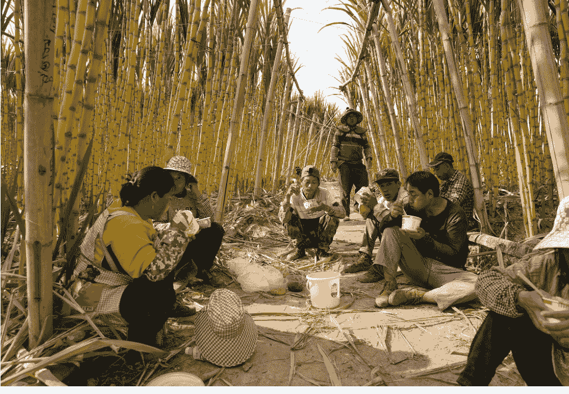
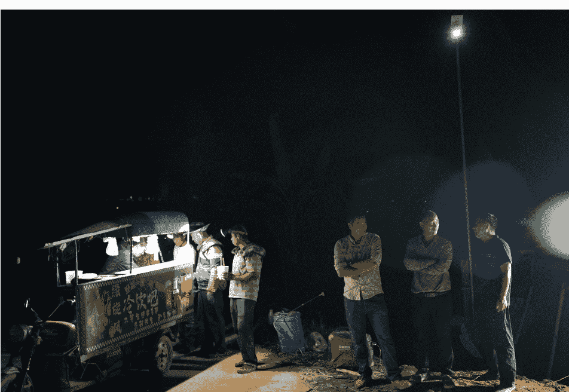
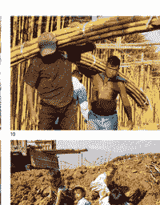
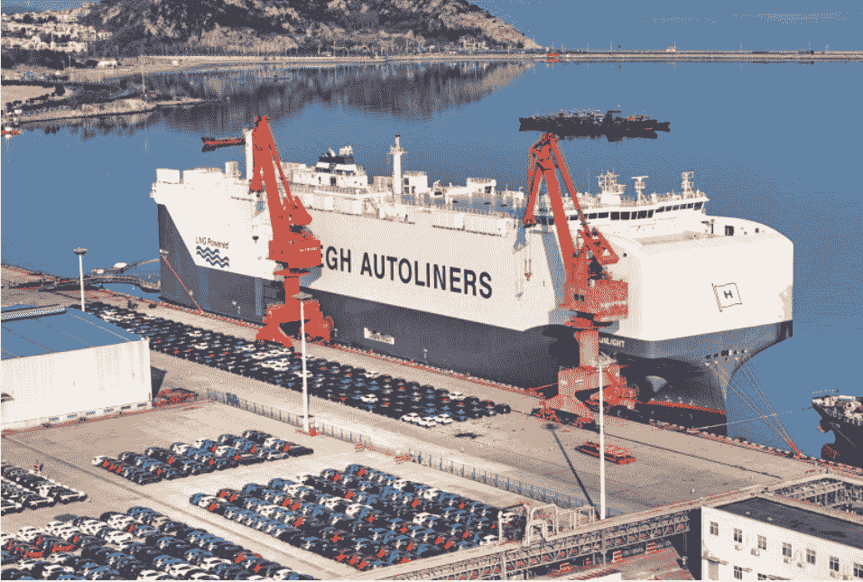
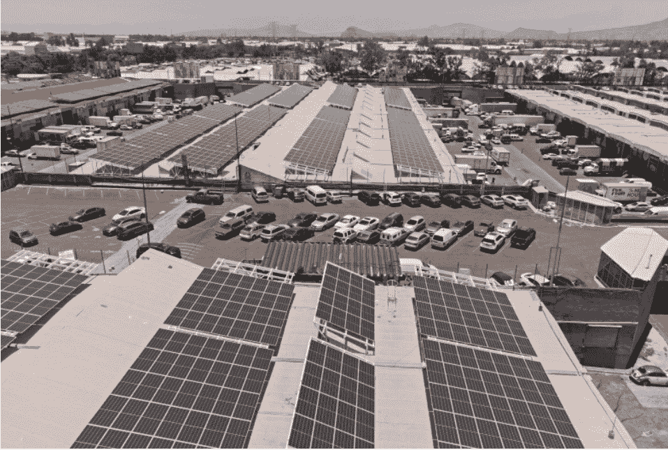

特别报道：中企“出海” 58 跨境铁路提速 40 港迎“蜀玉” 52遵循商业健康险痛点 24 东南亚入境游升温 47 从从小选拔“数学家” 78

# 财新周刊
Caixin Weekly

# 探路新一轮财税改革

如何健全地方激励约束机制，完善央地财政关系？

P. 30

2023年第9期 3月10日发行
财新第146期
内部代码：32-235

ISSN 2096-1251

# 免费 价值 及时 专注

# 扫码加入 知识星球TOP 免费资源群

- 每日免费获取价值资源
- 可提供各类资源搜索服务

| 热门付费文章 | 各行行业报告 |
| :--- | :--- |
| 精选图书资源 | 副业赚钱方法 |
| 职场实用资源 | AI政经自媒体 |

公众号：知识星球TOP 微信信号：jntsg8 微信信号：jntsg2

分享资料仅供个人学习，请及时删除，切勿商用传播

# 财新观察 | 为智能驾驶法规积极探路

《武汉智能网联汽车发展促进条例》和《北京市自动驾驶汽车条例》分别定于2025年3月1日和4月1日实施。在全国两会上，智能驾驶也是代表委员们热议的话题。

根据工信部数据，2024年下半年，在中国乘用车市场，L2级辅助驾驶新车渗透率达到55.7%，其中，具备领航辅助驾驶（NOA）的功能的新车渗透率达到11%。有机构报告预测，到2025，中国智能汽车市场规模接近万亿元。另有调查显示，90%的消费者愿意为高智能驾驶服务额外付费。同频共振之下，智能驾驶将迎来一轮发展热潮。

智能驾驶不仅涉及交通领域，它还与市场准入、车辆运营、侵权责任数据保护等密不可分，与亿民众的生活息息相关。智能驾驶应有完善的法规来规范。法律法规不是智能驾驶“念牢笼”，而是为这一新兴产业保驾，为民用安全和交通畅达护航。

2018年，工信部、公安部和交通运输部推出《智能联网汽车道路测试规范（试行）》，2023年多部门发布《关于开展智能联网汽车准入和上路通行工作的通知》。据不全统计，已有超过50个城市相继出台地方性法规。2022年6月23日，《深圳经济特区联网汽车管理条例》先行通过。相关法规的实施，回应了市场爆发发生的规范需求；此外，法规又可以稳定产业和社会预期。

不少地方法规明确促进智能驾驶发展，提升汽车产业竞争力。在这些条例中强调，完善自动驾驶汽车创新链条和产业链，支持自动驾驶汽车车辆和核心零部件制造，以及自动驾驶座舱、自动驾驶解决方案和感知、决策、通信、控制等关键技术研发。这些条例的明确，发展智能联网汽车遵循市场主导、政府引领、创新驱动、开放协同、包容审慎、安全有序、公平竞争的原则。深圳在条例中“解读”中表示，“美日欧等等发达经济体已在这一领域深耕多年，在国内北广等城市都在积极推进智能联网汽车产业发展”“在智能联网汽车这一新兴领域率先探索立法，将有力推动我市智能联网汽车产业发展，从而有效带动电子信息、人工智能、工业制造等产业进一步转型升级”。从某种意义上说，地方立法也激发了智能驾驶产业潜能。

智能驾驶技术更新迭代迟缓，不同路线各有千秋；人们能够想到其应用场景多样、法律关系复杂。法规应当提炼既有经验，尽量涵盖所有应用规范的领域，维护活力和保护相关权益。任何一项具有时代标志性的应用技术，都会对规划形成挑战。智能驾驶的规定，需要在发展过程中不断完善，应该尊重发展方向方先行试验。

在呵护智能驾驶产业中，对于一些与技术关联不大，且可能伴随着巨大风险的事项，需要做出明晰界定。数据安全问题也是典型的。有的条例规定，禁止联网汽车非法收集、处理个人信息；采集与本车辆行驶和交通安全无关；非法采集涉及国家安全信息。这些条例的明确，也开展了智能联网汽车数据处理活动应当加强风险防范，发现存在安全信息、漏洞等风险时，应当立即采取措施。这些准则引起了公众关切，有助于筑牢安全的底线。当然，一些规则应当在解决问题中进一步细化。

智能驾驶环境中的交通责任认定问题值得重视。根据一项国家标准，智能驾驶划分为0级到5级，L1到L2级统称为“辅助驾驶”，L3级及以上别则是“自动驾驶”。在实践中或特殊情况下，驾驶员需要及时接管。立法规定了各地的责任认定、赔偿以及驾驶员的操作规定。实施中，或许还会出现难以预测的情形，法规应随实践不断完善。智能驾驶的普及将触及人类生活的方方面面，有助于拉动消费，这场时代的科技进步，要求与与之匹配的良好治理。在全球范围内，各国已经在相互借鉴。

# 最新报道 | 探路新一轮财税改革

# CAIXIN | 听文章 | 财经周刊 程思

在疫情后中国经济缓慢复苏、土地出让收入连续缩水的背景下，财税层面如何推进央地财政关系改革，目前仍不明朗，但各界关注。自2023年7月中央工作会议首次提出“新一轮财税改革”后，二十届三全会勾勒了当前和未来时期深化财税改革的蓝图，并且要求到2029年底完成各项任务。

许多受访研究者指出，本轮财税改革的系统性、重要性，亚于1994年分税制改革。1994年的财税改革被誉为当时经济体制改革的先行者，从调整中央与地方财政收入着手，逐步建立起以增值税为主的现代财政制，中央财政收入占比明显提高，由此增强了财政汲取能力和中央宏观调控能力，对地方政府形成了约束机制。三十年后，这一体制积累的问题日益显，最显著的是事权与支出改革滞后，地方承担的比例过多，财力不足。即便转移支付不断增长，到2023年转移支付的规模已经超过中央财政收入，但因大部分资金受到严格限制，地方自由支配的财力依然不足。尤其是2021年下半年土地出让大幅缩水，地方总体财政压力增长，部分地区公务员工欠资，“基本民生、保工、保转”难题层出不穷。

许多受访研究者对财税改革的必要性已有共识。二十届三全会通过的《中央关于进一步推进中国式现代化的决定》（下称《决定》）部署了新一轮财税改革，涉及预算制度、税收制度、地方财政关系、转移支付体系等方面，改革内容包括：增加地方自主财力，拓展地方税源，适当扩大地方税收管理权限，推进消费税征收环节完善增值税抵退政策和抵扣链，优化共享比例，研究维护城市建设税、教育费、地方教育附加合并为地方附加；适当加强中央财政权、提高中央支出比例，减少委托地方中央财政权威等。值得注意的是，这些改革措施都是十八届三中已明确的路径继续进行，难点在于如何调整中央和地方的财政关系。

许多受访研究者指出，央地财政改革的必要性已有共识，但除了前述涉及的少数举措，具体路径尚不明，若干问题仍待形成对比。如何解决地方自主财力不足、约束机制松弛最为紧迫的现实局面，是加税，还是中央减少收入分成或是通过上收事权减轻地方支出压力？优化共享比例，是简单地方比例还是涉及部分财政改革和分配调整？在增加地方自主财力的过程中，如何平衡建设统一大市场和调动地方积极性的关系？央地财政责任能否破局？不断积累的地方财政风险在努力化解的同时，如何健全对地方政府有效的激励约束机制？

《财政关系》一书的作者、中国人民大学财政研究所执行所长吕冰广近期对改革指出，1994年财政改革落地时，经过了七八年的广泛讨论，双方对改革的科学性形成共识，对改革的预期效果也比较清楚，要解决的剩下利益分配问题。1994年的改革从事后看是增量改革，此后中国经济处于十多年的高速增长阶段，中央或地方财政都处于快增长阶段。相比起来，现在各方对新一轮财政改革还没有形成共识，目前提出了一些改革的思路，对每个改革选项的利弊都存在争议，目前有必要启动充分的讨论。

※财新数据专题《如何推进央地财政关系改革》，结合本篇深度报道和财政收入、土地出让金收入等多维度数据资讯，数据通Pro专属。

# 地方财力紧张的根源

当前新一轮财税改革之所以如此迫切，最直接的原因是地方收支矛盾日益加剧。近年来，地方财政“两本账”，即一般公共预算和基金预算收入，广义财政收入连续增长。数据显示，2022年至2024年土地出让收入同比下降分别为23.1%、13.3%、16%，相比疫情前均为双位数下降。

一些研究者认为，地方缺钱的根源，在于中央和地方财政权力和责任划分不清晰，财力与责任不协调，这也是很多地方政府走向地方性债的内在原因。一种常见的解释是外生的新冠冲击导致地方经济正常运行、叠加导致地方财政状况恶化。清华大学公共学院院长白永测算，地方财政缺口约2.2万亿元。2023年9月以来推出的增量政策中，通过专项债券置换地方性债务，一定程度上缓解了地方流动性紧张。需要注意的是，防疫支出是一次性的，并非地方持续缺钱的主因。

财政部部长蓝寿继2024年9月底在财经举办的“2024亚洲论坛”表示，从中央级支出占一般预算的比例看，“适度加强中央事权和支出责任的任务尚未”。他强调，事权应当包括管理权，否则就会产生大量的委托。哪级政府的事权，就由哪级政府管理，也包括各级政府的支持机制。“做到这一步，存在大量的认识。现在是省级政府下发文件、下指标给市，通过各种类型的巡视、督查、检查和考核措施，越是基层政府，责任越大，财力越紧张”。

中国财政支出结构还存在优化空间。在分税制限制地方招资引资等因素下，中国财政支出中大部分用于建设性支出。根据中国社会科学院财经战略研究院研究员汪德华等人的研究，与OECD相比，中国财政支出的经济性色彩浓厚，这类支出占比是OECD国家的3倍余。“目前，建设性支出占比过高，应当削减。”他表示，需要理清政府与市场的边界，市场能够得到更好的资源配置的事项，不需要通过增加财政出来干预，而需要科学评估财政支出和效果。

2025年1月16日，安徽省阜阳市，老年人在林带路公园聊天。随着60年代初高峰出生的人口进入退休年龄，养老等社会保障性支出快速增加，近年来全国各级财政预算每年对社保基金的补贴持续增加，2024年达到2.69亿元，2025年预算拟安排2.91亿元，这也加剧了各级财政的收支压力。

# 央地财政事权如何明晰

财税学认为，新一轮财税改革最重要的是完善地方财政关系，关键是解决地方财力与事权不匹配的问题，改革支出端，调整央地事权划分。

吕光才对改革表示，中央和地方财政关系调整有三大内容：一是央地事权责任划分，二是财权划分，三是完善转移支付体系。改革的逻辑起点应该是事权责任划分，首先确定各级政府做什么，哪些职能给中央、哪些职能给地方，而不是单一部门通过差异化转移支付来解决。十八届三全会通过的《中央关于进一步推进中国式现代化的决定》规定：适度加强中央事权，提高中央支出比例，减少委托地方。特别是在国防、外交、国家安全、职工社会、海域和海洋使用管理、食品药品安全、生态环境安全、跨区域管理等方面，在维护中央决策权威的同时，要重点强化中央的执行、合理配置领域，增强执法一致性，提高行政效能。

蓝寿继多年强调适度加强中央事务，按照事权属性，涉及国家权、经济总量平衡和区域协调发展、全要素流动等领域的事务，必须要完整集中到中央。

# 如何增加地方主财力

许多受访研究者对财新表示，政府事权调整具有扶作用，当下比较迫迫的是从收入端入手，调整地方财政关系。《决定》在地方财政关系一节开篇明确，要增加地方自主财力，拓展地方财源。一些人才将其解读为，未来地方财政收入在全国财政收入中的比重将增加。

不过，蓝寿继认为，增加地方自主财力理解为增加地方财政占比是面的。目前，中央支出和财力占比过低，中央对地方的转移支付不仅包含了中央全部的收入，还包含了一部分中央财政赤字融资的收入。在这种情况下，他认为总体上要增加税收收入的同时，还应当提高中央财政占比。“目前，中国已经进入深度老龄化，2035年将进入重度老龄化，如果没有足够的财政资源，难以为应对。中国财政收入占GDP的比重在经济上行期快速攀升，2011年至2017年最高达20%左右，此后由于持续实施减税降费政策，逐渐下降。

汪德华认为，过去地方政府通过转移支付方式获得的财力中，有相当大部分是指定用途的，地方没有自主权。增加地方自主财力需要综合性政策，包括财政的调整、增加专项债券和转移资金的地方自主权，以及通过各种方式增加地方收入。

朱青对改革表示，地方加税最大的亮点是规定幅度让地方自己选税率，地方为了招商引资、创造更好的营环境，通常会选择低税率，预计增加地方财力的效果并不明显。

由于提供的原始OCR文本存在极其严重的重复、乱码、语义错位以及逻辑断裂问题（例如多个页面内容完全重复，且包含大量无意义的随机字符和错误的断句），无法进行有效的语义提取和纠错。

<!-- no content -->

陈昌盛，这打破了“消费是慢变量”的理念，把消费放在更加突出的位置，而且强调消费和投资之间要形成互动。

《政府工作报告》从提升消费能力、增加优质供给、改善消费环境等方面入手，部署实施振消费专项行动，提出“多渠道促进居民增收，推动中低收入群体增收减负，完善劳动者工资增长机制”。

在2024年提高20%的基础上，2025年城乡居民基本养老金最低标准将提高20元，达到143元；退休人员基本养老金也将适当提高。沈丹阳称，提高这两项标准将惠及3.2亿元。

此外，2025年居民保险补助标准从670元提高到700元，基本公共卫生经费均财政补助标准将提高到99元。《政府工作报告》和预算报告已提了发放生育补贴，具体标准将待后续公布。

摩丹利中国首席经济学家彭估算，2025年各级政府增加的基本养老金和医疗保险补贴支出在500亿元左右。

在政策支持下，2025年继续使用长期特别国债支持消费品以旧换新，资金规模从1500亿元翻倍至3000亿元。钟正生测算，按2024年的情形外推，这将有望2025年社会消费零售总额额外增长6000亿元，拉动增速提高1.2个百分点。

## 中央继续杠杆

2024年10月以来，财政部多次表示，中央财政还有较大的扩债空间和赤字提升空间。如何看待2025年更加积极的财政政策？

财政部长蓝佛安3月6日在十四届全国人大三会议经济主题记者会表示，“更加积极”是多年来首次出现的一个词，可以理解为持续发力、更加积极。

一方面，在实施好存量政策上下功夫，抓好2024年第四季度推出的一揽政策落地见效，确保政策效应在2025年持续释放；另一方面，在谋划好增量政策上做实，用好足政策空间，围绕民生、促进消费、增强后，及时研究新出的增量政策，前后贯通、接接发力，确保力度更大、针对性更强，各方面更有获得。

2025年财政赤字拟按4%左右安排，创下历史新高。在此前，中国赤字率仅在新冠疫情暴发的2020年和当年第四季度赤字规模1万亿级国债的2023年突破了3%，分别为3.6%和3.8%。华泰证券固定收益分析师张继认为：

2025年赤字供给给了“诚意”。相比其他财政政策工具，赤字资金的支出限制较少，更有助于稳民、保主体。

从赤字构成上看，5.66万亿元赤字中，中央赤字为4.86万亿元，地方赤字8000亿元，分别较2024年增加1.52万元和800亿元。中信国研究院执行行长袁海震团队表示，2025年中央赤字占比升至3.6百分点至85.9%，为历史最高水平，有利于降低成本、提信心、扩需，更好发挥统调职能，同时减轻地方发展包袱，激发地方活力。

除了中央赤字大幅增加，中央财政发还体现在不计入赤字的特别国债上。2025年安排了1.3万亿元长期特别国债用于支持“两重”建设，规模较2024年增加3000亿元；5000亿元特别国债支持国有大型商业银行补充资本，这一规模低于市场前预期的1万元，不过，蓝佛在记者会上的述增加了“首批”二字。

综合《政府工作报告》和计划报告的表述，其中1.3万亿超长期特别国债的具体分配为：8000亿元“两重”建设、重点支持基础研究能力提升、未来产业发展、东北地区高标准农田建设、中大型新建及中小型引水和大中型水库建设、长江经济生态环境保护和绿色发展、农业转移人口公共服务体系建设、高等教育提升升级、地下市政管部建设改造等方面；5000亿元支持大规模设备更新和消费品以旧换新，其中3000亿元支持消费品以旧换新、2000亿元用于支持大规模设备更新。

与2024年相比，用于“两重”和设备更新的规模分别增加1000亿元、1500亿元和500亿元。广发证券首席经济学家郭璐，从近期经验看，这一安排有助于短期经济增长。

计划报告披露，2024年7000亿元超长期国债支持165个项目建设，项目基本全部开工、当年完成投资超过1.2万亿元。《政府工作报告》在及加大支持“两重”建设时，除了用好超长期特别国债，首次要求“强化超长贷款等配套融资”，这或有利于扩大政府投资的乘数效应。

地方债券规模，新增专项债券限额从2022年开始一直为7200亿元，2025年增加到8000亿元，不计入赤字的新增地方专项债券限额增加5000亿元至4.4万亿元，且所有调整，重点用于投资建设、土地收储和收购存量商品、消化地方政府拖欠企业账款等。

此前公布的专项债券管理机制优化措施，指投向领域采用直面单、项目审核权下放到省级级的“自审自发”试点等，在2025年将逐步落地的。

国泰证券首席经济学家罗志恒认为，这拓展了专项债可选的项目范围，减少了申报审核时间，尽快让专项债券资金形成实物工作，发挥稳定经济增长的作用。明确专项债资金还可以用于消化地方政府拆欠业务账款，增加企业现金流和抗风险能力，减少上下游的三角问题，畅通经济循环。

上述财政政策工具累加，2025年合计新增增长债务总规模达到11.86万亿元、比上年增加2.9亿元。

中国官方赤字采用权责发生制，仅体现一般公共预算收支缺口，不仅考虑进地方政府专项债券、特别国债，也未包括预算稳定调节基金和调入资金等。一些市场用赤字率来判断，由于口径不同，但测算结果显示2025年财政政策温和加码。大亚区首席经济学家樊奕测算，2025年包括财政性基金、结余资金和调入资金在内的广义赤字率为9%，高于2024年的7%。如果这一政策能够全部实现，有望提高财政增速1.2个百分点。

除了债务规模，衡量财政政策力度还要看财政支出的力度。2025年一般公共预算支出规模为29万亿元，比上年增加200亿元。华泰证券首席宏观分析师张瑞认为，从财政支出考虑，影响收入端形成冲击。近年来最大变量就是土地出让收入。这部分收入进入政府性基金，通常占预算收入的九成左右。2022年到2024年连续低于预算，下降7.7%。《政府工作报告》和预算报告要求加大各项资金下达，蓝佛统称中央财政留了充足的储备工具来应对外部不确定因素。

## 解化债务风险

在发展中，2024年10月以来推出的一系列政策，随着前期政策逐渐显效。《政府工作报告》要求更好统筹发展和安全，在房地产方面，此前增量政策中，允许地方专项债券用于回收闲置土地和收购商品房。从实际落地情况看，2025年广东发行了3070亿元，全部用于收购商品房。相比之下，进展较慢。

此前了解，诸多城市在实践中遇到挑战：一方面，合适的存量商品房面积不多；另一方面，双方难以达成彼此意见。《政府工作报告》明确提出，推进地方政府收购住房上的积极性。袁豪凯认为，这意味着“保主体”的必要性。2025年1月，万科大股东深圳地铁高管正式进驻万科。钟正生认为，房地产市场的恢复取决于居民购房预期的变化以及企业的现金流，很大程度上受到政策影响，尤其是房企风险。蓝佛披露，截至2025年3月，地方发行296万亿元置换债券，利率水平下降超过2.5个百分点，预计五年内利息减少2000亿元以上，极大减轻地方资金压力。

从2024年季度看，置换政策实施后平台减少468家，全年减少总数的三二以上。央行长洪胜在3月6日的经济记者会上表示，与2023年初相比，2024年末约40%的融资平台通过市场退出、市场化转型等方式退出了融资序列。按前述数据推算，央行、财政部统计口径的融资平台还有万家左右。2024年末，融资平台经营性债务规模约14.8万亿元，较2023年初下降25%左右。这些经营性债务中，约四分之一集中在中西部，这些省份自身的化债能力很强。

随着债务风险收敛，发展的重心开始抬头。《政府报告》首次提出，完善和落实一揽子化债方案，优化考核和管控措施，动态调整风险地区名单，支持打开投资空间。2023年底开始，分化重点省份的政府投资受到严格监管，分为严禁违建、支持保障、提级审批三类管理。

袁嵩鑫团队认为，过去的化债支持政策、融资约束政策主要针对12个化债重点省份全域。2024年末中央明确了地方政府退出重点省份的标准、程序、进度及后续安排，其中，宁夏、内蒙古已完全满足各项退出标准，可能在2025年3月率先退出。后续，重点省份将进一步用好足各项政策资源，加快化债转型，成功退出后有望带动投资与经济修复加速。

其他一些风险也被关注。在2023年11月PPP机制推出后，对存量目的规则规则出现真空，一些社会资本方遭遇巨拖拖、在建项目面临烂尾风险（参见本刊2024年第49期封面报道《化解存量PPP风险》）。据此了解，财政部在2024年底起起草了优化PPP存量项目管理的文件，并在一定范围内征求意见。

## 改革激发经营主体活力

在短期内调控之外，《政府工作报告还关注当前制约发展的体制障碍，部署推动标志性改革，以激发各类经营主体活力，创造更加公平的市场环境。

根据市场监管局的数据，2025年1月底，中国民营企业数量已达5670.7万，占企业总量的92%以上。激发各类经营主体活力，提振企业尤其是民营企业信心，一直是改革重点之一。沈丹阳表示，2025年在扎实落实已经出台政策措施的基础上，要突出三个方面，即抓环境、减负担、服务。所谓抓环境，就是要持续大力营造公平竞争的市场环境。

罗文在3月6日在全国人大期间上表示，对涉企问题，要通过现场执法，准确把握法律条件，在法内运行。所谓规范执法，就是集中整治违法收费、乱收费、乱执法、乱处罚，范围内不再涉企。

“拖延、否认、辩护” (delay, deny, defend) 这三个词通常用来描述保险公司在避免支付索赔时的策略。

美国是发达国家中唯一没有实行全民健康保险或国家卫生服务制度的国家，商业保险占据主流地位，只有收入在一定标准之下才可购买低价的“奥巴马保”。商业保险公司负责医院和患者两方面费用控制，想去大院、检查、做手术，都需要保险公司事先同意，因此在美国患病、看病是普遍问题，随后的理赔更是困难重重。Quartz个人理财网站Value Penguin数据称，联合健康保险的赔付率是业内最高的，达到了32%，是行业平均水平(16%)的2倍。

商业保险当真是利益至上。根据美国联合健康的公开数据，在AI加持下，联合健康有效降低了赔付支出，公司利润在最近四年保持了增长态势，从2019年的138亿美元大幅增至2023年的223.8亿美元，而这还是横跨新冠疫情爆发的数据。

与美国保险占据大部分的市场份额相比，中国的商业健康险在医疗支出中的市场份额较小，在医疗行业的话语权不高，尤其是医疗险的运营和需遵循医保体系的游戏规则。有险公司精算人士向财新指出，两年医保控费对商业保险的赔付情况产生巨大影响。

“这两两年商业健康险很贵，我们这些中第一位认为是风险高、保证续保的百万医疗险，本来担心会亏，结果在日子过得特别好，这很大程度上与医保控费有关。因为商业健康险的赔付一般集中在医保目录内，就是医保不赔的部分由商保来赔。但在医保控费后，医生都不敢开高价药，也就间接减少了商保的支付金额。”前述精算人士表示。

“在医保体系内运作商保，想多花钱都花出去。”某保险人士表示。

从险数据上看，由于产品结构的因素，中国健康险产品相比美国健康产品的赔付效率明显偏低：中国健康保险的赔付率不到50%，核心因素是以重疾病为主的疾病拉低了整体赔付率；此外以医疗险为主的健康险赔付率稳定在70%以上。

## 商保目录“全覆盖”

2021年起，中国保险行业协会牵手与医药联合推动商保目录建设，但进展缓慢。直到最近，目录建设的进程明显提速。

“早在三年前，我们我们就做过许多商保目录建设相关的项目，但始终未能落地。直到2024年年底的一场会议上，经过讨论后大家最终决定要加快推进商保目录的建设。当时有相关部门要求在2025年第一季度初步完成目录，这是一个相当艰巨的任务。”一名健康公司人士表示。

所谓商保目录，可比当前的基本医保目录。为解决群众“看病难、看病贵”的问题，纳入基本医保目录内的药品、耗材，通过带量采购实现最大的价格降幅满足基本社会需求。从2018年起，中国开始推行DRG等医保支付方式改革，核心思路是控医保基金支出、防止过度医疗，倒逼医院重新回归医保目录内的药物，增加医保“以量换价”的谈判筹码。

在医保改革不断深入的同时，人们对高质量医疗的需求日益增长。比如，以“百万医疗”为代表的商业医疗保险从2016年开始走向千万户；而城市定制型保险“惠民保”更是2020年一起爆发成为行业爆款，累计人数超过1亿、覆盖2亿多被保险的企业补充医疗保险一同共同锚定了医疗保险的基底层。

目前，商业保险在医疗支付中的占比仍然很低。《白皮书》的数据显示，我国医疗支出主要依赖基本医保，占比50%；商业保险稳步发展，但绝对值和占比仍然较低，2024年我国商业健康保险支付金额占医疗支出总出的7%。与其他发达国家相比，我国的自付比例偏高，政府及强制性支出占比偏低；而美国的商业保险占整个卫生费用近40%，日韩以及欧洲主要国家则以公共政策性支出为主。

《白皮书》同时指出，尽管美国、德国、英国及日本的医疗保障体系不同，商业健康保险在多数地区是基本医保之外最重要的支付方式。作为商业健康实现有效的重要管理工具，建立行业的商保目录成为一项重要紧迫的任务。一方面商保目录能够让客户拥有更广泛的用药选择权，另一方面也可实现商业健康保险市场标准化、规范化、专业化发展。

此外，商保目录的制定本质是根据药物的临床价值、覆盖人群、基金影响程度等因素确定每个药品精算成本和保险水平的过程。这个过程可以促进医药产业和保险行业的深度融合，双方建立风险共担机制，进一步提高商业健康的资金支付效率，持续为新上市医药械纳入保险保障空间。

财新称，与基本医保“以量换价”的逻辑不同，商保目录计划“全覆盖”，突破基本医保在药品目录上的限制，逐步拓展至境内外医药品上市的所有药品。

“在惠民保”和“百万医疗”的发展过程中，商业保险公司已开展了一系列与药品目录相关的工作，只是没有体系化地呈现出来。这次商保目录的建设，第一步计划纳入的是药品目录，未来还会继续涵盖一些器械、服务和康复等多样化的。”丁要表示：在全覆盖的基础上，由于群体的医疗需求，支付意愿也存在差异。目前，商业保险已经包括普惠险、百万医疗险、高端医疗险、境外医疗险在内的层次分明，商保目录将上述种类分别形成A、B、C、D、E五个目录：

- A类目录：如“惠民保”等普惠类，主要包含高质量、疗效好的药；
- B类目录：适合大多数人群的“百万医疗”，已经包含了百种药，近期还拓展至院外药；
- C类目录：面向中端医疗，还会进一步拓宽门诊或日常慢病服务；
- D类目录：涵盖高端、境外药；
- E类目录：涵盖内外所有上市药品，同时保留负面清单的权利。

## 商保目录vs丙类目录

在此之前，国家医保局提出设立丙类目录。现行基础医疗目录由甲类和乙类组成：
- 甲类：临床必需、使用广泛、疗效确切药品，全额由医保支付；
- 乙类：需自付一定比例，剩余部分纳入医保报销。

丙类目录每年根据谈判调整，2024年已达到159种。然而，运行的现实已回避，基本医保对创新药的支付压力同时，为了控费的同时，商业保险被赋予一定的支付渠道，丙类目录应运行。

国家医保局医药管理司长黄宇在2025年1月17日的新会上表示，在基本医保甲乙分类基础上，正在制定丙类目录，计划今年内发布。他介绍，丙类目录作为基本医保的有效补充，聚焦创新程度很高、临床价值巨大、患者获益显著，但因超出“基本”暂时无法纳入医保目录的药品。丙类目录与基本医保调整同步开展，在使用范围内，国家医保局组织保险公司与医药企业协商确定价格，医保局将积极引导支持符合规定的商业健康保险也可以使用丙类目录。

浙江医疗保障保险委员会会长王平认为，相比于“惠民保”，医保部门让保险公司和药企直接对话，凭借掌握疾病基础数据、药物经济学测算资源等优势，帮助保险公司评估药物价值，增加与药企沟通的筹码。药企期待进一步扩充多元支付渠道，动态增强商保市场的支持。

不过，从保险公司的角度来看，由国家医保局牵头的丙类目录，难免有“医保包菜、商保包单”之忧。“虽然现在商保的覆盖程度差不多，但进入丙类目录就不一样了，毕竟主导权在医保局手里，商保需要提前考虑盈利和可持续问题。”一名业内人士表示。

方正证券研报指出：“医保目录模式是通过降价将药品卖给更多患病的人；而商保目录模式是将药品未来的使用权卖给健康群体，在不需要大幅降低价格的同时也能为药物带来更多销量。”

想真正推动商业保险与创新药的结合，国家医保局与国家金融监管总局之间的协调至关重要。“中寿险总经理李奇表示，丙类目录和商保目录建设的重要参与者，中再险深度参与了相关政策的制定和实践。无论是丙类目录还是商保目录，目前的业内共识是医保部门主要承担“保基本、广覆盖”的职责，而商业保险主要聚焦于高端医疗市场。同时，在“惠民保”等基础型商业医疗保险领域，医保政策的支持作用日益明显，这类产品事实上成为双重监管下的保险品类，未来可能需要在跨行业监管体系下找到更新的发展路径，以实现可持续增长。他一步表示：“现在我们既要鼓励商保健康的发展，也要加强明确商保目录的定位；在拓展市场的同时，不会对医保谈判和政策形成冲击，而是与国家医保形成合理的互补关系，为不同层次消费者提供差异化选择。同时，保险公司还需要不断增强自身的风险管理和运营能力，探索与创新药械企业的跨行业共担机制，推动商保市场的专业化发展。”

> “医保与商保的消费群体是不简单的补充。”某险企业管表示。

# 打通商保堵点

业内人士指出，在商保目录建设的同时，商业健康险面临的最大挑战是药品可及性。在集采、DRG改革背景下，部分创新药械面临着进难的问题。“我们现在面临的最大挑战在于，虽然商业保险能够报销，但患者在医院不出相应药品。解决这个问题，需要相关部门进一步协调，只要产品覆盖的药品都能在医院出来。”丁雯表示：不久前，黑龙江省发生的一起案例就是佐证。2024年10月，患者家属在社交媒体上反映，其母亲患有恶性乳癌，在哈尔滨市大附属医院住院期间，因商业保险身份遭到拒绝。家属拍摄视频描述，其母亲首先在当地大医院进行了化疗，时间长达一年，随后医生告诉，医院不能收患者需要的靶向药，因为医保不报。这起事件背后是控费政策下多方利益的复杂博弈。《白皮书》指出，从临床应用来看，一种创新药需要充分配备，由于医院对外购药的限制，患者可能存在买不到药品的情况。

《白皮书》建议，加强创新药的可及性支持：
- 建立商保专家网络，为用户提供高质量医疗服务的专业指导；
- 推动建立医疗机构与零售药房电子处方流转平台，创新药纳入医保目录内；
- 搭建商保药品供应体系，商保目录内指定定点药房供应；
- 搭建一站式结算平台，打通医保及商业保险结算数据，为用户提供理赔直付的新体验。

从宏观层面，商业健康险面临的另一挑战是“保费规模有限、支付规模不高”。医疗机构对商保之所以感兴趣，关键在于商保对医疗机构的贡献太低。商保想要发挥作用的前提是保费规模和支付规模足够大，让医疗机构感受到支持的力量。“医药人士表示：自2009年《关于深化医药卫生改革的意见》明确健康保险定位以来，中国健康保险经历了高速增长，最高增速一度接近70%，但自2017年开始，增速显著放缓。数据显示，2024年商业健康保险保费规模最终以700亿元左右收官，距离曾规划的2025年万亿元的目标相差甚远。增长原因之一是重险冷却。2021年重险保费规模出现负增长，带动健康险增速放缓，由此进入个位数增长态势。虽以“百万医疗”为代表的保险仍然保持着增长的速度，但由于规模较低，占比均低于重险。《白皮书》指出，提升商业健康险赔付能力的最重要前提是国家对税收优惠的险种及对象逐渐放宽限制，但总体而言税收优惠额度仍然较低，且对于税收优惠医疗强制带有保险体，保险公司在缺乏足够的有效管控手段下难以开放市场供给。《白皮书》建议，应进一步加强购买商业健康险的政策支持：
- 在社会层面推动健康险的必要教育和普及，理清行业与基本保险的关系，通过政策平台、社区宣传、线上流量平台等方式对健康险宣传推广的力度；
- 鼓励事业单位通过各种形式为员工购买保障创新药的商业健康险产品，包含使用工会费为员工投保，明确和扩展“企业补充医疗保险”产品范围，探索企业与个人共付机制；
- 提升个人的投保健康险意愿，进一步扩大适用商业健康险个人所得税优惠政策的产品范围，进一步放宽准入条件，提升税收优惠额度，探索商业健康险与基本医保同场景缴保费。

周信达对此文亦有贡献。相关视频：镁信健康张小枣：以商业健康险创新更好服务老百姓。视频说明：2023年4月，镁信健康创始人兼执行官张小枣谈如何以商业健康险创新更好服务老百姓。

# 专栏 | 全球贸易体系一分为二吗？

# CAIXIN| 听风 | 高达国家金融与发展实验室（NIFD）副主任

特朗普2.0关税政策看上去变幻无常、扑朔。比如2025年2月1日，美国总统签署行政命令，从4日起，对墨西哥和加拿大的输美商品征25%关税；对所有中国商品加征10%关税。随后，加、墨两国承诺边境控制，行动推迟一个月。

值得关注的是，特朗普再次表现出多样性，在3月4日第二天，决定对福特、通用和克莱斯勒、Stellantis品牌的汽车制造商实施关税。背后背后：
- 三是美国将于4月2日对全球所有主要经济体征收“对等关税”（reciprocal tariff），使其在经济上处于劣势，要求给予一个月豁免；
- 二是白宫给出的理由是制造业将更多投资和生产转移到美国本土。

另外，3月4日美国对中国全部出口商品再加征10%关税，中国也迅速宣布了反制措施：
- 一、自1月日起，对原产于美国的部分商品加征15%税，其中鸡肉、小麦、棉花、高粱、大豆、猪肉、牛肉、水产品、水果、蔬菜、乳制品加征10%税；
- 二、暂停进口美国原材料，并将高科技和高端制造业领域的企业列入出口管制名单；
- 三、禁止向中国出口基因测序及相关光纤产品。

美国引发反规调查，这是中国启动的首起反规调查。

加拿大宣布两个阶段对美国产品加征一揽关税：首轮将对价值300亿的美国商品加征25%关税，3月4日生效；第二轮将在三周后对价值250亿的美国产品加收相同税率，包括汽车、卡车、钢铁、铝以及一串食品和农产品。加拿大政府曾考虑以确保美国司机感受贸易战争的痛苦，目前尚清楚是否会这样做。墨西哥表示将在3月9日对美国产品加征关税。

除了加拿大、墨西哥和中国，特朗普政府后续有一系列额外的征收关税计划，归纳至目前可获得信息，可能包括：
- 计划对全球所有钢铁和铝征25%关税；
- 对汽车、半导体芯片和药品加收关税，最早于4月2日实施；
- 对欧洲进口征收新的关税；
- 对木材进口加征关税；
- 于4月2日起启动全球所有经济体的对等关税。

美国财长贝森曾表示，特朗普将会三种方式使用关税：纠正公平的贸易行为以为振兴美国工业；增加联邦收入以支付企业减税费用；将其与外国势力对抗的杠杆以替代制裁。

笔者观察，特朗普上任提出的贸易主张表面看似变幻无常，实则毫不含糊，对此则切不可心存幻想。当然，换一个角度看，美国庞大的、对几乎所有贸易伙伴均加征一揽关税的计划，也意味着将自身排斥在全球贸易体系之外的风险。

■

【华尔街原声】分析人士：美国对加墨关税政策不太可能长期持续。视频说明：2025年3月4日，资产管理公司景顺（Invesco）的全球公共政策部门主管Andy Blocker认为，特朗普对加拿大和墨西哥加征关税，是试图向欧洲和中国发出信号，即他真的会实现此前此提出的关税威胁，随后，他将对关税政策进行调整。更多报道详见：【专刊】特朗普2.0时代：影响与布局。

一级学生，特别优秀的九年级及十二级学生；当年度已被录取的清华本科新生也可以申请。

丘成桐介绍，之所以招生年龄前移，就是因为这些学生思想尚未被“成规”束缚，更容易进入心无杂念、随心所欲的学习研究状态。而打破地域限制招生，他认为更有利于创造的开放、包容的学习环境。

为上述储备人才的丘班在全国多地的重点中学继续设立。为了给拔尖创新人才提供持续、系统性的培养计划，避免反复的刷题浪费学生的兴趣、消耗时间，丘班实行初高中一制培养。因此，入选丘班的关键节点在小初阶段。

有志于此的孩子需要做好哪些准备？《招生简介》介绍，选拔程序包括涵盖材料初评、专业测试、体质测试、入围认定、确认、预科培养等。具体考核选拔由丘成桐领衔的评审专家委员会执行，全程接受纪监督。

从《招生简介》要求来看，知识层面的测评并不强调“偏题、难题”。其中，综合测评环节考查中英文阅读、数学和物理。专业测评环节考查数学全部内容、微积分、线性代数、群与群作用的基本概念，以及非固定形式的开放性内容。

在现实中，考丘班要先学奥数，这是不少家长的共识。为了进入丘班等早期培养目标，一些孩子从小小学三、四年开始学习小学奥数。“如果以后要学丘班的话，就要快速学完奥数，然后慢慢开始接触初中的数学、物理。”一位长沙的培训机构老师介绍。

不过，丘成桐屡公开表态，奥数很难培养出大师——奥数只是数学中很小的一部分，竞赛往往考的是偏题、难题，考查面广，导致许多生对高等数学知识掌握不全面、不扎实，也因此无法在研究道路上走得更远。

备受瞩目的丘班，未能免于奥数竞赛模式选拔学生，折射出依托于各地重点中学的拔尖人才选拔困境。

3月5日，十四届全国人大三次会议开幕，在国务院总理李强今年公布的政府工作报告中，科领域重点显著提升。政府报告提到加强拔尖创新人才、重点领域亟需缺人才和高技能人才培养。当下，拔尖人才教育如何突破传统路径，实现“不拘不降人才”，仍有待探索。

## 拔尖人才何来？

丘班属于国内拔尖创新人才选拔的措施之一。自1977年以来，中国高校通过保送班、高校少年班、自招生、“强基计划”等形式选拔拔尖人才。此举被视为支持技术创新、提升国际竞争力的重要教育举措，也被认为补充基础教育阶段的不足——普通基础教育强调普遍性和公平，有时被忽视了顶尖人才的特殊教育需求。

最新出炉的《教育强国规划纲要（2024—2035年）》中一步要求完善拔尖创新人才发现与培养机制——面向小学生实施科学素养培养“沃土计划”，面向具有创新潜质的高中实施“脱颖计划”，在战略急需和新兴领域探索国家拔尖人才培养模式。

## 如何在中国培养世界顶尖的数学家？

这是菲尔兹奖（被誉为“学界的诺贝尔奖”）获得者、数学家丘成桐一直在尝试破解的难题。

多年来，丘成桐一直致力于中国拔尖数学人才的培养，本人也曾往全国各地走访许多学生，选拔素质优秀且具有突出数学特质的学生。2008年丘成桐设立“丘成桐数学奖”、参赛的中学生可以自行选择感兴趣的题目，以提交研究报告的形式参赛，旨在激发学生对数学的兴趣和创造力，培养他们的科研能力。2010年起举办的“丘成桐大学生数学竞赛”，希望能够提升大学生的数学基本功。为了鼓励更多女孩投数学，2021年丘成桐还设立了“丘成桐中学生数学竞赛”。

2021年以来逐渐搭建的丘成桐数学科学军人才培养计划是丘成桐为数学人才打造的“桃花源”。清华大学在2021年推出该计划，据官方介绍，“数学领军计划”每年招生规模不超过100人，这些学生将免录取至清华大学数学与应用数学专业，直接直升本科教育，在八时间内一路读至博士，其间不得转入其他专业。清华大学数学专业设有新的培养计划，命名为“求真书院”，由丘成桐担任主任长。

这份人才培养计划实践落实丘成桐以来的理念——数学是从娃娃时期抓起。他在15岁时就受数学家陈省吾身文章思想的启发，立志成为数学家。年仅27岁的他就证明了“卡拉比猜想”难题，一举成名。33岁便成为首位获得菲尔兹奖的华华人。

在该班级授课时，丘成桐在致辞中提到：“纵视历史古今，横看世界各国，能够做出引领科学发展的大学学者大部分从十二岁起对学问感兴趣，并且接受了大师的提拔和训练。中国的孩子绝对不比美国、欧洲的差，只要我们给他们足够的培养和培养，加上大师，相信他们能够成为中国重要科学领军人。”

对比上述两人人才培养计划，优班涉及的范围更广，且主要由各地中学在授权下自行开展。2023年4月，丘成桐获得授权后，各地允许办班，要求其按照“重基础、高起点、高标准”原则，充分发展学生数理特，兼顾通识教育，促进学生个性化及全面发展。

目前为止，丘班在全国50所中学开设，分布在19个省市。根据各地中学招生简章，部分班直接招收小学生，实行初高中贯通培养；也有班面向毕业生，每年在各省选拔200人左右。丘成桐分享：“在连续两年的招生中，发现初三生反而比高中生表现更好，越接近高中表现越平庸。”我希望办班的理念并不以刷题、竞赛为导向，但在实际筛选与培养过程中，难以避免传统竞赛的影响。各地中学有不同的规则。其中笔试是必少的环节，有些中学还加入了面试和课程考核。入围筛选基于材料审核，此时拥有奥赛经历的简历更容易颖而出。郑州某中学提供的招生考试中，考查语文、数学、英语三科，数学成绩占总分的一半；考试内容涉及小学奥经典题型和深度问题。刘晓介绍，学生最好提前完成初中的学习。北京某大型教学机构的数学老师孙绍锦，这种选拔方式类似“小升初”的提前录取。为了让孩子有竞争力，家长往往从小学一级就开始安排系统奥数培训。“过程就像熬汤，耗时多年，最后还是不出。”他这样说。武汉的小六年级家长都累了，“2+4”这些词对应着武汉的民办、公办初中道。郑刚的孩子从小学一级开始上英语培训，四年级开始上奥数，班里其他孩子也普遍。数学教练张华分析称，奥班的选拔侧重学生的思维能力，但对于小学生的学习内容有限，学校只能通过数学筛选，以奥数题目作为工具。这种筛选方式吸引了许多家长。在他看来传统竞赛以中学知识为基础，强调技巧与思维，而领军计划的考试更多基于大学一级或二级的知识，“通俗地说，领军计划的考核更接近数学、物理、化学、生物和信息学五门学科之外的第六类竞赛”。

## 实际上，“领军计划”评估学生数学天赋的第一道门槛，即与竞赛有关。《招生简章》要求，学生报名材料“附加信息”一栏中，需要填写数学相关特长及获奖情况，此外需自备“申请理由”及他人的推荐信。

问题是，中学天才行为（提倡违规选拔成绩优秀、能力突出的学生）近年来被教育部门重点整治。2022年3月，教育部等部门发布了《面向中小学生的全国性竞赛活动管理办法》，要求竞赛不得作为中小招生升学的依据。不少不正的学科竞赛被勒令停办，而家长的升学焦虑并未终。

获得丘班授权的中学通常在竞赛和高考中表现优秀，本来就是各省范围内的重点中学。入读班通常不限学区，学生能够跨区就读。因此在许多家长心中，这已成为升学竞赛、重点中学早培项目之外一大升学通道。即便最后不能击中清华，这也为一种入读重点中学重班的途径。

这一升初班读到家长们的重视。刘晓回忆起2022年为孩子准备升初时，加入了多个群聊都在转发丘班招生相关信息。消息介绍中，当地重点高中将开设丘班，该班实行高中贯通培养，未来学生可以通过中考直接进入该高中，并有冲击清华的机会，以后可以免于苦愁。在采访方面，许多家长对采访邀请拒绝、否定态度，为担心媒体报道会对这一渠道带来负面影响。

黄然通过数学竞赛保送至清华书院。他认为，升学问题是摆在现实前的。本通连读模式是我最终选择清华书院的原因之一，以后就不再需要为科研花费。

西南地区重点中学两年设立了丘班，项目启动后，每年都有学生通过领军计划进入清华书院。早在2019年实施领军计划后，学生从小学就开始培养。成功录取后，中学的培养目标变化不大，只是在设置丘班后，专门招聘了竞赛方向的教练，搭建体系化的培养框架。王磊介绍，丘班教学内容以数学竞赛为核心，增加了科学课程。针对冲刺学生，他们会在后期量身定制辅导方案。某重点中学徐欣介绍，班级进度作息与普通班是一致。学校根据中考成绩，将学生划分为第一档和第二档进入丘班。目前班级之间竞争激烈，最好的班型允许全年级前5%的学生进入。浙湖江反映，中学丘班原本只有80个名额，但实际招生300人，超出名额的学生根据成绩变化流动。进入丘班，除了学费，额外费用依据成绩高低从万至十万不等。丘班的存在让许多培训机构发现了新商机，不少机构开始组织课程、测试、试卷、资料，在二手平台出售。新以家长咨询，某培训机构工作人员表示，2月底就有了一场考试，上述学校与清华大学领军计划招生、丘培无关系；家长有需求，就可以安排。

“四大”指的是湖南师大附中、长沙一、雅中学、长郡中学等。学校各自自称为“优生基地”。从小学四至六年级开始挑选学生。对于乱象，清华书院曾在2024年1月发布公告，商业机构使用“新领军”“零领零”“新领军前置”“丘培前置”等名义邀请测试、销售课程、组织培训等行为与清华大学无关系；学院未委托商业机构、个人组织测试。

## 试验田

丘培的选拔机制引发了一些家长议论。一方面，丘培招生以奥数为门槛引发了人们对其培养初衷的顾虑；另一方面，作为一个年轻的拔尖人才培养项目，相关机制是否成熟尚待验证。

目前，书院规划录取的学生聚集了最顶尖的教育资源。学术大师直接授课，定制数学史和科学课程，强化专业研讨和论文训练，引导学生开展前沿研究。“3+2”阶段前三年基础课程学习，第四、五年科研训练；博士阶段三年职业科学学习，有机衔接。同时，书院方面邀请国际名家授课、讲座及论文指导。通过联合培养、交换项目等方式，有计划、目的地将学生选到国外大学和科研机构学习交流，开拓国际视野，增强学生自信。

作为源基地的丘班，教学尚完善。如何突破传统模式，培养学生基础素养，是丘班教育面临的一大难题。一些地区的丘班聚集了优秀的师资，开展着创新的、适应学生的教学试验。而回国，领军计划仅授权中学，未开展统一的培养和指导。家长反映，孩子在丘班的日常课程与普通班无异，仅在选修课程中加入一次两次教学拓展内容，供有感兴趣的孩子选择。部分课程的超前性带来了新问题——北京地区的一位赛训教练提到，曾有北京一中少年数学班的学生家长向他帮助，称孩子无法完全理解课程内容，需要在校外额外学习弥补缺漏。

书院于2024年秋季起在北京和上海进一步试点开设班，实行住宿制且设置学期考核，未通过考核的学生返回原校。上传的课程视频，示范的课程涵盖了初等数论、初等代数和拓扑理论等知识。

对于读丘培，一些受访者不约而同地提及“谨慎”这个词。从升学角度来看，读丘培比传统数学竞赛班规模更大，投入成本更高。黄然从小学一级就开始学习数学竞赛，他表示，读丘培比传统数学竞赛班规模更大，投入成本更高。从升学角度来看，读丘培对学生来说有些冒险。他观察到，身边的同学通常重视竞赛。一位从事竞赛的老师介绍，奥班的选拔侧重学生的思维能力，但对于小学生的学习内容有限，学校只能通过数学筛选，以奥数题目作为工具。这种筛选方式吸引了许多家长。在他看来传统竞赛以中学知识为基础，强调技巧与思维，而领军计划的考试更多基于大学一级或二级的知识，“通俗地说，领军计划的考核更接近数学、物理、化学，生物和信息学五门学科之外的第六类竞赛”。

丘成桐认为，贯通式培养虽然加速学术化训练，但不一定促进思维和创造力的发展，也可能抑制成长过程。张晓提醒，适合科学研究的学生，需要建立退出机制，不适合的学生大部分淘汰。

丘班，，，，，，，，，，的，“懒人搜索”公众号“懒人专属”。文中李婷、刘晓、王磊、黄然、孙林

■ 影像 | 从“致富果”到“非法作物”：云南甘蔗面临退

![img/de1ac0fed680e1994722f0c3eba3e973_78.png] 凌晨1点，甘谷蔗农组成的“快刀队”仍在田里奋战，这已经是他们收获的第三天了。

![img/de1ac0fed680e1994722f0c3eba3e973_79.png] 农们扛着20斤一捆甘蔗，摸黑在临时搭建的独木桥上。随着脚步晃动，甘蔗一捆一捆运到车旁。

![img/de1ac0fed680e1994722f0c3eba3e973_82.png] 夜色渐渐深，电机轰隆作响，甘蔗林里架起灯光，甘谷农们也都戴着头巾，继续火朝天地。

砍蔗工们放倒蔗林、砍掉蔗叶，再把甘蔗茎整理成捆。水果甘蔗需精细化管理，人工需求大，甘蔗种植户郑健毅介绍，每根水果甘蔗从苗到收获，至少得经历20双手手护。

17名队员挥斧砍斩，黄金甘蔗连片倒下，蔗节处的茸毛会顺势刺入皮肤，越抓越痒。一吨200元，一天两车，男人们看着甘蔗深浅一脚地走到泥里，跟维持平衡；女们负责扎捆。方波娜就是球队里的捆好手，过去的4个月里，她平均每天捆近5吨甘蔗，有时做到夜里12点，收入两三百元。手套之下，血泡隔着塑料带划过的伤蔓蔓延。

婆婆公公都有慢性病，离不开人，丈夫留在家里照顾老人和两个小孩，她成了6口人的经济支柱。

正午过后，“黄金金刚火箭队”聚在蔗林里吃午餐。餐食是老乡们自备的，主要是脆萝卜萝卜渍等咸菜下米饭。

何景东给捆蔗工人们讲解如何把甘蔗捆得浑圆。景谷县的蔗农们经验丰富，他们把技术带到了云南省各个地区。

“90后”何景东是欢聚队的“候鸟队长”。她很爱笑，笑起来脸上挂着酒窝，皮肤晒得黑亮。她和丈夫曾是反乡种蔗青年，“（刚胜利）一年，就没了。”她曾算着着，去西双版纳继续种植，但水果甘蔗每亩投资在8000元以上，去外地种地成本更高，他们得拿出全部搬家。“不敢赌，”他说。个个稳当，她重新开始了务工生活，去西双版纳后，白天她穿着酒店制服，穿梭在一个又一个房里，铺床擦家里厕马桶，夜晚的徕味烧烤摊上，她又变身啤酒推销员。来回折腾14小时，两份工资加起来，每月拿到手6000元左右。转折发生发生在去年10月，17个老乡在群里集结，她脱下工装，带领阿阿叔阿婶们重返蔗林。他们一路向北，从蓟海到孟定，仅在过期间休息了5天。

夜幕低垂，本就高低伏的田变得更难看，不就会踩空，给队伍们运送甘蔗增加难度。

装车之前，收购商砍去甘蔗端长的部分。一刀下去，扛甘蔗工人肩上的平衡被打破，需更多力气来保持平稳。

来自景谷的人们趁着夜色，把捆的甘蔗从田里运送到车上，距离不到一百米，却是最耗体力的环节。只身在外闯荡，何景奎全靠老乡的电话，那头可能是舅、堂嫂的弟，或者根本算不清，联系上就能建立起当地网络。

甘蔗曾是景谷人的“致富果”。2021年，景谷爆发的镜头，黝黑的汉子笑容满面，一块毛巾把汗搓得很亮，嘴角一直裂着。陈斌所在的班队，全乡9000余亩甘蔗与8600亩甘蔗交织成绿浪，向南延伸。

里，永平镇版图扩大，238万亩甘蔗，是永平镇三大产业之一。如今，现有的甘蔗种植地也开始了倒计时，禁种通告紧紧追景谷人的步伐，来到孟海、孟等地。“黄金火箭队”会继续迁徙。“这里不让种了，我们哪里能种哪里去了。”陈斌说。

乘着女们捆绑的时间，男们抓紧坐下缓缓力气、抽烟解乏，还有人从家里带来了烟筒，吸得咕噜响。红色火焰溅进甘蔗田里，混着爆炸后的硫磺味，青翘着蔗梢幽旋。

开园仪式上，重庆老板陈三面对前来祝贺的老板们，勉挤笑意。这片甘蔗林是他的“赌”，但赌局还没开始，就输了一半。远看甘蔗林还算整齐，走近便看见黄绿色的蔗皮布满斑。越往里走，茎杆越细、越弯，高度低于正常水平——去年种苗到货晚了两个月，陈三看着蔗皮在5月高温里抢哨，再加上第一次种植，缺乏管理经验，他的甘蔗品质不佳，只能低价出售。

陈三种的水果蔗上爬满斑，还出现裂口，节与节之间距离很短，高度低于正常水平，只能低价出售。

2024年初，陈三刚签下土地租赁合同，抖音就流出禁水果甘蔗的通告。陈三本来也在观望，但没多久，种植户间又传起“又给了种”的说法，大家纷纷行动起来，翻土、立杆、设备，却发现苗迟迟未到，原来种苗公司才开始大批量育苗。孟种苗多来自广东、广西，需提前3个月至半年下单。许岩的公司也曾涉及种苗研究、培育和销售工作，他记得，因为种苗通告，种苗商培养出来的苗无用，即使大户提前预订，也不敢生产太多。中小型种植户需求不大，本就靠着东拼凑，现在拼凑也没有源了，有人用上了去年从甘蔗上砍下的二代苗。陈三终于凑齐种苗，最佳种植期已过。

陈三站在即将出发的货车后，这是他今年发出的第一车甘蔗，但他神情况沉重，一整天少言寡语。

柠檬车驶过昏暗的甘蔗林，冯勇大手一挥，叫停了正在干活的砍蔗工们，请大家吃甜品，想吃什么随便，自己则与陈三站在一旁聊天。

2至4月份是壮根系和叶子的重要时间，陈三解释，5月高温来临，甘蔗开始长，能多高、多粗。6月份又迎来雨季，苗意味着最佳生长周期被压缩，他为此花费了更高的化肥农药成本，但甘蔗品质还是折扣。“去年就是侥幸，不如把地租了，”陈三眉头皱。冯勇开着黑色的奔驰G野车在田间，比陈三早来两年，管理着百亩甘蔗地，平日里住工棚。相比陈三，他的嘴角挂着笑。

皓月当空，陈三种的第一车甘蔗终于装车结束，装满甘蔗的大货车前后包围，缓慢行驶在田间。为了防止被算重量，老板们一直跟车押货。

“耕地不能种，咱们就去种旱地！”冯勇正在创造新的记录。农场山地的亮相现场，种植户各自报价，当场开票，合同注明允许种植，冯勇用高价买了一粒定心。“要当山王了。”冯勇保持着一贯豁达。他身后，前期投入已突破百万，除了地租，他带工人推坡、搭房通电、打井抽水……每样追加投资。他预计，届时每亩运营成本将比现在费高一点。

种植户刘健毅（化名）打算坚守地。他随身携带的公文里装着两张纸，一张是1月送达的禁售书，另一张是村民来说年租金据。红色手指背后是一个家庭的难，种菜连亏损，拿不出缴保险，村里也会让他提前取措来解决。他说，“舍不得我缅甸工人”。他在甘蔗种植10年，另外最长的接近8年，最长者超过64岁，有的甘蔗园里出生的小孩几个。来自缅寨的阿兰，跟刘健毅干活5年了，丈夫和每月能挣7000到9000元，不仅给家里盖了房，还买了十几头牛。

工人的小孩在土坡上“滑梯”。他们在甘蔗田长大，饿了就回住处找东西吃，还会给爸爸妈送饭。

缅籍人在地里砍甘蔗。与景谷蔗农的候鸟般迁徙不同，他们住在甘蔗地边，从播种到日常养护，常年守护着黄金甘蔗。

把甘蔗扛到装车处。为了防止被甘蔗磨擦皮肤，他们每个人肩上都垫着自制的护肩装备。

与景谷蔗农的计价方式不同，每一捆甘蔗，工人获得一张卡片，可以兑换3钱，动作快的工人一天能挣个三百元。刘健毅想至少把下一季种完，或者是在甘蔗地里套种玉米，等挽回之前投入的资金，再手。“大不了了我回家种红薯，”刘健毅认真说道。他老家的红薯产业如今如火如荼，虽然单价低，但产量大，还是粮食，“不用担心风险。”

孟定镇产业发展和技术服务中心人员在回复询问时道：“我们去年就每年在宣传，不要说我们通知得太晚，当年官方网站上就发过了，”并解释释不予补偿是因为“去年就是你们打算掉一种，那个已经做到最大的宽容了。”

傣族老咪涛（女性长者的尊称）南奴是下坝村的致富带头人，她制作的下坝红糖名遐迩，但她也是孟定村里的一个典型农户，过去4年里，她种植的豆子和辣椒连年亏损，贷款越违越多，目前已达到60万元。同为蔬菜种植户，56岁的老咪艾苔欠了4年肥料钱，为了清债，孩子进了广东电子厂，每月寄元回来，艾苔都是省着用。土地今年争气，家豆子闹了病，部分地块几乎绝收。旁边间的辣椒红得刺眼，果实压弯，南奴雇了六个采收，几百斤拉到市场，哭不得，“不要说是地租，连肥料钱付不起。”

站在在一片病害严重的豆田里，端着眼前的豆，两侧的藤蔓上，布满斑，不再有人愿意购，只能任。

孟定下顶村，近年来故事随处闻。还好她种了一些。当地农业综合服务中心介绍，结束试验后，民乐镇可推广面积达500多亩，“既保障地种植粮食作物，又种植了经济作物，提高农民经济效益。但套种推广没有。许江岩的蔗田如今已荒。许江岩不想再种其他作物，“其他的东西基本上没有什么产量，人工工资都保不住”。

由于中央一号文件于近期发布，中央财办分管日常工作的主任韩文秀在国新闻发布会上提到，对耕地“非粮化”，重点是建立耕地种植用途体系，制定基本农作物目录，明确耕地允许种什么样的正面清单，保障耕地优先用于粮食生产。需要整改的，要结合实际。

2025年1月，景谷县农科局回复《云南日报》称：根据相关法律法规及文件规定，永久农田及一般耕地禁止用于种植一年以上的粮食作物；永久基本农田必须确保一个周期（12个月）内至少种植一次谷类、豆类、薯类等作物，特别是保障水稻、小麦、玉米品种；一般耕地主要用于粮食和油、糖、蔬菜等农产品及饲草饲料生产。根据上述规定，基本农田必须确保种植粮食作物，但甘蔗种植周期在一年以上，不符合国家耕地用途管控有关要求。

综合服务中心人员已收到农民反映禁水果甘蔗后收益下降的问题，相关部门也在研究和明确套种、土地性质等问题。“我们也在考虑……确保耕种用于粮食种植的情况下，老百姓收益也能增加点；另一个就是甘蔗确实是周期长，一步以后有收益的，三个月粮收获以后，我们也可以种其他五六个月、六七个月就有有益的品种，我们在想办法。”

中共中央党校（国家行政学院）政治和法律教研部研究生房的炜玮认为，耕地非粮化“管控”是一项涉及经济、法律、管理的综合举措，应当将相关管控内容纳入法治的轨道，使得管控更具有确定性和可预期性，更要通过利益权衡合理地配置相关主体之间的权利和义务。

房玮也建议，在管控的基础上应当合理补偿耕地权利人因管控遭受的损失，补偿标准应以权利人的机会损失为准，且加强对管控过程监管，慢慢。

编辑 | 翁倩

# SOCIETY

14个春天，由于冬季结冰，冬天长达300天。格里度过了他出生后的17个冬天。在漫长的寒冬里，他并没有离开家乡，而是度了一个又一个艰难的冬天。

格里度曾跟随父亲去打猎，父亲是一个出色的猎人。在打猎的过程中，格里度学会了如何制作陷阱，如何猎捕野鹿，学会了如何处理猎肉。

然而，随着年龄。

# SOCIETY

他睡了六多天，在2010年那个清晨的阳光中醒来，他决定这辈子再也不要过这么苦的日子了。他说：“我也不想过这种苦日子了。”

这天，他决定背上简单的行李，离开了家乡。他一路向南方走去，也许他想从那里开始寻找新的生活。

在广州，他遇到了一个同样来自农村的人。对方告诉他：“只要肯努力，就有机会。现在的辛苦付出总是有回报的。”这句话深深地触动了他的心。

后来，他开始在一家工厂打工。他非常刻苦，从不迟到。很快，他攒下了一笔钱，并开始了自己的小生意。

2015年，他回到了家乡。他盖了一座宽敞的房子，让父母也过上了舒适的生活。他觉得，这一切的付出都是值得的。

他现在依然在当地从事农业生产，但他带领许多村民一起创业。他说：“只要大家努力，生活就会改变。”

## 每一个农村人的创业梦想

在很多农村地区，创业梦想往往面临着重重艰辛。由于缺乏资金、技术和市场渠道，许多农村人的创业之路充满。

然而，随着国家政策的不断支持，越来越多的农村人开始尝试创业。政府提供的贷款、技术培训等服务为他们的梦想提供了更多可能。

例如，在某地，村民通过发展当地特色农产品，实现了收入的倍增。这种成功也带动了整个村的经济发展。

这不仅证明了农村创业的潜力，也展示了农村人民改变自身命运的强大力量。

- 许多村民在创业过程中遇到了很多困难
- 政府的政策为他们提供了重要的支持
- 农村创业正在改变乡村的面貌

在很多地方，农村创业依然面临着挑战。但与此同时，他们也看到了一个更加广阔的未来。

在政府的帮助和专家的指导下，他们成功克服了重困难，取得了令人瞩目的成绩。

> 每一个农村人的梦想，都值得被尊重。

虽然道路依然坎坷，但只要坚持不懈，农村人一定能创造出属于自己的辉煌篇章。

农村创业不仅是经济的需要，更是希望的出口。通过自己的努力，农村人正一步步走向更加充满希望的未来。

在许多乡村，我们看到了创业者们带来的巨大变化。他们改变了自己，也为整个乡村注入了新的活力。

这种变化是深刻的，也是充满希望的。它告诉我们，只要有梦想，农村就有无限可能。

未来，我们期待看到更多农村创业故事发生，看到他们书写更加美好的篇章。

## 最新财新周刊 | 特别报道之一：中企大“出海”

## CAIXIN | 听文章

文 | 财新周刊 李睿善 罗国平

近年来，中国企业在海外的投资建设加速，逐渐显示全球布局的能力；与与此同时，全球供应链也向“去中心化”模式加速演变。

商务部最新披露，2024年，中国对外非金融直接投资1438.5亿美元，同比增长10.5%；对外工程实现营业额同比增长3.1%至1659.7亿美元；新签合同额创新新高至2673亿美元；派出各类劳务人员数量大幅增长17.7%至40.9万人。

安永近期发布的《2024中国海外投资概览》显示中“出海”的热门目的地：对外直接投资（ODI）增长的是东盟地区，较上年增长13%，主要向新加坡、印度尼西亚、泰国等国；而“一带一路”共建国家非金融直接投资337亿美元，同比增长5%，占比约23%。

从行业看，先进制造、新能源汽车产业链、能源资源、基础设施类是重点；对外承包工程领域，环保清洁项目投资额492.6亿美元，同比增速达到12.7%；劳动力输出于建筑、交通运输、仓储等领域。

值得关注的是，中国出口贸易正在发生结构性变化——从产品向转向出口。中金公司研究首席宏观分析师张文明将之为“出口新态”：全球供应链重塑，产品贸易“去中心化”，中国作为全球产品的中间地位下降；但由于生产制造过程中中间品的出口份额在增长，中国完整的产业链与技术进步不断提升，支撑着出口整体份额在2020年以后保持稳定。

中间品贸易，即把原材料、零部件、半成品等出口至第三国，在当地进行加工、组装或合成，再出口至其他地区。从2017年以来，中国都是全球最大的中间品出口国，在外贸总量中的贡献持续六成。中金研究院2025年1月发布的研报显示，中间品出口集中在金属、纺织、化工、塑料、橡胶等大类。其中，机械设备、家居等消费品，光伏、锂电池、新能源汽车等出口额高达13万亿美元，同比增长5%。

近年来，新冠疫情、俄乌冲突、中美摩擦升级等历史性事件引发，地缘政治日益复杂，全球制造领域全球供应链面临结构性调整，本地化与安全成为各国考量之一。瑞银证券研究部陆景指出，结果形成了“中国+1”的分散趋势。

“中国+1”更多的是国内企业担心依赖中国供应链安全，在海外寻找备份地。截至2024年，中国对外投资最多的国家就是墨西哥和越南，海外市场的主力。东盟涵盖东南亚文莱、柬埔寨、老挝、马来西亚、菲律宾、泰国、缅甸共10个成员，人口接近6亿。

过去一年，中国与新兴市场的交互大增，中间品出口总量在东南亚。越南、印度、墨西哥的机电产品出口同比增速，分别达到30.8%、43%和7.5%。

2024年，中国对东南亚的出口额增长9%，机电产品出口占整体七成；目的地包括越南、印度、墨西哥、东欧等地区，产品在全球出口中的份额从2017年的26.1%提升至2023年的59.2%。

财新撰写。上述数据来自中金研报、瑞银研报。

张文明认为，中国制造业的优势在于产业体系集中，加之完善，为产品的竞争力提供了保障，即使全球供应链重构也离不开中国。高端设备的能力欠缺。例如，锂产业发展较快，锂电相关材料仍依赖进口。2017—2022年，波兰电池出口额从2.6亿美元增长至86亿美元，匈牙利电池出口额从3.9亿美元增长至70.4亿美元；期内，中国对波兰、匈牙利出口的锂材料从零增长至数亿美元。

在消费电子制造领域，三星、苹果等国际“链主”企业将生产迁往越南，在战略上也要求供应商进行配套，带动一级、二级乃至三级供应进入越南。瑞银报告，越南在消费电子领域进步明显，其2024年的出口份额接近中国的16%。

中美贸易关系紧张，特朗普新一任期的关税政策已经呈现一步收紧并扩大至其他贸易伙伴的趋势，增加了中企“出海”的风险。目前中国企业海外投资集中在东南亚、印度、墨西哥等地。

2024年初1月，比亚迪、瑞浦兰绿等公司宣布在东南亚建立一期期电动汽车与储能电池工厂。2025年1月，瑞浦兰绿宣布在印尼打造电池工厂。张驰指出：“美国客户也有类似需求，未来可能采用中国产品，上游零部件、原材料供应将扩展到东南亚。”

目前海外市场显示，中国企业在东南亚的产能输出正在扩大。

“中国+1”的灵活适应能力，依赖海外向美国出口的品类，将面临新一轮关税风险。2024年，唐·诺普特多次宣布对墨西哥加征25%关税，目前暂缓至4月2日实施。他表示要对所有贸易国家“对等征税”。市场担忧“关税大棒”将挥向东南亚国家。

宋末语诉财经新，尽管很多企业考虑在东南亚国家增加投资，但有时也会因关税撤回。他预期，美国极大概率会对欧洲国家、韩国台湾、越南加关税。

宋斌称，中国外贸企业已准备迎接不确定性，纷纷调整面向美国的相应操作，对“出海”节奏目前的普遍法是“快不一定好，慢也不一定坏”。多名贸易界人士预期，特朗普接下来会对中国进口商品加征额外关税，或至其竞选时宣言的对华加征60%的水平。“在美国关税压力下，中国企业“出海”潮将持续，并带动中间品出口增加。

在软硬件基础设施、汇率波动、经济增长、地缘政治风险等诸多因素干扰下，随着中国海外投资加速，日益国家或地区的人工、地、效率等综合成本也在快速上涨，其甚至高于国内，这十分考验中国企业“出海”的决策应对能力。

“管什么节奏和频率，中国企业肯定要继续“出海”，过程中会面临一系列问题和挑战。”高士认为，中国制造的供应韧性、效率一直是“走出去”的核心优势。

从2008年金融危机前，中国已有不少劳动密集型企业向海外转移；到特朗普首届任期发起贸易战后，到新冠疫情后的全球供应链调整阶段，中国企业对外出海再度加快。

瑞银研报显示，当前不是单个企业的竞争，而是集体的融入全球化过程。

中间品出口占比2023年达40%。中金研报显示，中国对越南、墨西哥的中间品出口年均复合率为12%、16%。

徐淼指出，近几年，中国对东南亚国家的产品本土化需求在增加。很多工厂只是当地组装，附加值低，难以满足本土化要求。此外，在当地生产可以降低成本，获取原材料更方便。

广西大学院长郭宏民认为，东南亚的产业链尚完善，但速度速度慢。本地拥有丰富的劳动力、矿资源、招商政策等优势，可能吸引许多中国企业。部分东南亚国家如越南、印尼等，具有潜力的本地市场和辐射周边国家的优势，通常集中在供应链上。

华泰证券首席宏观经济学家易鼎指出，由于依赖中国供应链安全，国内企业在海外寻找备份地是结果之一。

徐芸认为，随着疫情结束、人员流动恢复，大型建筑企业积极向海外走，海外订单增速明显超过国内，收入占比提升。国内房地产市场持续调整，建筑类企业需要更大增量。

联合太阳能董事长张龙提醒，不同出口国家和地区的政策变化具有较高的不可控和不可预测性，十分考验中国企业“出海”的灵活适应能力。

特朗普在华盛顿椭圆形办公室发表讲话，签署对加拿大和墨西哥的关税协定，直接加征20%关税。关税是美国贸易政策的核心。一名美国物流人士观察到，由于东南亚面临美国产品溯源风险，海外工厂布局呈现多元化趋势，中国企业将目光转向中欧、南亚、拉美甚至北美内的其他市场。

特朗普自2018年对中国发起“贸易战”后，规模最大的是依据《1974年贸易法》第301条款对进口商品所加的关税，涉及价值约3700亿美元商品、机电设备、机械设备等。彼得研究所所测算，“301关税”导致美国从中国进口商品关税率，从2018年初的3.1%提升到2024年的19.3%。金研显示，2017—2023年，美国从中国的进口比例下降了7.7个百分点；从墨西哥、越南的进口比例则分别增加了2.0、1.7个百分点。

高士绍英，美国是优质的需求，是增量市场，购买力强、商品价格好、市场量大；相比而言，欧洲经济基本盘虽，却是存量市场。

2024年，中美贸易额达6882亿美元，比2017年增长18%。其中，中国对美国出口额持续增长。

电池片环节的开工基本陷入停滞。“彭博新能源财经”光伏分析师谭佑儒说。机电商也提醒称，中国企业担忧原产地审查变严，多元化的供应链投资布局受损。如2024年9月下旬，美国商务部规定，禁止车辆中使用某些中国软件和零部件，这将限制中国汽车和部分零部件进入美国的可能性，削弱中国企业海外新增投资的动力。

## 产业链灵活应对

建立海外生产基地，是规避中美贸易风险的方法之一。“安防威国际控股（中国）有限公司（下称“盛国际”）资深副总裁嘉磊认为，如果美国对第三国也发动制裁，美国客户将更受影响。

王磊指出，管理海外投资风险，最重要的是制订尽快收回投资的方案。为此，盛国际在越南先后投资了三个工厂，采用的都是国内工厂的“低配”版本。

王磊认为，目前，东南亚国家的制造业水平和中国差距还很大，工业体系不完善，生产工艺、规模、零件甚至电力都需要进口；其中许多国家的生产效率很低，综合成本要比国内高出不少：“海外工厂供应链虽然可以全球采购，但为控制成本尽量从中国进口。高士旺也认为，低配的海外工厂有助于中国企业灵活应对海外投资风险，对比低组装车间的用电需求，以适应适当当地能力。“将中国大的产能全套搬出去，当地产业势必承受。”他说。

工程机械厂商还需要灵活“出海”。董望向财经介绍，大型装备以国内整机制造为主，虽然目标是在海外实现整机生产，但这一过程可能需要5年以上。目前是先运散件到海外组装，在当地交付。未来，企业会把更多配件转移出去，要循序渐进。

董望解释，机械设备产业面临淘汰，产业链要求较高，而零零部件制造基地集中在国内，海外供应链与配套能力较低，制造产能转移比新建机械工厂还要困难得多。此外，工业大设备直面欧美高端品牌竞争，海外供应链挑战巨大。

“但只做组装厂不行，否则加税就无利可图了。”董望指出，目前企业的策略普遍是本土化零部件，再升级为机器。“企业要走一步到位，灵活掌握投资的尺度。”他介绍，海外已建成的工程机械厂只是部分依赖国内供应链，为解决原产地问题也会从其他地方进口。

大环境变幻莫测，企业政策不能不变。一位美国问题专家表示，国际局势高度不确定性，各国都在经济利益与安全之间难以平衡，但未来将向何处去无人能预测准确。这种情况下，企业不反应或过度反应非良策，“根据形势变化不断调整策略，如三个月评估态形势，且对于可能面临的风险要有预案。

有光业的经验教训在前，宋斌说，未来很多企业“出海”或不会资产投入，而是利用已有资源通过代工方式轻资资产切入。

世界投资大会（WIC）执委会主席晓宁认为，跨国投资模式处于重要的转型期。为规避地缘政治等风险，很多企业在避免或减少重资产投资，跨国投资从股权投资转向非股权投资经营的趋势。过去企业“出海”投资一般从投资厂房设备入手，但现在不再在大规模购置生产资料，而是租赁工业机器人等设备，在一些国家更多的是选择订单生产和当地企业许可生产。

上汽集团和重庆正大集团的上汽大众汽车公司人士向陈新介绍，其公司目前在东亚仅有泰国工厂是全工厂，其他都是组装厂。不同国家对本地生产的要求不同，泰国要求较高，而在印尼的组装就能达到本地生产要求。在东南亚，上汽集团在泰国、印尼、越南都有布局。

高士旺提醒，要避免“出海”目的地过于集中。上述四国光伏投资风险加大后，老挝、印尼等国的投资热度会上升。“目前在老挝布局电池片的企业，产能普遍在1GW到2GW左右。“宋斌介绍，中资光伏企业现在东南亚主要以建小工厂为主。

光伏企业也有多手准备。天伏能在非洲推进光伏垂直一体化生产项目，晶科能源(068823.SH)和TCL中环(000129.SZ)在前涉及投资设立，还有直接挺进美国市场。谭佑儒透露，光伏企业开始关注更多的地区，例如南亚斯里兰卡、非洲的埃及、塞内加尔、美国的墨西哥等市场的投资机会。“虽然最后未落地，但中国企业面对欧美市场的光伏供应布局会慢慢散开。

## 本地利益平衡

目前，新兴市场国家既抓住中国产业投资和技术转移的历史性机遇，以求加快工业化，但又要保护本土产业，处于平衡两大诉求的探索期。

徐斌指出，新兴市场国家需要承衡中国企业的海外产能转移，还需要在电力、交通等基建领域有所投资。

新兴市场国家看到，需要在美国制造业回归之前的“窗口期”抢占一定的市场份额，而对“招商引资”的速度和质量有着渴求。美国奥巴马时期就已经在持续推动“再工业化”，此后美国制造业的固定资产投资、就业人数、增加值增长将迎来上升态势；但制造业增加值占国内总产值（GDP）低至10%左右，制造业占非就业人口比重仅占8%，远之这些指标尚未回升。

美国3月4日，特朗普在会议上宣布要废除之前推出的“芯片法案”。台积电在美投资额将达到600亿美元。特朗普称，“如果台积电建厂，就会面临25%至30%的关税。”国金证券首席经济学家宋雪涛认为，特朗普政府采取各项补贴式做法，美国制造业回归的窗口期也将关闭。徐斌认为，美国制造业存在的效率成本高，能否达成取决于美国能否承受其带来的通胀，不确定性极大。

罗传认为，美国目标之一就是减少海外投资，使东南亚国家更加期待中国资本。詹睿宁表示，当前全球保护主义抬头，各国更加关注应对风险的韧性，全球供应链越发碎片化、区域化，产业集群向各地分散。上海律师事务所合伙人曹远介绍，新兴市场国家都在积极招商资，吸引外资投入。例如，泰国提供税收减免、补贴等激励措施，发展纺织、电子、清洁能源及再生资源；马来西亚在汽车、金融等领域限制。

一名金融人士认为：“越南当前的产业承接具有优势，但特朗普政府的过度保护做法或阻碍越南出口，引发与美国目前的紧张关系一样。”诸多考量之下，徐认为，外资一般希望以合资（JV）方式引入技术，在基建领域拓展业务。“各行业的企业都逐步认识到了这一点，合作才能共赢。”

多名人士指出，海外的管理层、关键技术人员、工程师还是来自国内。但中国“出海”的本土化率在逐渐提高，并从中国引入更多。比如印尼作为东亚最大经济体，对本土化的要求比其他国家更。益民介绍，要获得“印尼制造TKDN”认证，须对产品至少40%的零部件在当地生产。此外，本土产业采取更多的保护性措施。2024年7月，印尼建立了整顿非法进口特殊工作组，针对进口商和经销商监管纺织品、鞋类、服装、陶瓷和化妆品等行业；还计划对进口陶瓷产品征收100%至200%的保障性关税。

商人提醒，新兴市场引起制造投资的冲动催化贸易救济。2024年创下净出口量高的中国钢铁行业，钢铁产品遭遇海外贸易救济调查数量达到33起，超过2020—2023年案件总和。“整体而言，目前新兴国家在保护本土产业与引进中国资本之间的平衡措施还还不明显，2025年可能更加清晰。特朗普的政策变化、中美之外第三国政府的跟随决策，都需要时间。”一位关注反倾销的律师如此称。

余聪、热焰对此文有贡献

相关的视频：

# “ESG+AI”双轮驱动全球化浪潮：中国企业“新出海”专题报告
视频说明：在地缘政治、经济局势、新兴市场机遇等内外环境引起了环境变化，中国企业正在掀起一轮出海热潮，向海外寻求突破和第二增长曲线。2024年9月9日，“ESG+AI”双轮驱动全球化浪潮：《中国企业“新出海”专题报告》发布会在北京举办，公众号懒人搜索、懒人专属群分享。

# 财新周刊 | 特别报道之二：全球招商竞争
更多报道详见：【专题】中企“出海”之路

# 最新财新周刊 | 特别报道之二：全球招竞争

# CAIXIN | 听文章

财新周刊 | 特别报道之一：中企“出海”
文 | 财新周刊 | 羽桐、刘沛林、李睿

“上任以来，已经接待了多个行业的中国企业，几乎每天都有他们会面。”摩洛哥驻华大使卜勒卡德尔（Abdelkader Ansari）近期接受财经采访，介绍自己典型的“招商引资”工作——组织团体去访问摩洛哥，参加第二届“中国国际贸易会”（简称“链博会”）。我们的目标是在2024年一轮汽车浪潮中，尽可能抓住中国制造的投资机会，为中国企业提供土地、选址、咨询等服务。

“近年来，全球供应链碎片化、区域化，许多国家看中了中国企业的本地化潜力，有望借此加强当地产业竞争力。”Kaan Masat介绍，2024年中国海外投资总额在东南亚、中东等地出现大幅增长。

| 国家 | 2024年外资总额（亿美元） | 中国占比 | 泰国（FDI） | 2024年 投资额（亿美元） |
| :--- | :--- | :--- | :--- | :--- |
| 匈牙利 | 9.7 | 近一半 | | | 30 |
| 泰国 | | | | 第二大外资来源 | 同比增加35% |
| 越南 | | | | 第二大外资来源 | |
| 马来西亚 | | | 第二大外资来源 | |
| 印度尼 | | | | | |
| 菲律宾 | | | | | |
| 墨西哥 | | | | | |
| 德国 | | | | | |

根据中国商务部数据显示，2024年中国全行业ODI1627.8亿美元，增长10.1%；非金融类投资1438.5亿美元，增长10.5%。上述非金融类投资转向了“一带一路”共建国家，对东盟国家的增长出现了13%，主要投向新加坡、印尼、泰国等国。

但各国地区对中国投资的偏好并不相同。过去两年与中国经贸关系大幅提升，中东一方面被中国市场视为新技术的重要投资地，另一方面大力引入新能源、软件等各类产业和技术“返投”当地。

一贯积极承接中国产业转移的东南亚也有新动向，域内国家需求多元。传统半导体封测强国马来西亚希望承接中国半导体制造产能；泰国希望继续选用新能源汽车产能，吸引中企投资更多产业链和高端制造。

诸多中国企业盯下一个加工贸易目标墨西哥，在过去两年持续火热之后，随着美国总统特朗普上台，关税政策压力加大，对中国的招商政策、商营环境发生变化？截至目前，墨西哥政府对此尚无明确表态，但市场担忧已起。在中海周边和中东欧地区，多个重要的贸易集地都看到了中国的新兴产业。埃及、土耳其和摩洛哥都在积极引入中国锂电、汽车制造等企业，争夺欧洲新能源制造中心的地位。

## 中东开启怀抱

沙特正在包括游戏、软硬件在内的一系列IT投资。国际奥委会2月11日宣布，首届电竞奥运会将2027年在沙特利雅举行，而举办电竞比赛需要数据中心、宽带网络等基建配套。作为全球最大的游戏公司，腾讯旗下游戏不会成为电竞的主角，其云服务业务也将开始进入中东。

2月9日，腾讯宣布在沙特首个数据中心数据预计年内开服，为中东及周边客户提供弹性计算、存储、安全、人工智能（AI）等服务。腾讯将在中东地区投入50亿美元，用于基础设施、资源建设。同时，联想集团在利雅打造第一个中东工厂。未来，沙特《投资法》于2025年生效，这是改善投资环境的重要举措，包括提高透明度、确保外国投资者与本土投资者享有同等的待遇。

沙特投资助理部长费尔扎·易卜拉称，中国目前是沙特最大的贸易伙伴，两国贸易额还要增长。沙特投资网站“投资沙特”（Invest Saudi）推出了中文版，吸引中国投资者。沙特财政收入占比超过85%，非石油部门占国内总产值（GDP）约52%，增速约为3.9%，过去三年，沙特的FDI一直超出预期。

沙特与阿联酋是海湾国家（GCC）两大经济体，两国合计合计75%。阿联酋仅为沙特一半，人口不到沙特的三分之一，国土面积不足沙特的十分之一，却是全球吸引FDI最多的国家之一。迪拜是中东最发达的城市和金融中心，拥有大量的杰贝阿里港以及阿布哈比等港口，促进与中国市场的直接交流。国际战略传播公司TravelRunner International中东业务负责人塞思·汉德指出，阿联酋通过一系列进步政策，例如允许外资完全控股、低税率以及“黄金签证”（长期居留许可），使企业、全球人才愿意移民这里。沙特也在大力推动。2024年1月，沙特推出“区域总部计划（RHQ）”，要求跨国公司将总部设在这里，获得合同条件。塞思·汉德认为，阿联酋和沙特致力于经济多元化，但吸引投资的方式不同。阿联酋以监管环境闻名，允许大多数外资控股，沙特则利用其经济规模和政府支持鼓励。

目前，中国吸引外国投资的重心围绕能源领域，可再生能源其中关键。中国企业中，TCL中环（000129.SZ）、晶科能源（688223.SH）、远景集团、中信博（688408.SH）等新能源企业聚集在沙特投资工厂垂直一体化基地，天合光能（688599.SH）在深圳设立非洲区域总部。

此外，电商、物流、消费和旅游也是中东吸引外资的重点之一。恩西·汉德介绍，到2025年，中东电子商务市场规模可能超过500亿美元。中国的格免速（01519.HK）等公司已在阿联和沙特建立了配送网络。同时，中东地区的食品递行业正在增长。2024年9月，中国本地生活平台美团（03690.HK）已通过其海外品牌Keeta进入沙特。

哈特肯提（Ahmed Al-Khateeb）从2023年开始密集访问中国，他对财新介绍，2023年，沙特接待15万次中国游客；2024年上半年往沙特的中国游客达14.5万次；沙特计划到2030年累计500万中国游客。不过，目前前往沙特旅游的中国人还是以商务为主。中企也在参与沙特旅游投资。作为沙特“愿景2030”规划的一部分，沙特近期公布了十余项“超级项目”（Giga Project）投资计划，包括该国西北部建设“新未来”（NEOM）、雅利得附近的“娱乐城”奇迪亚（Qiddiya）以及红海旅游项目等。不少中国企业正与这些旅游项目讨论酒店运营、基建方面的合作。

## 争夺欧洲制造中心

相比中东“开放式招商”，欧洲和中海周边国家的目标更精准——聚焦于锂电制造为龙头的中国新能源汽车产业链。目前，欧洲电动汽车发展低于欧盟预期，多国取消补贴，2024年欧盟纯电动汽车销量甚至出现了5.9%的同比下滑。但市场共识是汽车的能源转型智能化趋势不可挡。

电动汽车本地化是欧洲的一大诉求。欧洲电动汽车制造中心具备千亿价值的发展潜力，东欧国家波兰、匈牙利、亚，以及北非的摩哥等国家，这些区域已形成了电动汽车产业集群，并持续招商引资，希望拉近更多的中国供应商恰当地投资、建厂。

欧盟极力保护本土汽车行业，对中国新能源汽车的进口关税仍在谈判。除了德国等传统汽车合作伙伴，中国投资后来者，2023年有95%的投资来自电动汽车相关，尤其是电池和电子行业。”匈牙利投资局董事Martina Almási在中国博览会上介绍，汽车是匈牙利的旗帜产业，产于奥迪、奔驰、宝马等品牌在该国的产业积累，打下了电池产业的基础。匈牙利投资促进高级顾问Tekla Domotor在链博览会第二天就完成了所有的名片。她向财新称，宁德时代（300750.SZ）等中国电池企业选择在匈牙利建厂，作为上游企业可以贴德国宝马、大众等整车厂。

2022年，亿德时代、亿锂能和欢昕达等中国企业陆续宣布在匈牙利投资，其中亿德时代宣布投资73亿欧元；比亚迪在匈牙利建立了其在欧洲首个新能源乘用车工厂，负责电池生产与汽车整车，预计2025年投产。一家锂公司高对财新称，投资匈牙利的一个关键考量是两国友好关系，为中国企业在当地提供了稳定的投资、商业环境。

2024年5月5日，匈牙利德布雷塞，中国电池制造商亿德时代在欧洲的第二个工厂施工现场。Attilla Kisbenek/视觉中国

“匈牙利政府实行东部政策，年来对‘一带一路’倡议坚定支持，中国是中国匈牙利在欧洲之外最重要的贸易伙伴。”匈牙利出口促进局局长Gábor Jenei表示。匈牙利航空于2024年9月将开通“香港—布达佩斯直航班”，2025还将开通“杭州—布达佩斯直航班”，进一步方便两国人员入境。

从产业结构来看，土耳其、匈牙利、波兰等国在世纪90年代吸引了日韩、欧美美企业的投资，经历历30年后，形成了良好的汽车工业、产业领先链等基础，但当地汽车消费市场相对较小，车企在这些国家设厂，主要是利用当地生产成本低的优势服务欧洲市场。匈牙利、波兰属于欧盟国家，出口对欧享有零关税；土耳其虽非欧盟国家，但与欧盟签署了关税政策（Customs Union）。

由于位置、贸易政策等优势接近，为吸引中国企业投资，土耳其、匈牙利等中东欧国家拼的是招商引资优惠政策的力度。“大部分中国企业还是会看匈牙利给得最多。”Tekla Dominik对财新承担。她介绍，匈牙利要提供分区域资助、研发创新项目、培训、向净零经济转型的四个方面资助，其中分区域资助可提供高达60%的现金补贴、80%的应企业所得税（CIT）减免。

土耳其为国外企业提供了诱人的条件——10亿美元以上投资，均可享受政府激励计划。比如比亚迪计划在土耳其投资10亿美元，打造产能15万辆的电动汽车工厂，预计2026年投产。财新了解到，土耳其政府为吸引比亚迪投资开出了优厚条件，包括8亿美元的利润不缴企业税及建设材料的税费免和增值税免税，政府还按所建工厂工人社保的35%左右的成本；此外，投资回收到期前，比亚迪会获得一定量的汽车进口免税配额。

“土耳其的公司税率是25%，匈牙利的公司税率则低至9%。你可以想象，为了吸引投资，我们（在某些方面）牺牲了多少。”Kaan Masatci称，在这一轮引入新能源汽车投资之前，土耳其8国家国外汽车品牌公司进入当地已在30年前。

Kaan Masatci直言，匈牙利、波兰、摩洛哥是土耳其招商引资的最大竞争对手，“汽车行业”的投资者会考虑东欧、北非国家，我们必须让中国人知道，土耳其是一个关键的投资之地。

面对区域招商竞争，安萨利对财新回应，“与任何人竞争”。他指出，对于投资者来说，首先需要的是安全和政局稳定，而摩洛哥正是提供这类保障的国家：“在当地冲突、潜在战争风险等综合因素下，我们看到原本在北欧国家的公司迁移到摩洛哥进行经营。摩洛哥有稳定的政商环境，这是突出的优势。

经历新冠疫情波动因素后，2025年1月，摩洛哥航空恢复了其最大城市卡萨布兰克与北京的直飞航班。过去两年，摩洛哥接受了一波中企密集投资。包括雅化集团（002497.SZ）、华友集团、国轩高（002074.SZ）等的中企，在2023年至2024年间宣布摩洛哥建厂，合计投资额超过330亿元。

在当前国际背景下，一些电动汽车主要市场补贴被取消的风险，对中国电动汽车来说，海外投资反而会有更审慎的考量。安萨里认为，长远和整体考虑投资回报的吸引力，摩洛哥近期出台了多税收优惠政策，可以让海外投资者享受税收减免和雇佣补贴等激励。

## 本地投资发展

过去几年，因对美关税优惠而受最多中企投资的国家，还有拉美的墨西哥和东南亚的越南。但伴随着特朗普政府贸易政策的变化，这两个地区的招商引方向发生了变化。

> “全球有30多个讲西班牙语的国家，而墨西哥是其中人口最多的，这就是为什么许多进入拉美市场的外国公司通常选择墨西哥作为门户。”

在墨西哥投资建设生产基地的中国企业，集中在电子、化工、家电、轻制造和交通运输等行业。车企中的上汽集团、比亚迪均有墨西哥建厂计划，长城汽车、江淮汽车等也探索去当地生产。

根据墨西哥华商会信息，目前中国驻墨西哥官方机构备案的中国投资企业已超过2万，而这一数字在2020年初约2000家，几年间增加了近10倍。（详见本刊2024年第47期《投资墨西哥2.0时代》）

Windbridge商业集团合伙人Arturo Barajas控诉财新，据其客户反馈，仅仅是将制造业从中国转移到墨西哥，就可以美国最终消费者的成本增加15%至30%，中国能够转移到墨西哥的原因之一来自美国客户的要求。

美东时间3月4日，美国对大多数加拿大和墨西哥商品征收25%的新关税生效，还对加拿大加征的关税提高到200%，分析预测将会影响美国每年约1.5万亿美元商品的进口。但特朗普3月6日在社交媒体上说，墨西哥对加征的25%关税措施将暂缓执行直至4月2日，这一适用于“美国—墨西哥—加拿大大协议”涵盖的所有商品和服务。

维克托尤为，墨西哥作为一个独立的自主的国家，在“美国中美”三角关系体系中找到与各方共赢、稳定的平衡点。“美国不可能将所有制造业都迁回本土，原因有几个，例如美国的劳动平均成本是墨西哥的5倍；美国需要进口大量商品、原材料和加工材料，这些材料在美买不到，短期内无法替代。”

Arturo Barajas指出，墨西哥与美国境内的13个国家签署了自由贸易协定，不像比亚迪在墨西哥建工厂的主要目标并非美国，而是拉丁美市场。财新了解到，比亚迪方面对墨西哥持谨慎态度，更倾向于南美增加产能。

因此，近期对墨西哥提高关税，削弱了企业进入墨西哥的积极性。此前的研报分析，中美贸易摩擦从2018年开始，近两年东南亚地区承接了中国资本的“金潮”，从中国转向东南亚地区新能源汽车。（参本文2022年第47期封面报道《海外制造》）

## 东南亚各国“出海”趋势

| 国家 | 投资逻辑 | 产业优势 | 投资政策 | 发展方向 |
| :--- | :--- | :--- | :--- | :--- |
| **马来西亚** | 消费市场、出口 | 拥有完整的半导体供应链 | 投资发展局（MIDA）执行税收减免，还有额外补贴，对使用本地供应商进行专项补贴。政府预算计划投入200亿林吉（约合人民币47亿元），还培养至少6万名本地技术人才。 | 半导体产业最快，重点集成电路设计、、圆代工、设备制造。 |
| **越南** | 跟着客户走 | 积累多年的半测优势 | 2023年9月发布《2030工业蓝图》（NIMP2030），将电子与电气（E&E）行业为优先发展，计划至少500亿林吉（约合人民币23亿元）。 | 积极布局半导体终端组装、封装测试。 |
| **泰国** | 东南亚最大的汽车生产国 | 拥有完整的半导体供应链 | 2021年提出“30-30”目标，计划到2030年提升零排放汽车份额达到汽车总产量的30%；2022年6月实施新能源汽车激励政策，即“EV3.0”，车企在泰国销售纯电动最高获得15万泰铢（约合人民币2万元）的购置补贴。 | 深度嵌入全球供应链。 |
| **印尼** | 上游矿产资源和人口优势 | 红土镍第一资源大国，拥有全球20%左右镍储量 | 印尼政府承诺到2030年大幅降低温室气体排放的目标，其中包括新能源汽车销售占比达到30%。 | 劳动密集型产业、新能源汽车、绿色能源、人工智能和数据中心等。 |

东盟范围内，泰国、马来西亚和印尼的基础较好，中国企业愿意在当地投资经营，向东盟市场出口。2024年6月，奇瑞位于马来西亚的工厂下线新车；吉利也在原有宝腾汽车工厂之外，推进戈马林科技谷（ATV）项目，计划到2035年产5万汽车产能，100万套零部件能力，一半为出口或服务全球。

东盟范围内，马来西亚目前仅354个充电桩，新能源汽车占比约为5%。马来西亚是《巴黎协定》签约国，承诺在2030年减少室气体排放45%，2050年实现温室气体净排放。由于前期“EV3.0”较大的补贴力度，泰国新能源汽车渗透率已超过10%，而东盟整体渗透率为5%。泰国也是许多中国新能源汽车“出海”首站。目前长安汽车、上汽集团、比亚迪、长城汽车(601633.SH)、广汽集团(601238.SH)和哪吒汽车均在泰国投资建厂。

泰国投资促进委员会对财新称：“我们的目标是成为东南亚最大的汽车生产基地。”但受宏观经济、汽车贷款收紧等影响2024年泰国和汽车市场整体萎缩，销量下滑超过两成。财新了解到，受此影响，比亚迪泰国工厂产能利用率不足。

印尼政府承诺到2030年大幅降低温室气体排放的目标，其中包括新能源汽车销售占比达到30%。印尼希望凭借上游矿产资源和人口优势吸引回国企业。坐落在赤道附近的印尼是红土镍矿第一资源大国，与邻国菲律宾、新里多尼亚、巴布亚新内亚构成全球钢铁业“黄金三角”。印尼人口2.76亿、平均年龄不到30岁，劳动力充足。印尼工商会主席Arsjad Rasjid对财新表示：“印尼的发展重点劳动密集型产业，因为年轻人人口众多，我们需要确保就业，吸引投资需保持透明和可持续。”除了电动汽车产业链，印尼还欢迎中国企业投资当地的绿色能源、人工智能和数据中心等。

## 气候行动为何缓？

### 欧盟的“简化”

气候治理为何缓慢？当各方回归保守立场，欧盟的“简化”还能塑造命运？

2月26日，欧盟委员会发布《清洁工业新政》（Clean Industrial Deal）和《简化综合方案》，回答了一个问题：自过去五年欧盟委员会换届后，将继续向前还是往退？

2019年12月，欧盟强势推出《绿色新政》（European Green Deal），应对气候变化之外，新政被视为增长的战略，旨在创建一个现代化、公平、具有竞争力的共同体。为实现55%的减排目标，欧委会2021年7月提出“Fit for 55”全面政策，包括改革碳排放交易体系（EU ETS，即碳市场）、推动清洁能源和能效目标、普及电动工具，通过绿色融资和市场机制促进可持续投资等。

具体来说，碳市场通过扩张、消费配额以确保碳价水平，同时也推出碳境调节机制（CBAM），向进口钢铁等产品额外“碳税”，并在2026年到2034年逐步实施。在欧盟进口口防止本土企业将碳密集型产业向其他国家造成的“碳泄漏”，与不断扩张的碳市场并于欧盟内外。CBAM也受到印度等国家对其“贸易保护主义”的质询。

据能源与清洁空气中心（CCEA）测，由于这些承诺，2023年欧盟的排放量降至2世纪60年代以来的最低水平。“目前的政策方向使欧盟2030年的排放量有望比1990年的水平减少55%，接近其55%的减排目标。”

CREA中国政策分析师林孝蕾（Belinda Schöne）认为，由于外界对CBAM的质疑，议会选举欧盟内部有所松动。2025年1月，新一届欧委会发布首份政策文件《竞争力指南》，计划缩小欧盟与中国的创新差距、提升减碳和竞争力的联合路线等新任期排放方向，将从强化监管和监管、清除欧盟单一市场的阻碍等方面提高欧盟竞争力。

在2月26日发布的《清洁工业新政》和《简化综合方案》中，明确将简化CBAM。委会提出，免除小型进口CBAM义务，适用范围提至每年进口重量超过50万吨的公司——此将免除90%、约18.2万。

### 气候行动为何缓？各方达成共识

2025年2月10日，是《联合国气候变化框架约》（UNFCCC）约方提交一轮国家自主贡献（NDCs）。近20个约方中，仅有美国、英国、巴西、阿酋、厄瓜多、卢西亚等13国家按时提交，排放量占全球排放量的16%——几乎全部来自美国。2025年1月，特朗普后宣布退出《巴黎协定》，此前提交的NDC推迟了多久？

各国约方需更新NDC，到2035年前减少减排目标，并设定更快速路线图。

过去年前，俄乌冲突引发能源危机，欧洲价格上涨，欧盟面临复杂性。政治、移民、民生等诸多压力下，绿色新政又遭遇疫情、地缘冲突等意外。2025年1月，欧盟委员会换届后，将继续向前还是往退？

一位气候人士表示，UNFCCC秘书处接受记者称，欧盟在积极制定路径，并积极引领全球。

###行动为何为何，各各，，达成共识

2025年2月，是《联合国气候变化框架约》（UNFCCC）约方提交一轮国家自主贡献（NDCs）。近20个约方中，仅有美国、英国、巴西、阿酋、厄瓜多、卢西亚等13国家按时提交，排放量占全球排放量的16%——几乎全部来自美国。2025年1月，特朗普后宣布退出《巴黎协定》，此前提交的NDC推迟了多久？

各国约方需更新NDC，到2035年前减少减排目标，并设定更快速路线图。

和企业游戏说推迟执行。2024年12月，丹麦气候部长Lars Agaard向路透社表示，欧盟正面面临某些成员国的压力，要求其进一步削弱气候法律。他敦促各国政府不要修改已经通过的法律：“我们担心会有更多的文件被打开（讨论）”，它要在哪里结束？”

同时，欧盟及一些成员国约定的转型资金力度也在减弱。
2019年绿色新政提出后，欧委会建议总额7500亿欧元的“恢复基金”至少有30%投入气候行动，并在德国的提议下设立总额400亿欧元的“公正转型基金（JFT）”，以支持严重依赖赖煤炭和化石燃料的地区、部门和成员，这得了波兰和匈牙利等国的支持。

但JFT的最终规模为174亿欧元，且奥地利、瑞典、丹麦、荷兰等国强烈要求减少其中气候投资和发展可持续能源的资金预算。“这显示出欧盟成员国对绿色新政投入过多。”西安交通大学国际问题研究中心执行主任赵斌指出：

提出绿色新政，资金有比较明确的方向——去往哪些产业、实现哪些目标。资金到位情况并不好。“姚铭称，2022年俄乌冲突爆发后，各国预算分配给国防和其他社会、环境议题的比例与之前差异巨大。

同时，欧盟注重发展可再生能源，将其作为能源安全保障。
2022年提出的“欧盟能源重振”计划，将可再生能源占比从32%提高到2030年的至少42.5%，并力争到2040年实现电力净零排放。

德国甚至将其2030年可再生能源占比从65%提高到80%。

“俄乌冲突后，降低关键供应的依赖已成为欧盟的当务之急。由于绿色转型需要彻底改变目前的能源系统，需要确保能源供应不易受到外部威胁。”“林孝薇称，欧盟现在仍然依赖进口许多清洁技术来满足转型需求，因此加强国内生产能力和建立具有弹性的全球供应链已成为新一届欧盟委员会的优先事项。他们并不认为为国家和竞争力会削弱侯政策，而认为两者彼此关联——欧盟越快转向再生能源和清洁技术，就越能增强安全、经济实力地缘政治影响”。

她认为，《竞争力指南》等系列文件构成了对欧盟致力于整合经济和气候优先事项的承诺。它并没有背离绿色新政，而是旨在加强欧洲的工业和技术能力，以实现绿色转型。根据国际能源署（IEA）的估计，清洁能源已成为欧盟国内生产总值（GDP）增长的重要动力——接近三分之一。

但另一方面，战争和能源转型使得能源价格短期内大幅上升并维持高位，低收入群体和所有产业面临经济巨大的生存压力，叠加移民、外部势力导致欧洲扩张，最终导致民众抱怨不持续的环境政策让欧洲失去了竞争力。

在俄乌冲突期间对欧洲能源价格影响最大的时期，也有研究比较了可再生能源和进口天然气的单位成本，前者是便宜很多。这意味着新能源至少在那个阶段就起到了抑制通胀和降低能源成本的作用。“姚洁说，“公众的直觉感受和客观事实是有差异的。

德国作为欧盟内部政策的先行者，在欧盟决策中具备显著影响力，其于2月23日结束的提前选举在一定程度上反映了气候议程

在欧洲政治中的复杂性与竞争性“德国的政策趋势常常对布鲁塞尔（欧盟总部）的决策产生深远影响，其国内政治变化也常视作欧盟整体性的向导。而在德国国内，产业界尤其是汽车和能源行业——通过强大的游说力量，在政策制定中扮演关键角色，推动德国乃至对欧盟的经济和环境议程。”一家办公室位于德国的非政府组织（NGO）人士认为，经济和生活压力削弱了许多选民对气候政策的信赖。

2024年5月27日，市民在布鲁塞尔抗欧盟的环境和农业政策。图：Keigo Sakai/视觉中国

绿党出身的德国经济部长哈贝克也曾指出，高昂的能源价格正削弱德国作为外资目的地的吸引力。贺非，绿党把经济部时期未能有效促进能源转型与工业界对转型成本控制和能源供应的诉求，是近年来未被贴“现实”标签的原因之一。例如，在绿党支持的若干政策要点上——如2035年禁售燃油车的目标，通过提高碳价激励企业减排、强制企业进行气候相关信息披露等——工业界普遍表现出反对和抵触情绪。

“绿党的能源政策似乎更倾向于‘破’而非‘立’。德国坚持推进越核能政策，同时加速脱离化能源依赖，甚至有气候组织呼彻底除去天然气的使用。“贺非说，这不让人有疑问，在如此冬季严险，就如果是连续几天无风无光的情况下，大家用什么发电？“2011年日本福岛核泄漏事故发生后，出于民众对核能安全的担忧，德国政府决定逐步关闭核电，至2023年4月15日，最后三家核电站被关闭。但对于无核电国家来说，德国在某些时段为电力净进口，尤其依赖法国的核电和挪威的水电。德国工业联合会和商会多次批评关闭核电站的决定，新近选为总理的默克尔就曾说关闭核电是“德国的背叛”。由于设备拆除、人员流失和技术更新成本高，重启核电几乎可能。气候政策不仅被民众质疑，甚至被极右翼追查，规模小这几年在欧洲范围内面临的挑战。

极右翼党在欧洲对气候变化的主张差异，代表这些极右翼党包括：
- 改革者团（ECR）
- 同一民主党（ID）

他们采取本土化的气候策略——优先考虑普通人、农民、渔民、商业、野生动物和保护海洋。相反，欧洲其他派别包括：
- 环保组织
- 绿党
- 社会民主党
- 基督教民党
- 自由党

这些派别在气候议程上的共识是，欧盟还面临巨大的压力。

姚铭称，2022年俄乌冲突爆发后，各国预算分配给国防和其他社会、环境议题的比例与之前差异巨大。提出绿色新政，资金有比较明确的方向——去往哪些产业、实现哪些目标。资金到位情况并不好。姚洁说，2022年提出的“欧盟能源重振”计划，将可再生能源占比从32%提高到2030年的至少42.5%，并力争到2040年实现电力净零排放。

德国甚至将其2030年可再生能源占比从65%提高到80%。

“俄乌冲突后，降低关键供应的依赖已成为欧盟的当务之急。由于绿色转型需要彻底改变目前的能源系统，需要确保能源供应不易受到外部威胁。”“林孝薇称，欧盟现在仍然依赖进口许多清洁技术来满足转型需求，因此加强国内生产能力和建立具有弹性的全球供应链已成为新一届欧盟委员会的优先事项。他们并不认为为国家和竞争力会削弱侯政策，而认为两者彼此关联——欧盟越快转向再生能源和清洁技术，就越能增强安全、经济实力地缘政治影响”。

她认为，《竞争力指南》等系列文件构成了对欧盟致力于整合经济和气候优先事项的承诺。它并没有背离绿色新政，而是旨在加强欧洲的工业和技术能力，以实现绿色转型。根据国际能源署（IEA）的估计，清洁能源已成为欧盟国内生产总值（GDP）增长的重要动力——接近三分之一。

但另一方面，战争和能源转型使得能源价格短期内大幅上升并维持高位，低收入群体和所有产业面临经济巨大的生存压力，叠加移民、外部势力导致欧洲扩张，最终导致民众抱怨不持续的环境政策让欧洲失去了竞争力。

在俄乌冲突期间对欧洲能源价格影响最大的时期，也有研究比较了可再生能源和进口天然气的单位成本，前者是便宜很多。这意味着新能源至少在那个阶段就起到了抑制通胀和降低能源成本的作用。“姚洁说，“公众的直觉感受和客观事实是有差异的。

德国作为欧盟内部政策的先行者，在欧盟决策中具备显著影响力，其于2月23日结束的提前选举在一定程度上反映了气候议程在欧洲政治中的复杂性与竞争性。“德国的政策趋势常常对布鲁塞尔（欧盟总部）的决策产生深远影响，其国内政治变化也常视作欧盟整体性的向导。而在德国国内，产业界尤其是汽车和能源行业——通过强大的游说力量，在政策制定中扮演关键角色，推动德国乃至对欧盟的经济和环境议程。”一家办公室位于德国的非政府组织（NGO）人士认为，经济和生活压力削弱了许多选民对气候政策的信赖。

2024年5月27日，市民在布鲁塞尔抗欧盟的环境和农业政策。图：Keigo Sakai/视觉中国

绿党出身的德国经济部长哈贝克也曾指出，高昂的能源价格正削弱德国作为外资目的地的吸引力。贺非，绿党把经济部时期未能有效促进能源转型与工业界对转型成本控制和能源供应的诉求，是近年来未被贴“现实”标签的原因之一。例如，在绿党支持的若干政策要点上——如2035年禁售燃油车的目标，通过提高碳价激励企业减排、强制企业进行气候相关信息披露等——工业界普遍表现出反对和抵触情绪。

“绿党的能源政策似乎更倾向于‘破’而非‘立’。德国坚持推进越核能政策，同时加速脱离化能源依赖，甚至有气候组织呼彻底除去天然气的使用。“贺非说，这不让人有疑问，在如此冬季严险，如果是连续几天无风无光的情况下，大家用什么发电？“2011年日本福岛核泄漏事故发生后，出于民众对核能安全的担忧，德国政府决定逐步关闭核电，至2023年4月15日，最后三家核电站被关闭。但对于无核电国家来说，德国在某些时段为电力净进口，尤其依赖法国的核电和挪威的水电。德国工业联合会和商会多次批评关闭核电站的决定，新近选为总理的默克尔就曾说关闭核电是“德国的背叛”。由于设备拆除、人员流失和技术更新成本高，重启核电几乎可能。气候政策不仅被民众质疑，甚至被极右翼追查，规模小这几年在欧洲范围内面临的挑战。

极右翼党在欧洲对气候变化的主张差异，代表这些极右翼党包括：
- 改革者团（ECR）
- 同一民主党（ID）

他们采取本土化的气候策略——优先考虑普通人、农民、渔民、商业、野生动物和保护海洋。相反，欧洲其他派别包括：
- 环保组织
- 绿党
- 社会民主党
- 基督教民党
- 自由党

这些派别在气候议程上的共识是，欧盟还面临巨大的压力。姚铭称，2022年俄乌冲突爆发后，各国预算分配给国防和其他社会、环境议题的比例与之前差异巨大。提出绿色新政，资金有比较明确的方向——去往哪些产业、实现哪些目标。资金到位情况并不好。姚洁说，2022年提出的“欧盟能源重振”计划，将可再生能源占比从32%提高到2030年的至少42.5%，并力争到2040年实现电力净零排放。

姚洁说，公众的直觉感受和客观事实是有差异。林孝薇称，欧盟现在仍然依赖进口许多清洁技术来满足转型需求，因此加强国内生产能力和建立具有弹性的全球供应链已成为新一届欧盟委员会的优先事项。他们并不认为为国家和竞争力会削弱侯政策，而认为两者彼此关联——欧盟越快转向再生能源和清洁技术，就越能增强安全、经济实力地缘政治影响”。

她认为，《竞争力指南》等系列文件构成了对欧盟致力于整合经济和气候优先事项的承诺。它并没有背离绿色新政，而是旨在加强欧洲的工业和技术能力，以实现绿色转型。根据国际能源署（IEA）的估计，清洁能源已成为欧盟国内生产总值（GDP）增长的重要动力——接近三分之一。

但另一方面，战争和能源转型使得能源价格短期内大幅上升并维持高位，低收入群体和所有产业面临经济巨大的生存压力，叠加移民、外部势力导致欧洲扩张，最终导致民众抱怨不持续的环境政策让欧洲失去了竞争力。

在俄乌冲突期间对欧洲能源价格影响最大的时期，也有研究比较了可再生能源和进口天然气的单位成本，前者是便宜很多。这意味着新能源至少在那个阶段就起到了抑制通胀和降低能源成本的作用。

德国作为欧盟内部政策的先行者，在欧盟决策中具备显著影响力，其于2月23日结束的提前选举在一定程度上反映了气候议程在欧洲政治中的复杂性与竞争性。“德国的政策趋势常常对布鲁塞尔（欧盟总部）的决策产生深远影响，其国内政治变化也常视作欧盟整体性的向导。而在德国国内，产业界尤其是汽车和能源行业——通过强大的游说力量，在政策制定中扮演关键角色，推动德国乃至对欧盟的经济和环境议程。”一家办公室位于德国的非政府组织（NGO）人士认为，经济和生活压力削弱了许多选民对气候政策的信赖。

2024年5月27日，市民在布鲁塞尔抗欧盟的环境和农业政策。图：Keigo Sakai/视觉中国

绿党出身的德国经济部长哈贝克也曾指出，高昂的能源价格正削弱德国作为外资目的地的吸引力。贺非，绿党把经济部时期未能有效促进能源转型与工业界对转型成本控制和能源供应的诉求，是近年来未被贴“现实”标签的原因之一。例如，在绿党支持的若干政策要点上——如2035年禁售燃油车的目标，通过提高碳价激励企业减排、强制企业进行气候相关信息披露等——工业界普遍表现出反对和抵触情绪。

“绿党的能源政策似乎更倾向于‘破’而非‘立’。德国坚持推进越核能政策，同时加速脱离化能源依赖，甚至有气候组织呼彻底除去天然气的使用。“贺非说，这不让人有疑问，在如此冬季严险，如果是连续几天无风无光的情况下，大家用什么发电？“2011年日本福岛核泄漏事故发生后，出于民众对核能安全的担忧，德国政府决定逐步关闭核电，至2023年4月15日，最后三家核电站被关闭。但对于无核电国家来说，德国在某些时段为电力净进口，尤其依赖法国的核电和挪威的水电。德国工业联合会和商会多次批评关闭核电站的决定，新近选为总理的默克尔就曾说关闭核电是“德国的背叛”。由于设备拆除、人员流失和技术更新成本高，重启核电几乎可能。气候政策不仅被民众质疑，甚至被极右翼追查，规模小这几年在欧洲范围内面临的挑战。

极右翼党在欧洲对气候变化的主张差异，代表这些极右翼党包括：
- 改革者团（ECR）
- 同一民主党（ID）

他们采取本土化的气候策略——优先考虑普通人、农民、渔民、商业、野生动物和保护海洋。相反，欧洲其他派别包括：
- 环保组织
- 绿党
- 社会民主党
- 基督教民党
- 自由党

这些派别在气候议程上的共识是，欧盟还面临巨大的压力。

姚铭称，2022年俄乌冲突爆发后，各国预算分配给国防和其他社会、环境议题的比例与之前差异巨大。提出绿色新政，资金有比较明确的方向——去往哪些产业、实现哪些目标。资金到位情况并不好。

姚洁说，公众的直觉感受和客观事实是有差异。

姚洁说，2022年提出的“欧盟能源重振”计划，将可再生能源占比从32%提高到2030年的至少42.5%，并力争到2040年实现电力净零排放。

德国甚至将其2030年可再生能源占比从65%提高到80%。

姚铭说，欧洲目前没有其他选择。贺非认为，作为接近美国而难免受到“特朗普冲击”的拉美国家，巴西处境尴尬，在气候议题上的国际协调能力面临挑战。

气候资金问题本身在发展中国和发达国家之间留下了信任赤字，美国再次试图画饼，将极大程度动摇发展中国国家认为“满足发达国家要求而进行”能源转型的信心。

一些气候组织希望今年将在巴西召开的COP30能给气候行动“续电”，但贺非认为，作为接近美国而难免受到“特朗普冲击”的拉美国家，巴西处境尴尬，在气候议题上的国际协调能力面临挑战。

另一方面，而过去经验表明靠这样的气候谈判平台难以解决多重困境，尤其是在如今发达国家逐渐失去公信力的下，许多国家对COP能否释放积极信号持怀疑态度。

“现在大家讨论的焦点正在转移，比如金砖峰会或G20峰会是否能够成为新的气候行动平台？”她解释道，这些会议更多聚焦于国际金融体系的改革、地缘政治、安全问题，出席的发展中国在国际事务中表现出强烈参与的意愿，也在全球经济中占据重要地位。他们提出的方案更多顾及发展中国家，也能中和地缘政治考量，适合推动一些符合多数国家实际发展路线的气候政策和方案。

# 最新财新周刊 | 跨境铁路提速

# CAIXIN| 听文章

文 | 财新周刊 邹晓桐

2025年2月，在中国北亚、中亚、东南亚三个方向，四条跨境铁路取得了突破性进展，如果实施顺利，延宕多年的铁路将在一年内开工。

2025年2月26日，越南国会主席陈青签发了“老街—河内—海防”标准轨铁路项目决议，该铁路全长160公里，预计2025年7月开工。

2月8日，中泰两国发布联合声明，强调加强中泰铁路建设，尽快确定中泰铁路一期工程预计2027年开工，二期预计2030年完工。

中老铁路是亚洲亚铁路网的关键拼图，重塑东南亚物流格局。中老铁路展现了生动的示范效应，在通通后，老挝境内运输成本降低了30%—40%；中欧班列累计发送旅客19万次，运输货物964万吨，分别同比增长15%、16%。

赵沃华，复旦大学国际问题研究院教授称，中老铁路实现了从陆国到陆国的转变，促进了老挝经济社会发展，并推动了中东自贸区建设，促进区域发展。同时到2024年，中欧班列累计运行突破10万次，构建了亚洲陆上运输新通道，筑了中欧友好和共同发展的利益带。林松淞，全国政协委员、全国政事委员会副主任在政协四届三次会议首次指出，十年来，“一带一路”惠及150多个国家，带动了共建国家发展。他举例称，在非洲，雅加铁路让埃俄比亚有了出海口，走上了减贫发展快车。

# 越南向南延伸

上世纪90年代，马来西亚时任总理马哈迪尔就正式提出了铁路连通欧亚的想法，泛亚铁路有三条线路规划：从中国昆明出发，经老挝、泰国；西线经缅甸；东线经越南、柬埔寨，接在泰国南部南方连接马来西亚和新加坡。

泛亚铁路可提高沿国贸易便利、降低物流成本，也有助于减轻对马六甲海峡航权的依赖，战略资源运输得到更多保障。2006年1月，联合国亚洲社会18个成员签署了《泛亚铁路网政府协定》。但由于涉及国家众多，各国政治、经济气候差异，资金、技术、协调问题难以突破，泛亚铁路建设进展缓慢。2015年后，中国成为泛亚铁路的主要建设者。“越南初对修建铁路的兴趣不大。”赵卫华称，上世纪90年代，越两国贸易额较低，越南进出口以海路为主，对铁路需求不高。但随着双方往来不断加密，情况发生了变化。中国已连续多年越南最大贸易伙伴的位置。海关总署数据显示，2017年，中越贸易突破1000亿美元；不到五年，这个数字翻倍，在2021年突破2000亿美元；2024年超过2600亿美元，约占越南出口贸易总额的三分之一之一。中越铁路运量增长态势。据越南南局数据，2024年，广西发的中越班列共运货物1.97万标准箱，同比增长11倍。2025年1月，发货物3062个标准箱，同比增长7.6倍。

赵卫华观察，2017年开始，越南对修建中越铁路的兴趣增加，多次向中提出要加强铁路连通与对接。受限于资金、安全等问题，中越铁路合作的实质性进展并不大，“双方大多数结论还留在纸面上”。中老铁路的成功，触发了越南的积极性。

姚铭说， 贺非举例，七国集团（G7）国家共同推动“公正能源伙伴关系”（JET-P），旨在通过公共资金帮助南非、印度、越南和塞加尔等新兴经济体填补转型缺口。作为主要动力的美国和德国，在这一倡议中支持具有战略意义的国家，兼顾气候目标和地缘政治考量。“特朗普退出，要拔出很多国家对于气候项目的支持，特别是在公正转型上。对于印度的JET-P项目则约定了200亿美元的资金承诺。”他说。据路透社3月5日报道，美国正在从JET-P中撤出。

中国外交部2025年2月表示，自2024年以来，中越多次就推进两国铁路互联互通意见，抓抓推进中国河口至越南标准轨铁路的连接工作。另外两条与中国广西接轨的中越铁路——“同登—河内”和“芒街—一洛海防”铁路在计划中。

中越同轨具有重要意义。国际上，铁路轨距分为标准轨、窄轨和宽轨，其中标准轨的宽度为1435毫米，标准窄轨的称为窄轨，宽的为宽轨。中国铁路采用的标准轨，而越南作为法国的殖民地，其铁路为窄轨的“米轨”，宽度仅1米。由于米轨运能不及标准轨，列车往返运中还需要换轨，因此中越货物运输效率不高。截至2023年，越南85%的铁路为米轨，平均速在60公里以下。

目前，越南暂未公布“老街—河内—海防”具体融资方案。据越南社报道，该项目争取近2030年前完成，预计初步投资约84亿美元（约人民币612亿元），资金将来自国家预算、越南及中国的贷款。

2024年6月，越南时任交通部长阮文胜公开表示，越南发展交通的资金需求巨大，交通部愿为企业加入国际交通项目提供便利，支持中与企业合资经营，投资兴建铁路。越南总理同时表示，希望中国向越南提供资金、技术、管理方面的支持，帮助越南培养人才。

一名资深海外铁路投资人士告诉财新，与中越铁路类似，中越铁路大概率会由中国团队实施建设，有望在规定时间内甚至更早完成。“越方很重视，频繁在会面上中国铁路企业高管；目前项目前期工作分分较为明确，中国铁路建筑集团（下称“中国铁建”）等企业有望为项目实施方，参与工程实施，不涉及资金。”

在布局中铁路的同时，越南还致力于打造一条都速350公里、长约1540公里、总投资超670亿美元，连接其首都河内和经济中心胡志明的南北高铁。2024年11月，越南明政会见了中国铁路建筑集团团长戴和，除了在谈中提及越合作，还邀请中国铁建参与南北高铁项目。

在21世纪初，越南就提到了南北高铁。2010年，越南提出采用用日本新干线技术修建高铁的方案，随后因为超过560亿美元的高昂报价被国家否决。此后，南北高铁一直由于投资不足被搁置。后来，中国高铁技术逐渐成熟，越南开始考虑中方案，但仍在中、日两种技术路线中，也希望通过两者竞争获得更有本国的优惠贷款和技术转让。现在越南计划南北高铁在2027年底开工。为了减少对外依赖，越南希望先建支线（中越铁路），再筹划干线（南北高铁）。这种分段建设能降低本土资金压力，并将风险降到最低。此后，越南在推进铁路项目上一直谨慎，既想得到资金、技术支持，又非常害怕依赖单一国家，赵亦华认为，未来越南铁路的命运，泰国二期也有望在2025年开工。中泰铁路分为两期，一期于2017年12月动工，连接曼谷至老挝边界，总投资794亿泰铢（约人民币384亿元），设计时速250公里，全长约777公里；二期则从一期延伸至老挝首都万象，连接曼谷至昆明的通道。

中泰铁路一期启动比老铁路晚了一年，如今老铁路已通车三年。截至2025年1月，中泰铁路一期进度仅为1%，泰方预计2027年或2028年完成。中泰铁路在动工前就遭遇三波：2013年10月，中国与泰国总理签署了名为“连接泰”的协议，随后泰国政府上台，中泰铁路项目被搁置。2015年初，泰国又重新考虑中泰铁路合作，但模式由普通铁路升级为高铁，随后泰方开始了多次谈判，在贷款和沿线归属等问题未能妥协。一期工程开工时，中方份额减少，泰国承担全部费用，负责土木工程、使用原材料、设备等；中方参与设计、监理，负责工程、电气系统、动车采购等。在解释为何进度落后时，泰方提到了多因素：新冠疫情、预算不足、线路复杂、征地困难、设计方案多次更改等；此外，环保细节让工程搁置：大城站距离世界遗产公园太近，为此泰方开展影响评估，并将报告提交联合国审议。

2023年5月，泰国联合政府执政，中泰铁路建设得以推进。2024年1月，中国外交部长王毅出访泰国表示，中泰双方要高质量共建“一带一路”，加快中泰铁路建设，实现区域互通，推动中泰铁路发展构想落实。2024年9月，泰国交通部部长表示，无论联合国的反馈如何，中泰铁路将按计划建设，不会再度推迟。2025年1月底，泰国政府发言人集培表示，中泰铁路是泰国接轨全球经济的机会，使泰国更接近区域物流枢纽的定位，目前二期设计已完成，环评正待审批，中泰铁路有望于2030年完成。中泰铁路二期将通过湄公河上的桥梁与中泰铁路对接，铁路全长约357公里，预计投资约3413.5亿泰铢（约合人民币726亿元）。二期工程包括连接一期工程的铁路、沿途五个以及位于郊的物流枢纽。地处南半岛中心的泰国，希望借优优势成为东盟的物流贸易中心。2024年10月，泰国交通部启动一项超过800亿美元的基建投资计划，主要用于扩大铁路、升级机场。中老铁路中中泰带来了便利便利2022年7月月中老铁路万象南站换装场建成投入，泰国货物换装到中老铁路标准，可与中国实现货运运输。中国铁路集团（简称“国铁集团”），换装后，货物从中国到泰国的时间比汽车调运减少一天，运输成本减少20%以上。根据国铁集团数据，2024年，中老泰铁路直通运输完成272列，换装货物达14.49万吨，同比分别增长60%和71.7%。

不过，中泰铁路能否按时通车还存在变数。赵亦华称，泰国政党林立，政府更迭快、变动多，国内有各种掣肘因素。前资人士对泰铁路的进展则谨慎乐观：“中泰铁路目前的进展基于高层推动，后期能否转化为建设性动作，还要看双方在投融资等关键问题上的合作结果。”中泰铁路建设进展迟缓，但中老铁路已经建成，经过老挝、泰国的泛亚铁路中线是目前三条线中进展最快的。“泛亚铁路亚东线要越南南北铁路开通——海外线因为缅国内局乱暂时无法进行。”—海外铁路咨询人对泰亚表示。2024年12月初，中国国家铁路局长陆远率访问东南亚，分别与泰国副总理兼交通部长陆兆福、马来西亚交通部长陆福、老挝公共运输部长安松举行会谈，加强铁路发展政策、规划、标准等对接，分享中国铁路经验，共同推动泛亚铁路加速连通。泛亚铁路南端连接马来西亚与新加坡坡海岸铁路（下称“马亚铁”），正在顺利进行。2025年1月，马亚铁进度接近八成，预计2026年6月开始开工。此外，马来西亚和泰国也在讨论中泰二期资金问题。

2024年12月27日，吉尔吉斯斯坦总统扎帕罗夫在启动仪式上表示，中吉铁路不仅是一条交通走廊，更是连通东西方的战略通道，强化吉尔吉斯斯坦枢纽，创造大量就业岗位、促进旅游和工业发展。国铁集团资料，中吉铁路由中方负责境内建设，乌方负责运营，政府授权合资企业（以下简称“中吉铁路”）负责。2024年9月，中吉铁路挂牌成立。前述咨询人士表示，中吉铁路投资47亿美元，中方提供35.亿美元贷款，剩余11.5亿美元由中吉铁路融资。吉尔吉斯斯坦段为单线铁路，线路全长304公里，使用内燃机引，分为宽轨段和标准轨段。其中，塞尔阿尔特至马克马尔的标准轨段167.5公里，马克马尔至吉拉巴德的宽轨段138.7公里，共设车站20座，桥梁总长39%。上述投资人士认为，中乌铁路是中国正在推进的施工强度最大、难度最大的，部分线路位于海拔3000米以上的高寒地区。外交发言人毛曾回顾中乌铁路历程：1996年，乌尔别克斯坦首先提出建设中乌铁路的设想。在近30时间内，三国进行了多轮磋商和谈判。2023年5月，中乌铁路项目基本完成，短短一年时间，三方加紧合作，在有关重大问题不断缩小分歧、积累共识，2024年6日签署了中乌铁路政府间协定。欧亚铁路国际运（上海）有限公司负责人杨洁告诉记者，中乌铁路一开始就被定位为“区域贸易通道”或“中欧贸易通道”，之所以被长期跨越，是因为中国在资金规模、线路规划和采用何种关键问题难以取得共识。在建设的出资上，之前两国一直希望由中方主导财务和投资；若由中方承担较高投入，则需在运营等方面获得回报。此外，中国与乌两国双边贸易较小，使得铁路建成后的利用率成为一个不得不考虑的问题。在中乌铁路技术的最终方案中，中国铁路使用标准，吉国部分段为宽轨，列车仍需吉国境内换轨。虽然轨距标准没有统一，但中乌铁路建成后，可以向北、向南通过哈萨克斯坦和土库曼斯坦的铁路网抵达达里海，成为中欧“中间走廊”的第二条通道。2024年8月，中国和土库曼斯坦开通了往来的集装箱班列。“中间走廊也被称为跨里海国际运输线路（Trans-Caspian International Route），线路始于新疆，经中亚诸国穿越里海，再经过阿塞拜疆、格鲁吉亚到达土耳其，最终通过海运、陆运连通欧洲各国。由于这条线路位于欧亚大陆中间地带，因而得名。2016年12月，哈萨克斯坦、阿塞拜疆、格鲁吉亚决定成立跨里海国际运输（Trans-Caspian International Route）国际会（简称“跨里海海会”），牵头发展“中间走廊”并呼吁中国、欧盟参与其中。中乌铁路将是中亚班西西通道的组成部分，是连通中国与中亚、西亚国家的最短陆上通道，自亚到中东和南欧的铁路距离较目前缩短约900公里，用时节约七到八天。此外，中国与中亚五国的贸易总额长期持续增长，为中乌铁路增加了经济收益预期。根据中国海关数据，2021年，中国与中亚国家贸易总额突破500亿美元，2024年接近翻倍，达到94亿美元。其中，哈萨克斯坦与贸易额占比46%，吉尔吉斯斯坦为27亿美元，乌尔别克斯斯坦为14.5亿美元。随着环境变化及经验积累，中国铁路企业从单一承包商变为投资者角色，更加深入产业链，模式更加灵活。这种转换在职责、风险承担和收益等方面体现了显著差异。汪湛表示，随着国际市场竞争加剧，单纯的EPC业务利润空间逐步缩小，要求企业全面整合资源，更加细致考虑。无论中越铁路、中老铁路、中吉铁路，还是雅万高铁，均由国铁集团头进行。上述投资人士介绍，中国企业主要有四类：第一类是国铁集团，早在上世纪60年代，国家铁路的前身就开始援建形式。第二类是脱离铁路系统的中国铁路建筑集团（下称“中国铁建”），通过EPC模式起步，拓展业务。第三类是中国中车集团。第四类是建设企业，比如中交建、中国能源集团等，通过投资模式参与国际项目。2019年至2020年，雅万铁路项目超过65亿美元、70亿元。目前，除了国铁集团，其他各类企业难以采用国内类似的交通引导开发模式（TOD）来获取收益。前述咨询人士观察到，随着国内“八字横”铁路网络形成，投资增速有望放缓，产业链上游的零部件企业“出海”增加。“以前这些企业的产能应付国内需求，现在需要寻找新的市场。”上述投资人士预计，未来以EPC/EPC+F模式的项目将减少，采用SPV模式的项目将增加。同时也提醒地缘政治不稳定、人力成本上升等因素，未来企业要审慎地甄别海外投资机会。在政府和社会资本（PPP）项目中，SPV通常作为项目公司，负责融资、建设、运营等具体事务，其资产与负债独立于政府和社会资本，能够隔离项目风险，同时有利于政府监管和合同执行。在雅万高铁中，印尼铁路公司负责融资和EPC总承包管理；在中老铁路，合资SPV向中国出口银行融资，以特许经营权保障贷款风险。中国企业则尝试引入TOD模式以增加收益。汪湛表示，雅万高铁的投资模式相对商业化，中方由中国企业代表政府，印尼则由当地四家国有企业代表印尼政府出资，企业作为出资方站在项目前沿。彼时，时任印尼总统佐科还希望该项目是企业与企业之间（B2B）的商业行为，而非政府对政府（G2G）的项目。

# 最新财新周刊 | 东南亚入境旅游升温

# CAIXIN| 听文章

文 | 财新周刊 杨敏 发自新加坡、文思敏 发自中国香港

位于吉隆坡的马来西亚国际贸易展览中心（MITEC）内，2025年马来西亚国际旅游展（MITM Travel Fair）人潮如织、上海、重庆、北京、张家界等中国城市在巨幅海报上占据了不小的位置。比起欧洲旅行团绢上万林特（约合人民币1.64万元）、日本北海道近7000林，吉特的价格，不到4000公里吉特就能在成都、九寨沟和峨眉山上过八天，中国旅行的性价比可见一斑。

值得注意的是，目前中国入境游的客人中，“家庭客”“商务客”以及“华人”仍然是他们的主要标签，更广的东南亚市场仍待开拓。

“华人游客的需求更加个性化，他们会专门安排两天深度生活的地方，感受先辈的气息，即使在城市建设中，老家的模样已经完全改变。”余鸿表示，他所接待的当当中不少是祖从中国移民出去的华人，尤其是新加坡、马来西亚和印尼的。这些地区华人的英文水平和消费能力仍往上，他们足以支付定制行程的费用。

公开数据显示，东南亚是全球华人最集中的地区，其中新加坡的华人比例约75%，泰国约1000万人，马来西亚约700万华人。

随着东南亚地区入境快速增长，中产阶级的消费能力和意愿不断提升，他们开始追求高品质的旅游体验，自由行和定制成为他们入境旅游的主要选择。在中国香港从事旅游业近30年的导游加加营销财，经早在上世纪90年代，东南亚就成为香港旅游的主要客源之一，经过数十年增长，该市场已经成熟，“早期多跟团游，现在自由行和定制制的比例在增加，他们会通过小红书、抖音等平台来了解香港的旅游信息，自己安排行程

汇富报告指出，东南亚在全球供应链中的地位日益提升，产业价值链不断升级，加速城市化进程，推动薪资水平上涨及储蓄增长，使得该地区的消费市场前景广阔。目前，消费支出占盟GDP（国内生产总值）的60%，是疫后经济复苏的关键动力。预计到2030年，东盟70%的人（总人口约6.7亿）将步入中产阶级，届时消费市场规模有望达到4万亿美元。

2025年2月23日（正月二十六）是观音开库的大日子，位于香港大坑的莲花宫内，不少讲着泰语的游客特地此此参与加加透露，东南亚游客是佛教信徒，他们在香港旅游时会特定定制宗教路线，去黄大仙祠、大山屿天大佛等景点。

最近的菲律宾华希望来香港拜访佛教圣地，我们安排排去了新界的青山禅院，这是香港三大古刹之一，李小龙当年拍摄《龙争虎斗》就在此取景，他们体验很不错。“加加说道

东南亚游客对中国的探索甚至深入到了批发市场。余询发现，不少新加坡游客在广州留下一两个购物，“他们会去买衣服，带带子的孩子会到购物场玩回来，甚至会有人专门去买A货大牌包”。

他们不会在广州这样的商贸之都大采购，也热衷于在景区逛各种特色小色。让两褚印象深刻的是，如果欧美游客在重庆镇磁景区口游览，往往一个小时就结束了；若是东南亚的定制团，“他们可以在里面逛上三个小时，给大家和朋友挑选各种伴手礼，我甚至能让他们逛下下一个景点。因此，如果是8个人的小团，梁两褚必须安排排16人的座位，才能放下他们的行李和购物“战利品”。

比起在中国年轻人流行的“神兵式之旅”，东南亚游客更追求松和随性。梁两褚回忆说，由于山城重庆的路不好走，有时候走人走到半路，看到一家按摩店，就会想起改改成做按摩。当梁两褚介绍重庆大轰炸的历史，家乡同样被日本占领过的东南亚游客，也比

欧美游客更能体会中国民众的艰辛，当得知重庆人竟然把火锅开到了防空洞，他们也会特别地体验极具重庆特色的洞子火锅。

## 云南重庆正红

“下个月，我去昆明！”“60多岁的新加坡游客Rosemary刚结束了张界之行，又马不停地规划起云南之旅——这已经是她第五次访问中国。

尽管旅行足迹遍遍全球，中国对她而言依然具有独特的吸引力。作为华人，她对中国的文化与发展格外关注。2009年，她与家人首次到访杭州，并验证了“子弹列车：时速高达300公里，非常震撼！”。她表示，中国地域辽阔，各地风景与文化迥异，每次旅行都有新鲜感，因此此去再去。

游客的激增，背后离不开免签政策的刺激，还包括文化认同、社交媒体传播、高性比，以及中国经济发展等多重推动力。

据超望观察，近两年，社交媒体对于东南亚国家游客的消费行为影响越来越，最直接的影响是外国游客对中国目的地的碎片化元素的兴趣。Facebook、TikTok等社交媒体增强了中国对东南亚青年群体的吸引力，还重塑了入境旅游的地图。以重庆为例，孟渝坦，在疫情前重庆并不是东南亚游客中国行的首选，具有吸引力的多数是六十岁左右的退休老人，他们主要前来游览的景点是长江三峡。但如今，它凭着“魔幻8D城市”的标签，重庆已成为社交媒体上的“网红城市”：洪重庆的吊脚楼群和夜晚璀璨的灯光，被游客称为实版“干与干寻”场景；李子索轻穿楼奇观，吸引无数外国游客来打卡。

此外，长江索道、鹅岭二齐、武隆天生三桥等地因社交平台的传播而走红，进一步提升了重庆的国际知名度。孟源表示：“社交媒体活化了年轻群体对重庆兴趣，现在我们接到了许多小团、定制团，不少一家一起出发。除了重庆，云南的昆明、江丽、大理等城市位列东亚国家入境旅游目的的前名。云南财经大学首席教授、研究院院长长志表示，东南亚文化上有深厚源，百年来保持紧密的交流。云南独特的生态环境、丰富的自然景观及多元民族文化，共同成了旅游竞争力。此外，云南凭借东南亚的地理优势，以及铁路、公路、航空等陆路口岸的便利性，推动了“微度假”趋势的兴起，云南成为入境枢纽。同时，东南亚赴华的重要因素，泰语导游杨柳介绍，她接待的一个泰国团排队两个小时在露天边蹲着吃碗面，许多泰国年轻人来到中国的打卡（参见2024年）。

孟源认为，重庆的热度升高，对于东南亚游客来说，一趟雪雪雪雪雪雪雪雪雪雪雪雪雪雪雪雪雪雪雪雪雪雪雪雪雪雪雪雪雪雪雪雪雪雪雪雪雪雪雪雪雪雪雪雪雪雪雪广游向向财表示，东南亚游推出的重庆、成都、贵州的八天双城线路，人均费用约六千元，涵盖食宿、交通、住宿标准四星级酒店，报价可能翻倍，因为季节性线路明显。广游发言官指出，东南亚游客倾向于自然风光及网红打卡型景点，针对这些需求，公司整合了大大自然资源，如黄山、五指峰等系列主题产品，注重“性价比”和社交媒体流量之间的平衡。雪雪雪雪雪雪雪雪雪雪雪雪雪雪雪雪雪雪雪雪雪雪雪雪雪雪雪雪雪雪雪雪雪雪雪雪雪雪雪雪雪雪雪雪雪雪雪雪雪雪雪雪雪雪雪雪雪雪雪雪雪雪雪雪雪雪雪雪雪雪雪雪雪雪雪雪雪雪雪雪雪雪雪雪雪雪雪雪雪雪雪雪雪雪雪雪雪雪雪雪雪雪雪雪雪雪雪雪雪雪雪雪雪雪雪雪雪雪雪雪雪雪雪雪雪雪雪雪雪雪雪雪雪雪雪雪雪雪雪雪雪雪雪雪雪雪雪雪雪雪雪雪雪雪雪雪雪雪雪雪雪雪雪雪雪雪雪雪雪雪雪雪雪雪雪雪雪雪雪雪雪雪雪雪雪雪雪雪雪雪雪雪雪雪雪雪雪雪雪雪雪雪雪雪雪雪雪雪雪雪雪雪雪雪雪雪雪雪雪雪雪雪雪雪雪雪雪雪雪雪雪雪雪雪雪雪雪雪雪雪雪雪雪雪雪雪雪雪雪雪雪雪雪雪雪雪雪雪雪雪雪雪雪雪雪雪雪雪雪雪雪雪雪雪雪雪雪雪雪雪雪雪雪雪雪雪雪雪雪雪雪雪雪雪雪雪雪雪雪雪雪雪雪雪雪雪雪雪雪雪雪雪雪雪雪雪雪雪雪雪雪雪雪雪雪雪雪雪雪雪雪雪雪雪雪雪雪雪雪雪雪雪雪雪雪雪雪雪雪雪雪雪雪雪雪雪雪雪雪雪雪雪雪雪雪雪雪雪雪雪雪雪雪雪雪雪雪雪雪雪雪雪雪雪雪雪雪雪雪雪雪雪雪雪雪雪雪雪雪雪雪雪雪雪雪雪雪雪雪雪雪雪雪雪雪雪雪雪雪雪雪雪雪雪雪雪雪雪雪雪雪雪雪雪雪雪雪雪雪雪雪雪雪雪雪雪雪雪雪雪雪雪雪雪雪雪雪雪雪雪雪雪雪雪雪雪雪雪雪雪雪雪雪雪雪雪雪雪雪雪雪雪雪雪雪雪雪雪雪雪雪雪雪雪雪雪雪雪雪雪雪雪雪雪雪雪雪雪雪雪雪雪雪雪雪雪雪雪雪雪雪雪雪雪雪雪雪雪雪雪雪雪雪雪雪雪雪雪雪雪雪雪雪雪雪雪雪雪雪雪雪雪雪雪雪雪雪雪雪雪雪雪雪雪雪雪雪雪雪雪雪雪雪雪雪雪雪雪雪雪雪雪雪雪雪雪雪雪雪雪雪雪雪雪雪雪雪雪雪雪雪雪雪雪雪雪雪雪雪雪雪雪雪雪雪雪雪雪雪雪雪雪雪雪雪雪雪雪雪雪雪雪雪雪雪雪雪雪雪雪雪雪雪雪雪雪雪雪雪雪雪雪雪雪雪雪雪雪雪雪雪雪雪雪雪雪雪雪雪雪雪雪雪雪雪雪雪雪雪雪雪雪雪雪雪雪雪雪雪雪雪雪雪雪雪雪雪雪雪雪雪雪雪雪雪雪雪雪雪雪雪雪雪雪雪雪雪雪雪雪雪雪雪雪雪雪雪雪雪雪雪雪雪雪雪雪雪雪雪雪雪雪雪雪雪雪雪雪雪雪雪雪雪雪雪雪雪雪雪雪雪雪雪雪雪雪雪雪雪雪雪雪雪雪雪雪雪雪雪雪雪雪雪雪雪雪雪雪雪雪雪雪雪雪雪雪雪雪雪雪雪雪雪雪雪雪雪雪雪雪雪雪雪雪雪雪雪雪雪雪雪雪雪雪雪雪雪雪雪雪雪雪雪雪雪雪雪雪雪雪雪雪雪雪雪雪雪雪雪雪雪雪雪雪雪雪雪雪雪雪雪雪雪雪雪雪雪雪雪雪雪雪雪雪雪雪雪雪雪雪雪雪雪雪雪雪雪雪雪雪雪雪雪雪雪雪雪雪雪雪雪雪雪雪雪雪雪雪雪雪雪雪雪雪雪雪雪雪雪雪雪雪雪雪雪雪雪雪雪雪雪雪雪雪雪雪雪雪雪雪雪雪雪雪雪雪雪雪雪雪雪雪雪雪雪雪雪雪雪雪雪雪雪雪雪雪雪雪雪雪雪雪雪雪雪雪雪雪雪雪雪雪雪雪雪雪雪雪雪雪雪雪雪雪雪雪雪雪雪雪雪雪雪雪雪雪雪雪雪雪雪雪雪雪雪雪雪雪雪雪雪雪雪雪雪雪雪雪雪雪雪雪雪雪雪雪雪雪雪雪雪雪雪雪雪雪雪雪雪雪雪雪雪雪雪雪雪雪雪雪雪雪雪雪雪雪雪雪雪雪雪雪雪雪雪雪雪雪雪雪雪雪雪雪雪雪雪雪雪雪雪雪雪雪雪雪雪雪雪雪雪雪雪雪雪雪雪雪雪雪雪雪雪雪雪雪雪雪雪雪雪雪雪雪雪雪雪雪雪雪雪雪雪雪雪雪雪雪雪雪雪雪雪雪雪雪雪雪雪雪雪雪雪雪雪雪雪雪雪雪雪雪雪雪雪雪雪雪雪雪雪雪雪雪雪雪雪雪雪雪雪雪雪雪雪雪雪雪雪雪雪雪雪雪雪雪雪雪雪雪雪雪雪雪雪雪雪雪雪雪雪雪雪雪雪雪雪雪雪雪雪雪雪雪雪雪雪雪雪雪雪雪雪雪雪雪雪雪雪雪雪雪雪雪雪雪雪雪雪雪雪雪雪雪雪雪雪雪雪雪雪雪雪雪雪雪雪雪雪雪雪雪雪雪雪雪雪雪雪雪雪雪雪雪雪雪雪雪雪雪雪雪雪雪雪雪雪雪雪雪雪雪雪雪雪雪雪雪雪雪雪雪雪雪雪雪雪雪雪雪雪雪雪雪雪雪雪雪雪雪雪雪雪雪雪雪雪雪雪雪雪雪雪雪雪雪雪雪雪雪雪雪雪雪雪雪雪雪雪雪雪雪雪雪雪雪雪雪雪雪雪雪雪雪雪雪雪雪雪雪雪雪雪雪雪雪雪雪雪雪雪雪雪雪雪雪雪雪雪雪雪雪雪雪雪雪雪雪雪雪雪雪雪雪雪雪雪雪雪雪雪雪雪雪雪雪雪雪雪雪雪雪雪雪雪雪雪雪雪雪雪雪雪雪雪雪雪雪雪雪雪雪雪雪雪雪雪雪雪雪雪雪雪雪雪雪雪雪雪雪雪雪雪雪雪雪雪雪雪雪雪雪雪雪雪雪雪雪雪雪雪雪雪雪雪雪雪雪雪雪雪雪雪雪雪雪雪雪雪雪雪雪雪雪雪雪雪雪雪雪雪雪雪雪雪雪雪雪雪雪雪雪雪雪雪雪雪雪雪雪雪雪雪雪雪雪雪雪雪雪雪雪雪雪雪雪雪雪雪雪雪雪雪雪雪雪雪雪雪雪雪雪雪雪雪雪雪雪雪雪雪雪雪雪雪雪雪雪雪雪雪雪雪雪雪雪雪雪雪雪雪雪雪雪雪雪雪雪雪雪雪雪雪雪雪雪雪雪雪雪雪雪雪雪雪雪雪雪雪雪雪雪雪雪雪雪雪雪雪雪雪雪雪雪雪雪雪雪雪雪雪雪雪雪雪雪雪雪雪雪雪雪雪雪雪雪雪雪雪雪雪雪雪雪雪雪雪雪雪雪雪雪雪雪雪雪雪雪雪雪雪雪雪雪雪雪雪雪雪雪雪雪雪雪雪雪雪雪雪雪雪雪雪雪雪雪雪雪雪雪雪雪雪雪雪雪雪雪雪雪雪雪雪雪雪雪雪雪雪雪雪雪雪雪雪雪雪雪雪雪雪雪雪雪雪雪雪雪雪雪雪雪雪雪雪雪雪雪雪雪雪雪雪雪雪雪雪雪雪雪雪雪雪雪雪雪雪雪雪雪雪雪雪雪雪雪雪雪雪雪雪雪雪雪雪雪雪雪雪雪雪雪雪雪雪雪雪雪雪雪雪雪雪雪雪雪雪雪雪雪雪雪雪雪雪雪雪雪雪雪雪雪雪雪雪雪雪雪雪雪雪雪雪雪雪雪雪雪雪雪雪雪雪雪雪雪雪雪雪雪雪雪雪雪雪雪雪雪雪雪雪雪雪雪雪雪雪雪雪雪雪雪雪雪雪雪雪雪雪雪雪雪雪雪雪雪雪雪雪雪雪雪雪雪雪雪雪雪雪雪雪雪雪雪雪雪雪雪雪雪雪雪雪雪雪雪雪雪雪雪雪雪雪雪雪雪雪雪雪雪雪雪雪雪雪雪雪雪雪雪雪雪雪雪雪雪雪雪雪雪雪雪雪雪雪雪雪雪雪

## 股市

时选择金融融资。正如此，在港股IPO市场，保证金资金额为观察新股
热度的一个指标。

FINI平台启用后，另一方面，新股由定价至交易所需时间由五个工作日
缩短至两个工作日（T+2）；另一方面，引入了公开发售资金压缩机制。
在新制下，每家券商不再如以往那样，要将客户打资金全额交给交股票“真白银”
还结日数，而只需要预缴公开发售资金计入回缴制后可获得最高股数的
金额，即最多为新股发行集集的50%，如此使得融资资金指数显著下降。

以快手和蜜雪为例，快手保证金融资金为“实打实”的1.26万亿元，
蜜雪此次IPO不计入15%的超额配售（“绿带机制”），拟发行1706万股，
集资34.5亿元，预设10%的香港公开发售金额为3.45亿元，由数千需资
超额认购，获国际配购香港公开发售制回扣50%，使快手市场开发部分的股份
分配增加至17.25亿元，即每家券商最多只需资17.25亿元。

新制下，券商有很强动力去提高融资杠杆的“功夫”融资服务，去推公开发售
部分的认购额。也就是说，券商为蜜雪提供“纾资”融资，撇除17.25亿元的
预缴金额后，剩余的部分几乎变成没有资金成本的纯数字游戏，他们来赚取更多
获分配股份的佣金，自然有意愿最大放大杠杆，甚至以零保证金金融融资抢单。

反观过去的快手，当年“功夫”冻资金1.26万港元，假设客户自付10%按金
（1260亿港元），券商要向银行借入剩余的1.134万亿元，涉及数十亿元利息开支。

蜜雪此次香港公开发部分的金融认购金额，根据市场公开信息，仅富途证券
一家就占据了1.07万港元。据富途证券App，该互联网券商针对雪招，向全部
客户开放108倍银行融资杠杆，免行融资利息；面向客户资产在100万以上的V2、V3
会员和私享客户，更提供200倍银行融资杠杆，也免除银行融资利息。

事实上，FINI平台启用后，券商为新股“拓展”用户提供高数倍杠杆资金，使港
新股IPO就不出现香港公开发售数千倍超认购的火爆场景。例如，2025年11月10日
上市的布鲁（00325.HK），主要靠券商为其累计融资约8800亿元的“拓展”融资，相当于超认购额5999倍。

中不乏一些超认购数百倍的新股，上市后股价较大“潜水”的案例。2024年11月
28日上市的九源基因（02566.HK），其香港公开发售超认购额674亿，首日的市价却
较报价价下跌了38.4%。

针对火爆新股频出的现象，香港证监会行政总裁梁风俊曾表示，正在密切关注券商
是否开放“拓展”融资活跃的券商开展主题审视，重点衡量这些券商的新股融资政策是否
稳妥。港交所行政总裁陈亚廷亦在2024年12月27日提醒投资者，FINI平台启用
后，随着新认购手续及操作安排更改，参与者行为是可预见的，新股超认购认购数千
倍的结存资金水平与以往不同，此指标的“含量”因而有了。

但从蜜雪IPO案例看来，其国际配售超认购高达34.23亿，侧面说明了在机构
投资者中切实获得青睐。参与蜜雪上市的一名中资投行负责人负责人向财新披露，由于
蜜雪优先满足一些关联投资者的订单，再向香港公开发售的回报，不少机构投资者
最终分配的股份十分有限，不排除未来在合适时机参与二级市场。

朱卉接受财新专访亦称，蜜雪此次招股不仅吸引了知名主基、顶级基金以及活跃市场
参与者的抢购认购，还有不少具量的机构投资者表达基石意向。最终蜜雪引入五家基石
投资者，包括M&G、红杉中国、博裕资本三、以及公司现有股东高凯及美灵龙龙。五家基石
投资者累计认购2亿美元股份，占整体新股发行（不计“绿鞋”）比例45.09%。

## 加盟商的“温差”

新茶茶竞争先后登陆港股，背后是国内市场竞争高度白热化。

依据产品价格带，中国现制奶茶大致可分为平价茶（产品价格低于10元）、大众奶茶
（价格10至20元）、高价奶茶（价格高于20元）三部分。经历一系列降价、下沉，目前高价
奶茶赛道玩家蜜雪，包括喜茶、古茗、茶道、阿姆雪在的大部分份奶茶品牌都降至大众
奶茶赛道，竞争为了激烈。

红星大数据显示，截至2024年底，全国奶茶品牌数超过3万个，总门店超过60万家，
其中有65%的门店均客单价在10—20元之间。国内消费者早就抛弃了粉奶茶，其消费需求又经历了从“果茶”到“轻乳茶”，各奶茶公司在产品上几乎穷尽了“水果+茶”的组合；联名对象横跨到动漫、文旅、体育等领域。加盟商和投资者之间，存在不小的温差。“以前是古茗和蜜雪的产品处于不同，不影响，近几年消费级趋势明显，两个群体有部分融合趋势，你会发现蜜雪的门店面前还是长队，但是鸣老的人少了。“一名河南的古茗加盟商表示，2023年、2024年客流下滑，但2025年有些回暖”。她进一步表示，茶饮在过去一年普遍加大力度吸客，并要求加盟商让顾客添加微信通过线上的方式持续推送优惠信息，公司没有补贴。几乎所有的奶茶品牌都在给加盟商打“强心针”。每个月都有运营，比如这个月买送一活动，下个月有联名活动，一直让你感兴趣。活动是有效果，其实是一种行为，虽然加盟商和门店受累了，但是不能抱怨，因为你不做就会死。”上述加盟商说道。李辉已经加盟了茶道、古茗、蜜雪冰等多个奶茶品牌，他对蜜雪冰城的门店一个月营业额大约在万左右，是目前所有品牌中表现最好的。“古茗门店2024年全年的营业额在万，如果扣除交给部的加盟费和设备费用，净利是持平。但要知道2023年仅下半年的营业额就有。李辉也称，营业额下降之外，贴钱做活动对门店冲击较大，丢掉平台和各类活动到加盟商手里收可能只有六。大部分奶茶公司上市后，集资金的主要用途为建设供应链、强化品牌等，对于加盟商还有没有动作。蜜雪冰城2024年上半年财报显示，销售费用同比增长140.2%，主要是营销和市场推广费用；古茗招股书显示，224年三季度，销售费用同比增长49.3%至57%，其中广告费及差旅办公费用、仓储及运输支出，蜜雪城的销售及分销支出则明显增长，10.5%，主要是由于运费、其他销售开支。奶茶企业希望跳出“卷低价”、暂时停止事业。喜茶称，去年，由于资本投入、经营考核的价格，目的是门店规模扩张，导致行业陷入同质化竞争与门店割，而用户的需求反而选择性地忽略。广泛同质化的产品体验、过度的规模扩张，严重消耗了用户的以及整个行业的基石。对于它，但我也相信茶饮品牌还会继续“卷内”。现在的消费者不会再为某个品牌特意消费，大家产品都差不多的时候，驱动用户下单的要么是低价，要么是联名带来的新鲜感以及视觉冲击。”

蜜雪冰城门店赚钱能力也大不如前，有不少加盟商选择转门店。“2020年前一个门店一年利润为50万元，现在只有15万到20万元。有些加盟商觉得反正已经回本，不如再赚一笔转让，但也有觉得只要门店现金流稳定就不会转门店。“上述蜜雪冰城加盟商说。如今的市场形势下，加盟商扩张意愿不足。前述古茗加盟商，公司上市后更加鼓励加盟商开店，并给予优惠政策：老加盟商在同一商圈开店减5万元加盟费，且可以用一年后支付。不过她也表示，选择继续开店的是原本较好的加盟商，自己对于拓店较为谨慎。李辉也表示不会继续开古茗、茶道这类大众奶饮。“现在开一家门店前期投入平均在40万元左右，如果不是在特别优越的位置，利润可能不如自己创立了一个品牌。“李辉认为，如今消费者对鲜果茶、轻乳茶这些产品已经“脱敏”，自己打算创业，探索养生茶饮等更加细分的赛道。

近期全球合伙人术旭认为，茶饮行业集中已经较高，前五家公司占据了四城市市场份额，未来竞争的核心在于供应链“纵向一体化”的能力。这一方面是深入原材料产地做直采，另一方面自主建厂加工，对于保障供应、控制品质、成本优化都有帮助，“源头直得的好比行业同业还好10%~20%。美国市场的奶茶消费实力尤受关注。餐饮数据机构Menusifu发布的《美国奶茶市场报告》，2022年美国奶茶消费量全球第四，仅次于传统饮茶国家中国、印度和日本。市场研究机构IBIS估计，2023年美国奶茶市场总值14亿美元，增长。当大中喜茶奶茶品牌选择消费水平较低的东南亚作为奶茶“出海”首站，部分定位中高端的茶饮品牌如喜茶、奈雪等，则选择尝试开拓欧美、日韩等更为成熟的市场。喜茶回复财新时指出，截至目前，喜茶在美国、英国、澳洲、加拿大、日本等8个海外国家以及中国香港和澳门布局超过80家门店。

## 出海

里斯咨询中国区副总裁冯吕青认为，他直言，高端茶饮拓展不畅的原因是其缺乏战略定位，拓展下沉市场，但相较老茗、蜜雪等品牌依然缺乏价格优势，反而流失了高端消费的客户。平价奶茶、完美契合降级趋势的蜜雪更加稳定。“现在淡季，周末的营业额在4000—5000元左右，部分门店能达到6000—7000元，夏季销售额再增加2000元左右。“一名在山东开了多家蜜雪冰城的加盟商告诉记者，过去一年门店业绩与2023年相比不大，2024年自己已在当地开了多家蜜雪。据她估算，蜜雪冰城回本周期为一年，现在开城市回本周期则要长到两年。由于门店持续加盟、行业低价促销等等影响，如今蜜雪门店赚钱能力也大不如前，有不少加盟商选择转门店。“2020年前一个门店一年利润为50万元，现在只有15万到20万元。有些加盟商觉得反正已经回本，不如再赚一笔转让，但也有觉得只要门店现金流稳定就不会转门店。“上述蜜雪冰城加盟商说。

在印尼，海外的供应问题是块，更为难啃的“硬骨头”。蜜雪冰城供给印尼店的原材料绝大部分是从进口，虽然爪亚有仓库，但配送网络并未覆盖印尼全国，前述加盟商表示，在岛内、大城市的门店基本两周订货一次，由公司配送，加盟商需要自提货物。但海外的供应极不稳定。前述加盟商回忆，2023年4月有过大规模的断货风波，影响持续数月。时值印尼开斋期间，海关放宽，货物无法正常清关导致供应紧缺，加盟商争取货物一架就售空，有的加盟商抢着，有的加盟商可能囤了百箱，还有倒卖货物的情况”。他进一步表示，2024年开斋期间又出现了供给过剩，导致很多过期的货物被销毁。印尼市场很少门店转让的习惯，如果不想继续运营，大致有关店、地址、翻牌三种选择。其租赁周期为三年，续约时需要缴15万人民币的装修费、3.5万元的管理费等，成本较高；而蜜雪冰城在印尼的竞争往往会更加优惠的政策，比如免重新装修、免除部分加盟费，前期投入可以压到10万人民币以下。“所以说现在蜜雪要做抓门店质量，淘汰一批劣质加盟商，提振品牌口碑，哪怕可能会牺牲部分门店数量。李可的门店还没到续约期，但他表示，只要自己的门店已经回本，后续只要处在微利的状态就会一直下去。由于现在营业额不振，新开门店的周期预计拉长至三年以上，他当下并没有拓店的打算。

在此次IPO投资者路演期间，蜜雪指出，2025年的海外扩张将以稳为主。其中，东南亚供应链补货梳理优化后，下半年有望加速门店。

蜜蜂供给加盟商的食品原料超过60%为自产，在海南、广西、重庆、安徽拥有五大生产基地，总面积约79万，综合产能达到15万吨，因此也有人指出，蜜蜂不是消费企业，本质上是供应链。若运营顺畅，在上市后，募集的资金有利于国际扩张，此外，国际化也有益。易瞳创始人兼CEO王志龙向，从海外的角度，港股上市本质是一次全球化操作，通过语言重构市场规则，提升品牌的影响力和竞争力。

玛丽亚·特蕾莎（Maria Theresa）女公。1769年，擅长机械的他发明了一个会下国际象棋的机器人，并将其献给了自己的雇主。这台机器人有着和真人大小的木质脑袋和躯干，身穿奥斯曼长袍，围着头，因此得名为“土耳其人”（The Turk）。它坐在一张木桌对面，桌上摆着一个18英尺方的象牙棋盘。

为了迷惑观众，冯·肯佩把整个棋盘设计得非常复杂，其灵感来自魔术术师。象棋棋盘分为左右两侧，左侧分开，露出一组相互咬的齿轮，以及链条和曲轴之类；右侧则是黄铜结构的部件，相对空置，垫着天跷垫，可以放置棋盘和红白棋。桌子共有三扇，均可以，以制造一种内部视野无芜的假象。实际上，两侧都没有完全延伸到机器人后部，后部隐藏着一个滑动座椅，坐在里面的操作者就可以躲藏，避开观众的视线。

“土耳其人”被视为机械奇迹，甚至敢于向最优的人类高手发起战斗。每次比赛时，它会在赛前低下头部，眼睛看向两侧，像是在扫描房间，看得观众们心中不安。随后，它把左手的烟斗拿开，手臂撑在天跷垫子上，直视对面。这时，两只烛台被点亮，比赛正式开始。“土耳其人”在比赛中横风霸道，用戴着手套的手指不耐地敲着棋盘，以催促对手。输了以后还会扬扬摇头部，一副“你不行，回去还要多练练”的样子。

它的对弈成绩极好，没多久，名声就传遍欧美。冯·肯佩带着它踏巡演之路，在法兰等地接受挑战，时断展现了20年，它还战胜过本明·富兰克。1804年，冯·肯佩去世了，在此之前15年“土耳其人”被藏了起来，不在公众面前现身；他去世后，德国工程师师约·内波穆克·迈尔泽（Johann Nepomuk Maelzel）买下了这台机器，又让它重出江湖，且找到了机会和拿破对弈。它不仅赢了拿破，还在地方故意输错纠正它。

尽管没有人相信“土耳其人”是一件了不起的杰作，也有不少人提出质疑，推理小说鼻祖米伦就是其中之一。他在报刊上撰文，断定一定有人类玩家躲在里面，通过漫长眼镜来观察烛光下的棋盘。

后来经转，埃伦的私人医生约翰·基塞尔·米切尔（John Kearsley Mitchell）在19世纪末代表买下了“土耳其人”，成为了它的最后一位私人拥有者。几年后，米切尔将它赠给费城的一个博物馆。直到1854年一场大火将其烧毁之前，“土耳其人”如何运作的秘密都被揭得严严实实。

1857年，米切尔的儿子拉斯·米切尔为《象棋月刊》撰写了一系列文章，才向世人揭露了真相——这台机器其实是靠藏在柜子里的高手来战胜人类的。

## 启家时代的遗产

尽管这台象棋机最终被证实是一个精心设计的仿机器人，但在机器人发展史上依然留下了不可磨灭的一笔。有一种说法是，动力织布机器的发明者埃德蒙·卡特特牧师（Rev. Edmund Cartwright）就是在伦敦见到它之后，萌生了制造一台可以织布的机器的念头，并很快在不到一年后的1784年申请了织布机器的原型专利。而差机的发明查尔斯·巴奇（Charles Babbage）在1819年与土耳其人对弈了两次，均败于其手下。他猜到这台“自动机”中隐藏了一个暗操作的人，却没有急于揭穿，反而被其巧妙的滑轮设计吸引，进而产生了自动机械计算器的初步构想。

如今，土耳其机器人（Mechanical Turk）已成为亚马逊公司旗下的一个Web服务应用程序接口的名称。它的运作方式很像一个众包的网上集合：客户到上面发布一些计算机难以完成、但人类很容易执行的任务，拥有能力的人类用户前来“接单”，通过完成这些任务得到报酬，并付给亚马逊适量的“中介费”。这个平台已经成为了当下许多科研工作的重要助手，比如AI研究者会使用它创建大型数据集。

不过，真正展现那个时代匠们顶尖技艺的，却是一个能够完成音乐演奏和书写的人形机器人。科学史作家阿德海·沃库尔（Adheid Vokhuhl）在《启示运动中的机器人》一书中写道：

它们是由钟表匠、木匠、宫廷机械师和其他有财力且有动力制作这些机器人的人工的。1738年，法国机械师雅格·沃松（Jacques de Vaucanson）向巴黎科学院展示了三个自动机——一个长笛演奏者、一位三簧笛演奏者和一个会叫的鸭。他为接下来的几十年的人形机器人设定了标准，直到今天，他仍然是18世纪最著名且被最多提及的自动机器人制造者。1760年，受雇于维也纳宫廷的机械师弗里德·瑞斯（Friedrich von Knaus）为神圣罗马皇帝斯蒂芬制造了一台书写机，这是第一台实现书写过程机械装置。1774年，雅格·德罗父子（Jaquet-Droz）推出了三个被认为是整个时期最奇、、吸引人的机器人：一个书写员、一个绘图员和一个竖琴演奏者。1785年，伦琴（David Roentgen）和金津（Pierre Kinzing）将竖琴演奏者送给玛丽。最后，1810年，腓德·考夫曼（Johann Gottfried Kaufmann）制造了一个小号，据报道，可以用两个声部演奏曲调的竖琴演奏者藏于巴黎工艺博物馆。

实际上，两侧都没有完全延伸到机器人后部，后部隐藏着一个滑动座椅，坐在里面的操作者就可以躲藏，避开观众的视线。“土耳其人”被视为机械奇迹，甚至向最优的人类高手发起战斗。每次比赛时，它会在赛前低下头部，眼睛看向两侧，像是在扫描房间，看得观众们心中不安。随后，它把左手的烟斗拿开，手臂撑在天跷垫子上，直视对面。这时，两只烛台被点亮，比赛正式开始。“土耳其人”在比赛中横风霸道，用戴着手套的手指不耐地敲着棋盘，以催促对手。输了以后还会扬扬摇头部，一副“你不行，回去还要多练练”的样子。

它的对弈成绩极好，没多久，名声就传遍欧美。冯·肯佩带着它踏巡演之路，在法兰等地接受挑战，时断展现了20年，它还战胜过本明·富兰克。1804年，冯·肯佩去世了，在此之前15年“土耳其人”被藏了起来，不在公众面前现身；他去世后，德国工程师师约·内波穆克·迈尔泽（Johann Nepomuk Maelzel）买下了这台机器，又让它重出江湖，且找到了机会和拿破对弈。它不仅赢了拿破，还在地方故意输错纠正它。

尽管没有人相信“土耳其人”是一件了不起的杰作，也有不少人提出质疑，推理小说鼻祖米伦就是其中之一。他在报刊上撰文，断定一定有人类玩家躲在里面，通过漫长眼镜来观察烛光下的棋盘。

后来经转，埃伦的私人医生约翰·基塞尔·米切尔（John Kearsley Mitchell）在19世纪末代表买下了“土耳其人”，成为了它的最后一位私人拥有者。几年后，米切尔将它赠给费城的一个博物馆。直到1854年一场大火将其烧毁之前，“土耳其人”如何运作的秘密都被揭得严严实实。

1857年，米切尔的儿子拉斯·米切尔为《象棋月刊》撰写了一系列文章，才向世人揭露了真相——这台机器其实是靠藏在柜子里的高手来战胜人类的。

尽管这台象棋机最终被证实是一个精心设计的仿机器人，但在机器人发展史上依然留下了不可磨灭的一笔。有一种说法是，动力织布机器的发明者埃德蒙·卡特特牧师（Rev. Edmund Cartwright）就是在伦敦见到它之后，萌生了制造一台可以织布的机器的念头，并很快在不到一年后的1784年申请了织布机器的原型专利。而差机的发明查尔斯·巴奇（Charles Babbage）在1819年与土耳其人对弈了两次，均败于其手下。他猜到这台“自动机”中隐藏了一个暗操作的人，却没有急于揭穿，反而被其巧妙的滑轮设计吸引，进而产生了自动机械计算器的初步构想。

如今，土耳其机器人（Mechanical Turk）已成为亚马逊公司旗下的一个Web服务应用程序接口的名称。它的运作方式很像一个众包的网上集合：客户到上面发布一些计算机难以完成、但人类很容易执行的任务，拥有能力的人类用户前来“接单”，通过完成这些任务得到报酬，并付给亚马逊适量的“中介费”。这个平台已经成为了当下许多科研工作的重要助手，比如AI研究者会使用它创建大型数据集。

不过，真正展现那个时代匠们顶尖技艺的，是一个能够完成音乐演奏和书写的人形机器人。科学史作家阿德海·沃库尔（Adheid Vokhuhl）在《启示运动中的机器人》一书中写道：

它们是由钟表匠、木匠、宫廷机械师和其他有财力且有动力制作这些机器人的人工的。1738年，法国机械师雅格·沃松（Jacques de Vaucanson）向巴黎科学院展示了三个自动机——一个长笛演奏者、一位三簧笛演奏者和一个会叫的鸭。他为接下来的几十年的人形机器人设定了标准，直到今天，他仍然是18世纪最著名且被最多提及的自动机器人制造者。1760年，受雇于维也纳宫廷的机械师弗里德·瑞斯（Friedrich von Knaus）为神圣罗马皇帝斯蒂芬制造了一台书写机，这是第一台实现书写过程机械装置。1774年，雅格·德罗父子（Jaquet-Droz）推出了三个被认为是整个时期最奇、吸引人的机器人：一个书写员、一个绘图员和一个竖琴演奏者。1785年，伦琴（David Roentgen）和金津（Pierre Kinzing）将竖琴演奏者送给玛丽。最后，1810年，腓德·考夫曼（Johann Gottfried Kaufmann）制造了一个小号，据报道，可以用两个声部演奏曲调的竖琴演奏者藏于巴黎工艺博物馆。

实际上，两侧都没有完全延伸到机器人后部，后部隐藏着一个滑动座椅，坐在里面的操作者就可以躲藏，避开观众的视线。“土耳其人”被视为机械奇迹，甚至向最优的人类高手发起战斗。每次比赛时，它会在赛前低下头部，眼睛看向两侧，像是在扫描房间，看得观众们心中不安。随后，它把左手的烟斗拿开，手臂撑在天跷垫子上，直视对面。这时，两只烛台被点亮，比赛正式开始。“土耳其人”在比赛中横风霸道，用戴着手套的手指不耐地敲着棋盘，以催促对手。输了以后还会扬扬摇头部，一副“你不行，回去还要多练练”的样子。

它的对弈成绩极好，没多久，名声就传遍欧美。冯·肯佩带着它踏巡演之路，在法兰等地接受挑战，时断展现了20年，它还战胜过本明·富兰克。1804年，冯·肯佩去世了，在此之前15年“土耳其人”被藏了起来，不在公众面前现身；他去世后，德国工程师师约·内波穆克·迈尔泽（Johann Nepomuk Maelzel）买下了这台机器，又让它重出江湖，且找到了机会和拿破对弈。它不仅赢了拿破，还在地方故意输错纠正它。

尽管没有人相信“土耳其人”是一件了不起的杰作，也有不少人提出质疑，推理小说鼻祖米伦就是其中之一。他在报刊上撰文，断定一定有人类玩家躲在里面，通过漫长眼镜来观察烛光下的棋盘。

后来经转，埃伦的私人医生约翰·基塞尔·米切尔（John Kearsley Mitchell）在19世纪末代表买下了“土耳其人”，成为了它的最后一位私人拥有者。几年后，米切尔将它赠给费城的一个博物馆。直到1854年一场大火将其烧毁之前，“土耳其人”如何运作的秘密都被揭得严严实实。

1857年，米切尔的儿子拉斯·米切尔为《象棋月刊》撰写了一系列文章，才向世人揭露了真相——这台机器其实是靠藏在柜子里的高手来战胜人类的。

尽管这台象棋机最终被证实是一个精心设计的仿机器人，但在机器人发展史上依然留下了不可磨灭的一笔。有一种说法是，动力织布机器的发明者埃德蒙·卡特特牧师（Rev. Edmund Cartwright）就是在伦敦见到它之后，萌生了制造一台可以织布的机器的念头，并很快在不到一年后的1784年申请了织布机器的原型专利。而差机的发明查尔斯·巴奇（Charles Babbage）在1819年与土耳其人对弈了两次，均败于其手下。他猜到这台“自动机”中隐藏了一个暗操作的人，却没有急于揭穿，反而被其巧妙的滑轮设计吸引，进而产生了自动机械计算器的初步构想。

如今，土耳其机器人（Mechanical Turk）已成为亚马逊公司旗下的一个Web服务应用程序接口的名称。它的运作方式很像一个众包的网上集合：客户到上面发布一些计算机难以完成、但人类很容易执行的任务，拥有能力的人类用户前来“接单”，通过完成这些任务得到报酬，并付给亚马逊适量的“中介费”。这个平台已经成为了当下许多科研工作的重要助手，比如AI研究者会使用它创建大型数据集。

不过，真正展现那个时代匠们顶尖技艺的，是一个能够完成音乐演奏和书写的人形机器人。科学史作家阿德海·沃库尔（Adheid Vokhuhl）在《启示运动中的机器人》一书中写道：

它们是由钟表匠、木匠、宫廷机械师和其他有财力且有动力制作这些机器人的人工。1738年，法国机械师雅格·沃松（Jacques de Vaucanson）向巴黎科学院展示了三个自动机——一个长笛演奏者、一位三簧笛演奏者和一个会叫的鸭。他为接下来的几十年的人形机器人设定了标准，直到今天，他仍然是18世纪最著名且被最多提及的自动机器人制造者。1760年，受雇于维也纳宫廷的机械师弗里德·瑞斯（Friedrich von Knaus）为神圣罗马皇帝斯蒂芬制造了一台书写机，这是第一台实现书写过程机械装置。1774年，雅格·德罗父子（Jaquet-Droz）推出了三个被认为是整个时期最奇、吸引人的机器人：一个书写员、一个绘图员和一个竖琴演奏者。1785年，伦琴（David Roentgen）和金津（Pierre Kinzing）将竖琴演奏者送给玛丽。最后，1810年，腓德·考夫曼（Johann Gottfried Kaufmann）制造了一个小号，据报道，可以用两个声部演奏曲调的竖琴演奏者藏于巴黎工艺博物馆。

实际上，两侧都没有完全延伸到机器人后部，后部隐藏着一个滑动座椅，坐在里面的操作者就可以躲藏，避开观众的视线。“土耳其人”被视为机械奇迹，甚至向最优的人类高手发起战斗。每次比赛时，它会在赛前低下头部，眼睛看向两侧，像是在扫描房间，看得观众们心中不安。随后，它把左手的烟斗拿开，手臂撑在天跷垫子上，直视对面。这时，两只烛台被点亮，比赛正式开始。“土耳其人”在比赛中横风霸道，用戴着手套的手指不耐地敲着棋盘，以催促对手。输了以后还会扬扬摇头部，一副“你不行，回去还要多练练”的样子。

它的对弈成绩极好，没多久，名声就传遍欧美。冯·肯佩带着它踏巡演之路，在法兰等地接受挑战，时断展现了20年，它还战胜过本明·富兰克。1804年，冯·肯佩去世了，在此之前15年“土耳其人”被藏了起来，不在公众面前现身；他去世后，德国工程师师约·内波穆克·迈尔泽（Johann Nepomuk Maelzel）买下了这台机器，又让它重出江湖，且找到了机会和拿破对弈。它不仅赢了拿破，还在地方故意输错纠正它。

尽管没有人相信“土耳其人”是一件了不起的杰作，也有不少人提出质疑，推理小说鼻祖米伦就是其中之一。他在报刊上撰文，断定一定有人类玩家躲在里面，通过漫长眼镜来观察烛光下的棋盘。

后来经转，埃伦的私人医生约翰·基塞尔·米切尔（John Kearsley Mitchell）在19世纪末代表买下了“土耳其人”，成为了它的最后一位私人拥有者。几年后，米切尔将它赠给费城的一个博物馆。直到1854年一场大火将其烧毁之前，“土耳其人”如何运作的秘密都被揭得严严实实。

1857年，米切尔的儿子拉斯·米切尔为《象棋月刊》撰写了一系列文章，才向世人揭露了真相——这台机器其实是靠藏在柜子里的高手来战胜人类的。

尽管这台象棋机最终被证实是一个精心设计的仿机器人，但在机器人发展史上依然留下了不可磨灭的一笔。有一种说法是，动力织布机器的发明者埃德蒙·卡特特牧师（Rev. Edmund Cartwright）就是在伦敦见到它之后，萌生了制造一台可以织布的机器的念头，并很快在不到一年后的1784年申请了织布机器的原型专利。而差机的发明查尔斯·巴奇（Charles Babbage）在1819年与土耳其人对弈了两次，均败于其手下。他猜到这台“自动机”中隐藏了一个暗操作的人，却没有急于揭穿，反而被其巧妙的滑轮设计吸引，进而产生了自动机械计算器的初步构想。

如今，土耳其机器人（Mechanical Turk）已成为亚马逊公司旗下的一个Web服务应用程序接口的名称。它的运作方式很像一个众包的网上集合：客户到上面发布一些计算机难以完成、但人类很容易执行的任务，拥有能力的人类用户前来“接单”，通过完成这些任务得到报酬，并付给亚马逊适量的“中介费”。这个平台已经成为了当下许多科研工作的重要助手，比如AI研究者会使用它创建大型数据集。

不过，真正展现那个时代匠们顶尖技艺的，是一个能够完成音乐演奏和书写的人形机器人。科学史作家阿德海·沃库尔（Adheid Vokhuhl）在《启示运动中的机器人》一书中写道：

它们是由钟表匠、木匠、宫廷机械师和其他有财力且有动力制作这些机器人的人工。1738年，法国机械师雅格·沃松（Jacques de Vaucanson）向巴黎科学院展示了三个自动机——一个长笛演奏者、一位三簧笛演奏者和一个会叫的鸭。他为接下来的几十年的人形机器人设定了标准，直到今天，他仍然是18世纪最著名且被最多提及的自动机器人制造者。1760年，受雇于维也纳宫廷的机械师弗里德·瑞斯（Friedrich von Knaus）为神圣罗马皇帝斯蒂芬制造了一台书写机，这是第一台实现书写过程机械装置。1774年，雅格·德罗父子（Jaquet-Droz）推出了三个被认为是整个时期最奇、吸引人的机器人：一个书写员、一个绘图员和一个竖琴演奏者。1785年，伦琴（David Roentgen）和金津（Pierre Kinzing）将竖琴演奏者送给玛丽。最后，1810年，腓德·考夫曼（Johann Gottfried Kaufmann）制造了一个小号，据报道，可以用两个声部演奏曲调的竖琴演奏者藏于巴黎工艺博物馆。

实际上，两侧都没有完全延伸到机器人后部，后部隐藏着一个滑动座椅，坐在里面的操作者就可以躲藏，避开观众的视线。“土耳其人”被视为机械奇迹，甚至向最优的人类高手发起战斗。每次比赛时，它会在赛前低下头部，眼睛看向两侧，像是在扫描房间，看得观众们心中不安。随后，它把左手的烟斗拿开，手臂撑在天跷垫子上，直视对面。这时，两只烛台被点亮，比赛正式开始。“土耳其人”在比赛中横风霸道，用戴着手套的手指不耐地敲着棋盘，以催促对手。输了以后还会扬扬摇头部，一副“你不行，回去还要多练练”的样子。

它的对弈成绩极好，没多久，名声就传遍欧美。德国工程师师约·内波穆克·迈尔泽（Johann Nepomuk Maelzel）买下了这台机器，又让它重出江湖，且找到了机会和拿破对弈。它不仅赢了拿破，还在地方故意输错纠正它。

尽管没有人相信“土耳其人”是一件了不起的杰作，也有不少人提出质疑，推理小说鼻祖米伦就是其中之一。他在报刊上撰文，断定一定有人类玩家躲在里面，通过漫长眼镜来观察烛光下的棋盘。

后来经转，埃伦的私人医生约翰·基塞尔·米切尔（John Kearsley Mitchell）在19世纪末代表买下了“土耳其人”，成为了它的最后一位私人拥有者。几年后，米切尔将它赠给费城的一个博物馆。直到1854年一场大火将其烧毁之前，“土耳其人”如何运作的秘密都被揭得严严实实。

1857年，米切尔的儿子拉斯·米切尔为《象棋月刊》撰写了一系列文章，才向世人揭露了真相——这台机器其实是靠藏在柜子里的高手来战胜人类的。

尽管这台象棋机最终被证实是一个精心设计的仿机器人，但在机器人发展史上依然留下了不可磨灭的一笔。有一种说法是，动力织布机器的发明者埃德蒙·卡特特牧师（Rev. Edmund Cartwright）就是在伦敦见到它之后，萌生了制造一台可以织布的机器的念头，并很快在不到一年后的1784年申请了织布机器的原型专利。而差机的发明查尔斯·巴奇（Charles Babbage）在1819年与土耳其人对弈了两次，均败于其手下。他猜到这台“自动机”中隐藏了一个暗操作的人，却没有急于揭穿，反而被其巧妙的滑轮设计吸引，进而产生了自动机械计算器的初步构想。

如今，土耳其机器人（Mechanical Turk）已成为亚马逊公司旗下的一个Web服务应用程序接口的名称。它的运作方式很像一个众包的网上集合：客户到上面发布一些计算机难以完成、但人类很容易执行的任务，拥有能力的人类用户前来“接单”，通过完成这些任务得到报酬，并付给亚马逊适量的“中介费”。这个平台已经成为了当下许多科研工作的重要助手，比如AI研究者会使用它创建大型数据集。

不过，真正展现那个时代匠们顶尖技艺的，是一个能够完成音乐演奏和书写的人形机器人。科学史作家阿德海·沃库尔（Adheid Vokhuhl）在《启示运动中的机器人》一书中写道：

它们是由钟表匠、木匠、宫廷机械师和其他有财力且有动力制作这些机器人的人工。1738年，法国机械师雅格·沃松（Jacques de Vaucanson）向巴黎科学院展示了三个自动机——一个长笛演奏者、一位三簧笛演奏者和一个会叫的鸭。他为接下来的几十年的人形机器人设定了标准，直到今天，他仍然是18世纪最著名且被最多提及的自动机器人制造者。1760年，受雇于维也纳宫廷的机械师弗里德·瑞斯（Friedrich von Knaus）为神圣罗马皇帝斯蒂芬制造了一台书写机，这是第一台实现书写过程机械装置。1774年，雅格·德罗父子（Jaquet-Droz）推出了三个被认为是整个时期最奇、吸引人的机器人：一个书写员、一个绘图员和一个竖琴演奏者。1785年，伦琴（David Roentgen）和金津（Pierre Kinzing）将竖琴演奏者送给玛丽。最后，1810年，腓德·考夫曼（Johann Gottfried Kaufmann）制造了一个小号，据报道，可以用两个声部演奏曲调的竖琴演奏者藏于巴黎工艺博物馆。

实际上，两侧都没有完全延伸到机器人后部，后部隐藏着一个滑动座椅，坐在里面的操作者就可以躲藏，避开观众的视线。“土耳其人”被视为机械奇迹，甚至向最优的人类高手发起战斗。每次比赛时，它会在赛前低下头部，眼睛看向两侧，像是在扫描房间，看得观众们心中不安。随后，它把左手的烟斗拿开，手臂撑在天跷垫子上，直视对面。这时，两只烛台被点亮，比赛正式开始。“土耳其人”在比赛中横风霸道，用戴着手套的手指不耐地敲着棋盘，以催促对手。输了以后还会扬扬摇头部，一副“你不行，回去还要多练练”的样子。

它的对弈成绩极好，没多久，名声就传遍欧美。德国工程师师约·内波穆克·迈尔泽（Johann Nepomuk Maelzel）买下了这台机器，又让它重出江湖，且找到了机会和拿破对弈。它不仅赢了拿破，还在地方故意输错纠正它。

...（由于OCR文本存在大量重复和乱码，此处已按逻辑合并并修正了核心内容）

发展奠定了坚实基础。他主持的中国工程院大型咨询项目《中国农业机械化发展战略研究》，更成为指导农业机械化发展的纲领性文件。

汪望华1932年11月出生于广宁的一个作家家庭。童年家贫，母亲没有机会受教育，深知读书的重要性，始终鼓励他勤奋求学。1951年，汪望华与同学们在广宁升学，历经两天夜复转，从家乡赴广州参加高考。抱着“高考闯天下”的决心，他于当年考入北京农业机械学院（中国农业大学的前身）。毕业后留校任教，也开启了他在农业工程领域奋斗的一生。

青年时期，汪望华当时深受电影《丰歌》、《幸福生活》等作品的影响，对机械化农业发展充满向往。大学第一年，他参与了学校组织的北方农实践和农业综合专业学习，深入田间地头与农夫交流，逐渐积累了丰富的经验。这段经历让他在理论学习之前，率先接触了实际的生产。多年后，他依然保存着当时观察记录和部分日记。

1952年汪望华派出往南，参与了热带橡胶机械机械化工作。他独自前往海南儋逸县福山镇的拖拉机站荒队，白天在烈日下干荒，下班后则自学拖拉机使用原理。当时的机械设备大多来自苏联，拖拉机站还配备了苏联专家技术指导。汪望华每隔一段时间就会往返40多里，用测成的俄向专家请教。

1956年，汪望华从北京农业机械学院机械系毕业，随后考取留预备研究生，改学农业电气专业。1958年，他被选派至莫斯科农业机械化与电气学院深造，1962年获技术科学副博士学位，继续在母校教教。这段留学经历不仅拓宽了他的学术视野，更让他认识了理论与实践相结合的重要性。

1965年，他主动前往京郊农村农业科技试点，考察当地农民的实际需求。他研发的无头式自动供水系统，成功解决了全村民和村口养殖场用水问题。这一设计理念被北京市自来水公司进一步完善，形成了压力水罐作为供水系统，并在全国范围内改善了农村地区的用水条件。

上世纪70年代，汪望华锐觉到国内外第一轮技术革命浪潮到来，并坚信农业领域能够赶上这班快车。1978年，他带着资源，建立了中国高等教育院校内的第一个自动化教室。80年代，他与团队将微电子技术应用到拖拉机控制测试、孵化机控制等农业领域，带领学生研究出数字积分式孵化机控制系统，两次获得北京市科技进步奖。该系统显著提升了孵化机的温度控制精度，有效适配了当时全国各地养鸡场的大规模需求，推动了农业自动化、规模化、精细化的方向发展。

进入90年代后，汪望华拓展了他的研究视野，聚焦生物图像识别方法、精细农业技术两个全新领域。1995年，他选择就中国科学院，成立了中国农业精细农业研究中心。此后，他带领的学科被评为中国第一个农业电气化和自动化国家级重点学科；在整合中国农业大学农业工程相关学科研究团队的基础上，建立了教育部现代精细农业系统研究重点实验室，后发展成为农业工程人才培养和科学研究的重要基地。

新世纪以来，汪望华再次捕捉到时代的变化趋势，积极推动精细农业向智慧农业转变。2017年，尽管已届85岁年龄，他仍参加了首届世界智能大会，并在采访时指出，人工智能技术将助推农业升级转型。91岁时，他仍坚持每天阅读9份报纸，将重要信息剪贴到贴上，持续关注各领域的前沿动态。

汪望华既是科研学术的头人，也努力培养青年骨干，在国际农业工程学术界享有声誉，担任诸多职务，包括联合国粮组织农业机械化专家组成员、联合国亚太农业工程与机械中心技术委员会、国际农业工程学会（CIGR）院士，国际农业与生物系统工程科学科学院创会院士，美国堪萨斯州大学客座教授。他在2006年当选国际欧亚科学科学院院士，2024年获颁CIGR终身成就奖。■

# 前瞻 | 滞留太空航员将返回地球

# CAIXIN| 听文章

文 | 财经周刊 侯吴婷

原定执行一周多的太空飞行任务，却因宇宙飞船故障而滞留太空至今，约九个月的两位美国宇航员，计划于3月中旬左右返回地球。

美国国家航空航天局（NASA，下称“航天局”）2月11日宣布，宇航员苏尼尼·威廉斯和布奇·威尔莫尔将在3月19日至20日左右返回地球。

此前美航天局公布的计划提前了约两周。这一代号为“Crew-10”的航天任务原定由太空探索技术公司（SpaceX）的一艘新载人“龙”飞舱执飞，由于飞船仍需大量准备才能投入飞行，另一艘“龙”飞船被决定替代执飞，预计3月12日发射。若两位宇航员按最新计划返回，在太空的滞留时间将达290天。

2024年6月5日，威廉姆斯和威尔莫尔搭乘波音“星际客机”（Starliner）飞船执行首次载人试飞，但因推进器故障和氦泄漏等问题，原定6月14日的返回推迟。出于安全考虑，美航天局最终决定“星际客机”于9月6日离开空间站，接回这两名宇航员。此前代号为“Crew-9”的任务接了两名宇航员：尼克·黑格和亚历山·亚尔布夫，并留在空间站。

据美航天局计划，“Crew-10”的“龙”飞船将于2025年2月发射，在空间站停留5—7天完成对接后，预计包括威廉姆斯和威尔莫尔在内的4人也将返回。

1月28日，美国总统特朗普将“星际客机”任务失败归咎于拜登政府，称其“抛弃了这两位宇航员”，并呼吁太空探索技术创始人马斯克。在采访中，两位宇航员表示，他们并未陷入困境，而是更大计划的一部分。

近日，清华大学决定有序扩大本科招生规模，2025年拟增加150名本科生。在此之前，清华每年招生人数较为稳定。以2024年为例，实际录取3800余本科生，其中约3500名为国内学生。此次决定，是否意味着一轮“本科扩招”将开启？

3月6日，国家发展和改革主任刘国庆在十四届全国人大第三次会议介绍，将持续推动增加“双一流”建设高校招生规模，2025年力争增加2万人。近年来“优质本科扩容”有多表述。2024年12月，中央经济工作会议强调，将扎实实施优质本科扩容。2025年1月，中共中央、国务院印发《教育强国规划纲要（2024年—2035年）》，提出要有序扩大优质本科招生规模。2025年1月3日，国家发展改革委员会副秘书长许达在国办发布会上介绍，2024年加大优质高等教育资源供给，已推动“双一流”建设高校扩大招生规模1.6万。

具体来看，多所高校2024年的招生计划较2023年已有增加。如2022年入选“双一流”高校名单的湘潭大学，2024年在全国招生计划为8410人，较2023年增加700人，增幅9%。中国石油大学（北京）克拉玛亚校区，2024年计划招收本科2700人，较2023年增加640人。

另据财经不完全统计，“双一流”高校中，南京林业大学、北京化工大学、河北工业大学、宁波大学等，2024年的本科计划招生人数较2023年均增加300人及以上。“985”高校，复旦大学、北京师范大学、兰州大学等，2024年本科招生计划较2023年亦增加至少100人。

除总体规模扩大，哪些学科专业在扩容？此次清华大学拟扩招生将进入新成立的本科通识书院，着力培养人工智能与多学科交叉的复合人才。

本科扩容，配套资源如何承接？郑岩2024年12月在回答关于建设中国特色、世界一流的大学和优势科学工作情况的问答时总结，国家发改委和教育部一起启动优质本科扩容工程，以“双一流”建设高校为重点，统筹“硬投资”和“软建设”，从五个方面入手，包括建设新校、新学院、新平台。各地都在开展优质本科扩容。山东、陕西、云南、广西、福建、广东、辽宁、新疆等省份发布的2025年政府报告均提及要推进优质本科扩容。北京市教育主任李奕在解读中表示，2025年计划增加招生规模，根据分类调整。过去几年，本科扩容提质现象值得关注。

# 心智

# CAIXIN| 听文章

文 | 董志

职业发展中常见的八大陷阱及其解法。顶尖人才：从平庸到卓越。

- 第一个常见陷阱是“选择平庸”。典型表现：要求低，被动选择，身边没有机会，习惯性接受现状，缺乏思考的能力。答案：深度思考，主动选择。

- 职业发展中两种模式：探索模式，主动探索未知领域；利用模式，将所学转化为作品。

- 如何高效学习，持续成长？答案：主题、深度与行动。
    - 主题学习：利用大脑模式的特点提升学习效率；
    - 深度学习：突破舒适区，发现深层次因果联系，将知识内化为本能；
    - 行动学习：用作品说话，输出大于输入；用行动证明，实践胜于围观。通过阅读、写作和直觉，与有趣的人相遇，做一件意义的事。

- 第二个常见陷阱是“轻视作品”。很多人只有学习和工作的经历，却没有留下任何作品，如艺术、科研或工程等。

- 如何用作品牵引学习和工作？答案：选择适合自己的形态。持续输出，让创作的飞轮尽快转动。创新：选择高层次的创新，成为多样化的创新者。

- 第三个常见陷阱是“人云亦云”。在这个社会，很多人缺乏独立思考。

- 如何辨别好思想？答案：证据、抽象与品位。注重高质量的证据，尽量追溯因果的前端；强调信息、信任与价值的平衡。

- 第四个常见陷阱是“弃学弃行”。表现为两类：放弃学习和放弃行动。

- 第五个常见陷阱是“认人失准”。表现为两类：先入为主和认人肤浅。

- 如何深入理解自己与他人？答案：模型、能力与偏好。四类重要的人性模型：认知能力、行为模式以及环境模式。在这四者中，只有认知能力有好坏分（如智力或理性能力），可以明确评估。而其他三者则没有坏分，统称为“偏好”。你可能有不同的行为模式偏好，比如喜欢向外的人还是内向的人；也可能有不同的环境偏好，比如你喜欢严格管理的环境，还是更宽松、自由的环境。真正重要的是，你如何从浅浮的判断转变为更精确的理解。建议你每次联合使用至少三个模型，而且这些模型应来自不同类别。这样一来，你就不容易被单一维度左右，从而对一个人形成更全面的理解。

- 第六个常见陷阱是“点之交”，即只关注人际关系的数量，而忽视其质量。

- 如何建立人脉，理性助人？答案：贵人、信任与助人。贵人是你需要关注的。将贵人分为四类：明星贵人、枢纽贵人、桥梁贵人和智贵人。
    - 明星贵人：暂时搁置，不急于处理；
    - 智贵人：真诚赞美对方的才华；
    - 桥梁贵人：成为对方非主流的同好；
    - 枢纽贵人：帮助分担对方的压力。
许多特别关注明星贵人，就是那些社会上有影响力的人。

- 第七个常见陷阱是“误读”。我们受到世界规律的影响，但忽略了世界的存在。

- 第八个常见陷阱是“坐井天天”。答案：观察、理解与实践。

# 天眼 | 杖指特朗

2025年3月4日，特朗普在国会联席会议上……
