## 争夺“卫星第一股” 16
零星预算避政策扩围 38
全球航运市场的“美国阴云” 50
专访法国经济财政部长 22
境外上市加速波 44
马斯克“拖黑”特斯拉 57

# 财新周刊 Caixin Weekly

## 全球富豪大迁

一项延续226年的富人避税政策即将退出历史舞台，引发全球富豪再一波大迁徙。

2025年第10期3月27日北京
总第1147期
聚焦号 32-235
ISSN 2096-1251

加微信jntsg2，免费资料分享群

# 免费 价值 及时 专注
# 扫码加入 知识星球TOP 免费资源群

- 每日免费获取价值资源
- 可提供各类资源搜索服务

| 热门付费文章 | 各行行业报告 |
| :--- | :--- |
| 精选图书资源 | 副业赚钱方法 |
| 职场实用资源 | AI政经自媒体 |

公众号: 知识星球TOP 微信信号: jntsg8 微信信号: jntsg2

分享资料仅供个人学习，请及时删除，切勿商用传播

## 财新观察 | 把免费学前教育这件好事办好

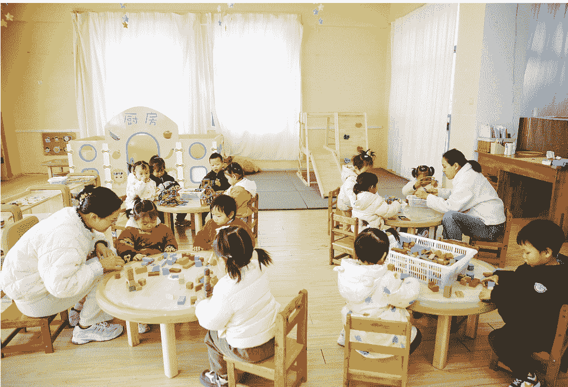

在刚刚落幕的全国两会上，学前教育领域的重大动向备受关注。今年的政府工作报告首次提出“逐步推进免费学前教育”。对此，教育部负责人都表示，教育部将会同相关部门研究出台相关政策，切实普及普惠教育，和教师队伍做扎实，为推进工作做好准备。推行免费学前教育一举多得、利国利民，政策方向已经明确，如何逐步推进成为关键？

## CAIXIN| 听文章

微信jntg2 免费进资料分享群

教育是基础教育的基石，是人终发展的开头。多种学科研究表明，高质量的学前教育可以促进儿童认知、社交、情感、创造力，有助于他们未来的学业和职业发展，还会为国家和地区的社会发展带来可见的投资收益，有利于阻断贫代传递，推动社会流动和社会公平，增强人才的国际竞争力。数据显示，全球范围内提供免费学前教育的国家有30多个。

需要的是，免费教育与义务教育是两个相关又有差异的概念。虽然都旨在提高教育的普及和公平性，但是涵盖的教育阶段、受教育人群和资金来源、有无强制性等方面有所不同。目前，中国已实现全面免费的九年义务教育，同时逐步推进中等职业教育免学费政策。应该看到，增加义务教育或免费教育年限已成为国际社会的普遍趋势。如如今，“逐步推行免费学前教育”的方向已经明确。

近年来，中国大力发展学前教育，进入普及化。2023年，全国学前儿童入学率达到91%，已经超过高校入学国家平均水平；全国幼儿园总数27.44万，其中普惠性幼儿园23.64万，占比80.24%提升到86.1%。国际经验表明，推行免费学前教育有利于减轻家庭的生育、养育、教育负担，解除其后顾之忧，实现鼓励生育、提振消费等政策效果。显然，所有这些，无论对于眼下推动中国经济持续回升向好，还是持续地改善人口结构，都具有而易见的作用。

探索逐步扩大免费教育范围，特别是逐步推行免费学前教育，决策层已有明确思路。中国二十届三届中全会将通过的《中共中央关于进一步深化改革、推进中国现代化的决定》提出：“完善教育优质均衡推进机制，探索逐步扩大免费教育范围。健全学前教育和特殊教育、专门教育保障机制。”2025年初印的《教育强国建设规划（2024—2035年）》除了重申“探索逐步扩大免费教育范围”，还提出“促进学前教育普及”。将于6月1日起施行的《学前教育法》明确规定：“有条件的地方可以逐步实施免费学前教育，降低家庭教育成本。”可以说，逐步推行免费学前教育不仅是一种政策，更是各级政府有责任不扣落地。

如何逐步推行免费前教育？一位全国大代表建议“三步走”：作为试点阶段、推进阶段、完善阶段；率先在长三角、珠三角等发达地区试点实施三年免费教育。也有学者采取“两步走”战略：到2025年，率先在发达地区实施普惠性免费教育，向民族人口少地区实施确保“一个不能少”；到2030年，在全国范围内实施。对长三角、珠三角等发达地区，主要依靠自身资金尝试；对于中西部等地区，逐步推行免费教育，由中央财政给予专项补助，特别是通过政府购买服务的方式解决。当地经济水平、财力等因素动态调整。除了财政投入，经费可以通过社会捐赠、基金等渠道募集。

今年政府工作报告对“加强高质量教育体系”做了阐述，并提到要从落后大国向强国迈进，同时指出，学前教育是教育体系的重要组成部分。中国在不远的将来实现学前教育，然而大众迫切期待相关部门研究出台相关政策，把这件好事办好。

## 最新报道 | 全球富豪大迁

## CAIXIN| 听文章

文 | 财经周刊

要是英国国王查尔斯三世收到这封信，他可能会摇头。居英国多年的加拿大女儿安·卡普兰·穆赫兰（Ann Kaplan Mulholland），现年64岁的金融公司创始人、真人明星，据称身家2亿镑。几年前，她丈夫花了500万镑买下一座亨利八世住过的英国乡村城堡。她在信中请求查尔斯国王，允许她在城堡之上建立自己的国家，理由是英国即将实施的新税政让她背负高额税款。这一意想天开的计划——让城堡变成一个国家，伦敦专门为高值人群服务的律师圈认为是现实，几乎没有任何实现的可能。但穆赫兰公开表示，“欢迎此次税改影响的人来到我的王国！”

2022年3月13日，阿联酋迪拜当地举办国际旅游展，人们前来参观。过去十年，阿联酋、沙特为代表的中东国家在投资和移民领域逐渐兴起。图：Karim Sahib/视觉

从2025年6月开始实施的新税政，将正式取消非英国籍居民（Non-Domiciled Individuals, Non-Dom）的税收优惠——这是富豪选择英国最为权重的因素之一。Non-Dom显示一个人的税务状况，与其国籍或公民身份无关，的是那些虽然住在英国，但在法律上认定为“永久家园”（Domic）在其他国家的人。非英国籍居民为英国获得的收入缴纳税，最长15年不用为海外资产和收入缴纳所得税（除非钱带到英国）。

在全球趋势大当下，英国是不少数全球资产征税的国家之一。但迫于国内经济压力、政治博弈和税收公平竞争，2024年7月英国大选结束后，新工党政府将正式取消Non-Dom制度。

英国税务海关总署（HMRC）公布的2023年度数据显示，英国有7.4万人申报为非英国居民。英国财政部预测，Non-Dom取消后，每年可增加约27亿镑的税收。智库机构丹斯研究研究所所称，新政府将导致富人投资和消费减少，英国未来六年内预计有2.3万个工作流失。

截至发稿，穆赫兰尚未回复财经的采访，但一位接近她的人士对财经新透露，穆赫兰在意识到“自建王国”不合法后，决定向国王寄出这封信，转而准备申请新的居民身份，构想将米兰生活；虽然她更愿意留在英国，这将花费巨额的资金。

根据国际投资移民公司恒理（Henley & Partners）的测算，随着Non-Dom取消的倒计时，已超过8万高净值人士（拥有100万美元或以上流动资金可投资财富的人士）在2024年离开了英国，较2023年的420万增加157%。平均每48分钟就有一位富豪离开，英国成为全球海外外流最多的区域之一。

曾属于普华永道、独立运营的移民公司韦拓（Knightto Partners）税务总监沈涣表示，英国此次税改除了长期以来的非居民概念，这是一项重大的改革。过去，连续居住15年后需承担税务责任。随着AI技术提升税务监管的精确度，审查力度随之大幅增强。如今，税务合规是高净值人士的必然选择。

对于已经在英国工作和生活的非英国籍高净值人士，他们的海外收入和收益将在英国面临显著变化。这些富豪如同资本鳄，总是在寻找“低税”栖息地。哈罗公爵宣布，将于2026年首次在中东迪拜、阿布扎比开设两所学校，被看作全球富豪的风向标。

2025年2月宣布了一项“金卡”计划，花费500万美元可以获得美国的永久身份，为美国创造10个就业岗位。美国总统特朗普（Donald Trump）及其商务部长霍华德·卢特尼克（Howard Lutnick）补充道，“金卡”计划可能替代“EB-5”计划，要求外国人在投资至少100万美元或者有直接或间接的工作机会，继续获得合法身份。

数据显示，2024年高净值人士流入迪酋6700人，列全球第一；第二名国家3800人；第三名新加坡3500人。

## 富人的税务优权

“这段时间弄得我心神晃晃，我在公司申请不能调回亚洲。”在瑞士达沃斯参加世界论坛2025年年会的薛明（化名）彰显无奈。他出生在中国大陆，留学后再进入某异国公司，一直做到大中华区高管；持有中国护照的他6年前被派往伦敦分公司任管，未来打算退休回到中国生活。

薛明和妻子在英国居住超过183天，需要为英国的收入（比如英国发放的工资）缴纳英国所得税。不过，薛明的英国籍（Domicile）是在英国被视为非居民，现行政策他的海外收入（比如在中国的房租金或股票投资收益）如果不汇入英国，就无需缴纳英国税。

长期以来，Non-Dom税务身份为高收入群体提供了独特的避税通道，有人称之为“大英帝国留给富豪的最后一份礼物”，其历史最早可追溯到1799年。当时，英国首次引入所得税，类似Non-Dom的规则在保护拥有外国财产的人士免于缴纳税。通过两个世纪的演变，Non-Dom制度以“交护费”的方式保留至今。

按照现行规定，境外收入超过2000英镑的非英国籍居民，在过去9个税务年度中如果有7年以上在英国居住，则需要每年支付3万英镑的费用，才能继续被认定为非英国居民；如果过去14个税年度中至少有12年在英国居住，则这笔年费为6万英镑；如果在过去20中有15年在英国居住，则无法再用申请Non-Dom。

这一制度下，富豪在15年内无需担心英国税率的影响。一份联合研究显示，过去20年，来自印度的Non-Dom人数增长快，主要居住在伦敦及其周边，尤其是金融城和沃克斯等高端区域。最著名的非英国居民之一是英国前首相哈里·苏纳克（Rishi Sunak）的妻子阿克沙塔·梅尔蒂（Akshata Murty），梅尔蒂是印度公民，公开信息显示她曾拥有父亲创立的IT巨头Infos股份价值8亿镑。梅尔蒂凭借Non-Dom身份，每年免缴英国税高达800万镑。

从2025年4月6日起，Non-Dom政策将被四年海外收入与收益豁免制度（4-year regime）取代。也就是说，新移居英国的个人在前年内无需为海外收入纳税，四年后将必须以普通英国居民的身份为全球资产和收入纳税。薛明估算了一笔账，Non-Dom取消后，尽管有过渡期的安排，增加的税额让人心如血。

## 离开，还是留下？

全球各地处的超级富豪们，其行程安排的最终决定权可能并不由政府决定。律师和会计师给客户制定一个时间表，比如接下来一年在哪个地方不能超过多少天，“尽量让自己某个地方的税务居民，或者想办法成为一个低税率国家的居民。这些组合工具，总能找到一个解决方案。”

服务过多高净值人士的专业人士有一个客户来英国好几年了，最近的企业准备在亚洲上市，Non-Dom的取消让他非常繁忙。因为分红、股息等现金流入的金额是巨大的。孩子在英国接受过教育，他也不愿意搬离。接下来我们会做一些税务规划，可能也缩短他每年在英国的生活的时间。”对于留在英国的富人，Non-Dom取消之后，首要考验就是全球资产征税。其实，全球大部分地区，包括英国、澳洲、中国内地和加拿大等，对其税务居民已采用个人全球征税制度。总体而言，亚洲地区的个人所得负担远低于西方地区。

沈肇表示，“此前，英国针对非居民的税务优惠政策，长期以来给部分群体带来税务规划的机会，甚至让一些人产生幸运心理。但如今，在全球资产征税趋势下，高净值人士的税务规划正在缩小。为此，他建议，短期内可以充分利用Non-Dom四年的过渡期优惠政策，并及时了解和更新相关法规的申报要求，尽量延迟在英国的全球纳税，以最大化税务优势。”

此外，双重征税协定常常被应用。具体而言，如果某人的笔收入在A国已缴相关税款，则B国在全球征税时通常只能征A国税率的差额，而不能对同一收入再次征税。但在实际操作中，这种税收调整并非顺利，各国政府也在不断调整税收政策，缩小避税空间。

沈遇表示，过去十年，以阿联酋、沙特为代表的中东国家在投资移民领域逐渐崛起，其优势在于几乎无人所得税，且企业所得税较低。此外，这些地区地理位置优越，既可辐射欧洲，也能覆盖非洲和亚洲，使其成为国际商业枢纽。

不过，也有了了解行业趋势的律师对财税说：“那里很多时候非常炎热，气候、医疗、教育等一定不能满足高净值人士的需求。所以也有客户退而求其次，做一个折中，选择爱兰斯、意大利税率相对低一点的地方。”例如，旅居意大利的富豪们，无论在海外挣多少钱，有多少资产，每年交的20万美元（2024年8月涨价为10万美元），海外资产就不缴征税。

王晖表示，中国香港和新加坡凭借其优势，一直是高净值人群资产配置的热门选择。近年来，两地推出了吸引家族办公室和高才优的政策，成功吸引了大量高净值家庭落户。

“税务规划只是高净值人士进行全球布局的众多参考因素之一。很多时候，税务只是合规后的结果，而非决策的催发。”沈遇表示，在与众多高净值客户交流的过程中发现，他们在不同阶段的核心关注点各不相同。除了税务，他们还需要综合考虑经济环境稳定性、法律法规健全、文化融合度，甚至子女教育等许多方面因素。

天使奇补充：“也有一些高净值的客户通过各种渠道会认为，交的税还是值得的，既然认可并选择了英国的环境和机会，就要承担与与之相应的纳税义务。对于最有实力的一些本土富豪，或者和英国投资关系密切的群体，其实税的影响在短时间内不会太明显。”

加微信jntg2，免费获取资料分享

“我认为税不一定第一考虑因素。的确完全是为了税务优化，但我更多人还是更关心一个自己喜欢待的地方。”一位打算继续留在伦敦的互联网公司欧洲总部高管对财新表示：

一位资深的税务律师对财新表示，他在为客户制定方案时，税务规划和身份规划需要分开考虑。从国际视角来看，他建议客户谨慎行事，不能凭某些国家的税优惠盲目改变身份。只有在充分准备定居目标国家后，才考虑放弃身份获取新身份，同时通过法律方式规避税务风险。

## 遗产税“斗智勇”

智库机构天津经济研究院的一项研究，调研了115名外国投资者和42名代表64名高净值客户的专业税务顾问。62%的受访者表示，NonDom之后净值人群考虑离开英国，他们主要的忧虑是对其全球资产征收遗产税。

目前，多个国家的遗产税采取的是“免税税额+累进税率”的方式征收，税率普遍较高；也有不少国家和地区尚未征收或近期取消了该税种。

周博表示：“一些高净值人士在移民或海外投资时，未充分考虑各国的税务体系。例如中国目前没有遗产税，所以客户没有这方面的意识，在资产规划时会忽略这一点，等到实际面临税务负担时才认识到问题的严重性。我们经常遇到的案例是，客户在获得美国绿卡或移民日本后，才发现自己需要缴纳高额的遗产税。这种税务意识的缺失，使得他们在身份规划和资产配置上容易产生失误。”

业内主流的节税措施是设立不可撤销信托（Irrevocable Trust）。这种信托一旦设立，委托人无法撤销、修改或取回信托中的资产。资产从委托人转入信托后，不再属于委托人的遗产，因此在计算遗产税时不会被纳入。

但传奇表示：“不可撤销信托在某些情况下可用于税务规划，但非绝对的避税工具，其主要功能通常是保护和财富积累。在英国，政府对信托监管非常严格，特别是在税收方面。例如，转移资产至信托可能触发20%的初始转让税（Entry Charge），并且信托每十年需缴6%的周期税（Periodic Charge）。虽然这些税率相比一次遗产税（40%）低，但仍然需要仔细计算成本。”

赠与曾作为一种合规避税的方法，现在也逐渐被堵上了漏洞。所谓赠与，是指赠与人将自己的财产赠给受赠人、受赠人表示接受的一种行为。不少国家将赠与税视为遗产税的辅助税种。

例如，英国的赠与税有“7年规则”：如果资产在赠与后7年内，赠与者去世，若超过免税额度的赠与则需缴纳税；税率随时间增长不断降低，3年内是40%，3到4年是32%，以此类推，超过7年就不征税。换句话说，赠与者在赠出财产后的7内去世，则财产的转移是无需交税的。

“一个简单的节税办法就是尽早把财产交给下一代。但这对很多巨富来说非常困难。二代是不是有出息，还可以比较年轻，一定能够掌控局面，有没有其他人盯着这些财产......都充满了太多不确定性，最后可能是玄学。”亦有业内人士对财新说：

通过单一家族办公室优化资产配置，降低税务负担，以及通过保险产品设计结构和受益人安排，也是常见的通过减轻税务将财富传承给下一代的方式。还有类似加拿大的“祖母信托”（Granny Trust），由非加拿大居民在境外（通常是免税或税率低的地方）设立，受益人为第二代或第三代，可优化税务结构。

不过，周博指出，信托和保险是理财管理中最复杂的部分，尤其是在涉及税务规划时。虽然了解一个国家的规定并不困难，但真正的挑战在于跨境税务法规以及穿透，具有较大的不确定性。

瑞银的《2024年家族办公室报告》，通过调查了解到超过2万亿美元的高净值人士未来五年的投资预期。结果超过一半的受访者（53%）担心全球遗产税被认为是最大的威胁。沈遇表示，这只是短期应对策略，真正的挑战在于让财富在跨境传承中保持安全性和延续性。“重点不仅在于节税，而是构建一个适应全球环境变化的资产管理体系。”

加微信jntsg2，免费资料群

## 资产重配置

在税务变化下，高净值人士不得不重新审视资产配置方式。据悉，不少富豪正在出售英国房产，并在税率较低的国家购买不动产。沈嵩指出，尽管房产净值较高，但在整体资产组合中并非核心；相比之下，股票、债券等金融资产占更大比例。因此，资产配置不仅局限于不动产，而是需要全面的规划。

财富管理投资监（CIO）侯锐也表示，家族办公室在资产配置上普遍倾向于分散，配置于传统资产类别，如股票和债券。瑞银收集了全球20多家家族办公室的投资展望，这些办公室平均净值达到26亿美元。他们策略性地配置大幅调整，此外，部分区域房产价格出现回调，增加了北美和亚洲（包括中华）地区的配置。

大部分家族办公室认为，北美地区在未来几年内继续具有良好的投资前景。在2022年和2023年加息后，市场机会逐渐许多，科技领域的快速发展（尤其是AI相关产业）也吸引了大量投资者。此外，美国通胀率趋于稳定，进一步增强了投资者对北美市场的信心。胡俊锐：“加密货币和虚拟资产具有去中心化、匿名性和跨境流动的特点，曾一度认为是逃税的“利器”。还有不少人认为，这类资产疯狂的行情可能与富豪们的避税需求密不可分。但从家族办公室的资产组合来看，家族更倾向于关注加密货币相关的底层科技，而非直接持有加密货币本身，因为底层科技领域更具长期投资价值。我观察，体量越大的高净值人群，越不去碰这些资产，越喜欢固定收益类。对于他们阶层，财富可能就是一堆数字，保护好就好，不用承担太多的风险。”一位服务过过多上市公司实控人的律师对财新说。

从监管环境来看，经济合作与发展组织（OECD）正在加速推进加密资产版的报告标准（Common Reporting Standard, CRS）——CARF（Crypto-Asset Reporting Framework，加密资产报告框架）。根据CARF草案，该框架强制要求虚拟资产服务商从2027年起，按标准收集并共享用户身份、交易地址及余额信息，适用范围涵盖交易所、托管钱包及部分DeFi（去中心化金融）协议。截至2024年底，已有63个国家地区承诺在2027年或2028年前实施CARF框架，其中大部分全球主要的加密资产中心如美国、日本、韩国、新加坡等。

沈达尚认为，短期内加密资产可能一定存在监管灰色地带，但长期来看，全球税务体系必然会逐步将其纳入监管范围。高净值人士对此做好准备，而非希望通过加密资产作为“避税港”。对于不动产，OECD于2023年7月向二十国集团（G20）财长和央行长提交了一份关于加强不动产国际税收透明度的报告。这是印度在任G20主席期间，对OECD提出的需求。这份报告说明，各司法辖区可以使用类似于CRS的基础块，交换不动产实际所有者的信息。不过，此提议遭遇了不少反对，尚未落地的迹象。

## 穿透全球资产

富豪们分布在全球的资产之所以越来越难以以隐形，近年来最强武器之一是OECD提出的CRS。CRS之下的金融账户涉税信息自动交换，首先由一国（地区）金融机构通过尽职调查程序识别另一国（地区）税收居民个人和企业在该机构开的账户，按向金融机构所在地（地区）主管部门报送账户持有人名称、纳税人识别号、账号、余额、利息、股息以及出售资产收入等信息，再由该国（地区）税务主管与账户持有人的居民税务主管开展交换。

截至2024年，共有96个司法地区执行CRS，包括英属维尔京群岛、开曼群岛、百慕大、巴拿马等视为“避税天堂”的地区。自2017年启动以来，各国自动交换了超过34亿财务账户，涵盖了近13万亿欧元的总资产。从效果来看，各国交换账户数量并未披露。OECD的数据显示，2023年自动交换了超过1300亿欧元（约1054亿人民币）。

值得注意的是，美国在2010年推出了FATCA（Foreign Account Compliance Act，美国账户合规法案），要求外国金融机构向美国税务部门报告美国公民或税务居民持有的账户信息。FATCA是美国特定的，而CRS是一个广泛的国际标准，在具体实施中两者相似。

此外，一些未加入CRS的国家，高净值人士通过购买或投资获得该国的居留或国籍，表面上，他们大部分时间仍生活在其他，实际上通过CRS和FATCA下的信息穿透，这种行为不断增加。一些未履行CRS的国家，会在OECD评估时贴上标签。根据OECD的报告显示，有三分之一的国家被标记为红色，代表这些国家未采取行动或执行，存在较多漏洞。根据特朗普8月日签署的《美国优先政策》备忘录，美国将审查是否暂停中美两国双边税收协约，其主要内容是个人或企业在一个国家缴纳的所得，避免中美两国双重税。

律师分析称，如果双边税收协定取消，美国人在中国的投资将无法获得税收抵免，反过来，此举也阻碍中国人在美国的投资。天津律师称，双边税收协定一旦废除，中美两国之间跨境投资环境可能迎来历史性巨变，包括但不限于居民认定、常设机构认定、跨境各类所得（股息、利息、费用等）方面，企业的跨境业务安排和交易可能面临税负负担。观点认为，FATCA是建立在双边税务机关交换信息的基础上，若双边税收协定终止，中美两国之间FATCA协议的有效性可能受影响。这意味着，在美方要求提供美国公民和税务居民账户信息时，中方可能会选择继续履行交换义务。

值得一提的是，总统备忘录并非落地，它通常没有强制力，更多用于表达立场和指导部门工作，需要发布行政命令来具体执行。“收收止步于英国，未来其他国家可能继续调整政策。当前全球税收环境正经历变革，其核心目标是推动全球税收监管的严格化和透明化。高净值个人面临更高的税收风险，促使他们积极检视当前的合规状况，并探索新的税务规划机会。”王晖说，公众懒人搜索+。

## 最新财新周刊 | 四川女富豪何燕与商业伙伴反目“卫星第一股”振芯科技所属

## CAIXIN | 听文章
文 | 财新周刊 单玉晓

现在就好比是想离婚，却离不了。“68岁的成都振芯科技股份有限公司（300101.SZ，下称“振芯科技”）联合创始人莫晓宇形容眼下的局面。22年前，莫晓宇和谢俊、徐进、柏杰四人在四川富豪何燕支持下合伙创业。2010年8月，公司在深交所创业板上市，成为当时的“卫星第一”。振芯科技如今市值123亿元，是北斗卫星导航系统服务供应商，主营高端集成电路、卫星导航、人工智能领域的装备产品和服务，是国家级高新技术企业、专精新小巨人。振芯科技的控股股东是成立于2005年的成都国瑞电子有限公司（简称“国瑞电子”）。何燕和莫晓宇等人的利益锚现在国电子股权架构中。何燕在国电子持股51%，莫晓宇等四名振芯科技创业团队成员合计持股49%，其中莫晓宇等持股28%，柏杰、徐进、谢俊各7%。

国电子股东、四川女商人何燕（又名“何然”）。图：国瑞集团账号
国电子股东、振芯科技联合创始人莫晓宇。

加微信jntg2，免费资料分享

无法成为振芯科技形式或实质上的控人，由此各股东的意志可以通过股东会、董事会、监事会得到直接、充分的表达，上市公司层面的任何争议都将公开、透明和程序化。

2018年2月，莫宇、谢俊、徐进、柏杰，以国腾电子为被告，以何燕为第三人，向成都市高新区提起诉讼，请求法院依法解散国腾电子。他们在起诉状中表示，国腾电子经营管理完全陷入僵局，股东之间已失信任基础，无法通过股东间的协调得以破解，股东继续延续必将导致国家、公益利益受到重大损害。

根据当时的《公司法》第182条规定，公司经营发生严重困难，继续存续会股东利益受到重大损失，且通过其他途径不能解决的，持有公司全部股东表决权10%以上的股东，可以请求法院解散公司。最高法院在《关于适用<公司法>若干问题的规定（二）》中详细规定了公司解散与否的认定标准：一是公司持续年以上无法召开股东会或者股东大会，公司经营管理发生严重困难；二是股东表决时无法达成法定标准或者公司章程规定的比例，持续两年以上不能作出有效的股东会或者股东大会决议，公司经营管理发生严重困难；三是公司董事长期冲突，无法通过股东会或者股东大会解决，公司经营管理发生严重困难；四是经营管理发生其他严重困难，继续存续会股东利益受到重大损害。

2018年9月，成都市高新区法院出一审审判决，支持莫宇等人的主张，判决解散国腾电子。

加微信：jtsg2，免费资料分享群

一审判决认为，根据前述法律解释的规定，认定解散应满足三个条件：公司经营管理发生严重困难、继续存续使得股东利益受到重大损失、通过其他途径无法解决。法院认为，国腾电子股东和董事会的运作已经产生了严重的内部障碍，国腾电子继续存续将使股东利益受到重大损失，且通过其他途径亦不能解决股东之间的矛盾。

何燕不服一审判决，很快诉至成都市。此外，何燕还在该案一审期间改组了国腾电子董事会及监事会。

2018年5月7日，何燕委托他人通过公证邮寄送达方式向国腾电子董事会及时委托莫晓宇书面召开临时股东大会，提名并选举解散一届董事会及监事会成员。莫晓宇等四人回复公司诉讼尚进行中，股东之间矛盾不可调和，不宜召开股东会及董事会。此，何燕委托一名监事召开临时股东大会，与何燕委托的代表一起通过了何燕的提案。

2019年4月，成都中院裁定将该案发回重审，理由是一审法院没有主动查阅国腾电子的诉代表意见问题属于审判程序严重违法。

多年以后，2021年11月，成都市高新区法院重审后出一审判决，驳回莫晓宇等四名股东关于解散国腾电子的诉讼请求。法院认为，股东之间存在矛盾并不等于无法召开股东大会、无法有关特定事项形成决议，在何燕不同意解散时，其他股东可以在维持公司存续的基础上采取其他维权途径，如股权转让、公司回购等，而非直接通过解散公司来解决矛盾。

加微信jntsg2，免费资料分享群

成都市高新区法院表示：“公司解散对公司而言，是最严厉、最具破坏性的结果，除非证明公司已经存在《公司法》第182条规定的全部情形，不宜通过司法解散来解决股东矛盾。”

莫晓宇等人不服，上诉至成都中院。三年后的2024年12月30日，成都中院作出终审判决，驳回莫晓宇等人的上诉，维持原判。

## 争议的核心

国腾电子已经形成治理僵局，到底应不应该解散？这是长达六年的诉讼中最核心的争议问题。

莫晓宇等人认为，国腾电子完全符合法律解散要求，国腾电子继续存续将使得莫晓宇等人其他投资者遭受重大损失。2018年来，他们与何燕涉及违法犯罪行为为上市公司带来危害问题的过程中，双方矛盾不断僵化，股东之间无法相互召集对方召开全体大会，无法获得一份意见或者三分之二以上通过的决议。国腾电子已经形成实质性的公司僵局达八年，股东之间完全丧失“人性”，诉讼已完全不可调和，通过内部协商解决已不可能。国腾电子无法解散，其治理僵局和何燕控制人对振芯系列别的业务影响将日益加剧。

何燕一方认为国腾不存在公司僵局。何燕委托的律师表示，无论该案件诉讼发动两年前，还是诉讼过程中，国腾电子董事会、股东都会运转正常，能够作出有效决议，不存在所谓“公司运行机制全失效，公司处于瘫痪状态”的情形。何燕也称，国腾电子董事事期间。

加微信ntgs2，免费资料分享群

与公司经营管理相关的唯一的矛盾，就是部分董事拒绝按照莫晓宇的要求对有关借贷款给予事后追认，而国腾电子股东之间也只有一个矛盾，就是何燕拒绝按莫晓宇的要求的方式对外转让股权。

如果解散国腾电子，振芯科技的股权将分割至自然下，何燕、莫晓宇等人直接持有振芯科技的股权。何燕的律师称，这意味着股东之间的矛盾将转移，转化为上市公司内部，此结果将振芯科技带来不可预测的风险。

振芯科技了解到，三名独立董事在2024年6月向成都中院提交书面意见。其中写道，国腾电子解散后，何燕持股比例不足以达到决定性的作用。其虽为10%以上表决权，但根据《公司法》《证券法》《深圳交易所上市规则》对控股股东、实控人的认定标准，振芯科技处于无控股股东、无实控人的状态，不会触发上述控股股东、实控人的禁止性规定，且在再融资程序核查过程中，也不足以中介机构深交所审查的因素。前述意见表示，只有解散国腾电子，股东内部矛盾才不会影响到上市公司，上市公司管理层不能被大股东挟持，才能正常表达自己的诉求，同时振芯科技的治理结构将现有的“一股独大”走向“分权制衡”，才能真正平衡各方利益。

加微信nts2，免费资料群

成都中院的终审判决支持了何燕一方。关于国腾电子是否合法解散条件，终审判决书写道，公司僵局具体表现为股东和董事会僵局。根据审理的事实，在该案诉讼之前，股东会与董事会正常运转，直至2017年8月形成一致决议，全体股东同意更换部分董事。莫晓宇等四名股东提起诉讼后，何燕根据《公司法》和公司章程规定，请求临时股东股东会做出了决议。2018年8月8日选举了新的法定代表，新的董事会已经生效并确认不存在撤销的事由。成都中院认为，莫晓宇等人主张国腾电子形成僵局的理由不能成立。

法院还认为，在股东会能够召开的情况下，证据不足以证明国腾电子已经构成《公司法》及其解释规定的经营管理方面发生严重困难的情形。关于莫晓宇一方提出的继续下去会导致股东遭受重大损失，成都中院认为，根据权利行使，股权分为自益权和公益权。自益权是指股东为了自己的利益而行使的权利，主要包括利润分配请求、优先购买、股权转让等，在该案诉讼中，莫晓宇等四名股东未证明其自益权和公益权受到损害。

加微信ntsg2，免费资料群

莫晓宇一方主张，因何燕身份的存在，会导致振芯科技资源发展遭遇严重阻碍。对此，成都中院认为，2021年4月振芯科技再次启动融资时，公告无实控人，且振芯科技提供的可行性分析表明此次融资没有违反《企业上市发行办法》等规定。法院还特别提到，振芯科技参加国家重大专项获得的研发任务是因为何燕之后。莫晓宇一方在诉讼中向法院提出，何燕疑似外籍身份。按照规定，若何燕继续拥有身份，振芯科技面临丧失业务及保密资质的重大风险，企业的生存基础不存在。关于国籍问题，高新区法院在前述案件一审中曾要求何燕提交国籍证明，何燕没有回复。最高法院在审理另一项合同纠纷案件二审时，何燕的代表明确表示人在国外。成都中院在终审判决中指出：“何燕是否具有外籍身份和境外居住权、振芯科技生产是否具有保密资质、是否危害国家安全没有事实依据，亦属于本案审理范围。”

振芯科技2025年1月15日晚公告，1月14日振芯科技召开第六届董事会第六次临时会议，审议通过实际控制人变更的议案，由于无实控人认定何燕为实控人。公告称，在表决前述议案时，振芯任董事谢俊、徐进、柏杰对该议案投票，理由是在治理异常更加严重的情形下，法院并未采信其提供的重要证据，下一步将继续通过合法途径维权。

加微信nts2，免费运营群

振芯了解到，按照深所及四川证监局对上市公司实控人的监管要求，振芯科技于2025年1月15日向何燕发出通知，要求其最晚于通知一个月内提供相关个人资料，包括但不限于国籍、简历、近几年入境情况、是否有违法等情况。振芯科技没有回复，在2月10日收到了何燕发来的律师函。律师函要求对多个问题作出回应。其中提到，振芯科技对于实控人的认定极其具有主观性，严重缺乏事实和法律依据。历年来对实控人的认定不够客观、谨慎，存在信息披露不真实、不准确、不及时的情形，振芯科技提供相应资料并作出合理解释。

截至发稿，未能联系上何燕老师。受何燕委托处理此次纠纷的律师未回应相关争议。

## 两难何解

作为科技型上市公司的股东，国腾电子司法解散案在市场和学界引起不小关注。该案反映了公司治理的一个困境——保护公司持续经营与保护小股东权益出现冲突，在法律规范层面，如何打破司法僵局？

商法学者、吉林大学法学院教授吕向新表示，从法律上讲，公司是营利性的社会组织，它的存在对于长期投资的股东具有意义，对于周边利益群体乃至整个社会都有价值。基于这样的理念，包括在中国的《公司法》立法原则都是可能维护公司持续运营，只有出现两种场景才可能涉及公司僵局问题。

第一场景规定2023年完成修订的《公司法》第182条，即公司经营发生严重困难，继续存续会股东利益受到重大损失，且通过其他途径不能解决的，持有公司全部股东表决权10%以上的股东，可以请求法院解散公司，即公司层面的解散。

第二个场景是《公司法》增加的内容，即控股股东滥用权利严重损害公司或其他股东利益，其他股东有权请求按照合理的价格收购其股权，即赋予股东的回购权。

当管理运作无法破解难题时，就要看第二条路径，是否存在“股东压迫”。根据《公司法》第89条第三款，股东压迫是控股股东利用董事会席位，使股东利益受到重大损失。如果不存在这些情况，第89条第三款就不适用，股东可以像上市公司一样自由畅售股票。

浙江财经学院副院长张凯表示，根据《公司法》奉行“多数决”原则，需要代表多数股东同意才能通过决议。如果股东之间发生冲突，通过内部协商无法解决，就会导致公司僵局。此外还有第三条路径，传亨尔表示，在实践中特殊情况下，尤其是民营上市公司，若难以通过法律途径解散，就需要通过诉讼，方以合理价退出，才能跳出现有的路径。

加微信jnts2，免费资料群

注：本文发表于《财经周刊》2025年10期，原题为：财经周刊 | 法国财政部长谈中法未来：我们必须走更远。

# 气候变化共同目标面临压力

本届G20财长和央行行长会议召开全球不确定性高企，各国立场差异扩大。由于意见分歧严重，会议最终未能就达成共识，富国南方以“主席摘要”形式就这次会议的内容做了通报，其中，与中国重申，两国集团“支持规则、非歧视、公平、开放、包容、平等、可持续和透明的多边贸易体系”，再次宣布反对贸易保护主义，并再次确认G20机制作为“国际经济合作的首要论坛”的地位。

隆巴尔表示，法国坚定地相信多边体系的作用，这正是我们来到开普的原因。现行G20磋商机制在2008年全球金融危机爆发后，此后成为多边对话的主要之一。2022年俄乌冲突后，随着俄罗斯与西方国家迅速恶化，G20内的多边对话机制面临持续挑战，而在2025年，美国特朗普政府上台后，全球共识遭遇进一步撕裂，多边主义也面临不确定性。

加微信nts2，免费获取群

在风险不断升高、世界面临未知挑战之际，中法关系过了60年，正显示出新的生命力与意义。

2025年2月，中国外交部长王毅在慕尼黑安全会议上的讲话中呼吁和平平等的世界，强调世界各国应遵循多边主义，坚定维护联合国权威和地位，切实履行《巴黎协定》，并落实三大议题，为完善全球治理提供产品。会后，王毅与法国外长巴罗会会，双方重申了对多边主义的共同承诺。巴罗重申法国希望在全球重要问题上加强与中国的合作伙伴关系。作为联合国安理会常国，中法共同发挥影响力，坚持多边主义、完善国际治理。

这次互动恰是中法之间频繁高层互动的最新一则，此前的2024年5月，中国国家主席习近平对法国进行访问，更早之前的2023年4月，法国总统马克·龙也访问了中国，成为疫情结束后最后到达中国的西方领导之一。

# AI治理亟需对话

鉴于当前地缘政治和贸易紧张局势，首要任务是表明二十国集团支柱之一的多边体系确保了全球增长，月初在结束本届G20首次财长会议，法国财政部长克莱·隆巴尔接受采访。会议在26日至27日在南非开普举行。相比过去，本届美国总统特朗普多次表明对多边协商机制怀疑，在气候变化和多元化立场出现明显歧。2月中旬，美国国务院卿鲁希奥宣布持此机制是“推行反美主义”，随后新任美国财长贝森特也被确认因行程不参加本届财长会议。回顾这次会议，隆巴尔强调，“会议的核心在于合作与对话。”

2023年6月23日，巴黎国务院总理李强出席全球融资峰会闭幕并发表演讲。隆巴尔（Lombard）表示，“G20目前的框架是在2008年全球金融危机后建立的。通过定期的会议和讨论，我们构建了一个保护我们公民的全球架构，这一架构在过去15年中均被证明是有效的。”隆巴尔表示，法国仍然坚定地相信多边体系的作用，这正是我们来到开普的原因。

现行G20磋商机制在2008年全球金融危机爆发后，此后成为多边对话的主要机制。2022年俄乌冲突后，随着俄罗斯与西方国家迅速恶化，G20内的多边对话机制面临持续挑战，而在2025年，美国特朗普政府上台后，全球共识遭遇进一步撕裂，多边主义也面临不确定性。

加微信jnts2，免费资料群

中法未来：我们必须走更远

至少35%的“前所未有的”目标，以为为欧盟企业创造更有利的商业环境。此举是对长期以来欧盟陷于过度监管问题的回应，而改革究竟能带来多少现实效果，目前仍是许多方密切关注的话题。

3月6日，法国大模型公司Mistral AI的创始人、CEO Arthur Mensch出现在西班牙巴塞罗举办的世界移动通信大会时公开表示，欧洲应该减少对美国的技术依赖，同时需要对科技公司“解绑”。

隆巴尔则提及了法国正在推行的“法国2030”计划，研发聚焦减减税和法国国内简化监管的努力，其中，“法国2030”启动于2021年，其中的“竞争力”一节强调了投资未来技术、降低生产税等措施，使法国“重建经济主权”。法国外交部网站对此提供的讲解指出，此举“不是一种民族主义的撤退，而是重新获得以法国和欧洲的独立能力”。

在全欧洲范围内，法国是欧洲“战略自主”的主要倡导者，在过去的两个月内，欧洲外部环境剧变化、战略挑战前所未有的背景下，法国仍然积极应对挑战的欧洲国家代表。

## 中法贸易仍充分

长期以来，法国的优质产品（奢侈品、化妆品、农产品和食品、药品）在中国市场上深受青睐。“隆巴尔指出，2023年，中国是法国的第二大商品贸易伙伴。超过2000家法国企业在中国开展业务，两国贸易不断增长。“这是一件非常不错的事情。”

据中国外交数据，法国是中国在欧盟内的第三大贸易伙伴和第三大投资来源国。法国是中国全球第七大贸易伙伴，也是中国在亚洲的第一大贸易伙伴。2023年，在全球经济不确定性增加、地缘政治冲突加剧的背景下，中法贸易额仍达789.4亿美元。

2023年4月，在法国总统拿马克龙访华期间，中两国决定加强农业、农食、医兽和植物检疫领域伙伴关系，共同打造“从法国农场到中国餐桌”全链条协同机制。两年来，这一项目已经成为中法经贸成功的案例。法国成为中国在欧盟内的第一大进口国、第二大农产品伙伴。在提及贸易发展时，隆巴尔强调，双边合作不会止步于此：“我们必须走得更远，并解决我们之间的分歧，特别是在干涉和雅马岛上的分歧。”

最近几年，欧洲国家关注贸易逆差问题，法国在此亦例外。法国目前与中国保持着密切沟通的领域，“法国一直关注中国企业持续享受的营商环境，并确保贸易关系再次平衡，这对我们长期开展互利贸易至关重要”。隆巴尔介绍，2024年法国对华贸易逆差接近47亿欧元，达到历史最高水平。对法国来说，至关重要的是扭转这种双边贸易的不平衡。“这是双边贸易持续发展的关键。”隆巴尔重申。

他表示，法方正与中密切合作，以确保法国企业在中国市场准入获得更多便利，与此同时，就对等的市场准入条件和实现双向投资再平衡等问题定期与中进行对话。

在法国企业积极进入中国市场的同时，法国也对来自中国的投资表示欢迎。

隆巴尔引用安永“吸引力晴雨”，指出2019年以来，法国一直是对外投资最具吸引力的欧洲国家，这与法国过去七年以来推行的经济政策有直接关系，而中国投资者同样活跃于法国。“2023年，我们迎来了44个新的中国投资项目。”隆巴尔说，“这些数据反映了法国更多中国投资的愿望。”

隆巴尔表示，正如中国和其他世界大国，欧盟也正在金融、经济、工业、技术、能源和卫生领域捍卫自己的利益和主权，致力于减少外部依赖。“这绝非保护主义。”

在他看来，可能的中方投资将集中于两个领域，其一是助力法国的绿色再工业战略，其二是为了促进贸易关系实现再平衡。在被及中方投资者和推动者的建议时，隆巴尔特别提到了电动汽车行业。他表示，中国厦门鸿钨新能源材料有限公司和法国欧安德公司生产正极材料前驱体的合作项目是这一领域中典范之一，法国欢迎在中国电动交通工具及其他领域进行投资，这从未发生过变化。

## 主权债务处置取得成果

一年半之前的2023年6月，全球融资峰会在巴黎举行，包括法国总理在内的百余位领导人出席了峰会。这次峰会上，包括中国、法国等国在内的债权人与发展中国家就其债务重组、多边机构改革方面也取得进展。国际货币基金组织（IMF）主要股东达成SDR增值100亿美元的承诺，中国、法国、日本成为三大贡献国。

时任经济、财政、产业部长布鲁诺·勒梅尔在2023年7月访华回顾这一初步进展时表示：“我们必须继续推进国际金融治理。但只有所有利益方作出明确承诺，改革才能推进。”

时隔近20个月，隆巴尔表示，中法两国在债务处置方面的合作已经取得相当成果。经过两年的努力，无论是巴黎俱乐部成员还是新兴国家，都已就埃塞俄比亚债务重组工作达成协议。

近年来，由于全球经济形势变化、新冠疫情、俄乌冲突等不可控因素，一些发展中国家债务状况持续恶化，从2010年开始的债务浪潮成为史上规模最大、增长最快的一次。2020年5月，G20通过“暂停债务倡议（DSSI）”，为73个国家提供了规模达29亿美元的暂停援助，但随着框架在2022年12月结束，相关国家偿债总额从2022年的56亿美元升到2024年的70亿美元，远高于疫情前的水平。

2024年4月，联合国秘书长古特雷在“可持续发展周”首场高级辩论上指出，世界领导人已经意识到，一个过时的、失效且不完美的全球架构无法满足发展中国家的需求，而这一架构最大的失败恰体现在对债务问题的处理上。古特雷指出，发展中国家面临的债务利率比发达国家高得多，2022年，发展中国家对外支付的债务总额超过其接收的49亿美元，这种局面凸显了全球金融架构全面改革和落实可持续发展目标的迫切性。

过去30年中，全球债务局势发生明显改变，其中成立于1956年、由22个最富裕国家组成的国际安排机制“巴黎俱乐部”在发展中国家债务中的占比大幅缩减，新兴国家债权方的重显著上升。

隆巴尔指出，在发展中国家债务问题上，法中两国多年一直密切合作，“以推动达成协商一致的解决方案并落实二十国集团和巴黎俱乐部共同框架”。

同时，法国也支持全球金融治理的改革，特别是在国际货币基金组织第十七份额检查的框架下提升发展经济体在国际金融架构中的代表性。国际金融体系改革也是2024两国元首宣布的推动未来对话的主要领域之一。

2010年，国际货币基金通过了份额和治理决定，并在2015年底生效，发展中国家和新兴市场国家的份额明显提升，中国的占比从3.996%增加到6.394%，排名从第六位升至第三位。

2023年底，国际货币基金组织通过第十六次份额检查增资方案，份额总规模扩大50%，成员按照现有份额占比进行等比例份额出资。中国人民银行指出，国际货币基金组织占比调整，有助于提升新兴市场和发展中国家，改进国际货币基金组织的治理，提升其代表性和合法性，推动全球治理体系向公平、合理的发展。

本届G20财长与行长会议的“主席摘要”中提到，当前国际货币基金组织执委会将在开展工作，在第七次份额检查下，于2025年6月前制定可能的进一步份额调整方法，包括通过新的份额公式。与会国重申承担份额调整的紧迫性和重要性，以更好地反映成员国在世界经济中的地位，同时保护最贫困成员国的份额。

隆巴尔对财经表示：“经济高增长的发展中国和新兴国家应承担起与与其在全球经济新地位相称的责任，并对那些导致失衡和扭曲现象的贸易和金融实践进行改革。”

# 最新财经周刊 | 零基预算探索范围

**财经周刊 | 于海荣

鉴于国内环境变化带来的影响，财政部在预算报告中作出“收支矛盾仍然突出”。在支出刚性增长的情况下，为经济高质量发展提供财政保障，成为各级重点任务。零基预算（Zero Base Budget）成为打破支出固化格局的重要途径。

二十届中全会提出“深化预算管理改革”。此前，16个部门率先开展零基预算试点；安徽、浙江等省份做出相应探索，多数省份提出开展零预算试点。

从国内线看，零基预算并非全部从零开始，而是运用相关理念。根据财政部2025年预算报告定义，零基预算是指预算编制时不考虑以前安排基数，而是结合实际需求和财力状况，对各项支出逐项审核后，按照特定事项安排。2025年1月27日，江苏宣布在预算内开展试点。

在预算编制过程中，增量预算即以预算期成本费用为基础，结合变动因素调整预算数额。中国在上世纪90年代一些省份有过零预算尝试，但很快中止。2024年4月发布的《关于深化预算管理的意见》提出，“积极运用零预算理念，打破支出固化格局”。

二十届中全会要求深化零预算改革首次写入决议，表明相关改革已上升到顶层设计的高度，有望加快落实。近年来，财政收入缓慢，收支矛盾加大持续处于平衡状态，如果继续按原有编制方式，让资金落在各个部门中，当财政需要集中力量保障重大决策时，可能受到影响。因此，深化零基预算有助于避免财政资源浪费等问题。

由于各地情况不同，零基预算推进存在差异。部分省份如安徽、江苏、湖南、甘肃等地在2024年下半年发布了当地深化零基预算相关文件。地方推进零基改革的大思路包括：全面清理现行支出政策和项目，制定重大事项保障清单，取消必要的项目，合并性质相同的政策和项目；明确各项支出安排顺序，“三保”（基本民生、工资、保障）支出、政府债务还付支出、重大事项保障清单支出等靠前；分类确定各类预算编制方法，强化支出标准在预算编制中的作用；强化资金整合；绩效评估与预算管理结合。简单而言之，就是让资金跟着项目走、跟着政策走，先考虑、再排练，将有限的资金放在刀刃上。

“从技术层面，经过几年的探索，各地在思路、方法上已经有了相对统一的标准。”一位中部省财政人士表示，这项改革要真正落地，需要触及一些难点，比如跨部门统筹调剂、调动各部门的积极性等。

研究认为，由于涉及面广、利益调整大，零基预算改革不能一蹴而就，而要逐步实施。中央财政大学财政税务学院教授李燕称，从各国经验来看，基本都采取简化的零基预算，并非完全取代基数（增量）预算，而是与绩效预算、中期预算、科学的支出标准相结合实施。她认为，中国零基预算的方向应是在已有改革的基础上引入零基预算理念，重点放在存量政策、项目、资金上，借鉴合理的流程、与绩效预算相结合，分步推进改革。

## 地方学会先探索

长期以来，中国预算编制以增量预算为主，导致支出安排上基数痕较多，一些部门单位有“护盆”“只增不减”的意识，一些政策项到期没有及时清理退出，资金使用存在“钱等项目”“等钱”等情况，预算执行率较低和财政资金使用效益不高。随着当前财政收支转型，“基数+增长”的预算理念受到重视。

学界普遍将全球零基预算划两个阶段。零基预算最早出现在上世纪70年代的美国。佐治亚州长吉米·卡特将萨萨罗斯公司的经验，在全州65个行政部门实行零基预算，每年重新审核政府开支。卡特当任美国总统之后，从1978年至1979财政年度起，在联邦政府全面采用零基预算编制，从此相关融入预算管理。

2008年后全球金融危机后，一些国家认识到，一些低效、非优先的支出在政府部门造成大量资源浪费。为了应对可持续性挑战，减财政赤字，为新增支出创造空间，英国、荷兰等国纷纷将从增量支出转向零基支出。

引入零基预算具有独特的历史背景，同时也需要部分国家转型，转变政府职能、提高公共部门效率。厦门会计学院院长张涛称，受客观条件限制，零基预算实施时间短，由于缺乏数据和信息系统，零基预算在实际操作中的科学性和有效性打了折扣。

部分省份如安徽、河南、湖北等省份在上世纪90年代中期尝试零基预算，由于缺乏基础，当时实施零基预算标准比较粗糙。

部分省份如江苏、湖南、甘肃等省份在2020年开始了零基预算试点。在2023年，广西等地，各区部门按照预算编制要求，参照公务员、事业单位以及公益事业类财政全额补助纳入范围。2023年，广西等地，各区部门按照预算编制要求，参照公务员、事业单位……范围。

二十届中全会提出“深化预算管理改革”。

2021年4月，国务院出台《关于进一步完善预算管理的意见》，要求“积极运用零预算理念，打破支出固化格局，合理确定支出规模，完善预算编制程序，不再考虑以前安排”。财政内部人士了解到，率先开展零基预算探索的省份中，安徽推进力度较大，受到广泛关注。安徽财政厅在2024年发表的《财政监管》的文章中总结称，针对支出政策超期执行、效益不高、交叉重叠等问题，全面清理185项支出政策，减25项、减40项、整合42项，减85亿元。在此基础上，政府出台了一系列措施：针对后期政策、项目、资金较为分散等问题，编制省级保障清单，将重大事项优先申报；针对过去部门“各自为单”“单独运作”等问题，将分散在不同部门使用的财政资金整合为15个专项资金，组建15个整合资金专班，实行部门统筹、资金整合、工作协同，实现部门管理；针对财政资金简单补多的现象，组建总规模超20亿元的新兴产业引导基金，通过市场化方式撬动社会资本，实现政府与市场更好的结合。

各地推进零基预算的文件大致思路与安徽类似，都提及全面清理评估性支出政策，制定重大事项保障清单，整合合并零散、性质相近的政策和项目等。

## 难点

零基预算改革的方向和基本思路相对明确，但要真正落地做实，还有许多难点需要解决。多地地方财政认为，深化零基预算改革不是简单的编制方式变化，打破基础限制，让支出规模有增减只是结果，背后是财政资源的优化、整合、统筹，这需要政策之间、部门之间的配合。

推进零基预算的一大目的是让资金跟着项目走、项目跟着政策走，让财政资金更精准地投向经济社会发展的重要领域和薄弱环节。财政系统认为，从目前的预算来看，事和钱的衔接还有待加强。一些常规化的安排在预算编制时可以较好安排，但对于一些部门来说，预算往往由于当年工作部署，预算编制在前、政策制定在后，一定程度上导致预算编制不准，预算执行约束力受到影响。安徽财政厅在总结阶段性成功的同时，也面临一些新挑战，比如一些政策制定较为分散，政策科学性、协同性、一致性评估不足，存在政策层级错位现象。项目审批把关不严，“小而散”的项目一定存在，有的项目甚至超出地方财政可承受能力。

东部省份县财政局人士也对财政，按照此前的预算编制方式，一些政策项目到期后，资金未及时取出，还有一些部门基于自身利益考虑，简单领先地选择政策甚至加码，并未真正遵循预算要求。

由于各地情况不同，零基预算推进存在差异。部分省份如安徽、江苏、湖南、甘肃等地在2024年下半年发布了当地深化零基预算相关文件。

多地地方财政人士均称，财政部门并不掌握部门或单位的存量资金、经营收入或事业收入情况，部分部门也不愿提供，财政资金统筹力度需要加大。

此外，零基预算需要根据实际需求，重新估算各项支出并做出优先排序，与增量预算编制方法相比，工作量较大，对预算编制人员的专业水平要求更为高。

“零基预算达到效果，需要投入大量的人力和精力。”前述中省份财政人士举例，其所在的省份省级预算，除去基本支出，还有数千个项目，而预算处只有十余人，如果要对每一个进行评审，工作量太大。是全面评审，还是选择评审，是形式上的评审，还是认真评估项目的合理性、必要性、紧急性，该如何取舍？

## 分步坚持推进

不仅是中国，从全球来看，推进零基预算改革是一项技术性较强、对基础工作要求很高的工作，各国都在探索完善。

李燕分析了美国、英国、菲律宾及南非的改革经验，并结合一些地方的实践，总结出零基预算的实施条件：需要完善的预算体系、高领导的重视与推进，以及具备现代零基预算编制的基础，比如现代预算制度要求透明、计算机技术的发展以及数据的掌握和分析等。

她称，深化零基预算改革是一项系统工程，必然会对既有的利益分配格局产生深远影响。零基预算理念引入预算决策，一定会在原有的预算盘子上进行有增无减的调整，势必会动了许多的“奶酪”。因此，改革要冲破观念束缚，消除惯性思维及对原有路径的依赖，突破利益固化藩，注重系统集成。从各国零基预算实施的背景和条件来看，决策层对零基预算改革的效力发挥至关重要的作用。

多地方财政人士称，在深化零基预算改革上加强顶层设计，各级政府的重视程度提高。

鉴于零基预算改革的推进难度和中国的现实条件，多位财政研究者认为，深化零基预算改革需要逐步推进，根据不同地区、部门、支出项目的情况差异，分批次、分阶段推进。比如对新增项目可以实施零基预算方式；对于存量项目可以按一定标准，每年选取部分项目，运用零基预算开展审查，解决财政支出结构僵化的问题。

前述中部省财政人士认为，对零基预算改革，不能仅理解为主要针对财政支出领域、压缩支出的手段，实际上零基预算是一项系统性工程，是零基改革理念的转变。

> “零基预算是在预算编制环节控制支出的有效措施，是实现预算决策科学化、民主化的良性机制。”郑恺浦表示，就要健全重大行政政策评估机制，通过成本效益分析等方法，加强政策财政可承受能力的评估和风险预判，抑制短期政策冲动，确保科学决策和预算安排效率，加强预算安排与国家战略、部门职能和重点工作计划接，强化预算刚性约束，对现有政策跟踪效用，推动新老政策有增减、能产出，确保财政可承受、可持续。

李燕提醒，零基意识还应体现在现有法律法规及政策的梳理，并做出与其时俱进的调整，因为法律法规引领政策、政策引领项目、项目引领资金。

零基预算改革并非单一突袭，而是与此前推进的多项预算改革紧密相关。这些改革的进展，也直接决定零基预算改革的成效。

在各地的部署中，支出标准改革、绩效管理改革常被提及。陈昊妍认为，零基预算是否有，取决于科学治理的基础信息，关键是要部门的机构设置、职责范畴、人员编制、支出标准等重新制定，清晰分部门、部门的事权与支出责任。

一些地区正在加快财政支出标准建设。例如，将支出作为预算安排的基本依据，不得超过标准预算，并在2025年初制定省级预算标准体系建设三年规划，明确支出标准由省政府牵头，包括省级高速公路维护等31项专项支出标准由相关部门牵头，会同省级财政制定发布，2025年完成一批适用范围、实际需求的财政支出标准建设。

近年来持续推进预算绩效管理，也可以与零基预算改革有机融合。陈昊妍称，绩效评价融入零基预算流程，旨在简化预算编制，增强零基预算在实际操作中的可行性与效率。另一方面，要将事前评估作为新项目审批的前瞻要求。

一方面，加强评价结果与资金分配的关联性，依据评价结果分配项目优先级，解决财政支出结构化的问题。

此外，李燕建议，可以依托现代预算制度。她称，从国际经验看，零基预算和现代预算是两类互补，重点在于划定未来空间，增强预算编制的弹性和可持续性。一位资深财政研究人员表示，深化零基预算改革，不是方法的改变，也不是为了解决当前面临的矛盾，而是应该从健全治理体系的高度，强调资源配置在国家治理中的作用。这是一项涉及层面的改革，需要协同推进。

## 专栏 | 美元对全球吸引力是过度负担吗？

瑞斯·米兰在美国总统经济顾问委员会之前发表的一篇论文，他的观点无疑值得关注。传统观点认为，美国长期存在贸易逆差，主要源于财政赤字导致的过度支出。但米兰认为真正的驱动是其他地区对美国金融资产的需求。

然而，这一论点并不令人信服。首先，从时间上看，美国从上世纪70年代开始出现贸易逆差，几乎同时美国开始持续出现财政赤字，但在上世纪末却未出现例外，当时由于互联网引起，资本利得和消费激增，暂时将美国支出重心从政府转移到家庭。

尽管其他国家持续购买美国金融资产，外国积累美元的效应爆发是在1997年亚洲危机之后，亚洲经济遭受重创，纷纷建立储备以防止逆差突然中断。因此，时间点不对。此外，美国并非在所有领域都是贸易逆差，商品贸易逆差与服务贸易顺差并存，2024年服务顺差接近300亿美元。这背后的比较优势在起作用，对美国有利。苹果公司通过全球销售及其软件获得高额利润，而富士康生产iPhone的利润非常微薄，尽管加起来仍然处于巨大逆差。

其次，其他地区对美国国债的超额需求体现为巨大的溢价，而米兰抱怨美国国债利率并未反映这种溢价，美国无法从中获益。为什么这种需求会导致美元强势，却没有任何压低美国国债利率？更简单的解释是，美国依靠世界地区购买国债来弥补财政赤字，以支撑高金额。有没有国会议员忽略过，美国应该通过增加赤字来满足世界对国债的需求？如果美国金融资产的超额需求真是一个问题，美国可以减少赤字，通过减少国债发行来压低利率。

如果全球供给资产是负担，为什么不允许其他国家来债呢？特朗普没有考虑这种可能性，反而威胁储蓄国家，只是因为它们考虑单独独立非支付体系。米兰在承认美国确实需要国外资金来弥补国内财政赤字的同时，也提出了一个让其他国家购买美国金融资产并使用其金融系统的理由；这样做可以让美国有更多的方式遏制其他国家，包括对国债没有选择性。

进口关税能否帮助美国制造提高竞争力？正如米兰所言，关税的效果会被部分美元贬值所抵消，就像2018—2019年对中国大规模征关税的时候。但是美元强制美国制造出口，如果会导致美国制造产品价格变化，很难看到美国制造竞争力提高。因此，米兰希望通过加征关税或撤回国防的支持作为奖励，让其他国家中央干预汇率来实现美元对一揽货币贬值。即使此类干预措施有效，外央行也得不抛售美国国债并买入本国债券，这将美国财政赤字更加困难。

米兰试图解释美国为何反对其建立的体系。然而，美国财政赤字并非美国逆差的唯一驱动变量。美国关税低于一些贸易伙伴、一些国家补贴、一些知识产权保护等也是影响因素，但这些问题最好通过谈判来解决。目前市场上，“美元吸引力是过度负担而非过度特权”的说法并不令人服。这种行为削弱了美元吸引力，或许美元真的成为负担。

## 最新 | 境外上市加速度

中国证监会主席吴清在第届全国人大三次会议上表示，要稳步扩大高水平开放，一步步完善境外上市制度，稳步拓展跨境互通。从2024年的境外上市数据看，共有97家完成，其中香港市场占比63%，美国市场36家，占比37%。同时，虽然A股IPO数量为100家，但募资总额为90.5亿美元，及122.5亿美元。一位投资人对此称，A股市场IPO周期持续18个月，限制了资本的市场服务实体的功能。目前A股市场排队审核周期，深交所主板平均需要750天，最短的北交所需要332天。如果是赴港上市，在中国证监会获得备案函耗时154天；赴美上市（非VIE架构）平均需要191天。纽交所中国区主管慕皓在一场公开活动上表示，“2025年将是IPO大年”，无论是美国本土还是全球各地，都将比较信心。财务顾问机构的一份报告，过去两年，中国民营企业经历了上市受阻、融资环境遇冷等低迷环境，随着2022年滴滴、蚂蚁等事件的影响逐步消除，中国国内支持政策也逐渐明朗，企业赴美上市逐步走正轨。“企业赴美上市，无疑为拓宽融资渠道提供了有力途径。即便发行规模较小，亦可在快速实现一定规模。美国市场由于高流动性和高估值，再加上融资的确定性，成为中国企业在国际资本市场上的选择。“天和资本预计，2025年企业赴美意愿将进一步增强。不过，随着美国总统特朗普的不确定性，赴美上市的不确定性和政策风险凸增。目前，中国证监会在审的境外上市申请仅154家，其中赴美上市34家，占比22%。前述投行人士表示，在当前监管环境和资本市场格局，中国企业尤其是高科技企业选择上市地的策略发生深刻变化，“赴美上市虽有吸引，但整体成本与政策风险已显著，应该倾向于让它们在科创板或香港上市”。

## 先A后H

在此轮境外上市审批加速中，A股上市公司赴港二次上市逐渐成为趋势。据财经不完全统计，2025年以来，已有13家公司申请发行H股上市，包括宁德时代（300750.SZ）、恒瑞医药（600276.SH）、海天味业（603288.SH）、东鹏饮料（605499.SH）、紫光股份（000938.SZ）等。此前几年，A股上市公司赴港的数量持续保持在个位数，2022年有4家，2023年只有1家，2024年共3家。综合来看，这些公司主要看中了香港国际化的资本平台，更多考虑到融资便利性，以及“出海”的战略需要。宁德时代在2022年2月21日提交招股书显示，其募集资金重点用于海外产能扩张、国际业务拓展及海外运营，公司长期国际化战略。曾被称为“酱油茅”的海天味业在2025年1月13日向港交所递交招股书，称其募集资金用于建立全球品牌形象，拓展销售渠道以及提升供应链能力，增强全球影响力。瑞银证券投资部联席主席董认为，A股持续赴港的原因还包括估值差窄，“即使港股估值与A股不同，部分企业会在港股获得更高的估值。港股市盈率中数为10倍，美国市场为5倍；而同期A股市场中数为19倍。”也有分析认为，A股近年来环境收紧，发债活跃也在下降，赴港上市是首选平台。港交所主席陆斌，截至2024年年底，香港市场有59家，募集了83亿港元，占总数八成，集资额超过九成。泰勤的一份报告预测，2025年将约80只新股，融资1300亿至1500亿港元，其中包括多家行业龙头。

内地、香港监管部门联合宣布，将优化上市申请流程时间表，最可在30个工作日内完成评估。目前，港交所就改革上市机制向市场征求意见。根据草案，港交所建议将原本股最低15%的要求降至10%，或预期市值低于30亿港元，并由公众持有。陆斌此前表示，发行人要满足公众持股量低于5%至25%的要求，对一些大型或超大型公司来说不容易，建议引入阶梯式的门槛，对不同市值别的分别设置5%至25%的门槛。这被认为对“A+H”公司有更多的灵活性，尤其是市值公司。此外，港交所欢迎更多内地科技公司。“港交所2023年3月推出的《上市规则》第18章，允许未收入、未盈利的专特新公司上市。中伦律师事务所的观点是，内地与香港监管部门发布的这些政策为A公司赴港提供了明确的政策支持。“除上述原因外，目前内地监管对发行新股的限制，也在很大程度上促使了融资需求及意向的公司选择香港市场。”

目前，就有不少公司是从IPO军队撤回材料后转到港股的。连锁餐饮品牌老号最早于2022年5月向中国证监会递交材料，拟在上交所主板上市；后因全面实施注册，上市申请转移到上交所审核；并在等待15个月后无结果，主动撤回A股上市申请。2025年1月3日，在港交所交招股书。国货美容品牌毛戈也在2016年12月首次提交A股招股书，一心成为国货彩妆第一。此后多年，公司经历了重新提交招股书、终止审查、再次提交上市申请等程序后，最终在2024年1月撤回了上交主板上市申请文件；三个月后，毛戈于2024年4月8日向港交所交招股书；八个月后于2月10日成功上市，代码01318.HK。

现在IPO后的周数或数月。这些异动疑似与操纵交易商有关，往往通过非本人账户交易的。

“市场操纵是资本市场的顽疾，而非特定国家或某个市值间的天然属性。”中美资本市场监管合作涵盖PCAOB（美国上市公司会计监督委员会）对中概股底稿的常态化检查，不能因少数企业疑似有问题就咎跨境资本流动，本质上是对成熟市场定价能力的低估。“前述外资发行人士说，“90%发行集中于香港券商，这属于承销链缺失。可以参考交交会对簿记档的穿透要求，要求承销商披露渠道最终投资者，便可人为制造的基础。”

此外，特朗普于2025年2月21日签署的《美国优先投资政策》（America First Investment Policy）备忘录，有多条内容与中概有关。备忘录称，将审查《外国公司法》（Holding Foreign Companies Accountability Act）涵盖的公司充分执行了审计标准，以及在美国证券交易所上市的外国可利益实体（VIE）和公司结构的合规性，加强对美国投资者的保护。

“这势必会导致PCAOB加大对审计机构的检查力度和提升检查的尺度，并可能会导致部分小型审计机构（这些恰恰为中概服务的主流机构）工作压力，导致部分工作质量不够的审计机构可能退出市场；同时必然导致审计程序更加严，增加上市成本和复杂度。“大律师事务所高级合伙人李春律师表示。

备忘录还要求，针对VIE架构的公司，美国司法部部长与联邦调查局（FBI）局长协调，根据目前在美国国内交易所上市的所有外国公司的可审计性、公司监督和刑事或民事欺诈行为为证据，就美国投资者面临的风险提供书面建议。

李孝双认为，美国司法部和FBI是调查及执法机构，其“问题导向性”的行为模式，叠加的特殊政治考虑，很容易导致这一“线上上线”的指导越，不排除将VIE架构视为一种欺诈做法。

VIE架构一直是美国证券交易委员会（SEC）的重点监管对象。前主席家里·根斯勒（Gary Gensler）曾明确表示，要求这类拟上市概必须显著且清晰地披露额外信息，例如需要披露投资者购买的非中国运营实体的股票，而是与相关运营实体签了VIE协议的卖发行人的股票。

在我国证监会看来，VIE架构企业的境外上市备案一直是关注点。2024年度，有19家VIE架构企业通过备案，赴上市7家，赴上海上市12家，主要集中在软件和信息服务、互联网等行业。VIE架构企业的备案通过周期为283天，显著高于其他架构类型的公司。

2025年1月7日，MetalLight，元光科技通过中国证监会备案，成为2024年10月以来第一家通过备案的VIE架构企业，是在2024年提交备案申请的19家VIE架构企业中唯一通过的企业。

国浩律师事务所合伙人杨杨律师发表的一篇文章称，结合自身专业业务的经验来看，已有部分企业被中国证监会要求剔除VIE架构。

“从中国证会的反馈意见可知，监管对协议架构设立的合法性，包括但不限于搭建和返程投资涉及的境内自然人、境内机构和外商投资企业履行外汇管理、外资管理等程序情况，协议约束下相关主体之间的具体交易安排等问题，都有非常详细的询问。总体来看，无论从关注的问题、备案所需周期还是备案结果来看，含有VIE架构的企业都面临更加复杂的情形。”杨杨用道。

## 科技企业IPO热接

关于资本市场如何发挥自身优势支持科技创新、引领新生产力发展，吴清在前述记者会上表示，将加快专门针对科技企业的支持机制，大力培育成长资本、耐心资本，加大支持科技的金融产品供给。

从境外上市的行业看，港上市的五大行业为生物医药、软件和信息服务、消费食品、先进制造、医疗服务；赴上市的软件和信息服务、消费食品化妆、制造业、出行服务。

在“出海”上市的黄金2010时代，科技企业在美国市场多年呈现并均衡状态。不设盈利门槛、允许同股不同权、上市周期，美股以制度包容性和估值溢价成为中国科技企业“出海”上市的首要选择。

在科板注册制试点前，尚未盈利具有发展潜力的科技企业，多倾向于赴美上市。以新经济企业为代表，京东在亏损的情况下于2014年登陆美股；阿里巴巴、京东多多通过AB结构，确保了创始人控制权；以“Z世代社区”为核心事的B站在2018年赴美上市后，市值高达500亿美元。

2020年，美国《外国公司法》正式生效，要求中国提交审计底稿，中国出台《数据安全法》《网络安全审查办法》，跨境数据审查和监管双趋严。2021年12月，中国证监会对境内企业上市筹备规则提出意见，SEC也完成中概股监管实施细则，科技股外的环境发生根本性变化。

一个代表性的事件是滴滴在挂牌155天后退市。滴滴于2021年12月3日启动首次退市并赴港上市周，微博、京东、爱奇等中概股跌幅均超过20%。

赴美上市之路困难，科技股“出海”一度沉寂，到2024年，港股成为新的选择。港股规则此前已进行了修正，2023年3月，港交所专门在《上市规则》中第18章，用于支持尚未盈利或未达收益的此类公司在香港上市。不过，由于2024年6月的冰点，到此累计已有5家相关公司向港交所转股。

一位股权私募人士称，中慧元通生物股份有限公司（简称“中慧元通”），原本准备在科板上市。2023年8月，监管层主动撤销了科板申请，中慧元通随即转港上市。2025年1月23日，中慧元通拟主板挂牌上市，中信证券和招银国际担任联席保荐人。该公司主营用流感病毒疫苗，2024年前三季度，其营业收入同比增长4倍至17亿元，毛利占比增长6倍至37亿元，净利润仍为亏损，但净亏损率窄31%至68亿元。中慧元通并非孤例。大数据统计，截至2024年底，年内已经向港交所递表的公司有7家“A股转港”，有12家“A股转港”。2023年以来，共有19家“A股转港”企业成功港股。

“港股市场好了，科技企业的新股更有赚头，不少科技企业都想冲港股上市。”一位投资人士对此表示，2024年港股IPO整体迎来了回暖。而2025年1月尤其是AI大模型DeepSeek-R1横空出世，让中国的AI成为投资者的焦点。Wind显示，2025年以来，恒生科技指数上涨超过38%（见本文刊2025年7期《港股想象》）。在前记者会上，申诚表示，人工智能是今年“两会”的热词，DeepSeek在全球范围内脱颖而出，不仅引发AI行业震动，也让世界对中国创新能力有了新的认识，带动了中国资产价值的重估。春节之后，A股、港股包括其他市场表现得到了热点的带动。

来自私募及投资人的近期明显受到监管鼓励，境外上市节奏有所加快。“不只是赴港上市，从审批节奏看，赴美上市也感觉并不对立。像生物药物不涉及安全的科技企业，可以自己选择赴港或赴美上市。”受访的机构人士称，A股监管近期在重支持科技企业融资、为亏损科技企业上市窗口重塑形势。2025年3月1日，中国证监会召开大会，会议指出，要在支持科技创新和新生产力发展上持续发力，增强包容性、适应性，支持优质未盈利企业发行上市，稳妥恢复科创板第五套标准适用，尽快推出具有意义的典型案例，更好促进科技创新和产业融合发展。

科创板设立之初，就有支持未盈利企业上市的政策安排。2020年1月上市的泽璟医药-U（688266.SH）是科创板首家未盈利上市企业；此后共有54家未盈利企业成功在科创板上市。

“交易所通过沟通IPO申报，总体感觉是更支持‘硬科技’，预计科创板第五套标准也是领先邀请的企业则更加开放。其他科技企业还是得往境外走。“对于最新的政策风险，”一家大型私募股权机构的医药投资负责人表示。

## 专栏 | 中国如何应用人工智能

## CAIXIN| 听文章

文 | 陈昌华
Aletheia Capital中国策略分析师

2025年以来，中国与人工智能（AI）相关的产业，如大语言模型、机器人和动画电影、游戏等，都有令人振奋的进展。虽然AI模型创新很重要，但如何把这些新发明在日常商业运作中变现也很重要。毕竟，发展AI模型需要大量资金，若找不到经济效益的用途，长期维持高强度投资并不容易。

分析AI在中国的商业化应用前景，特别是和美国对比，需要考虑中国社会的几个重要因素：第一，中国人均GDP是发达国家的三分之一之一，因此中国依靠后发优势在维持高于发达国家水平上有较大空间。第二，中国的老龄化程度加深。联合国估算，2020年时，中国65岁以上老人与15岁以下年龄人口比为18.2%，低于美国（24.5%）、欧洲（29.3%）和日本（49.1%）。到2040年，该比例将升至41.6%，低于日本（65.2%），但高于美国（35.5%）。第三，中国的经济结构与发达国家不同，而服务业规模小。以2023年为例，以现价计算，中国GDP18万亿美元，美国的GDP接近28万亿美元。中国第一产业（农业）和第二产业（工业）GDP分别为13万亿美元和7万亿美元，分别是美国的4.6倍和4倍。一个产业的规模，很大程度上反映了它在AI应用上的投入。从这个角度看，相对于美国，中国的AI应用可能会率先出现在工业和农业中。一些服务业领域也会出现AI替代劳动力的情况，如仓储运以及餐饮与护理中局部使用机器人；此外，在老龄化和少子化双重冲击下，AI将在医疗（特别是辅助诊断）和教育中扮演重要的角色。但工业、农业相关的应用这些行业能提供助力，则是中国独特的优势。

跟传统的机器人相比，如果新一代机器人要像“人”，即有一定的思考能力，能够模仿人的动作，每次充电后能工作较长时间。因此，要普及这些机器人，有三个关键技术突破：AI、电池技术和手脚驱动零件，例如电动动力和传感器。中国在AI和电池技术方面已处于国际领先地位，这使得新一代机器人可能会率先出现在工业和农业中。

在此背景下，中央政府更应推动内需，特别是居民消费作为经济工作的核心。当下中国制造业占全球三分之一，远超人口占全球20%的比例，但消费只占全球13%，这也是制造业长期产能过剩和企业利润率不太高的原因。制造业企业的生存环境，很大程度上决定它们在AI和机器人应用生产方面有多少资源可投放。如果中国的高新技术产业没有足够的本土需求带动，在外部保护主义抬头的情况下，要长期提供足够的利润土壤支持这些高新技术发展，将赢得困难。

## 最新财新周刊 | 全球航运市场的“美国阴”

## 听文章

文 | 财新周刊 李睿善、王小青、包志明

短短两个月，美国新任总统纳纳德·特朗普在国际事务上一系列“任性”做法，正在严重动摇“二战”后的国际政治经济体系。现在，关税风暴正向全球航运及其船舶制造业，或导致全球物流和供应链格局产生一连串的反效应。

当地时间3月4日，特朗普在重回白宫后的首次演讲中誓言“重振美国造船业”，将在白宫成立新的造船办公室，推出新税收激励措施以促进造船业发展。同时他还强调，其政府将“收回”巴马运河，并已经在采取行动。“巴马运河为美国人修建的，我们要夺回它。”他说。

特朗普的此番言论，令全球海事震惊不已，各航运企业和相关机构负责人纷纷发出警告，特朗普的“造船梦”可能给全球海事行业造成巨大冲击，不仅会提高各项成本，还会在全球范围内引发一轮的供应混乱。

就在特朗普回国演讲的前一晚，全球24个国家拥有53个港口，由香港李诚家族控制的长和集团有限公司（HK），名为“长和”。美国资产管理巨头的BlackRock董事长CEOLarry Fink宣布，出售旗下长和全部股份。此举意味着长和将退出中国港口市场之外，外界非常关注长和的表现。Larry Fink在3月10日的能源会议上，证实其经过深思熟虑才决定出售旗下长和的港口组合，这些港口只占全球的4%。

克拉克森认为，美国海上贸易占全球12%，而中国船运订单超过二分之一，美国利用海运贸易限制中国造船业难度较大。由于美国收缩的造船规模，美国注册或建造的船数量非常有限，美国将通过“301”措施造成国运运的极大挑战。

世界航运理事会（WSC）首席执行官Joe Kramer近日公开表示，若USTR的提案实施，98%靠美国港口的船将会受到影响，每年给美国消费者带来300亿美元的额外负担，并使美国出口的运输成本大幅增加，对美国农民的打击将尤其严重。“政策制定者必须重新考虑这些具有破坏性（damaging proposal）的提议，并寻求替代方案。”

大宗商品分析机构标普在一份报告中显示，USTR议案若实施可能会严重扰乱全球贸易，尤其影响美国的进出口贸易。“拟议”的费用可能被视为对中国制造船舶征收的关税，这将全球供应链带来重大财务影响，可能引发航运公司减少或撤出中国造船在美的有关航线的投入，给美国进口商品和货运造成重大干扰。在运力削减的情况下，集装箱运费将大幅上涨，最终成本将转嫁给下游客户。此外，美国港口的拥堵将加剧。

对于USTR提议的立法，中国表示反对。新闻发言人表示，此举不仅无法振兴美国造船业，反而会提高美国航运路线成本，增加美国通胀压力，降低美国全球竞争力，损害美国港口、码头运营商和贸易的利益，许多国家和组织也对美方调查表示反对和不满。

2024年4月17日，美国贸易代表（USTR）根据《1974年贸易法》301条，再次向中国发起“301调查”，针对中国制造、物流及造船领域的行为。该项议案将于3月24日举行听证会，并由USTR决定这些措施是否生效、何时生效。一旦上述措施生效，USTR将分阶段提升美国本土建造及注册船只比例，目标是达到5%、15%。此外，USTR还将考虑与盟友和伙伴进行谈判，促使更多国家采取相似措施。

代理公司Duke Shipping首席运营官董华峰对财经称，从密度来看，如果累加港口费用，“全行业的成本是将天文数字”。他认为，若USTR的提议生效，将对从事中美航线的航运公司构成巨大威胁。而航运业早已全球化，国际航班公司都重新布局中美线。

克拉克森根据2024年情况测算，美国拟实施措施理论上可产生总高达40亿-520亿美元的年费。而在2024年，在全球在新造船上的支出估计为2070亿美元（中国造船厂为1360亿美元），全球货运船队的收入估计为3200亿美元，美国所有海运贸易价值为2.2万亿美元。

USTR基于此前“301调查”结果，拟议对中国采取限制措施：包括对航运公司收取最高100万美元/次，对运营港口收取30万—50万美元/次。

100万—150万美元的可能性很大，而这些高额港口费层转嫁最终会消费者承担。

※财经数据专题《特朗普“国关国运”冲击全球海事》，剖析全球船业、海运业和港口对美国做法的担忧与应对，数据通Pro员专享。

# 长和出售国外港口资产

3月4日，长和宣布溢价出售国外港口业务，这一消息被市场放在特朗普新增初期的政策框架中高度聚焦。

长和此次出售的国外港口业务，将通过出售旗下两家控股公司Hutchison Port Holdings S.a.r.l. (PHPS)及Hutchison Port Group Holdings Limited (HPGAL)的全部股份来实现。目前PHPS及HPGAL持有和记港口80%权益，另20%由新加亚洲主基金冯锡持有，拟出售资产涉及23个国家外的43个港口子公司，未来实际买家将根据交易完成时的实际净债务进行调整，并将扣除巴拿港口业务的80%代价。

和记港口的前身是1866年成立的黄埔船码公司，是香港第一注册公司。经过百年多年发展，到2023年底，和记港口在全球五大洲、24个国家和地区的53个港口运营293个港口，集装箱吞吐量为8210万箱，按权益益吞吐量计算是世界六大港口运营商，市场占有率为5%。另外前五大港口企业分别是，新加坡PSA国际、招商港口（001872.SZ）、中远海运港口、APMT（马士码头）、DP World（迪拜环球）。

加微信intgs2，免费进资料群

增长和交易对手的初步协议条款，本次出售的权益以100%企业价值（EV）227.65亿美元定价，减去净债务50亿美元，按售股比例计算出售价值142.12亿美元，加上收购股东贷款，预计长和最终可变现金金通190亿美元，约合1480亿港元，已接近长约1800亿港元的总值。

交易公布后，提行高盛发表报告，上述交易估值，相当于2024年EV/EBITDA（企业价值/税后折旧摊销前利润）约14倍，对比近期港口私人交易或上市港口公司的估值EV/EBITDA只有8—11倍，该笔交易的溢价为乐观。

交易通告称，长和与潜在方BlackRock-TiL财独家磋商145日，最终交易的达成取决于一系列条件，包括法律和监管部门的批准、不存在违法或法律禁止的情况、获得公司股东的必要批准以及最终文件中规定的其他常规条款。

买家为国际财团，包括贝莱德（BlackRock, Inc.）、全球独立基础设施投资管理公司Global Infrastructure Partners，以及全球航巨头地中海运（MSC）下的集装箱码头运营商 Terminal Investment Ltd（Til）。

长和拥有巴拿马两大港口的运营权，分别位于巴拿马运河两端——大西洋口的克里斯托瓦港（Cristobal）和太平洋的巴尔博亚港（Balboa），地理位置重要性凸显。这两大港口运营权属于Hutchison Ports PPC公司（下简称PPC），为巴拿马湾当前所有港口中唯一一家国家持股10%的公司，其余90%股权由记和港持有。

加微信jtsg2，免费资料分享群

1998年取得两个港口的特许经营权，并在2021年继续经营25年。长和已与“BlackRock-TiL财团”就出售所持股份的90%权益达成原则性协议。

在特朗普屡次扬言收回巴马运河控制权的压力之下，运营当地港口似已难善其身。2025年1月1日开始，巴马运河宣布上调整跨境费等许多项费用。特朗普的一名顾问表示，因为特朗普最关注贸易问题，也许他希望压低巴马运河的运输费，来抵消关税提高后可能带来的美国进口商品价格上涨。

长和集团董事总经理法兰士（Frank Sixt）表示，出售国际港口业务的交易属于纯商业性质，与近期关于巴马港口的政治新闻无关。长和强调出售港口资产是“在商商量”。2024年财报显示，其港口业务在2326亿元收入中占比9%，占522亿元EBITDA总额的15%；其余四大业务板块按EBITDA占比排序依次：基建（28%）、电信（22%）、财务及投资与其他（21%）、零售（14%）。

在交易公布前，长和和运营的巴马两个港口积极配合政府审计。尽管巴马总统乌拉莫尔·穆利诺（José Raúl Mulino）公开表示，中国绝对没有干涉或参与与任何与巴马运河有关的事项，但由于特朗普政府的压力，他还是宣布对PSC实施。

海问律师事务所香港办公室合伙人，国际航运公会办公室首席代表刘漾对财新分析：“当前地缘政治环境剧烈变化，使得企业在海外布局时，地缘政治因素成为最重要的考虑之一。”他指出，在当前

加微信intgs2，免费进资资料群

地缘政治环境下，国际港口的经营成本与合规风险不断升高，而国际港口的重要性早已超越基础设施的范畴，逐渐被视为国家战略资源。

此次买方集团牵头者贝莱德为资产管理公司，而长和过去多年涉国际港口业务占比都很低。从业务地理布局看，长和在2024年上半年总收入中，欧洲占50%，亚洲等地占比16%，香港业务占比7%，中国内地占比5%，加拿大业务占比1%，其余为财务及投资与其他；美国业务未列出。

交易若最终终止，实际运营方将是BlackRock-Til集团中的Til，即地中海运（MSC）旗下的集装箱码头Terminal Investment Ltd。据《星岛日报》述报道，MSC由意大利Aponte家族成立，交易的主事人是Aponte家族。此外，MSC也是全球第七大港口运营商，一旦交易达成，其运营的港口资产规模将跃升为全球第一（新加坡占比接近17%）。

长和此次大规模出售港口业务，并不包括和记港口的信托股权——这部分信托股权是在香港和深圳等中国港口的。刘洋对此分析认为，长和继续旗下港口业务中最赚钱且相对少受地缘政治影响的资产。

加微信intgs2，免费资料群

不过该项交易存在变量。一名国际港口企业人士告财经，在交易最终完成前，其交易对象的规模可能会变化。此外，USTR此次提议的港口收费措施包括三类：

- 第一类：针对中国航运公司运营的船只，最高100万美元/艘次。
- 第二类：针对中国建造船只的航运公司，有两种收费方式，一种是对运营中国建造船只收取最高150万美元/艘次；另一种按船队的中国建造比例收取50万—100万美元/艘次。
- 第三类：对中国建造新船的航运公司（包括接下来24个月内交付的船），按订单比例超过50%、低于25%三种情形分别缴纳100万、75万或50万美元。

这会对全球贸易的主要运输造成重大冲击。航运咨询机构Linertica的统计，目前在全球集装箱运力中29%由中国厂建造；2025年2月挂靠美国港口的集装箱船中，中国建造占比约17%。长江证券提供的一份报告，若USTR拟议通过，将从事美国业务的航运公司将付如此高昂成本，预计箱成本将上涨十分之一至三分。这会降低航运效率，造成海运供需失衡，“最终推升海运运，并将成本传至下游，与美国平抑通胀的政策并不一致。

加微信intgs2，免费资料群

受影响最大的是航运龙头中远海集团。据Linertica数据，该集团旗下的集装箱业务平台（1919.SH/0119.HK）现有集装箱船舶59%为中国制造，未来交付的订单是100%由中国制造。同时，中远海控挂靠美国港口的船只数量占比也超过50%。作为全球第一集装箱航运公司，马士基的含量分别为77%和70%。

各界普遍担忧，一旦措施执行，中远海控可能大幅减减业务，影响其收益。上海交通大学安泰经济与管理学院副教授、航运研究团队负责人赵一认为，集装箱航运联盟的舱位共享机制有助于纾困，中远海控属于海运联盟成员，该联盟包括法国达飞集团、中国台湾长荣运。就算措施执行，中远海控可以将更多船队调至其他航线，由达飞和长荣运营的船至更多国家货量。

克拉克森的一份研报中，各大联盟成员均可能出现运力调整，靠泊美国港口的船舶调至与中国广关联较高的航运公司，如韩国HMM、中国台湾明海运。

# HMM

不过，中粮朔研究院研究员塔林夫指出，航运公司受制于造船的成本影响，以及调换非中国制造船舶的影响，形势不容乐观，“但美国也面对这一举措的反作用”。

任颢冰认为，USTR拟议措施如果生效，无论中国航还是国际航，都会尽可能避免额外服务费用，会导致国际海运供应链断裂、美国的关键效果也未必符合预期。

航运咨询机构劳日报认为，国际航运公司可以为船舶另运营公司，然后使用不运营中国造船的公司停靠美国港口，这可能导致全球航运的。

地中航运CEO赛伦·特夫（Soren Toft）近日在美国举行的航运会议上表示，根据国际航运机构对USTR议案的评估，整个行业成本将增加超过200亿美元，每个集装箱的运费要增加600—800美元。

此外，美国航线上的船在旧国运时通常会靠靠多个港口，如果每次停靠都要被收取100万美元的费用，他们很可能会重新规划航线，减少靠靠次数，这将导致美国的小型港口排除在供应链之外。

起一孟分析，如果美国实施高额港口费，可能会避免美国，造成美国运力供给下降，美国出口商品运价将上升。此外，为减少多少港挂靠导致的叠加收费，航运公司可能会减少靠靠次数，这将造成核心港口的拥堵，同时导致美国内陆成本上升。

赵一飞表示，USTR提出的收费措施不仅影响集装箱航线，同时提升石油和粮食等大宗货物的海运成本。据劳务数据，2024年底部挂靠美国港口的船只来看，干散货占比3.3%、油轮占比27%、液化石油气（LPG）占比8.3%、LNG运输占比7%。

航运人士认为，为应对美国高昂港口费用，航空公司可能会增加加拿大、墨西哥等美国国家港靠次数。中远海集团认为，通过近海运输至美国不会成为显著趋势。实际港口卸能力有限，如果大量船只跑过去，可能面临美国籍员短缺的问题。

加微信jnts2，免费进资料群

# 美国的造船复兴梦

美国希望以收取的高额港口费补贴本土船业，促进“国货国造”。对此，美方有明确的规划和目标。

USTR此次议于2025年1月公布的“301调查”结果，目前在美国在全球船建造领域位列第19，每年建造不超过5船；而中国当前每年建造超过1700船。而在1979年，美国每年建造超过70艘船，位列全球第一。

美国对造船业等领域发起“301调查”，由头是美国钢铁联合会（USW）等五大工会组织一份请书，提议对靠美国港口的中国建造船舶收取费用，并利用这一费用造船业振兴基金，投资美国造船业。

从当前造船份额来看，美国份额很小，只占0.1%。而中国工信部数据，2024年中国造船完工占世界市场份额的55.7%，新接订单量占74.1%，手持订单占63.1%，三大指标连续15年全球第一。“这背后的本质是全球竞争的结果。事实上，美国与中国在造船业上从未有直接竞争。美国造船业在上世纪90年代以前就因自身陷入衰退，全球造船产量主要集中于日、韩两国，而中国造船业崛起是在21世纪之后。一位资深人士认为，中国目前在造船领域具有较大的技术优势，如按订单正常生产，船坞产线排期已到三年后，美国如果对中国造船业实施“301”惩罚，短期影响可能不大，“长期来看，对中国相关企业生产、销售及投资造成重大影响。

一些市场人士忧扰后会发现异常现象。对于美国拟收港口费用问题，国泰肯弦认为，航运公司只能通过减少中国造船手持运量来部分规避，“考虑到未来两年内交付的这部分订单新单的概率较低，以及中国造船价格、效率的绝对优势，选择该方法的航运公司或许较少。美国造船业想要找回“丢失的30年”，需在资金、技术、人才等方面规模投入，还需要许多配套产业链，亦极具挑战。《布鲁斯》杂志报道，美国造船业的衰落是“去工业化”的结果，“冷链”结束后，美国几乎放弃了从智能手机

哥伦比亚大学一名研究者告诉财新，反特普的公务员会选择优先离开政府，因此效率推动的“买断”计划客观上帮助特朗普筛选出价值观念一致的追随者留。

除了特斯拉和X，马斯克下还有商业航公司SpaceX、地下隧道公司Boring Company、脑机接口公司Neural和人工智能公司xAI。这些企业均需接受政府部门监管。

批评者提出，特朗普赋予马斯克的权力缺乏制约，马斯克“反客为主”，审查监管部门，存在天然利益冲突。

马斯克发表的一系列政治言论是火上浇油。2024年至2025年1月，在德国大选期间，他公开支持右翼政党。马斯克还将齐头指向英国，攻击首相塔塔克，呼吁释放一名极右翼人物。

在2月28日白宫椭圆形办公室那场全球瞩目的争吵发生后，马斯兰总总统泽斯基被禁出白宫，而马斯克下场支持特朗普。他在当天评论说，泽斯基在美国人民面前抢夺了自己。事实上，在两国总统会面面前，马斯克多次在社交媒体上批评泽斯基。

美国社会日益撕裂，反对特朗普的公众怒火投射到马斯克身上。“打倒特斯拉”（Tesla Takedown）活动掀起新潮。31日，在波士顿和洛杉矶等地，人们走上街头并高喊口号——“停止统治”“把马斯克送上火星”。

此后几天，部分特威活动演变为暴力事件。马普洛塞州警方报告称，七个特斯拉充电桩被蓄意蓄纵火。俄勒冈州一家特斯拉店遭到子弹袭击，导致四辆汽车受损。在美国等地，车辆无辜遭遇涂鸦破坏更是见不新鲜。

特朗普推出措施以援手。他在3月10日称，特斯拉抗议者是“激进的左翼疯子”。第二天，数辆特斯拉汽车驶入白宫，特朗普称，针对特斯拉店门的暴力行为是“恐怖主义”，实施者将付出代价。马斯克在现场承诺，特斯拉将在两年内翻倍。白宫当天，特斯拉股价上涨7.5%。

马斯克旗下企业众多，只有特斯拉是上市公司，且产品直接面向消费者。这可能给特斯拉品牌贴上政治标签，引发新的对立。马斯克在1月29日召开业绩电话上说，2025是公司历史上最重要的一年。特斯拉在这一年开展攻势，新车型、自动驾驶技术和机器人将取得进展。对特斯拉来说并不陌生，公司现在最大的变数是CEO本人。

## 钢铁侠变身恶棍

“一年年前，我自己没有任何改变，但在外界看来，我完全不同了。两年前，我还是左派英雄，现在变成了恶棍。”这句话也反映出马斯克公众形象的变化。

他的事业起步于硅谷，在谈到行业颠覆时，马斯克经常与苹果创始人乔布斯对比。马斯克通过创办PayPal得了第一桶金，虽然错过了移动互联网时代，但他成就并不亚乔布斯。特斯拉成立于2003年，当时总部位于加州。在此后二十年里，特斯拉还在持续亏损时，行业内部已经认识到，这是一个完全不同的领域，马斯克打开了市场突破。特斯拉赢得了一批追随者之一，从马斯克手中拿到Model S的钥匙。特斯拉不仅展现了电动技术和智能化的超前能力，还在全球范围内建设充电基础设施解决用户难题。“马斯克”说，就连世界汽车巨头丰田也评价特斯拉是“艺术杰作”。特斯拉、SpaceX受到马斯克个人特质影响，马斯克根据自己的丰富经历总结出“五步工作法”：
- 确定需求
- 删除不必要的步骤
- 简化流程
- 加速迭代
- 自动化

部分受到马斯克的启发，《钢铁侠》编剧结合原著，创造了托尼·斯塔克（Tony Stark）形象。马斯克本人还在剧中客串过。他在硅谷获得了钢铁的美誉，特斯拉品牌象征着科技、时尚和环保。在创业早期，任职加州州长的施瓦辛曾为特斯拉公开站台。加州鼓励电动汽车发展，零排放车辆政策支持特斯拉出售积分。马斯克的政治倾向长期偏左，在大选中，他总是投票给民主党。马斯克不像他所说的那样“没有任何变化”，近几年一系列事件推动马斯克“从左到右”，跨越共和阵营。

2020年3月，新冠疫情，加州政府向特斯拉工厂下达命令，要求立即停工。他不仅引起了当地政府，还公开挑衅说：“我会和大家站在同一线上。”同年5月，马斯克称，“加州壕主义”盛行，他决定在州内另建一座大型工厂。2021年8月，美国总统拜登举行“电动汽车峰会”，签署向电动汽车转型的行政令。在美国电动汽车市场，特斯拉占据70%的份额，但因特斯拉抵制工会，拜登团队出于选票考虑，没有邀请马斯克。

同年1月，拜登在参观汽车工厂时说，通用汽车在电动汽车领域处于领先地位。这次激怒了马斯克。“拜登最好实事求是承认特斯拉在电动汽车革命中的领导地位。”一个月后，特斯拉总部正式从加利福尼亚州搬迁到得克萨斯州。

马斯克儿子变性对他个人情感有直接影响。马斯克难以接受儿子变性事实，父子爆发矛盾。2022年4月，马斯克儿子宣布回归，并与马斯克爆发关系。同年5月，马斯克宣布转向支持共和。他认为民主主张的多元价值观是“觉醒文化精神毒瘤”，让他失去了一个儿子。

022年收购维持也是马斯克政治转向的关键节点。他在提出收购要约后一度反悔，却在特斯拉法官压力下仍然履行了溢价购买的承诺。同一法官后来还判决马斯克激励方案无效。2024年6月，马斯克一怒之下将特斯拉注册地从加迁到了德州。

掌握推特后，马斯克接触美国政府要求限制社交平台部分人言论的“推特文件”，对民主党的反感情绪加深。马斯克持续“右转”，他先是封了几个右翼人士和媒体机构的账号，最后在2022年1月解禁特朗普的账号。获得马斯克授权，在2023年9月出版的《马斯克传》披露了这一过程。当时，马斯克对特朗普的印象并不好。“我不是特朗普的粉丝，他的破坏性太强，世界上就废话最多。”他对传记者说。

马斯克一直厌恶谎伪。SpaceX发射火箭需要获得美国联邦航空管理局批准，审核流程复杂繁琐。SpaceX创始团队成员曾评价，美国联邦航空管理局毫无保守，尽管如此，他仍然应当遵守规定，而马斯克敢于冒险甚至违规。马斯克曾抱怨，想要发射火箭获得美国联邦航空管理局批准，还需要一张许可证。渔业相关部门评估火箭掉落不会误伤鱼类，但该团队担心数据泄露，这类数据也不能在政府部门共享。马斯克一次称，美国政府过度监管，联邦航空管理局负责人辞职。2024年大选期间，马斯克对特朗普的态度明朗，公开支持。他不多次跟随特朗普捐助资金。在竞选集会上，马斯克几乎都是特朗普登场，为特朗普做热身。2月28日参加播客节目时，马斯克表示，对方支持移民是“自杀”。这种心情同样被利用之后，不仅破坏民主社会福利，还会从根本上破坏文明。马斯克认为，美国人都应当同情移民而不是让它毁。

马斯克的政治立场“回旋镖”。在外交政策上，马斯克完全倾向孤立主义。特斯拉当前的地缘政治博弈中的牺牲品。无论是哪个业务，特斯拉的经营策略与美国关税措施本身就是根本冲突。2025年2月，美国对特斯拉加征25%。智驾系统FSD (Full-Driving)原本在北美应用，进入欧洲彻底坠落。加拿大政府宣布采取等关税措施，两国间的产业分工浪潮很快就会击中特斯拉。马斯克认为，美国政府无法在范围内限制特斯拉的扩张。2024年9月，美国对中国加征25%，特斯拉在中国的销量也受到产品切换影响，波动。在2025年1月，Model3销量未恢复。

马斯克的政治行情就像一个巨大的弧形，划过了特斯拉的品牌认知。

特斯拉的企业愿景是“驱动世界向可持续能源转变”，马斯克在制定宏图时预计完成人类应对气候变化从传统石化能源向可持续能源转换。马斯克的政治转向处于尴尬状态。盖洛普民意等机构调查显示，共和党对马斯克的好感高达73%，而民主党对马斯克负面评价高达85%。相比之下，共和党支持保护环境，更有意购买电动汽车。拜登废止“绿色新政”后，加州州长加·纽森（Gavin Newsom）公开表示，加州将推出补贴排除特斯拉。加州认为是美国最大的区域市场，特斯拉将变成“加州弃儿”。为了避免车辆受损，部分车主希望车辆品牌换成奥迪、本田等，主动表明立场与马斯克划清界限。对马斯克不满意的人士他们公开称要“污名化”特斯拉。

特斯拉轿车型和ModelY进入新旧版切换期。近两个月，其销量有所波动，马斯克的政治争议放大了影响。2025年1月，欧洲的纯电动汽车销量同比增长34%，混合动力汽车同比增长18.4%，特斯拉的欧洲销量逆势增长45.2%。特斯拉在美国的销量连续第四个月下滑。同时，特斯拉在多个欧洲国家的销量继续暴跌，其中德国销量降幅度达76.3%，市场表现落后于大市。特斯拉在中国的销量也受到产品切换影响，在2月同比跌49%。

1月5日，拜登在演讲时发出警告：美国正在形成一个拥有极端财富、权力和影响力的寡头政治，权力集中在少数超级富豪手中是危险的。拜登没有点名，舆论解读认为其发言直指特朗普和马斯克组合。马斯克打算退让。3月10日，他在接受福克斯新闻采访时再次强调，将无薪为政府提升效率工作一年，目标是打破马斯克的官僚主义。2024年9月，马斯克在社交媒体上公开称，在民主领导下，美国社会主义会继续加速，最终拒绝他的火星计划。“钢铁侠”的扮演者、美国演员小罗伯特·唐尼（Robert Downey Jr.）曾在2024年10月播出的一档节目中委婉评论，马斯克过去所做的一切都证明了他的价值，但“只要我们能去火星，就什么都可以的想法对我来说还站不住脚”。他希望马斯克能够一下一切。

关键人物风险的报告。报告认为马斯克就是特斯拉的关键人物，呼特斯拉董事会分担风险，选择CEO继任者。这份提议没有获得通过。两年后，相似的问题再次出现在桌面上。一名“打倒特斯拉”活动组织者告诉CNN，促使特斯拉股东对马斯克发起信任投票。3月10日，马斯克相对回应称，他继续担任CEO。在最近股价暴跌前，特斯拉市盈率长期偏高，空头对市场的担忧增加了。Baird分析师Ben Kalallo接受CNBC采访时，马斯克面临风险，即使那些支持马斯克或购买特斯拉的人也会三思。部分机构调整了特斯拉预期。瑞银指出，特斯拉在美国销量下滑，与反对马斯克的抗议活动加剧有关。特斯拉对其智能驾驶系统FSD有所寄望，FSD版推送后，瑞银下调目标价至250美元。摩根士通等机构指出，特斯拉受到持续政治影响，现有消费者的心态发生变化。

高盛和美国银行维持特斯拉“中性”，但也下调了目标价。部分机构认为，美国范围征关税，特斯拉面临压力。摩根和Wedbush两家机构先后将特斯拉列入汽车行业首选和最佳投资名单，目标价高达430美元和500美元。Wedbush仍然看好特斯拉机器人业务长期潜力，但分析师也表达忧虑，马斯克的政治立场影响资本市场的耐心越来越少。投资界达成意见，特斯拉需要在外部竞争中实现突破。特斯拉只有Model Y和Model 两款主力车型，产品单薄。按照计划，2025是特斯拉攻下市场的关键年份。特斯拉正在进入一轮产品周期，Model Y将帮助稳住销量。真正的“狼”真的来了。

吉利控股集团首席智学家陈奇从事智能十余年。他指出，人形机器人需要使用大模型（感知、语言和行动），在原理逻辑上和智能驾驶相同。实际上，人形机器人研发的技术人员大多来自汽车行业。特斯拉先后看到了两个业务的内在一致性。2023年，特斯拉发布人形机器人Optimus，目前已建立起月量1000台的生产线。特斯拉在2026年推出第二代Optimus，扩展产线至月产量万台。为了强调特斯拉价值，马斯克近期在社交媒体上称，五年特斯拉市值增长空间有望达到100%。他还晒出了Cybercab的一张图片，称Cybercab正在特斯拉得州工厂巡视，这些车辆未来将遍布道路。3月10日，马斯克应对特斯拉股价暴跌时，从长期来看，一切都会好起来的。

早期投资者Antonio Gracias是马斯克的好，他曾劝马斯克达到更高境界，学会克制自己急躁、冲、具有破坏性的天性，在政治上超然物外。马斯克显然没有听进去，他还在主动寻找甚至危机状态。马斯克说，自己“是为战争而生”。

政府效率此前曾要求政府雇员提交周报，至少包括一周内的五件事。此举遭遇了猛抵。2月27日，一名特斯拉股东同样思路提出了质疑：请马斯克列出本周做了哪件事。

# 最新财新周刊 | 土储专项债陆续启动 能否为市场注入资金?

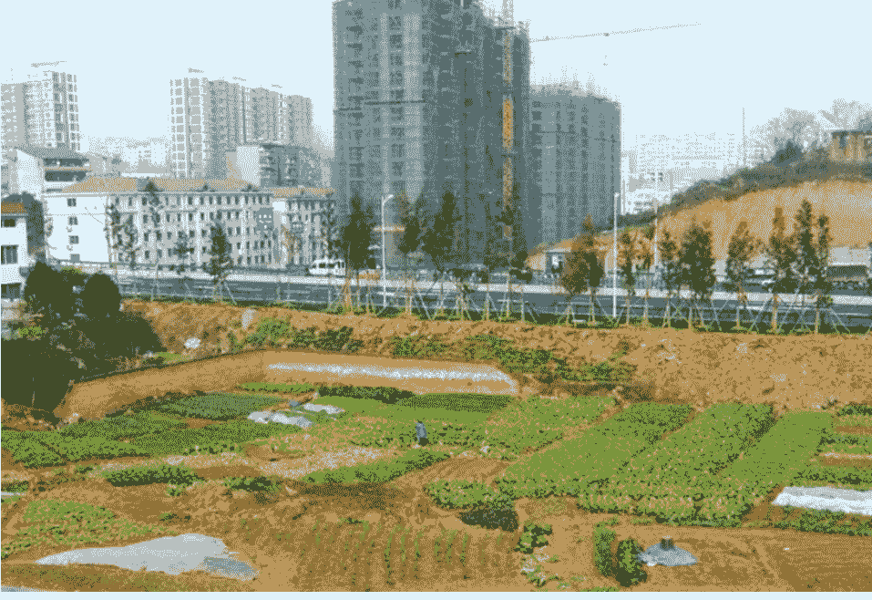

## CAIXIN | 听文章

文 | 财新周刊 王楠

2025年国内首批用于购置闲置土地的专项债在广东落地。2月28日，广东省采用兰式竞价，最终确定“25广东债09”和“25广东债10”两只专项债券的发行利率为1.77%，债券于3月5日起在深交所上市交易。广东省债券承销团的80名成员参与了此次投标。

发行文件显示，两只专项债券规模307亿元，期限均为七年，利息按年支付，本金在债券到期后一次性偿还，募集资金中有304亿元用于收购广东省内19个城市的8亿闲置土地，有3亿元将用于2个新增项目的土地储备。

Wind数据显示，在此次竞标中，投标总规模分别为2028.10亿元和3552.59亿元，全场均倍数为17.78和18.39，边际倍数为2.51和2.49。

债券标的全倍数所有投标机构的总购规模与计划发行规模的比，反映市场对债券的整体需求热度。倍数越高，表明市场积极性越强，对债券的认可度越高。若全场倍数大于1，说明供不应求，能够推动中利率下行；反之则反映市场冷却。

边际倍数是边际利率对应的投标量与中标量之比，体现市场对中利率的认可度，边际倍数大于1，说明在边际利率水平上，投标额超出供给，市场对这一阶段的接受度较高。

“竞标结果说明两只专项债券受到了市场热购，”一名债券分析师称。Wind数据显示，同国债和地方债的到期收益率分别为1.72%，两只专项债券的发行利率优于二者之间。此月20日，广东省发行了八期地方债，中标利率在1.61%至2.06之间，全场均数在16.85至21.93之间。

3月4日，自然资源部和财政部联合发布《关于做好运用政府专项债券支持土地储备有关工作的通知》，从明确发行要求及资金使用、完善专项债申报流程、做好资金和收益的综合平衡、严格监管管理四个方面进行了详细说明。此后，多地发布土地专项债提速。据企业预警通App数据，截至3月12日，已有广东、吉林、河南、四川和江西五省公示了专项储备闲置土地项目的信息，合计收集373块地，涉及资金规模约350.12亿元。

土地收储、开发以及储备管理都需要投入时间和资金，出让对滞土地，地方政府由此产生周期性融资需求，土地专项债则是为此设立的融资工具。专项债由各省份财政部门地方政府发行，以项目对应并纳入政府性基金预算管理，由国有土地使用权来运营。

国内于2017年至2019年发行过一轮土地专项债。彼时房地产市场处于扩张期，土地专项债主要服务于新增土地储备；此后土地专项债被叫唤，直至2024年10月重启，如今房产业进入深度调整期，土地专项债的用途亦转向盘活存量资产，即地方政府贷用于收购闲置土地，市场或将缓后发行。

多份券商研报预测，2025年全国土地专项债的发行规模在6000亿至1.2万亿元之间，这相当于2024年全国土地出让收入的12%至24%，总量资金的流向备受关注。

从广东省土地专项债的资金分配情况来看，项目主要来自国企，相当一部分来自城投。多业业内人士称，大规模专项债投放可缓解地方财政压力，又可改善城投现金流状况，更将闲置土地新入政府调度范围，为后续深化市场供给改革下伏笔。未来土地出让收入能否回升，取决于购房信心能否重建。

## 重启土储债

土储债的启动和暂停，是地方政府债务机制改革的缩影。华创证券发布于2月27日的研报，土储工作流程可拆分为征收、储备和出让三个阶段，前两个阶段资金量较大，部分地方政府需要额外发债完成土储。2015年，《预算法》实施，财政部等四部门联合发文，明确自016年起，省级政府不再向银行贷款，土储资金缺口由国家核定的债务额内解决。2017年5月，财政部、国土资源部明确土储债期限原则上不超过五年，发行额度根据土储需求和土地入状况确定，土储随出现高峰。华创证券研报，2017年至2019年，土储发行规模分别为407亿、593亿元和6765亿元，分别占当年新增债额度的25.5%、42.5%和45%。土储融资规模日益上升，各省份的投资者诉责，部分地方政府在买地之后，迅速发债，面临套利赖疑。

2019年1月，自然资源部明确，自016年以后，多地违规以储备土地作为资产准入，严禁地方政府抵押融资。2019年9月，国务院务会议宣布，考虑到地方政府债务风险，严禁将储备土地用于置换债务以及完全商业化运作。

2021年下半年，房地产行业深度调整，楼市进入下行通道。2023年7月，中央政治局会议再次提出，“房地产市场供需发生重大变化，”此后，地方政府使用专项债券回收闲置土地和商品房销售建议程。2024年10月12日，自然资源部发布《关于运用政府专项债券回购闲置土地的通知》（《通知》），标志着政策正式落地。政策“工具箱”也在升级。2024年12月25日，国务院办公厅发布《关于完善地方政府专项债券管理机制的意见》，广东属于经济大省，应发挥“挑大梁”作用，作为试点省适当组织区域清单，省级政府审核后不再报国家改委、财政部，试点地区可立即发行专项债券，项目清单同步报国家改委备案。

春节后，广东省内各地快速行动，形成储蓄高潮。市场机构克瑞发布于2月12日的报告，仅2月7日至9日，广东省内就有七个城市披露了储蓄计划，涉及地48处，储蓄总价171亿元；其中珠海等地就宣布储蓄9宗，合计66.5亿元。华创证券于2月28日的报告，截至25日，收购安排涉及项目46个，合计超过588亿元。据财新解读，广东省申报储蓄债结合各地房地产市场状况、经济发展前景、“统盘考虑、易后难、后后、分步实施”，但一些地方觉得不及。一名匿名的财政系统人士告诉财新，中央下发每个省份的专项债额度有限，“每个城市之间是零博弈，动作慢的城市就可以没有额度了。”广东省财政厅在省“两会”期间提交的《广东省2024年预算执行情况和2025年预算草案的报告》，财政部下达广东省2025年新增债务限额3213亿元，其中专项债额为3035亿元，储蓄闲置土地是其中一个重要发展方向。

## 部分城投得以“解套”

华福证券报称，在广东省246个拟发债项目中，共有228个项目公布了原有主方，属于第三方机构评级口下的城域共36个，涉及项目规模260.36亿元；另有部分项目的主方为国资房，包括广州越秀、珠海华发、保利发展、华侨城、华润置地等，属于这几家企业的项目规模分别为85.29亿、46.14亿、18.04亿、2.99亿和2.39亿元，合计154.85亿元。上述信息表明首批专项债储备范围偏向国和城域。

信心不足房企融资更加艰难。高杠杆的民营企业是土地市场上的主力军，但在行业下行周期中连续暴雷，即便仍在维持经营的房企，也因现金流量捉肘，鲜与往年相比的拿实力。

卖收入减少直接影响地方财政。自1994年实施税制改革以后，土地出让收入成为地方财政的主要补充，在宽口径财政收入（一般公共预算收入+政府性基金收入）中的占比每年在30%左右。民企退场而国城域规模有限。华创证券报称，2020年至2024年，全国土地成交额分别为8万亿、7.6万亿、3.8万亿、4.5万亿和3.6万亿，其中城域占比分别为22%、30%、48%和41%。然而，部分城域不具备房企开发资质，缺乏房地产开发能力，项目若在市场上下期开发，将形成亏损。

2024年7月，自然资源部宣布，部分城域项下的土地因此开发，形成“无效供应”。

“土储债的一个重要功能就是按地方政府需要资金融资，”前述城投人称，其资金来源五花，地方政府筹措，有时依靠财政拨款，有时需要自行融资，而土储债利率高于政府债意味着意味着笔小的利息开支。

数据显示，广东省内城投购闲置土地的规模不小可觑。华创证券研报显示，从2021年至2024年，广东省土地成交额分别为224亿元和2607亿元，其中城投拿地金额分别为714亿元和840亿元，分别占比22%和32%。考虑到当前各项资产价格缩水，评估估值低于过去几年拿到成本，若按市场评估收购，企业面临账面亏损，城投难以承受。

从专项债地的地来看，收购价格高于市场预期。克瑞发布于2月12日的报告，广东各地公布的拟发债36宗，收购价格相比成交价，整体折扣率为87.5%。在36宗地块中，共有12宗价格高于等于当时拿地价格，最高溢价率为106.8%，其中6个溢价项目出现在潮州、河源和惠州。

## 偿债能力几何

广东省内各地纳入名单的土地储备是专项债资金的使用主体。“土储机构让企业初步上报项目，然后从中筛选出相对成熟的发债，我们再配合准备材料。”一名帮助城投申请债的中介机构称，当前各地仍继续申报项目，此前落选的数百个项目还有机会进入下一批发计划。

发行材料显示，纳入广东省第一债券计划的项目共86个，其中“25广东09”发行14.04亿元，募集资金向广州和惠州地的17个项目；“25广东10”发行193.15亿元，向17个地市的69个项目。两只专项债券的收入、支出、还本、付息等纳入广东省政府性基金管理，项目的偿债资金来源于土地再次出时的收益。募报告显示，其中多个项目是根据项目地块的评估价值和当地增速预测未来土地出让的收益。以广州市房地产开发有限公司的地块为例。募报告根据土地储备项目周边土地挂牌交易信息，选取了距离项目较近的地块作为预测参考，预计土地价格增长如2021年至2023年项目所在地GDP的平均增速4.57%作为依据。假设储蓄块存续期第七年后开始挂牌交易，且全部在一年内出让，该项目能够实现土地收益共计9.96亿元。

募报告显示，项目利用专项债券融资资金6.73亿元，利息1.08亿元，本息合计7.8亿元。“根据测算结果，本项目债券存续期内还本付息资金充足。“该报告，未来土地出让收益对本息覆盖倍数达到1.27，可以实现资金平衡。多名在房企从事投资业务的人士认为GDP增速只反映过去，2024年广州市的GDP增速已滑至2.1%。此外，当前房地产市场仍在坠回稳的过程中，若房价无法上涨，土地出让收入按照上述预期增速上涨，土地能否顺利出让还是未知数。

按照正常的市场逻辑，这块地的确实在未来土地收益难以以覆盖本息的风险。“一名房地产业内人士称，但地方政府掌握土地定价权，即使市场价格下跌，地方政府也可以通过更改土地性质或者提高容积率来提高卖地收入。

所有的发行文件中包含了会计师事务所所出的“收益与融资回求”，结论一致，即预期收益是合理的。多份报告强调，由于预期事项通常并非预期那样发生，实际结果与预测存在差异。《通知》要求，土储债原则上不再适用于房地产开发。上海世纪评估评级报告提醒，在债券存续期间，关注项目收益不及预期，两只专项债的信用等级定为最高的AAA”。发行材料也提醒，风险包括潜在合规性风险、资金偿还风险、市场风险、实施风险、管理运营风险等。数据显示，针对土地出让不足、土地价格增长等情况，等地建立偿债准备制度。

第一批土储债以单个区块项目由多个区块组成，专项债资金可以在同一土地储备项目内不同区块之间调度使用，确保收益平衡。投资者不在文件中罗列债源是否可靠，未来是否存在风险。前述分析师称，由于专项债有地方政府背书，广东是经济大省，债源来源考验各地财政能力。

一名匿名的财政系统人士告诉财新，中央下发每个省份的专项债额度有限，“每个城市之间是零博弈，动作慢的城市就可以没有额度了。”在这一中央化债政策支持下，广东省没有置换旧债的发债额度。但广东各地城债债务高企，导致地方政府债务压力被视为安全控。”上海易居研究院副院长陆跃称，回购只是盘活存量是初步阶段，后续要盘活闲置土地，还需要增强土地利用价值和再开发。

一名城投负责人称，地方政府向企业收购闲置土地必须继续下去。比如越秀地产在2024年8月9月公告显示，旗下区块由土地开发公司收储，金额22亿元，票据用于购买符合条件的土地。

隐债清零意味着地方政府无需为城投承担责任。广东早已在2022年初就开始宣布“隐债清零”，但城投“兜托”的现象屡见不鲜。“现在市场不好，我们确实不想再买地。”前述城投人士称，地方政府向企业收购闲置土地的概率不会再增加，这是专项债向企业倾斜的重要原因。他认为，收储视为地方财政“升级版”——过去地方政府通过卖地获得资金，现在通过发债“循环利用”等地，资金并未流入市场，其作用是为地方政府掏出缓冲空间。“隐性债务”是指地方政府在法定债务限额之外，直接承诺向财政资金还或违法担保等方式举债。

财政部长蓝佛安还称，从2022年开始，财政部连续五年每年从新增专项债中出800亿元，补充财政性资金，专门用于置换债，累计置换4亿元；加上2024年1月全国常委会批准6万亿元用于置换存量隐债，直接增加化债资源10万亿元。由于法定债务利率远低于隐性债务利率，置换后将大幅地方利息支出，“五年累计可节省6000亿元左右”。

# 最新财新周刊 | 社工进医院

## CAIXIN| 听文章

文 | 财新周刊 陈曦 蒋媛婷

“终于要出院了，特别感谢你的照顾。”“北京步入早春时，医务社工刘沛收到了一条消息。发人是听听妈妈。”

听听11岁，患有先天性心肌疾病，已经在中国科学院阜外医院（下称“阜外医院”）住院治疗了4个月。刘沛记得，最初在病房间认识听听时，他“聪明”、有一点调皮、棋下得很好”。住院期间，听听经历三次……

熟的国家和地区，这一职业已经能够深入医疗系统和社区，发挥其独特专业作用，并获得社会和医疗人士的认可。

中国社会工作整体起步缓慢。进入21世纪，医疗卫生机构虽然陆续开始自设立社会服务部，但时至今日覆盖率、社会知名度仍然有限。

中国医师协会社会社工作志愿者服务委员会常务委员、北京医师协会社会社工委员会副主任委员、北京清华长盛医院社会服务部张茴涵，2012年医院筹备时，就提出要发展医社工，但当时国内对这一职业的认知并不高，早期甚至招不到社会工作专业”科班出身的人才。

北京春蕾慈善基金会（简称“春蕾基金”）秘书崔澜馨介绍，目前中国医疗卫生机构主要通过三种方式引入医社工：一是由慈善组织“人带资源”，以救助特定患者群体为目的，主动与医院合作；二是医院向社工机构购买服务；三是医院自聘专职的医社工。2015年以前，行业内以两种模式为主，近年来随着国家提倡、政策支持，医院自聘社工开始稳步增长。

在探索中起步，中国医务工发展开始纳入政策视野。2024年9月，国家卫健委等四部门发布《关于印发医学人文关怀提升行动方案（2024年—2027年）的通知》，再次提及及加强社工和志愿者服务。

肺病社区康复中心的社工指导登记档案和救助申请表。图：访问者提供

“医社工数量达到一定规模，服务更多开展起来，医院也能看到医务工的功能价值。”张蕾说。多位受访者提到，现代医学从传统疾病为导向的治疗模式，以人为中心的模式发展，专业的医务工服务既符合客观需求，又在改善患者体验、保障患者福利、缓解患者纠纷等方面，有重要价值。

国内医社工匮乏，“目前主要是医生和护士承担了一部分医务工的职能。”崔澜馨表示。但在医疗资源紧张的现实中，医护日常忙碌、顾及的问题有限，也没有精力学习和开展专业社会工作。

“需要专业的医社工，连接医院、患者和社区。这成为各方受访者的普遍期待。”

## “他们问，你是护工吗”

大众对医社工充满陌生感。

工作中，刘沛对患儿和家长介绍自己是医务社工，但很少有人真的这样称呼她。“会叫我刘老师，有的家长叫我刘小姐，但很少有人叫我刘社工。”即使刘沛自己，在正式成为医务社工前，2018年进入大学学习社会工作专业时，对医社工也没有明确概念。

2011年，春蕾基金会成立之初，引入了“医社工”理念，这将作为重点和特色发展方向。崔澜馨说，直到近两年，她才感觉到医务社工越来越多地被提起，再往年前，公众对医社工的了解程度几乎没有变化——就是不了解”。

多位医社工坦言，要让这种滋生感中的患者、家属建立信任，进而开展工作，很多时候并不容易。

2023年，刘沛来到阜外医院小儿心脏外科中心，以春苗基金会医社工的身份开展工作。最初接触家长时，她经常听到质疑，“你们是什么人？”“为什么要来卖什么东西的？”

除了防备，误解也不少，“总有老家长问，你是护工吗？”刘沛说。

事实上，在医院场所内，医社工和护工各其职，是两个不同的职业。护工的主要职责是对患者进行生活和日常需求照顾，如个人卫生护理、饮食辅助、移动协助等。医社工则要运用综合社会工作的专业知识和方法，配合医院团队，为患者提供服务，包括患者案例的社会福利整合与政策咨询、社会资源链接及转介、心理社会辅导和支持等，以及运用小组的工作方法，将具有相同病种的患者组织起来，开展活动。

“其实一些家庭开始接触的，最重要的就是钱。”张蕾说。在清华长庚医院，医社工可以帮助患者梳理支持网络、医保报销政策、对接各类专项基金等。2016年，医社工推动成立了清华长庚社会基金，在清华长庚大学基金下，以专项基金的形式资助困难患者。

在阜外医院小儿肺外科，春苗基金会医社工负责“会诊”。这个系统由医院与公益基金合作，医社工定期了解各基金资助条件和各种信息，帮助困难患者对接救助材料、入院办理缴费手续、出院报销与结算环节，医社工会根据需要专门出来，帮助患家庭一站式享受医疗救助、医保资源链接和管理这一重要工作体现。

受访者认为，医社工只被认为是“帮钱的人”，这也是对医社工职业价值的一种片面认知。在清华长庚医院发展，医社工服务时，现实的是，这类患者对医社工接受度不高。医社工工作中，既要调整价值观和理念，严守伦理规范和基本原则，学习医学方面的知识，还要积累案例中与患者交往的经验。

如何让公众理解自己的工作内容，是刘沛日常面临的挑战。以小儿为例，刘沛要做的不仅是简单的倾听和回应，还要建立在专业知识上的服务。她必须掌握医学、儿童发展心理以及相应的心理干预法，还要熟悉与儿童沟通的方法、儿童工作的伦理等知识。刘沛观察到一个简单的例子，医务社工在临床识别有需求的患者和家庭后，首先配合护团队工作。

“我们需要有一个中间角色出现。”倪明辉表示，既懂家庭层面的护、家庭心理，又要了解医院流程、理解医学术语，医社工就可以成为纽带。

这种连接是双向的。倪明辉提到，医务社工也看到医学科学的发展，随着服务的持续、深入，医务社工也会联系其他医院了解到经验。“我们（医务社工）成为了一座桥梁，让很多医生有了更深入了解家庭需求的机会。”倪明辉说。

疾病还有可能层次影响患者的社会心理和整个家庭。江西省萍乡村健康志愿者协会创始人肖莉，2017年起和大爱肺基金达成合作，帮助当地的肺病农民。在协助当地政府处理了起肺病患者家庭的自杀危机后，肖莉决定由医社工牵头，组织一个肺病妈妈支持小组。

肺病是中国目前报告病例最多的职业病，常见于煤炭、矿山、建筑等环境存在粉尘的行业从业者，无法治愈，患者需要长期服药、就医。在很多农村家庭，原本作为主要经济支柱的男性患上肺病，家庭角色不得不发生，妇女不仅突然要背负巨大的经济压力，长期照顾病人也会带来精神上的绝望感看到，50岁以下肺病患者的家庭，不少濒临危机的状态，甚至有肺病家庭妇女自杀。

通过肺病妈妈小组，医务社工定期把肺病家庭的妇女组织在一起，帮助她们肯定自我价值，关心、爱自己，释放和缓解负面情绪，在同类群体中寻找情感支持，建立日常生活中的互助关系。“我们发现（这些工作）是非常有效的。”肖莉说。现在，公益的医社工和志愿者进入肺病家庭，关心患者的同时，也会关注在家庭里照料的女性，试图提供支持。

“在医院父母可能焦虑于治疗，疾病肺病慢慢变缓之后，重症养育、亲子关系这些话题，就会慢慢被上进程。”春蕾基金会医务社工在实际工作中发现，患儿和家长的出院，回到社区和家庭，疾病带来的对社会心理的影响开始凸显。因此，春蕾基金也将此区域作为深入服务的方向。

“医务社工的介入，对患者和家庭的影响是非常大的。医生由于忙碌，对家庭的关注不够，精神也不够。”这位医生感慨，“医社工介入后，让我感觉医生和患者之间真的有一个桥梁。”

## 稀缺的“桥梁”

目前，全国有多少个这样的医社工？作为北京医师协会社会社工作委员会主任季丰英曾提到，截至2022年底，国内设置社会工作服务的医院仅34家，其中独立设置社会工作部门的医院有19家，其中专职人员仅占18%。按照床位算，平均每位医社工负责多少床位？

| 地区/范围 | 设置社工服务的医院数 | 独立设置部门数 | 医社工人数 | 平均每位医社工负责床位 |
| :--- | :--- | :--- | :--- | :--- |
| 全国 | 333 | - | 975 | 100—200 |
| 北京 | 125 | 18 | 306 | 454 |
| 中国台湾、香港 | - | - | - | - |
| 清华长庚医院 | - | - | 40多 | - |
| 林口长寿纪念院 | - | - | - | - |
| 消化内科 | - | - | - | - |
| 神经外科 | - | - | - | - |

张蕾直言，即便高层认为医务社工“根本忙来”。受限于人数，张蕾带领的医社工团队目前只能重点服务一些需求高的科室，其他科室要响应团队求助。“或者不知道来找我们。”张磊印象深刻，“他们当时已经实现了专科化，每个社工负责1—2个科室，在县城、乡地区，医务工更是灵活的。”大爱从2016年起，在全国肺病高发的村镇设立了肺病专科康复中心/站点，目前共建15个。康复中心联动当地乡镇卫生院，为肺病患者提供近医、长期康复服务。他们很快意识到，没有医务工，投入许多资金和精力建立康复中心可能会形同虚设。”

“一开始并没有坚持康复的意识。还有人问我们这些志愿者，你们是谁，为什么非拉我去，你们是不是骗子？”大爱基金助理秘书长张家铭回忆，于是大爱基金开始常态化为康复中心招募、配备康复专员。严格来说，我们的康复专员不是专职的医务社工，他们是在医务覆盖相对较少的乡村，对于肺病这种特殊的患者群体服务的社工，他们的工作包括医社工。”张家铭说。

肖莉记得，刚开始公益时，自己对“社工”这一概念都是很陌生的，一起做公益的伙伴都是自身一定经济实力的志愿者，行健公益的收入三分之一来自志愿者捐款。那时她觉得，帮助别人就要掏腰包“爱心”。成为康复专员后，她逐步意识到，想要为肺病这样一个特殊的患病群体提供服务，必须要有专业的人长期负责农村乡村的医务社工。从2018年起，肖莉将行健公益往社工机构转型，目前机构内有5名专社工、4兼职社工，都是她手把手培养起来的。为了协会发展，还聘请了一名资深社工督，不断提升协会的专业能力。

中国医务社工起。1921年，美国洛克菲勒基金会派遣成员在协和学院等建立了社会服务部。但直到1988年，北京大学社会学系才设立了社会工作与管理专业；直到21世纪，医疗卫生机构才开始自主设立社会服务部，但时至今，覆盖率仍然极为有限，不同地区、不同等级医疗卫生机构的资源倾斜度有很大差异。

除了医院，医务工作的另一域是社区，典型的载体是社区卫生中心、养老院、康复中心等。“现阶段，许多基层卫生机构可能还没有发展。”张家铭说，“此我们是慈善组织救助特定人群目的，资源有限，目前康复专员每月补贴范围是2000—3000元，对比医社工，工作量真的不高。”因此，康复专员主要是在当地热衷公益事业、有经验的应届毕业生中放宽条件，例如学历、专业等。在相对成熟的地区，医社工属于门槛较高、薪资较高的一类。根据美国劳工统计数据，截至2023年5月，医社工年薪6.2万美元，不仅高于社会工作者的5.8万美元，超过了美国的平均薪5.9万美元。“我们希望有情怀来做医社工，最早的一批医社工不是科研出身，而是首先接触医学，再逐步学习、转型。”张蕾认为，最早的一批医社工在清华长庚医院从2012年开始加入医社工，到2015年招聘了第一名，到018年招募了第二名，2022年招募了第三名，也是第一名应届毕业生。受限于人数，医社工学历高、工作负担重，需要一段时间才能真正上手。同时，张蕾提到，医社工的职称评定、晋升通道还在探索中。

对于慈善组织来说，招募最大的掣肘是薪资待遇。张家铭介绍，由于筹款主要来自捐款，目前康复专员工作量真的不高，对比医社工，薪资差异很大。医社工的专业门槛高、培养周期长，发展速度慢。

## 如何被“看见”?

在政策和社会认知层面“被看见”，成为当下医务社会工发展正在迈出的重要一步。2009年，中共中央、国务院《关于深化医药卫生体制改革的意见》首次提出要发展医社工工作。“医疗机构设立医社工岗位”等表述随后多次出现在卫健委《进一步改善医疗服务行动计划》中。

2024年9月，国家卫健委等四部门发布《关于提升医学人才水平行动方案（2024年—2027年）的通知》，再次提及要加强医务工和志愿者服务。

“政策”指挥棒的作用是非常明显的。“张蕾说，“首先要让医疗机构成立专门的部门，开设专门的岗位，之后才能谈医社工的发展。”北京市卫健委2020年发布的《实施意见》中，要求2020年在部分综合性医院和儿科、精神卫生、肿瘤、康复等专科医院以及社区卫生中心试点开展医务社会工作；2020年至2022年，逐步在全市医疗卫生机构推进医务社会工作；到2025年实现全市医疗机构医务社会工全覆盖，服务体系基本完善。2023年，北京市医务社工人数较2019年增加了131%。

如果医院建立了，引入第三方派驻的医社工开展工作，也有很大帮助。倪明辉说，如果患者从医务那里听到“你可以找一个医务社工去详细了解一下”，会容易对医务社工建立信任。“是需要这种宣传的，让大家知道我们是谁、我们在做什么，让医务社会工作在医生和患者之间提供服务的专业人员，职业价值有更多背书，受到更广泛的认可和尊重。”

崔霍誉认为，低头干活的同时，医务社工也需要在公众面前出现、多讲自己的故事，曝光带来的认可，有助于从业者形成职业认同感自豪感。多位医社工坦言，要让这种滋生感中的患者、家属建立信任，进而开展工作，很多时候并不容易。

# 显影 |广州洗村16年拆迁“拉锯”将终结 曾有村官外遇落落

1995年，时任天河区委书记曹鉴燎出珠江城建设指挥部总指挥。他指点人低价圈地、高价卖出，还在地产商和村干部之间牵线搭桥、组合生意伙伴、调整利益分配，并中饱私。

洗村时任党支部书记是卢穗耕，他于1979年当选，连任30余年。“村里从来从不开村大会，也没有任何选举或议事途径，都是卢穗耕说算了。”一个村民告诉财新，村民土地逐年开发，村民的分红却从不见涨。

2009年，卢穗耕为“保留家族记忆”而编写村志，意外曝光了村民集体土地被低价贱卖、数亿补偿款去向不明的事实。还这本《洗村志》，村民确切知道村集体拥有所有可建房的土地330亩，可建厂房的土地130亩。

村民要求公开账目，在自发查证后发现，卢穗耕与曹鉴燎通过虚征土地面积、截留征款资金、私分开发利益等手段骗取自肥，金额可能高达亿元。村民的维权抗争由此开始。

2010年8月，为应对拆迁风险，村民先把两房子保护起来作为留证——其中一栋有八层，属于卢穗耕所有；紧接着的一栋有七层，村民们认为它由曹鉴燎实际控制。面对拆迁队，村民们喊出“要拆迁，先拆村官”的口号。

2010年8月，一片集体物业准备拆除，村民在物业大门外挂海报表达反对。

2013年初，广东省纪委着手调查江新城域崛起背后的土地腐败。当年夏天，龙村七名村干部悉数被查，但卢穗耕已搬家潜逃海外，时任北京市长的曹鉴燎于2013年12月“落马”。

2014年7月，龙村七名村干部先受审，他们大部分是卢穗耕的家族成员。检方指控他们利用职务便利，在与开发商合作开发物业租赁事项上收取取赂，法院认定他们犯非国家工作人员受贿罪，分别判处一年五个月到四年不等的有期徒刑。曹鉴燎因犯受贿罪，并于2017年8月终审获罪并判处无期徒刑。

2011年12月，村集体企业洗村实业公司引入保利发展为改造合作。当时政策，拥有合法产权的房屋则按面积“拆一补一”，对“超建面积”不做回迁安置，而是以1800元/平方米的标准给予材料补偿。在广州，村民合法的产权面积通常限于宅地上地上四层楼屋，超过这一高度属于“超建”，但村民自建房屋至七层并用于出租的现象屡见不鲜。

2016年11月，天河政府发布《关于全面开展洗村改造的通知》，称洗村改造区域内有大量房屋已经拆除，不适宜居住、生产经营，要求“各类违规从业、外来居民人员应自行离开洗村”。

地方政府迫切希望推动洗村改造。彼时，周边的商品房价格已突破10万元/平方米，而洗村恶劣的环境与珠江新城的高端定位格不入。中村内，电线如蜘蛛般笼绕成片“握手楼”，楼宇间距有时不到一米，抬头只见“一天”。村里偶有小片菜地，散发粪水气味。

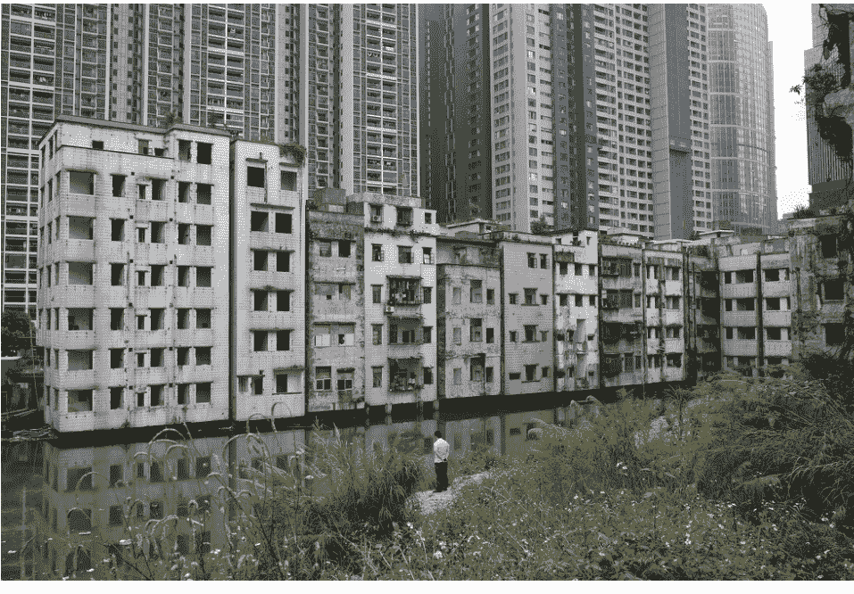

2017年5月，一名男子站在洗村的池塘边上，池塘对面是一排门窗和楼梯都已经被拆除的民房。

2017年12月，一名骑车的男子在范阳大街的废墟旁停了下来，用手机摄像头查看受伤的脸部。

2017年12月，洗村池塘边的钓鱼者。

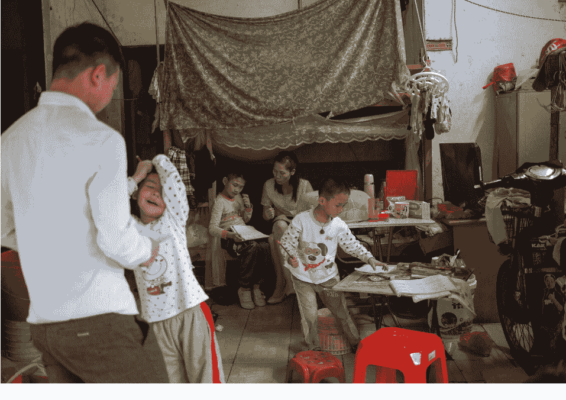

2016年4月，洗村一间临街屋内的一家口。此时，这里一套简单的家具的小居，每日租金只要20元至40元，是周边房的八分之一。

2017年12月，小学生在祠堂前的露地上写作业。平日里，各种人物穿梭其中。有人骑着三轮车回收旧家具；有人拎着麻袋随处垃圾；有人拎着脏兮的面包一路。当时，这里一套简单的家具的小房，每日租金只要20元至40元，是周边房的八分之一。随着房价暴涨，很多村民看到了商品房租金远高于中村，继续拆迁。”一名村民，“周围80平方米的商品房，租金就能搬上我们楼。”

公开显示，截至2019年3月，洗村已签约的住宅144户单位。洗村的拆迁标准仍留在2011年，周围房价存在明显的落差。部分村民说，“原来的房子大概有300平方米，按照合法面积补偿200平方米，剩余部分只能获得几十万元，“不想搬，追不上。”

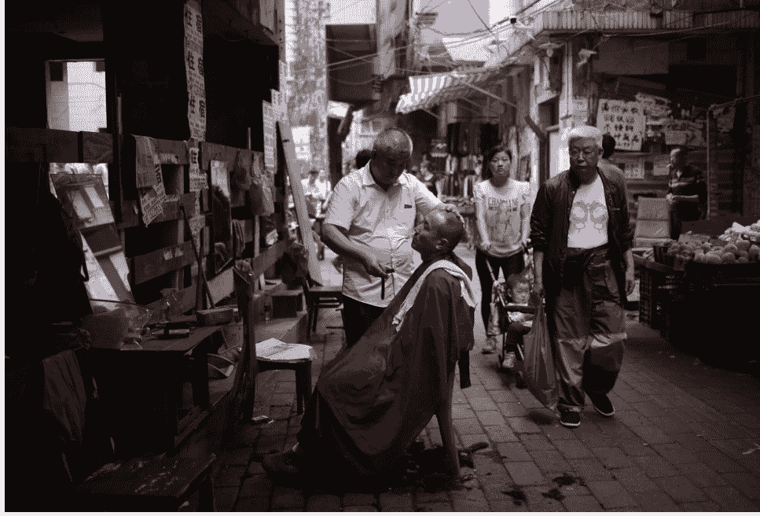

2016年4月，范阳大街的理发。

2016年4月，一名光膀子的男子走进洗村的一条巷子，旁边是被拆掉门窗后的“握手楼”。

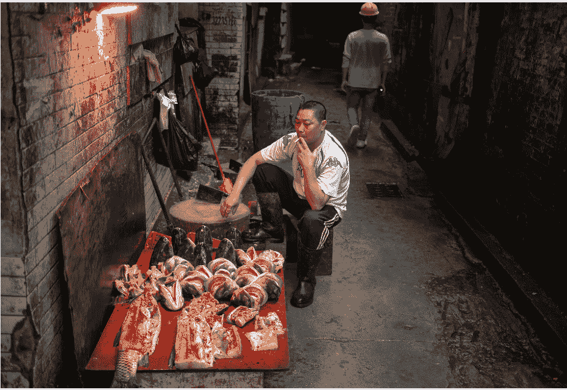

2016年4月，等待客人的鱼档。

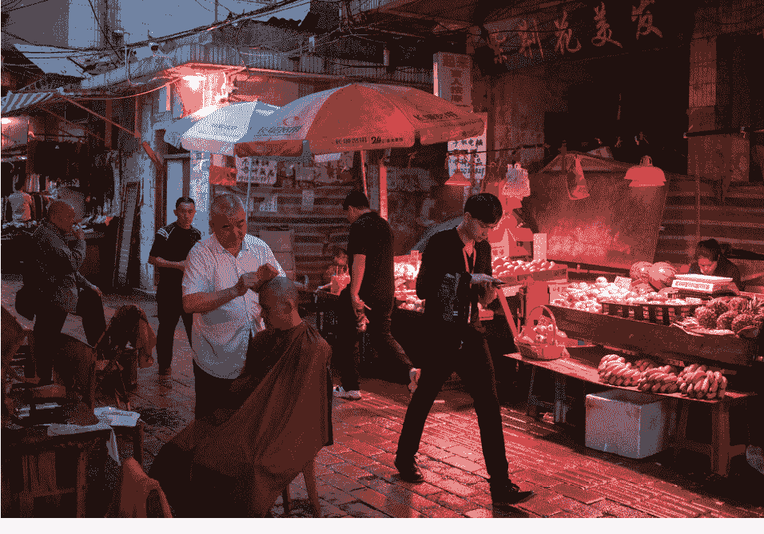

2016年4月，傍晚的洗村“主干道”——范阳大街上的行人、水果店和理发。

2017年1月28日，月初晚上，一对年轻男女骑着单车经过洗村的小路。

据财新了解，从2011年至今，洗村的拆迁补偿方案出一个台了至少七个版本，但最核心的“拆一补一”条款一直不变。“如果给‘钉子户’提高补偿标准，那么此前签约的村民就不公平。”一名早签约的村民。

随着2020年初新冠爆发，房地产又从2021年下半年起进入下行期，民营房频繁“爆雷”，广州多个城中村改造“烂尾”，洗村一部分尚未签约的村民也“坐不住了”，开始积极签约。

2023年11月，洗村未签约的仅剩下不到10户，其中部分村民旅居海外。

2017年1月，新年将至，村里的人所剩无几。

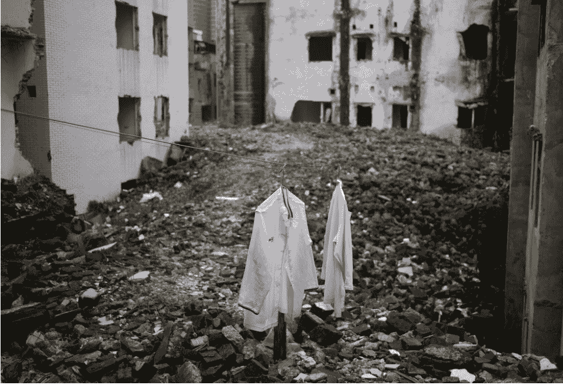

2016年3月，晾在废墟上的工作服。

2018年8月，有人在池塘里游泳。

2017年12月，下班的工人在空地上吃饭。

少数“钉子户”价格较高，是农村改造中常见的棘手问题。《土地管理法》和《民法典》是规范土地征收的两部法律。《土地管理法》规定，为了公共利益，可以依法征收土地。《民法典》规定，为了公共利益，依照法律规定的权限和程序，政府可以征收土地、个人的房屋及不动产。

然而，多名法律人士称，城中村改造涉及大量商业利益，拆迁是否出于“公共利益”存在争议。各地都在探索如何解决“钉子户”难题。深圳2021年3月开始实施的《深圳特区城市更新条例》提出，若旧住宅已签订拆迁协议的专有面积和人数占比低于95%，政府可以介入调解；若调解不成，政府可以依照法律对未签部分房屋征收。广州在探索市内中村改造。2023年12月，广州通过了《广州城市中村改造条例》（简称《条例》）。广州市人大代表称，这是全国首部针对城中村改造的专项性法规。《条例》从2024年5月起正式实施。条例规定，城中村改造项目符合法定情形的，农村组织可以依法收回土地使用权，并按照规定对使用人给予适当补偿。该条例还规定，土地使用权回收后，原使用人在规定期限满后拒绝交回的，农村组织可以予以处理；无法收回的，政府申请法院强制执行。法院执行时，农村组织应当政府予以协助。

2019年11月，洗村改造中的。2023年12月，洗村股份合作社发出《关于收回集体土地的预告》，并召开股东大会进行表决。结果显示，应会人数为3928人，实到人数为3745人，同意股东人数为3535人，超过实际会人数的半数。天河区政府于2024年1月批准洗村股份合作社收回土地使用权。

洗村多名“钉房子”对此提出了行政复议。一份由广州市政府在2024年5月出的《行政复议决定书》，村民认为，收回集体土地的行为不属于村民自治范围，不属于村集体财产和成员权益事项，而是侵犯个人合法权利的行为。

广州市政府论证了回收土地具备公益性，认为区政府批准收回土地的行为合法依据。此后部分村民又提起行政诉讼，“所有法律途径都走遍了”，并未改变原有结果。

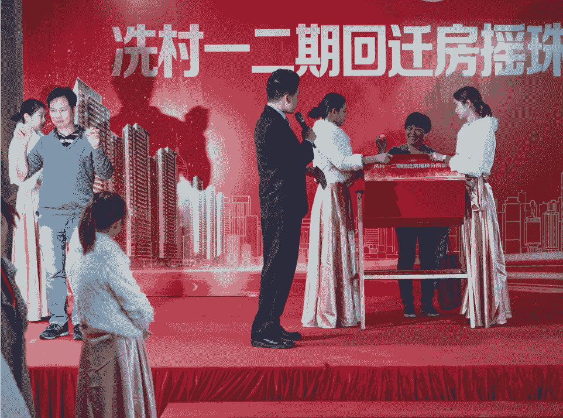

2018年1月，洗村一、二期回迁“摇珠”分房。

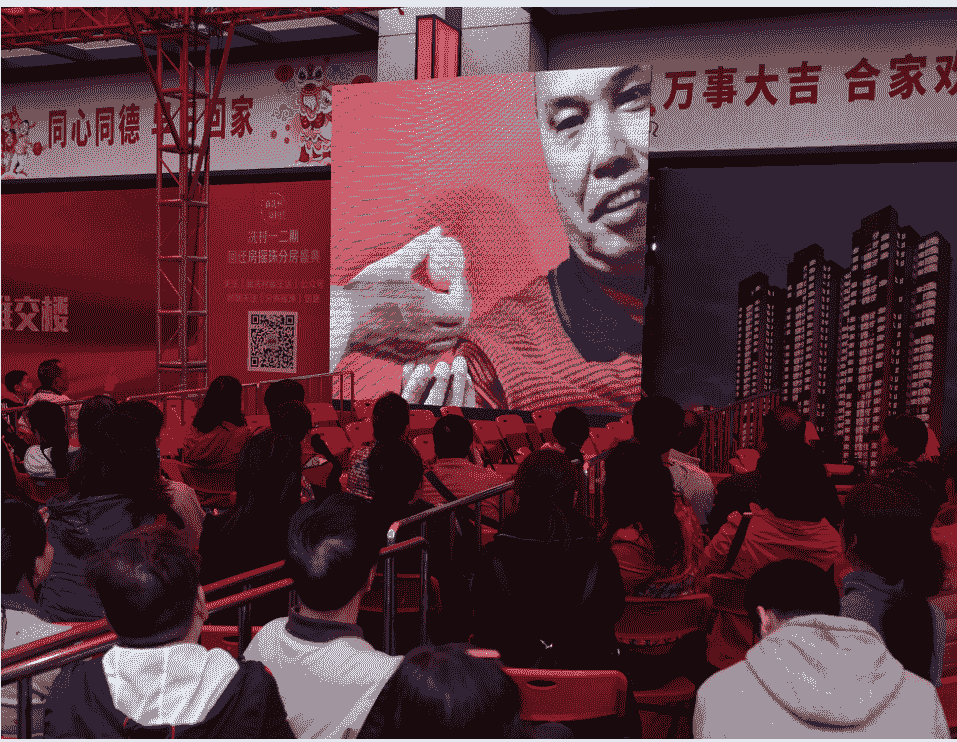

2018年1月，洗村一、二期回迁房“摇珠”分房。

2018年1月，村民参观回迁样间。目前洗村绝大多数村民都已住进回迁房。城中村改造的复建地块通常分为回迁区和融资区两大类。开发商在回迁区修建回迁房和交付村集体的物业，用来安置村民，这一部分地块并不产生直接收益。融资区则用于修建商品房或高端商业物业，产权通常不归村集体所有，而是由开发商出售或租赁。

在法律文书齐备后，官方于2025年1月拆除了融资区的最后一栋原村旧房。“这栋旧房于融资区，迟迟不拆除对开发商的影响非常大。”一名村民称，其他几栋尚未拆除的旧房均位于回迁区，无关开发商的利益。按照规划，回迁区一共需要修建24栋房屋，如今已建好18栋，那几栋还没拆的旧房影响了建设进度。他解释称，绝大多数村民的补偿面积都在300平方米左右，“大家通常都会一套大面积的房子自住，外加几套小面积的房子用于租。”洗村的拆迁分配是在所有签字的村民中，大部分拿到了大部分房，余下面积还需要等待最后回迁。在这些村民看来，“村里还是尽可能通过谈判来解决问题。”

2018年1月，入夜后的洗村。

2025年1月，洗村融资地块的最后一栋民房被拆除。城中村改造的复建地块通常分为回迁区和融资区两大类。融资区用于修建商品房或高端商业物业。2014年3月，洗村召开了第一次全体大会，投票同意收回土地。2010年以前，洗村集体的收入约为亿元，现在分红也从300元涨到3200元，每个村民每年获得的收入和租金收益，当前人均收入远超江新城普通领。

2024年的最后一缕阳光打在回迁包围的一栋民房上。这是仅剩的待拆房之一。

## 洗掉16年愁“拉胯”线路

一名满脸油污的焊工，到全国领先的焊接大师，他只用了两年时间。

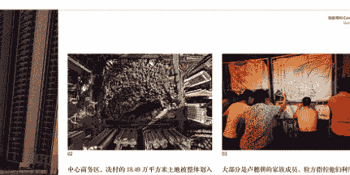

广汽C300型液压机，一种高强度机械设备。由于其结构复杂，尤其是转角焊缝处极易产生应力裂纹，一直是设备生产中难以攻克的难题。2015年，李国华在攻克这项难题时，偶然发现了一种新的焊接工艺。这项工艺被称为“李国华焊”。它不仅解决了焊缝的裂纹问题，还极大缩短了生产周期。2017年，李国华凭借这项技术，在全国技能大赛中夺得冠军。

### 李国华焊

李国华焊不仅在广汽C300型液压机上得到了应用，还推广到了其他产品中。目前，这项技术已申请了多项国家专利。这项工艺的改进，不仅提升了产品的质量，还降低了生产成本。李国华也为企业的技术升级做出了巨大贡献。

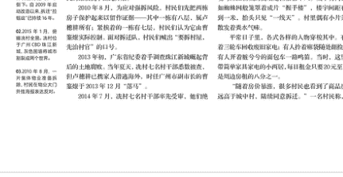

李国华在广汽集团工作了20多年。他从一名普通的焊工，成长为焊接技术专家，他的职业生涯充满了传奇。他不仅在技术上不断钻研，还乐于培养年轻人。在他的带教下，许多人都成为了企业的技术骨干。2021年11月，李国华带领团队攻克了某项关键技术。这项技术涉及到了某大型构件的焊接，通过改进焊接参数和工艺流程，解决了长期以来困扰焊件变形的难题。这项技术的应用，为企业创造了巨大的经济效益。

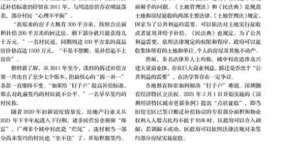

图片编辑 | 董德

# 艺术 | 从知青到普利兹克奖得主：刘家琨与他的“边缘建筑”传奇

## CAIXIN| 听文章

文 | 游旭东

城市、建筑研究者

北京时间2025年3月4日晚，普利兹克奖（Pritzker Architecture Prize）官网宣布，2025年得主来自中国成都的建筑师刘家琨。

继王澍之后，第二位获得该奖的中国建筑师。

评奖委员会认为，面对快速演变的社会和环境挑战，全球建筑界正在苦苦寻求应对对，刘家琨给出了令人信服的答案。他颂扬普通人的日常生活，彰显了他们的集体身份认同和精神追求。刘家琨的作品以其深刻的连续性和稳定的性质，摆脱了各种学术或风格的束缚，对新世界进行了想象和构建。

普利兹克奖是全球最重要的建筑奖项之一，有“建筑界的诺贝尔奖”之称。1979年，由凯西集团创始人之一：普利西兹克（Jay A. Pritzker，1922—1999）和妻子辛蒂莉创立。每年一度，由家族出资的凯西基金会发，奖金为10万美元，“表彰”建筑作品展现天赋、远见与贡献等特质的均衡，并通过建筑艺术，立下对道与建筑环境延续意义重大的的在世建筑师（仅有2015年得主、德国建筑师弗雷·奥托在世后授奖）。

刘家琨获奖的消息传后，全球建筑界都在问：这位来自中国的四川、“中国以外很少有人知道”的建筑师，究竟用什么打动了评委？而对于普通中国人而言，更令人好奇的是，被誉为“建筑界诺贝尔奖”的殊荣，为何会给一位中国建筑界的“边缘”建筑师？

## 01

刘家琨1956年出生于成都，童年在成都度过。17岁时他成为知青，经过三年农村插队生活，终于回到全国恢复高考考试。

刘家琨几乎直系亲属都是医生，童大部分时间都留在母亲所在的成都第二人民医院。但他并未对医学产生兴趣，而是对绘画和文学有着独钟。1978年恢复高考后，美术学院招生极少，听说建筑学也要学，在一位老师的引导下，刘家琨最终选择建筑学作为第一志愿，算是对自己的爱有所交交代。重庆工程学院（后更名为重庆大学）是他进入建筑设计之门的起点。

入学后，刘家琨发现美术学院所绘画和他心中的美术截然不同，觉得认为是“误入歧途”。当美术破，建筑学又不感兴趣，刘家琨将目光向了文学——“我要用一个工具来进行表达。”从那时开始，他把主要精力放在写作上。第二年，他的一篇小说发表在《花城》上，同期文学作家中刘家琨受鼓舞，还拿到了稿——那个年代，重要的是他找到了表达的渠道和乐趣。1982年毕业时，他被分配到成都设计研究院，目标是成为建筑师。而实际上放弃了建筑设计，一心专注于写作；1986年，他调到四川学院，专职从事文学。当爱好变成了一份工作，繁忙的生活让刘家琨烦了一年，又回到设计院，继续白天上班设计，晚上写作。

## 02

刘家琨的话，他最初设计的两个建筑，自己都没见过。

第一个项目在西藏。1983年，刚毕业的他申请西藏建设，在海拔4700米的西藏待了一年——“当时不是建筑吸引我，是西藏吸引我。”一年后，他完成了西藏群众馆，离开西藏几年后才完工。

第二个项目在新疆喀什。1990年前，开发喀什资源，刘家琨作为建筑师，设计了其中的表演中心。和西藏的项目一样，同样没有建成。回国后，只能承接偏远地区的项目，在设计院后打杂，“盖房子”这种边缘与边缘成了他的基调。

1993年，刘家琨来到上海大学画，受到触动，似乎一夜之间领悟了建筑的奥妙。此后，他开始弥补建筑知识。1996年，刘家琨从成都设计研究所职，开始独立承接项目，并在1999年成立现代建筑事务所。工作中得益于川渝艺术界的紧密联系，如罗马的委托。

刘家琨第一个真正有意义的建筑作品，来自罗马的委托，兴建一座私人工作室。这计划令他自己不安，确实面对的是成本低廉、材料粗糙、工艺为现实。基于场地的现实因素和办公室型的定位，刘家琨选用成都的灰色原型，使用鹅石、页岩片等粗犷材料和螺旋叙事动线。

此后，刘家琨又完成了唐鸿、何零、王工作室的设计建造。这批艺术家工作室的设计建造有类似的策略和方法，也构成了刘家琨基本的建筑哲学。在《叙事诗与低技策略》文中，他把握了两个方面：

- 建筑意：“类似于文人水墨画的非职业化和非正规性，甚至将文学方法和建筑设计融为一体。”
- 技术理念：“技术选择上，注重经济上的廉价可行，充分强调对当地历史优势的发掘利用，扬长避短，通过内在的设计哲学和充足的智含量，以低造价和低技术手段营造高度的艺术品质，在经济条件、技术标准和建筑艺术之间寻找平衡点，由此寻找一个适用于经济落后文明深厚的国家或地区的建筑策略。

## 03

2001年，刘家琨受委托在四川郡县设计鹿野苑石刻博物馆。这座不到400平方米的“小建筑”，集中体现了刘家琨的建筑哲学，也是他优秀的作品之一。

博物馆位于一处洛河与竹林之间的空地，设计巧妙利用自然环境，将主体建筑置于林间空地，并竹林作为天然屏障，串起停车场、露区及后勤区域。一条路径引导游客逐渐接近，最终穿越竹林，抵达莲池上的入口，营造引人入胜的参与体验。

在建筑布局上，博物馆采用展厅环绕中庭的形式，充分利用建筑块之间的间隙来组织视线、景观和展品，形成独特的空间氛围。建筑的核心在于“人造石”概念的诠释。考虑到当地技术的限制和后期变化的随意性，建筑师创新性地采用了框架结构、清水混凝土与岩石组合的混合工艺。组合内部的砖块作为混凝土浇筑的内模，保证墙体的垂直度，又起到了缓冲的作用，方便可能的开槽改造。建筑外采用凹凸模板的清水混凝土，旨在形成建筑的肌理，提升建筑的质和可读性。而细腻的分割，巧妙地掩盖了工艺带来的瑕疵。这种设计满足了建筑美学的追求，又充分考虑了实际条件。

鹿野苑石刻被视为刘家琨“文人建筑”理念大成之作，通过自然、材料与空间的融合，重新定义了当代建筑的身份，并在行业内外引发关于建筑本质的辩论。但独特的混合工艺引发了争议。朱涛批评其做法，认为为了让建筑呈现“一块冰冷的石”的感觉，在建筑中采用了传统的组合，导致结构逻辑与形式分离。清水混凝土的使用不仅是建筑方法问题，还是美学倾向和精神问题。而四川学院教授彭雷指出，这种矛盾恰恰体现了当地条件对西方理论的挑战与重构。学者朱晓明认为，鹿野苑是中国当代建筑从模仿西方到回归本土的里程碑。这个项目更大的意义在于，刘家琨以实践证明了“低成本、低技术”项目的可能性。通过他的策略，“它提醒我们建筑的本质不是技术，而是对场域的诚实回应。”

## 04

鹿野苑石刻博物馆后，刘家琨成为中国受瞩目的建筑师之一，进入一个创作高峰。

- 四川学院雕塑楼（2004）
- 四川学院新校区设计（2006）
- 四川博物馆（2007）
- 南京国际艺术展（2008）
- 成都高新区天府软件中心（2010）
- 西村大院（2015）

在这一系列实践中，最打动人心的是一个面积只有19平方米的小房子。2008年地震后，在成都绵市废墟上，刘家琨到了一个悲伤的母亲，他的女儿胡芮都是生命中的一个难关。刘家琨和胡芮互相留了电话，他一直想着接下来要做什么。作为建筑师，他觉得自己最行的应该是为了给女儿修一座纪念碑。

几个月后，在成都一片小树林中，刘家琨找到了一块只有19平方米的地块，在这里建起一座纪念碑，费用全部由家琨出资。这座纪念碑以灾区最为常见的原型，采用框架结构再生建造，表面使用常见的灰，室内外以红砖铺地。单纯、朴素，“这里的内容没有壮烈和宏大，只是一个季节，”刘家琨说，“虽然小，但足以勾起人们的集体记忆；虽然小，是我生涯最有意义的事情。”到现在，纪念馆已经建成16年，定期清洁、修整。周围长得很快，几乎把它覆盖了，小小的房子在树林里多年，他仍然觉得它强烈表达了当时的心境。”

## 05

在刘家琨约40年的建筑实践中，广为人知的作品或许是位于成都的西村大院。

西村大院的总策划和业主是成都贝森投资集团董事长杜垒，他与刘家琨相识20多年，是好友也是合作伙伴。杜垒希望将成都的地方精神与市民生活完美契合，打造一个能够体现本地文化又能满足需求的公共空间。项目启动前，他反复阅读刘家琨的建筑，最终确信刘家琨是唯一能够实现这一愿望的人。

杜垒对刘家琨的信任，源于其作品中“市民生活”的深刻理解。刘家琨曾提到，“建筑应该像容器一样包容多样”，杜垒则希望将西村大院为“城市客厅”，容纳市民生活的方面。这种理念的契合，促进了双方的合作。

刘家琨呈现传统商业体的围合式设计，将建筑外立面简化为“未完成”状态，甚至暴露空调、排水管等设备。这种粗粝最初被市民称为“烂尾楼”，但刘家琨认为这种真实性与市民气息契合。设计中预留大量未定义的场地，如竹林庭、架空跑道等，允许市民自发使用。支持刘家琨将公共空间权利归给市民的理念，并不追求短期利益。西村大院建成后，成为成都市民日常活动中心，树下火锅、屋顶跑道、广场、创意市等场景被自发发现。刘家琨形容其设计为“格子火锅”，将不同功能像食材一样投入“容器”；杜垒作为开发者，则通过灵活运营支持这种开放性。

## 06

西村大院赢得了国内外赞：

- 2016年入选第15届威尼斯建筑年展；
- 2021年在首届三联人文城市奖颁奖上共享公共空间。

评委会认为，这一设计以“超级院落”的恢宏尺度涵盖多元城市生活，完美诠释了“人文、创新、公共、美学”的核心价值观，为中国城市公共空间提供了新思路；建筑评论家唐克扬认为，西村大院通过“回归建筑本质”，以常识对抗奇观化设计，推动社会功能的理性化，展现了建筑对日常生活的真实回应。

《三联生活周刊》用“成都的反向地标”形容西村大院这座建筑。作者丘谦认为，西村大院之所以是“反向地标”，是因为它打破了传统以高度或奢华外来吸引球的模式，转而向内的、服务于社区的公共空间为核心价值，从而形成一种反差。西村大院的“反向地标”特征，体现在空间结构、功能和追求上，它不是一个高上的，而是一个融入居民、提升品质的公共空间。

西村大院是刘家琨实践的缩影。从上世纪末到2020年前，中国城市建设飞猛进，多年间创造了人类历史上最大的规模，无数建筑师受益于进程，刘家琨保持着微妙的距离。在中国城镇化的黄金年代，刘家琨保持着克制的节奏：二十年余三十个作品，不足产出。与许多建筑师相比，刘家琨的作品大多位于西南，他主动选择了“边缘实践”。

另一方面，一些建筑师追求独特的“权力叙事”，刘家琨的创作了一种温和却坚定的抵抗。在某些地方打造建筑时，刻意弱化冲击，转而强调自然、服务社区、预留缝隙，这种。

刘家琨获奖的消息传后，全球建筑界都在问：这位来自中国的四川、“中国以外很少有人知道”的建筑师，究竟用什么打动了评委？而对于普通中国人而言，更令人好奇的是，被誉为“建筑界诺贝尔奖”的殊荣，为何会给一位中国建筑界的“边缘”建筑师？

这种理想主义，在这个时间点，刘家琨获奖如同一场迟到的正名，不仅是对个体的加冕，更是对即将消失的价值观补偿。

## 专栏·媒介化 | 媒介化

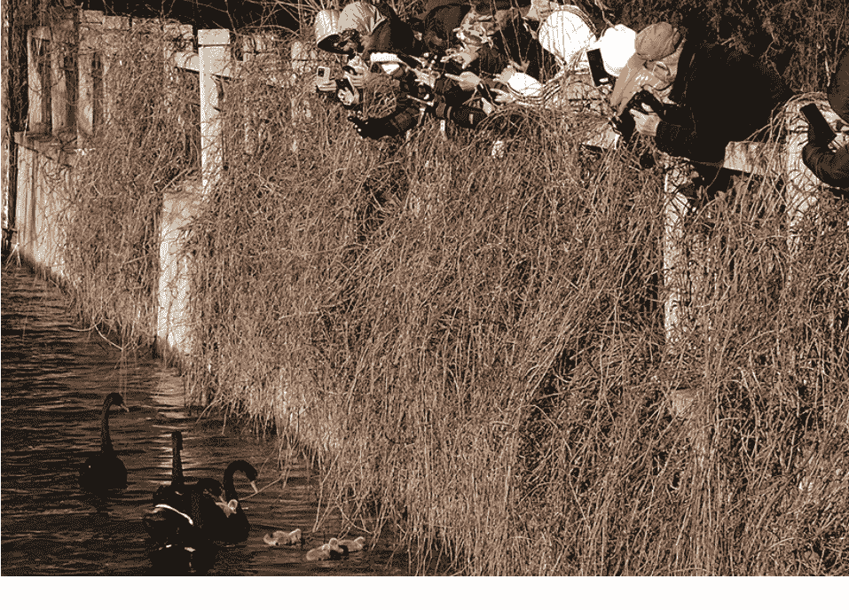

## CAIXIN| 听文章

文 | 刘海龙

中国人民大学新闻学院

上周末，我在昆玉河散步，杨柳绿意临近。在南如意的水面上，看到两只优雅的黑鹅游弋。小家伙披灰色绒毛，圆滚滚，张着粗粗翅膀，不断把头进水里觅食，异常活泼，可能是父母。

这两天，在微信群里，有人分享了它们的照。这周六，我从长春路经过，远远看到面上的黑鹅。一周不见，它们身体肥壮了不少，左顾右旁，憨态可怜。它们排成一条线，两只鹅排列整齐，首尾相连。

这一幕再次吸引了桥上的行人拍照。它们在桥下掉头，向东游逸而去。晚上，我在手机上收到了算法推送的视频。一个名叫“静静不幸”的视频，跟踪了这个家庭背后的故事。原来，幸福与不幸之间只有一线。

今年1月24日，共同孵蛋的雄鹅突然消失。在前两天，没人呼唤，后似乎接受了必须在严谨中独自孵蛋的现实。到2月初，真相大白。有人发现雄鹅被人剪掉了翅膀，扔在另一个沟里，因此无法回家——究竟是谁的，至今未获案。算有好人把公鹅救回来，这对夫妻才能回团。到了2月7日，两只天鹅恢复了轮值守蛋；2月8日，小天鹅陆续出生；2月10日，第六只蛋由于各种原因未能成功孵化。

看着视频，我不信。那句名言也许不对——幸福的家庭背后也有各不相同的故事。如果没有这些故事，天鹅在我们眼中不过惊鸿一瞥，但如今，我对它们有了莫名的切感。

最近，媒介研究里有一个流行概念——“媒介化”。我们看到的天鹅，其实是被媒介化的天鹅。通过短视频技术，将天鹅故事的人们、人类的想象投射在他们身上，比如比鹅的独立倔强为准则，雄鹅被救后逃生，以及小天鹅大死不死。有了这些符号和故事，天鹅们不再只是普通的动物，而是被赋予了新的意义。正如网友评论的那样，人与天鹅不是平等的物种，天鹅的故事扩展了我们的想象世界，创造了一个与动物的世界。

在这点上，我们要感谢让所有人连接在一起的媒介技术。传统媒介形成的正式知识体系往往排除了这类故事。我们在传统媒介接触到的天鹅，要么是生物学的抽象认识，要么是高度选择后的纪录中的动物形象，而是身边的天鹅。然而，社交媒体和短视频激活了这些看似无意义的“闲读”，让身边的普通得以形成自己的词语与历史。这些非正式的知识编织在一起，成为一本鲜活的百科。

新媒体在知识体系上的最大变革，或许在于它提供了大量过去被排除在“知识”概念外的非正式知识，填补了知识到行动之间的巨大鸿沟。如今，这种媒介化。

国父之一坦：富兰克林，这种精神的典型化身。父亲是个造船的工匠，他在一个风云变变的时代，通过自己的努力和智慧，创造了自己的的人生，成为美国历史上最受推崇的人物之一。像林肯、里根总统、爱迪生、亨利·福特，还有热衷于“指南方向”的埃隆·马斯克，都是这种人。不管你不喜欢马斯克，但他绝对算是“self-made man”。

我们有一个徒步群，每周六早晨走十英里。群友John，年七十，出生在蒙大州一家农户。他高中毕业想加入空军，当时正值越战，报名参加空军的，各州对参加空军的人数有限制，蒙大州名额已经报满了。他不想放弃，兵站的人告诉他，得克萨斯人口多，名额得多，听说还没有报道。

一个17岁的孩子，没出过远，带着25美元就上路了，一路便车，走到哪里哪哪里，天黑了找地方猫一夜。在1000英里外终于报上了名。空军教给他修飞机的技术，退伍后，他做机械师，手上有技术，一生工作很顺利，生活得不错。他从军队学的最重要的不是技术，而是人。

John被派往亚州的一个军用场。他接触了当地的军官、士兵和他们的家族、朋友，还有原住民。接触了，他发现当地人在习俗上跟美国人差别很大，但很多观念、价值和诉求却差不多。比如，都想社会公平，让孩子有公平的教育机会。John说，服役的经历让他体会到，生活习俗和文化差别那么大的人，也一样有着人类的共性。这段经历让他变得更宽容，更坦率，更愿意去理解自己不一样的人。

加微信jntg2，免费资料分享群

John给我了一个故事。一个失业的人，把在汽车上去去找工作。路过一个加油站，他问老板需不需要人。老板问他为什么要离开家，他说他讨厌家人的，他们对他不好，不想在家里住了。老板说，其实我们这里的人跟家里的一一样。

过了几天，另一个失业的乡人过去加油站，问有没有工作。老板问了同样的问题，这个人说，老板对他不错，但无奈经济不好，工厂关了，家里人虽然很好，但工作机会太少，出来碰碰运气。老板说，我们这里好缺人，就把他就留下来。

John，年轻这个时候故事他后发达，就是以一种积极的态度对待别人，不要有受害者心态。人不喜欢消人的，人不喜欢受害者心态的人，即使有机会，也会错过的。他批评现在太多美国有受害者心态——我的问题是别人造成的。政客迎这种受害者心态的选民，却对解决问题不感兴趣。

不是每个人都能成为万亿富翁，像John这样从逆境中奋斗出来，就是自己创造的。

另一位是土耳其民奥斯坦瓦瓦尔（Ozan Varol），家境贫寒，但他特别用用，17岁才毕业，到康奈尔大学读科学。在康奈尔，他与火星探索计划，毕业后成为一名火科学家。后来，他去念法学院，又在美国读法学院，转成了法学教授，出了这本《民主政变》。有了终身教职，但他对教书失去了了兴趣，辞掉了法学教授的工作，开始写博客，又写了两本畅销书，其中《唤醒你的天才》（Awaken Your Genius）登上了《华尔街日报》的畅销榜。

加微信intgs2，免费资料分享群

奥赞接受李一诺的采访，讲述了从土耳其来到美国，从科学家到法教授、作家、主播的心路历程。他说，人们对世界都有好奇，但人生每走一步，都要面对对未来和不确定性的恐惧。做自己不喜欢的工作，也可以很成功，但做自己喜欢的事情却可能失败。关键是，怎么看待成功和失败。一个人在工作上可能会成功，收入又高又稳定，但一生做自己不喜欢的事的，这种人，在他看来是失败的。

事业失败与人生失败，哪一个是更惨的失败？可能每个人的答案不同。人生充满遗憾，最大的遗憾，也许一辈子没有做自己真正喜欢的事情。

今年年后，奥赞在自己的博客上贴了一篇短文。他引用作家多克斯特罗（Edgar Lawrence Doctorow）的话：写一本书，就像在黑夜开车一样，你只能看到灯照到的前方，但一直下去，也会到达目的地。奥赞说，这是他听到的的人生箴言之一。

不只是书这样，人生也是这样。人们都希望看清楚自己的人生轨迹，但没有人能看多远，很多事情都是走一步看一步。那些自我创造的人，不是看清楚未来的人生轨迹才出发，而是克服了对未知的恐惧，边走边探索。因为看不清楚，就不愿意行动，只能一生原地踏步。■

加微信jntsg2，免费资料分享群

## 逝者 | 吴家玮：港科大奠基者

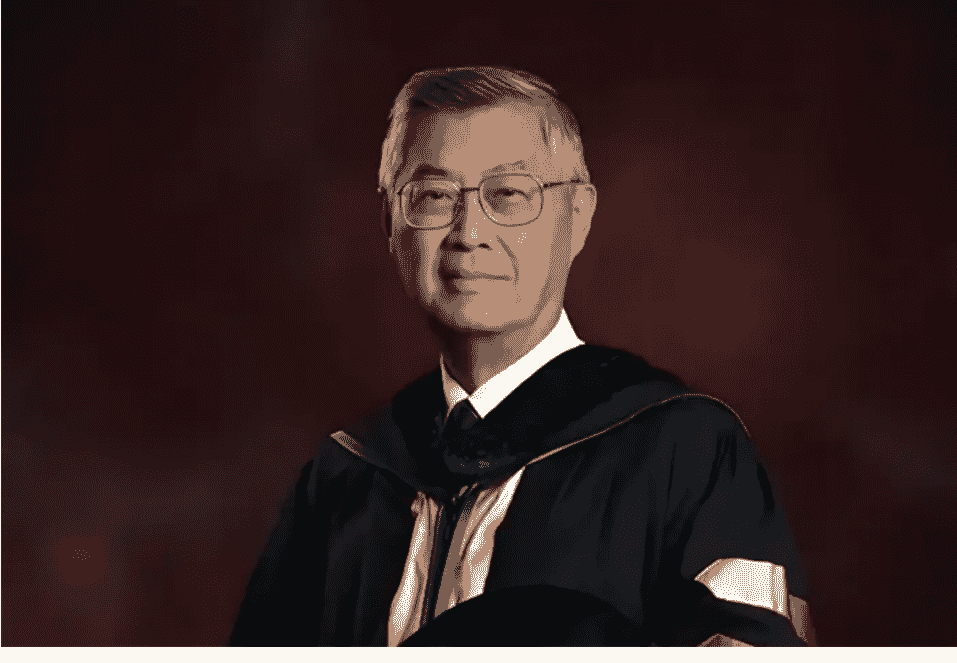

## CAIXIN| 听文章

文 | 陈繁昌 (Tony Chan)

沙特阿杜杜国王科技大学第三任校长、香港科技大学第三任校长

2025年3月日日，香港科技大学创校长吴家玮离世，享87岁。他是香港乃至全球学术界的杰出人物。1999年，他创立了香港第一所研究型大学——香港科技大学。该校的成立激发了其他高校纷纷效仿。

加微信ntsg2，免费进资料分享群

同年，香港的主要资助机构——香港资助局正式成立。吴家玮具有非凡远见，预见到现代化中国的崛起。彼时，香港还是相对贫穷的英国殖民地，前途令人关注。对于科技能为中国和世界带来什么，以及如何在这片土地上，打造国际化的大学，吴家玮有着清晰的愿景。当然，他也不得克服重重困难，筹集资金。此外，上世纪末，说服政治精英和赛会支持，建立一座全新的大学，也是面临诸多不确定性。他取得的成就，我有幸成为港大第三任校长，亲身目睹他开创的事业。自建立以来，世界发生了巨大变化，但他为港科奠定了许多基石。2001—2013年，港大被QS评为亚洲顶尖大学；2012—2024年，其全英文MBA项目连续12年位居《华尔街日报》第一；2024年，数据科学与人工智能专业QS全球第十；高等教育排名第一。这些成就都得益于他播下的种子，彰显了他的远见。

“吸引一流的人”是吴家玮流传在港大的许多名言之一，这一理念一直作为加微信intgs2，免费资料群招募的重要原则。他亲自参与招聘会，到世界各地与潜在应聘者见面。“在充满不确定性的时期，我们才需要特殊的人！”许多人认为这种热情和勤奋源于他的使命感。吴家玮写的《同创科技大学》，我读过好几本。这本书不仅对港科历史意义重大，也为全球新大学提供了宝贵经验。此外，与全球高校相比，他主张学校的所有公共空间都不将学生排除。他也是“大湾区”概念的提出者之一，1997年在港大毕业典上首次提及。近年来，这一概念获关注。他早就预见到深圳在科技方面的潜力，也促成了港科大与深圳合作。因此，他被授予深圳市荣誉市民称号。他对香港特别行政区的贡献，被授予旧金山市长宣布“吴家玮日”，并获得了金山矿勋，以及英国女王伊丽莎白二世颁发帝国司令章。回想起来，我是许多华学者担任领导角色的榜样。我第一次见到吴家玮是在1990年前，在洛杉矶机场，他正在会见聘者。不久后，他在加州洛杉矶分校招聘时，我是他的官方接待协调人。我们在酒店房间里讨论了它对港大的设想和发展进度，这些经历使我之前前往港大担任数学系主任。直到2009年我成为港大第三任校长，才最终的入校——这绝非偶然。吴家玮性格格外敢表达自己的观点。他身上还有特立独立的特质，敢于冒险和尝试新事物。他至少会说三种语言：普通话、粤语（曾读于香港中学）、英语（肯培州哥治学院物理学学士和博士、圣路易华盛顿大学物理学硕士和博士，曾任西北大学物理系主任、加州大学圣亚哥分校热斐尔学院院长），可能还会说上海话（他1937年出生于上海）。

让我引用他在1987年接受采访时作为结束：“对我来说，最重要的是保持对自己文化和背景的自豪感与信心。人们应将此作为珍宝带到美国主流社会吗？如果在这个过程中，我们丢失了亚洲文化中优秀的特质，那么我们还能带来什么没有人过的东西呢？”

■

## 前瞻 | 美国对等关税将生效

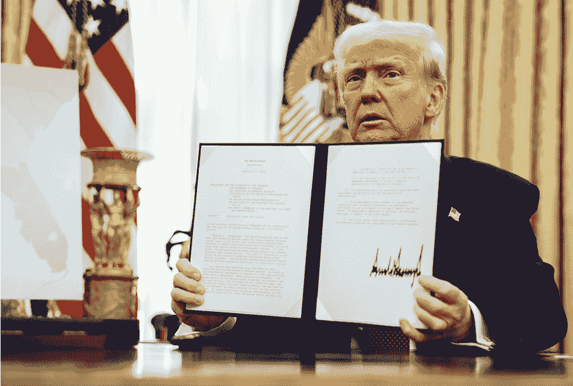

## CAIXIN | 听文章

文 | 财经周刊

美国总统特朗普誓言对全球所有贸易伙伴征收“对等关税”的举措，预计将于2025年4月2日落地。届时，美国将根据贸易伙伴对其设立的关税和非关税壁垒的水平，制定对每个贸易伙伴的进口关税率。

在此之前，特朗普曾于2月13日在白宫签署了一份名为《公平互惠计划》的备忘录，并要求相关部门确定与每一个外国贸易伙伴的“对等关税”。加微信jntsg52 免费进资料群税”。上述备忘录称，对等关税计划将美国工人放在第一位，提高我们在各个产业领域的竞争力，减少我们的贸易逆差，并加强我们的经济和国家安全。

特朗普当时表示：“在贸易方面，为了公平起见，我已经决定征收对等关税，这意味着无论其他国家向美国征收多少关税，也将向他们征收相同的关税。”特朗普曾称，他采取这项举措是为了正美国与其他国家间“公平”的贸易关系，并促使企业制造回美国。在福克斯新闻于3月9日的采访中，特朗普再次确认他计划从4月日起征收对等关税。此次提出的对等关税，不仅考虑对贸易伙伴征收的其他项目、补贴以及汇率。特朗普的贸易顾问、曾任白宫贸易委员会主任的纳瓦罗（Peter Navarro）对媒体解释说，即将生效的对等关税率反映。瑞瑞测认为，对等关税的影响可能出奇地。使美国的加权平均税率提升6.5百分点，新兴市场提升2.2百分点。在美国的贸易伙伴中，印度、阿根廷、印尼、泰国、沙特等国影响最大。加微信52，免费资料群

对于特朗普制的对等关税措施，欧盟委员会在一份声明中回应称，在全球范围内平均适用税率为最低之一，超过70%。欧盟委员会表示：“美国征收关税是在本国公民、抬高企业成本、抑制经济增长并通胀。加剧不确定性，破坏全球市场的效率。”中国商务部发言人亚东表示，美方的对等关税做法必然破坏国际多边贸易规则，对全球供应链造成巨大冲击。许多国家明确反对美方挥舞“关税大棒”，把关税作为工具。

相关视频：【华尔街分析人士：关税政策加剧不确定性

说明：2025年3月3日，美国总统宣布将于2月1日起生效对中国商品在25%关税基础上再征收10%额外关税。由于贸易战爆发，美股三大指数集体跌2.6%，标普收跌4.8%。

## 国凤 | 育儿补贴政策有望出台

## CAIXIN | 听文章

文 | 财经周刊

旨在鼓励生育的全国性育儿补贴政策有望今年出台，国家卫健委会将有关部门起草。据央视新闻报道，3月7日，国家卫生主任海潮在参加十四届人大三次会议江苏代表团小组会议时透露，国家卫生会有直接惠民措施。加微信jnts2，免费群分享

育儿补贴相应的政策安排。此前，国务院总理李强在3月5日工作报告中提到，“制定生育政策，发放育儿补贴”。2021年5月“三孩政策”实施后，地方政府陆续推出育儿补贴，向生二胎、三孩的本地户籍家庭每月或一次性发放现金补贴，直至二胎或三孩为止。截至2024年，全国已有23省在不同层级探索育儿补贴政策设计差异较大，围绕补贴范围、补贴力度等诸多讨论。从补贴金额看，各地区支持差异显著，经济发达地区补贴力度更大。一个三孩之家累计获得的补贴金从最低3000元，到高的10万元左右。3月13日，内蒙古呼和浩市推出育儿补贴，三孩家庭最高可补贴16万元。云南从2023年起，按照二胎2000元、三孩5000元的标准，落户云南的新生发放一次性生育补贴，并按月发放800元。调查显示，47.6%的受众群体希望提高补贴标准，24%的受众群体表示高至1000元/月，愿意生育。亦学者认为，育儿补贴的政策效果不能简单地使用生育水平平衡。对于婴幼儿童养育成，以及与育龄女性承担的隐性成本本来，补贴的意义不在于降低育儿成本，而在于传递政府鼓励生育的积极态度。

全国统一的生育补贴和激励机制，避免生育碎片化和区域差异。例如，育龄人口智库执行长和高级研究员黄文哲认为，改善育儿补贴的关键，是该项政策由政府负责。一是地方政府财力有限，有的提供的育儿补贴的财力和意愿可能不够强；二是因为人口是流动的，地方政府并不是出生率提高的受益者，但无论流动到哪里，都是中国的整体经济贡献者；三是中央政府需要更多政策工具和手段，如发行长期国债或信用债等方式，来支持生育补贴的实施。有地方卫健委曾报告，做好的政策衔接，在国家层面生育补贴制度出台后，当地对二孩、三孩家庭的一次性补贴仍将保留，按月发放的补贴金将不再发放。以现金补贴形式减轻家庭生育经济负担，是全球低生育率国家普遍使用的生育激励政策。据全球人口政策数据，至2015年，全球有55个国家和地区将提高生育率。

加微信jtsg2，免费资料群

此外，还有一些实用的幽默技巧。例如，说出与预期相反的内容，夸张效果更好。数字可以放大幽默效果。例如，当你要说一个意想不到的小数字时，可以说它是巨大的，如“我有大量客户，准确地说是三个”；或者金额是预期中的大数字时，用“仅”来形容，如“我举办了一场婚礼，仅来了300人”。

幽默虽然有很多好处但在生活中并不容易实现。良好的情绪调节能力是幽默的基础，但我们常常被焦虑、抑郁、恐惧和恼怒等情绪困扰。紧张是幽默的最大敌人，如果不允许犯错，或者把一切都看得太严肃，就会让我们紧张，难以展现幽默。不妨试着以轻松的心态面对生活中的压力与挑战，也许幽默就会自然而然地出现，为我们带来更多欢笑和力量。

更多精彩阅读：【专精】心智

## 天眼 | 杜特尔特被捕

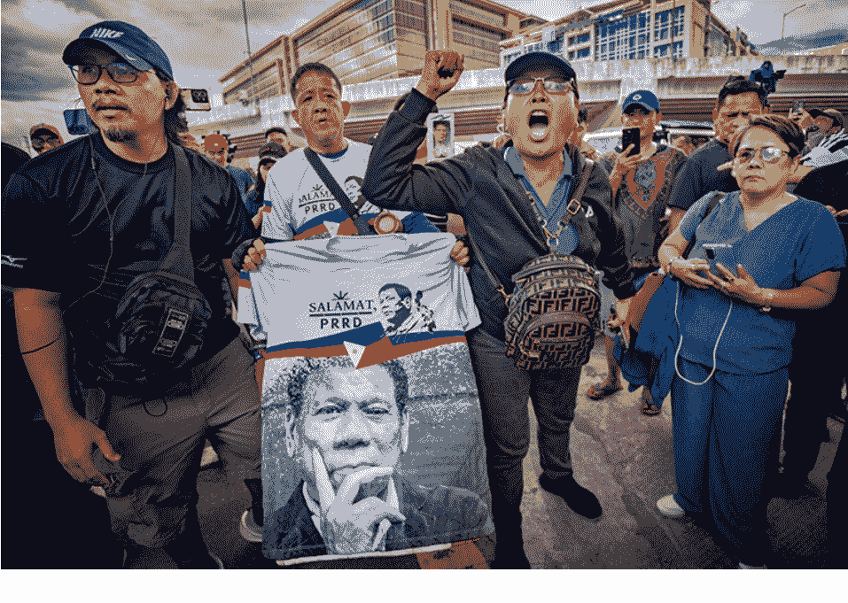

## CAIXIN| 听文章

图 | Ezra Acayan|视觉中国

当地时间2025年3月11日，菲律宾马尼拉，菲律宾前总统杜特尔特被逮捕后，支持者们聚集在维莫尔空军基地外示抗威。因在任期期间备受争议的“禁毒战争”而被国际刑警组织发出红色通缉令的菲律宾前总统罗德里戈·杜特尔特，在3月11日自中国香港返回菲律宾首都马尼拉后，立即遭到菲警方拘留。3月12日，杜特尔特被遣送往荷兰牙，将接受国际刑事法院的审判。菲律宾副总统办公室说，副总统莎拉·杜特尔特12日早启程前往荷兰。莎拉此前表示，她将跟其父亲杜特尔特参加国际刑事法院的审判。
