银行AIC股权等待被吞 18
莱来汽车网 50
星影：育儿式营养 62
中国家电加速全球布局 44
沙漠中的“风光”生意 57
运动损伤医疗缺待补 68

# 界面周刊
Caixin Weekly

# 机器人来了
软件算法工程化+制造规模化
人形机器人远遥量产时刻
P. 26

2025年113月24日出版
第148期
复刊号：32-235
ISSN 2096-1251

本封面设计由 AI 辅助生成

## 免费 价值 及时 专注
## 扫码加入 知识星球TOP 免费资源群
- 每日免费获取价值资源
- 可提供各类资源搜索服务

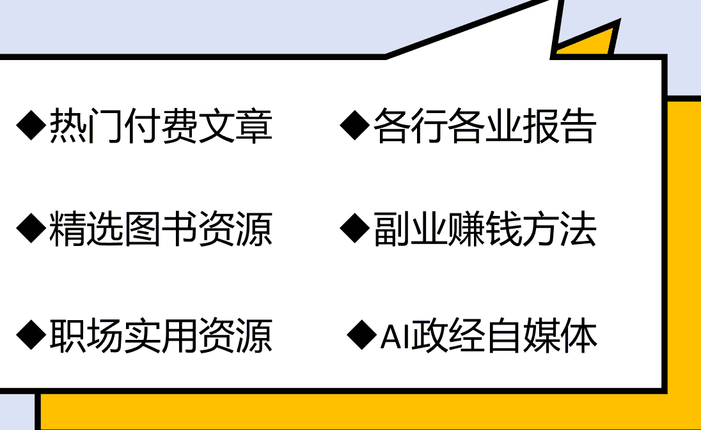

| 热门付费文章 | 各行行业报告 | 副业赚钱方法 |
| :--- | :--- | :--- |
| | 职场实用资源 | AI政经自媒体 |

公众号: 知识星球TOP   微信信号: jntsg8   微信信号: jntsg2

分享资料仅供个人学习，请及时删除，切勿商用传播

## 财新观察 | 为民办高等教育新路径创造条件

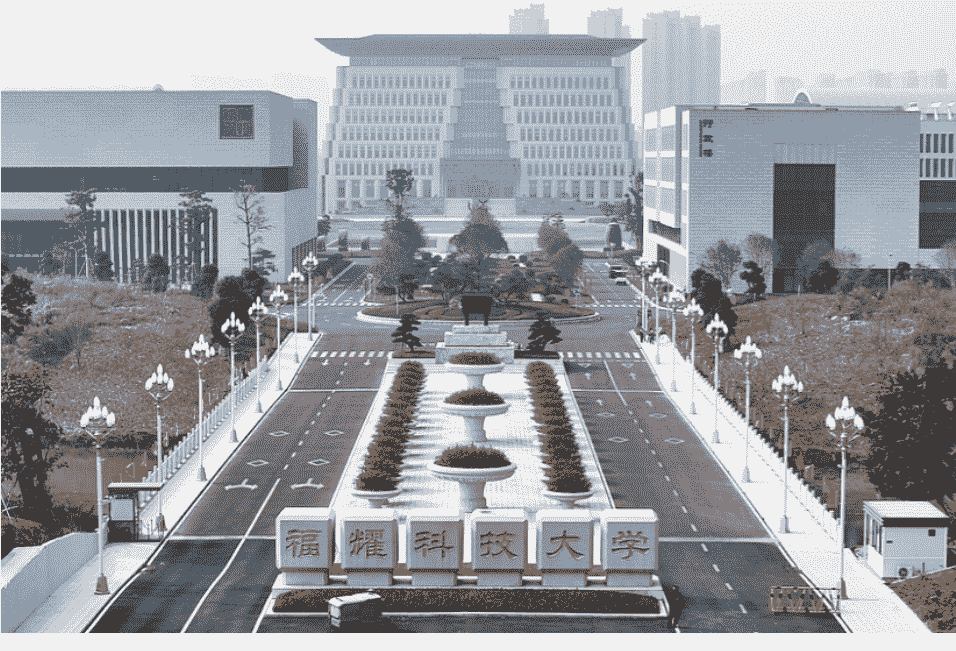

## CAIXIN| 听文章

近日，备受关注的福耀科技大学获设立。该校由知名企业家曹德旺发起，河西慈慈善基金首期捐资100亿元筹办。首任校长为教育家王树国教授。首批设置计算机科学与技术、智能制造工程、车辆工程、材料科学与工程等4个普通本科专业，实行本硕博通的培养模式，招生规模暂定为8000人。福耀科技大学为民办普通本科学校，其成立是近年来民办高校发展的标杆性事件，各界乐见其成。

福耀大学定位为新型研究大学，突出理工科技，着开展制造业科技创新研究。4年前，曹德旺接受财财经采访时明确表示：“我不是想让中国多一个大学，我是想探索一条教育改革之路。”此后，他又多次提及及这一初衷。而首任校长王树国，曾多次提及福耀科技大学与众不同的教学理念。无论是治理理念、课程设置、教学方式和治理体制，校方都有志创新。它究竟新在何处？

福耀大学承载了一代企业家和教育者的梦想。中国经济社会加速发展，全球科学一日千里，校方如何培养符合时代需求的人才，成为无法回避的重大紧迫的课题。曹德旺办学的缘起，一个重要方面就是要解决制造业人才短缺、新兴企业招不到、招来的学生无法直接用等等现实困难。这些问题将影响中国的高质量发展，尤其是制造业的后劲。

应该承认，中国民办高校的质量处于当初设想。多年，民办高校的是“规模优先”和“以学养学”，将民办高等教育成了产业而非事业。在营利压力下，虽然民办高校在校人数占比接近三成，但是，无论毕业生质量，还是教学水平，均未达到社会期望。

福耀大学是一个充满希望的新起点，具备多种条件。除了曹德旺等创办者的社会影响力，教育部门和地方政府大力支持，使得该校建设可以迅速开展。民办一流高校能否建成，到底还是取决于供给和需求两个方面。需求自不须言，创新型国家建设、制造强国战略，不在于唤新型人才，关键在于供给能否跟上。从这个方面讲，福耀科技大学责任任、使命。这还需要尽可能为一切有志于中国高等教育跨越新路的高校创造有利条件。

以基金会形式提供的充足资金，在可见的未来将为福耀科技大学解除了后顾之忧但是，能否实现建校的雄心，还是取决于其法人治理结构。专家认为，民办高校理想的状态是实现党委领导、董事会决策、校长负责、教授治学、监事会监督，并保障教职工参与学校民主管理。对于而言，大科博追踪管理与教学自主灵活的融合，尤其是对教师的考核激励，小到课程申请审批程序和报销制度，无不影响学的综合水平。在福科科技大学，课程设置前沿，各专业打通，本硕博可连选、亦可“中途下车”。但是，探索，就难免遇到困难。到底，还需要重视高等教育法律，让真正懂行的人操盘。名人效应是难得的，然而，要有健康的治理体系，才能确保基业成长。办一流民办大学，有助于促进高等教育改革。自由的学术氛围，充满理想与活力的学校，离开外界的包容和理解。目前，主管部门和地方政府对办大学给予支持。公众期待，今后学校建设遇到种种困难，甚至乏争议之时，各界既往视试验，以包容之心视之。对于民办高校，要在《民办教育法》等法律指引下，切实保证自主和权益。办大学还可能提供一条回报。多年，曹德旺积极捐赠款，通过各种途径公益事业。如果福耀大学以学取得突破，也会对其他有志于回报的企业直接意义。

三十年前，清华校长梅贻琦名言：“所谓大学，非楼堂谓也，大师为谓也。”在新世纪当下，我们不妨对“大师”广义理解：它既学术巨擘，也有情怀，办大学的企业还具有远见卓力持。

## 最新封面报道 | 机器人来了
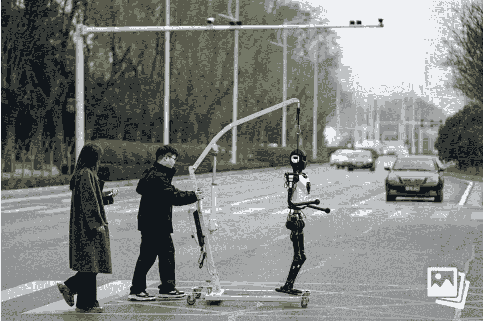

## CAIXIN| 听文章
文 | 财经周刊 杜航 | 刘沛林

深圳市南山区聚集着中国最多、最老牌的机器人公司。高楼林立，这里有“人形机器人第一股”优必(09880.HK)，会做人形机器人的宇树，会做送餐机器人普渡和做仿脸机器人数字华，以及做触觉传感器的戴觅和帕西尼等公司。有的占据写楼层，有的只是住间房子，但所有公司都会有一间实验室，给机器人行走、跳跃等空间。春节后，南山区组织了“企业风采年华”晚会，八家机器人上台，公司负责人积极接受媒体拍摄，“深圳具身智能八大金刚”的说法不胜而起。

具身智能是过去人工智能（AI）和投资领域的热词。“具身”突出了人体形态，核心在于机器人基于人类的物理身体，在环境中进行适应性的感知与智能行动，异于过去数应用于工业场景的机械臂等机器人。具身智能强调“小脑”的运动协调能力，以及“大脑”的视觉、语言和动作的泛化与交互能力。

3月10日，数字华实验室宣布，软件和服务中心总经理陈军和机器人“交流”。图：杜航南山区这场机器人做主角的晚会，像是春的呼应。一个月前，杭州宇树科技的人形机器人登上春舞台，穿着花棉袄、转身红绸，和真人舞演员齐齐地转身。这个节目很快科普了机器人跳舞动作背后技术突破的深意，引起国内外、海外的强烈关注。3月10日，众擎的机器人实验室，工作人员正在整理零件。图：杜航几乎同一时间，杭州AI大模型DeepSeek火爆全球，掀起新一轮AI算力和应用市场的重构与竞争。很快，DeepSeek和宇树科技，因3A游戏《黑神话：悟空》走红的游戏科学，工业机器人公司云深处、脑机接口公司强脑科技，以及空间智能SaaS（软件及服务）公司擎智能，被市场冠以“杭州六龙”之称，概括了目前科技行业较为领先的六大技术应用方向。

3月1日，深圳后湾新区，数十万工业机器人在极氪5G智奔驰，开展全球首批业务人形机器人大规模实训。“杭州”出圈之后，深圳也急于展示。“深圳一家机器人公司工程师告诉财新，春节后，各级政府调研调研、记者采访、网红拍摄，让他所在的公司应接不暇。很快，有很多机器人公司被政府纳入扶持视野，坊间又诞生了深圳机器人公司“十三太保”的新说法。机器人瞬间变得炙热烫手。2024年成立的伯牙智能，主机机器人的“灵活手”，这一部分是目前人形机器人的一大难点，全球范围内尚未能真正达到人类水平抓取、搬运不同重量、软硬物体的灵活手。这家注册在深圳的公司仅有员工，首席执行官（CEO）刘刚说，春节后，深圳、北京有关部门频繁对接，公司尚未决定下一步布局。在国际高盛的“人形机器人强名单”中，52%的公司涉足机器人领域，其余48%的公司或是涉足。高盛调查显示，在人形机器人上市中，73%位于亚洲，且56%位于中国。投资者听到抱怨，缺乏特拉斯和英达，充实人形机器人组合。3月9日，广东省普宁市发布，引入宇树人形机器人及机械姬。除了特拉斯和英达，2024年以来，杭州、北京、上海、南京、重庆等地也先后推出了政策。随着各地对人工智能和具身智能的重视，优秀企业涌现。报告显示，具身智能相关热度进一步攀升。两个月，完全统计，具身智能融资交易达成27起，规模达44.5亿元。这意味着2024年开头，具身智能领域拿到的钱接近50亿元。

除了特拉斯和英达，2025年3月，1000万、5000万。杭州、北京、上海、深圳等地设立创新中心，补助5000万、1000万。到2027年，新增企业20家以上，增值百亿元，实现营收十亿级，关联企业1200家以上。政府扶持、力支持的资金。

泰合资本本身，具身智能赛道负责人涂凝对财新指出，2022年底，OpenAI推出ChatGPT，多模态大模型让机器人有了可能。“人形机器人是一个足够复杂且足够想象力的，AI-Native（作为核心技术驱动）的硬件，符合大家对AGI（通用人工智能）的懂。

不少资本人士认为，在AI、机器人技术上，美国站在一起跑线上；但中国具备更强大的产业化能力。当前，机器人的硬件和小脑运动能力、软件和大脑智能程度都显现弱点；部分公司的机器人整机已进入规模生产状态，2025年将是机器人元年”。野村科技及行业分析师陈冰指出，中国制造的优势有利于发展人形机器人这样软硬件结合。“美国在0到1的理论创新方面有优势，但中国擅长把算法工程化做到极致，并具有规模制造的优势，人形机器人正是这两个特点相结合的”。市场对机器人的定义尚未共识，诸多机器人公司认为，机器人的大脑尚未突破从视觉、语言到自主动作关。相比语言模型拥有巨量的数据，机器人的大脑还需要更多数据与训练。英达负责Omniverse平台、物理AI（Physical AI）的副总裁ReBardian告诉财新，英达推出的Cosmos世界模型仅相当于应对大语言模型GPT-1的阶段，“直到GPT-3，ChatGPT真正对大众有意义，而真实世界比自然语言的规则复杂”。

二级市场的产业链公司已经迎来了一波追潮。年初以来，和宇树科技合作的长盛轴承(300718.SZ)、中大力德(002896.SZ)、双林股份(300100.SZ)分别增长超过189%、140%、79%；同期，其他“人形机器人”概念股绿色波(6688017.SH)、三华智控(002050.SZ)、拓京集团(601689.SH)、鸣志电器(603728.SH)、兆威机电(003021.SZ)等公司的涨幅均超过30%。长盛轴承2月18日公告，和宇树科技签订合作协议并获得订单，尽管该类产品仅为小批量生产销售，在其主业务收入占比不足1%，但第二次股价涨近20%。

## 吸大风口
光源合伙人，机器人赛道将是市场规模十倍于新能源汽车的一个“大风口”。他对财新描绘：“很多家庭都会配备二三个人机器人，这样未来是可见的。”

姜梓锦，春节后具智能的融资热度远超预期，达到了新高度。“节后，众多投资人粉丝踊动与我们对接项目，还有一些投资人深入投入一次后，就加速了投资意向（TS）。不仅如此，其他行业的龙头企业能够奈出奇马，我们与公司创始就场景合作深入。这种充分显示出市场对具智能的高度关注和强烈的投资意愿。

近期，具智能领域的融资事件十分密集。2024年1月，银河通用宣布完成5亿元，整体估值超5亿美元。2023年5月，两次融资合计12亿元。2月，智元宣布完成A轮融资，具身智能是系统及相关工具与平台。2023年1月，幻智能（Noematrix）宣布完成Pre-A融资。非夕智能是，2022年一年内融资了三次，估值超2亿美元。2016年，四名斯坦福大学博士创立，主攻仿人机械臂。2024年1月，魔法原子完成了5亿元天使融资，同时在产线作业检测、物料搬运、取放。2025年1月17日，通用宣布完成3亿元。3月6日，智平宣布完成Pre-A融资。2月26日，逐动力（Limit Dynamics）宣布完成A轮融资，累计5亿元。半年内融资8亿。

二级市场，很多初创公司两年内累计融资，估值达3亿至5亿美元的公司，被归入第二梯队，包括云深、众擎、智平、自景、星创智能等公司，重点研发视觉动作模型等“大脑”技术。市场对这些公司的“梯队”归属或未来走势的判断却不尽相同。

初创团队大体分为三类：一是高校实验室教授和学生；二是自动驾驶公司的从业者，因为技术与机器人的相似性，自动驾驶热潮退后后进入具身智能领域，被部分投资者戏为“自动驾驶难民”；还有来自供应链，新辟出人形机器人产如主业为激光雷达、电子皮肤的越疆科技。

云启合伙人陈俊并不偏好“学院派”，他担心学术研究过于执于某一技术路线，难以在行业快速收获更可行的技术路线切换方向。在他看来，现阶段具备智能硬件的入门不高，很多公司在做低水平竞争，单个企业的融资通常较高。潮起之时，也有不少投资者冷静看待公司自身的营收能力，考察是否有稳定的产品落地。另一边，在好耐心资本，当前阶段需要资本有的耐心，甚至是一定的爱心。云深也希望选择有产业背景、能一起长期走下去的资本。

“大家还处在一个极其好的时刻。”一名投资者对财新说，当下无法证明机器人的真实可用性，但也还无法证伪。另一名市场投资人表示，市场是有泡沫的，但泡沫的背后是期待，投资人愿意这样的期待给出估值。

## 国资和“大厂”入局
随着地方政策扶持、产业基金投资、头部机器人公司开始以各种方式多地开花。3月12日，优必联合北京机器人创新中心发布全尺寸科研教育人形机器人“天工行者”，这是优必首次公开发售机器人。优必2012年成立，2016、2018、2019和2021年，其研生的机器狗和机器人领先先后四次登上晚会舞台，也一度成为私募市场的热门投资的，但其主管收入长期来自教育板块而非机器人业务，也引起广泛关注。该公司在2012年12月在上海上市，北京亚洲投资基金是上市前的首投资者之一。优必首席品牌负责人董康对望绍和郑州工厂、亚比迪长沙工厂、极氢宁波工厂、此前已进入实训、东风柳柳州工厂、北汽北京工厂、一汽奥迪长春工厂、一汽大众青岛工厂等地实训。
发团队也在上海。群众聚是深圳公司，但在此前资有合资本支持，在合肥设立了分公司，机器人组装业务也放在了合肥。

和诸多产业的地理分布类似，京津、“长三角”和“珠三角”是机器人的主要聚集地。华资资本投资行业部合人徐锐等分析，在清华、北京等优秀的人才的基础上，在底层的大型算法领域领先优势；上海、杭州等“长三角”地区则具有领先的制造环境；而“珠三角”背后机器人和汽车制造厂，聚集了强大的机器人供应链。中国机器人在地缘布局，因而许多选择因素。

各地大力投入，积极兴新公司入驻，带动经济转型升级；机器人公司则开始重引入大型科技公司助力发展。2024年9月，华为在深圳启动全球智能产业创新中心，11月签约合作了自变量机器人、数字华夏科技和江疆科技等16家企业；当年11月，新能源造车新势力小米汽车发布了小小米机器人Iron，已进入工厂实训，目标在2026年实现量产。

2025年3月，美的集团建立了机器人创新中心，推出了人形机器人美家，能够听懂语音指令、完成舞蹈动作等。2017年，美的通过购得德国机器人库卡布布局工业机器人。

互联网大厂中，腾讯最早布局机器人行业，此前也已推出五代机器人。腾讯董事会主席马化腾在3月19日的财报会上透露，2024年腾讯的机器人实验室 Robotics X调整了研究方向，主攻增长的云、大数据等：“腾讯希望成为所有机器人厂商的合作伙伴，而不是取代之的做件。”

“人形机器人技术还未能跑通，下一步，大公司是将具智能产业的真正变量。”首程资本总裁叶พันธ์提到，首程控股通过其管理的北京机器人产业发展投资基金，已投资宇树科技、银河通用及星海图等公司，也在看向，期待创业公司在各分赛道跑出赢家。

小米在2022年发布机器人CyberOne，此后一直没有量产。一位长期机器人领域的投资者对新提到，小米在销售渠道、品牌能力、供应链及资金都具备优势，比如即便闯入汽车领域，能够获得成功：“难以想象，再过五年，小米的店里可能出现人形机器人。”

## 技术拐点频频

春春天晚上，十多个宇树机器人玩转手帕，转手帕的抛起、落下或旋转，以及机器人上半臂旋转的同时保持下半平衡，每一个动作细节都需要靠算法精准控制。

一家规模较大的智能公司告诉财新，做到宇树那样抛手帕，需要团队停下的工作，专注研发三到四个月。在硬件上，转手帕需要人的手指、手腕和手臂的力度控制和惊喜自由度，这展现了宇树在电机等关键零部件上的功力。

宇树之后，越来越多的中国机器人开始“竞赛”：众擎机器人表演前空翻、斗狗，宇树机器人则以功夫狗和侧空旋迎来。机器人“小脑”公司乔技物CEO尚阳星指出，目前机器人在运动方面的技术路径已比较清晰，迭代极快，“去年大家还在奔路，今年已经开始做跳舞。”

尚阳星望，对于一台未经调试的人形机器人，乔技物最快一周完成模型训练，让它跑起来。该公司主要为机器人本体训练走路、跳舞等运动控制模型，经过数十次到上百次的调优参数，最终根据运动的复杂程度将源代码定价交付给机器人公司。2024年8月，世界机器人大会（WRC）人形机器人厂商，乔技物服务了其中11家。

尚阳星望，随着制造技术的提升，人形机器人从模块化到骨骼再到外壳，越来越多零部件趋于标品。未来，组装一台机器人就像组装一台电脑一样简单，每个人都有自己专属的机器人。乔技物正尝试从源代码，转向订阅。

走路、跳舞的人形机器人被市场称为“玩具”，一般由人类操控和提前植入代码。涂锐表示，现阶段的人形机器人头部能力类似于三四岁的小孩，展现部分泛化能力，但远未达到成人的操作、工作能力。吴也提到，目前人形人的泛化能力还不强，只能做一或少量的工序，只是在局限的范围内“用”。

机器人需要与外界交互，AI模型趋势已必然。2月，美国人形机器人公司Figure发布通用视觉语言模型（VLA）Helix理解语言和动作，通过这个模型控制的机器人能够“拿起任何物件”。Figure展示了两台机器人的长时间交互和协同：左边的机器人面前有一袋牛奶，应该放在右边的冰箱里，于是左边的机器人拿起牛奶，交付给右边的机器人，由右边的机器人把放到冰箱里。Helix两个模型的语言模型参数只有8000万，而负责运动的模型参数只有70亿，通通过视觉理解动作并制定接下来的动作。目前，最先进的AI语言模型的参数已经高达千万。

Figure称，Helix体积小、能耗低，能够立即投入商用。

中国的机器人公司也在开发类似的模型。3月10日，智元机器人（AgiBot）发布通用具身基座模型——智启元大模型（Genie Operator-1），模型基于Vision-Language-Latent-Action（视觉—语言—隐藏动作，VILLA）框架，由VLM（多模态模型）和MoE（混合专家）组成。其中，VLM借助海量互联网图文数据，获得通用场景和语言理解能力；MoE提供通用的操作数据，再借助百万机器人获得精确执行能力。

上述两家模型在技术流派上被称为“分层模型”，另一模型则是端到端模型，可以用一个大模型直接从人类指令输入图像及文本，输出爪抓等末端动作。1月9日，银河通用发布端到端抓取基础模型GraspVLA，通过“视觉—语言—动作”的数据训练；针对特别需求，仅需样本学习即可迁移。目前，人形机器人所需的重要物理数据，如力、扭矩、运动数据仍然稀缺。中泰证券指出，为了训练Optimus（擎足）机器人，需要收集大量数据，要求其穿戴VR（虚拟现实）等设备，模拟机器人动作（如行走、搬运物品）。其训练过程融合了多个数据来源，包括真实工厂部署、实验室测试以及仿真环境。

2024年，智能机器人在上海、北京、深圳等三个创新中心采集了超过万级真机数据。现在智元机器人投入了近百台机器人，日均采集三万数据。到2024年底，智元推出数据集AgiBotWorld，包含超过万条轨迹、27个任务、五大场景数据。不过机器人承担能力受限，因此在规模数据模型上做推演，用人类演示的视频学习资料。训练中，80%的数据由人类人在实际场景中采集，另外20%的数据在仿真环境中生成。目前，缺乏足够的真实数据是提升智能水平的最大瓶颈。美国机器人公司Ambi Robotics联合创始人Ken Goldberg指出，语言模型训练数据量相当于2亿小时，而具身智能机器人若想达到语言模型的程度，还需要两年。

为了让各类机器人大模型可用，上海、北京、深圳推出创新中心，为创业公司提供支持。北京市经信局局长苏国斌介绍，北京中心自研的“天工”全尺寸机器人平台已面向企业和科研；业内首个高质量数据集RoboMIND，也于2024年底开源，包含五类场景、29项任务、十万条真机操作数据。

## 是否抵达量产拐点？

具智能的软硬件条件处于加速成熟的“爆发”状态，众多公司开始探索产品量产和应用落地，而2025年被某些人士视为“人形机器人量产元年”。2025年1月，特斯拉CEO马斯克称，2025年的目标是制造数千台机器人，2026年人形机器人量产将增加10倍，即五万—十万人形机器人；2027年再提升10倍，至50万—一百万人形机器人。

OpenAI参股的人形机器人公司1X和Figure连续取得进展。2024年12月，Figure称已向客户交付了第一批Figure02机器人并开始工作；2025年1月，Figure AI的CEOBrett Adcock计划未来4年交付十万人形机器人；1X宣布在其总部开发人形机器人。在国内，优选机器人获得了车厂500台人形机器人订单，预计2025年订单将达到1000—2000台；智元机器人也宣布量产超千台，计划2025年扩大销售，全年目标为3000—5000台；宇树科技的人形机器人海外市场销量已破千台。

量产和下游应用落地及需求密切相关。目前，技术成熟的机器人狗如四足人的落地场景较多，部分已经商用，并应用于消费、物流、科研行业领域。宇树和云深处创业初期都主攻机器狗，宇树是全球最早实现四足机器人商业化的公司之一。高工机器人产业研究所数据显示，宇树2023年在全球四足机器人市场销售份额69.75%。

宇树科技工程师王兴兴2024年2月接受采访时透露，他十多年前就开始制作人形机器人，但公司成立初期并不看好人形机器人赛道，原因为传统的机器人控制技术难以满足人形机器人对多自由度和复杂系统控制稳定性的要求。模型的发展推动AI行业步入一轮跨越式发展，也改变了王兴兴的看法。2023年宇树切入人形机器人赛道，8月推出首款人形机器人，当时人形机器人已进入四足机器人六年前所处的阶段，公司未来收入还要靠四足机器人。

葛禹乐指出，目前四足机器人比人形机器人落地容易，在危险、恶劣、复杂环境中更容易完成工作。目前云深处的机器人主要在电站、管线以及应急救援等环境中落地，工业领域其市占率超过85%。相比四足机器人，人形机器人的广泛应用、自动化程度高的是首选。2024年10月，优选发布工业用Walker S1，先后进入东风、吉利、大众、奥迪、比亚迪、北汽、新能源、富士康等企业，智能化是半标准化的场景，且存在干扰。

人形机器人还需要专业知识，公司擅长触觉传感器等高精度的丰富信息。刘联华表示，“这些专业知识还需要博士学习的。”机器人就成本而言，距离替代人类尚有很距离。东方证券报告指出，在工厂场景中，人形机器人放量初期成本为40万左右，三台替代一个人类，回本周期长达7年；若单台成本下降到12万左右，一台就能替代一个工位，回本周期可缩短至0.7年。人形人的经济性能凸显。

工厂之外，机器人可以直接面向消费者售卖，价格无疑是进入消费规模的关键。宇树从2024年5月开始销售单价9.9万元的机器人。众擎在2024年10月发布面向工业与家庭场景的全尺寸通用机器人SE01；又在12月发布面向科研场景的开放型人形机器人PM01，单台售价8.8万元，预计在2025年第二季度首批交付。优选最新发布的“天行者”售价29.9万元，已开放预订，二季度开始交付，首批订单来自自企业。自然之家宣布在2025年提前采购部署500台仿真机器人用于零售门店，自己同时也帮助销售，目标是一万台。很快，越疆机器人推出Dobot Atom，售价19.9万元起，自称为全球首具灵活操作和直肢功能的机器人。仿真脸机器人公司数字华夏的机器人当前售价达80万元，光是带脸真人的头部就标价20万元，人脸背后是29个控制表情的电机。数字华夏公共关系总监介绍，公司正从产业链着手，例如硅胶皮肤3万元，今年量产后期期待降低至200元，随着价格下移，预计年收入将从千万级别跨入亿元级。目前，机器人的主要客户是科研而非普通消费者。最终售价远非本体价格。宇树9.9万元的机器人要动起来，还需要购买配套软件，最终销售给科研院校的价格可能达二十三十万。

> "我希望行业急需打价格战。”初创咏巧手星际光CEO德浩对财新说，产品价格战是在技术有效之时，而在智能领域，大家都在探索赛道，整个行业的“蛋糕”都还小，此时打价格战只能内耗。他希望同行能专注于技术，追求具智能的上限，把机器人做到可用、把市场规模做。

高盛预计，到2027/2032年，全球人形机器人出量将达7.6万/50.2万台，会慢于市场预期。人形需要满足几个条件才能达到量产拐点：首先是解决多个通用任务的通用性，至少才能推动大规模应用；其次是成功率和持续稳健，这对商业化至关重要；再者是快速推理能力，提升工作效率和用户体验。

## 供应链加速落地

量产需求带动上游投入和生产。激光雷达公司总部在墨西哥设立了子公司，形态类似汽车，激光雷达严重渗透。目前，人形机器人供应链尚未成熟，形成了“智能机器人”概念块。从2024年上半年开始，股价经历上涨，主要看特斯拉Optimus（擎足），宇树、智元等头部公司关注。某券商分析师指出，此前市场关心巨头卡位，今年以来整机厂连续计划，2025年是人形机器人“量产元年”预期升温。2024年上半年，量产不及预期，一度导致相关板块“熄火”，个股大幅回调。

人形机器人价值比较高的执行器为例，根据东证券计算，人形机器人需要使用28个执行器，每个执行器价值3000元，对应市场规模84亿元。单一供应商拓普集团和三花配合布局了执行器产品。在核心环节，更多国内供应商进入，实现了国产技术突破，大幅降低成本。例如传动结构——减速器。2021年哈波减速器日系厂商市场份额为42.9%，2024年上半年降至41.6%，下降1.3个百分点。RV减速器市场，纳特克斯、住友等日系厂商从2022年的55%下降至2023年的44%。再如线性执行器中的滚柱丝杠，此前由于生产工艺复杂、进口磨床昂贵而难以量产。2023年内还觉得做滚柱丝杠是非常难的事情，但现在也被国内供应商解决。中信建硕机械首席分析师吕昌称，单件滚柱丝杠报价一度高达1.5万美元，但目前仅为千万左右。类似例子在人形机器人需要的电机、谐波减速器等核心部件上：“随着中国供应商参与，三年前很多核心环节现在不是堡垒了，整个供应链在迅速成熟，价格降低的速度远超预期。”证券测，2022年全球滚柱市场规模分别为85亿元和国内4.4亿元，当产量达到100万台时，国内滚柱丝杠市场规模将达到135.6亿元。主营汽车零部件、机械等公司依靠技术同源性，仍在不断融入人形机器人细分领域。东望证券称，2025年的人形机器人产业领先2014年的电动汽车，随着国内产量的开始，即将开启10年大周期。下游产量需求高度依赖后端控制，并传导压力至整个供应链。以特斯拉机器人2万美元的售价目标来控，供应链硬件成本控在1万美元之内，即便单个零部件均价控在数百元水平，距离目标前千左右还有距离。目前，国内供应链大多没有实现规模化收入，头部供应商还处于向人形机送样的阶段，收入未过百万级别，但有些概念股盈溢率已有百倍，资资炒作痕迹明显。吕刚指出，比较工业机器人对精度要求极高，人形机器人供应商的技术壁垒更低，未来越适配汽车供应商，技术水平不高但市场空间大。“人形机器人零部件技术上的壁垒比工业机器人弱，供应商最后拼的还是改进产线、设备，在同等价下确保利润率能力。”她认为，即便汽车供应商巨头刚入局、下场晚，但借规模制造的经验，更易占据一席之地。

# 封面报道之二 | 人形机器人的科学难题

## 相关视频:

+   盘点迹身各行业的机器人

# 封面报道之二 | 人形机器人的科学难题

## 相关视频:

+   盘点迹身各行业的机器人

视频说明：近年来，无所不能的机器人频繁出现在我们的视野中，各种技能更是令我们瞠目舌舌。它们不仅在服务业频繁亮相，就连弹琴、指挥、播音主持也不在话下。

机器人——它通体坚硬、身姿很灵活，躯和髋部之间可以360度旋转。

这位意大利大科技宅男把开箱视频上传到网络。他从快递盒里取出了一块电池，电池的灰色外壳光滑，有多个接口和状态指示灯，一切尝试完毕按下开机键，机器人从仰卧姿势做了一个标准的“鲤鱼打挺”，左右晃了晃最终站住了。这个动作被称为“动态复位”——通过模拟生物力学特性，结合关节扭矩与平衡算法得以完成。

1月28日除夜，16台树人形机器人H1穿着白色棉袄围相春，与新疆艺术学院16名舞者共同演绎节目《擎擎BOT》，机器人协调跳转整齐划一地跳舞，展示了“侧起手转手”等动作。

春晚之后，魔术师刘谦在春晚后被其名为“瓷器”的视频在网上流传：刘谦说“握一个”想去找机器人握手，没想到机器人就地躺倒“卧一个”，刘谦对着镜头摇头手大喊：“不是我的！”

与人类一样，机器人的运行方式是持续循环的过程——感知、规划，然后行动。首先感知外部环境，提取出有关信息，将这些信息传递给规划模块；根据要实现的目标，规划模块制定下一步计划，将其传递给控制器；最后由控制器驱动机器人相应的动作。

生成式人工智能（AI）的出现，极大推进了机器人对自然世界的理解，语言模型也成为机器人规划模块的核心，深度神经网络结合其他技术，使机器人的感知和执行模块得到大幅提升，经过无数次训练和迭代，才有了机器人在春晚舞台上搂欢歌的一幕。

但在此同时，机器人距离真正的智能还有很长的距离。“人类预测两百万公里之外的小行星运动，远比预测机器人抓取物体时的运动要准确得多。”美国加州大学伯克利分校工业工程与航天首席教授肯·德堡（Ken Goldberg）总结道。

机器人经历了怎样的发展之路，到目前，它在科学层面已解决了哪些问题？当下大热的人机智能取得了哪些突破，又面临着哪些待解决的难题

## 运动控制的演进

在科学层面，机器人的发展真实反映了人类自身的进化过程。百万年前，南方猿“露西”将前肢扣紧岩礁，脊椎拱起，像弹簧般收缩的后肢，撼动了人类进化史上最大的革命。从此人类能够更有效地丈量世界，有了更广阔的视野，并让双手成为专门负责执行操作的器官。视觉感知和双手使用复杂工具促进大脑的发育和进化，一项颇有意义的“进化突破”便是人类可以用手势传递信息，从而发展早期的语言。

运动、处理感知和信息、执行操作，同样串起了人形机器人发展的线索——人形机器人最大的优势就是未来可以无缝衔接类人社会，进行信息感知并执行任务。

由于要与物理世界交互并执行任务，从机器人诞生之初，运动控制就是首要需要解决的问题。许多学者认为，当前阶段的机器人，运动控制是其发展最为成熟的部分。春晚机器人展示的舞蹈，就体现了智能的高级运动控制。

60年前，美国通用汽车公司在莱西工厂安装了首台Unimate机器人，负责从压铸机中取出灼热的金属部件。Unimate需拿起手臂将焊枪精准压对车架连接，操作员手持胶站在一旁，手动引导这台钢铁铁龙走完3米的焊接路径，过程中将每个关键点的坐标逐一录入控制系统，每经过多次。这些机器人的“智能”表现为严格遵循人类预先定义的动作。操作员通过逻辑引导，将每个动作分解为数百个坐标点，再逐一调试速度与力度参数。当时，稳定运行一套焊接程序往往需要耗费周期，假如一个工件的位置偏离2毫米，整个生产线就可能崩溃。

美国一家龙头科技企业的仓储机器人工程师介绍介绍，早期的工业机器人依靠刚性的程序逻辑，只有记忆和存储能力，对环境没有感知和反馈。机器人严格遵循循环轨迹，对任务的执行精度依赖齿轮等机械结构的物理精度，误差则需要人工调试补偿，齿轮旋转后还需要校准。生产线也必须维持高度结构化的环境，工件严格按照角度放置，一切必须到位、清晰且预测，甚至严格控制光照和波动。

1978年，日本工程师开发出第一款“取放机器人”SCARA。它能够快速将小型元件插入到位，至今仍在制造业广泛使用。“取”和“放”是运动控制中的关键环节，这两个动作需要高精度定位、路径优化和实时反馈。

2004年，波顿动力公司发布“BigDog”，虽然不是完全自主，但它拥有一个传感器和一个载计算机，可以管理姿态并保持稳定。这意味着机器人初步具备自主能力，可以利用传感器获取环境信息，识别、理解和反馈。

2012年，一种经典的神经网络（CNN）在ImageNet的大规模视觉竞赛中，以84.6%的识别率，宣告深度学习的崛起。这项技术迅速渗透至机器人领域，机器人的“眼睛”和“大脑”配合大幅提升，很快就能锁定目标。从此AI和人都进入深度学习时代。

许多学者认为，神经网络的出现彻底改变了机器人研究的方式。斯坦福大学教授、AI领域知名学者李飞指出，大量神经元、GPU提供了强大的计算。2022年7月，美国哥伦比亚大学的研究团队首次实现了无需人类干预的全身运动模型，构建了能够识别损伤的机器人，单腿故障时仍能通过动态调整平衡。

年后，瑞士黎世理工学院Anymal的研究成果认为是运动控制层面的一个突破。实验中，Anymal四足机器人在单腿完全失效的情况下，仍能通过调整扭矩分配平衡。这一机制借鉴了人类小脑原理，让机器人能够在复杂地形中执行门、按按钮等精细操作，为后续人形机器人提供了关键技术。有趣的是，这一突破与生物进化途径同一——狗在快速运动时会交替接触，形成了三角形支撑结构。

对机器人的需求始于上世纪初，如今机器人仍在进化。前述仓储机器人工程师介绍，这几年生成式AI出现后，能生成很多真实场景，不仅便宜速度也快。对企业来说，环境标准化极其复杂并不像20年前那样严格要求，目前学术界在运动控制方面仍在积极探索基于物理模型的控制方法，未来的研究可能会集中在如何有效结合两者的优势，解决数据准确性、模型稳定性和系统效率方面的挑战。

美国一名学者提到2016年AlphaGo对机器人研究的影响。AlphaGo向大众展示了它下围棋的能力，机器人研究则迅速跟随AlphaGo背后蒙特卡洛树搜索、强化学习等技术迁移到机器人研究上，让机器人能像下棋一样快速进行运动规划。

AlphaGo会在思考每一步时推出“最有希望的一步”，机器人也用类似方法，在规避障碍物时排除“撞墙”选项，并分析合理的移动方案。AlphaGo在自在训练中对快速提升，这种被称为“强化学习”的方式日后成为机器人训练的核心思路；机器人不再遵循“钢铁逻辑”，而是像人一样灵活调整。遇到滑地面时会模拟不同的走路，像在游戏里试存档，找到最稳妥的落脚方式再进入下一步。“如今机器人能翻滚、跑酷、跳跃，很大程度上依靠的就是这种技术升级。”

DeepMind工程师、AlphaGo创始人大David Silver 显然认为AlphaGo只是在围棋上有所建树，他在2016年的演讲中表示，如果算法能像人脑神经网络一样实时重构决策路径，动态调整神经连接强度，机器人将突破任务专用限制，实现跨领域自主学习和推理。他期待的是拥有神经网络，能够在交互中成长的机器人智能，是当下热门具身智能。

## 具身智能的现实难题

清华大学具身智能实验室，研究人员正在操控机械臂打开盖子。工作台前方固定了一个摄像头大小的双目深度相机，锁定了工作台后方的机械臂，记录机械臂和末端灵巧打开罐盖整个过程的三维空间数据。

这部相机集成了双目视觉、飞行时间距离、激光雷达（LiDAR）技术、支持人脸识别、物体检测及精准轨迹功能，可以为研究人员清晰绘制出动作的点云数据，即在一个三维坐标系统中的一组向量的集合。实验室内，支撑相机的三脚架被缠了几圈胶带，牢牢粘在地面，防止移动产生的震动或不小心碰撞。

为了培养罐子，也必须为基础元素进行重新适配。研究人员将体内装满大米增加罐子的重量和稳定性，底部还粘贴在了护甲板上的滑带，增加与光滑地面之间的摩擦。这些细节使得实验成功率大幅提升，确保了实验的重复性。

研究人员标记了6个点位，大米放在下方的点位，改良后的机械臂可以在多个位置灵活开启罐子。这种演示程序插入槽、旋转、旋转、轨迹数据同步系统，就是一段演示素材。研究团队利用开发的演示器制成了散射器，整个过程耗时20多分钟。之后，研究人员将大米放在不同的位置，测试模型是否能够适应位置的变化，如果机器人都能自主完成罐子，就意味着非常成功。

清华大学交叉学院助理教授、具身智能负责人许哲评价道，这套演示验证了机器人的泛化能力，即机器人在面对不同场景时灵活适应。虽然还不够稳定，但幸运的是，大量实验数据显示，机械臂在任务中成功率高达74.6%。

“过去，这样的事情是很难实现的。”许哲说，“机器人领域最大的变化是，他们不用建立模型再编写程序，可以让系统通过自我学习建立模型。”

许哲表示，如今通过数据驱动，无论是机器人自己出错还是获得数据，还是人类给的示教数据，都可以更好地让机器人学到原本做不了的事实。他认为，当具备智能的核心难点就是泛化。泛化意味着拥有能力去完成未学习的任务，可能是举一反三，也可能是基于理解进行更复杂的任务。具备智能更多讨论在物理世界的泛化，如执行一个任务时物种种类、空间位置等等变化，甚至有人破坏了任务过程，机器人也要应对，这是泛化要解决的难题。公众不再懒搜索，人类专家群体共享。

让机器人能够揽家，是很多人的梦想。虽然机器人已经经历了漫长的时间，但机械手臂很难做到大力。同时它“眼睛”观察到的、“手指”感受到的软硬，不像石头那么硬，也不像面那么软，这种具有弹性的微妙之处是机器人目前的难题。

中国科学院院士、清华大学机械系教授张哲指出，机器人智能的发展需要身体为一体。身体并不是一个简单的容器，它为智能的发展提供了方向和基础。人类进化的过程中，身体的结构和能力使得我们的智能能够朝着特定的方向发展，身体能够与世界进行交互。

智能的种子在1950年著名计算机科学家艾伦·雷提到他在经典论文《机器与智能》中首次提出“智能需要物理世界”设想。随后20世纪中，AI的研究被符号主义主导，学者们执于用数学符号模拟人类思维，这一路径在上世纪80年代遭遇现实瓶颈。以视觉而言，它是人类认知和获取的基础。1986年，麻省理工学院团队设计出了六足机器人Genghis，它不依赖程序，仅凭简单传感器就能跨越险地形。这个时代的实证证明，实体与环境直接对话可以实现智能。

2009年，李飞实验室发布了包含1500万图像的ImageNet数据集，视觉算法的速度和准确性迅速提升。此后图像识别引领了一段时间AI的发展，再到物体切、动态关系检测，使用人类自然描述照片。2015年扩散模型出现，可以用于图像去噪、图像修复、超分辨率合成、图像生成等任务。扩散模型推动了生成式AI的发展，可以将人类的输入转化为照片和视频。2024年，OpenAI发布了视频模型。

2022年间，ChatGPT模型出现惊人的语言理解能力，谷歌迅速与其机器人融合，将RT-X系统能够理解“把水递给沙发人”。此后OpenAI与Figure公司合作的人形机器人Figure01登上舞台，它利用双目摄像头识别工具，用灵活的机械手指组装乐高，整个过程无需代码。

香港科技大学电子与计算机系宋荣教授、机器人科技有限公司创始人王斌从上世纪80年代就开始研究机器人。他向财新表示，机器人领域最大的变化是，他们不用建立模型再编写程序来操作模型，而是可以让系统通过自我学习建立模型。大模型基于深度神经网络构建，迅速成为机器人规划的核心。向机器人输入指令，比如输入“我饿了，给我要拿的”，机器人就会生成一系列动作完成任务。

真正的智能有多远？

德堡说，指令的确定性与感知、控制以及物理世界的不确定性是对矛盾的。感知力面上，机器人拥有高分辨率的摄像头，但摄像头无法提供正在发生的事情的三维结构。激光雷达等新技术可以使用光束构建环境的三维模型，对科研人员来说还不够。比如物体上有阴影或透明的东西、空洞，光线就会出现不可预测的失效，在图中产生声音和空洞，机器人可能因此无法判断物体的情况。

控制方面，每个不确定性只会产生非常小的错误，但这些错误会积累起来，操作就变得非常困难。物理层面，机器人推动桌上的瓶子，即使每次用完全相同的方式，瓶子几乎不可能落在同一点。因为物理世界的影响因素很多，例如瓶子滑动时接触的表面是否光滑。

许华认为，解决精细操作的难题有两个角度：一个是模型，二是数据。在模型方面，要考虑能否调整网络结构、损失函数等架构上的算法；数据方面，要考虑能否采集到更多、更好、助于试错的数据。

就数据而言，机器人还没有真正意义上的“大模型”，因为机器人需要的数据不像文本一样“生来”在电脑里就是标准化的。王煜提到，研发灵巧手非常复杂，尤其是触觉传感器的相关技术。过去触觉传感器的应用不多，研究的人并不多。这两年来灵巧手的需求增加，大家才开始关注。这项技术发展还处于起步阶段，需要大量的科研和资本投入。

硬件方面，如果机器人能够进一步具备抓取物体、获取信息的能力，那么控制能力就可以像机器人一样学习来获得，这涉及操作控制的流程规划和底层的电子信号传输与电机响应。这种模式还处于尝试阶段。

是地飞行原理的深入理解，“真正的科学是不同的，需要掌握空气动力学等科学，精确计算和设计飞机的形状、结构和性能，从而确保飞机能够飞行。”如果说AI是知其其然，科学家们还需要更长的路去知其所以然。■

## 相关视频：

[优必选科技人形人气亮相香港，共话“科创重塑新蓝图”]

视频说明：2023年6月，优必选科技首首席品牌官曼曼谈人形机器人面临的机遇与挑战

相关专题：[AI全景]

# 最新财新周刊 | 银行AIC股权投资等待突破

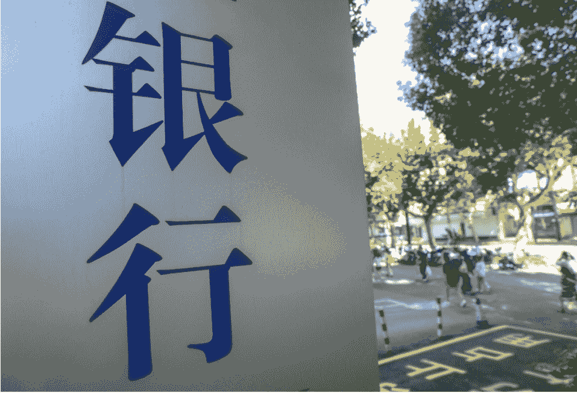

## CAIXIN| 听文章

文 | 财新周刊 武晓豪 丁锋

五大国有银行设立金融资产投资公司 (AIC) 七年多后，在加大对科创企业股权投资的大背景下，更多银行将拿到牌照。业内意见认为，在这条赛道上要做好难而正确的事，关键不只是AIC子公司这个“兵”，更在于母行这个“帅”。

2025年全国“两会”期间，国家金融监管总局局李云在“部长通道”指出，新质生产力的核心要素是科技，融资结构长期以间接融资为主，需要引导银行资金早投、小投、长期、投科技。

近日，《关于进一步扩大金融资产投资公司股权投资试点的通知》（下称《通知》）印发，在前期试点基础上进一步拓展：一是地域扩大，将AIC股权投资范围由18个试点城市扩大至所在所有省份；二是机构扩员，支持更多符合条件的商业银行发起设立AIC；三是资金扩面，支持险资参与AIC股权投资试点。

这是近半年以来，金融监管部门第三次扩宽AIC股权投资试点政策，重视程度一可见。

建行、农行、工行、中行、交行于2017年相成立的中国首批AIC，初期主要从事从债转股业务，旨在帮助发展前景较好但暂时遇到困难的企业降杆、风险转型。

从2020年2月起，监管部门批准五大AIC通过附属机构在上海开展“不以债转股为目的”的直接股权投资业务。四年后，试点工作进入快车道：2024年8月29日，北京成为第二个试点城市；周后的9月24日，试点范围扩大至包括上海、北京在内的18个城市，并对此前试点政策“松绑”——将AIC资金进行股权投资的金额占上季末资产的比例，由原来的4%提高到10%；投资单只私募股权的金额占该基金发行规模的比例，由原来的20%提高到30%。

据财新从业内了解到，AIC的资金来源包括自营资金和外募筹资金两大类。2018年7月，央行为加大对“债股”及小微企业的支持力度，下调包括有大行在内的类机构人民币存款准备金率0.5个百分点，此为AIC内部资金的主要来源；同时，AIC可以发行金融债券资，例如中银AIC在2020年11月发行35亿元五年期金融债；AIC还可以发行私募资产品募集外资金，但目前规模尚微。

截至2024年6月末，五大AIC资产合计5869.9亿元。由此推算，此次政策松绑，五大AIC可以开展的“不以债转股”的股权投资规模，由234.8亿元提升至587亿元；若以30%的基金金额上限测算，理论上最少可撬动的整体股权投资规模由782.7亿元提升至1956.7亿元。

2025年2月26日披露的数据显示，18个城市股权投资试点政策推出后，AIC迅速响应，在试点城市签约金额超3500亿元。

不过，多业内人士告诉，签约金额属于框架性的、意向型的约定，真正落地还有距离。

科技研究中心不完全统计数据显示，2024年AIC投资活跃达到历年峰值，全年五大AIC及附属投资机构构成156起投资案例，披露资金金额576.04亿元。整体看AIC仍以债转股业务为主，出资股权投资项目类所有项目的占比不足1%。

> 与此相比，银行内部落实加积极了。但由于科创企业的高高风险特征，后续如果出现亏损，从业者难免自身受影响，如何细化并落实尽职免责是业内关注的问题。大家会通过一些具体案例的处理判断。“一位资深AIC人士近日对财新表示，银行开展创投股权投资有利于推动科技进步，但短期内要取得明显效应难度较大，面临多方博弈。

AIC做创投投资首先要解决风险偏好问题。国有行过往主要服务相对成熟的企业，对于早期项目，比PE/VC（私募股权基金/风险投资）机构更为谨慎得多。此外，AIC开展股权投资还面临银行风险权重高、外部募资难、基金管理风险博弈、自身投研水平及人员不足等因素。

金融监管部门在推动机构主动作用的同时，亦强调风控，要求深度细致开展转型调查，严格业务审批，并每年进行专项审计。地方政府对于AIC设立整体比较积极，一方面是因为地方财政紧张，另一方面是为了引入资源。随着近期试点大幅扩大，更多省份、商业银行、险资有望加入，AIC股权投资能否破袭？

## 从转债到直接股权投资

作为国内大行旗下众多子公司之一，AIC成立较晚，且因私募属性，公众对其关注较少。此前认为，银行设立AIC的初衷，是在国家性结构改革背景下，一直足足股权投资发展的抓手，而转债只是先行步骤。

“国内股权市场不发达的原因之一，是中国这种以间接融资为主的国家，资金主要掌握在银行手中，而银行本身受约束较大，如果想要壮大股权市场，商业银行的力量不可缺。”前述资深AIC人士告诉，过去主要以存款贷款为主，直接融资缺乏经验，贸然介入会产生不可控风险，待成熟后再开展股权投资。

值得注意的是，不同于中国世纪初的以资产管理公司（AMC）为主的银行贷款，AIC实施的是市场化转债，旨在防控风险、降杆。在股权类别上，不再被限定为不良贷款；在转股方面，消除了传统的“债转股”，还包括“入股转股”这种方式。

清科研究中心报告显示，五大AIC正常转债项目占比超过90%。同时也与其他银行及非银机构合作，从投行、基金、保险等多个维度拓展业务。观察五大AIC的经营状况，横向对比，2024上半年五大AIC净利润在母行旗下子公司排列，普遍向关注度更高的理财公司、基金子公司；纵向对比，多家AIC设立不久就实现了盈利，并在之后净利润登上新台阶。

以设立最早的建行AIC——建信金融资产投资公司（下称“建信投资”）为例，该公司于2017年7月开业，2018年至2020年分别实现净利润0.62亿元、2.87亿元、8.57亿元，2023年突破40亿元，子之首。近日，建信投资相关部门对财新表示，公司成立于国家性结构性改革背景下，一直足足股权投资“国家队”、战略定位；根据国家发改委统计口径，截至2024年末，建信市场化债业务累计落地项目超360个，累计金额超4700亿元，连续八年保持行业第一。多位业内人士获，五大AIC经营良好，除了自身实力，另有行业周期因素。客观来说，银行AIC介入债权业务的时间较好，且以中央、国企为主。2017年成立AIC，正值多个行业处于周期的谷底，彼时多家AIC布局了钢铁、煤炭、化工、交通等行业的高杠杆企业；几年后，相关行业迎来上周期，企业盈利良好，AIC债权投资收益由此上涨。

在银行开展债权业务的第四年，原银保监会在2020年2月至3月陆续批准五大AIC通过附属机构在上海开展“以债权为目的”的股权投资业务，主要参与与上海自贸区临港新片区建设及三角经济结构调整、产业化升级和协调发展相关的企业重组、直接投资等业务。一直以来，囿于政策限制，银行资金难以直接参与股权投资，而AIC股权投资试点，为此开启了一扇窗。

五大AIC股权投资试点之点由上海开始，是因为2020年正值上海国际金融中心建设准入通道，引入更多资金壮大直接融资市场是题中之义；而选择通过AIC附属机构开展股权投资业务，主要是为了实现风险规避。此前，虽然转债股权属于股权投资范畴，但有一定限制。“比如，监管要求以债转股为目的的投资企业，企业要将股权投资资金全部用来偿还债权，因此转债转股权业务往往对被投企业的资产负债率要有要求，一些资产负债率低于40%的项目是不投的。但债率高的企业一般都是大型企业，很多初期的科创企业对银行融资不好借款，前期主要靠股权资金，而它们资产负债率并不高，没法用债转股的方式去。”一位AIC债股业务人士表示。

## 试点到点到面

上海先行试点四年后2024年初，决策层开始在不同场合提到“扩大金融资产公司直接股权投资试点范围”。2024年9月24日，国家金融监管总局发布通知，将AIC股权投资试点范围扩大到北京、天津、上海、重庆、南京、杭州、合肥、济南、长沙、广州、成都、西安、宁波、厦门、深圳等16城市。试点扩大以来，AIC与相关机构在各地涌现。科研中心数据显示，工银AIC通过附属机构在2024年6月至9月设立了7只股权投资基金，基金规模从70亿元到50亿元不等，涉及北京、苏州、杭州、上海、重庆等城市。

2025年3月，试点进一步扩大，明确AIC在试点城市所在份内进行股权投资，有利于吸引更多资金参与募资，降低基金成本，提升运作效率。对此，一位AIC股权投资人士告诉，目前与地方政府引导基金多，由于地方政府对资金通常有“返投”要求，即期望仅限于试点城市，会导致项目集中过高，而允许全省范围内投资，利于项目筛选，更加市场化的运作方式。不过，目前政策尚未明确18个试点城市之间可以交叉投资。据业内人士透露，各AIC对政策尺度的把握不同，有些公司开始交叉投资。比如，建信投资在2024年12月成立了源瑞达（杭州）股权投资基金，规模99亿元为合伙人（LP）；其附属机构——建信投资私募基金管理（北京）（下称“建信投”），基金采用“双GP”模式，由建信投资、杭州市资本运营有限公司担任首席合伙人（GP）。截至目前，建信投资与18个城市达成合作，完成了京、苏州、合肥等城市的落地规模。

## 基金募难、母行影响

在政策鼓励下，更多银行有望参与股权投资，头部股份有望拿下牌照。随着试点再度“开闸”，业内预计将更多银行进来。设立AIC需要动用银行资本。《通知》支持更多符合条件的银行发起AIC，根据2018年6月印发的《金融资产公司管理办法（试行）》（以下简称《办法》），AIC注册资本应一次性缴实货币资本，最低限额为10亿元。“注册资本门槛决定了中小银行很难设立AIC，对头部来说问题不大。”前述资深AIC人士说：新成立的AIC是否可以只开展股权业务？该人士分析，AIC业务应当符合《办法》的相关规定，主业应该是债，“如果不开展转股业务而直接开展股权业务，理论上与现行监管相符”。另一位AIC人士提到，开展债转股需要大量自营资金，如今银行自AIC在上海开展股权直试点以来，政策一直要求以募资为主；2024年9月起这一比例将“松绑”，仍需从外部募集至少70%的资金。

远东资信评估报告指出，AIC开展股权投资试点成立的基金（下称AIC基金），以政、产、金等跨境方式较为普遍。其中，“政”包括政府投资平台、国有资本运营公司等，“产”是产业企业，如江苏某投资基金发起方是一家科技型企业；“金”包括AIC、商业银行、基金公司等。

AIC基金面向个人投资者募资比较困难。“中国的民众习惯风险、对安全的投资难接受时长长、波动大、主要依靠风险投资的。我们之前尝试发行计划主要面向高净值个人客户，但很难募资，因为由于向客户承诺每年分红。”前述资信人士说。现阶段，AIC基金募资渠道以地方为主，通常采取“双GP”模式。AIC在出资较少（上限30%）的情况下，即便取得基金管理人和GP地，与地方国资的合作中发挥主动管理权，目前尚存疑。业内人士向财新指出，地方政府通常对AIC基金有“返投”要求，但程度不一。整体来说，AIC在发达地区设立的基金相对市场化，地方政府干预较少，倾向于各地寻找项目；中西部地区的部分基金，更是当地招商引，以“返投”为主。

近期发布的《通知》支持险依法投资AIC通过附属机构发行的私募股权投资基金、AIC发行的债券，或者参股AIC。对此，建信投资相关部门负责人财新表示，保险基金期限、规模，匹配科技创新股权投资周期的特点，此举可为AIC提供长期稳定的资金支持，为AIC股权投资试点基金提供充足“弹药”，带动社会资金更多地支持科创企业发展。

不过险资的实际参与度仍待观察。2020年9月金融监管部门发布政策明确，险资可以投资AIC设立的转股投资计划。但多位业内人士向财财经反映，险资实际上鲜少参与的。“险资相比银行行的风险偏好更好，早就明确险资可以开展股权股，但实际效果不佳，别让它们参与。”业内人士提出，是否可以参照当年转股思路，允许银行用内资金开展股权投资。

按照国际经验，优秀的机构都是募资能力强，管理人只需负责分钱。对于AIC，看重就是银行遍布全国的网点客户全覆盖；现阶段不宜一味追求规模，“大干快上的结果往往是几年后的“地鸡窝”。值得一提的是，2025年《政府报告》披露，今年首批发行特别国债500亿元，支持国内大型银行补充资本。兴业研究此前发布报称，这补充行业基础、提升抗风险能力，还能有效支持国内。

## 强化投资与尽职负责

除了外部支持与政策，AIC自身亟需补短板、内功，可在这一新赛道上作为。首先技术领先，市场上可参考的案例相对少，AIC需强化对传统行业之外新兴行业的调研深度，提高对先进技术的判断力，掌握行业的发展趋势，提高市场敏锐度。此前股权投资人士对财新称，AIC开展股权投资的优势在于依托银行广泛的渠道网络和客户资源，但并不是说项目多、项目多就行了，关键是对项目有判断力，选出好项目。“合适的项目其实比较困难。”他说，一级市场的好项目没有明确的标准，“早期的项目，如果价格便宜，一般都有各种缺陷；等等到后期项目了，价格又变得很贵了。真的是好项目，主要掌握在少数保障代表人、合伙基金或者政府引导基金手中，但好项目的份额通常很难到的”。

在人员方面，据了解，多数AIC的员工在200人上下，如何“投早、投小”存在一定难度。“投早、投小相当于做VC。在VC领域，1000万元都算大项目了，1000个项目起算才100亿，如果少数人员负责很多项目，相当于没管理。”前资AIC人士说。是否可以通过增员扩充来解决人才不足问题？前述人士表示，子公司人员编制受母行控制，能否扩充取决于行业发展前景。若预计新业务带来流量利润，可以招人；若净利润有较大增长空间，向母行申请预算和费用较困难。此外，以大行目前的薪酬待遇和激励机制，较难招到高精的投研人才。而从业者更关注的是，尽职免责如何细化并执行到位。金融监管部门在2024年9月已对机构提出要求：股权投资业务法律和特点，建立健全成长周期、差异化的绩效考核体系：落实尽职免责要求，完善容错纠错机制。

财近日了解到，银行内部的尽职免责准则尚未拟定，主要难点在于如何认定“尽职”。有从业者以上人士认为，尽职免责有一个参考思路，即AIC整体考核，而不是单单一个项目考核。“比如，只要基金实现盈利，了成功退出就算尽职。即便其中大部分项目亏损了，只要少数项目盈利能够覆盖亏损就行，这不算尽职；或者整体比例亏损比较小就不妥责，因为大家都知道，科创企业风险本来就很高，在前期募探阶段应给予一定的容错率。”该从业者对财财经新。

## 专栏 | 资产重估与新周期

## CAIXIN | 听文章

文 | 徐小忧
敦和资产管理有限公司宏观策略总监

2025年初以来港股成为全球表现最好的市场，而过去两年涨幅保持在20%以上的美股未能再次“开门红”。

回顾历史上港股跑赢持续一以上的阶段，几乎未有过港股涨、美股跌同同时发生的例子，多为两者同涨，但港股向上的弹性更大，并随着美债收益率上行和美元回落。本次港股跑赢美股，不仅方向肯背离，而且美债收益率呈下行趋势，说明此弱衰景是美国经济进入下行周期。如果美国经济还衰还能独善其身吗？

与股市分化，不仅是港股市场的特殊现象，2025年欧洲市场美国市场也表现不一。欧指指数上涨10%左右，成为发达经济体表现最好的股指，而且这种背离也体现在债券身上。过去欧洲和美国的资产相关性很高，股票和债券的走势在绝大多数时候是同向的；在股市跌下的年份，欧股的跌幅大于美股。2025年美股和国指的走势均出现背离，这种现象在历史上很少见。似乎美股、美债在交易对美国经济衰退的担忧，但没有对其他经济产生明显的溢效应。如果说美股表现出的独立走势是中美经济逐步“脱钩”的结果，那么为什么美国经济对欧洲经济的影响是在减弱的？

笔者认为，全球趋势是导致美国经济对欧洲经济产生影响的首要原因。股市表现更多取决于本国财政政策和货币政策，而非通过贸易来建立起的经济纽带。过去几年美国经济的发展表现并未现在全球贸易增长中。美国过去几年的经济繁荣离不开财政扩张的支撑，但财政政策的效果更多在刺激本土的服务需求。2025年以来美国经济较其他地区的优势收缩，下行风险主要来自财政收缩，相应地受负影响最大的也会服务相关的需求，因而对其他经济的边际影响有限。

美国的孤立主义以及舞耍的关税棒，也使欧洲通过积极的财政政策刺激内需，应对外交的不确定性；股市走出独立向上的行情，体现了政策转变带来的经济改善预期。德国新政府宣布未来会放宽财政政策，市场预期德国赤字会从当前的2.6%高至4%以上，回到欧债危机的历史高位。这一政策态度的转变，无疑有助于驱散欧洲经济的阴霾。

去年中国预算赤字维持在6%至8%，在私人部门信贷持续收缩的背景下，中国需要进一步加大财政扩张力度，才能有效对冲通缩风险。2025年的财政政策或转向更加积极，全国“两会”公布的狭义预算赤字率升至4%，创造历史新高；加增国债、特别国的预算赤字接近10%，2020年多出2个百分点左右。

80世纪后期德国赤字时期，美国对外日本贸易日益增长，对日本推行小政府模式，持续削减赤字规模。整个80年代日本股跑赢美股，日元与标标的比增加了1倍以上。分析这一现象，对于理解当前市场港股、美股弱的特征具有一定启示作用。

从产业角度看，当时日本在制造业方面技术迭代创新，汽车和半导体产品实现全球化扩张，在高科技领域如个人电脑方面的产品突破，冲击美国在该领域的地位，这使得日本工业企业利润增速在20世纪80年代持续回升。

从政策角度看，当时美国收缩财政缓解了通胀压力，美联储开启降息周期，也打开日本基准利率的空间；日本央行持续降息对冲货币升值带来的紧缩效应，同时低利率环境也大力刺激国内的投资和消费。日元升值加剧低利率环境，使得日本资产价格的吸引力显著上升，海外资金大量涌入，股价和房价大幅飙升。

可以看出，产业升级、流动性宽松是当时股资产受追捧的必要条件。对比当下，中国目前的产业竞争力及利率环境似乎具备和20世纪80年代日本相似的特征，因此2025年中国资产的重估或许代表了一个新周期的开始。■

## 专栏 | 特朗普酝酿干预金融组织

## CAIXIN | 听文章

文 | 巴里·艾肯格林
美国加州大学伯克利分校政治经济教授特朗普在第一个总统任期内，对美联储、国际货币基金组织 (IMF) 和世界银行采取了相对温和的态度。他曾向美联储施压，要求其降低利率，但没有要求美联储的决策事先要得到白宫批准，也没有通过其他方式来挑战美联储的独立性。除了力推马尔·帕斯 (David Malpass) 出任世界银行行长，特朗普并未干预世界银行的其他事务。他还让民主党顾问利普森担任IMF第一副总裁，这一任命本质属于美国总统特权。

特朗普不想干预美联储，是因为他意识到这种干预货币的做法会有负面反应。他十分在意金融市场的表现，曾公开以股市涨跌来衡量政策。干预IMF也有助于解决新兴市场的问题，但对于特朗普而言过于庞大和复杂，难以理解，别说控制了。但是，特朗普第二任期不同，他似乎不再关心金融市场，近期股市大幅下跌，也未能阻止他显然采取更为激进的方式拆解这些金融组织职能。

第二任期内未采用老的折中路线，特朗普在蓝图中明确表示，可以将大额贷款作为筹码。阿根廷总统米莱是特朗普的朋友，已签署行政命令，让美国政府决定退出哪些国际组织。特朗普已经关闭了美国国际开发署（USAID），让美国继续提供更大的援助。

如果没有美国的参与，世界银行和IMF仍可以运作。与美国不同，特朗普政府直接更换世界银行的员工，锁断其访问权限。美国对世界银行现金金额较小，2024年仅28亿美元。世界银行主要通过发行信用担保的债券来融资。如果美国退出，欧洲国家可能会帮助世界银行继续在资本市场上融资。相比之下，美国对IMF影响更大，通过配额和投票贡献约五分之一的资金。如果美国退出，缺口将由其他国家填补，重新开辟道路，正是中国期待避免遭遇的障碍。

无论退出哪个组织，美国都是发展中国关键的金融援助，将被视为拒绝，削弱自身的软实力。相比之下，美联储处境可能更加严峻。特朗普加征关税和拟减税计划已经引起通胀回升迹象。总有一天，他再不能把通胀问题归咎于前任政府，届时矛头可能指向美联储的政策已经削弱消费者信心，增加了衰退风险。一旦经济衰退成为现实，特朗普就会指责美联储没有及时降息。

助理检察长曾宣称，总统对“各种独立机构”拥有政权。如果特朗普试图罢免美联储主席鲍威尔及其他董事成员，鲍威尔可以诸诸法院。可以可以任意一位听命于白宫的新主席，甚至可以派马斯克的手下接管美联储的计算机系统。两个月前，这样的场景可能显得荒诞不经，如今已不同，金融市场局势必做出激烈的负面反应。到那时，我们才能知道特朗普是否真的不在意金融市场的看法。

专题：特朗普新政、特朗普2.0时代：影响与变局

# 最新财新周刊 | 运动损伤医疗待补

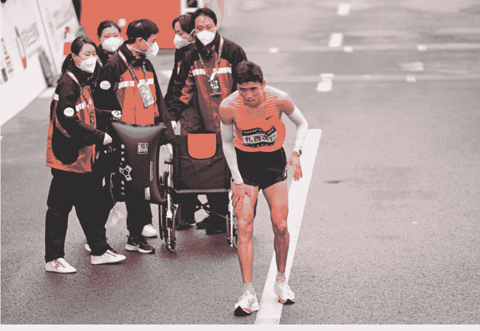

## CAIXIN | 听文章

文 | 财新周刊 杨玉玥 许雯

一次骑行中摔倒，从急诊到骨科再到运动医学，吴旭（化名）确诊右膝前交叉带断裂时已过去一个月。伤腿因为废用性萎缩了一圈，医生建议尽快手术。她那时还不知道手术后还有漫长的康复训练。这意味着，从受伤到恢复膝盖功能，几乎需要十个月以上的时间。但医生们清楚，越来越频繁地告知患者——运动损伤人群正在增加。

据运动康复产业联盟、复大运动医学研究所等机构发布的《2023—2024年运动康复产业白皮书》统计，全国近4.3亿长期运动习惯的人群中约1亿是运动损伤人群。

中国运动医学曾借助2008年北京奥运会和排名两次契机迎来快速发展，逐渐在医院中脱离骨科，成为独立科室。但目前全国3000家公立医院内，单独设有运动医学的不足百家。国内尚未进行运动损伤发生率、发生类型等流行病学统计。

2025年春节节前，北京18岁球员郭嘉作为北京U20球队一路前往西班牙马尔冬训，在与西班牙阿尔达队的一场教学比赛中，防守球时与对方球员碰撞后昏迷，在当地抢救后被诊断为脑死亡。后2025年3月19日，郭嘉不幸去世。图：郭嘉在慕尼黑俱乐部。医生们明显：近年来，普通人运动损伤越来越多，类型越来越多样。大众对运动损伤认识有限，开设科室较少，诊疗过程中，即使是同一个患者，医生经验、影像质量直接影响诊断、治疗和恢复效果。受限于信息不对，优质医疗供给落后于社会需求，资质模糊，运动损伤人数急速扩张，医疗系统面临更大不确定性。运动损伤往往意味着运动能力甚至生活质量永久缺陷。

文言（化名）在北京工作，去年在健身房找私教学习新的拳击动作，练习时右肩发响，经常疼痛。起初文言没重视，过了几个月越来越疼，完全抬不起来，决定就医，在南京鼓楼医院运动医学中心遇到了蒋菁。蒋菁介绍，运动损伤广义上涵盖非常广，例如脑外伤、眼部伤、胸部伤、甚至泌殖系统。急性损伤也包括运动反复造成的慢性损伤，导致四肢关节、肌肉、肌腱、韧带受损。以膝为例，下肢最常见的是交叉带、内侧韧带、半月板损伤。

蒋青说，过去运动损伤群体主要是专业运动员，现在非专业运动员越来越多。蒋青接诊的患者中，仅有10%是专业运动员。热爱者运动保护意识不强，平时在非专业场所运动，没有医学人员监督，平时缺匮练，肌肉力量不足或关节带柔性不高，面临更高运动风险。运动前热身不足、运动时姿势不正确或突然从事强度运动容易受伤。姿势异常，例如网球肘，骨外上炎，手指外侧胀疼痛。专业运动员群体并不常见，多是业余篮球爱好者因运动技术不合理或自身身体不好，造成损伤。她发现，近年来运动损伤类型愈加专业化，过去很多小锤小碰，现在交叉韧带、半月板等受伤多，患者术后恢复运动能力。

国内运动损伤发生率增加趋势显著。“今年一开始就满床了。”蒋莉所在的南京鼓楼医院每年运动损伤手术量达到3000台，通常门诊患者中10%需要住院治疗，以此推算，运动损伤患者数量接近3万人。

“患者暴增。”娄望感受非常明显。她记得，2013年她负责组建科时住院患者只有十几个，在现在门诊患者就医数量增加、床位基本满。她天天要接30个患者。

预计到2035年，经常参加体育训练的人数比例达到45%以上。以14亿人口推算，约为6.3亿。可以预见，运动损伤患者的激增不会是短期现象，但无论社会抑或个人，还没有这种转变做好准备，从治疗到康复有短板待。

## 治疗异常被延误

摔倒后，吴旭连跑了三家医院。第一次的三甲医院急诊医生安排她照X光，诊断骨头无，让她消肿。不见好转，吴旭又挂了医院一周的骨科号，就时医生看着CT结果打下“胫骨平台后缘挫伤”。好转，吴旭又挂了医院一周的骨科号，就时医生替她上了核磁。带着核磁结果，吴旭对交叉带断裂难以置信。掉了一股。不死心，来到第三家三甲医院。医生指着片子上膝盖一端连接另一端的空影，建议让她快手术。

不同医疗水平地区，影像扫描厚层、MRI（磁振成像）设备的强度，甚至序列设定上有差距。多数医生只用一张厚层扫描，全国3000家公立医院内，单独设有运动医学的不足百家在北京、上海等地。受受伤者在医疗资源匮乏地区，无法不到又要前往清华大学附属运动医学中心。

吴旭在家休息，消肿后自以为痊，两年后再次受伤，原本并不是韧带断裂，实际上是膝盖软骨磨损，损失巨大。吴言末提到，如果医生读片水平不高，又漏掉报告的丝丝，就会发生诊断和治疗不如人意的情况。

蒋青称，运动损伤识别并不困难，但检查中经常出现运动时发生骨折，韧带、半月板、软骨损伤都是X光片发现不了，需要进一步做磁振。影像结果对临床诊断来说不可缺，但余家发现，不同医疗地区，影像扫描厚层、薄层差异。例如，多数医生只用一张厚层扫描，前者看到的准确性与后者获得的扫描信息和后期规划，机器人技术。三维建模信息，要提取清晰的非常难。他在基层医院看诊的患者，MRI均显示交叉韧带吸收，按道理去做，但实际是MRI检查，片子没到。个体差异和医生经验也影响诊断。余家举例称，韧带、半月板损伤后，大腿强壮者依靠肌肉稳定性，考验医生水平。

“患者门诊诊诊过程通常是多因素博弈的过程，包括影像报告的结论、患者看到报告后对伤害先入为主的认知、医生的读片水平和查找水平。经常遇到的情形是，患者认定自己有重伤，医生仔细查阅片后准确判断患者只是轻微关节软骨损伤，医生要花很多时间向患者解释为什么这次是准确无误。所以从门诊诊断，到术前准备再到适当治疗，都有很大的空间。”余万说，出发风险回避心理，放射报告往往去不想漏掉报告的细节，如果医生读片水平不高，又漏了放射报告，就会发生诊断和治疗不如意。

运动损伤治疗的关节手术，是一种用于关节损伤的微创手术技术，常见于骨科和运动医学。它与骨折内固定、人工关节置并列。蒋奇介绍，关节镜已经在国内普及，国内一二级医院也具备操作能力。中国关节技术整体而言在国际前沿，毕竟我们病人很多人，大量临床经验。

关节镜技术对手术熟练程度、精准程度和操作精度有很高要求。不同医生手术有差距，与医生的知识结构、临床经验、手术累积以及追求程度上满足患者预期都有关系。“韧带手术的手术方式和韧带重建位置对最终结果影响很大，最好一毫都不差”。

不少病人在社交平台分享运动损伤手术经验时可见别：即便就是关节镜重建，一些膝盖留下两三道约五厘米的缝创口，也有仅一条三厘米左右线段、两三个点状伤口，还有患者需要一年后再手术取出固定螺钉。效果佳的手术，还有膝关节不稳定、韧带松弛等症，康复中。

实际上，康复从前就介入，贯穿周期。很多医院不给康复计划。

专业的康复指导不可不。

“康复计划必须与时俱、有科学性的，我们每年根据最新研究更新康复方案。我们统计，95%的患者可以按照康复计划熟悉康复要求，如何使用具、如何锻炼肌肉；术后，康复和理疗要指导病人预防血栓住院后，要提供康复计划。

但医生和康复师教育、从业背景不同，医疗思维和治疗手段存在差异。

康复治疗价格体系不完善，也影响服务可及性。吴旭在手术医院的运动力科学团队做康复，虽然已经去过康复抢号的麻烦，但只有有复查才能约上几次康复疗程，让她得不“省着用”。医院康复250元一次，每次复查上三五次，医保个人账户可支付相当比例。但多次核磁让吴旭起个“见底”，她头三次康复的750元，基金和个人分别支付33.31元和333.37元。对于恢复虚症，她也考虑过私人机构提高康复频率，但动辄每次八百、千元的费用让她望而却却。

2021年，康复项目纳入医保报销范围。“这是康复行业的春天”。但孟志远告诉财经记者，虽然医保政策在2024年11月优化调整，从术后负担康复治疗3个月延长到6个月，仍难覆盖某些患者后恢复期，例如如交钛带重建恢复一般需要8个月甚至1年。此外，新的康复治疗项目没有收费标准，尤其是康复新技术和康复评估测试项目，医院无法向患者收费，成本考虑很难动力投入十万至数十万元一台的康复设备，更新康复技术。

康复医生短缺问题同样棘手。“我们对康复医生的要求是有四五年以上经验，并且需要更长的专科培训。高水平的专科康复师少有几千例的专科康复经验，患者的康复才有保障。”余家润说。

符合要求的少又少。“招康复医生太了，我几年才招了一个。”面对越来越多的患者，一些公立医院康复科主任想增加人手，但遭遇业内难题。她坦言，康室对医生没有吸引力，因为康复治疗产出和收入不成正比。

以物理治疗中的关节松动为例，包含专业康复医师的诊断、制定个性化治疗方案，以及每次治疗的精准操作，需要耗费大量时间、精力，但目前每次收费20—55元，远低于人力、设备损耗、场地等成本之和。“半小时到一小时的康复训练，收费不到100元，有哪个医院愿意开这样一个赔钱的康室？又有谁愿意从事这个行业？”——前述康复主任连连感慨。

公立医疗机构之外，私立运动康复机构近年来如雨后春笋。据《2023—2024版中国运动康复产业白皮书》，2018年全国运动康复机构门店数量约为100家，2020年底增长到370家，2023年数量翻倍，达750家。

文言的朋友在腰部受伤后选择了私立运动医学诊所。单次康复项目收费在800至1200元之间，北京惠健保险可以报销前三次康复费用。经过多次康复训练，她的腰部疼痛症状缓解。

多名业内人士受访时说，康复机构充足的康复服务资源提供了补充，但也要看到，现有康复机构水平参差不齐，“这是一个社会问题，也是我们这个行业的‘痛’”。

供职于社会机构的康复普遍缺乏医疗经验。姜望认为，康复医生应当起到“风险把控”作用，首先对患者病情初步诊断和识别，判断患者身体是存在结构问题还是功能问题，是否需要手术治疗，或者其他治疗手段。康复师对治疗知识掌握不足，对治疗风险把控不够，容易出现误诊和漏诊。

余家润调，康复师经验或积累不足出现两个极端：一种是康复师没有经验、不敢练、追求保险，导致患者锻炼角度不到，最终导致功能障碍；另一种是过于激进，例如重建早期康复，导致韧带和骨头无法愈合。“过度康复”又不显累，康复时间过长、项目过多、“不必要的体操、CPM机（持续性被动运动）……每天都上好几个项目，病人的腿肿像一场泡涕。

目前康复机构可能更适合面向健康人群，而非患者。“菱志望希望康复行业可以在政策引导下走向规范化管理，让医院与康复机构相互补充，惠益患者。

## 快车道发展顶层设计

当运动健身越来越多融入人们的日常生活，如何系统性预防运动损伤、医疗服务如何满足运动损伤的治疗和康复需求?

答案尚未。国内尚无全国性运动损伤流行权威数据。余家润称，学界现有参考数据多来自美国，但中美两国人类运动群情况相悬殊。美国运动频率高、强度也更大，“亿人口每年有90多万台交叉韧带手术，按比例计算应达360万例，排除两国运动群特征的差异，实际我国每年手术数量要大打折扣，但没有具体数据。

娄志望曾为高尔足球球队做过小规模损伤统计，意识到这项工作线性分布广、专业要求高、机构众多等困难。“我跟球队合作了10多年，还要查询大量国内外文献，结合球队队长长期经验才做出问卷。面向群体的选择和对问卷的重视程度、理解、认知、积分程度、心态等等，都会影响问卷的真实性和有效性。”此外，综合性医院、专业性医院、社区医院等医疗机构均可接运动损伤，由于短期内参与锻炼等因素，增加了统计准确度。

余奎认为，没有数据，医疗资源的相应布局也无从谈起。通过全国网络间接获取数据，意味着明确了不同项目的风险，有助于预防防伤。娄志望认为，医疗机构可以与保险合作，利用数据梳理出人群特征、损伤类型、发生地区、发生原因等维度。

余家看来，还需要改善前端的运动场地、器材设备、培训服务等配套措施，从顶层设计着，同时推进体育工程、体育产业、体育学、体育训练等系统性工作。

中国运动医学的发展，由于运动人群增长，运动损伤诊治和康复需求面前，中国运动医学开始加速。中国运动医学发展始于20世纪50年代，1955年，运动医学萌芽；2008年北京奥运会后，国内运动损伤加速入车道。

多位受访者认为，这一转变带来了大量临床实践，尤其是培养了处理复杂手术的能力，也为康复积累了丰富经验。两者相互促进，成为运动医学发展的趋势。近年来，更多医院将运动医学从骨科剥离，“自立门户”。此前仅少数大型医院拥有独立的运动医学科，24年中华运动医学学会成立时，全国会委员基本上是骨科医生，或是康复科、运动营养与兴奋剂研究人员。

2022年，连续发布的“复旦版”中国排行榜将运动医学单列，视为学科发展的机遇。这份由复旦大学研究所发布的榜单是不少医院建立运动医学科的指南，为了提高排名、人气、专业聚集。

余家湖看来，骨科与运动医学在治疗理念、治疗目的和方法方面存在差异，骨科关注疾病本身，而运动医学关注如何让患者运动。互为补充，才是治疗效果的最优解，这也是国际趋势。例如，美国宾夕法尼亚大学的运动医学专业，独立在骨科之外。原本交叉的两个学科，已有分裂抗衡之势。业内人士提到，许多运动损伤处于两者交叉带，但囿于内部竞争等原因，骨科将运动医学视为竞争对手，更有少医院为内部平衡，限定骨折、关节换手术不能放在骨科，运动医学只做关节手术，而这显然无助于两个学科的发展，更有利于健康权益。

余奎认为，“长远而言，中国将有6亿人参加全民体育，如何保证全民健身过程中运动者遭受损伤后得到科学、全方位处理？

从根本上，多位受访者提醒，减轻运动损伤供应存在矛盾，还应当从源头减少患者。娄姿经常面向公众做运动损伤科普，她的患者很多是“小白”，通过科普可以初步掌握急性运动损伤现场如何处理，“下一步就需要更专业的知识和人员”。实际上，不同运动项目对应不同损伤预防和处理方法，需要层级、分类对特定运动群体进行防护知识、科普教育，甚至培养更多不同方向的专业从业人员，以满足日益多群体的多样性需求。

# 最新财新周刊 | 中国家电加速全球布局

## 听文章

文 | 财新周刊 章敏

“领导们目前都在国外出差，去拜访客户、抢订单，为广交会（中国出口商品交易会）打前哨站了。”一家老牌电器厂商的员工告诉财新。春季广交会4月开展，历来是外商云集、签约订单的窗口期，家电厂商往往在广交会前后密集拜访客户、争取新订单。

一名广东中山的家企业高管对财新感叹：“近年来明显感觉到业内都在说‘出海’。以前可能是大家品牌才会‘出海’，如今二、三线厂商都已经在‘出海’，不仅通过代工厂方式，还去尝试打造自有品牌。比如九阳、凌事等公司，都开始在海外打品牌了。

## 小米电器开始向海外

3月，在巴塞罗那举办的世界通信大会期间，小米集团总裁刘洪表示，2025年晚些时候，小米计划向国际市场推出空调、冰箱、洗衣机等大型家用电器。李建说自己已经看到小米家电的身影，比如泰国、越南，小米商城上线了吸尘器、净化器等，线下也在发力。

近年来，贸易环境发生变化，越来越多的中国企业寻求多元化，“出海”。一方面，家电出口额从2019年的7000亿美元增长到2024年的9000亿美元，增速历史新高；另一方面，国内市场已经进入“卷”，竞争异常激烈，特别是新兴市场仍较大潜力。

徐胜预计，2025年将是中国企业面临巨大挑战的一年，预期偏谨慎。一方面，2024年高基数带来增长挑战；另一方面需求环境在变化，虽然海外需求预期有所下降，但特朗普关税政策实施、美储周期的不确定性，以及库存周期带来的需求波动；同时，海外产能的加快布局、2024美国大选带来的“抢购”现象消退、汇率特征减弱等因素，对出口带来抑制。

在全球化、贸易战等综合环境下，中国企业加速全球布局，不少企业选择在东南亚、中东、拉美建厂。”上述熟悉“出海”的人士说，“内部测算，如果不考虑关税影响，中国制造成本比国外低15%—20%。

注意的是，美国新任总统特朗普上台后通过“301条款”对中国商品加征10%关税，一个月后又加征20%，2025年则是无差别加征关税，两者叠加关税高达45%。目前，空调、冷藏、冰箱等品类出口到美国关税约为45%~48%。

“中国家电企业在海外市场增长，更是与国际巨头、跨国公司抢份额。”TCL创始人、董事长李东生表示，“在2025年全国期间实现。”

周亦亦称，中国的家电企业整体实力增强，除了继续深耕中端市场，也在一步深入高端市场——这曾是三星、LG等韩国品牌的核心腹地。“中国企业在全球竞争中具备夺金牌能力，但目前仍需从品牌、技术创新等方面加强对接。”他强调。

TCL实业副总裁江澎对财新表示，在全球电视行业，前四个品牌吃掉了七八份额；若要进入前四，仅靠性价比市场是不可能做到的。

## 必须冲中高端市场

要做高端，首先得先有产品。江杨铭说，海外主流尺寸原来是55寸，一些高端品牌会做到65寸。而TCL全面发力大屏战略，通过QD-miniLED技术及屏幕技术创新，将电视到75寸、85寸甚至100寸的规格。“OLED面板技术路线成本不高，晶体管相对容易，而且很难做到超大，大概65寸就是极限了。从全球来看，OLED电视出货量600万台，miniLED预计达到800万—1000万台。

渠道方面，TCL也需要从大众渠道向中高端渠道拓展，如在美国BestBuy、Costco等高端零售渠道；在瑞士Migros等位置放置。“有了高端产品，还需要消费者认可。”江澎说，过去几年TCL加大了体育领域的投入，比如NFL（职业橄榄球联盟）、奥林匹克等赛事IP，提升了知名度和声誉。

海信在2016年成为第一个发布国际标准的中国品牌，2018年又成为世界杯合作伙伴。海信营销公司总裁刘磊表示，海信的思路是坚持、走高质量路线，从品牌、产品、供应链等方面发力。

中国家电企业在海外市场份额提升，带动三星、LG、大众等韩品牌面临追。

机构IDC的数据显示，2024年三季度出货量，石头科技、iRobot、科沃斯、小米、追觅是全球前五大扫机器人厂商，市场占率分别为16.4%、13.5%、11%、10.3%和7.6%，中国占比四席。

徐东称，欧美对中国品牌接受度高，社区Reddit上，Roborock和Dreame是用户推荐最多的两个品牌，分别来自石头科技和追觅。

一些小家电企业在新兴类上崭露头角。法国、波兰、意大利、西班牙等多国上市之后，海尔洗衣机不仅比国外同类产品A级能耗还节能60%，带动海尔整体价格提升。

## 加码品牌

海尔集团CEO周云直言，一个企业走向世界，必须锚定“科技”这个基点，不断去拔尖，才能真正成为领先。他举例，2014年在国际电工委员会会上，海尔首次提出了冰箱标准，但遇到许多国家代表反对，理由是中国不可能“从0到1”制造一个国际标准。所以海尔坚持自主创新，最终在2020年成功发布。目前，该标准已被英国、欧盟等20多个国家和地区采用。

深圳创维-RGB电子有限公司执行总裁兼营销总部总经理洪君表示，中国具备定义全球标准的能力，以创维为例，就有五项国际标准获得国际电联（ITU）批准发布。

“2019年遭遇美国增大，大家认为行业比较困难，后来又有疫情。如今看来，中国家电品牌的竞争力并未因疫情削减，近年来张力反而在不断提升，我们的目标是下一个五年，中国家电企业能够引领全球家电的发展。”周南表示。

“我们在一些市场抢了部分欧美、日韩品牌的份额，也转变策略，比如飞利浦就进行品牌授权，在中国贴牌再卖到海外。”一名头部中国家电企业高管感称，目前公司主要竞争对手是三星、LG。“它们自己生产的中端产品成本高、功能优，很难与我们竞争。而这些年中国代工能力显著提升，它们将部分中端产品给到中国厂家来代，以此降低成本、提升产品力。我们的应对策略就是在夯实中端市场的基础上，在高端市场持续推出有竞争力的产品。”

从上世纪90年代开始，多数中国家企业以贴牌代工“出海”，这种方式有效，只要把控好质量、成本和交期，就能拿到钱。近年来，越多的中国工厂开始加码自有品牌。

2025年1月，美的集团董事长雷洪波在公司经营年会上表示，2024年，美的在全球的业务上有所突破，但对于很多优秀的企业，美的海外发展的速度、深度和广度仍然差距明显。OBM优先、全面出去，是美的当下的首要任务。

“美的工业业务保持持续增长，之所以提出自主品牌优先，是因为美的希望触达更多家电类，获取更大的空间。“美的国际向财经解释，在全球市场尤其是欧美市场，冰箱、洗衣机等家电类产品更多还是品牌工厂占据主要因素，它们通常会自己生产核心产品，给到中国厂商代工的要是非主流小品牌，要么是非核心产品，比如大型空调。

美的在研发、供应链、销售网络等方面，为“出海”调整。目前的全球30多个国家了分公司，预计2025年底将增至50个分公司。不同国家的渠道差异很大，通过本地子公司更好地触达当地。美的专门成立了30亿元的OBM基金，主要用于海外品牌推广、体育赛事赞助和门店建设。“引介绍，2025年的美在海外的自有品牌投入将翻番。”

头部代企业之外，许多二、三线工业企业也在自有品牌“出海”。

荣达是合肥国资荣电集团旗下家电品牌，2019年开始为海外客户代工，并为跨境电商客户供货。2024年，荣达集团开始以自有品牌荣达“出海”。目前，荣达海外事业部有20多人，目标在未来五年内，海外收入占营营收的60%。

“我们从第三条赛道的工业企业起步，一直都在欧美市场客户。但是，美国曾对中国品牌加征关税，欧美市场可能存在不确定性，同时公司也需要新的增长点，做品牌比做工厂利润高。”荣达集团海外事业部执行总经理刘东对介绍道，荣达自有品牌“出海”主要两条路径：一条是通过跨境电商，2024年4月与京东合作“出海”欧洲，今年几个月销售额约三千千万，2025年也考虑入Temu、TikTok等；一条是瞄东南亚市场，通过与当地电商出口家电产品，之后再延续拓展到大家家电类。

中国跨境电商的快速发展，为中小小型品牌“出海”提供了大通道。一名熟悉跨境电商的家电人士称，以前小型品牌主要通过参加展会或海外展会“出海”，限于规模，很多品牌很难被海外客户看到。五年前，随着流量、运营等体系不断完善，中小家电企业进入跨境电商平台，如今在家里就有上万家电厂家每天都在研究爆款。一般来说，大家电很少走跨境电商，主要是物流成本太高，小家电则可以选择跨境电商平台的托管模式、半托管模式，根据入驻方式、品牌强度、月销量等综合考量佣金，比如亚马逊佣金率为8%—15%，Temu佣金率为6%—10%。

徐生分析，欧美家电市场渠道较强强势，如美国的渠道商对产品的定义、售价具备很强的控制力，且品牌壁垒也很高，在主流家电类上对头部品牌或本土品牌忠诚度也很高，中小型家电企业想自自有品牌打开市场并不容易，从东南亚、中东等“一带一路”市场切入反而更有机会。

上述头部中国家电企业高管提醒，“出海”的家电厂商越来越多，也将中国市场的一些打法复制到了海外，“卷”产品、“杀低价。“实际在海外并拼价格仍然困难，还是要尊重当地的行业生态，为每个环节的合作伙伴留下利益空间。”

## 布局本土制造

中国家电“出海”高频猛进之际，风险已然袭来。徐生认为，美国加关税是一个风向标，后续存在继续加关税的可能性，或进一步带动全球大战，未来中国家电企业务必补链跨境，加强在海外的本土制造布局。

新一轮关税威胁之下，中国家电厂商得不得不重新考虑产能的布局。2018年之前，头部中国家电厂商处于品牌“出海”需要，主动在海外拓展，就近服务海外用户；2019年前，中美贸易博弈、印度及欧洲地区对本土制造要求提升，加速中国家电企业产能外迁，东南亚、中东、拉美等地承担了大部分产能。

考虑到人力成本低、距离北美，且具有美加协定优惠政策，墨西哥一度吸引了多家家电厂商，比海信于2021年获2.6亿美元在墨西哥哥特投建电器产业园。被墨西哥与美国加关税的影响时，海信回应称，墨西哥工厂收入占比小、影响可控，后续将持续完善在东南亚的工厂建设，满足未来北美各类白电充足的需求，并将持续多元化布局海外供应链和制造平台，从而应对各种可能的突发关税政策。

近年来，中国厂家最多的生产输出地是在东南亚。美的在越南设立第一个海外生产基地是2005年，美主要生产尘器、风扇、电饭煲等小家电，供应南亚本地市场之外，出口至北美、欧州等地。此后，美的向泰国、印尼延展布局，并于2021年之后逐步加快，目前在泰国拥有七大制造基地，涵盖空调、洗衣机、冰箱、微波炉及净电器等多个领域，员工总数超过1万。“随着产能和业务版图扩张，我们将计划进一步增加员工数量并提升生产能力。“美的集团亚太地区总裁赵轩表示。

在组织架构层面，2024年，美的在泰国设立了区域总部，与新加坡总部形成双枢运营模式，进一步巩固泰国作为亚洲地区制造和分销中心的战略地位。

为提升物流水平，美的于2024年四季度在曼谷启用泰国区域性中心，该中心仓储面积为1000平方米，将东南亚市场的平均交付周期从60天缩短至45天。

徐东生分析称，一般家企业“出海”应当考虑地产基础、与中国关系的稳定性、转出口以及港口等因素，当前中国厂家“出海”第一热是东亚，尤其是泰国、越南、印尼等地。泰国，越南本身就是东亚的制造中心，且与中国关系比较稳定。

“东亚市场很有潜力，但近期很难消化那么多的产能，许多中国家电厂在布局东南亚之后，另一个目标是做出出口基地，在当地生产达40%—50%的比例，以满足转出的原产需求，”徐先生介绍，“短期内，一些材料、零件还需要从中国运；长期来看，当地供应链会慢慢成长起来，就像中国年前走过的路径一样。”

Ivan Lam指出，整体运输成本高，而且很多电厂在南方去越南、泰国建厂会更加便利，两国大力扶持，免税、减税方面较为稳定；而菲律宾、印尼是当地建厂成本就会高。

“东南亚很有机会，”李介绍，“尤其是白电，如果是小家电建厂，优先选择泰国。泰国现在是东南亚第一制造中心，日系、欧系厂商都在泰国布局，相关的配套比较完备。如果是小家电建厂，华德在越南拥有38万台，其他类家电产能也达300万。”

如今进入东南亚面临隐性成本，首先是劳动力需求大抬高人力成本，许多地区工资已经涨到当地左右，尽管相对中国工人低，但面临不少隐性成本，比如当地工人假期、福利等，工作效率低、管理难度大。“我曾在那边落地一个项目一个月，东南亚的一些热门工业区的租金涨幅超过50%。此外，南亚国家基础设施完善、水电不稳定，一旦断电造成的损失也不易忽视。”

徐东生直，这几年最大的变化是企业要适应全球贸易规则、全球经济重构，把能力扎根到全球。他介绍，原来TCL是以中国为中心的全球化，而现在，TCL把全球业务总部拆分成五个BG（区域），这些BG总部所在区域，由此TCL全球业务从一个中心变成多中心管理。组织结构改变了能力建设，全球就要本土化，每个区域由本地管理团队、经营团队来做，总部更多是在后台提供支持，围绕当地建立高效率、竞争力的组织，以支持未来的增长。

## 相关专题：“出海”之路

### 冲刺大众市场初获胜利、销售疲软、财务吃紧

从高端产品定位出发的造车新势力代表——蔚来汽车在满十周岁之际，到了变革的十字路口。3月14日，蔚来创始人兼CEO李斌在公司内部称，自己曾经拍板过一些看上去正确的事情，但最后发现投资回报很低，且整个决策链没有机制避免这类浪费。他反思：“本人确实需要提高经营意识，需要检讨以后即使我是说要，也要算账要不要。”他他还称，公司要在有效的资源边界，把钱花在刀刃上，把时间花在刀刃上，才有可能出围。

成立于2014年1月的蔚来汽车是造车明星公司，在2021年的风口阶段唯一超过千亿美元，也是BBA（奔驰、宝马、奥迪）等传统豪华汽车品牌的重要竞品，在高端市场占据一席之地。但随着新能源汽车走向规模化竞争，近年的蔚来没跟上同样对手的发展节奏。“市场无法再像创业公司一样给蔚来带来更多的包容；竞争也一步步紧逼，不给蔚来留机会。“一名接近蔚来的人士称为“蔚理造车新势力”，理想汽车（NASDAQ：LI/0215.HK）已连续九个季度盈利；小鹏汽车计划在2025年实现季度盈利；长期被视为“第四新势力”的零跑汽车，也在2024年第四季度实现盈利；而蔚来在2024年全年亏损超过22亿元，原计划2026年实现盈利，由于竞争形势，李斌宣布将通过一系列变革，争取让蔚来在2025年第四季度实现单季盈利。

“销量2万辆”是目前市场公认的“量产”的门槛，2024年蔚来新车交付22.1万辆，尚未越过这一门槛；2025年1—2月，月交付继续萎靡，尚未达到1.5万辆。

比较新势力品牌阵营，2024年3月底才发售量产的“新新”汽车公司——小米汽车，仅一款车型当年交付超过13万辆，2024年10月来销量均超2万辆，近日宣布2025年销量目标从30万辆上调至35万辆。2024年上半年陷入低谷、销量徘在万辆左右的小鹏汽车（NYSE: XPEV/6888），当年季度开始复苏，1月开始销量连续超过3万辆，2025年目标是38万辆。零跑汽车（9863.HK），2024年销量接近30万辆，2025年目标是50万辆。比亚迪（002594.SZ/121.HK）其头部厂商如今月销量超过30万辆，2025年可能冲击500万辆。

2018年以来，蔚来累计研发投入超过500亿元，同期理想则为258亿元；而蔚来在2022—2024年的研发投入超过100亿元，远高于对手。“大手鳄”蔚来，终于开始“降本增效”，启动项目是一个例。从2022年开始筹备蔚来手机，李斌坚定认为“车主互动”是竞争的关键，实际获寥。2024年底大幅收缩人员调整到研发端控制，也是调整。

| 品牌 | 对应市场 |
| :--- | :--- |
| 蔚来 | 高端市场（高端性） |
| 乐道 | 大众市场 |
| 萤虫 | 精品路线（精品小车） |

| 品牌逻辑 | 差异化支撑其高端性 |
| 财务数据 | 季度/净利润 | 研发/销售费用 |
| :--- | :--- | :--- |
| 蔚来 (2024 Q4) | 净高达71.1亿元，创下历史新高 | 研发同比下降8.5%至36.3亿元，销售费用同比增长22%至48.7亿元 |
| 理想 (2024全年) | 销量是蔚来的2倍 | 累计投入500亿元 |
| 小鹏 (2024年) | 销量接近30万辆 | 累计投入258亿元 |
| 零跑 (2024 Q4) | 实现盈利 | - |
| 蔚来 (2024全年) | 亏损超过22亿元 | 研发投入超过100亿元 |

换电模式是蔚来重要的“护城河”，但现在快充等技术受到热抢，换电和充电两种模式优劣优势受市场关注。3月17日，比亚迪发布新一代电动汽车平台，称新平台可实现“充电5分钟续航400公里”。市场认为这对换电模式是一记猛击。3月18日，蔚来宣布与上游供应商巨头宁德时代计划打造全球最大的换电网络。蔚来称，宁德时代（300750.SZ）牵手，宁德时代正在推进对蔚来能源（湖北）有限公司（下称“蔚来能源”）不超过25亿元的战略注资。蔚来能源成立于2017年，是蔚来换电站网络的运营主体。2025年3月21日美股收前，蔚来发布2024年第四季度及全年业绩。蔚来汽车港股收报35.9亿元/股，大涨8.7%。

## 销量失利

第二品牌乐道曾被寄予厚望，成为蔚来走向大众市场、冲刺销量的突破。首款车型L60于2024年9月上市，起售价约20万元，但该车型销量在当年12月过万辆后逐渐疲软，打击了市场。乐道自身将销售不顺归于品牌力和营销不足，实际上其产品力、交付能力也没有获得市场验证。

蔚来第三品牌萤虫定位为精品小车，延续主品牌蔚来的高端性，对标宝马电动MINI、奔驰smart，但这两个品牌目前上月销量均不足2000辆。萤虫首款车型将在2025年4月上市。

乐道L60定位家庭用车，大空间、舒适，换电模式是主要卖点，蔚来宣称这款车是“精装Model Y”“能换电Model Y”。Model Y是特斯拉（TSLA）最受欢迎的，2024年销量达到48万辆。作为对比，乐道L60刚上市，2024年交付量并没有爆，看后续数据，乐道2024年10月交付439辆，11月交付528辆，12月交付近800辆。

乐道L60交付初期阶段有过情况，后来可用电量数量增加，部分站点增加到五块以上。月道1.5万辆，2024年11月1.8万辆，12月交付近2万辆。到2025年初，乐道L60问题不再，但已陷入订单软困。蔚来汽车2024年三季度末，蔚来汽车总额为19亿元，高于2023年的总额。

财报显示，截至2025年3月20日，蔚来汽车可用的换电站为312座，乐道为183座。社交媒体上有不少乐道车主称，许多换电站只有一块乐道电池。一名蔚来内部人士称，乐道品牌使用的换电站数量还在爬坡，乐道电池数量暂时有限。

即将上市的萤虫首款车型，因为电池较小，公司计划先期建设集装箱式换电站，后续接入蔚来第五代换电站。研发中的萤虫后续车型，计划投入宁德时代换电网。蔚来已与长安汽车、吉利控股等七家车达成换电合作，希望未来能通用换电站。但目前蔚来自身各品牌就存在多种电池规格，兼容不佳。一名来自蔚电业务人士，蔚来内部存在各力量在博弈，难以在精简电池类、提高效率上取得共识。

乐道L60目前主要是在蔚来合肥新工厂（即第二工厂）生产，该工厂生产线生产乐道和蔚来品牌车型。据财报显示，由于订单量减少，该工厂2月底由双班生产为单班，部分员工分流至筹备中的合肥第三工厂。第三工厂计划生产乐道后续车型，单班产能10万辆，预计2025年第三季度产。

近期乐道开始对外放车型L90的信息。一名蔚来内部人士称，当前市场环境下，一款车型在上市前两个月都没有起势，基本就被宣告了“死刑”，只能再推新车型。

## 高端市场难“破圈”

主品牌面临压力同样不小。蔚来主打“产品+用户服务”，区分其他汽车品牌。发展早期，蔚来展现“不计成本对用户好”的姿态，很快吸引了一批“发烧友”车主。早期帮助蔚来赢得了一批铁杆用户，随着用户规模扩大，这一模式带来的压力也越来越大。例如，早期承诺的“车主终身免费换电权益”，现已成长为应付账款，如蔚来品牌保有量超过60万辆，意味着“对用户好”的成本越来越高。而蔚来的产品力和价格之间的落差是在扩大。市场调研机构杰兰研指出，超过40%的潜在用户因价格因素放弃蔚来汽车。

换电模式是蔚来重要的“护城河”，但现在快充等技术受到热抢，换电和充电两种模式优劣优势受市场关注。

能够驾驶方面没有明显短板。该车型定年销量目标1万辆，上市三天即官宣锁销单量超过1万辆，完成全年目标。

换电是支撑蔚来价格体系的重要一极。蔚来认为换电网络对销量提升有显著作用。2024年8月，李斌举例称，蔚来汽车在长三角地区有800—900座换电站，在江苏地区的销量总和占全国的一半。

由于竞争对手车型换电效率快速提升等原因，新建换电站对拉动销量的作用开始衰减。陆路研究，“换车桩”的思想，粗略估算，2022年每来换电站约服务94辆，而到2024年这一比例将降至66辆。

换电站是资产投资，蔚来计划2024年新建1000座换电站，实际新增约700座；2025年再度给出“换电站建设大年”的目标，计划到年底在全国27个省份完成换电县县通，新增换电站1900座。李斌在2024年末表示，计划投入150亿元建设1万个换电站。参考这一数据，2025年末来增换电站规模约30亿元。

但有两位访谈对象对财经称，现在换电的优势不断受到冲击，蔚来是否还要大力建设换电站值得商榷。

在产品方面，蔚来也暴露了短板。目前主流20万以上纯电车车型大多搭载800V高压充电平台，蔚来品牌已有即将交付的豪华行政轿ET9为900V平台，在售车型均为400V平台。蔚来在售车型在续航上亦不及竞品，例如ET5车型入门版续航为560公里，而目前同价带（20万至30万元）车型的平均续航为638公里，ET5续航落后约12%。

蔚来汽车希望在2025年实现销量翻倍，即达到44万辆。前述蔚来内部人士称，主品牌如果表现不佳，第二、第三品牌很难获得认可；蔚来品牌即将推出2025年改款车型，承载公司极大的销量期待，或或许会采用积极的市场策略。

## 转向降本收缩

近期，工商信息显示，蔚来控股有限公司获得来自合肥建翔投资有限公司、安徽高新与文源科技合伙企业（有限合伙）的约28亿元投资，两家出资人背后实控分别是合肥国资委、安徽省国资委。

据财了解到，蔚来管理层目前还在募集的资金以支撑持续的投入。截至目前，蔚来汽车是新势力汽车中亏损最严重的一家。

2024年，小鹏汽车和理想汽车的亏损分别为57.9亿元、28.2亿元，蔚来汽车则高达224亿元。理想汽车在2023年实现全年盈利，2024年净利润同比下滑31.9%至80.5亿元。

一名2017年就加入蔚来汽车的人士称，蔚来很难定义性，某种种类本质上是外企、互联网公司、科技公司的混合体，绝对不是一家典型的汽车制造企业——汽车制造业的特质在于规模驱动、市场驱动。尤其蔚来品牌不追求爆款概念，希望实现中等规模、高毛利，几乎是向法拉利等超豪华品牌看齐，在当前供需充足、价格战频频的中国新能源汽车市场，这样的定位很难长期坚持。

小鹏汽车CEO何小鹏在接受采访时：“过去小鹏是中规模、研发、高成本——精而美，我2022年就意识到了这个路线很难走通，最终还是要靠规模。”近期小鹏又公开，小鹏需要确保足够的收入和毛利，才能有足够的资源用于研发，建立正向循环。“去年我们总能给出一个结论，单靠融资无法实现这个目标，必须依靠利润，而且是巨大的利益。”

李斌一直被视为融资奇手。上市前靠融资斩获腾讯、百度、淡马锡、红杉等等知名公司、机构投资，又于2018年率先上市，但2019年经历了ES8自燃、电池回购、高管出走等一系列打击，当年10月公司股价接近1美元的纳斯达克破红线。当时李斌走在生死边缘——2023年李斌在财报中申报，现金金额不足以提供未来12个月持续经营所需的运营资金和流动资金。李斌之前接的北京庄、浙江湖州吴兴政府等融资资金均未能顺利落地。

危机时刻，安徽、合肥把蔚来从重监室抢救回”。2020年4月，安徽、合肥国资资金向蔚来注70亿元，蔚来也确定在合肥建立总部管理、研发、销售服务、供应链制造一体化基地。

2020年至2021年，特斯拉销量狂起，中国新势力汽车企业也跟着起，新能源汽车产业产业链成熟，“蔚来”销量、股价均迎来一连高涨。2021年1月，蔚来汽车股价飙升至66.99美元/ADS，市值冲破千亿美元。

从低谷走出的蔚来横向扩张。乐道项目始于2021年初，同年组建了自动驾驶芯片；2022年初，蔚来组建了自研电池团队，同年启动了高端电动汽车项目，2022年10月还宣布进入欧洲市场。

正是2022年，蔚来研发和销售费用首次突破百亿元，净亏损达到143亿元。内部人士评价，蔚来最大的问题并不在于缺钱，而是某些时间点拥有太多的钱。快速扩张后，蔚来又向外部融资“输血”。截至2024年月末，蔚来主要股东包括创始人李斌控制的三家公司、腾讯以及实体，三者股权占比分别为亿美元、亿美元。

李斌曾将2019年的经历称为“创业跑太快后的减肥”，如今蔚来再次迎来“减肥”。以自研电池为例，2022年6月，李斌曾称蔚来的策略是结合垂直整合，对于增加竞争力、产品力和盈利能力非常重要。然而横向扩张没有达到预期。2018年至2021年，蔚来销量翻番；2022年至2024年，由于战略和执行等因素，经营没有达到预期。

过度扩张之后，蔚来转向压缩。2024年初调整为自研芯片、电池包等环节，外包生产。

小鹏、理想也曾遭遇挫折。小鹏汽车2022年9月G发布后陷入低谷，直到2024年M03得以翻身。理想汽车2024年首创纯电车型MEGA上市，通过L6追赶智驾能力。一名知情人士对财经评价，理想汽车内部文化是“不行”，他们接触几年下来，人员换了良好批；小鹏也在2023年对高管进行洗牌，并由王凤来重任内部管理和生产；例如蔚来在研发上投入了许多资金但并没有效果，应该尽快整合团队。蔚来近期开始调整总部、门店、工厂人员。一名近期进入裁员名单的蔚来上海办公室人士告诉，其所在部门裁员比例为15%—20%，补偿为N+1。据他介绍，公司已经以续约的方式精简人员，另外外包团队也有多名受访人士认为，蔚来汽车如果不从高层动，无法改变局面，动一线人员只是短期延命。

## 市场竞争升级

何小鹏判断，2025年是中国汽车市场大淘汰的开始，未来三年的战事将更加激烈。国内车市开启即陷入激烈之中，各车企将围绕价格、智能驾驶、营销等展开全面竞争。

蔚来品牌在2月1日推出金融方案，原本这一政策在2月28日结束，可以延长到3月31日。3月1日，乐道将三年零金融也升级为五年零金融。此前，特斯拉、小鹏都推出了五年零金融。对于一款售价约25万元的车型，若首付8万元，五年零意味着厂家需要贴2万元左右。一家车企战略部门人士告诉蔚来，现在大部分车企都推出了三年或五年零政策，金融策略不一定能实现销量增长，而且“大家都在贴钱抢市场”。

蔚来ES6是其为止最受欢迎的车型，在售价25万—30万元的纯电SUV市场中有对手；这一细分市场2025年将会出现一个杀手级车型——小米YU7，该车型已出现在工信部新车目录。小米YU7预计在2025年中上市，市场预测定价在25万元左右。

SU7的成功足以说明小米的野心和能力。一名资深汽车市场分析人士称，小米从来打算做小众车，汽车制造的逻辑就是规模化，小米SU7在每周订单超过1万辆，对每家车企都有竞争力。

蔚来的产品品牌不算。2025年4月上海车展期间，蔚来将推出ET5、ET5T、ES6和EC6的年度改装车型。根据财新了解，这些车型仍基于400V平台，蔚来其他800V换代车型预计到下半年上市。

2月以来，以比亚迪为首的一众车企业掀起智驾大战。比亚迪董事长王传福称，2025年将是智驾元年，没有智驾系统的产品将失去市场竞争力。传统车企业主要在中低阶智驾上开展竞争，造车新势力则围绕基于“端到端”“大模型”的智驾方案开启。端到端是指从感知端输入信息，再从执行端直接输出结果不同于以往需要感知、决策、规划等部分，这种方法更接近人类。特斯拉是这一方向的引领者，小鹏、理想均实现了端到端，近期小米也开始推送相关功能。行业人士认为，智驾领域头部供应商多样化尚未形成明显差异，例如蔚来与多家车企合作，目前竞争的胜负还在成本控制。

# 最新财新周刊 | 沙漠中的“风光”生意

文章 | 财新周刊
文 | 沙特阿拉伯拉伯

在沙特阿拉伯南部麦加省吉达市南80公里之外的沙漠里，中国领先建设的中东最大光伏项目——沙特舒巴赫2.6吉瓦（GW）光伏电站投入运营。该项目占地面积52.5平方公里，等于7500个标准足球场。2024年，沙特是中东地区进口光伏组件最多的国家，总计16.5吉瓦，同比上升15%，占中东进口量的六成；从全球来看，沙特也攀升至中国光伏组件出口第四大国家。根据中国可再生能源学会专业委员会数据，中国风机新增出口容量创历史新高，其中沙特成为最大的出口市场。中国风机2023年首次出口沙特，共273兆瓦（MW），但这一数字在2024年增加了185%、达780兆瓦。长期以来石油最大来源国的沙特，转身成为中国新能源设备的大买家。

沙特是中东联、欧佩（OPEC，石油出口组织）“老大哥”，近年来为降低对石油的依赖，促进经济多元化，全面布局再生能源，力求在全球能源潮中占据先头。沙特设定了“2060年净排放”目标。“我们计划每年减少278亿吨碳排放，优化国内能源结构，到2030年实现50%的电力来自可再生能源。”沙特环境、水利和农业部长副阿马赛·哈梅德对财经表示沙特被沙漠贯穿中东，终年受副热带高温气压控制，是全球阳光充足的国家之一，日照时间超过3000小时，与中国相似。长期以来，沙特可再生能源发电占比不到1%，“2020年拥有第一个可再生能源项目。”一名沙特能源人士向财经介绍，这意味着沙特要在五年内把近一半电力从化石能源转换成可再生能源，如此挑战需要快速且大规模的投资，这无疑技术与成本兼具的中国企业提供了商机。具体而言，沙特目前已建成、在建及处于招标阶段的可再生能源项目总计44吉瓦；为实现2030年130吉瓦的装机量目标，每年还需要增加20吉瓦项目——这接近德国2024年可再生能源的新增装机量。

沙特在新能源领域布局全面，涵盖光伏、风电、储能、氢能、碳捕集以及关键矿资源。敏锐的企业迅速响应，纷纷寻找机会。“以沙特为代表的中东地区，是海外光伏市场的“新蓝海”。中国光伏龙头晶科能源（688238.SH）回应，在沙特落地产能。多名沙特人士指出，虽然面临巨大挑战，但要在沙特扎根发展，仍需充分理解当地法律、文化与商业环境。沙特“2030愿景”的重点包括NEOM（未来城）、红海项目、THE LINE等，这些太阳能、风能、氢能项目耗费数百亿美元。大型项目由国家能源公司和主权基金主，沙特国际电力和水务公司（ACWA Power）CEO Marco Arcelli表示，该公司在全球范围内与中国公司的合作金额已经超过500亿美元。

除了可再生能源，沙特也在推动化石能源的低碳化利用，一大举措是新建和升级天然气发电。到2030年，沙特的电气比例将达到50%左右，届时新建气电厂将具备CCS（Carbon Capture and Storage）能力。沙特石油公司沙特阿美正在推进全球最大的碳封存项目。到2035年，沙特全国的碳集总量将达到4400万吨。阿联酋是海湾国家减少碳排放的关键，沙特的目标是到2030年碳集能力超过1000万吨/年，卡塔尔的目标是到2035年碳捕获能力超过10万吨/年。

沙特还利用低廉的可再生能源和化石能源生产绿氢和蓝氢（通过化石燃料生产，但碳被捕捉封存），目标是到2030年实现400万吨氢产量和出口量，成为全球最大的氢出口国。沙特积极建设氢能基础设施，绿氢市场包括欧洲、日本、新加坡等因土地和光伏发电资源有限、难以大规模生产绿氢的国家和地区。强力的政策吸引、便利的区位、丰富的自然资源、低廉的土地成本以及灵活的外交政策，使沙特成为对中国企业吸引的目标市场。“沙特位于亚洲、非洲和欧洲的十字路口，在物流和市场覆盖上具有优势。”中国光伏业务企业中信博（688048.SH）东非大区经理王沛告诉财新。

为维护经济发展环境，沙特在地缘博弈中极力平衡。美、俄两国代表团在沙特举行双边高层会晤即为一例。“中资企业出海非常关注投资所在地的政治环境。”多名中国人士认为，沙特实施多元平衡的灵活外交政策，目前与俄、西方国家都尽力保持良好关系，具有独特优势。

在吸引国外企业投资上，沙特近年通过推出新的投资法、设立经济区、改革政策等措施改善营商环境。多名中国人士说，其最深的是沙特废除了实施70年的“保人”，提升了外国企业在当地开展业务的便利度。此前，外国投资者或劳工在沙特开展业务，需要签证。

国际能源署（IEA）预测，全球石油需求将在2030年前下降。国际货币基金组织（IMF）预测，2024年以来油价下跌约20%，2025年3月油价为69美元/桶，不足以覆盖沙特的政府支出。财报显示，非石油部门已占沙特整体GDP52%左右，增速逐渐加快。沙特宣布投资万亿里亚尔约约万亿人民币）生产再生能源。

最大的海外投资项目。晶科能源对财新介绍，该公司早在2011年就进入中东市场，目前沙特光伏组件市场70%的市场份额。

“新工厂项目位于沙特未来城NEOM所规划的工业区。“晶科能源介绍，项目投入后，或将成为中国光伏企业在海外建设的最大的N型电池和组件制造基地，可满足沙特其他中东地区的光伏设备市场需求，并辐射欧美等市场。

即便投资量与经验如晶科，对工厂落子沙特仍有相当压力。在中东做生意，都是市场化主体，商业交易非常寻常，特别是在合同签署时要密切关注各种种类。“晶科能源董事长李东德在央视《对话》节目中，企业进入中东市场不仅要注意商业上的违约、索赔风险，同时也要警惕地缘政治留下的“长管手”风险”。

不过，当中国光伏市场逐级下降、“内卷”加大，欧美贸易壁垒加重，东南亚通过中转路径受阻，中国光伏企业包括沙特在内的中东市场仍然抱着极大的期待。晶科能源对财新指出，沙特工厂代表着晶科“全球2.0时代”开启，公司将加速从“全球营销”向“全球制造”向“全球投资”转型。

“2025年晶科的重要目标是沙特工厂得以成功，进而复制全球。“晶科能源副总裁董晶在行业会议上如此称。

与晶科同步，上游硅片企业TCL中环与PIF、VICI签署了三方合作协议，计划投资硅片的本土化生产，投资总额约20.8亿美元。TCL中环高管对财新称：“欧美发达经济是高价市场，进入壁垒较高。沙特工厂产出后，不排除卖到欧美的可能性。”

不过，“具体的投产规模、补贴与合同签订过程，都经历了艰苦谈判。“另一名接近TCL中环人士透露，即便决定进入中东市场，过程中的沟通协调也极具挑战。

中国风制造龙头集团于2024年7月宣布，与PIF、VICI成立合资公司，到2030年实现风电产品75%本地化生产。远景集团向财新介绍，远景深度参与目前最大的绿氢项目——沙特NEOM项目，为该项目供电1.67吉瓦、257台风力电机。项目建成后，将通过专用输电网络直接为绿电厂实现供电。

另一个能源企业阳光电源，同时与沙特ALGIHAZ签约全球最大储能项目，容量达7.8吉瓦，预计2025年全容量并网运行，以提高沙特电网的稳定性和可靠性。

## 标准高、价格低

沙特是充满吸引力的新市场，但“暗礁”“潜藏”、挣钱难不易。

“中资企业刚来沙特时都很兴奋，但其实真正能深耕的不少，反而言亏钱的有不少。“一位涉沙的中资新能源管理层人士指出，要在“沙漠中淘金”，须诸重重难。

“2020年这里还是“蓝海市场”，现在已变为“红海。”“王沛也认为，现在投资沙特的门槛并不低。

“沙特光伏市场在跟中国市场一样，互报价攀逐。”一名中国光伏公司人士认为，在在国内，企业都说“不出海便出局”；但到了沙特，中国企业依然照搬国内“内卷”模式，又陷入了新的迷茫。

沙特可再生能源的新建项目，在不断打破全球最低成本记录。例如，据沙特能源数据，Sakaka（塞卡卡）是沙特在2020年并网的首个可再生项目，LCOE（levelized cost of energy，平准化能源成本）2.34美元/千瓦时（约合人民币0.17元/千瓦时）；最新投产的阿舒诺巴赫项目的LCOE已至1.04美元/千瓦时（约合人民币0.075元/千瓦时），称为“沙特最低光伏价”。

沙特虽然光资源丰富、土地价格廉昂，但阿舒诺巴赫这样电成本不足人民币一毛钱的光伏项目，给建设方的挑战巨大。“前中资企业管理层人士认为，即便中国光伏行业经历了快速增长，国内的光伏度电成本多在0.2元以上，部分资源丰富地区可低至0.1元/千瓦时左右，但未低至沙特的成本水平。

沙特当前的电力结构中，加剧了低电难题。“沙特电力结构中，六七成电力由居民消费，工业和商业用电的比例高。”另一名在沙特工作十余年的中国电力行业人士说，沙特居民电价低，每千瓦时只有3至5美元（约合人民币0.22元至0.36元）左右，与中国西部省份的电价相似；即便是工业用电，也有5至8美元左右（约合人民币0.36元至0.58元）。

低电价意味着要控制成本又要保证质量，限制了项目投资回报。前述长期在沙特工作的电力人士指出，尤其在光伏和储能领域，很多项目的投资在短期内难以回收，很难完成EPC（工程总包）公司同样面临激烈的竞争。前述电力人士解释：中国公司靠低价压光伏组件等供应商价格维持利润。“沙特项目合同条款要求严格，还需缴纳高额保金”，若中途退出，“保金”将被罚款。“保金”常占沙特项目金额10%-15%，对中小公司是巨大的压力。”他进一步表示，沙特银行信用条件十分严苛，企业若没有足够的资金和抗风险能力，很难完成项目、回收投资。

随着越来越多企业进入沙特市场竞争仍在加剧。“沙特市场标准高、价格低矛盾。”前述电力人士认为，主中国厂家发挥到了极致，导致公司可能损失。“建议在沙特做足功课，控制良好利润，避免风险。”

## 克服“水土服”

沙特社会长期处于封闭状态，如今商业环境具有明显的特色，刚进入市场的中国企业也面临挑战。作为吸引外资和促进经济多元化的措施，沙特要求外资企业在当地合资，达到本地化率，除了生产还包括原材料供应、员工雇用等方面。拥有约3500万人口，超过30岁以下的年轻人急需就业机会。前述沙特能源人士介绍，沙特政府设定到了2030年实现75%本地化目标，而当前比例仅为10%到40%不等。这给中国企业带来了小压力。沙特的薪资较高，尤其是技术性岗位，月薪在2万至5万沙亚（约合人民币9万至7万），中国企业不仅要在投入大量资金，还需要本地员工提供竞争力的薪酬。

文化上，沙特是“熟人社会”，开展业务的前提是“找人”。如何建立互信的人际关系，是初来中国企业面临的另一难题。“可能三个月都没有信任的事情，半个小时就解决了。”一名中高管说是。但在法律与谈判风格上，沙特人较严谨。“企业需要详细解析沙特法律体系并慎重选择合作伙伴。“Alice建议，沙特法律体系不同于大陆法系和英美法系，是以伊斯兰法为基础的沙利亚法，企业仔细了解其在商业、劳动力、税务和投资方面的规定。须特别注重合作伙伴的尽职调查。一个长期从事中东法律与营商环境的律师告诉，中国企业在沙特市场的合规问题是不容忽视的挑战。与早期响应“一带一路”国家倡议“出海”到中东的央企，如今越来越多的民营中小企业来到沙特寻找机遇。“一些企业缺乏足够的法律支持，如果单靠沙特生长其实很容易“栽跟头”。

若王沛介绍，沙特客户对新能源项目也较高，要求技术有先进性、产品稳定性和持续性。Alice指出，中东市场客户集中，来自全球发展阶段的企业参与竞争，只有具备优势的企业才可能获得订单。习惯在国内“购入”工业区的中国企业，在沙特建厂则面临基础设施从无开始的局面，建设也是挑战。“沙特荒区地质复杂，既有软沙也有硬岩。同时，施工团队还面临高温、干旱、风沙等考验，必须提前充分地勘察。“中国电建沙特代表处人士介绍，这要求项目团队具备丰富的沙漠工作经验。同时，由于荒区物流运输条件复杂，大型光伏组件、变压器等设备需要特殊运输，施工前也需要提前做好规划，以免延误。前述电力人士指出，许多新进入沙特的中国企业对现场条件和项目细节缺乏足够的了解，有些急于求成，“常在实施过程中遇到很大的困难”。企业进入新市场难免“交学费”，前期风险控制显得重要。“大部分企业适应沙特市场都需要两年左右的爬坡期。“一名中国能源人士补充称，阿拉伯人自古从事贸易，善于做生意，要以商人思维与其交道，互惠互利，不要只想“赚快钱”或“一头扎进来就走”。

■ 胡喧、张而弛、包云红、罗国平对此文有贡献

## 显影 | 中国宠物数量超4岁以下婴儿人数“它经济”消费规模已达3000亿

宠物相关行业增长迟缓，收割情感溢价的同时面临着细分化、精致化和智能化的挑战

2025年2月28日，Aby载着狗粮猫粮的车辆从义国际展中心驶回通州的家。当她把宠物用品在地面铺开时，她的家庭成员——狗狗“张初五”和田园猫“张福来”早已翘坐等待战利品。这位“90后”宠物家庭养师说：“给我的宝贝打扫。”Aby参加了2025年北京宠物用品览会（“京宠展”）。四天里，展会吸引了2万次爱好者，68%是“90后”与“00后”。12万平方米的展区聚集了全球宠物行业顶尖品牌，宠物行业同步发布了《宠物诊疗服务》和《宠物经营场所清洁与消毒指南》两项国家标准。派宠大数据平台发布的《2025年宠物行业白皮书》显示，2024年城镇消费规模增长7.5%，达到3000亿元。当宠物从“养对象”跃升为“家庭成员”，情感渴求推动了宠物经济的快速发展和产业升级。

2月28日，京宠展，一名男士从宠物墙前走过。

2月28日，中国国际展览中心（“京宠展”），观众正在挑选牵引绳和项圈。

2月28日，京宠展，观众在粮位前咨询。

2月28日，京宠展，一只狐猴吸引了观众关注。

“京宠展”某处的野生实验室里，疯狂下单。宠物粮、旅行包、服装等实用产品琳琅满目，甚至零食冻干饼、蛋糕成了年轻宠物主的关注。根据艾瑞数智发布的《2023年宠物健康消费白皮书》，宠物主在单只宠物上的年均花费5200元左右，其中食品是最主要支出。

北京通州，友它宠物寄养度假村，主人Abby正在制作宠物零食。

展会上我能清晰感知到宠物养方式的精细化趋势。“Abby说，“正如那句‘爱是拼尽全力’。”除了宠物主人，Abby还有另一个身份——“友它宠物寄养度假村”的主人。2023年，从事汽车管理的Abby转型投身家庭宠物养领域。这一决定的契机源于家里那只因焦虑而频繁引发投诉的“张初五”。它从小长大，没有经历生活。家里没有它，它就持续不安，甚至学会开锁。Abby尝试将“张初五”寄养在专业的园区，但是两三分钟后狗就能从笼子里出来，爪子上都是血。尝试别的狗狗一起玩效果甚微。在和其他狗主人交谈的过程中，Abby发现了新的商机。她决定借鉴国外模式，将自家住宅改造为“宠物家庭驿站”，提供散养式寄养服务。所有狗狗进门后，Abby都会给它们做犬瘟、小型等传染病检测，单独观察12小时，遛圈也采取若干分钟分区。针对柯基、柴犬等容易发生冲突的犬种，设置独立房间隔离管理；若主人坚持散养，则通过“试玩测试”筛选性合适的宠物组成“友好小组”。

3月3日，北京通州，友它宠物寄养度假村，工作人员正在打理犬只的毛发。

3月3日，北京通州，友爱宠物寄养度假村，工作人员和宠物。

2017年，薛鹏和妻子曹莉辞掉工作进入宠物行业。薛鹏去学校学习了宠物美容的技术，随后办了一家宠物美容院。他们自己的原则：不给宠物染过，因为容易伤害皮肤；不轻易剪染，需要分析宠物的质层后再判断。“我们会给宠物先洗澡，再根据自身结构设计美容方案。”曹莉介绍道。七年实践中，他们不仅积累了稳定客户，更建立起健康预警机制：针对每月固定护的猫咪发现牙垢、断齿等情况，即时提醒主人进行健康检测。“我们希望通过日常护理及早发现潜在问题，避免发展为严重疾病”。

3月5日，北京顺义，兜吉宠，主理人薛鹏和曹莉正在安抚紧张的泰迪，让它在洗澡前放松下来。3月5日，北京顺义，兔吉宠，薛鹏正在为一只宠物进行美容。

3月5日，北京顺义，狗狗宠屋，主理人曹莉展示店内的装饰。

权威数据显示，中国宠物总量首次超过4岁以下幼儿数量，且预计2030年宠物规模将达到两倍。目前养宠家庭已突破亿户，形成了巨大的消费支撑。从消费表现来看，《2024年宠物趋势》披露，犬类市场同比增长4.6%，增速更为显著。注意的是，单只猫年均消费接近6000元。查询《宠物服务行业报告》指出，近十年宠物服务相关企业规模大幅跃升。15年底只有8万，但到了25年初，这个数字增长到了29万，且近三年成立的企业占74%。企业数量向跃迁。在这片“蓝海”里，像她一样的“外行人”开始走向宠物行业。

在“宠课堂”的宠物训练论坛上，国家高级宠物训练师王王的演讲引发共鸣。大屏幕上对比传统训练与现代正向训练的差异。“过去宠物训练往往聚焦于从令。通过暴力压制、强制化，然后期待完美。这种模式忽视了一个关键事实，问题根源往往在人而非宠物”。如今，行业转向“70%养成，30%训狗”的新理念，例如停止拟人化互动、尊重动物性，近九成宠物问题即可自然消除。王波曾经遇到过一只出门就狂吠的西高梗犬，在认真了解后，他发现问题的核心在于狗的身体一直很难忍受的状态——这条狗有严重的皮肤病，平时只能看着伊莉莎白圈。王波向主人推荐了宠物皮肤治疗的医生，在治好身体的疾病后，逐步训练介入。狗的进步很快，三四个月后就停止了无缘的狂吠行为。

触动人的情感。大牛是燃烧宠物火葬店的主理人，2017年他进入这个行业，宠物火葬在中国尚处于萌芽阶段，他专门前往日本学习宠物葬礼仪的规范以及火化设备的操作技术。3月18日，北京，燃宠物殡葬店，工作人员在为一场宠物告别仪式做准备。

“宠物的亲子教育类似于人类的儿童教育行业。专业亲子训练有效降低宠物行为问题发生率，从源头减少后续医疗支出和弃养风险。”王波觉得这块宠物服务行业中存在感性低的部分，将会慢慢走到人们面前。她也期待，有资本能注意到宠物教育这个冉升起的板块。

3月5日，北京顺义，能够朋友联盟萌萌萌的社交课上，王波与柴犬互动。

3月5日，北京顺义的宠物酒店，工作人员将运粪的犬送回房间。

值得欣慰的是，国内宠物友好环境持续改善：从九年前北京无一宠物友好商场，到如今核心商圈普遍开放，叠加宠物认知提升与正向训练理念传播，行业迎来良性发展契机。

“疫情后来越越来越多的人将情感寄托于宠物。”“宠物从‘喂养对象’升华为‘家庭成员’，越来越高的情感诉求也推动了宠物消费市场的快速发展和地产业的创新升级。Abby观察到，北京养宠家庭数量激增催生了更多的细分市场：宠物尿不湿、智能陪伴设备、骨灰纪念品等创新产品不断涌现。

而她成为了一个“全能服务”，团队拓展至3人，业务涵盖营养、零食定制、医疗咨询等全链服务。“这不仅仅是商业赛道，更是关于责任与陪伴的社会实践。“Abby如此定义自己深耕的领域。

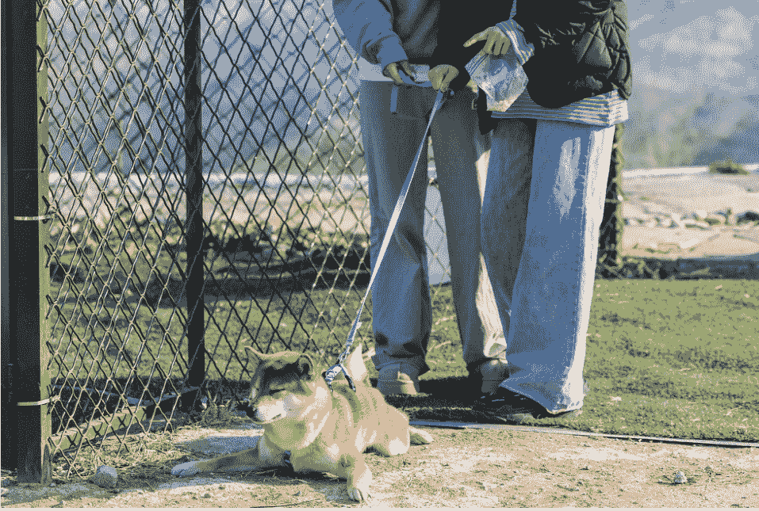

3月5日，北京顺义、朋友联盟的社交课上，在柴犬和主人沟通发生障碍时，王波快速接牵引绳示范。

首创·郎园Station，宠物社交结束后，主人给自己的宠物犬奖励。

在她看来，这是由年轻消费群体推起来的朝阳行业。在年轻的人群中，建立亲密关系越来越困难。相比之下，养宠所需的精力更低，但能够获得的情绪价值和陪伴感更即时、更确定。某种程度上，“它经济”是情感经济的一环，在饲养和照顾宠物的过程中，年轻人不仅获得了情绪价值，养育宠物的过程，也成为重新“自我养育”的过程。但这个行业，也面临着更加细分化、精细化和智能化的挑战。

图片编辑 | 翁倾

2023年7月16日，喀里拉湾湖举行了首届马拉松活动。喀里拉湾湖拥有美丽的风景，为游客带来了一场视觉盛宴。

此次活动吸引了来自各地的跑步爱好者。参赛者不仅感受了湖边的清新空气，更在比赛中挑战了自我，挑战了极限。

喀里拉湾湖的马拉松活动不仅提升了当地的知名度，也促进了旅游业的发展。未来，这项活动将常态化。

2023年喀里拉湾湖马拉松赛在喀里拉湾拉拉开幕。本次赛事吸引了3000名跑者参加。

比赛共设了21公里、10公里和5公里三个组别。参赛者们在赛道上展现了拼搏的精神风采。

喀里拉湾湖马拉松赛已成为当地的一张新名片，向更多游客展示了这片土地的魅力。

## 亿级参与与“它策划”

摄影：张明华 来源：视觉中国

### 策划地方旅游新路径

随着消费水平的升级，游客不再满足于简单的走走打卡，而是追求更深层次的体验。这正成为新趋势。

通过策划丰富的文化活动，当地可以更好地吸引游客，增加他们的停留时间。喀里拉湾湖的马拉松就是一个成功的案例。

这种模式不仅增强了游客的体验，也促进了当地文化的传承，为旅游业的发展注入了新活力。

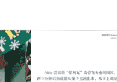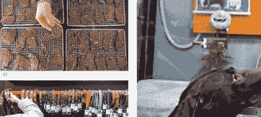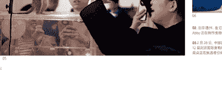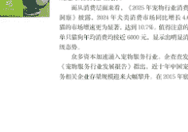

1. 马拉松赛的意义
2. 赛事对当地旅游的影响
3. 未来展望

# 故事

他的家乡渐渐遥远，直到2021年，他决定来到南方，带着满怀希望开始了一段未知的旅程。最初创业并不顺利，在创业过程中，他发现了一个机会，他决定抓住机会，投入了全部精力，通过不断的尝试，他逐渐找到了适合自己的创业之路。后来，他的事业越做越大，成为了当地的知名企业家。

然而，创业之路并不是帆风顺。在过程中他遇到了重重困难和挑战，但他并没有放弃，在不断的努力和坚持下，他终于克服了重重困难，取得了意想不到的成功。他曾说：“创业就像是一场马拉松，比的不是跑得快，而是谁能坚持下去。只要放弃，终会看到自己的光明。”如今，他已经成为了一名成功的企业家，但他并没有忘记初心，依然在新的领域不断探索，试图为社会创造更多的价值。他的故事激励了许多人，只要有梦想并付出不懈努力，就能实现目标。![](img/e86a24dd2f0fdda65be076ff251d349d_154_0.png

创业的过程中，他遇到了很多失败，但他从中汲取了教训，并不断改进自己。他认为：“失败是成功的垫石，只要我们从失败中学习，离成功不远。”在困难面前，他始终保持着乐观的心态，把困难看作是成长的机会，在不断的挑战中变得更加强大。如今，他已经站在新的起点，正向着远方迈进，书写更加精彩的传奇。他的故事告诉我们，只要坚持不懈，梦想终会照进现实。![](img/e86a24dd2f0fdda65be076ff251d349d_154_1.png

创业的道路上，他并不孤单，他有一支优秀的团队在支持他，他深信合作的力量。他曾说：“只要团队心往一处想，就没有过不了的坎坷。”他非常注重人才的培养，认为人是企业最贵的财富，不断为员工提供发展的平台。如今，他的企业已经蓬勃发展，在行业内拥有良好的口碑，为当地的发展做出了贡献。他的经历再次证明了，团结协作的力量是巨大的。无论未来面临什么样的挑战，他都将坚定地前行，创造新的奇迹。

- 坚持不懈
- 团队协作
- 培养人才

## 随笔 | 忽明忽暗的迷惘![](img/e86a24dd2f0fdda65be076ff251d349d_155_0.png

## CAIXIN| 听文章
文 | 鸣龄
电视制片人

——

汗水渗进了眼睛里，有些刺痛。他揉了揉眼睛，揉了揉脖子，这才发现阴云什么时候笼罩了天际。中午炽热得不得了，天也变快。风也变凉了，吹起来干透的工作有些冷冰冰的。“要下雨了吗？现在几点了？”老陈这样看着。疲意感开始在身体里散开，脖子骨像是突然僵硬了，手里的扳子也沉了。

眼见光线越来越阴暗，阴云滚动着，像个越来越古怪的模样在空中挣扎。他又拧了两颗螺丝，“哎，我说，收工？要下雨了。”他冲着工头喊。活儿还没完，再坚持一会儿。等了半分钟后，他才得到回答。真的感觉累了，一旦从干活的专注中醒来，身体不受控制。他强撑着。但一想到明天就要干活，没有任何话可说。风越来越像冰冷的刀，雨越来越大了，高塔晃得越来越厉害，或许随时就会掉。老陈看着阴云，俯瞰着地面，雨被淹没了，叮当的螺丝的声音，他在高塔上回响，灵魂似乎游离了——身体累了。在高塔上晃着，不仅要一边工作，还要一边睡觉。

他走了半个小时，累了了担心自己虚脱了，于是决定在工棚睡一天。他躺在木板床上，这个念头又来了：

40岁，0了了

老陈动作越来越迟缓，雨水让他手打滑，故意在对抗。他看着阴云，雨打在土地上。“很好，过日子，”他心中庆幸。

老陈是忧郁的，也是坚韧的。

一天200块，一个月休息三天。厚厚的一叠钱，累了。

下午工资如期发。被雨淋透，老陈用信封装好，满意地塞上了衣兜，扣上暗扣。那些钱立刻就暖了，有了体温。“是自己的。”他偷偷露出了微笑。老陈在抱怨钱少了。他发得很快，已经累可以可以了。

他说了两句，老陈累了。

一天的路程，到家里已经黑了。他远远就看见老婆在村口等着。“回家真好。”他是真的想老婆了，迎上去不禁抱住了她。媳妇有股清新的香气，应该是特意换上了干净的衣服。他就赶紧又松开，自己满是铁锈和汗渍，工作太脏了，又落了一路的灰尘。干嘛不是不是找着家。饭好了，心里显得慌。怎么这么晚？路上车坏了一会。女儿呢？在家里写作业呢。学习好！累了不？

“车太颠，散架了。”回到家，姐姐带着弟弟在家门口等着。女儿变样了，大姑娘了，儿子也长高了。老陈眼眶湿润。女儿不是老陈亲生的。老婆是个寡妇，相亲时他有点抵触，说出去不好听。但是看见女儿时只有3岁的小姑娘在妈妈的怀里，眼睛一闪一闪，可怜巴巴，他的心就软了。可能是注定的，他们就进了一家门，生活有了根。后来他们无数次回顾那个决定，老陈都会觉得那个决定是对的。老婆给他换上了干净的衣服，利好了白干。她检查了女儿的作业，从包里给孩子掏出的礼物——一套看起来很高级的文具，一个玩具枪。孩子们很高兴。昨天他还是个工地上的主，现在却是一家之主，有种魔幻之感。他很感慨，也很欣慰：“哎，没白受累，没白受累！”

老陈不自觉喝了很多，他想屏蔽掉对自己的担忧。但是老婆无意中碰到了他摔断过的一根肋骨，他不自觉地疼哼了一声。“怎么了这是，怎么了？”“没事没事。干活伤到过。”老婆知道老陈是个能忍人的。她怜悯地看着他，心疼得难受。

（以下为OCR重复乱码部分，已根据语义逻辑清理）

大腿粗通红的钢柱从炉子股拉出来，然后由一根粗柱子穿过，就成了钢管了。后面的工人等距离截断。“行，干我。”这种单纯操作机器的活儿看起来没什么危险，只是扑面的热风、湿气、高分的噪音、呛人的粉尘。这些钱就是因为这条命嘛，老陈没有经过太多的培训就接受了新的工。“好，明天就上班吧！”老陈急不可耐地离开了。他又观察了一会儿，看着车间里那些移动的身影，仿佛是看着后的自己。那确实就是明天的自己。他很快体会身体被湿热蒸发到虚无的灵魂，还有烟尘穿过口罩直接抵抗粘膜。有那么刻，他自己的脑袋和通红的铁柱撞在一起了——头发会先烧起来，然后就会被铁水一点地熔掉，一阵烟，渣子都不会留，就是永远的解脱了。他一切割着铁管一边那样想象着。在满地泥泞的车间里，他用忙碌、劳动的惯性，尽自己的努力保持着。

老陈像是梦里听见有人在呼唤他的名字。他回头看见大王，在梦里一样站在他的身后。那是他最好的同学。他揉了揉眼睛，车间里的噪音恢复了真实性，铁炉轰隆地，压倒性地占据了现实。他们吼着，让声音能够穿透烟尘飘进耳朵。“这里脏，赶出去！”他对大王吼。“走，出去说。“不行，我干活呢！”老陈一边叫喊一边手指着该死的钢棍摇头。大王一把拉住了他，把他向车外拽，老陈跟踉滚差点摔倒。“你怎么来了？”“你们厂长请我来的。你们厂要弄电路。”大王是电业局的干部。“你在这个车间干多久了？”“多年了。“这种环境怎么行，你每年体检不体检？”“体检！体检什么！查出来还得治。这不是好好的嘛。”“好个屁！”大王看着满脸狼狈的老陈，有些酸，但是又不能表现出来，那如同高高在上的同情。长久以来他们建立的不是那样的关系，无法变成那样的关系。

# 专栏·暮年絮语 | 是辅助，而不是管控

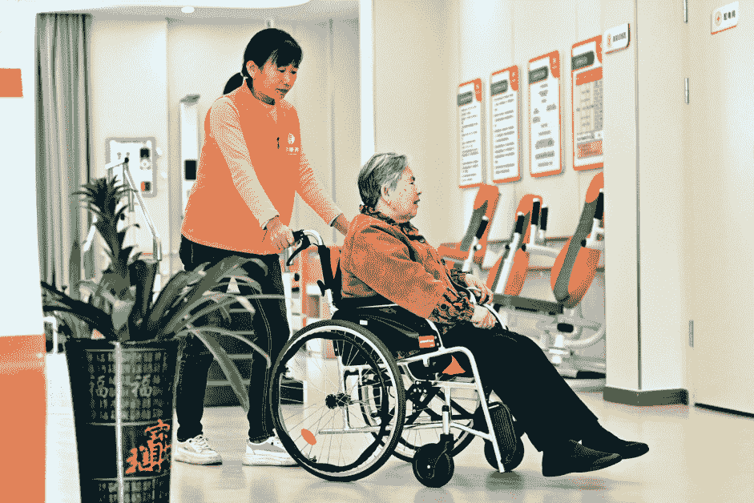

## CAIXIN| 听文章

钱理群
学者

变老之人能够自如地应对养老与死亡的困境，除了发挥自主力，还有一个关键，就是仰仗养老机构的高质量扶助。

根据《最好的告别》作者阿图·葛文德医生的分析，以及我的观察与思考，随着时代变化，人的养老方式处处在不断变动之中，大体可分为五个阶段——

传统的养老模式，一人面对衰老与死亡，就由家族中几代共同扶助，即所谓“四世同堂养”。这是传统社会结构决定的——老年人扮演着传统、知识与历史维护者的角色，崇老文化由此产生。大家族养老，孙子侍奉，天经地义。

但随着经济和社会的演变，家族结构以及祖辈、父辈与孙子的关系也逐渐变化。家族文化逐渐边缘，家庭成为为主。这就进入了第二阶段——“家庭养老”。

随着现代社会的发展，家庭内部，老人的地位与作用逐渐降低。随着女性、社会独立的强化，对家庭控制权、财产分配权的利益需求也愈加迫切；子女独立成家，父母与子女分居成为必然趋势。养老模式就由子女演变为独居养老——老人立撑，子女辅助。

现在，中国社会进入了“长寿时代”。生育率的下降，老人的长寿，使得养老由家庭、个人的事务变成了社会事业。“社区（康复院）”养老模式就是这样运生的。与之前的家族养老、家庭养老以及个人独居养老模式相比，其最大变化，就是一切都纳入机构管理：老人生活的各方面，都在同一个中心领导下进行；成员日常生活各方面，都是一大群体一起完成，且由相关服务部门周密有序安排。这样的组织化、计划化、科学化管理，大大提高了老人的生活质量和安全感，人与人的关系更加紧密了。

但新问题也随之产生，特别是在“后疫情时代”，回归家庭成了新需求和新趋势。养老院的老人发出了“我要回家”的呼声，这给机构管理的养老模式提出了变革的要求——养老院要像“家”一样——这就是第五养老模式，也是我们要探讨的养老管理的根本问题。

这里的关的关键，是要确保基本的管理理念和指导思想：对老人的照顾，不能仅限于日常生活与身体的安全健康，更要有精神照顾和家庭文化；不能只有管理目标，更有价值关怀；不能强制强调群体，更重要个体。

由此提出一个基本概念——辅助老人。养老院管理的基本权限是“辅助”老人的生活，而不是“控”老人的生活。二者的矛盾在于，老人已经没有能力照顾管理自己，一切都要依靠照料自己的人。如何使老人有的自由，使照料限于辅助，这确实是难。

这就要求老人与照料者的关系发生了变化：由理性的护理，转化为类似的照料。满怀爱心、心地愿意地、单纯地做着看似简单而深刻的扶持。这样，老人与照护人之间，能够自然而然地达到彼此的妥协与平衡。照护人作为管理者，要强调“人比任务重要”；关心老人希望怎样生活，而不是子女希望老人怎样生活，或管理规则则要求老人怎样生活。老人也不能把自己的希望和要求绝对化，必须换位思考，替着照护人和管理者考虑。双方用协商的方式共同处理难题，应该是养老管理的一项基本原则。

如果说老人在能够自理阶段，管理的重心应该在发挥老人的生命潜力，为其提供再学习、再创造的条件与机遇；如果到了衰老期和临终，重心就要转向《最好的告别》里强调的，抗击老人心理上的“三大疫”——疲倦、孤独、无力。葛文德医生显然把注意力集中在老年人心灵的滋养上，改善老年人生的新途径，便是重建生命热情、温暖与力量，为走到生命尽头的老人，展现一片新天地。这才是实实在在的“最好的告别”。

葛文德医生在书中，用大篇幅不频繁地介绍养老院管理者的各种尝试和实验。例如引入动物、植物与儿童，让安静的养老院热闹起来；打破固化的生活，故意把养老院的生活搞得“乱七八糟”；有意识地扩大视野，为独居老人创造同世界沟通的机会，以达到对常常存在的超越等等。

他还郑提出，“使老年生活有意义是一种新想法，比仅仅使老人安全需要更多的想象力和创见。“我读到这里，眼前一宽。这要是要：养老事事，需要好奇心、想象力和创造力——养老管理的开创者、实践者，以及日渐衰老、直面死亡的老人都需要。我们现在所缺的，就是这样的好奇、想象力与创造。■

# 逝者 | 刘鸿儒：引领人与拓荒者

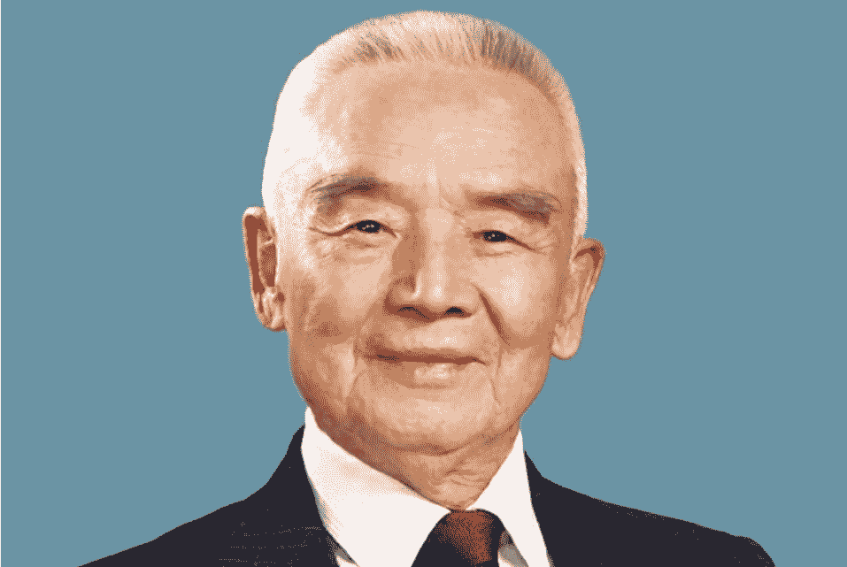

## CAIXIN | 听文章

文 | 财经周刊 李菁

从48岁出任中国银行副行长，到49岁调任中国银行行长，再到51岁成为中国证监会首任并留下深刻印象。其实，刘鸿儒的一生是中国改革与资本市场从无到有的缩影，他见证并参与了国家从计划经济向市场经济转变的重要程。

刘鸿儒1930年出生于吉林省省稷，少年被日本逮捕后进入哈尔滨行政学院（后更名东北大学），从事教学。1955年，25岁赴莫斯科大学经济学读研究生，获得经济学博士学位；归国后，在中国银行担任助理、局长任职。改革初期，刘鸿儒是引路人。中共十一届全会确定银行放在战略位置，当时社会对对此各种疑虑，刘鸿儒组织起草了恢复银行的文件，于1979年3月担任中国银行副行长。伴随商品经济发展，中国银行、建设银行、人民币银行继独立。1980年8月，刘鸿儒调回中国银行担任行长，主管金融改革，重点是成立中央银行。1982年，国务院成立金融改革小组，刘鸿儒担任组长。1983年9月，国务院正式发文，决定中国银行专门行使职能，剥离信贷业务。到1984年，除了中、农、工、建四大专业银行，金融机构也大量发展，成立了一批信托和保险公司。同年，国务院成立金融体制小组，刘鸿儒为组长。

世纪80年代中期，各地金融市场接踵涌现。武汉首先开办了同业拆借市场；沈阳市开办了股票市场；上海静安办事处开办了国库交易市场；上海、深圳先后开展了外汇市场。这一系列进程中，刘鸿儒在银行改革、中央银行宏观调控、金融市场建设等持续探索，被当作“中国金融的启蒙者”，成为金融界的黄埔军。1990年，面对“股市属性”的激烈争，他坚持支持股市，向中央提交了详实的调查报告，认为股市成为另一种实现形式。1992年，在股市动荡之际，刘鸿儒临危受任证监会主席，主持证券市场的初步规范化建设。他说：“我们在做社会主义国家没有人做的事，现在是开发、修路、隧道”。

刘鸿儒上任后，调整并提升了上市公司质量。他提出“上市公司的质量是资本市场稳定发展的基石”。他提出“专家为主，廉政为本”，推动证券立法与监管体系建设。他主导了H股和N股的发行机制，使中国企业得以在海外资本市场融资，为中国资本市场的国际化铺路。1995年，65岁的刘鸿儒从证监会卸任。

2000年6月，嘉实基金内部震荡，管理层公开反对股东为了利益而内幕交易、损害投资者等行为。10月，《财经》杂志刊发了《基金黑幕——基于行为的研究报告》，以数据与分析揭示了公募基金存在的各类违规违法操作。

这一引发了发展与监管的关系之辩。时任全国政协经济委员会副主任的刘鸿儒比喻“基金只有两只，中国股市比作十岁的儿子”，认为在早期发展阶段，市场难免出现问题，但不可否定其存在的价值。他呼吁市场参与者和管理者既要正视风险，也不能过度夸大风险；问题的暴露是市场进步的表现，关键是完善法律法规、加强监管和技术创新，推动市场健康发展。

此后，时任国务院总理朱镕铭决定，将嘉实基金总经理调入证监会任基金部主任。证监会公开表态欢迎媒体监督。之后，公募基金行业脱胎换骨，至今在治理机制和信息披露等方面总体保持了较高的规范性。而中国的金融改革也进入了更加趋向市场化、加强宏观调控与精细化监管的深水区。

2025年3月14日，刘鸿儒在北京逝世，享年95岁。

# 逝者 | 李兆基：首富其财聚散有道

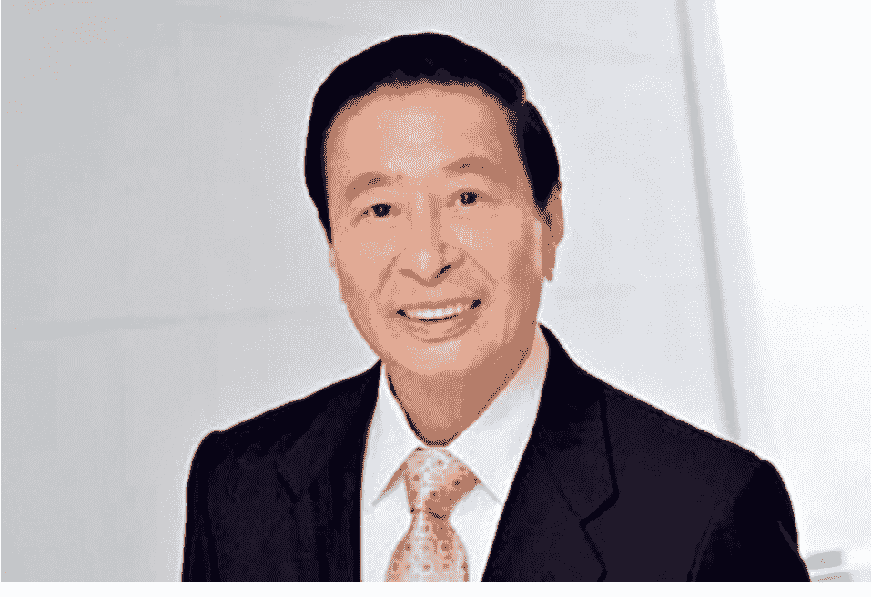

## CAIXIN | 听文章

文 | 财经周刊 思敏

2025年3月17日，李兆基辞世，享年97岁。在豪门中排行第四，被尊称为“四叔”。依靠世纪70年代香港繁荣时期，李兆基与李诚、郭胜、郑裕彤等大家族共同参与了香港经济的腾飞。据福布斯《富豪榜》，李兆基以29亿美元的身家仅次于李诚，1996年荣登华人首富、亚洲富豪第四位。

1928年，李兆基出生于广东顺德一个富家，家境优渥。他幼显商业天赋，在父辈引导下，6岁时即学习黄金外汇。二战结束后，货币大幅贬值，李兆基独自前往香港寻求发展。由于人口激增，李兆基敏锐捕捉到地产行业的巨大商机。1958年，他与郭胜、冯绪等共同创立了恒基业，购入土地，开始兴建各类物业。1963年，三人合作创立了新鸿基有限公司。1973年，李兆基自立门户，创立了恒基业有限公司，并在1975年与江实合作，开发了沙田第一项目，规模超万套住宅，至今仍是区内最大的住宅项目。1981年，李兆基将恒基业上市，成为李氏家族的旗舰。如今在香港交易所独立上市的公司包括美丽华、中华煤气、香港电力等。李兆基通过积极换地、吸纳土地，逐步发展为香港最大的开发商之一，在各处拥有多个物业和住宅项目。

世纪80年代，李兆基进军地产市场。在广州，他与霍英东、广东省政府合资发展了番禺洛新城。进入21世纪，地产行业风起，李兆基又进军股市。他以个人名义成立了鸿基财经，2006年他接受采访透露，高峰资产高达200亿港元，因此被媒体戏称为“亚洲股神”。然而在2008年全球危机中，李兆基极少发表相关评论，表示不希望累股民，并解释自己不是股神，“只是股民”。

19年，91岁的李兆基宣布放弃主席兼总经理职务，由长子李家杰、次子李诚担任联席主席及总经理。李兆基主要负责中国内地业务，李家诚管理集团在香港的业务，表现都是100%。他十分慷豪，每当家族有新婚或生子的喜讯，他都会大发利是，向全体员工派每人万元的红包。2010年，他曾豪言，恒指指数重逾30000点，将每年捐出10亿港元，以人均万元计算，每年将10万人受惠。2017年1月，恒指冲上30000点后，李兆基兑现承诺。此后他还许诺，当恒指到40000点时，他会每年出20亿港元，但恒指仍在30000点以下徘徊。

从白手起家到华人首富，李兆基为人亲爱，曾多次公开自己的致富经验。他向年轻人拆解致富之道：一是“刻苦耐劳，勤奋努力才成功”二是不要太早负起家庭压力，待事有成后再考虑家庭；三是“先赚到第一桶金，之后再以钱生钱，只靠劳动打工难以致富”四是“男最怕输，女最怕错，要选择前景好的行业”。

对于财富之道，李兆基认为：“聚而不散是暴殄天物，学会聚财也要学会散财”。他尽量挥霍，但自称连1%的财富都用不完。股市起伏、全球经济危机等都会让他“患得得失，沦为金钱奴隶”。后他领悟到，多出力慈善公益，才能发挥财富最大价值，又能减少烦恼。

他名下有李兆基基金，多次向香港、内地以及海外高校捐款用于科研。2008年四川汶川地震发生，他更是慷慨捐出5.6亿港元援助灾区。他曾提出过许多创新的慈善准则，例如，从2013年起，一系列计划养老院中心和青年宿舍，以减轻民众迫切的需求。

# 前瞻 | 欧盟如何应对美国加征关税

## CAIXIN| 听文章

文 | 财经周刊 王

从月中旬起，由于美国在2018年和2020年分别对欧盟钢铁和铝加征25%关税，欧盟出台了反制措施以应对美国关税造成的损害。同时，欧盟的反制措施范围涵盖美国商品，金额共计260亿欧元（约283亿美元）。欧盟委员会在3月12日发表声明中宣布，原本第一轮反制措施将在4月1日生效，第二轮措施将在4月13日生效。但在双方协商后，欧盟委员会决定推迟了所有措施的生效时间。

此前，特朗普在2月26日曾宣布对来自欧盟的汽车及所有其他商品加征25%关税。3月13日，特朗普再次威称，如果欧盟不立即取消关税，美国很快对法国和其他欧盟成员国的葡萄酒、香槟等酒类产品征收200%关税。法国、意大利等几个葡萄酒出口国家因欧盟升级的举动表示不满。如果美国继续征收关税，欧盟将毫不犹豫地进行报复。

作为一个整体，欧盟对美国贸易逆差仅次于中国。欧盟统计局在3月11日发布数据显示，2024年，欧盟对美国出口5316亿欧元，进口3334亿欧元，贸易顺差为1982亿欧元。与2023年相比，出口增长了5.5%，而进口下降了4.0%。

## 相关视频：

- 【华尔街原声】分析人士：相较其他市场，中国市场相对稳定
视频说明：2025年3月17日，桥水前首席策略师Rebecca Patterson认为，特朗普政府的新关税政策促使外国投资者撤离美国市场，这不仅削弱了美元，也使得资金不断流出美国市场。

## 相关专题：特朗普新政、特朗普20时代：影响与变局

# 风 | 文科缩减下的历史老师

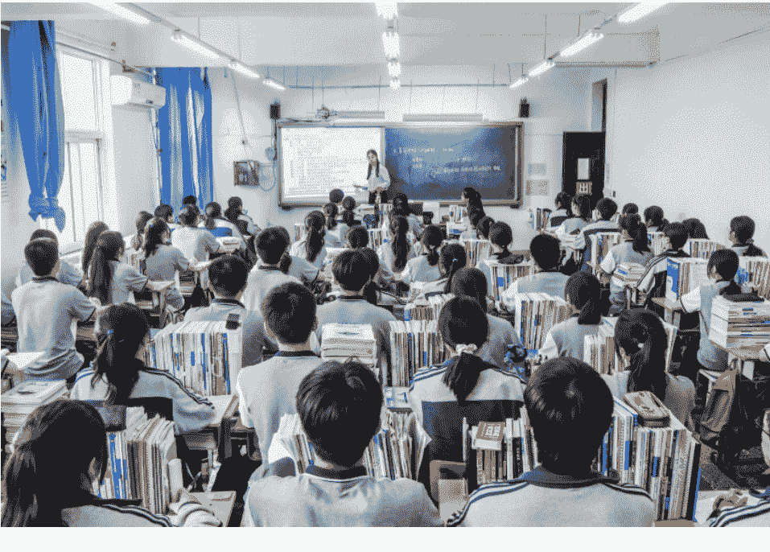

## CAIXIN| 听文章

文| 财经周刊蔡依佳

在山西莱县重点中学的走廊里，历史老师王琳夹着教案匆忙地走向理科班教室。这是她今天唯一的一节课，却要面对一群“头皮也不抬”的学生——他们满头乱刷着物理题，偶尔有人翻着课本，也只是机械地回应她的提醒。40分钟的课堂，她需要用“翻书”般的速度讲完一个单元。“一节课哗啦啦翻十余页，和自学没有区别。“她苦笑着摇摇头。

自2022年山西推行3+1+2新高考政策（即语文、数学、英语必，物理或历史必选其一，再从政治、地理、化学、生物中任选两科）以来，王琳所在的这个班级曾身“全国强”的县中倾向理科。以前每年年级20个班中有3到4个文科班，如今仅有一个“纯文科班”和一个拼班的“物化/地”。

次空袭丧生。以色列与哈马斯达成的临时停火协议到3月1日宣告结束，原定第二阶段停火谈判应于2月3日启动，但未取得实质性进展，双方分歧严重。3月18日，以色列总理内塔尼亚胡宣布复对对加沙的军事打击，并宣称“和平谈判将在炮火下进行，这一袭击只是开始”，以色列将继续推进军事行动，直至实现所有战争目标，即摧毁哈马斯并解所有被扣押的人质。■

相关专题：以色列冲突缓解

# 心智 | 打破家庭焦虑三角

## CAIXIN | 听文章

文 | 蓝铃

你是否注意到，家庭中一个人的情绪失控，往往会让整个家庭陷入紧张和混乱？

家庭治疗创始人之一默里·鲍文在家庭系统理论中提出了“三角关系”的概念，揭示了家庭内部的情绪动态。当压力或冲突出现时，情绪会通过三角化的方式在家庭成员之间传递和调节，将每个人紧紧相连。

在三角关系中，焦虑起着主要作用。当两人之间的焦虑水平较低时，关系可以保持稳定和舒适。但两人关系很难长期保持平静，内部（如沟通问题）或外部（如压力事件）的情绪干扰容易导致焦虑水平上升，打破两人关系的平衡。

当两人关系中的焦虑增加时，往往会将第三个人卷入，形成三角关系。第三个人的介入可以将焦虑从两人系统中分散，使焦虑在人之间传播和转移。这种转移避免了某种情绪在两人关系中过度集中，从而降低了情绪过热的可能性。

例如，A和B是夫妻，最近因为工作压力和沟通问题，争吵增多。这时，他们的孩子C可能会被卷入，比向AC倾诉，或C试图调解A和B的矛盾。C的介入，使A和B之间的焦虑被分散到三人之间，A和B的关系因此被缓解。然而，三角关系本身可能成为新的问题来源，因为冲突并未真正解决，只是缓解或转移。

三角关系是维持关系的最小单元。当一个人无法在某个三角关系中处理焦虑，这种焦虑会蔓延到其他三角关系，形成连锁反应。例如，母亲希望父亲管教孩子的事，父亲回避，导致母子冲突升级。这时，母亲将焦虑转移到另一个孩子身上，引发孩子的冲突，而自己则从冲突抽离。

为什么会这样？默默·鲍文认为，家庭成员的情绪功能高度相互依赖，因此可以将整个家庭视为一个情绪单元，而自我分化水平则影响情绪共生。

自我分化是指家庭系统中，个体在情绪上逐渐独立的过程，表现为能够独立思考、感受和行动，同时保持与家庭的情感联结。

家庭的分化水平越低，越容易依赖三角关系来维持情绪平衡。相反，在高度分化的家庭中，即使面对巨大压力，每个人也能保持情绪上的独立。

如何让家庭成员从三角关系中独立出来，减少对第三方的依赖，增进家庭和谐？去三角化的第一步是察觉三角关系的存在，包括被他人三角化和试图三角他人的方式。例如，夫妻发生冲突时，母亲对孩子说：“你爸爸对我不好，你不要他。”这就是试图三角化，将孩子卷入冲突。通过识别这些模型，家庭成员可以清楚地认识三角的影响。

默里·鲍文提出了情绪中的态度：在三角关系中，不偏袒任何一方，并基于这种中立态度行动。情绪中立不等于冷漠或优柔不断，而不是试图改变他人或强迫他人接受自己的观点，它强调在不判断他人行为的情况下，清晰界定自己的立场。

要实现去三角化，首先需要从三角关系的情绪反应中解耦，不被情绪所控制。接下来，需要有效传达自己的立场，展现情绪自主性。通过这种方式，人们可以界定自我，而不必在特定问题上明确立场。有时候，保持沉默或什么都不做反而更有力量，这种“说不不做”的方式也能很好地展示独立性。

去三角化的方法多种多样，具体操作取决于家庭具体情况和个性特点。关键是通过语言和行为传达中立性，避免卷入三角关系。

然而，保持中中立并非易事。这需要超越表面现象，深入理解体系的动态和背后的情绪过程。人们往往倾向于将问题简化，比如将一方视为“受害者”、另一方视为“加害者”，或将问题归咎于某个人。这种简单化的视角让我们看到问题的复杂性，也让我们更容易被情绪所控制。一个家长试图去三角形化，也可能陷入“不支持支持反对”的陷阱，被指责不支持某一方，从而被视为反对或背叛。这种指责往往会让试图去三角形化的人重新回到三角关系。

在去三角形化的过程中，行为语言更重要。例如：

- 父母经常发生冲突，各自向儿子抱怨对方，希望得到的支持或调解。儿子从这种三角关系中抽身，试图通过语言表达自己的立场，对父母说：“你们的问题自己解决，不要再把我扯进去。”然而，父母仍然向他抱怨，甚至指责他并不关心家庭。意识到仅靠语言无法改变现状，他采取了以下行动：
- 设定明确边界：当父母向儿子抱怨时，他礼貌坚定地说：“这是你们之间的事，我不参与讨论。”
- 减少介入：不再充当父母之间的声筒或调解。父母试图通过他传达信息，他明确拒绝：“你直接跟我爸/妈妈通。”
- 专注于自己的生活：将更多精力投入到事业和社交生活中，减少对家庭冲突的关注。

起初，父母可能感到不适应，甚至试图用更强烈的方式儿子拉回三角关系。但随着时间推移，他们会逐渐意识到儿子不卷入他们的冲突，不得不调整互动模式，不再依赖亲子作为中间人。通过行动，儿子不仅实现了去三角化，还促使父母重新审视他们的关系，推动家庭向更健康的方向发展。如果你也被此类问题所困扰，不妨也尝试积极的行动，改变家庭系统的固有模式，让关系更和谐、家庭更美好。■

更多精彩请阅读：【专辑】心智
