# 财新

Caixin Weekly

# “新高考”期考试

高考改革进入尾声，透视生与新游戏

规则调整过程，对未来有多少影响？

2025年3月29日 周刊
第155期
总证号：32-225

# 免费 价值 及时 专注

# 扫码加入 知识星球TOP 免费资源群

- 每日免费获取价值资源
- 可提供各类资源搜索服务

◆热门付费文章 | ◆各行行业报告
◆精选图书资源 | ◆副业赚钱方法
◆职场实用资源 | ◆AI政经自媒体

公众号:知识星球TOP | 微信号:jntsg8 | 微信号:jntsg2

分享资料仅供个人学习，请及时删除，切勿商用传播

# 财新观察 | 以法治护民营经济高质量发展

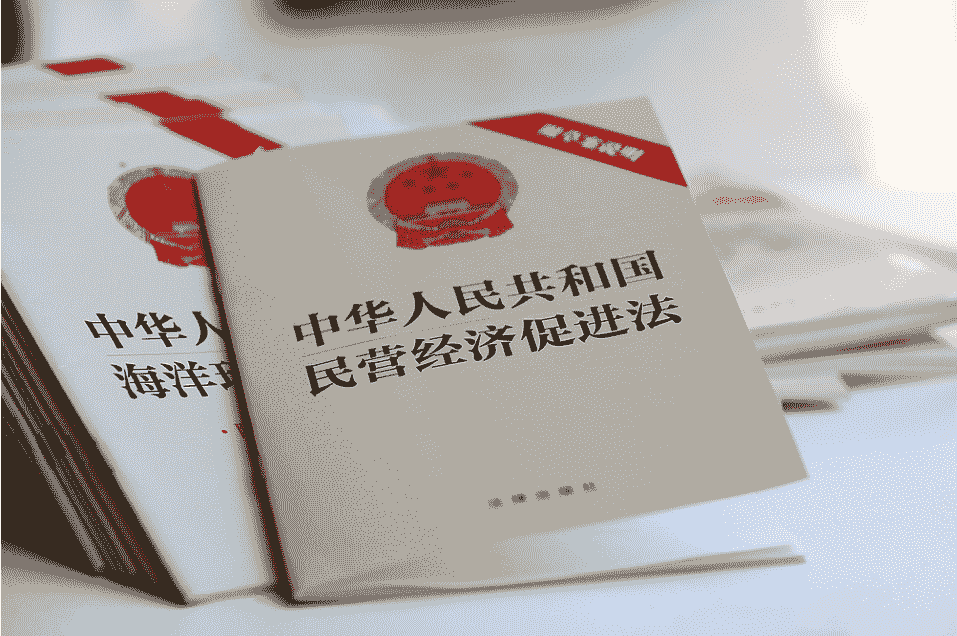

听文章
备受瞩目的民营经济促进法出台。4月30日，十四届全国人大常委会第十五次会议表决通过了《中华人民共和国民营经济促进法》，这是中国第一部专门关于民营经济发展的基础法律。三次审议分别在2024年12月、2025年2月和2025年4月。该法共9章78条，包括总则、公平竞争、投资融资促进、科技创新、规范经营、服务保障、权益保护、法律责任和附则，将于今年5月20日起施行。

民营经济促进法首次明确民营经济的法律地位，首次明确规定“促进民营经济持续、健康、高质量发展，是国家长期坚持的重大方针”。这部法律坚持平等对待、公平竞争、同等保护、共同发展原则，为民营经济高质量发展提供坚实法律保障。

立法过程中，这部法律被寄厚望，许多人建言献策。审议通过后，要切实落实好民营经济促进法，这不仅关乎民营经济自身的发展，也关乎水平主体市场经济的构建。

对于民营经济的认知，经历了一个不断完善的过程。从“社会主义所有制市场经济的重要组成部分”，再到近年来一系列保护和发展的法律法规，民营经济的法律地位日益清晰，促进民营经济发展的观念深入人心。以立法的形式，将改革开放以来关于民营经济的方针政策和实践中的有效做法确定为法律制度，有助于进一步凝聚社会共识。在这个意义上，这就是一部巩固对改革成果的法律，也是一部面向未来、稳定预期、提振信心的法律。

如其名，该法阐明义，“为优化民营经济发展环境，保证各类经营公平参与市场竞争，促进民营经济健康发展和民营经济人才健康成长，构建水平社会主义市场经济体制，发挥民营经济在国民经济和社会发展中的重要作用。”这部法律明确了，按照市场化、法治化原则，对于金融机构向小型微型民营经济组织提供金融服务实施差异化政策，推动构建完善民营经济组织融资风险的市场化分担机制，体现了问题导向。

总则之后紧接着就是“公平竞争”，这一章规定了统一的市场准入负面清单制度和公平竞争审查制度。法律还规定各级政府及其有关部门依照法定权限，在制定、实施政府资金安排、土地供应、排污指标、公共数据开放、资质许可、标准制定、项目申报、职称评定、评审、人力资源等方面的政策措施，平等对待民营经济组织。在服务保障一章中，又规定，“行政机关坚持执法行政，行政机关开展活动应当避免或尽量减少对民营经济经营的影响，并对其合理、合法诉求及时响应、处置。“对于保护民营企业经营自主权和企业家人财产产权，法律在第七章“权益保护”中包含了合法收益的规定，对于合法财产、合法财产、查封、扣押、结案财产，应当遵循法定法规、条件和程序，还明确了规范地执法行为，建立健全执法协助制度，并写入“禁止为非法利益等滥用职权实施执法”。这些都是对社会关切问题有力的回应。

这部法律有“牙齿”。在法律责任专章中，违反法律规定实施执法的，由有机关责令改正，造成不良后果或者影响的，对有责任的领导人员和直接责任人员依法予以处分。地方政府及其有关部门不履行对民营经济组织政策承诺、依法签订的合同的，由有机关予以纠正，法律以赔惩；造成不良后果或者影响的，对有责任的领导人员和直接责任人员依法予以处分。落实好这些规定，有助于增强政互信，激发民营经营的活力。

落实好民营经济促进法，还有很多工作要做。全国人大委会就法工委负责人答记者问时，要以民营经济促进法出台为契机，系统推进配套法规制度制定，协调推动各项支持保障措施落实到位，增强法律规范的系统性、整体性、协调性、时效性，确保法律正确有效实施。

当前，中国经济持续回升向好的基础还需要进一步稳固，外部冲击影响加大。贯彻落实好法律来不易，凝聚了无数人心，有助于民营经济组织优化结构、做强实业，提升核心竞争力，有助于民营经济持续、健康、高质量发展。更多资源关注：公众号 懒人搜索。更多报道详见：【专题】民营经济政策

# 最新封面 | “新高考”期末考

# 财经 | 肖佳、汤涵钰、蔡依佳（实习）

几天后，李力将走入高考考场。“很有紧迫感，”他说，“最近他每周都要考试，周末很少回家，和同学们一起学习。”李力是新高考改革后的第五届考生，今年还有来自山西、河南、陕西、蒙古、四川、云南、青海的第一届考生。到2025年，全国除特别行政区外，已有29份实施新高考。新高考改革启动于2014年9月，国务院印发关于深化高考制度改革的意见》（简称《实施意见》），考试科目设置、招生录取机制等方面。此轮改革在2023年10月，教育部部长向全国人大常委会报告高考制度改革情况（简称“改革报告”），被视为恢复高考以来最完整、最系统、最深刻的一次改革。新高考改革已接近尾声。随着教育的普及，从数据来看：2005年起高考人数从867万上升至967万，录取人数则从504万上升到1042万。《实施意见》开头提到此轮高考改革的背景之一：唯分数的影响，使得学生负担过重。改革之初确立目标：形成分类考试、综合评价、多元录取的考试模式，促进公平、科学选才、监督有力的机制，构建衔接各类教育终身学习“立交桥”。这些目标实现如何？

高一上学期末，临近高考，湖南高中生今雅家里聚焦。父亲希望她学理科，因为听说“文学没有出路，专业少、就业难”，而今雅喜欢文学。父母人都希望今雅的母亲站在自己这边。“连睡觉前都要软性轰炸，”母亲回忆，“父亲疯狂补各种招生知识，看视频、资料。”家里开了几次讨论会，今雅坚持立场，最终战胜了父母，即将举行2025年高考考试的历史、政治、地理。

这样的选科“大战”在很多高中家庭中上演。高中生在高一上学期结束时确定选科科目，高下学期进入新班学习。新高考改革后，“文科综合”“理科综合”二选一模式落地，多数地区开始实行“3+1+2”选科模式，即语文、数学、外语必选物理或历史选其一，再从政治、地理、化学、生物中任选两科。部分地区实行“3+3”模式，即数学之外任选三科。今雅的选择在重点高中里不算主流。如今，物理和化学成为多数好学生的必选项。王琳所在的山西某县城重点中学，高一上学期刚过半就开始放弃文科”。文科老师连作业都不布置，晚自习和周末补课全给科。“2022年山西推行高考以来，她所在的这所学校曾身“全国强”的县中彻底倒向理科。以前每个年级20个班中有三至四个文科班，而今有一个“纯文科班”和一个“物化政/地混编班”。

“以前还有怀揣文史梦的学生，现在选的都是资源垫底，要么是在实学物理。”王琳所在的学校的资源向理科“清华苗子”倾斜。天津高中历史教师胡绍望说，学校最优秀的教师集中在物化生组合，二等师资放到政地和“物化+X组合”，最后才是其他小组组合。

“重轻文”的原因在于，新高考改革强化了高考科目和高校专业录取的衔接。2021年教育部发布的《普通本科招生专业指导意见（通用版）》（简称《指引》），指导高校专业范围内（物理和历史，高校可提地理、化学、生物等科目）。在普通本科专业目录的12个学科类（艺术除外），高校提出必选“物理+化学”的专业超过半数，涵盖理学、工学、农学及医学。这种“物化绑定”的政策导向，使得“3+1+2”改革中，物理覆盖率高，只有人文社科类科学科学。改革之初，按照学生自由选择、兴趣融合的蓝图，为学生提供多种组合。14年起，上海、浙江、北京、山东等第一批和第二批试点“3+3”模式，选科组合达20种。

此轮改革的“3+3”模式开启元年，理工、医学等专业物理人数断崖式下降。科学界对此强烈反对，认为这将极大影响国家人才培养。对于学生来说，“政地”是无奈，更是为了上本科的机会。浙江省教育研究院李金波等人的提到，不同层次学校新生的选科差异显著。从2024年浙江招生的“双一流”建设高校、浙江省本科院校、高职院校三类新生的科目人数来看，“一流”建设高校中选物理占比最多（56.8%）；高职院校仅15.5%，还有超六成选了偏文类的地理、政治学科。

就上海的情况，“物化以及‘物生’的学生，学业水平显著高于纯文。“上海‘四校”某高中班主任卢婉说，为了避免理科激烈竞争，上海重点学校倾向让学生选文科，某区重点中的二年级学生唐在分科时选择了文科，因为“如果选一本的话，理科要排到上海前5%到在我们学校就算尖拔也微乎微”。开放科后，选择“文理混搭”的学生并不少。胡哥2020届毕业生“化生”班、2021届为“物地”，他发现这些学生基本一半时间用来学数学，剩下的时间更多给其他理科。新高考选科改革配套的是高中阶段实行走班制，即学生根据不同选科在相应的教学班听课，不受行政班限制。这一尝试也在实践中出现操作不顺问题。在十四届全国人大常委会第六次会议审议高考制度改革的报告时，出席人员指出，一些中学实行选科走班制，班级编排和学生管理复杂化，出现学生资源紧张、教师队伍学科结构性衡等问题。如今，仅有北京、上海等教育丰富的地区有的学校实现了全走班教学。多数地区根据自身教师、教室等资源，开了4—6个选科组合（“物生”“物化政”“物地”“史地”组合常见），形成固定行政，个别选择其他组合的同学上课。

“我们当初想不分文，最后上转了一圈又回到了小文了，这是所有改革都应该汲取的教训。“中国教育发展战略学术委员会志文英总结。

智联招聘《2024大学生就业力调研报告》显示，截至当年4月中旬，理工类、管理类和人文科类学生的offer（录取通知）获得率依次为49.4%、47.1%、43.9%。尽管两端距离从2023年的12.4个百分点缩小一半，整体而言，理工类专业毕业生获得offer的情况仍好于管理类和人文科类学生。兰州文理学院副校长王顶明曾采访：“与80年代、90年代初对理工科的重视不同，中国现在需要从大而全中低端的工业体系，走向强大、高质量的工业体系，因此必须加强理工人才的培养。”

无论就业市场还是国家战略需要，对于“人才出口”的期待倒逼教育。4月中共中央办公厅、国务院办公厅发布的《关于构建高质量毕业生服务体系的意见》，强调要以产业端人才需求、就业端评价为引导，优化高校结构布局、招生计划配比，动态调整适应经济发展的学科。教育部等部门发布的普通高等教育学科设置调整方案明确要求，到2025年，优化一批适应新技术、新产业态、新经济发展的学科，人文社科往往是淘汰对象。复旦大学校长金力接受《南方周》采访称，文科招生比例从原来的30%降到20%。上海某高中主任郭鹏表示：“市场需求决定学生的选择，进入高校之前，学生需要更明确的规划”。改革将“选科—专业—就业”形成强关联关联，这意味着学生一进高中就要有清晰的规划，教育的重要性大大提升。但现实中专业指导十分匮乏。多位专家提到，中学生涯规划普遍发展，教师专业化培训、课程资源不够，生涯规划针对性、有效性不。学校主要通过心理老师或班主任、级大会、聘专家等方式，向学生和家长介绍就业前景、竞争情况等信息，帮助学生成长。18岁是开始自我规划的关键时期，高中就要唤醒学生的意识，才能找到自己满意的大学。上海高二学生林安所在的学校除了女生都是成绩差。林安在年名前20、100左右徘徊，但最终选择了物理、化学、生物。她坦言：“当初选择可能有些虚荣成分，毕竟学校刻板印象就是成绩差，女生去帮男生升一下？”李杰也遇到类似的问题。他反思，理性评估自身能力，找准自己擅长的学科和方向，或许追逐“热门组合”更具现实，“如果你就是擅长的文科人，但为了专业多非要选物理，将来的大也会很痛苦，可能还花费了自己的天赋，只能平庸庸。云南某县中学顾远观察到，当学生的知识面、家长的生活视野面对择考，家长提供的资源和指导很少，而学生自己缺乏独立考虑，“选好很多时候很迷茫，也很盲”，受网课影响很大。远山所在的学校，从2024年开始，年级前100名学生中只有两个选择文学（历史类）。他告诉理科是国家重点发展的，也要结合本地的情况来选择：云南经济发达，很多学生将来就业会选择报考公务员、事业编制、经济文化类岗位，文科反倒会占优势。不少学生选科时茫然，选专业时更无措。新高考的志愿模式发生重大变化，由传统的“院校+专业”变为“院校组”。例如在湖北，原先“院校+专业”模式，本科第一次需要9个院校，每个院校填6个专业，共54个专业；现在本科批次需要填45个院校组，每个院校包含6个专业，此共需要填报70个专业。
把学校专业的排列组合提为平行志愿，不在学校中调剂专业，能够程度地降低学生选择的风险。

唐欢倩也认为，网上那些关于高考和就业的直播和贴子过度煽动情绪，所以她的工作之一就是管理家长的情绪，因为家长的焦虑程度比学生还要。“在她看来，绝大多数家长只关注高考这个节点，而没有考虑孩子未来的发展。

## 高考转变

高二学生已经进入复习阶段。当前，高考备考方式与十年前异：高二下学期结束所有课程（一些学校提前到高二），高三开始复习，进入“刷题、讲题”的一年循环，学生每周经历9场考试。为了让学习进度，有些学校环境让她感到压抑——走廊的窗户只允许伸出手。所有受访的学生表示，身边普遍都在补课，希望通过一对一或小班课针对性地提高成绩。

江苏某高中校长凌宗退休后走访全国各地，他说改革文件中重视“培养学生综合素质”让他感到振奋，但最终发现落实最大的挑战是时间——不少区域实行宿制，孩子基本上早上6点起床，晚10点睡觉。林安说道，目前80%的时间都是学习，我发现为止很匮乏，就是一直在学那些东西。

唐彦晨表示，面对变化，所有学校都用一对一或小班课，上海的学校能够做到“全方位无死角”。他在重点高中的每天早上6点起床，做作业到晚10点，每周六还要补数学，一年花费23万元。

从“知识型”向“能力素质”转变是高考内容和形式的关键之处。业内普遍表示，题目灵活了，一些传统的应试技巧被消除。例如，教育部教育院研究员吴子朝在《新高考科目改革：成就、挑战与转向》中提到题目“低起点、多层次、高低差”的调整策略：所谓“低起点”，即试卷在选择题、填空题、解答题起始题降低要求、面向全体学生；“多层次”是指试卷在中档部分增加比例和难度梯度；“高低差”是指在压轴部分突出综合性、创新性，加强思维能力，强化对高水平学生的选拔。

与高考改革衔接，教育部组织260多位专家对普通高中课程方案和语文等14门学科标准进行了修订，历4年完成，于2017年底发布，并于2018年秋季开始执行。

教育部在相关新闻会上介绍，与003年普通高中课程方案相比，新的课程方案进一步明确了普通高中教育的定位：针对长期以来存在的片面化追求升学的倾向，强调普通高中教育是在义务教育基础上提高国民素质，而不是为了升学做准备，还要让学生适应社会生活和职业发展，为学生的终身发展奠定基础。

与之相应，新课程新增了学科素养部分，以明确学生学习课程后应形成的正确价值观、必备品格和关键能力，并围绕学科核心素养的落实，精选、重组教学内容，设计教学活动，提出考试评价的建议。其目的是切实引导学科教学在传授知识过程中，更加关注学科思想、思维方式等，克服教重轻的倾向。

为确保课程改革与高考改革的衔接，教育部此次组织课程专家与考试评价专家共同参与。“人才培养而言，课程方案和课程标准是基本依据，考试招生是重要导向。”

这些变革深刻影响着中学教育。教育部前期高考改革报告提到，新高考、新课程、新教材对教师能力提出更高要求，一些薄弱学校仍习惯于传统教学方式，需要向知识传授能力素养培养转变。

王超认为，试题设计中一直存在“反刷题”倾向在高考中更加显著。他的介绍，地理学科中，现在的教学重点转向培养学生的核心学科素养（如地理实践能力、区域认知）和自学能力。这就要求老师更多精力提升课堂教学和作业水平，工作量是以前的2倍以上。“按照知识序列来推进，我们，完了其实也不考了。”

新高考对教师教学水平的要求大提升，王旺担心，例如一些资薄弱地区，老师“对教学得没有那么透”，会对学生造成很多困扰。“（让人反思）老师的教学是不是到了一个不不时刻。”一位与甘肃省教师培训的专家告诉财新，2024年第一届新高考成绩让学校“出乎意料”，不少原来的“好学生”考得很差，“差生”又考得很好。他认为，这说明老师们没有吃透新课标”，必须提高教研水平。

课程标准改革后，各地换了一批新课标教材。“新教材比以前要大很多，比以前的内容要多很多。”卢禺介绍。在语文文学为例，当前期试卷的阅读量和文言难度都很大提升。现在的学生十年后的卷子，大家都能带来高分的。“为了增加学生的工作，她把孩子搬到了学校，组里老师每天只睡五个小时。“只是想要很好地完成日常工作，业内人士总称，高考的一次大转折。因此教学上强调真实性，与学生生活密切。”

例如在英语中，作文增加了25分钟，要求学生根据文本续写故事。江苏的英语老师郭云举例，某项要求学生根据经历，发挥想象力、语言生动地给出丰富的场景，学生的差异其实蛮大，总分25分到22分，“一道题就差了六七分”。顾远总结，新高考除了考知识，还有能力、学科素养、核心价值观，这种转变起一定作用，要取得明显效果还需要漫长的时间积累。“距离高考不到两个月时，高中三学生开始放弃“刷题”，因为孩子做了老师老师也不错，检查很难保证质量。高二的时候就取得很快。佛山学生雅琪说，高中后她发现难度大大提升，为了参加区里考试，老师有时会赶进度，忽略很多细节。“其实大部分下游来说，更注重的是把基础搞好。”希望周末有时间补习。

“最讨厌老师”的典型画像——填鸭式教学，喜欢占课，布置作业很多又不讲。在新高考改革导向中，无论是教还是学生，“无脑勤奋”都不够了。

“所以高考结束之后上了大学，松一口气，这个问题一直存在。”辽宁锦州中原校长党委书记赵钛认为，高中教学不能太功夫，应当坚守基本规律，培养学生动手实践能力、创新精神，而不是直接给学生答案，而是鼓励他们提出问题、拥有批判性思维和想象力。“我们的教育应该让学生更有梦想、更加充满信心、好奇。”对于下游学生来说，考试主体却是更难了。“不是考死记背，靠刷题就能考好的。”安徽的一位老师说，王超观察到，一些对地理感兴趣、思维灵活的学生说，在掌握核心能力后，就不用花太多时间去复习；对于不活跃、天赋不高的学生，学习更困难了。过去总分中下游的学生用地理分数填充其他薄弱学科，现在在地理“刷题到一定份就上去了”。2023年高考，英语考试调整后，在顾远高中，学校开始安排10%英语低级的学生转日语。因为英语考试“难度较大，不能填题、押题”。学校普通的学生得分在15分以下，下游甚至看不题目，更没法写，只能得四五。原本英语只能考二十分的学生，外语科目能够提高50分左右，相当于普本升本科。受访老师们认为，面对新变化，家长和孩子都需要调整。“到自己合适的位置上面，心理才真正平衡，才健康。”

王总结，他在学校心理中心兼职时发现，孩子和家庭对学业的预期极大影响了心理健康状况。卢婉举例，一些高学历、高收入的父母对教育不计代价地投入，为了让孩子跨学区，购入二十万平方米的房子。“你可以想象，这样的家长对教育结果的期待有多高。“她认为虽然理解什么是‘好教育’，表面上尊重、关心孩子，但行事上表现出强大的控制欲，很容易导致孩子抑制。“他们期待太高，容不得一丝一毫的浮动。”

在广东的老师杨心，学生父母多经济和文化水平不高，很希望孩子能上大学。所以当孩子向父母抱怨学习压力大时，家长会生气，认为‘都花了那么多钱让你去读高中中了’，孩子理应在学业上有回报。很多高三学生来咨询诉吐学习压力，杨心有时接待不过来。她说这些孩子其实知道家庭困难，很想学好，所以压力更大。

## 综合素质培养

应对变化的考试，师生表现出的种种不适应，和素质教育评价困难有关。

根据《国家长期教育改革和发展规划纲要（2010—2020年）”，“全面提高普通高中学生综合素质’曾被列为高中阶段教育发展的三大目标之一。当时提出，通过推进课程改革、开设选修课等，“促进学生全面而有个性地发展”，同时全面实施中学水平考试和综合素质评价。

“综合评价”也被纳入2014年《实施意见》新高考改革的总体目标。在具体做法上，一是要求建立规范的学生档案，二是招生端探索寻求统一高考水平考试、参考综合素质评价的多元选取。按照最初期待，高校根据自身情况确定各项结果的使用办法。旨在破除“唯分”、促进学生全面发展。郑云表示，以江苏为例，学校每学期都要填一次素质评价材料，包括自己的学习成绩、实践经历以及证明。其中社会实践是寒假布置的，要求盖章，取决于自己。作为一种多元录取方式，目前全国中国科学院、北京外国语大学等高校直接招生，此外上海、浙江、山东等地部分高校设置，适用范围有限。郭晔分析，复旦、上海交通大学每年招生的上海生源，来自综合评价的接近50%；而上海大学，每年通过此渠道录取的不足10%。

对于普通批志愿人数最多的还是高考。他总结，从综合评价评分结构来看，高考分数占大头。浙江省考试院副院长、研究员吴朝分析，方案最初规定以高考成绩为主，高考成绩占比例上低于50%。各校情况不同，高校一般执行6:4比例，浙江执行5:3比例，多样执行6:1比例。同时，强基计划等招生类型参考综合素质评价，一般执行85%:15%比例。胡奎举例，在天津，每年3月高考后，清北招生中成绩尖锐的学生通过强基计划”“博雅计划”提前签约，答应高考降分录取。苏州教育学院教授张永新等人分析，从北京大学、清华大学招生情况来看，2020年学校新生中约30%是通过强基计划进入学校，不到10%通过竞赛和保送途径进入学校，60%—65%都是通过高考高分进入高校。怀进鹏在前述报告提到，各地建立了省级统一的综合评价管理系统，客观记录学生德智体美全面发展情况，强化公示，高校也将评价结果作为“强基计划”招生的重要参考。他表示：“评价如何确保公平公正的前提下，仍需进一步审慎探索。”综合素质评价更广泛地应用，阻力在哪里？上海考试院党委书记、院长沈祥曾分析，不同高中记录的完整性和准确性存在差异，内容缺乏客观标准与比较值，增加了高校对综合评价信息的研判成本和使用。

浙江大学科学学院试点、研究员李木指出，在实施综合素质评价时，许多学生往往基于综合素质的若干维度层层向分解考点，然后将各考点简单合成一个等级或分数。“这种拆分与合成式的评价不仅不存在科学性问题，也不足以发挥诊断引导作用”。与此同时，“不公平”也是诸多考虑的关键词。安在扬的学校，每个学生在校期间都要完成一大两份科创题目，成绩以分数形式记录评优档案，有机会参加比赛。平均每周两个晚上，回到宿舍里挑灯夜。她有同学通过导师或家长“接车”，她辛苦地自己。考试是最公平的选拔方式，毕竟没有办法淘汰。李木等人道，新高考改革的综合素质评价长期受权威和公平性质质疑，尤其是大学参照综合素质评价自定标准录取时往往面临“不公平”论压力。

## 如何破题“一考终身”

包括综合素质评价在内，新高考改革以来各种多元录取渠道此消彼长，但从学生角度理解，“一考终身”的高考成绩仍为各项枷锁中的重中之重。

事实上，《实施意见》中提出的分类考试、综合评价、多元录取的考试招生模式，在一定程度上取得了成效。2022年，教育部高校学生司司长王辉介绍，教育部已继续出台了实施高中学水平考试、加强和改进综合素质评价、规范高考加分、实施“强基计划”、推进高职分类考试、改革艺术体考试招生一系列具有“四梁八柱”性质的配套政策。以高职分类考试为例，新高考推进技术人才分类考试、分类选拔。将高职院校招生与普通高校相对分开，实行“文化素质+职业技能”评价方式。各地在每年春季安排高职院校分类考试，学生也可以参加统一高考进入高职院校。近年来，分类考试已成为学生升入高职院校的主渠道，其录取人数占高职招生规模的比例，从2014年的约20%至2023年的60%以上。对于普通高校，2020年多元录取形成了一道水岭：2013年自主招生制度落幕，取而代之，“强基计划”启动实施，后者通过降分分类录取，希望部分优秀学生吸纳到基础学科。

时任教育部高校负责人解释，当时自主招生面临许多挑战，包括学科过于宽泛、重点不集中、招生与培养衔接不够、评价不够、无法提供真实的学科特长。“强基计划”实施以来，一方面面临招生名额未满的情况，另一方面由于专业不在基础学科，使得部分学生退出，方案设置不完善，导致报名人数少。

另一方面，强基计划规模纳入，拔尖学生调查发现，无论总分是否达线，这种设计引导优秀人才向流动。

进一步推进“招考充分”难点在哪？储朝幂认为，这需要放权高校，但改革难度极大。一位专家分析，对应公平性质疑的关键是通过进一步的程序设计、信息公开加强监督。“扩大高校招生自主权是实现评价标准多样化的手段。”应帅强调，“招考分离”并不意味着高校自主主测试，“高校应聚焦于用好专业考试机构提供的成绩。当考试机构无法满足人才需求时，高校自身具备相应能力的情况下，才适合开展有益的自主测试探索。”陈志文提及，美国的高学水平考试等由第三方社会机构组织。应帅在前述文中也表示，招考一体的弊端，或者说促使破除招考一体的关键问题在于评价方式的单一，即机械地把评价信息抽象为一个总分，作为所有学生的评价取向。他分析，科学命制的每一道试都是精确的测量点，准确体现受试者的特征；但汇总成为一个类型，一张试卷总分，受试者的特征就逐渐抽象，最后归纳为总分，分数背后的形象已经模糊不可识。“因此，以一个总分评价来兼顾各异的学生，服务不同的需求的高校、专业，既不科学也不公平。”美国大学之所以能够以审核制开展综合评价，“最重要的美国社会的治理基础是个人诚信。一是申请材料不作假，二是招生委员会教授不徇私，配套的是严惩重罚。而中国社会的信用基础是各级政府、相关单位，不是个人。应帅建议，在相当长时间内，可保持省级教育考试院在国家教育考试中的主体地位，但可以以考试成绩的个性化使用作为切入点推进招生考试相对分离。但许多受访者也提到，高考压力难以减轻，归根底还是社会问题。

# 最新财新周刊 | 印巴新冲突

# CAIXIN| 听文章

文 | 财新周刊 路尘 胡岐

“世界无法承受一场印度与巴基斯坦之间的军事对抗。”5月7日，联合国秘书书长古特雷斯通过发言人加里杜克对外表态，“呼吁两国保持最大限度的军事克制”。

在声明发出前两小时，印度宣布对巴基斯坦发动名为“辛多尔行动”的军事打击，巴基斯坦及巴控克米尔地区多个城镇遭遇轰炸。巴基斯坦坦克后反击，轰炸了印控米尔地区及印边界地带，并宣布击落了5架印军战斗机，公布了其中1架疑似为法国“阵风”战斗机的残骸图片，印度方面史未对此作出回应。

5月7日晚间，巴基斯坦总理夏巴夫发表了全体演讲，称印度忘记了巴基斯坦是一个深知如何为自己的国家而战的民族，并誓言：“我们将为受害者们流下的每一滴血实施报复。”

在印度方面，印国外外交部长基尔蒂·瓦尔辛辛（Kirti Vardan Singh）在5月7日向媒体表示，在对巴基斯坦发动打击后，“全国民众都为我们实施了报复而感到高兴”。他说：“我们的国家对那些无辜者、女性等成为胜利的人给予了适当的回应。”

印方的指控，建立在其宣称巴基斯坦才是为4月22日发生在印控克米尔城帕恰哈尔加姆的恐怖袭击事件负责的基础上。印度还指出，袭袭的实施者就隐匿在巴基斯坦境内。但巴基斯坦否认印方相关指控，称巴基斯坦政府与袭击事件无关，而印度对巴基斯坦的空袭则属侵略战争行为。

在此之后，冲突态势持续升级，印度在5月9日早晨称巴方使用导弹和无人机袭击了己方处处军事基地，越普、克特米尔和拉固斯坦地区等地报告发生爆炸停电，但未报告的伤亡。巴基斯坦则连续两天报告该国遭遇无人机袭击，并称截至5月9日总计已击落77架无人机。尽管巴基斯坦承认了有巴方袭击印军军事基地的指控，但巴基斯坦信息部同时宣称，巴军在印巴境内击杀了40—50名印军士兵。

同期，印度政府发表声明称已准巴基斯坦国防空系统，这也是印巴两国首次承认将对对方国家军事设施纳入攻击目标。

5月9日，印度总理莫迪首次打破沉默，印度仍将“保持警惕”，他在主持与政府部长的高级会议时强调，面对与邻国的敌对行动，印度需要强力的内部协调和应变能力。同日印度国防部长拉特纳特辛辛确认，印度对巴基斯坦境内的军事行动“仍在继续”。

双方均指控对方袭击平民目标。截至5月9日，双方各自更新了亡员人数，巴基斯坦方面，印度的空袭和越境炮击已造成36人死亡、57人受伤，其中至少包含一名7岁的儿童。印度方面，巴基斯坦的越境炮击在印度境内造成16名平民死亡和5名儿童。

本次火灾，是克什米尔地区2019年以来规模最大的军事冲突，可能演变为印巴两国2002年以来最危险的一次对峙。国际社会纷份呼吁印巴两国克制，避免局势进一步升级，但这对关系长期紧张的邻国，仍旧到了20年来最大冲突的边缘，未来走向将对这一地区造成持久影响。

长期关注巴基斯坦及俾路支地区政治与安全领域的中山大学国际关系学院特聘研究员马向旬表示，尽管巴基斯坦观察者普遍相信，末轮冲突不会长期持续，克什米尔也不可能加入沙或乌克兰战争的未来，当前态势如何解决，特别是印度是否完全恢复对巴基斯坦的河流共享，将对巴基斯坦的经济与民生造成巨大影响。

复旦大学南亚研究中心副研究员赵超认为，当前局势较大不确定性，双方仍在试探底线，即使双方止步，导致下一次升级的风险正在上升，没人知道底线在哪里。”

## “辛多尔行动”

4月22日，印控克米尔地区帕哈尔加姆镇发生了一起针对游客的大规模袭击。4月22日上午7点左右，一群枪手从林中出现并对帕哈尔加姆镇的游客射击，造成至少26名死亡，多人受伤，其中大多数为印度公民。这次袭击是克米尔地区多年最严重的针对平民的袭击。事件发生后，名为“抵抗阵线”（Resistance Front）的反印度组织在社交媒体上宣布对此负责。印度方面指责巴基斯坦军情报局（ISI）参与了袭击。但巴基斯坦政府“抵抗阵线”又否认了此前的攻击，称系印度方所致，导致印巴关系进一步恶化。印度在4月23日采取一系列外交和战略反制措施，包括关闭巴基斯坦唯一的陆边界，下调两国关系，宣布暂停印巴两国在1960年签订的《印度河水约》，切断了巴基斯坦的资源。

这项印巴两国于1960年签订的印度河水约规定，巴基斯坦使用印度河流量的五分之一，其余归巴基斯坦使用。巴基斯坦国家安全委员会随后警告，任何破坏河流的行为都被视为战争行为，巴基斯坦将动用全部力量加以回应。4月24日，印度总理莫迪表示，印度将继续采取强硬态度，“识别、追踪并惩罚所有恐怖分子及其支持者，袭击者及其同谋将受到超乎想象的惩罚。”巴基斯坦国防部长哈兰瓦尔·阿西瓦表示，印度正在与巴基斯坦进行一场“低强度战争”，还称如果升级，巴基斯坦已经做好准备。此后双方紧张态势持续加剧。5月7日凌晨，巴基斯坦军方称，印度发射的导弹击中了巴基斯坦及达霍米尔区域内的三个地点。巴基斯坦国防部发言称，印度的袭击“可怜且懦弱”，同时他通报，巴基斯坦军已紧急出动，“明确地说：巴基斯坦将在其选择的时间和地点对此次攻击作出。”约15分钟后，印度国防部发布声明，宣布印度开始名为“辛多尔行动”的针对巴基斯坦及达霍米尔地区的军事打击。声明中称，辛多尔行动是在“帕哈尔加引发的野蛮恐怖袭击，造成25名印度人和尼泊尔人死亡”之后发起的。印度国防部还称，“我们致力于确保对袭击负责的人受到报复”。印度方称其行动攻击了9个目标，均为巴基斯坦及达霍米尔地区的“恐怖主义基础设施”，并表示此前帕哈尔加引发的恐怖袭击，就是从这些地区“被计划和指挥的”。在印巴两国发布回应声明的同时，巴控克米尔地区和巴基斯坦境内发生多起大规模爆炸，巴控克米尔地区城市发生爆炸后停电。巴方赛后声明，所有被袭击中的目标都是平民目标，而不是军事目标。美联社援引巴基斯坦情报部消息人士报道，印度向巴控克米尔和周边普申省发射了三枚导弹，其中一枚击中了巴哈布尔伊斯市的一座清真寺。此后，巴基斯坦总理谢·夏·谢里夫表示，印度袭击了巴基斯坦5个城镇，“巴基斯坦完全对这一战争行为做出果断回应”。此后印度军方则称，巴基斯坦正在炮击巴控克米尔地区的周边的普-加利尔边界地区，“印军正在作出回应”。事后公布的信息表明，印度的首次空袭持续了25分钟。印度国防部称，空袭摧毁了至少70名分子、9个训练营、数个武器库和中转站。目标涉及巴基斯坦国内的反印极端武装派别——虔诚军（Lashkar-e-Taiba）、穆杰德军（Jaish-e-Mohammed）和真主圣战士者组织（Hizbul Mujahideen）的主要营地。其中，穆杰德军军事所在的巴哈布尔伊斯市，是本次印度攻击中距离印巴边境最近的标，边界约100公里。穆法拉拉德被指为虔诚军的一处驻营地所在地，虔诚军被指控为发动帕哈尔加袭击的幕后主使。巴基斯坦方面给出了迥然不同的图像，方称，印度袭击了巴基斯坦6个地区，遭遇至少4座清真寺。5月7日，巴基斯坦三军主任艾哈沃杜里（Aimed Chaudhry）向媒体表示，巴基斯坦军成功击袭了印度陆军总部并摧毁了其指挥所在地。巴基斯坦还称，在5月7日的短兵相接中，击落了5架战斗机和1架无人机，其中包括4架战斗机。5月8日，CNN援引匿名情报官的消息，确认印军被击落至少两架无人机，但印方未对对方作出回应。此后，在世界呼吁中，两国态势持续，爆炸和警报响遍印度控制的克米尔地区。

## 克什米尔冲突再次燃起

克什米尔，全称查什米尔，位于青藏高原与亚洲北部交带，与新疆维吾尔自治区和西藏自治区交界，西部与巴基斯坦、南部与阿富汗交界，佛教伊斯兰教传播至此。按照947年印巴分治之际，原由土著公认、被称为“土邦”的国有权选择加入印度或巴基斯坦，但查什米尔土邦成了其中的例外：这一后来被称为克什米尔的地区大多为印度教徒，但下层民众中已有70%的人口为穆斯林。当时的克什米尔领导人哈里辛格一度宣布独立，但巴基斯坦军队在英军撤离后立即入克什米尔并要求印度出兵。印巴两国随后在克米尔首府里那加爆发大规模冲突，这也是印巴两国成立以来的首次规模冲突，史称“克什米尔战争”。1949年，克什米尔战争为联合国斡下停火，并确定了停火线，此后印巴两国大致停火位置将克米尔地区划分为：印度控制约五分之三的土地和四分之一，巴基斯坦有余下部分。直到目前，双方均宣称对全部克米尔地区拥有主权。两国独立以来未解决的主权争议，与这片土地上资源、国防、宗教和民族仇恨问题相互绊，使得克什米尔地区仍是全球军事程度最高、局势最为紧张的区域之一。1965年和1971年1月，印度和巴基斯坦两度发生对，两场局部战争发生在克什米尔，史称第二次和第三次印战争。1972年第三次印战争后，双方达成《西哈拉协议》，将最初1949版停火正式规定为“实际控制线”，但这并没有阻止双方在1999年远离“实际控制线”的锡阿亚瀑沁爆发冲突，并数度界战斗争端。巴基斯坦要求索回克什米尔地区由联合国主持的公民公决，而印度则《西哈拉协议》已规定两国通过谈判解决问题，而印控地区的克什米尔人每年都要参加印度的各级选举，已在事实上确认其加入了印度的立场。几十年来，双方在克什米尔问题的立场终未出现明显变化。在领土冲突之外，印控克米尔地区未曾平息的武装反叛行动，又为印巴之间的紧张局势引入了新的燃料。调查印-克什米尔哈尔堡（2019年后又被印度政府分裂为勒和克什米尔中央直辖区与拉达克中央直辖区）穆斯林人口超过60%，是全印度穆斯林人口中多数的。1950年印度在当地政治治理以来，该地区的土地和所有政策几次更迭。印度对当地的政治改革时而断，失业率长期高高不下，社会也陷入严重不稳定。上世纪80年代，政治暗杀和宗教谋杀遍布印克什米尔，当地选举亦陷入操纵丑闻，最终酿成1989—1990年由地下武装组织领导的大规模动乱。印度对当地采取了强硬措施，此后克米尔地区的抗议日益高涨，虔诚军与主圣战士者等武装派别，均这一时期内发展起来。印度方指责巴基斯坦政府煽动和资助克米尔地区的反叛组织，导致印巴之间的紧张局势多次爆发。对于巴基斯坦而言，这不足以说明。在克米尔地区的克米尔地区是持续的冲突。2016年7月，主圣战士组织领导人布汉·瓦尼（Burhan Wani）在印度军队交战中身亡，他的葬礼结束后，抗议者与印度遭遇激烈冲突，造成若干死亡。2016年9月，穆罕德·德军在实际控制线附近的城镇发动袭击，造成19名印度士兵。2019年2月，一名来自巴基斯坦的自杀式武装者在巴基斯坦境内普尔马瓜袭击了印军的车队，造成40名印度士兵。印度随后对巴基斯坦境内巴巴拉科特（Balakot）开展空袭，这是自1971以来首次进入巴基斯坦本土的军事行动，双方相互报复，至少一架印军战机坠毁，飞行员被俘。8月，印度总理莫迪宣布废除印度宪法第37条，取消克什米尔的特殊地位和自身地方宪法的特权，并重申克什米尔划分为两个直辖区，加强印度政府对当地的控制。这一事件引发的大规模抗议持续，此后印度不断加强对克米尔地区的控制，致力于推动该地区“古土归印”融入印度。帕哈加姆发生的恐怖袭击恰好爆发。

## 双方有退路吗？

2024年9月，莫迪在一次集会上宣布，其所领导的印度人民党将打造新的查什米尔地区，将真正与印度融合，消灭恐怖主义影响，转变为“流量城”。这一发言的背景，是2019年后莫迪政府在克什米尔地区一方面加强安全管控，另一方面鼓励数万印度教徒迁入当地，同时大力发展旅游业。2024年，印控什米尔地区游客数量飙升至350万人，刷新历史记录。执政已满十年的莫迪，其政策意图的核心或在这段发言中寻得端倪：既要强化宗教身份认同，倡导基于印度教民族主义的执政形态，又着眼于刺激经济发展、提振民生活的“莫迪经济学”，还要实践印度长期以来关于“彻底解决克什米尔问题”的承诺。但批评者指出，莫迪此举有激化印度教与穆斯林矛盾之嫌，借转移国内矛盾，刺激印度教选民支持。莫迪发表这话的3个月前，印度未能在2024年大选中保住议会下院的多数地位，10年来失去单独组阁权，莫迪成功任命总经理，也被认为是“脆弱统治”。观察者认为，近年来印度经济虽以较高速度发展，但社会不平等和贫富差距问题日益增大，失业率与通胀高，未能分享发展成果的中下层民众情绪不断积累，是莫迪2024年遭遇选举推挫的主因。2025年4月发生于哈尔阿加的袭击致命攻击，再次冲击了莫迪所构建的政治叙事。随着袭击事件引发国内汹涌舆情，针对此事作出快速、强硬反应，并将其与巴基斯坦捆绑，就成为莫迪政府的偶然选项。分析认为，2024年6月大选遭遇挫败后，印度民众将其归咎于国内动员不充分，因此启动了更多刺激印度教与穆斯林矛盾的政策措施。就在哈尔阿加袭击发生前几周，印度议院刚刚通过了允许政府进一步管控国内穆斯林财产的“艾拉克沃法案”修正案，印度国内族群暴力事件也在最近几个月内出现上升趋势。在发生恐怖袭击以后，印度国内对相关穆斯林措施的反对声音已经转低。

5月9日，印度媒体报道，印度已于前一日开启了切纳布河上的巴格利利哈尔和萨拉尔两座大坝共计五个闸门。切纳布河正是此前印方中止《印度河流条约》后流量骤减的主要影响河流之一。印度政府称，此举是为应对暴雨带来的水位上升并调节调水压力，但它仍被广视为在当前印巴斯坦局势下，印度表现出其控水资源能力的战略信号。

在此之外，印度和巴基斯坦分别于1974年和1998年首次进行核试验，各自拥有相当规模的核武器库。德斯戈尔国际和和平研究所（SIPRI）估计，截至2024年，印度和巴基斯坦分别拥有172枚和170枚核弹头。自1998年以来，这对地区敌对之间的核武风险，一直是南亚大尺度冲突之阴影。

5月9日，印度驻美国大使维科·瓦特拉在采访中称，印度当前“在与恐怖主义作战”，但对于这一紧张态势是否可能升级为核战争的问题，他则表示，这一问题应当提给巴基斯坦。

印巴两国的核武器，究竟是条约制两国之间的军事对抗，还是会引致严重的冲突风险？赛特对此表表示，“由于印度和巴基斯坦都拥有核武器，自1998年以来，两国之间的任何冲突都因其固有的核武风险而引发全球关注。尽管如此，但从此时以来的印巴外交经验表明，局势的旋涡式升级，在很大程度上仍停留在层面。”

谢越则指出，核威慑目前起到了防止全面战争爆发的作用，但印巴局势仍然在升级风险。“国际社会不可能容忍印巴直接这么下去。”

过去十余年来，莫迪政府通过深化与东南亚、印澳“四方安全对话”（QUAD），以及加强与非洲和中东国家的伙伴关系等方式，致力于提升印度的地位。同时，具有全球大国野心的印度，也力避免与邻国巴基斯坦深度绑定，并为此推动了被称为“印巴脱钩”（de-hyphenation）的议程，以彰显其不同于巴基斯坦的国际影响力。

谢表示，通过这次冲突，巴基斯坦展示了其在南亚大陆具有牵制印度的力量，再度凸显了印巴之间脆弱的战略平衡，也对冲了印度意图推动“印巴脱钩”的战略胜利。“这可以说是末轮冲击或一系列事件发生后，莫迪政府付出的政治代价。”他说。

自哈哈尔加纳穆德尔事件引发印巴边界局势动荡以来，包括美国、俄罗斯、英国在内的多个国家，纷纷表示出愿调停印巴关系的信号。

在印度发动空袭前的5月4日，俄罗斯总统张拉普洛夫与巴基斯坦外长哈尔达通话时表示，如果印巴双方有意向，俄罗斯会准备做好印巴局势的冲突解决。美国总统特朗普在5月7日说，“他们（指印巴）已经针锋相对（tit-for-tat），希望他们现在能停下来。”他还称，“如果我能提供任何帮助，我都会去那里。”

英国外交大臣拉米亚在5月7日发表声明，作为印巴殖民时代宗主国的英国，与两国保持着“密切而独特的关系”，英方敦促印巴两国“保持克制，开展直接对话，以快速找到一条外交途径”。

中国外交部发言人刘剑在5月7日的例行会上表示，对当日凌晨印度的军事行动表示遗憾，并对目前事态发展感到担忧。他强调，印度和巴基斯坦是走不走的邻居，都是中国的邻国，“中国方反对一切形式的恐怖主义，我们呼吁印巴双方以和平稳定大局为重，保持冷静克制，避免采取措施使得势进一步复杂化的行动。我们愿意国际社会一切努力，继续为缓解当前紧张局势发挥建设性作用。”

更多报道详见：【专题】印巴冲突升级

# 最新财新周刊 | “一揽子政策”再来

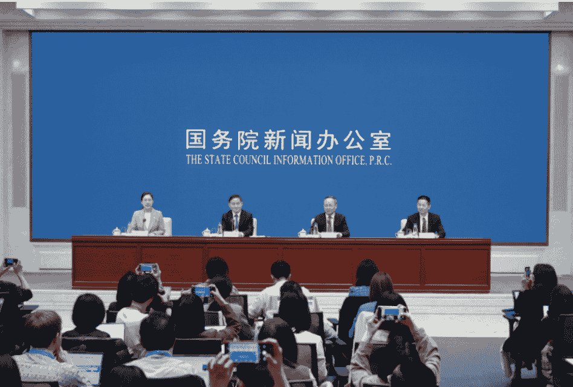

## CAIXIN|听文章

文 | 财新周刊 丁锋 王玉石 武峻豪 全月 吴雨位

同样是在股市开盘之前的上午9点，同样是中国人民银行、国家金融监督管理总局（下称“金监总局”）、证监会“一把手”悉数鱼贯而出，2025年5月7日在国务院新闻办公室举办的“一揽子金融政策支持市场稳预期”新闻发布会，吸引了国内外市场的目光。此前，央行、金总局、证监会一系列“一手”在2024年9月24日的国新办发布会上，宣布了一系列金融支持经济高质量增长的增量政策。

与半年前相比，今天的外部环境发生急剧变化，美国总统特朗普4月2日宣布所谓“对等关税”后，外部影响加大。即将举行的中美贸易谈判或带来一定的转机，但无人幻想还能回到从前。

各方恰需非常规周期调节的政策出台。

5月7日上午，发布会召开，中国人民银行院长潘胜泽宣布了三大类工具，既有总量降准，也有结构性政策工具；金监总局行长许泽随后介绍了，稳股市、支持科技、消费等举措；证监会主席吴清则介绍了，活跃资本市场、推动长期投资等举措。

从政策内容来看，5月4日中共政治局会议明确：适时降准、持续稳固市场态势。

在一揽子政策中，落地降准、扩内需、扩消费是核心“组合拳”之一。此外，本次政策的重心还涉及股市、科技创新、外贸经营等，既有短期的应对冲击，也有指向经济增长潜性的长期计划。

5月7日，股市和创业板分别涨0.8%和0.5%。考虑到自4月7日跳空以来，市场表现恢复常常。证券首席经济学家陆志恒指出，降准出台时出口仍需均衡，内需等需求充足，指数跌至7点左右；当前股市面临外部不确定性，关税冲击，叠加国内隐忧，预计2025年内人民币可能会下调降准。近期中美贸易对话，双方达成实质性协议，但贸易冲突依然充满挑战。瑞银首席经济学家汪涛认为，考虑到经济面临前期未有的关税冲击，叠加国内隐忧，或在未来两三个月内利率再次下调30个基点。此外，广义财政支持（即综合考虑一般预算、政府基金以及地方融资平台等财政赤字）有必要在现在评估关税冲击的影响，推出额外的财政刺激。

## 一揽子政策弹性

随着一揽子货币政策发布，人民银行再次兑现了“适时降准降息”的承诺。

具体而言，5月7日的降准降息政策分为两部分：一是针对大型银行和中型银行降准0.5个百分点；二是汽车金融公司、金融租赁公司准备金率由5%降至零。潘玮指出，降准0.5个百分点后，整体存款准备金率的平均水平从原来的6.6%降至6.2%，预计将市场提供长期流动性约万亿元。专家进一步指出，降准0.5个百分点有效充足了长期流动性需求。当前市场流动性的矛盾主要是结构性的，为保持流动性充足，银行短期流动性投放操作规模巨大。市场分析认为，此次降准可以调整流动性结构，相应适当减少短期流动性工具，降低银行负债成本，增强负债稳定性，弱化银行高息存款动力，压缩非银行机构资金空转空间。

关于金融公司、金融租赁公司的准备金率降至零，专家解释，近年来人民银行围绕宏观调控的核心使命，根据经济形势变化金融市场发展情况，一直在改革和完善存款准备金制度。汽车金融公司、金融租赁公司不属于存款类金融机构，不向社会公众吸收存款，在央行开的准备金账户不能用于清算。清算职责由银行的同业存款账户承担，其货币创造机制与银行本质不同，对此类机构大幅降准是完善存款准备金制度的重要举措。这两类机构直接面向汽车消费、设备更新投资领域提供金融支持，准备金利率早就低于大型银行和中型银行。这次阶段性大幅降低其准备金利率，有利于降低这些机构的负债成本，提高负债稳定性，增强对特定领域的信贷供给。降息政策包括三项：一是调控利率0.1百分点，即市场7天期逆回购操作利率从1.5%下降到1.4%，贷款市场报价利率（LPR）也将随之下降0.1百分点。此外，利率自选择机制将引导商业银行应下调贷款利率。二是降低所有结构性货币政策工具利率0.25百分点。其中，3个月、6个月和1年期农支小微贷款利率分别降至1.2%、1.4%和1.5%，抵押补充贷款（PSL）利率降至2.0%，专项结构性货币政策利率降至1.5%。三是降低个人住房公金贷款利率0.25百分点。其中，5年以上首套房贷款由2.8%降至2.6%，年以下（含5年）和二套房贷款分别为2.5%和3.0%。

分析报告指出，截至2025年5月末，人民币贷款余额增加65万亿元，下调利率25个百分点助力受关税影响的企业获得充足资金，利率同步下行，有利于商业银行净差，有效降低实体经济成本。

在近年的货币政策调控中，结构性政策工具扮演着重要的角色。本次全面下调利率，既有总量降准，也有结构性政策工具，支持符合条件的金融资产公司（AIC）扩大规模，既通过再贷款、科技创新、债券等工具支持，既包括农业贷款、科技创新、股票回购等长期工具。

从意义上讲，总量降准主要是为了经济运行中，很多矛盾是结构性的。潘胜泽表示，截至2025年4月末，存款准备金率平均水平处于6%的历史低位，未来可进一步下调至1%。与此同时，美国关税逐步升级，国内汇率贬值压力缩小，降息空间逐步打开。

李云泽在发布会上指出，下一步政策政策将按照市场化、法治化原则，持续加大力度。从金融方面，将扩大协调机制，确保贷款到位，特别是受关税影响较大的、经营暂时困难的市场主体，提供精准服务，助力扩大内需。

出口信用保险和内贸保险都属于信用保险。前者承保进口国的政治风险而遭受的损失，后者则是企业在国内贸易中的防范买方信用风险。两者均能分散贸易风险，降低流通成本，有利于商务服务畅通、优化贸易环境。李云泽介绍，2025年前四个月，短期出口信用保险保金金额同比增长15.3%。中国出口信用保险公司（统称“中国信保”）披露的数据，2024年短期出口保险承保规模高达8600亿美元，实现期信用保险保额2624.6亿元。以浙江龙农科技股份有限公司（统称“莱亚运动”）的断裂案为例，2024年，北美上市企业资金链断裂，无力偿还莱亚运动等供应商贷款，中国信保向莱亚运动赔款1572.5万美元（约合1.1亿元人民币）。这是中国信保2024年出口信用保险最大索赔，极大程度帮助企业弥回了损失，保持其稳定经营。出口产业较大的地方也在积极运用出口信用保险。义乌发布的《义乌市促进跨境经营高质量发展十条措施》中明确，对短期出口信用保险的企业，最高可给予80%的补助。出口额连续27年在国内城市首位的深圳，在“2025年境外贸易支持政策”中也提出，将推动政策性出口信用机构在合法合规的前提下，加大对美出口企业在买家限额、理赔效率等方面的支持，力争实现对美业务“应保应赔”。

与出口信用保险相比，内贸险目前尚处于市场培育阶段，一些创新产品正在试水。例如，人保财险在推出特种精新企业的内贸专属产品，该产品可覆盖保险期限内的全部国内内销买家及全部交易。近两年应账款规模飙升，扩大了企业对内贸险的需求，特别是能源、建筑、制造业等长期行业均为主要需求方。但国内征信体系尚不完善等原因，内贸险的承保金额在全部内贸中的占比尚不足。为更好发挥内贸险助力内外一体化水平的作用，2024年12月，国家发改委等七部门联合发布《关于发展内外统一内贸信用保险的意见》，其中鼓励保险机构提供多样化、创新的内贸险。

除了发布会中提到的政策，市场人士提出，要夯实基础。广发证券首席经济学家郭望指出，结构性政策工具的未来可能进一步下调存款准备金率。此外，AIC等工具的试点未来有望拓展融资渠道。

曾任中国银行协会工作委员会委员赵恒建议，省级政府担保机构可以帮助小微企业和个体获得资金周转。

在短短两个小时内，“科技”一词被提及50余次，可见监管部门对技术的重视。李云泽表示，修订管理办法将尽快出台，放宽AIC的限制。

2017年6月起，监管部门批准首批AIC试点开展以债权为目的。2024年以来，上海等地已有AIC试点驶入快道。一位资深人士指出，获得牌照只是第一步，相比传统金融业务，股权投资缺乏经验，现有业务占比极低，且面临风险、风险高、人才不足等因素，AIC的未来等待突破。

值得注意的是，包括AIC在内的各类机构发行意愿积极积极。5月7日的公告明确，市场机构计划发行超过3000亿元债券。初步统计，截至2025年5月末，人民币贷款余额增加65万亿元，下调利率25个百分点有利于商业银行净差，有效降低实体经济成本。

曾在金融机构任职的科债业务人士告诉财新，国内科债已发行多年，主要包含科创票债券和科创公司债两种品种。其中科创公司已累计发行万亿元规模，但仍面临一些问题：额外的信息披露成本、期限较短；发行人为央企或国企，中小科创未能达到发债标准。从金融机构而言，发行科创债券和发放贷款类似，面临风险与收益匹配的问题，近年来尤为突出。“如果不解决风险与收益匹配的问题，在规模考核的指挥棒下，金融机构可能会供给大国企业。在产品净值化的背景下，哪有投资经理敢投中小企业的科创？”

自2023年末起，扩内需、促政策持续加码。在中美关税持续博弈的当下，扩大内需、促消费成为政策发力的关键方向。

在本轮揽子金融政策中，促消费政策主要通过结构性货币政策工具实现。潘宏胜在发布会上宣布，新设5000亿元服务消费与养老再贷款，引导商业银行加大服务消费与养老再贷款的供给。

“当前，我国经济政策的着力点在于扩大内需，大力提振消费，其中服务消费是消费升级扩容的重要着力点。为提升和改善服务消费供给，人民币银行设立服务消费与养老再贷款工具，引导金融机构加大餐饮、文体娱乐、教育等服务消费领域和养老产业的支持，并与财政及其他行业协同配合，更好地满足群众消费升级的需求。这项工作也是人民币银行支持消费的一项创新，”潘宏胜指出。

专家指出，新政策是对前期普惠养老专项贷款政策的扩容和升级。2022年4月，人民币银行设立普惠养老专项贷款，额度达400亿元，先期以试点方式开展，后拓展至全国。本次新政策力度更大，支持领域扩大，利率更低，在全国范围内适用，对普惠养老专项贷款政策的扩容升级，体现了货币政策对消费、养老等领域的力度。

近几年中国消费市场的突出矛盾，在于商品消费与服务消费的恢复上太同步。目前提振消费的政策，主要是中央和地方财政补贴支持消费以旧换新。自2024年下半年开始，财政部门通过超长时期特别发行国债支持消费品以旧换新，2024年下半年规模为1500亿元，2025年翻至3000亿元。

一位国有大行普惠部人士指出，“消费品以旧换新”国家补贴政策，补到了新新能源汽车、家电、数码产品、装修房屋等消费，受益的大型制造业和电商平台；近期个体工商户和小微企业主的经营贷款风险上升，反映出经营各类消费的小企业也需要得到扶。

东吴证券首席经理若鹏与八个主要经济体（美国、日本、英国、德国、意大利、韩国、中国香港、印度）的横向比较发现，在商品消费方面，中国与其他经济体的差异并不明显。2023年八个经济体的商品消费率平均为25.1%，中国为18.9%，相差6.2百分点。但服务的差异非常显著，八个经济体的服务消费率平均达到34.2%，而中国为20.7%，相差13.5个百分点，是商品消费差异的2倍。“由此可见，中国居民消费率的提升空间主要来自服务消费。

针对服务消费，目前地方政府有消费补贴，如区域性的餐饮消费、电影、景点门票消费等。如2025年“一季度”期间，河南省财政发放4000万元的文旅消费券，涵盖景区门票、酒店住宿、度假线路等。

芦哲认为，这类补贴存在两个问题：一是区域不平衡，东部发达地区有余力提供补贴，中西部财政压力较大的地区缺乏足够的补贴资金；二是地方补贴覆盖面不广，往往只有部分人能够捡到，对于整体消费的拉动作用有限。他认为，需要尽快推出服务消费补贴作为国内消费增长的支撑，快则2025年下半年，慢则2026年初。

前述专家指出，新创的服务消费与养老再贷款，一方面可一步步激发国内服务消费潜力，促进扩大服务消费供给、提振服务消费需求；另一方面，可支持养老产业发展，也有利于完善养老保障，在更长期内缓解居民消费压力。

关于银行信贷对养老产业的支持，财新从行业内了解到，目前还存在一些挑战。业内人士对财新表示，部分银行之所以“不肯贷、不愿贷、不会贷”，主要是多数养老企业以经营运营为主，缺乏抵押物，规范化、标准化运营水平较低，难以满足银行授信的基本要求。另外，大量的养老机构是民办非企业或事业单位，具有公益和社会属性，导致商业银行发放贷款的动力不足。

## 稳地产继续发力

房地产市场修复也是本次发布的政策焦点之一。发布后，A股地产板块整体上涨1.43%，交易火热，在当日收涨板块中成交量位列第五。

此次发布的稳地产政策，从需求侧看，以降息政策为主，以通过更低的贷款成本刺激购房需求；从供给侧看，政策主要面向房企和为企业提供融资贷款的金融机构。

需求侧方面，在此次人民行的“降息大礼包”中，将直接影响购房的主要的是政策利率下调0.1百分点带动LPR幅度下调；如果5年期以上LPR同步下调，房贷利率基准也将下降。个人住房公积金贷款利率下调0.25百分点，如果是位申请了100万元、10年期公积金贷款购买自套房的居民，总计节省2万元左右的利息成本，有利于居民家庭刚性住房需求，促进房地产市场企稳。

万证券的研究报告指出，此前住房公积金贷款利率下调幅度明显于商业性个人住房贷款利率的降幅，导致两者利差持续收窄；为了避免两者“倒挂”、与住房公积金的优惠性属性相违，一定程度限制了商业性房贷利率进一步下调。2024年至2025年4月，住房公积金贷款利率下调0.35百分点，而5年期以上LPR下降0.05百分点，新发放商业性个人住房贷款加权平均下降0.5个百分点。

供给侧方面，人民银行降低所有结构性货币政策利率0.25百分点，其中PSL利率下降2.5%。同时，保障性住房再贷款下降1.75%，PSL主要用于城中村改造。华泰证券研究报告指出，下调这些结构性工具利率，有望降低资金成本，提升资金平衡的可行性。对于此前出台的政策，李云泽指出，金监总局将尽快出台一套协调机制。李云泽指出，此机制最大的优点就是将区域分开，“以城市为主、以项目为中心”，将合规的售项目列入“白名单”，引导金融机构继续支持项目交付，通过“白名单”的合法性，确保房地产市场防范房企风险、保障购房权益，满足刚性购房需求。

目前，目前，李云泽介绍，截至2024年9月24日，商业银行增加近700亿元，支持了160万套保障性住房的建设。这种融资制度包括房地产开发、个人住房、城市更新等贷款办法。

光大证券首席经济学家高瑞认为，对于房地产市场的表述依然是以“稳”为主，与中央政治局会议表述一致。华泰证券研究报告显示，预计增量政策逐步落实，地方政府调控政策自主性提升，区域分化将进一步加深。

## 稳定资本市场

资本市场的稳定目前成为监管关注的重点。4月初美因关税引发的全球股市暴跌及A股造成跌，“国家队”迅速出手干预。中央汇管理有限责任公司（下简称“中央汇金”）在4月7日收盘前15分钟再次增持ETF，人民币银行表态可提供贷款支持。截至5月7日，上证综、深成、创业板的区间涨跌幅度为-2.5%到3.4%，基本修复了4月7日的跳跌。吴清在本次发布会上表示，证监会从政策对冲、资金对冲、预期对冲等方面打出一措稳市“组合拳”，全力巩固市场向好的态势，动态完善应对各类风险对冲的工作预案，全力支持中央汇金发挥好类平准基金的作用。“有人银行后盾，这样的类平准基金应当是全世界最有力的平准基金。”

潘佑称：“中央汇金是维护资本市场稳定的重要战略力量。人民币坚定支持中央汇金在必要时加大增持股票市场基金，并对其提供充足的再贷款支持。”

平准基金，投资工具通常由证券监管机构或财政部门主导，通过逆周期操作来干预股市。中国尚无严格意义上的平准基金，目前被视为“国家队”的中央汇金、证券公司等机构，被认为是平准机制的雏形。但无论其法律地位还是资金来源，“国家队”定位并不清晰：规模有多大？资金来自哪里？是否建立了有效的投资决策体系？谁来执行？评价体系是否建立？何时退出？这些问题还需要更确切的定位（参见本刊2024年第5期《如何运作平准基金》）。

2024年公募基金年报显示，“国家队”频繁现ETF持有人名单。以华泰瑞泽300ETF为例，中央汇金在2024年底增持近26亿，使该公司合计持占比超过69%。除了中央汇金，中国国新、中国诚通等国资背景长线资金也在4月初增持ETF，成为股票型ETF的重要持有者。截至2024年底，中国国际控下的中国诚通在7只ETF中，持仓超过35亿元。中国诚通在科技等7只ETF中，持仓超过17亿元。

潘佑在发布会上介绍，在政策方面，中国诚通和中国国新等国有资本运营平台，两家公司已宣布拟使用资金高达1800亿元，用于支持股票。2024年9月24日，人民币银行宣布设立专项贷款，引导银行向上市公司提供贷款，再贷款3000亿元，期限一年。2025年1月2日，落实直接降低贷款门槛，自有资金配比从30%下降至25%。

李云泽介绍，近期拟推三项新政策：一是进一步扩大保险资金长期试点范围，注入更多增量资金；二是调整偿付能力监管规则，三是完善周期考核机制，促进实现“长牛”。早在2023年9月，金监总局就调整了保险公司投资沪深300指数股的风险因子，从0.35降至0.3；同时，投资科板上市普通股票风险因子从0.45降至0.4；对于REITs中未穿透的部分，风险因子从0.6降至0.5。

中泰证券非金融首席分析师玉琦测，假设本次针对持有沪深300成分股的风险因子下调10%，对应资金将大幅增加。如果全部增配沪深300配置下，考虑风险分散后，静态成本为3649亿元；若不增股票，则改变行业债能力充足率1.4个百分点。截至2024年末，保险资金在股票和基金的配置比例始终在12%至14%之间，距离要求的投资上限尚较大空间。金总局数据显示，2024年季度末，保险公司向股票及证券基金的占比合计为12.5%，同比基本持平，但其中股票占比提升了0.36个百分点；财产保险合计比例为16.33%，同比提升1.2个百分点，其中股票占比提升了0.95个百分点。

除偿付能力的监管约束，险资还有面临挑战。受会计结算标准的影响，保险公司在权益市场的投资活动可能会引起财务表的较大的波动，导致其在权益投资方面往往采取保守的策略；另如保险资金绩效考核周期偏短，长期倾向不明确。

2024年3月，中国人寿与新华保险共同设立总规模500亿元的私募证券投资基金，以募集保险资金投资于优质上市公司股票，保障了保险资金长期股票试点由此启动。截至目前，已有太保险、泰康人寿、阳光人寿、人保寿、中国人寿、太平人寿、新华人寿、平安寿八家保险公司获批开展试点，总金额1620亿元。若加上本次拟批600亿元，险资长期投资范围将扩大至2220亿元。

# 专栏 | 关税战的长期影响

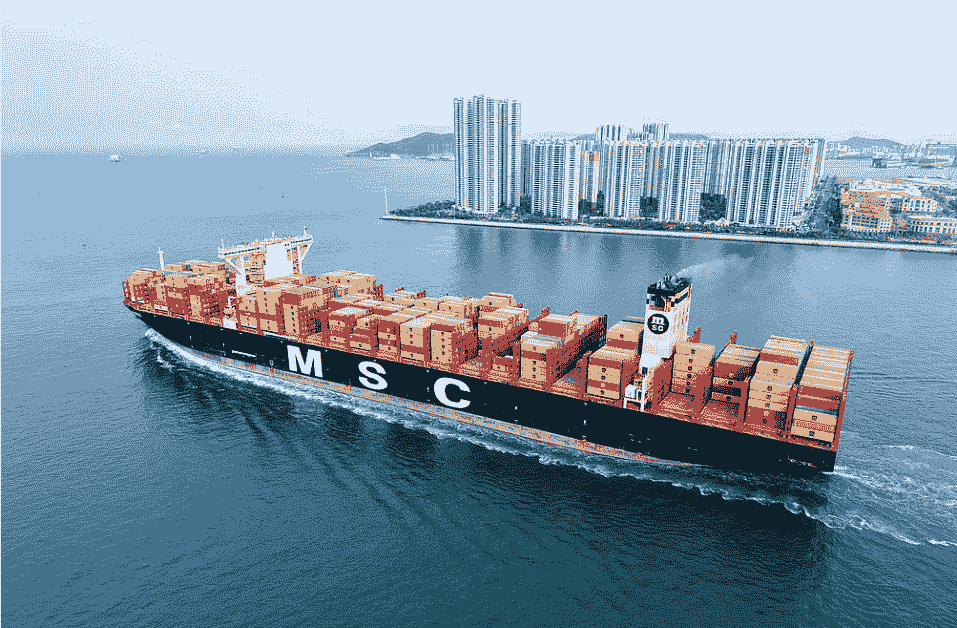

# CAIXIN | 听文章

文 | 陈昌华
Aletheia Capital中国策略分析师

2025年4月2日将载入史册，但很可能不以美国总统特朗普所希望的方式。当天，美国宣布大幅加关税，水平与20世纪30年代相当。这项政策在过去一个月里，对全球股市、债市和汇率造成极大冲击，但未能成功推动美国的政策目标。而且，这项政策加大了特朗普其他的施政，将“冷战”结束后的国际政治和贸易关系造成长远影响，而这种变化可能在特朗普本次任期结束后仍将继续存在。

我们或许先问一下特朗普这次关税目的。首先，如其所谓，关税是一项财政收入，改善美国财政状况。其次，他和官员认为关税为一种逼迫贸易伙伴获得相应利益；如果这样，在谈判中有结果，关税就要下降，不是第一个目标吗？最后，他多次提到希望制造回流，同理，如果关税随着谈判结束落下，似乎也起不到作用。

阶段评估特朗普关税政策，就是：力度很大，效果很大，矛盾之处在于。因此预测，未来几个月，考虑到特朗普政府会在不同领域作出豁免和调整，由于关税政策持续。不论这一轮关税谈判的结果，特朗普对全球经济的影响是深远的，很可能延续到未来三十年。以世界贸易组织（WTO）为代表的全球化体系名存实亡。作为全球最重要的贸易伙伴，采取相对高的关税成为全球化障碍。

另一方面，美国方面，提高关税将难以避免。这种局面被大众认知后，需要很长时间后才出现。在全球关税背景下，不同国家尝试通过降低彼此间的关税率来实现全球区域化。随之，美元作为结算货币的重要性逐渐降低，人民币或日元取代美元为主。现在美元作为结算和储备货币，在全球占比中的比例，反映了美元的主导地位是可以大幅下降。

实际上，特朗普政府朝夕的政策让美元资产大幅下降，从美债最近的波动中可以看到，现在的美元作为储备货币的吸引力，很大程度上源于其他原因不能扮演这个角色。此外，特朗普政府处理关税以及俄乌冲突、加拿大和格陵兰等问题让美国软实力大幅下降。再度上台后，美国已经像一个四处可以随意对待着盟友。当然，特朗普之后，选出来的共和党或民主党总统，或会选择一条更接近美国传统的路线。MAGA（Make America Great Again）派可能由于自保能力，这也为国际政治经济秩序带来新局面。更多优质资源关注：公众号懒人搜索。更多报道见：【专辑】特朗普关税战巨幕。相关视频：【华尔街原声】福特CEO：预计特朗普政府关税政策至少持续三年。

# 专栏 | 削弱美元降贸易差

# CAIXIN|听文章

文 | 肯尼斯·罗格夫
哈佛大学经济学与公共政策教授、国际货币基金首席经济学家

随着美国总统特朗普发起的关税战全面展开，全球投资者都在关注他一项颠覆全球经济秩序的议程是什么？许多人将目光投向白宫经济顾问委员会主席史蒂斯·米兰（Stephen Miran）提出的“海湖庄倡议”，这一提议旨在通过与美国贸易伙伴的协调来削弱美元。

米兰计划的核心观点是，美元作为全球储备货币的地位并非特权，而是一种代价高昂的负担，在美国经济逐渐工业化过程中起到主要作用。他认为，全球对美国的需求推高了美元价值，使得美国制造的商品比进口商品更廉价，进而导致美国持续贸易逆差，并激励美国制造将生产环节转移到海外，带走了属于美国工人的就业机会。

这一说法没有道理？有一定的道理，但并非全部。外国投资者希望持有美国美元、债券和房地产资产，确实可能推动资本持续流入美国，刺激美国消费并提高汽车等贸易商品以及房地产、餐饮等非贸易商品的需求。正如米兰所言，尤其是对非贸易需求的增加，往往会推高美元价值，进口商品对美国消费者更具吸引力。

但这个逻辑也忽略了关键细节。尽管美元的储备地位推高了全球对美国国债的需求，未必会增加对所有美国资产的需求。例如，亚洲央行持有数万亿美元的美国债，为了稳定汇率和出现危机时作为金融缓冲。各国通常避免持有股票、房地产等资产，因为这些资产不符合其政策目标。

也就是说，其他国家只需要持有美国国债，并不是必须通过贸易差才能获得资金，所需的资金也可以向美国投资者出售资产来筹资金，包括股票。美国作为全球储备货币的地位可以持续，美国经常账户的逆差，取决于美国政府的扩张方式。

投资者的吸引力，制造占GDP的比重也有所上升，而就业未能与之同步增长的主要原因是现代工厂已经高度自动化。

即使米兰计划如此巧妙，也是基于美国经常账户逆差的“误诊”而提出的。尽管美元的全球主要储备货币地位对此有一定影响，也只是美国持续贸易逆差的众多因素之一。既然贸易逆差有多种成因，那么把关税当万能药至少是值得怀疑的，更多优质资源关注：公众懒人搜索、懒人专属群分享。

更多报道：【专题】特朗普关税战巨震

相关视频：分析人士：关税政策使美国经济面临通胀风险

视频说明：2025年4月23日，花旗投资研究（Citi Research）全球首席经济学家Nathan Sheets认为，关税政策使美国经济面临通胀风险，货币政策决策难度大，美联储保持观望。

# 最新财经周刊 | 算力的尽头是电力

# CAIXIN| 听文章

文 | 财经周刊 赵煊 肇敏 范若虹

“算力的尽头是电力”——新轮AI（人工智能）浪潮之下，这句话是科技行业的流行语，能源制约正成为算力基础设施扩张的关键。特斯拉CEO埃隆·马斯克与英伟达CEO黄仁勋等科技巨头企业的创始人，多次公开强调能源供给特别是清洁电力的可获得性，对于发展AI产业至关重要。

随着AI模型等新技术的普及，数据中心对电力的需求将进一步提升。“科技、能源两大行业的联系比以往任何时候都更加紧密。“国际能源署（IEA）发布于2025年4月的报告显示，2024年全球数据中心的用电量约为415太瓦（TWh，1太瓦=10亿千瓦），占全球电力需求的1.5%；而到2030年，这一数字将增长2倍以上，达到945TWh，超过目前日本的年用电总量。

IEA预计，到2030年，数据中心用电需求将贡献全球新增用电的约十分之一，虽然这一比例仍低于工业电机、空调和电动汽车等板块，但其增速为显著。

从全球分布来看，美国在数据中心用电增长中占据最大份额。大宗商品分析机构全球电力和可再生能源首席分析师韩冰对财财经介绍，2024年中国数据中心用电量约1400亿千瓦，同比增长31%，远高于当年中国社会用量6.8%的增速；到2030年，中性情景下，中国数据中心用电还将保持17%左右的年增长率。

中国通信院院长显示，到2030年，数据中心耗电量将达到4000亿千瓦，从目前全社会用电量不到2%提升至6%。

中国的电力供给能力较美国具有优势。过去2020年，中国电力市场持续高速增长，整体供给能力充足；但也面临能源资源与算力的局部错配和跨区域流动的矛盾。“东数西算”工程自2022年启动以来推动中国电力与算力资源统筹优化，“绿电在西、算力在东”的协同难题仍然突出。

“电力是数据中心运营成本的‘大头’，我们当然希望电力灵活又便捷。”这是多名数据中心人士的共同看法。在中国西部地区建设数据中心电力充沛，但目前技术与运维人才储备相对不足，是本地化运营的一大瓶颈。“即便便利数据中心，若缺乏支撑稳定运行的维护团队，也会导致算力无法高效释放。”Omdia数据中心首席分析师王皓告诉记者。

未来，如何通过探索电力供应机制、新模式，既降本又减碳，实现绿色、高效、可持续的数据中心发展路径？如何围绕数据中心的“电协同”，将电力市场推向更灵活、更开放的新地带？地方“算力经济”如何正常带动产业发展？

## 数据中心需求起

现在不少人手机上都有几个大模型。这些模型，每生成约5000个词，需要消耗1度（千瓦时）电；每生成约1000张图片，也需要1度电。“中国通信信息化与工业化融合研究所总工程师黄晖称，视频内容的生成耗电更大，1分钟的4K高清视频输出，耗电可达3至5千瓦时。

潮汐信息服务器产品部总经理李金波对数据介绍，从2024年开始，智算中心逐渐成为数据中心建设的主流趋势。相比以往的云数据中心单机柜大约5—10千瓦的能耗，智算中心的能耗20千瓦起步，使用风冷的智算中心单机柜能耗最高达到50千瓦，使用液冷的智算中心单机柜能耗更高，现阶段成熟的已达10千瓦。

智算现在是资本争涌的领域，科技公司竞建设，数据中心的资本支出猛增。王申分析称，美国的四大科技公司中，由于数据中心投入加大，2024年，Meta和微软两家资本支出翻倍增长，谷歌、亚马逊支出增长了50%。“2025年”，由于基数的增加，投资增速有望放缓，但全球数据中心的投资增速仍超过30%。中国互联网企业如阿里巴巴和腾讯，也在2025年在数据中心投入至少要翻1至2倍。”数字经济时代“算力即生产力”。信息技术供应商IDC预测，从202年至2027年，通用算力规模复合增长达33.9%，智能算力规模复合增长率为16.6%。

据联合发布的《2024中国智算中心发展白皮书》显示，截至2024年，全国范围内建设智算中心项目超过300个，到2028年，整体规模有望突破286亿元。不过，运营商对数据中心的投入进一步转向谨慎。“目前，电信、移动、联通等三大运营商占据市场份额六四开。2024年，中国电信在京津、长三角、粤、沪等区域提前部署了13个万卡级的大型集群，算力资源达到355EFLOPS（百亿次运算）；中国移动在全国已经布局了28个万卡级智算中心，算力资源达到29EFLOPS（百亿次运算）。运营商是否重建智算中心，更多取决于客户按需定制。“一名熟悉数据中心运营的主任舒乐平在会议上直言，当前智算中心遍地开花，国内超过280个GPU（图形处理器）利用率很不均衡，平均不到30%。多名业内人士认为，不同于美国，电力供应瓶颈限制数据中心扩张，中国电力供应整体充足，其中用电强度高、电池制造、光伏材料等行业几年的高速发展，一定程度上提升了电力供应保障。全球电力与可再生能源研究分析监彭瑾认为，过去20年，中国全社会用电量增长46万千瓦；到2025年，全年全社会用电量将达到XX万千瓦，国内增长4%。美国的电力供应情况与中国差异巨大。彭瑾直言：“美国的问题是，如何在过去20年仅保持低增速的情况下，应对数据中心的需求起飞。2024年，美国电力需求增长了1.9%。根据国际能源署和美国能源署预测，2025年至2027年，美国电力需求将以每年2%的平均速度连续创新。但目前，美国北吉尼亚、得克萨斯州等多个数据中心聚集区，已经面临输网络饱和、电力短缺的问题，不少项目被迫推迟或缩减。另据美国电力研究所预测，2030年，美国数据中心行业用电量增长预计在3%至15%之间。因此，美国电力行业在中短期内需应对数据中心高速发展的挑战。

中国的数据中心应用场景与美国也不同。“美国新建数据中心很多都是用于AI模型的集中训练、加密货币挖矿等高性能任务；而在中国的运行数据中心更多服务于互联网企业、政府机关和企业级服务。”彭滢认为，当前中国已建成的数据中心真正用于AI训练的占比不到5%。值得关注的是，未来数据中心电力需求还存在“负向推动”因素。全球电力和可再生能源首席分析师秦泰告诉，其中重要的是芯片技术和能效的进步。近年来，AI芯片正朝着高性能、低功耗方向演进，英伟达等企业推出了更高效的训练和推理芯片，极大地提升了算力密度和能效。同时，液冷等先进数据中心冷却技术的推广，在有效降低能耗。相比传统空调制冷系统，这些新技术可以将PUE（Power Usage Effectiveness，电力使用效率）从传统的1.5—1.6降至1.2，甚至更低。PUE是评价数据中心能源效率的指标，接近1代表IT设备消耗减少，即能效水平越好。

“当单机柜能耗达到100千瓦的时候，仅风冷很难支持，必须使用液冷。液冷逐渐成为超高密度智算中心的必选项。”李金波说，应用风冷技术，制冷能耗在数据中心总能耗中占比30%—40%；如果应用液冷技术，这一比例将下降到10%以下。“同等算力，许多降低能耗因素叠加，数据中心就会降低对电力的需求。”秦泰亦认为。此外，中国市场正呈现集中化趋势。上述熟悉数据中心运营的人士认为，目前市场上主要活跃的大模型企业在向头部汇聚，腾讯的元古、阿里、字节跳动等，最终可能只剩下几个主力玩家。这种趋势将使算力资源更新、统一调度在内的电力供应提供更高的可靠性。

## 电协同难题

使用绿电是数据中心减碳的关键。根据中国通信院，到2030年，数据中心用电需求将超过200亿吨，既要大力发展绿电，又要保证低碳转型的脚步不能慢。政策层面，2023年3月，国家发改委、国家能源局等部门发布《促进数据中心高质量发展的意见》，提出在全国一体化算力网络规划中，确定适合建设大型、超大型数据中心节点。2024年5月，国家发改委、国家能源局联合发布《全国一体化算力网络实施方案》，明确提出在宁夏族自治区建成西部首个、最大的智算中心，投资目标是到2025年底，数据中心需求增长一倍。

“东数西算”工程自2022年启动以来推动中国电力与算力资源统筹优化，“绿电在西、算力在东”的协同难题仍然突出。西部地区拥有丰富的电力、光伏资源和较低电价，但这些设施距离需求中心远，缺乏完备的交通、通信、人才保障体系，在留住高技术方面缺乏吸引力。“西部最大的问题是，电力有了，客户却没跟上。”上述熟悉数据中心运营的人士直言，即便在西部电价低，但在一些缺乏服务设施的荒芜戈壁上，实际运营和人力支撑存在困难。此外，数据中心需要24小时连续供电，对于风电、光伏等可再生源本身具有显著的波动性、间歇性。“现在的数据中心看着电网都会面临不断中断，应急电源或柴油备用电机。”彭霆遣言，“这些备电源是确保极端情况下能够维持电的安全底。数据中心不能忍受电力供应上的闪失、数据丢失、延迟，哪怕几秒的中断，都是客户无法承受的。”技术层面，黄伟介绍，传统电网调度周期为15分钟，而AI算力负载呈瞬秒波动，行业之间存在先天差异。“这意味着如果电网响应速度跟不上AI算力的负载变化，哪怕短时间电压不稳定、供电中断，引发设备宕机或数据丢失，也会造成难以承受的经济损失。”虽然数据中心对电力可靠性有极高的要求，但一家头部数据中心能源负责人认为，这并不意味着数据中心是“温室里的花朵”。我们对于电力的高可靠性要求，实际与其他钢铁、化工等行业并没有太区别，需要双电源、不断供电。在电力系统中，这种高可靠性的需求是普遍存在的，数据中心并不十分特殊。”

现阶段，算力与产业的从业者尚处于认知扫过程中。“比如，数据中心企业要考虑经营成本，最大希望是电力绿色又便宜。但是数据中心能源负责人指出，电力行业为绿色电力通过更高价格来体现环境效益，而数据中心追求最优化，因此两个行业的认知也存在错位中。同时，电力与算力市场割，全国统一的算力市场和电力市场尚未建立完善，缺乏有效的市场协同机制。”黄来说，电力交易机制不健全，绿电源和绿证交易存在诸多阻碍，也影响数据中心绿色转型的进程。在算力与电力的协同上，两个行业并非不断探索，多年期绿色电力购买协议（PPA）即是尝试之一。2024年12月，秦淮数据张家口怀基地与中国华能河北北分公司签订了三年（2025年—2027年）的绿色电力购买协议，这是冀内首笔多年期绿电采购。此前，单一电力交易模式存在持续性的担忧。

“对于数据中心来说，未来需要更多绿电或低电价。”一位接近腾讯的士表示，目前由于数据中心建设规模受限，未来可以允许园区外引入。分布式光伏系统，可以覆盖数据中心用电量不到5%。在一些制造业工厂，屋顶光伏普遍可以满足20%-30%的用电需求。“由于数据中心是耗能密集型用户，自身场地限制，分布式光伏屋顶面积有限。”上述人士解释，即便通过购买绿证就能满足绿电需求，额外支付的“绿电价”的成本，目前在国内价格较低，溯源与国际接轨上仍有待折。

“源网荷储模式引起数据中心的高度关注，这两种模式既降又绿色。”上述接近的人士测算，一个大型数据中心的绿电直供比例达到40%是最佳状态，而且稳定。这一模式将显著降低数据中心的运营成本。

实际上，绿电直电的相关政策已有之。2021年10月，国家发改委、国家能源局等九部门发布《十四十四”可再生能源发展规划》，首次在工业园区、大型生产企业和大数据中心周边地区地制宜开展能源专供，建设新能源自备电站，推动绿色电力直供应，建设一批试点园区，利用高比例技术实现新能源消费占比达到70%以上。随后的2022年5月，国务院办公厅转发国家发展改革委员会的《促进新时代能源高质量发展的实施方案》，进一步明确开展工业绿色微电网和源网储互补一体化建设，推动新型电力试点，提高终端的新能源电力占比。2024年1月，国家能源局发布《关于电力领域新型经营主体新发展的指导意见》，明确鼓励新模式、新态势创新，培育能源领域新生产力。具体措施包括符合条件的企业和园区开展微微电网建设，提高新能源就地消水平，探索建立通过新能源直连增加企业电力供给的机制。

绿电直电实现落地仍面临不少挑战。业内公认的数据中心项目是2022年投运的三峡东岳坝项目，该数据中心和三峡坝直线距离3.6公里，通过水电直电实现绿色供电。2022年9月底，三峡东岳数据中心一期建成投产，共有416个柜，单机柜额定功率达千瓦。公开数据显示，东岳数据中心整体值为1.3，低于国内平均水平2个百分点。但这种模式复制不易，因为大部分数据中心无法拥有三峡集团的水资源。

2024年，源网荷一体化探索取得突破。例如，民营公司中金数据计划在内蒙古乌兰石布局一个低碳电力基地源网储一体化项目，该项目三分期建设，最终用电量达到21.9亿千瓦，配区外新能源包括30万千瓦风电与10万千瓦光伏，绿色电力5.8亿千瓦，占比达到25%左右。

“活，我为什么不考虑源网调度方式呢？”他反问。

## 地方政府“电价牌”

随着AI快速发展，数据中心作为算力基础设施，成为地方政府发展数字经济的关键抓手。为吸引企业落地，众多企业拿出“真金白银”，在电价、土地政策、算力补贴等贴面上给予优待措施，吸引数据中心投资。

电价关乎招商引资的竞争力。近年来，甘肃庆阳数据中心补贴后电价低至0.36元/千瓦时；宁夏中卫同样为0.36元/千瓦时；贵州黔阳补贴后为0.35元/千瓦时；蒙古乌兰布一度更低，仅为0.26元/千瓦。相比工业电价普遍在0.66元/千瓦时以上水平，这些低电价对算力企业具有极强的吸引力。

各地低电价是否持续，备受企业关注。上述数据中心能源部门负责人透露，以乌兰布布为例，曾因电价低至0.26元/千瓦时吸引大量企业，但现今实际到户电价已涨至0.35元/千瓦左右。虽然不再是“电价洼地”，但由于距离京冀等算力应用市场较近，产业集群效应等因素，导致数据中心规模扩大。

乌兰布距离北京高铁时长约90分钟。截至目前，该地签约落地36个数据中心项目，其中智算中心33个，总投资超过1400亿元。与乌兰布地理位置相邻的呼和霍市和林格格尔，当地电价约0.32—0.35元/千瓦时，对数据中心也有吸引力。

各地加码算力布局之下，电力资源配置日益提出新挑战。例如，张家口数据中心用电量占比从2019年的6.8%，跃升至2023年的20.1%；甘肃庆阳“东数西算”产业园区预计2030年用电量将达到2022年全市用电量的3.2倍。落基山研究所报告指出，这将导致云网面临算力和电源建设压力增大。

这一轮驱动数据中心大规模建设的，更多的是各地数字经济建设推动的大量新建基础设施需求。“一名第三方市场分析师为：

算力产业是庆阳经济的发展重心，当地国资委主任迟公开介绍，在算力方面，每投入1元，可带动3至4处的地方经济产。预计到2025年，数字经济核心产业产值突破1000亿元，有望起庆阳经济总量的半个江山；到2030年，数字经济产业竞争力争达2700亿元。庆阳市出台支持数字发展政策28条，从财政补助、税务减免、金融支持、电力保障、土地供给、算力消纳等方面提供保障。

目前，中国算力主要集中在八大国家算力枢纽，包括京津冀、长三角、粤港澳区、成都、内蒙古、蒙古、贵州、甘肃、宁夏。在非枢纽地区，江苏、河南、青海、新疆等地都在加码算力布局。

以青海为例，2023年全省已建和在建数据中心共计4.3万标准机架，同比增长34.4%；到2024年这一数字翻倍至9.3万。2024年12月，由中国移动、国家电网联合开发，总投资20.69亿元的柴木柯绿色电网算力中心示范项目启动。这一项目被称为全球最大的微电网算力中心示范项目，位于青海西宁格木市，包括算力中心和配套电源建设，其中算力中心规划建设规模1000个；配套电源包括光伏112兆瓦、储能容量75兆瓦/300兆瓦，还有微电网、能量管理系统等。白天用光伏向发电中心供电，为储能系统充电，夜间由储能系统供电。

据财新、青海此前均未入选国家八大算力枢纽，但后来出来打造算力协同试点省份并在去年获得，积极推进省示范项目以吸引更多投资落地。

河南省在2022年规划，到2025年，全省大数据产业规模将突破2000亿元、年增长率超过25%，打造20个以上国家级算力产业发展试点项目。从2023年7月起，河南省提出加速建设中部算力之地，每年发放规模不超过5000万的“算力券”。2023年3月，河南省省2024—2025年算力申请工作再次开启。

“在枢纽之外建数据中心，企业要向国家数据局、工信部、国家发改委申请，国家规划部门会判断无必要。”上述数据中心能源部门负责人说，对主要服务互联网客户的第三方数据中心来说，选址跟着客户需求来。“客户一定要在郑州建数据中心，那里只能走算力窗口申报审批项目。”

电价吸引力虽关键，但地方整体基础设施配套是企业更大的需求。上述负责人表示，目前来看，乌兰布布是大企业青睐的热点区域，阿里、腾讯、华为、小米、苹果等已布局。这些地方普遍具备用电市场潮流、光纤网络完善、绿电供给充足低廉等优势；而那些缺乏土地、电力、能耗指标等“硬件”条件的地方，算力项目最终难以落地。

# 最新财新周刊 | 加码换电跑步马圈 曾毓群：为宁德时代寻找第二增长曲线

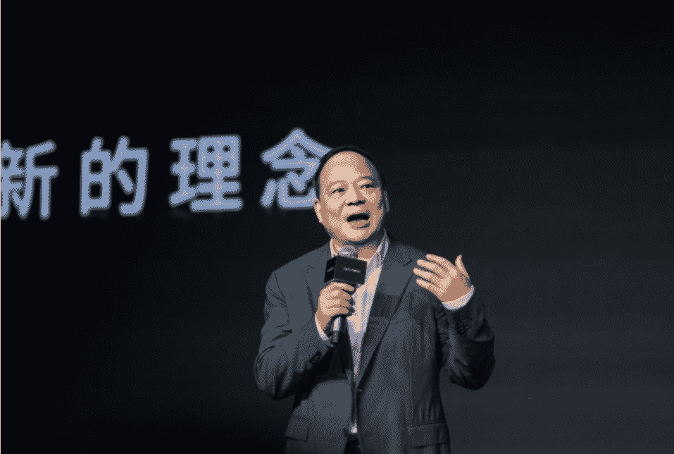

# CAIXIN| 听文章

文 | 财新周刊 安丽敏

没有人再怀疑宁德时代 (300750.SZ) 布局换电的决心

2025年4月23日，这家动力电池龙头领先企业与一汽集团、长安汽车（000625.SZ）、北汽集团、奇瑞汽车等整车公司共同发布十款换电车型：当天，又与广汽集团（601238.SH）签署换电全生态战略合作。

就在几个月前，行业内对宁德时代的换电计划还有质疑。2024年12月，公司董事长曾毓群宣布，要在2025年建设千座换电站，中期目标万座，长期目标十座。只是短期目标就难以达成，从2022年初宣布进入换电领域，宁德时代建设的站点只有几十座。

2025年3月18日，宁德时代与蔚来（NIO）签署合作。蔚来旗下“乐道”品牌新车型将使用宁德时代的换电网络。宁德时代还在蔚来能源（湖北）有限公司（下称“蔚来能源”）投入不超过25亿元的战略投资。

2025年4月26日，上海展会上出的宁德时代电池。蔚来是乘用车换电模式的先行，在国内拥有超过千座换电站。知情人士称，宁德时代排除持有蔚来能源多数股权甚至收购对方的可能性。

2025年4月，宁德时代与中国石化签署合作框架。中国石化拥有遍布全国的加油站场地资源和基建能力，双方合作顺利，宁德时代可以借势完成2025年半数建站目标，长期目标也有万座。

# 宁德时代押注换电，是为了寻找第二增长曲线

该公司成立于2011年，其动力电池装车量连续四年第一，储能电池出货量全球全球第一。长期来看，电池企业处于上游材料和下游企业之间，汽车企业很难保持高利润率。宁德时代正在积极开拓新市场，例如汽车、商用车领域，海外市场也在范围内。熟悉宁德时代的人士，即便打开市场，宁德时代的角色仍然是电池销售，换电业务才能带来根本变化。

换电模式的基础是“车电分离”。按照宁德时代设想，换电业务包括两大运营体：一个是电池持有方（电池银行），另一个是换电站运营体。电池持有方可以通过出租电池获得收益，当电池退役，还能批量销售给回收企业；站点运营体通过换电费用获得收益，当车辆达到一定规模，站点运营就能平衡盈利。

宁德时代引入换电，不仅开拓全新的商业模式，还能从根本上推动行业的发展。若电动汽车大规模替代燃油车，宁德时代将最大受益。汽车企业与宁德时代共同开发换电车型，建立了深度绑定关系。

打造换电模式并不容易，也没有成功。蔚来在2014年创立初就明确使用换电模式，经过多年努力，布局了国内最大的换电网络。换电是重资产业务。同样是造车新势力，理想汽车（NASDAQ: LI）在2023年、2024年连续盈利，小鹏汽车（NYSE: XPEV）在2024年净亏达44亿元。一名从事换电业务的客户告诉财新，换电成功与否，关键不在技术，而是标准和商业模式。电池企业相比整车更有机会成功，但它始终面临充电挑战。

# 全面出击

宁德时代并不是心血来潮。在曾毓群宣布换电站目标之前，宁德时代已经在换电领域摸爬打了三年。

2022年1月，宁德时代正式宣布进军换电业务，并开发标准电池“巧克力块”，单块电池可提供200公里左右续航。用户可根据行程需求选择不同组合方案，最多由三个标准电池块实现600公里续航。这项业务先在福建厦门试点，后续也有零星扩展，但并未大规模。期间，宁德时代对换电电池产品和换电站建设方案进行了迭代升级。

在2024年12月发布的新方案中，换电模块改为标准电池包，电池共有两个不同尺寸。宁德时代方面这是与多家车企沟通后确定的“最大公约数”。宁德时代对换电业务组织形式进行整合。宁德时代换电从乘用车起，业务主体是时代电服（统称“时代电服”）。2023年3月，宁德时代推出面向重卡的“时代骐”换电方案，运营主体是宁普时电池科技有限公司和时代骐数字科技（上海）有限公司。这些变化由宁德时代换电业务总经理杨敏负责。

外部环境发生了变化，换电模式逐渐显现优势。随着电动汽车逐渐向主流渗透，“充电不方便”成为头部制约因素。前述从事换电业务的人称，对于电动汽车来说，最好的补能方式是在家慢充。这种充电方式对电池没有损耗，晚上还能享受优惠价。实际上，拥有停车车位的城市车主占比不超过三分之一，这些车辆就不一定能够安装充电桩，大部分人没有条件在家里充电。

大部分电动汽车需要使用外部公共充电桩。上述人士指出，公共充电桩体验参差不齐，“充电时间长”是最大痛点。两年，国内主流市场消费者更倾向于购买插电（含增程）混动汽车，这表明补能不便和“里程焦虑”还是纯电动汽车的主要因素。

换电的体验和加油最接近，换电只要足够，就能破解电动汽车补能难题。为了打破“先有鸡还是先有蛋”怪圈，宁德时代从网车切入，加快建站进度。

2025年2月，宁德时代与滴滴合资组建时代小桔（厦门）新能源技术有限公司。时代电服和浙江小能源科技创新有限公司两大股东分别持有约69.7%和30.3%的股份。知情人介绍，运营车辆对投入产出和补能要求更高，宁德时代希望从运营车辆市场突破，培育基盘用户，随着节点越来越多，车辆也会形成良性循环。在车型方面，宁德时代从入门级和中级入手。在主流汽车市场，产品竞争以成本为王，在个性化方面车企做出妥协，采用标准电池方案。这部分市场规模足够，能够帮助换电网络尽快达到目标。一名人士，消费者关注的是补能速度和便利性，而不是电池如何设计。此外，现在大部分车企使用宁德时代电池，或许开辟新的市场空间。宁德时代还在货运领域。货车是工具，运输、充电时间和运营时间都是瓶颈。宁德时代曾经推出过吊装式换电方案，在驾驶室上方。车辆在转弯时容易失稳，若遭遇碰撞事故，电池容易直接冲击。2023年6月，宁德时代针对重卡推出底盘解决方案，思路与乘用车一致。2024年，国内实施“以旧换新”政策，主管部门为新能源汽车提供补贴，这些措施推动新能源转型进程，为换电模式创造机会。宁德时代很快发布新一代重卡换电生态联盟。

据韩国SNE Research统计，2024年在世界各国地区，宁德时代动力电池装车量份额达37.9%，储能电池出货量市场率为36.5%。一年，宁德时代取得收益XX亿元。2025年第一季度，宁德时代继续增长势，营业收入和净利润分别为847亿元和39.6亿元。这并不意味着宁德时代高枕无忧。在国内，汽车行业进入淘汰阶段。比亚迪（002594.SZ）既是电池企业又是汽车企业，近几年依靠成本优势大杀。其他车企于竞争压力，急需寻求宁德时代。士告诉财新，丰田汽车在全球范围内只有宁德时代等三家供应商。“我们也知道宁德时代的电池好，但在标准之下，报价比较贵。”人士认为，丰田汽车新款车型最终选择扶持。4月23日，吉汽车集团宣布整合旗下电池相关业务，组建电池集团“吉曜”。长城汽车（601533.SH）仍在支持旗下企业蜂巢能源。大众致力于自主开发电池，国轩科技（002074.SZ）。在海外，宁德时代面临的市场更为复杂。中国、欧洲和北美是电动汽车三大市场，宁德时代近几年“出海”，在欧洲规划三座工厂。美国市场的政策壁垒较高，宁德时代转而提出技术授权方案，与福特汽车合作。特斯拉（NASDAQ: TSLA）和通用汽车也是合作对象。宁德时代已近日在交易所上市，准备在香港募集资金发展国际业务。材料显示，宁德时代可能会在香港上市。但宁德时代的“老对手”们不会轻易让。韩国LG能源、SK on、三星SDI以及日本松，都有丰富的海外运营经验。这些企业还启动了原本不看的磷酸铁锂研发。这意味着，日企企业准备。宁德时代擅长的产品路线引发击攻势，反映出它们改写市场格局格局望。宁德时代储备了钠电池等一批新技术，这些技术尚未成熟，供应链也需要时间培养。曾毓群要为车企提供新的产品技术方案，也要寻找新的商业模式，改变单纯销售电池的产业链地位。为了寻找业务增长点，宁德时代多方尝试。其中，储能电池增长迅速，销量中占比已达二成。近期，宁德时代连拿到系统能大单。2022年1月，宁德时代成立电船科技有限公司。2023年7月，宁德时代与中国商用飞机有限责任公司合资成立宁德时代（上海）航空有限公司。不过，在这些业务中，宁德时代面临动力领域类似的竞争形势。从电池生产商向运营商转型，才是曾毓群给出的根本应对策略。在新的观念中，常规规模的充电站网络可以从源头上推动电动汽车加速发展，宁德时代正在打造的新能源基础设施。一方面，换电模式是基于电池特性建立的，可以弥长补短。充电时间长，换电体验与加油类似，车主无需下车操作。电池寿命和车辆不匹配，价值也难以评估，因此二手电动汽车贬值更快。在换电模式下，车主有电池，就不需要再为电池寿命和估值操心。另一方面，电池实际具备资产属性，不像汽油燃烧后就消失了。如果运营合理，电池完全能够发挥更大价值。知情人士告诉财新，三年前，曾毓群成立时电服只是试水换电模式，近两年，汽车行业价格战略激烈，宁德时代也不得运营电池资产。2024年，曾毓群意识到，宁德时代能自己运营电池资产，就不再与车陷入无休止的竞争。对于汽车来说，换电模式能够降低购车门槛。

在家充电、换电和公共充电桩充电三分天了。这意味着，换电超快未来很有可能并驾齐驱。

设想会不会顺利变现。宁德时代押换电需要不断回应外部质疑，更则需要尽快拿出足够有说服力的市场表现和运营数据，更多优质资源关注：公众号“懒人搜索，懒人专属群分享”。

注：本文刊发于《财新周刊》2025年第18期，原题为：曾毓寻找第二增长曲线。

# 最新财周刊 | 陈立武力救英特尔

# CAIXIN| 听文章

文 | 财新周刊 刘沛林 发自美国加州圣何塞

美国时间4月29日，英特尔（Intel）在美国总部加州圣何塞举办了第二届代工服务业务大会。这家曾经独步全球的半导体巨头，亟须证明自身价值不仅在于芯片研发设计，还有在美国发起贸易战背景之下越来越被看重的先进制造能力。

然而在过去十年，英特尔的多个业务领域已被日本、韩国、中国公司逐步超越。英特尔力突出“美国晶厂”的标签，从2022年起的五年内，计划在美国投资超过1000亿美元。该公司也是《2022年芯片与科学法案》的最大受益者，截至目前获得了78.6亿美元直接补贴，远超台积电和三星。

作为PC（个人电脑）和商用服务器领域的霸主，英特尔过去十年错失了移动终端这一最大风口；及AI（人工智能）时代，其核心的CPU（中央处理器）产品不仅面临英伟达GPU（图形处理器）的冲击，还被为x86架构的AMD的CPU产品及各类芯片抢去市场份额。

财报显示，2023年英特尔营收下滑2%，至531亿美元，净利润从2023年的17亿美元转亏，全年亏188亿美元。同期，乘上AI东风的英伟达营收1305亿美元，同比增长114%；净利润728亿美元，同比增长145%。而在芯片制程上大幅超越英特尔的台积电，同期营收约91亿美元，增长33.9%，在美国工厂大幅亏损的情况下，仍录得4.5%的净利润。目前，英伟达和台积电市值分别相当于英特尔的30倍和9倍。

2025月中旬，祖籍福建的马来西亚华裔陈立武（Lip-Bu Tan）接手英特尔，成为英特尔历史上的第九任CEO。陈立武自称了解英特尔的各类问题，他还深刻理解了英特尔的竞争对手——包括台积电和中芯国际，并进入了两家公司的董事会。

2025年4月23日，上海车展，观众体验英特尔智能。英特尔的前任CEO辛格（Pat Gelsinger）大力投入代工业务，被指对英特尔的亏损负责。其任任内推出诸多措施试图改善英特尔运营，包括全球裁员15%，拆分核心业务，拆分数据中心、PC、汽车等产品线，并推出裁员比例高达20%。

陈立武自任上14天就与多家客户聊天。一名参加本次大会的中国人士对英特尔评价：“他可能是英特尔目前最好的CEO，同时具备本土运作和产业运营的经费。在AI时代，英特尔技术项目视为新的联结词，值得期待。”

截至目前，陈立武尚未对英特尔全球市场具体表现。一位内部人士指出，由于第一轮裁员后续业务推进未达预期，过去几年，英特尔全球包括中国的高层人员变动，但中国市场对英特尔仍然重要，比如汽车以及具备智能等方面，看出英特尔仍在布局中国。

参加代工大会的中国人士指出，陈立武接下来的重点应把英特尔已经明确的方向落地执行。多名半导体业内认为，在陈立武的努力下，英特尔有机会活下去，但属于它的黄金时代可能一去不返。投资合伙人孟佑看来，英特尔落后的核心问题不在于设计，而是工艺。但作为当下最先进的晶圆工厂本土制造的背景下，英特尔不可能放弃。英特尔当下发展的核心逻辑在于抢占全球领先地位。如果英特尔放弃先进进制程的追求，就意味着将AI赛道拱手让于英伟达和台积电，英特尔就不再是英特尔。

## 不放弃代工

“因为陈立武和台积电关系密切，”业内传英特尔合作伙伴代表在代工大会期间推测，“华尔街一直希望英特尔拆代工业务，但陈立武仍在努力提振市场代工业务的信心。今天更重要的是听我们客户的声音。我出任CEO的五周时间，总有人问我还要继续代工业务？答案是肯定的。”陈立武在代工现场只做了10分钟的演讲，并把剩下的30分钟留给了合作方。

英特尔前任CEO辛格大力投资代工业务，被华尔街视为持续抑制英特尔股价的一大因素。2021年到2024年，英特尔在代工业务上的资本开高达00亿美元。而英特尔最近的财务显示，2025年一季度代工业收入仅为47亿美元，运营亏损23亿美元。

针对英特尔和台电并购或合作的传闻，共和和半导体咨询首席官（CEO）吴橡橡向业内分析称，从商业上考虑，台电不会希望扶持一个竞争对手，即使美国政府要求台电参与竞争，英特尔和台电也不可能放弃自己的技术积累而转向对方的技术体系。他认为，英特尔的工艺始终与台电有差异。

中科创量董事总经理小优认为，英特尔至今拥有全球顶尖的芯片设计能力，转而与台电先进工艺竞争，可以守住厂商的优势；在中科技竞争中，英特尔的x86 CPU是非常重要的产品。“中国CPU主要应用在信创领域。在更广泛的市场中，英特尔的CPU无论计算能力是否生态兼容，目前并没有优势。”孟伟直言，在服务器领域，英特尔CPU的市场地位依旧撼动。

英特尔做代工业，是为了为突围台电、三星的大幅超越。英特尔的晶圆制造业务此前仅服务客户，客户源缺乏、缺乏竞争，对于EUV（极紫外光刻机）的保守态度累积了程代。在芯片制造从14纳米工艺向10纳米演进过程中，英特尔往往将两年的迭代周期被拉长到接近五年，最终在2018年左右台积电超越。在成熟工艺和存储制造方面，英特尔也在厂商竞争中落败，被三星追赶。2020年10月，英特尔把存储业务以9亿美元的价格出售给韩国厂商SK海力士。

英特尔的存储业务包括NAND（非易失性存储）、固态硬盘业务以及晶圆业务，而位于中国大连的工厂是英特尔在亚洲唯一的晶圆工厂。近年来，地缘政治关系于紧张，加之疫情影响，市场一度“芯片荒”。2022年8月，美国总统拜登签署了《芯片与科学法案》，这项政策扶持让英特尔看到了希望。英特尔的计划是2030年成为全球第二大晶圆工厂。全力发展工业业务以来，累计900亿美元，370亿美元用于购买设备、180亿美元用于研发等。在美国、欧洲等地的晶圆工厂建设项目，获得的补贴超过百亿美元。根据辛格的规划，英特尔将在全球12个地点建，其中包括俄俄冈州、亚利桑那州、俄亥州、欧洲的爱尔兰、波兰、德国以及中国成都、越南、马来西亚和哥斯达黎加以及美国墨西哥州建设传统封装测试工厂。全球布局和本地化是英特尔的方向。2044，英特尔宣布扩充成都封装测试基地，增加一个解决方案中心，以提高本土效率和对中国客户的响应速度。2024年6月，投资超过40亿美元，出货近3亿颗芯片。

英特尔封装测试执行副总裁Shahrari介绍，成都封装厂一直是英特尔全球封装测试产能的重要一环。目前，成都工厂已进入大规模量产，服务于英特尔数据中心。英特尔在022年2月的首届代工大会上宣布，其Intel18A制程已经拿下了包括微软在内的客户订单，自家的服务器处理器已经流片。彼时有意向OpenAI CEO奥尔曼亲自为英特尔站台，引发外界关注。当年9月，英特尔宣布扩大与亚马逊AWS的合作，代工厂将在18A制程上为亚马逊生产芯片，以及3纳米制程上为亚马逊生产服务器芯片。英特尔原本计划2024上半年实现20A（2纳米）制程量产，由于削减成本，英特尔在2024年9月取消20A节点，从而节省5亿美元的投资；18A节点也面临延迟，包括微软、亚马逊AWS等外部客户未公布更多进展。陈立武等待客户对英特尔的信任，守住18A量产是第一步。陈立武在本次代工大会上重申，首款采用英特尔最重要节点的18A处理器Panther Lake于2025年底发布，2026年上半年会有更多产品采用该工艺。“尽管英特尔市值破百亿美元，但经营代工的仍然是一家创业公司，这是英特尔代工向外界传达的姿态。”4月30日，英特尔

Kevin Buckley向财新称，赢得客户信任的关键是按计划、可预测推出新的制程节点。英特尔公司高级总裁、代工服务经理Kevin Buckley言，此前18A节点的延期影响了客户对英特尔的信任，因此英特尔提出2027年产量一代14A节点更为保守，并说能够做到。

扩大同一制程的市场规模，英特尔围绕18A进行工艺创新。18A制程节点的演进版本18A-P的早期试验晶（early wafers）目前开始生产；英特尔还将基于18A推出另一个演进版本18A-PT，通过先进的封装技术增强工艺的性能和能效。新一代14A制程已向客户发送早期版本，预计2027年开始14A制程的早期生产。

吴梓豪认为，英特尔18A工艺从晶体管密度相比，仅相当于台积电2022年底产量的3纳米制程，这意味着18A在制程上已经落后了台积电一代。随着台积电在美国的前两座工厂产、第三座工厂也开始启动，英特尔或许能获得一些美国政府订单以及科技公司非重要订单，虽然依然难与台积电正面竞争。

市场调研机构Canalsys半导体分析总监Hui向财新指出，台积电赖服务在业务内要求最高的客户群，例如苹果、英达、华为海思等，不断验证工艺演进；而英特尔半导体制造此前依赖内部需求导致落后，因此能否拉到足够重量级的客户是英特尔能否成功的关键。市场调研机构Counterpoint研究总监Brady Wang分析称，以手机芯片为例，业界仅台积电能把良率做到70%—80%以上，且无论同行，目前良率很难达到60%。

英特尔意识到单纯制程无法超越台积电，希望通过先进封装来撬动市场，实现芯片的高性能、高密度和小封装。在此次大会上，英特尔推出了多种封装技术，将CPU和GPU融合为一个系统，并增加了墨西哥州、俄亥州和马来西亚的独立封装服务，接受第三方的晶圆代工后，再采用台积电封装。在成熟制程方面，英特尔与联电（UMC）合作的进展：联电负责亚利那工厂负责2纳米制程，双方计划在2027年1月开始量产。

陈立武将AI视为英特尔不能输之战。在月的财报会上，他称英特尔现有产品线重点是机器人、智能体（Agent）和物理AI（Physical AI）三个方面。过去通过收购Habana Labs、Mobileye等拓展，陈立武强调，未来AI的增长将依赖内部创新。在推理模型、智能体等AI领域，PC芯片占其总营收之一。2023年，英特尔发布酷睿“Ultra”系列，是基于4工艺的首个CPU产品，重大的架构变革。结合NPU（神经网络）、CPU以及TOPS（处理器算力单位，每秒万次操作）的AI整体算力，2024年10月，英特尔又推出了面向笔记本的酷睿Ultra200系列，将PC端算力提升至120TOPS。在服务器市场，英特尔在11月于成都举办的大会期间，包括浪潮、锐聚等中国合作伙伴基于最新的处理器，目前超过70%。

在AI芯片领域，直到2019年12月斥资20亿美元高价收购Habana Labs，英特尔自研AI芯片才进入正轨。2022年5月，英特尔基于Habana Labs的成果发布了一代AI芯片Gaudi2，采用台积7纳米工艺；2024年9月推出Gaudi3，采用台积5纳米工艺，AI计算性能是Gaudi的2至4倍。英特尔称，Gaudi3训练、推理速度比英伟达上一代旗舰GPU H100快50%，且与英伟达H200相比，其推理速度亦快30%。目前，这款芯片的出货情况未有公布。英特尔的老对手AMD在2023年6月推出了用于AI云端训练的MI300，到2024年第四季度收入4亿美元，当年服务器收入超过20亿美元。市场调研机构TechInsights意味着，客户基于分散式供应链风险，推动了AMD和英特尔AI芯片的需求。硬件之外，英特尔还需要面对英伟达的“护城河”——CUDA生态。CUDA的作用在于将人员和开发者等使用的高级计算机语言转化为GPU硬件能懂的底层机器语言，极大降低了开发者使用GPU的门槛。目前，绝大多数软件都基于CUDA平台开发。为了抗衡英伟达的CUDA软件生态，英特尔推出了自己的API平台，还配备了把CUDA迁移到自家平台的支持工具，目前还没有被开发者广泛接受。“英特尔两年越重视AI，取得了一些进展，但与英伟达的差距仍然很大。目前，英伟达占据AI芯片市场90%左右份额，而英特尔和AMD的市场很小。”

更重要的是，英特尔的底盘——PC芯片市场被竞争者蚕食。根据市场调研机构Mercury Data的数据，在消费级PC市场中，英特尔CPU的市场份额从2022年季度的82.9%降至2024年季度的75.4%；而AMD的芯片占有率由17.1%升至24.6%。2020年11月，苹果自用M1芯片替换了已经。

在给员工的公开信中，陈立武指出，客户对英特尔的反馈是太慢、太复杂、太墨守规，因此英特尔需要改变，此前已提出高管架构的扁平化变革，下一步是推动公司的扁平化改革。

前述英特尔中国人士也指出，英特尔的基层员工直接接触市场，但想根据市场情况做事不容易，层层上报的结果不是获得解决方案而是被推出各种问题，最终往往往不了了之。中国区公司主要是销售部门，需要配合英特尔总部的产品路线和规划节奏，灵活性有限。

陈立武指出，近年来，英特尔许多管理人员团队规模为KPI（关键绩效指标），目前许多团队的层级达八以上，造成了必要的官僚主义。陈立武称，已经要求管理层重新审视各组织架构，重点是减少层级、扩大跨度并让优秀人才参与决策。

在工作流程方面，陈立武还指出，英特尔员工花费更多时间在内部政治上，已经许多级领导取消了必要的会议，并将英特尔传统的汇报流程Insights和OKR改为可选。此外，目前英特尔员工每周下班三天，从2025年第三季度开始将改为四天。

一名英特尔中国区中员工向内介绍，Insights和OKR是英特尔的“传统”，此前各部门强制要求每季度汇报一次，团队需要提前准备PPT，并花费整天时间汇报。“陈立武此改革目标十分进取。”他评价称：

陈立武指出，英特尔本身是一家重视工程文化的公司，而过去多年不断流失优秀的工程师才是其衰落的原因，膨肿的官僚主义架构无法让工程人员参与决策。

陈立武试图修复英特尔的技术基因。据财新了解，陈立武上任后，在内部提拔了更多技术背景的高管。例如任命边缘和网络芯片部门的负责人Sachin Katti为CTO，还主管英特尔的AI战略，直接向陈立武汇报；英特尔的客户业务和数据中心两个部门负责人，也将直接向陈立武汇报。

代工业务在英特尔内部保持独立，也在招募技术背景的外部高管。2024年7月，Kevin Buckley由美满电子 (Marvell Technologies) 加入英特尔代工部门，负责对客户和生态系统运行；同样的8月，在美光代工工作超过20年并担任技术开发高级总裁的Naga Chandrasekaran加入英特尔代工部门。

3月，陈立武裁掉在英特尔工作超过30年的准则，代工业务负责人Ann Kelleher，简化代工业务管理架构，仅由市场负责人Kevin Buckley和技术、工厂负责人Naga Chandrasekaran两条线向陈立武汇报。

陈立武预计，将通过采取这些措施，英特尔2025年运营支出将由此前指引的175亿美元减少到170亿美元的运营支出目标。然而2024年英特尔之运营开支高达290.23亿美元。

陈立武目前还未对英特尔中国区进行调整，此前在基斯特格下，中国区配合全球业务线调整，亦将原本的边缘和汽车业务部门转到客户端计算部门，2024年下半年配合裁员15%的目标，中国区也相应裁员。

英特尔工业就必须转变工作方式。Kevin Buckley认为，英特尔提出的技术目标不在于台积电、三星，但代工部门对外部客户的服务意识差距巨大。“许多客户形容台积电和三星是服务至上的公司。服务是技术之外我们需要投资追赶的方向。”

一位硅谷资深半导体行业人士向财新指出，英特尔半导体制造技术此前长时间领先，更多是从自身经验出发技术判断，而台积电和三星则是从客户需求出发攻关工艺。现在，即便英特尔代工业高层由外部空降，但中下层的执行成效仍需观察，更多优质关注：

公众号“懒人搜索，懒人专属群分享”。

章敏锐对此文亦有贡献

## 显影 | 广西旱早：连打九口深井不见水，农户重金求博收成

“中国沃泽乡”广西武鸣，金黄的果实压弯枝头，向远处蔓延数万亩。但阿水无风景，每隔几百米，就有村民拦车询问是否可以帮忙打井。今年2月，阿水初到武鸣，尚无人意识到旱情的严重性。陆续有老井枯了，村民找他打井。“这是一个大单子大团购，正常来说要发财了。”阿水回忆。

只要能出水，武鸣的农户愿意开高价。这里的沃桃远销海外，没水意味着无法施肥，耽误新一季春播爆发。打井两种模式，按米收费，每钻1米收150—170元，不出水费用不照；或是包水模式，双方商定一口价，通常是按米的3—5倍，打井自担风险，需打出达标水量才收钱。“不出水就摘几个果带回家。”沃林的主人开玩笑道：

钻机凿入地表，干燥的黄土粉末先喷，接着是板结的粘土层碎块。钻头持续下探，击穿岩层，深度来到23米，混着碎石的水终于喷出来，但水流极小，距离约定的每小时水量还差。

南宁市延安镇，钻机打入岩石，升腾阵阵白烟，没了远处的山坡和桉树。

谢金富把两条管焊接在一起，埋入地下，再难拔出。“加！”负责操作的谢金富吼道。钻到30米，手机突然响了。同行在直播间看到了阿水，急忙发消息：“那个村我打了口废井，其他也纷纷遭遇失败，这个村已经是很多打井的名单了。”

阿水看着屏幕，想起进村时村民先后喜的场景，明白自己苦来。每米600元，一旦埋入就拔出来。“收！”他猛然挥手。可转念还是甘心赌一把，泥浆逐渐粘稠。

钻到50米，大量泥浆喷出，设备身上都被覆盖上厚厚的泥浆。同行的提醒印证了，左右几十米外，正是有两个刚弃的枯井没打到。阿水苦笑砖头砸进洞，隆隆轰响传来，“心都凉了，亏了五六千钱。”

谢金富跟队们一起给钻杆，以便钻更深处。时近，广西的土地依旧焦渴。沃林里，找水的需求明显增加。阿水重返武鸣，但这次学乖了，只接自己熟悉区域内的订单。一口气接下三个“包水”的话，如果成功，半个月就能账。

迎接阿水的是连败：四户人家，九口深井，都成了废井，团队忙了半个月，搭进去5万元。失败的原因五花门，却指向一个现实：地下水位下降得太多了。贵港市中塘水库，水源干枯，露出库底。泥土干裂，裂缝最深最宽处可放下成年人的手臂。贵港市九陵水库，水位下降明显，露出底部白色的岩石和黑色淤泥。

其中一是在竹林里打水，“那么多竹子长得粗又长。”阿水回忆，刚钻进岩层不久，钻头就开始钻，这意味着钻头进入了一个溶洞，是出水的好兆头。然而，探测下去发现，洞里空空如也，只有厚厚的泥浆。另一家怎么打都是石灰岩，按照经验，这种地质最易储水，可任凭钻头如何深入，打上来的只有干的石粉。

地下的钻头打碎岩石，变成细小的粉尘颗粒，再被空压机抽出。

白色尘烟弥漫，一天过去了，却不见其来。围观的村民用衣服挡住嘴，远处的雷务海目不转睛地看着钻机。还有一次曾一度接近成功，浑浊的红色泥水猛地喷涌而出，溅出近三米远，队员们紧绷的神经稍放松下来，但在后续的洗井和水量测试阶段，出水量急剧减小，最终竟只剩下泥浆。

最执拗的一户此前已经打过三口井：第一口250米，出水不足3吨；第二口150米，水量勉强翻涌，仍浇活；第三口井连挖6天出水5000吨后，泉水突然干涸，因为没达到双方协商的标准。

天色渐渐暗，雷务海在橘林里亮起灯光，继续作业。这是他们的生涯从未出现的情况。在武鸣，过去50米就能稳定水源，但今年却再也不水。阿水发现，他们的深度普遍超过百米，找到水的概率更低了。他们的设备通常支持的最大深度是180米，不仅需要更多，消耗的柴油量显著增长。先是洪水，又遇冰雹，乱了收获，大幅减产，经济上就有压力，很难拿出更多资金。

一根钻杆到底，旱情也悄然逼来。阿水乡延安镇，几个兄弟凑上来，眉头锁，查看洞口情况。虽然不一定出水，但他每都要花费100多块。

“水就是财。”阿水曾以此祝福打出大水的东家。今年，这句话又多了个前提：有财才有水。阿水记得，一个养牛场请他们打井，连续两口，依然没水。养牛场的建设成本已经投入了进去，他们只得自己铺设管道，从远处的河道抽水，为此花了2万元。

阿水走近地下石缝，寻找泉眼。这里本是村里的自来水源，阿水记忆中水面宽阔，如今如塘底，野草从乱石中钻出，地下水更是进了深处。“往后！大水来了！”8米高的水柱遮天蔽日，只需5分钟，便浇了整片橘林。围观的村民间，掌声自发响起来，回荡在一望无际的田野。大量地下水瞬间涌出，向四周散开，遮盖了天空和橘林。雷务海的橘林里打出了“大水”，村民们久久围观，不愿离去。空气里重新发出橘子树和橘花特有的清香。人们围上前，纷纷向雷务海贺。“高兴！”他看着回应，又和熟悉的村民打趣道，“要是没出来，你看我现在跟你说话吗？”

雷务海计划着，往后有了水，他不一定再种耐旱但低值的甘蔗，可以种豆角、种辣椒，邻居们也可以用他的水种菜，“现在有水，种什么都是保障。”雷务海守候在作业点旁边，等待钻井结果。倘若不出水，他将白费1万多元，自家的果果面临无水可用。包水价格高，他只舍得按米打井，最终106米下来，打井费超过万元，还需购买水泵、变压器，申请拉电线等，总投入超万元。

打井，这个过去只属于种植大户或工商主的高成本选项，开始进入普通农户的视野。找水肯打井的人中，开始出现越来越多只耕种十万地的中种植户。雷务海就是其中之一。他家的果林地势偏高，远离村庄，灌溉来不易。几年前，雷务海铺了三公里长的输水管，从别家水井引水，每开闸一小时收费50元，好在往年。

广西石卡镇，林健宾翻出地里的甘蔗种。种下快两个月了，但因为缺水，一直长不出青苗。看着打井设备维修，队员们马不停地投入到自家的抗旱队伍中。阿水的父母因为地块离村子近，便从家里拉出水管，用自来水浇灌。那些距离村庄更远的农户，则不得不购买水箱，运水。田埂上，仗着白色水箱的三轮车、小货车从早到晚排成长队，行驶在泥地里，扬起阵阵尘土。林宏生坐在农用三轮车车头，等待水泵把水抽上来给他的牛饮，原本丰盈的泉眼如今已经见底，需要往下延伸进石缝里抽水。因为泉水极小，每抽一段时间就需要暂停，等待水位上升后再继续，抽满一桶水大约需40分钟。

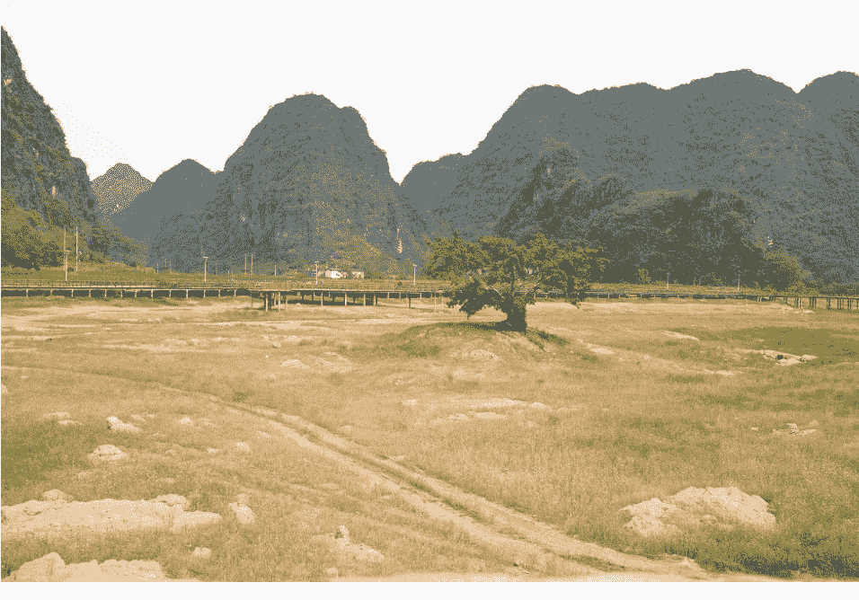

九灵天窗，曾经地质公园里的一处著名打卡点，如今干涸成了草原。

往日的九灵天留水面辽阔，枯树立在潭中，水面平静深蓝，倒映出群山。图：视觉中国

经验正在被前所未有的旱情改写，阿水团队更谨慎了，“情报调查工作”进一步加强。雷务海的井喷出水柱那一刻，阿水不等等收拾设备就跳上车，在天黑前赶上百公里外的新打井，那里有卢农高价包水，急需解决千亩旱情。

他现场勘查，又逐个联系同事打听。终于，一位同行断然劝阻：“不要去，都没有水。（周围）有五口井，全部没水了。”这位同行曾帮同一户主加加深老井，直到200米深，依然滴水未见。

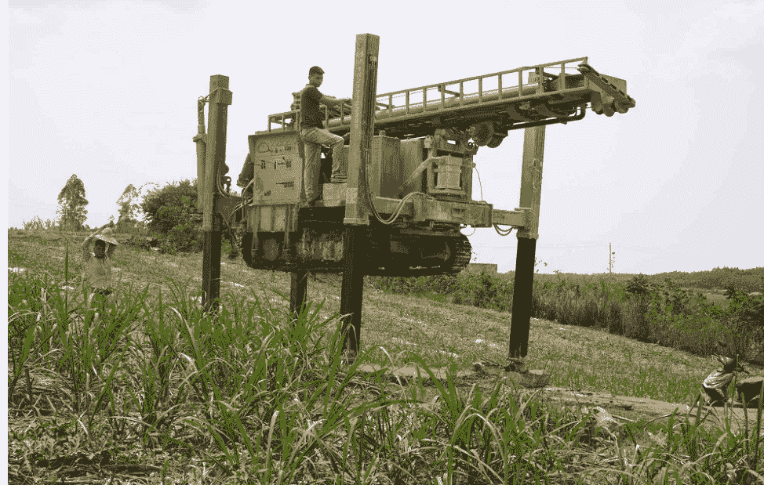

打井队员们收拾设备，队员清是90后和00后。5年前，几个年轻人合伙买了整套设备，花费80万，却遇到了激烈的市场竞争，业务平稳而有限，直到今年4月的罕见旱情，让业务量瞬间翻倍。

天色渐暗，钻井现场尘土飞扬，辛苦了一整天还没见水，负责钻杆的队员躺在轮胎上小憩。

这趟走访让阿水避免了近万元的损失。如今，阿水每次打的井前，都会详尽走访：看地形、看路况、看周边井，再向村民、同行多方打听。越少接包井，宁愿按米收费，“赚点辛苦苦钱”。阿水解释：“以前你发个定位过来，我们就知道这里水量、水源情况。但是现在太早了，以前这个地方有水的，现在不一定有。据他在

广西同行交流群的观察，八成的打井队现在都按米收费，部分打井需求旺盛的包水区域反而没人接单。

也有之人不再再肯着于水，放弃了这一季的耕作。广西石卡镇，种了一辈子地的王丰54年来首次放弃了春季插秧，秧苗在田埂上看着焦黄。上游水库迟迟不放水，镇上的干余水田一片干涸。

傍晚的石卡镇下了小雨，但尚未湿润土地，雨就停了。王丰就赶到了他的甘蔗地，埋头看了又看，从左走到右，又从右走到左，甘蔗忽然歪七八八地趴在田埂上，新发出来的嫩叶拉着往下垂。飞蛾来找水喝，聚集在浇水留下的小水坑旁，他什么也做不了，“准备去打工了，不去打工怎么过？”

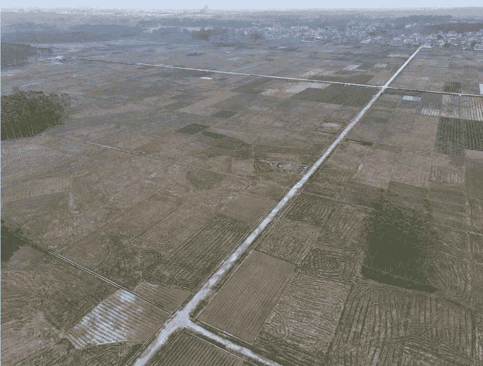

贵港市石卡镇，了千余稻田无水可用，已错过农时，只能播荒，更多优质资源关注：公众号懒人搜索，懒人专属群分享。

插秧时机已过，村民们早前培育的秧苗等候太久，已发黄干枯。

(文中谢其华、王则庆丰为化名)

图片编辑 | 翁倩

## 与大地谐水：绿之洲的斗争

广漠茫茫的阿拉勒斯坦沙漠，这片被人类称为“地球禁区”的土地，这里没有水，没有树，没有生命。1949年5月，第一批犹太移民来到了这里。这里只有滚滚的烈日和漫天的风沙。然而，在他们不懈的努力下，在这片干旱的土地上，一个奇迹发生了：他们在这里创造出了一片绿的绿洲。

1958年，第二批犹太移民来到了这里。他们带来了更先进的灌溉技术，在这一片荒芜的土地上开辟了第二片绿洲。在他们的努力下，这片绿洲不断扩大，曾经的荒漠也开始变得绿色。

1968年，第三批犹太移民来到了这里。他们带来了更高效的农业技术，在这一片荒芜的土地上开辟了第三片绿洲。在他们的努力下，这片绿洲不断扩大。

1978年，第四批犹太移民来到了这里。他们带来了更现代的农业技术，在这一片荒芜的土地上开辟了第四片绿洲。在他们的努力下，这片绿洲不断扩大。

如今，在他们不懈努力下，这片荒芜的沙漠中出现了一片壮丽的绿洲。这不仅是自然的奇迹，更是人类的胜利。

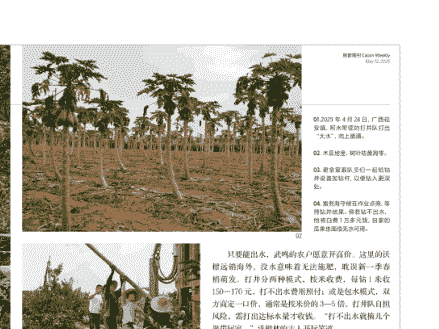

阿拉勒斯坦沙漠广袤无垠，气候干旱，水稀少。这里是一片完全不适合居住的荒漠。然而，在犹太移民的努力下，这片荒芜的沙漠出现了一片绿洲。这不仅是自然的奇迹，更是人类的胜利。

随着绿洲的扩大，这里的生态发生了变化。曾经的荒漠现在变得生机勃勃。犹太移民证明了人类可以战胜自然，这片绿洲提供了宝贵的经验。

在绿洲扩张的过程中，这里的生态发生了巨大的变化。这不仅吸引了大量的植物和动物。犹太移民证明了人类可以战胜自然，这片绿洲提供了宝贵的经验。

在这片绿洲上，心情是前所未有的喜。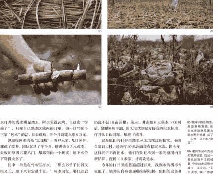

在绿洲扩张的过程中，这里的生态发生了巨大的变化。这不仅吸引了大量的植物和动物。犹太移民证明了人类可以战胜自然，这片绿洲提供了宝贵的经验。

在这片绿洲上，心情是前所未有的喜。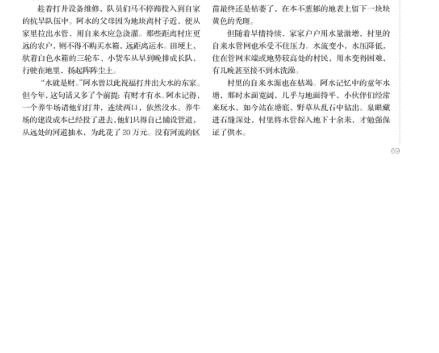

在绿洲扩张的过程中，这里的生态发生了巨大的变化。这不仅吸引了大量的植物和动物。犹太移民证明了人类可以战胜自然，这片绿洲提供了宝贵的经验。

# ENVIRONMENT & LIFE

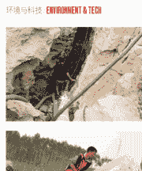

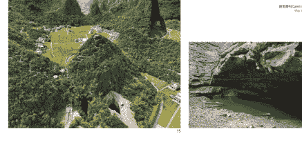

在这里，这片荒芜的土地上孕育着生机。这里的干旱植物为了适应极端的干燥环境，进化出了各种生存策略。有的植物叶片化成刺，以减少水分蒸腾；有的通过肉质的茎部或根部来储存水分；还有的植物在干旱季节休眠，直到雨水降临时迅速生长、开花。有些植物拥有极其发达的根系，深扎地下寻找水源，或者在地面表面吸收稀缺的雨水。有些植物具有宽阔的叶片，在雨水到来时吸收水分。

## 沙漠“绿人”

在广袤无垠的沙漠中，有些树木被称为“沙漠绿人”。它们在严酷的条件下顽强地生长、繁衍，为这片荒凉的土地增添了一抹绿意。这些树木不仅是景观的奇迹，更是生态系统的重要组成部分。它们能够固沙防风，还改善了当地的微气候，为许多生物提供了栖息地。

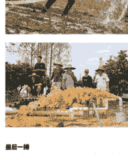

在这里，这片荒芜的土地上孕育着生机。这里的干旱植物为了适应极端的干燥环境，进化出了各种生存策略。有的植物叶片化成刺，以减少水分蒸腾；有的通过肉质的茎部或根部来储存水分；还有的植物在干旱季节休眠，直到雨水降临时迅速生长、开花。

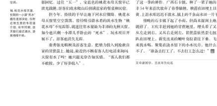

在这里，这片荒芜的土地上孕育着生机。这里的干旱植物为了适应极端的干燥环境，进化出了各种生存策略。有的植物叶片化成刺，以减少水分蒸腾；有的通过肉质的茎部或根部来储存水分；还有的植物在干旱季节休眠，直到雨水降临时迅速生长、开花。

## 自然之美

“一木一叶”是大自然神奇的奇迹之一。植物群落在不同的环境中，植物以各种姿态生长。从干旱的沙漠到繁茂的热带雨林，每种植物都展现出独特的生命力。植物不仅是生态系统的生产者，还是动物的食物来源和栖息地。这种复杂的关系维持了地球的多样性。大自然的智慧，每一片叶子背后蕴含着生存与适应的故事。植物光合作用产生氧气，为地球上的生命提供了基础。它们调节气候，维持水分循环，防止土壤侵蚀。

## 随笔 | 离开职场

## 听文章 | 蒋略

## 回到北京

2005年初，我接到猎头的电话，给我推荐一个法务职位。虽然香港律所优待，但我实在忍不了那天气，想去北京。面试包含了很多准备，包括从总部来的知识产权总监、部门主管、研发中心经理、事务部经理和两位项目经理；按国籍有美国、加拿大、英国、日本人、尼日利亚人、中国人，用不同口音的英语来了解我的专业技能、教育背景、兴趣爱好。从早8点到下午5点，面试了一整天。几乎所有面试对我非常满意，其中一个还给了我大大的，把我送上车时承诺很快发工作。迟迟没有，后来才知道是因为我的薪水超出预算。公司换了一位经理继续联系，基本工资比要求的低20%，奖金增加一倍作为补偿，总体符合我的预期。

两个月与香港律所协商，终于同意放假回到北京。公司提供双语住宿，我选在北大书外的宿舍。想起多年前常逛国圈，有点幽默感。确认工作稳定后，我决定买房。2005年初北京房价疯涨，每个月上涨1000元/平方米。几次谈好价格对方又反，别的买家加了价。在北大读书时，清华科技只是一片荒地，现在通地铁，临近高校的中关村二小学一房难求。有次去看华清园一套三居室，没想到来了5个买家。

一年之后搬入新居，只是口袋空还欠债。当时觉得这房子不值那么多钱，没想到房价继续疯涨，8年后房子又涨了数倍，成为我最成功的投资之一！我加入的公司是世界上行业的老大，是百年老店，内部运作机制非常成熟。公司在北京成立研发部门时间不长，在新任法国老板的努力下发展迅速。几个月后，我便如鱼得水，业务部门以及技术人员打成一片，工作得开心。

后几年，公司业务节节开。到2008年北京举办奥运会后，一快速发展的势头，引发公司董事会重视，专门成立了中国区业务战略小组。老板Angus在公司级别很高，让我加入了中国区业务战略小组，同时兼顾原本的工作，由我自己提要求。

Angus是我见过的精力充沛而又机敏的职业人士。他能很快把握局面，又能捕捉细节，而且从不疲倦。一次出差到吉隆坡，连续三天的会议向管理层汇报。从早7点到晚10点，我们不停地聚神集中报告和讨论，然后去吃饺子晚餐。回到酒店时已将近凌晨2点，Angus过来来说，酒店的健身房非常好，问我要不要去。我又要又累实在想歪头睡觉，早上6点提前赶到会议室，却发现Angus已经开始工作了。原来他跑步游泳两个小时，直接取消了睡觉时间，又工作了两个小时。他比我大7岁，多年精力如此充沛，实令人佩服。

连续几年，公司经营良好。公司对我的评价高，于是我进了重点培养对象。但是我的状态越来越差，经常加班到凌晨2点。想起多年前常逛国圈，有点幽默感。为了放松，我用喝酒或者高强度运动，使自己很累，终于一次受伤，去医院拍片诊断为严重腰椎间突出。早上，研发中心经理让我，以及两个人的关系，我才明白了。

“真是对不起，你现在的职位没有了，”同事经理看着我。

“真是对不起，你现在的职位没有了，”同事经理看着我。

“真是对不起，你现在的职位没有了，”同事经理看着我。

我没有任何打算。在辞职后，我带着妻子带着两个箱子行李，办办了北京的签证。

## 安居成都

我向来讨厌北京的冷，离职后就开始长途旅行。期间也有朋友推荐去珠海、深圳、三亚等城市，决定去成都生活。但我只想休息。在登上飞机那刻，我突然意识到，成都是一座就不想走的城市。我很体会成都的魅力，也明白“人入川”这句俗语。第一天在宾馆住下，直到朋友让我住了一周。我在朋友家里看着窗外的郁郁葱葱，出门从东湖公园走到望江公园看雪景，立刻决定在翡翠小区买房子。当时成都房价相对便宜，我有一笔离职费，卖了些股票，工资。

我在成都愣了两个月，除了社交圈，还认识了公益组织的一些朋友，很快融入成都悠闲生活。经常参加各种读书会、饭局、茶局、麻将、酒局等。以往高强度的工作和生活的压力强行顶住，如今松了下来，健康爆发，身体状态处于低谷徘徊，各种毛病不断。后来在诗人朋友的力下，去学习打坐和心理调节，配合游泳运动，才感觉慢慢恢复，脸色也亮了起来。

我在成都业务很少，导致收入减少，而妻子的开销也大幅上升。她原来在北京弄茶道的事情，虽然屡屡失败，但我负担得起。到了成都，她先和别人合租房子开了一个茶室，亏损后自己又开了公司，闲着要把成都买的新房子做茶室，把原来的欧式装修改得漂亮。除了日常生活费用，她炒菜失败、投资失败、借给朋友的茶钱收回来等等，都是我来兜。

有了经济上的压力，两人难免口角不断，直到把北京的房子卖了离婚。离婚后，只剩下闲置的房产和跌入谷底的股票，还要每月付生活费和给父亲买新房的房贷。

## 杭州半养老

人到中年，想不到会穷困潦倒。我不愿意降低生活水准，出路就是尽快找个高薪的工作，回到大城市寻找业务。

在朋友和猎头的推荐和帮助下，一家美国公司和一家公司都有吸引力。电话面试后，美国公司的知识产权总监已经同意用我，只是在正式发offer之前，我们需要全球飞和其他部门的同事们见面。秘书给我安排行程，两周时间，成都-北京-伊特律-波士顿-圣地亚-洛杉矶-新加坡-台北-上海-成都的节奏。我不禁起心打量市场。而中国公司画了个前途光明的大饼，加上HR的期权似乎很值钱。我带着好奇和苦干多年实现财富自由的梦想，放弃了美国公司去了中国公司。

2017年末，我辞职了。

美国作家克莱斯托弗·莫里说：“世界上只有一种成功，即能用自己的方式度过生活。”我在杭州离职后回到成都，经常在思考这个问题：我应该以什么样的方式度过的后半生？在回答这个问题之前，我得先细致审视自己，就就像格拉斯所说，未经过审查的人生，是不值得过的。

我的世界观是如何形成的？大学期间和墨老师相处，我在读书时接触了一些基督教朋友，对佛学也一直有好奇，自然比较多的时间花在科学和西方哲学上。现阶段，我认为物理世界偏向至善于美的法则或真理，而科学采用逻辑推理和归纳方法的交叉点正逐渐靠近（但未能够达到）终极真理；对于世界的法则和规则，我觉得哲学的最近接近真实。佛学经典《金刚》现代人有一点远，《西藏史书》和《僧与哲学家》是紧靠当今世界的，同时具备一定的深度和严谨性。但我不是一个完全的佛教徒，虽然有过打坐实践和微妙的感触，但是仍然无法相信和实践“涅槃寂静”。道家的“中道之若存亡”，说的就是我。

我的世界观形成缓慢而还在持续微调，或许能完全指导我的人生轨迹。我曾学习物理学，想要学习物理世界的真理，但其过程让我清楚地意识到我智力和兴趣的天花板。我倾向于追寻人的幸福和美好，我的人生哲学里既有视似竞争关系殊途同的伊比鲁学派和斯多葛主义，也有指向现代人的赛利格曼和沙哈尔的积极心理学。像罗素亚的《幸福之路》读过多，而诺特克的《被检验的人生》细数现代人生活的方面面，可谓非常实用的人生哲学的课程。

特别触动的我是，诺克亚为老年人应有的生命态度是：“不要优雅地离去告别，也不要为生命之光的熄灭而怒冲天，相反，在接近终点的地方，应该让生命之光发出最耀眼的光。”哲学家冷静沉思人生的终点，竟然比某些恒星陨转为超新星的壮丽爆发，和诗人托马斯的《不温和地走进那个夜》不谋而合。

那么，如何用自己的方式度过一生呢？”罗素转述维特斯坦说：“任何事都不可忍受，除了创造出伟大作品或欣赏别人的伟大作品。”我明知自己不可能创造出伟大作品，退而求其次，欣赏别人的伟大作品总是可以的吧？

现在我有充分的时间扩展阅读的广度和深度。在文史领域，曾有过比大的涵盖的世界名著目录，大学四年前图书馆看到一本书，想要读完几本书却只读到一半。现在我年华已，现在我找到这本名著目录，刚好把心的《文学回忆》里面的作品找了来，一半是新书一半是复习。

另外，我对人物传记有天然的好感。传记的主角是如何做出出生重大抉择的呢？真正深刻的传记寥寥数本：《维特斯坦传：天才之苦恼》、《我的一生与美国现代史》（凯斯琳·格雷厄姆）、《一解到底：我的法律人生》（艾伦·德肖沃）、《我的一生》（伊莎拉·智慧箴言）、今生今世》（兰兰）、《查理宝典：查理·芒格的智慧言录。

为了对抗现代人的信息碎片化，我反其道而行之，专门去找长篇、巨大的和咬不动的作品来读，《追忆水年华》《邂逅录》。

成都的氛围给了我机会，把自己的读书和思考心得分享给大家。我短暂暂停爱思考期间，除了自己分享，也邀请各行业有心得的朋友来露露。不过，我更加偏重哈佛课程或美国学院里的“思辨”教育。我做读书会，要求与读者读完后分享和辩证；我做模拟法庭，都要像法官一样听顺、提问、辩论、思考、判决；我播放法律电影和纪录片，特别提醒观众可以否认当事人、双方律师、法官、陪审员换位思考。

## 仍是泪光亮的学生

我第一次接触古典音乐是初中三年级14岁那时，竞赛得了奖金去买了SANYO的磁带。商店送了一盘TDK翻录的磁带，浅草的手写曲目是舒伯特的《未完成交响曲》和贝多芬的《命运交响曲》，查尔斯·明希指挥波士顿交响乐团。我是第一次真正听到严肃严肃音乐，那种深邃博大的英雄气概一下子抓住了我。父亲拉二胡，母亲会唱梅戏，但我喜欢磁带的力量，那种不可一世和生命的激荡。

那TDK磁带质量是好，不知道听多少遍也不坏，只是带子被磁头磨出了两条亮，直到我开始收集CD，还是保留着。29年后，我在收集的唱片合集中发现了RCA这套原版录音，不禁泪流满面。一个小城镇里不知谁的卖出去的口碑录音，却成为我一生至爱的启蒙。

我真正的古典音乐入门是在北大，教课的是临近退休的德国古典文学研究教授严宝瑜（1923—2020）。1976年，严先生凭借直觉和勇气，在北大公开贴字报介绍贝多芬，听众却是当时部长、副部长的高官。可怜的是当时还没有音乐教室，严先生申请了一个小阶梯，帮着自己录的音设备。严先生是最后一位西南大学生，对新的大学生说：“第一节课讲的就是贝多芬的命运交响曲》，那是我熟悉的，却总是不听懂。原本两个小时，学生们挤满了楼梯和走廊，时间到了，谁也不愿意离开。我和同一个同学走路回宿舍，我知道无法睡，夜深人静，湖畔只剩下俏悄的呢喃。

我对音乐向感兴趣，大学期间选修了严先生的所有古典音乐。贝多芬专题96分，19世纪浪漫主义音乐90分，维也纳古典派专题96分。严先生住在燕园，夏日隐藏在墙之中。

严先生的效果，让我这个学生学了一阵子。在听音乐时，常买盗版唱片，以至于只剩下一张磁带。严先生免费给我们几个月翻录磁带，后来干脆把唱片录到磁带上送给北大广播站，我们也能直接听，校外音乐爱好者。

严先生推广，毕业那年，某次课，严先生鼓励我去学钢琴，我那时已经毕业。对严先生的建议，看来有些惭愧，可能我对音乐有敬畏之心，也不想放弃支持。北京期间，我在网上关注严先生，曾想登门拜访，但是推迟，心里有些疑惑，他还在燕园吗？

记得22年，我曾寻找有没有过严先生的信息，发现他已过世两年了，忍不住住。确实，想起严先生时，我如潮澎湃泪光。我聆听古典音乐超过万小时，作为古典音乐发烧爱好者，我首先召集朋友分享自己最喜欢的唱片，也在做音乐沙龙，后来在闲书范围内系统性的讲课。这两年来，我把多年积累的聆听经验和心得，按古典音乐发展时期和地域特点系统性的准备了讲，涵盖150+小时的作曲，就此选取200+小时的曲目，做了几次活动，鼓励许多爱好者来分享心得。“雅典的公民们，你们只关心自己如何得到更多的钱以及自己的名望和特权，而对于真理、智慧和改善你们灵魂，则既不考虑也不关心，你们难道不感到羞耻了吗？”我该如何面对苏格拉底这个质问呢？年轻时求生存拿高薪安于物质享受，我没有耻感，大概是因为外界的影响以及缺乏自我反省吧；如今我有激情和时间去体会和分享阅读和音乐的快乐，也算给自己比较满意的答复。

## 提问比答案更重要

CAIXIN 听文章
文 | 严飞
清华大学社会系副教授

因为和华东师大的刘擎老师一起写了《世界作为参考答案》，这个春天都在跑来跑去地参加新书的宣传活动，活动主题之一就是“参考答案”。我们俩都会强调，人生不应该被限定在一个固定的框架，按照一套标准答案、标准化的路径，放之四海而皆标准的“正确人生”或“成功人生”，在世界上并不存在。每次活动结束之后，我们会感慨谈话内容的大同小异。当我们不断强调“人生没有标准答案，世界作为参考答案”时，这种叙事框架，仿佛成了另一“标准答案”，束缚了我们的回应。到有一天，我一年级小朋友在上学路上突然问我，“爸爸，人为什么要上学？”“复习有什么好处？”“为什么鼻屎在北京是干的，在上海是黏的？”“为什么天空没有云的时候，鼻屎又特别特殊？”孩子马上要期中考试了，考试前的模拟考试却被扣了20分，我们为将来的期中复习了功夫，希望他能好好反复。可是他却很淡，一边做手工，一边嘟囔：同班的谁谁被扣了30分，谁谁被扣了20分？如果我考试少分，是不是就可以多分？

面对疑惑，我才意识到原来我一直在成年人思维定式的“理所当然”。以为教导他，让他学习有趣，结果父母给孩子贴标签。考试成绩不好，妈妈就会觉得你是不好，所以要学习认真；考试成绩好，妈妈就会觉得你很优秀。只有考试成绩好，妈妈就会感到骄傲。考试成绩不好，妈妈就会觉得你是不好，所以要学习认真；考试成绩好，妈妈就会觉得你很优秀。只有考试成绩好，妈妈就会感到骄傲。

可是，在观众面前，我还在大声呼吁：不要，不要让父母给孩子贴标签，要让成长有趣。作为父母，我们是否认真地了解了孩子？等候他说出思路，并且说不出一种可能的答案？世界上太多的问题没有绝对答案，重要的是能够提问。

“正确”的答案或许带来不错的结果，好的问题却打开新的可能。重要的是，好的提问，可以打破认知的边界，想象力，像孩子一样直气壮地问。从什么时候开始，我们逐渐失去了提问的能力和勇气？问题的消失比答案更危险。我们不再自我怀疑、自我反思，不再对人生保持好奇。每一次看似理性的选择，或许背叛了自己的天然意志，成为一种从性的反应。我们开始相信，对美的追求，本来应该有一种秩序。

德国社会学家齐梅尔（Georg Simmel）认为，社会美学并非唯一的，真正的社会美学是多元的。

我是相信，这个世界一定会奖励那些提问的人，而不是只会背诵答案的人。真正的成长，从来不是填满一个容器，而是点燃一团火——而最好的火种，正是一个接一个“为什么”。

## 逝者 | 李锦全：精研儒道，打通文史哲

CAIXIN 听文章
文 | 任剑涛
清华大学教授

2025年4月23日，哲学史家、中山大学哲学系原主任李锦全去世，享年99岁。

李锦全1926年2月出生于广东东的一个小家庭。因家中藏书多，他自幼与书为伴。在中学阶段，他对古典文学史独热爱，不仅四大名著烂然于心，而且熟读唐诗宋词，对名家文章如琅上口，还能写诗填词，古风古意。这些早年的积累，为他日后融文史哲、兼通释学的学术风格奠定了坚实的基础。

1947年，李锦全考入中山大学哲学系，受到刘力、仲奎锐、陈源、宗亚亚、杨成志、沈来等名家教授诲，开启了对中国传统文化的专业研究。1951年毕业后，他被配至南军委员会文化工作，作为考古训练班第一期学员，接受了考古名家的专门训练。1954年，他调回中山大学历史系任教；1960年中山大学复办哲学系，回归哲学系，直至临终。李锦全在历史、哲学两系教授，并兼任哲学系主任，以及各学的领导职务。

李锦全学术成果丰硕。自上世纪五十初以来，在各种学术期刊上发表论文200余篇，出版专著十余，主编教材多套。个人著作集于《李锦全全集》十卷，主题多样，跨越哲学史三大领域，论述富有创意。李锦全对“中国哲学史”这一自主性体系的构建出了突出贡献：从1959年合著《简明中国思想》，到上世纪80年代主行的《中国哲学史》，发挥了作用。他悉心教学数十，培养了一批哲学和政治研究的高级人才。

李锦全对中国哲学史的建设是大学学科的一支重要力量。在长期的中国思想研究中，李锦全精研儒道，打通文史哲，以儒道、哲学之间的交织，重构了完整结构。在对儒家思想的研究中，不仅表现了古今视野，从原始儒家到现代儒家进行了系统性的探究，还关注了儒家与思想的互动，揭示了复杂性。

在相关阐释中，他重视“传统”，在古代哲学中挖掘素材。对于他而言，打通文史哲是一个虚幻的说法，而是一个研究的方法。李锦全的中国哲学史研究，不是单调乏味的哲学推演，而是充满生活调的哲学升华。即便是描写哲学史论文，他不会是枯的概念堆砌，而是直抒情感与理性外显。他具有中国传统文人的才情风格，写文章从来打草稿，中间垫一张纸，这与其国难当头的处境中成就的学术功夫与人生哲学密切相关。“忧意识，达人生”的人生观，便是对此最好的概括，前者为生命而发的不竭思想源泉，后者成为通透地观察历史、现世与人生的精神力量。

## 逸者 | 约瑟夫·奈：选择的漏斗、软实力与历史

CAIXIN 听文章
文 | 财经周刊 王烁

约瑟夫·奈（Joseph Nye）于2025年5月6日去世，享年88岁。他是当代最杰出的国际学者之一，出入学术与政策两界，担任过哈佛大学肯尼迪政府学院院长，荣誉无数。

多年前，我读过奈著《理解国际冲突》。国际冲突指战争。他认为战争的起因，为理解战争人们发明了哪些理论，为防止战争人们想了哪些办法。以希腊的伯罗奔战争和现代第一次世界大战为例，分析两种方向的国际关系理论——现实主义与自由主义，前者力量平衡的国际体系，后者对应基于规则的国际体系。

人们最想知道的是，战争不可避免。修西底德认为伯罗奔战争不可避免，许多国际关系理论认为“一战”不可避免：原因是新兴大国崛起，威胁到既有国家。奈不同意，两者的紧张关系并不导致战争成为唯一的解决方案。他提出了一个概念：选择的漏斗。想象一个漏斗，纵轴是时间，从上到起点终点。从后，两场战争爆发可能性的变化就像一个漏斗。到了最后刻，双方都没有选择，只能把刀子进红刀子出。在漏斗行的绝大多数时间内，双方一直有游刃余裕的空间。大国关系本来深厚宽广的博弈空间，发展到刀剑相见，并不是形势必然。这种矛盾现象，成了思想间的相互影响，传承关系由此形成，创新也在其中显现。这是一个符合历史真实的思想史、哲学方法。

李锦全的中国哲学史研究，对传统的演进线索中一种现代性的审视。从青少年时代危机开始，一直贯穿他对国家命运的高度关注，他的现代性是自觉的。这是他后半生心致力于中国传统的还原概念。

了，此后由于荣誉、恐惧和利益，我们就不肯放手。但是，弱者受制于强者，是永远通行的。

相对有利的自愿同盟转化为基于威慑的实体体系，历史上不止一次。

先则是辛格，接着是奈，这些年，我细读过其著作、听过其洞见的国际关系理论家、实践者们，他们所熟悉的语言如今也在消融。这些人立场位置不同，看法各异，却从历史中走来，对于历史，对历史深敬畏。相比之下，年轻一代学术营养深厚，工具箱丰富，用得颇娴，唯对历史不以为然。两年前，在一次高级国际关系学界讨论会上，就中美关系，两类学者争论激烈。少壮派活跃，长者持有意见。长者强调重视历史经验教学；少壮派流认为历史不重要，因为历史的一切相关要素都已凝结在现实之中，只需从现实往前推就可以了。

如今，这位长者也已仙逝，而少壮派已经占领舞台，他们要么不懂，要么不在乎，当历史还没有成为历史的时候，从当时的现实往前走，未来曾有多少可能。今天的现实只是当时所有可能中未来中运气最好的。曾经站在历史分岔路口的人，才懂得与灾难擦肩而过意味着什么呢。

但他们去世了。■

相关视频：2024财新春季夏季冬季峰会【主讲/对话】亚洲经济与金融视频

视频说明：2024年5月，约瑟夫·奈出席在财新香港峰会，与财新传媒体社长胡舒立对话。

## 前瞻 | 英欧峰会将会举行

# CAIXIN| 听文章

文 | 财经周刊 侯昊婷

5月19日，英欧峰会将在英国伦敦举行。这场由英国主办的峰会将是英国“脱欧”后的首届双边峰会，被视为英国重塑与欧盟关系的关键性一环。

今年2月初，英国政府表示，该峰会将“推动那些能为英国和欧盟民众带来切实利益的领域取得进一步进展提供机会，同时进一步加强英德和欧盟之间独特的关系”。

欧盟委员会主席冯德莱恩同时强调，除其他议题，英国和欧盟尤其将在这次峰会上讨论深化安全合作的形式。通过此次峰会，英欧双方有望就英国首相塔克斯主导的后脱欧时代英欧关系重塑议程达成共识。自2024年7月以来，斯塔克斯承诺重置（reset）英欧关系。尽管目前态度友好，但在政策方面尚未有实质性进展。

此次峰会将为未来英欧一系列谈判奠定基础。另外，在特朗普上台后美国政府逐步疏远欧洲安全的背景下，英国和欧盟的潜在防务协议将是此次峰会的重点。

在欧盟“重新武装欧洲”特别融资计划下，欧盟将推动设立“欧洲安全行动基金”，向成员国提供1500亿欧元贷款用于国防投资，助力其联合采购防空系统、火炮、无人机等装备。

据通路社报道，欧盟委员会提到的相关规定，对于弹药、导弹和小型无人机等较为简单的产品，其价值最多有35%可来源于欧盟、欧洲经济区（EEA）和欧洲自由贸易联盟（EFTA）的成员国以及乌克兰外的国家。对于如空中和导弹防御系统、大型无人机等复杂产品，其需要额外满足另一项要求：产品当中可能受到其他国家限制的零件可以替换。

欧盟委员会已表示愿意与塔克斯政府就安全和防务伙伴关系开展谈判。若双方达成协议，英国军产品在欧盟防务采购领域将不受以前条款的限制。

观察人士指出，未来英欧谈判的主要焦点或集中于渔业领域，即英国是否承诺允许欧盟渔船继续进入英国水域——这是法国和丹麦等沿海国家的关键诉求。

在英国脱欧谈判中，据欧盟与英国政府2020年所达成的协议，欧盟在英国水域的渔业配额在过渡期将减少25%，该过渡期将于2026年6月30日结束。之后，配额谈判原则上将每年进行，未来达成多年协议的可能性也未被排除。欧洲多国希望维持现有安排。

尽管渔业协议是否会与防务协议挂钩尚未可知，但后者提案需要欧盟27个成员国的批准，其中包括希望延续现行捕鱼安排的国家。

在被问及防务协议是否会涉及渔业相关内容时，欧盟委员会发言人托马斯·雷尼称，“（欧盟）委员会致力于加强欧英关系，目前并未设定任何前提条件。”

## 国风 | 千万外骑手权益保障典型案例

# CAIXIN| 听文章

文 | 财经周刊 冯妹蝶

公开数据显示，中国有外卖骑手超过千万，2023年发生交通事故超过万起。4月30日，针对近年来涉及外卖业务领域的民事纷反映较多的劳动者受到损害、劳动者致死等案件，最高法院发布一批典型案例。

案例显示，某某诉某餐饮配送公司指责某骑手驾驶电动自行车前往某点途中与某某发生碰撞，致某某受伤。交警部门认定某某全部责任，某某无责。某某诉某餐饮配送公司申请理赔，餐饮配送公司认为该交通事故发生在某送餐途中，属于配送单中约定的“工作有关”，不属于保险责任。某某请求某餐饮配送公司赔偿7万元。一审法院支持了餐饮配送公司的诉求，该判决已经生效。

中国政法大学教授吴奎点评为，本案的核心是如何界定新业态工作范围。本案判决对于平台企业合作、保障受害人的合法权益，推动社会稳定具有积极作用。

在另一案例中，外卖骑手冯某进入某小区，由于左手放在车把上，通过关闭电动门撞及车辆，导致某某颈部损伤等。社保局确认受到的职业伤害后，某某诉某小区物业。一审法院判决赔赔偿；某某不服上诉，二审法院判决驳回，维持原判。吉林大学法学院教授艾琳表示，本案判决旨在明确新业态人员在享受职业伤害后，仍有权请求第三人承担权责任。

某物流公司在特定区域内经营即时配送业务，张某通过某物流公司注册，接受该平台指派订单任务，由该物流公司发放工资。某物流公司作为投保人、保险人在处承担责任，含“个人责任”。某某通过某餐平台接单，驾驶电动自行车送餐途中，与某发生碰撞致某某骨折。某某诉某物流公司，请求令某、某保险公司赔偿医疗费等。一审法院判决某保险公司赔偿部分由某物流公司。据通报，该判决发生法律效力。中央财经大学教授沈建峰表示，该案例明确了商业保险、用人者责任并在时态者致第三人损害的裁判思路，有利于各方当事人诉累。根据多因素综合判断，《民法典》第119条意义上的用人单位，与裁判思路一致，符合平台实际和理论主流观点。■

## 心智 | 为什么害怕竞争

# CAIXIN | 听文章

文 | 阳志平

安人心智董事长

什么是竞争意识？它指的是人们对社会资源、地位争夺的认知与态度。

在过去的200万年里，人类大脑的体积增加了2倍，增长速度远远超过了其他哺乳动物。大卫·盖里等人的研究表明，社会竞争是人类大脑容量增加的主要原因。

社会竞争不仅促进了人类大脑的发展，还能给你更好的绩效。这就是“社会促进效应”，最早可以追溯到1898年心理学家诺曼·特里普特对竞技体育的研究。他在观察自行车赛时发现，骑手在与他人竞争时的表现通常优于单独骑行的情况。有人在场的情况下，人们往往表现很好。

然而，并不是每个人都喜欢竞争。人们为什么要害怕竞争呢？

因为害怕竞争惩罚。参与社会竞争存在风险。回想中学时期，如果期末考试成绩靠后，班主任可能会将你的座位调到教室后面，你也可能会受到同学的嘲笑。既然竞争失败带来羞辱与惩罚，为何不从一开始就开始放弃竞争呢？

因为害怕竞争会破坏关系。有些人为了维护关系而主动放弃自己的利益。面对晋升机会，如果另一位竞争者是你的朋友，你可能会选择放弃。传统儒家文化强调为和，注重人际和谐，进一步放大了这种趋势。

因为害怕竞争引发第三方介入。有一类人，在遇到竞争时希望能够大事化小化，更不愿意将事情公开，通过法律手段或通过社交媒体来维护自己的利益。许多商人也习惯低调，因为担心这可能引发强势第三方的介入，带来不可控的后果。这个第三方可能是司法机关、媒体以及市场监管机构。

竞争是不确定的，有时带来甜蜜和收获，有时却带来羞辱和惩罚。竞争是危险的，它可能破坏我们和他人的关系。竞争是不可避免的不可控的。
