# 财新周刊
Caixin

特朗普重创科学界 16 公募基金全方位改革 49 英国钢铁控制权争 60 全球资产如何配 44 跨国企业在华反攻 56 美国软药价 68

## 关税战停火
全球贸易流向已发生转变
P. 22

## 出口重激活
P.33

2025年第19期 5月19日发行
立案第1154号
纸发代码: 32-235
ISSN 2096-1251
19.9

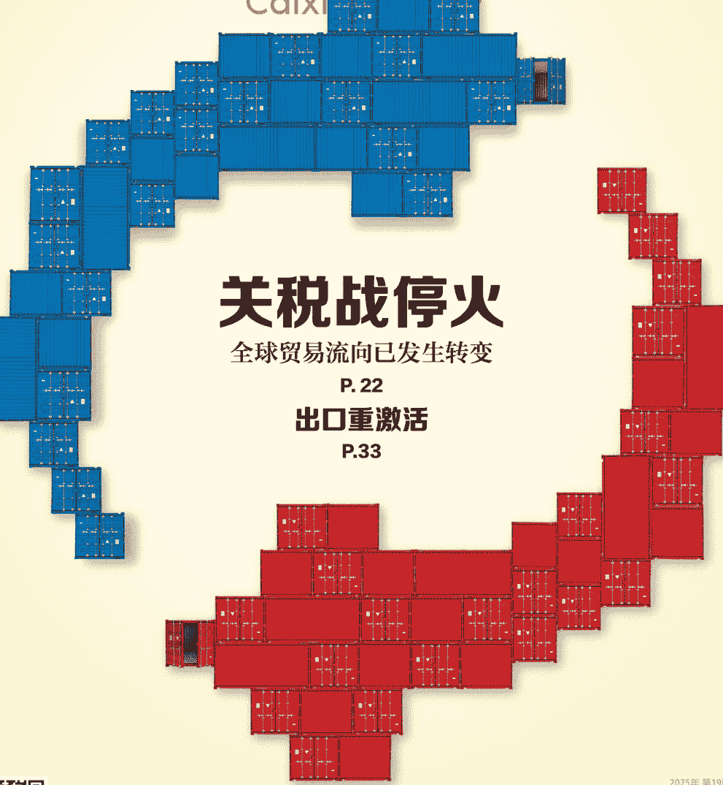
创刊：人民币40元/份 网址：www.caixin.com

# 免费 价值 及时 专注
# 扫码加入 知识星球TOP  免费资源群

- 每日免费获取有价值资源
- 可提供各类资源搜索服务

| 热门付费文章 | 各行行业报告 |
| :--- | :--- |
| 精选图书资源 | 副业赚钱方法 |
| 职场实用资源 | AI经营自媒体体 |

公众号:知识星球TOP 微信信号:jntsg8 微信信号:jntsg2

分享资料仅供个人学习，请及时删除，切勿商用传播

## 财新观察 | 时刻牢记公募基金“公”

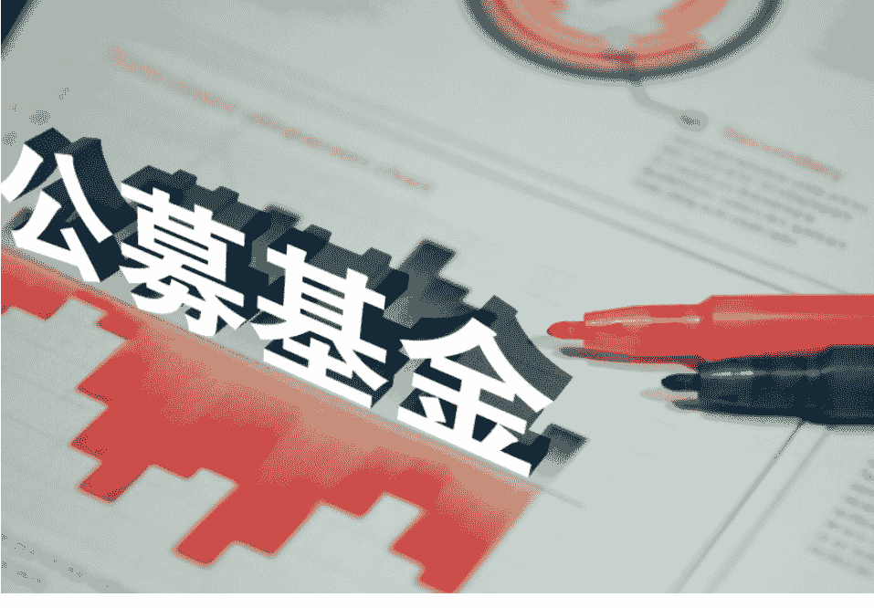

# CAIXIN | 听文章

公募基金改革迎来新突破。近日，中国证监会印发《推动公募基金高质量发展行动方案》（下称“行动方案”）。这是落实2024年9月26日中央政治局会议“稳步推进公募基金改革”要求，以及2024年4月《国务院关于加强监管防范风险推动资本市场高质量发展的若干意见》（新“国九条”）的重要一步。

行动方案贯彻了“以投资者为本”“以投资者最佳利益为核心”的改革思路，提出了建立了与基金表现挂钩的浮动管理收费机制、强化业绩基准的约束作用，以及建立健全与基金投资收益挂钩的薪酬管理机制等具体举措。这些改革措施既是遵循市场内在规律的必然选择，也是有效克服“维度迷锁”“早涨后保”和“格漂移”等公弊之源，从视角重视投资者回报的转型，是对公募性“公”的回归。

1998年首批公募基金问世，短短20多年间，行业迅速成长。截至2022年末，公募基金有效账户数量超过15亿，2023年公募基金首次规模银行理财。截至2024年12月，公募基金规模达32.83万亿元。公募基金在社基金、基本养老保险、企业投资的管理中也发挥着重要作用。推动长期资金入市和提升上市公司质量，是全面深化市场改革的重要内容。本次市场改革是系统性的，各个要素相互依存，进一步推进公募基金改革是一环。

以投资和透明度著称的公募基金，其生命就是投资者信任。行动方案指出，“公募行业存在经营理念有偏差、功能发挥不充分、发展结构不均衡、投资者获得感不强等问题”。此次改革紧扣回报和收益，着力保护机构、基金经理和投资者利益，切中了当前公募面临的症结。

公募基金改革要强化和完善利益性链和传导机制。行动方案明确，对新设的主动管理权益类基金推联动管理收费模式，“如持有期间产品实际业绩表现符合同期业绩比较基准的，适用基准费率；明显低于同期业绩比较基准的，适用低费率；显著超越业绩比较基准的，适用升档费率”。行动方案还明确了与基金投资收益相钩的薪酬管理机制，“三年以上低于业绩比较基准超过10个百分点的基金经理，要求其绩效薪酬应当明显下降；对三年以上显著超过业绩比较基准的基金经理，可以合理适当提高其绩效薪酬”。一系列列举措施不折扣落实。另外，基金公司要全面建立以基金收益为核心的考核体系，适当降低规模排名、收入等经营性指标的考核权重。

成熟资本市场的一条经验，是重视业绩比较基准的锚定作用，稳定投资风格和行为，降低短期影响，避免“基金漂移”。进入5月，变更业绩比较基准的公募基金数量越来越多，业绩比较基准的约束日益显现。统计数据显示，近三年跑赢比较基准超过10%的公募基金不少。行动方案提出，制定公募基金业绩基准指引，明确业绩基准的设定、修改、披露、持续评估，发挥约束的作用。行动方案提出，加大跨区检查力度，提升技术手段发现和处顽问题的能力，尤其是内部交易、违规操作等行为，务必零容忍，同时也要提升监管水平。以投资者为本，公募基金实现由规模向收益的转型，离不开严格监管的保护。

## 最新报道 | 关税停火
# CAIXIN | 听文章
**文 | 财经周刊 自北京、自华盛顿**

在经历了多轮抬价的挑衅和自我撤回后，美国总统特朗普发起的关税战，在华盛顿按下了暂停键。

2025年4月2日，美国白宫，特朗普在“让美国再次富裕”活动中发表讲话。特朗普掀起的为期40天的税战，以其推翻自己曾经承诺的论点、暂时叫停全部10%以外的“对等关税”措施而暂停一段。

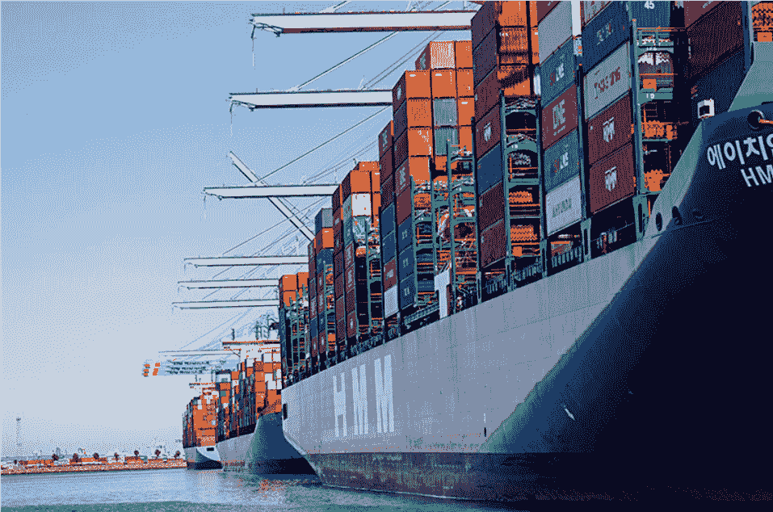
图：Francis Chung

面对来自全世界的批评声和第二大经济体中国展现鲜明的反制，40天里，特朗普并未拿到他所设想的“大量协议”，而是英国与美国在5月8日暂时达成了一份相当复杂的初步框架协议。日本、韩国、欧盟等传统盟友的态度也逐渐从软变硬，原本被认为最有可能达成协议的，更是表态正考虑潜在的对美复加手段。在美国国内，从卡车司机、蓝领精英到企业公司，反对“对等关税”的声音此起彼伏，外界对美国经济的预期迅速加速，美国外交滑向氛围甚至衰退，特朗普的民调支持率一路触底，最终在4月30日交出年来美国总统上任百日的最低支持率成绩。

随着危机信号越来越多，特朗普政府在关税政策上的表态也日益摇摆和反复。宣布“击战后”，美国股市在5月12日大涨，三大指数均收复4月2日以来的所有失地，从至少在数字上抹平了过去40天的损失。然而，世界贸易秩序很难回到关战之前，40天内，供应链遭遇前所未有的剧烈冲击，各国都在寻求更多选择。

财新首席经济师布库尔顿（Brian Coulton）表示，这场关税战争并不意味着结束。阶段性协议的达成，无疑是两国经济的脱钩。阶段性结果，未来前景依然不明。

## 关税停火
全球贸易流向已发生转变
P. 22

## 出口重激活
P.33

## 关税停火

## 最新报道 | 关税停火
# CAIXIN | 听文章
**文 | 财经周刊 自北京、自华盛顿**

考虑到特朗普第二次就职前的美国对华关税和其在今年3月宣布的“莱太关税”仍然有效，市场观察机构对美国对华实际关税率测算在31%-44%之间。联合声明，5月12日，美方承诺取消2025年4月8日对中国商品加征的91%关税和4月2日对中国商品加征的34%等关税”，其中24%关税暂停90天，剩余10%关税予以保留。

《中美会谈联合声明》发布后，特朗普在4月2日对贸易伙伴宣布的“对等关税”，全部回落到10%水平，即特朗普当时所称的“基准税率”。从4月2日辞激烈地指控，作为世界第一经济体的美国在贸易关系中遭遇其他国家的“掠夺、抢劫、强奸和劫夺”，到5月12日与中国的联合声明中强调“可持续、长期和稳定的经贸关系的重要性”。双方一致同意建立中美贸磋商机制，就贸易领域各自关键问题保持密切沟通。同日，中国商务部新闻发言表示，希望美国以此次会谈为基础，与中国继续向，加强利合作，维护中美经贸健康、稳定、可持续发展，共同为世界经济带来更多确定性和稳定性。

美国有效关税率自“对等税”后史无前例的20%—30%，回落到13%（高盛）—18%（普鲁逊），仍高于特朗普上任前的2%。

## 关税停火

## 最新报道 | 关税停火
# CAIXIN | 听文章
**文 | 财经周刊 自北京、自华盛顿**

(由于原始OCR文本存在大量重复和乱码，以上部分已根据语义进行逻辑合并与纠正)

美国参两院的共和党，正在推动特朗普所称的“美丽大宪章”落地。这项法案包含了体现特朗普雄心的的减税计划，还要配合较大幅的减免，否则很难在国会通过。减免的核心已指向医疗补助项目（Medicaid）等社会安全网支出，此类容易引起选民反对，也意味着实质性大幅减税仍有困难。

5月2日，白宫管理和预算办公室发布了2026财年（2025年10月—2026年9月）预算案，可决支出（discretionary）中的非国防支出（比如教育支出等）降至6010亿美元，为2017年以来最低水平，比2025财年（2024年10月—2025年9月）减少1630亿美元，降幅23%。但另一方面大幅提高了国防和边界开支，分别增加13%和65%，至少增加3250亿美元支出，其中国防开支将增至1.01万亿美元，为历史新高。

特朗普心心念念想要压低的贸易逆差，恰是因为其关税警告造成美国企业抢先进口，使美国的逆差在第一季度再次大幅增长。根据美国经济分析师局6月公布的数据，3月份美国商品和服务贸易逆差回升至创纪录的1405亿美元；2025年以来，美国贸易逆差同比增长92.6%。

2025一年第一季度，美国国内生产总值环比按年计算萎缩0.3%，创2022年二季度以来新低，前值为2.4%。由于贸易逆差会从GDP中扣除，此前经济学家已提示，特朗普政府的全球关税政策使企业提前储备进口，可能会造成美国GDP增长放缓。一季度GDP收缩的数据公布后，美股指数期货下跌200点。

在复杂的现实面前，特朗普期待“对等关税”所能带来的，究竟是更高的财政收入，还是更有利的贸易地位，或仅仅是更低的对外贸易额？

## 谈还是不谈？

措措难以解决的内在矛盾而生的特朗普关税政策，一开始便显出“先天不足”特征，其中一种典型的表现，就是特朗普团队内连“对等关税”是否能够纳入谈判范围，也没有基本共识。

4月3日下午，即“对等关税”宣布后的第二天，华纳罗公开承认特朗普有意就“对等关税”进行谈判，“这不是谈判。不是那种情况，这是国家紧急状态。”此此言与当天卢特尼克“不会放弃关税”的表态相一致。然而，特朗普在未等到一小时后告知记者，他愿意就关税问题进行谈判。他表示，关于关税，美国拥有“强大的谈判实力”。

在多重未被解答的疑问中，特朗普“多国正在寻求谈判”作为证明他胜利的指标，并称将迅速达成协议。至4月8日，白宫国家经济委员会主任哈西特，称正的积极联系美国寻求开启关税谈判的国家已从50个以上升到70个，同日白宫新闻秘书莱维特更为描述：“电话直响个不停，想要与本届政府、本届总统及其团队通达，以达成协议。”同日晚间，特朗普甚至对鲁尼耀道：“这些国家在给我们他们电话，亲吻我的屁股，他们迫不及待想要达成协议。”

2025年5月12日，瑞士日内瓦，美国财政部长贝森特（右）、美国贸易代表裴米森·格勒尔召开新闻发布会，介绍了中美高层会谈后的有关情况。图: Fabric Cofrini/共和中国

但其后40天的事实证明，谈判进度远不及特朗普的预期。

越南当地时间4月4日深夜，越中共同总书记书林与特朗普通了电话，越南由此成为“对等关税”打击的所有经济体中，第一个开启与美国对话的国家。这次通话被特朗普形容为“富有效应”，但三天后，华纳罗又称特朗普取消关税的承诺“毫无意义”。4月9日，赴美的越南总理胡德福与美国贸易代表格勒尔会谈，双方宣布将就一项“对等贸易协定”举行谈判，并将两国贸易中的非关税壁垒降低。但在这一积极消息传出后的后一个月内，美越贸易谈判确认仍在进行，再无公开进展。

另一个接触点“触碰”的国家是日本。4月7日，日本首相石破茂与特朗普就“对等关税”政策通话电话，此后日本经济再生担当大臣赤泽亮作为日方代表两次赴美与贝森特磋商。但随着谈判的进行，尤其是中国对美国实施关税报复明确反对之后，面临参议院选举挑战的石破茂对美谈判的表态也逐渐强硬。4月21日，石破茂向参议院表示，日本不会在与美国的关税问题上让步，也不急于访美与特朗普达成协议。赤泽亮正在4月16日结束与贝森特的第二轮磋商以后表示，“很难说需要多长时间才能达成双方之间的歧。”

2025年4月30日，日本东京羽田国际机场，日本经济再生担当大臣赤泽亮正前往美国进行第二轮关税谈判前，回答记者提问。图：nKaname Muto/视觉中国

目前已离职的韩国总统文寅也在4月8日与特朗普通话，当时特朗普对外暗示，韩国作出了类似于日本的让步。此后，韩国一直和美方保持工作层面，但韩方表示，在韩国总统选举落地之前，韩美不会开启谈判。

早在“对等关税”落地后显示，美方在贸易中正处于进度前列。4月29日，特朗普称与印度的“对等关税”谈判进行得非常好，并将很快与印度达成协议。不过，率先与美国达成的国家并非印度，而是美国拥有特殊盟友英国。5月8日，特朗普和英国首相梅逊宣布两国达成协定，美国将免除对英国钢铁和药品的关税，并给英国一定的进口配额，对英国进一步开放农产品市场。事实上，美国对英国有亿美元贸易顺差，即便如此，特朗普依然保留了对英国10%的基准关税。不过特朗普也在发布会上表示，这份协议的“最终细节”将在未来几周内拟定。英美协议公布后，美国三大指数收跌，两国股市的不同反应体现出市场对这份框架的不同。英国驻美国曼德森（Peter Mandelson）大多持批评观点，认为在最后，特朗普给英国政府打了一个电话，提出了更高的要求。”曼德森直言，这是一个很有预料的，对于特朗普来说，很难结束与中国的关系。

2025年1月，时隔四年，特朗普再次签署第195号行政命令，宣布对所有中国进口商品加征10%关税，于2月4日生效。2月4日，中国宣布反击对美国煤炭和天然气、农业机械、皮卡等加征15%关税，同时对钨、钼等关键金属实施出口管制。3月3日，特朗普修订第195号行政命令，对进口商品的关税从10%提高至20%，于3月4日生效，因为美方以“芬尼问题”为借口，被称为“芬尼关税”。3月4日，中国宣布扩大反制范围，对原产于美国的部分加征关税，其中小麦、玉米、高粱、大豆、猪肉、牛肉、水产品品、水果、蔬菜、乳制品加征10%关税。4月2日，特朗普宣布对全球180多个国家地区加征普遍性“对等关税”，其中税率达到34%，4月9日生效。4月4日起，中国同步对美国进口商品加征34%关税。4月8日，美国宣布将关税从34%提升至84%，累计税率达到84%。4月10日，美国宣布对中国征收关税提高至125%。4月11日，中方宣布对美国进口商品加征关税税率由84%提升至125%，并表示“鉴于目前关税水平，美国华已无市场接受可能性，如果美方后续对中国商品继续加征关税，中方将不予理会”。不过，美国当地时间4月1日深夜，美国海关与边境保护局发布公告称，进口的智能手机、电脑、芯片等部分电子产品可以申请免税，对于这些拥有免税资格的中国商品，仍然会被征收20%。对于美方此积极动作，中国商务部回应，这是美方修正单边对等关税错误做法的一步，中方敦促美方正视国际社会和国内理性声音，在纠错方面迈出一步，彻底取消对等关税的错误做法，回到尊重、通过平等对话解决分歧的正确道路上。

全球市场随后因中美关系的不确定性而持续增强，美国商界和全球市场对两国关系反复的声音越来越高。随着市场负反应加剧，特朗普政府逐渐不再提对等关税落地之初反复申明的、各国不得对美国采取报复措施的警告。

从4月8日至双方谈判，特朗普几乎每天都对外安抚称，他预计中美未来会达成协议，并宣称两国之间保持接触。近期，特朗普团队成员亦提及与中国的谈判进程，尽管对于两国已开启谈判，美方给出的仍然相互矛盾的信息。中国外交部在此期间反复强调，中美双方并没有就关税问题进行磋商或谈判，中方的一贯立场是关税战、贸易战没有赢家，如果美方的通过对话解决问题，就应该停止此类威胁，在平等、尊重、互惠的基础上进行对话。

5月2日，中国商务部首次对美方作出回应证实，美方近期多次主动向中方传递信息，希望与中国起来。对此，中方正在进行评估。

5月7日，中美政府各自宣布，将在瑞士举行中美高层经贸会。国务院副总理立峰作为中美经贸会负责人，将在访问中方期间，与美方负责人贝森特和格尔森举行会议。

中国商务部曾以记者的形式表示，近期，美方高层不断调整关税措施放风，并通过多种渠道主动向中方传递信息，希望就关税等问题与中方谈谈。中方对美方信息进行了认真评估。在充分考虑全球利益、中方利益、贸易界和消费者呼吁的基础上，中方决定与美方进行接触。中方呼吁美方拿出诚意，纠正错误做法，与中方向行，通过平等协商解决问题。在谈判前，特朗普首次提出了有关降低关税的具体数字，称将税率降至80%。他展望，这场谈判将具有实质性。

5月10日，中美高层经贸会在瑞士瓦瓦举行。谈判完成后，中国驻联合国大使立峰评价道，本次会迈出了重要一步，为进一步推进两国解决冲突奠定了基础，达了共识，双方同意定期就相关议题开展工作。立峰表示，双方愿意在今年落实清单，拉长合作的发展，为世界注入更多确定性和稳定性。

## 90天后会怎样

多家国际机构指出，考虑到复杂的双边关系，以及在许多问题上仍然存在的显著分歧，两国要达成持久的解决方案，全球市场仍具有挑战性：特别是美国经济面临增长放缓、通胀上行的压力，并没有完全解除。

野村首席经济学家David Seif认为，如果维持有效关税水平达到25%，那么美国经济可能在四季度萎缩4%。

标普全球级首席经济学家Satyam Panday表示，美国对全球商品征收10%关税会导致通胀暂时上升。标普全球预计2025年下半年升至3%—5%，从而扰乱进程。在接下来的100天里，市场将关注财政政策的变化，包括移民、贸易、监管和政府政策变化的净效应。标普认为，2026年均增长增长可能在1.5%—2.8%之间，与其他发达经济体相比，美国“例外论”将受到考验。

虽然美股给了积极反应，但是10期美债收益率在5月12日—15日累计上行20个基点，站上4.5%。美元指数在101附近震荡。

道达银行全球研究主管兼首席策略师埃克·罗伯森 (Eric Robertsen)对财新表示，贸易不确定性减少了，长期利率还在高。他认为，真正的原因是在下行压力较大的背景下，特朗普寻求财政刺激不仅仅包括减税，还可能增加支出，这意味着美国国债供应增加和财政赤字恶化，长期利率上行。罗伯森认为，过去上周投资者对美国资产的态度从过度持有转向。从数据看，这种资产配置的重新调整发生在私人部门，而非主权国家。能看到资金从美国流出，转向欧洲，欧洲的经济增长仍然较低。

万亿美元财富管理巨头灵灵全球投资及多元资产策略师Nanette Abouffock表示，截至4月28日，MSCI全球（美国）指数今年的表现高出16个百分点。她认为，政治不确定仍将是美国市场的特征，并将转化为更高的股票溢价。“近年来，美元强势对国际股票投资者面临一大阻碍。如今，美元作为储备货币的主导地位面临诸多挑战，包括美国财政赤字扩大、增长放缓、通胀上行以及资本流动。”她认为，美元可能会持续走弱，这为关注美国以外市场的投资者带来另一回报。

富国际亚太投资总监Stuart Rumble表示，中美关税协议对市场来说是一个积极信号，有助于恢复市场信心。美国政府可能会继续通过大规模的减税和其他旨在支持家庭支出的财政措施来刺激需求，以及中国多年通过减少对出口依赖，在为新轮贸易紧张局势做好准备的同时，也保留了扩大国内刺激的能力。这些为贸易壁垒的下降，或对股票和信贷市场产生支持。Rumble表示，即使贸易下降，全球贸易流向已发生转变。中美直接贸易的下降，会导致更多贸易流向东南亚和其他第三方国家。而关税差异依然存在，并且会继续根据相对竞争力、基础设施能力和国家政策影响贸易流动。企业需要时间对其供应链和物流等作出结构性调整，对考虑在亚洲进行资产配置的投资者来说，这些转变非常重要。

多家金融机构纷纷上调了美国GDP增长预期，超出市场预期。摩根士丹报告认为，2025年增长可能高于此前预测的4.5%，三季度也会放缓至4%。

多家机构指出，在达成协议后，最终结果大幅超出市场预期。关税可能只是回落到50%—80%区间。

相关视频：【华尔街原声】分析人士：关税对美国通胀影响将在5月CPI中体现

视频说明：2025年5月13日，摩根丹利财富首席经济策略师 Ellen Zentner认为，关税对美国通胀影响将在5月CPI中体现。

# 最新封面报道之二 | 出口重激活

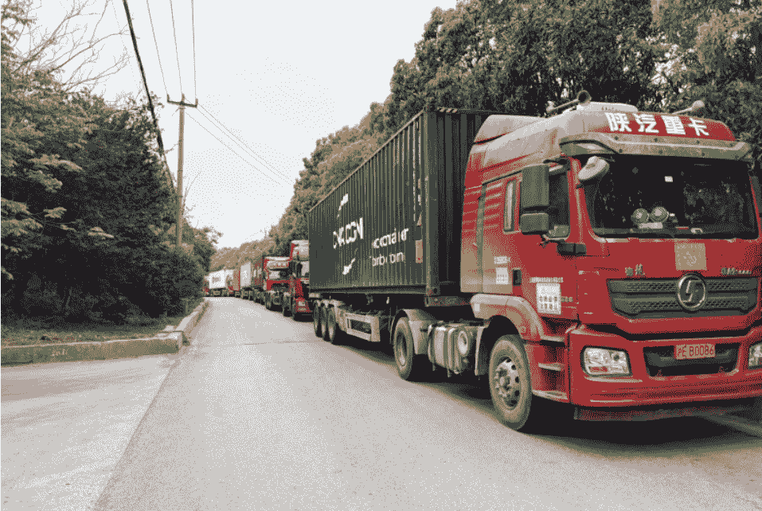

# CAIXIN| 听文章

封面报道之一 | 关税战停火

文 | 财经周刊 冯亚铭 卢羽桐 包云红 罗国平

等泊数日的集装箱船重新靠港装货、贸易商假期取消、集卡司机等了久违的单子。

5月13日上午，在上海等货的集卡司机王师傅传捷了他在“五一”后的第一单——滞留在洋山保税区近一个月的一个大集装箱运到了洋山港。此前由于美国加征关税，很多报关完来得不及在4月9日船运出的集装箱被滞留在保税区堆场内。王师傅告诉财新，由于货源很多，4月平均每周都能跑一趟，在美国多次关税加征前，他一般两三天就能接一单活。

5月12日，中美两国发布贸易联合声明（下称“联合声明”）。消息传出，被美国关税和中国反制“冰冻”了足月的港口与船舶迅速恢复热闹起来。

这份联合声明显示：90天内，特朗普第二个任期对中国加征的关税率从此前的145%降至30%；对美国商品的关税率从此前的125%降至10%。同时，特朗普签署命令，美国对于来自中国的小件包裹征收的从价关税率从此前的120%调至54%；原计划在6月1日生效的固定从量关税调整至200美元的措施予以取消，维持在当前的100美元，并调整为5月14日生效。

“当时就被拆散了，很多出口美国的客户在询问出货、运价和关税节点问题。”联合声明发布后，一名直运企业负责人告诉财新，许多负责美线的操作员被通知结束假期，周末回来上班。

全球最大集装箱航运公司中远海（MSC）旗下的集装箱船舶MSC IVANA，于5月12日17时左右靠上海洋山港开始装货。该船在5月3日从美国洛杉矶返回中国海域，由于无货可运，在长江口外锚等泊。

一名上海港码头人员告财新，现在不少于停航在海外地的美线集装箱已准备靠泊装货，港口也在它们预留泊位，但此次复开美线的船量比关税前少得多。“船在等货，很多货代目前要解决组织资源的问题，当货重新多起来，航线船期会完全恢复。

“但由于货量快速增加，从美国回来的空箱亦未及调度，两个因素叠加后，中国港口开始‘一箱连求、一仓连求’。”据Jefferies5月13日发布的报告，在声明中宣布中国供应商已开始重启订单，跨太平洋航运费从4月中旬的每40英尺标准箱2000美元运速跃升至2500美元。

从特朗普加全球关税、对中国加关税“三连跑”，到中国反制回应，应对双方谈判、涨关税……一系列冲击世界贸易格局的变动，被压缩在短短40天内。而特朗普第一期对华发起贸易战，中美双方经历23个月、后14轮谈判达成第一阶段经营协议。

美国国内市场缺货、跨国公司缺原料以及商品价格上涨带来的通胀压力等预期效果，显然超出了特朗普政府的政策。“特朗普的客户已经非常焦虑。”穆龙生表示，中国公司家具、牙线等产品，失去中国工厂的供应后，其客户的部分货架已处于处置状态，有的客户在上述声明发布之前就已按不住，不得不顶着高关税下单。

终端消费品、小商品、汽车零部件等商品在迅速恢复出口贸易，许多消费品外商在联合声明发布当日就对外表示“将恢复对出口”。稀土等关键矿产的出口管制已正常恢复，5月14日，有稀土材料向财新证实，已获单次出口许可。然而，铜、铝等大宗商品仍面临美国对全球普遍征收的惩罚性关税，市场情绪浓厚。

另一边，经历两轮贸易战，面对反复无常的特朗普政策，中国工厂渠道商、贸易商对拓展内销、另寻海外市场的紧迫性有了深刻的认知。

“未来我们在美国市场不会花费太多精力去开发新客户，现有客户继续做。”江华个人用品公司国内事业部总经理龙龙表示，接下来会投入更多精力放在深挖国内市场、拓展欧美等非美国市场。

在关税高压下的3月、4月，中国对美出口同比先后下降，体现了从“抢出口”到“抢口”的逻辑转变。4月，中国对美出口总量400亿美元，同比下降15%；与此同时，4月中国出口总量同比增长10%，超出预期。华泰证券指出，4月，中国对美出口回落，而对东盟、拉美等出口增长，基本抵消了美国出口的拖累。4月，中国出口增速最快的是中性消费品，分别为8.5%、12%。国金证券指出：“中国在加大出海力度，回避美国的直接关税，4月出口数据主要支撑。”相比之下，中国对美出口恢复还需要时间。2月到3月，中国对美出口两次加征关税，涉及农产品、能源等领域，美国本土并未取消这块关税，而中国正在全球替代供应链。

# 出口抢口

中美联合声明发布后，产业界迅速行动，此前一度停滞的美国出口恢复。5月13日，上海威达集团（SZ）出口港务总经理黄勇称，许多出口企业在加征期间，中小企业没有实力说“他们停止生产，差不多需要一个月，到6月中旬才会开始出货。”未能在高关税窗口期完成履约的美国订单激增。据中信证券显示，美对华部分商品类税率高达：
- 终端消费品高达60%。
- 电气设备高达45.3%。
- 纺织服装高达49%。
- 金属、轻制造高达48.8%。
- 电子类高达36.9%。
- 车辆高达35%。

考虑到90天窗口期可能等到关闭，美国对华出口订单又要一路抢货。目前，该公司的美国销售占比50%，税率从此前的53.8%降至38.8%。美国客户开启新一轮围购。深圳市麦佳家居有限公司总经理王莉表示，客户在一个季节下的订单货物一直放在仓库内未出货，本次关税调降后，客户希望一两周内全部出货。同时新的订单与去年同期相同，但由于抢口，阿里国际接到了超过100万的急单，订单数量明显增大，“大家都在抢购，把‘黑五’甚至圣诞节前旺季的货物补足。”义乌市瑞文出口有限公司总经理吴庆庆，她的美国客户采购了倍倍订单，“客户可能是想多一些货，避免90天后出现新的危机”。这一波补货和围购潮下，阿里国际紧急推出了美国专属专场。2025年5月15日，浙江义乌，义乌国际贸易城商户在整理圣诞帽。图：王刚/中新社/视觉

新关税下，中美贸易的博弈仍在继续。温州德赛集团总经理朱文对贸易表示，公司计划恢复对美出口，鞋类商品经历两轮加征关税后总体税率达46%，新的关税成本如何分摊，他仍在客户协商。对于本利润不高或替代性差的品类，此轮加征关税的成本主要由美国贸易商负担，后者的利润长期高于中国厂家。主营服装类的飞腾科技有限公司负责人杨洛告诉财新，已经告知美国客户在中国仓库滞留的大批货物可以出货，对于新的关税成本双方尚未讨论：“正常是要求客户承担的，因为我们的美国订单利润不高；对大客户，我们会相应承担一部分。”汕头市飞腾科技有限公司负责人吴裕畅告诉财新，关税成本将全部由其美国客户承担。该公司主营服装外，产品出口并没有受到美国的影响，即使在高阶段依然正常出货，订单在稳定增长。他指出，美国各州都拥有关税的征收权，此前加州拒绝对中国一步步加税，因此公司的货物选择运到洛杉矶港。他预计，关税降低后，订单会进一步增长，美国的大客户目前还在观望状态：“之前我们在价格上让了几个百分点帮助美国客户应对高关税，现在关税涨到30%不用让了。”

Counterpoint资深分析师Lvan Lam对财经表示，消费电子产品的供应链大多为长期订单，但中美客户还不敢下长期单：“这90天内还要继续下去，就是订单不会激进，一怕订单太大翻脸太，后续付款有问题？二怕订单太多，当地需求下行而导致库存。”

Lvan Lam认为，相较此前高关税许多企业没有订单的情况，这次互关税必然带来订单恢复；但此前高关税带来的影响不会暂时暂停，同时造成的损失会让未来的价格调控上出现慢涨。关税率从前的120%回到54%，还会减缓。一名资深跨境电商人士对财经表示，关税的终结会让生态的改变是革命性的，“Temu、SHEIN、AliExpress的崛起之路都被切断了。关税后，跨境电商转向通过美国本土仓（Local Warehouse）直接发货。”

# 非美+内贸趋势

关税战后，中国对外出口经历了一波周期。对于而言，寻求其他市场是必然趋势。中信建报告指出，中国对美出口规模受关税影响，4月PMI（采购经理指数）走弱，这表明中国生产、就业在90天免税期内出现快速下滑。中国企业将库存转移至东南亚等地。中国商务部部门提出，帮助外贸企业拓展渠道、举办展销会、开辟专区、对接国内需求。截至4月23日，9家电商平台开放绿色通道，对接6000家外贸企业，链上都希望延长库存，以应对美国市场的变幻莫测。

关税战后，跨境电商平台缩减了美国广告投放，加大欧洲、巴西等地投放。市场机构Sensor Tower数据显示，2025年4月，两家跨境平台效果也明显，SHEIN在这两个国家环比增长35%，Temu分别增长40%和20%。英国下载量环比增长25%，Temu则1倍以上。此外，SHEIN在巴西市场的广告支出也同比增长40%；Temu则是去年同期的800倍。巴西站于去年6月正式上线，4月是宣传期。

TikTok Shop也在加速向跨境电商商家推销美国以外的市场。2025年4月，TikTok Shop正式面向跨境电商商家开放西班牙、德国、意大利等市场，接受亚马逊、eBay、Wayfair等第三方平台经验的商家入驻，并强调支持符合条件的美国商家入驻。5月，TikTok Shop启动日本内测，6月正式开放运营。5月10日，阿里巴巴集团董事蔡崇信在“50阿里日”亲友见面会上表示，他最近在海外市场花了很多时间，尤其是欧洲。

丁林告诉财新，阿里国际站跨境客户的信息，称国际站近期会加大欧洲市场的广告投入，自己的公司也将跟随。丁枫的公司早已认识到美国市场的风险，在三年前就开始寻找第二增长曲线，布局澳洲、亚洲、中东市场。对于欧洲这种一品类，美国家虽是第一市场，需要维持销售量：“美国市场有1000万房车的保有量，而整个中国市场加起来可能不到10万。”

主营家用品的王世也称，其目标是将美国市场销售额占比至30%以内，而是首选欧洲和南美市场。该公司客户主要是亚马逊欧洲站点的商家，而南美市场去年开始快速增长。王莉称，她将通过阿里国际站投放、邮件、谷歌等社交营销，转向欧洲和南美市场。

与此同时，阿里赢得胜利后，该公司将转向国内市场的计划也提前提了：“公司的战略是在海外市场有一定品牌力后转向国内，这样不用跟国内行‘卷’低价。”

对于外贸商家，国内市场面临“内卷”。穆龙生表示，国内毛利比国外至少5个百分点。此外，国内订单量很大，一个柜几十万，收款账期更短。

内外贸易切换时，工厂需要面对国内完全不同的需求。保温杯厂家浙江麦勃有限公司位于浙江省武义县，是外贸导向的五金产品。公司总经理博文祈，关税战之前已经尝试拓展国内市场，推出自有品牌；关税后，国内业务成为公司重点，组建熟悉国内市场和需求的团队。他从从海外回国不容易，国内市场的用户和喜好存在差异；美国消费者买保温杯是要保湿，而中国肯定要兼顾保湿；配色方面，相比美国消费者，中国消费者的需求也更多元。

这次贸易战会让很多老板思考，过去工厂可能通过几个客户代理就可以，订单集中，风险也集中。没有自有品牌，工厂的话气不强。“张文涵经理表示，这次贸易战，反而说明我们创造了从工厂到‘品牌’的转型机会。”

全球重心落在乌义。2024年，乌义“一带一路”沿线国家出口1334.0亿元，同比增长18.2%，整体出口值的66.1%。乌义国际商城有3000余商参与美国贸易，其中100家占比3.3%。乌义市瑞鹏出口有限公司张建民希望以贸易商向工厂转型，并将出口业务从美国拓展至中东、欧洲和国内。他回忆，之前的美国客户主要要做超市中低价、走量的香水产品，上一轮贸易战中闭了，随后他们找到了高端香水的客户，积累了ODM经验。接下来打算建工厂，利用现有的采购渠道做深：“之前只能做美国的生意（建工厂之后就可以做全球生意了。”

# 供应链修复

终端品之外，中国对美国出口的原材料大宗商品和供应链商品的恢复对延迟，亦面临中期挑战。

根据中国海关数据，2024年，中国向美国出口电机电器零件和机械器具及其零配件的占比分别为24%和17.6%，为前大出口类。这两也被划入大宗钢铁出口。

而钢铁等领域已经经历“双反”（反倾销和反补贴）、“301调查”“232调查”、方位尼等多种、多重关税压力。目前，输美钢铝产品关税至少在45%，多数在70%以上；算上“双反”，甚至有些产品的税率超过40%。

一直是中国锂电池最大出口国，2024年占中国电池出口总量的25%，出口额153.15亿美元。同年，中国光伏主材对美国合计出口额为2.15亿美元，占出口额的0.65%。汽车共出口11.6万辆到美国，占中国整车出口总量的1.8%，新能源汽车对美国出口较少。

美国是中国之外第一大电池市场，但在特朗普层层关税之下，中国出口压力加大。中国海关总署数据显示，2025年2月，美国从中国采购的锂电池总金额被美国超过，为五年来首次退居次席，并在3月延续这一态势，当月采购额较少减少了14%。

很多储能电池厂商对美国市场是半放弃的状态。“一名中国电池企业业务负责人表示，售往美国的储能产品大多是DDP（Delivered Duty Paid，报税交货）模式，进口关税内的费用由卖方负责。加征200%关税后，税费早已超过了之前签署的接受范围。

中美双向降低关税后，锂电池关税从173.4%下调至58.4%，非用车锂电池关税从156%下降至40.9%，锂电池行业看到转机。

“我下月准备去美国（跟客户）再聊。”上人士看到中美合作声明后兴奋报告财新，此前由于关于锂电政策和地缘政治波动，他已停止美国市场拓展。

市场普遍预计，在90天窗口期内，中国对美电池出口可能快速上升。伊维经经济院长院长长辉获崭财新，考虑到特朗普政策变动大，关税下调刺激企业“抢购”，今年、三季度的中国对美锂出口或明显增长。

吴辉提醒，由于中国占据了全球动力电池产能，磷酸铁锂电池当前只有中国企业产量，美国市场没有供应链替代选择：“等日本、韩国电电池在美工厂投放后，美国企业的供应选择增多，届时对华关税的影响将会更有实感，中国电池出口会受到更多挑战。”典型案例是，韩国锂电池企业LG新能源年底底，将于今年启动磷酸铁锂电池生产，比此前规划提早了一年，以在中关税中抢抓美国订单。
2024年，LG新能源的全球出货量仅次于中国宁德时代（300750.SZ）和比亚迪。

地缘政治动荡，中国企业对美国市场的态度趋向谨慎。考虑到风险，国际化程度最高的锂电龙头宁德时代在美国未建实际产能，均以贸易方式引入，以技术合作伙伴与中国企业合作。宁德时代与美国福特汽车在密歇州的锂电电池工厂2023年启动产能便遭遇美国民众的三轮问询，两次暂停建设，储能电池在美国海军基地也因民众的反对而被暂停使用。

“周围同事都没有去过美国建厂的打算。”上锂负责人表示，当地政治风险太高、不确定性太大，都是阻碍企业投资美国的原因。

目前，行业希望建立本土供应链，但动力电池、消费电池的关键原材料——稀土大量进口自中国。中美贸易战升级后，中国商务部、海关总署于4月4日对�、、、镓、钨、镁等7类重稀相关物实施出口管制措施，并于当日正式实施。稀土元素共有17种，可分为轻、中、重稀土三大类，中、重稀土资源更为匮缺，同时用于航空、国防等高科技领域更具价值，近年来处于供应相对紧张的状态。

中美贸易谈后，中国国内企业发布了首批控管金属的出口许可证，对外出口恢复。5月14日，包头天和磁磁股份有限公司（603072.SH，称“天和磁磁”）一名负责人告诉媒体，公司按需向商务部提交，近日收到了一批稀土出口许可证。该人士表示，由于每批货物的金属含量有所不同，其出口实施“一批一证”管理。天和磁磁总部位于蒙古包头，国内头部高性能稀土永磁材料提供商，终端用户主要为新能源汽车及零部件公司，包括大众汽车集团、宝马、博世等。

同日，两家国内稀土永磁材料生产商包头市英思特稀磁新材料有限公司（301622.SZ）、安徽大地瀚新材料股份有限公司（688077.SH）也向商务部实证，近日获得了部分许可证，相关流程进展顺利。

## 从美进口待复苏

与中国紧急恢复对美出口不同，从进口商品并未立刻复苏。

美国是中国美国大豆、棉花的第一大出口市场；集成电路、煤的第二大出口市场；医疗器械、石油、汽车的第三大出口市场。根据联合国数据，2024年美国出口中51.7%的大豆、29.7%的棉花、17.2%的集成电路、10.7%的煤、10.0%的石油、9.4%的医疗器械、8.3%的载人机出口中国。

中国在2月、3月对美国部分重点商品加税，以反制美国对华加征的“芬太尼关税”。2月4日，国务院关税规则委员会发布公告，对原产于美国的油、农业机械、大排量汽车、皮卡加征10%关税，对液化天然气（LNG）、煤炭加征15%关税。联合声明发布后，中国保留了25%关税，目前中国对美国LNG、煤炭加征20%关税，执行90天。

月初，中国对美国部分豆类、小麦、棉花加征15%关税；对美国大豆、猪肉、水果、蔬菜、乳制品加征10%关税。

4月28日，国家发展改革副主任赵昕在新闻发布会上指出，2024年，来自美国的高粱、玉米、大豆等占比很低，而且基本都是饲料，替代性强，同时中国储备资源充足。即使不购买美国的饲料和油脂，我国供应也不会影响。
2025年4月28日，伊利诺伊州丹达特兄弟一起使用种植机，去年出口了约85亿美元，其中大豆超过40%。

能源方面，中国已形成油、气、核以及再生能源多元化供应体系，目前从美国进口能源至少停止了。赵昕表示，我国能源供应没有影响。

5月14日，外交部发言人汪强调，美方以芬太尼为借口，中国第一时间采取包括关税在内的反制措施，这些反制措施仍然有效。

反制影响最大的能源是LNG。得益于页岩技术突破，美国自2018年起连续六年成为全球第一出口国，2023年和2024年都是全球最大进口国，但中国对美国依赖依然很大。Kpler数据显示，2025年2月到4月，中国进口美国LNG665万吨，同比下降9%。自首轮关税降至25%之后，贸易流向已改变，大量美国转运到欧洲等区域，中国买家仍处境尴尬。徐绍解释称，在没有完全妥协的情况下，中国买家已放弃美国作为可靠的长期来源。在贸易战局势下，中国企业加速与美国供应商签署新的长期采购协议（SPA），数量可满足中国未来五年83%—90%的需求。

徐绍指出，长期来看，全球LNG市场将进入进口渴求，现货价格走弱。这意味着中国买家在供应已有保障的前提下，拥有更大的灵活性来优化现货采购，弱化对特定供应依赖。

原油市场，中化能源高级经济学家王滨波介绍，原油流动性很好，全球油价差不大。这意味着在被加征20%“芬太尼税”后，美国原油对中国买家缺少吸引力。Kpler数据显示，2025年2月至4月，中国进口美国原油分别为41.2万、28.5万、40.4万，同比下降63.9%、66.8%、67.5%。3月和4月，中国没有油轮运往中国，到5月才有恢复。

不在中国反制名单上的液化石油（LPG）进口稳定。2024年中国进口3568万吨LPG中，超过一半来自美国。2025年2月到4月，中国进口美国LNG18万吨，与2024年同期持平。

煤炭领域，2024年，中国自美国进口炼焦与烟煤62.37万吨，占中国煤炭进口总量的1.53%；对应进口金额1.3亿美元，占中国煤炭进口金额的2.55%。中信期货煤炭分析师张默涵介绍，当前全球煤炭需求疲软，供需宽松，国内港口高库存难以消化，此番降低关税对进口煤炭的刺激影响有限。

此外，美国关税引发市场担忧全球经济及原油需求前景，导致油价大跌。美国WTI原油主力期货合约价格从4月2日特朗普向全球宣布“对等关税”前的71美元/桶，跌至目前的61美元/桶，下跌14%；此最低跌至55美元/桶。

当前中美宣布互免关税，这将有利于全球经济及航运市场恢复，预计有利于石油气消费。同时也强调，90天窗口期后加征24%关税的风险仍然，还有美国港口对中国船（包括造船舶）收费等问题，仍需等待进一步谈判的结果。

中美农产品贸易往来恢复也有观望。一名美国进口商对新表表示，在中国3月对美国农产品加税后，他就停止了从美国做生意。短期来看，中国从美国进口农产品缺口可以从巴西或黑海地区补充。根据阿格斯追踪，2024年，中国自美国进口大豆3360万吨，同比增长18%。22%是由于2025年年初关税下降导致的断崖式下跌。目前数据显示，中国自美国进口大豆3360万吨，环比减少42%。

由于关税下降，中国从美国进口大豆、玉米、小麦三类谷物大幅减少，20%是由于今年关税下降引发的。

更多报道详见：【专题】关税

## 最新周刊 | 特朗普重创科学界

CAIX 讯 | 撰文 | 林逸（Jay Yi）

“每天早上睁眼看看美国科研体系正在重创。”林逸接受采访时，这并非个例。1月20日特朗普刚上任第一天，美国政府发布一系列行政命令，重新分配科研经费。在两届任期中，美国政府通过大规模冻结、削减经费、压缩成本、终止科研项目、拦截人员等等措，使科学界陷入持续动荡，正常科研活动受到严重冲击。直接遭受的是生物医药、气候变化、性别与多样性、病毒研究等领域，美国国家科学院、工程院、医学院等1900余成员担心，之前拿到的机会会被无故撤销。

除了冻结资金，当月起特朗普陆续落实多项行政命令，要求联邦机构对资助项目进行“意识形态合规性审查”。此类审查在NIH、NSF拨款决策流程中已成为常规步骤。在美国国家医药公司工作人员告诉财新，他们的研究项目现在不能提到群体多样性等方面的内容。

1月27日，NIH大部分预算被冻结，总额达470亿美元。虽然之后通过法律诉讼解冻了部分资金，但拨款程序依然停滞。

人事变动在特朗普上任第一周就发生。离职第三天的17日，拜登政府提名的NIH院长莫妮卡·贝格塔诺利（Monica Bertagnoli）辞职。被名为监督NIH的部长，他是美国司法部长罗伯特·肯尼迪（Robert Kennedy Jr.）的儿子，也是美国前总统约翰·肯尼迪的儿子。

小肯尼迪有着“疫苗反对者”之称。自2005年开始，他长期质疑疫苗的安全性，在近期美国发生的麻疹疫情中，他声称麻疹疫苗含有“芬太尼”。

5月2日，特朗普政府又提出将2026财年非国防自由支出削减23%，即削减163亿美元。其中NIH的预算从2025财年的48亿美元减至2026财年的300亿美元；NSF的预算减半，从100亿美元减至50亿美元；而NASA的预算在188亿美元，缩减24%。NASA今后的任务几乎专注于把人送上月球和火星，减少在太空科学、地球观测等项目的资金。同时，特朗普政府大幅增加国防和国土安全支出。

美国科研机构与科研人才的遭遇将雪上加霜，这或许将重塑全球格局。

## NIH：拨款冻结，成本压缩

1月20日特朗普刚上任，NIH就接来当头棒。彼时美国卫生与公众服务部（HHS）下令“暂停”27个研究所和中心。作为联邦政府下属的国家医学研究机构，NIH隶属于卫生部。

对曾因预算拨款案在国会产生困难而暂停的美国行政机构来说，短暂的新闻发布并不罕见，但这次NIH暂停的范围不止于此：其负责拨款项目和评审的科学家出席公开会议等事项均被暂停，内部科学家和工作人员被告知招聘、采购和差旅等被冻结。几天后的1月27日，NIH的所有拨款都被冻结。

在特朗普的第一任期，美国政府曾试图资助福格国际中心（Center for Global Health）。该中心于2017财年获得了NIH331亿美元预算的0.2%。2018年，来自南非、中国、美国等多个国的顶尖科学家在《柳叶刀》上联合发表，提出当时特朗普政府的拟议预算：彻底取消福格国际中心的资助将对全球健康长久发展带来威胁，危及多个正在进行的项目，并影响未来合作。这篇文章的作者均为福格对全球健康学者计划的合作伙伴，包括2024年拉斯拉斯奖公共服务得主、南非艾滋兹研究中心主任丹萨莉姆（Dafnasah Salim）、阿托杜·卡玛莉（S. Aldoob Karim）。

当时，得益于国会对预算的决定性地位，NIH实际获得的预算不下降，福格国际中心也“幸于难”。但对该中心在特朗普第二任期的命运，卡玛姆持反对意见。他在接受采访时提到，特朗普在第一任期仍然承认国会对预算事务决策中的作用，但第二任期的特朗普对很多事情都认为可以资助。比如，美国国际开发署（USAID）的国际资金是宪法拨款使用的，他们必须遵守法律要求，将当前的拨付资金用完。如果特朗普政府要改变这些资金的用途，必须要求国会对一项新立法进行投票消除之前的规定。

“特朗普政府的意，从法律上来说，他也可以这样做。因为共和党在众院中也占多数。”卡玛姆说。另一方面，福格国际中心刚刚经历了领导层更换，尚未任命新主任，实际处于“真空状态”，没有任何或或许都可能决定它的未来。

除福格国际中心外，其他对全球健康挑战也将受到影响，包括对新发传染病、艾滋病和肺炎的研究。值得一提的是，特朗普在上个任期曾于2017年提出削减NIH的经费12.3亿美元，其中就将全球艾滋病毒应对援助计划（PEPFAR）资金削减3亿美元。

卡玛姆绍，以往各机构可以向NIH提交申请，比如可以开展一项关于乳腺癌的研究，并纳入某些国家的医院研究人员参与，机构直接为该国家研究人员提供资金支持。也就是说从NIH获得拨款后，通过合同的方式将部分资金转给其他国家的研究人员以开展研究。“就在上周，NIH宣布不再允许分包。也就是说，未来美国机构申请NIH的研究资金所获得的资金必须用于美国境内，不允许将资金用于海外支出。”他说，这一新政策对未来的项目产生巨大影响。

## NSF: 经费砍半

与美国国立卫生研究院（NIH）的命运相似，2025年开始，国家科学基金会（NSF）也经历了“上世纪70年代以来最严重的制度性震荡”。NSF是美国非医学基础科学的主力资助机构，每年获得拨款总额约90亿美元，资助全美高校约四分之一的基础研究工作。目前NSF同样遭遇了项目取消、裁员和政策突变。

据美国学会新闻部的报道，4月21日至5月2日不到半个月时间，NSF已经终止了1042项有效资助，涉及金额达7.39亿美元。此前的4月18日，NSF已终止约400项资助。据《自然》杂志报道，NSF于5月初暂停资助新研究，并指示对某些课题和活动进行筛选。根据共享研究的非营利组织OpenSci，NSF很多被取消的项目涉及重点均包括改善科学教育和早期研究人员培训计划。

综合多方人员述，NSF资助结束主要是因为特朗普针对多样性、公平性和包容性工作框架（DEI）下达的行政令。DEI框架旨在促进对所有人公平对待和充分参与，特别是历史上代表性不足的群体，以及身份或残疾受到歧视的群体。

1月21日，特朗普签署指令，全面终止美国联邦政府及其承包商中的DEI政策，并取消基于种族、性别等因素的优待措施；要求各联邦机构终止所有与DEI相关的项目和职位，并终止联邦承包商的平权行动。

1月23日，白宫要求冻结资金，对所有联邦机构的拨款和贷款进行DEI审查，涉及NSF等机构。经过几天的混乱，两名法官介入，政府取消了冻结。2月初，NSF开始恢复发放拨款，但NSF内部拨款机制并未恢复。

2月18日，NSF宣布裁员约10%的员工，共计168人。表面上裁员的是处于试用期的临时顾问，媒体报道，许多被裁的人员已在NSF工作多年，仅在一个月前变为“临时使用”，此举被质疑为绕开正常程序设下的“陷阱”。气候变化、性别研究、跨国数据伦理等问题被特朗普认为，因此政府在预算案中大幅削减NSF对气候、清洁能源、社会科学、行为研究等资金，并特别取消了涉及社会公正、多元性与包容性以及STEM（科学、技术、工程和数学）的项目。

月中旬，NSF终止了咨询委员会的运作，以响应特朗普缩减联邦政府规模的行政令，包括物理、地球科学和STEM教育部门的咨询委员会仅剩下5个。4月下旬，NSF终止了数百项研究拨款，总额超过23亿美元。公开显示，被取消的项目但不限于涉及DEI及“虚假信息”的研究、行为与认知科学、计算机与网络以及STEM卓越项目。

4月25日，NSF发布公告，称于2026年8月到期的NSF主任赛斯图曼（Sethuraman）提前离职。2014年，时任总统奥巴马提名赛斯图曼加入国家科学委员会；2019年，时任总统特朗普提名担任NSF主任，于2020年6月成立技术、创新与合作事务局（TIP）。“我相信，我已经尽能推进了该机构的关键使命，时候将接力棒交给领导人了。”赛斯图曼在辞职信中写道。赛斯图曼辞职后，NSF提供了“延期协议”，即员工可以选择继续领取薪水。NSF警告，随着机构重组和预算调整，未来的职业机会将受到限制。这意味着其员工可能面临更严峻的就业环境。这一做法引发了员工不满。国际科研合作极度依赖稳定性和经费贯性。过去几个月里，NSF的对外资助也因上述因素几乎陷入停滞，包括国际研究与教育伙伴计划（PIRE）、加速研究网络计划（AccelNet）与国际研究体验（IRES）等多个国际合作框架项目均前途未卜；参与镜建造、极地观测和跨国数据系统搭建正在陆续停止，美国加拿大的AI和量子科技合作也在削减列表中。

白宫预算办公室公布的数据显示，当前的财政年度，截至目前NSF仅获得了国会已批准预算额度的四分之一。美国国会尚未就2025财年联邦预算达成协议，NSF等机构必须在“持续决议”的框架下维持最小运营规模。

耶鲁大学传染病建模专家卡尔·卡森（Colin Carlson）牵头的病毒预测网络项目由NSF资助，规模为五年总额1250万美元，该网络跨越多个国家的高校、实验室与公共卫生机构。“即便这笔拨款已签发完成，但后续更新完全看不到任何希望。”卡森表示，“一旦资金链断裂，项目团队的实验室与数据系统将无法运转，国际化的协调也将迅速瓦解。”

面对开发限制，NSF可能放弃30米望远镜或巨型望远镜中的一个。麦霍伦望远镜是位于拉斯拉斯哈纳天文台的两台6.5米光学望远镜，由华盛顿卡尔基研究院与亚利桑那大、哈佛大学、密歇根、麻省理工学院合作建造。位于夏威夷基山的30米望远镜项目是一项巨大的国际合作项目，主要伙伴包括加州理工学院、加州大学系统、加拿大天文协会、日本国立天文台、印度国家科学技术部以及中国科学院天文。

5月2日，特朗普政府提交的新财年预算案，NSF的预算从约100亿美元缩减至50亿美元，气候科学、清洁能源及社会科学成为重点削减领域。旨在促进弱势群体参与科学的项目资金将减少1亿美元，环比减少80%。人工智能和量子科学维持不变。

## 或将重全球科研机构

特朗普政府提交给国会的预算草案提出对美国联邦科研机构的支出进一步削减，该预算案需等待国会批准后执行。削减23%，在总计7万亿美元的联邦支出中，包括民用科学资金在内15%的部分被削减。预算案要求非国防可支配支出削减23%，即1630亿美元。同时，该提案要求在2026财年大幅增加国防和国土安全支出。除了NIH和NSF是削减的重灾区，NASA的支出也将削减24%，尽管对太空探索任务支出增加，但对空间科学、地球科学等领域削减。据称这是为了NASA不需要更适合私营部门研发。

上一任期，特朗普政府再度提出预算要求削减联邦科研机构22%。不过彼时美国国会拒绝采纳该方案，NIH实际获得总额约39亿美元，同比增长9%。上月底，一封公开函显示，特朗普政府大幅削减科研经费，阻碍国际科研合作；许多雇佣科研人员因失去资金而离开美国。

特朗普政府的削减打击引发了学术界的强烈反弹。由于美国科学院、工程院、医院等许多科研人员放弃自己的名字从出版物上删除。这封公开信中写道：“科学界一些人发出了强烈抗议，但大多数大学、科研机构和专业组织保持沉默，因政策变动导致人才奔赴海外，或重塑全球大局。”

《自然》杂志显示，2025年3月的调查，1650名受访科学家中，75%的人考虑离开美国，其中青年人员占比突出：690名受访科学家中有548人考虑离开海外职位；平台数据显示，另有340名博士海外申请数量同比增长35%。

5月5日，欧盟举行“选择欧洲”（Choose Europe for Science）会议，并在会上宣布总规模达5亿元的激励措施，吸引国际学者来欧洲。欧盟委员会主席冯德莱恩出席了会议。欧洲研究理事会考虑增加预算一倍，达到每位申请人20万欧元额度。法国总统奥兰德（Hollande）月中旬表示，他向法国国民会议提交了一份议案，旨在设立“科学难民”身份，欢迎那些在本国受威胁的研究人员来法国。“设立这一身份比提供保护更有效，让我们行动起来。”奥兰德说。法国南部的艾克斯-马赛大学对此议案表示支持，该校对于3月7日启动了一项500万欧元的“安全空间”计划，以期为这些科研人员提供具有难民身份的科学签证，允许他们在法国继续研究。校方表示已收到来自NASA和斯坦福大学等20名研究人员的申请。

“美国国内的发展非常常态，但我们对其他国家的前景持乐观态度。美国对其他国家的影响仅限于提供资金支持，这一点也很清楚。对全球其他国家来说，这是一个机会，可以让国家建立新的联盟，与不同的伙伴合作，并摆脱对美国的依赖。”卡玛姆表示，“我们必须继续合作，无论美国是否参与。”

CAIXIN| 听文章
文 | 财新周刊 王小青发自香港

美国总统特朗普第二任期开展以来，“从对等关税”开场，到与英国、中国先后取得初步阶段贸易共识，再至特朗普减税法案披露，一系列新政让资本市场如同坐上过山车。投资者需要时刻紧绷神经，每天关注特朗普的话语。“这种情况糟透了，就像回到了几年前——特朗普的第一任期。”纽约和香港的基金经理都这样抱怨道。

2025年5月2日，《中美贸易会谈声明》（简称《联合声明》）发布，为避险情绪浓厚的市场注入一针缓解剂，风险资产重新抬头，资金利机而动。麦朴思新兴市场基金主马克·麦朴思（Mark Mobius）对特朗普新称，近期逐步增加投资，只是节奏缓慢、步调稳健，“为特朗普的行为太难以预测！”他在4月下旬曾对彭博透露，其基金95%全是美金。

美国投行高盛于5月12日调低了2025年经济衰退的概率，由45%降至35%，并将标500指数的3个月目标从5700点上调至约5900点，12个月的目标从6200点上调至6500点，反映了对美国经济前景的乐观。但这种乐观持续多久，投资者难以判断。在“特朗普2.0”时代开启后，市场景线从AI、DeepSeek等引领的全球竞争转为虚幻。在《联合声明》发布后，《自然》文章称，人们需要区分日常视角与应对地缘政治重大变化的根本问题，地缘政治恶化中，美国政府及其右翼力量的影响。

环球投资基金（CAI）首席投资监陈强形容，当前美国面临“特里芬难题”（Triffin’s Dilemma），指美元作为主权货币必须面临供给和稳定性的矛盾。而“修昔陷阱”（Thucydides Trap）指的是大国之间战略冲突引起实力消耗的理论。在短期内，投资者必须适应不确定性，调整心态，在资产类别、区域三个维度上多元化部署，以风险最小化。亚洲首席策略师李振豪认为，“对等关税”发布导致资金流出中国股票，被动基金流出速度放缓，主动基金参与者发现回流速度可能提升。

“去美元化”是否重回美国资产立场？全球资管公司骏利亨德森投资（Janus Henderson Investors）行政总裁Al Dibaj接受财新采访时指出，“美国例外论”（指美国的经济、政治和美元具备独特优势，使其在全球周期中持续跑赢其他市场）被打破，该机构旗下管理资产（AM）中约10%的资金从美国资产转出。目前美债价格重新回稳，运行技术性牛市；4月7日—11日创2001年以来最大单周涨幅，10期美国国债收益率重新回稳；跌98关口的美元指数（DXY）也反弹至100以上。“特朗普2.0”以来，投资者警惕美国单边押汇“三杀”就是其中一个范例：作为风险资产的美股市场恐慌遭遇抛售，美元利差优势未能将资金充分吸入。新加坡银行外汇策略师陆宪雄指出，特朗普政府的经济及外交政策引发结构性忧，动摇了市场对美国作为稳定基地的信心。万国资本董事、基金经理洛洁接受财新专访时表示，已建议客户尽可能减少对美国资产的持仓。美国能否实现特朗普政府所追求的再工业化，是当前考虑是否配置美国资产要回答的最终问题。如果答案是肯定的，投资者自然不乏“早鸟价”提前进场；但是以目前特朗普政府表现出来的执行能力，反而要防范一场“可能已在路上”的金融危机”。李振豪，美国后期工业化是特朗普通过关税手段想切入的正题。特朗普吸引高端制造业回流美国的态度十分坚决，关税后将立即缓减税措施增加在美国设厂的吸引力，后续将继续施压美联崩盘、美债溃。在他看来，“美元化”在早期不必担心发生美债危机。香港金管局总裁裁伟表示，目前美债是流动性最高的资产，各政府储备央也有近七以此美元计价，即使分散投资也需要，预计未来一段时间美元仍然主要的储备资产。星复资本控股行董事辛亦坦及客户配置收资产时坦言，无论是欧洲债券、日本债券还是亚洲其他地区债券，流动性和美债根本不具可比性。另外，回归利率基本面，美债的吸引力也非其他市场债券可比。

在美银证券2025年4月—5月的基金经理调查中，做黄金连续两个月成为市场中最拥挤的交易，这一“避险天堂”的场费也水涨船高。黄金5月14日收报3177美元/盎司，较高抬逾9%。《联合声明》发布后，花旗将黄金未来三个月的目标价由3500美元/盎司调低至3150美元/盎司，并预计金黄金将在3000—3300美元/盎司区间整理。

“新债王”称号的DoubleLine行政总裁甘拉克（Jeffrey Gundlach）一直看好黄金走势，并预期金价将向望升至4000美元/盎司。

阿拉克担心的是，私募信贷（Private Credit）市场正在孕育新一波“次贷危机”：哈佛大学等美国高校为获取日常运营资金，可能不得不出售大学基金校友捐赠的私募股权和私募信贷资产；因私募信贷流动性较差，且已有劣级资产混合其中，可能造成危机。

邵浩一直坚定看好黄金，并认为目前风险抬头，恰是趁底买入黄金的好时机。“中长期黄金上的逻辑没有改变，一是美元的信贷问题，二是美国的债务问题已迫在眉睫。

以印度和中国为代表的亚洲地区，正在增加外汇储备中的黄金，这也成为黄金的有力支撑之一。印度在5月初发布的半年度外汇储备报告显示，按美元价值计算，截至2025年3月月底，印度外汇储备总额中的黄金占比升至11.7%，较2024年9月的9.32%增加2.38个百分点。中国国家外汇管理局发布的最新数据，2025年4月，中国央行连续六个月持黄金，以美元计，黄金储备占外汇储备总额的6.78%，创历史新。

避险的另一途径是现金。伯克希尔·哈撒韦公司董事长和首席执行官、“股神”沃伦·巴菲特在2025年5月3日的股东大会上宣布时，给他伯克希尔·哈撒韦的继任者阿贝尔留下了3477亿美元的现金储蓄。麦普此此前公开表示，旗下基金的备股、A股则现金高达95%。

现金以及现金等，包括美国短期国债、货币市场基金等类资金资产。美国投资公司协会（ICI）每周公布的统计数据，在2025年3月5日至4日的连续六周内，美国货币市场基金总规模均在创纪录的7万亿美元以上；截至5月7日的最新规模为6.95万亿美元。货币市场基金主要投资于短期、流动性高的优质证券，特点是风险低并能提供一定的收益率。

此外，在美国资产负债“三杀”时，瑞士得益于瑞士国家银行（SNB）的独立性，成为仅于黄金的资金避风港。自特朗普上任5月12日，瑞美元已升值7.4%。

## 配置区域多元化

“过去亚洲投资者配置股票，一般是美股加港、A股，现在认为欧洲、加拿大、英国、澳洲亚洲市场都可以看一看。”许长泰对财经说道。

面对市场高波动性，资产配置需涵盖多元化的板块和资产类别，用分散风险。许长泰提到，随着美国外交政策的改变，欧洲视美国的盟友关系更具“交易性”，故而在加强自身防防能力，带动欧洲军工相关行业的股票录得不俗表现。

全球资管公司柏桥投资（PineBridge Investment）也表示对欧洲前景更乐观，认为特朗普政府正迫使欧洲重新审视其在军事和基础设施方面的财政支出。尽管短期内经历阵痛，但欧盟在原有有裂痕的基础上被迫在贸易和支出问题上加强合作，可能最终带来更积极的结果。

熟悉欧洲市场的郭洛指出，除了中长期持续看好欧洲后，有条件的投资者也不妨配置权益类资产，买入并持有蓝筹股。

此时，国际资金也在增加亚洲和新兴市场的配置。丰富控股总总裁艾哲哲（Georges Etherdey）在4月底发布的业绩会上说，丰富财富管理的部分客户开始减少美国投资，并将资金转移到亚洲，包括中国内地和香港。2025年第一季度，丰富财富业务新增投资资产总值220亿美元，其中160亿美元投资在亚洲。

谈及国际投资者对亚洲的投资，不得不提巴非。巴非特主导伯马克尔-哈播尔公司于2019年买日本五大商社股票，推动日近年上涨。据2025年3月17日披露的日本财务文件，伯马克尔-哈播尔公司近期增持了伊藤忠事、三菱、三井物、住友商事和丸红五日本商事股票；除持伊藤忠事由7.47%提升至8.35%之后，其余四家持股比例超过90%。

贝莱德在5月12日的每周投资评论中，再次表达看好日本股票，由于通胀回升和有利于股东的企业改革大好，给予日股“超配”评级，并看好日元升值。贝莱德指出，相比发达市场，更青睐新兴市场，其中印度和沙特阿拉伯等新兴市场处于各种巨大力量的交汇点，为投资者提供了机遇。

麦朴报告财，再次表达看好新兴市场，现从当前高水平逐步增加投资，相对偏好印度、越南、印度尼西亚、土耳其等新兴市场。

野村证券也看好印度股票。该行在4月30日的一份研报中指出，由于贸易谈判中的快速进展及其巨大的迹象表明，贸易和供应链加速向印度迁移。目前武装冲突已停止，风险大幅下降。

申仲佑认为，在收益类资产中，纳入优质美元债，包括亚洲地区、香港美元债等。

## 中国资产“寻宝”

2025年5月12日，中美达成初步协议后，国际投行纷纷发布研报，据此上调中国经济展望。

瑞银认为，中国经济增长速度取决于美国对中国加征关税的幅度，以及三个月内中美达成协议的实际规模。荷兰国际集团（ING）判断，2025年二季度GDP增长率上调，野村证券将中国股票评级由“中性”调高至“战术超配”。

从估值的角度来看，目前MSCI中国指数盈率（Forward P/E）仅12倍。野村证券认为，若关税政策正式启动之前的地缘风险溢价进一步下降，MSCI中国指数可恢复至13倍。瑞银则在5月14日的研报中，将MSCI中国指数和港股的目标收益分别从5.3%调高至8%和4.0%。

瑞银中国股票策略主管王宗豪团队认为，中美关税节奏反映了两国经济深度交织的不确定性，避免了极端的行情。基本面成为未来表现更重要的驱动因素，而当前适宜提高风险偏好，AI主题、“国产替代”持续持续另一条核心线。随着关税对出口造成的压力暂时缓解，投资有望重获青睐。

国际投资者对中国资产的需要在于降低美国资产集中度，由于中国和固收与美国资产相关程度不高，故成为重要选项。Ali Dibad考虑将客户的10%（约378.7亿美元）移出美国资产，中国、欧洲、中东和拉美都可成为这笔资金的受益者。

香港特区奉行汇率制度，对国际投资者来说“进可攻、退可守”，不仅可以捕获中国经济中的成长机会，还具备随时切换美元的功能。另一个方面也解释了港股市市场的波动。恒生指数从年初至今升近20%，是2025年全球主要市场中表现最眼之一，仅次于俄罗斯股市和德国股市。

对于基础货币为人民币的投资者，由于内地所处通道，不妨通过港股市、粤澳大区跨境理财、ETF等互联通机制，向海外市场“寻宝”。在此过程中，投资者需要把人民币汇率的升贬趋势考虑在内。随着中美贸易谈判“破冰”，人民币汇率得到了有力支撑。5月13日人民币汇率中值偏回到7.2以内。高盛最新发布的报告将3个月和6个月的人民币汇率预期调至7.2和7.1。瑞银亚洲研究主管、首席中国经济学家汪澍判断则，2025年全年，人民币汇率将在7.0—7.5区间内波动，且双向大幅波动的可能性较低；受贸易战局势缓解和支撑，汇率更接近极端。

相关视频：冈克拉克：投资者现在未必将美国看作避险天堂
视频说明：2025年5月7日，双线CEO冈克拉克（Jeffrey Gundlach）建议，投资者在资产配置中应适当降低美元资产比例，适度增配欧洲和印度等具有长期增长潜力的市场，以应对未来经济周期与汇率波动带来的风险。

# 最新财新周刊 | 公募基金全方位改革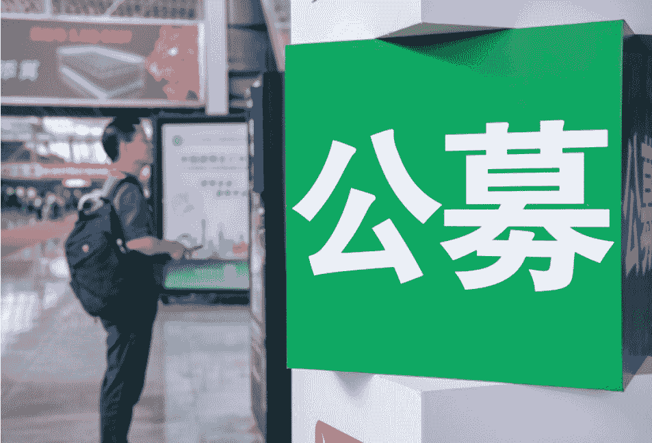

# CAIXIN | 听文章
文 | 财新周刊 全月

2025年5月7日，证监会正式发布《推动公募基金高质量发展行动方案》（下称“方案”），旨在建立以投资者回报为导向的评价体系，引导基金行业回归本源、增强长期投资能力。一周后，公募基金在市场上全面调仓股，更贴近期业绩比较基准，也带动了金融板块的上涨。

少数基金以模拟业绩为驱动的激烈竞争中，为了追求短期收益排名，不少从业者倾向于紧跟热点，导致风格漂移现象屡发生。此类短期操作、规模膨胀、净值回撤削弱了长期投资能力并引发投资者信任危机。此次改革方案的核心之一是推行与业绩挂钩的浮动管理费率。《方案》明确将基金经理绩效考核与中期收益密切挂钩，对长期收益实施薪激励，推动行业公平、透明、可持续发展。

《方案》的发布，让公募基金行业存在错位的问题。一位业内人士表示，管理者执着于规模、目标不一致，导致行业存在“早优劣汰”。方案要求全面建立以长期收益为核心的考核体系，应当涵盖基金产品绩效指标，前者包括净值增长率、业绩对比等指标，后者包括基金利润等指标。让公募基金回归相对收益是这次改革大亮点，对于公募公司而言，未来的挑战不仅是制度适应，更是竞争力的重构。

# 回相对收益

公募基金作为资本最重要的工具，在成熟市场上常常发挥稳定器作用，因此公募基金的核心目标是跑赢特定基准，而非单纯追求绝对收益。预期应该是市场上上涨时涨得多，下跌时跌得少，必须赚钱。

此次改革方案的核心内容是推行与业绩挂钩的浮动管理费率。《方案》明确，持有期间实际表现符合比较基准的，适用费率；明显低于同期比较基准的，适用低费率；显著超越同期比较基准的，适用加费率。这意味着公募基金的评价体系回归相对收益，而不再追求绝对收益。

衡量产品表现是否符合参照基准、同类产品平均水平；而所谓的绝对收益是指在一个特定周期内实现正回报，难以判断收益是否源于管理能力；当没有统一基准时，达成标准、约束边界不清。业内人士指出，比较基准作为公募基金的基础工具，是风格和方向的“锚”，更是衡量产品表现、决定费率结构和考核的“尺”。此前，不少产品使用宽基指数作为基准，权益基金风格转移、热点追踪、赛道切换频繁。这背后反映了部分基金公司及对基准管理重视不足，相关约束不健全。

公募改革落地后，首批浮费率基金的上市，主要对标沪深300、中证A500、中证500或中证800等宽指数。多位业内人士表示，后续可积累模式，探索对标的业绩基准范围，以主题类指数。未来一年内，规模前20家基金公司发行浮费率产品的数量将不低于主动型基金的60%，试点运行完成后，再在行业内全面推开。对于存量产品是否转型浮费率机制，上述业内人士表示，将根据市场接受度在一年后评估决定，尊重市场检验。若进行存量改造，也将分区改造、权益产品按差异化特征逐步平稳推进。与此同时，中国证券基金协会（简称“基金协会”）陆续推出基准，基本涵盖多元化产品，年内还将发布指引。若基金公司有自有产品的比较基准，监会相关部门在审核产品时也将考虑。政策首年重点在“搭基架子”，逐步推进制度建设。不管存量产品是否改造成浮费率模式，业绩基准体系都将适用于全市场的基金产品。为适应监管要求，公募基金经理进行资产再配置，主动配高端制造等超配板块，增配银行与保险等长期低配板块，使得基金组合更贴基准。

5月14日，震行的A市场在下午迎来爆发，保险、银行为代表的金融板块突然抬头，上证综指重返3400点。华西证券首席策略师立峰在研报中指出，A股银行近期上涨背后的政策驱动与配置逻辑，核心在于公募基金监管与机构资产配置调整的双重影响。

即将实施的《公募基金运作管理办法》修订版，强化了主动权益基金的投资约束，要求投资与收益比较基准之间的偏离度不得超过10%，对于长期偏离基准20%以上的产品进行监控。此外，新规要求基金公司在季度报告中明确披露配置与基准之间的差异，并提供调整计划，进一步抑制风格漂移现象。当前，银行板块在A股市场存在结构性偏配。2025年一季度数据，银行板块平均配置为3.4%，显著低于沪深300指数的4.8%，相比沪深800指数幅度达9个点。新实施后，被动修复。

# 浮动费率机制辨析

此次改革首先是重构利益分配，让投资者赚到钱，重新锚定管理人与投资者之间的利益。长期来，公募基金以固定费率以规模为主，造成两个结构性问题：一是基金公司追求规模而不顾回报，二是投资者与管理者之间并没有充分绑定。在本轮改革中，非对称机制，即在市场上上涨时加费，下跌时自动降费，旨在避免收益带来的风险。其次，引导长期投资，通过设置封闭、挂钩收益的机制，提升投资者的获得感，从制度层面缓解“基金赚钱亏钱”的现象。此外，浮动费率产品设计复杂、不直观，投资者对浮动费率的理解有限，对费用感知较弱，导致赎回率高、追涨惯性。基金协会是公认的变革有力举措，未来可以建立准库，针对不同投资策略引入统一的评价标准，不再任由各基金公司自设、随意更换。同时将业绩基准用于考核，形成完整闭环。

# 薪酬下行

基金公司赚钱、基金经理薪酬水平高于行业，而基金持有的产品常年亏损，这种错配引发引发质疑激励机制是否合理的根源。在基金经理的考核权重中，短期的相对排名占比大、换手率、抱团追逐等“冲”业绩与长期持有政策不匹配。为了解决高薪争议，让基金经理体系趋于透明、公平，《方案》明确要求将基金绩效考核与中期收益密挂钩。对于三年以上产品低于业绩基准超过100个百分点的基金经理，要求绩效薪酬应当下降；对于三年以上产品显著超过业绩基准的基金经理，可以合理提高其绩效薪酬。5月12日，国内公募基金行业共有419万基金经理。过去三年，普通股票型、偏股混合型、灵活配置型基金赢基准的占比分别为35.87%、23.08%、25.8%；跑赢基准超过100%的，依次分别为10.19%、17.8%、14.67%，总体情况并不乐观。该区域也是估值深度回调的市场，市场趋势对产品的影响的影响存在。具体影响基金经理薪酬的因素有三个方面：一是管理的类型，简单而言，权益型基金经理高于固收类的，指数增强的基金经理高于单一跟踪指数。二是管理规模，百亿级别的基金经理为公司创造的管理费收入必然大于5亿元、10亿体量的。三是公司风格，重视权益产品的基金公司和固收大厂，在激励员工上也有偏性，民企、外企业的激励较为灵活，“银行类”公募薪酬较为务实。头部几千员工的大公司和总共只有几十名员工的中尾公司相比，即使是相同岗位职能，薪资也存在巨大差异。“一位公募基金人士表示：财新曾拿到一份2016年的统计数据，基金公司按管理费用收入被分为三个梯队。当年，第一梯队（行业前十）人均薪酬为154.72万，其中奖金83.36万元、工资50.88万元、福利20.48万元，基金经理薪酬权重较高。2020年7月，证监会发布文件建立延迟机制，对投资、销售等关键员工考核，提出要与基金期投资收益等挂钩的要求（参见本刊2022年第13期《公募基金“降潮”如何到来》）。2019年至2021年，在公募基金规模跨越式发展的阶段，因年终奖涉及员工隐私……

2021年后，权益市场不断下跌，一位公募高管表示，行业终奖水平近三年呈阶梯式下降趋势，明星基金经理的收入普遍缩水。上述公募高管表示，多数基金年终奖打一折的情况并非孤例。

2022年6月，基金协会发布《基金管理公司绩效考核与薪酬管理指南》，要求基金经理等关键人员递延支付的金额原则上不少于40%，并指出应将不超过30%的当年绩效薪酬购买本公司管理的公募基金。

公募基金行业的薪酬包括基本薪酬、福利和津贴补贴、长期激励，绩效薪酬只是基金经理收入的一部分。受行业内严格环境的影响，不少基金公司2023年的年终奖至2024年末才延续发放完毕。

公募基金员工的固定工资和年终奖比例因行业业务部门不同而差异较大，与多数基金公司激励政策和风格有关。一位人士以东南沿海中游规模的公募基金为例，该公司中后期固定工资和奖金比例大致为6:4，销售线条5:5，最核心的投资部门平均为1:2；投资人员又因投资绩效不同，年终规模从三个月、五个月到几十个月不等。

一位非银分析师认为，“方案》实施后，基金经理在上上半年更愿意追求超收益，随着考核的临近，投资风格趋于保守，偏向稳低波动的投资标的；规模小小的产品，获得超收益的难度较小，容易将业绩稳定在适当水平。同时，长期考核意味着薪酬激励增长，薪酬水平下滑后，基金经理奔赴私募基金的数量或将增加。

## 管理费怎么收

从2023年7月开始，公募基金行业启动了一轮全方位的结构降费率改革，从降低管理费用起步，在公募基金证券交易佣金费率、公募基金销售环节收费、公募费率披露等等方面发力，视为生态级变革（参见本刊2023年第27期《公募基金费率终降》）。

作为面向大众投资者的金融产品，公募基金天然具备规模大、成本越低的特性。如何合理设定固定管理费率、未来的费率空间有多少，可从国际市场的经验中寻找参考。

招募证券报告指出，目前美国基金的费用结构主要包括两种模式：一是固定管理费，二是固定管理费激励报酬的“对称支点”结构。后者需适当的比较基准为“锚”，当基金业绩高于基准时，基金管理人可以在基础管理费之上提取激励报酬；当基金业绩低于基准时，基金管理人必须下调收费标准，减少其基金收入，以确保费率调整与基金收益紧密挂钩，从制度上避免“赚了多拿、亏了不担”的不对称风险。

以富达旗下明星产品Fidelity Contrafund为例，该基金管理费由固定费率与业绩激励构成，按月计提。其中，固定管理机制自2024年3月起进行调整，取消了之前与富达旗下基金平均净资产挂钩的“费率制”，改为根据基金资产类别及月平均净资产设定基础费率，并在基金规模达到一定水平后进行阶梯式费率下降，固定费率上限为0.61%。

同时，业绩激励则依据基金规模相对于标普500指数的超额收益执行对称加减机制，考察期为滚动三年，激励费率上下设定为±0.20%；每激励费按激励费率的十二分之一以基金业绩考核的平均资产计算。这一机制在强化基金管理人与投资者之间的利益绑定，提升经理人对长期绩效的关注。

美国对业绩报酬的规范经历了从严格限制到制度化完善的历程。上世纪30年代，投资顾问普遍从投资收益中获取绩效报酬，却在客户面前没有约束，引发“只赚不赔”的道德风险。为了弥补，美国在1940年出《投资顾问法》，明确禁止私人投资顾问基于业绩收取报酬，仅对注册投资公司的投资顾问约定激励报酬的费率。

但这一激励机制设计较粗糙，基金管理人仍掌握主导权，容易导致短期绩效行为。于是，美国证券交易委员会（SEC）在1970年推出《投资公司法》修正案，取消注册投资公司可收取业绩报酬的特殊待遇，同时与行业达成妥协，引入“支点收益费率”制度。该机制规定，基金管理人取的报酬必须以基准收益为中枢，在超额收益时激励、低于基准收益时调整，须应对，并且有上限下限，旨在平衡激励与保护投资者利益。

此后持续修订相关标准，逐步扩大激励的适用范围。自1985年开始，合格投资者门槛被设为至少50万美元投资额或100万美元净资产。2012年将投资者门槛调整至100万美元投资金额或200万美元净资产，并引入通胀调整机制。监管逻辑由一限制，逐步转向对风险承受能力较强的投资者进行适度开放。

截至2024年末，美国投资公司协会（Investment Company Institute）数据显示，自1996年以来，按资产加权平均计算，美国股票型共同基金的费率由1.04%降至2024年的0.40%；同期，债券型基金的费率从0.84%降至0.38%，货币市场基金则由0.52%下降至0.22%。

费率的持续下降多为结构性因素，包括大型基金资产增长带来的规模效应，以及行政经费、会计、合规等成本在基金资产增长后的边际占比下降。根据Aztec Group的调查，目前约70%的美国基金管理人将部分全部运营外包给专业的基金服务商，从而优化资源配置。

此次改革也明确出《公募基金低费率管理办法》，推动行业整体降费。另一关键驱动力。截至2024年末，美国投资协会数据显示，自1996年以来，按资产加权平均计算，美国不同类型基金费率：

- 股票型共同基金：从1.04%降至2024年的0.40%
- 债券型基金：从0.84%降至0.38%
- 货币市场基金：从0.52%下降至0.22%

当前中国基金综合费率率在1.6%至1.8%之间，货币市场方面在0.6%左右，最高达0.73%。

| 基金类型 | 1996年费率 | 2024年费率 |
| :--- | :--- | :--- |
| 股票型共同基金 | 1.04% | 0.40% |
| 债券型基金 | 0.84% | 0.38% |
| 货币市场基金 | 0.52% | 0.22% |

## 关税冲击下人民币何影响

文 | 徐庆 | 宏观策略总监

自2025年4月特朗普发动关税战之后，美元指数快速跌破100。在多数货币中，人民币并未像其他货币般被动升值，而是保持在7.3附近波动。2025年5月《中美联合声明》发布后，人民币一度跌破7.2，同跌。人民币近期的变化与以往模式不同，体现了市场担忧关税背景下，汇率会对冲下滑的重要工具，关税越高，汇率越贬值。

出口是否对人民币有明显影响？

从长期来看，出口确实有着良好的历史相关性。但从2023年半年以来，两者已呈“脱钩”趋势，出口速度持续反弹，但人民币汇率一直在7.0—7.3区间震荡，出口值。人民币在过去七年从6.3贬值至7.3。

是什么决定人民币的走势？

从外部因素来看，美联储继续降息对人民币的影响可能大于自身的货币政策。中美短期汇率的变化主要来自美元利率，处于高位的美元利率导致企业更愿意持有美元，结汇意愿下降，目前汇率已跌破50%。尽管贸易顺差持续创新，一旦美元利率的预期出现下行，结汇在短时间内迅速上升，很容易带动人民币走强。2024年7月至9月美联储降息预期升温，人民币出现一轮3%左右的升值，这是企业将美元结为人民币的结果。

此关税政策对人民币走势的影响，与其说是中国出口带来的不确定性，不如说美联储降息节奏带来的不确定性重要。近期美联储官员表不急于降息，一方面强调关税抬升通胀的可能性，另一方面认为美国就业仍切实。笔者在上海专栏中分析过关税对美国通胀的影响并不大，关税政策的反复美国就业带来的下行风险大于通胀带来的风险。非农新增就业好于预期，但从结构上看益于进口带来的其他行业人数增长并不具有持续性，关税对中小企业的冲击开始显现。这意味着即使某段时间非农就业仍相对高位，如中小型就业显著恶化，仍可能使美联储提早开始降息。

从内部索看来，非金融上市公司的资产净收益率（ROE）代表人民币资产的回报，可以看到其长期走势和人民币汇率一致。2021年以来一直处于下行周期，人民币也处于缩值周期。ROE也能理解早期出口和回升的逻辑：以前出口改善时通常提升ROE，但过去两年出口并未增强企业的盈利能力。不过从一季报看，上市公司的ROE已初步显露迹象。资本开支有望从2024年第三季度开始转负，2025年第一工业企业的产能利用率相对同期有所回，随着地产的拖延效应减弱，着上半年企业的盈利有望重入上周期。

综上所述，人民币处于四年的贬值周期大概率接近尾声，随着美国重启降息增加中国上市公司的盈利开始改善，人民币将进入一个新的上升周期。回顾2016年和2019年两次上市公司ROE止跌回升的拐点阶段，A股从熊市到牛市的拐点也出现在盈利周期改善的拐点之前，而人民币汇率从贬值到升值的拐点往往同步或略微滞后于盈利周期的拐点。所以A股进入牛市转换发生在2024年9月，大致推断人民币将在2025年5月至7月开启升值周期。

## 跨国企吸收“中国能量”

文 | 安敏 | 财经刊

跨国企正在努力回到中国市场中央。在5月6日，通用汽车在华发布“喜报”，上汽通用收获订单过万。在4月27日，日产汽车在华推出电动汽车N7。这一轮跨国企反攻中，丰田汽车首先打开局面。3月6日，广丰田推出纯电SUV铂智X。

高度本土化是共同点：新能源产品均由中国工程师主导开发，电池和智能辅助驾驶等关键部件系统引入中国供应商。跨国企积极调整是为了应对中国市场变化。过去，跨国企由于体系庞大失误尝试向总部研发电动车型，未能获得市场认可。

跨国企人士柳斌认为，早期产品只要生产出来就能卖出去；后期，各企业进入本土化赛道；现在，它们需要本土化研发。

在电动汽车转型潮下，跨国企必须大力发展研发能力，这一阶段才开始，未来再也不会平川。值得注意的是，竞争和淘汰不会针对某一类企业，如果不具备技术变革能力，中国自主品牌同样面临生存危机。

安洛咨询在5月6日发布的报告指出，虽然各车企分化不同，甚至部分选手已经出局，但行业仍处于剧烈转型中，跨国企高枕无忧。近期部门针对电动汽车采取一系列监管措施，安全受到重视，是跨国企强项。汽车是长期竞争，市场格局还没有稳定下来。

2024年，跨国企销量占比48.9%。在前十名乘用车中，中国自主品牌达18万辆，销量占比10%。

2025年的上海车展是一个观察窗口，亚洲、标致雪铁龙等多个品牌缺席车展，国际品牌面临边缘化挑战。

## 放下身段

2025年以来，一向被外界诟病“保守”的丰田汽车展现“激进”的一面。1月，丰田汽车（中国）投资有限公司（下称“丰田中国”）调整管理层，董事长升任副董事长，李晖升任总经理。这是中国人在丰田中国担任两个核心职位。此举旨在让了解中国市场的内在能够在“博弈”决策的位置。

4月19日，丰田汽车正式公布启动的“中国工程师体制”。丰田智能汽车研发中心（中国）有限公司总经理小西长树称，除首款车型铂智X，主导开发bZ5、广化丰田的全新卡罗。

首席工程师带来的变化肉眼可见。铂智X搭载了激光雷达，选用中国本土企业Momenta的智能辅助驾驶系统，车辆外观和内饰更符合当下潮流。丰田的中国团队同时平衡成本、开发周期和丰田的严苛标准，铂智X的定价具备市场竞争力。

丰田汽车还希望利用“中国能量”直接连接日本总部的电动汽车研发。2月，丰田汽车宣布在上海上资建设雷克莱斯电动汽车工厂。高端品牌中国生产的传闻不断，丰田汽车最终在跨国企普遍面临挑战时下定决心。

瑞凯萨（上海）新能源有限公司于2月18日注册成立，注册资本为1071亿元（约合人民币55亿元），法定代表由丰田全球电动汽车开发总加藤武郎执任。丰田中国董事长上田通透露，丰田汽车会长丰田章男决定由加藤武郎出任克萨斯上海的负责人。丰田章男在董事会议上称，中国市场客户非常重视电动汽车，丰田也要出功夫认真对待，让丰田电动汽车的领导者来到中国市场打造产品。

大众集团比丰田更早认识到行业转型紧迫性。早在2021年11月，大众CEO迪斯克就提前提醒，如果一个像高尔夫这样的全球销量车型来自中国，大众的地位就会被动。“真的很棒。”他在尝试试一批中国产品后评论道。

大众汽车集团选择加强中国研发能力，并与中国企业发展新的合作模式。2023年7月，大众与上汽合作开发ID系列。

跨国企业业务遍布全球，高度依赖自由贸易，影响更大。近期，通用汽车、福特汽车、特斯拉等多家跨国企业频因关税动荡撤回2025年业绩指引。

全球零部件巨头博世和丰田汽车提出，区域本地化是应对贸易壁垒的根本之策。跨国企业能否稳住中国市场，意义更加凸。

## 市场格局未定

2024年3月的行业盛会上，比亚亚迪副董事长王信福临，2024年至2026年，国内汽车行业将在规模、成本和技术方面进行决战。中国企业将加速投放新能源产品，蚕食外资品牌市场，未来三到五年，跨国企业在中国的份额将从40%下降到10%。

根据中国汽车工业协会统计，中国自主品牌乘用车市场份额持续增长，从2020年的38.4%提升至2024年的65.2%；到2025年一季度，相关份额进一步攀升至68.1%。同期，德系和日系份额降至13.7%和9.7%，美系份额降至5.7%，而韩系品牌市场份额仅剩1.7%。

跨国企业近期释放积极信号。安近咨询认为，跨国企业有机会稳住阵脚。此机构指出，国内新能源技术趋同质化，智能辅助驾驶方案、电子电气架构、快速充电等领域都呈现相似特征，缺乏独一无二的技术卖点。安近认为，“技术权”意味着早期领先者的技术优势大幅缩小，其他企业可以迅速跟进，获得接近的产品能力。

跨国车企在市场推出的车型印证了上述观点。安劝咨询称，随着产品差异越来越小，消费者会更在意的品牌，品牌竞争可能会给跨国企业带来新的机会。

3月29日发生的汽车交通事故导致三人死亡，车辆在事故发生前几秒钟处于智能辅助驾驶状态，驾驶员未能及时采取措施。此起事故引发公众关注，国内主管部门随后采取措施，对汽车智能化和电动化全加强监管，客观上有助于跨国车企争取主动权。

4月16日，信部召集汽车企业参加会议，强调生产企业必须充分组织联合驾驶测试验证，明确功能边界和安全风险如何响应，不得进行夸大虚假宣传。信部还将强调，企业严格遵守规定，将软件空中远程升级纳入监管。

2026年7月1日起，修订后的强制性国家标准《电动汽车动力储蓄电池安全要求》将正式实施。新标准大幅提升了动力电池安全要求，其中最受注目的调整是将电池热失控保证5分钟逃生时间，改为“不起火、不爆炸”。

“跨国车企机会来了。”刘文斌说。他介绍称，跨国车企经历过历史久，积累了大量事故经验教训，应该把钱花在“看不到的地方”。例如丰田汽车电池早就就是按照新标准设计，而且寿命远超新标准要求。刘文斌认为，跨国车企正在逐步跟进完善用户体验，消费者也会重新关注它的安全经验和价值。

业内人士指出，中国本土企业面临的生存危机并不比跨国车企小。

国家统计局数据显示，2025年一季度，国内汽车行业收入同比增长8%、至24022亿元，但利润同比下降6%，仅947亿元。汽车行业利润率只有3.9%，低于同类别游学企业5.6%的平均利润率。

在财务指标方面，国内汽车企业和跨国巨头之间存在数量级差异。

丰田汽车在2024财年的营业收入同比增长6.5%，达到48万亿日元（约合人民币2.4万亿元），相当于亚迪、上汽集团、广汽集团（601238.SH）、吉利汽车（00175.HK）、长城汽车（601633.SH）、北京汽车、长安汽车等七大主流企业的总和；丰田的净利润同比下降3.6%，高达4万亿日元，约为上述中国汽车的3倍。

体小意味着承压的能力有限，部分企业已经事实上退出市场。初创企业威马汽车、高合汽车先后被申请破产重组，另一家初创企业哪恰汽车也在近期陷入困围。

面对严峻的市场形势，国内汽车企业主动整合。2024年9月，吉利控股宣布从战略扩张转向聚。之后，吉利控股在整车品牌和业务层面进行了开阔的重组。长安汽车同样推进重组之事，未来国内汽车可能会兼并重组潮。跨国企业高层判断，到2027年，中国市场竞争趋于理性，只要抓住时间，仍然可以被淘汰。

注：本文发表于《财新周》2025年第19期，原题为：财新周 | 跨国车企在华反攻

## 一日立法强制接管钢铁

2025年4月12日星期六，英国工党政府紧急在一天之内完成了《钢铁行业措施法案》（下称“特别法案”）立法，授权英国政府接管英国钢铁（British Steel）——这家公司由中国北方民钢铁集团100%控股，且运营了五年。

西北大学研究员陈胜分析称，这是自2008年金融危机以来，英国首个紧急干预产业。这种立法通常仅限于国家紧急、战争或重大危机时期。2026年7月1日起，修订后的强制性国家标准《电动汽车动力储蓄电池安全要求》将正式实施。新标准大幅提升了动力电池安全要求，其中最受注目的调整是将电池热失控保证5分钟逃生时间，改为“不起火、不爆炸”。

关于钢铁控制权的争夺，起源于3月27日，英钢宣布关闭两座高炉及炼钢业务、削减钢厂产能与员工进行磋商。此时英钢表示，由于极具挑战的市场条件、美国税以及高碳生产高昂的环境成本，炼钢业务在财务上不可持续。

敬业钢铁首个海外收购项目。2020年以来，敬业集团对英钢的投资超过12亿镑（约合人民币10亿元），对应财务亏损700万镑。2020年3月，敬业集团以5300万镑从英国破产管理处购买了正在接受强制清理中的英钢。英钢当年暂时盈利就开始亏损（扣除税费以及特殊项目）5080万镑、367亿镑。保守议员大卫·戴斯（David Davis）在4月12日的特别法案辩论时透露，2024年之前九个月，英钢亏损4.08亿镑，到2025年亏损约为2.5亿镑。粗略计算，英钢自2020年以来累计亏损超过10亿镑。

收购之初，敬业原有诸多振兴计划：五年扭亏为盈，粗钢产量提升至310万吨；到2025年，将英钢重新打造为欧洲领先的钢铁生产。但现实的困难远超预期，敬业后来发现，英钢的高炉稳定性差，其虽有450万吨粗钢产能，但产量从2020年的260万吨下降到2023年的170万吨；固定成本无法降低，加上全球钢铁竞争加剧，钢铁价格走低，但能源价格却因战争等因素持续高位。

英钢彼时是英国第二大厂，敬业集团收购资产包括英国本土三座钢厂：负责炼钢的斯肯索普（Scunthorpe）钢厂；负责轧钢的提赛德（Teesside）和斯金宁罗格夫（Skiningrove）厂；还有位于荷兰的FN钢厂。钢铁生产经历“炼钢—炼耗—轧材”三个阶段，高炉位于第一环节，将铁矿石冶炼成钢，后经转炉生产粗钢，再由英钢厂轧出钢铁。

此番处于风暴中心的两座高炉，分别是始于1954年的安妮女王炉（Queen Anne）以及始于1938年的贝丝女王炉（Queen Bess），几十年来几经重建与改造，但早已老化、运营困难，且一旦冷就难以重轰。然而，英国政府对上述无前例地急救英钢，目的是为了保英国最后两座高炉，及其背后的初级炼钢产能。

两座高炉位于英钢总部附近，其钢铁发展史可追溯至19世纪70年代。英钢是英国唯一的特殊材料制造，并为全国四分之一的大型建筑项目提供钢铁。两次世界大战期间，英钢帮助制造出英国第一批坦克以及用于诺曼底登陆的船艇。

事实上，英国工政府与敬业集团就英钢生存危机已谈判九个月，未能达成一致，博弈焦点即是否关闭老炉以及补贴数额。引发此次政府强制钢铁控制权的要素是，英国政府提议提供15亿镑资助英钢转型，但敬业拒绝了这一提议，并取消了高炉，保留英国下游工厂。

英国工党在大选中取得压倒性胜利，提前结束了保守党14年的执政。2025年1月，英国工党商业和贸易大臣雷纳·诺兹（Jonathan Reynolds）在下议院中暗示，英国政府希望通过“净零排放”策略，包括英钢在内的治理方法被称为“安全学”，将国家安全放在首位。时任英国首相希·苏纳克（Rishi Sunak）表示，如果不是这家政府介入，英钢可能早已面临失败。

中国驻英国大使发言人4月13日评价，英国政府在谈判中寻找脱颈路径。作为一家中国民营企业，英钢在计划停关高炉并建设更先进的电炉（EAF），属于正常运营。目前钢铁属于属于属于集团，但但政府失去控制。。接管钢铁后，英国政府提供贷款购买铁矿、焦炭等关键原材料。但业内人士认为，英国政府不可能持续资助英国钢铁，是难所在。

敬业集团由1996年创建，总部位于河北省家庄市，早期主要生产钢筋等低端产品。2020年以来，一度跻身《财富》杂志全球500强第一位。目前其粗钢产量超过3000万吨，实现收入368亿。艾伦（Allen Bell）被任命为CEO，艾丽莎·库尔森（Lisa Coulson）被任命为首席商务官。

Brevia咨询公司认为，接下来几个月，英国能否为钢铁业制定一条更清洁、安全、更具国际竞争力的新路线至关重要。在敬业一方面，目前仍在英国政府博弈，并等待合适。

特别法案是英国政府针对钢铁行业前所未有的干预举措。该法案委托国务院大臣指令接管英国钢铁制造商的权力，以维持英国钢铁资产持续、安全使用。具体措施包括签订协议、任命高管、行使管理职能、提供财务支持、支付薪酬等。若涉钢铁企业有意碍或拒绝遵从指令，则构成犯罪。

特别法案在议会讨论阶段，议员们的观点比较一致：在安全日益加剧之后，钢铁是工业基石，初级钢铁业务是一项战略资产，我国工业未来、经济安全乃至国防安全，代表着“国家利益”。倘若关闭，英国将成为G20（二十国集团）中唯一不生产原钢的国家。现在，我们处于一个全新的不断变化的世界，维护我们的安全、增强我们的竞争力，比任何时候都重要。

多位议员指出，在当前乱世，武器及军事需求达到前所未有的规模，而国防乃至能源转型等关键领域钢铁仍依赖高炉炼制，不应将供应链包。相比高炉还原铁矿钢，另一主流技术路线电炉的主要原料为废钢——其成分混杂，需要二次冶炼，生产高端钢材不仅效率低，成本也2024年10月，新任的英国财政大臣宣布在未来五年投资100亿镑用于资本支出，并在国防领域新增投资100亿镑以重整军备。

特别法案规定，国务院大臣依据法下发指令接管钢铁企业的任何费用，均由拨款支持。接管钢铁期间的资金，来自英国政府的钢铁基金。为重振钢铁行业，英国政府在2025年2月宣布投资25亿镑本土钢铁产业发展，鼓励本国基建项目优先使用本土钢材，加强供应链建设，推动钢铁行业向低碳炼钢转型。

有关该交易的中国分析人士认为，英钢实际上是英国工党和保守党政治斗争的产物。保守党在北肯郡选区倾向于关闭，而工党在极力争取，保住当地就业。英钢拥有约4500名员工。在政府介入后，英钢于4月取消上一任管理层发起的裁员，并在5月招募了20多名新员工。

保守党委员Kemi Badenoch认为此“烂摊子”是因为英国政府此前并未介入，国有化就会做得更好？科尔凯勋爵（Lord Kerr of Kinlochard）直言，只要英国坚持发展国内钢铁产业，就需要永久的资金补贴。

此外，1967年3月，英国出台《钢铁法案》，英钢成立；1988年，撒切尔政府对钢铁行业进行私有化；1999年，英钢与荷兰钢铁公司霍根文斯（Koninklijke Hoogovens）合并成立荷兰斯集团（Corus）；2007年，该集团被塔塔钢铁以43亿镑收购，不料全球金融危机带来冲击，英国钢铁陷入连年亏损。英国钢铁在2016年被本土资产管理公司雷布资本（Greybull Capital）以象征性价格收购；此后由英镑疲软和英国脱欧引发的不确定性，以及雷布资本控制金流而不再开展技改与维护，英国钢铁在2019年进入破产清算。

英国钢铁经历了国有化、私有化与再国有化的循环，特别法案逆转了撒切尔政府上世纪80年代以来一直为主的工业私有化趋势，暴露了英国在产业政策、市场效率与国家战略资产角色等方面不稳定。保守党的威拉克亨特勋爵（Lord Hunt of Wirral）指出，上世纪60年代的钢铁业国有化灾难性十足：1967年至1980年第一季度，英国钢铁获得的赠款和贷款金额高达49.25亿镑，同期净亏损额则在15.52亿镑。“国家非没有振兴钢铁，反而导致效率低下、企业亏损、生产力下降以及范围的。”

多名议员对特别法案程序及后续执行提出质疑。“与其匆忙地、在午夜后一分钟出台这项法案，我们原本可以利用之前段时间开展适当的辩论，选择由适当程序，以及适当的审查与复核。”保守党议员安德鲁·格里菲斯（Andrew Griffith）称。另一位保守党莫伊兰伯爵（Lord Moylan）表示：“（特别法案）并非国有化，而是对一家私人公司的没收和控制，且没有任何保障措施，也没有‘打算条款’。”

陈胜指出，英国政府的行为实质上间接收购或为国有化的重要前置措施，而非简单临时的监管干预。即使所有权在形式上仍归属于集团，但其已被架空——排除在决策程序之外，无法自由使用资产，无法获得资金。

多位对特别法案持意见的议员指出，英国政府不懂采购，也不懂运营；此外一家企业意味着要承担相应的运营，而法案并未落实所需资金规模——这可能是个无底洞。这笔支出原文可用在其他地区。

“国有化是选项之一，”雷诺补充，英国政府希望与私营企业共同投资以确保长期转型。截至2023年底，英钢净资产为2.5亿镑。

强数据显示，敬业集团在2020—2023年共实现利润20.77亿美元，在2021年达到最高点的8.91亿美元之后走跌，到2023年为2.49亿美元。

敬业收购英钢的另一原因，是想弥补自身在钢轨、型材产品方面的不足。英钢可生产钢轨、H型钢、汽车用钢、大型工程机械，与敬业主的螺钉、热卷带等产品互补，也可与国内基地联动。敬业收购时已做好大规模资本投入的准备，加之2019年融资成本低，即使使用敬业工艺，炼炉核心技术和轧钢厂可以继续，当时认为“算得过账”。

英国是现代钢铁的发源地，但发展至今，其人工、电力等制造行业持续走高，在过明显的、竞争激烈的全球钢铁市场中缺竞争力。多年来，英钢产能利用率不足，脱欧及美国对欧盟钢铁加征关税，都导致其客户订单减少，在敬业收购之前已连续多年亏损。

敬业对英钢的收购，在当时也有很大争议。慎者无，认为英国还是欧洲钢铁市场的预期都不乐观。欧洲钢铁协会分析部门负责人Jeroen Meij当时负责财务分析，钢铁制造业持续下滑、钢铁出口和投资陷入疲态势；英国所处的宏观经济环境也不利，当时欧在欧，与主要贸易伙伴间的贸易战加剧；英钢本身还面临能力、能源、环境等高强度生产的压力。

李明进入英钢管理层后，开始实施转型计划，制定了详细的十年业务规划，重点关注产量增长、资产投资和环保承诺、降低成本以及碳化策略。此外，敬业集团向英钢引入中国经营经验，提升管理效率，引入预算管理、优化单位成本和制造费用管控，引进定价员，念最小化人工成本、提高设备利用率等方式，优化了英钢的物料采购、生产组织和产品销售渠道。但这些努力未改变英钢的趋势。

作为交易结构的一部分，敬业集团承诺在十年内投资12亿英镑，对英国钢铁进行现代化改造，提高能源效率与环境性能，提高公司竞争力以及可持续发展能力。敬业当初计划在赛特斯新建电炉，并为斯霍索普工厂建立250兆瓦电力，投资炼钢以生产优质钢，升级现有轨道钢轨道轧机，并新建一套钢轨生产线。

成本控制不住（12亿英镑）基本就亏损了，没有投到最初设的地方。“接近敬业集团的人士对此称。

前述钢铁行业人士也向财务分析，钢厂最高的三项是原材料、能源、人力，剩余可压缩成本有限。在英钢2023年的总成本中，原材料占54%、燃料、水电、运输等外部费用占20%，人力占14%。而在原材料采购上，中国钢常规运用的“以量换价”的做法在英钢并不适用。

一铁钢铁分析师认为，除了英国本土需求疲弱，敬业集团也存在不熟悉当地政治、法律环境等问题，后续连续遭遇英国脱欧、新冠疫情、俄乌冲突导致的能源价格上涨、碳排放交易成本飙升等诸多冲击，企业雪上加霜。欧洲的钢铁需求长期在萎缩，即使中国钢铁行业有竞争力也会“水土不服”，降低采购成本等手段都回天无力。“他称，中国钢铁应该“出去”，但更应该向东盟等钢铁需求仍在增长的区域。

“五年变量太多，政治、经济、市场在剧烈变化，投资环境与敬业收购钢铁之初相差太远。”上述钢铁业内人士称。

英国于2020年1月退出欧盟，当时敬业对英钢的并购还在进行中。对英钢而言，英国是主要市场，在营收中占比过半；欧洲区占比从2020年的29.5%跌至2023年的26%；其他区域市场占比从13%提升至21%。

而在俄乌冲突爆发的2022年，英钢电力、燃料等费用上涨24%、4.65亿英镑；全年运营成本上涨四成、至21.27亿英镑。多名员工指出，英国工业用电价格在发达国家中最高，比国际领先资源充足国家平均价格高出46%，是欧洲平均水平的2倍、美国的3—4倍。

当地工会强势，人力方面同样棘棘。斯霍索普镇人口约7万，在英钢上班员工属于当地薪人士。据年报披露，英钢铁年均工资从2020年的3.67万英镑（合人民币32.6万元）升至2023年的4.9万英镑（合人民币43.2万元）。

美国发起的此贸易战加剧了钢铁危机。英钢对美国的年销售收入约5000万英镑，占销售收入的3%—6%。2025年3月12日，美国对所有进口钢铁制品征收25%关税。5月8日，英美达成贸易框架协议，英国政府称英国钢铁产品出口美国从25%关税降至0%。根据协议译文，若要享受零税率，英国需满足美国供应链安全以及“相关生产设施具有权威性质”的要求。因此，股权仍为敬业集团所有的英钢，能够享受优惠税率并不明朗。

此外，中英环境也有很大差异。前述钢铁业人士介绍，国内政策效率高、土地平整、申请许可、设计、设备选型等同步进行；相比之下，英国审批流程慢，各环节很难同步，建设周期也就长。

## 英国钢铁困境

前述钢铁业人士指出，英钢能否活下去，第一步要有可行的技术；第二步要有经济性；最后还要应对政治、社会、环境等外溢因素。

第一步，英钢需要关闭旧高炉。“设备实在太差，会让企业耗竭。”多名钢铁业人士评价，“英钢不惜大规模投资，但高炉时代已经结束了。我们期待通过现代化、高效率、产量最高的钢厂，”工业业员克莱斯·麦克唐（Chris McDonald）如此称。英钢之前设定的目标是到2050年实现碳中和”，并在2023年1月公布了转型计划——转向电钢。英钢也找来中国经营经验，转型提供电炉、精炼钢、连铸机等设计。

但具体方案，英钢曾考虑在斯霍索普建造一座大型电炉，而这两个基地属于不同区域。到2024年，英钢将修改规划，拟在斯霍索普建造一座小型电炉。根据2023年1月公告，英国钢铁的新电炉预计2025年底投入运营。“但此事迄今没有任何进展，新政府也没有继承相关协议。“雷诺兹称，敬业集团希望在斯霍索普建造两座电炉，申请12亿英镑的政府补贴。英国政府于2025年1月成立钢铁委员会（Steel Council），原计划在春季推出“钢铁战略”，但迄今未有进展。该战略包括有竞争力的价格、公共采购机制、碳边境调整机制（CBAM），同时评估直接还原铁（DRI）在初级还原钢的可行性等。此外，前述业内人士认为，英国缺铁矿，原材料依赖进口，原料需通过伊兰散码头（IBT）进口，再转35公里铁路到钢厂。

他进一步指出，英国建钢厂周期长，企业需承担十年左右的资金成本，在当前的利率环境下项目期内收回成本。英国基准利率在2019年为0.75%，随着央行不断加，至2025年5月已达4.25%。加上目前各类不确定因素较多，项目建设周期和融资成本都难以满足企业的经济决策。“此事今天看来无解，但若地缘政治、宏观经济等条件变好，英国通胀得到控制、基准利率下调，运营成本整体下降，可能还算得。”上述人士强调。

英国钢铁目前的处境倒退了四五。上世纪80年代，撒切尔政府奉行新自由主义理念，此后英国经济结构从制造业转向服务业。目前，私业占英国国内生产总值（GDP）90%以上，服务业占GDP75%以上，制造业仅剩10%左右。在钢铁行业，英国粗钢产量近15年持续下降，到2024年仅剩400万吨，相比2010年下降近半。2024年，英国进口660万吨钢，同比增长28.8%，占其需求的六七成。

若要推动工业发展，英国政府要做的工作还有很多。为此，政府须对应对电网接入缓慢以及工业能源价格缺乏竞争力的挑战。在5月8日召开的首届伦敦西洋对话，英国能源电力公司Octopus Energy首席战略官Tim Heal指出，英国工业转型受电价影响，电价长期高昂，电力系统复杂，“改变市场规则与结构”。

若未来普及电炉，钢铁的电力消耗预计翻番。英国钢铁会在2025年3月发文呼吁，英国没有保护能源密集型产业发电价的机制，发电明显偏高且波动较大，应建立机制以固定钢铁的电价水平。

未来无论哪家企业接钢铁，都要处理英钢铁的债务问题以及历史袱。而敬业集团能否收回对英钢铁的投资损失仍未知。敬业对钢铁的投资主要通过股东贷款方式支出。年报显示，英钢铁欠敬业集团及关联公司的债务，从2020年的1.43亿英镑，分别增至2021年的3.64亿英镑、2022年的6.3亿英镑和2023年的7.11亿英镑。贷款利率前期为7%，到2023年调整为7%。

英国律师（Lisa's Solicitors）认为，敬业集团“贷款+利息+担保”的方式实际是并购案的经典操作：一方面，作为债权人可以要求还本金和利息，另一方面相比直接出资，资金上更灵活、高效，并在未来亏损时享有优于普通股的优先受偿。

陈胜认为，在敬业收购钢铁之初，英国政府对这一决策提出异议。在英国法律框架下，敬业可以质疑政府指令的合法性，政府强制接管可能导致投资者资产实质性剥夺。此外，在国际投资领域寻求救济，尤其是双边投资保护条款（BITs）与自由贸易协定（FTAs）。1986年，英国签署了双边投资保护协定，其中明确争议解决采用国际仲裁，原则上禁止征收，提供及时、有效补偿。但陈胜也提醒，此类仲裁通常耗时长，建议采用“司法+商业”。

北京律师事务所在的一份报告中，提醒企业需要注意风险：民族主义、安全政策与环境，易受审查或监管干预，建立本土支持与伙伴关系，纳入争议条款与投资保护机制。企业“出海”不仅依靠资金和规模，更要在战略层面强化资源配置的前瞻判断。芬兰能源与清洁空气研究院沈昕表示。

## 专栏 | 英镑启示

# 听文章

文 | 巴里·艾肖格林
美国大学伯克莱校经济学教授

一百年前，1925年4月，时任英国财政大臣丘吉尔做出一项影响深远的决策：英镑按“一战”前的汇率回归金本位。与现任美国白宫的临境相似，当时的奥吉尔需要在两大目标间权衡。一方面，他力图维持英镑在国际货币体系中的核心地位，同时守护伦敦作为全球金融枢纽的地位；另一方面，至少对他有影响力的人士都意识到了更具竞争力的汇率政策就是贬值带来的好处，这会推动英国制造业和出口的增长。

最终决策选择了一个目标，原因并不明确。“由于确立了经济霸权，或许是历史经验主导了决策方向。伦敦的金融利益集团也不愿政府恢复金本位，并让英镑对美元的汇率水平回到“一战”前。持反对意见的凯斯恩明言，向财政大臣阐述观点时，也未能扭转乾坤。这一决策的后续影响与经济学家的预测高度吻合。英镑重新确立了其在国际货币体系中的核心地位，伦敦也保住了全球金融枢纽的地位。在大西洋彼岸，纽约与美元已经具备了挑战的实力，由于战争对欧洲的冲击，美国联储储备体系为资本市场提供了支撑，美元的重要性日益增加。正如预期的那样，英国出口陷入停滞。如今，在实施汇率稳定政策后1928—1929年，英国的出口低于1924—1925年。强劲的英镑以及维持汇率所需的高利率环境并不有利于出口增长，如果将英国经济衰退完全咎于汇率问题，则未免毫无偏。当时英国传统产业如纺织、钢铁、造船，遭遇了美国、日本等新兴工业化国家的强力冲击，这些竞争者凭借更现代化的生产设备后来居上。这恰当下美国制造业面临中国等新兴市场的挑战。不管当时还是现在，面对正崛起的经济体，让汇率贬值能在多程度上改变变局，并不清楚。上世纪30年代，英国也曾试图使用关税壁垒来拯救传统产业，但并未取得成功。即便1931年英镑贬值后，英国在发展阶段处于技术前沿的新产业也遇到了许多困难，特别是在电气工程、汽车制造和居民耐用消费品等领域，未能实现突破性进展。美国等竞争者更采用流水线等新生产方式和技术革新。上世纪30年代，正值贸易和经济大萧条，这种宏观环境无疑是雪上加霜。尽管面临一系列问题，英镑仍维持了它作为国际货币的地位。在储备货币和支付手段这两大功能上，英甚至恢复了一部分此前而被美元夺走的市场份额。在金融稳定方面是成功的，英国通过“最惠国制”有效抵消了关税的影响，与世界外的伙伴包括斯堪纳维亚、中东和波罗的海保持良好关系。

未来无论哪家企业接钢铁，都要处理英钢铁的债务问题以及历史袱。敬业集团能否收回对英钢铁的投资损失仍未知。敬业对钢铁的投资主要通过股东贷款方式支出。年报显示，英钢铁欠敬业集团及关联公司的债务，从2020年的1.43亿英镑，分别增至2021年的3.64亿英镑、2022年的6.3亿英镑和2023年的7.11亿英镑。贷款利率前期为7%，到2023年调整为7%。

# 美国药价砍价

特明普在社交媒体（Truth Social）发文，提及提高关税后，拜登对等出击。他将使美国的处方价格降至发达国家的水平，预计幅度30%—80%。上一任总统拜登签署的一道命令，可能会成为美国历史上最重要的之一。在行政命令发布之日起30天内，HHS部长应协助建立“最惠价格”（Most-Favored-Nation Price, MFN）的定价机制。这是一种定价策略。

## 美国药价有多高？

作为全球医药创新活跃的地区，美国同时承受医疗费用支出快速增长的压力，处方药价长期处于世界最高位。据全球大型CRO（新药合同组织）公司艾维韩（IQVIA）发布的《2024全球研发趋势报告》，美国无论是新药临床试验数量，还是新药（化合物或分子）上市数量都居世界首。但硬币的另一面是美国也承受了最昂贵的创新药物。美国仿制药物低于许多国家，原药价格高达其他OECD国家的4.22倍，其占美国处药数量7%，但支出占比87%。创新药物上市初期，研发成本逐渐收回，定价应当下降，但美国的定价却逐年上涨、跑赢通胀。《美国医学期刊》（JAMA）上2019年发表的一项研究分析了49种药物销售额超过5亿美元或者全球销售额超过10亿美元的畅销，这些药物在美国从2012年到2017年每两年都会定期涨价，其中八成药品涨幅超过50%，五成药品价格翻倍。与美国独特的药物支付体系有关。美国没有全民保险，支付方分散为三：商保与两大政府保险Medicare、Medicaid，其中商保是最大支付方，CMS数据显示，2023年商保、Medicare、Medicaid分别支付1.46万亿美元、1.03万亿美元、0.87万亿美元，分别占支出的30%、21%、18%。

此，美国政府部门在控药形成过程中退诸于商保之后，议价能力大幅削弱。而药房福利经理（PBM）则扮演了关键角色，他们连接保险和药企，赚取药品标签价和保司实际支付价的差额，三家PBM公司垄断着80%左右的美国处方市场。这种机制被认为在程度上助了药价飙升。

特明普认为，美国药价高是因为美国没有保护能源密集型产业发电价的机制。米格鲁举例，同样一款产品，在伦敦购买88美元，在纽约却花了300美元。相比其他国家，美国人口不到5%，却承担了全球四分三的药利润。

上涨至2.78。创新药物的价格差距极其许多：美国原研药物价格高出其他OECD国家的4.22倍，虽然仅占美国处方药物数量的7%，但支出占比为87%。

凯撒家庭基金（KFF）比较了2024年多款药物在美国与11个发达国家的价格，其中司格鲁鲁的降糖剂在美国定价为936美元/月，日本、加拿大、瑞士分别为169、147、144美元，排在末位的法国仅为83美元。

不仅如此，美国药价仍在逐上涨，增幅高于通货膨胀率。JAMA发表的另一研究对2008年—2021年美国首次上市的548种药物分析发现，价格中位数从2115美元上涨至18007美元，涨幅90倍。美国退休人员协会公共政策研究所（AARP）研究显示，2019年，美国老年人几乎使用的特殊处方药物的零售价格上涨了4.8%，是同期通货膨胀率的3倍。2021年7月至2022年7月期间，据HHS的药价追踪报告，有1216种药品的价格增长超过了时间段8.5%的通胀。

高价阶层转嫁给美国民众。OECD数据显示，2021年美国人均药品支出1448美元，占人均GDP的2%。2024年KFF健康追踪调查显示，55%的成年人担心能否负担起处方费用，约三分分之一的患者由于费用昂贵未按处方用药。

药价从何而来？一方面，美国奉行高度自由的市场定价，2003年通过的《医疗处方药改进和现代化法案》禁止医保部门对药品价格直接谈判，药企拥有很大的自主权以及游说空间。

中山大学药学院医药经济研究所所长、教授宣宣布分析，美国长期以来将制药行业造成国民经济支柱产业，政府对药品市场价格不加管制，采取“高投入高回报”原则，吸引多国投资准入，比如大部分新药上市首选在美国，以尽快获得回报。

一位跨药企坊负责人解释说，美国是全球唯一给予企业自主定价报销价格的市场，也在药品供应链的顶端，一款全球上市的新药，可能超过60%的利润来自美国市场。这也成了特朗普此前此次出手捍卫的火索之术，他在命令中表露，美国人不到世界的5%，却为制药公司提供了75%的利润。

清华大学医院管理学院教授授课员陈怡曾向财经介绍，国际医药部门在新上市药品定价时，普遍依据临床效益作为基础价格谈判（如德国和美国）和卫生水平评估（如英国），同时会参考周边经济发达国家同类药品的价格，以及还未满足医疗需求、市场竞争格局等因素。

复旦大学公共卫生学院鲍善联表示，区别于国际主流药品思路，推崇自由市场理论的美国并不认可这一一系列包括ICER（增量成本效果比）、相当于人GDP占比或倍数等药物经济学成本效用测量的方法，而是重视新药的研究和开发成本，2015年以来，每年56%—65%的全球新药首先在美国上市，因此制定了最高的药价，参考其国家定价的意义并不大。

“美国药物如此昂贵，是因为我们任其发展，设计的药物本体体系只有引擎，没有刹车。”美国斯坦福大学法律与卫生政策教授Michelle Mello如此评价。

另一方面与美国独特的药品支付体系有关。作为全球唯一一个没有全民医保的发展国家，美国政府部门在药价形成中退居商业保险之后，统一支付方的缺位使得买方定价能力大幅削弱。

PBM在其中扮演了关键角色，其由Caremark、Evernorth、Optum Health3小组组成，占据着80%左右的美国处方药市场。他们连接保司和药企的交易，通过与药企谈判返点获利，最终决定患者自费购买药物的费用。

医疗策略咨询Latitude Health创始人赵越介绍，美国药品由标签定价和净价两部分构成，标签定价即市场流通的价格，净价则是涉及利润的真实价格，不对公开，后者通常为前者的30%—50%，独家品种具备更大的定价优势，净价越高。而二者差值由PBM大部分返给药企公司，部分自留作为盈利。

陈怡解释道为平衡首发国家为患者利益大幅降价需求和避免国际参考价带来的企业发展风险，谈判药品实际交易价格保密是国际通用做法。“因为保险公司买的更便宜，这个实际价格就需要严格保证。药厂不希望产品的实际价格影响到全球定价体系。”

不过，这一模式的封闭性让PBM从中嗅到寻租空间，在一定程度上助了药价抬升。胡普联表示，在美国制药企业力量巨大，PBM很可能与药企从中利益巩固，导致定价动力有限。

“PBM等承担了中国医保谈判中医保局的职责，但它的目的是盈利。”赵衡说。

近年来，多方将矛头指向PBM利用药品定价过程缺乏透明度来扩大回报，导致药品价格持续上涨。2024年7月和2025年1月，联邦贸易委员会连续发布两份关于PBM获利润高价药物的报告，提到2020—2022年，PBM提供的药品中有63%的价格预估成本超过100%；癌症、艾滋病等药物获利73亿美元。

美国制药业最有话语权的老牌协会之一——美国药品与制造协会（PhRMA）研究显示，2019年，美国老年人几乎使用的特殊处方药物的零售价格上涨了4.8%，是同期通货膨胀率的3倍。2021年7月至2022年7月期间，据HHS的药价追踪报告，有1216种药品的价格增长超过了时间段8.5%的通胀。

特朗普行政令发布不久，联邦贸易委员会及加利福尼亚州、俄亥俄州、佛罗里达州对PBM提起诉讼，美国政府正在考虑推进，要求PBM在价格谈判时申报其利润。

药企与PBM相互反对推高高价。美国是全球唯一的允许PBM取消中间商直接向患者销售药品的国家。如果法案的后，美国药品价格下降持续减轻患者负担，但PhRMA表示，P要求每年以回扣的形式降低他们的成本，并缩小与欧洲之间的差值。

“PBM要求每年以价格直接向患者承担负担，可能造成意外的后果。”美国医疗最大的最大的方者ergaard表示，与中国、德国的社会保险制度，美国医疗费用的保障以商业保险为主，Medicare和Medicaid等政府计划为辅。其中Medicare主要覆盖65岁以上群体，分为Part A（住院保险）、Part B（补充医疗保险）、Part C（医保优势计划）、Part D（处方药计划）四部分。Medicaid为低收入居民、儿童、孕妇、残疾人等特定人群提供基础保障。

法案引起，遭遇制药行业强烈抗议。2023年6月开始，默沙东、百时施贵、阿斯利康等企业及PhRMA持续起诉美国政府，声称价格谈判本质是逼迫药企谈判并承认价格公平，违反了宪法第五修正案。但至今未有进展。

2024年8月，谈判结果如下：十种药品平均下降63%，其中默沙东的西格列30天治疗费用从527美元降至113美元，降幅最高79%，新价格将从2026年1月日起执行，预计节省约600亿美元，并使个人自费费用减少15亿美元。

按照法案部署，今年1月CMS公布了15种进入第二轮谈判的名单，涵盖司美格鲁的降糖型（Ozempic）和减重剂型（Wegovy），将于2027年生效；第一阶段药品的降价格可作为后续同类药品的价格参考。第三阶段，15种Medicare Part B或Part D药物进入谈判，2028年生效；2029年之后，谈判的Part B或Part D药物扩大至20种。

“多年来，大型制药公司一直试图通过医疗保险谈判降低药品价格，这次我们终于打败了他们。”拜登在2024年8月宣布。如此，从行业反应和谈判效果看，美国的乐观情绪可能释放太早了。

由于美国对药品支付价格实行保密政策，谈判公布的只是标签价，真实的净价涨幅不得知。妥衡提醒，这意味着无论IRA法案是特朗普行政令，如果药企通过返利和折扣机制，仍能维持实际价格稳定，挤压的是PBM的利润。

中信证券分析，以标签价作为药物规模口径，美国的药品消费高达9100亿美元，净支出在6500亿美元左右，药企报表的药物规模为4300亿美元，而从标签价为9100亿到净支出仅为6500亿，存在30%的压缩。

Drug Institute统计，默沙东的平均折扣率从2016年的1%上升到2019年的45%。前述药物经济学专家表示，虽然公布的药品表面下降了50%，但由于有返利、折扣等机制不变，实际收益并未大幅下滑。还有缓冲区扩大趋势。例如，西格鲁的标签价为100美元，净支出仅为78美元，若药品下降22%。

“美国药物如此昂贵，是因为我们任其发展，设计的药物本体体系只有引擎，没有刹车。”

“我们应当与其他发达国家拥有相同的成本。”

根据特朗普曾说，美国药价下降30%—80%，后续在社交媒体上的发言中将这一幅度提高到至少59%。胡勃告诉，这一区间可能是参考了IRA第一轮谈判的降幅，十个药品中最低降38%、最高79%。

而在早时候4月15日的“再次以人为中心降低药价”行政令中，特朗普还要求IRA第二轮降幅更大，并统一小子分药物上市后开始谈判的价。

美国高昂的价格推动了全球创新，实际上用国内飞涨。相比加拿大，中国创新药充足、竞争激烈、定价较低，未来美国可能有放开从中国进口某些类药物吗？

“Me-too药（模仿药）指的是模仿全球新药，绕开了它的专利，研发成本相较全球新药更低，成药性更高、定价更低，在降药中发挥重要作用。在鼓励创新的支付体系下，美国的Me-too药做到规模只有三家。因为三家PBM占据市场，同产品只能做到第三家或者第四家，基本上做不去了。因为中国医生开的处方是商品名，在美国同一通用名下PBM可以直接替换，如果某个药绑定了某家PBM，所有的处方都会自动换成这个药。”

赵凯，他认为，“法”将对美国的中小型生物技术公司造成毁灭性打击——这些公司正是推动医学创新的主要力量，也是美国在生物技术领域保持主导地位的基石。

周叶斌表示，国内的Me-too药最为难的是PD-1抑制剂。从FDA释放的信息来看，其很难接受一款药品仅依赖中国的临床数据就在美国上市，需要在美国启动临床试验，成本较高。还有FDA的人手问题，中国企业在建立市场渠道的问题。因为有办法在国内建立市场渠道，在美国完全不一样，美国企业前几年也想从中国引入PD-1抑制剂，但是不是很成功。而且沙东克K专利2028年到期，已经有生物类似药物待发现，在做Me-too药更困难。

业内人士对财制表示，行政令最后能否实施、实施程度如何，都需要更多细节披露出来才能确定，不排除聚大于拜登的IRA法，要有耐心、看细节、看政策稳定性。

“目前只是他喊了一口号，能不能通过，以什么形式通过，只有若干个才能看到。”CXO（医药外包服务）企业ClinChoice昆翊联合创始人张丹说。若后续跟进，跨国企业也可以通过游说民众等手段让该行政破产，或者通过推出新剂型、替代产品等方式，提高药物在OECD成员国的定价，进而提高“最熏价格”。

更有不少观点将这次“美国历史上最重要的行政命令”视为一场政治作秀和选举筹码。在前述药物学家看来，特朗普曾“美国人不应为国内低价廉单”这一通俗易懂的口号，哀求让“每个人都能买得起药”，这在中期选举前具有明显的民意动员作用。

# 特朗普的策略

特朗普发布的行政令，比上一次更激烈、更显落地路径。其核心之一，是延续了上一次的“最惠国价格”制度，要求美国患者受与其他发达国家相同或更低的药品价格；二是鼓励药企开展PBM，以“最惠国价格”直接向美国患者销售药品。若未达预期，可能强制要求药企降价，甚至将其从其他国家进口药品。

最惠国价格将在30日内确定。行政令提到，签发30日内，HHS部长将同步会国内政策中心主任、Medicare和Medicaid及其其他机构负责人，向患者传达最惠国价格目标，使美国患者的价格与其他发达国家接轨。

现行行政令，对涉及药品种类，具体如何计算最惠国价格，在Medicare、Medicaid还是商保框架下推进尚未提及。Raymond医疗政策分析师Chris Meekin在给投资者的一份报告中写道，这项行政令只是纸上谈兵，没有太多实质性内容。

胡森联队推测，未来可能选择左右发达国家的平均药品价格作为参考。较IRA法案每年十余个药品的固定节奏，行政令涵盖的药品范围可能更广，并首先从数量开刀，而仿制药、基因疗法等复杂，直接药品，，面临的阻力更大。

许多行业人士判断，IRA法案作为被国会通过的法律，被推翻的成本很高，而刚刚公布的行政令仍然存在极大的不确定性，恐重特朗普一次进入主白宫的覆辙。

在医保费、支付能力受限的情况下，中国新药依赖美国市场的销售预期来融资、估值。百济神州、和黄医药在前，将部分产品在美国上市，斩获了佳的销售额。（80mg）百济神州的淋巴瘤药物泽布替，在美国售价67.98美元（约490人民币），优于中国市场。2025年第一季度，百济神州全球销售额56.92亿美元，同比增长63.7%；其中美国销售总额40.41亿元，占据七成以上。

本次特朗普降价，百济神州和黄医药股价波动。5月12日，百济神州A股单日跌9.04%，港股跌8.97%，美股涨0.54%；和黄医药港股跌3.56%，美股跌2.04%。

这代表了中国的创新药研发逻辑转变。“我们（企业）对美国市场的想象力在融资（上）。”王禹说，“不是中国不需要这些药，是中国国内资金撑不起这样的创新药，中国国内资金撑不起这样的药。”

这代表了中国的创新药研发逻辑转变。“我们（企业）对美国市场的想象力在融资（上）。”王禹说，“不是中国不需要这些药，是中国国内资金撑不起这样的创新药，中国国内资金撑不起这样的药。”

这代表了中国的创新药研发逻辑转变。“我们（企业）对美国市场的想象力在融资（上）。”王禹说，“不是中国不需要这些药，是中国国内资金撑不起这样的创新药。”

（此处省略）张丹认为，对于这一市场的小型药企影响更大。“这一波动造成了投资人的不确定性。投资人看到这些不太好的消息，这时候就要先把钱留在手上等等。”

不过，从另一个角度来看，这或许有利于创新药企“出海”。包括海外权益授权（License-out）和合作（NewCo）两种模式，中国医药企融资遇冷，以保证现金流，国内企业数量多、价格低。2023年当年License-out总额突破450亿美元，2024年全年突破467亿美元。

张丹预测，如今，跨国药企可能会加速购买中国低价的改良药产品，向西欧和北美提供。但业内人士提醒，另一个讨论点是，若美国降价，是否会影响跨国药企生产的订单？

亚翔提到，跨国药企营收中，药明康德承接用于GLP-1类多肽药物的订单占比非常低，需要注意跨国药企生产成本在终端价格中的占比差别很大：
- 小分子可能占5%
- 大分子可能占20%
- 细胞和基因疗法等先进治疗甚至占50%以上

目前，头部药明康德、康方生物等资本看好CXO，近期2025年一季报业绩还不错，并且清晰看到国内订单减少，国外订单增加。特朗普降价会导致跨国药企订单出现波动。

从更长期来看，业内人士乐观认为美国不再是创新研发的乐土，会给中国带来机遇。美国之所以是全球创新中心，之一是其历史悠久、专业程度高的审批体系，二是能够迅速纳入支付体系。三个因素环环相扣，但如今都受到特朗普政府的冲击。当美国的投资预期偏离存在不确定性时，一方面资本部分流入其他国家以平衡风险，另一方面跨国公司的战略布局也会分散，不可忽视。

Stephen J. U在前述声明的末尾强调，“美国政府为药品定价会使我们在创新药品方面更加依赖中国”。

刘登辉（特约）、陈曦对本文有贡献

更多报道详见：【专辑】特朗普关税战、特朗普2.0时代：影响与变局

# 显影 | 泰山之巅的职业“爬员”

当“熟人社会”开始瓦解，“孤独”买单成为年轻人的常态

清晨5点，泰山南天门的雾气尚未散尽，26岁的田晓瑶与客户并肩而立，凝望脚下城市的点点火。这并非一场普通登山客的浪漫之旅——客户为这次抬头支付了799元。在过去一年里，像田晓瑶这样的职业爬员，他们的背包里装着充电宝、登山杖、零食、纸巾和拍照道具，也装着都市无处安放的情感需求。

2025年“五一”期间，截至5月14日，泰山累计接待游客31.7万人，同比增长2.17%，创下“五一”假期游客量最高记录；2024年，泰山景区进山游客量首次突破800万，达到806.3万人，较2023年增长显著。这场旅游热潮催生了独特的“爬山经济”——根据完全统计，泰山专业爬员超百人，兼职从业者达数百，头部团队月订单量超200单，年收入突破30万元。

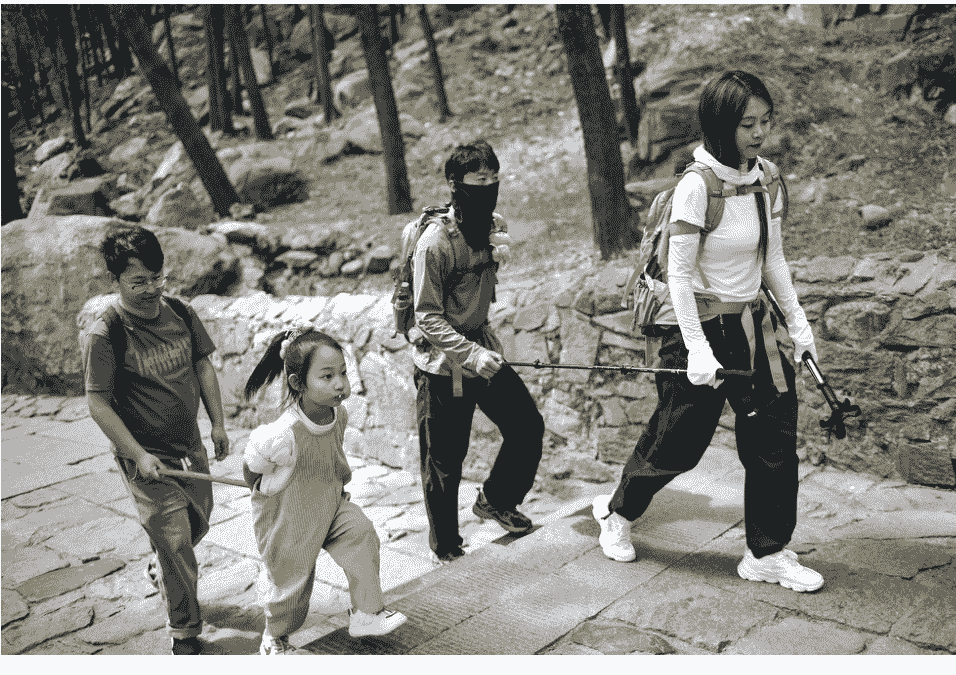

2025年4月17日，田晓瑶接到了男性游客的陪伴单，爬山进入疲劳期的时候，她用登山杖拉着客户上山。

田晓瑛在陪男客户登山的时候，不仅为客户准备了登山杖，还背起客户的旅行包，为他登山减负。

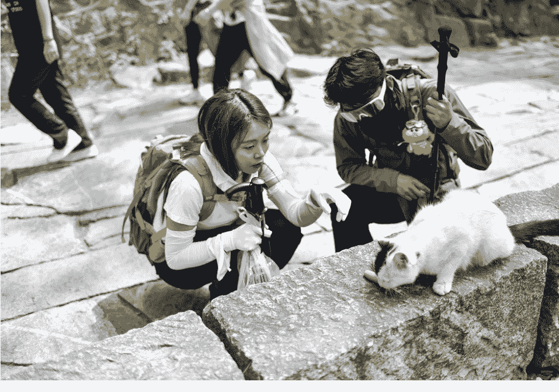

登山过程中遇到散客，田晓瑶主动拉客户一起喂猫，给足情绪价值。

在泰山景区的中天门，客户在挂带祈福时，田晓瑶为其记录登山的各个场景。

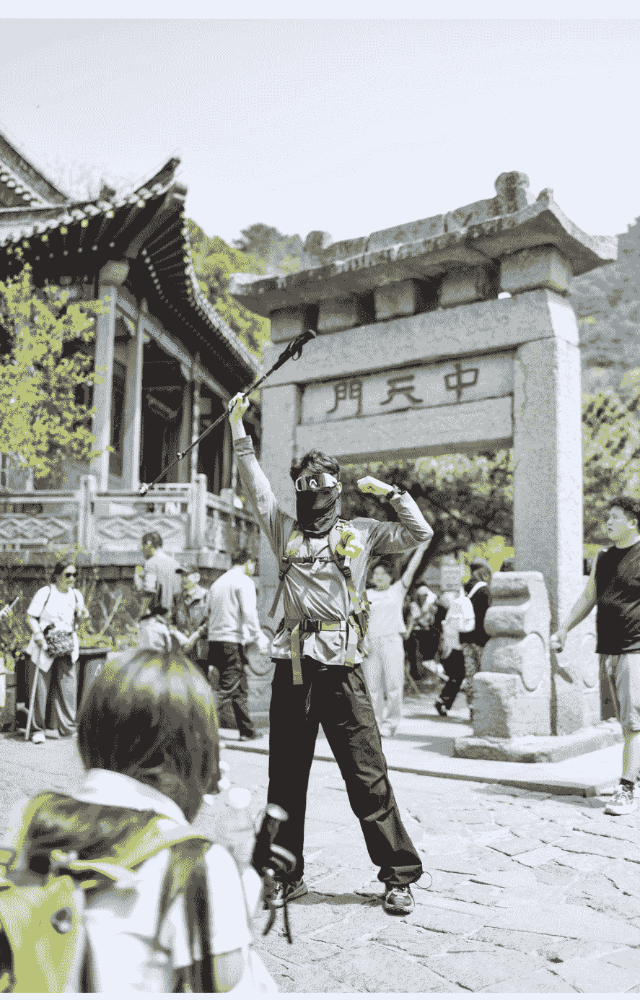

登顶后，泰山景区的陪伴服务已经形成了完整的产业链，随处可见的服务内容包括登山陪伴、景点讲解、拍照等。随着行业竞争加，个体陪伴逐渐向职业化转型。与个人陪伴不同，公司会提供丰富的服务，比如夜爬、定制套餐、多个道具（黑色眼镜、围巾、国旗等），并提供登山技巧指导、个性化行程规划，满足不同客户需求。

2025年4月27日，泰山景区红门广场聚集了众多准备夜爬山的游客。

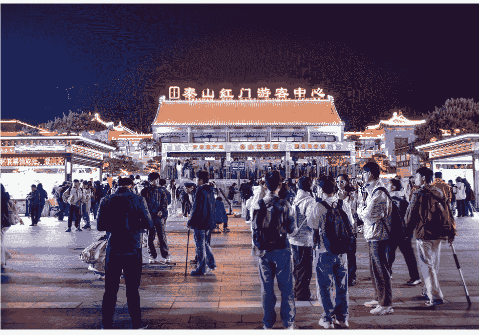

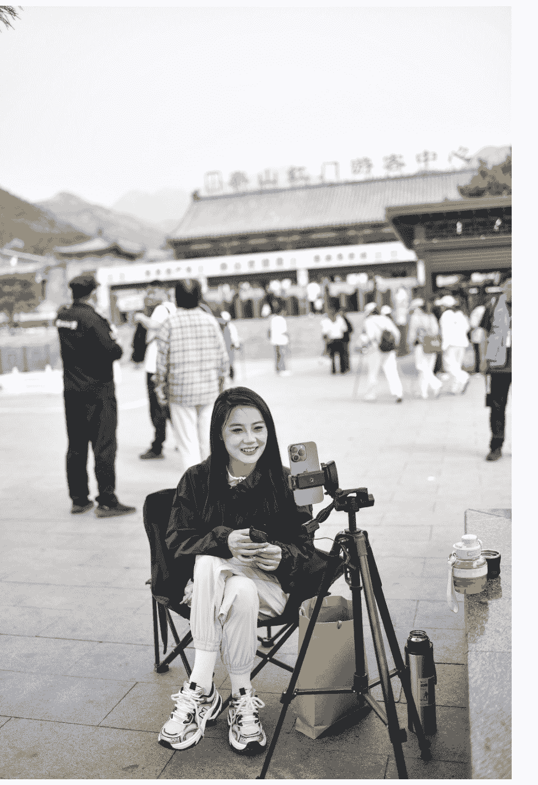

2025年4月17日，泰山景区红门广场，主播正在通过视频直播推荐爬山业务。田晓瑶高举国旗，带着客户爬山，在山顶他为客户拍摄挥舞国旗的照片。

黑色眼镜和围巾已成为泰山的标配，登顶后，游客。

田晓瑶的故事是这一行的缩影。这位来自东北长春的姑娘，在2024年首次攀登泰山，偶然发现陪伴行业的潜力。凭借出色的体力和开朗的性格，她在平台上凭借“古灵精怪、幽默伴”的标签走红。泰山景区的陪伴服务随处可见，最重要的是提供情绪价值。

来自山东济南高校体育专业的大二学生玲海，因一段“宝妈人爬山”的视频爆红网络。视频中，他背着一名3岁的女孩从中天一路攀登到南天，轻盈的步法引发关注。这次经历不仅让他赚到了学费和生活费，更获得了流量的加持。如今和其他小伙伴组建了工作室，还有一些大学生兼职人员，通过视频直播的方式接单。玲海透露，今年“五一”期间，咨询陪伴的游客较多，工作室成交了37单，其个人收入就有几千元。而整个4月的收入达到位数，工作室的几位全职陪伴人员的收入约在8000元至万元。

据付玲海的了解，有陪伴需求的客户年龄段主要集中在25到45岁、有一定经济能力、单独来泰山旅游的女性，也有带着孩子爬泰山的家长。在他看来，陪伴业务并不是一件简单的事情。登山是有风险的运动，“一个合格的陪伴员还需要了解泰山、三观正、性格‘社牛’，能够和客户互动，会拍照，会使用运动相机”。

他坦言，在泰山从事陪伴业务的人并不，“市场已经比较饱和了，新人加入进来，如果没有一定的粉丝基础，做起来比较难。”不过他也表示毕业后不会改行，会继续从事陪伴业务。付玲海自备了宝宝背包，来自宁波的年轻妈妈非常放心的让他背着孩子上山。

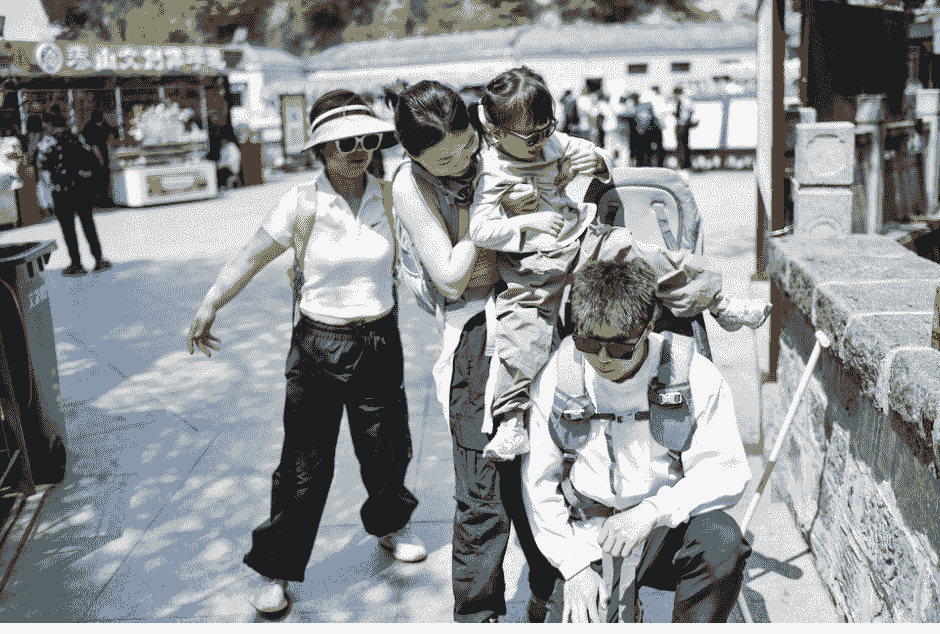

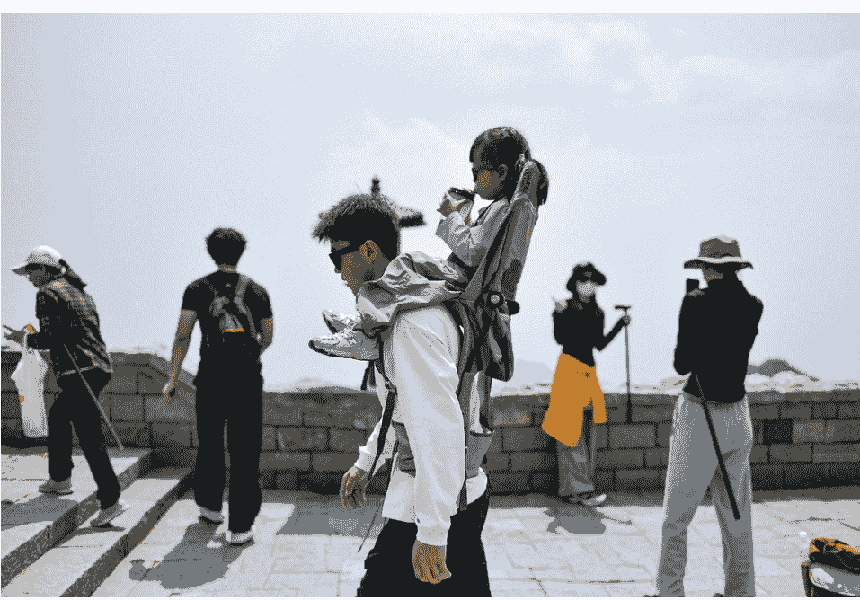

背着30多斤的孩子，对体育专业的付玲海来说比较轻松。泰山脚下的红门游客中心，登山人数超过几万人，是登山队伍的中坚力量。

翠花，在2024年首次攀登泰山，偶然发现陪伴行业的潜力。凭借出色的体力和开朗的性格，她在平台上凭借“古灵精怪、幽默”的标签走红。泰山景区的陪伴服务已经形成了完整的产业链，随处可见。内容包括登山陪伴、景点讲解、拍照等。

翠花，在2024年首次攀登泰山，偶然发现陪伴行业的潜力。凭借出色的体力和开朗的性格，她在平台上凭借“古灵精怪、幽默”的标签走红。泰山景区的陪伴服务已经形成了完整的产业链，随处可见。

翠花，在2024年首次攀登泰山，偶然发现陪伴行业的潜力。凭借出色的体力和开朗的性格，她在平台上凭借“古灵精怪、幽默”的标签走红。泰山景区的陪伴服务已经形成了完整的产业链，随处可见。

翠花，在2024年首次攀登泰山，偶然发现陪伴行业的潜力。凭借出色的体力和开朗的性格，她在平台上凭借“古灵精怪、幽默”的标签走红。泰山景区的陪伴服务已经形成了完整的产业链，随处可见。

翠花，在2024年首次攀登泰山，偶然发现陪伴行业的潜力。凭借出色的体力和开朗的性格，她在平台上凭借“古灵精怪、幽默”的标签走红。泰山景区的陪伴服务已经形成了完整的产业链，随处可见。

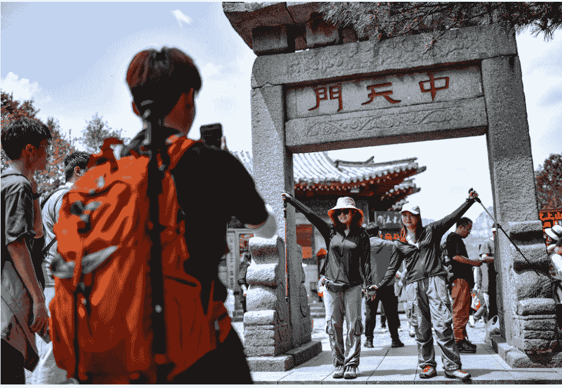

晨晨，晨晨坦言：“我是二级运动员，短跑和中长跑是我的强项，我能在3小时内扛着客户身上十八盘，同行们都喊我‘铁腿晨’。刚开始我以为只要爬山就快，后来发现，长得帅、身材好才是硬实力。“爬山的过程中，如果游客体力不支，晨晨会主动背客人山上，还会讲脱口秀缓解客人疲劳。“有的客人会因为觉得你挺好，表示感谢和奖励。”

晨晨，晨晨坦言：“我是二级运动员，短跑和中长跑是我的强项，我能在3小时内扛着客户身上十八盘，同行们都喊我‘铁腿晨’。刚开始我以为只要爬山就快，后来发现，长得帅、身材好才是硬实力。“爬山的过程中，如果游客体力不支，晨晨会主动背客人山上，还会讲脱口秀缓解客人疲劳。“有的客人会因为觉得你挺好，表示感谢和奖励。”

晨晨，晨晨坦言：“我是二级运动员，短跑和中长跑是我的强项，我能在3小时内扛着客户身上十八盘，同行们都喊我‘铁腿晨’。刚开始我以为只要爬山就快，后来发现，长得帅、身材好才是硬实力。“爬山的过程中，如果游客体力不支，晨晨会主动背客人山上，还会讲脱口秀缓解客人疲劳。“有的客人会因为觉得你挺好，表示感谢和奖励。”

晨晨，晨晨坦言：“我是二级运动员，短跑和中长跑是我的强项，我能在3小时内扛着客户身上十八盘，同行们都喊我‘铁腿晨’。刚开始我以为只要爬山就快，后来发现，长得帅、身材好才是硬实力。“爬山的过程中，如果游客体力不支，晨晨会主动背客人山上，还会讲脱口秀缓解客人疲劳。“有的客人会因为觉得你挺好，表示感谢和奖励。”

晨晨，晨晨坦言：“我是二级运动员，短跑和中长跑是我的强项，我能在3小时内扛着客户身上十八盘，同行们都喊我‘铁腿晨’。刚开始我以为只要爬山就快，后来发现，长得帅、身材好才是硬实力。“爬山的过程中，如果游客体力不支，晨晨会主动背客人山上，还会讲脱口秀缓解客人疲劳。“有的客人会因为觉得你挺好，表示感谢和奖励。”

晨晨，晨晨坦言：“我是二级运动员，短跑和中长跑是我的强项，我能在3小时内扛着客户身上十八盘，同行们都喊我‘铁腿晨’。刚开始我以为只要爬山就快，后来发现，长得帅、身材好才是硬实力。“爬山的过程中，如果游客体力不支，晨晨会主动背客人山上，还会讲脱口秀缓解客人疲劳。“有的客人会因为觉得你挺好，表示感谢和奖励。”

晨晨，晨晨坦言：“我是二级运动员，短跑和中长跑是我的强项，我能在3小时内扛着客户身上十八盘，同行们都喊我‘铁腿晨’。刚开始我以为只要爬山就快，后来发现，长得帅、身材好才是硬实力。“爬山的过程中，如果游客体力不支，晨晨会主动背客人山上，还会讲脱口秀缓解客人疲劳。“有的客人会因为觉得你挺好，表示感谢和奖励。”

晨晨，晨晨坦言：“我是二级运动员，短跑和中长跑是我的强项，我能在3小时内扛着客户身上十八盘，同行们都喊我‘铁腿晨’。刚开始我以为只要爬山就快，后来发现，长得帅、身材好才是硬实力。“爬山的过程中，如果游客体力不支，晨晨会主动背客人山上，还会讲脱口秀缓解客人疲劳。“有的客人会因为觉得你挺好，表示感谢和奖励。”

晨晨，晨晨坦言：“我是二级运动员，短跑和中长跑是我的强项，我能在3小时内扛着客户身上十八盘，同行们都喊我‘铁腿晨’。刚开始我以为只要爬山就快，后来发现，长得帅、身材好才是硬实力。“爬山的过程中，如果游客体力不支，晨晨会主动背客人山上，还会讲脱口秀缓解客人疲劳。“有的客人会因为觉得你挺好，表示感谢和奖励。”

晨晨，晨晨坦言：“我是二级运动员，短跑和中长跑是我的强项，我能在3小时内扛着客户身上十八盘，同行们都喊我‘铁腿晨’。刚开始我以为只要爬山就快，后来发现，长得帅、身材好才是硬实力。“爬山的过程中，如果游客体力不支，晨晨会主动背客人山上，还会讲脱口秀缓解客人疲劳。“有的客人会因为觉得你挺好，表示感谢和奖励。”

晨晨，晨晨坦言：“我是二级运动员，短跑和中长跑是我的强项，我能在3小时内扛着客户身上十八盘，同行们都喊我‘铁腿晨’。刚开始我以为只要爬山就快，后来发现，长得帅、身材好才是硬实力。“爬山的过程中，如果游客体力不支，晨晨会主动背客人山上，还会讲脱口秀缓解客人疲劳。“有的客人会因为觉得你挺好，表示感谢和奖励。”

晨晨，晨晨坦言：“我是二级运动员，短跑和中长跑是我的强项，我能在3小时内扛着客户身上十八盘，同行们都喊我‘铁腿晨’。刚开始我以为只要爬山就快，后来发现，长得帅、身材好才是硬实力。“爬山的过程中，如果游客体力不支，晨晨会主动背客人山上，还会讲脱口秀缓解客人疲劳。“有的客人会因为觉得你挺好，表示感谢和奖励。”

晨晨，晨晨坦言：“我是二级运动员，短跑和中长跑是我的强项，我能在3小时内扛着客户身上十八盘，同行们都喊我‘铁腿晨’。刚开始我以为只要爬山就快，后来发现，长得帅、身材好才是硬实力。“爬山的过程中，如果游客体力不支，晨晨会主动背客人山上，还会讲脱口秀缓解客人疲劳。“有的客人会因为觉得你挺好，表示感谢和奖励。”

晨晨，晨晨坦言：“我是二级运动员，短跑和中长跑是我的强项，我能在3小时内扛着客户身上十八盘，同行们都喊我‘铁腿晨’。刚开始我以为只要爬山就快，后来发现，长得帅、身材好才是硬实力。“爬山的过程中，如果游客体力不支，晨晨会主动背客人山上，还会讲脱口秀缓解客人疲劳。“有的客人会因为觉得你挺好，表示感谢和奖励。”

晨晨，晨晨坦言：“我是二级运动员，短跑和中长跑是我的强项，我能在3小时内扛着客户身上十八盘，同行们都喊我‘铁腿晨’。刚开始我以为只要爬山就快，后来发现，长得帅、身材好才是硬实力。“爬山的过程中，如果游客体力不支，晨晨会主动背客人山上，还会讲脱口秀缓解客人疲劳。“有的客人会因为觉得你挺好，表示感谢和奖励。”

晨晨，晨晨坦言：“我是二级运动员，短跑和中长跑是我的强项，我能在3小时内扛着客户身上十八盘，同行们都喊我‘铁腿晨’。刚开始我以为只要爬山就快，后来发现，长得帅、身材好才是硬实力。“爬山的过程中，如果游客体力不支，晨晨会主动背客人山上，还会讲脱口秀缓解客人疲劳。“有的客人会因为觉得你挺好，表示感谢和奖励。”

（此处省略）

# 泰山之旅的职业“爬员”

如今，由于旅游需求的增加，“陪爬”正成为年轻人的热门职业

泰山风景秀丽，气候变化大，由于山路陡峭，很多路段险象环生。因此，很多游客选择雇请当地人带他们登山。这种服务在当地已经成了一项收入丰厚的职业，他们被当地人称为“陪爬员”。

### “陪爬员”
所谓的陪爬员，是指在泰山的当地人，他们熟悉山路地形，能够带领游客安全快速地到达山顶。在旅游旺季，一名陪爬员的收入可以达到几百甚至上千元不等。

## 阅读 | 幻想之底: 穆旦传——诗人是真正的历史之子

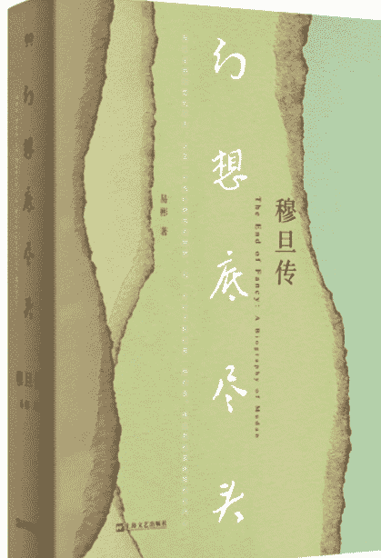

# CAIXIN| 听文章

文 | 唐小兵
华东师范大学教授

2008年初，我在温哥华因偶然机缘邂逅了台湾诗人嵇弦。他在我带我去的一本英文诗集的扉页写下了“诗人是真正的历史之子”这一词。多后，在他的口述集《嵇弦回忆录》中，读到序言中对人生问题的思考，又一次想起了这句话。他提到，一个人或许本来具有某种禀赋、能力，却因个体的性情、意志或时代的局限、偶然的变故，甚至一念之差的命运转折，最终未能尽用，所呈现的便是未能充分燃烧的“火山”，正如余丰先生所侧倾侧容，他所说的“未尽的情才”。

读完近出版版的《幻态边缘：穆旦传》，我的脑海中首先浮出的感触亦是“诗人是真正的历史之子”。这部厚达600多页、由中南大学中文文系教授杨彬完成的传记，完整地呈现了穆旦并不顺畅的一生。杨彬三十年耕如一日，孜孜不地整理和书写穆旦的年轻、诗集编年纪、研究资料等，几乎以一人之力，让穆旦这位原本被冷冷的20世纪中国最大的诗人之一，重新进入学界和公众的视野。

## 01

穆旦的生命几乎完整地见证了20世纪中国的战争、革命与动荡。不同于其荒、下之琳、冯等等从个体生命经验和感情出发的主义诗人，穆旦的作品充满了更而强烈的历史意义和张力，是个体生命与时代强烈碰撞后的生命书写。

20世纪亦乏面对民族、国家和历史进行写作的诗人，比如艾青，曾写下“为什么我的眼里常含泪？因为我对这片土地爱得深沉”。然而，这类诗歌最后往往宏大叙事走向抽象的抒情。

穆旦显然不属于纯粹抒情的个人主义立场，也不属于集体主义取向的诗人。他的诗契合哈佛大学教授王德威教授言的“史诗时代的抒情声音”，以个性的独特特质的艺术形式，表达了一个诗人对历史的参与、感受、见证和思考。

从这个角度而言，穆旦无愧于“诗人是真正的历史之子”的称号，或许因其诗歌写的独特视角和个性的严肃正直，加之可能为课而相继卷入一些与国民政府、美国相关的机构等，1953年从美国归国后，他的人生便陷入了无无尽的压抑痛苦，诗人的生命似乎也成了“漫长的余生”。唯有诗歌翻译，让他获得了一点点心灵慰藉，也结识了一些登门拜访的年轻人，在令人窒息的环境里，找到了一个可以自由呼吸的小孔。

## 02

穆原名良宪，祖籍浙江海宁，1918年生于天津。他在《历史思想自传》中这样描述一个破落的本土绅主家的家庭状况及其影响：“家庭的生活方式是封闭式的，绅术、宠，长男弱女，这一切都让我不满，还有更深刻的原因让我我不快乐。父亲的粗暴对我感到愤恨，母亲经常受压，枉泪度日。还有，在家庭中，我们这一房竟贫寒，被人们看不起，给我留下了深刻的印象。我当时立即要强，好长大了养妈妈，为她增光吐气。我的向上，好好与人竞争，对于权威、专制和暴虐的反抗，倔强的个人主义，悲欢的性格，都在这种环境中滋生起来？”

不过，他并未如潮刚那样，因源家庭的生死无常形成政治反抗的烈士精神，也不像后五四时期很多年轻人那样，冲破家庭牢网而走家庭革命的道路。他终其一生都在奔波和，对于家庭的核心价值始终是细心守护的。他一辈子都很关心母亲的处境，有了自己的四个子女，也是尽力抚养和照顾他们成长，并因自己的身份影响了孩子们的人生而深感遗憾和自责。之所以是为了奉养父母和弟妹等，在不同的职业之间反复切换，四处游荡，更是让人切实感受到，到那时抒情诗人也绝非不食人间烟火，而是一直试图在诗歌与日常、灵魂与现实、历史与政治之间寻求一种审慎的平衡感。

从这一点而言，世界八世纪年代追求独立的朦胧诗人，如海子、顾源等和我完全不同。他想过过好一个普通人，而这种试图过好一个普通人，拥有尊严地度过的一生，就是穆旦的终极作品。

记得维特斯坦临终前对身边的人说，“请告诉他们，我度过了极好的一生。”然而，穆旦肯定不会如此念想，因为他有太多的愿未能，有太多的人间羁绊未能放下。

## 03

幸运的是，穆旦在南开中学、清华大学以及西南联接受了完整而优质的教育。张伯等一人创办的南开，文化和风气对于内心满感和怀满情绪的少年来说，是一种极其有效的外部资源，让他得以借助学校生活，从大家族的阴影里艰难抽出而出，成长一个更有内在的人格完整性的自我。

1929年入南开中学后，穆旦积极参与校园文化活动，发表作品，在同学中，认识了一些后来成为一辈子朋友的诗人。“穆旦这一笔首次可见于1934年的散文《梦》。易鼎为，家族丰富的藏书、深远的文化积累以及他较高的文学阅读，和在南开中学接受良好教育，共同促成了穆旦的“早熟”。他的同学诗人杜文曾出：“穆旦很早就在诗中出现的感情的含蓄节奏和具有较多的理性。不像许多二十几岁的年轻人，写诗一般抒胸，表现出更多的放弃或感伤，穆旦在写诗时却像个中年人，有着甚至老像一个格格骚的老人。”

1935年，穆旦读清华外文。当时的穆旦正处于“九·一八”事变后的落荡时期，“华北之大，已经安不下一张平静的书桌。”穆旦兼具热烈与冷静性格特质，穆旦参加过“二一九”和“二六”学生运动，并参加过大刀运动，也开始阅读《群众》等书籍，并与同学玉瑶交流。在给清华的信书中，对于他人对生命的担忧，穆旦回应：“几乎没有，包括冯兰、朱自等教授，都在支持他们。”此时，穆旦开始频繁在校内的《清华周刊》，校外的《益世报》、《上海文学周刊》等发表文章和诗歌。紧接着，全面抗战爆发，穆旦随清华到湖南长沙，进入临时大学文学院，当时钱理、冯兰等教授也在这里任教。

1937年至1938年，很多聚集在长沙的优秀青年，仍在经历心灵挣扎——在抗战初，穆旦曾有过参加革命、救国的意图，因为在清华大学期间，穆旦并未像许多追求民主和进步的青年那样直接走上革命之路。穆旦的选择似乎与主流不同，他更关注每一个底层的普通。这或许是穆旦的选择，这或许来自天性，也许来自家庭的顾念，也许来自对历史的直觉。

比如1949年，当许多人在迎接新时代的到来时，穆旦赴美国求学；而1953年，当许多人在观望中国时，穆旦毅然回国。随后穆旦参加了湘西、贵州、云南的徒步步行，在途中写了一些诗歌，并留下了《步行》系列。抵达昆明之前，步行途中，王佐良在译穆旦的长文《一个诗人》中，描述了西南联大时期的日常生活：穆旦的屋顶是低的，由于学生外围的生存。在战争初期，穆旦被饥饿，这些联大的封面被覆盖了，往往失去了。在这些严峻的困境中，穆旦读了艾洛特、奥登等西方现代诗人的作品。

## 04

穆旦命运的真正转折发生在1942年。彼时，他刚离开学校任西南外语系助教，加入中国征军，随军翻译。在缅甸，他经历了地狱般的苦难，目睹了士兵的死亡。1942年，日军入侵缅甸，穆旦在随军翻译。为了捍卫一切生命尊严，他试图描绘战争的残酷性和对消逝生命的哀悼。这段经历让穆旦写下《苦难历程——遥望者和纪念者》，也曾写下《森林之谜——湖上的白骨》等诗，其中有这样的句子：“那种失去了人体的样子，你就肯望；赶快走吧，最好别人看到，你希望他们赶快回国，你不由得可怜，这种感情又似乎若无。因为我们自己的灵魂就在沿江搭建草屋，手赤足，准备忍受这个严冬。”这恰恰彰显了人性的复杂。王鼎钧在《关山路》中也写道，他对上海日军军容整齐、撤离回国时有一种极其复杂的认同情感。

穆旦（与杜运望）均为“九十诗派”。两人有着深厚的友谊，在创作上也有交流。1976年，穆旦创作了《冬》，1979年，杜运望创作了《秋》。抗战结束后，穆旦为了生计到处奔走，先担任部队内秘书、新闻学院学员和航空公司员。军队生活以及来的各项工作是技术化且乏味的，没有前途。他打算从新闻学院出国，但不得不顾及赡养父母的物质需要，对当时的教育也深感不满。综合来看，到1945年底底，穆旦只能说是一位文化身份微微、诗歌名微的诗人。

1950年，在芝加哥大学获得硕士学位的穆旦（右二）与妻子周莹（右一）同来美国。罗伦（左一）是中国远征将帅。到了1946—1947年，因跟美国联络的教师如从文、冯等人建立联系，他的作品开始在当时极具影响力的《大公报·星期文艺》、《益报·文学周刊》、《杂志》等刊物上发表，可以说由此进入了中国最具影响力的文学圈，他的诗歌影响力和地位得到了迅速提升。

这一时期，穆旦发表了一系列散文，包括《从昆明到长沙——还乡记》、《少暮的武汉》等，对于抗战结束后的中国城市，尤其是普通人的生活，进行了深刻的白描，其中最核心的主题就是对于战争的厌弃和反思。在长沙，穆旦直接露出对战争的反感：“我在长沙的街上走，在沿江岸上所见的一切，使我不由厌弃战争，厌弃战争期间双方拥有的那种Bravado，那种故意暴躁的精神。”当他看见那些战败的日本队在长沙街头无家可归时，产生了一种复杂的绪：“那种失去了人体的样子，你就肯望；赶快走吧，最好别人看到，你希望他们赶快回国，你不由得可怜，这种感情又似乎若无。因为我们自己的灵魂就在沿江搭建草屋，手赤足，准备忍受这个严冬。”

## 05

穆旦人生第二个至关重要的转折，是从芝加哥大学毕业后于1953年回国。在美国留学的生活异常苦，为了维持身体，穆旦在邮局找了份工作。回国后，他在南开大学任教，他的好友巫坤。他之所以选择回国，跟巫坤的心境相似：“感受到有一根不断的纽带将自己与古老的国家连接在一起，虽然是一个用贫困、孤独、屈辱、动乱看着年轻时代的。”

1958年8月9日，穆旦被定为反分子，被处管制。他被赶下南开讲堂，在图书馆监督劳动。1959年1月9日，穆旦被关进园内的劳营，妻子周莹被指控“有美国特务嫌”，被隔离半年。在改造运动中，穆旦被强迫写作，妻子周莹甚至不能做饭，还要给妈妈送饭。这种运动给身体带来的诸多痛苦，是无法的。在妻子周莹的记忆中，穆旦的生活充满了痛苦，白天交代，晚上交代，甚至在睡梦中都在交代。

接下来，穆旦的人生就是作为诗人的自我与高度政治化的激烈碰撞。为了生存，穆旦将自己作为诗人的身份隐藏起来。从50年代开始，他翻译鲍莱、普希金、艾洛特、奥登等西方现代诗人的作品，包括《普希金诗集》、《欧根根诗集》、《唐韵》等经典。在妻子周莹的帮助下，穆旦出版了余本著作，让他经济上还能继续。1962年秋冬之际，穆旦接到巫坤的紧急报，全家被送到农村，周莹帮助他们度过了难关。1977年7月26日，59岁的穆旦生命猝然终止。在手术前，就已经查出了心肌梗塞。去世后，70年代，穆旦被平反，撤销判决，宣告无罪。从90年代开始，穆旦的文学地位逐步提高，作为现代诗人的第一位，他的诗史和文学史论著陆续出版。

# 专栏 | 德国酸菜遭遇世代

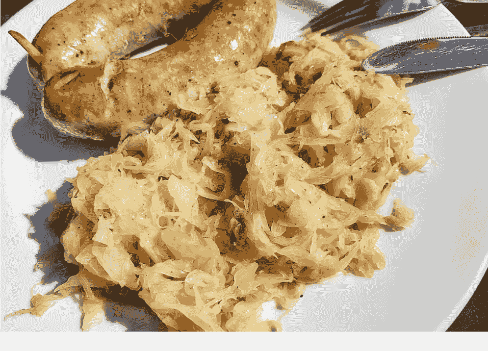

# CAIXIN| 听文章

文 | 王宽
作家

上世纪80年代末，我爸爸从德国学来，总结了他对德国人的印象：第一是品质，富而不愁；第二是口味，无酸不欢。他接触到的德国人，称他们为“酸人”。此后，我出差和旅行的朋友反复印证了他的结论，德国大众如此对待饺子。在餐厅里的第一顿德式大餐，全是标配的烤猪加菜土豆泥。除了酸菜，酸黄瓜也是德国的一绝色。我有位住在德国南部的朋友，一个人经营着一家出版社，她是员工兼作者。在如今这样的时代，公司居然能屹立十年不倒。聊到出版书籍，她告诉我：她丈夫家族传世的酸黄瓜企业是她的坚强后盾。做酸黄瓜用的黄瓜，长度要严格限制在8—15厘米内，一场夏雨淋下，黄瓜一夜就能长两厘米，控制很高，严重影响到收成的35%。她丈夫的酸黄瓜产业比她出的出版物更有性，还能常年倒贴。

酸黄瓜是一种跟时代的产品。汉堡里面要有几片酸黄瓜才起，土豆沙拉不仅放酸黄瓜丁，最好还要泡酸黄瓜的水加入才爽口。然而，德国的传统酸菜（Sauerkraut）就没有这么幸运了。不久前，被德国消费研究所列为将退出历史舞台的商品。

酸菜在德国牵动着每个人的神经。小时候听过的故事没有“奶奶在给韭莱煮过香喷喷的脑肠酸菜土豆泥”的情节？圣诞大餐记忆中，冷丁、肉桂、杏叶加料松子烤饼酸菜的气味全覆盖，甚至就连著名诗人海因林都不嫌酸菜的市井俗气，在它的诗《德国，一个冬天的童话》里，海曼给酸菜布局了一个高光时刻——“桌子已摆好/我在这里找到了完整的古代夏曼菜/向你致意，我的酸菜的香气是多么迷人！”

德国人跟酸菜不可分离的文化延续，其实早被英国人界定了。早在美国独立战争前，落脚纽约的德国移民就开始做酸菜，立刻被当地英国人看好，认为是治疗坏血病的良药，因为卷心菜不管发酵成酸菜，但维生素C含量不减。到了二战期间，有德国军的地方就有酸菜，弄得英美军直呼德国士兵为“酸菜”——Kraut，这个称呼在英语里流行至今，成了德国人的符号。

政府的城市规划，剧减了居民户外活动的机会。上一代时候走路路上，在学校有更多体育课，成年人有更多体力劳动。此后几十年，电视、网络游戏、社交媒体替代了户外活动，校车或家长开车送学生代替自己走路，全民肥胖迅速成为。

与美国形成巨大反差的是，日本大部分道路专用道，即使在四川偏远的乡村，在东海道、中山道，大部分路段都有人道；骑行穿越日本，所有的桥梁和涵洞，都有行道。在我居住的地方，公路原本有两米宽的路肩，可以骑车或步行。几年后，当地政府扩拓机动车道，把路肩拆得只剩狭窄的一条，骑车或步行已经没有了往日的安全。

除了随处可见的人道，鼓励跑步，日本人在饮食上很节制，超市便利店的各种预制饭，分量比美国得多；公共场所几乎看不到时候往哪里哪儿吃东西的日本人。

日本有3000家麦当劳，有些偏僻小镇上的麦当劳很受欢迎，男女老少都有。美国的麦当劳鼓励你吃、多喝，日本的麦当劳鼓励你节制，饮料还要少得多，中号大概相当于美国的小号，而且没有喝渴了自己随便的饮料。

两国感上的反差，表面上是体型的不同，实际上是生活态度和文化的不同，背后是对身体的不同认知、对生活方式的不同选择、对责任的不同取向。毕竟，肥胖是一种可以预防的流行病，跟身高长相一样，不是天生的，而是后的选择。当肥胖成了全国危机，个人究竟应该承担什么责任？这是每个人都回避不了的问题——毕竟身体是自己的，健康也是自己的。

2022年6月，《柳叶刀》称美国每年因吸毒死亡10.8万人、因枪击死亡4.7万人（包括自杀和他）、因车祸死亡4.2万人、因吸烟死亡48万人，因肥胖死亡高达50万人，平均每天1300人。根据美国疾病控制和预防中心估算，肥胖每年直接造成的医疗费用超过173亿美元，相当于每人每年平均为肥胖患者花费750美元治疗费。这还不包括由肥胖引发的癌症、心脏病、糖尿病等治疗费用。

肥胖也成为国家安全隐患。近年，美国军队征兵队伍困难，报名参赛的年轻人并不少，根据疾控中心的数据，高达71%的年轻人团体超重、体能不能达标，达不到优标准。

在美国，没有人鼓励肥胖，没有人鼓励枪杀，没有人美化车祸，却有无数人鼓励暴饮暴食、美化肥胖，在一个74%人口有肥胖和超重问题的国度，没有政客散在这个问题上得票选民。有些时候，之肥胖被说成是“损害身体”“侵犯自由”。政客们吝于口谈及医保政策，却不敢直面肥胖症在我国医疗制度的表现。但是身体是实的。街头人群的身体有些差异更显著一些。

人类是一个具有自我毁灭倾向的物种，一旦有了某种自由，就会用力——酒精、赌场、吸烟，还滥用权力。在人类历史上大部分时段，吃饱是一种奢侈。当食物变得唾得可怕，很多人开始用饮自自食，把接受自己变成放纵自己。当体力活动只是生活工作之余自我提高的选项时，自律成为保持健康的必要条件。

# 逝者 | 裴锡圭：破解古文字文献的历史密码

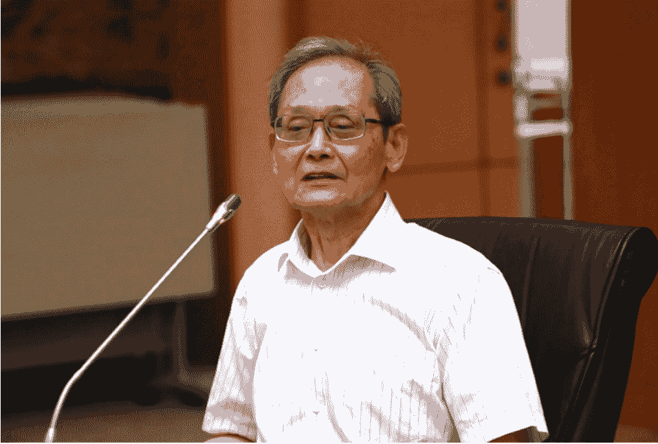

# CAIXIN | 听文章

文 | 财经周刊 汪佳钰

复旦大学出土文献与古文字研究中心教授裴锡圭，于2025年5月8日在上海逝世，享年90岁。身为古文字学家、古文献学家、历史学家，先生一生潜心学术，在古文字考释、出土文献整理及上古史研究等诸多领域贡献卓越，是学界公认的一位权威学者。

癸锡1935年生于上海，1952年以第一志愿考复旦大学历史系。彼时，中国古史分期问题在学界辩证激烈。癸锡深知，探究上古社会性质，离不开古文字资料，立志进入古文字这一冷门领域。受甲骨文学家顾厚先生的影响，他大学就开始研读甲骨文和金文。

1956年，癸锡追随胡广宜来到北京，进入中国科学院历史研究所，以复“甲骨学与古代史”副博士研究生的身份，进入秦史组学习。在那里，他与史学界前辈张亚硕、郭沫若等人交流，大大拓宽了学术视野。1960年他毕业后，进入北京大学中文系任教，开启了45年的从教之路，培养了许多文字学专业人才。

癸锡始终学术不辍，毕业致力于学术。《甲骨文中所见的古代五刑》是他的第一篇学术解释之，在《古考》杂志（1961年第2期）发表，便引起了学术关注。此后，他与北大的李德教授同仁研究古文字，大量读铭、陶文的著书，两人合作撰写多篇学术论文，发表在《文物》等刊物上。其中，战国文字（六种）经郭沫若推荐的，在《古学研究》复刊的第1期（1972年第1期）发表。

癸锡在北大大学先后开设了汉字学、古文字、考古资料与先秦汉古籍整理、金文选读、甲骨学等课程。其鼎鼎之作《文字概要》，最初基于北大洪义写成，随后不断收集古文字与文献领域的研究成果，持续充实完善，最终系统构建了汉字学理论体系。自1988年首版问世以来，该书经历多次修订，成为汉字研究领域的经典，还为无数年轻学子开启学术之门。

1978年6月29日，《光明日报》刊发文章《锲而弥缶，金石可凭》，称裴锡圭是“古文字学的陈倾”。文章记载裴锡圭二十年如一日，苦学不辍，在学术中深耕，在甲骨文解释方面取得了成就，就获得了考古学、古文献、古文字学等赞誉。

上世纪70年代以来，大量出土简帛文献对汉文字研究意义重大；不仅纠正了古书中的错误，还能解决长期困扰学术界的诸多解谜。裴锡圭参与了多项出土文献整理工作，包括银霍山楚简、云梦滩楚简、江陵山楚简、郭店楚简以及东海湾楚简等。例如，银霍山楚简的整理，《孙膑兵法》与《孙子兵法》是否为同一书提供了明确答案；马王堆出土的《老子》与郭店简中的《老子》存在诸多差异，引发了中国哲学界的热潮。裴锡圭后来多次提出“重建古典”，要把出土文献和传世相结合。2005年，复旦大学成立了出土文献与古文字研究中心，为他的团队提供了专门平台。作为学术核心领袖，裴锡圭经历多年深耕，带出一批优秀的弟子，该中心成为国内领先、国际上有重大影响。2012年，复旦大学出版社出版裴锡圭学术集（共六卷），汇集了他数十年的精华。2014年，由湖南省博物馆编译《马王堆汉文集成》，对马王堆出土的大批铭文注释，为学术界提供了宝贵资料。裴锡圭一生严谨。2018年7月，他发表文章《马王堆汉文注释》，宣布自己退休。像裴锡圭这样具有学术地位的学者，晚年受眼底疾病困扰，几乎完全失去视力，依然坚持工作，展现了惊人的活力。

# 前瞻 | 韩国将举行大选

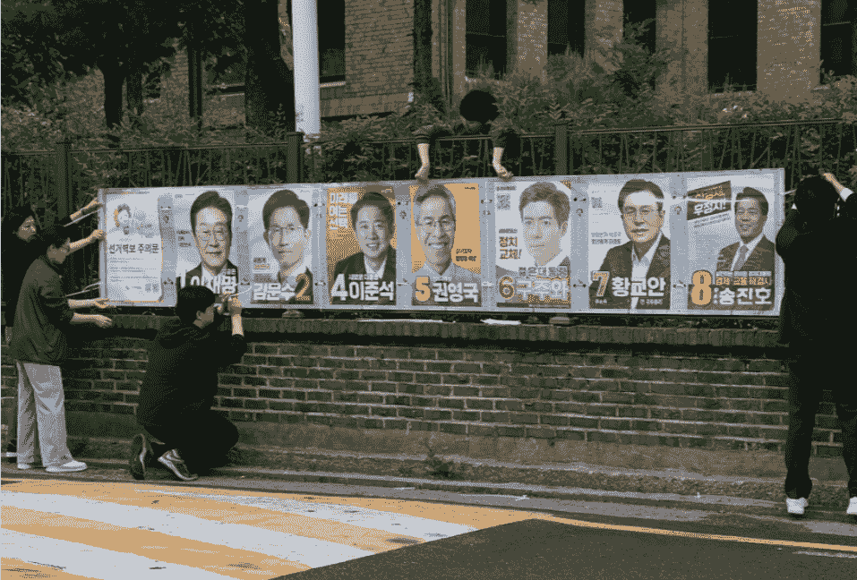

# CAIXIN | 听文章

文 | 财经周刊 王佳钰

韩国将于2025年6月3日举行大选。在前总统尹锡悦因戒严令风波遭到弹劾后，执政党韩国力量最终选出前劳动部长金文哲角逐总统位。来自韩国最大的野党共同民主党首脑李明在民调中大幅领先，预计有机会在选举中胜出。

2024年12月的戒严令发布后，时任总统尹锡悦的行为被宪法法院认定违宪，导致其在2025年4月4日被正式弹劾，尹锡悦也成为继李承恩后韩国史上第二位被罢免的总统。按照《大韩宪法》第68条的规定，新一届总统选举必须在总统空缺后60天内举行，投票日期最终为6月3日。韩国总统选举的具体由《宪法》与《公职选举法》规定，最终的总统候选人需通过党内初选，非党人士以独立身份参选，则需3500名至6000名选民的推荐签字，且须分布在5个以上的广域市/道，每个市/道提供推荐签字不得于700人。

根据大选日程，总统候选人登记于5月10日至11日，竞选活动于5月12日启动并持续至6月。大选的提前投票将于5月29日至30日。韩国政坛长期以来形成两党对峙，分别为进步倾向的共同民主党与保守倾向的国民力量党。曾韩国300个席位中，共同民主党及党掌握了190个席位。尹锡悦执政期间，执政国民力量党未能掌握国会多数，呈现出“朝小野大”格局，尹锡悦政府与野党控制的国会长期对立。尹锡悦遭遇胜利，国民力量党也受到巨大冲击。最新民调结果显示，李在明方面出明显的领袖姿态，其支持率高达52.1%，高于第二名金文哲的31.1%和第三名李俊硕的6.3%。李在明于2025年4月27日，以党员投票率90.4%、民意投票率89.21%，累计得票率89.77%获得共同民主党内提名。这一票率是1987年韩国民主化以来，共同民主党及其前身政党的候选人在党内初选中获得了最好成绩。

另外，二号种子选手金文哲在5月3日被正式提名为国民力量总统候选人。金文哲此前曾任韩国雇用劳动部长，于2025年4月8日辞去职务，宣布加入该党。在5月11日的候选登记截止日前，国民力量党高层尝试推荐金文哲与另一位无党派人士——前韩国总总理韩德洙的竞选整合，在两人中选出一位最终参选，汇集选票以对抗在民调中占优的李在明，由此引发一场“以韩换金”的悲剧。最后，尽管金文哲作为总统候选人参选，其支持率一步下滑，使得李在明的当选越来越远。

# 比尔·盖茨宣布提前捐出个人财富

# CAIXIN| 听文章

文 | 财经周刊 杨琪

“当前有太多亟待解决的问题，我不应该把资源留给自己。因此，我决定尽快把财富回馈社会。”5月8日，比尔·盖茨在个人博客中宣布，将捐出全部财富，用来拯救和改善世界的生命。盖茨基金也将永久关闭——原定于45年后。据估计，这笔捐赠将达到2000亿美元，成为历史上最大的一笔慈善。盖茨基金会此次承诺的捐赠总额已超过770亿美元，在接下来的20年里，翻倍。

比尔·盖茨1955年10月28日出生于雅图。他和保罗·艾伦共同创建微软公司。2000年，盖茨基金会成立，他担任主席。2006年，基金会得到沃伦·巴菲特的巨额捐赠，年度规模扩大。2008年，盖茨投入了580亿美元，也开始全职专注于事业。2014年，辞去微软董事长。2020年3月，离开董事会，担任首席执行官。马克·萨曼在5月8日的媒体采访上宣布，此次承诺是历史性的，确保未来20年内是稳定的、可预测的。消息发布之时，全球健康指标已经停滞。特朗普执任后，政府大幅削减对美国开发署（USAID）等机构的资金。此次调整，基金会将侧重于三个核心目标：助力终结婴儿死，确保下一代不再遭受致命疾病的威胁，并帮助万人摆脱贫困。农业发展、教育、金融服务等领域。2010年，比尔·盖茨、梅琳达·盖茨共同发起“捐赠誓言”（The Giving Pledge），旨在鼓励世界上富有的家庭和个人在其出生年或遗嘱中公开一半以上的财富投入慈善。目前已有全球30个国家的超过240位富豪加入计划。

# 心智 | 向外求还是向内求

# CAIXIN | 听文章

文 | 婉婉

一位朋友与我分享最近的心态转变，提到“向内求，莫向外求”这句话触动了，因为它似乎精准地回应了自己当下的困境。前段时间，她因为伴侣的变故，不得不在家庭中投入精力。她付出了很多，却得不到对方的关注与回应。这种状态让她倍感痛苦，也感到不公平。后来，她开始调整心态，不再奢望对方的改变，而是专注于自己掌控的部分。她告诉自己，多做一点没关系，对方的回应并非首要的标准。观念转变后，行动也随之改变。她开始在对方接受的范围内适度表达需求，而不是一味索求。当她放下执念，转而向内寻求力量与平衡后，内心豁然开朗。

巧的是，另一朋友也谈到了自己开始了向内求的探索。过去自己是典型的任务导向型人：不论如何，不顾他人感受，总是先把事情办好。遇到问题时，她首先想到的总是：是资源利用不当还是解决方法有误？但渐渐，她觉察到，团队对他有些不满。这种不满似乎源于对人际关系的忽视，也许源于她所谓的“任务导向”并不能带来理想结果。她确信自己的能力解决问题，团队未能给予她应得的认可尊重。经过一段时间的向内求索，她识别到：表面上的她专注于问题，内心非常在意别人的评价和认同。那种渴望被他人认同的需求，其实源自深层的不自信，这份不安全被外表地掩饰。通过持续的自我反省，她终于释怀：“我不总是期待他人对我崇拜，我要先崇拜自己、认可自己、先尊自己。”在这两个案例中，“向内求”得到的不是答案，而是内心的稳定与力量。

在东方哲学中，圣贤们都强调“向内求”获得智慧和安宁。西方文化中也有与之呼应的理念，那就是心理学中的内在动机理论。动机是人类的起点，驱动着我们的行动。还记得小时候吗？仅凭好奇，我们就能在泥地里玩上一整天，不需要任何奖励。可是随着年龄增长，进入学校、步入职场……
