特朗普2.0税改关税 16 扶持局宽案 30 加码分险 42
铜上的拉美 22 境外收入追税 36 国产AI视频竞速 64

# 财新 Caixi

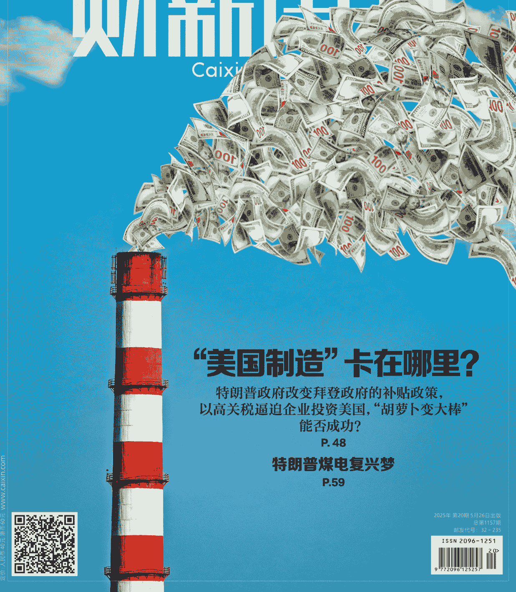

# “美国制造”卡在哪里？
特朗普政府改变拜登政府的补贴政策，以高关税逼迫企业投资美国，“胡萝卜变大棒”能否成功？

P.48

# 特朗普筹电复兴梦

P.59

2025年第20期5月26日发行
刊号：11578
起刊号：32-235
ISSN 2096-1235
20.0元

版权所有：财新财经有限公司 www.caixin.com

# 免费 价值 及时 关注
扫码加入 知识星球TOP 免费资源群

- 每日免费获取价值资源
- 可提供各类资源搜索服务

| 热门付费文章 | 各行行业报告 |
| :--- | :--- |
| 精选图书资源 | 副业赚钱方法 |
| 职场实用资源 | AI政经自媒体 |

公众号: 知识星球TOP 微信信号: jntsg8 微信信号: jntsg2

分享资料仅供个人学习，请及时删除，切勿商用传播

# 财新观察 | 遵循法治精神推动购重组

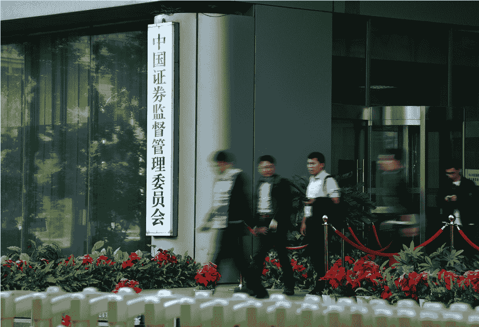

# CAIXIN|听资本市场的大事

资产重组一向是资本市场的大事，牵动着投资者的敏感神经。近日，中国证监会发布修订后的《上市公司重大资产重组办法》（简称《管理办法》），修订共计20余项调整，涉及主体责任、交易机制、信息披露、监管效能等重要环节。深北交易所也同步修订发布《上市公司重大资产重组审核规则》及配套业务指南。业界预测，随着一系列激励措施逐步落地，并购重组有望持续活跃。

一年前，新“九条”已对活跃并购重组市场作出部署。2024年9月，中国证监会发布《关于深化上市公司并购重组市场改革的意见》（“并购六条”），修订《管理办法》为其配套举措，旨在更好地适应新质生产的需求和特点，更好地发挥资本市场在企业并购重组中的主作用。

2024年下半年以来，并购重组规模和活跃度大幅提升。2025年以来，上市公司筹资产重组更为积极，已披露超过600个，是2024年同期的14.6%；其中，重大资产重组约90单，是2024年同期的3.3%；已实施完成的大资产重组交易金额超2000亿元，是2024年同期的11.6%。这有利于企业做强做优、补链强链，也有利于稳稳中国经济持续回升的基础。

推动资本市场高质量发展的前提是加强监管、防范风险。如果是执着重组招牌的套利乃至造假，不仅会扰乱资本市场秩序，造成企业投资暴雷，还会损害公司的发展，最终受伤的是亿万级中小投资者。近年来，监管不钝化，对风险依然不能松松心，尤其要在培育壮大新质生产过程中防范“跟风式”、“懒怠式”并购重组，避免壳并并购重组成为收割中小投资者的利器。

《管理办法》明确，建立重组股份分期分支付机制，将申请一次注册、分期发行股份购买资产的注册决定有效期延长至48个月。鼓励私募基金参与上市公司并购重组，对私募基金投资期限与重组取得股份的锁定期实施“反向挂钩”，明确私募基金投资期限满48个月的，第三方交易中的锁定期限由12个月缩短为6个月。审核效率也纳入了改革视野。本次修订设置简易审核程序，明确了简易审核程序的交易无需证券交易所并购重组审议，中国证监会在5个工作日内予以注册或者不予注册的决定。

这有利于激发市场的活力，吸引长期资本入市，为资本提供更为通畅的渠道，让资本更加顺畅流动起来。

《管理办法》明确，任何单位和个人均不得利用重大资产重组为损害上市公司及其股东的合法权益。坚持以投资者为本，严防带杠过关，严守并购重组规范是起码的要求。“自购并购六条”发布以来，不少地方相继推出支持上市公司并购重组的若干措施，一些地方还提出了明确的指标要求，并并购重组应当遵循市场发展规律，守住底线有助于上市公司并购重组稳健运行。

加大对并购重组中财务造假、内幕交易、利益输送等违法违规行为的打击力度，为维护市场健康发展和保护投资者利益的问题应有之义。加强依法监管的重点一方面确保交易双方严格履行信息披露等各项义务。相关主体应真实、准确、完整、及时披露信息，不得虚假记载、误导性陈述。信息披露就是注册改革的核心，并购重组是支持转型升级、实现高质量发展的重要工具，同时涉及一套复杂的机制，监管改革还有很多细节待实践。遵循法治精神，并购重组将资本市场注入强大动能。

# 最新封面报道 | “美国制造”卡在哪里

# CAIXIN|听文章

文 | 财经周刊 刘沛林 余聪

美东时间5月12日，中美贸易高层达成共识并取得实质性进展后，美国总统特朗普曾称，随着关税下降，他和蒂姆·库克（Tim Cook）通话，苹果公司计划未来四年在美国投入超过500亿美元，扩大团队和设施。

今年苹果手机收入约30%来自中国大陆、越南和印度等地，是受关税影响最大的科技公司之一。2025年4月7日，苹果宣布未来四年在美国投入超过500亿美元，在德克萨斯州休斯敦和达拉斯两座城市建设工厂。此前受关税影响影响苹果股价一度跌幅超过24%，但后续市场信心调整，股价反弹6%。

4月14日，另一家深受关税影响的科技公司英伟达分别在纽约、亚利桑那州、密歇根州建设两座工厂，生产人工智能（AI）服务器；而台积电已在亚利桑州生产本土AI芯片，引导电子、芯片、汽车、钢铁、制药等活跃领域。图：Yuki Iwamura/视觉中国

今年2月，苹果宣布未来四年在美国追加投资，在德克萨斯州首度实现AI基础设施生产。图：Bill Pugliano/视觉中国

尽管英伟达H200 GPU（图形处理器）对中国未获批准，但美国政府于5月13日启动程序，着手废除《人工智能扩散规则》（下称《规则》）。该规则由美国总统拜登于1月13日发布，限制高性能GPU出口到全世界，无论出口到哪个国家，都需要美国的许可。这一决定扫了英伟达芯片出口部分国家的悲观预期，英伟达拿下中东客户，沙特公共投资基金购买1.8万张先进GPU，未来还将采购数十万张先进GPU。

4月4日，英伟达股价暴涨5%，低位反弹30%。

制药行业也是特朗普政府希望通过关税施压投资来回流的重要领域。用药成本一直是热点政治问题，而医药行业具有公益属性，药品进口一直享受优惠。美国是全球制药巨头最重要的市场，特朗普政府瞄准这一利益场寻求突破：一方面利用关税迫跨国制药巨头回美国；另一方面要求制药公司大幅降价，以降低医疗体系成本。“只需要征收关税，关税加征后，它们来到这里（美国）的速度就越快。”特朗普在4月15日表示，5月12日，签署命令要求通过谈判、绕过中间商等手段大幅降低美国消费者的用药成本，再次施压跨国制药公司。“美国人口不到世界人口的5%，却为全球制药业提供了75%的利润。”特朗普在行政令中称，制药公司在美国以外以打折销售进入市场，却在美国实行高价。

制药行业因此成为美国投资回流活跃的领域之一。瑞士制药公司罗氏宣布5年在美国投资500亿美元用于药物和诊断领域，将创造1.2万个就业岗位；另一家瑞士制药公司诺华宣布未来5年投资230亿美元新增或扩建美国的生产设施；瑞士承诺投资270亿美元在本土新建美国工厂；德国创新制药商默克宣布投资100亿美元在美国新建一座新药工厂，并在2022年之前对美国增加80亿美元投资。

2018年6月28日，美国威斯康星州明根斯特，特朗普（中）与威斯康星州州拉斯托·沃克斯（左）和富士康首席执行官郭台锦（右）共同出席富士工厂的动工仪式。图：Andy Manis / 视觉中国

作为一家总部位于瑞士且在美国拥有重要业务的公司，这些投资将使我们能够将关键技术引入美国，支持美国增长前景。诺华首席执行官（Vos Narasimhan）在声明中，根据白宫网站5月16日更新的信息，截至目前，在美国新增投资的跨国公司包括IBM、台积电、强生、Stellantis、现代汽车、亚马逊、康宁、乐高、阿酋、沙特、日本、台湾等。卡尔泽（Kalzer）在财新采访中指出，长期追踪制造业回流情况，过去一个月，最初看起来特朗普政府试图推出两条路线：对医药、半导体、汽车等战略性行业，通过关税政策吸引投资以促进回流；对非战略性行业，将关税降到一个贸易易于持续进行而非脱钩的状态，从而可能实现通过提高关税收入来缓解国家债务的设想。贺晓青说：“美国制造业回流的叙事，动力于新冠疫情期间，全球供应链中断带来了第一代制造业回流，企业不计成本回本土以确保供应链安全。但现在，除了美国政府重点推动的战略性行业，其他行业已经开始从成本和收益角度决定是否回流美国。美国政府也需要确保关税税率降到一个贸易易于持续而非脱钩。”

# 半导体补贴生效

半导体产业是中美科技和贸易博弈的核心，也是美国两党关注的关键战略领域。拜登政府近期签署了《芯片与科学法案》（CHIPS and Science Act，下称《芯片法案》），为半导体本土制造提供了高达527亿美元的补贴，台积电、三星、英特尔、罗格兰、美光等半导体制造厂商宣布扩大在美国投资。

《芯片法案》在2022年8月就通过了立法程序生效，头部半导体企业补贴的最终方案得到了拜登政府卸任前敲定。2024年11月，美国商务部宣布台积电位于亚利桑那州的工厂补贴66亿美元，这是《芯片法案》生效后的第一个重大议。

同月，英特尔也宣布获得《芯片法案》78.6亿美元的现金补贴，用于扩大在美国的四座工厂的生产。另一家美国公司罗格兰也宣布获得《芯片法案》15亿美元的补贴，用于扩大美国工厂的生产和设备。2024年12月，全球存储巨头美光、SK海士、三星分别获得《芯片法案》1.6亿美元、4.8亿美元、7.5亿美元。

5月14日，科尔发布的《制造业回流指数》报告显示，尽管美国持续大量投资，但在2023年初大部分潜在产能释放后，其国内制造业产值（MGO）的后续增长几近停滞——2024年增幅仅为1%，较2020—2022年的年均增长率大幅缩窄。另一方面，美国从亚洲14个低成本国家和地区的进口额同比增长超过10%，这使得制造业回流指数大幅下滑。美国进口的增加是因为资本开支尚未转化为实际产能。此外，美国需求持续增加、墨西哥近岸外动力成本上升、规模膨胀，也推动了来自亚洲的进口上升。报告指出，美国制造业回流面临三大解题：生产的成本控制、人才建设以及韧性运营。

“美国制造业回流的叙事，动力于新冠疫情期间，全球供应链中断带来了企业不计成本回本土以确保供应链安全。但现在，除了美国政府重点推动的战略性行业，其他行业已经开始从成本和收益角度决定是否回流美国。美国政府也需要确保关税税率降到一个贸易易于持续进行而非脱钩的状态，从而可能实现通过提高关税收入来缓解国家债务的设想。”贺晓青说。

“美国制造业回流的速度实际远超预期。在拜登政权下，尽管美国政府通过积极的财政、产业政策促进投资，美国制造业岗位规模是2008年金融危机后的最高水平，新增能受限。在特朗普任期下，美国政府试图通过关税政策吸引投资，迅速缩小了美国的差距。”

美国前副主席柏力（Mitch Presnick）采访指出，中美关系趋势由以前的交互（Engagement）转向脱钩（Decoupling），而目前回杆（Leveraging）在医疗设备、先进化学品等敏感行业，以技术换进入美国市场的机会，就像现在。柏力指出，尽管中美互信缺乏当下，中国公司对于美国投资缺乏信心，但商业决策是出于风险和收益的取舍，相比政府部门有更高的接受度。柏力认为，美国界已经认识到美国的制造业需要中国公司的参与，而美国政府也在对问题进行评估。“特朗普总统说，在适当条件下，中国对美国的投资是非常欢迎的，我相信是事实，因为美国政府正试图吸引制造业回流并重建美国供应链，在中国的参与下实现这三个目标的成功率会很高。”

英特尔在财报中表示，资本开支从450亿美元下调至300亿美元，其中政府补贴预计从40亿美元下调至30亿美元。英特尔承诺在2030年内完成德国晶圆厂建设，由于资金压力，英特尔还推迟了5年，并暂停了位于波兰的工厂。

头部大半导体厂商Wolfspeed在3月28日后市场担心其补贴被撤销，公司股价暴跌超过1%，跌至1998年来的最低。Wolfspeed也因订单疲软和补贴未到位陷入危机，转向削减开支，扩张计划闭口不提。

另一家美国半导体厂商在接受财新采访时指出，无论政府补贴还是外国商品加关税，我们考虑的是当地需求。“我们并未申请和获得《芯片法案》的补贴，因为万一补贴不到位，工厂怎么办？”上述高管强调，该公司也不会因特朗普加关税而重新调整产能，对芯片厂商来说，影响的是各种生产的灾害，例如疫情、火灾、地震等。“当然地缘环境更好对我们也是有利的，我希望美国和墨西哥、加拿大的相关讨论也能相似的结果，希望相关不要延误时间。”

谈及动力成本涨，这位高管认为，对芯片工厂来说，劳动力成本并不是最重要的因素，而自动化是一个必须的决定，芯片工厂需要高度自动化才能盈利；同时也需要一定的劳动力来维护设备，带来一些就业。

台积电在特朗普任后仍举大投资美国的少数厂商。3月4日，台积电宣布对美国增加1000亿美元的投资，用于先进半导体体制，加上台积电之前在亚利桑州凤凰城的投资计划，台积电在美国的总投资额达1650亿美元，包括六座晶圆厂、两个封装设施和一家研发设施。

台积电成为特朗普最一以为傲的“政绩”之一。他在多次演讲中都以此为例，试图向外界证明增加关税是促进美国半导体产业发展的最好手段。美国商务部部长华德·卢特尼克（Howard Lutnik）亲自到场，参加台积电在美国的第三座晶圆厂开工式。

卢特尼克在拜下，台积电获得了60亿美元的补贴，这让台积电在美投资了650亿美元，相当于美国给了台积电10%的建厂资金；而本次台积电1000亿美元的投资展现了特朗普总统的影响力——台积电来美国建厂，是为了避开关税。

台积电董事长、总裁魏哲家在4月的财报会上称，台积电在亚利桑州的第一座晶圆厂已从2024年第四季度开始大规模量产，产量和台湾的工厂相当；第二座晶圆厂已完成建设，专注于3纳米；第三、四座晶圆厂将提供N2（2纳米）和A16（1.6纳米）制程，今年晚些时候开始建设；第五、六座晶圆厂将用于生产更先进的制程。

美国智库彼得·森林经济研究所高级研究员Martin Chorzpa也认为，特朗普政府加征关税并不能促进半导体制造业回美国，而停止《芯片法案》反而对负面影响更大。台电在美国投资工厂更多是《芯片法案》赢引的胜利。

Martin Chorzpa指出，台湾的芯片大多是在其他地区封测后再出口给美国，2023年台湾向美国出口了82亿美元的半导体，因此美国对台湾加征关税和台电在美国扩大投资有必然联系。而由于新建产能的长期性，新工厂会在特朗普任期后才量产，届时关税可能不再生效，此关税不再是当前美国投资的主要考量。

Martin Chorzpa估算，排除2019年以后的通胀影响，在《芯片法案》带动下，美国本土的半导体制造业投资总计达110亿美元，超过了2007年至2020年的投资总和；而在2024年的94亿美元投资中，475亿美元投资和《芯片法案》直接相关。不过他也指出，目前《芯片法案》中提供高达25%的税收减免没有上限，会导致实际补助超预算，因此应制定严格的税收减免资格认证。

## 车企成本挑战

半导体之外，汽车是特朗普所想的制造业回归的一个重点行业。

目前，美国仅次于中国的全球第二大汽车市场，长期依赖进口。白宫数据显示，2024年在美国销售的1600万辆新车中，约一半是汽车。根据美国商务部国际贸易局（ITA）统计，墨西哥、欧盟等28国（含欧盟27个成员国家加入英国）、日本是美国乘用车和轻型车前三大进口源，进口额占比分别为32%、21%、16%。

在2025年1月20日的总统演讲中，特朗普称：“我们将以任何人都无法想象的速度再次在美国制造汽车。”他逼迫汽车制造回归的“大棒”仍关税。4月3日，美国对所有进口汽车加征25%；3月3日，对关键汽车零部件加征25%进口关税，覆盖发动机、变速箱、电池和电气部件等上百个汽车零部件类别。

然而，在没有半导体芯片补贴的情况下，汽车供应链更难吸引投资落地美国。4月14日，特朗普在白宫记者会上回应，正在设想办法帮助美国汽车企业在使用在加拿大、墨西哥等地制造的零部件。当地时间4月29日，白宫发布文件，当日总统签署了某项公告，为鼓励汽车制造商在美国本土生产汽车并选用本土零部件，政府决定修改汽车和汽车零部件的关税要求。

文件显示，特朗普计划为美国汽车的进口零部件提供部分关税补偿。具体来说，2025年4月3日至2026年4月30日，关税补偿幅度为美国汽车建议零售价（MSRP）的3.75%；2026年5月1日至2027年4月30日，关税补偿幅度为建议零售价的2.5%。但相较之前关税水平，这一补偿对进口零部件成本压缩有限。

此外，新文件还强调关税的非重复（Non-Stacking）计算。例如，对于汽车企业，除了现有的汽车零部件关税，不再重叠征收钢铁或铝相关的关税。此规定具有追溯力，这意味着汽车制造商可以获得4月已支付关税的补偿。

5月6日，福特汽车首席执行官吉姆·法利（Jim Farley）称，2025年，特朗普汽车税对福特带来的利润损失将为25亿美元，采取各类降本手段后预计将达到15亿美元。

值得注意的是，福特的八成的汽车在美国本土制造，其所受打击弱于同行；与美国通用汽车在销售的车型一半来自海外工厂进口，性性价比车型雪佛兰TRAX就在韩国生产。通用预计，关税对2025年利润的冲击高达40至50亿美元。

唯预期稳健利润的德国车企宝马，其估测2025年利润与上年持平，汽车业务利润率为5%~7%。按照出口额径，宝马是美国最大的汽车出口商。宝马称与美国政府谈判，公司预计“关税的上调是暂时的，从7月开始关税可能会调”。

高昂的关税向车企发出了明确的本地化信号。5月1日，奔驰披露计划在亚拉巴马增加生产整车型，但未透露具体信息。奔驰还宣布在南卡罗来纳州增加产能，美国市场对于意义重大。2024年，宝马、奔驰在美国分别销售39.7万辆、32.4万辆，美国是全球第二大市场。在关税政策下，这些国际车企不得不调整以回归美国。

白宫显示，2024年，美国汽车制造业就业总数约为5.3万工作岗位，自2000年以来减少了30%。即使特朗普成功推动汽车本土制造，也不一定能带来繁荣。

美国评级高级董事斯蒂芬·布朗（Stephen Brown）回复：“阻碍汽车本土制造的主要障碍就是劳动力成本，美国劳动力成本明显高于墨西哥。”斯蒂芬·布朗还称：“如果汽车制造业选择转移到美国，我们可能会看到自动化设备的应用与人数增长之间不存在线性关系。”

供应链方面，韩国电池供应商SK On在3月签署一项协议，在密歇西西北州供应100吉瓦的高镍电池，投资额66亿美元。SK On在美国运营两家工厂，并与合作共同建设另外四家工厂，一旦全面投入，产能预计超过180吉瓦。

三星SDI首席执行官Joo Sun Choi在3月接受采访时透露，正考虑在北美独立制造一家工厂，此公司此前已宣布与通用汽车和跨国车企合作。。跨国车企Stellantis在印第安纳州合作建造工厂，并与后者合作建成另一家工厂，投资合计超过60亿美元。

相比传统燃油车，美国市场对新能源的需求释放。据韩国机构SNE Research统计，2025年第一季度，北美销售新能源汽车41.5万辆，同比增长6.6%；中国销售新能源汽车258.9万辆，同比增长46%；欧洲新能源销量为89.8万辆，同比增长22.8%。

而特朗普对新能源的态度和拜登政府大相径。2022年8月，拜登签署了美国最大的气候投资法案，后者规划了总计370亿美元的补贴和税收优惠，涵盖美国本土电动汽车产业链，以及光伏、风能、核能、储能和氢能等清洁能源产业，并制定了系列清洁制造的法规和激励计划。以锂为例，该法案向有关关键材料或电池的电动车提供最高7500美元的联邦税收扣，并向储能项目提供30%的投资税免（ITC）。

美国新能源制造业的扩张显著加速。据国际能源统计，2022年以来，美国电池生产能力翻了一番，2024年将超过200吉瓦，另有近700吉瓦的新增产能正在建设中。约四成的现有产能由成熟的电池制造与汽车制造商密切开发。

美国新能源产业供应链配套还进展缓慢，大部分正极和负极材料仍然依赖进口。特朗普早在竞选时，就曾将拜登的《通胀减法案》（IRA）描绘成“绿色新骗局”，上任首日就令审查该法案，冻结了相应的补贴、贷款和其他资金支付。

4月15日，美国联邦法官宣布恢复部分法案涉及的资金发放，包括气候和基础设施项目相关的资金，不过特朗普政府仍在重申该法案制定的税收激励措施，前景仍不明朗。

能源咨询机构德赛肯全球储能主管Allison Weis指出，目前还很难预测美国《通胀减法案》相关税收激励在未来一年的最终状况：“如果取消《通胀减法案》相关税收激励，将进一步影响清洁能源的部署。”

斯蒂芬·布朗认为，未来可能会通过财政激励和更严格的二氧化碳排放法再次促进纯电动汽车的普及，因为汽车制造商需要为此做好准备。此外，全球广泛的汽车行业正在越来越多地向电气化，美国汽车制造商不希望在全球电气化进程中落后。

## 新能源风电

一家美国企业已经开始加强本地生产。总部位于威斯康星州的美国储能电池Clarios从2024年起加快本土扩产，今年5月宣布60亿美元的投资计划，将扩大电池化学品的生产、从废旧电池中回收锡和钨等矿物，同时研发先进的制造技术。

对这些企业而言，首先要面对的难题是特朗普“偏爱”化石能源的“反双碳”态度。美国东时间4月，特朗普签署执行命令，要求扩大国内煤炭开发和用煤电为高能耗的数据中心提供电力。

此外，贸易不确定性也在影响美国本土公司的供应链稳定活动一直强劲，然而由于政策不确定性，未来几年的增长可能会放缓。”伍德分析师Allison Feeney指出，Fluence将在2025财年的营收预测下调了16%，从34亿美元下调至27亿美元，主要归因于中美贸易加剧的背景下，特朗普政府政策变化太快，导致美国新能源发展面临逆风，决策变得更加谨慎。

此外，美国是全球第二大光伏市场，希望在短期内布局光伏市场。位于佛罗里达州的工厂将获得《通胀减法案》税收激励，产能400瓦（MW），另外吉瓦（GW）产能于2024年第一季度投入运营。

光伏企业隆基、阿特斯（Atos）、天合绿能（Trina Solar）、协鑫科技（Gotion New Energy）等多家光伏企业在3月29日的业绩会上，董事长主席朱共山称：“公司对美国投资趋于审慎，影响非常大。”他透露，公司目前根据客户需求和市场需求，2万—3万吨硅烷产品质量更小，在半导体、光伏等多个行业。

光伏分析师薛博德儒介绍，光伏企业赴美要依赖原材料，成本提升。此外，特朗普对新能源政策确定性，原材料供应能否持续顺畅。Infoys机构认为，美国正在探索与“受外实体”（FEOC）相关的政策，这无疑会对光伏制造企业的决策节奏产生重大影响。

## 美国制造的命运

诸多基于市场需求、产业补贴或为规避关税而赴美的跨国企业遭遇失败，就连总统站台的政策项目也流于烂。

2017年7月，富士宣布在美国威康星州投资10亿美元建液晶晶面板（LCD）工厂，将为当地创造3000个工作岗位，最终雇员人数有望达1.3万人。

威康星州位于“铁锈带”的关键枢纽，这笔投资是特朗普上任政府早期“重振制造业”最重要的项目之一，特朗普亲自出席开工仪式，并称其为“全球第八大奇迹”。

虽然美国政府补贴力度大，但美国的人力成本压力也很大，且配套供应链不如中国成熟，富士考虑上述项目的后续进展，清理工厂用地征、拆迁房屋、供水保证等遭遇当地社区的批评，工厂启动缓慢，迟迟未能投资。直到2021年4月，富士康宣布该笔投资额大幅低至15.73亿美元，最接近承诺缩减了84%；此外，项目创造了1454个就业岗位，较当年预期缩水了九成，其原定的先进技术已大幅降级。

拜登政府积极的产业补贴未能未能上述项目。英国《金融时报》调查显示，拜登政府推行激励政策的一年内，有约40%的项目推迟或暂停，该调查追踪了14个大型制造业、新能源项目，总投资额达2279亿美元。该调查将归因于新能源政策宽松、政策不确定性、劳动力和供应成本高，叠加产能过剩。

制造业缺乏投资、瓶颈长、缺乏产业、上下游配套差、高等等都是美国制造业的命门。根据肯尔尼的统计，2024年，美国只有3%的风险投资真正流向制造业，而在中国这一比例高达43%。相比于低利润率、重资产、重规模的制造业，美国国内资本更倾向于轻资产和高利润率的软件平台型公司。

在吸引外部投资方面，数据机构FDI Intelligence指出，2023年美国制造业FDI（外直接投资）下降了三分之一，至29亿美元，为十年最低。尽管拜登任期内推出《通胀减法案》和《芯片法案》提供补贴，大量国外企业计划并未转化为实际落地。

工人短缺也是长久以来面临的问题。非营利组织制造业协会（Manufacturing Institute）发布报告显示，截至2024年3月，美国制造业共有62万个空缺，其中25%是高技能工人空缺。柯尔指出，由于美国劳动力工资水平远低于亚洲国家，若不能有效提升国内生产力，制造业“回流”之路非常困难。

Holson Hart总结了美国制造业复苏的14个理由，包括工业供应链薄弱、基础设施差、动力短缺且质量较低。他举例称：“美国不再拥有以勤奋和教育为导向的文化，亚洲人在文化上似乎更加适配，他们也很卷、很努力，但后面发展速度降下来，更多拼的是管理，对人的要求的就高了。”

半导体制造工厂大多24小时运行，机器出现问题需要随时在场解决。生产制造非常需要集体主义、严苛的管理，美国半导体行业人才才匮乏。“现在美国大学里，相关专业毕业生很少选择生产线。”多名半导体行业分析师认为，亚洲人的纪律性、勤奋文化是发展半导体制造的关键。调研机构Canys半导体研究总监Hui He向财新对此有贡献。

## 最新封面报道之二 | 特朗普煤电复兴梦

4月8日，美国总统特朗普在一群穿着工装、头戴安全帽的煤矿工人周围发讲，反复强调“我们美丽而干净的煤炭产业”（Beautiful Clean Coal）。当天，他签署行政命令，要求扩大美国煤炭开采与使用，通过煤电为高能耗的数据中心供电，以应对人工智能（AI）带来的庞大用电需求。

“美国在AI领域处于领先，我们需要将目前的能源和电力供应翻倍以满足需求。政府将结束对煤炭的偏见。”特朗普在讲话中说。他于当日签署的行政命令，美国电力将寻求可用的燃煤基础设施以支持AI数据中心，评估煤炭的市场需求。

到4月30日，特朗普宣布复归“白日”。在这100天中，其签署的近[数量]项命令……

## “骨感”的煤炭

据EIA统计，目前煤炭占美国发电电量的16%，相比2011年接近一半的煤电发电量大幅下降。自2000年以来，美国已有约770座燃煤机组关闭，其余多数燃煤发电老旧，运行成本高。全球燃煤发电平均运行年限已37年后就会退役，美国再生能源和天然气的成功优势持续挤压煤炭空间，美国煤炭行业长期处于萎缩状态。

特朗普第一个任期就从放松碳排政策、增加对煤电政策支持等方面入手，试图“复兴”美国的煤炭产业。2017年年初之初，特朗普曾出手废奥巴马时期旨在削减温室气体排放的“清洁电力计划”（Clean Power Plan），并在2019年替换较为宽松的“可负担的清洁能源规范”（Affordable Clean Energy, ACE）。

彼时，美国能源部部长佩里·克里克（Rick Perry）积极配合特朗普发展煤电、核电，并曾提出对存在关闭风险的燃发电厂和核电厂提供财政支持，称这些机组为保证电网稳定运行获得回报。但这一提案在2018年遭到美国联邦能源管理委员会的一致否决，理由是因为没有电网运营商反馈，这对电网弹性结构构成威胁。

此外，特朗普首个任期内取消了联邦煤炭租赁的暂停令，废除了煤炭公司反对的溪流保护规定，并终止了关于美国山顶移除采矿对健康影响等。但这些努力未能阻止美国煤炭行业的衰退。

据普普全球统计，2017年至2021年，美国煤炭产量和相关就业岗位分别下降26.5%、18.2%，这一跌趋势主要受企业和州级气候目标、市场对能源供应的选择共同推动，尤其是廉价、容易获取的天然气对煤炭需求形成性挤压。

特朗普再次当选总统后，其振兴煤炭行业的路径与此前基本一致，即放下游环保约束和给予财政支持。今年3月，美国环保署署长李泽丁（Lee Zeldin）宣布，将重新审查登陆时期的一项排放法规，该法规要求计划运营至2039年以后的有煤电厂收集设施比例高达90%，还将针对燃煤发电电机组排放和废水排放的法规。

金融支持方面，美国能源部于4月8日表示，将通过贷款项目办公室的能源基础设施投资计划，为煤炭在内的能源基础设施提供2000亿美元的长期贷款。美国能源部表示，“该计划”可以支持各种用于燃煤能源投资的项目，包括升级现有能源基础设施以重新运营或提高运行效率或效率。

> “任何行政命令都无法改变这一现实。”环保基金美国清洁能源部兼首席法律顾问德·凯利（Ted Kelly）4月8日表示，“只有通过补贴才能增加煤炭的使用，补贴的资金要么来自纳税人，要来自自己在高电费中挣扎的美国国家。”

随着时间的推移，美国的发电能源结构发生了变化，天然气和可再生能源在美国发电量中所占的比例越来越大。“EIA指出。燃煤发电厂在1990年占美国公用事业规模发电总量的52%，这一比例在2024年下降到16%；同期，天然气发电占比从17%增加到42%。

EIA表示，按重量计算，美国年度煤炭总量在2007年升至11亿吨的峰值（1美吨约0.907公吨），产量在2008年达到11.72亿吨的峰值。到2024年，美国煤炭产量为5.12亿吨，峰值减少56%；2025年至2026年，美国煤炭产量预计继续下跌，分别到4.82亿吨、4.67亿吨。

美国煤炭用量的不断走低，背后是煤电厂逐渐退役、新建减少。能源咨询机构阿格斯（Argus）引称，2012年以来，美国就没有增煤炭，也没有宣布在美国开设新建煤电厂的计划；美国天然气供应充足、成本较低，以及天然气发电排放较少，在2016年就替代煤炭，成为美国发电企业的主要燃料来源。

王轩认为，特朗普的煤炭重振计划可能是为了保护本地煤炭关联利益，并会对社会带来更大的成本和排放；现有煤电大多老旧，效率低、高成本、环境污染大且顽，很难在电力市场上生存。

“这一趋势已不可逆转。2025—2030年，美国平均每年会有10GW煤炭退出，部分原因是由于越来越多的公共电力公司和私营企业都承诺退出煤电计划占现有煤电机的30%以上。”他说。

风电、光伏等可再生能源的发展，进一步挤压了煤炭的空间。阿格斯指出，2023年起，美国全年再生能源发电量开始高于煤炭发电量。根据EIA数据，2026年煤炭在美国电力供应中占比将下降至15%。

EIA数据显示，新建煤电处于经济性劣势。到2027年，预计美国煤电（超超临界机组，Ultra-supercritical coal）度电成本最低为73.86美元/兆瓦（MWh），远高于天然气发电（Gas Combined cycle）的34.3美元/MWh、陆上风电和光伏的30美元/MWh。

自然资源保护协会2024年发布的一份报告，研究了美国中西部地区缺乏煤炭生产的经济性，从2011年到2023年，美国中西部地区的消费者因煤电的不经济性，承担了超过100亿美元的额外成本。例如，在过去25年里，肯塔基州的电力成本从全美最便宜的州上升到第2位；多名专家表示，除非该州实现电力来源多元化、不再依赖煤炭，否则这种趋势可能会持续。“当下，市场参与者要意识到，投资煤电可能变成搁浅资产，防止其在电力市场失去竞争力。”王轩建议。

## “用脚投票”

生成式人工智能（AI）推动美国电力需求快速膨。黄仁勋、马斯克等科技巨头频繁表态，能源供应已成为数据中心发展的核心问题，面临挑战。

据彭博测算，到2035年，美国数据中心将占总电量的8.6%，远高于当前的3.5%。据美国电力预测，到2030年，美国数据中心用电增速预计在3.7%至15%之间。短期来看，美国电力需求的爆发意味着煤电服役阶段加快。

据Global Monitor统计，美国2024年煤电退役量为过去以来最低，仅4.7GW（吉瓦）。而在2015年，美国退役煤电量超过20GW。长期来看，到2035年，美国现役电机组中的一半将退役，总计约100GW。未来，数据中心会优先采用天然气、核电和风能等再生能源。“AI数据激增，将推动天然气增长。”阿格斯介绍，到2030年，美国的天然气需求将以每天30亿立方尺（约合85亿立方米）的速度增长。美国是全球最大的天然气生产国，2024年天然气产量为117亿立方米，占全球总量的26.6%，产量约为第二至第四位的俄罗斯、伊朗和中国。据EIA数据，美国天然气产量与需求预计2032年达标，届时美国仍保持天然气净出口地位，产量和需求分别达到123亿和97亿立方米。

美国能源设备制造商GE Vernova首席执行官高斯特·斯特拉斯拉齐克（Scott Strazik）在2025年初首次表示，数据中心更倾向于使用天然气，2024年该公司的燃气轮机订单增长了一倍至20GW，预计2025年的订单增长将更加加强。

事实上，数据中心通过“用脚投票”，落在天然气丰富的地区地区这背后是对能源成本的高度敏感。阿格斯告诉财新，多个新建数据中心项目布局在得克萨斯州西部、新墨西哥东南部的二叠纪盆地（Permian Basin）和宾夕法尼亚州的马塞勒页岩（Marcellus Shale），正是为了就地利用低价天然气资源。例如，二叠纪地的产量超过管道运输能力，供应过剩；得州西部Waha的天然气价格曾一度跌至负值。

2025年，宾夕法尼亚州马城建设公司（HCR）提出超过100亿美元的计划，将该厂改造为一个大型数据中心园区，由4.5GW的发电电机组组成，GE Vernova将为其提供氢能燃气轮机。这座燃气电厂预计将于2025年开工建设，并在2027年投入发电。该项目将依赖马塞勒页岩地区生产天然气。

荷城电厂位于匹兹堡以东仅50英里（约80公里）处，曾是宾夕法尼亚州最大的燃煤电厂，经过近55年的运营，于2023年7月1日退役。

目前，仍在运行的大多数燃煤机组位于天然气电力充足的地区，在这些天然气竞争区域，天然气具备明显的优势。“阿格斯指出，美国外电力公司通常会选择成本最低的燃料，因此炭与天然气之间的切换主要要取决于价格。随着燃煤电厂连续退役，燃电很难翻身替代电力。

美国科技企业通过绿色电价机制或长期购电协议（PPA），谷歌、微软、亚马逊等科技巨头在2024年9月与Constellation Energy签署，重启三号电站，位于太平洋中部的计划到2030年代初开发新增4GW的核电，以支持数据中心新增用电需求。多家NextEra、Invergy等再生能源开发者也在西部和南部土地充裕的地区布局数据中心设施，并尝试一体化方式将燃气发电与可再生能源、电池存储结合。

NextEra首席执行官John Ketch在2025年1月财报电话上，“我们的想法是追求数据中心建设的灵活性。”

除了《芯片法案》和《减税法案》等政策激励，拉动了美国本土制造业、半导体、汽车、电池等行业。EIA数据显示，2023年美国电动汽车充电量同比增长约45%，但其充电网络建设仍然缓慢，随机性负荷可以转换。

不过，特朗普政府对外贸易加“大棒”的背景下，制造业面临巨大成本压力，电力需求形成反向影响，美国经济可能退退巨大冲击。

哥伦比亚大学全球能源政策中心高级研究员塔姆·贾恩（Gautam Jain）在4月22日显示，“我们已经进入一个高度不确定的经济阶段，政策路径不再清晰，企业也不敢做决策。”展望未来几年，通胀曾触顶、随后回落，但现在可能维持在过去30年来的高位。“他认为，更严重的问题是政策不确定性、经济因素叠加，使得美国短期内可能面临通胀再次抬头。”高盛经济学家5月7日上调了对美国通胀的预期，预计核心PCE将在2025年底增长至3.8%，高于此前预测的3.5%。虽然终端电力需求依然强劲，但考虑到当前关税形势和由此引发的通胀，我们无法避免受到复杂的市场影响，公司成本将增加3亿至4亿美元。“4月23日，斯考特·特斯拉奇在GE Vernova一季度业绩会上指出，在美国，目前美国政治、经济都面临挑战，电力需求和经济增长都存在很大不性，但AI数据中心与其他行业电气化的需求趋势明确。面对电力增长压力，美国除了传统发电和电网扩展模式，还应借助价格信号、用户侧响应等市场机制。王轩认为，美国的能源政策设计积累了一些市场化原则。例如，为各种资源在电力市场中提供公平的机会，不采取行政制定容量电价或以中长期市场价格限制的方式对能源进行补贴，以及通过资源规划综合考虑电、热、冷多种需求，实现能量耦合来提高效率和减少排放。“在这些方面，美国的经验和教训仍然值得我们参考。”

## 减排逆流的“蝴蝶效应”

美国能源政策的一举动不仅影响其国内碳排放路径，对全球能源转型进程产生外溢效应，反映金融体系、气候治理等多个层面。

1月20日，特朗普第二任期第一天就宣布再次退出《巴黎协定》，扩大美国煤炭开采和使用。特朗普政府还撤销了美国环境保护署数十项保护环境的规定，解雇了美国国家海洋和大气管理局的数百名员工。

特朗普政府在第一期退出了《巴黎协定》。特朗普第二任期初期，能源和气候政策再次“掉头”，再次打乱美国市场对减排路径的预期。根据EIA预测，2025年美国能源相关的二氧化碳排放量将上升%，结束过去几年的下降趋势。这一增长主要由煤炭、石油产品和天然气的消耗推动。

美国在气候治理上的反复，还影响了新兴市场的减排信心。2025年1月，印度尼西亚总统哈西比在雅加达公开质疑美国气候协议的公平性。他指出，美国人均排放高达13吨，而印度人为仅为3吨，却被要求关闭电厂。哈西比质问：“如果美国不遵守国际协议，为什么印尼要遵守？”

同时，阿根廷新政府对气候治理立场明显转变。2024年1月宣布退出《巴黎协定》的消息，这些“退出潮”反映出在全球转型过程中动摇了发达国家的信任。“如果其他国家看到美国放弃行动，那么全球转型规模和速度将受到限制。”

根据科学数据库，自1850年以来，美国的碳排放量占全球排放量的20%。拜登政府的立场也在逐步重塑美国气候领域。

2024年12月特朗普选出后，正式就职前六大金融机构（美国银行、花旗银行、高盛、摩根士、富国银行、美联储）退出“联合国净零联盟”（NZBA），2025年1月17日，退出“气候与风险金融网络”（NGFS）。这一机构由43个成员组成，致力于金融体系中的可持续支持。能源转型包含三个必要部分——技术、政策和经济。地缘政治因素正在影响能源决策。国际能源署署长比罗尔（Fatih Birol）在达沃斯论坛上表示，“应对能源安全挑战，不能依赖回归石化能源，能源领域的多样、高效、灵活是能源安全和能源转型的基本条件。”

更多报道见：【专题】特朗普新政、特朗普2.0时代：影响与变局

## 特朗普2.0税改闯关

**文 | 财新周刊 曾佳发美国首都华盛顿，王晶来自北京**

按下关税战暂停键之后，美国总统特朗普把目光转向了他的核心议程。一份体现特朗普竞选承诺、号称让美国再次伟大的2.0税改议案，于月中旬在众议院开始闯关。这项被特朗普特称为“美丽法案”，包含减税、减支、提高债务上限等内容的一揽财政方案，是特朗普第二任期的潜在立法成果，或许会影响美国人和企业的财务状况，也可能决定一年半之后的中期选举风向。但法案尚未到达众议院全院投票，就遭遇了“财政鹰派”。最终，最终还是特朗普自下举措才让法案继续推进。特朗普直接干预预算的做法，与美国预算由国会制定、体现“三权分立”的精神背离，但减税法案对特朗普的意义重大。

根据美国财政部长贝森特的解释，特朗普2.0经济政策的三大支柱分别是贸易政策、减税和监管，这税法案将成为特朗普经济政策的支柱之一。

从4月2日宣布全球贸易伙伴“解放”重创美国资本市场，特朗普不得不下了关税暂停。尽管如此，美国现在的有效税率仍然超过13%，是2024年的2.5倍多，是自上世纪初以来的最高水平。惠誉首席经济学家柯勋表示，关税导致美国通胀上升拉高实际工资和消费支出，政策不确定性的激增将导致低商业投资增长，预计美国经济增长将大幅波动，显著低于过去几年2.5%的强劲水平。

对2026年1月接期选举的共和党人来说，经济放缓对选民级为不利，“美丽法案”将减税放在2028年之前、2029年之后，透露通过过税缓解经济以改善民意的意图，但此举被广泛批评为浮躁、无财政纪律。机构分析预测，至少在2026年，“美丽法案”将对美国经济带来提振，但依然难克服关税对经济的负面作用。

短期通过财政刺激经济的代价，“美丽法案”生效后，美国财政赤字可能进一步超过7%，这是美国在战时才有的水平。

由于参议院的预算决议采用了“现行政策”基，表面上10年内增加2亿美元赤字，但实际上赤字增加额可能达到5.7亿美元。5天之后，在特朗普以及共和党高层的说说下，同样内容的预算决议在众议院获得通过，其速度之快，引发外界关注。

5月12日—16日，众议院的多个议员完成了标注，“美丽大法案”初见雏形。

根据美国的预算规定，启动预算协调程序，需要两院优先达成一致版预算决议，这份决议是提出预算的大致框架，对减税、减支、债务上限等作出一次包括金额的原则性指导，然后指定两院的个委员会进行标注（markup），以拟定具体的减税减支金额。通常是从众议院开始标注投票，最终两院弥合版本，递交总统签字。

由于“阻碍事项规则”的存在，美国参议院的法案通常需要100名参议员中的60名投票才能通过。在启动预算协调程序后，参议院能绕过阻碍事项规则，只需简单数量（即51票）就能通过相关法案。目前共和党和民主党分别在参议院争取53个和47个席位。

美国加尔塔法大学华盛顿学院预算模型显示，众议院的版本将在10年内减税逾5亿亿美元，考虑到取消挂登时期实施的清洁汽车税收抵免政策节省来的7000亿美元，美国政府的税收10年内将减少约4.6万亿美元。减支方面，众议院标记了1.6万亿美元，加上新增国防和边境开支，10年内美国赤字将增加3.2亿美元。

在“美丽大法案”中，维持2017年《减税与就业法案》（TCJA）中大部分条款不变，将导致美国联邦政府未来十年减少4亿美元收入。若不延期此部分条款，62%的纳税人面临税负增加。其中，3.7亿美元是保留当前个人所得税税率、税级、标准抵扣额、遗产税免税等，即延期TCJA个人和遗产税条款带来的政府收入减少。维持当前的个税政策不变，普通民众不会感受到任何新增的减税措施。

美国民众能感受到的减税效果，是法案规定在2028年之前，就是特朗普在本任期结束之前，暂时提高TCJA中的部分条款，主要要以各种扣除为主，这部分减税将使政府收入减少6250亿美元。

此外，民众能感受到的减税还有特朗普承诺的老年人社保免税、汽车贷款利息免税，特朗普承诺为额外抵扣额提高4000美元，以及提高州和地方税抵扣（SALT）上限至3万美元。这部分新增的减税措施10年内将减少政府收入4970亿美元。同样的，这部分减税也将2028年到期。

与个人减税相比，企业新增减税规模相对较小，共计不到6000亿美元，且大部分新增减税措施到2028年之后。拜登政府时期颁布的清洁能源税抵免从2028年之后开始取消。

在减支方面，众议院案提出了11.4万亿美元的减支方案，其中主要的医疗补助计划（Medicaid）的减免，要求无受抚养且身体健康的成年人每月少工作、接受教育或服务80小时，但这项规定2029年1月开始实施。此外，还有补充营养和补助计划（SNAP），从2028财年开始，此福利将很大一部分将转给各州。第三是改革学生贷款计划，预计将节省3300亿美元的预算，并将一些大学捐赠基金的税率提高至21%。

高盛宏观经济研究团队指出，个人所得税方面最大的意外是，法案提高了部分TCJA的扣除标准。具体而言，该法案将单人士的标准扣除额提高1000美元，夫妻扣除额提高2000美元，老年标准扣除额提高4000美元，并将儿童税收免除额提高500美元。这些增强措施将到2028年年底实施，同时到期的上述措施对小企业、家庭和汽车利息的减税措施。

在企业方面，法案延续了三项已开始逐步取消或完全失效的激励措施，包括设备投资100%费用化、研发成本全额费用化以及微扩的利息抵扣。高盛认为，设备和研发费用可在投资当年获得巨大抵扣，从而大幅减少企业未来几年的现金支出。

另外，在众议院的法案中提供了新的激励措施，以鼓励制造业投资。法案并未像特朗普曾承诺那样降低国内制造业所得税至15%，但将制造业相关资金全额费用化。根据法案，所有行业均可享受100%费用化，这项规定的主要好处是，如果建筑物是“制造、生产或精炼设施设施企业也可以在投资当年扣除建筑物成本。虽然这与设备费用化相似，只是时间上的调整，但建筑物的标准为30年，而不是大多数设备的3、5或7年。

5月21日在众议院投票，在亥派坚持下，法案提高了获得Medicaid医疗补助的工作条件，并提前取消了清洁能源税收免税优惠。来自民主党占传统优势的美国“蓝州”，共和党员则争取纳税人在联邦税中扣除的州和地方税额从3万提高到万美元。

## 国会投票波折

“听起来我们能消减生活费，大家都很高兴，我们还是关心对个人生意和成本的影响。”近来成为特朗普首要议程的减税方案，一位白宫附近的民主党议员来自洪拉斯，穷人医保，他们还不知道他们的医保会不会在“美丽大法案”中被砍掉。

众议院议长约翰设定的目标是，在7月4日的美国独立日之前，让这项减税法案得到批准，然后轮到参院投票。但刚刚在众议院委员会投票阶段，法案意外受挫。共和和民主党财政派与温派矛盾再次浮出水面。众议院预算委员会37名成员，其中共和党员21人、民主党员16人，共和党优势明显。5月16日的投票中，激进右翼“自由党团”（Freedom Caucus）4名共和党议员投反对票，在一定程度上扮演了“造王者”的角色，与民主党议员一起阻止了法案进入下一步。

这些财政派以一贯理由反对这项减税法案，坚称减支出和缩小赤字的力度不够。他们特别警告，法案涉及未来10年的减税政策，目前的版本把减税措施放在后几年，这样会让美国赤字在剩下的几年里迅速上升，如果届时财政状况恶化太严重，20年之后的减税措施可能没有实施的空间。

5月16日在预算委员会投票反对的克萨斯州议员奇普·罗伊（Chip Roy）说：“预算委员会的任务是改善预算平衡，可是这个法案做到减少赤字的目标我们没有做到。”罗伊等财政派应当更早取消清洁能源领域的税收优惠，收紧Medicaid的受益人筛选。

由于共和党内部分表现严重，特朗普在投票前两小时出手干预。他在社交媒体上写道：“共和党必须在‘美丽大法案’上保持团结，别再吵了，干就完事！”但这番并没有阻止法案在预算委员会夭折。法案在两天后的5月18日再次投票。

在第二次投票前的时间内，共和党领导层和财政派议员进行了激烈的磋商，但考虑到温派和共和人的诉求，法案最终进行了微小的改动。在第二次投票中，此前投票反对的4名共和党人投了“现场”票，表示既不赞也不赞否。5月18日深夜，法案在众议院预算委员会以17票赞成、16票反对的微弱优势通过。特朗普随后发文致贺：“恭喜共和党！”

5月20日，特朗普亲临国会大厦，和约翰等共和党派领袖一同为“美丽大法案”造势，并与共和温派及共和党财政派议员一同磋商，希望避免法案在剩余的投票中受阻。当天出席闭门会议的人士表示，特朗普在会上面对财政派强势压力，要求他们放弃提高Medicaid减支力度，一方面要求温派不要主张提高税收额度。特朗普对现场党员直言警告：“别玩花样（fuck around）。”

会后，特朗普和约翰一同走出国会大厦，赞约翰“是一名真正的结者，没有其他人能搞定这件事”。特朗普对所有持有财政正直立场的保守派议员警告道：“不团结的共和党议员当不了多久，他们很快就会被淘汰。”他也对众议院最著名的财政鹰派之一——肯培特州议员Thomas Massie实名威胁，Massie应当“被选下去了”。

然而特朗普的出现，似乎并没有成功缩小共和和党系间的裂痕，矛盾反而呈现剧化的态势。

5月21日凌晨1时开始，众议院规则委员会对法案开展连夜辩论，进展比预想的更为缓慢。5月21日下午，特朗普把财政鹰派和约翰召到白宫进行了再次交涉。

当天晚9时许，规则委员会在一整天天马拉松式的辩论之后，表决通过了这项议案。约翰迅速召集众议院全院会议。

目前，共和和民主党在众议院分别拥有220席和213席。如果有4名共和党人反对票，法案就可能在民主和共和党财政鹰派的合力之下胎腹。

为了确保共和党在众议院的微弱劣势不再萎缩，此前3月底，特朗普有意撤回了纽约州共和党籍众员斯蕾芬尼克（Elise Stefanik）的美国驻联合国大使提名，让斯蕾芬尼克回到众议院多数团队，为“美丽大法案”投票做准备。5月22日凌晨几个小时辩论后，已经心力俱疲的众议员在早上8点之前的第一次投票中批准了“美丽大法案”。

## 谁受益？

虽然法案被特朗普描述为面向低收入者，包括对消费、加班等减税，但从各种测算来看，“美丽大法案”可能令高收入群体受益，低收入人群获得的收益少得多。美国智库政策中心（Tax Policy Center）表明，如果法案实施，预计2026年，约三分之一的低收入家庭能够享受减税，90%的中低收入家庭能够享受，98%的高收入家庭能够享受近分之一。

根据公共政策优先中心（CBPP）分析，法案生效后，年超过1万美元的家庭收入增长了4.3%，而最低收入家庭的增幅仅有0.6%，即每年损失90美元。

民主党对“美丽大法案”击斥，共和党向选员售这套方案其实是牺牲了大多数人的利益来让富裕受益。在减税议程上，民主党除了国会表决时投票之外，尚未找到其他成功突围手段。共和党辩称，减税和监管能够刺激经济增长，进而填补法案造成的缺口。加利福尼亚州民主党议员朱迪·朱（Judy Chu）形容法案中，万富翁得到了“金条”，但工人阶层只得到了“便士”。佛特议员贝卡·巴林（Becca Balint）警示：“法案生效后，孩子将失去医疗保险，退伍士兵将失去监控，农村市场将关闭，而我们的子孙后代必须承担额外的负担。”

随着特朗普全球贸易调整，食品和日用品的价格对低收入群体遭受了严重的冲击，可能会抵消减税带来的效益。CBPP计算显示，如果关税上调和减税措施会导致通胀上升，底层20%的家庭每年将损失；而即使关税影响，美国最富有的1%家庭的收入仍增加近4.5万美元。

在特朗普上台两个月的“政府效率部”风暴中，马斯克对政府机构和人的裁员措施一直被批评，因为社会支出才是政府支出的重头，而“政府效率部”的触手并没有深入到医保、社保等“硬骨头”上。在“美丽大法案”中，覆盖8000万高收入人士、儿童、残障人士、低收入群体的Medicaid医保项目，被共和党人作为减支目标。这被视为减税法案中最带有“政治自杀”性质的争议性减支措施。

从民主党和共和党对Medicaid的不同看法和获益程度来看，共和党选择对Medicaid下手，显然经过了精心的打算。民主基本盘整体依赖Medicaid，同时也有一些保守势力扎根的“红州”选民将Medicaid视为底线，共和党正在两者之间寻找微妙的平衡。

根据医疗数据追踪机构KFF在2025年初的统计，19%的民主党表示他们加入了Medicaid，16%的共和党加入了Medicaid。多达51%的民主党认为Medicaid“非常不错”，但只有22%的共和党认为它“非常不好”，而且共和党比民主党更倾向于将Medicaid视为福利项目，而不是基础医保。64%的民主党希望增加对Medicaid的财政投入，只有24%的共和党希望提高Medicaid的拨款。

CNN统计，全范围内Medicaid参保率最高的两个州是由自由派长期占据的新西兰州和加利福尼亚州。在所有共和党和民主党代表的选区中，接近30%选区的Medicaid参保率高于美国全国均值22.7%，这些共和党肩负着维护Medicaid更大的压力。来自这些高参保选区的共和党人中，在2024年美国大选中的得票率优势小于2%，其地位是脆弱的。摇摆亚利利桑州共和党籍众员胡安·西斯科马尼（Juan Ciscomani）选区的Medicaid参保率为22.9%，他去年胜选时只比对手赢得了2.5%。肯塔法尼亚州共和党籍员罗伯·布雷斯纳汉（Rob Bresnahan）选区的参保率为仅有26.2%的微薄优势。

西斯马尼和布雷斯纳汉在过去几个月多次致信共和党领导层，呼吁应当牺牲弱势群体的医保。西斯马尼和布雷斯纳汉在一份声明中写道：“如果我的法案通过，我的邻居将失去生活补助。”

分析人士认为，由于“美丽大法案”通过，MAGA选民对通胀敏感度很高。虽然财务数据显示，消费者信心已经是2009年以来最低水平，连续四个月下滑，共和党选民信心回升，民主党选民信心大幅下滑，调查结果迥异，只有民主党选民认为通胀会继续攀升，共和党选民认为通胀会稳定。

## 熊与预测与通胀

通胀是华尔街的共识。肯·格里芬（Ken Griffin）在5月7日接受CNBC采访表示，通胀是一个不好的词汇，美联储主席鲍威尔可以避免通胀引发市场恐慌。5月19日，纽约摩根通CEO兼董事长杰米·戴蒙（Jamie Dimon）明确表示，通胀概率是市场认为的两倍。未来六个月，企业对利润增速预期从年初的12%下降到0%，“如果真的发生了，美股可能下跌”。

为了缓解经济压力，特朗普刚刚完成了以来的首次访问中国和沙特。在较大的经济压力下，特朗普曾寻求财政刺激，不仅包括减税，还可以增加政府支出，这意味着美国国债供给增加和财政赤字恶化。他认为长期利率上行是对财政赤字的反应。

罗伯森预计到2025年底，美国10年期国债收益率将上行到4.9%。特朗普政府目前面临的最大挑战是2026年的中期选举，对于共和党来说，经济处于良好状态非常重要。

高盛大通全球研究部主管兼首席策略师埃尔克·罗伯森 (Eric Robertsen)在财经新闻表示，贸易不确定性减少之后，市场应该相信美国增长之前如此脆弱，这应该是一个积极的叙事，然而长期利率却在走高。罗伯森认为，真正的原因是，如果经济偏软，共和党在中期选举的表现将不佳，因此为了确保经济良好运行，可能需要增加政府支出。

当然，特朗普还在寻求解决方案。此前他曾提出过对富人增加税收，但最终这一条款未在众议院的版本中出现。他还寻求降价、卖金达卡以开源流。5月中旬，一项对国际汇款征收5%消费税的条文被纳入“美丽大法案”的众议院版本，美国联合税务委员会估计，如果得到通过，这项新税将在2026财产生略于10亿美元的税收收入，到2034年将增至约300亿美元，比预计高达数万亿美元的缺口只是杯水车薪。

在诸多解决方案中，目前能给特朗普增加收入的，主要是美国的关税。2025年4月，美国联邦政府的预算转为盈余2580亿美元，虽然这与4月正值关税期，4月的关税收入总计为160亿美元，比去年同期激增了90亿美元。

根据彭博经济研究报告，众议法案看上去会显著增加预算赤字，但考虑到关税收入和联邦就业的减少，净财政影响远不如表面上看那么大。不过对经济前景而言，这份财政方案带来的额外刺激可能并不多。相比增加政府收入，关税对经济带来的负面影响，远比法案对经济带来的温和的刺激要多得多。高宏观经济研究团队认为，众议法案中的减税措施可能令高收入群体受益得更多。

在这次访问中，特朗普与沙特签署了数十万亿美元投资承诺否认仍然未知。在他的第一个任期内，特朗普曾宣称沙特同意投资4500亿美元，实际投资不到3000亿美元。而且时不同，沙特5月初刚刚录得2021年以来最大财政赤字，是新兴市场最大的债券发行国之一。

穆迪称，十多年来，由于美国持续出现财政赤字，美国联邦债务急剧上升。在此期间，美国联邦支出增加，而减税减少了政府收入。随着赤字和债务的增加，以及利率的上升，美国政府债务的利息支出也显著增加。

2024财年（2023年10月—2024年9月），美国联邦政府的利息支出已经突破1万亿美元。2025财年前七个月（2024年10月—2025年4月），美国联邦政府的利息支出为6841亿美元，已经是仅次于美国社保的第二大支出。

穆迪称，如果不对税收和支出进行调整，到2035年，包括利息在内的强制性支出将从2024年占总出的73%上升至78%左右。如果“美丽大案”延长2017年《减税与就业法案》，那么未来十年内，美国的联邦财政赤字将增加4万亿美元。预计2035年，美国的财政赤字占GDP的比重将从2024年的6.4%接近9%的水平，主要是债务利息支出、福利支出增加，但财政收入增幅相对较小；预计2035年，美国国债占GDP比重将从2024年的98%上升到134%。

5月21日，美国财政部在穆迪调下主权评级后首次拍卖国债。结果显示投资者需求疲软，投标倍2.46倍，是2月以来的最低水平。一级市场拍卖遇清很快到二级市场，当天10年期美国国债期货价格跌至102.73，落后此后的低点109.25。

瑞银财富管理全球首席投资总监Mark Haefe认为，虽然穆迪调评级后美国国债的抛售相对温和，但自4月底以来，随着预算谈判成为焦点，美国国债收益率稳步攀升。特明的“美丽大案”在国会众两院通过并签署成为法律之前，很可能会出现各种修正案，尽管如此，预计未来十年美国债务将在36万亿美元的基础上再增加数万亿美元。这可能会导致美国国债供应增加，对债市市场造成压力。

今年2月，达利欧在拜世尔世界峰会上警告说，美国必须将财政赤字削减到GDP的3%，美国的财政状况才能健康。如果美国政府继续减税，美国的财政赤字将达到GDP的7.5%。他表示，美国立法者不能把美国从债务死亡螺旋（death spiral of debt）中拉出来，那美国可能面临经济“心脏病发作”。

更多报道择：【专栏】特朗普新政、特朗普2.0时代表：影响与变局

相关视频：【华尔街原声】分析人士：特朗普的“美丽大法案”是史上最贵的法案

视频说明：2025年5月19日，瑞杰金融集团（Raymond James）华盛顿政策分析师Ed Mills表示，从政策实施节奏上来看，特朗普的“美丽大法案”中的减税措施大多集中于前期，而开支削减措施则集中在后期，这意味着未来近几年内政府赤字会进一步走高，法案实际增加的政府债务和赤字可能远高于目前的估计。

## 最新财新周刊 | 钢上的拉美

## CAIXIN| 听文章

文 | 财新周刊 侯吴婷

“突然之间，有人认为自己为有权对所有人、所有事物征税，而无需征得任何同意，仿佛他们拥有了整个世界。”5月14日，巴西总统卢拉在接近完成访华之旅的离京记者会上说，“这个世界没有义务接受这种做法。”

在此三度任巴西总统的拉美政左翼看来，过去几个月里，世界变得更加难以预测，愈发不稳定且碎片化，而拉丁美洲和加勒比海域国家，“是在这一局势中最为脆弱的。”

5月13日，中国—拉丁美洲和加勒比国家共同体（简称拉共体）论坛第四届部长级会议在北京召开。中拉论坛由中国和33个拉共体成员国组成，其宗旨是建立平等、共同发展的中拉全面伙伴关系，而今年是中拉论坛正式启动10周年。出席地诸多会议的除了多国外交部长和代表，更有将中国视为建设多边国际良好伙伴的卢拉以及曾经的博利奇和加勒比的佩特罗斯这三位重要国家总统。

作为拉共体轮值主席席的领导人，佩特罗斯在中拉论坛开始前便强调将巴西正式加入“一带一路”倡议。对加勒比而言，佩特罗斯的首程意味着能源转型，在这一领域，中国企业在包括电动、绿色能源、太阳能和风能等方面发挥关键作用。

领导该地区第一经济体的卢拉，实则证明了中巴两国签署发展战略在技术、农业、数字经济、金融、检验检检、媒体等领域签署20份合作文件。而对40%出口产品拥有智利的智利，博利奇总统表示。他出席中拉论坛是为了表达对中国多边主义的支持。这次通过了《中国—拉共体论坛第四届部长级会议北京宣言》和《中国—拉共体成员国重点领域合作共同行动计划（2025—2027）》，双方达成的三年合作项目超过100项。

相对于中拉论坛释放的积极信号，已经开启了四个月的美国特朗普第二任期里，拉丁美洲和加勒比海域国家和美国的关系则显现出不同的另一局面。

在特朗普第二期内，与拉美相关的议题重要性显著提升。然而，这些议题的落点却不是美国与拉美的双边合作，而是聚焦于美国自身寻求，例如要求拉美国家配合处理非法移民管辖、打击毒品犯罪等顽疾，以及制裁中国。从所谓“被中国控制”的巴拿马运河，到特朗普指的中国与拉美货币互换协议，再对中国货物通过拉美港口贸易的打压，拉美洲和加勒比地区国家正面面临特朗普政府的战略选边压力。

历史上，美国长期将拉美和加勒比地区视为影响力范围，在过去十年后，中拉之间的经济合作愈发紧密，中国已成为巴西、阿根廷、智利、哥伦比亚、秘鲁、委内瑞等拉美主要国家的贸易伙伴，中国是拉美和加勒比地区整体的第二大贸易伙伴。中国海关总署显示，2024年，中国与拉美商品进出口总额达到184亿美元，同比增长7%，自本世纪以来增长了40倍。2025年，中国与秘鲁、哥斯塔黎、厄瓦多尔、危地瓜签署了自贸协定，均已生效。不同于欧盟，拉美和加勒比国家在政治光谱横左右，地缘格局更加碎片化，各国在经济程上各有侧重。当美国以贸易壁垒、经济制裁乃至军事胁迫等手段施压，拉美如何在美国带来的动态中持续维持均衡、拓出空间？

## 重控西半球

作为美国在拉美洲三个“非盟国家”之一，哥伦比亚近期与中国关系的进展引发了美国的不满。5月15日，美国国务院宣布，阻止哥伦比亚向“一带一路”项目提供融资。此前，佩特罗在社交媒体上写道：“哥伦比亚正式加入‘一带一路’被视为一种由美国主导的世界银行和美洲开发银行等机构的危机时的筹码。”

目前，拉美洲成员国已有巴拿马和乌拉圭两个股份。佩特罗承诺，哥伦比亚有意购买价值20亿美元的股份，或将铁路项目连接哥伦比亚面向西洋和太平洋的两段海岸线，使该地区成为亚洲的枢纽。佩特罗强调，哥伦比亚不会因美国压力而动摇，并重申在政治领域保持中立立场。

“我们哥伦比亚自己面对来自强大邻居的压力，在框架下，可以与美国交流，实现资源多元化的动力。”首位拉美裔美国国务卿鲁普·比奥尔（Lincoln Rubio）先后访问巴拿马、萨尔瓦多、哥斯塔黎等国。此安排并不常见。在特朗普任职六个月之后，林肯首次访问拉美国家。而特朗普政府多次指巴拿马，称“中国控制巴拿马运河对美国造成安全威胁”，还对巴拿马收取费用表示不满，特朗普表示，他不排除通过“军事或经济手段”夺取巴拿马运河可能。2025年1月8日，巴拿马运河局长澄清，中国并未参与巴拿马运河的运营。拿马运河的运营管理由巴拿马管理局负责。巴拿马总统表示，巴拿马已提交相关文件，终止中方签署的共建一带一路谅解录。阿根廷国会大学财经教师和研究员志伟（Gustavo Ng）分析称，从最北端的格兰岛直到南端的阿根廷，特朗普政府正推动美国对整个美洲大陆的严格控制。巴西政治家、研究员毛利秋（Maurício Santoro）也表示，特朗普在此届任期内正以“冷战”结束以来罕见的强硬姿态向拉丁美洲国家施压。其中，墨西哥因贸易顺差和移民问题承受巨大压力。而碎片化的国家难以像欧盟一样统一的外交姿态共同抵御美国压力。阿根廷拉普拉斯塔国立国际关系教授、智库阿根廷观察站主任帕特里西·韦斯托（Patricio Giusto）告诉财新，拉美33个成员国在诸多问题上各有立场，彼此缺乏调调，也无共同共识，每个国家都有不同的利益和需求。伍任佐以这些地区政府的对美国态度为基准，拉美和加勒比国家分为两大类：一类是以阿根廷、萨尔瓦多等为代表，倾向于认同并维护美国主导地位的国家；另一类则是更加主权自主的国家，包括巴西、墨西哥和哥伦比亚等传统上更强调外交策略独立的国家。毛利秋则解析，拉美国家和中国相似模式大致分为三种：古巴和委内瑞长期由左翼政府主政的国家，将中国视为本地之外最重要的政治伙伴，以及在国际舞台上共同抗衡美国的伙伴；巴西、智利等与中国的往来合作以贸易和基建投资为主，意识形态色彩较淡；对于墨西哥和加勒比地区的小国来说，最重要的双边关系仍是美国，与中国的交往更多局限于经贸范畴。

## 俯逐墨西哥

在美国西部势力增长过程中，首当其冲的是美国毗邻，且与中美在经贸上深度捆绑的美第二大经济体墨西哥。

近年来，中国企业赴墨西哥投资成为热潮。由于美国对中国商品征高关税，作为北美自由贸易区（《美墨协定》（USMCA））成员的墨西哥则拥有低关税和物流优势。从汽车制造到消费电子再到电商，来越多的中国企业选择墨西哥作为布局，为了促进当地发展，还开通了深圳与墨西哥城的直航班。另一方面，墨西哥最大的伙伴仍是美国，该国出口依赖美国超过80%。新冠疫情以来，供应链脆弱性暴露，鼓励以近岸外包取代离岸外包，进一步深化美国和墨西哥联系。美国商务数据显示，2023年，美国从墨西哥进口总额达到4750亿美元，同比增长5%，超过中国。

作为拉丁美洲唯一一个贸易上依赖美国的经济体，墨西哥政府在特朗普上台之前对华采取了谨慎的外交姿态。2024年10月，墨西哥经济部长马尔霍塞·坎布拉德（Marcelo Cabrera）在商业会上明确表示：“墨西哥和美国之间存在激烈的竞争，我们已经规划好了未来的路线。”不过，在此次特朗普风暴之中，墨西哥担心的并非美国压力，而是近年来经济状况不佳，财政赤字达到国内生产值的9%，是上世纪80年代以来的最高水平。《金融报》分析，墨西哥总统洛佩斯在选举期间大幅增加了社会支出和政府支出，墨西哥政府面临巨大任务。多家机构预测，墨西哥经济增速将在2025年连续放缓。2024年第四季度经济同比下降0.6%，远低于今年预期。花旗相关分析师帕拉西西（Steven Palacio）和摩根大通分析师洛萨诺（Gabriel Lozano）给客户的一份报告指出：“墨西哥经济无疑非常脆弱，特朗普关税政策可能进一步加剧墨西哥的经济困境。”墨西哥享有巨额顺差，是特朗普关税的首要对象。此前，美国对墨西哥所有商品享有优惠条款的豁免。此外，美国对符合美国的部分商品（钢铁、铝产品以及汽车零部件、番茄）加征25%的额外关税。2019年达成的美墨番茄协议在7月14日生效，双方争端一直是墨西哥执头的焦点。埃利亚斯（Victor Manuel El Miranda）接受财新采访，墨西哥外长拉富恩斯5月13日在中拉论坛上发言，引用墨西哥现任总统辛鲍姆的话。他在中共中央政治局委员、外交部长王毅的会面上，亦强调了多边主义对于加强中墨关系的重要意义。

埃利亚斯认为，作为共产党的创始国家之一，墨西哥希望加强地区领导者与中国或者欧盟等开展对话的合法伙伴。“对于墨西哥而言，保持其传统的自主外交政策和不结盟立场非常重要，哥提供了这一机会，使其能够象征性地宣告独立，特别是向美国传递这个信息。”康利亚认为，通过参与中拉论坛，墨西哥希望听取关于拉美和加勒比海国家与中国交往的经验，并了解中国通过这个论坛展现的在该地区所做的投资和合作方案。

墨西哥希望得维持平衡。埃利亚斯预测，辛鲍姆政府的务主义将限制其进行任何明显与中国对立的公开表态，墨西哥不会加入美方主导的“太印经济框架”，也不会将其经济政策和安全议题混为一谈。他认为，墨西哥将在不再升级中墨双边关系的同时，仍与中国保持开放的对话渠道。

作为南美最大经济体的巴西，或是本次特朗普普选的获益。巴西已经是中国最大的贸易伙伴，2023年贸易额超800亿美元，增加36%。巴西出口数据显示，2024年，中国对巴西出口额达到53亿美元，同比增长7%。巴西已经是美国最大的出口地、第二大贸易伙伴。巴西农业部长法瓦罗强调，当前是全球贸易不稳定环境下，巴西和中国出现了许多新机遇，亦确保全球贸易的顺畅与平衡。

巴西最大的电力公司之一圣保罗（CPFL）拥有国家电网。中国对巴西的投资在2023年超过500亿美元，巴西最大的出口地。巴西出口数据显示，中国是巴西最大的需求。根据巴西海关数据，2023年，中国从巴西进口总额达到200亿美元，同比增长15%。

5月13日，诺拉斯巴西行的主要目标达成，中国和巴西签署协议，正式批准巴西DDG/DDGs输华。目前，世界上仅两个主要DDG/DDGs生产——巴西和美国。而作为全球最大饲料消费国家之一的中国，此前DDG/DDGs进口主要来自巴西。

不过，部分巴西人仍对不稳定的全球贸易环境感到担扰。

诺拉斯告诉记者，中美贸易战竟为中巴尤其是农业领域的贸易合作提供了契机，但两大主要经济实体之间的贸易争端本身，就给跨国贸易带来了焦虑。

巴西—中国企业家委员会（CEBC）执行董事克劳迪亚·特霍维桑（Claudia Trevisan）对财务表达相似观点。她指出，关税本身造成了新的不稳定的全球贸易环境，这种环境对各企业的规划和运营的不可预测性是不利的。

巴西会议议员线主席麦福斯托·皮纳纳托（Fausto Pinato）则说，中美贸易摩擦是巴西应该把握的重要机会，但目前巴西方面面临通胀问题，必须稳定避免食品过多出口，在把握海外机遇之际，须兼顾本土市场、寻求平衡。

巴西驻华大使公使马赛良（Joao Batista Magalães）对新回顾了上届任期内的贸易战。他表示，巴西正在审慎观察本年度中美贸易谈判的结果。

马赛良也表示，如今正在中国市场和美国市场竞争的巴西出口商，也会担忧潜在的中美协议带来的不确定性。围绕中巴农产品贸易的走向，他建议中巴加强政洽沟通，巴西必须更好地了解中方的想法。

在卢拉的北京记者会上，亦有记者提问，是否未来的中美贸易协对巴西农业的在华市场产生负面影响？卢拉表示，“巴西不担心跟美国竞争，在数量和质量上都不竞争。”

他指出，更多贸易对所有人都有益，意味着经济在增长、社会的发展。“我希望美国和巴西都可以提升人民生活条件，所以不是什么问题。”

## 米莱的选择

2024年11月14日，特朗普当选不到10天，阿根廷总统米莱前往美国，参加特朗普在佛罗里达州海湖庄的闭门晚宴。他也是特朗普自大选以来会面的首位外国领导人。

竞选期间，米莱就对阿根廷两个主要贸易伙伴——巴西和中国展现过基于意识形态的批判姿态。就任总统之初，米莱政府还宣布方面放弃其前任费尔南德政府和克里斯蒂政府的多年努力才获取的金融组织成员国资格。

自米莱2023年12月上任后，米莱政府的中国政策一度有趋于务实的迹象，但在特朗普再次回到白宫后，又发生了微妙变化。

朱斯托称，自特朗普重返白宫以来，米莱重申对阿根廷向美国全面靠拢的政策，并采取了诸多迎特朗普的姿态。伍斯韦表示，米莱政府的外交基于“冷战”时期的国际秩序。

与此同时，美国不断对阿根廷加强介力度，其中自然包括涉中阿两国外交与经贸关系，包括在电信、矿产、港口以及太空等领域的合作。

在被问及阿根廷和国际货币基金组织（IMF）之间有关还款计划时，美国政府打算美洲事务特使克拉斯韦尔-卡诺希望双方访谈能够成功，同时对在中国在阿根廷的影响表示担忧。

在此后美国大使贝辛斯坦访问阿根廷根数日前，不仅向阿根廷宣布布伦斯签署阿根廷互换协议，IMF宣布，批准向阿根廷提供总额为152.67亿特别提款权（约200亿美元）的融资，首笔资金92亿特别提款权（约120亿美元）将立即支付给阿根廷。

在此前一天，阿根廷政府刚宣布中国中阿两国已达成协议，续签50亿美元（约人民币350亿元）的本币互换协议，为期12个月，直到2026年6月。

货币互换通常指持有不同货币的交易双方，根据双方达成的协议，在交易开始交换等值的本币与外币，并在到期时再换回来的货币，同时各自支付相应的利息。

2009年，中国人民银行和阿根廷中央银行签署总额为700亿元人民币的双边货币互换协议，之后持续续签。最近一次续签为2023年，目前中阿货币互换规模达1300亿元人民币/4.5万比特（当时约合182亿美元），有效期三年，即至2026年。

根据协议，其中350亿元人民币的激活额度原于2024年6月到，在2024年续签延至2025年6月。此次最新协议签署后，中阿本币互换协议中的额度全部延至2026年6月到。

阿根廷学者强调，中阿本币互换为卢拉的阿根廷政府财政提供了不少缓冲空间。这个价值1300亿元人民币的货币互换额度，是债大于资产的阿根廷主要的外汇储备来源——阿根廷（金融界报）报道，当时这一外汇金额度占阿根廷的44%。

另外，该协议减轻了阿根廷的国际压力，为阿根廷经济提供了流动性。2023年6月，阿根廷首次使用17亿美元特别提款权和价值27亿美元人民币向IMF偿付到期债务。斯普托曾表示，米莱个人或许希望取得特朗普，但在阿根廷当前财政下，放弃货币互换协议不仅损害了阿根廷的外交关系，对阿根廷经济更是雪霜。毛利奇解释道，米莱试图成为阿根廷在该地区“最好的朋友”，但从经济角度而言，这一目标并不合理。主张自由主义的米莱在2023年就职后，推动了“休克疗”，以减少财政赤字和控制通胀。阿根廷罕见连续实现财政盈余，但阿根廷深陷经济衰退，外汇储备枯竭，主权债务压力巨大。据阿根廷政府数据，2024年，阿根廷经济萎缩1.7%。由于国际形势不稳定等多重原因，阿根廷政府持续出售外汇储备进行干预，导致汇率一度跌至。截至2025年2月，阿根廷对国际机构的债务高达75亿美元，其中IMF融资对阿根廷而言关重要。这也意味着，无论是阿根廷政府需要维持与美国的关系，还是确保与中国的关系，扩大对华农牧和矿产出口，本根互换机制是中国阿根廷全球第二大伙伴。中国海关统计，2024年双边贸易额为163.5亿美元，同比下降5.8%；其中方出口93亿美元，同比下降13.3%，进口69亿美元，同比增长4%。阿根廷全球领先产量，现阶段全球贸易局势，实际上为阿根廷提供了巴西类似的战略机遇。不过，贾斯托认为，未来美国的施压还会进一步加剧，米莱政府被迫在中美之间维持微妙的平衡策略。

## 拉美回

5月13日，习近平出席拉美部长级会议开幕式并发表讲话强调：无论国际风云如何变化，中国始终做拉美国家的好朋友、好伙伴，在各自现代化征程上并肩行，共同谱写中美命运共同体新篇章。

会议期间，中国政府宣布向南方提供60亿元人民币等值贷款；5月14日，哥伦比亚正式签署“一带一路”倡议；5月15日，中方对巴西、阿根廷、智利、秘鲁、拉美等国持护照人员实行免签证政策。毛利奇曾说，“冷战”结束后，美国在战略上关注中东地区的战争和恐怖主义，以及中国亚洲的崛起，拉美长期以来被美国忽视，“当美国人谈起拉美时，一般是因为他们认为拉美出现了问题，如移民或者组织犯罪等”。

在美国重塑西半球影响力的企图下，拉美加哥地区获白宫重视程度之高，已达“冷战”结束之后。不过，特朗普政府提高美国在西半球影响力的工具，却是关税、制裁甚至军事胁迫。“新届特朗普政府确实比前更关注拉美，但仍是把拉美地区视为一个“问题”，并没有有关贸易合作投资等积极政策，这与将拉美视为“机会”的相反。”除了遏制中国影响力，特朗普第二任期内的削减对外援助、高筑贸易壁垒、高调遣返移民等政策，都使拉美成为承受压力的一方。彭博社评论，在特朗普增强硬态势下，巴拿马再无法接纳“一带一路”，尽管这或许符合美国政府目标，也将将在更长时间内激发巴拿马的民族主义情绪。

在移民问题上，美国政府反复触及美国国家痛点。今年1月26日，佩特罗以未给予移民应尊重为由，拒绝让美国返回非法移民的军机落地哥伦比亚，随后特朗普对哥伦比亚发出全面关税和制裁威胁，尽管佩特罗最终让步，同意接受美方移民下降以换取美国暂停哥伦比亚加征税，但这一风波引发了哥伦比亚人不满。佩特罗在推特平台上发表文向特朗普喊话——“我不想奴役出现在哥伦比亚的旁边，我们曾经受过很多，我们已经自己解放了。”

本月，巴西外交部亦称巴西移民在被美国返回途中不受尊重。Edgar Da Silva Moura告诉记者：“他们的手腕、腰部和腿部绑着，没有水喝，没有人去厕所。”秘鲁国立圣马科大学东亚研究教授马可（Marco Carrasco）分析，拉美大部分国家领导看重不干涉内政的原则，认为中国是务实型伙伴，不像美国那样附加意识形态前提。加强与中国的关系有助于构建自主性。巴西国际关系中心（CEBR）高级研究员瓦莱莎·赫霍尔茨（Larissa Wachholz）指出，拉美国家非常清楚与美国政府保持距离，从特朗普政府那里增加谈判筹码，争取自身更有利的条件。2023年12月，乌根圭大使费尔南多·卢格里斯（Fernando Lugris）和中国人民国际关系学院主任崔守军共同探讨拉美如何构建开放包容未来。

## 青海扶贫局连环案

财新周刊 | 青海扶贫局连环案
黄响、杜博（实习）

多年的一份判决书记录了他的回忆：2018年，因为担心被省委巡视组盯上，手下几名处长不敢分钱，“怕撞到枪口”，“只能先等平浪静”。马正军，1962年10月出生，长期在扶贫系统工作。2018以前，这个位于北方的省份处于脱贫攻坚关键时期。青海高原干燥、空气稀薄，全省平均海拔3000米以上，牧区平均海拔超过4000米，生存环境恶劣，是连片深度贫困地区。《

青海日报》2020年4月21日发布消息，和族自治县等17个贫困县退出贫贫标准，正式摘帽。至此，全省42个贫困县（市、区）、1622个贫困村、53.9万贫困人口全部脱贫，实现绝对贫困全面“清零”目标。

2019年1月中央巡视组向青海反馈扶贫攻坚专项巡视情况，指出有的部门监管责任缺位，扶贫项目和资金监管较为薄弱。2023年夏天开始，青海扶贫系统被掀起反腐风暴。裁判显示，7月1日，时任青海省乡村扶贫县长吕岩、政策法规四级调研员金云被带走。二十多天后，时任乡村振兴社会处长崔胜也被捕。已退休的乡村振兴局副长马正军被采取留置审查措施。脱贫攻坚目标完成后，各地各县扶贫局整体调整为乡村振兴局。

马正军落马后不久，青海省乡村振兴局时任副长长秋立、二级巡视员张宏成、原局长李青川都被查。

2024年12月1日，中央纪委国家监委公布，青海省政协副主席马正胜涉严重违纪违法，接受纪律审查监监督调查。马正胜，1963年4出生，青海循化县人，1984年7月自中国民族大学毕业后即刻回到家循，由县委组织部入任途中，近三十年曾至海东地区任署专员。2021年3月马正胜调往省任青海省扶贫局局长，2021年2月当选省政协副主席，后获得扶贫局长一职交给李青青。被查的这些扶贫官员，目前司法进展不一。4月，葛岩清、金云、崔敏等人的案件有了初步结果。法院一审认定他们与商人无勾结，合伙贪污67万元。马正胜单独受贿被判处徒刑19年，葛岩清、金云、崔敏分别判刑10年。

2024年6月，青海省纪委通报马正胜违反规定规定精神典型问题，这次通报披露马正胜存在其他违纪违法问题，2024年5月受到开除党籍、取消待遇，涉嫌犯罪移送检察机关起诉。法院一审认定，从17年至2019年期间，马正胜利用担任省扶贫局局长的职务，与政策处长葛岩清、副处长崔凯、合伙浩宇信息有限公司（简称“浩宇公司”）代表人韩坤及王某，通过伪造资料、虚假参与人数等手段骗取国家资金67万元。其中崔凯得40万元，剩余7万余由韩奎保管。这起共同贪污案被拆分为两个案件，其中马正军由西宁市中级法院审理，嵩、崔凯和韩奎由北州中级法院审理。综合西宁市一审判决书、海州县一审判决书记载，青海省扶贫局与青海省联合下发的文件，计划从15年7月至18年底，每年培训800名贫困创业致富带头人。

葛禹清述，2018年底部分培训项目要下基层，但直到2019年初项目任务下发后，韩知昊还没有成立学校。“浩宇公司之前的虚假资质在我们手里的时候还能说过去的，但他想要承接县级的培训项目的话，必须重新弄一套说过去的培训资质。”2019年3、4月，韩知昊成立了宁市理想职业技术学校。

根据相关方案，自2019年开始，青海省贫困创业致富带头人实施分年度分级培训，部分培训项目资金切下到达各州负责实施。

马正军述：“2017年初，马丰告诉我，省内一位领导推荐一个叫王某的人，想接项目，让我予以关照，并表示此人会跟我对接。考虑到领导的意图是希望王某承接项目，我便答应了。”多人供称，随后马正军安排政策处的葛洛清、崔凯和王某具体对接，后来王某拉来商人韩某。

，，2017年3月，青海省扶贫局与省团校签订协议，约定开展一期培训。法院规定，崔凯在马获授权以培训资金无法，除了省团校的合作关系。为了让省团校确保资金无法，马正军还将葛洛清安排给扶贫规划财务处提交了一份包含750万元致富带头人项目资金的计划，临开时又把这笔资金删掉了。某无培训机构，找到韩某商议该培训项目事宜。韩某是2017年5月10日成立的浩宇公司代表人，该公司只接收过这个项目。王某以韩某为合伙人将其带至省扶贫局，并提交浩宇公司的材料进行审查。期间，葛洛清、崔凯提出浩宇公司无培训资质，让韩某自行解决资质问题。韩某通过与电商基地签订框架协议的方式解决了浩宇公司的资质问题，且为了规避检查，将框架协议签订的时间提前。2017年8月29日，未经招标程序，青海省扶贫局与浩宇公司签署培训协议，将培训项目交由浩宇公司承办。2018年和2019年的省级贫困创业致富带头人培训项目公开招标，浩宇公司通过标、串标的方式中标。

[content]
到，马正告诉他：“以前跑了钱就有了，现在因为财政部驻韩青专员也查过培训项目，而且现在查比较严，2019年的培训项目还没有开始，也不知道是什么情况，钱就不要了，等着以后风平浪静再提分钱的事情，把卷取出来的培训项目资金（先）放在韩韩国手里。”

## 有没有串通

发生在扶贫领域的这起贪污案，一个争议在于马正军和葛岩岩、金云、崔贵、韩昊等等人是否串通共谋。

司法资料显示，对共同贪污的指控，马在监察调查和审查起诉阶段均做了有罪供述，开庭时全部否认。他们对韩昊和浩宇公司获得的事实经过大认可，但在庭审中声称未有沟通、商议实施贪污的行为，否认共同犯罪的故意，表示在调查机关的供述是受到威胁、诱后伪造的。

金云在庭审中称，2017年至2021年她为富贫带人培训项目的经营，开展的每项工作都根据国务院扶贫办相关工作的要求和安排部署，及省委省府、省扶贫办的要求，拨付的每一分钱是按照金额缴数据。金云还提供了2017年9月3日与王某某、韩昊的微信聊天记录，用以证实王某某曾提出给她钱，被她拒绝。金云的辩护律师亦认为为她不构成贪污罪，表示金云存在按照领导指示要求韩昊“做好”花名册的行为，而是造成了国家损失，属于滥用职权，如果金云的滥用职权行为构成犯罪，则需考虑金云在行政体系中的角色及自己的能力所及范围。

崔凯承认了某某某的100万元和韩坤吴送的10万元，但他这并不是赃款，而是“返点”“好处费”，且未与他人分脏。关于共同贪污，崔凯称，“自始终我们之间没有通商勾”。

具体实施培训的商人韩坤吴解释，补签材料只是迫于甲方强制要求不得的相关信息，并且自己不知道道扶贫局要求补签材料的目的；虽然实施了伪造签字的行为，但不能推断主观上具有非法占有目的，在报账前均向扶贫局告知了培训实情，报账付款方式是按照扶贫局的要求，且计划付款“符合行业常规”。韩坤吴还说，与其被告之间并无主意的联络，没有共同贪污的犯罪。

对于马正军的辩解，西宁中院回应，马正军贪污犯罪的证据有其他被告的供述、证人证言、鉴定意见及本人的供述，上述证据证明马正军在各个环节均参与其中。因此，马正军未参与贪污犯罪的辩解理由与事实不符，不能成立。

西宁中院认为，马正军身为国家工作人员，利用职务之便，伙他人共同索取国家资金617万元，数额特别巨大，其行为为已构成贪污。马正军在共同贪污犯罪中起主要作用，系主犯，贪污数额应按其实参与贪污活动的全部数额计算。2025年3月10日，西宁中院一审对马正军贪污犯罪判处有刑期11年，并处罚金80万元，且与受贿犯罪并罚。

关于葛嵩嵩、金云、崔凯和韩坤吴的辩解以及辩护律师的意见，海县法院表示，综合全案分析认为，各被告人在留置期间的讯问笔录与审查起诉阶段的讯问一致，并未出现反复，且各被告均可在公诉机关的讯问笔录不存在刑讯逼供的情形，未受外界压力迫下自愿供述的。故对各被告人在留置期间相关陈述结合与公诉机关的讯问笔录、全案予以综合认定，不应当直接排除。

法院认为，四名被告人主观上具有非法占有此款的直接意图，行为达成了非法占有的目的，完成了贪污行为的全过程，故已构成贪污。2025年4月16日，海晏法院一审判以贪污罪处罚葛嵩岩、韩智昊有期徒刑10年6个月，分别处罚金55万元；判处罚金金、崔军有期徒刑10年，分别处罚金50万元。

## 受贿511万元

除了共同贪污，马正军还被认定单独受贿。宁西中院审理查明，2014年至2020年，马正军先后利用职务便利，为青海、北京多家公司和多名个人在承揽工程项目、获得扶贫资金、工作考核等方面提供帮助，非法收贿人民币现金共计511万元。

马正军的七起受贿犯罪事实中有三次来自自官员，金额分别为20万元、30万元、130万元；四起来自商人，金额分别为50万元、80万元、100万元、101万元。其中130万元的受贿款，来自海东市市长李军2017年—2021年的三次“上贡”。荒诞的是，李军晨最后一次向马正军行一年后，即调任青海省扶贫局长，成为马正军的直接领导。

李军生于1966年9月，青海省大通县人。他在青海省农业农村厅工作多年，2011年外放任互助县长，2015年3月升任海东市副市章，2018年9月另寻海东市委并继续担任扶贫市长。

法院认定，2015年至2020年，马正军利用职务便利，为海东市市民和民县在脱贫攻坚工作中的问题改进等事宜提供帮助，及承诺为李青的朋友承揽项目等事宜提供帮助。其间，马正军在民县和一酒店房内收受李青给予的现金30万元，又后在其小区地下车库和扶贫局办公室两次收受李青给予的现金100万元。

判决书披露的李青川证言说，他任海东市市长主管扶贫工作时，民和县的扶贫工作排到全省最后。2017年国庆节后，马正军在民和县调研扶贫攻坚进展，发现前的问题没有落实到位，表示非常不满并将结果反馈给领导。时任民和县分管扶贫的副县长、扶贫局长等人的证言称，2016年底和2017年初，国家对脱贫攻坚工作进行交叉考核，民和县排到全省第一，省、市两级督导组经常检查、指导脱贫攻坚工作。“如果让马正军将这个情况报到上，那我以后的政治注毁了。”李青川说，“我非常着急，想想给马正军送钱，如果他能收钱，这件事就不会报到上。”于是他从宿舍中拿了30万元现金到一个蓝色包中，提着包跑了马正军的房间，问马正军能不能民和县改进到位，说完就把包放在茶几边上，他离开不久，马正军在供述中承认下了30万元。他说，自己留几天帮助民和县改进，回去后没有向省汇报不到位的情况。

李青川两次送钱时，马正军已经调整了分工，负责省各地财务的，马正军省财务年度资金安排，兼顾产业发展项目。这些就是利益，李青川关心的项目原因。

第二次送钱发生在2019年春节前，李青川说，为了拉近马正军关系，他和马正军约好要去家里看，差不多晚饭时间，李青川把50万元现金装在盒子送过去，直接马正军家楼下，马正军那里提到项目，他又痛快的答应。

第三次送钱是在2020年春节前，李青川以拜访名义找马正军办公室，又送了50万元现金。2019年8月，李青川升任省副主席，成为马正军的直接领导。2020年5月机构改革后，李青川被拔升为省乡村振兴局长，马正军调任省高级干部。

李青川在证言中说：“直到我等到省扶贫局长时，马正军也没有给我帮助。一次提出要把钱还给我，我好直接让他，后面马正军一直没有钱还。”

法院认定，2016年至2017年，马正军利用职务便利，为赛克思科技有限公司（简称“赛克思公司”）青海省扶贫开发信息化建设项目等事宜提供帮助。赛克思公司成立于2006年，对外致力于扶贫、航空领域，提供具有自主产权的应用、服务及解决方案。2013年在北京参加扶贫相关的会议，马正军主动留了电话。后来黄某联系马丰，马丰介绍给负责信息化建设的工作时任省扶贫局政策处长。黄某向马正军详细介绍了赛克思公司开发的扶贫系统，马正军感兴趣，提出承揽项目的意向。马正军的有意地与黄某开展合作，用文件的形式把赛克思公司推荐到局里，局里也知道了。规划二期建设，总投资500万元左右，招标确定为470万元左右。招标流程仅仅是程序而已。016年10月左右，信息化平台一期建设完成，验收通过，二期也确定由黄某的公司实施。有一天黄某带着一个纸箱到马正军办公室，聊了一会儿把箱子放下，箱子里是100万元金。黄某为马正军送钱？马正军认为，这是为了感谢他在一项目中提供的帮助，同时二期也刚开始，希望他继续支持。还有黄某在青海拓展业务，也想找个靠山，以后在信息化项目承揽上打招呼。马正军说，项目二期建设17年实施完成，系统运行一年后，因黄某企业出了问题，没有运维服务和适时更新，扶贫局也不掌握源代码，只能停用。

根据判决书记，马正军到案后主动供述了监察机关尚未掌握的受贿511万元的犯罪事实，但在开庭时却全盘否认检方指控。马正军辩解，由商人黄某承接项目建设以及对另一家公司进行资金扶持的行为，是其履行职务的行为，没有要对方给予的钱款。检方指控的其他受贿事实、事项、收受钱的事实是其受到的威胁诱导编造的，受贿事实均不存在。马正军的一名亲属一名律师担任其辩护人，辩方提供了多份无罪证据。比如，黄某和另一名商人黄某的飞行记录，显示案发发现时；此前马正军亲属与行贿人李某、某某的完整通话录音，证实二人受到威胁后做了虚假陈述。

西宁中院回应，经核实，辩方提供的黄某某某飞行记录不能说明其合法来源，且某某其实是驾车到达，黄某某某其实于2015年至2017年间青海省扶贫信息化建设项目多次往返于西宁和北京。16年下半年乘坐飞机飞到达马正军，且与政府采购合同、中标通知、验收报告相互印证。辩方所示的飞行记录不能证实二人未向马正军行。关于通话录音，法院认为，辩方提供的录音与其有利关系，没有收集的证据，故所提供的录音不能作为证据使用。西宁中院判明，本案受贿事实是马正军利用职务便利，多次收他人财物，数额特别巨大。马正军在案后主动供述了监察机关尚未掌握的犯罪事实，但在庭审时全部否认，没有表现自首情节。马正军的辩解理由与本案基本事实不符，受贿事实事实由过程及接收款后的细节之处描述不清楚、具有一定的隐蔽性，均为伪造。其辩解理由和辩护意见不能成立，不予采纳。西宁中院认定，马正军多次收贿，数额达511万元，其行为已构成受贿罪。据此，判处马正军有刑期11年、并处罚金80万元，且与受贿犯罪并罚。执行。关于葛嵩嵩、金云、崔凯和韩坤吴的辩解以及辩护律师的意见，海县法院表示，综合全案分析认为，各被告人在留置期间的讯问笔录与审查起诉阶段的讯问一致，并未出现反复，且各被告均可在公诉机关的讯问笔录不存在刑讯逼供的情形，未受外界压力迫下自愿供述的。故对各被告人在留置期间相关陈述结合与公诉机关的讯问笔录、全案予以综合认定，不应当直接排除。法院认为，四名被告人主观上具有非法占有此款的直接意图，行为达成了非法占有的目的，完成了贪污行为的全过程，故已构成贪污。2025年4月16日，海晏法院一审判以贪污罪处罚葛嵩岩、韩智昊有期徒刑10年6个月，分别处罚金55万元；判处罚金金、崔军有期徒刑10年，分别处罚金50万元。

## 特朗普播下混乱的种子

专栏 | 特朗普播下混乱的种子

CAIXIN | 听文章

文 | 迈克尔·斯宾塞

斯坦福大学经济学教授，商学院前院长

虽然特朗普政府推出的“对等关税”政策让资本市场动荡，进入90天的缓期，不知道90天后是否重启，可以预测其对全球产生影响。

一些短期影响不可避免，来自亚洲地区将面临进口商品短缺。包括企业、投资者和家庭在内的所有主体都采取观望态度，总需求可能受到抑制。尽管美国达成的协议也包含了90天预期，但不确定性并未消除。对等关税政策不会带来许多预见的灾难，美国经济对外依赖并不高：包括服务业在内，进口占美国国内总值（GDP）14%左右，出口规模高于GDP1%。如果特朗普政府能有效推进监管议程，解除基础设施等国内多个行业的投资限制，带动经济增长。

其他国家或许在短期内避免对等关税的最坏影响，全球经济受冲击冲击25%，一些经济体受影响程度更深。全球分之三的国家可能对美国实施报复性关税，只要彼此之间继续自由贸易，损害就能很大程度上控制。国际货币基金组织（IMF）预测，特朗普关税政策对美国经济增长的影响最大，将增速0.9个百分点，其次是加拿大和中国下滑0.6个百分点，日本和英国下滑0.5个百分点，欧洲大陆主要经济体预计下滑0.3个百分点。

长期影响可能更大。过去几年，无论在贸易、金融，还是外交领域，美国一直被视为可靠的全球参与者。现在这一形象已不存在。其他国家领导人、政策制定者和企业都认为美国不再可靠，他们调整策略以增强韧性和保障安全。欧洲已经大幅增加国防开支，以应对特朗普政府长期对贸易安全的明显漠视。一些经济体也将推动贸易多元化。特朗普曾称《美加协定》（USMCA）是他第一任期的重大胜利，如今却想做出改变，加拿大推进协修订谈判的同时，扩大与其他国家的贸易关系，减少国内贸易萎。这种多元化尝试从根本上改变全球经济结构。

特朗普政府削弱了制度基础，美国经济和金融体系的长期稳定性面临挑战。这些制度包括承诺资本账户开放和维护价格、财政稳定；美联储不受短期政治左右；对国内外市场公平适用规则和裁决争议的法律监管体系。如果这一趋势持续，外国投资可能流出美国，这显然与特朗普所宣布的目标背道而驰。

注：本文发表于《财新周刊》，原题为：财新周刊|反腐行动
[/content]

这些境外所得涉及的场景基本上与境内所得的类目一一对应，所适用的税率完全比照境内的个人所得税率。例如，利息、股息、红利所得、财产租赁所得、财产转让所得和偶然所得，适用税率20%；劳务所得的工资适用于综合所得税，为最高45%的超额累进税率。其中，综合所得与经营所得需要合并内外所得一起计算，但中国外的利息、股息、红利所得、财产租赁所得、财产转让所得和偶然所得，需要分别单独计算纳税额。

注意的是，通过沪港、深港通投资港股的差价所得，在2027年12月31日前，都可以暂时免收个人所得税，而股息红利未获除税，由港股上市公司在派发时按20%的税率扣缴个人所得税。除沪港通、深港通，个人转让境外股票所得收入，按减除股权原值和合理费用后的余额为应纳税所得额，作为“财产转让所得”20%的税率缴纳个人所得税，这当中的合理费用是股权股转让时按照规定的印花税等其他费用。

但是，许多长期在境外生活的人士已经在当地缴税，应如何避免双重征税？根据财政部、国家税务总局《关于境外所得政策的公告》，境外所得可进行抵扣。但抵扣的上限，相同类型的收入有相应的计算公式。以薪金收入此类综合所得为例，可抵扣的上限为“中国境内内外所得的应纳税额-来自境外同一地区的综合所得额-中国境内和境外综合所得额”合计。

例如，一位在日本工作的中国居民，在2022年度从中国获得的工资收入为30万元，从日本企业获得的劳务报酬换成人民币为20万元，其中居民在劳务报酬收入已纳税。他应当如何缴税内外的所得税呢？

根据公式，他的应纳税所得额为30万元加20万元减去6万元的基本扣除费用，即44万元，按超额累进税率计算，他的应纳税额为79080元。日本劳务报酬在境外的总收入中占比40%，因此他可以从中获得的抵扣上限为79080乘以40%，为31632元，即79080元（境内综合所得应纳税额）×20万元（境外所得）÷5万元（境外综合所得）。若该居民在日本纳税的税款低于31632元，应按照实际纳税额抵扣；如果超过该额，则部分可在未来五年内继续用于境外缴纳税时的抵扣。

2024年度的个人所得税汇算清缴办理截止日期是2025年6月30日，此收到自查要求的居民需要在近期完成申报。他们可以通过“自然电子税务局”网页自主申报；如果有税务争议的部分，也可以以往任职单位或户籍所在地的税务机关的税务服务厅进行面谈。

“我们会协助客户好处理海外收入的，按照法律法规应该哪些税报报。“德勤”中国雇主人力资源全球服务华东区主管合伙人俞向财报表示，“有些客户在海外多个地区有投资，或是投资种类中十分复杂，由于不同地区税务年度截止时间有差异，部分收入在海外缴税后，回到中国进行海外税抵免等，我们建议这类客户提前寻求税务专业人士的协助。”

至于追缴年限，叶永青表示，他所经手的案例大多追缴的是2022年至2024年的所得，暂未看到追征期超过五年的个案。根据《中华人民共和国税收征收法》规定，因纳税人、扣缴义务人计算错误等失误，未缴或者少缴税款的，税务机关在三年内可以追征税款、滞纳金；有特殊情况的，追征期可以延长到五年。叶永青表示：“这法如何适用在实践中也没有争议。”

如果未能及时缴税，税务机关会加收滞纳金，以欠缴的税款每日分之五的比例计算，以年化利率计算为18.25%。税务机关亦可根据情节轻重处以罚款，情节严重的，处以2000元以上1万元以下罚款。未履行申报义务的纳税人可能被纳入个人所得信用黑名单，或影响未来的出入境管理、银行贷款等事项。

## CRS 大数据抓手

叶永青的观察：“税务部门目前的追缴大部分基于中国已经收到的CRS账户信息，最初CRS信息交换是100万美元以上的账户信息。”他强调，“共同汇报标准”（Common Reporting Standard,）包含的信息有限，只能用于发现税收线索，但随着CRS信息交换的门槛进一步下降，该系统将成为税收管理的常态化工具。

“作为中国税务居民，同意并声明本人已履行税务义务遵守相应司法管辖区/国家相关税务法律法规，包括披露和向相应司法管辖区/国家的政府和/税务机构要求申报收入和/或资产。在香港多银行开户时，这一务必勾的“税务居民”条款往往被带过，但背后代表的是银行在遵从CRS收集客户的数据。

为协助打击逃税及维护税务完整，经济合作与发展组织（OECD）自2014年制定了CRS这套信息交换规则，所有参与国家/地区的金融机构必须遵守CRS要求，每年收集相关客户的数据，并向所属地区的当局汇报。

根据香港税务局资料，这些金融机构包括银行、保险公司、投资公司，须申报的资料包括户户人的姓名、地址、出生日期和地点、居住地及纳税人识别号码，以及利息、股息、财产转让所得、账户余额、出售资产的收益等。换言之，一位持有中国内地的客户信息将被定期交给香港税务局，再通过税务部门内部确认，即使以信托、基金或投资公司名义户，也必须填写税务居民证明表格，难以通过该渠道逃税。2018年9月6日，中国与香港首次实施自动交换，至今已有26个国家参与，英国、加拿大、澳洲、新西兰、新加坡等。

为何税务部门对于中国居民的追缴加强？俞萌看来，法规并没有太变化，从上世纪80年代初个人所得税政策制定，就已经明确：全球征税原则，只是政策在经济发达后，居民收入非常单一，很多人了解少。

随着中国快速发展，更多中国居民前往海外工作、从事境外业务。税务总局2024年3月26日发布的《个人所得税汇算管理办法》中特别提到关注境外所得应当按照规定申报，同时个税申报和征收方式也在调整。

《个人所得税法》修订前，个税主要依靠工作单位代缴，税务机关手段较为单一；新法实施后，更强调纳税人自行申报，主动申报境外所得成为纳税人的义务。2018以来，尽管中国已经启动CRS，税务部门可以获得大量境外账户的数据，可是这些数据的粒度有限。以券商为例，CRS获取的信息只能看到账户余额和收入金额，无法监控单笔交易金额等叶永青认为，随着大数据分析能力的进步，比如结合境外账户和国内账户之间异常的资金跨境，税务部门对高风险资金逐步提升。

“以前技术手段有限，税务部门主要是‘挖大户’。”叶永青以“金税四期”这套“智慧税务”监管体系称，该系统实现了税务、市场监管、社保、海关、公安等部门全面互通，形成“一人档案”。如自然人的大额收入、公账户转账、快进快出等异常现象，会导致“金税四期”系统的预警，继引起税务机关的注意并进行针对性的稽查。

国际税收信息交换也有助于税务部门全面掌握中国税务居民在境外的收入信息。国家总局依据双边税收协定和《多边税收信息交换互助公》，与其他税收管辖区主管当局交换信息，获取纳税人境外交易、收入、纳税或资产信息。《中国税务报告》曾刊载一例跨国信息引发的高收入移民调查。原籍广东东山的某某夫妇移国外，一直属低收入群体。当地税务机关发现两人购买了5处豪华房、6辆豪车，且他们的银行账户同期有大量来自中国亲属的资金记录，且入金频率大。税务局发现两人没有收入，存在漏税嫌疑，因此通过国际联合避税中心发出税务情报，请求协助核查该夫妇在华收入和纳税情况。深圳市税务部门调查发现，某某母亲作为企业的实际投资者，长期以借款为由隐匿利润，并将这些资金通过多个家族成员的香港银行账户逐步转移到海外，中国税务部门最终追缴其母亲亲人的所得税共计3474.37万元。上述广东税务系统透露，以前国际间税收情报等基础设施不够完善，现在技术手段提升后，税务部门对居民境外收入掌握更全面了，“居民个人的境外所得是由自己先申报，税务部门会对比交换到的信息，如果发现差错，只要能判断不是恶意漏报、报错，就不会进行处罚”。

## 争议与博弈

《个人所得税法》虽然明确规定了中国居民应就境外收入纳税，但很少能清楚规则，因此面对税务部门要求自查和追缴，难免会陷入被动。

《个人所得税法》并没有专门提及资本利的征税情况，仅提及利息、股息、红利所得、财产转让所得，适用20%的比例税率，以每次收入金额为应纳税所得额。由于A股自1997年起豁免税，当时立法时几乎没有人在境外进行股票交易，所以境外股票类资产所得的征税办法缺乏详细条款。一家香港金融机构服务高净值客户的客户经理刘皓称，目前客户的主要疑问包括：境外所得是按年度合并收益，还是按交易金额征税？账户中的盈余、亏损如何认定？如果不是主观上不想税，滞纳金能否豁免？叶永青称，在他所经手的案例中，确实存在这种情况：“如果居民上半段盈利，下半段盈利，根据实际盈利情况，符合公平逻辑，就不需要缴税”。俞萌指出，在法层面，境外所得属于财产转让所得，并没有写明可以抵扣；另一个需要关注的是税务身份认定。《个人所得税法》对税务居民的定义是：“在中国境内有住所，或者无住所而一个纳税年度在中国境内累计满183天。”“183天”量化标准一般有争议。法律中的“住所”并非法律上的“习惯性住所”，户籍、家庭很好理解，但“经济利益关系”往往缺乏量化。很多人持有中国护照的同时又拥有境外居住权，大部分时间在境外生活工作，每年逗留不到183天是否被视为中国税务居民呢？根据《个人所得税法》，持有中国内地身份证的个人，会被认定为有居住的居民个人，无论在内地逗留天数长短，都需要全球收入纳税。叶永青，“差异规则”和税收协定真正应用起来很复杂，基础理解参照各类具体情形，且基层税务机关对认定标准的解读有所别。地方税务局的实施中，中国内地户籍被当成核心的裁定标准。

据财新了解，随着个人税务规划的需求与日俱增，税务律师的收费也水涨船高，目前涨至2万—10万元不等。在一家香港金融机构接触有关业务的胡称，2万元包括自申报等基础服务，10万元则包处理税务争议、向客户出具合理的税务规划方案等。一些专职财富管理业务的金融机构近期也增加了新业务，主要服务是在安排客户将股票、债券等金融资产转换境外房产，或者为客户设置信托。

近期市场有一种说法，认为税务局看不到就不主动，等到美国等不受CRS协议约束的地区注册的商开户，因为这类券商不参与CRS数据申报，有关收益就可以向中国税务当局隐瞒。叶永青对此强调，CRS只是核查手段，不是征税与否的标准，纳税人被要求自查时，认为税务局看不到就不主动，就有被认为是“通过通知申报而不申报的偷税行为”。偷税行为一旦最终被发现，不仅面临追溯处罚，在满足特定条件下（比如此前两次被罚），情节严重还需承担刑事责任，可能将处三年以上七年以下有刑期。当居民与税务当局产生争议时，纳税人可以协助专业机构收集自身的利益证据，并交给税务机关要求复核；若纳税人不认可当局的结论，可以提出行政复议或诉诸法律解决争议。双方之间建立一个健康的解决机制是关键。

## 全球征管加强

除中国之外，美国公民或绿卡持有者都需要按照全球收入缴纳个人税，其中包括在境外获得的工资、投资收入等已经实现的收入。个人所得税最高税率是37%，远高于香港（17%）和新加坡（22%）。此外，税务居民还需要向美国税务局（IRS）提供海外账户信息。根据《海外账户合规法案》（FATCA），外国金融机构和某些非金融实体向美国提交详尽的海外账户报表比对，一旦发现纳税人没有确认相关材料，可能面临巨额处罚，罚款可达50%，甚至可能面临五年监禁。美国司法部公开的一个案例，商人Israel Birman曾于2006年至2014年间在以色列国民银行（Bank Leumi）和以色列折扣银行（Israel Discount Bank）开设账户，这些账户余额达到了34万美元，但他没有申报这些境外收入。在2018年1月的认罪协议中，Israel Birman同意支付不少于17万美元的民事罚款，并配合调查。在2019年2月的刑事判决书中，Israel Birman被判处六个月监禁以及3万美元罚款。长期在香港工作的Peter是美国公民，在缴纳15%香港薪酬后，每年也要向美国税务机关报税。他坦言：“在极高的处罚下，我不隐瞒任何收入，即使由于疏忽忘记申报了，下一年申报也会补上。”在美国强大的税务征收体系下，个人所得一直是美国政府最大的财政收入来源。2024财政年度内，美国财政收入为4.9万亿美元，其中约2.4万为个人所得税，同比增长10.3%，约占整体财政收入的五成；而公司税为5300亿美元，占比11%。相比，中国2024年的财政收入为21.97万亿元，“为主”税种为增值税和企业所得税，分别贡献6.67万亿元和4.09万亿元；而个人所得税为1.45万亿元。“在个人所得税方面，中国个人所得税占比为6.6%，而发达经济体一般在20%以上，新兴经济体除阿根廷、哥伦比亚与中国相近外，其新兴经济体均高于中国且差异较大。”兴业银行首席经济学家鲁政指出，应适当提高个人所得税对财政的贡献，加强个税的收入调节作用。不少熟悉税法的人士向财新表示，全球征税是大势所趋。美国对于长期在海外工作的纳税人的薪金收入亦有专门的减免规则，2023年可豁免纳税的收入为12万美元；海外长期居住的纳税人亦有住房费用减免，例如2023年在香港工作的住房费用减免为4.4万美元，在完成多项扣除后，对超出部分征税。

最新财周刊 | 加码分红险

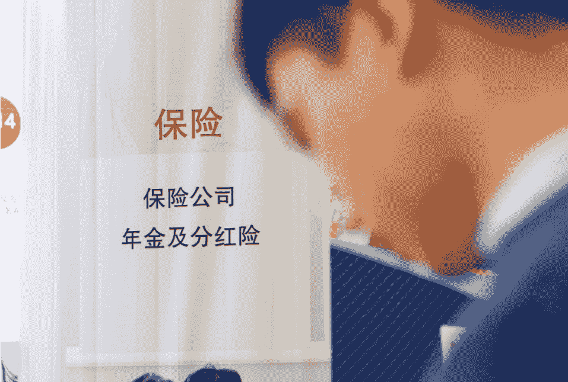

CAIXIN| 听文章

文 | 财周刊 昊雨险

推行分红险，是当前人险行业在利率下行周期启动的重大转型。从2025年4月起，大家养老、瑞泰人寿、新华保险等企业开始陆续披露2024年分红险的实现率，无一例外都达到了100%以上的水平，令市场之一振。

但也有业内人对此表示，缩小“价差”无益于当前“降本增效”的目标，也不足以改变客户对分红险的认知。让保险公司从投资端和资产负债管理等方面入手，在提升分红红利水平的同时，也要打破客户和行业对分红“类固收”的固有印象，让分红成为真正的浮动收益型产品，才是应有之义。

## 分红实现率回升

长期以来，中国内地分红的分红实现率在绝大多数份都超过100%。在投资行情和“限高令”的双重作用下，2024年市场上几乎所有分红险的实现率出现大幅下降，让不少消费者意外。到了2025年，陆续保险公司开始披露上年度的分红实现率，市场情绪也随之回暖。

比如，率先公布分红实现率的大家养老，其2024年分红实现率均实现100%。这引发了市场对于2024年监管是否已经取消“限高令”的讨论。

随后，瑞泰人寿公布的六款分红险产品的分红实现率均超过100%，其中三款实现140%，一款达到150%，两款新款也达到了100%。相比之下，该公司2023年三款产品的分红实现率为10%，还有一款产品的分红实现率为0，在全行的分红实现率中排名后。“去年瑞泰人寿的分红率这么低，大概与分红账户的资产在2020年踩雷“海航”、在2023年额外计提减值有关。而2024年投资收益本来就好，好加减减值也把该填的坑给填上了，所新的分红实现率就很高。“有熟悉瑞泰人寿的人士向向分析师称。

分红中的红利部分，来源于保险公司从死差、利差和费差产生的可分配盈余，其中利差以利差为主。按照规定，保险公司每年派发的红利比例，不得低于当年可分配盈余的70%。

而前述险在2024年的产品表现，最大的影响因素在于2024年整体投资市场的表现。数据显示，人险公司在2024年实现了3.48%的投资收益率，涵盖了浮动亏损在内的综合投资收益更是高达7.45%，比上同期分别为1.19个百分点、4.08个百分点。

市场同样关注的一个点是监管部门对分红的“限高令”。

所谓“限高令”，是指监管部门在2024年4月前后，开始对保险公司万能和分红的实际收益进行“窗口指导”：其中，万能的的结算利率不得超过3.1%和3.3%，而分红的实际收益率要求不得超过3.0%和3.2%。

彼时，分红的预定利率上限限在2.5%的水平，按照4.5%的中档分红演示利率，市场上大多数分红产品获得的实际收益能够达到3.6%左右的水平。这也意味着“限高后”，客户获得的分红收益最多到3.2%，分红现实其实只能达到70%至更低的水平。

数据显示，友邦人、中人寿、中国人寿、恒安标准寿等个险险，不少寿险公司在2023年的分红险结算均出现大幅下滑。北京人寿在2024年10月发布的公告显示，根据分红保险业务的实际经营情况，该公司所有分红型产品合计30款，在2023年度内不进行红客户分配。大型保险公司人保险在2023年的部分分红产品同样也实施了0分红。

在多名人士看来，在2023年投资收益不佳和全行业“降本增效”的大背景下，监管部门就分分红、万能险这类浮动收益产品采取“一刀切”的“限高令”，也属无奈之举，“这么做，结算利率怎么降下去？”

从理论上来说，分红的红利分配并不确定，客户需要承担的投资风险；与同时，分红产品本身存在着“投资调节机制”，保险公司可以通过分红储备在各个年度之间进行平滑调整、丰年还、年缺补。据13个精算师“统计”，2013年至2023年中国保险市场共有3636个分红产品的分红实现率平均值在100%以上，说明分红产品的投资回报情况良好，基本上兑现了客户回报率的承诺。

但100%的分红实现率不能体现保险公司的实际投资收益情况。有两名险业资深人士指出，行业中多数保险公司的分红特储为负；不少保险公司为了稳定的分红收益，会动公司资本来保证客户收益，相当于股东贴钱市场；此外，还有一些激进的通过给予兜底等等手段拓展销售渠道。

## 转型成如何？

分红诞生距离今已有250年，是欧美国家和中国香港等成熟保险市场的主要产品形态，其重要特征是“有确定，上有可期”。2000年，中国的保险面值利差和首次预定利率下调，分红险由此引入，后经历了了从快速发展到调整规范的过渡：在2001年至2010年的“黄金十年”年，分红险依靠突出的产品优势，保费规模在行业一度接近80%；后因营销类等因素逐渐衰微，2021年保费规模在行业下降至32%。

从2023年起，在预定利率再次调整的大背景下，兼具保障和投资能力的分红险以灵活的红利分配方式和较低的刚性成本，再次成为保险公司的主推产品。数据显示，2024年分红险保险费缴入76.9亿元，同比增长41%，整体保险费占比19%。

在各大上市公司中，中国太平的转型力度最大。数据显示，该公司多措并坚定推动分红业务，通过强化考核和后台配套支持，2025年1月至2月，个险渠道分红占比98%。此外，2025年一季度，中国人寿和太平保险的分红占比分别为1.7%和18%，均实现大幅提升。

广发证券分析刘涵、陈福在研报中指出，近年来增额终身寿的热销改变了负债结构，加大利率下行和“资产荒”难题下负债管理难度加剧，中期利差风险严峻。当前对症下应当优化产品结构，提高收益型产品占比，从而帮助保险公司优化负债成本和久期，缓解长债压力，防范利差风险。

在降低负债刚性成本外，在新会计准则下分红险占比的提升有利于保险公司提升账面指标：由于新准则采用浮动收费（VFA）计量模型，投资收益被服务边界（CSM）吸收后净利润降低。多家保险企业的反馈来看，当前各机构在转型分红的步子上快有慢，关键在于市场能否接受。

“我们正在转分红，但是需要时间。2025年三季度预定利率预计还要下调，除非极限性的逆转，否则感觉2026年的销售情况比今年更难。”一名中小寿险高管表示。

“虽然分红险属于浮动收益，但不是一线经理客户，其实对保险定位不同，而且越都能实现预期。在2024年，大家的心理预期可能会偏差，保险方面的压力是非常大的。目前主要的是希望在产品的透明度、保障客户知情等方面下功夫。”

他同时提到，目前转型分红已是行业共识。在销售的产品中，分红险占比迅速提升，目前已达三分之一。此外，在保险公司的优选、风险控制、对客户售后等方面，银行也会更加严格的要求，主要是关注历史收益率和存续过程中对投资端的监控。

## 等待

客户需求尚未触发时，部分保险公司主动放慢速度，既出于对保费规模的考量，也包含了实际成本的计算。一名寿险高管向财险指出，当前分红的实际成本与传统险不上下；待预定利率持续下，预定利率下调至1.5%，可能才是保险行业大力推行分红的更好时机。

虽然分红和传统险在保证利率上差了0.5个百分点，但对保险公司来说，两者的负债成本并不大。传统险预定利率是2.5%，里面包含了保险公司的费用。如果削掉费用，客户比例为1.8%，复合是2.1%。如果按照2.0%保证利率卖分红，再加上分红部分，给客户可能有2.6%—2.7%，激进的公司甚至可能给到3.0%。此外分红目前的成本与传统险相比持平，甚至略高。

他同时表示，某些险企正是基于上述考量，尚未决心大力转型。

> “阶段段分红，第一成本没有明显下降，第二存在销售误导的潜在风险，最终还可能变成客户的投入。”

从长期来看，如果利率持续下行，分红的优势将会凸显。一名总精算师指出，按照现在的长期回报率假设，分红的价值确实低于传统的增额终身寿；但在利率下行周期中，分红的最大优势是不锁定的预定利率，实际分红率可以根据当年的投资回报适当调，由投保人共同分担利率风险。

“在行业转型分红，主要还是控波动对保险公司净资产的影响。但也要具体看每家公司的历史业务结构，包括资产负债端的匹配情况，不能想清楚自己的优势劣势就去做。各家应当自己做差异化转型，发挥运营能力、核保能力、投资能力等不同领域做差异化竞争，市场才会良好。”一名保险公司高管表示。

前述寿险高管指出，2025年第一季度确定的普通型人身保险研究值为2.13%，意味着三季度预定利率概率将继续下调；最大的看点在于，当前2.5%的传统险预定利率将缩至25个基点还是50个基点。他认为，如果将提出要求，预定的利率“差”从当前的50个基点收窄25个基点，将更有利于分红的销售，有助于保险企业转型分红。

也有保险行业人士表示，缩小“价差”的方式标治不治，对当前的“降增效益”，不足以根本上改变客户对于分红的认知。更重要的是，保险公司需要从投资和资产负债管理方面提升分红水平，同时提高产品的信息披露和透明度，打开分红可分配剩余的“黑箱”，并打破客户对分红“美国”的刻板印象，让分红成为浮动收益产品。

此前，监管部门在2023年实施的《一年期以上人身保险产品信息披露规则》，对包含分红在内的人险产品推出新规定，以提升信息透明度、引导消费者预期。比如，从2023年6月30日起，保险公司每年分红宣告后，15个工作日内，在官方网站上披露分红实现率；同时分红约定利率低于当年可分配盈余的70%，分红演示利率不得低于4.5%。

从海外经验来看，美国、韩国、德国等发达市场，分红实现率长期保持在90%以上。以香港为例，2023年分红单占比达到7.7%，分红的发展仍有较大的提升空间。

## 国产AI视频速

似乎一夜之间，人工智能（AI）推动视频生成技术出现了里程碑式的时刻。一条在社交媒体X上观看量超过200万的AI视频中，场景里的角色兴奋地欢喊着：“说话了！”

说话的是谷歌5月发布的全新AI视频模型Veo，其最大特点就是视频中融合音频，让角色流畅、口型自然，自带音效。在此之前，AI视频一直是“默片时代”，需要后期配音，借助专门工具让角色看起来起来。

目前，文字直接生成视频难以做到连贯剧情的镜头，如男主尴尬讲话以及紧张的肢体动作，这是一个高难度的复杂的镜头。

AI，以快手、字节跳动为代表的中国公司，拥有海量视频数据，凭借Luma、Runway等形成的领先优势，分别在2024年3月、6月推出通用的AI视频产品，快速扩容一批专业创作者。在这场跑步中，AI视频从最初的PPT、动图形态，进化至直接产出主体和场景一致的视频。

字节跳动5月13日发布的豆包视频模型Seedance1.0 lite，提升生成质量和速度；5月16日，腾讯发布可以“边打字边画图”的混图像2.0模型，实时生图而无需等待；最新的2.0版本加强了对提示词的语义响应能力。向上影视短剧《牧野闲事》镜头的生成过程：首先FLUX模型生成图片，通过ComfyUI智能绘画工作流修复，借助Photoshop填充完成后，通过Coze中搭建智能提示词，再由转化为视频，最后叠加音效。向上影视CEO肖飞告诉财新，AI视频是目前理想的内容体。“AI生成速度太快了，还没等电影完，刚生成的素材就得返工，只能用技术下有余地做新一。”

AI步不停，中国公司通过投入算力储备，加速迭代多模态模型。2024年12月，邀请樟柯、李少红、叶锦添等知名导演制作了一批纯AI生成的短片，并成为2025年北京国际电影节AIGC（AI生成）单元独家合作伙伴；上海联合上海国际电影节首次开设AIGC单元，作为戛纳电影节“科幻电影国际高峰”的举办方承诺AI单片希望抢先获得专业认可。

2025年第98届奥斯卡金奖提名的电影《君野狂》，就用了一家乌克兰语音生成的国产化演员的匈牙利语，该片主演德里安·布罗罗拿到了最佳主角。

奥斯卡颁奖机构美国宣布，2026年第98届奥斯卡金奖允许AI参与电影竞赛。如果影片制作中使用生成式AI及其他数字工具，这些工具本身不会促进、也不会妨碍作品获得提名的机会。“学院及各分支机构在评审影片时，将考虑人类创作者在创作过程中发挥的核心作用，决定最终的获奖”。

尽管AI曾引发2023年持续半年的好莱坞大地震，部分从业者至今轻视AI，将其与真正的艺术创作界限，但行业对技术趋势已有一定共识并进行了相应调整。目前，用户通过API接口（应用程序）接入，字节跳动在即梦上上线，商业化雏形。

![img/8c5f903c720deaa2f588_29.png]

不过，并非所有公司愿意倾斜算力资源，长期验证AI产品的商业模式，腾讯和阿里的视频生成能力仍集中模型层和中间层，没有针对普通用户的产品。除了抖音、快手本身有训练模型的视频数据，“做一款AI产品，是要AI模型的底层有长期预判的，部分公司愿意去做，是因为他们基于这种预判，能够在一定时间内占领领先市场。”一名熟悉剪辑的细节字节跳动前沿人士获财胜利。

在聊天机器人领域，横空出的DeepSeek复刻了ChatGPT之后的产品格局，以训练模型降低成本、效果突出的推理模型攻破了大模型公司的壁垒；借此流量获取用户的豆包、Kimi等产品则在重塑策略；而优先接入DeepSeek的腾讯宝子歪到了红。值得注意的是，即在3月底接入DeepSeek-R1满版辅助生成指令，是字节跳跃飞书的另一种选择接入DeepSeek的产品。

“能够更准确理解提示，如何通过文字描述完成简单的运镜，是过去一年来AI视频生成领域的分水岭。”电影剪辑、AI创作者视获财胜利，今年有许多从业者认为视频工具在多模态上会有较大的进展，比如视频支持提交图片和音频生成对应视频的OmniHuman模型就是典型的多模态产品。而谷歌在发布Veo3的同时，还推出了一款整合其大模型和图片生成模型Imagen的影像制作平台Flow，专供创作电影AI视频。

## 向创作者收费

3月26日，OpenAI的GPT-4o模型推出生图功能后，其高度还原宫崎骏动画风格的生成能力引发全球关注后，美国创作者PJ Ace发布他以宫崎骏的日本工作室风格重新制作的《指环：护戒者》预告，在X上的观看量达到1284万次，原片中的102镜头通过该模型转化为动画画帧，再借助可灵和Luma生成视频，全过程耗九小时，共花费250灵积分（“灵值”），非会员直接购买灵积分折算人民币不超过25元。

制作成本廉低的短片，有望传统影视的商业模式。导演黄建新在北京国际电影节上介绍，一部由380个AI视频帧组成的美国短片制作时间耗费其时，独立电影公司和制片厂都给出了数十万美元的预算估值，结果创作者实际花费超过1700美元。也就是说，这部短片仅需1万美元房费就能回钱；但有些电影可能花费400万美元，却只有50万美元预算。

不是很多作者并不认同这类事实，原因是这样的成本测算只考虑了工具，忽略了人力成本和时间成本。“人工成本在AI行业初期是最大的。”卫霍告诉创作，用AI制作短片难度并不亚于传统影视，例如同一场景下导演的调度与位置、服装、道具穿搭，镜头切换时演员动作与情绪不匹配，AI演员在移动调度时能够按照导演指定的路线去执行等，都要一把。“诸多问题中，最的是AI演员的表演，优秀的AI演员能补齐片中60%的技术缺陷。

卫霍透露，《牧野逸事》动画游戏，难度较大，用可灵的生成视频每分钟需要1.8万—3.5万积分，按灵最低月包会员折算，合人民币270—530元。于安则指出，普通短片的成本在千元量级，最终成片花费更多。创作者为了持续创作，会尽可能多开会员，甚至开启应用软件平台的会员，“总感觉积分不够用”。

用积分视频生成时长，与电影工业早期消耗胶片十分相似。110分钟的电影所用的胶片约为1万英尺，但拍摄者往往需要准备更多胶片用。在AI打磨、筛选镜头的过程中，作者需要结合经验尝试不同的AI工具和参数设置，让工具优势互补，充分利用传统软件精力调整。

国内基于大模型的跑人以免费为主，而图片生成等产品如Midjourney、Stable Diffusion等上线，就采用了订阅付费模式，此后可见、即梦也毫不犹豫地以积分形式向用户收费。前述熟悉剪辑的字节跳动人才告诉我们，构建积分体系几乎是即梦必须要做的，生成一秒视频相当于一次性生成25—300张图片，所消耗的算力激增，通用型积分可以灵活适配不同模型的使用情况。

C端商业化趋势相对一致，前期免费试用和低门槛能够逐渐吸引行业垂直类用户，后期竞争则需要整合效果、价格和具体需求。每个工具都有复杂的运作流程，AI能提升效率的环节在哪里，需要服务的用户又在哪里。“从有积分、视频内容需求的人里能用AI功能的人，已经是经过三层漏斗的筛选了，基本集中于设计师、视频编辑和运营等职业或领域，整体用户池并不大。所以要看是从通用工具切入，还是特效、动作捕捉等专业工作者能力内套件，具体的思路和方法有差异。“上述字节跳动人才说。

可灵2.0发布后，PJ Ace在4月15日发布了一条时长长达一半的新短片，将“烧”价值1250美元的积分测试模型的能力。在2024年11月，可灵的商业化单月流水超过1000万元，进展符合市场预期。在国内用户认知中，以商业化为可见性较高，生成速度比类型AI产品慢，而发力拓展用户的即梦不仅生成快，价格比国内便宜。海外普遍有内容付费，订阅费率比国内高。苹果商店里有很多工具App，比如CapCut在国外也走付费模式，不过主打低价路线，因此很多工具每月10美元/月。

## 用AI赚钱

5月20日，曾一手搭建系统的哈洛斯特波(George Thompson)和杰米·伯森(Jamie Byrne)组的AI未来基金(AI Futures)参与，5月7日发布了新作品《忍者朋克》(Ninja Punk)，由于认为AI视频无法离人类创作，这部电影使用了传统的动作捕捉和3D建模。借助便捷的本土化工具，艺术家、产品经理、程序员等多元化人群上手，这一赛道目前并没出圈。

2025年春节后，开源社区孵化出一许多创业团队，业务包括AI广告制作、短片运营，规模较小。

广告广告广告广告广告广告广告广告广告广告广告广告广告广告广告广告广告广告广告广告广告广告广告广告广告广告广告广告广告广告广告广告广告广告广告广告广告广告广告广告广告广告广告广告广告广告广告广告广告广告广告广告广告广告广告广告广告广告广告广告广告广告广告广告广告广告广告广告广告广告广告广告广告广告广告广告广告广告广告广告广告广告广告广告广告广告广告广告广告广告广告广告广告广告广告广告广告广告广告广告广告广告广告广告广告广告广告广告广告广告广告广告广告广告广告广告广告广告广告广告广告广告广告广告广告广告广告广告广告广告广告广告广告广告广告广告广告广告广告广告广告广告广告广告广告广告广告广告广告广告广告广告广告广告广告广告广告广告广告广告广告广告广告广告广告广告广告广告广告广告广告广告广告广告广告广告广告广告广告广告广告广告广告广告广告广告广告广告广告广告广告广告广告广告广告广告广告广告广告广告广告广告广告广告广告广告广告广告广告广告广告广告广告广告广告广告广告广告广告广告广告广告广告广告广告广告广告广告广告广告广告广告广告广告广告广告广告广告广告广告广告广告广告广告广告广告广告广告广告广告广告广告广告广告广告广告广告广告广告广告广告广告广告广告广告广告广告广告广告广告广告广告广告广告广告广告广告广告广告广告广告广告广告广告广告广告广告广告广告广告广告广告广告广告广告广告广告广告广告广告广告广告广告广告广告广告广告广告广告广告广告广告广告广告广告广告广告广告广告广告广告广告广告广告广告广告广告广告广告广告广告广告广告广告广告广告广告广告广告广告广告广告广告广告广告广告广告广告广告广告广告广告广告广告广告广告广告广告广告广告广告广告广告广告广告广告广告广告广告广告广告广告广告广告广告广告广告广告广告广告广告广告广告广告广告广告广告广告广告广告广告广告广告广告广告广告广告广告广告广告广告广告广告广告广告广告广告广告广告广告广告广告广告广告广告广告广告广告广告广告广告广告广告广告广告广告广告广告广告广告广告广告广告广告广告广告广告广告广告广告广告广告广告广告广告广告广告广告广告广告广告广告广告广告广告广告广告广告广告广告广告广告广告广告广告广告广告广告广告广告广告广告广告广告广告广告广告广告广告广告广告广告广告广告广告广告广告广告广告广告广告广告广告广告广告广告广告广告广告广告广告广告广告广告广告广告广告广告广告广告广告广告广告广告广告广告广告广告广告广告广告广告广告广告广告广告广告广告广告广告广告广告广告广告广告广告广告广告广告广告广告广告广告广告广告广告广告广告广告广告广告广告广告广告广告广告广告广告广告广告广告广告广告广告广告广告广告广告广告广告广告广告广告广告广告广告广告广告广告广告广告广告广告广告广告广告广告广告广告广告广告广告广告广告广告广告广告广告广告广告广告广告广告广告广告广告广告广告广告广告广告广告广告广告广告广告广告广告广告广告广告广告广告广告广告广告广告广告广告广告广告广告广告广告广告广告广告广告广告广告广告广告广告广告广告广告广告广告广告广告广告广告广告广告广告广告广告广告广告广告广告广告广告广告广告广告广告广告广告广告广告广告广告广告广告广告广告广告广告广告广告广告广告广告广告广告广告广告广告广告广告广告广告广告广告广告广告广告广告广告广告广告广告广告广告广告广告广告广告广告广告广告广告广告广告广告广告广告广告广告广告广告广告广告广告广告广告广告广告广告广告广告广告广告广告广告广告广告广告广告广告广告广告广告广告广告广告广告广告广告广告广告广告广告广告广告广告广告广告广告广告广告广告广告广告广告广告广告广告广告广告广告广告广告广告广告广告广告广告广告广告广告广告广告广告广告广告广告广告广告广告广告广告广告广告广告广告广告广告广告广告广告广告广告广告广告广告广告广告广告广告广告广告广告广告广告广告广告广告广告广告广告广告广告广告广告广告广告广告广告广告广告广告广告广告广告广告广告广告广告广告广告广告广告广告广告广告广告广告广告广告广告广告广告广告广告广告广告广告广告广告广告广告广告广告广告广告广告广告广告广告广告广告广告广告广告广告广告广告广告广告广告广告广告广告广告广告广告广告广告广告广告广告广告广告广告广告广告广告广告广告广告广告广告广告广告广告广告广告广告广告广告广告广告广告广告广告广告广告广告广告广告广告广告广告广告广告广告广告广告广告广告广告广告广告广告广告广告广告广告广告广告广告广告广告广告广告广告广告广告广告广告广告广告广告广告广告广告广告广告广告广告广告广告广告广告广告广告广告广告广告广告广告广告广告广告广告广告广告广告广告广告广告广告广告广告广告广告广告广告广告广告广告广告广告广告广告广告广告广告广告广告广告广告广告广告广告广告广告广告广告广告广告广告广告广告广告广告广告广告广告广告广告广告广告广告广告广告广告广告广告广告广告广告广告广告广告广告广告广告广告广告广告广告广告广告广告广告广告广告广告广告广告广告广告广告广告广告广告广告广告广告广告广告广告广告广告广告广告广告广告广告广告广告广告广告广告广告广告广告广告广告广告广告广告广告广告广告广告广告广告广告广告广告广告广告广告广告广告广告广告广告广告广告广告广告广告广告广告广告广告广告广告广告广告广告广告广告广告广告广告广告广告广告广告广告广告广告广告广告广告广告广告广告广告广告广告广告广告广告广告广告广告广告广告广告广告广告广告广告广告广告广告广告广告广告广告广告广告广告广告广告广告广告广告广告广告广告广告广告广告广告广告广告广告广告广告广告广告广告广告广告广告广告广告广告广告广告广告广告广告广告广告广告广告广告广告广告广告广告广告广告广告广告广告广告广告广告广告广告广告广告广告广告广告广告广告广告广告广告广告广告广告广告广告广告广告广告广告广告广告广告广告广告广告广告广告广告广告广告广告广告广告广告广告广告广告广告广告广告广告广告广告广告广告广告广告广告广告广告广告广告广告广告广告广告广告广告广告广告广告广告广告广告广告广告广告广告广告广告广告广告广告广告广告广告广告广告广告广告广告广告广告广告广告广告广告广告广告广告广告广告广告广告广告广告广告广告广告广告广告广告广告广告广告广告广告广告广告广告广告广告广告广告广告广告广告广告广告广告广告广告广告广告广告广告广告广告广告广告广告广告广告广告广告广告广告广告广告广告广告广告广告广告广告广告广告广告广告广告广告广告广告广告广告广告广告广告广告广告广告广告广告广告广告广告广告广告广告广告广告广告广告广告广告广告广告广告广告广告广告广告广告广告广告广告广告广告广告广告广告广告广告广告广告广告广告广告广告广告广告广告广告广告广告广告广告广告广告广告广告广告广告广告广告广告广告广告广告广告广告广告广告广告广告广告广告广告广告广告广告广告广告广告广告广告广告广告广告广告广告广告广告广告广告广告广告广告广告广告广告广告广告广告广告广告广告广告广告广告广告广告广告广告广告广告广告广告广告广告广告广告广告广告广告广告广告广告广告广告广告广告广告广告广告广告广告广告广告广告广告广告广告广告广告广告广告广告广告广告广告广告广告广告广告广告广告广告广告广告广告广告广告广告广告广告广告广告广告广告广告广告广告广告广告广告广告广告广告广告广告广告广告广告广告广告广告广告广告广告广告广告广告广告广告广告广告广告广告广告广告广告广告广告广告广告广告广告广告广告广告广告广告广告广告广告广告广告广告广告广告广告广告广告广告广告广告广告广告广告广告广告广告广告广告广告广告广告广告广告广告广告广告广告广告广告广告广告广告广告广告广告广告广告广告广告广告广告广告广告广告广告广告广告广告广告广告广告广告广告广告广告广告广告广告广告广告广告广告广告广告广告广告广告广告广告广告广告广告广告广告广告广告广告广告广告广告广告广告广告广告广告广告广告广告广告广告广告广告广告广告广告广告广告广告广告广告广告广告广告广告广告广告广告广告广告广告广告广告广告广告广告广告广告广告广告广告广告广告广告广告广告广告广告广告广告广告广告广告广告广告广告广告广告广告广告广告广告广告广告广告广告广告广告广告广告广告广告广告广告广告广告广告广告广告广告广告广告广告广告广告广告广告广告广告广告广告广告广告广告广告广告广告广告广告广告广告广告广告广告广告广告广告广告广告广告广告广告广告广告广告广告广告广告广告广告广告广告广告广告广告广告广告广告广告广告广告广告广告广告广告广告广告广告广告广告广告广告广告广告广告广告广告广告广告广告广告广告广告广告广告广告广告广告广告广告广告广告广告广告广告广告广告广告广告广告广告广告广告广告广告广告广告广告广告广告广告广告广告广告广告广告广告广告广告广告广告广告广告广告广告广告广告广告广告广告广告广告广告广告广告广告广告广告广告广告广告广告广告广告广告广告广告广告广告广告广告广告广告广告广告广告广告广告广告广告广告广告广告广告广告广告广告广告广告广告广告广告广告广告广告广告广告广告广告广告广告广告广告广告广告广告广告广告广告广告广告广告广告广告广告广告广告广告广告广告广告广告广告广告广告广告广告广告广告广告广告广告广告广告广告广告广告广告广告广告广告广告广告广告广告广告广告广告广告广告广告广告广告广告广告广告广告广告广告广告广告广告广告广告广告广告广告广告广告广告广告广告广告广告广告广告广告广告广告广告广告广告广告广告广告广告广告广告广告广告广告广告广告广告广告广告广告广告广告广告广告广告广告广告广告广告广告广告广告广告广告广告广告广告广告广告广告广告广告广告广告广告广告广告广告广告广告广告广告广告广告广告广告广告广告广告广告广告广告广告广告广告广告广告广告广告广告广告广告广告广告广告广告广告广告广告广告广告广告广告广告广告广告广告广告广告广告广告广告广告广告广告广告广告广告广告广告广告广告广告广告广告广告广告广告广告广告广告广告广告广告广告广告广告广告广告广告广告广告广告广告广告广告广告广告广告广告广告广告广告广告广告广告广告广告广告广告广告广告广告广告广告广告广告广告广告广告广告广告广告广告广告广告广告广告广告广告广告广告广告广告广告广告广告广告广告广告广告广告广告广告广告广告广告广告广告广告广告广告广告广告广告广告广告广告广告广告广告广告广告广告广告广告广告广告广告广告广告广告广告广告广告广告广告广告广告广告广告广告广告广告广告广告广告广告广告广告广告广告广告广告广告广告广告广告广告广告广告广告广告广告广告广告广告广告广告广告广告广告广告广告广告广告广告广告广告广告广告广告广告广告广告广告广告广告广告广告广告广告广告广告广告广告广告广告广告广告广告广告广告广告广告广告广告广告广告广告广告广告广告广告广告广告广告广告广告广告广告广告广告广告广告广告广告广告广告广告广告广告广告广告广告广告广告广告广告广告广告广告广告广告广告广告广告广告广告广告广告广告广告广告广告广告广告广告广告广告广告广告广告广告广告广告广告广告广告广告广告广告广告广告广告广告广告广告广告广告广告广告广告广告广告广告广告广告广告广告广告广告广告广告广告广告广告广告广告广告广告广告广告广告广告广告广告广告广告广告广告广告广告广告广告广告广告广告广告广告广告广告广告广告广告广告广告广告广告广告广告广告广告广告广告广告广告广告广告广告广告广告广告广告广告广告广告广告广告广告广告广告广告广告广告广告广告。

5月15日，吉如海东尕子以东，大面积口粮田被汪淹没在水中。

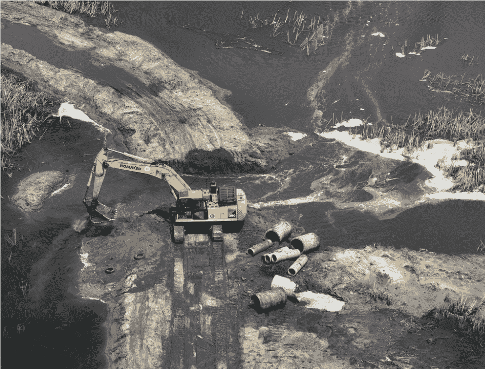

5月16日，挖掘机挖开缺口，排放口粮粮田里面的积水。

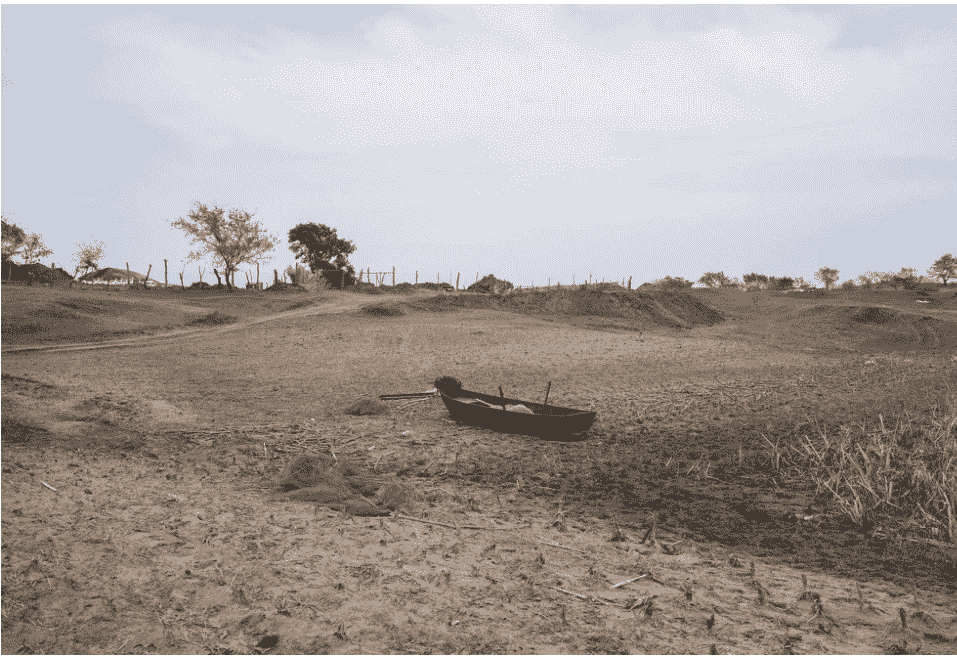

水位慢慢下降后，耕地里的玉米秸秆显现出来，铁船和渔网遗留在地里。

吉如海村口，一处村居民边缘晾晒着防水胶衣。

如今，内涝虽然得到一定缓解，但多位受访的当地人担心今年雨水依旧过太多，整个村屯存在继续内涝的可能。张泉希望吉如海能得到更多关注，给农田排水是急需解决的难题。

回不了家的仁满都坦扰倒塌的房子，村里也已经人上门勘察了房屋情况，他希望能够重建一座新房子，不再给一些补偿也行。

此前，金宝屯镇党委书记委员贾奎望着接受受灾后当地媒体采访，表示将加快水利工程建设和排水水进度；待水排干净后，组织当地建房对对受灾房屋进行安全鉴定，如鉴定安全后组织18户受灾户搬回原址进行生产；同时，从现实和长远考虑，充分征求群众意见，判定易地铺迁迁工作。

虽然张贴着“此处危险、禁止入住和靠近”的红色标识，66岁的龙梅住了了自己的房子。5月15日上午，萨仁满跑一次地回到家里，他静静地走到塌的房子面前，身板僵直，面露微笑和房子拍摄了一张合照。之后他又走进屋，发现卧室门上的裂缝进一步扩大了，另一一侧，被泡过的粮食已经发霉，正散发着发酵的味道。

图片编辑|翁情

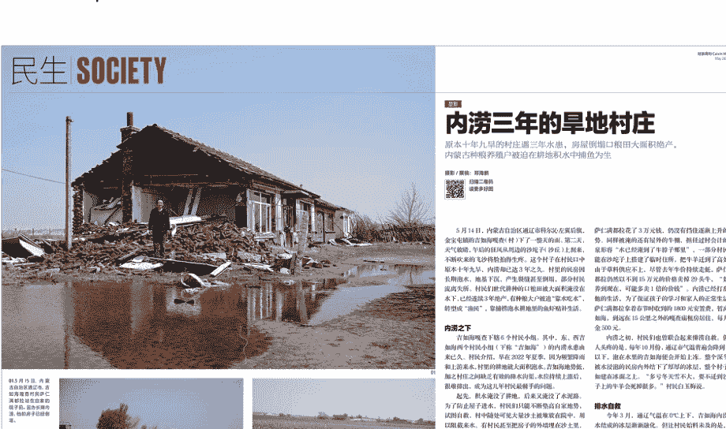

## 民生 SOCIETY

## 内敖第三的早上的村庄

聚了十九年的村民萨仁万流下泪水。看到裂口面积大得惊人，心疼的村民看着残塌的房子，心里五味杂陈。

记者/郭辉 摄/视觉

6月10日，内敖第三村村民萨仁万看着塌掉的房子流下泪水。安稳地住了十九年的房子，因为的一场大雨就彻底塌了。他看着满地的瓦砾，心里五味杂陈。这辛辛苦苦盖起来的房子，就这样全塌了，他坐在地上嚎哭。萨仁万说，房子之前在大雨后墙上就出现了一道裂缝，但他没觉得会塌，也没有钱去修。结果没想到，又一场大雨过后，裂缝不断扩大，房子就彻底塌了。萨仁万看着满地的瓦砾，心里五味杂陈。这辛辛苦苦盖起来的房子，就这样全塌了，他坐在地上嚎哭。萨仁万说：“以后孩子去哪儿住？”

萨仁万在塌掉的房子前哭泣

萨仁万看着满地的瓦砾，心里五味杂陈。他的邻居们也看着自己倾斜的房子，心里也五味杂陈。整个村的房子都面临坍塌的危险。萨仁万的哭声传遍了村子，其他村民们也纷纷围过来，大家商量着该怎么办。

西宁记者

内敖第三村由于地质松软，加上近期强降雨灾害，村民的房屋受损严重，部分房屋面临坍塌风险。当地政府正在积极组织对受灾群众的安置工作，目前村民们已在临时安置点生活。

内敖第三村的村民在受灾后，开始在临时安置点生活。

当地政府表示，将积极落实国家相关救灾政策，为受灾群众提供资金补助，并对受损房屋进行科学评估。同时，积极开展房屋重建工作，让村民早日恢复正常生活。

萨仁万在临时安置点休息

村民们看着塌掉的房屋

内敖第三村村民在塌掉的房屋前

村民们在临时安置点生活

## 美联储的加息周期即将结束

美联储周三维持利率不变，暗示基准利率将维持在高水平。

鲍威尔表示，美联储今年将停止加息，并在未来可能下息。鲍威尔表示，美联储的加息周期已经接近尾声。

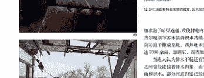

由于通胀压力依然巨大，美联储可能会将高利率维持更长时间。鲍威尔表示，尽管美联储对通胀回落至2%的目标仍保持乐观，但目前需要更多证据表明通胀向方向下降。目前，美联储继续加息的可能性较小，但他警告，如果通胀超出预期，美联储可能考虑进一步加息。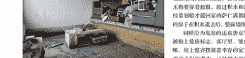

鲍威尔表示，美联储的加息周期已经接近尾声。他表示，美联储今年将停止加息，并在未来可能下息。尽管美联储对通胀回落至2%的目标仍保持乐观，但目前需要更多证据表明通胀向方向下降。目前，美联储继续加息的可能性较小，但他警告，如果通胀超出预期，美联储可能考虑进一步加息。

鲍威尔表示，美联储的加息周期已经接近尾声。他表示，美联储今年将停止加息，并在未来可能下息。尽管美联储对通胀回落至2%的目标仍保持乐观，但目前需要更多证据表明通胀向方向下降。目前，美联储继续加息的可能性较小，但他警告，如果通胀超出预期，美联储可能考虑进一步加息。

鲍威尔表示，美联储的加息周期已经接近尾声。他表示，美联储今年将停止加息，并在未来可能下息。尽管美联储对通胀回落至2%的目标仍保持乐观，但目前需要更多证据表明通胀向方向下降。目前，美联储继续加息的可能性较小，但他警告，如果通胀超出预期，美联储可能考虑进一步加息。

鲍威尔表示，美联储的加息周期已经接近尾声。他表示，美联储今年将停止加息，并在未来可能下息。尽管美联储对通胀回落至2%的目标仍保持乐观，但目前需要更多证据表明通胀向方向下降。目前，美联储继续加息的可能性较小，但他警告，如果通胀超出预期，美联储可能考虑进一步加息。

鲍威尔表示，美联储的加息周期已经接近尾声。他表示，美联储今年将停止加息，并在未来可能下息。尽管美联储对通胀回落至2%的目标仍保持乐观，但目前需要更多证据表明通胀向方向下降。目前，美联储继续加息的可能性较小，但他警告，如果通胀超出预期，美联储可能考虑进一步加息。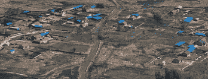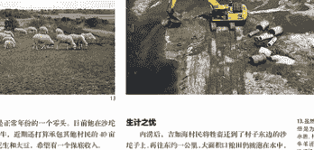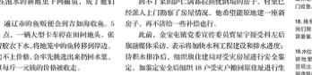

## 随笔 | 译界新时代：人脑易迁，电脑易电脑

## AI翻译：自带原罪

## 译者：“我能用自己的名字写一篇我是借助AI翻译的文章吗？” | 张叔鸿 译者

## 自带原罪

“我能用自己的名字写一篇我是借助AI翻译的文章吗？”作为译者的我质问编辑，平日消息总是姗姗来，编辑几秒钟就在微信里回复：“绝对不能！”几秒钟后，邀请便跳到了我的手机上。电话打来的时间是晚上八点——一个她打算让自己下班后被打扰的私人时间。

其实，编辑并不知道我在翻译时使用了AI。工作一开始，我就告诉她，用ChatGPT 4.0和DeepL分别翻译了一遍；自己译完一段，都会用人工智能翻译——俗称“机翻”，复核一遍。截图给她确认字体、格式、译名等细节，方便她后处理。

在图中，她清晰看到我的工作方式：上方是英文原文，接着是中文文，后面是机翻。翻译到中文文，一段红（ChatGPT 4.0）、一段蓝（DeepL）。经历一轮原文、人工初译、AI复核后，文稿剩下黑色的中文文。为了偷懒，我会在动笔前看一眼机翻。翻译到编辑，她着急忙忙叫停我发表文章，理由很简单——读者不会接受！这类书籍，作者是一位兼具艺术家、评论家双身份的美国人士，字里行间透出作者的见解、观点犀利、文辞对同侪的鄙夷和刻薄。

在译者的普遍认知中，相比冷干燥、语言高度化的工业类书籍，以及内容较为客观的社科书籍，文学与艺术书籍被认为是难以胜任的范畴。直到ChatGPT在2022年底横世，以其精确的理解力、流畅的阅读感、令人惊奇的完成度，第一次让骄傲的人类译者们感到了一丝恐惧。

译者们感到恐惧，并非指AI翻译的算法逻辑，也非预测与人类在阅读体验上的边界，更不是寻找AI翻译还臻成熟的细分领域；相反，人类译者的第一反应是全面否定：“或许AI在翻译社上有一定优势，一旦触碰到文学领域，文学艺术是人类智慧的最高结晶，AI想要攻克这个领域还要等三四十年！”我刚用AI试了一段，自己也翻了一段，表现糟糕。”

AI翻译像出版版的预制菜，在很多作者、读者、编辑那里，还没露真容，就凭身上原罪。为了照顾大多数读者的观感，编辑第一时间就叫停。在大部分读者还没接受机器的前提下，公开这件事无异一剂炸弹。

## AI做不到的人能做到吗?

可是，AI翻译真的如此不错吗？在豆瓣、微博内的诸多社交平台上，经历了对AI连篇累牍的批判后，逐渐出现了一些反面声音。

首要难发的的就是出版社的编辑。天天与校译者的糟心翻译交道的一线文字工作者们是最实用主义的。AI无法理解幽默和模糊的情感世界！AI无法理解文字背后的典故和言外之意！AI在不同语言翻译过程中需要补充的文化背景？请问，AI无法做到吗，人类的译者一定做到吗？

是的，如果你是一个出版社的编辑，转身开始更新最新的译稿，小鹿怦乱的心绪你不知道你的译者是否能自始至终准确地理解原文，不知道他是否会粗心漏掉一章，不知道他是否把翻译工作外包给了自己的研究生，甚至不知道译者虽然里面有一个中文字，但是他的会议是否真的会？凯蒋（Chiang Kai-she，应为蒋石）、孟修（Mencius，应为孟子）、酥食（Sushi，应为寿司）等等，已成为译荒，而这些奇葩错译的背后，是数万以此可能的错译、诙、荒。此外，那些看起来丝滑顺畅的译文，也有可能是译者自以为理解到位后的自由发挥，实距离原文天差地别——业内称之为“假译”。

相较之下，ChatGPT 3.0翻译的流畅程度令人欢喜，假溜的现象并不严重，甚至让人感受到AI的理解了原文。

如此，如果在讨论拉伯图时提到Republic，往往指《理想国》，而非“共和国”；subject平日可译为“学科”或“主观的”，但在历史里指居民；editor一般，但在电影语境里是辑师；long shot是远景；long take是全景；cartoon一般，但在艺术史里却是卡通；number是数字，在歌剧语境里是曲；piano是钢琴，在音乐语境里是弱音。

老式机翻软件的确无法理解这些词汇在具体语境中的差别，类似于拉普、米开朗、奥哈拉。但当ChatGPT 3.5上线后，不仅原本那些困难的词汇，出现的错误大大减少，而且AI在翻译中竟然能推断每个词的意涵，将其放入文中。

这种前期准备，对于AI被称为“prompt（提示）”。

对于大多数译者而言，AI翻译并非难事。但并非所有诗歌，讲究音乐性和多义性。事实上，布考基（Charles Bukowski）、威廉斯（William Carlos Williams）、奥哈拉（Frank O'Hara）是典型代表，AI翻译他们的诗歌、小说等纯文学堡垒，几乎是每一个对AI怀疑的人必然踏入的陷阱；对于人类来说总是难，需要推敲琢磨。

如此，译者依然坚定认为AI无法攻克诗歌、小说等纯文学。使用AI的译者，必须给它具体的需求，不仅仅是素材和作者，还包括其语言特征和文字风格——是否韵律而著称，是否充满了暧与隐喻，是古典风格还是现代派的作品？

有的译者对于AI抱有偏见，来自AI对于翻译中的难易与译者相异甚至相反。一些译者看来难关，AI反而如履地，举重若轻；而是一些看似简单的地方，会出现令人喷的错误。比如把“The door was left open”翻译成“从左边着”之类的。

对于读者来说，尤其是那些高度人文素养的读者，AI翻译也显得不可接受。如果译者悄悄使用了AI辅助，或是干脆用AI来，译文充斥着机翻味，是不是侵犯了读者的知识产权？大部分读者的预期是，坚持由生活的译者将外语言、外文明、外文化散发着厨师锅气的鲜活味，而非用ChatGPT跑遍原文后直接复制粘贴，端出留许膜焦味的预制菜。译者若不当使用AI翻译，还会存在版权风险。如果社会舆论对于预制菜的普遍观点是廉价、低质，哪怕美味、卫生与饭店里满是锅气的味道差无几，也会被偏见压制。

## “人工智能”与AI智能

当然，坚持从头到尾用“人工”而非“人工智能”的翻译手者也不例外。朋友阿真就是这样一位译者。他的理由是希望更多地保留自己的语言风格：“一旦读到了AI对原文的翻译，短时间内我就很难生成符合语言习惯的脑子，我的思路会被AI的翻译版本束缚占据。所以我选择不求助AI，除非一些知识性的问题。”

的确，如果译者不读原文，先读了机翻版，很容易先入为主；机翻的错误终将成为译者的错误，机翻的语言结构也容易成为译者的语言结构。

我本人曾说，翻译者的任务是在自己的语言中释放那种在异语言魔力支配下的“纯净语言”。无可否认，如果一本书、一篇文章足够精彩，逐字逐句阅读理解，经过初译、二次调调、复核，都是优秀的对应。

翻译工作中的重要步骤——打开Word文档。对于译者来说，翻译界拖拽有时竟成为了翻译的翻译的。

为最终成果关。没有译者和编辑的把关，直接把AI稿交给排版工人排印出版，那无疑是灾难性的。

AI或许将终结译者。当然，这并不是因为AI无能拉胯，也不是因为人类不可替代，而是在理想情况下，没有比它一个合格的译者更廉价、快捷、懂行业规范、了解读者需要补充背景信息的工具（人）。虽然把翻译工作外包给译者和外包给AI并无本质区别，但如果译者靠谱的话，就算使用了AI翻译，某些意义上译者也就此化成了编辑：对着初稿修修补补，让它变得既容易又易读、符合规范而充满译者的关。

人文主义往往将会排斥我们生活在一个英语权下的全球化时代，可当AI帮助我们就此打破语言的枷锁时，他们又会跑出质疑科技伦理。

事实上，在AI翻译进步得如此靠谱的2022年，涌出批AI字幕翻译的插件，当时译文显得有些稚嫩和乏味，但对拉美爵士乐非常感兴趣，却不懂西语、葡语的我受益良多。借助字幕，我看了大量的原作想看却没有中文字幕的巴西世纪片。有那么几个月，我在冷眼看着生硬的AI翻译字幕里，感受到了那些来自波萨萨诺瓦（Bossa Nova）和古桑巴里自由流淌的groove。

或许在未来很长的时间里，AI翻译依旧存在硬梗障碍之处，但它却能为人类打开一条自由的通路。■

## 专栏·暮年絮语 | 在养老院“不务正业”

## CAIXIN 听文章

文 | 钱理群
学者

按照传统的观念，知识分子的一生分为“读书—工作—退休养老”三阶段。老年人既不读书，也不工作，“退休”就是退出社会，彻底休息，鲁迅一语道破——“等死”。这是许多人一到老年就陷入焦虑之中的根本原因。

但是，人类发展到今天的“长寿时代”，这样的人生三段曲已已经被彻底打破。老年人依然需要再学习、再工作、再创造，包括精神和精神财富的再创造、经济和物质的再创造。这就是我把养老称为人为“新机遇，再出发”的原因。

这是我进泰康养老九年最大的收获、最深的体会。我的生命在这一阶段进入了真正的高峰。直到今天，85岁的我，依然思维活跃、敏捷，创造力绵绵不绝。

这是有着深刻的背景的。在知识经济、高科技时代，人的智力越来越重要。特别是在人工智能快速发展的当下，人类的许多功能，包括人的智力，都受到机器人的挑战，面临着被替代的危机；人类只有机器人不能替代的高智力方向发展。是在这个时候，老年人的经验、生命体验，机器人不能替代的人类特有的高智，就显示出其特殊、不可替代的优势。再加上新技术的快速发展历史条件，老年人只要坐在家里，就可以把自己的思考、精神劳动转化为物质产品，服务于社会。高智与高科技的结合，是知识经济时代最显著的特征与财富来源。我一直说，对老年人的智力及其社会功能，绝不能低估！

我进泰康九年，另一大收获和体会，获得了人类发展的四大机遇：大发挥、大调整、大弥补、新开拓。

首先是“大发挥”。我这个人最大的特点，就是对未知的世界充满好奇心、想象力，充满了创造力，在人生道路的选择、学术选择上，就有无数的计划和待开拓的领域。在大学任期间，忙于教学与社会活动动，没有精力与时间一一实现。现在好了，进了养老院，就可以潜心旁耕耘自己的一亩三分地，尽兴发挥了。有学生统计，到2024年，我写了100本书，三分之二都在退休后出版；养老院九年，平均两年三本书，而且涉及近500万字，且范围越括。

我珍视的是自我生命的“大调整”。我多次说过，我们中国人的少年、青年、中年，都是戴着面具的：职业、身份、地位，决定了我们能说什么、不能说什么，能干什么、不能干什么。我这个北京大学中文系文学专业教授，如果谈了学术、教学之外的事，大谈涉及范围内的事，就是“不务正业”，属于“乱来”，是随时会遇到批评和惩罚的。再加上我们从小就“与天斗斗，与人斗斗，与自己斗斗”的“教育”，斗来斗去，把自己的人性都扭曲了。现在好了，什么都不是，就是养老院的老头、老太，脱离了单位，能够，也应该，进行人性的调整。扬扬抑邪，真正做到宽松、宽容、“三宽”，这样活着，至少少心无愧。

还有人的“大弥补”。其实，每个人从小都有各种爱好、梦想，长大的能力实现其中一部分就等于不了。这就留下了许多终生遗憾。现在养老院里，脱离了自己专业，反而相反（至少是部分实现）当年梦想的大时机。我或许可以这样活着：在养老院与文学作家王波相遇，他为做的评，在演讲中提到的“文学梦”。

还有“新开拓”。从2019年开始，我一直在养老院研究到世界的前沿课题，是我退休前完全想不到的，竟然奇异！而且，我还找到了这些思想、理论的新创造方式。从2020年接受全国地的访谈，到2021年在社交媒体发布《中国现代文学》；到2023年在抖音平台播出；到2024年在北大讲课，以及最近在自媒体上解释这些理想。这样，在养老院九年，我会把自己的社会责任、影响力发挥到极致，生命的价值得到了充分体现。■

## 逝者 | 彼得·拉克克斯：最后的“火星人”

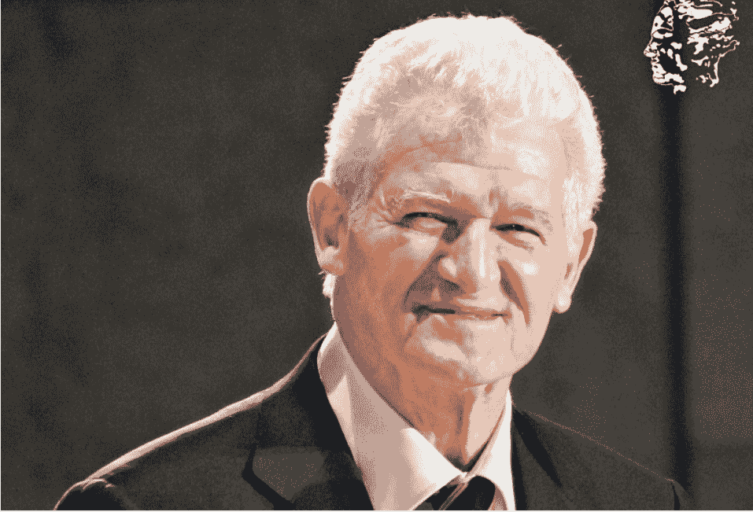

## CAIXIN 听文章

文 | 黄小
撰稿人

19世纪末20世纪初，匈牙利布达佩斯诞生了一批天才人物，他们因智力超凡被称为“火星人”。其中包括航天工程学家冯卡森（1881—1963）、冯诺依（1903—1957）等。数学家彼得·拉克克斯（Peter Lax）也是其中一员。

拉克克斯1926年出生于布达佩斯一个犹太家庭，家境优渥。他展现出数学天赋。十二岁时，父母为他聘请年轻数学家、后来誉为“扩散理论之父”的路沙（Róza Péter）。路沙已经在国际数学学会提交论文，带着拉克克斯参加数学会议，一起阅读。这些经历对他影响深远。1941年，拉克克斯移民美国。临前，路沙为他写了推荐信。高中读书时，拉克克斯当作年轻数学家介绍给爱因斯坦。之后，拉克克斯进入纽约大学读查尔德·柯明（Richard Courant）创建的科学研究所（CIMS）。拉克克斯18岁时迎伍，随后被秘密送往洛斯阿拉莫斯，参与“曼哈顿计划”，研究冲击波的复杂计算，解决支配原子爆炸的偏微分方程。他推测是柯明在战争中对人才的威胁。这段经历塑造了他的的人生，不仅让他意识到书本无法替代亲身经历，还让他认识到计算对于科学和数学的极端重要性。

“二战”结束后，拉克拉斯重返纽约大学，1949年获得博士学位。他的一生大部分时间都在数学研究所度过，并于1972—1980年任所长。他让团队成员按自己意愿行事，认为优秀的管理者应该竭力吸纳解决各类问题的人才，并给予他们表达想法、付诸实践的机会。他在1977—1980年担任美国数学会主席，在1980—1986年担任美国科学发展委员会委员。其间主持的《科学与工程中大规模计算小组（1982年）》直接促成了五个国家级计算中心的建立，并推动了国家科学基金网络（NSFnet）的建设。这些都是美国科研能力提升的里程碑。

拉克拉斯1982年当选英国数学学院院士、美国国家科学院院士，1986年获美国国家科学院奖，获得沃尔菲洛夫教授学位。他的研究领域广博，其学生鲁本·赫许（Reuben Hersh）为他撰写的Peter Lax, Mathematician: An Illustrated Memoir，总结了他在微分方程的有限差逼近、可积非线性偏方程的孤子解、冲击波和非线性性恒定，以及经典传播散射理论等四个领域的突破。“拉克拉斯定价“拉克拉斯-温德罗方法”等都以他的名字命名。这些重要工作包括理论成就，也有实用算法，融合了他在计算机运用和混沌分析领域的能力。

2005年，拉克拉斯荣获数学界最高誉的阿贝尔奖。尽管被视为首位获得贝尔奖的应用数学家，拉克拉斯却并不认可“纯粹数学”与“应用数学”的区分。他在1986年的《数学及其应用》文中指出，这种区分是短暂的，此举引发了关于数学价值的深刻问题。

他在《数学及其应用》文中引用路沙，指出了数学教育面临的危险，回归源头，重新注入数学的思想。他强调，数学教育的源头是直觉，需要将抽象的经验转化为抽象模型。这种方式能够让学生看到数学的意义，延伸到生活中这种思考方式。他认为，数学不仅仅是抽象的公式，是脱离现实的错误。

## 前瞻 | 华盛顿将举行美国陆军纪念

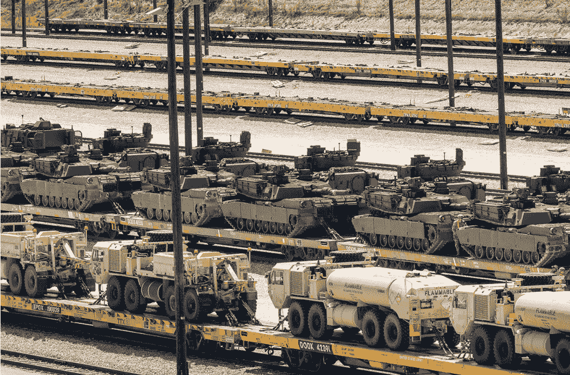

## CAIXIN 听文章

文 | 财经周刊

6月14日也是美国陆军成立250周年，华盛顿白宫附近的国家广场将举行活动，包括装备展示、音乐表演和士兵互动。预计这场阅兵将延6公里，从弗吉尼亚州的五角大楼一直到白宫周边宪法道的观台上。当天黄昏时将烟花表演。两国国防官员对此表示，这场为期一天的庆祝活动预计耗费2500万至4500万美元。这一数字包括军车和坦克巡游造成的华盛顿街道受损之后的清理和修复费用。华盛顿市长鲍泽说，特朗普政府应当提供百万美元用于街道维护。特朗普本人在采访中称，对于外界对美国政府宣称削减开支之间举行阅式的争议，特朗普应该回应，相比阅兵带来的价值，它的成本“像花一样小”。美国应该展现自身最强的导弹、潜水艇、坦克等武器。美国国防部长哈格塞思说，这场阅兵旨在纪念了美国独立而做出牺牲的美国军。

但批评人士认为，举行阅兵浪费纳税人的税金，这些支出应当由美国会批准，而且特朗普此举可能违背军队不参与党派政治的传统。田纳西州民主党员Steve Cohen在5月引入了一项国案，要求禁止美国联邦政府资助任何主要为了庆贺个人（包括特朗普总统）的生日、个人里程碑事件或者私人利益的军事。共和籍的纽约州联邦参议员Lee Zeldin表示，他也认为坦克和核武器不应该出现在美国首都街头。俄亥州共和党议员Jim Jordan说，最终还是由特朗普自己来决定要不要举行军事。在其中一个总统任期内，特朗普曾于2017年访问法国期间，与法国总统马克龙一起看了香榭丽宫大街的法国国庆游，之后特朗普提议美国也行。但预计类似的军事需要9200万美元预算和2100万美元公共安全开支，在政府官员的反对和劝说下，特朗普当时放弃了这项提案。

## 国风 | 首个阿尔茨海默病血液检测在美获批

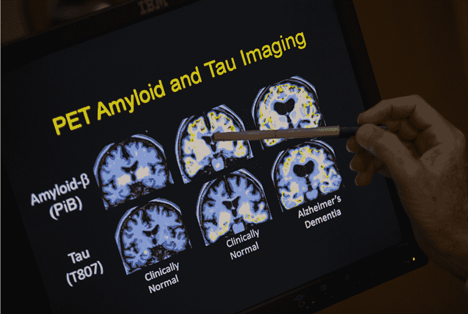

## CAIXIN 听文章

文 | 财经周刊 崔芙

阿尔茨海默病迎来创新的辅助诊断新方法。5月16日，FDA（美国食品药监局）公告，批准首个用于诊断阿尔茨海默病的血液检测。该检测名为Lumipulse G，适用于55岁以上出现阿尔茨海默病症状的患者。阿尔茨海默病俗老年痴，起病隐匿，呈进行性发展，首先发生病理改变，接着出现语言困难、淡漠抑郁、社交减少、记忆力衰退，病情严重时完全无法自理。主流的是两款淀蛋白抗体，能够缓解疾病进展速度。其中一款卡奈单抗与健威公司合作，2023年1月在美批准；另一款多单抗由莱来研发，2024年7月在美批准，2024年12月在美批准。两款药尚未纳入中国。

阿尔茨海默病问题愈发凸显。据资料显示，中国阿尔茨海默病患者总数接近1700万人。2022年发表在Clinical Medicine的一项研究计算了阿尔茨海默病带来的经济负担。预计2050年，中国将是阿尔茨海默病和其他相关痴症经济负担最高的国家，达7亿美元，是美国的6倍以上。

| 药物名称 | 研发机构 | 批准时间 | 诊断手段 | 费用（预计/疗程） |
| :--- | :--- | :--- | :--- | :--- |
| 卡奈单抗 | 健威公司 | 2023年1月（美） | 血液检测 | 2500元/瓶，18个月 |
| 多单抗 | 莱来研发 | 2024年7月/12月（美） | 血液检测 | 5000元/瓶，18个月 |
| Lumipulse G | Fujirebio | 2024年5月（美） | 血液检测（pTau和β442） | 3000—4000元
| 其它手段 | - | - | 腰椎穿刺（LDT）、PET（PET层扫描） | 高昂 |

## 心智 | 驱动人生无模式

## CAIXIN 听文章

文 | 蓝铃

为什么有些人热衷于挑战新机会、敢于冒险，而另一些人则倾向于稳扎稳打、规避风险？为什么同样的激励方式，对有些人有效，对另一些人却毫无用处？心理学家E.希iggins提出的“调节定向理论”，揭示了人类动机的差异。该理论认为，人们在追求目标时有两种动机模式：进取型和防御型。

进取型动机导向的人关注成长、理想和可能性，对他们来说，目标意味着机会、成长和突破。这种动机模式的重点是“获得”，他们追求更多成就、更高目标。这种驱动力使他们更容易被积极结果激励，面对机会时更愿意尝试，即使存在风险。

防御型动机引导的人看重安全、责任和稳定性，对他们来说，目标意味着减少风险、维持现状和履行义务。这种动机模式的重点是“避免损失”，具有这类动机的人目标不在于获取更多，而在确保不出错和失败。他们往往表现出谨慎、理性的特征，更倾向于和和规避问题，严格遵守规定来降低风险。

如何判断自己属于哪种动机类型？希给出一个简单的方法：思考“你期待有什么品质”和“你认为自己应该拥有什么样的品质”这两个问题，你更容易想到哪一个？如果你首先想到的是“期待拥有的品质”，说明你倾向于理想的角度思考问题，具有更强的进取意欲；如果首先想到的是“应该有的品质”，则表明你的防御意识更强。如果两者都能迅速想到，说明你在进取和防御两方面的动机都较强烈。进取型和防御型动机导向不是固不变的性格特征，而是在特定环境下表现出不同的倾向。虽然人们通常有一种主模式，但在面对不同任务时，这种倾向会变化。例如，在创意工作中，人们往往更倾向于进取；而在财务规划时，则可能向防御型。好的匹配不是改变性，而是让与人的机类型相匹配。

该理论揭示了动机匹配的五个要点：其一，个体更倾向于选择符合自身动机类型的行为方式；其二，当行为方式与动机类型匹配时，个体的目标驱动力更强；其三，在预估决策效果时，决策与动机类型匹配度越高，个体对结果的预期越积极；其四，在回顾过往决策时，与动机类型匹配度高的事物经历往往被赋予更积极的评价；其五，个体对与自身动机类型匹配度高的事物给予更高的价值评价。

人们通常具有主导的动机类型，适应性强的往往能够根据境需求灵活调整。以下方法供你参考：

如果你偏向进取型，在需要慎谨行事时制定防御预案来控制风险显得尤为重要。

- 第一种方法是建立“检查点”机制。例如，在项目推进过程中固定的风险评估节点，在每个阶段结束时用识别隐患：“这个决策可能带来哪些问题？”这样可以及时避免过度乐观。

- 第二种方法是制订“如果……那么……”计划。防御导向的人擅长制定预案，你可以借鉴这一点，制定具体的应急方案。例如，“如果任务出现异常，那么我就立即启动应急方案”。这有助于对控制风险。

如果你偏向防御，但在某些情况下需要更开放、进取时，可以通过制订进取型计划来增强目标。

首先，就尝试用强调可能性和收益的语言重构目标。例如，将“我不能让项目延期”改为“如果提前完成，我们就能争取更多资源”，有助于激发积极的动机倾向。

其次，防御型倾向的人容易陷入避免失败的保守状态，因此可以设定具有适度挑战的阶段性目标，这有助于逐步培养进取思维，避免过度保守。

驱动人生的不是某种最佳模式，而是在目标与行动之间找到最合适的那条路径。愿你既能敏锐进取，也能规避风险；在需要冒险时勇敢冲锋，在需要坚守时稳如磐石。

更多精彩阅读：【专颜】心智

## 天眼 | 糟糕的会晤

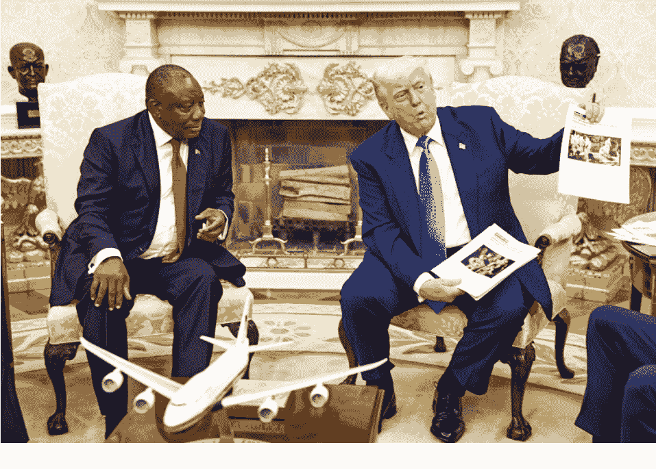

## CAIXIN| 听文章

图: JIM LO SCALZO/IC photo

当地时间5月21日，美国华盛顿白宫，美国总统特朗普与访问的南非总统拉马福萨(Cyril Ramaphosa)会晤，展示其声称“证实南非在发生白人种族灭绝”的新闻报道资料。根据路透社报道，拉马福萨带着颇受欢迎的两名南非高尔足球球员和企业家约翰·鲁伯特作为代表团成员，并表示希望讨论贸易问题。然而会面开始后不久，特朗普重申其南非“正在发生白人种族灭绝”的观点，向拉马福萨展示一叠新闻报道资料，并播放了一段关于南非黑人农场的视频，特朗普称他们的土地被没收、生命受到威胁，许多南非黑人正在“为自身安全逃离”，称美方将接纳受迫者。面对特朗普的激烈言辞，拉马福萨冷静回应：南非实存在犯罪问题，但同时强调没有发生白人种族灭绝，大多数受害者是黑人。■