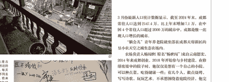

# 财新周刊
Caixin Weekly P. 30

**目录索引：**
- 马斯克离场 16
- 破产服务信托升温 45
- “随时放弃，随时不放弃” 57
- 税收低迷之辩 24
- 新轮外贸转内销 51
- 物业费“降价”来袭 64

## 存款保险下一步
存保机制成立十周年之际，总结过去不同风险处置模式，有哪些得失。

2025年第21期6月2日出版 创号第1158 邮编代码：32-235 ISSN 2096-1251

## 财新观察 | 为平台经营创造良好生态

平台经济监管体系有望进一步完善。近日，市场监管总局研究起草了《网络交易平台收费行为合规指南（征求意见稿）》（下称《指南》），并向社会征求意见。《指南》开宗明义，其旨在“规范和引导网络交易平台经营者收费行为，维护经营者合法权益，促进平台经济持续健康发展”。全文包括明确收费透明遵循的原则、倡导降低平台内经营者负担、强化平台自律、规范平台收费行为和加强监管与实施等五个方面内容。

近年来，中国平台经济快速发展，在促进消费、扩大就业、推动创新等方面发挥了重要作用，涉及千万级经营主体、众多灵活就业人员、9亿多网络消费者。市场监管总局竞争局有关负责人《指南》指出，平台开展经营服务过程中，向平台内经营者收取佣金、抽成、会员费、技术服务费、信息服务费、营销推广费等，这些费用构成了平台收入的基本来源；同时，用户的反馈是，平台在收费名目繁多、计算方法复杂、平台收费不透明等问题。

此负责人还介绍，许多平台企业在发展过程中逐渐完善合规管理机制，但是在收费方面，其内部合规管理制度还不够完善，导致平台企业收费风险防控不足。《指南》以问题为导向，细化了《价格法》《电子商务法》有关规定，针对平台收费不透明、不合理问题提出了具体要求。

近年来，监管部门大力加强平台经济治理，强化反垄断执法力度，依法严厉平台垄制“二选一”、数据杀熟、低价倾销、强制销售等破坏公平竞争秩序的行为，引导平台经济向开放、创新、赋能方向发展。治理也需要企业内部加强自律。《指南》遵循监管与自律相结合的原则，不仅对规范收费行为保障合法权益提出明确要求，还强调平台自身监管，鼓励平台采取多种措施降低负担，有助于形成监管与自律良好的格局。

在规范收费行为方面，《指南》包括：明确平台要制定收费标准、完善收费规则、公示制度，严格履行减收承诺、评审收取保证金的必要性，按照相关法规。另外，《指南》还明确规定了重复收费、转嫁应由平台承担等不合理收费。这些内容直面行业痛点，有助于保障经营者权益。

对平台收费是否合理，《指南》第二条提出：“平台根据自身成本、协议、交易习惯等因素，遵循公平、诚信信用的原则，充分考虑经营者状况，依照相关法规制定收费标准。”市场监管总局竞争局负责人指出，从整体上看，判定收费是否合理可以结合市场供需、行业属性等要素综合判断。《指南》也制定了多项条款，要求提高收费透明度。此外，应当赋予企业畅通的救济渠道，营造良好的环境。平台经济治理是一个全球性难题，近年来中国继续发布一系列法规，不断完善治理框架。随着《指南》逐步落地，将有助于企业优化合规建设，推动行业健康发展。

## 最新报道 | 存款保险下一步
丁锋 张宇哲

2025年5月初，包商银行重组后设立的包商银行披露2024年财报，剔除因合并12家银行预计损失的影响，实现净利润1.8亿元，同比增65.2%，连续四年实现盈利。从资产质量和风险补偿看，2024年末不良贷款1.02%，较年初下降2.2个百分点；拨备覆盖率99%，年初上升4个百分点。这意味着包商银行的风险化解有效，经营持续正常，自我造血能力逐步形成。

包商银行是中国成立以来第一宗真正意义上的银行破产。2019年处置包商银行，也是2015年存款保险制度实施后保险基金的第一次使用，通过“接管+收购承接+破产清算”的方式，实现了银行的市场退出、平稳化解风险。在此过程中，存款保险金管理公司（下称“存款保公司”）应运而生。包商银行实践是中国健全金融机构风险处置和市场退出机制的重要尝试，为后续金融风险处置提供了宝贵经验。

2017年12月，国际货币基金组织和世界银行对中国开展五年一次的金融部门评估，认为中国建立的存款保险制度与国际标准一致的核心原则，为市场化处置提供了坚实基础。

2015年5月1日《存款保险条例》实施为标志，中国建立存款保险制度已有十年。存款保险制度是金融业基础性安排，其运行机制是由投保机构每半年交保险费，形成存款保险基金。一旦发生破产倒闭事件，存款人放在银行限额内的存款不会遭受损失。在中国，这一限额为人民币50万元。

存款保险董事长王玉玲介绍，截至2024年年末，中国有3761家保险机构，存款保险已累计集保费3732亿元，50万元的偿付限额能够99%以上的存款人提供全额保障，处于国际领先水平。

需要的是，累计3700多元亿元的存款保险基金，对应的是2024年末商业银行3.6亿元的不良贷款余额，以及以300万亿元的存款余额。“存款保险基金的使用必须精打细算。”一位人士提醒：中国存款保险制度在设计之初就明确不是简单的“付款箱”，而是选择了“风险最小化”的模式，即存款保险具有风险监测评估、早期纠正补充资金以及风险处置职能，希望实现风险最小化。过去几年实践在包商银行、辽宁部分城市等风险处置中，积累了不少经验，工作不断优化。

前述资深人士指出，从包商银行等问题看，首先要“快”，如果错过了后再处置，无论是风险性质还是法律、政策方面都难以解决。要实现风险最小化的目标，先前的风险预警和早期纠正非常重要。基于投保机构情况，确定差异化的保险费率，也可对投保机构进行预警、采取早期纠正措施，风险干预范围及触发条件不明确。

上海金融实验室首席专家曾刚认为，当前的风险早期纠正制度还需要优化。首先监管授权不足，其次部门协同信息共享不畅，再次约束力有限，导致机构整改意愿不足。从国际实践看，各国存款保险制度经历了多次改进的过程。例如美国联邦保险公司（FDIC）通过多年来应对金融危机，其防范和流程赢得了广泛认可。

金融安全的概念由国际清算银行在1986年提出，目前国际认为是审慎监管、存款保险制度、中央最后贷款人职能共同构成金融安全的三大支柱。在这三大支柱中，目前审慎监管和中央最后贷款人两大支柱均缺乏立法支撑。全国“两会”期间，许多代表建议将《存款保险法》层级升级，此外也应该考虑存款保险法与其他法律的联动和协调。

过去六年，存款保险基金参与包商银行、辽宁部分商城等风险处置，探索了不同的风险处置模式，其间损失需要总结。人民币银行发布的《中国金融稳定报告（2024）》披露，从包商银行风险处置，存款保险基金以多种方式支持风险化解。包商银行风险处置是保险基金的首次使用。2019年5月，包商银行出现严重信用风险被人民币银行和原银保会接管。在处置过程中，中央和存款保险基金提供资金支持，对5000万元以上大额债权部分保障，对5000万元以下债权给予全额保障，保障比例近90%。同时，为保持风险处置期间金融服务中断，存款保险基金发起设立包商银行，入股包商银行，促成相关资产、负债债务收购承接。2021年8月，包商银行破产清算程序终止，实现市场化退出。

根据人民币银行披露的2020年存款保险收情况，当年使用存款保险金67亿元开展风险处置，对102亿元金融稳定再贷款提供保障，使用165.6亿元购买不良资产，使用88.9亿元认购包商银行股份，100亿元用作存款保险公司资本，其中66亿元用于设立包商银行。

综合各个渠道的情况来看，当时银行通过深度参与市场调整对整个金融市场构成了潜在的系统性影响，造成包商银行严重困境的原因是：监管失灵。地方监管方式的腐败代价很大，由于参与首个项目，存款保险基金付出了较高的成本。但也应该看到，通过及时接管、存款保险深度参与的一系列安排，原本银行的风险出清，新成立银行自身产生了造血能力，是市场化处置问题的关键。

为了有一个实体为包商银行远远收购各类债权，2019年央行设立了储保公司。前述资深人士总结，包商银行处置时发挥了重要作用，包括处置机制、收购承接、提供担保、提供资金注入、提供流动性支持、收获损失、资产购买和防范银行挤兑等方面。“包商银行处置的案例非常珍贵。”他回道，“20多年前我们就谈过，金融机构功能可能不能像工商企业一样实现市场化的退出，大家都可能为银行的退出远比企业要灵活。比如包商银行1998年关闭，历时多年都没有完成清算，说明机制缺失。”

在现有《存款保险条例》框架下，存款保险早期纠正缺乏硬约束。2015年，地方政府为了化解风险，吸收了包商银行、辽宁部分城市等风险，存款保险基金出资22亿元，其中包商银行持有2%的股权。股权结构显示，国有控股企业持有95%的股权，包商银行风险出清了2%。

尽管地方国资背景强大，存款保险有发挥的空间。

“有很多案例显示，部分中小企业出现风险时难以介入，这就需要早期纠正机制进一步防止风险积聚，加大后续难度。”前述资深人士说，早期纠正正是存款保险的一项职能。早期纠正机制（Prompt Corrective Action, PCA）起源于美国，强调尽早识别机构及其风险，并根据风险差异化程度采取相应的干预措施，降低经营失败及风险外溢的可能性，使得处置成本最小化。人民银行在《中国金融稳定报告（2023）》专栏中介绍，欧美处置经验表明，对机构延迟介入或关闭，不仅会导致自身损失扩大，还可能对对方增加处置成本。中国的存款保险制度于2015年开始实施风险差异费率。从2017年起，央行开始探索对机构开展早期纠正，并自2022年起分批开展试点，共计扩展到19个省份。目前已初步建立一套工作机制，对700多家银行开展评级，评级结果是确定差异费率和采取早期纠正措施的重要参考。评级共分分级（1-10级和D级），级别越高意味着风险越大，D级意味着倒闭、被接管或撤销。一位专业人士介绍，在评级过程中，当评级等级较差、风险比较大，机构会被限制业务，比如一些创新业务不能做、不能发贷等，同时提高存款保险费率。

总结认为，存款保险具有早期纠正作用，目前已构建了具有存款保险特性的风险监测预警体系，推动风险早识别、早预警；二是施行针对性的早期纠正措施，促进“预防未病”“治已病”效能，及时纠正风险，避免风险扩大；三是强化风险“通报—反馈”，促进风险暴露，推动各方协同治理；四是持续推进“不纠正即处置”的约束，确保早期纠正工作，推动风险早处置。

在风险监测预警方面，《中国金融稳定报告（2024）》披露：从2020年起，央行共开展12次风险监测预警，累计识别预警银行481家，剔除同一银行多次发现的情况后，共计识别预警银行253家。机构类型方面，以城镇银行和农村商业银行为主，合计324家次，占比为67%；风险类型方面，以同业风险和扩张性风险为主，合计314家次，占比为63%。对于已经识别的预警银行，央行综合施策，通过发风险提示函、约谈高管等方式，督促其采取针对性措施，推动异常指标回归行业水平，将重点预警银行的情况及时通报监管部门和当地政府，形成监管合力。截至2023年末。

## 成立十年的存款保险基金，账上有多少钱？

截至2024年末，中国共有3761家投保机构，存款保险累计征集费3732亿元。央行公布的2024年存款保险基金收支情况显示，截至2024年末，存款保险基金结余698.424亿元。

从历年存款保险基金的收支情况来看，2015年至2019年这五年，存款保险基金只进不出，五年余额分别为31亿元、238亿元、480亿元、821亿元、1216亿元。

2020年起，存款保险开始发挥风险处置职能，其基金每年均支出，其中2020年和2022年是支出大年。存款保险基金的主要支出包括银行不良资产165.6亿元、认购微银行88.9亿元、存款公司资本100亿元，共支出1035.5亿元；此外，存款保险基金还为1024亿元金融稳定再贷款担保。

2022年的主要支出包括迎农银行风险处置支出368.56亿元、辽宁省保险处置专项借款300亿元、归金融稳定再贷款211.32亿元、收购金融机构股权31.25亿元，支出合计910.88亿元。

2020年至2024年间，存款保险费缴集分别为423.88亿元、467.05亿元、487.24亿元、597.77亿元。

据财新了了解，目前平均每年可取的存款保险费大约500亿元。与近年来风险连续暴露的高风险保险机构体量相比，存款保险基金并不宽裕。

2025年《政府工作报告》提出，充分利用存款保险基金、金融稳定保障基金等险资源。

“足够的资金余额和完善的储备融资制度，是有效应对金融危机的‘基石’。”宣昌能指出，存款人是否对存款保险制度的保障有信心，有赖存款保险是否拥有充足、可随时调用的资金。金融稳定委员会（FSB）在《有效存款保险制度核心原则》修订版中进一步明确了存款保险储备融资机制，要求在法律层面明确规定存款保险制度的紧急资金安排。

从国际经验来看，很多国家的存款保险基金都有储备融资的安排，包括中央银行申请贷款，向市场公开发行债券等。

中国产业发展促进会学术顾问樊近近期在《中国金融》文中指出，参考国际经验，可以通过以下方式完善存款保险基金储备融资机制。

一是通过向中央银行借款，迅速补充流动性。作为存款保险基金储备的重要渠道，向中央银行申请资金支持日本、韩国、印度、荷兰、西班牙以及中国香港特区等许多国家和地区采用的融资方案。中央银行作为最后贷款人，能在危机期间帮助存款保险基金快速补充资金而不受市场流动性影响。

二是通过公开发债，募集外部资金。日本存款保险机构从从999年开始发行债券筹资金，债券发行需日本本土拍准，无须外部评审，每季度可视为同国债开发行，其中政府担保的债券期限为12个月，未经政府担保的债券期限为3个月。2018年以来，在日本存款保险基金的新增资金，来自中央银行的借款占比低于5%，来自公开发债的资金占比超过95%。

三是通过投资运用，增加基金收益。日本存款保险机构可投资的包括国债、地方债、AA+以上的公司债、货币基金等，其中3个月期国债是核心投资的，日本存款保险机构每周进行调，以确保投资组合的流动性和收益稳定性。

曾别建议，允许存款保险基金在风险可控的前提下适度与政府债券、高级金融资产等投资，实现基金保增值，提升其有效性和抗风险能力。

四是通过预收保险费，筹集应急资金。为应对2008年国际金融危机，FDIC将约500亿美元保险基金消耗一空，还出现了209亿美元的赤字。在此背景下，FDIC决定预收三年保险费（约460亿美元）和特别保险费（约55亿美元）来充实存款保险基金。

## 形成监管能力

2015年存款保险制度实施后，前五年没有设立专门平台。这段时间，由央行履行相关职能。2019年，以银行风险为契机，存款保险公司开始实质化运行。2020年起，存款保险公司开始专业化。王均提到，明确存款保险基金管理机构作为风险处置主体定位。

由于中国的存款保险制度设计之初就决定存款保险不做简单的“付款箱”，而是具有风险监测、早期纠正、风险处置等功能。一位资深人士分析，从央行的角度来看，如果存款保险机构具备提前获取信息、早期干预的功能，那么存款保险基金就会被动。国家金融监管局的角度来看，这些属于微观审慎监管，使得银行监管更好。也有观点认为，由监管部门管理存款保险，有“花钱”、掩盖监管失败。财政部门关注公共资源，存款保险来自市场缴纳费，不宜对其进行国有资产。

曾别认为，存款保险基金管理机构与银行主管机构权责分工，是内部协作的问题，理想的分工应当基于“互补协同、避免监管真空、防止职责重叠”原则。

从全球范围内，存款保险基金的管理方式是多样的，既有传统体系，也有选择。根据国际存款保险协会（IADI）的数据，截至2023年参与调查的105家存款保险机构中：

- 独立法人，占比84.7%
- 属于中央银行的，占比9.5%
- 属于银行协会的，占比8%
- 属于监管当局的，占比4.4%
- 属于财政部的，占比2.9%

主要经济体中，美国、加拿大、日本、韩国、马来西亚的存款保险机构都是独立的。荷兰存款保险机构隶于央行。典型的FDIC，由美国政府直接出资和管理，与美联储、美国货币监理(OCC)和国家信用管理局(NCUA)一起共同监管银行业。

从中国的实践来看，存款保险基金成立之初由人民银行担任职责。一位金融领域人士指出：“存款保险本质上不是简单的银行行为，宏观调控的核心就是确保供应与经济发展相匹配。若存款事件剧烈波动，就意味着管理失效，宏观调控标准难以统一。正因如此，存款保险与央行存在紧密联系——存款保险需要央行的宏观支持，央行也需要存款保险来维持稳定和金融安全。这一制度设计体现了对存款运行规律的深刻把握。”

“过来来说，存款保险也不开银行。在应对危机时，公众信心的建立、预期引导十分重要。央行作为最后贷款人，是存款保险基金的靠山。在金融机构出现流动性危机时，可以通过紧急资金支持市场信心。存款保险基金管理与央行的最后贷款职能相互配合，能够更有效地应对金融危机。”他补充道。

一位业内人士认为，人民银行通过存款保险基金对银行风险的关注，相当于对规模异常大的银行业监管形成制衡。在业内看来，如果由行业监管部门管理存款保险基金，优势在于熟悉银业的经营特点、风险状况和风险特征，在银行的经营数据和风险状况等信息的基础上，可以日常监管和对问题银行的处置无缝合。但受限于，微观层面存在用风险处置来掩盖监管失灵的思维可能；在宏观层面维持稳定可能不是；缺乏这样的货币政策和资金实力。

在目前情况下，让存款保险基金独立于货币监管机构还缺乏相应的制度设计与现实保障。一位业内人士对保险保障基金的情况举例说明：“我们的保险保障基金应该属于国家金融监管总局的一笔。如果要独立出来，在中国国本位的体制下，至少是个副部级单位，才能有同等的话语权。外，问题机构处置并非有钱就可以，关键要有配套政策支持。即使独立出来后，还需要跟国家金融监管总局对接政策，增加了成本。”

业内认为，早期纠正机制并不是替代现在的微观监管。曾言指出：“存款保险基金管理机构与银行的主机构要适当分工，各侧重，对重点问题共同进行调查。充分利用金融监管协调机制，实现监管信息共享，依托现有管理体制开展风险处置。”曾刚建议，按照风险阶段和专业优势实施分层监管与协作：国家金融监管总局作为主管机构，负责常规化全面监管、日常合规检查和监管评级；存款保险机构则聚焦存款及存款保险基金安全与存款人保护。当风险程度加深时，两者协作加强：

- 轻度风险阶段以信息共享、评估为主
- 中度风险阶段以联合监管、参与为主
- 严重风险阶段由存款保险主导退出路径

曾刚总结道：“最终，应明确双方边界，同时建立高效信息共享和联合决策机制，实现各自配合，共同筑牢金融安全。此外，在当前金融风险普遍下，存款保险机构由地方政府对其负责。由于存款保险本身是钱，又是市场操作，才有动力去减少成本。存款保险在风险处置中的主体非常重要。”一位资深人士指出。

## 提升层级

无论是早期纠正机制、完善储备融资机制、风险处置机制健全，还是存款保险基金定位，都需要更高层级的立法。2025年全国“两会”期间，多位人大代表提出议案，建议加快出台存款保险法。

当前，存款保险制度与中央银行负责、地方政府一起，构成金融安全的三大支柱。但另外两大支柱已有立法，存款保险制度的法律地位较低，市场化、法治化问题突出。王均指出，十年来，存款保险制度在《中国人民银行法》、《商业银行法》《银行业监督法》、《企业破产法》等部门法律中快速推进。

从国际经验来看，150个国家和地区中，有专门立法加强存款保险履行风险处置并承担监管职责成为国际金融改革的重要趋势之一。俄罗斯、加拿大、日本、韩国等经济体也建立了存款保险法或存款保险公司，其主要功能是增强存款保险在风险处置中的作用。资深人士指出，此前存款保险功能是有效做法。未来，在立法过程中，应该给存款保险留出余地，如明确存款保险基金可以向央银行借款，或必要时央行可以提供一定的支持。

在这些法律中，如何与其他存款保险机制衔接？是否需要单独制定独立的存款保险法？如果有必要，立法条件是否成熟？如果可行，需要编写哪些内容？这些都需要研究。中国政法大学经济学研究院教授李曙光表示，存款保险的运作方式实际上是把市场运作手段和政府保障结合起来。一方面，采用市场通用的手段，如调整存款保险费率、合理评估资产价值、通过竞争挑选合作机构等提高风险处置效率；另一方面，依托政府信用作为后盾确保保险稳定。这种模式既不像企业追求盈利，也不像政府部门完全依靠行政命令，而是在两者之间找到平衡。它就像连接市场操作和宏观政策的桥梁，能激发市场活力，又能实施监管要求，让整个保险体系良好运作。他也表示：“现行的存款保险制度基本上没有涉及行政和司法的衔接。特别是行政组织以后如何运作，司法在里面扮演什么角色是不清晰的。”

一位立法机构专家表示，为了完善金融风险处置长效机制，应当帮助当下重要法律周期，推动相关法律明确存款保险职能内在内的风险处置程序，并保持相关法律之间的协调以及与法律程序的衔接。“在立法中，一方面要建立早期纠正的硬约束机制，为早期纠正设置明确的时限，对于在规定期限内不能达标的机构，要及时采取处置措施，把握处置的最佳时机，最大程度减少处置成本。要确保存款保险资金的使用条件，积极推动接管+收购承接+清算为主的处置模式。同时还要一步发挥存款保险专业化风险处置职能，丰富履职的措施工具。”一位法界专家指出。

他还提到，要以《商业银行法》修订为契机，将存款保险制度安排纳入银行立法的顶层设计，同时积极推动《企业破产法》的修法，处理好金融机构行政程序和破产司法程序的衔接，为存款保险金管理机构依法履职预留制度接口。

# 最新财新周刊 | 税收低迷之辨

**财新周刊 | 程宪炜

税收是经济“晴雨表”之一。然而从2023年底至今，中国税收持续下降，同期GDP（国内生产总值）则保持增长。根据国家统计局公布数据，2024年4月全国税收首次实现单月增长，但前四月累计相比去年下降1.5%，其中季度下降3.4%。

如何合理处理税收增速与GDP增速的差异？从1994年分税制改革以来，很一段时间内税收增速与GDP增长走势一致，2012年之前税收增速明显超过GDP。由于分税制下，价格变化会放大税收数据的波动，因为购进与销售之间的差异滞后。在下行期，价格下降会影响名义税收收入，从而降低税收规模。

近年来税收下降受到多重影响，包括经济增长、物价上涨、产业结构变动等因素。一些研究者给出适应国情的解释：上世纪90年代中期至2012年左右，中国税收显著超过GDP增速，除了经济增长外，1994年分税制改革在制度设计时留下了“空间”，分税制促进了税务机关管理能力。近年来中央连续出台减税降费政策、研发费用加扣等政策，形成的减税规模逐年扩大。为弥补收入缺口，非税收入成为政府增收手段。依据OECD（经济合作发展组织）、IMF（国际货币基金）等国际通行口径计算，中国宏观税负（税收收入占GDP比例）逐渐下降，处于一般水平，更是低于发达国家，但纳税人的感受却存在反差。

华夏财经经济研究院创始人贾康表示，过度税可能是感觉负担较重。经济下行期，尤其是市场信心需要提振，政策方向应当是更为积极的减税降费，但考虑到过去大规模减税降费后，中国进一步减税的空间已经不再。下一步挖掘减负空间需要减少复杂隐性收费项目。反思之，如何让企业与纳税人的获得感，扩大内需和投资，同时不损害财政收入的税基。

## 增值税减收争议

值得注意的是，与全国税收收入下降3.4%同步，当年国内增值税收入下降了3.8%。

中国税收收入中，国内增值税、企业所得税、国内消费税和个人所得四大主体税种合计约占全部税收的八成，如果加上进口货物增值税、消费税，占比升至九成左右。其中，国内增值税是中国第一大税种，近年来降至近四成。

本轮税收收入下降很大程度受到增值税拖累。2024年国内增值税同比下降3.8%，为四大主体税种中唯一低于总体水平。自2018年以来，减两次都从降低税率开始，但这一做法在研究界存在很大争议。从基本原理来说，增值税是对商品和服务在生产流通过中每一个环节的增值额课税，通过发票抵扣链，税负主要由消费者承担。实践中，由于抵扣制度不完善等，增值税未能完全转嫁给消费者，部分形成企业的负担。学者认为，增值税减税大程度能否减轻企业税负，取决于企业向下游和消费者转税负的程度，难以研究透彻。也有观点指出，减税的主动机是想发展企业活力，但增值税是一个中性税种，增值税并不增加企业竞争力，因为出口都可以退税。

从走势看，本轮税收下降与增值税下降几乎同步，均开始于2023年12月，2024年前三季度均持续下降，四季度税收恢复增长。

2019年4月起，中国实行增值税增量未留抵税额退还的制度，先在部分先进制造业推开，2022起扩大至小微企业和制造业、科学研究和技术服务业等多个行业，并在2022年第二季度一次退还制造业等行业企业存量留抵税额。不过，增值的留抵税制度则是业内都认为是应该保留并落到实实的。

一名财政部门人士对财形势表示，当前面临经济下行，要求经济大转型挑战大，因此相关行业加快投资，固定资本和设备投资占比较多，相应增加应退还的增值税留抵税额。尤其2025年一季度国债、地方政府专项债发行增加，拉动固定资产投资、GDP增速较高，但这些（项目投资）短期内尚未形成税收，反而带来减税压力，留抵税额的回扣效应并不理想。

前税务部门人士指出，这些过去的存量大规模优惠政策，造成减税规模增长可能限于税收增长。并且税收优惠政策重点支持的领域通常是发展较快、代表先进生产力的行业，这也可能放大经济增长和税收之间的差异。

## 价格“放大器”

财政部在解释全国税收引起下降时提到，还有一个主要原因是工业生产者出厂价格指数（PPI）持续下降。

与所得税对个人收入和企业利润所得税未增加，增值税针对生产流通过各个环节的增值征收，同时设有发票抵扣机制，也就是所谓的“环增收、链抵扣”。

一名税务部门人士对财务解释，企业通常先购、后销售，中间有一定时滞。如果在价格下行期，工业生产各环节的名义增值下降速度可能比价格更快，甚至变成没有增值，弹性巨大。即便不用考虑时滞，价格下跌会拖累名义增值下降，从而导致增值税额减少。以一种便于理解的极端情形为例，企业进货100元，原本对外销售110元，其中增值额10元按13%的税率需缴纳增值税款1.3元，如果价格下降10%，销售额从110元变为99元，那么增值额从10元变为0元，增值税额从1.3元变为0。

华创证券首席宏观分析师张瑜，在PPI上行周期，价格上涨带来的增值税增收效果更为明显：如果前三个月采购成本较低，购进时缴纳的增值额相对，当月销售产品价格较高，销项税额相对多，增值税额（销项税额减去增值税额）也会增加；反之，在PPI下行周期，增值税减效果更为明显。

张瑜测算，在2011年至2015年、2017年至2020年、2021年至2023年三典型价格下行，税收对PPI增值弹性分别为1.6、1.6、1.5，这意味着PPI比增速每下降1个百分点，对应的税收同比增速要下滑1.5到1.6个百分点。

中国社会科学院原副院长、学部委员高培曾表示，中国以增值税等间接税为主的税收收入，意味着税收收入的绝大部分要作为价格的构成要素之一附价格之中。由于和商品及服务的价格绑在一起，因而税收随价格的涨跌而升。当经济高速增长时，税收收入的增速便可能高于经济增速；当经济增速放缓或低于以往增速时，税收收入的增速可能低于经济增速。

高培勇认为，只要中国现行税制体系以及由此决定的现实税收格局不变，中国经济增速下滑将带来税收收入和财政增速更大幅度的下滑，这在料之中。

企业所得税作为第二大税种，近年来约占税收总收入的23%，加上增值税，两者合计占比超过60%。2024年、2025年前四个月企业所得税同比率下降0.5%、3.1%。

对企业利润增长的企业所得税，同样受价格下降影响。前述税务部门人士指出，价格下降影响名义增长率，进一步影响企业收入。从深层逻辑来看，价格下降通常反映了需求低迷，企业利润受损。按照税率档次设计，如果企业利润无须缴所得税，因此企业税收入波动可能更大。

从国家统计公布的数据看，二者历史趋势基本一致。从2022年10月至今，PPI持续下降这段时期，工业企业利润同比下降2.3%、3.3%。

中国税制结构中，除了个人税、车税等少数税种与居民消费相关，多数税种与企业规模相关，导致税收与价格指数（CPI）相关程度更高。

而近年来的价格下行中，PPI下降幅度高于CPI，导致税收增速低于GDP增速。根据统计局公布的GDP绝对值估计，2025年一季度，税收表现同比增长4.6%。

## 税源结构变化

近年来，中国处于新旧动能转换期，不同行业对税收的贡献出现差异。前述税务部门人士分析，税收下降受到税源结构变化的影响，此前对税收贡献较高的行业主要有：
- 采矿业
- 制造业
- 黑色金属矿选
- 煤炭采选业

近年来PPI在2024年下半年和9月累计分别下降1%和13.2%。

房地产产业不仅价格持续下行，而且面临交易占比下降。前述税务部门人士称，新房和二手房贡献的税额差异很大，新房销售需缴增值税、企业所得税、土地增值税，而二手房只需缴契税，规模远低于新房。随着中国房地产从增量为主转向增量并重的时代，行业税收必然大幅下降。

根据住部数据，2023年前1个月，全国二手房成交占新房总交易量的37.1%，创历史新高。2024年，全国有1省和直辖市住宅成交超过新建住房。

此外，一些增长较快的行业由于税收优惠政策及税制设计，部分缓解。比如新能源汽车行业近年来2022年至2024年同比增长97.5%、30.3%、38.7%，但只有少数车能盈利，对企业所得税的贡献有限。从2014年至今，国家对新能源汽车一直实施免征车辆购置税、船税。据国家税务总局披露，2023年共免218亿元，而当年全国车辆购置税、船税合计3795亿元。

按财政部解释，2024年税收下降减缓、缓税政策的影响，还包括2023年9月延续实施中小企业延缴税费，相关税款在2023年入库，拉高2024年的基数。2023年，财政部门提高个人所得税幼儿照护专项附加扣除标准、研发费用加计扣除、小微企业和个体户减税优惠、增值税规模减免增值税等四项减税政策，相应减税政策在2024年产生效应。

此外，个人所得税的幼儿照护、养老人、子女教育三专项附加扣标准的提高政策，在2023年8月后推出，2024全年收入下降了1.7%。

与税收密切相关的宏观财经话题，也曾引发引发。在税收收入持续快速增长、财政收入占GDP比重迅速提升时期，出现过多次对中国宏观税负是否过高的争论。比如007年《福布斯》杂志“全球税痛苦指数”排名、2016年“死亡税率”讨论等。随着近年来，财政收入尤其是税收收入增长低迷甚至下降，一些研究者又担心中国宏观税负下降过快，可能影响政府正常履职和提供必要的公共服务。

楼继伟2024年曾表示，将四本预算加总、排除一般公共预算对社会保障基金预算的补贴等重复项和土地支出收入中的征地拆迁、进口、七十一本计算的国际可对比的广义财政收入，2018年以中国财政收入占比GDP比例为28%~29%，2023年下降到26%，低于发达国家30%以上的比重。其中税收占比GDP比例仅为4%。总体下，除了连续多年实施减税政策，还受政府债务加速老龄化、教育、医疗等支出升、膨胀带来压力，财政可持续性日益挑战。曾曾表示，在经济下状态下，税收越越好，推行减税有助于企业装上阵。从现有研究看，中国宏观税负水平并不高，通过统计数据反映地方政府过度执法行为，这些问题。特朗普政府反复无常的自为行为在加速削弱美元的稳定性和结构性前景。

结构性方面，基于彼得国际经济研究所创立高级研究员约翰·威廉·珂姆对实际均衡汇率的研究，我们采用一种美元“公允价值”的测算法，同时考虑价格和相对生产率的变化。再加上其他政策抬高价格水平，不用说他提出的法案隐含的巨额赤字，这些政策无疑也在削弱美元的长期价值。

特朗普政府反复无常的自为行为在加速削弱美元的稳定性和结构性前景。

## 特朗普继续摇动美元

专栏 | 吉霍·奥尼尔
英国皇家事务研究所前主席

美国总统特朗普4月2日宣布“对等关税”以来，金融市场仅享受了几周的平静，特朗普再次失去了耐心。在意识到俄乌冲突难以轻松达成协议后，特朗普处于放弃斡旋的边缘。

特朗普反复无常的决策月初旬，特朗普宣布“对等关税”有90天豁缓期，然后他又又一次发布声明将50%关税推迟至7月。

特朗普对欧盟提高关税只有一个理由，就是他认为欧洲贸易谈判失去了耐心。任何参与过漫长而复杂的脱欧谈判的人都会告诉他，欧盟喜欢细节。这些欧洲贸易专家绝不可能签署一份花哨的协议，让特朗普很容易获得更高的基准关税，正如美国对英国所做的那样。

考虑到欧盟的经济规模和美国跨国企业对欧盟市场的依赖，我设想特朗普如何维持新的激进立场。若他继续如此，市场可能会再次上演当时的景象——美股市暴跌、债收益率飙升，种种迹象都表现资本外流。对于欧洲商品加征50%的关会对美国企业和消费者带来巨大影响，还将波及美国最大优势之一——服务出口。欧盟的反制措施显然将针对美国科技公司等目标。

此外，特朗普要求大企业将业务运往美国，体现了他对汽车等传统产业的关注。德国政府绝不可能坐视本国汽车巨头将主要业务转移到美国。同时，特朗普对哈佛大学乃至更广泛的高等教育领域的举措同样伤害深远。哈佛大学教授、美国总统经济顾问委员会主席杰森·福尔曼在《金融时报》译文中，政府禁止哈佛招收国际生，意在破坏其财务健康，因为国际学生来需要缴全额学费。这项政策的损害不会仅限于哈佛，波士顿地区戏称“迷金城”，创新的系统就是美国的创新能力可能被削弱。今后，全世界的学生、学者和研究人员在赴美发展前会三思。

我在美国区域东北部的发展历程的启示。上世纪60到70年代的经济教科曾提到，美国东北地区会像英格兰北部和欧洲部分地区一样，陷入不可逆转的工业衰退。然而，哈佛、麻省理工、春藤盟等世界顶级学府让这里成为美国最具活力与竞争的区域之一。难道特朗普要让这个区域增长焰吗？

## A股赴港潮重来

专栏 | 王青
香港特区政府财政司陈广辉、香港交易所行政总裁郭廷出席宁德时代上市仪式后称，截至5月，不到五个月，香港新股集资额超过760亿港元，同比增长7倍，接近2024全年880亿港元，位居全球第二。

按IPO集资排名，从2013年起，港交所连续全球前三。2022年和2023年，港股IPO市场陷入低迷；其中2023年港交所IPO集资额录约463亿港元，创下2年来新低，排名滑落至全球第六。本港股IPO回暖的重要点，始于20249月美的集团（00333.SZ/02352.HK）在香港本土上市；同年1月顺丰控股（02396.HK）挂牌。两家A股行业龙头“先AH”的“打样”效应，重新引起投资者对香港股市场的兴趣。2025年初，人工智能DeepSeek-R1横空出世奋市场，加上投资者意识到中国经济正在企稳，港股市场的风险偏好有所修复，IPO大型融资项目由此重新提。2025年上半年，以宁德时代、恒瑞医药为首批A股行业赴港，不仅吸引了欧美、中东等国际知名线、主权基金积极购，也扭转了以往H股大幅折的情况。从估值出发，H股股价的整体提升，有望加速A股赴港上市。

年利达（万达）股权资本部大中华区主管许文嘉看来，看到越来越多的优秀的中国企业利用香港市场对接国际资本，这不仅显示出香港作为国际金融中心的吸引力，也表明了“A+H”上市模式为中国企业在流动性、投资者多样性和市场准入方面提供了更高化的路径。

除A股头部企业外，在过去的12个月里，以老铺黄金（0618.HK）、蜜雪集团（02097.HK）、毛逸平为代表的消费类公司亦亮相香港股票市场。因为这些公司有业务出众且题材热等因素，给投资者带来甚至十倍收益的“打新”财富效应，进一步提升港股IPO的吸引力。

与此同时，制度和创新仍在优化。港所为未盈利“特专科技公司”专门增设的《上市规则》18章于过去一年内开花，迎来晶泰科技（02228.HK）、灵萨智能、越疆机器人（02432.HK）三家公司挂牌。2025年5月初，港所与香港证监还将联合推出“科企专线”，专门为特专科技公司及“生物科技公司”（循《上市规则》）。

宁德时代（300750.SZ/03750.HK）于2025年5月20日登陆港股市场，集资10亿元。恒瑞医药（600276.SH/01276.HK）由内地A股转赴香港，首日H股收升25%。

在全球投资者方面，宁德时代此H股发行对美国市场监管规则，选用的是美国证券法下的Reg S条例（Regulation S），但不设144A规则。也就是说，宁德时代的H股发行将美国境内投资者完全排除在外的，这也意味着，该发行免受美国证券信息披露规则的管辖。一名中行人士告诉财新，此举对于宁德时代全球发行的影响不大，因为即使是一些美国基金，旗下管理的部分资金可能位于亚洲、开曼或其他离岸中心，不受美国本土监管。

另一名中行人士提到，若上144A规则，股票发行中介机构的工作量可能增5%，主要在财务信息披露；一般衡量是否有必要对美国境内投资者发行股票，并据此选择是否采用144A规则。

“宁”的特殊之处在于此。宁德时代H股上市后成为亚洲亚（002594.SZ/01211.HK）、招商银行（600036.SH/03968.HK）之后，第三个实现A股与H股股价“倒挂”的股票。至5月28日股市，宁德时代H股价格312港元（约合286.62人民币），较A股当日市值溢价约13%。

中信理昌5月25日的一份研报提到，宁德时代H股的溢价可在一定程度上反映了市场香港上市的乐观预期。

5月23日上市的恒瑞医药H股上市价较A股折价27%，挂牌首日弹升25%，使H股股价收窄至约7%；2024年9月“打八折”挂牌的美的集团H股，目前A股股价收窄至不到4%。

华泰金融控股（香港）董事总经理、股票资本市场兼私募资本市场主管梁祺煜指出，大型公司H股相对于A股折价收窄甚至倒倒挂，“正在为A龙头赴港上市打开新的窗口，未来一段时间大型公司H股折价率或由以往20%降至20%以内，A股行业赴港上市市价也可能参考此基准。

瑞银投资银行中国股票策略研究主管王宗崇霖，A股相对于H股的溢价目前为33%，优于十年平均水平，但低于五年平均水平；随着一系列港股市场中的正面因素发酵，A股和H股溢价在短期内有收容空间。

当前“A+H”市场升的背景下，宁德时代在香港市场具有示范效应，有可能带动A股其他企业赴港上市，尤其是那些同样推行国际化战略、需要构建全球化资本平台、有望提升企业国际知名度的企业，会将宁德时代的成功上市视为可借鉴的范例，跟随脚蹄上港股上市之路。

## “科企专线”开通

2025年5月6日，交所与香港证监会联合宣布，特区政府2025/2026财政年度《财政预算案》中提到的“科企专线”正式开通。

科企专线，顾思义是专为便利科技企业申请香港上市而设。具体来说，港交所和香港证监会针对“特科技公司”和“生物科技公司”申请赴港上市，专门设立一条预构沟通通道，使有关企业在递交上市申请之前的筹备阶段，就能获得上市指引。

## 免费 价值 及时 专注

## 扫码加入 知识星球TOP 免费资源群

- 每日免费获取价值资源
- 可提供各类资源搜索服务

| 热门付费文章 | 各行行业报告 |
| 精选图书资源 | 副业赚钱方法 |
| 职场实用资源 | AI政经自媒体 |

公众号：知识星球TOP 微信信号：jntsg8 微信信号：jntsg2

分享资料仅供个人学习，请及时删除，切勿商用传播

科企专线开通当日，港交所和证监会宣布，允许“特专科技公司”及“生物科技公司”以保密形式提交港股上市申请；且已有有关公司在采用不同投票权重架构上市时，会被视为满足《上市规则》第8A章（即同股不同同权相应章节）的“创新产业公司规定”及“外界认可”，就是符合有不同投票权重架构的公司在香港上市的创新产业公司资质。

“生物科技公司”在港交所申请上市，与申请主板的其他公司不同，分别遵循《上市规则》中的第18A章、18C章，有时简称“18A公司”和“18C公司”。这是港交所近年来拓宽新经济企业赴港上市的通道，先于2018年4月和3月在《上市规则》中新增的章节，用于支持尚未盈利或未达主板收益要求的“生物科技企业”和“特专科技公司”借助香港市场筹资金。

根据港交所的披露，科企专线由负责审批18A章和18C章上市申请的专业团队领衔，由他们接触的上市申请人，为潜在的申请人的上市资格和适配性提供指，并且就具体问题予以探讨。许多参与18A章上市的申请人告称，与交易所预沟通渠道原来就有，若潜在发行人的实际情况与《上市规则》有所违背或“擦边”，就会寻求与交易所沟通，看看能否针对实际情况豁免某些规则。“交易所是‘case by case’（按照个案）逐一处理，公司通过沟通可以提前了解审核团队的大致尺度，以及有效的机制。”他坦言，科企专线刚开通，尚未清晰与以往沟通渠道的差异，有待检验其实性。

科企专线开通多个星期后，陈庭迟露，市场反应不好。另据财经了解到，18A公司和18C公司允许“密交”申请，相对受发行人聚焦。

值得一提的是，企业允许秘密交申请，并不意味着上市文件一直保密。对于上市后期，招股书必须在港交所网站公开。另一方面，18A公司和18C公司如今视为满足第8章不同股权架构下的尝试，港交所于2018年7月和9月纳纳了8章、小米（1891.HK）、美团（3690.HK）作为两家拥有不同投票权的公司。不同投票权制度是为了适应科创企业商业模式特点而设的2025年5月的新规。总体而言，无论是在《上市规则》中增设8A、18A、18C，还是开通科企专线，港交所都在努力香港逐步成为新经济主导市场。

港交所披露，从2018年改革到2025年4月底，共有360家新经济公司在香港上市，募资额超过万亿港元，贡献了香港市场65%。截至2025年5月28日，统计已上市的18A公司约70家、18C公司3家；目前的上市管线中，等待港交所处理的18A公司和18C公司分别为15家和6家。

一名香港投资人士称，18A公司对投资者的专业要求较高，十分考虑投资者的光，并不适合散户盲目冲入“打新”。近期上市的18A公司中，除了ADC（抗体偶联药物）赛道创新药企影生物（9606.HK）成为市场焦点，国际配售获得接近15倍，上市以来股价涨倍，其余生物科技企业尚吸引力。另一名香港投资人士指出，8章设立以来，并没有吸引许多发行人递表，港交所可能考虑进一步降低发行人槛，尤其是有两至五名“资深独立投资者”参与的项目。

“专科技公司”涵盖五个领域，分别是新一代信息技术、先进硬件和软件、新材料、新能源及节能环保、新食品及农业技术。18C章节的上市条件中，除了这些领域的“商业化公司”和“未商业化公司”各设40亿、8亿港元的市值，还要求公司申请上市前获得来自两至五名资深独立投资者相当额的投资，这些投资上市申请日的至少12个月前完成。上述投资人士称，找到并吸纳条件的独立投资者对公司都有难度，这是18C公司上市节奏较慢的重要之一。

## 国际资金被调动

“当优质的港股IPO项目向市场时，国际资金是可以调动起来的，好公司不缺参与！”胡泼豪从2024年12月至今，一直乐观地表达这一看法。

梁煜亦透露，近每月每次大型港股IPO项目，他就带着公司积极开展海外开路，“伦敦、中东、新加坡都是重要的地方，沙特、阿布扎比是中东的重点地点。

作为任职于中外资投行的一线主管，他们两人判断“A+H”市场将会扩容，A公司赴港上市潮将继续，国际投资者将不会错失A股龙头境外带来的投资机会。宁德时代和恒瑞医药的H股发行就是例证。在宁德时代H股上市引入的23名基投资者中，国际投资者“星光熠熠”，包括科威特投资局（KIA）、瑞信新加坡投资、橡树资本（Oaktree）、加拿大皇家银行全球资产管理单位。其中，中东主权基金科威特投资局认购的股份，最终扩大后发行H股总高达94%。除基金投资者以外，国际配售锁定投资者方面，作为主销商之一的中收到国际主基金、长线基金、多策略基金的订单，合计金额超过500亿美元，订单覆盖倍数超过30倍。

恒瑞医药集发亿港元的H股，亦锁定七家国家知名机构作为基础投资者，其中的外资机构包括新加坡政府公司（GIC）、景顺（Invesco）、橡树资本及瑞银新加坡资管。在恒瑞医药之后，调味龙头（603288.SH）、赛力斯（688238.SH）、东鹏饮料（600549.SH）、三花智控（002305.SZ）等市值百亿美元以上的公司转向港交所递表，有望近期内上市。港股的另一个主题是消费，“财富效应彰显”。这背后的原因是，港股类企业具有资金充沛、盈利能力强、高增长的特性，一直是新市场的亮点。许文嘉判断，未来港股市场的发展受到三个因素推动：首先是政策支持，如科企专线和制的持续优化；其次是市场情况，例如全球宏观经济地缘政治；最后是跨境资金趋势。谈跨境资金时，王宗崇提到，尽管港股接连上市，年初融资总额低于同期向资金流入，确实认为随着蓝筹A股回归，香港股多元化程度和品质将会改善。

针对新经济企业开通通道，港交所正在推进制度改革，尤其是定价机制，包括优化基石投资者的禁售期、下修“A+H”发行人的最低H股数门槛、减少新股向开发部分的“回拨”等。陈晓珩形容，这可能是近30年来港交所对新股定价机制最全面、最深入的一次。业界认为，港交所希望通过更友好的条件，吸引更多发行人上市。境内企业境外备案新规落地。2023年3月以来，中国证会对上市通过的项目平均耗时三至六个月。据财经了解，审批速度没有加速或减缓。宁德时代从备案受理到获得备案书仅耗25天，属于个案例。备案制度的好处是，H股上市后再融资还需要备案。胡波策此前接受财新专访：“再融资变得捷了，企业赴港上市就不再一次性的事件，更结合自身发展，未来是否有“出海需求”、无兼并收购，具有长效的战略意义。”上市后融资额方面，2025年春季港股同比增长倍，其中亚迪配售约56亿美元（约合43亿元），小米配售约55亿美元（约合42亿元）。胡波策说，越来越多在美国、中国两地上市的公司，开始考虑在香港进行后续发行，这一步论证了香港市场在国际上深受投资者认可，具备强劲竞争力。例如蔚来汽车（NYSE: NIO/0986.HK）仅在香港以第二上市身份，2025年3月却在港股配售资40.3亿元。在绿色政治因素推动下，中概股也回流成为港股发行人的又一来源。多位中外投资人士均透露，已有中概股在接触。此外，原本锚定其他境外市场的公司，也有可能转赴港股。据统计，截至2025年5月27日，港交所处理中的上市申请达152个，充实的上市管线储备了，预计将推动港交所IPO集资额下半年继续冲。预计，2025年港股IPO年度集资难以与2021年高峰时比肩，却有机会2024年的880亿港元翻倍。德勤中国华南区主管合伙人欧振兴指出，以集资额，2025年全年，香港具备条件冲击全球新股市场领先位。

## 最新财新周刊 | 破产服务信托升温

CAIXIN| 听文章

文 | 财新周刊 丁锋 王娟

“现在企业破产重整案中，越来越流行用破产服务信托了。”一位律师事务所合伙人告诉财新，“以前像海航、方正这类大型企业的破产重整案使用破产服务信托，现在上市公司用得越来越多了。”近日，被视为“地产重整第一股”的金科股份(000656.SZ)，也引入了破产服务信托。2025年5月11日，金科股份公告，重庆第五中级人民法院裁定批准重整计划。按照方案，金科将剥离子公司设立破产服务信托，向债权人分配信托权益；财产估值为74亿元，涉及债权人超过万家，目前规模最大的司法重整案件。除了金科股份，两年内宣布重整的上市公司，如华王股份（000772.SZ）、敖农物（003666.SZ）、东方林（002310.SZ）、中立集团（000999.SZ）等使用了破产服务信托。

破产服务信托，是指在破产重整中不好处置的部分资产，通过信托的方式将其处置，甚至可以通过信托计划的延期和无限推后，但不确定最后可能解决问题。前述律师事务所合伙人指出：引入信托主要是因为破产重整有限期要求。《企业破产法》规定，债务人在裁定重整日起最多九个月（六个月+三个月）提出重整案；上市公司如果不能窗口内消除退市风险，还面临退市危险。一位信托公司人士指出，引入信托基于委托人的信任，将产权委托给受托人，以自己的名义，为受益人的利益特定的进行管理或处置的行为。受托人可以是具有民事行为能力的自然人，也可以是。理论上，在信托体系中，但在金融市场上，由于历史原因，主要从事信托业务的持牌金融机构——信托公司。国内最早使用破产服务信托，是2019年总负债近3000亿元的渤海钢铁集团（简称“渤钢”）的破产重整。彼时建信信托以“彩蝶”系列信托参与其他企业的重整。不过国内监管部门对于这类信托业务无明确分类，信托公司只是零星参与复杂的破产重整。近年来，随着破产重整案件增加，加之信托转型压力，破产服务成为信托抢的蓝海。“这个领域就是一个字——“卷”，价格打得很高。“前述信托公司人士提到，价格反映的真实是信托公司业务中的价值体现。目前信托公司在破产重整中承担的是信托份额创建、信息披露、信托利益分配、信托账户维护等事务性工作。负责信托底层资产运营或处置的人员，多是原本企业的团队或指定的有经验的资产管理人。多领域人士不断挖掘，在破产重整过程中引入信托工具，其核心价值不仅在于风险隔离，更深层的意义在于帮助实现高效处置与价值最大化。

引入信托机制，能否真实实现“时间换空间”？一位债券市场从事收益的人士表示，在近年康美医药、海航系、金科股份以及当代集团的重整中，都引入了信托机制，但由于底层资产变动、股权、债权、应收账款等非标准资产具有，且其中的无资产多，值虚高，债权能够真正回收的现金十分有限。“在我们拿到的几个信托份额中，康美医药算是出乎意料，因为它的底层资产中有笔应收往来，回收的稍微多一些；像海航集团全是信托份额债权，虽然每年都还，但分配利率极低，只有万之几。”

“本质上，破产服务是指把破产重整中不好处置的部分资产，通过信托的方式将其处置，甚至可以通过信托计划的延期和无限推后，但不确定最后可能解决问题。”合伙人指出：

# 意图:隔离闲置资产

商事信托最早应用于破产重整，是2019年总负债近3000亿元的渤钢破产重整。在渤钢的重整中，钢铁主由德龙钢铁集团接盘，与非钢铁业务负债切割；银行等金融机构持有120多元亿元的非钢铁业务及负债，被包含长达十年的信托计划。该方案由财务顾问中金公司提出，最终得到各方认可。

一位在重整领域有20余年执经验的律师对财产表示，信托被引入企业重整的一大原因是，破产重整有“6+3”月的法定期。

妥、中诚信托、金谷信托、华润信托、国通信托等，开始在破产服务信托领域发力。

近两年，将信托计划分配给债权人作为偿债手段，已不仅限于钢铁、航这样的大型集团重整，上市公司重整引入信托的比例也越来越高。财新披露公开信息统计，在2023年、2024年分别有12家上市公司经法院裁定批准重整计划，其中每年有5家引入信托，占比超过四成；往前的2022年和2021年，每年分别有1家上市公司的重整到信托。

从公开信息看，被纳入破产服务信托的底层资产包括应收账款、长期股权投资、抵债资产、存货等短期难以处置的资产。

面对破产服务信托行业的现状，北京市第一级人民法院北京破产法庭官王玲芳曾提出，如何重整程序中财产处置信托的风险，以及在《企业破产法》框架下如何规制，是当前值得认真对待的问题。

她指出，《企业破产法》已明确尽早处置资产是基本原则。在企业重整中，除了纳入继续经营的范畴，原则上都要对处置变现用于清偿债务。因此，重整企业财产是否纳入信托应当遵循“必要和合理的原则”。管理人要对待处置资产进行分类和价值评估，明确财产价值、处置方式和时间，在此基础上明确哪些财产符合纳入信托。由于信托是在未来在一定期间内进行处置，因此只有通过延期处置能够提升财产价值的才有必要纳入信托；而需要即时处理价值的，应由管理人处置，不应纳入信托范畴。

加微信号jntsg2，免费进资群

## 信托公司价值几何

相对于破产案件的数量来说，破产信托现在大大概做了100多单，并不多，但很多是影响比较较大的上市公司案件，所以信托公司一蜂蜂地去。“一位关注破产信托的律师合伙人告诉财经。

外贸信托特殊资产服务信托业务总监盆凡在3月的“破产清算资产处置服务信托业务开展特殊资产处置合作新模式研讨会”指出，随着破产案件增加，破产信托的需求不是不断增长。在业务模式方面，破产服务已形成某种创新模式，如信托份额抵债、转换破产财产形态助力资产处置、执行债权转安排等。

现在的问题是，市场需求收费不成正。“一位信托公司特殊资产投资人士坦言，“目前，信托公司做这类计划的收费都很低。除了设立费用，可能一年的固定金额只有三十万元，规模小的只有二十万，基本就是亏本。像十万这种信托计划，或许连差费、A费等不能覆盖。

靠此赚“呼吸”的破产服务信托，收费之如此低，很大原因在于信托公司在其中发挥的作用有限，无法提供太多差异化服务。

目前，在引信托机制的破产重整案中，信托公司在其中承担的一些事务性工作，如信托份额创建、留存、受领、维护、信息披露、信托利益分配、信托客户维护。

破产重整的目的就是处置资产，向债权人还钱。对于装信托的这些资产，目前信托公司并没有主动管理能力让这些资产更值钱。管理

加微信号jntsg2，免费进资料群

这些资产的，一般还是原来破产企业的团队，或者重新安排一个有经验的团队来管。“前述法律合伙人指出。

从多家具上市公司的重整计划来看，对于装进信托内的资产运营和处置，会有专门的资产管理机构负责。比如，金股份在重整计划中指出，基于服务信托内的公司持续经营管理需要，确保债权人能够在服务信托内有序受偿，金股份或其指定关联主体将作为资产管理机构提供资产管理服务。

服务信托的底层资产主要为地产项目，且部分地产项目存在完成的保交接、交房任务、运营管理要求。受托人自身不具备大型地产集团的运营能力，需要由专业公司管理或者在服务信托内新建一套地产开发与管理体系。“金股份在重整计划中称。

东方园的重整计划提到，原则上，东方园及平台公司作为经营管理团队及人员为主班底，组建平台及底层企业经营团队，继续负责信托计划的底层企业和底层资产的运营。

在业内人士看来，目前信托在其中更多的是“看门人的角色。“这个角色既有人当，又有过信机会的、专业能力的机构来看门。“一位信托公司人士指出，虽然是一些事务性工作，但也可以缓解资产管理人的压力，使其更聚焦于资产处置。比如，纳入信托管理的一些资产类型分散、数量庞大，还涉及跨区域分布，管理复杂度很高；另外，在债权人特别多的情况下，信托管理数百乃至更多债务人的联系和统计工作，这需要专业的电子化系统来支撑。

加微信号jntsg2，免费进资群

信托公司也在信方设考虑如何为自己的服务增值。“现在这个市场‘卷’得利又害，价格提不去。我们内部也常常探究，是不是能增加一些相关的额外服务，来提高信托收费，比如帮催收、资产发现，甚至运营底层资产等，这样也相当于挽一份分责在自己身上，但是具备这些能力的前提是要有经验，而许多信托公司并不具备。“前述信托人士指出。

不过，也有业内人士认为，要对破产服务信托有合理的定位，指望信托公司的处置能力能够覆盖资产，也不现实。“孟凡在前座会上指出，当前双方对破产服务信托认知仍存在不足，如管理人对信托工具适用范围、受托人边界不清，债权人对信托收益存在高期望。北京市兆源律师事务所首席合伙人赵建国指出，信托公司还将破产清算作为重点开展的一个领域。他向财新指出，目前破产服务信托落地的100多单里，除个别案例，大部分为破产重整。两者的区别在于通过资产重组、债务调整等方式帮助企业恢复经营，适用于具有经营价值、行业良好但暂时陷入财务困境的企业；有序处置最大化资产价值，公平偿债权人，适用于无可希望重整的企业，尤其是处置难度大、债权关系复杂的案件。他认为，在法院清算案件高背景下，传统清算模式面临资产处置效率低、债权人利益冲突、司法资源紧张等问题，破产信托通过制度创新和专业管理，为这些问题提供了新路径。

## 能否“以时间换空间”

将短期难以处置或收回的资产装入信托，能否真正“以时间换空间”，提高债权偿比例？前述债券市场中从事收益的人士指出，这几年在企业重整中赢得越来越多，核心目的是拉高名义偿率。表面面的理由是价值低，放到信托里以时间换空间，资产价值增值，核心希望能高清偿率。”他指出，其中的关键问题：当债权人因重整受损继续寻求诉讼之时，因为信托计划存续，债权人在重整中到底分多少、损失多少无法从法律上认定实际损失。

北京大成律师事务所高级合伙人郑志认为，实务中有些案例将资产大规模委托于信托计划，甚至出现信托计划几乎整体清偿的现象。这种做法从根本上解决问题，实质是将债务从原本解决问题的司法程序“移”到另一个平台。重整程序完成了，而债权人的利益悬而未决。王玲指出，破产管理人将待处置财产纳入信托计划后，债权人所享的债权一般转换为相应份额的信托权益，此权益获得的清偿数额取决于信托计划的执行情况。如果信托管理资产不佳，债权人获得的实际清偿可能低于份额价值，甚至为零。在目前的破产重整案例中，完全通过信托份额还债的并不，且投票一般。比如比如，2022华晨汽车集团有限公司有限公司试图信托权益份额作为600亿元亿元债权的偿付，被质疑逃产，最终投票未通过。不过，信托计划在重整中作为偿债资源的规模越来越，甚至上市公司在重整后的大股东也随之变成了信托计划，对股权结构、公司治理都形成挑战，这种现象已引发监管部门警觉。2024年12月31日，最高法院、证监会发布《关于严审上市公司破产重整案件工作座谈纪要》，更新了上市公司重整规则。证监会同步制定《上市公司指引1号————破产重整事项（简称《指引》）并向社会征求意见。这份《指引》已2025年3月14日正式实施，其中明确规定：重整完成后，上市公司的控股股东、实际控制人、第一股东不得属于合约基金、信托计划或资产管理计划。

一位接近集团重整的人士，当代集团原本在2024年最后一天对战略投资进行评估，确定重整的交易架构。因为规则更新，当代集团的重整不得增设一个有限合伙平台。当代集团是湖北最大的民营企业，2022年爆发发债危机，向销售的金融产品全面暴雷，不久后公开市场债券违期，雪崩开始。至2025年2月重整出台，债权申报超过1500亿元。相比其他陷入债务危机的民营资本，“当代系”子公司人福医药（600079.SH）这家麻醉药龙头企业，成功引导招商集团全资子公司招商创新科技（集团）有限公司（下称“招商科创”）。在债权清偿方面，除了部分优先债权，剩余大部分债权以小额现金加信托份额偿还。招商科创投入18亿元参与集团，其中招商科创原本只股7%，剩余部分由信托持有；但在《指引》发布后，信托计划划出7%的股份，新增一个有限合伙平台，且部分表决权委托给招商科创。此外，破产服务信托可以通过受益人通过延期处置，给偿带来更多不确定性。例如，据新了解，破产服务信托计划本应在024年12月30日撤销，在王玲芳看来，相比其他方式，破产服务信托方案执行明确，具有不确定性；未来将走向，、、、、、、、、、处置主体、剩余财产本身作为处置主体、也将面临巨大的困境。

## 美元不再例外

| 专栏 | 文章 | 读者 |
| :--- | :--- | :--- |
| CAIX | 拉加德，国际货币基金组织总裁 | 国家金融与发展实验室 (NIFD) 副主任 |

拉加德5月26日在德国柏林行政学院举办“碎片化世界中的欧洲角色”的演讲，无疑很震撼。全球金融市场的反应也激烈，拉加德表示，特朗普反复无常的政策为欧元的国际地位提供了绝佳机会，如果能够解决长期制约欧盟经济力的干扰，区域国家将会进一步降低成本，免受货币波动的影响。当前的变化可能铸就一个“全球时刻”（global euro moment），而是欧洲掌控自身命运。她回顾了历史上美国采取可能的行动，包括著名的“尼克松冲击”，即尼克松在1971年8月15日宣布暂停美元与黄金兑换，直接导致布雷顿森林体系——以美元为中心、固定汇率的国际货币体系在173年3月的解体。拉加德表示，在“尼克松冲击”发生时，并没有强力的替代方案，如今有欧元。崇高的声音引起世人关注，但非所见。一方面，这固然反映了美国政策的不确定性和混乱确实导致了信心，另一方面也出现欧元区内部长期被压抑的无奈。为什么这么说？从历史上来看，1999年推出欧元的重要目的之一就是挑战美元。这项任务至今为结果非常失望：无论是储备货币、融资货币、计价货币，还是支付货币，自诞生以来，欧元在国际货币体系中的地位停滞不前，其作用甚至没有它所取代的德国马克和法国法郎，总量只能是一种区域货币。

拉加德认为，一旦超越美元，欧元就能受到更多作为储备货币的特权，就如同美元很段时间以来所拥有的那样。但她表示，这并非天赐之物，必须努力争取。有趣的是，欧元区试图争取至少与美元同等的储备货币地位，而对比之下，美国似乎表现为主要储备货币有诸多缺点：因外部需求强劲导致美元被动走强，导致出口不振、贸易损失和国内制造业空虚，并确信已成为难以承受之重。特朗普政府的米兰撰写报告（下称“米兰报告”），提出了“海内庄倡议”，建议通过关税和美元汇率等手段解决上述问题。他的观点在美国政界有很代表性。但通认为，米兰方案的内在矛盾不少，实施方案也过于理想化：既不想放弃美元作为储备货币带来的好处，又不承担储备货币应尽的责任：企业让欧元贬值、对美元资产者强制收费加税，又望别国继续、永远不衰。米兰预则，如果欧元对外加征关税，美元升值反能抵消通胀上的压力，而实际上美元不升值反而大幅贬值。米兰认为可视为谈判筹码，追迫欧洲和中国进行贸易伙伴接受某种形式的货币以换降低风险，在全投资者疯狂出售美元资产后，他对这三领域不再再提。就连美国财长贝森特都力与米兰清界，明确表示5月中旬在中国内的贸易谈判中，并未讨论货币问题。长时间以来内是主要的储备货币，只是其地位会被逐渐削弱。对于其他货币而言，这是一次历史性的机遇——拉加德是敏锐的，当前的变化取决于美元的横向比较。美联储主席鲍威尔斯（Jerome Powell）表示，美元资产是全球流动性的避险选择，但近期市场偏好发生变更。考虑到美国关税大幅增加，美元收益率上升，投资者偏好可能发生。

## 出口转内销

| 专栏 | 文章 | 读者 |
| :--- | :--- | :--- |
| 最新周刊 | 冯奕铭 | 冯奕铭

由美国总统特朗普发起的一轮关税战获得休战期，另一边为未来做两手准备。中国来说，在面临不确定性时，一方面要深耕国内市场、融合内循环，另一方面要把商品“出海”。2025年4月，随着关税率不断跳高，国内线上、线下商家积极开启。一线、二线城市的核心商圈、重点超市、百货场、制造业区则召开招商介会，帮助中国电商平台向“内转”。随着海外订单修复之后，近期商家对外贸的热情有所缓。很多业内人士说，北京单大悦展区面积不大，容纳十余家户，品类涵盖食品、陶瓷、酒水、服装等，内顾客热闹，部分展位无人看守，桌下留下了商品二人。2025年5月1日，上海“五五”购物节（安徽锚站）活动大会在合肥举办。4月22日上海上海会位于环球港地下层，吸引大批光顾，一度限流；转移至面积更大的商场广场。5月21日，多名参展商家告诉财新，人流量明显下滑，抢购的货架顾问不多为附近居住的老年人。在青岛、北京参加多场展销的高俊告诉财新，自己在线下摆摊卖货的效果并不理想，主要原因在于他的公司从香薰蜡烛制造，产品主要出口欧美市场。“国外消费者对香薰蜡烛是刚需，国内不同：不像保温杯这类日用品内销容易。“他的打算抖音等线上渠道，发展一批忠实的国内客户。高俊是民营工厂的第二代接班，父辈起家的传统的“接订单做货出”的简单外贸模式。面对正在深刻变革的全球贸易格局特别是中美博弈，寻求国内销售、建立自己的品牌，已经是“高俊们”不约同的选择。在环球港参加苏州贝智能科技股份有限公司，有七成产品海外出口，美国是其最大的海外市场，占据30%的份额。公司国内拓展拓展经理叶晓对新说，“关税策略给我们最大的警钟就是居安危。”他表示，未来在国内加大市场力度，提高品牌的知名度。事实上，中国的外贸对“出口转内销”并不陌生，2008年全球金融危机以来，就体验了多国金融内外转型阵地围的挑战。2008年全球金融危机蔓延之后，出口订单迅速缩减，国内政策顺势引导，外贸企业转内销；随着2009年末国内出口增速增长、2010年海外复良性反弹增长至31%。2020年新冠冲击，国务院办公厅发布《关于支持出口产品内销的实施意见》，出口超预期，制造业中心，出口内销再度热词。（参见本刊2020年第28期）

外贸转内销的成效，受制于国内消费需求的规模。疫情后国内消费在短期爆发后增长乏力，2024年第四季度以来，在以旧换新等系列消费政策刺激之下，内需有所回升。2025年1至2月、3月、4月，零售总额同比增长4%、5.9%、5%，增长均高于上年同期。国家统计局新闻发言指出，以旧换新政策对零售总额增长的支撑作用明显；不过，国际环境复杂严峻，外部挑战巨大，国内经济循环还存在粘点卡，消费增长内生动力还需要进一步增强。

对外商家而言，转回国内将面临更为激烈的价格竞争、更长的账期、更复杂多样的渠道。每一关都是考验。

## 政策开道 渠道响应

面对美国关税政策的冲击，中国各级政府都在想办法帮助外贸寻找“出路”。

2025年3月底，商务部提出帮助外贸企业拓展内销渠道，开启了全年的“外贸优品中华行动”。

央视网报道，截至5月2日，上海、四川、江苏等多个重点地区先后举办外贸商品销对接，初步统计有2400多家外贸企业、6500多家采购商参加，累计达成采购意向67.6亿元。

一线城市是这轮外贸转内销的积极推动者，而线上搭建显然优于线下。上海市商务委员会4月18日举办上海市助外贸拓内销对接会，提出支持外贸企业设网店，鼓励电商平台提供零售金、快速入驻审批、流量扶持和保证金减免等措施；同日，北京市商务局也举办……

同日，北京市商务局也举办“外贸优品网上内销对接会”，对企业搭建线上营销体系等软件投资予以支持，金额最高达100万元；5月9日，广东省也举行贸易平台内外一体化座谈，省委书记黄坤明在会上指出，希望扩大电商平台发挥优势，加大对外贸优品的支持力度。

国内零售企业、互联网平台也对一轮外贸内销迅速响应。4月7日，永辉超市（601933.SH）获称，外企业若因出口受阻和库存积压，永辉将助其15天内快速上架；同时还可为外贸商品提供推广扶持、与外贸企业共同开发新产品等。

永辉超市对财报表示，截至2025年5月9日，公司的专项邮箱已收到超过600封邮件，并与400家供应商企业进入采购洽谈阶段。外贸商品目前在北京、福州、上海、杭州等重点城市的多家永辉门店上架销售。

名创优品（NYSE: MNSO/09896.HK）入股后，永辉正在加速“购东来”，极极有望借此外贸内销补充供应链，进而推动内部的深层次改革。永辉称，外贸内销是长赛道，会持续开放对外企业的绿色通道。

“目前报名的供应商以家居企业为主。现阶段重点关注的是食品深加工领域。”永辉称，公司对内外贸易商品实行统一的定价体系，均采用裸件直采模式，不增加中间环节费用。外贸商品在调整后门店试销后，将根据市场反馈逐步向未调整门店推广。

4月11日，阿里巴巴 (NYSE: BABA:09988.HK) 旗下盒马鲜生也宣布为外贸企业开放24小时专人加急流程，线上“外贸专区”，吸引百货类入驻，将与外贸企业协同开发新品，在盒马全渠道上线。

此外，大润、华润万家、鲁鲁集团、广百股份、武昌集团联合中国百货行业协会、中物联公共采购平台、环球酒店等多上海商场等，将帮助外贸企业开辟内销市场。

目前，超市或商场内的外贸商品，如何与常规商品做出区隔？如何拉动外贸产品销售而不只是停留在展示？各方仍在探索。5月8日，财新记者报道北京隆隆门店，该店铺为永恒在北京的首家“联营”店，设有外贸产品专区，共计三个货柜、白象等数十个品牌。目前，内外产品并无显著不同，均为中文包装，价格几乎一致，消费者也没有特别关注。目前，商家也希望寻找更多客群。

淘宝、天猫、东方甄选 (7976.HK)、辛选、交友 (1450.HK)、京东 (NASDAQ: JD/0918.HK) 等平台，4月21日，京东宣布今年将采购低于2000亿元。截至4月23日，就有外贸企业进入实质性采购阶段，收录了近万份外销商品。

国家层面已发布多个文件，希望引导中小企业。电商平台给予流量倾斜、月免佣金等优惠政策。京东称，外贸业务属于直营模式，京东团队负责选品、营销、投放、物流和售后等环节。

淘宝天猫于4月15日启动“外贸优选”专项，帮助外贸商家转“内销”。在浙江、江苏、广东、山东、湖南等地区密集举办专场活动，目前已吸引了超过2万外贸商家对接。

张鹏告诉，企业在拓展国内销售时，常会遇到国内规格与国内标准的适配问题。另外，由于商家对国内市场环境、消费习惯、竞争局势等深入了解，导致产品效果不好、品牌认知度较低。基于此，电商平台提供托管模式，包括商品对接、定价建议、营销等服务。

4月16日，快手头部电商MCN机构启动“外贸优质流量”计划，助力商家提供支持、开放绿色通道和定制化扶持，聚焦农产品、健康食品和家庭用品等各类。

辛选集团董事长辛选表示，外贸供应链初步形成评估体系，目前对数十家通过ISO/CE等国际认证的服装、食品等零售产品适用性强，可以直接上线，而部分类如家居等产品。

## 短期清库存 长期渠道

参加线下展销会的不少外贸商家，更多是为了短期清库存，并不会放弃出口生意。参加环球港展销会的一家鞋企业此前为美国客户代工，中美关税战后，公司订单出货全部暂停了，由此积了5万多双鞋。销售人员告诉财新，自己本来是质检员，订单暂停后，派员工轮来看展销会。该员工透露，展销会的鞋几乎都是销售，5万多双库存难以在20多天内清完。她认为，公司不会面向内销，但会对展销会上销售较好的款式、结合中国脚型重新打样生产，“有客户反映外销的鞋太笨了”。

一家家族企业的鞋亚也在环球港展销会现场表示，参展是为了清库存。他告诉财新，中美贸易关税后，家居行业的关税水平很高，美国订单未恢复，但短期很难抢回国内市场。“国内内外完全是两个赛道。”国内市场的生产标准、渠道、品牌宣传等都需要重建，“而这需要成本先行。”未来可能会将工厂迁到东南亚、南美，比如在墨西哥、越南、柬埔寨等国家建厂。“在国际关系变化后，我们能够从不同区域出口。”

一些企业从内外兼顾看到了品牌发展的新机遇。深圳市千亿贸易有限公司总经理严广告诉财新，公司主要生产蓝牙耳机，从研发到制造都在自有产业园区内完成，此前主要给东南亚、欧美国家的品牌做代工。公司在2023年开始布局国内市场，推出自有品牌，主要在抖音电商渠道卖货，在国内电商业务约占销售的三成左右。严严肃指出，国内市场的生产、库存、营销等等方面，国内与外贸市场稳定、销量的逻辑大不相同。“比如某款产品在抖音上爆单了，那流量红利如果后续就会消失。”

“我们单款产品的库存储备是300万左右。在售后服务环节，公司安排工作人员三班制，保证客服24小时在线。”他指出，做内销市场需要更加灵活，在前期生产的过程中就开出多模特，保证生产充足；此外，抖音要求商家24小时内完成发货，由于商家还需要准备备货。此外，千亿日前已上线组建品牌团队，产品品也拓展至剪刀、吹风机以及VR穿戴设备等。

转型的之路，不少外贸电商卖家正在经历。安克创新（SZ:300999）从最初就来自境外市场，2018年8月开始拓展国内市场，2019年加大国内投入，2020年同比翻倍，2021年同比增长24%、2022年增长37%、2023年同比增长55%。此外，一些专门针对外销市场的品类，在培育期筛选消费者。

咨询公司欧睿（Euromonitor）预测，中国外贸市场规模在2025年达到4300亿美元，复合增长率约为1.7%。前瞻研究院预测，中国外贸市场规模有望突破5000亿美元。不过，外贸商家缺乏品牌经验，在国内获得流量是个难题。高俊直言，我们在抖音上建立独立站，算法机制与海外不同，账号矩阵显著，他也担心如果单靠引流会侵蚀利润。多家电商平台对外贸商家给予广告补贴或流量支持；他强调，是否有流量取决于消费者是否喜欢，不要婉溃，外贸商就会倾斜。

## 金融配套待完善

“外贸企业而言，内销最大的瓶颈是账期问题。”上海对外贸易大学经贸学院欢浪教授指出，在收账环节，外贸相对内需贸易尚未形成良好的规则，账期非常长，拖延60天甚至长时间。因此外转内销的企业经常遇到资金周转挑战。何欢浪介绍，经过几十年，国际贸易已形成一套稳定的商业规则，同时依托成熟的金融工具和体系，构建结算体系。

一个跨境金融服务人士告诉财经新闻，目前国际贸易中常见的支付方式是TT（Telegraphic Transfer，电汇），以“定金+提见单副本付尾款”的方式为主（如30%预款+70%提见单副本付款），但是全额付款、货到付款也有。“信任”是交易出来的。他在如今市场中，延期现象非常普遍，他认为这本质是因为卖家和买家特别是大买家之间的不平等，背后深层原因是国内零售市场本身过剩、竞争激烈，基本都是买方市场。

国家层面已发布多个文件，希望鼓励国内贸易信用保险（下称“内贸险”）等金融工具，保障中小企业的资金不被拖。国务院办公厅2023年印发的《关于加快内外一体化发展的若干措施》要求更好发挥信用保险的作用，鼓励保险机构开展内贸业务；有条件的地方以市场化方式支持内外一体化企业；鼓励金融机构依托收账款、存货、仓储、订单、保单等提供金融产品和服务，规范供应链金融。

2024年底，国家发改委等七部门发布《关于发挥贸易信用保险作用助力提高内外一体化水平的意见》，再次提出加大对重点企业的内贸保险力度，丰富内贸险产品和制度供给，完善配套制度等。

一名保险人士对财新介绍，内贸保险是承被保险人在贸易过程中因客户无融资能力而不到货款的保险。该种类设立的初衷是为了解决购买方不打款的问题，但在一些办理保险的企业是为了增强自身信用，进而向银行融资。“比如买方三个月或半年才付货，但是现在急需用钱，他就会拿着应收账和内贸保险提前银行贷款，缓解资金周转困难。”

他指出，在实际过程中，办理内贸的企业并不一定能顺利获得贷款。“保险公司担保的内容，无法全面覆盖银行贷款的风险。如果要完全覆盖所有的风险口，保险公司就需要对方的经营状况清楚，这是一个问题导致企业对内险的需求不足。”2025年3月，国务院发布最新修订的《保障中小企业支付条例》（简称《条例》），指出机关、事业单位中小企业采购应当自交付日起30日内付款，期限最长不超过60日；大型企业采购应当自交付日起60日内付款，造成拖欠影响的责任，由市场监督部门依法处罚。

国家司法部指出，近年来受国际形势影响，外贸市场规模增长，“连环坏”现象突出。此次条例修订规定，强化了各项措施，加大对中小企业的信贷投放，以降低中小企业综合成本，提供便利。

何欢浪认为，除了完善法律依据、约束垄断行为，还可以引导金融机构增加对外贸企业信用等级，只要相关合同完备，银行愿意贷款，外贸博弈更多话语权。建设统一市场一体化是一个过程，“很多产业带上的企业可能产品卖到上海更加容易。”

# 最新财经周刊 | “随时放弃，随时放弃”

# CAIXIN | 听文章

文| 财经周刊 徐誉易 唐爱琳

“我们只是普通的消费品，本来想着怎么征税也不会征到我们，而还以为今年可能有20%—30%关税做了准备。”电子消费品出口商孙承宇回忆过去几个月自己心情随着关税战的大起大落，感叹不已。

尽管没有经过特朗普第一期贸易战，但孙承宇自以为超越了同行的前瞻性，特朗普获胜后，他就预期美国肯定会加税，只是他预期的跟上一期一样，“没想到2月还有10个点，到4月就超级加倍到100多个点”。多名受访的中国外界表示，2025年的中美贸易战与2018年完全不同：七年前的贸易，提前一个季度通知，以单方方式分行业增加，每次增加10%税率。“那么去年两个月更像是一场毫无完余的全面冲击。”

2月1日，美国总统满任的特朗普签署第1415号行政命令，宣布对进口中国的商品加征10%关税，并取消86清关政策（即800美元以下包裹免税），于2月4日生效。2月4日中国反击：自2月10日起，对美国煤炭和液化天然气加征15%关税，对石油、农业机械、大汽车、皮卡等钨、锑、钼、镍和硒等关键金属实施出口管制。

3月3日，特朗普修改第1415号行政命令，将中国进口商品的关税从从0%提高到20%，自3月4日正式生效。这20%的关税因为美方芬太问题为借口，被称为“芬太尼关税”。此后，中美双方轮番加关税，尤其是4月2日特朗普宣布包括中国在内的所有贸易往来加征“基准税”和对等关税”，一度美国对中国进口商品全面涵盖高达145%，中国对美关税提升至125%。博弈态势直至5月12日《中美日内互信会谈联合声明》发布得以缓。

尽管强调关税战对美国消费者带来的物价上涨后果类似战争，但此后的事实证明，除了物价上涨，短期内政策反复无常引发商贸活动停滞，人们的行动依靠“和”和“赌”，即便高额关税暂暂停，贸易链路上所有人依然在观望犹豫。每一个决策与后果，都像是一场战斗中的火光与余烬。

语言和质量都是很大的困难。2024年8月他又去柬埔寨考察，发现当地工人比越南南人都好管理，却也迟迟没有实际行动，直至2025年2月，他租下了柬埔寨一间临时工厂，雇佣了当地百余工人，又从国内调了十余名熟练工人，上了一条产业链，现在能够在2.5万个产能上。

“特明在许武看来，这是无奈之举。他的两个美国客户分别要求他去柬埔寨和印度设厂，并下下了“最后通牒”，要么移至东南亚，要么继续合作，“客户也不敢继续冒险了？”

北京时间4月3日上旬，中国商务部发言人表示，对于特朗普政府实施关税，将坚决采取反制措施维护自身权益。4月18日许，中国国务院关税税则委员会宣布公布关税细则，对原于美国的所有进口商品按现行适用关税税率增加34%关税。

做软件与硬件设备进口的林磊从手机上看到了这条消息，他注意到中国的反制也不是分类关税或特定商品税，而是全面的反制。
“我们立刻就知道这次会对我们产品头上产生压力。我们是分销商，下面还有代理商和经理，这个消息一传开，大家就开始紧张了。”

中国的反制关税对4月10日12时分之后离港的货物开始生效。4月5日还是中国的清明假期，林磊回到公司上班，客户天天打电话询问：
“航班起飞了没有？”“拿到发货证明、离港证明吗？”此后一周，林磊几乎每天都在跟货商沟通，催促生产、发货、催各种手续，就是为了赶在申报节点前完成所有流程。

加微信jntsg2，免费资料群

美国物流的预计到货时间（ETA）非常模糊，比如海航航班只能告知“周三到达”，无法精确到下午。林森查了美国厂商近100单未发货订单，最终判断出80—90单可赶上，仅10%因单时晚晚而存在风险。那段时间，林森的公司从管理层到普通员工集体加班，每天接客户电话催遍美国的供应商：‘货什么时候可以到港？’还有多少货可以走？4月10日上午之前能不能到港？是北京时间的10日午。“与此同时，林森也明显开始感觉到供应商的报价和单子数量大幅下降。

这一时期，胡文波在上海的40个货柜走了30个，剩下10个不能排队。4月5日中午十二时，从浙江港口的货物已全部离港，随着最后一货箱离开上海，胡文波知道，一切都停下来了，20%关税对他已经枯竭了他的最后的利润。胡文波犹豫是将货留在港口再等等发货机会，还是全部撤回订单。

当地时间4月7日上午，特朗普宣布，如果中国不在4月8日前撤销对美国所有商品的34%反制关税，美国将对中国额外加征50%的全面关税，4月9日生效。这意味着美国对中国加征的关税率将达到84%，“芬廷关税”，总税率达到104%。4月9日，特朗普政府再次宣布，对中国商品的“对等关税”继续提高，提升至125%，今年累计增加关税率已达145%。

胡文波将上海的货柜撤回了浙江，孙承却松了一口气，“其实到底50%以上开始就已经没有意义了，空运过去都是亏的。”

加微信号jnts2，免费资料群

在特朗普加码的同时，中国的反制也在持续。北京时间4月9日，中国同步对美加征50%反关税，累计税率达84%。4月11日，中国方宣布，对产自美国的进口商品加征关税率由84%提升到125%。

## 出口商：最多涨5%

许斌经历过2019年至2020年的中美贸易战，当时鞋类产品的关税加到了15%，客户要求工厂承担一半的关税。“我们做不到，最后谈到了2.5%，”许斌记得，拜登登上任后取消了一半的关税，客户也不再要求工厂承担，而现在关税层层叠加到几乎快脱肉的程度，“我坦告告诉客户，承担不起。”

许斌与美国采购牛仔裤的客户经营了20多年生意。就年初的20%“芬太尼关税”，和他客户商定，许斌承担5%，其余大部分由客户承担。即便如此，对于利润微薄的代工厂而言仍是不小的负担。许斌算了一笔账：代工厂利润在3%—5%之间，若加上5%的关税成本，那这两个月出货的二十三十万双，“不苟就不错了”。

加微信号jnts2，免费进资料群

上一轮贸易战未受影响的跨境电商，这次也难以幸免，小包直邮的免税待遇被终止。这一政策最低限度豁免，最早实施于1938年，起初目的是为了方便美国游客购买美元以下的旅行纪念免税运往美国，其后多年，免税的门槛涨高至800美元，美国消费者在手机端下的中国产品大多通过这种方式运送到美国市场，无需缴税。公开资料显示，2015年至2023年，美国申请免税的小额包裹从19亿激增到16亿，增幅高达600%。

“各种手段限制，针对跨境电商，很多政策甚至不可预测性。”浙江跨境电商哀叹。早在2月1日，特朗普突然签署行政命令，加征20%税后取消800美元以下商品的免税政策。4月4日，美国邮政（USPS）宣布暂停接收从内地和香港寄出的包裹，4小时后又扭转。仓库中心瘫痪，大量包裹堆放在海关。

“业内已经料到了，”不少卖家开始着急应对。24年底，很多卖家直邮转向海外仓，海外仓是考验卖家的计划性、运营能力和资金。这意味着每个包裹在运费之外，还要负担额外的清关处理费，总额约3—5美元。对低价商品而言，这是一笔小的额外成本，卖家可以选择涨价转嫁成本，但销量也会相应下降。

5月2日也是胡文波转机来临之时，由于政策改变，库存不够。胡文波告诉财新，很多美国客户要求我们发货，但4月9日之前的货物货物。胡文波，客户要求立即发货，动态库存一般是45天，海运时间在30天，这就意味着4月9日发的货物即将到达。胡文波的工厂陆续开始生产，以满足订单需求。同时，胡文波和客户还在协商关税分担问题，希望能找到双方都能接受的解决方案。不过，4月9日那批没撤回的货物已经产生了损失，集装箱运输、装卸费用以及码头存放费用，这些都胡文波自己承担。

## 进口商：用公式应对关税

林磊早在合同中加入了“关税波动条款”。他告诉财新，这一款是在2017年特朗普首期刚上线时，行业预期关税和不确定性影响而提前设计的，条款核心也很简单：约定价格直接根据关税率调整。但并非所有客户都接受。4月关税政策剧烈影响导致林磊业务受损，95%的订单中仍有客户拒绝该条款。结果到5月12日关税政策暂时取消了，客户选用以前价格提货，因未签该条款而被拒绝。风险共担原则在此体现：接受条款的客户需按实际税率结算，不接受的则自承担后果。

刘志恒在一家贸易公司负责石油等化工进口业务。4月5日前后，考虑到对美国最新关税是34%，刘志恒收到美商的报价，34%由对方承担，“当我们觉得挺好的，可以做，但他后来发来的是一个公式，不是直接减税34%。”

此对应的，是函数。美国供应商提出的一个关于到港关税税率的函数，根据财新看到的报价，该公式应为F2=F1×(1+34%) / (1+X%)。F1为初始价格，34%为报价时的已知关税税率，X为港后实际征收的税率。由于此前的交易已经分除了“芬太尼税”，此次支付价F1基于当前的关税率34%计算，买方最终支付的价格F2随着实际到岸时征取的关税率X%调整。根据这个函数，如果到港实际征收关税率为34%，则支付价与预期一致；如果实际征取的关税低，买方支付的价格反而更高。由于预期的关税维持不变或更高，因此买方实际支付将会比原价低。这个公式看上去非常适合极度不确定的市场进行一次性定价，无论未来关税涨跌，双方都有收益可控。

“只要有确定性，大就能坐下来算，”林森说。5月12日，在125%税率时捂单的客户一听税率回归，很多人立刻恢复下单，美国的供应商也松了口气。“那那几天签单的速度，比我们前上个月解读政策的速度还快。”

所有人也都明白，抢运的是之前未出货或需要的订单，新下订单仍少数。政策只是暂停90天，第91天的命运无人知。现在的情况，只是4月初抢时间的轮回——抢在窗口关闭前清库存、消耗订单、做计划。没有人敢确定，这是恢复的开始，还是最后的准备。

## 极端不确定下的未来

5月12日之后，林森的工作内容新增了一条：反复提醒客户和销售“谨慎下单”，和合同必须注关税条款。他向财新表示，大家需要的不是高税率低税率，而是稳定的政策预期。“只要有确定性，大就能坐下来算。”

胡文波的裤子工厂立马忙起来，只是因为原料准备不足，反而有点乱。由于胡文波工厂陆续开始生产，以满足订单需求，一边订订单，一边发货，同时处理订单之前的成品和半成品。央新闻报道，美国供应链数据提供商维齐公司副总裁特誉西表示，从中国运往美国的集装箱七天平均预订量，截至5月5日为5790箱，截至5月14日升277%，至21530箱。软硬件设备维护更新的需求可能会因为贸易活动暂停而消失，林森在5月12日之前联合厂家为客户申请免费延期服务，甚至提供折扣。

90天之后会怎样？”让子弹飞一会儿。”安文远说，“奔宰迷离的时候，分析也没什么用，尤其是对特朗普来说，谁也不才知道他下一步到哪里要妥当。”

安文远认为，不应该用短期视角去理解特朗普今天、明天，应该考虑特朗普任期的四年，考虑到他的反能新能源背景，并以取消消费补贴期的《通胀削减法案》也未可知，这些以及或许都会扭转美国新能源行业的整体走向。他考虑，如果美国对中国关税维持在30%左右，或许以后会考虑通过洛杉矶等等地反击美国，但现在的掣肘在于上游原材料仍然依赖于中国和美国公司。

宋远语这几年的观察，考虑到人口、地理、资源等禀赋，在她看来，中国依然具有巨大的优势，“这几年美国也希望把对中国的依赖转移到墨西哥、中东和东南亚等地，但这些地方的产力可能还不像中国一个省”。

2024年中国企业“出海”火热，今年的宏观政策波动影响，一名向美国市场的投资人表示，今年截至目前他们经营的绝大部分企业“出海”项目都暂停了，“人口和美国差不多的经济体，像东南亚的印尼等国，以这几年我们投了很多，但他们的消费需求很不同，企业又回到以前“薄利多销”的模式，消费能力跟美国差不多的，比如东亚地区，人口数量远远不是美国”。

一名宏观经济学者向财新分析，中美之间长期贸易，经济规模相当，对彼此的经济依赖度也有深层次的。“以牙还牙的本质不是盲目对抗，而是迫使对方在长期利益权中回归合作，理性的贸易伙伴只会看短期利益。当然，如果有一方就是看短期利益，这个模型可能就不好用了。”这名学者认为，底层需求并非政策的确定性，这恰恰是特朗普政府所不具备的，“中美正常经贸合作对于彼此、对全球的意义无可替代，未来无论以何种形式将供应链拉长，二者都会长期合作下去，硬要“分手”，对经济造成的巨大打击就将延续下去。

实际从关税战开始，中方反复表态，提高关税损害美国自身利益，这危及全球经济发展和产供应链稳定。贸易没有赢家，保护主义没有出路。

经历了4月的恐慌，《联合声明》后大家依然停留在观望和极端不确定的环境下，多名外商与孙承宇的预期一样：“未来就是随时放弃，随时准备放弃。”

应采访对象要求，孙承宇、胡文波、许斌、亚昕、安文远、宋语非、林暮、刘志恒为化。

更多报道详视：【专题】特朗普关税战巨量

# 最新财新周刊 | 物业费降价潮冲击市场 业主和物业公司能否双赢？

# CAIXIN | 听文章

文 | 财新周刊 王婧

华发中城公园首府是武汉新洲的一个高档小区。5月12日，该小区委会宣布，业委会与华发物业及政府相关部门协商，小区高层物业费由前期合同中的2.98元/平方米·月下调至2.09元/平方米·月。

该小区物业费成功调准不开政策支持。2024年12月31日，新亚洲官方发文，将区内物业服务分为五个等级，再根据无电梯制定不同基准价，各小区的前期物业费以此为基础最高涨20%。上述华小区的物业服务等级属于“四星级”，高层物业费最高价为2.22元/平方米月。

新亚洲发展改革局于4月23日称，这项政策惠及全区30个小区1.5万居民，物业费降幅25%，户均每年减负高千元。

“前期物业”由开发商主导。楼盘刚交付时，小区业主大会和业委会通常没有成立，物业公司由项目开发商聘请，购房者往往被接受物业服务合同，没有议价权。当物业公司的第一个合同期满后，业主可通过业主大会或委员会来续聘或改聘物业企业。

“如果没有前期物业指导，开发商将物业服务交给关联公司，然后规定出一个畸高的价格，物业服务可以先赚三年的钱，这是不公平的。”一名地方国资企业武汉高告诉财新，这是地方政府对前期物业费支出指导的重要原因。

政府发文调整前期物业产生了连锁效应。无论物业合同处于哪个阶段，业主纠纷提出降价要求，官方态度也对物业公司构成压力。

“武汉物业费降价是大势所趋。”一名长期关注武汉物业费变化的人士告诉财新，在武汉13个辖区中，已有近10个发布了指导。最近三年时间内，该人士搜到全市约60个小区的物业费降价通知。

这些情况不是武汉独，物业费“降价”在各地现忧遏遏态势。市场机构研究院披露，自2024年初以来，在重庆、青岛、武汉等二线城市，已有超过100个小区调了物业费，降幅从20%至35%之间，尤其是发布了限价的城市，物业费降幅较大。市场机构研究院称，2024年12月，全国20个重点城市的物业费均价下跌7元/平方米，其中武汉、南昌、青岛、重庆、南京、常州六个城市物业费跌幅最大。

有人担心。一些业主欢呼，与物业公司的谈判中“取得胜利”，每年节省千元；一些物业人士提醒，要关注服务质量是否下降。市场机构研究院在5月9日发布的报告中举例，上海浦东某小区将物业费从5元下调至4元/平方米，之后出现了一系列反应：安保人员从12人减至8人，巡逻频率下降60%；电梯故障响应时间从15分钟延长至1小时；两年内公共维修基金使用万元。最后，该小区的满意度从7分跌至4分，物业公司提前撤离。机构研究院报告称，政策调控“有形的手”与市场“无形的手”配合避免造成不可控的影响。

## “降价潮”从何而来

最近物业费“降价潮”肇于重庆。2024年2月，当地官方发布《重庆市经营性收费清单（2024版）》，明确物业费最高为9元/平方米，自2024年6日起正式实施。多名业内人士称，当地政府严厉管控物业收费突破限价。2024年5月和10月，重庆城城区和西岸新区分别要求物业企业超出政府指导价收费必须退还。

一名头部人士称，从2024年下半年开始，各地密集出台或调整物业费指导，有的地方要求执行指导，有的地方要求又要符合合规，有的地方给予弹性，有的地方留给企业的自主空间。此外，全国超过十个城市出台了空房优惠政策。比如江苏房屋空置个月以上，物业费按70%缴；湖南长沙实行阶梯收费，房屋空置两个个月内按70%计费，超过提高至90%。

“许多人都为空置房屋收费不合理，但从企业角度来看，不管房子是不是空置，企业都为小区的公共区域提供了服务。”前述国资企业高管称，为了快速提升缴率，就会同意物业费折扣。深圳市海万物业有限公司创始人黎四曾在一家企业工作多年。他认为，随着纷数量增加，部分地方政府选择降费指导价表面上限制了前期物业服务价格，实际上是所有物业费的价格锚点。在武汉，诸多小区委会要求物业企业对照政府新发指导价，详细公示等级服务方案或者下调物业费。

黎四说，当前楼市下行，资产缩水，一些业主把房价下跌的部分归于物业服务做好。他认为，这是社会心理学中的“替羊效应”在物业服务领域的呈现。

研究院发布于3月7日的报告称，房地产市场下行压力尚未释放，不少业主开始重新评估物业服务的价值。2024年全国典型城市物业的平均收缴率为82%，同比下降3个百分点；其中，上市物业缴率跌破80%，同比下降5个百分点。前述长期跟踪武汉收费变动的人称，部分业主要求降费但未能，就会转而起诉，理由往往是物业企业没有按照合同约定的标准提供服务，希望通过判决物业费减免。青岛市中院曾于6月发布白皮书，总结物业服务纠纷审判情况。白皮书显示，80%的案件在一审时以撤诉和调解结案。进入二审的案件业主为主。由于业主与物业企业对服务边界的认识存在较大差异，业主主抗辩带有主观因素，且举证能力不足，案件终多为业主主胜诉。

“大多数业主是理性的。”碧园服务副总经理、运营总经理张艳咏称，从碧园服务经理手的案例来看，假如物业企业愿意提高价格服务的透明度，清楚告知业主物业费都花到了哪些地方，经过深入沟通后，部分小区业主就会放弃缴费诉求。也有不少小区通过业委会达到了目的。前述国物业企业高管称，假如某小区的多数业主认为服务质量不好，合同结束后，业委会通常不再续聘，同时压低招标价格，在物业企业更换过程中实现物业费降价。克而瑞数据显示，2024年，全国约有2万小区更换了物业公司，换手率达到3.3%，较2021年提升1.6个百分点。

## 倒逼物业“花降本”

物业费以包制和酬金制两种方式最为常见。包制是指物业企业固定费用，盈余或亏损由企业承担；酬金制是指按比例收物业费中提取一部分支付给企业，其余资金由业主承担。无论哪一种，物业企业都是乙方，相当于业主聘请“管家”。前述头部高管称，物业企业在开拓市场时，首要考虑确保获得合理利润。针对物业费“降价潮”，多家物业企业强调“符合费”。张艳咏称，碧园服务推出了分级概念，即制定了不同标准，对应业主可以选择不同次。

一个小区提出，希望物业费从9元/平方米下调到8元/平方米。业委会说，如果物业费下调，服务标准也会随之调整，可能会影响居住体验。万科物业也采用了类似策略。在2024年12月，推出“弹性定价体系”，包含8项服务等级，其中项属于“必选”，包括法律规定的物业企业必须完成的工作职责；其余项客户根据自身需求和项目情况灵活选择。产品以来，收到许多关注，超过64个城市与万科物业对接，合同金额达6亿元。在相同价格下，能够提供最佳服务的企业才会中标。物业服务是劳动密集型行业，人工成本一般占物业费70%以上。“过去十多年里，不管是保安还是保洁，薪酬都在上涨，物业费很难涨。”前述国高管称，“人机结合成为替代人工的重要方式。”一名高管举例，随着人脸识别和车辆车牌识别推广，小区岗、停车场入口可实现无人值守；传感器大规模使用，减轻了设备检测人员压力；保洁人员大范围压缩了保洁岗数量。

“数字化确实能改善物业体验，也提升企业自身的管理能力。“几乎所有的物业工作都进行数字化运营，比如员工是否在岗，是否完成了全部流程，小区有没有按时检查。”碧桂苑约有员工，“不可能再靠人确保一项工作的落实。”多个邻近小区共用人员成为行业普遍做法。万科物业推行“蝶城策略”，以街道为单位，以项目为圆心，员工20至30分钟步行可达，构建服务人员“共享圈”，团队打破小区界限，由后台统一安排。这一做法显著提升人员效率。比如，小区植被不需要每天修剪，园艺工在一个固定的周期内服务多个小区；维修人员可以根据工单情况，在小区间调度。

大十年前，行业内还认为，如果物业人均面积超过3000平方米，小区的服务质量一定会很糟糕；但是现在，全行业的人均面积已经突破5000平方米，接近6000平方米了。”前述国资企业经理高管称，企业还可以向管理要效益，比如通过采集大幅降低基层人员临时采购的成本；还可以放更多权力，减少审批环节岗位。

## 行业“裸泳”

过去几年间，物业企业规模上市叠加地产行业下行，改变了物业行业的生存逻辑，竞争态势加剧，众多物业企业对“低物业费”的接受程度也在提高。在2017年以前，小区物业服务通常由开发商提供，物业只是房企的成本部门。“开发商认为，物业费定价过高，不利房销售。”前述国资企业高管，因此“保本微利”是小区物业常规。自2018年起，房企开始分拆物业上市。物业企业若是龙头房企的关联公司，每年就能轻松获得大量订单，源源不断，营收稳定规模巨大。在他们的资本运作中，物业企业是“现金牛”。物业企业的营收主要为三大部分：基础物业管理收入、非业主增值服务和其他增值服务。从上市物业企业财报来看，基础物业收入多指物业费，营收占比直接六成以上；非业主增值服务收入主要来自开发商，包括物业企业为房企提供的方案服务、咨询业务收入，营收占比10%到40%不等；这些增值服务规模较小。

非业主增值服务是物业企业与关联房企之间的纽带。物业企业会帮助房企销售新房，甚至包销车；承接新房交付全流程服务，包括两年质保期内的维修等。

“在关联企业之间，这些业务如何定价，弹性空间非常大。”一名头部企业高管称，当时楼市处于下行期，物业企业上市前后，基础管理的利润率较低，开发商向物业企业提供了大量的非业主增值服务，利润较高。招股书显示，2017年至2019年，该公司分别实现营收12亿、18亿、24亿元，其中非业主增值服务收入为4亿、29亿和27亿元，总营收中占比47%、58%和56%。香港国际总裁黄冲称，资本市场对此却不合宜，物业企业为了美化财报，资本市场对此甘之如饴。

“为了业绩，很多企业不需要外拓楼盘。”一名武汉从业人士称，“如果意向对价格低于预期，我们也不做。”

在重庆，部分物业公司陷入亏损，不得提前撤场。5月10日，为重庆洛镇锦提供服务的物业企业贴出公告，自2017年5月以来，该公司一直收不抵支，2024年下半年以后，亏额进一步扩大，公司决定从2025年8月起终止服务。

## 能否破解“降价循环”

如今，国家统计数据显示，2024年全国商品房销售面积达到794亿平方米，销售额达68亿元，分别下降9%和17%。关联企业交付楼盘规模减少，上市企业承受巨大压力。不少物业企业的现金流早已枯竭，但不能再像过去一样给物业企业提供利润，反而还需要物业企业通过购买地产、车位等关联交易反向输血”。物业服务随之进入存量时代，企业必须自力更生。前述武汉从业人士称，“我们几乎把武汉所有的物业合同都梳理了一遍，筛选出有竞争优势的项目，再找业委会一个个洽谈。”该人士称，当这一做法成为行业惯例，业委会会开始“货比三家”，“价格战”就爆发了。

“带立场”屡见不鲜。为了拿下合同，小区更换设施、设备，甚至没有认真评估物业费缴率的风险。前述国资企业高管称，假如降价能够抢夺三项目，公司总部都会大力支持。“价格战”亦视为推手之一。当前重庆不少小区都挂出“不降费，业主拒缴物业费”的横幅，随着物业费收缴率走低，多家物业企业已经考虑撤场止损。其他物业公司也不愿意接收费低的小小区。恶性循环导致“双输”的结局。

万科物业被视为行业标杆。2025年初，武汉万科悦湾小区委员会物业公司发函，要求降低物业费，但遭到了万科物业方面的拒绝。万科物业回函，该小区落在“武汉优秀住宅小区”，背后离不开运营人的努力。万科物业称，小区交付八多年，每年春秋都会进行绿化整改提升，因此获得市级“园林小区”。在过去几年里，万科物业换了园区内外设施，升级了人车道系统，加装了天台空调，增设了人脸设备，改造了单元电门等，共计落实30余整改，成本投入达500万元。“物业服务基于长期周期服务平均制定价格，随着时间推移，人工成本上涨、设备老化、园林植退化等，将导致物业服务运营成本刚性上涨。”该回函称，万科物业通过逐年投入、改善、翻新，保持公共设备“常用、常新、安全”，确保房屋资产能够尽可能保值。优质物业服务对房地产的保值增值作用，通常业主低估。市场机构载德银行发布白皮书，优质物业管理可使当地房价溢15%至25%。

丁祖旷，若要让业主从“价格敏感型”转向“价值认知型”，物业企业必须完成三重跃迁——从成本控制者转型为资源整合者，从基础商务升级为生活解决方案、从被动执行者进化为社区治理参与者，唯有如此，“降价死循环”才能破解，实现业主满意度与企业可持续发展的双赢。■

注：本文发于《财新周刊》2025年第21期，原题为：财新周刊 | 物业费“降价潮”来装

加微信公众号jntsg2，免费进资料群

# 最新财周刊 | 马斯克离场

## CAIXIN| 听文章

文 | 财新周刊 罗子林

“一项法案要么宏大，么美丽，但不确定两者是否能够兼得。”在告别一群被认为是世界上最有权势的同僚之前，埃隆·马斯克用嘲笑给予最后一击。

马斯克批评的美国总统特朗普称为“美丽大法案”的一份税收与减税法案，这份体现特朗普竞选承诺、号称让美国再次伟大的2.0税改议案，于5月21日在众院通过了，它还将接受参议院的考验。特朗普将此视为胜利，但作为总统密中无间间的盟友，马斯克认为，法案不仅未能削减赤字，反而可能进一步扩大财政赤字，这与其所领导的政府效率部所倡导的改革政策背道而驰。

5月30日，马斯克的“特别政府雇员”身份，正式挑战每年工作时长超过130天的上限。世界富豪首次公开回归商界，他领导的“政府效率部”这一方关注的特殊政府，以及特朗普改革大业的未来，也因此陷入不确定性。

特朗普与马斯克之间反复暗示了后者的“淡出”结局。特朗普4月4日即预宣告，马斯克会想要回到自己的事业；4月22日，马斯克也表示，5月份开始大幅减少在政府效率部的工作；4月30日，马斯克在内核会议进行了一次有意义的“宣布”；5月20日和24日，在最后日期到来之前，马斯克暗示自己将主动离开政府事务，回归其旗下的“全天候工作”中。马斯克的商业版非常庞大，他担任过新能源汽车特斯拉的创始人兼首席执行官、SpaceX首席执行官兼首席技术官、太阳能发电公司SolarCity董事主席、社交媒体平台（Twitter，现为X）首席执行官，以及脑机接口公司Neuralink。2021年10月，马斯克的的身家突破3000亿美元，成为“富布斯”统计历史上最富有的人；三年后，他又成为身家达到4000亿美元的第一人。

2024年5月马斯克成立“美国政府行动委员会”公开为特朗普助力，到当年10月挥舞“钞能力”而成为大选热门人物，再到11月特朗普选举当天，因马斯克成功完成一笔成功的政治投资并飙升15%的特斯拉股价，马斯克与特朗普的政治联姻，在其实始阶段曾出现强大的号召力。

随后的三个月，马斯克的政治影响力一再成为美国国内关注的焦点：他几乎参加了特朗普的每一场内阁竞选面试，还俯听了特朗普与土耳其总统阿尔尔多苏曼、乌克兰总统泽连基斯的电话通话，在海湖庄园的晚宴与特朗普竞选后会面的第一位外国元首阿根总统米莱交谈，并陪特朗普前往国家山与议员举行首次会面。

2025年1月8日，特朗普正式就职后，马斯克以24小时内连续向美国、英国、挪威、西班牙、意大利和欧盟委员会“开炮”的空前战绩，在引起举世震惊之余，也显马斯克的野心——这位走在技术前沿的企业家，似乎将政治视为自己的新征途。2025年1月20日特朗普就职当天签署了行政命令，组建由马斯克领导的名为政府效率部的顾问委员会，委以大幅削减联邦开支、恢复联邦政府的能力和效率的重任。

在政治权力上直顶峰，马斯克与其权威始终不甚明晰、带有强烈私人色彩的团队，也开始感受到现实并非比想象中那样简单。短短40天后，政府效率部却遭遇滑铁，因要求各政府部门提交“工作周报”引发普遍抵抗，迫使马斯克不得不按原计划进行。

此后，连接不断的内部冲突始终围绕着马斯克，针对他的街头运动横跨欧美多国，曾因其政治活动一飞冲天的特拉斯股价，在2025年随着他引起越来越多的舆论和法律争议而一再跳水。就连马斯克的选举“钞能力”，也在4月初遭遇了一场意外挫折，迎来了各界越来越多的质疑。或许从这个阶段开始，对马斯克表现得欢赏甚至依赖的特朗普，则越来越向他公开支持。回顾马斯克就职三个月，政府效率部所能完成的削减目标不断缩水，最终在4月30日减至初始目标的8%。马斯克自言低估了联邦改革的难度，政府效率部已成了一事的“替罪羊”。5月28日，马斯克在社交媒体发文，作为政府雇员任期即将结束，他对特朗普感谢，并表示政府效率部将继续推进削减压力。外界从马斯克的暂时离场，究竟是早已商定的计划，还是在发现诸事不如意之后作出的决策。外界所确定的马斯克已淡去了大部分政治影响力，而在身后留下的，则是责仍未明确。

## “百日维新”

“根深蒂固、不断膨胀的官僚机构对我们的构成了威胁，而政客对此忍已久。这就是我们要另辟径。”2024年月初，马斯克与特朗普在《华尔街日报》联名发布《政府效率计划》，企业家身份宣称将削减监管、精简机构和节省开支，管齐下实现“降本增效”。特朗普选举后，马斯克顺利成为政府效率部的唯一负责人，开始完全主导改革议程。正式上任后，马斯克再次誓言，他的使命是终结“官僚独裁”、为纳税人省钱，以及减轻高达36万亿美元的债务。

即使是在各界均认为马斯克的任命并不意外的背景下，马斯克的“上任一把火”依然震惊全球：1月20日，特朗普叫停所有对外项目，并在两天后下令所有负责多元化、公平与包含（DEI）政策的联络员休息。多个部门和机构有关DEI项目的网站即日起停止运作。同时，特朗普要求限制国家安全和公共安全等关键位置，暂停所有联邦政府的非必要招聘，以配合其削减政府开支的政策。

1月24日，美国国际开发几乎所有运营。1月27日，多名高级官员被勒令行政休假”。随后的一周里，其办公室外的海报被销毁，楼内的海报和旗帜被取下；官方网站和Instagram、YouTube等社交媒体账号停止访问。成立于1961年的美国国际开发是美国对外援助的具体执行部门，每年获得政府拨款数百亿美元，占对外援助总额的一半以上，既包括专项领域援助，也包括经济支持基金等非发展性援助，被视为美国与世界各地建立关系的“软实力”外交工具之一。从1961年到2020年，该机构发放了5000亿美元的援助。

2月1日，马斯克团队强行进入美国国际开发总部，并获得了该机构的机密文件。2月3日，马斯克在X平台上宣布计划关闭美国国际开发，该机构在华盛顿的总部于同日宣布关闭。

1月28日，此前很少人、在改革风暴中成为指挥部的美国管理办公室（OPM）向200万全职联邦文职人员发送电子邮件，正式推出“补偿主动离职”的“买断计划”（Buyouts Plan），推动大规模裁员，包括中央情报局（CIA）、国家安全局（NSA）在内的情报机构也发布了该计划。由于马斯克的任命终止法律依据，其大刀阔斧的行政改革迅速引发法律争议。2月13日，美国14个州对特朗普和马斯克提起诉讼，指控马斯克在未经参议院确认的情况下使用了政府权力。

尽管白宫在法庭上澄清，马斯克身为“特别政府雇员”，仅有权向总统提供建议并传达总统的指令，“没有实际或正式的政府决策”，但在实际操作层面，马斯克仍然继续决定政府效率部的决策和人事事项，并带领该部门继续推行联邦政府改革。政府效率部其他成员的职业状态并不比马斯克更加透明：其团队中的一部分来自马斯克的X平台上发布的“纳诸”信息，他也心目中每周工作超过80小时的“超级小政府革命者”，另一部分则是他从特斯拉、SpaceX等公司直接带来的亲信，其中包括多名企业高管、工程师及毕业生。这个新政府部门异常年轻且严重缺乏经验，但是高度服从马斯克的个人。马斯克在企业管理上“垂直整合”的思想一致，他的就任后迅速接管了此前两个部门——人事管理办公室（OPM）和总管理局（GSA）。这使得政府效率部第一时间控制了联邦政府的大量。

在一些部门，行政效率已实际掌握行政指挥权。后者的马斯克撤离了住房和城市发展（HUD）、国家海洋和大气管理局（NOAA），马斯克的团队一度强行接入高性能计算系统，引发人员集体请愿。

3月13日，特朗普下令全体22万公务员回复，人事办公室再次向全体22万联邦雇员发送电子邮件，要求员工每周回复工作周报，未回复者视为自动辞职。这一策略导致近50%的员工自动解雇。但在联邦政府，马斯克推行“工作周报”引发内部“地震”。包括国务院、财政部、国防部、国土安全部（DHS）、联邦调查局（FBI）以及中央情报局（CIA）在内的多个部门，要求员工收到上级的指示进一步执行。马斯克公开斥责政府效率。

几天后，人事办公室也称，员工的回复取决于领导层的决定。尽管特朗普随后否认马斯克，但马斯克希望以“工作周报”终结政府冗余。外界视为马斯克的效率遭遇重大挫折。3月26日，特朗普开启其第二任首次内阁会议，马斯克出席，发言人穿着黑色衬衫，头戴MAGA黑色球帽，还印着“技术支持”字样的T恤。图：Andrew Harnik/视角

“工作周报”事件成为马斯克与特朗普其他成员爆发冲突的标志。此后，随着马斯克与特朗普公开冲突，政府效率部的行动逐渐放缓了步伐。3月2日，特朗普签署行政令正式启动程序关闭教育部，将其预算缩小至本半。3月27日，特朗普将28个部门重组为15个，卫生与公共服务部（HHS）宣布裁减1300名员工。马斯克在采访中首次承认政府效率不如希望的那样。除了人员撤离，马斯克也将触手深入联邦部门的内部数据访问权限，涵盖空中交通系统、社会保障系统、退伍军人记录、学生贷款、水资源管理等多个敏感领域。“电邮”也向办公室和合同终止总金额约96万，涉及国税局（IRS）、社会保障局（SSA）、农业部（USDA）和地质调查局（USGS）等多个关键机构。此外，他还终止了近百项合同，其中涉及DEI和环保拨款总价值近9亿美元。

自2月就显出来的矛盾，在3月底特朗普宣布“汽车关税”和4月2日“对等关税”相继颁布后，趋于进一步公开。3月26日，特朗普宣布对所有美国进口汽车收取25%关税，他随后向媒体解释，马斯克没有参与汽车关税的决策，因为“存在潜在的利益冲突”。马斯克随后在X上回应，特斯拉受到关税的影响很大。4月2日，特朗普宣布了其惊人的全球“对等关税”，之后的两天内，美股跌幅创历史新低。由于科技行业严重依赖亚洲供应链，科技股加速下跌，马斯克的净资产在这两天内缩水390亿美元，特斯拉股票损失了近180亿美元。

4月5日，马斯克打破沉默，首次击败了特朗普团队中关税政策的支持者、政府高级顾问彼得纳瓦罗，随后他表示，希望看到美国和欧洲之间达成更多的自由流动、实现零关税，甚至建立一个欧美之间的“自由贸易区”。此举与特朗普团队当时誓言要将关税执行到底的立场截然相反。在此之前，马斯克已经被曝光于3月6日的内阁会议上与美国国际开发部...问题引发激烈争夺，又与交通部长达法就空中交通管制员的问题公开争夺。相关报道未获得美国官方确认，马斯克与特朗普之间的政治同盟关系看来亦受了考验。

但自马斯克与纳瓦罗公开破脸，情况开始发生变化。马斯克后的几天内向纳瓦罗连接“开炮”，称后者为“真正的白瘤”“比砍砍头的鑫”。白宫不再对这一公开化的冲突予以否认，白宫发言人维特对此仅发表表态，“男孩始终是男孩”。尽管纳瓦本人在五天后试图图圆圈，他与马斯克之间并无问题，但这一紧张态势已...

键役。法官人选可能对造舱权、选区划分、工会权利等关键问题的裁决，这场选举本身被两党视作2026年中期选举前的民意风向之一。

马斯克复刻了自己在2024年大选中的操作，试图通过金钱激励和社交媒体影响力来左右这次选举结果。2024年，他通过“美国政治行动委员会（America PAC）”向特朗普的竞选活动捐赠了2.88亿美元，并在关键擂区发起了“每日百万美元抽奖”活动。在威斯康星州的这次选举中，他再次动用“美国政治行动委员会”，积极推动保守派布拉德·梅尔（Brad Schimmel）的竞选，并以每人100美元的奖金鼓励反对“激进派法官，请你签署活动”。本人也亲自出席了3月30日威斯康星州的集会，两名支持共和党的选民获得了100万美元的选票。

由于威斯康星州法官的投票率较低，而在低投票率中共和党曾希望特朗普的人气能帮助扭转这一态势，但事实证明，马斯克的造势似乎得其反。4月1日，威斯康星州最高法院法官选举以自由派候选萨珊·克劳福德（Susan Crawford）击败席马克霍尔，维持了该州最高法院自由派4:3的微弱优势。随即，民主党的选民在5月9日向威斯康星州最高法院提起诉讼，要求推翻现有国会选区边界。

威斯康星州的8个国会席位中有6席由共和党掌控，这在一个两党均角力的州被认为是典型的“倾向向共和党的划区”。自由派主导的法院如今有望裁定现有选区违宪，并命令在2026年中期选举前重绘地图。

若成功，至少两个“共和安全区”可能变为竞争区，可能令共和党在联邦众院失去1—2个席位，从而影响党的控制格局。

关键州遭受这一影响深远的惨败，被一些共和党人咎于马斯克：他在威斯康星的表现被指为过度专注于自己的能力和财富，而未曾对当地真正关心的内容作出回应；他挥霍如土的作，试图用金钱操控选票，更致选民反感。

马斯克在民主党和独立选民中支持率极低，仅分别为10%和20%。尽管他在共和党选民中维持较高的支持率，但公众整体对他改革持批评态度。昆迪亚大学调查显示，54%的选民认为马斯克的政府效率对国家造成负面影响，60%不赞成其管理联邦劳力的方式。此外，AP-NORC的调查显示，52%的美国人对马斯克持不利。

民主党将他视为攻击特朗普政府的突破口，希望利用公众对马斯克的不满收胜利。威斯康星州选举期间，民主党就使用这一策略，发起了“人民诉马斯克”（The People v. Musk）运动，引导选战转化为一场对仗“亿富豪”的公攻。

此使得共和党面临两难境地：一方面需要支持特朗普的改革议程，维护党内团结；另一方面又必须回应选民对马斯克的不满，避免在选举中失去席位。威斯康州共和党战略家布兰登·肖尔茨瓦（Brandon Scholz）在威斯康星州选举结束后表示：“民主党在赢不了特朗普的情况下，他们仍然可以把马斯克赢得落花流水。”

## 盛宴落幕

越来越多的态势发展指向马斯克的最终离开。

在威斯康星州法官选举失败后，特朗普对马斯克的态度发生微妙转变，开始释放离开的信号。4月3日，特朗普对媒体表示，尽管他“希望马斯克尽可能久留”，但他预计马斯克“将在几个月内离职”，回到自己的事业上去。仅此一个月前，白宫还表态，特朗普对马斯克的授权将延续到这项任务完成为止。

马斯克开始调整自己的角色。在4月22日的特斯拉财会议上，他表示，5月份开始将大幅减少在政府部门的工作，专注精力于特斯拉，不能立即辞去政府工作。4月28日的民意显示，高达75%的美国人马斯克在政府的工作。NBC的一项民调发现，超过一半的受访者认为，马斯克的大规模裁员和关闭“过于极端”。AP-NORC4月27日发布的结果显示，约三分二的美国人认为马斯克在政府中拥有多的权力。4月30日，马斯克出席了最后一次会议。特朗普和阁员们对马斯克的“牺牲”表示感谢，并邀请他留下想待多久，但特朗普仍补充，马斯克在某个时候会回到自己的车里。

马斯克接受媒体采访坦承认，“政府效率部”没有他设想那样成功，它将在特朗普整个任期内继续存在，但他不会再对接。“政府效率部是一种生活方式，就像泡沫一样。”他表示，“我已经不在了。”5月20日，马斯克在卡特尔论坛上明确表示，未来将大幅减拨款。几天后他又在社交媒体上称，自己已经回到每周7天、每天24小时的状态，“睡在办公室或工厂里。”

相比剧烈的声势，马斯克的实际改革许多。政府效率部要削减的支出相对小，政治上更容易操作，而预算占据更大份额的是国防部、国税局、社会和社会保险局等部门。目前，受到马斯克“裁员”影响的政府部门有30个，不过部分员工因法院裁定非法而复职，并获得了“带薪假期”补偿，这部分变化尚未更新在政府效率部的统计中。《纽约时报》对联邦支出数据的分析，称至少有44份人事恢复，其中占比最大的人事部。

此外，由于法律挑战和机构反对，政府效率部已撤销至少20万平方英里的办公空间。根据第三方机构统计，被取消的项目至少40%并未带来实际节省，因为资金已被支付且无法追回。相比2024年秋天誓的至少2亿美元裁员目标，马斯克在上任之初却改口称为“最理想的结果”。到月底，他的目标降至1亿美元，但仍然承诺大部分工作将在自己作为特别政府任期内完成。在4月30日的白宫会议上，即将告别白宫的马斯克称，政府效率通过削减支出和裁员节省了16亿美元支出——仅为其最初目标的88%。大幅缩水的金额可能包含了大量的统计错误，马斯克没有为此提供具体项。同时，美国财政部数据迄未显示政府支出有任何下降。

“美国公众第一”（Public First America）民意调查主管赛勃·谢德（Seb Wright）表示：“政府效率部的诊断是正确的——人们仍然认为政府支出存在浪费，但他们采取的方法非常鲁莽。”

胡佛协会经济学家瓦莱莉·瑞米指出，政府效率部可以做出结果，他们首先得花一年来清楚政府是如何运作的，再对其拆解。

北京大学国际关系学院教授朱慧对财新表示，马斯克的改革主要体现在三个方面：
- 削减冗余开支，初定有2亿目标，实则目前落实不过千亿，成效有限；
- 裁员，预计裁员30万的承诺基本兑现；
- 重组政府架构，这部分争议最大，民主党批评其削弱机构和不可预测的危险，而共和党则因为其推进了共和党的意图实现的精准措施，而予以高度评价。

朱慧认为马斯克与特朗普在行事作风上较为相似，两人都缺乏之前的详细计划，更倾向于走向一步接一步的临时应变方式，目前所能行的尝试已基本完成，改革所导致的长期结构性后果将会接下来的两年慢慢显现。

“马克的淡出也是特朗普执政节奏的表现。”朱慧指出，特朗普一贯的用人风格就是高度动荡、频繁更换，从作为企业CEO时期到第一任总统任期皆如此。尽管马斯克一度认为是他的亲密盟友，但如今看来，马克的退出不过特朗普习惯性用人方式的正常处理，他并不享有特殊待遇，“特朗普政府只有一个中心，那就是特朗普本人。”

5月下旬，白宫国家安全委员会会对大规模人员进行裁员，此时“主刀”者已不再是政府效率和马斯克，而是刚刚兼任了白宫国家安全顾问的国务卿豪鲁斯。

5月21日，马斯克再次出现在特朗普会面南非总统拉福斯的现场，但并未做发言。这也便于马斯克出身南非的家庭背景，但在外界对马斯克的前景引起纷杂，这次会面仍引起相当程度的瞩目。即便马克的淡出，特朗普政府还需要改革的核心问题：精简政府和削减支出，以应对2026年中选举的一系列严峻挑战。

目前，美国国家债务达到36万亿美元，与GDP的比率逼近历史高位。在此背景下，特朗普月初政府公布了2026财年的预算提案，提议削减教育、住房、国税局以及卫生等部门预算约26%，同时还会增加国防和安全支出。

目前，政府效率部行动向管理预算办公室（OMB）和人事办公室（OPM）提交“第二阶段”裁员和全面重组计划，预计将在9月30日前完成。现任预算办公室（OMB）主任、人事办公室（OPM）主任朱文特（此处原文误）表示，政府效率部的团队成员只有部分与马斯克签署了至9月30年结束到期的合同，其他人持有续签一年合同，还有一部分人获得了永久性的职位。

保守政策纲领“2025”（Project 2025）的主要起草人拉斯·沃斯特（Russ Vought），目前外界视为接手马斯克的遗产的关键人物。

对于未来改革的走向，朱慧指出，马斯克的角色处于早期布局，接下来改革将按照他的节奏。尽管马斯克本人离开，许多改革并未撤回或推迟。朱慧认为，政府效率部将逐步演变为常规性的机构，趋势还将持续推进。

过去四个月内，政府效率部团队如最初签署行政命令规定的那样，渗透到联邦政府各个分支内，其他成员属于“特别裁员”。

佐加亚共和国众党人麦考密表示，预计政府效率部的工作不会发生明显改变。CNN认为，对其工作而言，避免过多的公众关注并非坏事。

在未竟的任务和冲突之下，特朗普政府在行政机构和政府运作方面造成且持续延续的隐性成本。美国研究劳动力非营利组织“公共伙伴”（Partnership for Public Service）估计，在2025之前，美国政府在裁员、重新雇用、生产力下降和数千名员工休假承担的成本将超过150亿美元。除此之外还有大量的司法成本，在目前与政府相关的诉讼中，至少有30起涉及政府效率的。

“公共伙伴”首席执行官马克斯·施蒂尔表示，马斯克不仅过分夸大了节省的金额，同时没有考虑到他正在创造增长更大的浪费，“他把这些成本给了美国人，他们将在未来许多年里付出代价。”

从全民众视角，马斯克的离场留下的最大疑问是，在反对民主党官僚政治和过度监管的主主义浪潮推动下，一部分反启蒙的硅谷科技巨头与反对建制的特朗普团队组成的奇异联盟，会不会瓦解于现实体制中？

视频说明：2025年5月20日，特斯拉马斯克在公司总部接受CNBC的专访时表示，他的政府事务确实带来了有坏的影响，但他对自己的行为并不感到后悔。

更多报道详见：【专题】“影子总统”马斯克

# 最新财新周刊 | 谁来监护独居老人

## CAIXIN| 听文章

文 | 财新周刊 许雯

友人的猝然离世，让方丹（化名）第一次直面自己的养老难题。她今年69岁，早年离异后一直独居。去世的朋友比她年长十岁，退休后在同一个舞蹈队，朋友平时看起来身体硬朗，却毫无征兆地在睡梦中辞世。

“假如我进了ICU（重症监护室）或者在医院急救，这事儿怎么办？万一我走了，身后事儿怎么办？”方方的困惑，也是不少老人切实的担忧。

当社会、年龄、失能失智、独居、空巢老人人数急剧增加，老人面临监护缺失。身边无人照护、无法医疗决策、身后事务等。

2023年，北京市民政社会福利中心发布的《老人监护问题报告》显示，在160名调查对象中，有8位老人担心可能出现照护问题，以及突发疾病或遇到意外时没有子女或配偶。《民法典》十三条规定积极回应了现实需求：具有完全民事能力的成年人，可以与其亲属、其他愿意担任监护人的个人或组织，通过书面形式确定监护人。

由此，监护制度在基本层面得到确认。意愿监护这意味着成年人在意识清醒的情况下，根据自己的意愿选择个人或组织成为监护人。对于没有子女，也不想兄弟姐妹、父母或相处熟悉的人，这种麻烦。

寻找一个合适的监护人并非易事。当人在家庭关系和社会关系中遭遇，仍无力找到愿意监护职责的亲朋好友。近年来，社会监护服务在国内兴起，成为国家兜底之外的有效补充。但至今专业的监护服务有限，社会需求存在巨大落差，而且社会监护组织准入标准不明、监护职责不清等问题，挑战巨大。此外，监督机制缺失，监护人权益保障有风险。

意监护制度在中国不仅需要构建完善的社会监护体系，还需要回应如何监护等具体问题。婚育观念、家庭结构正在经历剧烈变革。传统的家庭养老模式越来越不足应对日益增长的养老需求。第五次城乡老年人生活调查显示，2021年，全国老年人生活在空巢家庭（包括独居家庭、仅与配偶居住家庭）的比例为59.7%，较2010年上升10.4个点。

律维银龄研究与服务中心（又称“律维银龄”）理事亚晖在长期实践中总结出对监管有“强需求”的四类人群：
- 一类是无子女老人，未曾生育或曾经有过子女，但子女不在世；
- 一类是长期空巢家庭，老人在国内，子女在海外；
- 一类是有家庭纠纷的；
- 还有一类是“残障家庭”，即家中既有老人，也有残疾子女组成的家庭，他们面临着特殊的困境。此类家庭中，随着老年年龄增长，老人可能会失去照护的能力，残障子女可能由于智心或其他身体障碍，长期都需要他人照顾，这种监管尤为突出，由于老人无法提供照料，残障子女的生活和安全面临巨大威胁。

有监护需求的人群是在身边朋友找一名监护人，这样的期望常常落空。“他们向亲戚朋友答应，但实际正式沟通后，他会发现亲戚是不愿意担任监护人的。”蔡盛告诉财新，不少老人在身边找到合适的监护人，是希望他能承担起一个角色。“在当时，我们只能建议当事人从寻找监护人，如果他找不到，我们也不知道告诉他去找。那时我们就在想，将来社会上应该有专业的社会护理组织。”王奕敏认为，选择自然作为监护人，实则很难避免监护过程中的道德风险，一个专业的社会护理组织或许是更好的选择。“我们看到对很多老人来说是非常稳妥的一个选择。”费超说，选择个人或组织担任监护人各有利。老人选择相似的亲戚朋友作为监护亲，可以获得情感支撑，但监护人多多少会与老人财产发生连接，老人在权益和财务保障问题上有更多考量；社会组织更加客观且具备团队优势，但很难替代来自亲人朋友的情绪慰藉。

为避免“监管真空”，近年来中国监护制度改革要点之一是开放监护范围，引入非亲属。意监护制度在中国不仅需要构建完善的社会监护体系，还需要回应如何监护等具体问题。社会监护服务在国内兴起，成为国家兜底之外的有效补充。但至今专业的监护服务有限，社会需求存在巨大落差，而且社会监护组织准入标准不明、监护职责不清等问题，挑战巨大。此外，监督机制缺失，监护人权益保障有风险。

《民法典》关于意监护规定：具有完全民事能力的成年人，可以与其亲属、其他愿意担任监护人的个人或组织，通过书面形式确定监护人。意愿监护这意味着成年人在意识清醒的情况下，根据自己的意愿选择个人或组织成为监护人。对于没有子女，也不想兄弟姐妹、父母等照顾。《民法典》关于意监护规定：具有完全民事能力的成年人，可以与其亲属、其他愿意担任监护人的个人或组织，通过书面形式确定监护人。意愿监护这意味着成年人在意识清醒的情况下，根据自己的意愿选择个人或组织成为监护人。对于没有子女，也不想兄弟姐妹、父母等照顾。

成立。“现在处于鸿门状态，需求很高，供应非常有限。“陈亚辉判断。

## 艰难起步

“大家都碰得磕磕绊。“陈亚辉观察，不仅整体供给不足，已已有社会监管服务组织在探索过程中面临多重重难局面。

起步阶段就有两个问题在面前：什么样的社会组织能做监管机构？监管组织是否需要民政颁执照？”业内人士多认为至少应该是非营利机构，监管这件事不应该以盈利为目的去执行。“陈亚辉认为，社会组织至少应该有法律背景和社会背景，底层逻辑是法律，实践过程大部分是社会工作者的任务。

目前国内对社会组织准入尚未明确确定，主管部门参照“民非”（办非企业单位）标准注册管理。和谐监管从申请到获批，用了三年的时间。在借鉴看来，主管部门对监管组织的审批非常谨慎，详考虑到发军团队从意愿、组织可持续性。华东大学教授、公共政策研究中心主任崔张洪元认为，作为新事物，监管组织注册程序相对严格，而且机构可能涉及较为敏感的老财产管理问题，民政部门普遍严格准入。

组织成立后，还未能有效解决其需求群体。对于大多数老人，“意定监护”仍然是一个遥远的陌生字。“中国一直是以家监护为主的模式，这个模式很重视亲人血缘，对意定监护制度还不太了解，甚至可能排斥。“李联说。陈亚辉和律师银龄一年做了100多场意定监护的宣传。

加微信号jntg2，免费进资料群

不少老人从未听说过“意定监护”的概念，那何该去寻找一家专业组织满足自身需求？

有潜在需求的老人与机构双方资源匹配不足。“现在大多数靠社会组织负责人自己找资源，去每个社区去宣传推介，除上海等地外，很多地方政府支持力度不够。“张雄元说。

即使老人找到机构，还需要很长时间和构建信任关系，将余生托付给陌生人并不是一个容易的决定。成立前，蔡盛和团队做成员充实调研，确认大量老人需求客观存在，预计机构成立后会缺少少量委托。但现实并非如此。

慈善发现，在老人身体健康、无紧急情况下，往往要经历很长的周期，用一年时间考察机构。和谐机构成立至今，接到600多例咨询，但实际案例仅15例。

“快的3-6个月，慢的6-12个月，最长的一个24个月还没有最终签约。”陈亚辉有相同观察结论，最终达成的案例老人年龄多在75岁—80岁，这是一个一个人从生活自理到半自理的过渡期。他可能60岁就开始关注这件事，往往等到他觉得不能顾及自己的时候才下心签约。

签约后，很快就会遇到一个难题：监护的职责范围模糊不清。边界不清，很可能让自然、亲属对监护人角色望而却步，也有社会组织承担的监护职责无限扩张的。

张雄指出，不少人认为监护人就是被监护人的吃喝拉撒、从死全归管，责任太大，承担不起；也有被监护人认为是组织。

加微信号jnt52，免费进资料群

该把这些都管起来，实际上身上照护与生活照管不同，不是监护的服务内容。

业内摸出了几大模式，例如人工照管、医疗决定、权益维护、身后葬哀，但实际操作中是因人而异。“老人希望关键时刻我们一定要到位。“费超说，不同老人对关键时刻没有定义，“有些老人觉得买菜还重要”。

现实远比想象复杂。“原来大家理解监护是法律上的事情，不管机构还是个人作为监护人，更多扮演决策者的角色，所有服务通过购买服务的形式提供。

“有些服务是买不来的，或者买了服务，被监护人承担很高的成本。“他以紧急就医为例，理论上监护人陪同老人就医的同时，可以再找专业服务，“老人要付双倍的钱，给老人增添了负担”。

张继同样一样，购买第三方服务是当事人资金充足前提下的理想状态，实战中中有有深度，而且社会组织不少案例是政府委托的托老，老人收入水平不高，社会组织提供服务面临较大经济压力。

社会监护服务不是门生意，机构运行还需要资金。社会监护组织能否具备持续能力，是现实层面最大的挑战。几乎所有社会监护组织都要面对人的“灵魂之问”：机构不在了怎么办？张继元也有同样担忧，“社会组织普遍面临着可持续性的挑战，需要政府、市场与社会的培育与支持。

加微信jntsg2，免费资料群

目前机构仅靠意定监护，很难维持自身运转。一般机构与老人订定监护协议分为代理期和监护期两个阶段，在老人意识清醒时代理期，老人如认知障碍导致行为能力减等，则需由人民法院作出当事人限制或无民事能力宣告，进入监护。

目前业内不同机构收费标准类似。委托代理阶段按每月500元，监护阶段在2000元—2500元等等。这样的收费标准就是普通老人能接受收费的上限，也是社会组织服务的下限。“目前监护收费处是尴尬状态，老人的支付意愿已经到顶了，社会组织接受的费用也已经到底了。“陈亚辉分析说

老人对监护支付意愿普遍不高。“绝大部分老人都不愿意付这个钱，他们认为监护这件事就是帮我跑手续，或者帮我办一些事情，凭什么收这么多钱？”陈亚辉说。

但对不少机构而言，这样的收费远低于实际。。亚辉算了一笔账：以北京为例，一名社工每月成本在1万元左右，平均每个工作日约450元。假如用监护半天收费350元，这味着监护服务的收费低于普通，却承担了更高的法律责任和风险。去年，律师银龄一位委托人心肌梗塞，离世前老人在医院抢救三天，社工要值班，对一个人来说是很大的挑战，但这个东西给多少钱？”

加微信号jntsg2，免费资料群

对机构而言，房屋租金和人力是最大支出。陈亚辉估算，老人进入监护期，每月200%的时间处于委托期间，按500元。低支付意愿与机构成本之间的矛盾，让机构自身发展面临挑战。蔡磊盛告诉，机构收入主要来自定制监护项目、另有部分来自捐赠。从长期来看，可持续的发展至关重要。考虑到巨大的需求群体，未来随着人数增加，机构成本也会增加，“还没有比较好的模式，大家都不试”。具体场景是，当人因为失智逐渐丧失能力，在意识不清时对他伤害，机构如何承担责任？

社会监护仍须重视体系性的监督。“当社会组织或自然人出现道德风败时，要有相应的监督机制。“张继元表示。

## 谁来监督？

当社会监护在国内引起，一个核心问题就浮出水面：当个人或组织承担监护，谁来监督监护，保障人权益？王竟敏指出，在法律层面，监护是替代自己的机制，一旦当事人判定行为能力缺失等，限制或无民事能力，监护人取得证书后，“基本上可以替代你决定所有事”。这也是人类最担心的之一。“他们担心监护组织用代理权或者财产安全的问题，就是侵占他的财产。“陈亚辉说”。

已有先例。张继元提醒，即使是成年监护做得很好的，也出现过侵吞财产、挥霍被监护财产的丑闻。为规避风险，国内社会监护普遍采取“账户分离”，即老人财产由家属朋友代管或由公证处提现，或是设立特殊留托，机构留部分应急资金，用于紧急就医等事项。“这个模式已经通过，只是没那么完美。“陈亚辉舅，目前机构大多留五万元应急资金，当机构业务达到达到规模，就会很大资金，这种情况下如何保证资金安全，需要金融创新。

李欣认为，《民法典》第三十六条的规定可以作为意定监督的法律依据。前述法律规定，有关个人、组织认为是意定监护人监督不当，可以向人民法院申请撤销其资格。可以向法院提出申请的个人或组织包括监护资格的人，或者村（居）委会、医疗机构、民政部等机关。

在意定监督制度实践中，内在也提设立监督人，但探索多元化的监督主体。个人、公证处、街道委会、社会组织、基金会、律师所可以扮演监督的角色。

“对于普通老人，以居委会和社区工作人员不定期回访委托人的方式来监督。在蔡磊盛看来，居会在第一线接触监护需求人群，可以及时发现问题，由他们来监督相合适。“一般老人自己先去找一个监督人，如果找不到，公证处可以作为监督人，基本上就这两条路径。”郭超劲说，约30%—40%的老人找不到监督人，由公证处监督。当老人进入监护期，机构定期向公证处汇报，公证处也会定期访老人。

“国内监督机制应该怎么办，还是还不清楚，赋权比较分散，没有统一的监督形式。”张洪元说。多位受访者提醒，由于缺乏统一监督主体，意定监护仍依托。一旦组织难以存续，老人处限制或无民事能力状态，由法院申请撤销或变更监护人。“如果组织已经不在，那么谁来发现老人？”李欣认为，法定监护人可以顺位担任，也可以由法院指定监护人，但缺乏主动机制，“关键是谁来发现”。李欣看来，设立统一监督主体应由民政部门或其他政府部门，社会监护也是可选路径。

国际层面，加拿大有公共办公室，办公室有监督权，当发现财产问题时，可以直接冻结财产，或强制更换监护人。新加坡同样设有公共办公室，监督整个监护流程。公共办公室会定期访监护人，关注其生活状况，同时监督监护行为，包括要求监护人提交报告、账目记录。机构还承担运作职能，也被称为社区型社会监护中心，由政府部门出面协调各类资源。公共办公室还为社会提供资金支持、人员管理与培训。利用财政拨款捐款建立专项基金，用于监护人的报酬、公职监护人的报酬、医疗费用等费用；对于合格的社会机构，公共办公室可以考虑政府购买服务，为个人提供合适的监护人；对接机构，培训工作。

张继元指出，社会监护落地需要跨部门合作，涉及民政、司法、卫健委、老龄、残疾等部门，“确实需要核心型的机构”。王觉认为，在当前成年监护制度体系中，各方如何承担职责，如何明晰界定，都还在探索阶段，这还需要顶层设计。

从公众视角看，也有诸多困惑。“比如，百姓想找一个定监护人，又希望民政机关监督，目前我们没有这样的体系。“李彦建建议，首先应建立监护登记备案制度，其次设立统一监督主体，对老年人群的被监护情况进行定期监督。

“目前国内初步建立了成年监护法律制度，但服务体系建设却未能得到足够的重视。张健认为，目前社会监护服务体系中的主管部门归属、政府分工等问题尚未明确，需一步完善相关法律规定实践中，搭建体系自下而开始。蔡盛锦，在委托人签署监护协议后，询问委托人是否愿意让居住地的联系，若机构难以运行或履行监护职责，街道和居委会可以承担兜底职能。王奕敏也会同样的事情：在当事人丧失或无民事能力时，街道、民政部门会明确监护人的权利，办理监护登记。

但在现实中，各方责任边界不明。“其实我们成立后这几年，一直在与民政部门探讨社会监护和国家兜底监护之间的衔接机制。“蔡盛认为，在当前监护框架下，家庭监护为基础，已经比较明确；国家监护为兜底，“兜底”的边界在哪里，实际上还不清楚”。他给出一个具体的场景，当一位失能老人突发疾病，要去医院做手术，居委会、社工可以把他送上救护车，但概率不会在医院让他签字，这就是边界清楚导致的问题，目前对失能人士是否属于兜底监控还没有明确的答案。

“只有明确边界，社会监护部分通过社会化的付费方式解决，打造较为整体的社会监护网络，社会监护组织通过稳定的服务收费和服务人数的增加，才具有造血和运营的能力。“蔡盛还提到，当社会监护短暂或无法继续履行监护职责，国家兜底监护何时启动、参照相同程序启动等此类衔接机制，都还有待一步论证。“社会监护和兜底的边界。“张邈设想一种情况，老人签署了定监护协议，预期会有十年寿命，老人财产有支撑，但如果老人寿命超出预期，财产耗尽，最后还要落到公职监护，二者之间该如何衔接？”

## 显影 |“青年院”，面包怎么得？

“青年院”的走红，折射的是年轻人对高和低压力生活方式的向往，以及“充电”“养老”。年初，“青年院”概念在社交媒体悄然兴起，带着戏谑的字眼，加上“逃离内卷”“别上班”“心灵驿站”等标签，试图为年轻人提供了方便的避世模板，也让它成为这届年轻人的时尚选择。社交媒体上，他们分享“青年院”的慢生活：告别牛马日子，猫遛狗、充满阳光和快乐的田园式生活。据不统计，截至2024年底，全国范围内青年院的场所已2000个，遍布20多个省份，且数量仍在增长。

位于大理古城人民路附近的书院，每天都会开设不同主题的课程，把年轻人聚在一起。“青年院”概念出现之前，遍布青年旅舍、民宿小院的云南大理古城，慢生活方式已经蔚成风。美丽的风光、闲适的状态和慢下来的节奏，吸引着全国各地的年轻人。4月28日，云南媒体报道：一季度全省旅居人数达22.8万，增56.9%。四川、重庆、广东、黑龙江等省市成为云南重要的客源地。

随着“养老”概念的兴起，大理也出现了青年院，“打开心院”就是其中之一。大理，“打开心院”里，赵充正在打理院子。赵充在软件行业工作了15年，其间也曾辞职念头，但都被“涨薪”或各种经济原因压抑了。直到2023年，家人不断病受伤，他根本没时间照料时，才开始认真思考：现在的生活还有继续的吗？电视剧《有风的地方》中，那段直戳他内心的对白成为最终的导火索：“你像那个钟，上了发条，跑不到滑，谁愿意换掉？”曾经历反复辞职念头，从小火苗变成熊火。赵充果断辞职，奔赴大理。

这里成为赵亮的新世界，有之前的积累打底，他也过了一子想干什么就干什么的生活，咖啡店义工、烤面包、摆摊、学钢琴、跳舞......用他的话说：在大理两年，比前面15年的经历加起来都富有。

主理客栈要运营社交媒体以及担任客服，此外赵亮也需要常常收拾房间。房东找做客栈主理人时，赵亮已经调整好状态，准备展现。他干脆通过古城的社群活动，同时妥下了4家民宿。以分成合作，既做社交媒体的内容推广，又充当其中一个民宿的接待，忙活了三四个月后，却只有五六千元的收入，完全无法支撑他的日常生活。赵亮分析：“主要是因为大理客过多，运营费巨大，而且承租投入与收益不平衡。很多是上一辈没赚到钱，所以收个转让费转租。“单纯做客栈明显吸引力不大，于是另外开设一间舞蹈工作室”。他们的初衷很简单：通过舞蹈，让人们在旅居中体验不同的文化和生活方式，同时也可以把参与者“嫁接”到“养老”客群，开启更多的收入渠道。

大理，舞蹈课结束后，年轻们坐在一起聊天。

加微信公众号jtsg2，免费进资料群

大理，回到“主打开心小院”，赵亮（右一）和合伙人一起查看客栈及舞蹈训练营的收支经营情况。

无论是叫“青年养老”式生活，还是慢慢生活，赵亮接受了这里的生活习惯与收入水平，并试图在生活与闲间找到平衡，以便找到自己非度假式的大理生活，同样也是很多选择“养老”生活的年轻人需要面对的课题。

4月22日，在玉龙雪山的映衬下，来自深圳的紫悦和她的老公星火、架子鼓手老鱼、吉他手张明一起，在大理听风林休闲营地，为婚礼献唱英文和法法的爵士老歌。几天前，鼓手老鱼骑着哈雷，跨越3000公里从北京来到大理。这个刚刚合体的乐队，完成了他们的首次商演邀约。

大理，紫悦和爱人星火在音乐工作室内，边弹边唱。

4月20日，紫悦和她的“源”创音乐小伙伴们在大理听风林休闲营地内排练，这里也是他们的常驻场地。

紫悦2022年底来大理，是为了逃离一段痛苦的感情。她之前在深圳教钢琴，收入很高，但是唱歌却一直是她未竟的愿望。如今，她踏上了“天赋与热爱”这条路，终于觉得“是开始真实的自己了”。

无同书院、三文笔村的数游之家、深圳植物园里的“依山”……在大理，来自南海的年轻人，怀揣着旅居或是单纯想躲避的念头，背着行囊，奔赴这个理想中的“世外桃源”。他们很享受大理的慢，就像紫悦，她觉得慢才是人们本该的生活状态，“人生本来就应该是慢慢享受的城市，城市里的拼命也许是不应该、不自然的吧？”

位于大理古城人民路附近的无同书院，每天都会有不少旅居和到这里旅行的人聚聚在一起。

5月28日，第一财经旗下城市研究智库联合发布《2025新一线一线城市魅力竞争力排行榜》，成都连续11年蝉联一线城市首榜，在商业资源聚集度、城市枢纽性、人口活跃度、未来可持续4个维度均获得高分。

3月份最新人口统计数据显示，截至2024年末，成都常住人口达到2147.4万，比上年末增加7.1万，在中国4个常住人口超过2000万的城市中，成都都是唯一出现人口增长的城市。

## 成都“赖会儿”青年养老院，年轻人在聚聚。

“赖会儿”青年养老院坐落在成都府新区的新安小农天空之城生态农场内。

农场负责人杨闽世（原名“杨世闽”）来自云南德宏，2014年来成都创业，2018年开始参与乡村建设，在修缮废墟中的院子时，他仅仅是想有一个自己的小院，可以种点菜，吃得健康一些；有几个人做点烧烤，写诗作词，玩儿艺术。不愁绕着庭院逛，他完成了第一民房改造，随后从一个小院到十几个小院，从一亩地到现在的2000多亩，从一个个人发展成一个团队。

如今，来自不同地方的30多个年轻人聚在这里，几乎全是“95后”“00后”。他们中的有的负责网络运营推广，有的负责种植，有的打理院子，还有负责餐饮及手工制作，不同的人根据自己的特长，做着自己喜欢的事，销售有机种植的蔬菜成为他们的主业，“没有班味”地管理这个“城市农场”。

成都天空之城生态农场内（下同），杨闽世和几个年轻人挖土豆为晚上的聚餐做准备。

农场的工作人员抬着土豆往回走。

杨闽世将农场生活发到社交媒体上，“2024年初就有人留言，说工作压力太大了，能不能在这里待一段时间，付费也可以。”随着来访咨询的人日日增多，有的人甚至直接到农场想租个房间，“后来小伙伴干脆就把这个地方改为乡村民宿，起名为‘赖会儿’青年养老院”，杨闽世说没多久，“青年养老院”正式对外开放，每月200元包住……随着信息的发布，越来越多的人来到这里。“他们中有因工作压力大、失业、分手等问题需要疗愈的，刚毕业的把这里当作避风港的，想休息的，还有想在这里安静创作的。”

杨闽世举着刚出的土豆。姑娘罗萌萌正在配菜。

与与其他民宿不同，这里不仅是年轻人的休闲居住地，也为愿意留下的年轻人提供了“面包”。杨闽世说，“我们会提供一些网络运营、种植、打理院子等工作给这里的年轻人选择以‘赖会儿’，也能赚点钱，喜欢的小伙伴还可以全职加入我们，将庭院和农业结合，只要愿意参与其中，“青年养老院’是我们整体的一部分，人们可以在这里生活下去，做自己想的事。”

农场内经常举办一些回归田园的活动，父母带着孩子参与。

农场的角落，挂着青年养老院的口号——在城市边缘，在山野之间。

据中国人民大学调查与数据中心（SRC）2024年底开展的一项针对18—35岁年轻人的问卷显示，仅有12.8%的青年表示他们已经卷不动或者躺平，28.5%的青年表示正处于一种“卷不动又躺平”的尴尬境，超五成的“85后”“90后”群体期待“轻松、自在”的生活状态。

“开启小院”的墙上，写满了曾经在这里年轻人的感悟。

昆明心理咨询中心主理人表示，从社会心理学角度解析，青年养老的现象与行为是多重压力与个体心理失衡的产物，在过度竞争的环境中，年轻人容易社会比较（如经济地位、学历、外貌）产生自我低能，进而退出竞争以保护自我；其次，当个体对“自主性、胜任感、归属感”的需求长期无法满足，亦可能触发防御机制，表现为逃避现实；然而，面对价值观的冲突或者无法认同时，年轻人也可能通过“去同化”策略建立新身份（如“佛系青年”或者提前养老的“低欲望状态”），以缓解认知失调。

青年群体竞争心态调查报告显示，近六成受访者认为以努力奋斗改变命运的可能性“非常大”（23.86%）或“比较大”（34.51%），约三成受访者认为改变命运的可能性“一般”（29.90%），仅有一成受访者认为可能“比较小”（9.94%）或完全“没有可能”（1.79%）。

罗洋看来，“青年养老院”模式的快速扩张，反映的是年轻人对简单和低压力生活方式的追求，入住“青年养老院”，首先是主动心理调适与被动环境适应的混合结果，是“对加速化社会的反叛”——反抗时间暴政（如加班文化），通过慢节奏重构时间夺主权；其次，是心理代偿需求：高压环境导致许多年轻人慢性焦虑、抑郁后，需要通过“心理暂停期”恢复情绪资源。正如采访中一位“95后”所说：不是彻底躺平，只是暂时调静音模式，等充满再出发。

成都天空之城生态农场内，22岁的罗萌萌来这里已经一年了，她平时主要要做社媒宣推，也会承担配菜的工作。

午后，杨闽世和几个年轻人扛着锄头走在田间，说笑笑地去挖他们亲手种下的云南红皮土豆，晚上那顿烧烤聚餐，这是不可缺少的食材。而在赵亮的IP舞了舞蹈训练营舞蹈舞房内，一节律动十足的Kpop舞课正在上演，来跳舞的年轻人。

编辑 | 翁倩

## 艺术 | 戛纳，真正属于电影的时刻

去年戛纳前，我对入围电影的期待。往年，一些媒体根据经验和导演的新片况，提前把入围名单圈好。但今年的片单出人意料——一些面孔未入围，而新面孔的加入带来了更多的悬念。尤其是这一被媒体称为近年来题材最多的一届。例如，仅在主竞赛单元就有七部电影来自女性导演，这令观众对新鲜叙事感到兴奋。抵达戛纳如同回梦，我用十年熟悉了这座小城。十年间，影片节周边的餐馆从未改变，服务员还是同一个人。这是戛纳带给我的确定性，你知道它一定会在那里，以相同的模样等待你。电影节也是如此。借这份确定性，我在临行前减轻了行的重量，书不带，衣服、药品不必买，若需要可以随时购买。同时我也不像以前那样，提前补导演的旧作品。我越来越觉得入围如同术训练，最后装到脑子里的标准答案。然而，一个观众和一个作者的邂逅，更是一见钟情，往往靠缘发生，因缘总会在最的时候降临。今年，我更希望自己带着问题出发，遇见那些命运的答案。

## 竟有许多狂野？

“不存在的电影，正在播放有关幽灵的电影。”——幽灵影像

戛纳电影节入围影片一般在月中旬公布，有时一周后还会进行一次补充。像《狂野时代》这样，直到5月8日开幕前最后期限，才被宣布加入主竞赛单元，在戛纳历史上属首次。由毕赣执导，易亦千奎、舒淇领主演的《狂野时代》获本届戛纳主竞赛单元评审特别奖。

今年4月，网络上已经流传毕赣导演的华语电影《狂野时代》获得戛纳选片团队中意的传闻。那时谁也没有想到，这部电影即将迎来一场戏剧性的戛纳之行。开赛前一天，电影艺术总监傅瑞福沃在媒体发布会上解释了原因，他的团队早就看了这部电影，但影片需要按中国规定走完流程，获得许可后，可以在戛纳首映。福沃的事证明了4月的传闻，《狂野时代》等到最后一刻才拿到金标，电影节委会也一直等到了最后一刻。《狂野时代》的世界首映被安排在5月22日22点，时间还是深夜，22点把我对影片的期待拉升了很多。按照戛纳近两年的……

其实不然，主竞赛单元奖颁奖开始后，所有人还没来得过来，评委会主席朱丽华·比诺许就立即宣布，“特别奖”（Special Award）授予《狂野后时代》。

戛纳电影节常设金棕榈、评委会大奖、评审团奖、最佳导演、最佳剧本、最佳男演员和最佳女演员七项奖，“特别奖”不是常设的竞赛类奖项，这引发了激烈的争夺。

其实，这类新设奖项早有先例。戛纳电影节评委会评审流程一般采用内部民主，喜欢这部电影的评委或或许完全说服不喜欢它的评委，为避免免审，新设一个奖是最好的办法。2019年帕基斯坦导演伊利亚亚·苏雷曼的《必要的天堂》获得了“特别提名”（Special Mention）殊荣，2024年伊朗新导演莱穆德克·拉索罗夫的《神圣无花果之种》也获得了“特别奖”。根据先例，新设奖项通常用于表彰在评委中引发争议的作品。

面对媒体，主席朱丽华·比诺许解释了奖的原因，并直接表达了对画片的赞美，“这是我们单独设置的奖，评委会会有权另设奖项”“这是一部关于梦境的电影，很有创意，也很特别，不是所有人都能看到。我也不说清楚我为什么被感动，或许是因为它的诗意。在我提出后，评委会一定会同意，将特别奖“给它”。。”

不管怎样，这项“特别奖”有着特别的意义，毕竟华语电影第一次获奖已是十年前了。

## 电影会死吗？

“这是我很早前的一部很烂的书，但众所周知，在电影史上，很多烂小说曾被改建成精彩的电影。”

——石黑一雄

《狂野时代》刚放完，我便收到了不少国内朋友来的询问，原来大家都在好奇这部电影的情况。回望过去两个月，除了《哪哪丘2》这个市场的惊喜，电影行业基本没什么好消息，五一档票房实实在回落到十年前的数字。《狂野时代》妥获之行，算是口碑第一的大事了。

在全球范围内，电影产业的衰退是不争的事实。比起中国从业者的隐忧，韩国媒体几乎把焦虑写在了脸上。

本届戛纳入名名单公布，尤其在日本、中国多部电影入围的对比下，韩国电影“零入”显得非常抓眼，韩国媒体分析指出了韩国观众人数不断下降、新片产量不足的现状。在戛纳电影节市场上也有所体现，韩国电影公司的展位规模，从2024年开始可见地萎缩了。

回想2023年，《综艺》场卯印满了韩国电影广告，那个时候危机初现端倪——CJ、SHOWBOX、乐天等几公司展出的项目几乎全是类型。《在2019年获得金桂奖，吸引了全球买家对韩国电影的兴趣；再加上《鱼子游戏》热播，让韩国影视产业更追逐资本主导的类型制作，像李苍东《燃烧》这样的作者电影反而被忽略了。然而，太多同质化的类型电影，势必引发观众对韩国电影的审美疲劳。

按照福茂的说法，“电影产业有高涨就有低谷。人们总是担心电影会死，但电影不会死，韩国电影自然也不会。“戛纳电影节就像一个巨大的能量场，总会以奇妙的方式给大家注入信心。

没过几天，我和伙伴们得知了新消息：李东东新片《可能的爱情》已筹备拍摄，目标是明年戛纳，朴赞韩的《无可奈何》也被戛纳重点关注。

另外，据我的经验猜测，戛纳似乎有可能通过选片来改变人们对电影的悲惨态度。例如，包括《狂野时代》在内，今年主赛单元的六部作品将电影作为元素融入叙事，组合了一个全新的电影文化图谱，说明电影艺术作为媒介深度介入到人们的公共生活之中。

这难道不是衰退的征兆，更像是一个电影形态发生变化的信号——旧的理念已经无法维持，但电影总能找到新的路。克莱伯·门多萨执导的《密探》，聚焦上70年代的军政府统治的巴西。影片，斯蒂芬·伯格斯的《大白鲨》引发民众对鲨子的疯狂迷恋，当局在鲨鱼家里抓了一个人类，在媒体的渲染下，此事成为一则怪谈。

在晚上，人们会穿过公园，袭击在暗影中躲匿的市民。这一个带着拉美文学特有的魔幻现实主义色彩，既是对政治暴力的讽刺隐喻，说明电影院与国家政治关系密切。塔克拉克·萨莉赫的新作《共和之庐》也有相似的地方，男主角为电影演员不得不向权力妥协，为埃及统治者出演一部电影。

获得本届评审委会奖的《情感价值》，男主角根据自杀的母亲制作一部电影，身为导演的他打算邀请自己的女儿出演。这听起来是一部描述家庭关系的电影，女演员是主线。但是，电影作为故事的容器，发挥了穿引线的作用，并为剧情建立了虚构与现实的双重层次。此外，故事中被导演阿希提尔希姆融入了大量迷梗。比如，男主角送给10岁孙子的礼物是《钢琴教师》，技术带来了媒介的改变，家里早已没有播放机。考虑到《钢琴教师》的故事，这是一部黑色喜剧。阿里·艾吉斯特执导的《爱丁顿》，聚焦新冠给社会带来的巨大变化。故事中没有元素，但其中情节之一，就是讲述民众心理的异化和控制。在晚上，人们会穿过公园，袭击在暗影中躲匿的市民。这一个带着拉美文学特有的魔幻现实主义色彩，既是对政治暴力的讽刺隐喻，说明电影院与国家政治关系密切。塔克拉克·萨莉赫的新作《共和之庐》也有相似的地方，男主角为电影演员不得不向权力妥协，为埃及统治者出演一部电影。

获得本届评审委会奖的《情感价值》，男主角根据自杀的母亲制作一部电影，身为导演的他打算邀请自己的女儿出演。这听起来是一部描述家庭关系的电影，女演员是主线。但是，电影作为故事的容器，发挥了穿引线的作用，并为剧情建立了虚构与现实的双重层次。此外，故事中被导演阿希提尔希姆融入了大量迷梗。比如，男主角送给10岁孙子的礼物是《钢琴教师》，技术带来了媒介的改变，家里早已没有播放机。考虑到《钢琴教师》的故事，这是一部黑色喜剧。阿里·艾吉斯特执导的《爱丁顿》，聚焦新冠给社会带来的巨大变化。故事中没有元素，但其中情节之一，就是讲述民众心理的异化和控制。

然而，世界各地电影面临共同危机，但这些尝试告诉我，电影作为艺术，影响着我们的观念和生活。如果没有电力，世界会怎样？或许没有电力的世界，才是世界最原始的样子。

，，电影，带带带，，，，，，，的的艺术。在历史、文化脉搏中，电影不会轻易死去。

## 为何多元共存?

- 《狂野时代》

按照原来的计划，主赛单元、著名导演的新作、亚洲电影是重点，但最终落选。这意味着在戛纳，我每天花费至少小时坐在影厅，跨越了波斯语、希来语、挪威语等内的语言。在视听形态上有微小的差异，意味着语言交织在一起，像是一场多元化的音乐。它们仿佛一个避所，让我完全隐藏在影厅黑暗里。不同语言的语调，意味着，感的差异，，差异差异，不能概而论。

| 语言 | 语调 | 感受 |
| :--- | :--- | :--- |
| 波斯语 | 优雅 | 独特 |
| 法语 |  躁 | 婉异 |
| 德语 | 优雅 | 独特 |
| 英语 | 沉默 | 直接 |
| 俄语 | 压抑 | 严肃 |
| 日语 | 内心真实 | 推测 |
| 华语方言 | 差异 | 差异 |

由石庆川（右）执导、改编自石黑英雄（左）《远山影》入围戛纳“关注”。图：Mustafa Yalcin/视觉中国

今年，给我印象最深的是波斯语。伊朗电影的每个角色都像小说里走出来的人，既热情又幽默、善良，总是喜欢大喊叫，还有一些独特的色彩。在影片《普通事故》里，责法·帕纳把现实与虚构结合在一起，角色口中所述的政治暴力，来自伊朗真实的素材，某些刺耳的嘶吼包含着痛苦和愤慨，陈述句的音调逐渐渐变，以至于每个句子都是一张纸撕开。另一部伊朗电影《女人和孩子》，则呈现了悬疑类型的表现力，女主怀疑时句尾语气上扬，她善于通过增加或拉长音来表现情境变化。

由伊朗导演责法·帕纳执导的《普通事故》摘得本届戛纳主赛金棕榈大奖。《普通事故》戛纳首映后，导演责法·帕纳向观众致意。图：梵

为了看懂电影，我必须依靠电影提供的英语字幕，以至于进入电影后半程时，自己一度进入一种语言障碍的状态——所有英文单词只认识，排在一起不懂。是的，在戛纳，所有语言最后被统一翻译成波斯语和英语，仿佛多元的世界再次回到了一元的状态。因此，我经常也会感到困惑，戛纳电影是否真的像标榜的那样，向世界呈现一幅全景？以色列导演达夫·拉皮德的《是的》入围了今年导演双周单元，这并不是戛纳电影的官方单元。影片首映获得广泛好评，许多视手段是导演独有的创作，有着许多竞赛电影无法媲美的感官刺激，例如，男主角躺在土地上，天上掉落大量瓦砾，这一幕是对加沙战争的舞台呈现，堪称年度最精彩之一。据，，委员会希望这部电影能够入围决赛，而强烈的争议，也让电影面临外界承受的压力，影片未能入选。

观看《是的》时，语言会给我带来困扰，作为一个观众，如何在故事里思考自己的立场？身为评委会主席朱丽华·比诺许解释了奖的原因，并直接表达了对画片的赞美，“这是我们单独设置的奖，评委会会有权另设奖项”“这是一部关于梦境的电影，很有创意，也很特别，不是所有人都能看到。我也不说清楚我为什么被感动，或许是因为它的诗意。在我提出后，评委会一定会同意，将特别奖“给它”。

不管怎样，这项“特别奖”有着特别的意义，毕竟华语电影第一次获奖已是十年前了。

## 世界上最早的样子？

“，，，，，，，，，，，，，，，，，，，，，，，，，，，，，，，，，，，，，，，，，，，，，，，，，，，，，，，，，，，，，，，不知道。”

——洪常秀

5月24日闭幕这一天，戛纳整个城市停电了。早上一眼，由于Wi-Fi处于中断状态，咖啡机、炉具等停止运行。刚开始时，我猜测是当地罢工，后来才意识到，事情没有简单——我和同伴手机都没有，手机成了废板。这不是罢工的影响。出门后，街上热闹，市民和游客五成群。红绿灯停止运行，交通靠人工疏导。车站挤满了准备回程的人，电子牌显示火车已经停运。刚走进电影院，手机上了Wi-Fi，我才知道官方通知：戛纳及周边地区正在遭遇停电，修复工作正在进行。电影已切换到独立电源，所有计划中的活动（包括喜剧）将按计划进行。此时，来自全世界的观众聚集在座位上，这里的Wi-Fi还不稳定，但是让我朋友互通消息，真算有一种生命本质的体验！大约闭幕仪式举行三个小时后，电力终于恢复了。这时，媒体报道了事件，据说有人火灾袭击了电站，掘断了多座高电线，影响范围波及整个阿尔卑斯省。值得幸运的是，电影节委员会的应急预案，至于使得颁奖、放映和闭幕筹备不受影响；不幸火灾发生在闭幕仪式举办的晚上。一位同伴表现得很乐观。她说：“很有趣，地球爆炸。”而我目睹了那些混乱面的，体验到与世界断联带来的焦虑，反而想到那些科幻小说的大停电时刻，并萌生了一些后怕的情绪。如果没有电力，世界会怎样？或许没有电力的世界，才是世界最原始的样子？

，，，，玛娜为了请奖学金，不得不回到祖父母的家族中寻求血缘证明。她的父母早年双双因为流产去世，被父亲的家族视为耻辱。她游在父系家族的成员之间，那种格格不入的隔阂与尴尬状态，令我想回到家。而在凯莱·卡吉斯导演的《主宰》，男角约翰姆斯大学后，生活依赖父母亲接济，与妻子处处不好关系，他夹在男性的自尊、家庭责任和逃避现实、自我欺骗之间的失落与孤独，也像极了被时光卡住的我自己。

当我们的人生处于与电影剧情相似的困境里，我们会从中体会一种最初的触动，就像大停电带来的那些许惊讶。这些，才是属于电影的时刻？

## 那么，是否可以说，不带任何竞赛或评价体系的视角，才能感受到电影的本质？

我想起了《时光留声》里两位主角聂莱纳和大卫的知音之，他们因为一起采集早期作品而产生感情。但他们不是肯定的性恋，也没有酷儿身份的标签，影片更没有渲染情欲的部分，而把一种最初的纯粹的情感表现了出来，像《风沙之星》里说的，“生活教给了我们：爱是相互凝望，而是望向外的同一个方向。”

我想到了西班牙导演拉·西斯的《朝圣》，女角玛娜为了请奖学金，不得不回到祖父母的家族中寻求血缘证明。她的父母早年双双因为流产去世，被父亲的家族视为耻辱。她游在父系家族的成员之间，那种格格不入的隔阂与尴尬状态，令我想。而在凯莱·卡吉斯导演的《主宰》，男角约翰姆斯大学后，生活依赖父母亲接济，与妻子处处不好关系，他夹在男性的自尊、家庭责任和逃避现实、自我欺骗之间的失落与孤独，也像极了被时光卡住的我自己。

当我们的人生处于与电影剧情相似的困境里，我们会从中体会一种最初的触动，就像大停电带来的那些许惊讶。这些，才是属于电影的时刻？

## 专栏 | 协议：婚前婚后的情感保障

# CAIXIN| 听后章

文 | 张佳佳

北京市康达律师事务所执律师

新修订的《婚姻登记条例》自2025年5月10日起正式施行。此后，结婚登记仅需身份证，而且全国通办。这就意味着，一方面，结婚手续简化，降低了“门槛”；另一方面，婚姻登记信息，可在任意城市办理，节省了时间和成本。

显然，新规是在离婚率持续低的背景下实施的。民政部门数据显示，与去年相比，结婚登记增加了，离婚率下降了%。

## 同居协议：从恋爱到婚姻

许多年轻人选择同居，被视为“试婚”。但与婚姻一样，需要解决双方性格、习惯、支出等问题，就有必要签署同居协议。法国推出了“亲密关系协议”（PACS），这是一种与婚姻并行的民事结合，为伴侣提供了一定的法律保障。在美国，“非婚协议”也普遍，帮助明确双方权利与义务。借鉴国外经验，同居协议可以明确财产归属，如：共同购置房产，出资相同；约定信用卡欠款等项下的债务由各自负责；双方产生债务，各自承担。生活费用、房租、日常开销的分摊方式，按收入比例分担，或约定固定金额。此外，协议能够影响双方关系的其他因素，包括相处边界、家务分担、对方家庭等。如果同居协议执行得好，进入婚姻。

## 婚前协议：提前约定财产及重要事务

婚前协议在年轻人中接受度较高，尤其是高学历高收入人群，对待婚姻更为谨慎，接受度更高，但尚未达到普及。作为多年律师，我深感婚前协议的必要，不仅针对女性，为了双方双方，保障权益。一方或双方在婚前拥有房产、公司股权、大量金融资产或昂贵物品等复杂资产，婚前协议可以明确这些资产的归属。例如，一方在婚前持有公司股权，通过婚前协议，可以约定婚姻期间产生的增值归属或分配，避免婚姻出现问题时激化矛盾，导致财产诉讼。理清债务，保障财产安全。一方有债务，如信用卡款、个人贷款等，婚前协议应明确债务由谁承担，避免债权人向双方索要。例如，一方在婚前创业失败而欠下巨额贷款，通过婚前协议，共同财产就不会用来偿还债务；如果无法用共同财产偿还，则可在共同财产中给予适当补偿。婚前协议还可以约定，婚后单方举，超出约定金额，需要双方共同决策，否则单方承担责任。

## 普及婚前教育，化解婚后冲突

今年，不少我找离婚问题的客户，都在生育和教育子女等问题上出现严重分歧。包括是否生育、何时生育、是否二胎、以及公立还是私立学校、是否辅导班、是否出国。以上重大问题，双方可在婚前就深入沟通商量，尽可能达成共识，并通过婚前协议明确约定。

一位国内知名情感咨询师分享道，只要情侣们深入交流，就能精准判断他们是否适合结婚。我感叹，这项服务应该纳入婚前课程或培训，让男女双方对婚姻适配度作出评估。但咨询师却摇头说：“我们看着婚恋机构合作，却被拒绝——如果意见不合适，会被视为美好婚姻的罪过”。

婚后补救无力，不如婚前“扫盲”。很多人离婚并非因为感情问题，更多是因为婚前相互理解，婚后面对类似问题时不善于沟通，破坏了原本的感情。婚姻登记一般有婚前咨询或指导工作室，但大多数被摆设。

日本、美国、新加坡、澳洲等很多国家都非常重视婚前教育。以新加坡为例，婚前培训涵盖差异、冲突处理、钱财处分、婚姻预期等内容。相信我们将纳入或普及婚前培训，改善大家对婚前培训的漠视和排斥，帮助人们更好地适应婚姻生活，增强婚姻的稳定性和幸福，从而降低离婚率。

## 逝 | 阿拉斯代尔·麦金太尔：推动复兴当代德性伦理

# 文章

文 | 龚群

中国人民大学哲学学院教授，《德性之后》《伦理学简史》译者
2025年5月21日，哲学家、伦理学家阿拉拉斯代尔·麦金太尔 (Alasdair MacIntyre) 逝世，享年96岁。麦金太尔的著作诞生于上世纪50年代，持续了70余年。他是一位高产哲学家，至今已发表20多著作和200余篇论文，其研究领域广泛，涵盖马克思主义、哲学神学、基督教、伦理学史和道德伦理学，都有独特的研究成果。

1966年，《伦理学简史》发表，奠定了麦金太尔在当代西方伦理学的重要地位。1981年，他最为人知的著作《德性之后》（After Virtue，又译《追寻美德”）出版，标志着他成为当代德性伦理学复兴的重要旗手，该书也成为当代德性

麦金太尔1929年1月出生于苏格拉斯哥。他1949年在伦敦大学玛丽王学院获得文学科学学位，又分别于1951年和1961年在曼彻斯特大学和牛津大学获得硕士学位。

自1951年起，麦金太尔在曼彻斯特大学开启学术衔生涯。此后，他的学术足迹遍布英美，在多所知名校任教，包括英国的利大大学、阿墨大学、牛津大学；1969年移居美国后，又在兰迪西大学、哈佛大学、威尔士利学院、圣母大学、达拉克大学任教。其间，他担任美国哲学学会部分委员会主席，并当选美国艺术与科学学院士、英国国家科学学院士、爱尔兰皇家科学院荣誉会员。2000年后，他回到圣母大学，任哲学系奥本德高级教授。2010年退休后，他仍坚守学术阵地，在圣母大学德古拉伦理学与文化中心担任终身荣誉高级研究员，继续从事学术研究工作。

伦理学的经典。此后，他延续出版了《谁之正义？何种合理性？》(Whose Justice? Which Rationality?, 1988)、《三种对立的道德探究》(Three Rival Versions of Moral Enquiry, 1990)等等作，延续了他在《德性之后》中的基本主张，进一步阐明了他的德性伦理观点。

近代以来，以杰瑞米·边沁·约翰·密尔为代表的功利主义（Utilitarianism，又译效益主义）和以康德为代表的道义论（Deontology，又译义务论），占据了规范伦理学理论的主导地位，德性伦理学从此衰落。金麦泰尔指出，这与现代社会生活中德性被边缘化的现状一致。他以一场自然变比，认为亚里士多德的德性伦理学处于历史的黑暗之中，而德性之后的时代又是一个以功利为中心的时代。在他看来，只有重新回到亚里士多德的德性传统，人类才会有健康的道德生活。

德性伦理学的复兴之声，于1958年由英国伦理学家安斯康姆(G.E.M. Ascombe)在《现代道德哲学》中首次提出，直到上世纪七八十年代真正形成一场学术浪潮。在这一浪潮中，涌现了菲利帕·福(Philippa Foot)、迈克尔·斯洛特(Michael Slope)、罗莎林·赫斯斯特豪斯(Rosalind Hursthouse)以及金麦泰尔等代表人物。与其德性伦理学家相比，金麦泰尔以伦理史学者的理论见见长。他在《德性之后》中以深厚的伦理史知识背景为支撑，对西方现代以社会的道德进行了诊断，通过历史的理论探讨指出德性传统的衰落；在此基础上，提出重建人类道德共同体，并回归亚里士多德的德性传统。

在麦金太尔看来，人类的道德性以及合乎道德性的生活，与人存在的本体内在相关。他揭示了一个亚里士多德的道德合理性的三元结构：偶然成为一个人的意识到自身目的后可能成为人的。从偶然成为一个人的意识到自身目的后可能成为人的转变，是一个道德化的过程，即通过成为有道德的人，过上有道德性的生活。人的目的合理性与人作为功能性概念相关，人区别于某种职业的功能，就在于承载道德性并实现目的的功能。道德合理性也是人类实践中得以展开并得到成就的。然而，现代社会生活的碎片化，必然坏人类类的实践，进而导致道德性的堕落。因此，重回亚里士多德的完全的人和人类共同体的理解，重建人类道德，就成了麦金太尔的理论宗旨。

但也有人认为，麦金太尔对当代社会伦理状况的诊断过于悲观。自利主义和道义论占据主导地位，人类社会道德并没有因此更为坏，而是进行了道德转型。不过，在这种现代转型的背景下，重新思考亚里士多德的道德性及其现代价值，具有积极意义。

## 前瞻 | 美联储6月息维持不变

## 财经周刊 | 美联储的降息路径释放出哪些信号？

去年12月起美联储利率一直处在高水平。市场预计美联储将在今年降息两次。上一次会议在5月初举行，这次会议也是特朗普政府出台全球关税大幅放缓之后的首次会议。当时美联储主席鲍威尔重申了美联储过去几个月的观点——对特朗普政府关税政策以及美国经济受到的影响保持谨慎，并提示通胀可能上升。鲍威尔谨慎表示，由于关税的实施时间、税率等诸多不确定性，美国经济仍然处于良好的状态中，美联储认为等待什么时候调整政策是合适的。在6月会议召开前，美国4月个人消费支出（PCE）、5月消费者价格指数（CPI）和5月非农报告将陆续出炉。3月核心PCE同比涨2.6%，环比低于预期2.2%，通胀仍在回落。4月非农就业增加17.7万，失业率维持在4.2%。过去六个月，美国平均每月新增岗位19万，劳动力市场保持强劲。如果美国经济维持当前的态势，美联储可能会倾向于7月8日结束。市场人士认为，如果特朗普关税对美国经济产生了影响，会在未来两个月的通胀、就业、增速等“硬数据”中体现出来，在此之前美联储不太可能放松政策。鲍威尔坦言，因为关税令通胀反弹和经济放缓的风险上升，美联储届时可能面临通胀和就业两大目标相互冲突的情形。这种情况下，需要根据数据和预期来复杂而且充满挑战的判断。

多名美联储官员警告关税高不确定性产生的负面影响在美国消费者信心等“软数据”中体现出来。中美两国在5月中互相降低关税并继续磋商，全球对关税局势的预期有所改善。但特朗普在5月底再次威胁对欧盟和苹果公司加关税，这又一次提醒外界，不确定性并没有完全解决。5月16日，穆迪评级将美国主权信用评级从AA下调至Aa1，至此，三大国际评级机构全部下调美国主权评级。

## 分析人士：2025年美联储降息门槛较高

2025年2月7日，曾在奥巴马政府担任白宫经济顾问委员会主席的哈佛大学经济学家Jason Furman认为，良好的经济状况、较高的通胀压力以及关税带来的不确定性，提高了美联储2025年内再次降息的门槛。若失业率显著上升，美联储将不会考虑降息。

## ICU里下的“2万元借条”

5月23日，江西省赣州中级法院发布情况通报，承认其下级法院——赣州市经济开发区法院——错判一起民事借款案件，将当地一名和该借款纠纷毫无关联的瘫痪人士错误认定为借款人。赣州中院在通报中称，赣州经开区法院近期审理了朱某明与胡某民间借贷纠纷案件，判决后胡某诉至赣州中院。“调查核实，上胡果青并非本案被告，一审判决认定事实错误。我院将依法纠错，对相关责任人严肃追责问责。”

“胡果青的妻子黄女士告诉还钱不存在。”该案一审判决于2025年4月4日作出。此借款纠纷的原告朱才明，代理律师是广东华南（赣州）律师事务所律师薛荣军。被告胡望青，其妻子黄女士和儿子为诉讼代理人。赣州经开法院适用简易程序审理此案，朱才明、薛荣军参加庭审，黄女士和胡望青的儿子参加庭讼。判决书写，法院令胡望青还朱才明2万元及利息，而黄女士在庭审中明确表示，2025年初胡望青瘫痪在床上的工作无法自理，涉债务的内容都不是。黄女士称其丈夫始终居住在东村，家里从未听说过钱。另有显示，胡果青因中风进入ICU，治疗后瘫痪，当地一名男子证明胡果青欠2万元的借条。

（注：此处OCR文本中存在大量重复的乱码，如“判决书写”、“诉讼”、“庭审”、“证件”、“印件”等贯穿多页的重叠内容，已根据语义进行了去重和剔除，修复了不通的逻辑错误部分。）

## 心智 | 核心竞争力

## 阳志平 | 如何提升你在工作上的核心竞争力？

我将其总结为一个公式：核心竞争力 = 价值创造 + 成本控制 + 持续稳定 + 传承影响。

创造，是指你为社会创造价值的能力。人们容易想到经济价值，但价值的意义远远超出范畴。人生发展有多种资本，可以分为三个层次：身心能——健康资本、心理资本、技能资本；人才权——经济资本、社会资本、文化资本、政治资本；伴子女——婚姻资本、家庭资本。这些资本不仅反映了你与社会的关系，也可以用来评估你为社会创造的价值。例如，消费和投资提供的经济价值；建立良好的人际关系提供的社会价值；参与社会活动、影响公共决策的提供的政治价值。

你的核心竞争力取决于你生活中各个方面积累的人生资本总和，可称人为资本总量。人生资本总量越大，你创造的价值越大。人们谈论如何创造价值，很少讨论如何保护自己创造的价值。不同于黄金这样具有稀缺性的产品，知识工作者的稀缺性往往源于他们掌握的知识、技术和人脉。如果你不注意保护，创造的价值一留神就会减少。

仅仅创造价值不足以确保成功，还要学会控制。任何人都能创造价值，但有些人花费巨额资金却产生许多，而有些人则以较低的付出更大的贡献。显然，后者的竞争力更强。人们容易估成本，高估收益。收益往往是井中之月、水中之花，却是实实在存在的投入。能够在长时间周期内胜出的人，常常不追求高风险高收益，而是长时间的低成本投入，借助于复利效应，最终获得更大的利益。人们容易看到经济成本，却忽视其他成本。最容易被低估的是时间成本。成年人的时间成本极其昂贵，一天中常常只有不到四个小时能够保持注意力高度集中的状态用于高质量的脑力劳动。从20岁到70岁，50年看起来很长，但折算来，即便你不吃不喝睡觉，保证质量的产出时间，仅仅是12年。

这里面有一个趣的事情：有的时间是有有效劳动，有的时间是无效劳动。同样是管理行业，以管理培训与管理咨询两种常见的知识行业，形式化倾向取代实质审查，可能沦为“合法化伤害”的工具。虽然只是小案件，但其中的成因不可小觑。
