话音直播涉足风 16
日本铁的野野 60
补习为娃娃挣起 72
华为汽车业务以“迎”为进 54
印尼经济转型十字路口 66
渣土围国生态岛 78

# 财新周刊
# Caixin Weekly

## 当代破产重整启示录

创业37年，从医药实业起步，在涉足金融、地产等领域后规模扩充至千亿元，爆发雷之后一片狼藉，最终价值的核心资产还是医药。P. 42

2025年第25期 6月30日出版
总第1162期
邮政代码：32-235
ISSN 2096-1251

定价：人民币40元 售价60元 www.caixin.com

## 知识星球TOP 资源分享社群

汇聚全网付费资源，让更多人获取高价值信息

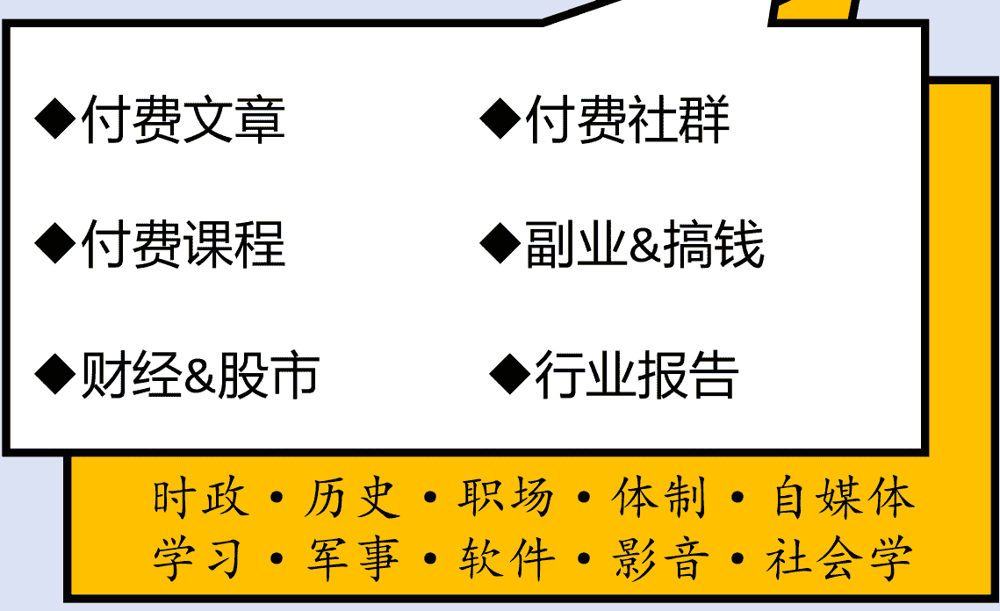

- 付费文章
- 付费社群
- 付费课程
- 副业&搞钱
- 财经&股市
- 行业报告

时政·历史·职场·体制·自媒体
学习·军事·软件·影音·社会学

公众号:知识星球TOP 微信信号:jntsg8 微信信号:jntsg2

添加微信 免费进群

## 财新观察 | 以法治治理平台“内卷式”竞争

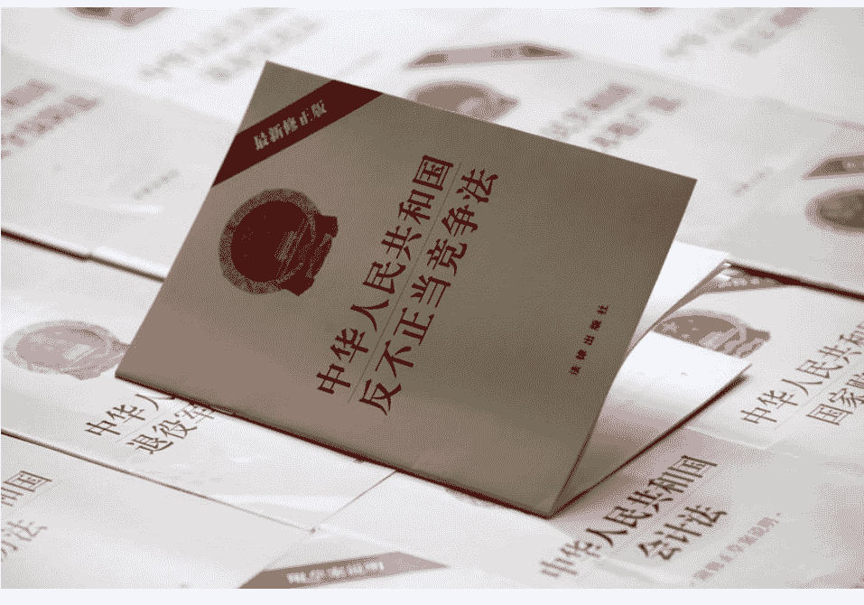

## CAIXIN | 听文章

近日，《反不正当竞争法（修订草案）》二审提请全国人大委会会议审议。电商平台“内卷式”竞争有望从法律层面得到进一步治理。

2024年12月底，十四届全国人大委会第十三次会议初次审议《反不正当竞争法（修订草案）》，向社会公开征求意见。6月23日，全国人民代表大会常务委员会法制工作委员会发言人介绍，修订草案二次审议稿贯贯彻党中央关于综合整治“内卷式”竞争的精神，增加关于公平审查制度的规定，修改完善治理平台“内卷式”竞争方面的规定；完善平台经营者处置平台经营者不正当竞争行为的义务；明确损害数据权益和恶意交易等不正当竞争行为的构成要件。显然，在这一修法过程中，规范平台竞争成为重要内容之一。

平台经济的重要性不言而喻，规范平台竞争的紧迫性也日增日益。此次修法，及时回应了市场需求，有助于行业远离健康发展。此次修法将进一步从法律层面为平台竞争健全基础规则。法律的重要意义在于稳定和可预期。修订草案征求意见广泛，听取了各方意见，寻求最大公数。

近年来，平台“内卷式”竞争比较突出，从某种意义上讲，实质依然是不正当竞争。无论是数据造假等方式获取竞争优势，还是利用手段阻断其他经营者商业信息、借用优势对平台内经营者施加压力和要求，都是不竞争乱象的线上映射。当然，平台竞争也有互联网型的特点。用移动端访问，交易瞬间完成，利益链也与传统商业有显著差异。这些趋势令平台乱象对公众的冲击感增强、易传播、易放大。营造一个健康的、公平的平台竞争环境，实则是中国经济高质量发展的客观需要。

以法律治理平台竞争并非今日。在2017年，《反对不正当竞争法》修改增设“互联网专条”，即经营者不得利用技术手段，通过影响用户选择或者其他方式实施妨碍、破坏其他经营者合法提供的网络产品或者服务正常运行的行为，如未经经营者同意，在提供的网络产品或者服务中插入链接、强制进行目标跳转；误、欺骗、强迫用户修改、关闭、拦截其他经营者合法提供的网络产品或者服务。随着平台不正当竞争已不再局限于“跳转”，针对刷单、杀熟、二选一等，2024年发布的征求意见稿，把上述“利用技术手段、数据和算法等实施不正当竞争”明确，这一修改顺应了平台经济的发展。

强化公平是修法的重大重点。修法明确了平台经营者不得强制经营者按照低于成本的价格销售商品，扰乱市场秩序。对于经营者处置平台不正竞争行为的义务，二审明确在原有基础上进一步明确平台经营者在交易协议中明确公平竞争规则，建立举报机制，发现平台不正竞争行为，应当及时采取处置措施，并按规定向所在地政府监督部门报告。规范竞争不是扼杀平台活力，决策层多次强调要把平台竞争严格遵循法治精神，融入执法。法律是稳定的规则，为监管者提供了可靠的操作框架，为从业者赋予了权利利器。此外，修法大力保护了消费者的权益。除了规范平台“内卷式”竞争，修法还明确大型企业不得滥用自身资金、技术、渠道、影响力等优势，要求中小企业接受不合理的付款期限、方式、拖欠中小企业账款，成为平台“内卷式”竞争的问题要从法律上得到解决。还要清醒地看到，平台经济包含了多种业态和影响市场。北京市海淀法院发布的《互联网内部人员犯罪案件白皮书》显示，2020年至2024年，海淀法院共27件涉互联网内部人员犯罪案件，涉及多个罪名，涉案金额共计5亿元多元。这一问题与“内卷式”竞争，对平台内部良性治理提出了高要求。

《反不正当竞争法（修订草案）》征求意见以来，相关人士纷纷建言，而平台经济成了舆论的热点。人们相信，修订后的《反不正竞争法》成为一部经过实践检验的法律，有力促进了平台经济的发展和中国经济的完善，成为法治建设进程中的一块里程碑。

## 最新封面报道 | 当代破产重整启录

## 听文章
文 | 财经周刊 王娜娟

成立已37年的武汉当代科技集团有限公司（下称“当代集团”），诞生于民营经济刚刚破土的年代，昔日规模高达千亿元，如今正走向谢幕时刻。

据财新了解，2025年6月最后一周，招商局向当代集团重整经理支付了第一笔重整投资款7亿元。4月25日，武汉市中级人民法院裁定批准当代集团的破产重组计划。根据安排，招商集团子公司招商创新科技集团（下称“招创科”）作为重整投资，将投入18亿元参与当代集团重组。

招商决定入局，看中了当代集团的核心资产人福医药(600791.SH)，作为麻醉药生产龙头，特别是在阿片类镇痛药芬太这一细分领域，市场占有率超过90%。当代集团重组后，招创科在武汉成立的招商生命科技（武汉）有限公司成为人福医药控股股东。招招商局将成为人福医药的实际控人，而当代集团及其创始人艾明彻底出局。

6月10日晚，人福医药公告，董事李杰、董事总裁陆露霆、副总裁莉娅提交书面辞职报告。

人福医药是当代集团的核心资产，它是麻醉药生产龙头，特别是在阿片类镇痛药芬太这一细分领域，市场占有率超过90%。图：赵林/视觉中国

7月2日，人福医药将召开股东大会，增持招商局业务部部长许薇娜、招创科副总经理常荣为新董事。知人士称，2月已成为人福医药董事的招商老将周波将接周波，出任人福医药董事长。周波是当代集团的创业元老之一。

现68岁的艾路明出生1957年，是名门之后，祖父是民国时期上的将唐生宪，中国成立后曾任湖南省长、全国人大常委、国防委会委员以及华中央常委等职，1971年去世。艾路明16岁时插队，也当过运工，大学时代独自漂过长江，是恢复高考后改革开放年的大学生、硕士毕业于武汉大学哲学系，后师从褚取得经济学博士。

1988年毕业后，他和周汉生、张晓东等六位武大校友凑了2000元办了一家所有制企业，起步于公园回收尿液碱。中国正处于经济向市场转轨初期，艾路明等人从回收尿液碱起步，抓住机遇，兼并了多家药企，在困境中又拿到了上市指标，1997年拥有第一家上市公司，就是人福医药。

“那时候的想法是只要有门槛的地方，就有机会，可以发挥民企优势。”在2025年4月与财新的长时间谈中，艾路明反映了自己的失误：第一是战略失误，不应该进入多元化行业，当时占了主业；第二是后期管理松散，2015年后，当代集团决策逐渐虚设，缺乏制度约束；第三是他安排接班后，自己疏于研究经营，没察觉种种风险正在聚集。

2015年，58岁的艾路明将重心转向公益项目，当代集团兼任董事长，总裁由周吴生、余淼、陈海滨等人轮。周吴生认为，当代集团的失败表面是多元化扩张，实质是不该进入金融和杠杆行业。“2017年时，当代集团债务规模超过300亿元之后，我觉得对不起动了整个集团负债，资产跑不赢债务。”他称，“老一代和以余淼为首的二代的想法并不一致，后者追求规模效应。余淼毕业于武汉大学法律系，曾是武大辩论的明星人物，深受艾路明质疑与信任，年纪轻轻就执掌当代集团金融板块，2007年开始任风证券董事长，任职超过15年。

“老父几年退休去搞公益，基本把权力给了年轻一代。”一位接近当代集团的观察人士称，其中余淼最重，主要负责当代集团资本运作，招揽了一批大校友任职，包括前操盘当代文化板块的当代董事易仁涛，他是余淼的直系学生。财新独家获悉，余淼在2025年2月离任湖北被调查之前，易仁涛在2021年底外逃至西班牙，2024年上榜“红通”名单。多位知情人称，易仁涛在当代成立大量公司，进行资金腾挪、财务造假为洗钱出境，涉嫌严重职务侵占。2025年4月，当代集团创始人艾路明接受财新采访。

1997年，人福医药的前身当代科技在上海交易所上市。

逃跑不久，当代集团债务暴雷。2022年，当代集团下地产公司在地方金筹——武汉长江筹金融交易有限公司（简称“长所”）挂牌发行并向客户兜售的融资产品全面违约，引发4000多的诉讼压力下成立专班。政府一方面要求当代集团资产付款，一方面牵手天风证券与当代集团切，由湖北当地国资宏集团有限公司（统称“宏集团”）接盘天风证券。

当代与天风证券共生多年，复杂的债权债务关系成为糊涂账。2024年9月重整时，当代集团资产只剩10亿元，而债权人申报1500多亿元的债务。其中，天风证券及其大股东泰集团成为大债权人，申报了200亿元债权，最终确认逾百亿元。

经过半月的表决，当代集团的重整方案在2025年3月末获得通过。来自管理人金士律师事务所的最新数据是，当代集团已整体确认债务规模800亿元，大头来自10多家债权人的普通债权，这些普通债权人每家可获得300万元的小额赔偿；超过300万元的部分只能转化为信托计划份额，底层收益主要依靠当代人福医药股票增长收益，且需要保证招商创优优先收益后可考虑分配。

人福医药现在是招商局医药板块棘子，也是招商局第三次创业和转型战略新兴产业的桥头堡。一位接近招商创优的人士认为，人福医药此前的经营和股份都受到当代集团的拖累。

艾明也曾此看法，因此对战略投资者提出的主要要求是将人福医药市场增值部分拿出来弥补债权人。财新获悉，当代集团进入重整后，此前几乎被国药、华润两家央企参与投标，目的是让医药核心资产招商局胜出。招商局去年提出“第三次创业”，主要布局于生命科学、数智科技及绿色能方向。

重整结束后，债权人和股东权益全部清零。据金士律师测算，当代集团清算率约8.5%—10%，最终清算率约25%—17.5%。2025年1月23日，当代集团与招商局签署重整协议后，艾路明与合作多年的创业伙伴间致歉，称“对不起，机会还有”。艾路明不止一次表示，希望还有很多，虽然入人生绝境，各界的口碑依然，企业家精神未灭。一位合伙人评价，艾路明的魅力如同创业时的山林，但现在似乎愁现实是时代了。

1988年，改革开放十周年，民营经济写入宪法。一批接受高等教育的青年从体制内“下海”，18岁的艾路明。祖父是民国时期上的将唐生宪，中国成立后曾任湖南省长、全国人大常委、国防委会委员以及华中央常委等职，1971年去世。艾路明16岁时插队，也当过运工，大学时代独自漂过长江，是恢复高考后改革开放年的大学生、硕士毕业于武汉大学哲学系，后师从褚取得经济学博士。

1988年毕业后，他和周汉生、张晓东等六位武大校友凑了2000元办了一家所有制企业，起步于公园回收尿液碱。中国正处于经济向市场转轨初期，艾路明等人从回收尿液碱起步，抓住机遇，兼并了多家药企，在困境中又拿到了上市指标，1997年拥有第一家上市公司，就是人福医药。

“那时候的想法是只要有门槛的地方，就有机会，可以发挥民企优势。”在2025年4月与财新的长时间对谈中，艾路明反映了自己的失误：第一是战略失误，不应该进入多元化行业，当时占了主业；第二是后期管理松散，2015年后，当代集团决策逐渐虚设，缺乏制度约束；第三是他安排接班后，自己疏于研究经营，没察觉种种风险正在聚集。

2015年，58岁的艾路明将重心转向公益项目，当代集团兼任董事长，总裁由周吴生、余淼、陈海滨等人轮。周吴生认为，当代集团的失败表面是多元化扩张，实质是不该进入金融和杠杆行业。“2017年时，当代集团债务规模超过300亿元之后，我觉得对不起动了整个集团负债，资产跑不赢债务。“老一代和以余淼为首的二代的想法并不一致，后者追求规模效应。余淼毕业于武汉大学法律系，曾是武大辩论的明星人物，深受艾路明质疑与信任，年纪轻轻就执掌当代集团金融板块，2007年开始任风证券董事长，任职超过15年。

“老父几年退休去搞公益，基本把权力给了年轻一代。”一位接近当代集团的观察人士称，其中余淼最重，主要负责当代集团资本运作，招揽了一批大校友任职，包括前操盘当代文化板块的当代董事易仁涛，他是余淼的直系学生。财新独家获悉，余淼在2025年2月离任湖北被调查之前，易仁涛在2021年底外逃至西班牙，2024年上榜“红通”名单。多位知情人称，易仁涛在当代成立大量公司，进行资金腾挪、财务造假为洗钱出境，涉嫌严重职务侵占。2025年4月，当代集团创始人艾路明接受财新采访。

1997年，人福医药的前身当代科技在上海交易所上市。

逃跑不久，当代集团债务暴雷。2022年，当代集团下地产公司在地方金筹——武汉长江筹金融交易有限公司（简称“长所”）挂牌发行并向客户兜售的融资产品全面违约，引发4000多的诉讼压力下成立专班。政府一方面要求当代集团资产付款，一方面牵手天风证券与当代集团切，由湖北当地国资宏集团有限公司（统称“宏集团”）接盘天风证券。

当代与天风证券共生多年，复杂的债权债务关系成为糊涂账。2024年9月重整时，当代集团资产只剩10亿元，而债权人申报1500多亿元的债务。其中，天风证券及其大股东泰集团成为大债权人，申报了200亿元债权，最终确认逾百亿元。

经过半月的表决，当代集团的重整方案在2025年3月末获得通过。来自管理人金士律师事务所的最新数据是，当代集团已整体确认债务规模800亿元，大头来自10多家债权人的普通债权，这些普通债权人每家可获得300万元的小额赔偿；超过300万元的部分只能转化为信托计划份额，底层收益主要依靠当代人福医药股票增长收益，且需要保证招商创优优先收益后可考虑分配。

人福医药现在是招商局医药板块棘子，也是招商局第三次创业和转型战略新兴产业的桥头堡。一位接近招商创优的人士认为，人福医药此前的经营和股份都受到当代集团的拖累。

艾明也曾此看法，因此对战略投资者提出的主要要求是将人福医药市场增值部分拿出来弥补债权人。财新获悉，当代集团进入重整后，此前几乎被国药、华润两家央企参与投标，目的是让医药核心资产招商局胜出。招商局去年提出“第三次创业”，主要布局于生命科学、数智科技及绿色能方向。

重整结束后，债权人和股东权益全部清零。据金士律师测算，当代集团清算率约8.5%—10%，最终清算率约25%—17.5%。2025年1月23日，当代集团与招商局签署重整协议后，艾路明与合作多年的创业伙伴间致歉，称“对不起，机会还有”。艾路明不止一次表示，希望还有很多，虽然入人生绝境，各界的口碑依然，企业家精神未灭。一位合伙人评价，艾路明的魅力如同创业时的山林，但现在似乎愁现实是时代了。

两年后，证监会开启券商综合治理，合经牌照的天风证券生存难，又远离当代的大营武汉，各类牌照申请受限，业绩不佳。“当时还面临团队融合问题，我派余淼去跟进了一段时间。“艾文明说，之后余淼被举荐，“如不余淼来，我我去充当董事长”。

2006年，艾文明将天风证券交给28岁的余淼。之后两年，天风证券引入武汉国有资产经营有限公司为第一股东，并成功迁赴武汉，股权层面保持着无实控人的状态，但管理层话语权最大，余淼逐渐在湖北崭露头角。

迁武汉后，天风证券用了四年时间就获得了全牌照，并经历了多次增资扩股，到2018年上市前，净资本从2.94亿元飙升至近100亿元，从行业倒数第10位升至正第43位，成为湖北省内的长江证券（000783.SH）后的第二家综合券商。

余淼执掌天风证券18年，2008年开始担任了12年总裁。其间，余淼招揽大武毕业生，安排在天风证券及当代体系内任职。接近当代集团的人士，天风证券由余淼及其下面掌控。曾就职天风证券的人士，余淼是天风证券的绝对权威，对下属都偏好，对劣人的时候也颇严厉。

从公开信息看，余淼多年不仅任天风证券董事长，长期在当代旗下雅达教育、上海天国投资、北京明诚投资等公司兼职，当代明铭、三事道都由余淼派往的人。当代集团后期的资本运作平台武汉天盈投资集团有限公司（下称“天盈投资”），由余淼招揽的大武校友李正友担任董事长，被视为余淼的“代理人”。

如今，艾文明并不避讳对余淼的赞识，“天风十年的经营、用人都是余淼自管，我当时不仅把天风给他，还希望把整个集团都交给他。”在艾文明看来，余淼这一代人世纪90年代入学大学，受了国际接轨的现代教育，具有市场化的思维和理论储备，而且做事有功，“可以不吃亏也要要把事情做成”，他也不信余淼个人有法私利。但他承认余淼在企业经营方面有所欠缺。“我跟他说过，一个企业成功与否不能断融资，而是真正赚到钱，而是他后来也不大听得进去了。”艾文明说。

天风证券一度为行业发展迅速的券商之一，从2014年至上市前的2017年，其营业收入排名从最初的第72位上升到第34名，净利润也从77位到了40位。

但硬还有另一面。多知情人士，天风证券上市后，体系内有少和证券无关的业务，如前期收购的数字金融，实际是P2P平台，上市前剥离了当代集团，类似的还有地方金交交易所所长的股权、部分投资烂尾目的付。

当代集团之所以不得接盘，在于这些平台及投资作为融资工具，已与当代体系中其他公司脱不开关系，当代集团原本就存在一些担保责任。“这就成了一种交换，当代买天风的，天风给当代发债，也去买当代的债。“接近当代集团的人就是如此。

天风证券上市后，正值余淼轮担任当代集团执行总裁。其间当代集团资产和负债都频繁上台阶。负债端从2016年未到过300亿元，到2019年翻增至超过600亿元。“当时很明显，资产增长的速度跑不过负债，只能各种途径融资，集团整体的资金到了极限。“艾路明的创业合伙人称，2018年，几个老股东提出要收缩损，但执行并不理想。

2019年，当张海钧刚担任当代集团总裁，发现公司整体布局、人员工资都参照了金融机构安排，当时他就对艾路明表示，当代集团已过度金融化，很大的问题，需要调整。但2020年上半年，一场变故袭来，余淼因故被带走配合调查了一段时间，集团内外人心浮动，一时未回神来。

到此时，当代集团、天盈投资、当代国际及其他主体均债务负担沉重，光信用债付息已超过190亿元。

## 债务引爆

也愁萧，也愁颜。作为一个典型的负债驱动多元化扩张的企业，当代集团的高杠在2021年债务滚动时出现问题。

“2021年余淼跟我提过一次，他说这样下去不行，负债太多，不如申请破产。”艾路明说明，初闻破产震惊不已，认为不于此，希望再坚持一下，算算账熬过去。但到2021年夏天爆发雷后，惟有望回流大额现金的项目达到当代天誉昂逢遇，一切已过去未来。

2022年4月，当代集团发行的5亿元票“19汉当科MTN001”发生实质性违约。公开市场债券违约一般被视为推倒企业危机的最后一根稻草，当代集团之所以无法自保，是在于有更大的烦恼。在这笔债券违约前的2022年初，“当代系”旗下参控企业在长所售卖定定产生大量违约。

大量违约爆发，65岁的艾路明正式回归救火，地方政府迅速成立专班，维护“当代系”进行清查，追索资金投入不当。

多知情人士称，此前在长所发行的定期产品逾期后，地方政府多次确认长所发行的定期产品规模为4亿元，涉及各地投资者3500多人。

长所最初是由天风证券、武汉光合资本、武汉光合科技以及湖北德忠资联合在2015年成立；当时各地都在成立。2017年，天风证券将大部分股权转让给当代，后成为长所第一股东，持股比例30%，天风证券间接持少量股权。

因缺监管约束和透明度，地方交易所方便天所份额转到定期产品发行，“当代系”明天爱等问题滋生各种非法集资现象，长所发行的定期产品也有典型的化融资特征，主要是为了化解余磊困境，底层资产属于当代集团或兜底。比如当代集团发行的“明诚”（221号），由武汉当代开发有限公司承担差额兑付。

“当代系”产品通过长所、菇信投资、天风证券分支机构进行销售，募集资金汇至“资金池”。此前许多知情人士，“当代系”募资主要投入了文体和地产项目，还有一些亏损投资。

2020年，“当代系”融资一直靠新旧支持。“当代集团内部人士称，甚至老去阿拉善做慈善，8000万来自长所，他自己不知道。”

艾路明并非没有对长所的产品有所警觉。他在2019年问过时代表当代集团常务总裁、负责业务的李友，长所的产品会有融资的问题？李友告诉绝无，并称长所通过湖北省金融局审批了私募基金牌照。李友曾为广西金融局副长，曾任天风证券总监。2023年9月，李友因涉及违法被带到当地调查；天风财富创始人杨宏、现任董事长吴国才，在此之前被采取了强制措施。

艾路明称，除去利息，长所涉嫌吸的规模约48亿元，其中超过30亿元流向当代代外，部分流向地产项目和当代集团。其中，只有地产项目在当代集团债务重组中部分偿还。

当代明诚原名道博股份，主营矿石贸易等业务，2015年被当代集团接购后更名，并在易仁涛的操盘下跨文体产业一发。收：2015年7.8亿元收购《金粉世家》的出品方视传媒，2016年以8.2亿元购买双刃剑体育、5.4亿元接超球队重庆两江竞技，2017年再度斥购34亿元跨境并购运营的新英体育，2019年签约西甲六赛季版权……”一段时间里，易仁清看起来比明诚还可以，股价还高涨，股票质押融资很方便。“艾路明彰，2015年当代明诚的市值接近200亿元，集团在明诚的市值超过50亿元，这亏几乎是集团入股成本的10倍。

文体投资来“烧钱”，相关行业在新冠前就遭遇估值泡沫破裂，疫情暴发后更进入前所未有的低谷。当代明诚初期靠融资并购，财务负担加重，收购优质资产后又屡收购效，自2019年起开始连亏损。

有观察人士将明诚的一系列资本运作形称为“金金赛”，称易仁清当时在国内外四处找钱，当代集团也被卷入为大量赛事担保，比2018年收购亚洲足联转播权，当代集团提供了10亿美元的担保。

前述人士称，当代文体板块在2021年底陷入危机，当代集团向政府求救，武汉国资出托托管，接盘了部分股份和“系”手中的表决权；后来审计发现窟窿巨大，资不抵债，又转而司法重整。当代明诚重整在2023年11月获得法院裁批准，由湖北联投有限公司联合国库资产、招商平安资产管理、北京久银投资控股等方联合资6亿元揽盘。

作为当时操盘手的易仁清，在2021年底悄然出境；此次5月辞职时，许多人才才发现，他不自己走了，还将妻子、孩子、老人一起出门。

多位知情人士称，易仁清担任明诚董事长后，在体系外成立了多个平台，通过信信购买明诚营造虚假繁荣。艾路明表示，易仁清时期明诚体内亏上百亿元。目前，当地所收集证据，希望易仁清从西班牙渡回国。

024年4月，证监会查实明诚存在财务造假，负债不准确、存货及誉等问题，总额09亿元。

## 切割

上际，当代集团部分股东早已准备将证券切割出售。2020年，当代集团曾对证券实施实质代管，并对证券要护底，实业与金融需要切割的结论。此时，武汉金控想要收购一张券商牌牌，看着证券，当代集团预计定价7元/股，其余与诸嵩高得后获层反对。“反对证券和管理层想做MBO（管理层收购），做内部人控制。他们没有这个资金实力，监管那边也过不去。“消息人士获锦，当代集团错失切割证券的时机，武汉金控转而收购了九龙银证券。

宏泰集团在2022年两次接盘了当代集团所持证券股份，每股价不到3.2元，折合PB股仅1倍贷出。证券在2019年股价最高时曾有过10元，2022年债务危机后已弥缓，业绩也重回行业常势；2023年亏损达到15.09亿元，至今未恢复元气；2023年盈利后，2024年再度亏损0.3亿元。

## 央企入局

危机之初，艾路明曾寄望卖资产瘦身自救，先主要的4家上市公司股权转让给湖北资，但因债务杠杆过高、资产贬值，难以脱困，最终还是走向了破产重组崩溃。

前创业合伙人称，一直艾路明的心理承受都很强，当代集团陷入债务危机后他仍然有办法解决，因此十分抗拒司法破产重组程序。最初，当代集团与中金公司和中伦律师事务所两家中中介接触，想要参照南京三做协议重组。

“当初的方案是部分，还，每年8%；一部分股。本来算个账，觉得可以覆盖。但协议调整解决问题需要大量现金，卖资产，钱20亿元，只能解决内的说明”。2023年8月，艾路明给哥一起公益的金律事务所颜俊后打了一个电话；颜俊发现，只能司法重整程序。颜俊近30年的执业经验，深度参与了“系”重整。从接受重整到法治程序，耗时一年。2024年9月30日，武汉中院裁定受理债权申请。接下来关键的，寻找投资人。2023年半年，当代集团旗下文体、地产、教育等板块严重贬值，只有医药作为龙头，具备重整价值，但面临两大门槛：其一，当代集团陷入困境后股权拍卖，剩余股份比例较高；二是重整所需资金超百亿。进入重整阶段，5家国企提交了方案，分别是招商创科、华润医药、湖北科技投资有限公司（简称“湖北投”）和宜昌产控股有限公司（简称“宜昌产”）。其中，华润医药子公司，持股20%；宜昌产说是股东，持股2.5%。

宜昌产和李杰关系微妙。李杰今年70岁，原集团董事长，当代集团收购后，他一直担任医药董事长，同时多年仁人在医药董事长。2025年1月，李杰辞任医药董事长。辞职前一个月，李杰将6.9%股份表决权委托给宜昌产；紧接一个月，宜昌产联合中国信达，斥资4亿元通过拍卖引入医药。

宜昌产国资想要，实力不如三家企业。华润志，报价高。“2024年春天，华润提出的第一版方案是由双赢吸收并，湖北会减少医药工业百强上市公司；加之监管压力，因此算降低。“一位知情人士称。国药报价高，但方案简单粗糙，“就是买断股权、解决权不管”。

接近招商创的人士称，2023年年中注意到医药并购项目，当时市场传言国药已经在准备了，没过多关注，年底项目还在，招商创就开始正式介入，竞争在三家企业之间。在化中，让地方政府压力最大的就是问题，最初的想法是参考海航。“海航系”重整时，海航旗下P2P平台爆雷后涉及多人、总额290亿元，由重整方大集团拿出30亿元化解。

“招商最早方案报价不到10亿元，后来需解决票冻结问题，还能保证投票人数足够，不得不提高价格。”上述人士称，伴随方压力大，最终招商创科将报价提高到18亿元，并拿出了一个客观均衡、兼顾双方利益的方案，并承诺会在武汉高新落地相关投资。

经过破产管理人长时间和“背对背”谈判，2024年12月30日，5家央、国企提交了重整投资方案，次日进行现场拍，招商创科得分第一。18亿元的金额刷新了2024年全国重整投资上限，也成为医药行业重整投资金额的历史最高。（注：此处原文或应为医药行业重整投资金额的历史最高）。

“评审阵非常大，纪委监员都来见证，武汉中院、债权人代表、债务人、管理人、公证处的人都参与。”经历当代集团投选的人士称。

## 信托化债

2025年1月15日，招商创科与当代集团、当代集团管理人签订了《重整投资协议》。根据协议，招商创科通过湖北新设招商生直接接持6%的股权；设立一家有限合企业，间接持有6%的医药股票，由招商生担任普通合伙人并持有优先合伙财产份额。

与此同时，设立两个破产服务信托，“信托计划一”持有11.70%医药股权，全部决权委托至招商生，招商生享有优先收益份额额。“信托计划二”将持有有限合企业的次级财产份额、“信托计划

“普通权益股份，以及根据重整计划进入信托计划二”的其他资产。债人主要通过取得“信托计划二”的信托份额来偿债。

重整草案，当代集团有财产担保债权总额94亿元，可担保财产优先受偿的债权金额为69.25亿元。

（注：后续文本在OCR处存在大量重复和混乱，已根据上下文进行了逻辑梳理和清理）

持有的底层资产，主要为当代集团剩余效率低、难以处置的地产，以及教育及金融板块资产。

不过，前述重组管理人代表表示，跟普通债权人分享未来回报增值的收益是难谈判，“硬生生抠出来的”，也是因为答应了这一条件，付款又干脆，做过医药的招商局才会选中。

艾路明认为，虽然招商创愿意与债权人共享股票收益，遗憾在于成本计算实在太多。根据重组草案，“信托计划”期限为5年，设立3年后为结算日，结算时要优先保障医药生的收益，需要以招商创对应的61.47亿元投资金为基数，按照5年LPR（3.6%）为标准计算年化收益。而收益分配可以是实物（股票）分配、现金分配或股票现金的任意比例组合方式，有限合伙次级收益的类似要求。

按照上述要求测算，若人福医药价格未来达到约36元/股以上，超过部分将作为超额收益通过“信托计划二”向债权人分配。而人福医药的前股份在21元/股。也就是说，股价至少需要上涨71%，债权人才能看到股票分配的回头。

艾路明对市值新称，他算过一个数，人福医药此前是因为当代集团的原因不受市场认同，只有几十倍的市盈，而医药正常应该有30倍上下的市盈。“对比离三线医药这种低效资产，理顺内部，再加上中央资金成本低，每年应该可以保持20%的利润之增长。”他认为的。

不过，重组结束后，人福医药将不再与其相关，艾路明在当代集团30%的股东权益也将清零。

对于大半半生的创业归零，艾路明此时并未让人察觉出的他的沉重。

他自述曾经经历生死，忆及1986年大学时代时从汉河到武汉两个半月的长江漂流过程中，曾不不慎被卷入一个巨大的旋涡里，橡皮艇被拧成了一坨，拉进了旋涡，他才意识到从艇上跳下水，没想完全失去了依靠，开始不断向下沉。“手越抓越往，向下沉，当时我想着这回死定了，但临死的时候并没有恐畏，只是想着还有很多事没交代，则也对不起很多人了。”

幸运的是，旋涡越深旋力越弱，橡皮艇开始上浮，他又恰好抓住了船上的绳子，最终还是冒出了水面。■

## 最新财新周刊 | 农信合并潮

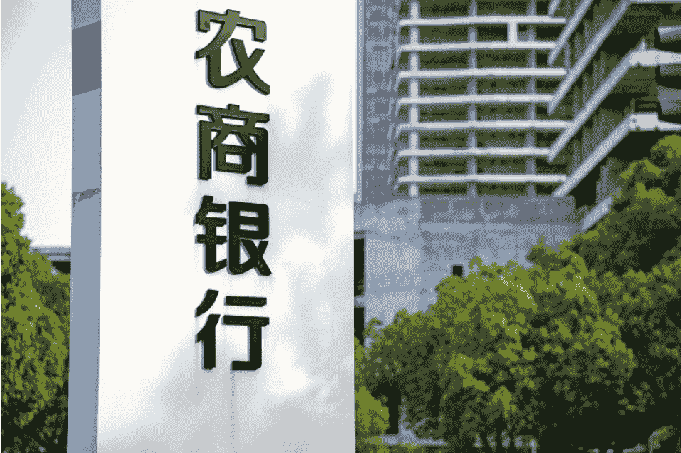

## CAIXIN| 听文章

文| 财新周刊 张亮韬 张宇哲

随着又一家省级农村农行内蒙古农村商业银行（下称“内蒙古农商行”）挂牌开业，此轮伴随着农信社改革的县域农信机构合并潮继续推进。

2025年5月27日，经国家金融监督管理总局批准，内蒙古农商行开业。据官网介绍，内蒙古农商行由原内蒙古农村信用社联合社和93家县法人农信机构及其发起设立的26家区内城镇银行，以新设合并方式组建成。

这是2020年启动省联社改革以来的第四家省省级统一法人农商行。对于本轮改革的重点对象——省联社如何改如何，在最初的讨论中有四种模式：省级法人、银行控股公司、金融服务组织协会和联合银行，后来在实践中逐渐落地为两，即省级法人和联合银行模式。

目前已经完成改革的十个省份，浙江和江苏的相对好、变化小，在保持县级和省级法人不变的情况下，设立农商联合银行；山西、四川、广西、江西选择了联合银行模式，为省级份市、市份县级的三级法人；风险、规模小的省份，如辽宁、海南、内蒙古选择了统一法人模式。

在河南，省级法人模式的河南农商联合银行挂牌八个月后，宣布将改为组建省级统一法人，河南农行于2025年2月26日挂牌。据此前财经报道，河南省联社改革的波折由于国务院对高风险省联社的改革方案有了重要的方向调整，对于风险相对高的省份，均按照组建省级统一人的模式推进改革（参见本刊2024年第44期《高风险省省联社改革“深水区”》）。

此外，已建三级法人合作银行和尚未披露改革方案的多个省份，也在加快推进组建地市级农商行的步优，并随着对县级农行或农信的合并。例如，2022年至2024年，四川省乐山、巴中、阿州、德阳、雅安、南充、达州七个市吸收当地的县域农商行后，成立市级农行。此外，云南省近两年有迪庆、愁江和德宏三家州级一级农行挂牌开业。到2024年底，新疆南疆四州（阿克苏地区、克孜勒萨尔自治州、和田地区、喀什地区）的农信机构将成为市级一级农行。

随着合潮的深入，几年来县级农信数量明显减少。国家金融监督管理总局公布的银行业机构名单显示，截至2022年末，包括农行、农村合作银行和农信在内的机构数量为2044家，比2021末的2196家减少了52家；其中2024年县级农信机构减少了270家，幅超过10%。

一位在农信系统多年的资深人士指出，现有的高风险机构大部分是农信社、农行、镇级银行，推动合并的背景是希望减少高风险机构数量，但如果不能找到适合的合并模式，在未来可能产生更多问题。“当前改革和发展目标要一致，短期目标和长远目标要统一，这是顶层设计要考虑。”他说，“对于风险较高的省份，省级统一模式并不等于化解风险，还需要避免资金虹吸效应，导致基层农商行支持。”

首席研究员、上海金融发展实验室主任看来，无论是改制前还是改后，无论是省级还是市级法人，坚持差异化战略定位，完善公司治理，持续深化数字化转型，形成自主机制、强化风险管理、提升人才素质，增强防范能力，否则统一后资本规模很容易被摊。根据公开信息，2025年上半年，新疆、吉林、甘肃等省份打算建全省统一农商行。在四川，诸阳农商行在2025年4月召开年度股东大会，审议吸收合并安岳、乐山农行等议案；另外四川的广元遂宁也传出正在组建市级农行的消息。

《中国金融稳定报告(2024)》显示，2023年中国人民银行对3936家银行开展评级；其中评级为“红色”的高风险机构357家，资产规模705亿元、占比1.78%。评级分布来看，高风险机构均为农村金融（包括农行、农合行、农信社、城镇银行）。

2024年5月，国家金融监督管理总局农村中小银行监管局发布的《统筹推进金融改革推动农村中小银行高质量发展》指出，加快推动农村中小银行并重组，减少农村中小银行机构数量和层次，加强集中统一管理，因地制异优化机构布局，重塑经营机制，促进金融风险收敛。中央金融委办办公室日常工作的主任王英在《中共中央关于进一步深化金融改革、推进中国现代化决定》辅读本文中指出，严格执行金融机构准入标准和监管要求，推动并重组、实现减量提质。

一位东部省的基层人士对转型说，现在的趋势是把改革化、减量提质提升到了更重要的高度。从县域金融机构自身来看，东部多省农信系统的基层人士指出，在当前县域农信机构面临下沉竞争、网络金融服务普及和经济下行等变化的背景下，农信系统面临的净差收敛、刚性支出经营压力不小，因此也有合并的动力。“农信社面对大行的下沉冲击，息差收敛到跟其他银行没有太大差别，但是单个法人后台需要的人员、硬件跟大银行一样，在此压缩成本、统一规范和服务方面，农信社对合并也有内在的驱动力，想往市一级的统一法人上去靠。”东部沿海省份一家基层农信社董事长道，“另外以前提到较多的县域人多面广、人地缘亲近等优势，在如今的网络金融时代，感觉在慢慢地减弱。”

山东省农信社党委书记、董事长王继东2024年发表的文章指出，六大行普惠型小微贷款余额从2018年的2.25亿元增速到2023年的11.58亿元，复合增长率38.77%，市场份额由不足24%大幅提升至39.85%，大行下沉已深刻改变农村金融市场格局。农村中小银行遭受重大冲击，包括部分优质客户流失、市场份额有所下降、净利差持续收窄、收入入比高位运行，导致经济延续性下降。

业内人士和研究者担忧的是，如果统一化后，县域金融服务能力是否会削弱。一位在农信系统的资深人士指出，对于风险较高的省份，省级统一模式在一定程度上有助于保险，有助于提高农信系统整体竞争力，待观察。“此前县域农信因为层级权限受限，当地权限贷款规模只有3000万元，一个大的组织和一个小的组织逻辑不一样，资金往往在发达地区配置资源往往流出。”他提出的另一个警示是，县域立法法人改为法人后，县域与地方政府的关系可能会变。县域地方政府相当于一张牌子，县域农信与地方政府关系紧密的特性区别于大银行之一。

一位基层农信社负责人认为，统一化后，县域地方政府权限往往复杂，县域地方政府承担风险，损害县域农信的利益。查查显示，内蒙古农行行为巨大的580亿元注册资本何来？据知情人士透露，内蒙古正在筹备再次申请中小银行专项债来补充一轮改革的资本金。2020年推出的中小银行专项资金是补充中小银行资本的新途径，一方面是提高可持续经营能力，另一方面是兼并重组提供资金支持，实现风险规避与长期发展的有序衔接。2023年2月发布的《2022年第四季度货币政策报告》显示，2020年至2022年新增500亿元政府债券用于补充中小银行。截至目前，中小银行专项债共发行52只，发行额4820亿元，覆盖20多个省份。2023年3月，内蒙古自治区已发行20亿元中小银行专项债，用于补充26家基层农社资本金，债券期限为10年，发行利率为3.01%，每年需偿还的债务息约6亿元，存续期内6年至10年（2029年至2033年）按发行规模的20%逐还本金。中小银行专项债由省政府发行，中小银行作为还本息第一责任人，地方政府是担保人，还款来源主要是银行的分红，近几年中小银行面临利差收窄和下行压力，盈利状况并不乐观。自2024年二季度开始，在此之前500亿元专项债额度尚未用完，但由于彼时的债券发行利率远高于贷款利率，地方银行还本付息压力增大，多个省份暂停了中小银行专项债的申请。

然而，地方政府用于处置金融风险的资金相对有限。尤其是一些经济欠发达地区，由于财政收入有限，债务负担相对更为重，地方政府可能无法提供足够的资金支持，导致风险中小银行改革重组推进困难重重。如今，随着债券利率降至历史低位，中小银行专项债是否成为省级法人补充资本的来源之一？内蒙古打算再次申请中小银行专项债，吉林省也有意通过中小银行专项债为筹建中的省级法人补充资本。

此以前吉林农信系统人士持财新，2024年9月中旬吉林联社的改革方案获批，拟修改为省级法人。近期转型获益，吉林联社改革试点方案所有调整，组建省级法人、分批合并市县行的方向变为：第一批由长春农商行牵头，与十家农村农信社合并，并建吉林省农行；另外十家吉林域县行将直接接到农行吉林省分行，成为当地分支行。其中九家吉林域县行属于资质差的小农信社，一家资质优质的长春农商银行就是“1+9”捆绑。

农信人士看来，采用省级法人模式，需要考虑资本规模、整个范围内的风险、债务包袱。对于风险高的省份，这个模式就是“双刃剑”。比如统一法人后，资本规模比较大，理论上抗风险能力增强；但如果经营不好，内生机制跟不上，资本可能会消耗更快。

董睿认为，对于存量风险多的区域，可以分类实施，按照风险高低，有序推进、分步实施的一种选择。关键是前期对于存量风险的实质性处置，这种做法是资金支持，在程度上体现了防范风险的决心。另外，业内人士谈到了，合并过程中可能面临的难题：各农商行的质量不一样，净值如何评估、如何换算统一法人。

广东先行的改革在过去几年也遇到不少挑战。据财新了解，广东全省农信系统2018年至2024年的利润分别为338亿元、374亿元、327亿元、364亿元、350亿元和302亿元，其间的利润下降了10.76%，同期全国农信系统内盈利靠前的浙江和江苏分别增长了71.70%和25.92%。广东历年报显示，2020年至2024年，广东省81家农商行（不含深圳）的净利润从288亿元降至242.85亿元，降幅近20%。2025年一季度，此前作为优质农商行的省内其他商行的广州、东莞、顺德、南海四家农商行的营收分别为35.66亿元、26.08亿元、17.17亿元和13.11亿元，同比变化为-12.58%、19.48%、15.52%和-22.62%。顺德农商行2024年营收和净利润分别为84.89亿元、31.68亿元，比2022年分别下降6.68%和6.65%。行业人士对财新分析，这一程度上近两年广东经济受房地产下行和贸易战冲击较大。数据显示，2024年广东GDP增长3.5%，低于全国的5.5%。对于之前已被七家农商行帮扶的弱势农信社，前述顺德农商人士说，七家农商行作为股东投资，同时派出高管进行管理，属于托管性质，这些被托管的农信社的业务系统统一依托广东省农联社。未成立联合银行后，这些被托管的弱势农信社亦将纳入新成立的联合银行。

广东改革较早落地，路径与其他省份不同。2020年，国务院批准了广东省提出的改革方案，发行100亿元专项债。这六家农商行的管理权从省联社交给地方政府，加上海深圳、广州、东莞、顺德、南海、珠海，形成“1+7”格局。从资产规模看，这七家农银行占整个广东省的大半。“以强扶弱”，支持粤西、粤北、潮州、惠丰、华农、东昌、农江等农行。广东采取的是构建“N”个一部分的形式，脱离省联社系统的头部农银行分别管理一部分。

广东省农联社在2025年4月披露，打算组建联合银行。严格按照省委、政府部门要求，积极推动改制。由于体量小、发展面临挑战，一位接近顺德农商行的人士介绍，这一策略的转变是因为如果按照此模式改革，最终选择了联合银行模式。

[/content]

[content]
<!-- no content -->

关于充分就业的表述或将较之前前宽松。以此为基础，美联储得以部分恢复以往做法，即在劳动力市场强劲时采取先发制人加息的策略，以防止通胀预期逐渐快速上升。最后，当通胀和就业目标发生冲突时，是维持高利率以对抗通胀，还是下调利率以支持就业？这将是在五五年一度的货币政策框架重估过程中，美联储面临的一个两难题。■

相关视频：【华尔街原声】鲍威尔：美国经济状况良好 严切关注失业率

视频说明：2025年6月25日，美联储主席鲍威尔在参议院银行、住房和城市事务委员会就半年度货币政策报告作陈述。

# 最新财经周刊 | 渣土围困生态岛

## CAIXIN| 听文章

文| 财经周刊 包亚明

位于长江江段京心的马洲岛，在2020年和2024年先后被列为江苏省省级重要湿地和“生态岛”试验区，京江市称该岛正在进行生态保护，不对外开放。然而，近年来有百万吨的外省市渣土被运至马洲岛填埋。

在岛上承包土地已近八年的蔡强（化名）说，近两年，他每次去田里都要踩着厚厚的土路往返，一遇雨天，路面就泥泞不堪，最深处的泥坎几乎没过整个脚面。“岛上几乎没有一条好路，每天不停的土车来回，在路边等一小会儿就浑身土，这些车还挨边掉土，把路都堆起来很大一层。”

当地农户担忧岛环境破坏是不可逆的。多名马洲岛农户称，这些从省外来的土主要用来填埋岛上的荒地和湿地，但一些土和一般土壤不一样，是黑色的荒土，成分复杂，里面混杂着砖块、木头、轮胎、拖鞋等建筑和生活垃圾。“我们经常去江边运下来的，有的这些只能用恶心来形容。”蔡强说。

## 150公里外的通岛船

靖江市是江苏省省地辖县市，是中国东部水陆交通枢纽，处于江苏省中线与长江的交汇点，与江江隔江相望，距上海150公里，拥有海岸线52.3公里，水运发达。财新近日在马洲看到，同一时间，共有四艘运船在岛北部和南部的三个码头卸载；岛上的几十辆土车会将土运至岛西部和南部填埋。其中在南部，土车会在江边先卸土，再由挖掘机将这些废土覆盖江边的滩涂淤湿地。

岛上主要道路都被厚厚的废土所覆盖，甚至马洲岛上一块“长江生物多样性观测点”的牌子，都有部分被废土掩埋。对比卫星地图和现场可以发现，原本2022年上半年还存在的马洲西侧一块长约1公里、宽约700米，有湖泊水系和植物的土地，已经完全被黑灰色的渣土场所填埋，岛上还出现了大量鰋等生活在水体底部的底生物的尸体。

多名农户告诉财经：“这种土壤填埋过的土地，一般三四年都无法耕种，只能荒着。”

船舶自动识别系统（AIS）定位显示，来马洲岛的渣土船主要从100多公里外的上海宝山、徐汇区和嘉定区的5个渣土码头起航，经长江航道而来。据不全统计，仅2025年3月25日至5月7日一个月间，向马洲岛运渣土船就有140多艘、约500个航次，如按公布的船舶装载量，约倾倒渣土50多万吨。5月日至7日的一周内，就有渣土船68艘、近100个航次抵达马洲岛，渣土运输量可达10万吨。同时，一些向马洲岛运输渣土的船舶并未在上海监管平台注册，也有船舶在行驶过程中关闭了AIS定位，因此实际向马洲岛运输渣土的船舶可能更多。

财新在追踪其中一艘土船时发现，该船在向海事部门申报目的地时，显示曾前往江西龙湖石泊位，实际路线却是前往马洲岛。

向马洲岛运输渣土的许多上海宝山区和中路中转码头，并不具备相关的许可。据宝山区交通委2025年2月17日发布的《关于同意意泰和路1810号渣土中转码头延长渣土经营业务的批复》，该码头主要承接上海地铁18号线二期工程的渣土中转外运，而这些渣土运至上海崇明区长兴镇客运3号泊位中转，然后运至长兴海洋产业基地填平。

运至马洲岛的土渣中混合大量其他垃圾，许多蚂蚁也因为环境改变而死亡。图：包志明

一名靖江市城管局人称，城管局确实批准马洲岛引入外省土处置，用于马洲岛田垦项目，执行方是马洲生态工程有限公司，一共批准了350万平方米（约65万立方米土）；此外，城管局还批准马洲岛南部一个由市水利牵头的临时码头项目，执行方也是。

“说实话，量（指土）确实很大，但是根据文件显示，上述城管局人的议，用于多少土、是不是合格、在整个过程中，无法核查，只能靠自行监管。”

财新看到，目前坐前往马洲岛只能向城管局申请。文件显示，马洲岛土处置有效期为2023年7月19日至2024年12月18日；许可内容为“土处置”。目前许可已终止于“无效”状态，而渣土仍在马洲岛内运。上海市绿化管理局“数字化智能监管平台”显示，马洲岛西侧量高达960万吨。但无论马洲岛内复垦项目，还是临时码头建设，上海市向马洲岛运渣土的船船，江苏省环保部门未披露过相关的文件。

一名负责马洲岛的环保员彭登说，这些外来的渣土一般都没有经过检测，如果直接填埋，土壤必然产生污染，很多向马洲岛转移的土容易存在监管空白。

江苏省环境控制研究中心彭登说，这些外来的渣土成分复杂，里面混了塑料、橡胶、胶、生活垃圾等有害成分，如果直接填埋到土壤里，必然会对土壤损害。

由于马洲岛处于水源、物种和源敏感区的特殊位置，2020年1月，江苏省政府发布的《江苏省空间管控规划》，将马洲岛设为“江洲重要湿地”，全部陆域及附近水域划为生态空间管控区域，同时，马洲岛西侧和东侧水域被划为国家生态红线。上述规划要求，生态空间管控区域以生态保护为重点，原则上不得开展有损主导生态功能的开发活动，不得随意占用和调整；禁止从事开（围）、垦、填埋湿地，引入外来物或放野生动物，破坏野生栖息地和鱼类洄游通道，拦截水源，保持滩涂、芦苇。

2021年3月1日起《长江保护法》第四十九条规定，禁止在长江流域管理范围内倾倒、填埋、堆放固体废物，地方政府应当加强对固体废物非法转移和倾倒防控。2022年6月1日起《湿地保护法》第二十八条规定，禁止开垦（围）擅自破坏自然湿地；倾倒、堆放、丢弃固体废物。

马洲岛原名江洲，地处长江末端，总面积约13.5平方公里，是一个位于长江中的岛。岛屿三分之二属于靖江市，主要是岛屿的西部和南部；另外三分之一属于南通市。泰州市生态环境局发布的一篇文章称，马洲生长着数千亩芦苇，生态性和完整性较高，被誉为三角群内仅有的未工业化和城市化污染的原生绿洲。长期以来，禁止马洲岛进行任何开发，保持滩涂、芦苇等原生风貌。马洲岛是国际通道东亚-澳大利亚的重要航线，是长江江口自然栖息地之一，也是刀鱼、华鳍、脂鳍等稀有鱼类的重要洄游通道和索饵场，具有国际保护价值和研究价值。岛上的道路被覆盖了厚厚的渣土，原本的生态观测桩也被掩埋。图：包志明

公开资料显示，目前马洲发现国家一级保护野生动物4种、二级保护野生动物37种；一级保护植物2种、二级保护植物4种；近10种江苏省重点物种；观测到两个长江豚群，数量约为40头，记录鸟类种类221种，占中国鸟类种类的14.69%；江苏鸟类种类的45.85%。

在此，早在20年前，国家和当地政府就开始重视马洲岛的生态保护。2004年，靖江市在马洲岛上设立江洲湿地保护区；2007年，农业部将马洲岛上游水域批准为“中华螯蟹国家级水产资源保护区”，并将马洲岛上游和下游水域批准为刀鱼国家级水产优质资源保护区。

此外，马洲岛附近水域都是周边城市的重要水源。如江苏通阜市将马洲岛周边水域划为长江饮用水保护区。该区域距离下游的长江家港饮用水水源也有几公里。

由于马洲岛处于水源、物种和源敏感区的特殊位置，2020年1月，江苏省政府发布的《江苏省空间管控区域规划》，将马洲岛设为“江洲重要湿地”，全部陆域及附近水域划为生态空间管控区域，同时，马洲岛西侧和东侧水域被划为国家生态红线。

上述规划要求，生态空间管控区域以生态保护为重点，原则上不得开展有损主导生态功能的开发活动，不得随意占用和调整；禁止从事开（围）、垦、填埋湿地，引入外来物或放野生动物，破坏野生栖息地和鱼类洄游通道，拦截水源，保持滩涂、芦苇。

2024年8月，江苏省环境厅将马洲岛列为省级“生态岛”试点项目，计划2025年2月靖江市生态环境报《靖江市生物多样性保护规划》称，马洲岛试验范围内的生态系统稳定性能、质量能够显著增强并改善生物多样性水平，服务功能供给显著提升，形成陆一体的格局。通过植被恢复、生态廊道建设、综合整治等手段，逐步恢复湿地功能。禁止马洲岛上进行任何形式开发，保持洁净、萨芜等属性。

在严格法律下，江苏省规划人士称，马洲岛恢复区域以前就是荒地，所以马洲岛渣土需要。

负责马洲岛的靖江金淮发展公司成立于2007年，注册资本6000万元，业主刘晓虹控制，经营70%，持股30%。

上述环保人士指出，这些外来的渣土一般都没有经过检测，如果直接填埋，土壤容易发生变化，导致二次污染。这些外来的渣土成分复杂，里面混了砖块、砂土等，由于地铁施工工艺需要添加泡沫剂和高分子聚合物，化学成分属于危险废物，含有表面活性剂，难以晒干，流动性大，像沥青一样，如果直接填埋或大量堆积。渣土，来自地下底部，不宜直接使用。提案指出，调查发现，本地偷倒的渣土往往用于种植，对耕地造成严重破坏。

在马洲岛的工程项目中，岛上挖出的渣土不会在该地埋，而是有严格的环保程序。根据《张越通道环境影响报告》，》，马洲岛的工程工程，工程工程规定，施工期间产生的固体废物全部运出，交由地方环保部门统一处理，严禁在湿地范围内倾倒、堆放固废，严禁在湿地范围内排放污水及其他有毒物质。施工完成后，还会进行生态补偿及修复工作，将施工对生态空间区域的影响减少到最低。

## 建筑垃圾困境

作为中国面积最大、地铁线路最长的特大城市，上海每年的建筑垃圾产量超过1亿吨，其中70%大量渣土如何处理，一直是上海的“城市病”之一，周边省也深受其累。消纳接点的处置空间有限和资源化处置的进度缓慢，上海建筑垃圾产生量和能处置量之间的矛盾日益尖锐，城市陷入建筑垃圾处置难的困境，导致大量建筑垃圾留在中转转运场所，数十万装修垃圾堆积在居民小区，催生建筑垃圾乱倒乱现象，导致城市环境带来毁灭性破坏。

2024年5月，上海市建筑垃圾存在非法乱倒现象，相关部门和一些地方监管到位，违法违规问题频繁，污染环境、破坏生态。通报还提到，近年来，上海跨区域非法倾倒问题多发。上海周边市非法倾倒的建筑垃圾，有很大一部分来源于上海。比2021年以来，江苏省各州市市查的274起跨区域非法倾倒建筑垃圾案件中，有243起涉及上海。

化、生存压力大时，珊瑚可能放弃繁殖。

深圳海边阴雨连绵，水温比往年更低。持续的夜潜让珊瑚感疲意：“很不想下（水），但又得不下。万一产卵了没拍到，真会‘拍烂腿’。“王晓勇和周为都是来自珊瑚保育组织‘潜爱’，分别是团队的秘书长和运维经理，这一个由潜水爱好者组成的公益机构，他们连线监测珊瑚繁殖，今年的情况格外异常。装备、乘船、入水、守候，然后一无所获地上，成员们被不确定感反复折磨。“昨天还来不？就像在产房外等看着一样。“负责带队下水的张缘成。

团队一度停止了监测，但不放心，担心珊瑚可能只是节律紊乱。产期结束后了一个月后，肖为再次下滑，本不抱望，却在即将结束时发现了产卵迹象。

那是一株扁珊瑚，纵横中包裹着粉色颗粒，个别已冲破隔膜，在水中漂散。刚刚升到水面准备返回的潜水员们，听到远处传来呼喊：产了产了！大家精神一振，纷纷游向灯光处，记录这迟来的瞬间。

# 2025年6月，“含苞待放”的鹿角珊瑚。图：肖为

后几天，水下迎来大爆发”。一粒粒不及芝麻大的圆球被吐出，灯光照射下，灰褐色的珊瑚点缀难得粉色，鹿角珊瑚也释放配子。潜水员连续直播监测，负责解说的监测志愿者陈明在温度下降的水下冻得发抖，但坚持着：“希望让更多人看到这壮观的景象。”

珊瑚繁殖采用“卵海战术”，同时排出大量精卵，一部分喂饱天敌，其剩余机体外受精。自2020就开始负责观测的张缘成，今年的“卵海战术”失效了。相比去年产卵规模减小，周期也不够同步。即使用同一株珊瑚，时间差异也极大：6月的8日已产卵，但5天后，同一株珊瑚上仍有大量配子未释放，严重影响了受精。“就像生物钟紊乱了。”他说道。

2021年，等待珊瑚产卵的褐珊瑚。珊瑚有性繁殖是同时排出大量卵，有一部分变成了食物，被其他海洋生物所食。图：肖为

肖为和团队分析，今年的“暖产”源于气候变化，水温升高于往年同期。往“五一”后水温可达25摄氏以上，他们早就换上了薄款潜水服；但今年同期水温仅20摄氏左右，下水20分钟就得瑟瑟发抖。水温是指珊瑚群落同步释放配子的关键信号之一，今年紊乱的温度曲线，搅乱了珊瑚群落的“生物钟”。此外，去年夏季高温导致的大规模白化，也可能使珊瑚将更多能量用于修复，没有余力去制造精子和卵子。

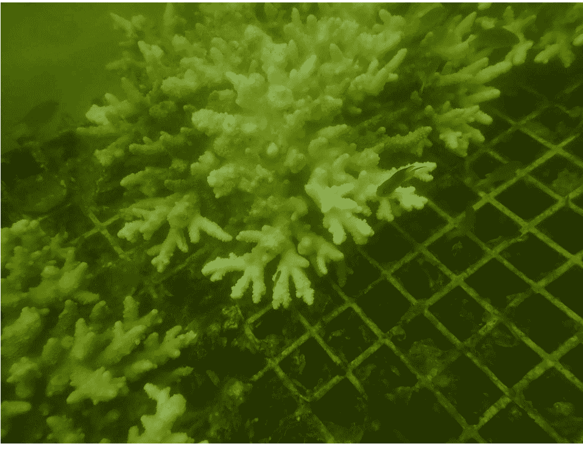
2024年8月，“潜爱”珊瑚苗圃中，珊瑚发生大规模白化。图：潜爱志愿者

“谁扔的内裤？”陈明从珊瑚边缘挣下下一条破洞累累的蓝色男内裤，下方的珊瑚早已白化为骨骼。与周围完好的褐色珊瑚相比，这片被覆盖的角落珊瑚稀疏，渔网缠绕着，部分礁头还残留着断裂的痕迹。她将内裤递给同伴塞进网兜，一点点划开残留的渔网，抽出勒进珊瑚骨的鱼线。陈明无法切断这珊瑚白化多久了，若时长不长，珊瑚的共生藻类还有机会回归。“真的很想救它，希望下次再见到时它已获生机。”

陈明自称为“海底医生”。几乎每个周末，她都要花一天潜入海底，清理珊瑚礁周围的垃圾。衣物、渔网、塑料鱼饵，这些海底常见废弃物都可以成为珊瑚杀手。布料阻碍光合作用，渔网拽断珊瑚枝。

2018年《科学》杂志的一项研究显示，接触塑料的珊瑚患病风险从4%激增至89%。

陈明装垃圾的网兜千奇百怪：鱼枪、麻将、鞋子、手套、剪刀……最大的永远是渔网。最棘手的一次，他们遇到一张200多公斤的巨网，“大家拖都拖不动”。陈明唤来12个队员，忙活半天，才拆了一半。最终众人合力托举，才把它拖到船边。

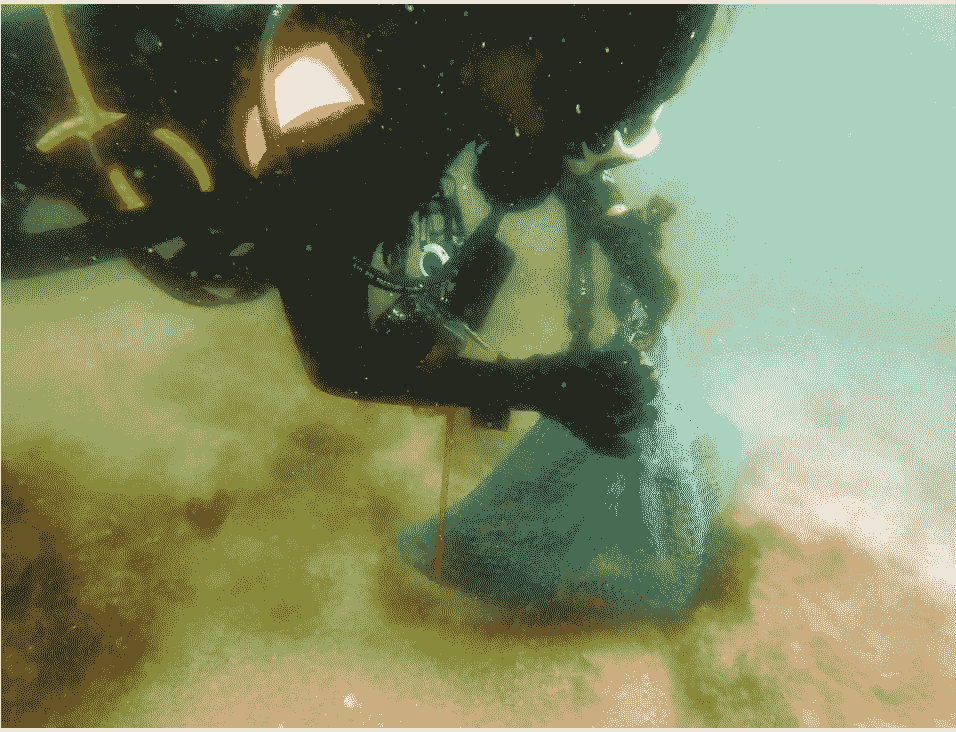
2025年6月，“潜爱”保育站活动，潜水员清理海洋垃圾。图：张缘成

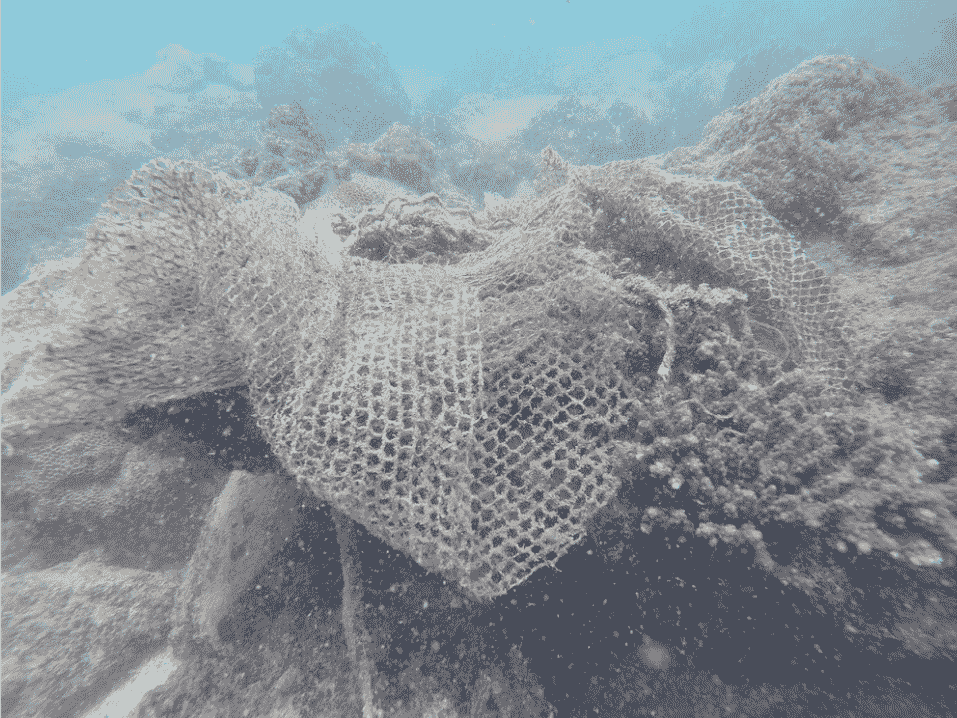
被废弃渔网覆盖的鹿角珊瑚。图：肖为

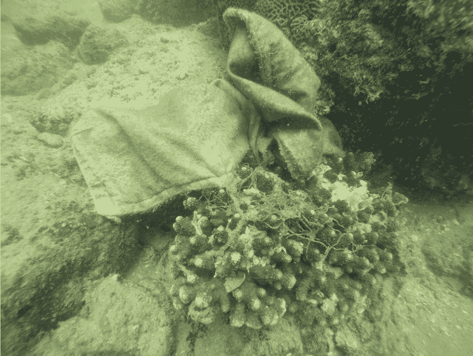
盖在鹿角珊瑚上的废弃布料。图：潜爱志愿者

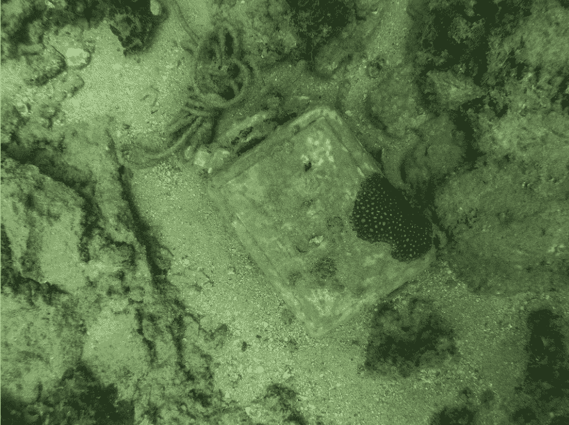
生长在塑料盖上的珊瑚。图：潜爱志愿者

潜水员清理水垃圾，使用浮力袋将长长的软管吊起。图：肖为

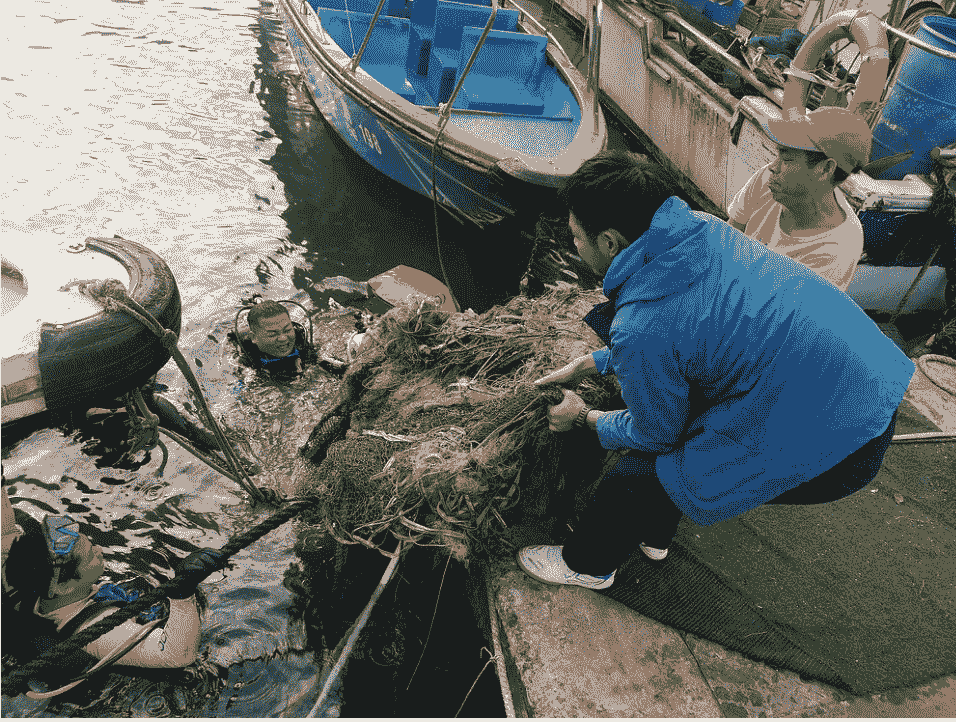
2020年12月，志愿者们奋力将缠绕在一起的鱼线、渔网等垃圾托举上岸。图：刘雯文

废弃渔网不仅会缠死螃蟹鱼类，随浪漂浮时还会罩住珊瑚，导致其破碎或倾覆。志愿者王文记得，自己曾清理出大量被渔网裹缠的珊瑚残骸，“抛网给它拖得支离破碎，很难恢复”。

被渔网挂断的珊瑚。图：王晓勇

海底常见的鱼钩也会带来危险。尤其是“木虾”鱼钩最常见——一个到八个丢弃后，它们会卡在渔网里、藏在珊瑚丛中，清理时稍不慎，容易被扎破或划破。旺季，肖为和志愿者们一天就能捡起300个“木虾”。

2025年6月，“潜爱”保育站活动，当天清理部分海洋垃圾。图：张缘成

春节期间，海底最多的是烟花碎屑、胶皮、纸筒和火药随浪漂浮。年初初，一次下水清理，看到岸边满地垃圾后游客面露嫌弃：“抓什么？”志愿者王文回忆，“大家觉得珊瑚受到了很大伤害。”

今年上半年，志愿者们带回1364.8公斤垃圾，其中近七成是废弃渔具，其次是塑料制品，以及金属和化工废料等。但王晓勇坦言，“我们不仅带回很多垃圾，通过这些行动也是想告诉公众，少制造垃圾，少往海里扔一点，我们就不用再去干这些事儿。”

潜水员和志愿者协助将垃圾从海里带到岸边。1岁的“刘小粥”斜躺在礁石上，原本舒展的伞状结构僵直挺立，孔隙泛出冷光，触手萎缩。

2024年8月，“潜爱”珊瑚苗，白化的尾珊瑚“刘小粥”。图：张缘成

2020年1月，“刘小粥”生活在人工苗圃上，一位团队创始人认养了它，取名“刘小粥”。今，“刘小粥”已从直径4.5厘米长到近半米。每次下水巡查，都会拂去它表面的浮尘，白色触手随水流轻轻晃动。

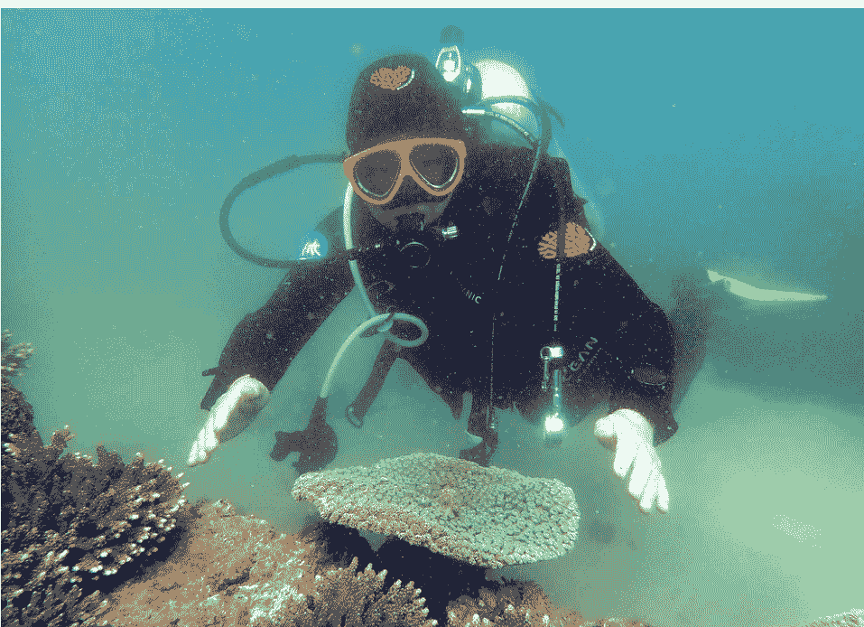
2024年夏天，深圳发现前所未有的景象——它和周围的鹿角珊瑚白得刺眼，白化率已超六成。

“刘小粥”白化的消息，肖为不敢跟养人说”。所幸白化不是必然死亡，若海水及时回落，珊瑚虫可能重新接纳共藻，还有存活机会。随着高温结束，“刘小粥”开始一点点恢复。到9月中，其边缘区域恢复为淡黄色，到了2025年，大部分白化珊瑚已重新覆上深褐色。

也有珊瑚未能适应酷夏。肖为介绍，苗圃区一个靠近岸边的苗圃受高温影响较大，至今未能恢复。珊瑚骨逐渐被泥沙和藻类侵蚀，残枝断落。

当肖为带着珊瑚白化照片回到岸上，才猛然察觉：除了潜水员的小圈子，珊瑚离大众的生活太远。讲台上，他一次又一次解释珊瑚是动物而非植物，讲述珊瑚礁如何庇护鱼群……”解释路径太长，很难让大家明白珊瑚有多重要。“他清楚台下听众是否被触动，但募捐数据冰冷而直白：同一平台，“打击海洋垃圾”项目募资超500万元，而其他几个直接以珊瑚为主题的，捐款均不及前者十分之一。

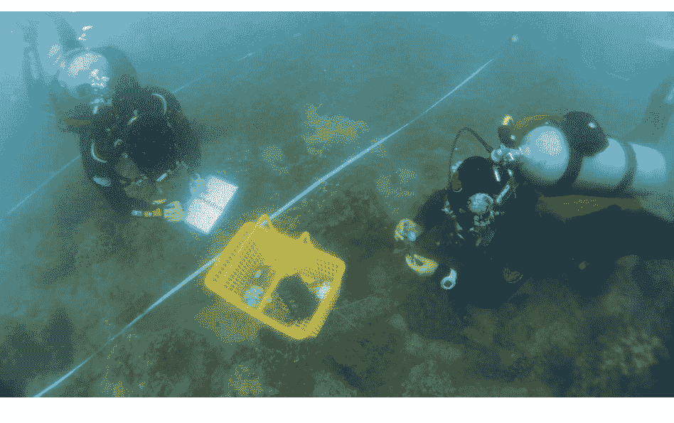
2018年，潜水员正在为打破的珊瑚断肢收集记录。图：潜爱志愿者

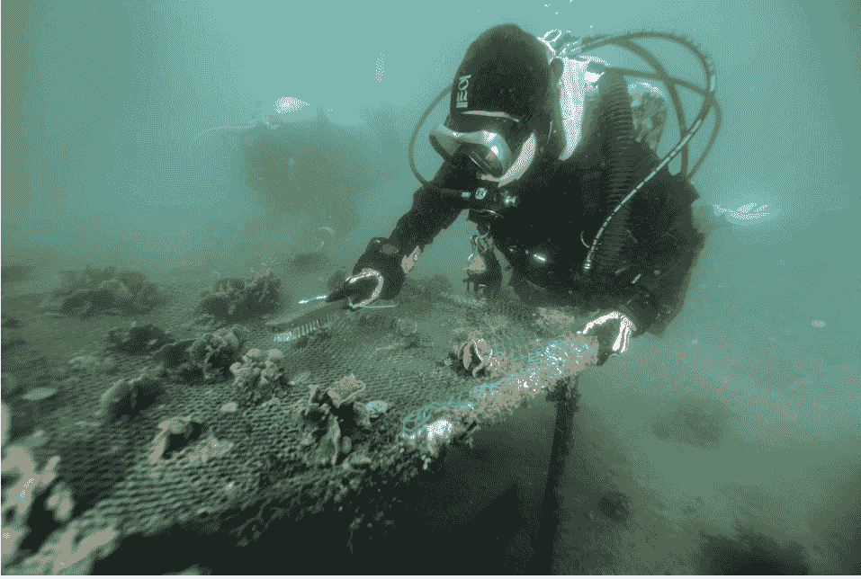
2021年2月，团队成员进行珊瑚种植。图：柯涛

王晓勇记得早期种植的艰辛：第一次购买100株珊瑚，一年后死亡超九成；后来用钢筋混凝土礁盘，又被台风毁了；直到第三次尝试，采用了更灵活的方案，才勉强避免了海浪破坏，最终停留在600余株。

但王晓勇发现，当前的珊瑚繁育并不完善，不仅品种单一，抗逆性也较差。“我们没有核心技术，实际上无法进行大规模珊瑚修复。通过商业合作做生态补偿——从保护的角度来说，我们决定转一个方向：首先是和当地渔民合作，让他们成为志愿者，每周在指定海域帮助他们把丢弃的垃圾拖到岸上。其次是更广泛的潜水爱好者，通过报名，限80个名额。

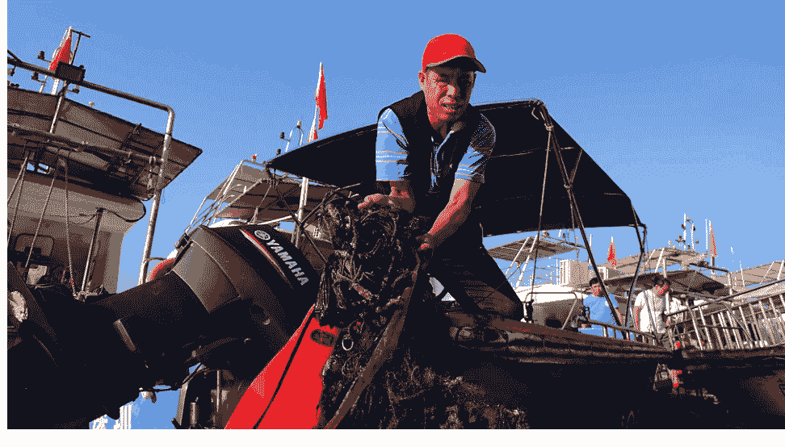
当地渔民正在帮助潜水员将垃圾拖到岸上。图：肖为

2025年6月，“潜爱”保育站活动，潜水员在码头准备乘坐快艇前往指定海域。图：张锦成

王文从潜水员成为志愿者，最初他只是方便，门口就能免费潜水。如今，他主动分享自己的经历，面对普通大众，让大家对海洋保护感兴趣。在海边，他带着孩子们进入水水，认识珊瑚，聊聊珊瑚礁的食物链，如何保护斑鱼、龙虾、螃蟹。

这些自然课进入尾声，潮汐漫起，孩子们带着笔记回到父母身边。她很少下水，痴于探索红树林，潮间带生物的智慧。在沙滩上留下脚印，肖玉说：“了解了海洋，才会关心保护海洋。只有采取行动，才会有希望。”

2021年2月，夕阳西下，团队成员在观察完珊瑚苗后回到岸边。图：岳鸿军

图则编辑|翁倩

# 超级湖泊概览

超级湖泊是世界上积最大、最深的淡水湖泊之一，是一个非常独特的自然保护区

2023年8月15日，湖泊研究中心

数据来源：湖泊研究中心提供的湖泊观测数据

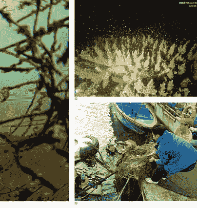
2023年8月15日，湖泊研究中心

超级湖位于非洲东部，是世界上最大的湖泊之一，也是最深的湖泊之一。由于其巨大的水面积和深度，超级湖形成了一个独特的生态系统，孕育了极其丰富的生物多样性。由于其独特的地理位置和多变的环境条件，该湖被认为是生物进化的天然实验室。这里生存着许多世界上其他地方找不到的物种。

摩霍湖的湖水非常咸，含有大量的矿物质。这种极端的环境使得只有适应能力强的生物才能在湖泊中生存。近年来，由于气候变化的影响，超级霍湖的水位正在下降。这威胁到了湖中的生态系统和当地生物的生存。

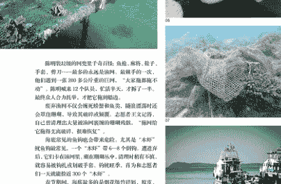
独特的生态系统

超级湖泊的独特生态系统包含了许多稀有物种。其中包括一些特有的鱼类、植物和鸟类。这些物种在这个独特的环境中找到了它们的栖息地。这些物种的保护对于超级湖泊的健康至关重要。如果环境遭到破坏，这些生物可能会面临灭绝的危险。

科学家们正在研究超级湖泊的生态系统，以了解气候变化对其产生的影响，并采取有效的保护措施。

保护的挑战

保护超级湖泊的生态系统面临着许多挑战。气候变化、水污染和人类活动正威胁着它。联合国政府气候变化专门委员会（IPCC）评估显示，相比工业化前，升温1.5°C时，珊瑚礁将减少70%—90%；当升温2°C以上，珊瑚礁将减少99%。

2014年，印度尼西亚达拉湾湾。图：岳鸿军

肖为站在岸边，望着远处若隐若现的白色。“没有悲伤，只能惊讶，因为是人力不可及的2024年的炎热而漫长，截至当年1月，深圳海水时长超过240天，打破历史纪录。美国国家海洋大气管理局（NOAA）和国际珊瑚礁信任（ICRI）组织于2024年确认，地球正经历记录以来的第四次全球珊瑚白化事件。据显示，2023年1月日至2025年5月31日期间，全球83.9%的珊瑚礁遭受高温侵袭，至少83个国家和地区记录到大规模白化，规模为史上之最。

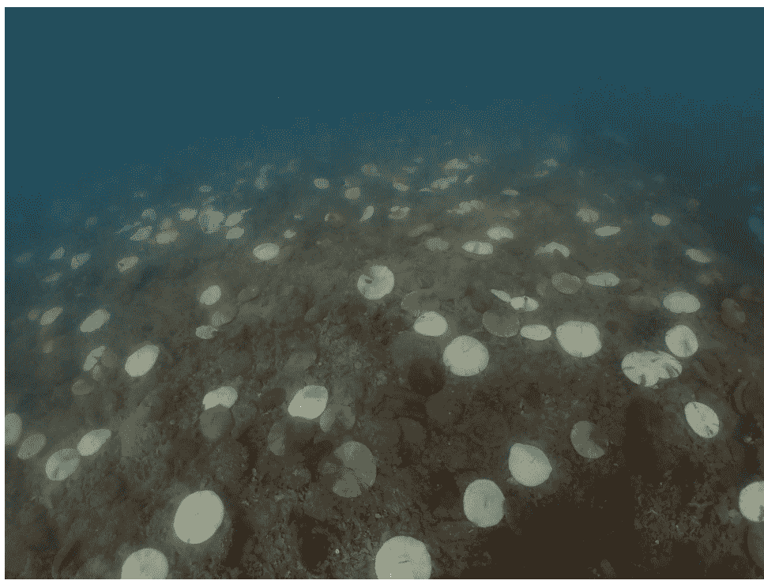
2024年8月，马来西亚，当地珊瑚也发生白化。图：肖为

“刘小粥”白化的消息，肖为不敢跟养人说”。所幸白化不是必然导致死亡，若海水及时回落，珊瑚虫可能重新接纳共藻，还有存活机会。随着高温结束，“刘小粥”开始一点点恢复。到9月中，其边缘区域恢复为淡黄色，到了2025年，大部分白化珊瑚已重新覆上深褐色。

也有珊瑚未能适应酷夏。肖为介绍，苗圃区一个靠近岸边的苗圃受高温影响较大，至今未能恢复。珊瑚骨逐渐被泥沙和藻类侵蚀，残枝断落。

当肖为带着珊瑚白化照片回到岸上，才猛然察觉：除了潜水员的小圈子，珊瑚离大众的生活太远。讲台上，他一次又一次解释珊瑚是动物而非植物，讲述珊瑚礁如何庇护鱼群……”解释路径太长，很难让大家明白珊瑚有多重要他清楚台下听众是否被触动，但募捐数据冰冷而直白：同一平台，“打击海洋垃圾”项目募资超500万元，而其他几个直接以珊瑚为主题的，捐款均不及及前者十分之一。

2018年，潜水员正在为打破的珊瑚断肢收集记录。图：潜爱志愿者

2021年2月，团队成员进行珊瑚种植。图：柯涛

王晓勇记得早期种植的艰辛：第一次购买100株珊瑚，一年后死亡超九成；后来用钢筋混凝土礁盘，又被台风毁了；直到第三次尝试，采用了更灵活的方案，才勉强避免了海浪破坏，最终停留在600余株。

但王晓勇发现，当前的珊瑚繁育并不完善，不仅品种单一，抗逆性也较差。“我们没有核心技术，实际上无法进行大规模珊瑚修复。通过商业合作做生态补偿——从保护的角度来说，我们决定转一个方向：首先是和当地渔民合作，让他们成为志愿者，每周在指定海域帮助他们把丢弃的垃圾拖到岸上。其次是更广泛的潜水爱好者，通过报名，限80个名额。

当地渔民正在帮助潜水员将垃圾拖到岸上。图：肖为

2025年6月，“潜爱”保育站活动，潜水员在码头准备乘坐快艇前往指定海域。图：张锦成

王文从潜水员成为志愿者，最初他只是方便，门口就能免费潜水。如今，他主动分享自己的经历，面对普通大众，让大家对海洋保护感兴趣。在海边，他带着孩子们进入水水，认识珊瑚，聊聊珊瑚礁的食物链，如何保护斑鱼、龙虾、螃蟹。

这些，，，，，，，，，，，，，，，珊瑚，，，，珊瑚的珊瑚。

2，，，，，，，，珊瑚。，，，珊瑚，，，，，，。。。。。。。，。。，，，，，，，，，，，面临严峻的挑战。

为了应对这些挑战，国际社会正在努力保护珊瑚地区。这包括减少温室气体排放，建立自然保护区以及加强国际合作进行科学研究。只有通过共同努力，我们才能保护珊瑚脆弱的生态系统及其未来。

img/，0194fd14e3db33346fa0be1631857

。

这些自然课进入尾声，潮汐漫起，孩子们带着笔记回到父母身边。她很少下水，痴于探索红树林，潮间带生物的智慧。在沙滩上留下脚印，肖玉说：“了解了海洋，才会关心保护海洋。只有采取行动，才会有希望。”

2021年2月，夕阳西下，团队成员在观察完珊瑚苗后回到岸边。图：岳鸿军

图则编辑|翁倩

# 超级湖泊概览

超级湖泊是世界上积最大、最深的淡水湖泊之一，是一个非常独特的自然保护区

2023年8月15日，湖泊研究中心

数据来源：湖泊研究中心提供的湖泊观测数据

超级湖位于非洲东部，是世界上最大的湖泊之一，也是最深的湖泊之一。由于其巨大的水面积和深度，超级湖形成了一个独特的生态系统，孕育了极其丰富的生物多样性。由于其独特的地理位置和多变的环境条件，该湖被认为是生物进化的天然实验室。这里生存着许多世界上其他地方找不到的物种。

近年来，由于气候变化的影响，超级霍湖的水位正在下降。这威胁到了湖中的生态系统和当地生物的生存。

独特的生态系统

超级湖的独特生态系统包含了许多稀有物种。其中包括一些特有的鱼类、植物和鸟类。这些物种在这个独特的环境中找到了它们的栖息地。这些物种的保护对于超级湖泊的健康至关重要。如果环境遭到破坏，这些生物可能会面临灭绝的危险。

科学家们正在研究超级湖泊的生态系统，以了解气候变化对其产生的影响，并采取有效的保护措施。

保护的挑战

保护超级湖泊的生态系统面临着许多挑战。气候变化、水污染和人类活动正威胁着它。联合国政府气候变化专门委员会（IPCC）评估显示，相比工业化前，升温1.5°C时，珊瑚礁将减少70%—90%；当升温2°C以上，珊瑚礁将减少99%。

# 最新财新周刊 | 语音直播涉赌暴

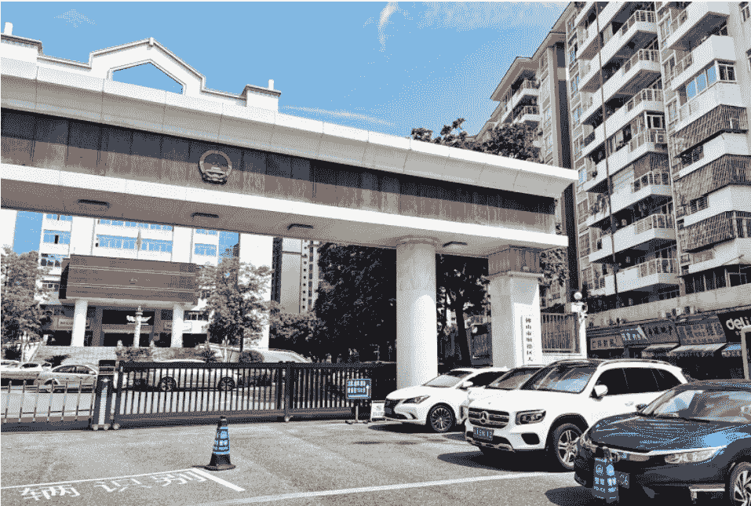

## CAIXIN | 听文章

文 | 财新周刊 冯华妹

5月30日，头部直播平台斗鱼（NASDAQ: DOYU）发布月度公告称，2024年4月对利用游戏内容赌博、站外引流赌博等违法行为进行了治理，对279个直播间实施永久封禁。

《2024斗鱼生态治理报告》显示，一年该平台针对黑灰产利用斗鱼生态进行站外涉赌导流的恶劣行为，重点筛查了三类极易被利用的风险场景，包括直播引流至第三方平台、利用第三方游戏道具随随机性变赌博、直接展示赌博网站操作画面，全年违规直播间5620个。

事实上，自2023年以来，伴伴、星螺约玩、欢效语音、氧气语音等多个语音直播平台的运营方因涉嫌开设赌场罪被查，在直播行业引发震动。

司法实践中的争议在于，对于用户“自发”在语音直播平台形式交易市场，导致相关虚拟物品广泛流通的，该如何认定该平台的责任？有法律专家表示，如果平台对此情情不知加以限制，便涉嫌赌博罪；若平台方从中抽头获利，则其行为符合开设赌场场所的构成要素。反之，如果平台充分采取监管措施，尽量努力杜绝用户利用平台设置的概率性玩法为从事赌博活动，便宜认定其具有利用赌博活动获利的目的。

2022年底宣判的斗鱼平台前知名主播直播付海龙等人网络开设赌场案，是公安部督办的全国首例直播平台涉赌场案。付海龙是斗鱼平台“丝丝九户外”账号的直播主播。图为2019年6月14日，2019年国际武汉斗鱼直播节斗鱼嘉年期间，丝丝九户外见面会现场。图：楚林/视觉中国。

另外有网络安全领域的业内人士称，语音直播平台为了吸引用户，往往会设计盲盒抽奖、宝箱、幸运转盘、福袋、竞猜押注等概率性游戏，因其随机性和潜在的激励机制，容易引发用户的赌博心理。此外，虚拟货币的反向兑换机制形成了充值打赏—礼物回购—现金回还的链条，为赌博行为提供了隐蔽的变现渠道。

从2023年起，近许多语音直播平台因涉博问题被关停，整个行业遭遇了监管风暴。但是目前娱乐行业涉博风险频现露头迹象，尤其直播、语音房成为涉博风险的高发区。

## 频频涉博

2024年4月21日，伴伴App宣告停止运营。伴伴是常伴（武汉）科技有限公司（以下简称“常伴公司”）旗下的一个语音直播平台，高峰时有3625万注册用户和24万名主播。据知情人人士介绍，2023年4月17日，广东省佛山市公安局佛德分局以伴伴平台涉博赌场为由，对常伴公司办公室进行搜索，并刑事拘留了25名高管和员工，2023年6月又刑拘了6名员工。

财经数据显示，常伴公司成立于2018年3月，由北京一一万物科技有限公司（以下简称“一一万物公司”）全资控股。许亚、冯巍、魏瑞东三人在一一万物公司分别持股63.6%、10%、1.6%，许亚为法定代表人。上述知情人人士表示，许亚在案发后出国，至今仍未归。

案发后，常伴公司副总裁冯巍、魏瑞东，研发负责人马永辉、运营总部总监魏、杨志宪、商务筹组负责人陈际胜、平台运营组负责人孙豪，以及6名高管和1名主播被移审审查起诉。2023年11月7日，顺德检察院向法院提起起诉书，指控上述14人涉嫌开设赌场罪。之后检方两次变更更起诉书。

《刑法》第303条第一款规定，以利为目的的聚集赌博或者以赌博为业，处三年以下有期徒刑、拘役或者管制，并处罚金。该第二款规定，开设赌场，处五年以下有期徒刑、拘役或者管制，并处罚金；情节严重的，处五年以上十年以下有期徒刑，并处罚金。根据2010年8月最高法院、最高检察院、公安部发布的《关于办理网络赌博犯罪适用法律若干问题的意见》，利用互联网、移动终端等传输赌博视频、数据，组织赌博活动、实施建立赌博网站并投注、建立赌博网站并提供他人组织赌博、为赌博网站担任代理并接授、或者参与赌博网站利润抽成的，属于“赌场”行为。

常伴公司一名法务人员介绍，语音直播平台通过公会进入并加入直播间，公会招募主播在直播间提供表演等。“公司”是直播平台与主播之间的专业运营公司，负责主播的招募、培训、管理和推广，管理公会的人员称为“公会长”。前述人士说，如果主播在直播台收到礼物，主播分成比例不同，整体上抽取最少19%，主播最多拿到70%。

广东顺德法院指出，2018年8月开始，常伴公司以盈利为目的，在伴伴台中先后嵌入包括“星星抽奖”“矿工”在内的概率性游戏，并在主播处设置抽奖渠道。用户在平台上充值获取抽奖机会，通过概率性游戏获取虚拟礼物，主播收到礼物后，根据平台设定的规则给予用户，从而完成充值、抽奖、兑现。伴伴平台在上述过程中，对公会对主播设定最低流水要求，设定比例随流水额递增，组织公会比赛、增加流水额，通过公会招募主播，主播收到的礼物不能转化为收益，公会会会，平台抽取15%的提成，以此作为主要手段。

经统计，伴伴平台于2020年8月至2023年3月涉赌资金高达3.64亿元。检方称，冯巍、魏瑞东、马永辉等14人以非法得利目的，利用互联网开设赌场，应当以开设赌场追究其责任。自2024年4月起，本案在顺德法院完成了庭审，目前尚未判决。

四川省都江市法院认为，2017年3月至2020年9月期间，付海龙等人利用斗鱼平台“丝丝九户外”账号组织直播间粉丝抽奖，官方设置抽奖中，通过动性语言鼓励观众参与抽奖，并通过平台、微信群等方式向未参与的人员推送抽奖时间及金额，导致大量人在抽奖时进入，采用付费“抽卡”、刷礼物等方式参与抽奖。海龙等人合计组织抽奖4267场，442万人参赌资金1.2亿元。2022年12月，都江法院一审认定，海龙等人利用平台直播间以抽奖方式组织赌博活动，成功开设赌场，判处六至三年有期徒刑。

随破案一个月后，2023年5月，另一家运营公司——北京星蝶科技有限公司的代表人物张骏等34人卷入赌场，被湖南省周口警方抓获。2020年11月至2023年5月，张骏组织开发了星蝶约玩等多款语音App。沈奎等人在星蝶约玩平台内植入“幸运售货机”插件，供特定人员进行赌博活动，平台注册会员充值买币，参与抽奖。会员通过抽奖获取相应礼物，用于主播，主播可将得的礼物向平台提现，平台通过主播的礼物赠送收取相应的提成，且平台将提现的对象扩大到主播之外的其他人，即会员可以通过礼物赠给其他主播，由该主播向平台提现，甚至同一个会员会将自己大号（会员账号）上的礼物赠给自己的小号（注册主播账号），向平台提现，会员自己注册主播套现比例仅为64%左右，主播与会员约定现比例为80%左右，收渣套运运生。

法院表示，有些到的礼物送给直播间，平台从中固定抽取12%左右，然后主播可以在平台直接提现至自己的银行卡或者支付宝账户，提现需要再付6%的手续费，最后主播再通过自己的银行卡或者微信、支付宝等等进行转账，整个过程称之为“收渣”。法院认定，为从平台抽取渣套现开始，平台的组织的赌场行为在实质上已经公开化、规模化，本质属于平台上购获得礼物方式换给会员现金，在这种氛围下，该平台内部的“幸运售货机”插件，本质上已经成为赌博工具，会员会有各种欲望。

星蝶赌场判决书载，张骏复认，“幸运售货机”模块能够让小博大，他之前过的公司有类似的产品，知道会有人为了寻求小博大的利。由于他们设计抽率，让会员体验抽博并从中获得利润。张骏说，为了吸引会员，平台没有设计窗口，会员抽到的背包礼物分别获得4元、8元。2023年3月，沈县法院一审判处张骏有期五个月，其余被告分别判刑。

## 平台责任与非罪

这一系列语音直播平台涉案，平台扮演什么角色、发挥何种用途？对于会长和主播的行为，平台是否明知，尽到了监管责任？这些问题是双方的焦点。公诉方称，在伴伴案件中，整个链条是“现金投入—兑换钻石—参与游戏—产生礼物—收回现金”，只要形成资金进出循环，就开设赌场属性。公诉方说：“幸运””他人的损失而偶然获得的行为，都是常见的行为。”冯威、魏瑞东等人认无罪。质诉人转述，魏瑞东于2019年12月加入常伴公司任副总裁。他在法庭陈述，其在伴公司负责上市规划，曾多次提醒注意行业风险，加强风控能力。“我加入公司的目的是促进上市，常伴公司已经是准备，启动了上市进程。我没有违法也不会破坏环境的目标。”辩方聘请的鉴定机构出具报告显示，伴伴与赌博相关的处罚记录有43条，处罚账号1个；买卖礼物的处罚记录158条，处罚账号1333个；相关游戏活动中的违规活动记录463条，处罚账号24个。常伴公司法务人员向财新介绍，伴伴平台上上有各种。

据旁听的人士讲，在法庭上，平台与公会、主播相互“围饲”。伴伴方面指标，是公会和主播乱搞，通过第三方平台买卖礼物流水，甚至直接对赌、搞赌博，扰乱了平台的正常秩序；公会和主播乱设立了高额的流水任务，使得他们不得不通过买卖礼物流水完成业务。公会长和主播认罪，但只承认买卖流水，并称平台监管力导致违法犯罪。对此，辩方认为，公会指责平台“监管不力”，这恰恰说明公会是监管与被监管的关系，而不是共同商量如何开赌场的关系。

公诉方认为，伴伴平台对公会设定了最低流水额的要求，并且设定按比例随流水额递增的机制，组织公会打比赛、增加流水额、刺激用户玩概率游戏，因此平台在平台上开设赌场，客观上具有组织行为，主观上具有故意。顾顺忠回应，为了获得利润，常伴平台提出的流水要求是正常的，公会买卖礼物并不是为了获得更多大利。由于，由于，冯威、魏瑞东等人已经履行了监管责任。公诉方强调，本案因“技术中立”免责，平台没有能力阻止积极追求。诉诉诉诉诉平台涉博。诉诉诉诉诉诉诉语音直播平台涉博。诉诉诉诉诉诉诉诉诉诉诉诉诉诉诉诉诉诉诉诉诉诉诉诉诉诉诉诉诉诉诉诉诉诉诉诉诉诉诉诉诉诉诉诉诉诉诉诉诉诉诉诉诉诉诉诉诉诉诉诉诉诉诉诉诉诉诉诉诉诉诉诉诉诉诉诉诉诉诉诉诉诉诉诉诉诉诉诉诉诉诉诉诉诉诉诉诉诉诉诉诉诉诉诉诉诉诉诉诉诉诉诉诉诉诉诉诉诉诉诉诉诉诉诉诉诉诉诉诉诉诉诉诉诉诉诉诉诉诉诉诉诉诉诉诉诉诉诉诉诉诉诉诉诉诉诉诉诉诉诉诉诉诉诉诉诉诉诉诉诉诉诉诉诉诉诉诉诉诉诉诉诉诉诉诉诉诉诉诉诉诉诉诉诉诉诉诉诉诉诉诉诉诉诉诉诉诉诉诉诉诉诉诉诉诉诉诉诉诉诉诉诉诉诉诉诉诉诉诉诉诉诉诉诉诉诉诉诉诉诉诉诉诉诉诉诉诉诉诉诉诉诉诉诉诉诉诉诉诉诉诉诉诉诉诉诉诉诉诉诉诉诉诉诉诉诉诉诉诉诉诉诉诉诉诉诉诉诉诉诉诉诉诉诉诉诉诉诉诉诉诉诉诉诉诉诉诉诉诉诉诉诉诉诉诉诉诉诉诉诉诉诉诉诉诉诉诉诉诉诉诉诉诉诉诉诉诉诉诉诉诉诉诉诉诉诉诉诉诉诉诉诉诉诉诉诉诉诉诉诉诉诉诉诉诉诉诉诉诉诉诉诉诉诉诉诉诉诉诉诉诉诉诉诉诉诉诉诉诉诉诉诉诉诉诉诉诉诉诉诉诉诉诉诉诉诉诉诉诉诉诉诉诉诉诉诉诉诉诉诉诉诉诉诉诉诉诉诉诉诉诉诉诉诉诉诉诉诉诉诉诉诉诉诉诉诉诉诉诉诉诉诉诉诉诉诉诉诉诉诉诉诉诉诉诉诉诉诉诉诉诉诉诉诉诉诉诉诉诉诉诉诉诉诉诉诉诉诉诉诉诉诉诉诉诉诉诉诉诉诉诉诉诉诉诉诉诉诉诉诉诉诉诉诉诉诉诉诉诉诉诉诉诉诉诉诉诉诉诉诉诉诉诉诉诉诉诉诉诉诉诉诉诉诉诉诉诉诉诉诉诉诉诉诉诉诉诉诉诉诉诉诉诉诉诉诉诉诉诉诉诉诉诉诉诉诉诉诉诉诉诉诉诉诉诉诉诉诉诉诉诉诉诉诉诉诉诉诉诉诉诉诉诉诉诉诉诉诉诉诉诉诉诉诉诉诉诉诉诉诉诉诉诉诉诉诉诉诉诉诉诉诉诉诉诉诉诉诉诉诉诉诉诉诉诉诉诉诉诉诉诉诉诉诉诉诉诉诉诉诉诉诉诉诉诉诉诉诉诉诉诉诉诉诉诉诉诉诉诉诉诉诉诉诉诉诉诉诉诉诉诉诉诉诉诉诉诉诉诉诉诉诉诉诉诉诉诉诉诉诉诉诉诉诉诉诉诉诉诉诉诉诉诉诉诉诉诉诉诉诉诉诉诉诉诉诉诉诉诉诉诉诉诉诉诉诉诉诉诉诉诉诉诉诉诉诉诉诉诉诉诉诉诉诉诉诉诉诉诉诉诉诉诉诉诉诉诉诉诉诉诉诉诉诉诉诉诉诉诉诉诉诉诉诉诉诉诉诉诉诉诉诉诉诉诉诉诉诉诉诉诉诉诉诉诉诉诉诉诉诉诉诉诉诉诉诉诉诉诉诉诉诉诉诉诉诉诉诉诉诉诉诉诉诉诉诉诉诉诉诉诉诉诉诉诉诉诉诉诉诉诉诉诉诉诉诉诉诉诉诉诉诉诉诉诉诉诉诉诉诉诉诉诉诉诉诉诉诉诉诉诉诉诉诉诉诉诉诉诉诉诉诉诉诉诉诉诉诉诉诉诉诉诉诉诉诉诉诉诉诉诉诉诉诉诉诉诉诉诉诉诉诉诉诉诉诉诉诉诉诉诉诉诉诉诉诉诉诉诉诉诉诉诉诉诉诉诉诉诉诉诉诉诉诉诉诉诉诉诉诉诉诉诉诉诉诉诉诉诉诉诉诉诉诉诉诉诉诉诉诉诉诉诉诉诉诉诉诉诉诉诉诉诉诉诉诉诉诉诉诉诉诉诉诉诉诉诉诉诉诉诉诉诉诉诉诉诉诉诉诉诉诉诉诉诉诉诉诉诉诉诉诉诉诉诉诉诉诉诉诉诉诉诉诉诉诉诉诉诉诉诉诉诉诉诉诉诉诉诉诉诉诉诉诉诉诉诉诉诉诉诉诉诉诉诉诉诉诉诉诉诉诉诉诉诉诉诉诉诉诉诉诉诉诉诉诉诉诉诉诉诉诉诉诉诉诉诉诉诉诉诉诉诉诉诉诉诉诉诉诉诉诉诉诉诉诉诉诉诉诉诉诉诉诉诉诉诉诉诉诉诉诉诉诉诉诉诉诉诉诉诉诉诉诉诉诉诉诉诉诉诉诉诉诉诉诉诉诉诉诉诉诉诉诉诉诉诉诉诉诉诉诉诉诉诉诉诉诉诉诉诉诉诉诉诉诉诉诉诉诉诉诉诉诉诉诉诉诉诉诉诉诉诉诉诉诉诉诉诉诉诉诉诉诉诉诉诉诉诉诉诉诉诉诉诉诉诉诉诉诉诉诉诉诉诉诉诉诉诉诉诉诉诉诉诉诉诉诉诉诉诉诉诉诉诉诉诉诉诉诉诉诉诉诉诉诉诉诉诉诉诉诉诉诉诉诉诉诉诉诉诉诉诉诉诉诉诉诉诉诉诉诉诉诉诉诉诉诉诉诉诉诉诉诉诉诉诉诉诉诉诉诉诉诉诉诉诉诉诉诉诉诉诉诉诉诉诉诉诉诉诉诉诉诉诉诉诉诉诉诉诉诉诉诉诉诉诉诉诉诉诉诉诉诉诉诉诉诉诉诉诉诉诉诉诉诉诉诉诉诉诉诉诉诉诉诉诉诉诉诉诉诉诉诉诉诉诉诉诉诉诉诉诉诉诉诉诉诉诉诉诉诉诉诉诉诉诉诉诉诉诉诉诉诉诉诉诉诉诉诉诉诉诉诉诉诉诉诉诉诉诉诉诉诉诉诉诉诉诉诉诉诉诉诉诉诉诉诉诉诉诉诉诉诉诉诉诉诉诉诉诉诉诉诉诉诉诉诉诉诉诉诉诉诉诉诉诉诉诉诉诉诉诉诉诉诉诉诉诉诉诉诉诉诉诉诉诉诉诉诉诉诉诉诉诉诉诉诉诉诉诉诉诉诉诉诉诉诉诉诉诉诉诉诉诉诉诉诉诉诉诉诉诉诉诉诉诉诉诉诉诉诉诉诉诉诉诉诉诉诉诉诉诉诉诉诉诉诉诉诉诉诉诉诉诉诉诉诉诉诉诉诉诉诉诉诉诉诉诉诉诉诉诉诉诉诉诉诉诉诉诉诉诉诉诉诉诉诉诉诉诉诉诉诉诉诉诉诉诉诉诉诉诉诉诉诉诉诉诉诉诉诉诉诉诉诉诉诉诉诉诉诉诉诉诉诉诉诉诉诉诉诉诉诉诉诉诉诉诉诉诉诉诉诉诉诉诉诉诉诉诉诉诉诉诉诉诉诉诉诉诉诉诉诉诉诉诉诉诉诉诉诉诉诉诉诉诉诉诉诉诉诉诉诉诉诉诉诉诉诉诉诉诉诉诉诉诉诉诉诉诉诉诉诉诉诉诉诉诉诉诉诉诉诉诉诉诉诉诉诉诉诉诉诉诉诉诉诉诉诉诉诉诉诉诉诉诉诉诉诉诉诉诉诉诉诉诉诉诉诉诉诉诉诉诉诉诉诉诉诉诉诉诉诉诉诉诉诉诉诉诉诉诉诉诉诉诉诉诉诉诉诉诉诉诉诉。

诉诉诉诉诉诉诉诉诉诉。

诉诉诉诉诉诉诉诉诉诉。

诉诉诉诉诉诉诉诉诉诉。

诉诉诉诉诉诉诉诉诉诉。

诉诉诉诉诉诉诉诉诉诉。

诉诉诉诉诉诉诉诉诉诉。

诉诉诉诉诉诉诉诉诉诉诉。

诉诉诉诉诉诉诉诉诉诉诉。

诉诉诉诉诉诉诉诉诉诉诉。诉诉诉诉诉诉诉诉诉诉诉诉

诉诉诉诉诉诉诉诉诉诉诉。

诉诉诉诉诉诉诉诉诉诉诉。

诉诉诉诉诉诉诉诉诉诉。

诉诉诉诉诉诉诉诉诉诉。

诉诉诉诉诉诉诉诉诉诉。

诉诉诉诉诉诉诉诉诉诉诉

诉诉诉诉诉诉诉诉诉诉。

诉诉诉诉诉诉诉诉诉诉。。

诉诉诉诉诉诉诉诉诉。。

诉诉诉诉诉诉诉诉诉诉。

诉诉诉诉诉诉诉诉诉诉诉。

诉诉诉诉诉诉诉诉诉诉诉诉。

诉诉诉诉诉诉诉诉诉诉诉诉。

诉诉诉诉诉诉诉诉诉诉诉诉。

诉诉诉诉诉诉诉诉诉诉诉诉。

诉诉诉诉诉诉诉诉诉诉诉诉。

诉诉诉诉诉诉诉诉诉诉诉诉。

诉诉诉诉诉诉诉诉诉诉诉诉。

诉诉诉诉诉诉诉诉诉诉诉诉。

诉诉诉诉诉诉诉诉诉诉诉诉。

诉诉诉诉诉诉诉诉诉诉诉诉。

诉诉诉诉诉诉诉诉诉诉诉诉。

诉诉诉诉诉诉诉诉诉诉诉诉诉。诉诉诉诉诉诉诉诉诉诉诉诉诉。

诉诉诉诉诉诉诉诉诉诉诉诉诉。

诉诉诉诉诉诉诉诉诉诉诉诉诉。诉诉诉诉诉诉诉诉诉诉诉诉诉诉。诉诉诉诉诉诉诉诉诉诉诉诉诉诉。诉诉诉诉诉诉诉诉诉诉诉诉诉诉诉诉诉诉诉诉诉诉诉诉诉诉诉诉诉诉诉诉诉诉诉诉诉诉诉诉诉诉诉诉诉诉诉诉诉诉诉诉诉诉诉诉诉诉诉诉诉诉诉诉诉诉诉诉诉诉诉诉诉诉诉诉诉诉诉诉诉诉诉诉诉诉诉诉诉诉诉诉诉诉诉诉诉诉诉诉诉诉诉诉诉诉诉诉诉诉诉诉诉诉诉诉诉诉诉诉诉诉诉诉诉诉诉诉诉诉诉诉诉诉诉诉诉诉诉诉诉诉诉诉诉诉诉诉诉诉诉诉诉诉诉诉诉诉诉诉诉诉诉诉诉诉诉诉诉诉诉诉诉诉诉诉诉诉诉诉诉诉诉诉诉诉诉诉诉诉诉诉诉诉诉诉诉诉诉诉诉诉诉诉诉诉诉诉诉诉诉诉诉诉诉诉诉诉诉诉诉诉诉诉诉诉诉诉诉诉诉诉诉诉诉诉诉诉诉诉诉诉诉诉诉诉诉诉诉诉诉诉诉诉诉诉诉诉诉诉诉诉诉诉诉诉诉诉诉诉诉诉诉诉诉诉诉诉诉诉诉诉诉诉诉诉诉诉诉诉诉诉诉诉诉诉诉诉诉诉诉诉诉诉诉诉诉诉诉诉诉诉诉诉诉诉诉诉诉诉诉诉诉诉诉诉诉诉诉诉诉诉诉诉诉诉诉诉诉诉诉诉诉诉诉诉诉诉诉诉诉诉诉诉诉诉诉诉诉诉诉诉诉诉诉诉诉诉诉诉诉诉诉诉诉诉诉诉诉诉诉诉诉诉诉诉诉诉诉诉诉诉诉诉诉诉诉诉诉诉诉诉诉诉诉诉诉诉诉诉诉诉诉诉诉诉诉诉诉诉诉诉诉诉诉诉诉诉诉诉诉诉诉诉诉诉诉诉诉诉诉诉诉诉诉诉诉诉诉诉诉诉诉诉诉诉诉诉诉诉诉诉诉诉诉诉诉诉诉诉诉诉诉诉诉诉诉诉诉诉诉诉诉诉诉诉诉诉诉诉诉诉诉诉诉诉诉诉诉诉诉诉诉诉诉诉诉诉诉诉诉诉诉诉诉诉诉诉诉诉诉诉诉诉诉诉诉诉诉诉诉诉诉诉诉诉诉诉诉诉诉诉诉诉诉诉诉诉诉诉诉诉诉诉诉诉诉诉诉诉诉诉诉诉诉诉诉诉诉诉诉诉诉诉诉诉诉诉诉诉诉诉诉诉诉诉诉诉诉诉诉诉诉诉诉诉诉诉诉诉诉诉诉诉诉诉诉诉诉诉诉诉诉诉诉诉诉诉诉诉诉诉诉诉诉诉诉诉诉诉诉诉诉诉诉诉诉诉诉诉诉诉诉诉诉诉诉诉诉诉诉诉诉诉诉诉诉诉诉诉诉诉诉诉诉诉诉诉诉诉诉诉诉诉诉诉诉诉诉诉诉诉诉诉诉诉诉诉诉诉诉诉诉诉诉诉诉诉诉诉诉诉诉诉诉诉诉诉诉诉诉诉诉诉诉诉诉诉诉诉诉诉诉诉诉诉诉诉诉诉诉诉诉诉诉诉诉诉诉诉诉诉诉诉诉诉诉诉诉诉诉诉诉诉诉诉诉诉诉诉诉诉诉诉诉诉诉诉诉诉诉诉诉诉诉诉诉诉诉诉诉诉诉诉诉诉诉诉诉诉诉诉诉诉诉诉诉诉诉诉诉诉诉诉诉诉诉诉诉诉诉诉诉诉诉诉诉诉诉诉诉诉诉诉诉诉诉诉诉诉诉诉诉诉诉诉诉诉诉诉诉诉诉诉诉诉诉诉诉诉诉诉诉诉诉诉诉诉诉诉诉诉诉诉诉诉诉诉诉诉诉诉诉诉诉诉诉诉诉诉诉诉诉诉诉诉诉诉诉诉诉诉诉诉诉诉诉诉诉诉诉诉诉诉诉诉诉诉诉诉诉诉诉诉诉诉诉诉诉诉诉诉诉诉诉诉诉诉诉诉诉诉诉诉诉诉诉诉诉诉诉诉诉诉诉诉诉诉诉诉诉诉诉诉诉诉诉诉诉诉诉诉诉诉诉诉诉诉诉诉诉诉诉诉诉诉诉诉诉诉诉诉诉诉诉诉诉诉诉诉诉诉诉诉诉诉诉诉诉诉诉诉诉诉诉诉诉诉诉诉诉诉诉诉诉诉诉诉诉诉诉诉诉诉诉诉诉诉诉诉诉诉诉诉诉诉诉诉诉诉诉诉诉诉诉诉诉诉诉诉诉诉诉诉诉诉诉诉诉诉诉诉诉诉诉诉诉诉诉诉诉诉诉诉诉诉诉诉诉诉诉诉诉诉诉诉诉诉诉诉诉诉诉诉诉诉诉诉诉诉诉诉诉诉诉诉诉诉诉诉诉诉诉诉诉诉诉诉诉诉诉诉诉诉诉诉诉诉诉诉诉诉诉诉诉诉诉诉诉诉诉诉诉诉诉诉诉诉诉诉诉诉诉诉诉诉诉诉诉诉诉诉诉诉诉诉诉诉诉诉诉诉诉诉诉诉诉诉诉诉诉诉诉诉诉诉诉诉诉诉诉诉诉诉诉诉诉诉诉诉诉诉诉诉诉诉诉诉诉诉诉诉诉诉诉诉诉诉诉诉诉诉诉诉诉诉诉诉诉诉诉诉诉诉诉诉诉诉诉诉诉诉诉诉诉诉诉诉诉诉诉诉诉诉诉诉诉诉诉诉诉诉诉诉诉诉诉诉诉诉诉诉诉诉诉诉诉诉诉诉诉诉诉诉诉诉诉诉诉诉诉诉诉诉诉诉诉诉诉诉诉诉诉诉诉诉诉诉诉诉诉诉诉诉诉诉诉诉诉诉诉诉诉诉诉诉诉诉诉诉诉诉诉诉诉诉诉诉诉诉诉诉诉诉诉诉诉诉诉诉诉诉诉诉诉诉诉诉诉诉诉诉诉诉诉诉诉诉诉诉诉诉诉诉诉诉诉诉诉诉诉诉诉诉诉诉诉诉诉诉诉诉诉诉诉诉诉诉诉诉诉诉诉诉诉诉诉诉诉诉诉诉诉诉诉诉诉诉诉诉诉诉诉诉诉诉诉诉诉诉诉诉诉诉诉诉诉诉诉诉诉诉诉诉诉诉诉诉诉诉诉诉诉诉诉诉诉诉诉诉诉诉诉诉诉诉诉诉诉诉诉诉诉诉诉诉诉诉诉诉诉诉诉诉诉诉诉诉诉诉诉诉诉诉诉诉诉诉诉诉诉诉诉诉诉诉诉诉诉诉诉诉诉诉诉诉诉诉诉诉诉诉诉诉诉诉诉诉诉诉诉诉诉诉诉诉诉诉诉诉诉诉诉诉诉诉诉诉诉诉诉诉诉诉诉诉诉诉诉诉诉诉诉诉诉诉诉诉诉诉诉诉诉诉诉诉诉诉诉诉诉诉诉诉诉诉诉诉诉诉诉诉诉诉诉诉诉诉诉诉诉诉诉诉诉诉诉诉诉诉诉诉诉诉诉诉诉诉诉诉诉诉诉诉诉诉诉诉诉诉诉诉诉诉诉诉诉诉诉诉诉诉诉诉诉诉诉诉诉诉诉诉诉诉诉诉诉诉诉诉诉诉诉诉诉诉诉诉诉诉诉诉诉诉诉诉诉诉诉诉诉诉诉诉诉诉诉诉诉诉诉诉诉诉诉诉诉诉诉诉诉诉诉诉诉诉诉诉诉诉诉诉诉诉诉诉诉诉诉诉诉诉诉诉诉诉诉诉诉诉诉诉诉诉诉诉诉诉诉诉诉诉诉诉诉诉诉诉诉诉诉诉诉诉诉诉诉诉诉诉诉诉诉诉诉诉诉诉诉诉诉诉诉诉诉诉诉诉诉诉诉诉诉诉诉诉诉诉诉诉诉诉诉诉诉诉诉诉诉诉诉诉诉诉诉诉诉诉诉诉诉诉诉诉诉诉诉诉诉诉诉诉诉诉诉诉诉诉诉诉诉诉诉诉诉诉诉诉诉诉诉诉诉诉诉诉诉诉诉诉诉诉诉诉诉诉诉诉诉诉诉诉诉诉诉诉诉诉诉诉诉诉诉诉诉诉诉诉诉诉诉诉诉诉诉诉诉诉诉诉诉诉诉诉诉诉诉诉诉诉诉诉诉诉诉诉诉诉诉诉诉诉诉诉诉诉诉诉诉诉诉诉诉诉诉诉诉诉诉诉诉诉诉诉诉诉诉诉诉诉诉诉诉诉诉诉诉诉诉诉诉诉诉诉诉诉诉诉诉诉诉诉诉诉诉诉诉诉诉诉诉诉诉诉诉诉诉诉诉诉诉诉诉诉诉诉诉诉诉诉诉诉诉诉诉诉诉诉诉诉诉诉诉诉诉诉诉诉诉诉诉诉诉诉诉诉诉诉诉诉诉诉诉诉诉诉诉诉诉诉诉诉诉诉诉诉诉诉诉诉诉诉诉诉诉诉诉诉诉诉诉诉诉诉诉诉诉诉诉诉诉诉诉诉诉诉诉诉诉诉诉诉诉诉诉诉诉诉诉诉诉诉诉诉诉诉诉诉诉诉诉诉诉诉诉诉诉诉诉诉诉诉诉诉诉诉诉诉诉诉诉诉诉诉诉诉诉诉诉诉诉诉诉诉诉诉诉诉诉诉诉诉诉诉诉诉诉诉诉诉诉诉诉诉诉诉诉诉诉诉诉诉诉诉诉诉诉诉诉诉诉诉诉诉诉诉诉诉诉诉诉诉诉诉诉诉诉诉诉诉诉诉诉诉诉诉诉诉诉诉诉诉诉诉诉诉诉诉诉诉诉诉诉诉诉诉诉诉诉诉诉诉诉诉诉诉诉诉诉诉诉诉诉诉诉诉诉诉诉诉诉诉诉诉诉诉诉诉诉诉诉诉诉诉诉诉诉诉诉诉诉诉诉诉诉诉诉诉诉诉诉诉诉诉诉诉诉诉诉诉诉诉诉诉诉诉诉诉诉诉诉诉诉诉诉诉诉诉诉诉诉诉诉诉诉诉诉诉诉诉诉诉诉诉诉诉诉诉诉诉诉诉诉诉诉诉诉诉诉诉诉诉诉诉诉诉诉诉诉诉诉诉诉诉诉诉诉诉诉诉诉诉诉诉诉诉诉诉诉诉诉诉诉诉诉诉诉诉诉诉诉诉诉诉诉诉诉诉诉诉诉诉诉诉诉诉诉诉诉诉诉诉诉诉诉诉诉诉诉诉诉诉诉诉诉诉诉诉诉诉诉诉诉诉诉诉诉诉诉诉诉诉诉诉诉诉诉诉诉诉诉诉诉诉诉诉诉诉诉诉诉诉诉诉诉诉诉诉诉诉诉诉诉诉诉诉诉诉诉诉诉诉诉诉诉诉诉诉诉诉诉诉诉诉诉诉诉诉诉诉诉诉诉诉诉诉诉诉诉诉诉诉诉诉诉诉诉诉诉诉诉诉诉诉诉诉诉诉诉诉诉诉诉诉诉诉诉诉诉诉诉诉诉诉诉诉诉诉诉诉诉诉诉诉诉诉诉诉诉诉诉诉诉诉诉诉诉诉诉诉诉诉诉诉诉诉诉诉诉诉诉诉诉诉诉诉诉诉诉诉诉诉诉诉诉诉诉诉诉诉诉诉诉诉诉诉诉诉诉诉诉诉诉诉诉诉诉诉诉诉诉诉诉诉诉诉诉诉诉诉诉诉诉诉诉诉诉诉诉诉诉诉诉诉诉诉诉诉诉诉诉诉诉诉诉诉诉诉诉诉诉诉诉诉诉诉诉诉诉诉诉诉诉诉诉诉诉诉诉诉诉诉诉诉诉诉诉诉诉诉诉诉诉诉诉诉诉诉诉诉诉诉诉诉诉诉诉诉诉诉诉诉诉诉诉诉诉诉诉诉诉诉诉诉诉诉诉诉诉诉诉诉诉诉诉诉诉诉诉诉诉诉诉诉诉诉诉诉诉诉诉诉诉诉诉诉诉诉诉诉诉诉诉诉诉诉诉诉诉诉诉诉诉诉诉诉诉诉诉诉诉诉诉诉诉诉诉诉诉诉诉诉诉诉诉诉诉诉诉诉诉诉诉诉诉诉诉诉诉诉诉诉诉诉诉诉诉诉诉诉诉诉诉诉诉诉诉诉诉诉诉诉诉诉诉诉诉诉诉诉诉诉诉诉诉诉诉诉诉诉诉诉诉诉诉诉诉诉诉诉诉诉诉诉诉诉诉诉诉诉诉诉诉诉诉诉诉诉诉诉诉诉诉诉诉诉诉诉诉诉诉诉诉诉诉诉诉诉诉诉诉诉诉诉诉诉诉诉诉诉诉诉诉诉诉诉诉诉诉诉诉诉诉诉诉诉诉诉诉诉诉诉诉诉诉诉诉诉诉诉诉诉诉诉诉诉诉诉诉诉诉诉诉诉诉诉诉诉诉诉诉诉诉诉诉诉诉诉诉诉诉诉诉诉诉诉诉诉诉诉诉诉诉诉诉诉诉诉诉诉诉诉诉诉诉诉诉诉诉诉诉诉诉诉诉诉诉诉诉诉诉诉诉诉诉诉诉诉诉诉诉诉诉诉诉诉诉诉诉诉诉诉诉诉诉诉诉诉诉诉诉诉诉诉诉诉诉诉诉诉诉诉诉诉诉诉诉诉诉诉诉诉诉诉诉诉诉诉诉诉诉诉诉诉诉诉诉诉诉诉诉诉诉诉诉诉诉诉诉诉诉诉诉诉诉诉诉诉诉诉诉诉诉诉诉诉诉诉诉诉诉诉诉诉诉诉诉诉诉诉诉诉诉诉诉诉诉诉诉诉诉诉诉诉诉诉诉诉诉诉诉诉诉诉诉诉诉诉诉诉诉诉诉诉诉诉诉诉诉诉诉诉诉诉诉诉诉诉诉诉诉诉诉诉诉诉诉诉诉诉诉诉诉诉诉诉诉诉诉诉诉诉诉诉诉诉诉诉诉诉诉诉诉诉诉诉诉诉诉诉诉诉诉诉诉诉诉诉诉诉诉诉诉诉诉诉诉诉诉诉诉诉诉诉诉诉诉诉诉诉诉诉诉诉诉诉诉诉诉诉诉诉诉诉诉诉诉诉诉诉诉诉诉诉诉诉诉诉诉诉诉诉诉诉诉诉诉诉诉诉诉诉诉诉诉诉诉诉诉诉诉诉诉诉诉诉诉诉诉诉诉诉诉诉诉诉诉诉诉诉诉诉诉诉诉诉诉诉诉诉诉诉诉诉诉诉诉诉诉诉诉诉诉诉诉诉诉诉诉诉诉诉诉诉诉诉诉诉诉诉诉诉诉诉诉诉诉诉诉诉诉诉诉诉诉诉诉诉诉诉诉诉诉诉诉诉诉诉诉诉诉诉诉诉诉诉诉诉诉诉诉诉诉诉诉诉诉诉诉诉诉诉诉诉诉诉诉诉诉诉诉诉诉诉诉诉诉诉诉诉诉诉诉诉诉诉诉诉诉诉诉诉诉诉诉诉诉诉诉诉诉诉诉诉诉诉诉诉诉诉诉诉诉诉诉诉诉诉诉诉诉诉诉诉诉诉诉诉诉诉诉诉诉诉诉诉诉诉诉诉诉诉诉诉诉诉诉诉诉诉诉诉诉诉诉诉诉诉诉诉诉诉诉诉诉诉诉诉诉诉诉诉诉诉诉诉诉诉诉诉诉诉诉诉诉诉诉诉诉诉诉诉诉诉诉诉诉诉诉诉诉诉诉诉诉诉诉诉诉诉诉诉诉

诉诉诉诉诉诉诉诉诉诉诉诉诉诉诉诉诉诉诉诉诉诉诉诉诉诉诉诉诉诉诉诉诉诉诉诉诉诉诉诉诉诉诉诉诉诉诉诉诉诉诉诉诉诉诉诉诉诉诉诉诉诉诉诉诉诉诉诉诉诉诉诉诉诉诉诉诉诉诉诉诉诉诉诉诉诉诉诉诉诉诉诉诉诉诉诉诉诉诉诉诉诉诉诉诉诉诉诉诉诉诉诉诉诉诉诉诉诉诉诉诉诉诉诉诉诉诉诉诉诉诉诉诉诉诉诉诉诉诉诉诉诉诉诉诉诉诉诉诉诉诉诉诉诉诉诉诉诉诉诉诉诉诉诉诉诉诉诉诉诉诉诉诉诉诉诉诉诉诉诉诉诉诉诉诉诉诉诉诉诉诉诉诉诉诉诉诉诉诉诉诉诉诉诉诉诉诉诉诉诉诉诉诉诉诉诉诉诉诉诉诉诉诉诉诉诉诉诉诉诉诉诉诉诉诉诉诉诉诉诉诉诉诉诉诉诉诉诉诉诉诉诉诉诉诉诉诉诉诉诉诉诉诉诉诉诉诉诉诉诉诉诉诉诉诉诉诉诉诉诉诉诉诉诉诉诉诉诉诉诉诉诉诉诉诉诉诉诉诉诉诉诉诉诉诉诉诉诉诉诉诉诉诉诉诉诉诉诉诉诉诉诉诉诉诉诉诉诉诉诉诉诉诉诉诉诉诉诉诉诉诉诉诉诉诉诉诉诉诉诉诉诉诉诉诉诉诉诉诉诉诉诉诉诉诉诉诉诉诉诉诉诉诉诉诉诉诉诉诉诉诉诉诉诉诉诉诉诉诉诉诉诉诉诉诉诉诉诉诉诉诉诉诉诉诉诉诉诉诉诉诉诉诉诉诉诉诉诉诉诉诉诉诉诉诉诉诉诉诉诉诉诉诉诉诉诉诉诉诉诉诉诉诉诉诉诉诉诉诉诉诉诉诉诉诉诉诉诉诉诉诉诉诉诉诉诉诉诉诉诉诉诉诉诉诉诉诉诉诉诉诉诉诉诉诉诉诉诉诉诉诉诉诉诉诉诉诉诉诉诉诉诉诉诉诉诉诉诉诉诉诉诉诉诉诉诉诉诉诉诉诉诉诉诉诉诉诉诉诉诉诉诉诉诉诉诉诉诉诉诉诉诉诉诉诉诉诉诉诉诉诉诉诉诉诉诉诉诉诉诉诉诉诉诉诉诉诉诉诉诉诉诉诉诉诉诉诉诉诉诉诉诉诉诉诉诉诉诉诉诉诉诉诉诉诉诉诉诉诉诉诉诉诉诉诉诉诉诉诉诉诉诉诉诉诉诉诉诉诉诉诉诉诉诉诉诉诉诉诉诉诉诉诉诉诉诉诉诉诉诉诉诉诉诉诉诉诉诉诉诉诉诉诉诉诉诉诉诉诉诉诉诉诉诉诉诉诉诉诉诉诉诉诉诉诉诉诉诉诉诉诉诉诉诉诉诉诉诉诉诉诉诉诉诉诉诉诉诉诉诉诉诉诉诉诉诉诉诉诉诉诉诉诉诉诉诉诉诉诉诉诉诉诉诉诉诉诉诉诉诉诉诉诉诉诉诉诉诉诉诉诉诉诉诉诉诉诉诉诉诉诉诉诉诉诉诉诉诉诉诉诉诉诉诉诉诉诉诉诉诉诉诉诉诉诉诉诉诉诉诉诉诉诉诉诉诉诉诉诉诉诉诉诉诉诉诉诉诉诉诉诉诉诉诉诉诉诉诉诉诉诉诉诉诉诉诉诉诉诉诉诉诉诉诉诉诉诉诉诉诉诉诉诉诉诉诉诉诉诉诉诉诉诉诉诉诉诉诉诉诉诉诉诉诉诉诉诉诉诉诉诉诉诉诉诉诉诉诉诉诉诉诉诉诉诉诉诉诉诉诉诉诉诉诉诉诉诉诉诉诉诉诉诉诉诉诉诉诉诉诉诉诉诉诉诉诉诉诉诉诉诉诉诉诉诉诉诉诉诉诉诉诉诉诉诉诉诉诉诉诉诉诉诉诉诉诉诉诉诉诉诉诉诉诉诉诉诉诉诉诉诉诉诉诉诉诉诉诉诉诉诉诉诉诉诉诉诉诉诉诉诉诉诉诉诉诉诉诉诉诉诉诉诉诉诉诉诉诉诉诉诉诉诉诉诉诉诉诉诉诉诉诉诉诉诉诉诉诉诉诉诉诉诉诉诉诉诉诉诉诉诉诉诉诉诉诉诉诉诉诉诉诉诉诉诉诉诉诉诉诉诉诉诉诉诉诉诉诉诉诉诉诉诉诉诉诉诉诉诉诉诉诉诉诉诉诉诉诉诉诉诉诉诉诉诉诉诉诉诉诉诉诉诉诉诉诉诉诉诉诉诉诉诉诉诉诉诉诉诉诉诉诉诉诉诉诉诉诉诉诉诉诉诉诉诉诉诉诉诉诉诉诉诉诉诉诉诉诉诉诉诉诉诉诉诉诉诉诉诉诉诉诉诉诉诉诉诉诉诉诉诉诉诉诉诉诉诉诉诉诉诉诉诉诉诉诉诉诉诉诉诉诉诉诉诉诉诉诉诉诉诉诉诉诉诉诉诉诉诉诉诉诉诉诉诉诉诉诉诉诉诉诉诉诉诉诉诉诉诉诉诉诉诉诉诉诉诉诉诉诉诉诉诉诉诉诉诉诉诉诉诉诉诉诉诉诉诉诉诉诉诉诉诉诉诉诉诉诉诉诉诉诉诉诉诉诉诉诉诉诉诉诉诉诉诉诉诉诉诉诉诉诉诉诉诉诉诉诉诉诉诉诉诉诉诉诉诉诉诉诉诉诉诉诉诉诉诉诉诉诉诉诉诉诉诉诉诉诉诉诉诉诉诉诉诉诉诉诉诉诉诉诉诉诉诉诉诉诉诉诉诉诉诉诉诉诉诉诉诉诉诉诉诉诉诉诉诉诉诉诉诉诉诉诉诉诉诉诉诉诉诉诉诉诉诉诉诉诉诉诉诉诉诉诉诉诉诉诉诉诉诉诉诉诉诉诉诉诉诉诉诉诉诉诉诉诉诉诉诉诉诉诉诉诉诉诉诉诉诉诉诉诉诉诉诉诉诉诉诉诉诉诉诉诉诉诉诉诉诉诉诉诉诉诉诉诉诉诉诉诉诉诉诉诉诉诉诉诉诉诉诉诉诉诉诉诉诉诉诉诉诉诉诉诉诉诉诉诉诉诉诉诉诉诉诉诉诉诉诉诉诉诉诉诉诉诉诉诉诉诉诉诉诉诉诉诉诉诉诉诉诉诉诉诉诉诉诉诉诉诉诉诉诉诉诉诉诉诉诉诉诉诉诉诉诉诉诉诉诉诉诉诉诉诉诉诉诉诉诉诉诉诉诉诉诉诉诉诉诉诉诉诉诉诉诉诉诉诉诉诉诉诉诉诉诉诉诉诉诉诉诉诉诉诉诉诉诉诉诉诉诉诉诉诉诉诉诉诉诉诉诉诉诉诉诉诉诉诉诉诉诉诉诉诉诉诉诉诉诉诉诉诉诉诉诉诉诉诉诉诉诉诉诉诉诉诉诉诉诉诉诉诉诉诉诉诉诉诉诉诉诉诉诉诉诉诉诉诉诉诉诉诉诉诉诉诉诉诉诉诉诉诉诉诉诉诉诉诉诉诉诉诉诉诉诉诉诉诉诉诉诉诉诉诉诉诉诉诉诉诉诉诉诉诉诉诉诉诉诉诉诉诉诉诉诉诉诉诉诉诉诉诉诉诉诉诉诉诉诉诉诉诉诉诉诉诉诉诉诉诉诉诉诉诉诉诉诉诉诉诉诉诉诉诉诉诉诉诉诉诉诉诉诉诉诉诉诉诉诉诉诉诉诉诉诉诉诉诉诉诉诉诉诉诉诉诉诉诉诉诉诉诉诉诉诉诉诉诉诉诉诉诉诉诉诉诉诉诉诉诉诉诉诉诉诉诉诉诉诉诉诉诉诉诉诉诉诉诉诉诉诉诉诉诉诉诉诉诉诉诉诉诉诉诉诉诉诉诉诉诉诉诉诉诉诉诉诉诉诉诉诉诉诉诉诉诉诉诉诉诉诉诉诉诉诉诉诉诉诉诉诉诉诉诉诉诉诉诉诉诉诉诉诉诉诉诉诉诉诉诉诉诉诉诉诉诉诉诉诉诉诉诉诉诉诉诉诉诉诉诉诉诉诉诉诉诉诉诉诉诉诉诉诉诉诉诉诉诉诉诉诉诉诉诉诉诉诉诉诉诉诉诉诉诉诉诉诉诉诉诉诉诉诉诉诉诉诉诉诉诉诉诉诉诉诉诉诉诉诉诉诉诉诉诉诉诉诉诉诉诉诉诉诉诉诉诉诉诉诉诉诉诉诉诉诉诉诉诉诉诉诉诉诉诉诉诉诉诉诉诉诉诉诉诉诉诉诉诉诉诉诉诉诉诉诉诉诉诉诉诉诉诉诉诉诉诉诉诉诉诉诉诉诉诉诉诉诉诉诉诉诉诉诉诉诉诉诉诉诉诉诉诉诉诉诉诉诉诉诉诉诉诉诉诉诉诉诉诉诉诉诉诉诉诉诉诉诉诉诉诉诉诉诉诉诉诉诉诉诉诉诉诉诉诉诉诉诉诉诉诉诉诉诉诉诉诉诉诉诉诉诉诉诉诉诉诉诉诉诉诉诉诉诉诉诉诉诉诉诉诉诉诉诉诉诉诉诉诉诉诉诉诉诉诉诉诉诉诉诉诉诉诉诉诉诉诉诉诉诉诉诉诉诉诉诉诉诉诉诉诉诉诉诉诉诉诉诉诉诉诉诉诉诉诉诉诉诉诉诉诉诉诉诉诉诉诉诉诉诉诉诉诉诉诉诉诉诉诉诉诉诉诉诉诉诉诉诉诉诉诉诉诉诉诉诉诉诉诉诉诉诉诉诉诉诉诉诉诉诉诉诉诉诉诉诉诉诉诉诉诉诉诉诉诉诉诉诉诉诉诉诉诉诉诉诉诉诉诉诉诉诉诉诉诉诉诉诉诉诉诉诉诉诉诉诉诉诉诉诉诉诉诉诉诉诉诉诉诉诉诉诉诉诉诉诉诉诉诉诉诉诉诉诉诉诉诉诉诉诉诉诉诉诉诉诉诉诉诉诉诉诉诉诉诉诉诉诉诉诉诉诉诉诉诉诉诉诉诉诉诉诉诉诉诉诉诉诉诉诉诉诉诉诉诉诉诉诉诉诉诉诉诉诉诉诉诉诉诉诉诉诉诉诉诉诉诉诉诉诉诉诉诉诉诉诉诉诉诉诉诉诉诉诉诉诉诉诉诉诉诉诉诉诉诉诉诉诉诉诉诉诉诉诉诉诉诉诉诉诉诉诉诉诉诉诉诉诉诉诉诉诉诉诉诉诉诉诉诉诉诉诉诉诉诉诉诉诉诉诉诉诉诉诉诉诉诉诉诉诉诉诉诉诉诉诉诉诉诉诉诉诉诉诉诉诉诉诉诉诉诉诉诉诉诉诉诉诉诉诉诉诉诉诉诉诉诉诉诉诉诉诉诉诉诉诉诉诉诉诉诉诉诉诉诉诉诉诉诉诉诉诉诉诉诉诉诉诉诉诉诉诉诉诉诉诉诉诉诉诉诉诉诉诉诉诉诉诉诉诉诉诉诉诉诉诉诉诉诉诉诉诉诉诉诉诉诉诉诉诉诉诉诉诉诉诉诉诉诉诉诉诉诉诉诉诉诉诉诉诉诉诉诉诉诉诉诉诉诉诉诉诉诉诉诉诉诉诉诉诉诉诉诉诉诉诉诉诉诉诉诉诉诉诉诉诉诉诉诉诉诉诉诉诉诉诉诉诉诉诉诉诉诉诉诉诉诉诉诉诉诉诉诉诉诉诉诉诉诉诉诉诉诉诉诉诉诉诉诉诉诉诉诉诉诉诉诉诉诉诉诉诉诉诉诉诉诉诉诉诉诉诉诉诉诉诉诉诉诉诉诉诉诉诉诉诉诉诉诉诉诉诉诉诉诉诉诉诉诉诉诉诉诉诉诉诉诉诉诉诉诉诉诉诉诉诉诉诉诉诉诉诉诉诉诉诉诉诉诉诉诉诉诉诉诉诉诉诉诉诉诉诉诉诉诉诉诉诉诉诉诉诉诉诉诉诉诉诉诉诉诉诉诉诉诉诉诉诉诉诉诉诉诉诉诉诉诉诉诉诉诉诉诉诉诉诉诉诉诉诉诉诉诉诉诉诉诉诉诉诉诉诉诉诉诉诉诉诉诉诉诉诉诉诉诉诉诉诉诉诉诉诉诉诉诉诉诉诉诉诉诉诉诉诉诉诉诉诉诉诉诉诉诉诉诉诉诉诉诉诉诉诉诉诉诉诉诉诉诉诉诉诉诉诉诉诉诉诉诉诉诉诉诉诉诉诉诉诉诉诉诉诉诉诉诉诉诉诉诉诉诉诉诉诉诉诉诉诉诉诉诉诉诉诉诉诉诉诉诉诉诉诉诉诉诉诉诉诉诉诉诉诉诉诉诉诉诉诉诉诉诉诉诉诉诉诉诉诉诉诉诉诉诉诉诉诉诉诉诉诉诉诉诉诉诉诉诉诉诉诉诉诉诉诉诉诉诉诉诉诉诉诉诉诉诉诉诉诉诉诉诉诉诉诉诉诉诉诉诉诉诉诉诉诉诉诉诉诉诉诉诉诉诉诉诉诉诉诉诉诉诉诉诉诉诉诉诉诉诉诉诉诉诉诉诉诉诉诉诉诉诉诉诉诉诉诉诉诉诉诉诉诉诉诉诉诉诉诉诉诉诉诉诉诉诉诉诉诉诉诉诉诉诉诉诉诉诉诉诉诉诉诉诉诉诉诉诉诉诉诉诉诉诉诉诉诉诉诉诉诉诉诉诉诉诉诉诉诉诉诉诉诉诉诉诉诉诉诉诉诉诉诉诉诉诉诉诉诉诉诉诉诉诉诉诉诉诉诉诉诉诉诉诉诉诉诉诉诉诉诉诉诉诉诉诉诉诉诉诉诉诉诉诉诉诉诉诉诉诉诉诉诉诉诉诉诉诉诉诉诉诉诉诉诉诉诉诉诉诉诉诉诉诉诉诉诉诉诉诉诉诉诉诉诉诉诉诉诉诉诉诉诉诉诉诉诉诉诉诉诉诉诉诉诉诉诉诉诉诉诉诉诉诉诉诉诉诉诉诉诉诉诉诉诉诉诉诉诉诉诉诉诉诉诉诉诉诉诉诉诉诉诉诉诉诉诉诉诉诉诉诉诉诉诉诉诉诉诉诉诉诉诉诉诉诉诉诉诉诉诉诉诉诉诉诉诉诉诉诉诉诉诉诉诉诉诉诉诉诉诉诉诉诉诉诉诉诉诉诉诉诉诉诉诉诉诉诉诉诉诉诉诉诉诉诉诉诉诉诉诉诉诉诉诉诉诉诉诉诉诉诉诉诉诉诉诉诉诉诉诉诉诉诉诉诉诉诉诉诉诉诉诉诉诉诉诉诉诉诉诉诉诉诉诉诉诉诉诉诉诉诉诉诉诉诉诉诉诉诉诉诉诉诉诉诉诉诉诉诉诉诉诉诉诉诉诉诉诉诉诉诉诉诉诉诉诉诉诉诉诉诉诉诉诉诉诉诉诉诉诉诉诉诉诉诉诉诉诉诉诉诉诉诉诉诉诉诉诉诉诉诉诉诉诉诉诉诉诉诉诉诉诉诉诉诉诉诉诉诉诉诉诉诉诉诉诉诉诉诉诉诉诉诉诉诉诉诉诉诉诉诉诉诉诉诉诉诉诉诉诉诉诉诉诉诉诉诉诉诉诉诉诉诉诉诉诉诉诉诉诉诉诉诉诉诉诉诉诉诉诉诉诉诉诉诉诉诉诉诉诉诉诉诉诉诉诉诉诉诉诉诉诉诉诉诉诉诉诉诉诉诉诉诉诉诉诉诉诉诉诉诉诉诉诉诉诉诉诉诉诉诉诉诉诉诉诉诉诉诉诉诉诉诉诉诉诉诉诉诉诉诉诉诉诉诉诉诉诉诉诉诉诉诉诉诉诉诉诉诉诉诉诉诉诉诉诉诉诉诉诉诉诉诉诉诉诉诉诉诉诉诉诉诉诉诉诉诉诉诉诉诉诉诉诉诉诉诉诉诉诉诉诉诉诉诉诉诉诉诉诉诉诉诉诉诉诉诉诉诉诉诉诉诉诉诉诉诉诉诉诉诉诉诉诉诉诉诉诉诉诉诉诉诉诉诉诉诉诉诉诉诉诉诉诉诉诉诉诉诉诉诉诉诉诉诉诉诉诉诉诉诉诉诉诉诉诉诉诉诉诉诉诉诉诉诉诉诉诉诉诉诉诉诉诉诉诉诉诉诉诉诉诉诉诉诉诉诉诉诉诉诉诉诉诉诉诉诉诉诉诉诉诉诉诉诉诉诉诉诉诉诉诉诉诉诉诉诉诉诉诉诉诉诉诉诉诉诉诉诉诉诉诉诉诉诉诉诉诉诉诉诉诉诉诉诉诉诉诉诉诉诉诉诉诉诉诉诉诉诉诉诉诉诉诉诉诉诉诉诉诉诉诉诉诉诉诉诉诉诉诉诉诉诉诉诉诉诉诉诉诉诉诉诉诉诉诉诉诉诉诉诉诉诉诉诉诉诉诉诉诉诉诉诉诉诉诉诉诉诉诉诉诉诉诉诉诉诉你是一个专业的OCR后处理助手。下面是一份扫描文档经过OCR识别后得到的原始文本。

请你完成以下任务：

1. 纠正明显的OCR错误（如形近字混淆、标点错误、数字/字母误判）。
2. 将跨页的连续段落正确合并，不要保留分页标记。
3. 根据语义和缩进/编号特征，识别标题（用## 表示一级标题，### 表示二级标题）、列表项（- 开头）。
4. 恢复正常的段落缩进（首行空两格不是必须，但请用空行分隔不同段落）。
5. 如果出现表格样式的文本，请将其转换为Markdown表格。

诉诉诉诉诉诉诉诉诉诉诉诉诉诉诉诉诉诉诉诉诉诉诉诉诉诉诉诉诉诉诉诉诉诉诉诉诉诉诉诉诉诉诉诉诉诉诉诉诉诉诉诉诉诉诉诉诉诉诉诉诉诉诉诉诉诉诉诉诉诉诉诉诉诉诉诉诉诉诉诉诉诉诉诉诉诉诉诉诉诉诉诉诉诉诉诉诉诉诉诉诉诉诉诉诉诉诉诉诉诉诉诉诉诉诉诉诉诉诉诉诉诉诉诉诉诉诉诉诉诉诉诉诉诉诉诉诉诉诉诉诉诉诉诉诉诉诉诉诉诉诉诉诉诉诉诉诉诉诉诉诉诉诉诉诉诉诉诉诉诉诉诉诉诉诉诉诉诉诉诉诉诉诉诉诉诉诉诉诉诉诉诉诉诉诉诉诉诉诉诉诉诉诉诉诉诉诉诉诉诉诉诉诉诉诉诉诉诉诉诉诉诉诉诉诉诉诉诉诉诉诉诉诉诉诉诉诉诉诉诉诉诉诉诉诉诉诉诉诉诉诉诉诉诉诉诉诉诉诉诉诉诉诉诉诉诉诉诉诉诉诉诉诉诉诉诉诉诉诉诉诉诉诉诉诉诉诉诉诉诉诉诉诉诉诉诉诉诉诉诉诉诉诉诉诉诉诉诉诉诉诉诉诉诉诉诉诉诉诉诉诉诉诉诉诉诉诉诉诉诉诉诉诉诉诉诉诉诉诉诉诉诉诉诉诉诉诉诉诉诉诉诉诉诉诉诉诉诉诉诉诉诉诉诉诉诉诉诉诉诉诉诉诉诉诉诉诉诉诉诉诉诉诉诉诉诉诉诉诉诉诉诉诉诉诉诉诉诉诉诉诉诉诉诉诉诉诉诉诉诉诉诉诉诉诉诉诉诉诉诉诉诉诉诉诉诉诉诉诉诉诉诉诉诉诉诉诉诉诉诉诉诉诉诉诉诉诉诉诉诉诉诉诉诉诉诉诉诉诉诉诉诉诉诉诉诉诉诉诉诉诉诉诉诉诉诉诉诉诉诉诉诉诉诉诉诉诉诉诉诉诉诉诉诉诉诉诉诉诉诉诉诉诉诉诉诉诉诉诉诉诉诉诉诉诉诉诉诉诉诉诉诉诉诉诉诉诉诉诉诉诉诉诉诉诉诉诉诉诉诉诉诉诉诉诉诉诉诉诉诉诉诉诉诉诉诉诉诉诉诉诉诉诉诉诉诉诉诉诉诉诉诉诉诉诉诉诉诉诉诉诉诉诉诉诉诉诉诉诉诉诉诉诉诉诉诉诉诉诉诉诉诉诉诉诉诉诉诉诉诉诉诉诉诉诉诉诉诉诉诉诉诉诉诉诉诉诉诉诉诉诉诉诉诉诉诉诉诉诉诉诉诉诉诉诉诉诉诉诉诉诉诉诉诉诉诉诉诉诉诉诉诉诉诉诉诉诉诉诉诉诉诉诉诉诉诉诉诉诉诉诉诉诉诉诉诉诉诉诉诉诉诉诉诉诉诉诉诉诉诉诉诉诉诉诉诉诉诉诉诉诉诉诉诉诉诉诉诉诉诉诉诉诉诉诉诉诉诉诉诉诉诉诉诉诉诉诉诉诉诉诉诉诉诉诉诉诉诉诉诉诉诉诉诉诉诉诉诉诉诉诉诉诉诉诉诉诉诉诉诉诉诉诉诉诉诉诉诉诉诉诉诉诉诉诉诉诉诉诉诉诉诉诉诉诉诉诉诉诉诉诉诉诉诉诉诉诉诉诉诉诉诉诉诉诉诉诉诉诉诉诉诉诉诉诉诉诉诉诉诉诉诉诉诉诉诉诉诉诉诉诉诉诉诉诉诉诉诉诉诉诉诉诉诉诉诉诉诉诉诉诉诉诉诉诉诉诉诉诉诉诉诉诉诉诉诉诉诉诉诉诉诉诉诉诉诉诉诉诉诉诉诉诉诉诉诉诉诉诉诉诉诉诉诉诉诉诉诉诉诉诉诉诉诉诉诉诉诉诉诉诉诉诉诉诉诉诉诉诉诉诉诉诉诉诉诉诉诉诉诉诉诉诉诉诉诉诉诉诉诉诉诉诉诉诉诉诉诉诉诉诉诉诉诉诉诉诉诉诉诉诉诉诉诉诉诉诉诉诉诉诉诉诉诉诉诉诉诉诉诉诉诉诉诉诉诉诉诉诉诉诉诉诉诉诉诉诉诉诉诉诉诉诉诉诉诉诉诉诉诉诉诉诉诉诉诉诉诉诉诉诉诉诉诉诉诉诉诉诉诉诉诉诉诉诉诉诉诉诉诉诉诉诉诉诉诉诉诉诉诉诉诉诉诉诉诉诉诉诉诉诉诉诉诉诉诉诉诉诉诉诉诉诉诉诉诉诉诉诉诉诉诉诉诉诉诉诉诉诉诉诉诉诉诉诉诉诉诉诉诉诉诉诉诉诉诉诉诉诉诉诉诉诉诉诉诉诉诉诉诉诉诉诉诉诉诉诉诉诉诉诉诉诉诉诉诉诉诉诉诉诉诉诉诉诉诉诉诉诉诉诉诉诉诉诉诉诉诉诉诉诉诉诉诉诉诉诉诉诉诉诉诉诉诉诉诉诉诉诉诉诉诉诉诉诉诉诉诉诉诉诉诉诉诉诉诉诉诉诉诉诉诉诉诉诉诉诉诉诉诉诉诉诉诉诉诉诉诉诉诉诉诉诉诉诉诉诉诉诉诉诉诉诉诉诉诉诉诉诉诉诉诉诉诉诉诉诉诉诉诉诉诉诉诉诉诉诉诉诉诉诉诉诉诉诉诉诉诉诉诉诉诉诉诉诉诉诉诉诉诉诉诉诉诉诉诉诉诉诉诉诉诉诉诉诉诉诉诉诉诉诉诉诉诉诉诉诉诉诉诉诉诉诉诉诉诉诉诉诉诉诉诉诉诉诉诉诉诉诉诉诉诉诉诉诉诉诉诉诉诉诉诉诉诉诉诉诉诉诉诉诉诉诉诉诉诉诉诉诉诉诉诉诉诉诉诉诉诉诉诉诉诉诉诉诉诉诉诉诉诉诉诉诉诉诉诉诉诉诉诉诉诉诉诉诉诉诉诉诉诉诉诉诉诉诉诉诉诉诉诉诉诉诉诉诉诉诉诉诉诉诉诉诉诉诉诉诉诉诉诉诉诉诉诉诉诉诉诉诉诉诉诉诉诉诉诉诉诉诉诉诉诉诉诉诉诉诉诉诉诉诉诉诉诉诉诉诉诉诉诉诉诉诉诉诉诉诉诉诉诉诉诉诉诉诉诉诉诉诉诉诉诉诉诉诉诉诉诉诉诉诉诉诉诉诉诉诉诉诉诉诉诉诉诉诉诉诉诉诉诉诉诉诉诉诉诉诉诉诉诉诉诉诉诉诉诉诉诉诉诉诉诉诉诉诉诉诉诉诉诉诉诉诉诉诉诉诉诉诉诉诉诉诉诉诉诉诉诉诉诉诉诉诉诉诉诉诉诉诉诉诉诉诉诉诉诉诉诉诉诉诉诉诉诉诉诉诉诉诉诉诉诉诉诉诉诉诉诉诉诉诉诉诉诉诉诉诉诉诉诉诉诉诉诉诉诉诉诉诉诉诉诉诉诉诉诉诉诉诉诉诉诉诉诉诉诉诉诉诉诉诉诉诉诉诉诉诉诉诉诉诉诉诉诉诉诉诉诉诉诉诉诉诉诉诉诉诉诉诉诉诉诉诉诉诉诉诉诉诉诉诉诉诉诉诉诉诉诉诉诉诉诉诉诉诉诉诉

1. 纠正明显的OCR错误。
2. 将跨页的连续段落正确合并，不要保留分页标记。
3. 根据语义和缩进/编号特征，识别标题（用## 表示一级标题，### 表示二级标题）、列表项（- 开头）。
4. 恢复正常的段落缩进。

诉 输出要求：
- 保留原文的语言和所有信息，不要删减或总结。
- 输出应包含在“[content]...[/content]”中。
- 如果只有图片链接，那么仅仅保留并输出图片链接。
- 如果没有任何有效内容。输出“[content]<!-- no content -->

奔安显示，2016年部分语音社交平台开始出现涉赌行为，但早期的执法行动主要以个案形式存在，尚未形成行业监管框架。2018年2月文化部启动全国网络表演市场专项整治联合行动，将语音直播平台纳入监管范围，也首次明确了语音社交平台的监管责任，将涉赌问题从个案打击升级为行业治理。

2021年，随着概率性玩法的普及和涉赌风险的逐渐暴露，监管部门开始加大对直播平台的监管力度，明确“资金闭环+随机机制+平台抽成”作为赌场犯罪的关键要素，对涉赌行为进行严厉打击。2023年起，近百平台涉赌问题被关停，整个行业迎来了前所未有的监管风暴。头部语音直播平台纷涌接入涉赌风险较高的功能，加强直播内容监管，而中小型平台通过消费解锁等方式隐藏概率游戏性，试图在合规与利益之间找到平衡点。

然而，根据安天公司的公益风险检测数据，当前娱乐社交行业涉赌风险又抬头，尤其是直播、语音房成为涉赌问题的高发区域，此外，此类问题传到部分分销、涉赌类游戏的高发奖池等领域。

安天公司认为，这是多因素共同作用的结果。比如，新型变形的认定客观上存在滞后性。现有法律缺位对“虚拟币闭环交易”“算法操控”等行为的明确界定。司法实践中，对此类形式是否构成赌博依赖于涉赌闭环的原则认定，尚未形成统一的认定标准。又如技术对抗的升级，算法黑箱的司法破解难度增大，平台算法代码公开，导致难以验证其合规性。再如，头部平台凭借资本和流量优势形成市场壁垒，小型平台陷入“不违规盈利”的两良境地。为突破用户增长瓶颈，部分平台利用各类灰色机制刺激消费。

判决书记录了星犀玩创创始人张峻骏的叙述。他说，星犀游戏设计赌博模块的目的是为了挣钱，涉及赌博的模块风险较大，“我想把平台规模扩大之后减少涉赌的比例”。

荐安表示，当后期语音直播平台行为呈现资金链隐匿泛化、玩法变形多样化、诱导手段智能化等特征时，他建议构建以“涉赌三要素识别为基础、主观恶意性判定为核心”的风险评估体系，即重点监测虚拟货币与法定货币双向兑换通道，量化用户财富对不确定性依赖度及概率奖励规模，排查功能娱乐设计的合理性，确保功能规则和概率完整公示，严控诱导功能，封堵虚拟货币管控缺陷、加强风控措施的实质性有效验证。

在朱骏超看来，对于社交直播行业的监管已经进入“深水区”，既防范赌博闭环、新型诈骗等风险，又要为技术和商业创新留出空间。他建议，推动成立全国性直播行业协会，制定涉赌、涉行为的具体认定标准，规范执法司法裁量。

## 最新财经新周刊 | 华为汽车业务以“退”为进

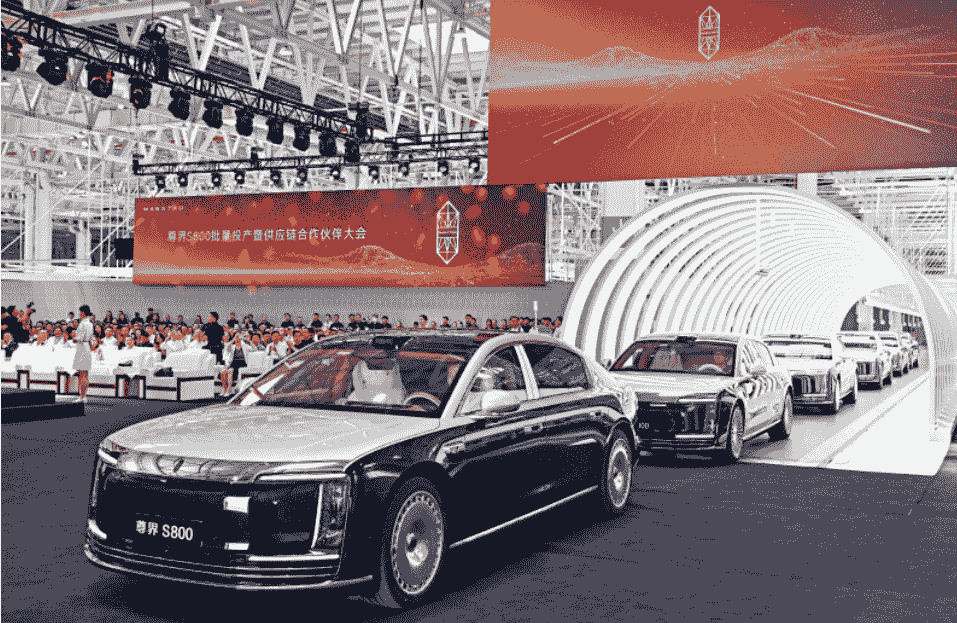

## CAIXIN | 听文章

文 | 财经新周刊 安丽敏

华为正在调整汽车业务。三名知名人士向财新确认，鸿蒙智行旗下智界、问界和鸿享正由合作企业筹备品牌专属销售网络。上述“三界”是华为终端有限公司（下称“华为终端”）与奇瑞汽车、上汽集团和北汽集团联手打造的品牌。

鸿蒙智行的前身为华为终端与赛力（601127.SH）创建的智选车模式。随着合作伙伴增多，智选车模式在2023年11月升级为鸿蒙智能生态联盟。在该模式下，华为终端掌握“话权”，产品设计、定义、生产质量把控、销售全部由华为决定。

此外，“宇界”产品可能搭载华为全套汽车部件，车辆亦为华为终端或鸿蒙智行引入建设的网络销售。最新变化意味着将链路环节节点安排，销售和售后不再由华为负责。鸿蒙智行联盟内还有另外“两界”，分别为华为终端和赛力合作的问界、与江汽车合作的智界。赛力原本就有独立建立的用户中心，赛力品牌销售网络是否单独建设还没有消息。

一名华为作为合作车企人士称，车企是品牌所有者，也是零件采购主体，鸿蒙智行负责销售和售后有些“把关”，调整后才能顺利关系。另一名华为作为合作车企人士指出，华为将销售主导权交给车企，可以激发合作车企积极。

据财新了解，华为创始人任正丰提出希望鸿蒙智行各合作品牌业务改由车企主导。熟悉华为的人士告诉财新，华为这些举措恰解读为再次释放“不造车的战略布局”。

作为华为终端董事长，余承东并不甘心。他一直是华为内部坚定的“造车派”。两年前，为了提振问界的销量，余承东试图用“HUAWEI”标识，被认为非协叫唤。鸿蒙智行可以看作余承东“造车梦”的妥协载体。

现在，叠加华为对对手小米汽车业务带来的压力，余承东近期言折射出内心焦虑。在5月31日举行的论坛上，余承东表示，无论是在外部还是内部，很多人不太理解他，：“原来不明白，未来会慢慢明白。”他重申“不造车”有利于华为另一个板块业务继续扩张。

站在华为高度来看，智能汽车解决方案单元（下称“车BU”）是华为汽车载体，成立于2019年，先后与长安汽车、广汽集团、东风集团等多企达成合作。针对智能化转型，车企使用华为领先解决方案HI（HUAWEI Inside），尤其是智驾系统。2024年，华为设立深圳鸿望有限公司（下称“鸿望”），注入资产，估值150亿元。目前，华为副董事长兼任董事长。

一名车企技术高管类比，HI模式就像Windows操作系统，微软从一开始就开始开发笔记本电脑，最终影响其他企业。熟悉华为的人称，此次策略调整之后，鸿蒙智行中的角色从“自己主导”逐渐过渡为“指导者”，负责产品定义和品牌塑造，引领者一起“造车、卖车”。包含了考量。行业普遍认为，自动驾驶技术有望迎来拐点，智能化将决定企业以后生存。华为自己硬件积累，成立BU之后持续多年研发，华为汽车业务整体夺得更大份额。

## 鸿蒙智行面临战

鸿蒙智行目前八款车型在售，其中包括问界四款、智界两款、享界和尊界各一款。从车型数量看，问界占比一半，但它们的销量还没有达到同样比例。在6月31日发布的数据显示，5月“问界”以4.5万辆创了2023年以来的单月最高，但鸿蒙对问界的依赖度较高。6月，鸿蒙智行6月17日发布的最新销量为1.6万辆，问界品牌占比86.2%。

熟悉赛力的人士告诉财经，问界是华为终端推出的第一个品牌，早期有部分经销商将车辆尾标改成“华为汽车”。这名人士认为，问界和华为品牌关联更深，而且经过多年磨炼，问界树起了高端品牌形象。在与华为合作之前，赛力名不见经传，经营也遇到困难，问界扭转了赛力的发展轨迹，公司重获新生。一名企业高层分析认为，赛力管理层与华为终端的配合是所有合作企业中最高的。

华为鸿蒙后续品牌推出时晚，没有形成比肩问界的品牌效应，不同企业情况下较大区别，可能对合作品牌尽力。在5月31日举行的论坛上，余承东列举了新汽车企业成功要素：核心技术、产品定义与设计、全场景生态、用户体验、高端制造、新品品牌营销、新渠道零售等。他认为，其中最难的是构建品牌，华为终端希望几个合作伙伴共用问界品牌，但这一想法不符合主管部门部门要求，其他几个新品牌的知名度、美誉还在提升过程中。

值此关口，鸿蒙智行遭遇小米汽车挑战。仅优SU7车型，小米汽车赛军突围。2025年4月，小米汽车销量超过问界，5月销量排在国内新势力中第五。在季度财报电话会上，小米集团（1810.HK）总裁卢永洪称，SU7之后华为和小米在舆论上缠斗，双方明面上来暗里去，通过一次攻防创造了公众形象，争取到自己的粉丝延续，彼此早已成为不看又离不开的存在。

5月31日，余承东反击，“一款产品就打爆了那家企业”，成功原因在于品牌和营销能力，“我们产品质量、体验、性能各方面都好，卖不好，在社交网络时代没有没办法”。他说，合作品牌是可以贴上华为LOGO，“那就直接躺赢了”。

华为合作汽车，华为和小米各有千秋。华为的优势在技术积累和产品开发流程体系上，“在华为体系下推出的产品没有差”，但在品牌和营销方面，小米在国内汽车行业中处于领先地位。无论是巧妙的汽车外观，还是反复曝光的速度，SU7的策略迎合了当年消费者的需求，雷军强大的号召也是小米汽车惊人的秘诀。

据车企称，小米汽车有望超过问界和智界的SUV车型形成直接竞争。6月26日晚，小米汽车宣布YU7上市，一小时获得订单3万辆，问界R7上市开价XX万元。熟悉华为的人称，压力非常大，小米应有能力抗衡，和手机不同，很大程度上束缚了手脚。余承东曾两次公开严厉，严禁合作使用车辆标识，余承东认为这会对华为“威胁”。

## 余承东寻找新使命

华为内部多次调整，余承东的立场决定了“不造车”红线。2025年1月，华为终端与赛力达成合作，鸿蒙智行正式启动。余承东在2023年9月卸任BU CEO、担任董事长，独立运作后改任副董事长。

尽管鸿蒙智行仍然是大客户，但HI模式的合作伙伴在引望也在快速增长，长安汽车、阿维拓和东风集团高端品牌流量，当月销量均稳定在万辆以上。引望还能与鸿蒙直接竞争。广汽集团、东风集团及一汽集团等车企达成了深度合作，引望内部称之为“联合创新项目”，运作方式和鸿蒙智行相似。2025年3月，广汽为此注册了一家新公司。同月召开的业绩说明会上，广汽集团董事长冯兴亚称，新品品牌详细的产品定位将由华为为主，新公司拥有独立决策权。东风和一汽与华为合作时，产品定义等工作也将由引望负责。华为为北京汽车与鸿蒙智行合作，锻出了负责对接车、具备整车研发能力的部门，现在该部门已注册引望。由于该团队需要支持的产品研发工作增加，没有更多资源分配给鸿蒙智行。

按照华为的新规划，让渡部分销售和售后服务权限后，鸿蒙智行的业务功能和引望“联创项目”并不弱，而且引望深度参与的产品越来越多，鸿蒙智行的光环无会被弱化。“世界是平开的。”不具名的华为合作汽车人士称，余承东在众多限制条件下，为鸿蒙智行寻找新使命。接近华为终端的人士，未来鸿蒙智行的目标可能就是单纯做好“五界”品牌。他透露，除了一些手机旗舰产品，余承东现在的主要精力都放在鸿蒙智行。这名人士认为，华为终端将不会放弃鸿蒙智行。华为希望打造全场景智慧生态，通过手机作为交互入口，电脑、平板、智慧屏、手表、车机等各类终端和多个生态场景，智能出行是不可缺的一环。鸿蒙智行仍然具有竞争力。华为终端在产品定义、消费者需求把握方面积累了丰富经验，技术整合的系统能力更突出。余承东是鸿蒙智行最大的产品经理，和李军一样，个人号召力已经成形。

奇瑞董事长李同曾在一次直播活动中称，中国制造离不开华为。余承东认为，在“五界”之中做好竞争力。上汽人士认为，让渡部分权限并非坏事，对于余承东来说，能在五界之中取得成功。

## 智能驾驶机遇

行业普遍认为，汽车市场从电动化真正转向智能化。2025年以来，国内辅助驾驶进入大规模普及。最近关注的人士介绍，辅助驾驶功能在XX万以下车型已经实现，在XX万级车型已经实现难度。车企认为，辅助驾驶是汽车灵魂，过去倾向于自研，现在开始接受华为这样的供应商提供解决方案。过去几年，车企在辅助驾驶上烧了几十亿钱，最终还是认为没有必要重复研发。地平线在日前举办的媒体交流上说，辅助驾驶未来一定会成为成熟技术，可以通过供应商模式解决。辅助驾驶技术本身追求更大装车规模和数据量，300亿以下的车企没有必要自研。行业包括阿维拓、深蓝、东风岚图、猛士、一汽红旗、广汽传祺、甚至比亚迪、吉利汽车等拿出与华为合作。6月22日，特斯拉在德州启动小规模无人驾驶出租车（Robotaxi）试运营，准备在技术验证后逐步提高车队数量和运营范围。特斯拉还在2024年10月发布了专为无人设计的车型Cybercab。Cybercab没有方向盘，也不配备刹车、加速踏板，计划2026年量产。在Robotaxi领域，谷歌兄弟公司Waymo是元老选手。Waymo认为应当一步到位实现自动驾驶，直接启动运营。特斯拉代表的是另一种路线，从辅助驾驶起步，通过不断迭代最终实现自动驾驶。特斯拉启动运营意味着两种路线终于交汇，进入正式比拼阶段。华为是特斯拉路线的追随者，也在瞄准自动驾驶冲刺，计划于2025年第四季度实现L3级在高速场景商业落地，并于2026年推出支持高速和城区低速L4级的新版本。自动驾驶时代到来后，车企和供应商的关系可能重构。人士称，大部分车企无法成为特斯拉，华为这样的超级供应商有望掌握更大话权。华为六年前决定进军汽车业，现在其设想的图景逐步呈现在眼前。

## 最新财经新周刊 | 日本钢铁的野心

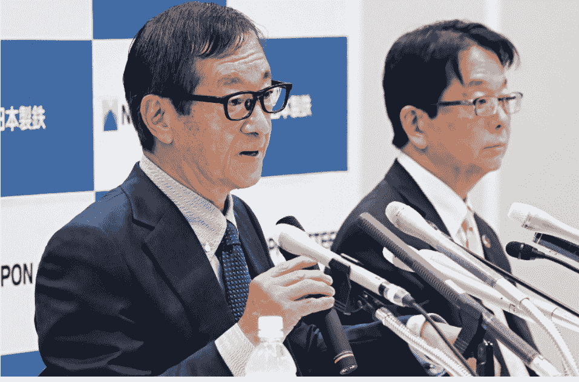

## CAIXIN | 听文章

文 | 财经新周刊 罗国平

日本第一钢铁企业——日本制铁株式会社（Nippon Steel, TYO: 5401，下称“日铁”）收购美国钢铁公司（U.S. Steel, NYSE: X，下称“美钢”）的大交易，在经历了被否决、起诉美国政府、直至总统换届、再谈判和两次国家安全审查一系列波折，历时一年半后最终达成，这一过程备受市场瞩目且结果超预期。

2025年6月18日，与美国政府签订《国家安全协议》（National Security Agreement, NSA）之后，日铁与美钢按约完成交易。18个月前的2023年12月18日，日铁宣布以55美元/股、较前收盘价溢价40%收购美钢，共搭149亿美元（约合人民币1090.8亿元），其中包含14亿美元现金，计划将美钢纳入其下子公司。实际上，日铁对美钢的投资总成本接近300亿美元，在前述149亿美元收购成本之外，还承诺对美钢新增140亿美元，其中110亿美元将在2028年之前完成。

战略开始形成，并将进一步扩张。“日铁第一阶段产量目标是8600万吨，第二步至1亿吨，届时将成为全球第二大钢企。

江富实数据研究院院长蔡挪认认为，日铁坚定收购美钢，并在美铁建产能、本土化扩张，押注的是钢铁需求前景以及未来人口增长。基于美国《美丽法案》（One Big Beautiful Bill Act）及关税壁垒，美国是全球钢铁钢材利润率及高端钢铁需求较大的市场，日铁借此壁垒保护利润。桥本英二表示，特朗普政府的铝钢铁关税政策可以持续，而钢铁的战略重要性凸显。5月30日，特朗普宣布将把进入美国市场的钢铁产品的关税从25%提高到50%。

瑞瑞全球研究 (UBS Global Research)近期发布的系列报告指出，此次交易是日铁战略转移的重要一步，即从利润较低的出口模式转向本土化扩张模式，并将核心竞争力转向节能与高附加值技术，而美国是高端钢铁产品的增长市场。

日铁和美钢过去一年的经营状况难言乐观。2024财年（2024年4月1日至2025年3月31日），日铁实现营业收入87万亿美元（约575亿美元，按当平均汇率计算，下同），同比微2%；归母净利润大跌36%，至3502.27亿日元（约合23.14亿美元）；钢铁上年的归母净利润下降57%，至3.84亿美元。并购美钢后，日铁未来的目标是将钢铁盈利（business profit）从2024财年不到7000亿日元提升至超过1万日元。

这桩钢铁的跨世纪交易一波波折。首先遭遇美国两国、北美最大美国钢铁工人联合会（USW）等多方反对，不过，美钢及其工厂在多的州与多市支持日铁入境。多方博弈年后，2025年1月3日，拜登在卸任美国总统前夕否决了该交易，理由是“国家安全”。但继承者霍纳德·特朗普台后风头东变：2月7日，特朗普透露将重启该交易的谈判。

最终，日铁拿出了特朗普满意的条件：与美国政府签订了《国家安全全协议》，约定2028年之前对美新增投资约110亿美元，包括新建一家工厂的初始投资。美国商务部长华德·卢特尼克（Howard Lutnick）于5月16日宣布，日铁对美的投资总额将达到140亿美元——这比日铁最初承诺的27亿美元要高出百亿美元；此外，日铁还承诺在创造超过10万个就业。

值得注意的是，在这份《国家安全协议》中，日铁核心的让步是美国政府发行一只“黄金股”（a Golden Share）——不带股息、不可转让，且为永久性：美国政府有权在美铁任命一个独立董事，日铁若更改投资承诺、美铁总部与名称，乃至闲置、关闭、迁移美国产能等特定事项，都必须得到美国总统或其指定的同意，这意味着这只“黄金股”拥有一票否决权。

作为交换，日铁也实现了完全收购美铁100%普通股的初，掌控了铁的管理和运营。瑞铁认为，特朗普看重创造就业及扩大投资，接下来的日铁需要提出具体的本地化投资策略和目标，以控制在美铁成本上升的风险，并在受保护的美国市场中创造更有利的投资回报率。

长期关注日本钢铁业的日本企业（中国）研究院执行院长陈国言表示，上世纪90年代至2010年，日本工业材料领域对美投资均未成核心原因在于“美国产业在衰退”，这非铁一之力可以扭转。他在看来，企业经营应以回收投资为要务，但目前无法预期日铁需要多久才能回收对美国钢铁的投资并实现盈利。

## “国家安全”高压

美国和日本即便是长期的政治、军事盟友，且互为最大国外投资者，但在钢铁领域，国家安全议题依然是“路虎”，导致日铁—美钢铁交易波澜起起。

反对声音最强的群体之一是USW，发表了多封公开声明明确数目：该交易会削弱美国钢铁产量；日铁也可能迁移工厂，影响会员就业以及工人福利；若完成交易，日铁将有机会从美国内部进行破坏，损害美国本土安全和关键基础设施设施的能力。

日铁深知交易审批环节的挑战。2024年1月，桥本英二一直主导该交易的日铁代表兼副董事长森隆弘（Takahiro Mori）在美主流媒体《华尔街日报》发文，强调公司仍将保留美国钢铁的品牌和位于萨凡尼亚州亚洲匹兹堡的总部，使美钢铁依然“在美国开、炼钢、制造”（Mined, Melted and Made）。

2024年9月，森隆弘还发表了两封公开信承诺不会对美国钢铁裁员，员工就业、医疗福利与退休金会有保障；日铁不会闲置或永久关闭任何一家美钢工厂或将其转移海外。“我们的战略正是为了扩大美国本土的钢铁生产能力。”森隆弘强调。

2024年4月，美钢股东以超过98%的赞成票同意被日铁收购，此后美国外国投资委员会（CFIUS）很快在公布后不久发起调查，交易是否威胁国家安全一度“威胁”称：如交易失败，公司不得不关闭总部和工厂。

2024年12月大选出炉后，时任总统拜登决定停止交易。拜登指出，本土拥有和运营对于钢铁工业至关重要，若美国最大钢铁生产商置于外国企业控制之下，将威胁国家安全。

2025年1月3日，拜登在卸任美国总统前夕否决了该交易，理由是“国家安全”。但继承者霍纳德·特朗普台后风头东变：2月7日，特朗普透露将重启该交易的谈判。

日铁对美钢提出报价，仅725亿美元，且是现金股票的方式，美钢以其报价“不合理”为由拒绝。日铁与美钢同步申请交易延期半年以争取更多时间。

2025年2月7日，特朗普与日本首相石破茂在白宫会谈，当时特朗普松口，自称日铁将大规模投资而非成为所有者。两个月后，特朗普发布了交易条件，令市场困惑，比如他：“美钢将由美国控制，否则不会达成这项交易。”

美国贸易代表米·哈格里尔（Jamieson Greer）在5月30日解读称，美国政府对日铁收购的基本原则是，美国保留对关键领域的控制权，所谓“关键领域”可能是基本制造（basic manufacturing）或高科技。未来，如果不美国政府、企业或个人寻求收购美企或者进行大规模投资，都要确保在控制控制。特朗普也强调，根据CFIUS调查，有可靠证据使他相信，日铁在该交易之后作出损害美国安全的行为。因此行政令包含保留条款：只要特朗普认为必要，就有权对日铁发出进一步命令。

日铁拿出了特朗普满意的条件：与美国政府签订了《国家安全全协议》，约定2028年之前对美新增投资约110亿美元，包括新建一家工厂的初始投资。美国商务部长华德·卢特尼克（Howard Lutnick）于5月16日宣布，日铁对美的投资总额将达到140亿美元——这比日铁最初承诺的27亿美元要高出百亿美元；此外，日铁还承诺在创造超过10万个就业。

值得注意的是，在这份《国家安全协议》中，日铁核心的让步是美国政府发行一只“黄金股”（a Golden Share）——不带股息、不可转让，且为永久性：美国政府有权在美铁任命一个独立董事，日铁若更改投资承诺、美铁总部与名称，乃至闲置、关闭、迁移美国产能等特定事项，都必须得到美国总统或其指定的同意，这意味着这只“黄金股”拥有一票否决权。

作为交换，日铁也实现了完全收购美铁100%普通股初，掌控了铁的管理和运营。瑞铁认为，特朗普看重创造就业及扩大投资，接下来的日铁需要提出具体的本地化投资策略和目标，以控制在美铁成本上升的风险，并在受保护的美国市场中创造更有利的投资回报率。

长期关注日本钢铁业的日本企业研究院执行院长陈国言表示，上世纪90年代至2010年，日本工业材料领域对美投资均未成成功（此处修正为成功，原文截断）。

日本企业（中国）研究院执行院长陈国言表示，上世纪90年代至2010年，日本工业材料领域对美投资均未成功核心原因在于“美国产业在衰退”，这非铁一之力可以扭转。他在看来，企业经营应以回收投资为要务，但目前无法预期日铁需要多久才能回收对美国钢铁的投资并实现盈利。

## 钢铁企业全球竞争

“这项交易是日铁重全球第一的必要且有效的策略。”桥本英。

日铁在2012年由新日铁与住友金属工业合并而成。桥本英在1979年进入新日铁，在此工作中已超过45年，见证了日铁辉煌，长期负责海外业务。了解桥本的人士称，其个人才华十分。

冶金工业信息标准院长张龙强道，“日铁有危机”，其坚定收购美国钢，首先是开拓国际市场与提升竞争力的需要。在亚洲乃至南半球，日铁面临着中国、韩国企业的激烈竞争，在这些区域的竞争力整体下降。当前，中韩钢铁在全球范围内竞争力都很强，其中中国钢成本堪全球最低，且高端钢也具有较强竞争力。

上世纪90年代以来，日本钢铁需求走弱，与此同时，中国大发展，粗钢产量从不到1亿提升至超过10亿吨，且大多数设备和工艺先进。2024年，日本全国粗钢产量8400万吨，占全球的4.5%，集中在日铁、JFE钢铁有限公司核心企业；同年，中国粗钢产量105亿吨，占全球的53%。

日铁在日本运行高炉从15座减少到10座。蔡挪指出，日本人口老龄，工人缺少一代匠人精神，缺乏传承，必须找到新的突破，并投入资金研发和创新。

此外，张龙强认为，日铁长期布局美国、欧洲市场。2022年12月，日铁发布了全球经营规划，称将在海外市场发挥技术能力，扩大产能。桥本英二表示：“规模生产的难度很大。因此我们只能在剩下的市场中努力。”2024年，日本出口量2700万吨，仅全球第二大出口国；而美国是第一大出口国。张龙强认为，日铁优先选择美国，基于美国钢铁需求增长：美国价格是同类中国的2倍；欧洲同类价格则是中国的.5倍。

此外，日铁擅长的长流程是上世纪70年代才建的美国一座高炉。2024年，美国长流程占比28.2%，剩余短流程占比5.6%。尽管日铁在当地设备更新不多，但其技术水平在长流程炼钢方面颇具竞争力，与其全球领先仍有差距。日铁多年沉淀培养了两个世界级钢铁企业：目前日铁产量3797万吨，排全球第九。

瑞银介绍，日铁在上世纪初“出海”，近几年通过与美国和印度的合资企业以及与中国宝武合资等方式发展当地业务。2019年，日铁与安赛联合收购印度钢铁公司（Essar），在印度钢铁公司（AMNS India）中持股40%，借此打通印度市场。目前该合资公司粗钢产量900万吨，目标是2030年实现3000万吨，2035年提高到4000万吨。

2024年，AMNS India计划在印度西部的古拉特哈拉建造世界上最大的单体炼钢厂，分期建成2400万吨产能，总投资100亿美元（约合12.6亿美元），一期预计2026年完工。当年1月，AMNS India再计划在印度东南部的安拉邦投资140亿美元（约合166亿美元），分期建成1780万吨钢厂。

2023财年（2023年4月到2024年3月），AMNS India净利润为9.7亿美元（约合8.5亿美元），同比超2倍。

但在中国，日铁在2024年7月结束了与中国宝武旗下宝钢股份长达20年的合资业务。当月23日，宝钢股份批准以17.5亿元从日铁手中收购合资公司宝钢日铁有限公司50%股权的议案。

张龙强预计，在“1亿吨”产能目标下，日铁或以美国为样板和跳板，再延至欧洲等其他市场。目前，日铁在欧洲斯洛文还有约45万吨钢产能、在瑞典有约100万吨钢产能。若日铁锁定欧洲的高端市场，中国企业再进入的难度增大。

欧洲的安米曾在21世纪初成为全球第一钢企业，高粗钢产量在2007年达到1.16亿。新冠疫情之后，由于高能源成本与低压力，安米加速关闭在欧洲亚非洲、加拿大等地工厂，产量下降到6500万吨。另一大钢铁巨头德国蒂森克虏伯（Thyssen Krupp AG）则从产业链前端转向后端，聚焦电梯领域。

## 投资落地的美国的挑战

曾曾在美投资失败的历史，还要面对强势的工会以及各方面都在走高成本的美国，日铁未来如何回钢铁的巨额投资？

此番美国政府最终放行日铁，看中的产能与就业。蔡扬政认为，特朗普希望美国制造业回流，日铁前去投资与其理念相符；而美国加征关税，传导至国内物价上涨，就业与民生等问题，还需要日铁的就业承诺。

“特朗普可能原以为可以通过高关税来振兴制造业，但我认为他最终得出的结论是：利用日铁是最优解。”桥本英指出，此次交易将使美国钢铁重新具有竞争力，进而帮助美国与中国争夺全球领先地位。在制造业方面，美国明显无法独立制造。美国政府的期望是：积极投资增加产能，创造就业机会，减少美国赤字。”森隆弘介绍，日铁将长期维持美国钢铁运营，并通过创新助其脱碳。目前日铁正在试验炉中使用氢气直接还原铁矿石，碳排放减少33%。蔡挪表示，美国油气和煤炭资源丰富，日铁可能借足原材料成本优势，拓展“氢气+富氧高炉”等新兴技术。日铁此前坚持的交易底线是100%控股，全面控制技术；若只持有部分股权，技术外流风险反而制造出一个竞争对手。《日本时报》（The Japan Times）3月报道称，2025年至2028年，日铁对美资本支出分别为90亿、27亿、26亿美元，合计100亿美元。这些资金将用于引入新设备和技术、扩大产品线、提高生产率，包括美钢Mon Valley工厂新建热轧设备、翻新Gary工厂以及改进美国钢铁厂的电炉生产线。

评级机构标准普尔6月23日发布报告，日铁—美钢交易完成后，日铁信贷状况带来重负担，因为收购价格对美钢的额外投入将十分巨大。陈言指出，日铁2024财年经营净利润在725亿日元（约合4亿美元），如何在2028年前筹集到100亿美元并不简单。标准普尔进一步指出，考虑到日本与国际市场的钢铁需求疲软，日铁面临的商业环境困难，预计未来两年，日铁主要财务指标会下降20%。但在美钢铝关税以及美国仍然强劲的钢铁需求下，2025财年实现的EBITDA预计回升15%。

许多人士指出，日铁的策略是以投资扩张或占据当地市场，构建“小院墙”保护自身利润。“美国的高关税政策维持很难判断，终究不可持续。”蔡如太平洋研究部首席分析泰源指出，美国关税的作用有待观察，理由之一是2018年3月特朗普上任后短期内强化钢铁关税手段，但美国钢铁进口量并没有减少，本土钢铁产量大为稳定。“不是让美国钢铁业复兴”，还是“让美国钢铁家复兴”，都不容易。“泰源如此，海外企直接在美国建厂难度很大，蒂肖奥伯在2007年的尝试即以折戟告终。陈言对日铁—美国交易的未来收益持谨慎态度，他认为美国真正的新增需求可能在军中，但缺规模范围内没有建设一个大型钢厂的需要；美国本身后发，美国政府限制为严格；即使日铁在印度与美国这两大市场占据优势，其仍面临中国钢铁行业的强势竞争，无论成本、速度乃至自动化水平，中国企业对其都有竞争力。陈言指出，上世纪90年代，包括日铁在内的日本钢铁业也尝试进入美国市场，最终落羽。此后二十三十年，而美国没有技术新态，工会势力为强大，与上世纪六十年代辉期的美国钢铁产业及吃苦耐劳的工人等情况截然不同。更为重要的是，美国缺乏技术人才和工程师，即使钢铁通过日本的经营模式带来革新，也很难改变美国产业现状。

张龙认为，美国制造业能否回归的核心不在于技术，而在于人：制造业发展依赖人口红利以及成熟的产业工人；但在当今美国，想去钢铁工作且具备能力的工程师并不不多。秦源指出，在与冶金相关的采矿业，2024年美国仅有约340名采矿工程师毕业，而钢铁冶金行业也面临类似困境。

从效率而言，2024年，美钢人均产量在640吨左右，相比而言，中国的优秀的钢企已经超过2000吨，日铁在1600吨。截至2024年底，美钢员工在2.2万名左右，要达到日铁收购美钢所承诺的10万个就业岗位，日铁还需在下游端扩张。美国钢厂人工成本并不低，日铁透露，美钢USW员工的平均工资和福利待遇达到每年13.3万美元（约合4万美元）。

由于经济社会处于快速发展阶段，印尼提出到2029年经济增长率达到8%的目标，能源电力需求同步上升，这使得印尼陷入能源供应保障和绿色发展的两难困境。现实是，大量新建的金属冶炼项目，配套建设的仍然是以燃电为主的自电设备。

在中国和印尼的经往来中，能源与工业合作是非常重要的板块。“中国在印尼有许多成功投资，比如下游领域项目等。如果没有中国投资者，就没有印尼经济今天的繁荣。”5月26日下午，印尼国家经济委员会主席卢胡特（Luhut B. Pandjaitan）在一场巴厘岛龟岛经济特区推介活动后宣布。

77岁的卢胡特是印尼政界老将，曾在前总统时期担任过印尼对华经合牵头人。卢胡特对财新表示，目前，印尼与中国方面还有许多大型项目在推进。“我们愿意共同经营绿色工业园区、雅加达高速铁路项目等。”他说。

“我们非常需要合作，不是私营企业还是研究机构。”印尼能源与矿产资源部新能源负责人Eniya Listiana Dewi在5月25日的首届全球企业共建高质量“一带一路”峰会上表示，尽管挑战重重，印尼的目标是到2060年实现超过70%可再生能源占比，核电、水电、地热等能源形式都在其范围内。

中国企业在新一的“出海”浪潮中寻找产业升级的增量空间，中印双方企业也在项目投资走向战略略。“中国在大力推进制造业高端化、智能化、绿色转型，有序扩大海外投资，与各国共同提升供应链水平和效益。”5月24日晚，李强总理在雅加达出席中印尼商界晚宴表示，2025年是中国印交75周年，也是万隆会议举行70周年。70多年前，世界处在一个历史的十字路口；70多年后的今天，世界再次处于重要的十字路口。要顺应历史大势，以合作促进共赢。

印尼总统普拉普博沃表示，印尼与中国的关系是21世纪最具战略性、最富发展前景的双边关系之一。印尼方愿同加强经营、产业、绿色经济、科教等领域合作，欢迎中国企业继续在印尼投资兴业，拓宽合作领域。

## “2045黄金印尼”

“印尼是东南亚最大国家，亚洲盟东的41%，GDP占36%。我们提出了“2045年黄金印尼”目标，2025年至2029年，印尼年均增速预计为15.67%，投资是增长GDP的最佳方式。”5月2日在雅加达的印尼投资与下游部大厅里，该部副部长Todua Pasaribu如此说——印尼来投资主管部门在名义上强调“下游化”，凸显其发展制造业、加速工业化之志。

“2045黄金印尼”是印尼的重大国家战略目标，即在2045年印尼独立100周年时步入国家行列，由2014年至2024年期间执政的前任总统佐科提出。然而今年73岁的普拉普博沃于2024年2月胜选，10月就任印尼总统，不止一次誓言完成“2045黄金印尼”目标。

普拉普博沃在佐科执政期间担任印尼国防部长。他延续了佐科工业化、发展绿色经济的政策主轴，虽然表面承诺淘汰煤炭、推动清洁能源发展，印尼依旧在码镍加工、自备煤电也扩张不断，显示仍以经济增长优先、能源安全优先的现实考量。

波士顿咨询公司（BCG）在2025年2月发布的报告指出，各国选举普遍回归务实，优先考虑增强国家竞争力的技术和产业，而印尼也可能将增长放在首要位置。普拉博沃政府认识到，可靠、低成本的能源对国家工业竞争力至关重要。普拉博沃政府有望保持印尼的经济势头，这得益于全球对印尼自然资源的需求。

关键矿资源无疑是印尼的“王牌”，而资源是头部。印尼拥有全球最大储量，占比四分之一。作为电动汽车和储能产业链上的原材料，印尼近十年限制原料出口、强制推动下游化，吸引了包括山控控股、华友亚业（603799.SH）、格林美（002340.SZ）、宁德时代（300750.SZ）以及韩国LG等批外进驻，带动行业从镍到不锈钢、材料、汽车零部件等产业集聚。

由资源向下延伸，印尼有望在全球电动汽车和电池市场上占一席之地，政府计划到2030年达到140GWh电池产能和60万电动汽车的目标。这是其向新能源经济转型的核心策略。

2024年12月，印尼能源部长阿吉斯坎表示，政府将包括比亚迪、广添安在内的中国新能源企业提供税收优惠，鼓励印尼本地建厂。印尼能源与矿产资源部预测，到2030年，国内电动汽车保有量将94.3万，成为推动电力与工业结构调整的抓手。

虽然印尼产业蓝图宏宏，现实中面临多重外部风险。2025年，国际货币基金组织（IMF）将印尼经济增速预期为5%。由于全球高利率周期尚未结束，加上美国关税抬头，令东南亚经济体普遍承压。

“印尼对美国关税尚未明确，但如果关税过高，对印尼无疑是一个坏情况。”卢胡特直言，印尼方面与美方洽谈，希望获得双赢。多年来，美国都是印尼最大的贸易伙伴。据印尼政府数据，2024年印尼与美国顺差为18亿美元，其中印尼向美国出口商品纺织品、棕榈油、电子零件、天然橡胶等63亿美元，从美国进口95亿美元。

面对增长与产业升级压力，印尼政府继续吸引外资作为突破口。2024年，中国是印尼连续第二大外资来源，仅次于新加坡。普拉博沃总理表示，如今对印尼来说是一个机会，印尼还需要进一步增强对外资的吸引力。5月25日，他在雅达见了来自中国的大型企业在印尼投资了55亿美元，“这是非常大的投资”。

印尼新成立的主权基金Danantara Indonesia与中国主权基金有限公司签署了一份备忘录，将探索电动汽车、电池制造等领域。主权基金首席席潘杜·贾里尔（Pandu Sahrir）在5月25日前述峰会上显示，主权基金有助于印尼国有企业治理水平，使其更加透明、高效和专业。

6月13日，印尼与新加坡签署多项能源合作，包括两国之间的跨境电力项目，通过海底电缆支持印尼能源结构优化。5月27日，法国总统马克龙抵达印尼，随后法国公司与印尼签署了数十项议，集中在矿产领域。其中，法国道达能源（Total Energies）与新加坡金矿集团（RGE）达成一项合作，拟在印尼联合开发“光伏+储能”项目，落址于廖内省（Riau）。该项目获得了新加坡能源管理局（EMA）的初步许可，计划向新加坡出口1GW（吉瓦）。

从资源端走向制造端，从原料出口走向产业领先，印尼追逐传统的“丰富资源带来经济繁荣”模式，因此极度依赖外部投资拉动本国制度升级。

## 中印尼布局

印尼对中国企业的吸引力仍在持续上升。“到2045年，全球四大经济体中，印尼将在中国、美国和印度之后，占据一席之地。”一名多次赴印尼调研的中国经济学者谈财新，印尼的经济潜力不仅来自地理与资源优势，更源于其巨大的人口红利。

印尼约3亿人口，年龄在30岁以下。“他认为，正是人口规模带来的市场想象力和劳动力基础，促成了中国企业新一轮“出海”印尼的热潮。如今，在印尼主要城市，霍雪冰城、霸王茶姬等连锁消费品牌已属常见。

深层的合作发生在资源开发、新能源材料、发电及基础设施等领域。在印尼政府推动本土产业升级、自建新能源产业链的战略下，中国企业以“镍”突破，深入参与印尼产业转型。格林美是较早布局印尼镍的中国企业，主要活动是电池回收与利用。格林美董事长许开华对产业新介绍，中国满足需求。“我们以前做镍回收，但回收的镍只能满足30%的需求，所以在2017年前后来印尼找镍。”

2017年，格林美来到青山控股下的苏拉威西岛工业园，开展新能源电池正前体材料制造项目，攻克了低位镍矿提炼的难题，大幅降低成本，还提出了此前未被重视的。“印尼现在变成了世界的二大镍产国。”

对于中国企业给印尼带来的改变，许开华补充称：“印尼以前镍相关产业都想冶炼和不锈钢的传统产业方向，但我们的技术把它们引向了新能源产业。”

下一步，格林美将投资，计划在印尼SAMBALAGI建设国际绿色产业园（International Green Industrial Park, IGIP），“初期建造资金为20亿美元，估计总额达80亿美元”。许开华透露，该区域将零碳设计，涵盖“镍资源—前驱体—正极材料”的二次电池材料核心供应链。许华还表示：“无论外部地缘政治局势如何，我们对印尼新能源、电池、汽车产业方面都有很好的前景。”与格林美类似，华友钴业同样在印尼扩张，规模累计达百亿美元。2018年由商华友创立，总部位于浙江桐，从事新能源、锂材料的研发；华友在印尼布局上游资源，逐步覆盖下游材料、前驱体、正极材料、锂盐、电池回收等电池闭环。

印尼是全球化布局中的核心点。2024年1月，华友在波马拉工业园（Indonesia Pomalaa Industrial Park, IPIP）位于印尼西苏拉瓦西镇，规划面积38万公，旨在打造从矿山到电池的一体化产业链，越来越多的中国企业不再限于单点。青山控股主导建设了Morowali和Weda Bay两个工业园区，吸引了格林美、华友等企业协同落地。根据卡基金的研究，印尼锂产量占全球总量的40%以上。更多中国企业关注印尼红土镍与铜资源。“我们正在寻找合适的合作伙伴，进入印尼，从早期以煤电为主，转向光伏、水电等绿色产业。”

2024年3月，国家能源集团旗下国电电力在印尼中标了万峰漂浮式项目，100MW（兆瓦），是该国首个海外光伏电站，建成后发电量预计2.9万Wh（兆瓦时），每年减少1.9万吨二氧化碳排放。国电电力在印尼投资最大的项目，位于印尼北苏拉瓦西南部，围绕港口、园区等支撑体系。当前，中印双方正商讨雅万铁路延伸段的建设可行性。雅万高铁023年10月建成通车，全长142公里，该项目标志着中国标准的首次系统性“出海”，也是印尼历史上一条高铁。

5月26日，印尼发布了未来十年《2025—2034年电力供应业务计划》（RUPPLT），决定印尼走向。总体而言，印尼政府的目标是到2034年新增发电机容量69.5GW，其中约76%的装机容量来自再生能源、电池和抽水蓄能。2025年至2029年，印尼将建设27.9GW的电厂，其中包括9.2GW的天然气发电厂、12.2GW的可再生能源发电厂、3GW的储能系统发电厂以及3.5GW的燃煤发电厂；而下一个（2030—2034年），印尼的重点将转向可再生能源和，装机容量将达37.7GW，占再生能源总装机容量的90%。其余3.9GW来自化石燃料电厂。

印尼即可将开发的可再生发电类型包括太阳能（17.1GW）、风能（7.2GW）、地热能（5.2GW）、水电（11.7GW）和生物能（0.9GW），还将该国第一座核电站。Bahlil Lahadalia披露，苏门答腊和加里曼丹正在建设两座小型反应堆，每座容量为250MW，以此引入能源。

电网基础设施方面，印尼目标在未来十年建设总长4.8万公里的输电网络和总容量达10.8万兆变的变电站。“目前为止，即使我们建了电厂，也没有电。”

## 转型瓶颈

印尼掌握全球六成镍产量，但供应链上大量使用煤，下游制成品电池面临出口市场的“绿色”压力。欧盟《新电池法》要求从2028年2月起，超过碳足迹值的动力电池将禁止进入欧盟市场。镍业脱碳势在必行。6月13日，印尼国家发展部和粮食、自然资源和环境事务部长莱昂迪纳·桑博宣布，印尼计划到2045年将镍产业的温室气体排放量削减1%，对此核心方向包括提升能源利用效率、寻找替代原材料；同时逐步淘汰燃煤热电厂，大力发展太阳能、风力和生物能源，探索镍的应用。

当前，印尼以金属冶炼为代表的工业扩张高度依赖燃煤电厂。美国智库全球能源监测（Global Energy Monitor）2025年4月的报告显示，印尼是少数在2024年大幅新增燃煤电的国家之一，当年新建容量容量达1.9GW，全球排名第三，且约80%新增产能来自配套工业园区的自备电厂。这些自电厂主要服务于快速增长的电动车电池制造，支撑镍、铝等金属冶炼和深加工业。煤电扩产和能源转型目标形成明显的矛盾：整体规划收燃煤电审批，实际产业发展对稳定电力需求的依赖，使得煤电仍有增长动力。“印尼转型进度和目标规划之间存在较大的落差。”

印尼的新能源替代能力不足以支撑高速增长的工业用电需求。印尼政府承诺到2025年可实现再生能源占比高达23%，但2024年这一比例为14.1%。多岛屿的印尼电网设施连通性欠佳，再生能源马上后，电网稳定性存疑。另外，由于印尼处于赤道两侧，风资源条件差，印尼开发光伏的可能性不高。

印尼的土地制度是一个问题，前期开发周期长、程序杂，当地协调能力有限，这些因素都会影响投资的节奏。当地用地面积复杂、热带雨林、植被生物多样性保护问题。此外，印尼河流流量有限，水电开发受限。

此外，当地人才严重短缺。Eniya Listiani Dewi坦言：“印尼缺乏经验丰富的工程师，甚至司机都不够用。”为了帮助当地尽快转化，印尼从2019年起，在大学设立联合实验室，金、理工、科学等孵化器，部分学生学习、转化。

卢胡特说，印尼在努力，可以做很多工作，比如碳交易。印尼政府在努力，可以做深度减碳，通过市场化工具抵消排放，拉动产业链。印尼需要传统工业国家“先发展、后处理”的路径，转向更可持续性的投资方式。“如果基础设施本身不可持续，之后不得不面对污染和气候变化带来的代价与风险。”

地缘政治博弈，加之美国政府的支持态度反复，冲击。例如，特朗普政府多次改变能源政策方向，如宣布退出《巴黎协定》，全球治理面临不确定性，指责发达国家责任不对，反映了印尼在国际减排与自身发展之间的矛盾和挑战。Bahlil Lahadalia表示：“一些国家已经退出《巴黎协定》，最初承诺，但我们必须坚持不懈地履行此承诺。”

送往校外培训机构补习，或选择满足知识教育需求的民办幼儿园。

2023年7月3日，贵州省江县古州镇第四小学，老师在幼儿园开班的儿童进行准备毕业教育。

临近暑假，北京、上海、杭州、苏州、成都、武汉等地不少课外辅导机构的暑期幼小衔接班已经爆满。它们大多隐身在各处写字楼、居民楼里，以大班或小班教学形式为主，教授拼音、识字、算术等小学课程，4至7周课程费在5000到2万元不等。浙江一位家长长诉心累，她为6岁孩子报名的校外幼小衔接班已满了，热门机构名额紧张，需提前预名。

“幼小衔接培训如何严厉禁止？面对儿童成长和发展需求，教育系统内的幼小衔接教育还需要如何补足？《学前教育法》的实施，能否改变‘幼小升小’抢跑的趋势，仍有不小念。”

## 幼儿园补习班盛行

在河南某公立幼儿园上学的男孩最近实在不太开心。妈妈王楠打算让他退回，入读校外的幼小衔接班。

快过5岁生日的天天对着妈妈说：“我不想长大！生日那天就要去外面上学了……”越说越伤心，“离开李老师（幼儿园老师）和（好朋友）豆豆了，我不想走！”王楠无奈地向财新表示：“幼儿园不教，小学才当孩子都会了，教得飞快，我们只能如此。”

当前，全国公立幼儿园中已全面“小学化”教学。河南某公立幼儿园老师沈露告诉财新，当地教育局对“去小学化”监管极其严格，检查时逐一翻阅幼儿园书籍，严禁携带任何识字、算术类教材。

华东师范大学教育部面向不同经济发展水平的11个省、市的17.6万余小学幼衔接的利益相关者（包括幼儿园家长、小学家长、幼儿园教师、小学教师及教育管理者）发放调查问卷。发表于2024年3月的调研结果显示，幼儿园家中有75%的人对幼儿园教师应提前教大班一些小学知识表示比较满意或非常满意。当幼儿园家长认为幼儿园老师的知识不够时，往往选择孩子离开幼儿园，去校外“小学衔接班”。

暑期小学幼接班现在有3个班了。“财新以家长身份访谈时，北京海淀一小学幼接机构的课程顾问张玲介绍。该机构位于中村地带的一座写字楼里，面积不足200平方米，有5个教室。大厅内放置着多个柜子，存放各类绘本、图书和教具，还放置了一张木桌供孩子们课后活动。

据财新了解到，此类暑期小学幼接班通常为期4至7周，采用3—10人的班级教学，周一至周五全天上课，每天6节课。每节时长45分钟，和小学的课程表要对齐，目的是让孩子提前适应小学的节奏。课程内容除了基础的拼音、算术、识字、英语，少数机构还增设音乐、体育、编程课程等。此类培训收费在5000元至2万元。

对于课程是否合规，张玲表示，“都是自己研发的教材，没有用小学课本，主要是启发孩子的思维”。财新在课堂观察中发现，机构使用自用教材学习课程，教学主要以动画或游戏形式引入。每班配备两名教师：一名主讲，负责教授拼音、算术等知识；另一名坐在教室后方维持纪律，当孩子离开座位或插嘴话时会适当提醒。

上课时，教师鼓励学生自主表达，确保每个孩子都有回答问题的机会，并拍摄视频记录过程。黑板上方列出区域书写学生姓名，答对问题可获得五角星标记，违反纪律会被摘除五角星。一个小女孩因课多次打断老师话被摘掉星星，课后情绪低落。

并不是所有幼儿都能提前适应学习。来自福建的6岁孩子聪聪刚上小学接班那周，哭了整整三天，嘟囔说着“写字、学习、学习一点都不玩”。让家长无奈的是，明明学了一个多月20以内加减法，问孩子“10减6等几几？”，聪聪也答不上。

民办幼儿园也成为家长“补课”的选择。黑龙江李长坤为孩子选择了当地一家口碑不错的民办营利性幼儿园。据她介绍，这家私立园在大班阶段的教学安排与公立园截然不同，“会系统地教授术、拼音和识字，英语也会接触。”

随着“小型化”进程深化，幼儿园倒闭潮袭来，民办幼儿园首当其冲。据教育部最新数据，2024年全国共有幼儿园25.3万，较2023年的27.44万减少2.11万，降幅从5.1%扩大到7.69%。其中，民办幼儿园减少1.4万，占全国幼儿园比例持续降低。

为增强市场竞争力，不少办幼儿园提前教授拼音、算术等知识，以教学“小学化”为卖点吸引生源。在深圳某民办幼儿园的招生介绍中，园领导还会亲自抽取孩子的知识掌握情况，家长会上，常将学生一学期掌握的词汇数量作为教学成果和办学亮点来展示。

## 为何抢跑

幼儿园“去小学化”的背景下，“幼小”家长群体中普遍存在一种焦虑：担心孩子从幼儿园过渡到小学后，零基础知识储备难以跟上学校的学习进度。

为此，她和丈夫达成共识，每天下班后，无论多累，必须轮流上阵，保证至少一个半小时的辅导。但现实困难重：孩子白天在学校已消耗大量精力，晚上回家后往往难以专注，导致辅导进展缓慢，效果不佳。

裴洲坦言，由于上班忙，她和丈夫执着“不想让孩子早受压力，享受快乐童”的想法，没有像周围许多家长那样，让孩子提前学习拼音和算术。“幼儿园上的也是公立园，拼音、认字都不教的那种。”

如今面对困境，她内心充满了复杂的绪，主要是后悔。“到头来，这些知识还是得学，”她无奈地说。这不仅让孩子学习辛苦，家长也跟着孩子心力交瘁，让她揪心的，是这种持续落后和挫败感，“严重打击了自尊心”。

广东一位家长表示，孩子在小学前提前学了拼音和算术，本以为有底，入学后轻松一些。但进入一年级后，面对读写环节完全跟上，整体学习状态很。为了补救，她花了三个月督促孩子反复练习，其间全家停止了一切娱乐，专注学习，消耗了精力。

黑龙江家长李明选择孩子上小学接班，就是让她了解到，现在一年级的教学进度很快，内容很重，“拼音、基本运算等基础知识，题目都看不懂”。老师往往默认学生入学前掌握了，如果孩子零基础，“跟不上进度，将在学习中造成恶性循环，最终导致一步慢”。

小学老师程慧表示，一年级教学计划是否真的预设学生掌握了？在她看来，一年级课程安排很紧凑——包含入学准备、仪式、运动、艺术等各类活动挤占时间，用于教学的时间并不宽裕。以一年级教材为例，一个学期包含拼音单元、识字单元、数学单元等四个单元，尤其是拼音单元非常耗时，详细教授韵母a、o、字形到读写，通常需要两个月才能完成教学。她认为，一年级对零基础孩子来说基本上上一一天，慢则两天。原因在于一年级看似很长，实则由于假日、周末以及幼儿园大班学期末复习，各类活动挤占时间。

苏州老师向明表示，现行政策限制幼儿园布置书面作业、自主作业、课外阅读和背诵，回来由于缺乏强制性作业导致知识巩固不好。为了补充，她和丈夫每天投入至少一个小时。

深圳老师邓铭表示，50人的班级通常只有两名真正零基础，而其余学生可能提前掌握相关知识。如果孩子零基础，“跟不上进度会打击信心”。

江西老师程明表示，为了让零基础同学跟上，如果家长和老师共同努力，持续关注孩子的学习进展，他们也能取得85到90分的成绩。这意味着他们的成绩与班级平均存在差距。家长说的“教得快”，深层次的原因在于学习模式从幼儿园的“兴趣主题”、“强制任务”转向小学的“学科知识系统性学习”，两者差异较大。

程慧介绍说，学习的核心挑战并非知识点本身深奥，而在于要从零开始接触一个全新的领域，每天都要消化知识，课后还需要复习避免遗忘，还要完成作业。对于成年人来说不容易，何况六七岁的孩子？”这种转变给孩子带来压力。因此，在这种新的学习要求下，“白纸一样”的零基础学生可能感到吃力，而有基础的学生相对轻松。

安徽家长路兴认为，学习能力强的孩子或许需要额外加班，但普通儿童若提前学习，一开始确实难以适应，还会产生特殊负担。

路兴没给女儿忽略幼小衔接。她回忆，刚上一年级，“老师她理解不了急得哭，字也因手指力量不足和手眼协调能力欠乏写得歪歪扭扭，每天晚上辅导到十点。”直到路兴转变策略，放下焦虑，耐心鼓励，孩子状态才慢慢好。到多年级后，要逐渐跟上了学习节奏。但更多家长没有条件抽调时间陪伴和辅导，为满足小学学业要求，将孩子送入幼接机构便成为合理选项。

## 何谓科学衔接

前述《意见》对幼儿园和小学的幼小衔接工作提出要求。主要目标：全面推进幼儿园和小学实施入学准备和入学适应教育，减缓衔接坡度，帮助儿童顺利实现幼儿园到小学的过渡。幼儿园和小学教师和家长的教育观念与行为发生明显转变，幼小协同的有效机制基本建立，科学衔接的教育生态基本形成。

北京大学国际与比较教育学院魏健在其研究中指出，在零起点教学背景下，幼小衔接将面临双重挑战：一种家长“教育落后”的恐慌，担心孩子“输在起跑线上”；另一方面幼儿园阶功能定位——当从小零起点，学前教育应如何科学发挥衔接功能？

《意见》指出，幼儿园大班要针对性地帮助儿童做好生活、社会和学习等方面的准备，建立对小学生活的积极期待和向往，防止和纠正把小学的环境、教育内容和教育方式简单搬到幼儿园的做法。

山东女子学院教育研究院院长、山东省教育专家指导委员会副主任董吉贺表示，反对在幼儿园教授拼音、识字、算术，实质是反对采用错误的教学方法。儿童天生具有学习能力，即使不得文字，也能从电视、广告、牌牌等环境中自然习得，这种无意识的学习方式不仅无害反而值得肯定。因此，他们可以通过游戏活动引导儿童以“无意识”方式自然掌握相关知识，这是值得鼓励的。

他认为，若采用小学化的集体授课，迫使孩子过早卷入考试旋涡，损害学习品质并杀死学习兴趣；而儿童的身心特点决定了以游戏活动为主。幼儿园阶段尤其大班时段，需要尊重儿童立场，注重培养兴趣、任务意识、规则意识及自我能力等方面。

沈露介绍，公立幼儿园不会教授拼音、识字、算术学科知识，还会培养各种良好习惯，包括引导孩子形成自理习惯，例如独立完成洗脸、收书包、穿鞋、扣扣子、擦桌子、扫地等任务。她强调，“养成习惯比学习更重要。”西北师范大学教育学院王兆翔等人发现，部分家长对教育认识不够科学。访谈中，许多教师认为家长更多关注知识，而忽视了儿童身心的适应和转变，导致孩子进入小学后不适应，出现规则意识、自制力差、注意力不集中等问题。四川老师介绍，幼儿园遵循《3~6岁儿童学习发展指南》的要求，核心是实施“游戏化”课程，通过角色扮演、探究式活动，注重幼儿的自主能力，帮助幼儿实现从学前到小学的平稳。举例：“我们虽然直接教加减法，但在游戏化的情境中，让他们在超市里买东西，培养对钱的概念。《意见》要求一年级设置为入学适应期，重点实施适应性教育，确保教学方式采取游戏化、生活化、综合化方式。”

向明认为，知识衔接的必要性及程度因人而异。慢型儿童有必要提前接触知识；思维灵活的孩子应该聚焦习惯培养，知识性内容无需过度渗透，“防止他提前学完之后就不认真听了”。邓铭认为，提前学习具有一定的性。因为社会信息和物质营养的丰富，如今知识接受能力提升，四五岁的孩子提前接触简单知识无所谓。幼儿园阶段教授数学等内容，孩子完全能够接受。学前教育应避免旧标准，以发展的眼光看待教育。苏果老师贯雪认为，幼儿不应进行过多的知识性学习，基础性衔接是可以接受的。她指出，积极的情感体验在儿童学习中具有重要作用。当儿童从活动中感受到积极的情感，就能让他们对学习保持积极性。因此，最好采取游戏活动作为学前教育的主要方式。董贵顺建议，小学的学习环境可以主动向幼儿园衔接，例如在一年级变为“排坐”的桌椅布局，使其更合合游戏化、探究类课程需求，为儿童实现平稳提供系统性支持。

## 破解幼儿园衔接缺失

《意见》同时强调幼儿园和小学的协同合作，建立联合教研制度。目前，小学和幼儿园教育仍相对分离，双向衔接机制不健全。幼儿园和小学各自为政，也给了校外幼小衔接“抢跑”更多的空间。

蓬颖主持的大规模调查显示，幼儿园和小学的主要合作方式为“举办大班儿童与小学生共同活动”“共同举办幼小衔接主题座、研讨会或论坛”“儿童、家长等信息的沟通与共享”等简单形式，而选择开展“共同设计课程标准、内容、实施与评价方法”以及“定期开展线上线下教研活动的合作”两种方式的主体不足三分之一。

调查结果显示，超过50%的教师表示共同教研、设计课程实现起来比较困难。超过一半的教育行政人员表示，在所在地区尚未建立小幼衔接区和试点班（校）、未建立幼儿园和小学联合教研机制或建立幼儿园、小学三方联动的小幼衔接机制，难以支持多主体的小幼衔接有效落地。

值得关注的是，小幼衔接工作并非幼儿园教育和小学教育可以单独解决。国际，小幼衔接的成功实践往往受益于多维度、系统性、多主体联动的设计。新加坡部直属幼儿园特别开发了。学界认为，幼小衔接工作关注儿童发展中心立场。判断内容是否属于“小学化”的标准在于是否符合儿童的发展需求。例如，若教师协助下仍掌握某项内容，则表明内容超出能力范围，不符合当前发展水平。基于多年的教育经验，向明认为，知识衔接的必要性及程度因人而异。慢型儿童有必要提前接触知识；思维灵活的孩子应该聚焦习惯培养，知识性内容无需过度渗透，“防止他提前学完之后就不认真听了”。邓铭认为，提前学习具有一定的性。因为社会信息和物质营养的丰富，如今知识接受能力提升，四五岁的孩子提前接触简单知识无所谓。幼儿园阶段教授数学等内容，孩子完全能够接受。学前教育应避免旧标准，以发展的眼光看待教育。苏果老师贯雪认为，幼儿不应进行过多的知识性学习，基础性衔接是可以接受的。她指出，积极的情感体验在儿童学习中具有重要作用。当儿童从活动中感受到积极的情感，就能让他们对学习保持积极性。因此，最好采取游戏活动作为学前教育的主要方式。董贵顺建议，小学的学习环境可以主动向幼儿园衔接，例如在一年级变为“排坐”的桌椅布局，使其更合合游戏化、探究类课程需求，为儿童实现平稳提供系统性支持。

有券（许）首席经济学家对数据新感触，没想到讨论了接近30年的问题，现在大家对基础数据的口径和认知都不太一样的了。

差异主要在于选取哪些指标来评估消费水平。社交媒体上采用的部分商品消费总量，与人口数量相关性较强，人口越多，刚需的消费总量就越多，显然不直观；居民均消费量指标，容易受各国价格影响，也不简单用来做对比比较；人均实物消费量相对直观，但选择的和服务是否具有代表性，尽量避免各国消费结构、生活方式的影响，真实反映各国消费水平的差异，存在一定难度。

学术界常用居民消费率（居民最终消费支出/GDP）来衡量消费水平，在一定程度上消除了价格因素的扰动，但很难完全消除，而且这一受经济发展阶段、统计方法等影响，做对比时还需要考虑这些因素。

此前很长一段时间，中国国民经济核算中住住房的核算方法与许多高收入国家不同，部分国家存在价格管制等，宏观研究者认为会拉低中国居民消费率。在大多数经济学家看来，无论是人均物量消费差异更小，还是居民消费率存在一定低，都不能改变中国消费率偏低、居民消费有较大的提升空间的基本事实。

国务院发展研究中心副主任刘世锦近期多次表示，从购买力平价来看，与经合组织（OECD）国家在相同的发展阶段相似，中国的家庭消费、最终消费和服务消费占GDP的比重明显偏低。他强调，中国消费不足，不是在国际平均水平上可接受的偏差，而是20个点的显著差距，可以描述为“结构性偏差”。

多项研究显示，中国消费主要不足服务消费，尤其是教育、医疗、保障住房、社保、养老等基本公共服务相关消费不足。其原因，既准入限制和部分领域价格管制导致的供给不足，难以满足居民多元化、差异化的消费需求，以及长期城乡二元结构下基本公共服务水平较低、城乡差距、城市化质量亟待提升。

“当前短期政策上，要着力提高居民收入。”中国国际经济交流中心理事长王一鸣6月21在中国人民大学宏经济论坛上表示，“消费是收入的函数，要提高收入，在此之前提高居民支配收入占居民收入的比重，还要提高财政支出中公共服务和民生的比重。”

2025年《工作报告》提出“强化宏观政策导向，推动更多资金于民生”。6月9日发布的《中办关于进一步解决民生群众困难问题的意见》，明确了四个方面：增强基本服务公平性、均衡性、普惠性及多元化性。具体举措包括6月以来，广东、江西、海南等地通过托付居民消费和餐饮、旅游等消费领域，逐渐扩大消费压力。

王一鸣认为，有三大改革可以加力：在消费改革中，如果消费征收环节后，能够有效稳定地方消费的增长，推进消费模式改革，适当开放地方消费、交通、教育、、、、、、、、等消费领域，提高当地消费的工资，同时价格联动人口城市化，如近亿人口、子女、保障住房等价格落到位，就能有效激励地方消费的积极性，同时价格上涨一部分用来补贴低收入人口，从而有效扩大消费、释放消费潜力，起到巨大作用。

## 如何衡量消费水平

此次讨论的前置问题是，如何更加准确地评估中国消费水平。不同研究者基于指标存在较大差异，直接影响接下来的政策建议。

学者通常选择最终消费支出占GDP的比重衡量消费水平。根据国家统计局公布的支出法计算，2023年中国最终消费率为56.6%，其中美国和欧盟的消费率分别为68%和52%，远高于中国的39.6%。去年12月向全国常委会提交的“十四五”中期评估报告称，当前经济运行面临突出矛盾，特别是最终消费占比偏低，近年来居民消费占比有所下降。

不过，一些学者认为，由于统计口径和方法的差异，直接计算的居民消费率可能偏低。例如，以前对城镇居民住房服务的核算采用成本法，而非主要发达国家使用的租金法。复旦大学经济学教授张军认为，这至少低估了6个百分点。

亚洲开发银行首席经济学家巨忍于2024年初撰文称，居民最终消费还包括非营利机构和政府提供的居民转移支付，即社会实物支付。由于经济体比较居民消费率，用“居民实际支出”概念更加合适。根据他的测算，2018年至2019年，中国社会实物支付的GDP占比5.8%。与欧盟、日本和韩国相比，中国居民最终消费不足和社会实物支付能够解释70%和30%。与美国和印度、印度尼西亚、马来西亚、泰国、菲律宾等亚洲发展中国家相比，中国居民最终消费不足。

于气、郭巩的研究认为，居民消费指标无法准确衡量消费水平的值，最终消费绝对需要经过汇率调整或购买力平价（PPP）调整。而PPP调整的结果高度依赖价格统计的准确性，如果价格存在高估，将直接导致中国居民实际消费的低估。因此，他们选择从实物消费角度观察居民消费水平。结论：从人均卡里供应量、人均蛋白质供应量，中国居民已经达到或超过发达国家的消费水平；服装鞋类、家电、电子产品、汽车等制造品人均消费率与相似发展国家基本平均，略低于发达国家水平；从人均建筑面积和人均住宅面积看，与发达国家的差距并不大；从人均预期年限、人均预期寿命来看，中国居民基础教育、医疗服务的消费率及其效用，与发达国家处于同一水平，人均旅游消费略有差距，但远小于人均消费金额的差距。因此，中国消费水平存在系统性低估，原因在于价格和汇率。

也有观点认为，人均实物消费量可能受到不同消费结构、消费偏好的影响，还可能忽略了商品质量和档次上的差异。

此外，价格往往与经济发展阶段和人均GDP水平有关。中金公司宏观团队2025年3月的报告认为，从国际比较来看，中国商品绝对水平与经济发展阶段总体比较贴合，但服务绝对水平相对较低。通过比较绝对价格意义，从人均GDP调整后相对价格水平看，中国价格水平与经济发展阶段并没有明显的偏离，服务的相对价格总体上低于商品消费的相对价格，“价格因素难以解释为何消费占比低。”

财新采访的多位业界、学界人士都表示，虽然中国居民消费率可能存在低估，从实物消费看，差距确实小，但消费偏低却是客观事实。

## 服务消费差异

粤开证券首席分析师罗志诚认为，既要从总量上看，也要从结构维度上看，中国消费结构包括不同群体、不同区域、内生型和发展型消费，以及消费升级情况。多项研究显示，中国消费不足主要体现在服务消费上，未来提振消费的空间。

中国社院战略研究院员汪德华近期的研究显示，从国际经验来看，随着收入水平不断提升，服务消费占比逐渐提高，“提振消费的重心应放在服务消费上”。中金研报告基于OECD数据的横向比较显示，商品消费/GDP与全球平均值吻合，但服务消费/GDP明显低于平均值，表明中国消费占比低是因为服务消费不足。

该报告认为，虽然中国消费整体稳步增长，服务消费的空间可能在于供给滞后。罗志诚测算，2013年至2024年，服务消费占总支出从39.7%上升到46.4%，但在2020年之后，居民消费受到了较大的冲击，服务消费受到的冲击更为猛烈。截至2023年至2024年，服务恢复速度慢于商品消费。研究者普遍认为，服务消费发展滞后是主要矛盾，由于供给限制和部分领域标准化供给、多样化特征，难以满足居民需求。

汪德华也称，服务消费发展的问题在于供给跟不上，价格过高或质量不好，这与中国发展模式有一定关系。对地方政府而言，项目往往较大，相对来说，服务消费比较依赖市场驱动，因此地方政府更愿意支持服务业发展。此外，价格变动上也得以体现：2月以来，中国居民价格指数（CPI）同比增长为负，但不同商品价格分化，酒类、家用电器、交通工具等制造业价格持续下降，家庭服务、教育、医疗等价格仍然维持强势涨，7.3%。

上海大学发展研究院执行院长陆铭在6月26日在达沃论坛表示，消费阶层“有钱没处花”，养老、教育、文化、体育等服务消费还没有满足，这是结构性问题，需要从供给侧改善消费条件。他建议，要放松管制，目前服务领域仍有大量壁垒和制约，需要在服务业准入大幅减少管制。同时要释放更多的消费场景，列举了一些微观层面的限制，例如一些城市餐饮外摆位限制，一些年轻人在相对空旷的空间滑板被管制。

“供给侧的结构性改革对增加居民消费力不可少，特别是要注重发展服务业，包括教育、医疗卫生、文体、休闲和旅游。”汪德华也建议，继续推进服务业市场导向的改革和开放，加速服务业的数字化转型；同时要鼓励消费，加强产业升级，使企业能够不断提供更新和更高质量的产品和服务，创造更多就业机会。

《政府工作报告》在部署实施提消费专项行动时表是：“从放宽准入、减少限制、优化监管等方面，扩大健康、养老、家等多元化服务供应”。此后，设立服务消费与养老贷款，额度5000亿元，支持2家全国性金融机构以及5家属于系统重要性金融机构的市银行。6月19日发布的央行等六部门《关于加强金融支持扩大消费重点领域的意见》，提出加大对消费重点领域资金支持力度，增加对批发零售、餐饮住宿、养老托育等领域的信贷投放，丰富适合小微企业的信用类金融产品；围绕文化旅游、体育、养老、教育培训、居住服务等领域创新融资模式，并在合规、风险可控的前提下，结合产业发展周期适当延长贷款期限；支持符合条件的旅游、教育等服务领域发行债券；鼓励符合条件的科创企业通过债券市场募集资金，推动智慧养老、智能医疗等等消费产品提质升级。

鉴于服务消费具有供需同步性、耗性性等特点，罗志恒建议，在落实劳动者权益保护的基础上，优化休息制度，适当增加休息时间，平滑消费释放的节奏。

## 提振消费

对中国消费是否严重低估，基于实物消费的论证显示，中国消费率可能超过美国。虽然大家认同要增加收入，但为了增加消费，需要找到“第一动力”。他认为，第一动力只能是由基础设施投资导致收入增加，投资带动消费增加。

他建议，在“十五五”期间，安排大规模基础设施计划，沿西部走廊，建立相应的基础设施网络密度。此外，通过实施产业政策支持企业，推动人口集中流入城市“一城一策”制定住地提供基本公共服务实施办法，推动符合条件的农业转移人口享有与户籍人口同等权利。刘世锦认为，在过去相当一段时间里，中国增长高速，从国际比较来看，消费水平呈现出结构性偏差，成为需求中的“卡脖子”问题，需求收缩导致经济增速下滑。

同样认为，从实物消费量看，中国与发达国家的差距远远小于，结论：中国消费水平系统性低估，人民币汇率与真实购买力相比可能偏低。尽管中国消费水平并不低，但在数量上的提升，还有质量上的提升，空间更为广阔。特别是在服务消费领域，主动提升消费以实现国内发展，既有利于构建外部环境，也有助于改善内需。

费用全额抵扣、加速折旧、利息支出前扣等优惠，并拟增899条，对不公平的外国税收政策实施报复；三是为特定盟友及合作伙伴的投资开辟“快速通道”，并简化审查流程；四是改变此前的决定，批准新日铁收购美国钢铁，对外国收购的态度的可能更好。

然而，特朗普对贸易方面仅有准则的改变，对FDI生产没有影响，包括限制荒生及临时工签证、挑战世贸组织与贸易协定、干预美联储独立性等。考虑到FDI和贸易之间存在互补性，跨国公司主导了美国的大部分贸易，高关税对它们也不利。899款赋予的征税报复效，也会削弱外国企业在美国的意愿。

大量计量学的学术文献吸引FDI的决定因素，结论趋同，但未涉及特朗普施压及政策转变带来制度性冲击的影响。

以国内生产总值（GDP）衡量的。庞大的市场规模意味着更多的机遇与更低的风险。美国市场规模是吸引FDI的一大优势，特朗普的政策并未改变这一优势。

贸易开放度（贸易总额占GDP比重）越高，越有利于外资流入。企业倾向选择容易建立堡垒的经济体，以获取全球原材料，并通过自身贸易协定优先进入海外市场。特朗普的削减贸易逆差、保护“公平”贸易的政策，导致贸易开放度下降，必然削弱对外资的吸引力。

高企业的劳动力成本本会抑制外资流入。高盛报告显示，美国几乎所有制造业部门的生产成本显著高于三大主要竞争国，特朗普的政策未带来改变。

提高企业税率对外资流入有负面影响。“美丽大法案”延续美国21%的企业税率，并新增激励措施，这有利于FDI流入，而民主党通常不会推行此类方案。

经济自由度高、产权保护良好等制度性因素，被普遍证实能促进外资流入。特朗普对既有准则的冲击可能削弱美国制度优势，899条款或加剧这一劣势。

从过去十年来，2025年美国FDI达到6000亿美元几不可能，有望实现4000亿美元。与特朗普的认知相反，关税政策对FDI有负面影响。

## 随笔 | 难民接待所最后的实习生

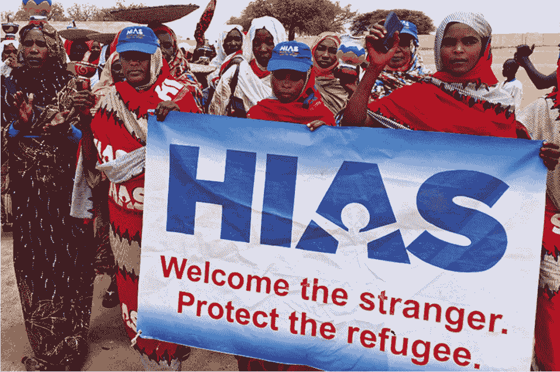

## CAIXIN| 听文章

文| 曲美洋

宾夕法尼亚大学社会工作2026届研究生

### “欢迎陌生人”

2024年11月5日，美国大选当晚，我抱着手机躺到凌晨1点，看着摇曳的宾州投票结果，逐渐由蓝色变成红色，直到眼睛发酸。再次睁开双眼，结果已经出台。那一刻，我连收到无数来自教授表达失望的邮件。第二天一早，对选举结果的失望仍在教室的空气中持续发酵。许多同学眼圈红，我的朋友N泪流不止。她告诉我，因为政治倾向向上的势不两立，她和母亲冷战、断联了。说实话，这样的眼泪让我惊讶。和她的悲痛不同，这个投票结果，带给我的是更多的困惑。

这是我来美国的第一年，也是开始社会工作研究生的第一年。在异国他乡，我对美国政治之甚少，只能能看着失望的教授和课堂上痛苦的同学，对大选的结果和它的未来无所知。

时间随着我的迷失流走，直到后来几个月慢慢渗入我的生活。作为社会工作实习生，我不得不注视“希伯来移民协助会宾夕法尼亚分会——HIAS PA（Hebrew Immigrant Aid Society, Pennsylvania）这个拥有140年历史的难民机构，在新的政策下安静地运作。

19世纪，HIAS总部在20万美国人从国外逃亡中初创；20世纪70年代，HIAS协助越南战争结束后的东南亚难民撤离与语言适应；2025年，最后一批被战斗逃亡的叙利亚人、因塔比班政权被迫离开的阿富汗人、被政府大规模清剿的罗贡人，陆续通过HIAS的帮助重建生活。

在历史浪潮中，HIAS始终以敞开双臂、门口挂着“欢迎陌生人”的标签，它的足迹从纽约扩展到美国各地，不同城市分部平均接待难民家庭90天。协会提供的服务包括租房、打扫、办理电话、领取福利卡等这些基础服务虽然简单，却成为了命运的起点——包括后来获得诺贝尔奖的犹太屠杀幸存者艾利·维塞尔（Elie Wiesel, 1928–2005）之一。他出生于罗马，1944年被驱逐到奥斯威集中营，他的父亲和妹妹在奴隶营中去世。维塞尔在解放后1956年前往美国，1963年成为公民。之后多年，在纽约州立大学学习成为教授，他的演讲与创作专注于犹太屠杀中所遭受的苦难，维塞尔在文章中写：“我在美国生活了很久，只有在这里，才成为公民。我必须说，对我国家充满感激，这是第一个提供了家园和避难所。”

然而，持续了一个世纪后，随着2025年1月27日资金被切断，HIAS的使命结于一个春日的下午。作为实习生，我刚翻开它厚厚的历史，就撞上了它的尽头。

## 有时候我们会这样

如今，实习结束，夏日来临。我有了很多时间思考这份工作的意义，也开始回望那些出现在HIAS的人，那些影像在我心里浮现，成为一段无法复制的过往。实习第一天，看到6路公交悠悠地停在这里。这里是城市中心，很多人拿着公文包起身走向各自的办公楼。我随人下车，越过那些高大的楼，走向其中不起眼的那一个——HIAS员工办公室。我坐在这栋楼的第五层，站在路口周围布置着金钱售卖店，流浪汉在公交站休息，他们拿着掉落的食物被鸽子和麻雀激烈竞争着。里面的两电梯有一部故障，另一部因为装修导致破损。像一个仓库却出奇地宽敞，沙发座椅后，一面墙都印满了近140年的发展。这也是我作为社会工作者接受的第一课。刚等完电梯，我就被叫去帮助一位西班牙难民搬家。穿过堆满四季衣服、厨房用具、婴儿尿裤和儿童玩具的储藏，抄起走廊里的搬家专用车，跟着我的社工引导员匆忙坐出租车。

那是我第一次远离高校的大学，来到路线稀疏、难得听到英语的社区。费城的老人有一句俗语：“东不过河，南不过界，北不过街，南不过街。”民间划界的地图，把城市分成了“可动”和“别乱走”的两个世界。移民区在这些区域以外，离市中心至少40分钟的车程。我和荒弃子的遭遇，就在实习的第一天。当我和引导员每人拿着两个装食物的大袋子，经过遍布垃圾的路，走进家的时候，走在前面的她一脚踩在一条长尾巴上。低一看，是一只趴在路上的灰狗，尾巴拉在她穿着凉鞋的脚边。我紧紧捏住想尖叫的嘴，而她轻声对我：“有时候会这样。”

后来发现，何止是有时候，这种时刻时常出现。我独自带着K领取食品福利的时候，这样的时刻再次来临。

食品福利卡，又叫EBT（Electronic Benefit Transfer Card），是美国政府发放给难民的“买菜卡”。每月300美元，前三个月打入户，用于超市购物——这是我K知道的。给K安排的临时地点，在距离大学一小时的南边。我们第一次见面，是在万圣节期间。一家搬着南瓜和幽灵气球的房子楼下，按照东张西望，目光越过节日的艳洒，才看到K在对面的灰色门前。

30岁左右，穿着一件米色Polo衫，同色系的裤子，干净的阿迪达鞋，背着棕色的斜挎包。我先为主的是，难民的卫生标准和站在干净的K截然相反。我了解到，较高的卫生标准，可能和KSIV（Special Immigrant Visa）——移民签证相关的。指导员说，像K这样的阿富汗移民，意味着他们曾经在战争中战斗，背叛了自己的国家。在逃亡中，他们接受过高等教育，却来到陌生的国家。因为语言不通，翻译翻译软件，我和K闲聊，他的教育背景我无所知。事实上，和他共度的那天，几乎都是无言。

从过去十年来，2025年美国FDI达到6000亿美元几不可能，有望实现4000亿美元。与特朗普的认知相反，关税政策对FDI有负面影响。

（注：此处后续文本存在逻辑混乱重复，已根据OCR语义进行去重与合并处理）

部”。繁体翻译成“法务部”，比较准确。

联邦法院系统分为三级：地区法院，相当于审判庭；巡回法院，相当于上诉庭；最高法院，相当于终审法院。三级法院独立于行政系统，构成一个独立的权力分支系统，自己管自己，不受政府执法局管辖。

从功能上讲，美国的法务部代表美国行政执法局处理法律事务，起诉反联邦法规定的案件，在诉讼中代表联邦政府辩护等。从职能上讲，法务部主要是代表行政当局做律师的工作，相当于律师或检察官。美国拥有94个联邦地区法院，法务部也在全国任命了94个U.S. Attorney——首席检察官，他们手里有很多办案的检察官，按照法务部的自己的说法，总共有超过1万名检察官。

从法务部长到这94个首席检察官，再到1万多办案的检察官，都必须是律师。所以，有人说，美国法务部是世界上最大的律师事务所。

美国法务部没有发放律师执照和吊销律师执照的权力，律师执照由各州的最高法院辖本州的律师颁发。这是一个非常分散的制衡机制。这个制衡机制大大增加了行政执法违法判决的难度——从法务部长到政府检察官，都不会轻易为了这一个做四年就下台的总统就丢掉律师执照，终结自己的职业生涯。

不久前闹得沸沸扬扬的加州加索亚，很清楚说明了这个制衡机制是怎么起作用的，怎么迫使特朗普向法院低头，然后在媒体上给自己找台下。

加索亚是来自萨尔瓦瓦的非法移民。2019年，移民法院判决，允许他合法留在美国。今年3月，特朗普总统启动了《移民法》，想延续驱逐涉嫌加入犯罪团伙的非法移民。移民执法局把加索亚抓起来，跟200多名犯罪团伙成员一起，送到萨尔瓦瓦的监狱。在随后的诉讼中，法务部的律师承认，是移民执法局抓错了。地区法院令特朗普政府改正错误，把他接回来。特朗普政府不服，上诉到最高法院。最高法院9大法官一致裁决，要求特朗普政府“协助”释放加索亚。

特朗普和他的法务部部长，加索亚已经在萨尔瓦瓦监狱，但在美国政府手上，没办法把他带回来。同时，法务部的律师在法庭上假装自己并不理解最高法院要求的“协助”是什么意思，接二连三拖延时间，争议截止日期，借口“国家安全”推迟法庭提供文件。里根总统任命的上诉法院作出了措辞严厉的判决：最高法院对于特朗普政府的敷衍表演失去了耐心，在4月19日凌晨1点作出裁决，彻底阻止特朗普政府用《移民法》驱逐非法移民。

6月初，媒体报道，特朗普政府已经按照法院的判决，把加索亚回了美国。特朗普在NBC电视上说：“这不是我的决定。是法务部决定那么做，我没意见。好像一切都跟他无关。”随后，特朗普政府的法务部说，把加索亚带回来，是为了起诉他，指控加索亚的罪名是运非法移民。至于这种指控有没有事实根据，是不是为了换回一点面子才这么操作？这要由法院说了。

特朗普政府刚刚赢了96%的法官，这跟美国法务部正常的输赢比例严重背离。法务部的检察官接二连三输官司，很多负责审理的法官失去了耐心，已经有法官要启动法务部和检察官的制裁程序。一些为特朗普政府辩护的检察官意识到，他们是律师，不是媒体评论员，可以说可信的话，如果连续违反律师的职业准则和职业伦理，将会后果。

不是出的检察官可能面临法庭的惩戒，法务部长帕姆·哈奇本人并非高枕无忧。他在法务部充满争议的行为，在佛罗里达州面临职业伦理质疑。他有70位佛罗里达律师、法教授和州最高法院前法官，联名上书律师协会，指控“严重职业行为不端，威胁法治和司法公正”。

在美国，律师的职业伦理规范中最重要的几条包括：遵守法院判决，不得恶意拖延案件，不得滥用法律术语混淆视。显然，美国法务部过去几个月在这一方面不及格。

法务部的检察官，当然可以选择拒绝执法法院判决，引发宪政危机。从历史上看，宪政危机会过去，失衡的权力制衡会恢复平衡，但个人的政治生涯和职业生涯陷入危机，一切就结束了。

加西亚案是对美国宪政制度的一次压力测试，不是法院承受压力，特朗普本人和他的法务部长、检察官同样承受压力。至少在这个回合，首先在压力面前低头认输的是特朗普和他的法务部。虽然特朗普政府把“重新起诉”加西亚包装成一次胜利，但这个回合的真正赢家是法院，是宪政制度，程序正义。

在这个案件反反复复的起诉、上诉和判决中，各级法院都在强调，行政当局可以驱逐非法移民，但不能无法无天的方式，而是必须遵守公正法律程序——due process。可以驱逐加西亚，但不能把人抓了送往国外，而是必须确保正当程序。根据美国宪法，美国境内所有的人享有正当权利。在这一点上，保守派和自由派法官意见没有分歧。里根总统任命的法官是这样，老布什总统、小布什任命的法官是这样，克林顿总统任命的法官是这样，奥巴马总统任命的法官是这样，登登总统任命的法官是这样，特朗普总统任命的法官同样是。

当法院遇到总统威胁的时候，司法权受到威胁时，保守派法官和自由派法官联合捍卫司法独立，守住了司法边界。让行政当局在滥用权力时收敛。当然，现在这场权力制衡，还没有结束，他的政府还会不断测试权力的边界，现在是第一回合，至少我们可以说，现在是第一回合，这向法院落下帷幕。听人喊“宪政危机”而焦虑，政治客和任何党派都不值得你。

## 逝者 | 唐孝炎：始终在大气环境科研前沿

文 | 王硕

2015年6月1日，中国工程院院士唐孝炎逝世，83岁。她是北京大学教授，大气化学领域的开拓者和领军人物，也是国际享誉科学家。唐孝炎祖籍江苏，1932年出生于上海一个医学家庭，自幼对化学充满好奇和向往。1950年，她进入燕京大学化学系；1952年，随燕京大学转入北京大学化学系。

1972年6月，她代表中国首次参加联合国在斯德哥尔摩召开的人类环境会议，中国政府高度重视，亲自指导。1973年，召开了第一次环境保护工作会议，唐孝炎深受鼓舞，决定转向环境研究领域，并于同年在北京大学创建了环境化学专业，招收了第一届本科学员。此后，她致力于寻找大气环境的奥秘。“大气的化学反应比想象的复杂得多，”她感叹。

1974年夏天，唐孝炎在兰州地区开展研究，立刻发现兰州地区出现了化学雾。与北京引起的光霾不同，兰州的污染物来自于石化工厂和电厂。唐孝炎团队制定了针对性控制措施，当地政府采纳，显著缓解了兰州污染。

上世纪80年代到90年代，重庆、西南、贵州等地长江以南、华中地区出现严重酸雨。唐孝炎通过大量观测分析，发现了酸雨格局，并从更大尺度上提出酸雨存在区域输送的可能性。这项研究证实了酸污染输送对酸雨形成的作用，为确定中国酸雨研究重点到了导向作用，获得了国家科技进步奖。

是中国最早开始臭氧层探索的科学家之一。上世纪90年代，她担任联合国环境署蒙特利尔议书环境评估委员会主席，推动了全球臭氧保护行动，为中国环境保护和全球治理做出了贡献。2005年，唐孝炎当选中国工程院院士。1996年，她在国际上领先提出“大气复合污染”的概念，成为日后大气污染的核心课题。在做化学烟雾的研究的时候，她注意到PM2.5和臭氧的关系，并通过进口以及自主开发的仪器持续监测PM2.5，考虑到污染物排放量已经到了严重的程度。2005年，唐孝炎被聘为北京奥运会空气保障专家。北京奥运会最在意的PM2.5，其次是臭氧。PM2.5是二次污染物，和能见度是正相关的关系。奥运期间，北京五座高炉关闭，北京及周边地区约100万制造厂停厂，16万个燃煤锅炉改用清洁燃料，市内私车实行单号限措施。北京的空气质量在奥运期间达到十年来最好水平，空气质量保障措施生效显著。

然而，奥运经验只是中国灰霾治理的一次成功预演。2010年，灰霾天气发生，PM2.5进入公众视野。2012年，中国修订并发布了《环境空气质量标准》，随后实施了三个阶段的国家大气污染防治行动计划，强力治理污染。2017年，唐孝炎作为专家之一，参与国家大气污染防治联合中心工作，继续专业意见。

唐孝炎的研究总体都是着眼现实困境，贯穿中国大气污染治理进程的每个阶段，从化学烟雾、酸雨、臭氧到PM2.5，一直走到环境保护的前沿。2008年，76岁的唐孝炎重返一线教学，为北大本科一级学生开设《环境问题》课程，继续教学了十年。2013年，经全校学生投票，唐孝炎当选“北京大学十佳教师”。她说：“我一辈子最值得骄傲的，就是做了一个老师。”在她80岁生日时，学生们发起并捐资设立以她名字命名的环境科学创新奖学金。2022年，在第十一届全国环境化学大会上，唐孝炎被授予“环境化学终身成就奖”。

## 前瞻 | 金砖峰会将在巴西召开

文 | 侯昊婷

金砖国家领导十七次会晤将于7月6日至7日在巴西贝洛卢举行。巴西担任金砖国家主席期间，总统府发表公报说，围绕全球南方合作和全球治理两大线开展工作。优先工作包括：

- 促进高效支付体系；
- 鼓励包容性和责任的人工智能发展；
- 应对气候变化的融资；
- 加强成员之间的合作。

巴西外长维埃拉表示，我们正在目睹“去全球化”的进程，保护主义、贸易碎片化和供应链重构。他强调，金砖国家必须抵抗这种碎片化，倡导一个开放、公平、平衡的多边体系——服务于全球南方、推动真正多极秩序。

巴西事务协调员维埃拉补充道，在当前地缘局势充满不确定性下，金砖国家迫切需要打破暴力循环，恢复和平。

## 国风 | 哪些本科专业更好

文 | 徐佳扬

近日，麦可思研究院发布2025年版就业前景（简称“蓝皮书”），针对大学毕业生的调查，涵盖474个本科专业和566个高职专业。蓝皮书显示，2024届本科生的满意度为81%，2024届高职毕业生满意度为82%。

在满意度TOP20的专业中，医学、艺术学、理学占比最多。理工类领先，交通运输突出且优势稳固。财经商紧随其后，3个专业上榜：国际经济与贸易、电子商务、国际商务。薪资方面，三者平均月收入分别为5048元、4810元和4943元，均高于高职毕业生4775元的平均水平。

在高薪专业中，电子科学与技术、信息安全、电子信息技术等持续领先。显示，2024年，“电子科学与技术”以8818元月薪榜首，“人工智能”首次上榜，平均月薪7689元。薪资普遍上涨的趋势，计算机相关专业薪资的领先优势已明显收缩。其中，数据科学与大数据技术成为下滑最大的专业，排名从第5大跌至第29位，平均月薪减少567元。

文科生报考的专业中，上榜数量从2023届的7个到9个，包括运动训练、播音与主持艺术、摄影、国际经济与贸易、舞蹈学、法学、思想政治教育、体育指导与管理、广播电视编辑。理工科有5个专业跻身TOP20，分别是数学与应用数学、化学、电气工程及其自动化、生物医学工程和物理。工学领域的电气工程及其自动化与生物医学工程不仅就业满意度较高，就业质量和薪酬方面也表现突出。

聚焦薪酬水平，本科就业满意度TOP20专业中，电气工程及其自动化以6971元的月收入位居榜首，生物医学工程以6794元的月收入随其后，运动训练以6211元随其后。此外，2024届高职毕业生满意度TOP20中，铁路供电衔满意度冠军，达88%。从专业大类中，交通运输突出且优势稳固。财经商紧随其后，3个专业上榜：国际经济与贸易、电子商务、国际商务。

## 心智 | 别着急，慢慢来？

文 | 琅文

假期过后，你容易恢复状态吗？我经常状态不佳，工作也推进得很慢。我有一位咨询朋友给我的建议是：“别着急，慢慢来。”

在这个快节奏的时代，“慢慢来”这句话听起来有点刺耳。

想象两个场景对比：回到熟悉的家和第一次去朋友家做客，哪种情况下的注意力更集中？显然是后者。

因为身处全新环境，你会不断发现差异：观察墙壁的颜色，比较灯具、沙发和餐桌与自己的不同之处。这种对新事物的探索让你保持专注。

工作中所存在着两类注意力分散的场景：一类是挑战新任务时遇到卡点，一类是重复旧任务感觉无聊。这两类场景对应的专注技巧各不相同。

在挑战新任务遇到卡点时，你要思考的是：对新信息是否开放态度，能否创造新的分类方式来组织和理解信息；在问题解决过程中，是否有从多个角度考虑解决方案。

而以上这些卡点，都可以通过“向他人讲解”来解决。当你把新学的知识讲给另一个人时，你在重新理解知识的同时，也对对方的反馈中获得宝贵的外部视角。通过持续的讲解实践，你自然会筛选出能提供建设性和反馈的人，这些人最终将成为专业的顾问团队员。

另一种常见情况是面对重复性任务时的无聊，这是考验你对细微情境差异的觉察能力。如住院部的护士，她们每天的工作包括查病人、换药等，长时间长来，可能会觉得无聊。但如果在检查时，她们不仅确认病人是否在床，更要观察他们不同的卧姿势；打针时不仅机械地找准位置，还留意皮肤状况、观察针对于病人的变化等，这样每天都能获得观察和发现。

是的，我是个急性子，可能永远学不会冥想或插花，学不会那些需要静下心去做的事情。但这并不妨碍我专注去做我想做的事，专注追求目标并达成心中所愿。

如果你和我一样是个急性子，请记住一位法国哲学家的话：“针对于每个问题中暗含的答案，用来自不同视角的问题去回应它。”以开放心态将任务变得新颖有趣，你自然能找到舒适的节奏和好的状态。你不需要慢下来，只需要更加专注。

更多精彩阅读：【专题】心智

# 天眼 | 洪水淹城

# CAIXIN | 听觉文章

图 | 丰贵金/视觉中国

6月24日，贵州东南南州榕江县，县城被洪水淹没。当地10.3万人因洪水受灾，截至6月26日11时，洪灾造成县域内6人遇难。自6月24日以来，受持续强降雨及上游水叠加加剧影响，榕江县遭遇30年一遇特大洪灾，都柳江、平永河、寨蒿水位持续快速上涨，最大洪流流量为1.136万立方/秒，县域内多处低洼地被淹没，部分群镇基础设施损毁严重，出现交通受阻、通信中断、部分群众被困等情况前，县城水位已退至警戒水位以下，清淤排涝、防疫消杀、灾后重建、受困人员排查等工作正在开展。
