诠解“约定受潮”

评级业再再投资者缴费

火爆的“超级”能复制？

下半年宏观政策重点在哪

车市激战何时企业上市

【星影】福岛核灾后：记忆与蓝图

# 数字周末

# 硬科技上市潮

科创板满两年重申亏企业上市，港股亦推“科企专线”，A、H两市争抢硬科技公司，此轮IPO盛景能持续多久？

P.36

## 未盈利企业IPO重启

P.48

加微信号j5g2 免费进资料群

2023年第28期7月27日发行
刊号：1663
邮编：2096-1251

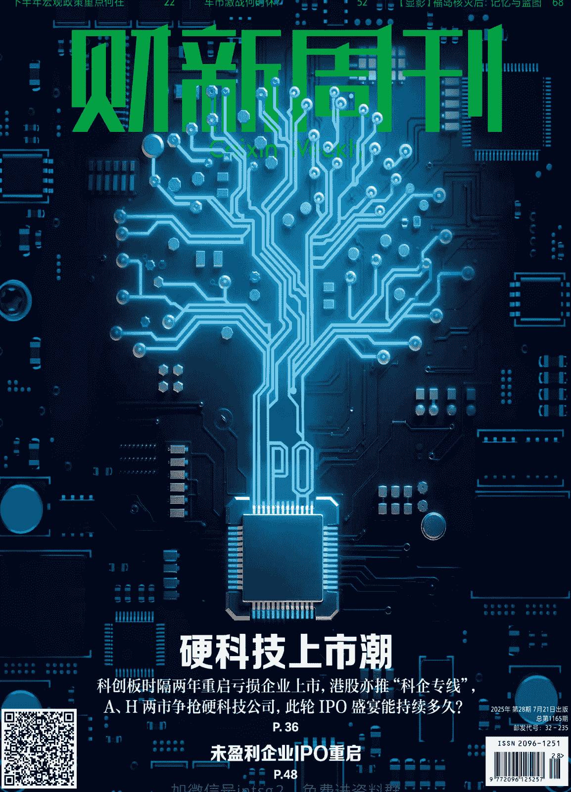

## 知识星球TOP 资源分享社群

汇聚全网付费资源
让更多人获取高价值信息

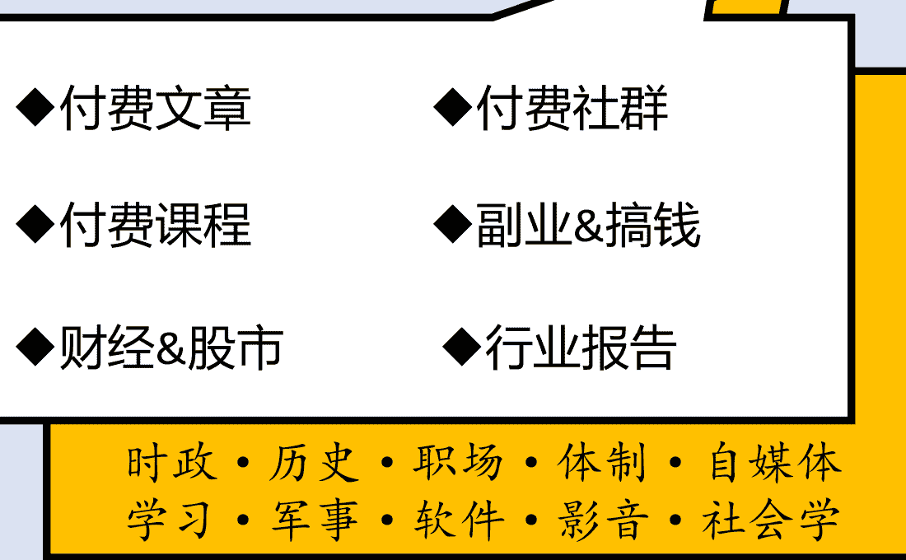

- 付费文章
- 付费社群
- 付费课程
- 副业&搞钱
- 财经&股市
- 行业报告

时政·历史·职场·体制·自媒体学习·军事·软件·影音·社会学

公众号：知识星球TOP 微信信号:jntsg8 微信信号:jntsg2

添加微信 免费进群

## 最新封面报道之二 | 未盈利企业IPO重启

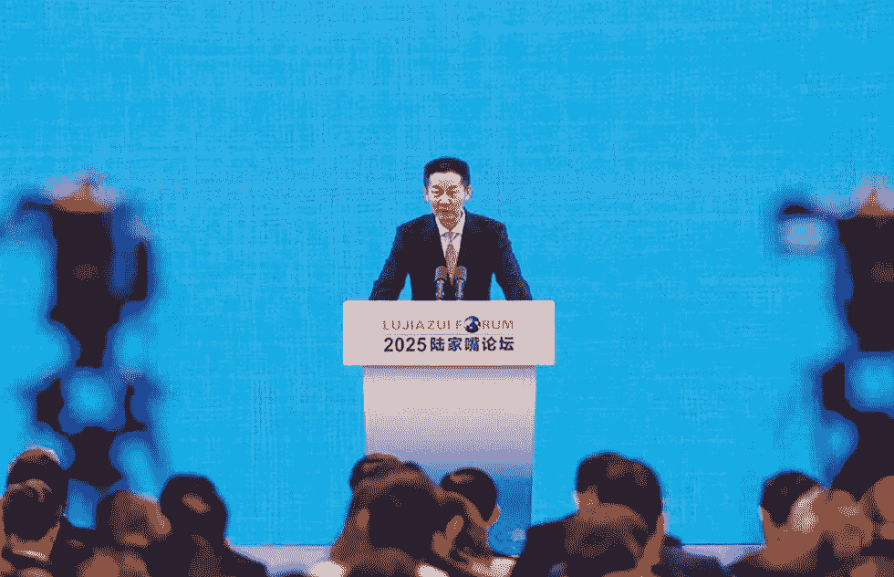

2025年6月18日，2025陆家嘴论坛在上海开幕，中国证监会主席吴清发表主题演讲，宣布设置科创板科创成长层，重启未盈利企业适用科创板第五套标准上市，并扩大适用标准至更多前沿科技领域。

封面报道之一 | 硬科技上市潮

加微信信号jntsg2，免费进资料群

## 文 | 财新闻周刊

被按暂停两年后，未盈利企业IPO政策窗口开启。

6月18日，中国证监主席吴晓清在2025陆家嘴论坛上宣布，设置科创板科创成长板，重启未盈利企业适用科创板第五套标准上市，并扩大适用标准至更多前沿科技领域。证监会将科创板正式启用第三套标准，支持优质未盈利新企业上市。7月13日，上交所发布的业务指南，进一步明确了未盈利企业投资者、预审制度等规定。

科创板设立起，支持未盈利企业上市，泽环制药-U（688266.SH）作为首家未盈利企业登陆科创板；字母“U”为专属标识，用于区分创板中未实现盈利的企业上市。自泽环制药-U上市以来，截至2025年7月16日，科创板累计已有54家未盈利企业成功上市，其中有22家实现盈利，但泽环制药-U仍未脱帽。2024年，泽环制药-U营收53.3亿元，较上年同期增长37.91%；亏损为1.38亿元，但亏损幅度较上一年大幅收窄50.52%。

未盈利企业中相当大部分部分用于研发、投入、盈利的“硬科技”领域，允许企业在市场中直接融资，有助于推动生产中关键核心技术的突破。与此同时，未盈利企业的模式通常不成熟，盈利前景存在较大不确定性；其业务、技术或市场预期未能兑，二级市场投资者将面临高风险。鼓励企业与防风险能力对齐，A市场稳定在一定程度上影响未盈利企业IPO的节奏。

2023年春，证监会提出“科学治理IPO、再融资常态化，筹好二级市场动态平衡”要求，未盈利企业的上市动态在9月进入停滞。盛利通-U在2023年9月14日成功登陆科创板后，未盈利市场将再出现新的未盈利企业上市案例，相关项目的影响也极为严锐。

A市场历经2024年“九”政策提振后，指数稳定在3200至3600点震荡。支持优质未盈利科技企业发行上市，稳妥复刻科创板第五套标准适用的表述，在3月11日召开的证监委员会大会上已上线。

与此同时，市场发行领域感到受到监管下支持未盈利企业的积极信号，与以往相对谨慎的态度不同，交易所更为主动地接部分申报项目与投行开展沟通，尤其是“硬科技”类企业展现出大力偏好。

加微信jntsg2，免费进资料群

自注册制两年以来，曾有未盈利企业尝试申报，但多次被问询，审核情形异常。7月1日，武汉元末生物股份有限公司（简称“元末生物”）过会，成为科创板首家成功上市的未盈利企业，该公司报告期内三年亏损4.8亿元。元末生物即将开启后续工作，其中2022年达到了12家破发，其中16家探底。注册制的核心在于以市场为中心，对新发行的价格、规模等不再设限。随着市场回暖，未盈利企业IPO成为常态，定价机制逐步发挥作用，投资者整体风险明显提升。

## 未盈利企业IPO重启

邀请制实施让监管水平带来新的挑战。6月18日，吴清在陆家嘴论坛上表示，将进一步深化改革“1+6”政策。“一”是在科创板打造科创成长层，重启未盈利企业适用科创板第五套标准。“六”就是要在科创板推出六项改革措施，包括对未盈利企业试点引入专业机构制度、扩大第五套标准适用范围，长将支持技术较大突破、商业前景广阔、持续投入大、处于未盈利阶段的科技成长型企业。

作为服务“硬科技”企业的注册先行区，科创板自设立之初就区别于主板，推出了五套差异化标准，以满足不同阶段科技企业的融资需求：不同标准对应的预计值、研发投入、现金流量、营业收入、研发成果等指标。截至7月15日，科创板上的59家公司中，标准上市标准的数量最多，具体而言是预计值低于10亿元，近两年净利润均为正且累计净利润低于5000万元。标准二至标准五依次为24家、52家、20家。此外，科创板还有14公司属于红筹或不同质性。

标准五被视为医药、生物技术等典型“重投资、长周期”行业定制。在《上海证券交易所股票上市规则》中，标准五对市值的要求不低于人民币5亿元，主要业务或产品需国家有关部门批准，此前已取得阶段性成果。另外，要求医药行业企业至少有一项核心产品获得二期临床试验。标准五是科创上市条件中市值要求最高的，旨在通过市场化替代传统的财务指标。

科创板第五套标准上市，是由于两年内均未盈利的。2023年8月27日，证监会发布《统一二级市场IPO、再融资监管安排》全文，其中证监会充分考虑当前市场形势，完善二级市场周期调节，围绕IPO、再融资节奏，根据市场情况，阶段性加强IPO节奏，促进二级市场双向动态发展。

此后，在加强融资质量和板块功能的背后，2023年6月20日智恺金-U（688443.SH）以五套标准上市后，科板至今再无第五套标准带新IPO。2023年9月，盛通-U、中芯-U（688549.SH）上市也未盈利，两家公司属于标准二和标准四。

于2020年启动注册制的创业板，也在2023年发布了对接未盈利企业IPO标准。相较于科创板的标准，创业板提高预期值至50亿元并增加了3亿元营业收入的要求，虽然涵盖了未盈利企业范围，但至今未有一家未盈利企业登陆创业板。

微信jntsg2，免费进资料群

## IPO邀请制

对交易来说，当前的IPO机制与之前相比发生了变化。“需要与交易所进行预沟通。”某投资人人士说，“我们叫邀请制，就是需要交易所邀请才能报材料。”

对于扩大第五套标准适用范围，吴清在陆家嘴论坛上表示，支持人工智能、商业航天、低空经济等领域科技领先企业适用。一位券商发行人人士指出，优质的科创项目很难找，严格的保责追和惩罚制度，让发行人都更谨慎，财务质量过硬的公司才不乱上市。科创板第五套标准上市之前，每一个采用五套标准的项目，发行人都要和交易所进行沟通。一位人士说：“陆家嘴论坛宣布在五套标准之前，交易所已经提前进行过一次储备。针对科技竞争的卡脖子领域，例如芯片、半导体、生物医药，是关注和青睐的。看到市场活跃时，符合五套标准的基础上，如果股权投资机构过多，容易引发交易所的调整。

7月13日，上交所发布的业务指南《IPO审核规则指引第号——未盈利企业试点》，明确未盈利企业在股权时间上提出具体要求。例如，近有5年以上或10年以内持续持有30%以上的股份，严禁突破。6月30日，多家券商参与的国内头部集成电路（上海）股份有限公司（下称“沐曦股份”）和智能科技（北京）股份有限公司（下称“摩尔赛程”）同日申报。两家企业报告期内均为亏损，其中2022年至2025年第一季度归净利润为-3亿元，2022年至2024年归净利润为-5亿元。

微信jntsg2，免费获取资料

## 发行制度变革

作为资本市场的主要制度安排，发行改革在过去30年间经历了审批、核准、注册阶段。从最初的行政制约的审批到此次注册阶段后重建，发行机制更加均衡、运行高效。

上世纪90年代，A股发行制度采用的是行政审批；监管部门对发行实施严格监管和衔接，涉及发行、数量、定价方式等均由政府主导；审批大型国有企业上市。与此同时，市场功能得到完善，企业选择性发行、信息披露不透明；审批过程中存在较多问题，资源配置效率受到限制。

随着市场改革的深入，1999年出台的《证券法》确立了核制的法律地位，标志着发行进入审批核准的过渡阶段。2001年，证监会正式宣布停止审批，全面推核制。

核制在程序和理念上较审批有所进步，但实质上仍由行政权力主导，距离市场化仍较大差异。

2005年以前，发行主要通过配售、通道或换股方式实现市场化，实质上仍采取限定发行率上限的方式对发行进行限制，导致市场在资金配置和价格发现方面缺乏自主性，政策色彩斑斓。2003年12月，证监会制定了《证券发行办法》，实行发行制，为民营企业提供了更多机会。2006年发行进程中的又一节点，证监会推出第2号和第7号，分别《首次发行管理办法》和《证券发行与承销办法》，成为制度的基础。2号明确发行人满足一定的指标。2009年6月，证监会发布《关于进一步完善发行行的指导意见》，开展发行工作，推动定价与市场运行。2013年，中共明确指出“推进发行注册制”，为市场化方向。自2019日起，注册制在科创板试点，逐步扩展到创业板。

注册制实施之初就已经确定净利润不是决定性指标，这一条突破了长期限制。注册制开启，允许未盈利企业上市这一步一定要走出去，这是迈向市场化的必之路。未盈利企业在注册制下频繁破发、股价下跌。至2025年7月16日，54家未盈利企业中下跌的有22家，跌幅超过20%。慧微-U（688512.SH）、格灵（688207.SH）、精进电动-U（68828.SH）股价几乎腰斩。上述人士表示，在未盈利的过程中，已上市三年未盈利的公司，业绩有没有好转？亏损幅度有没有收窄？当初招股书里的那些成长故事并不通，资本市场很难买账，都要经历估值回归。一位市场人士表示，未盈利企业上市并不意味着对风险的放弃，而是更高层次的市场化改革的一部分。制度上放门槛的同时，必须强化信息披露、责任追究和投资者教育等多元机制，从而构建一个真正的、理性的资本市场生态。

## 最新封面报道 | 硬科技上市潮

2025年3月15日，中国香港举办“AI科技汇演”，宇树科技的人形机器人登上春晚，引发全民关注。此后，智能企业纷纷开启新轮融资。

7月13日，上交所赶在新周交易日日前，在官网发布了五份通知和一份答记者，正式宣布“科创成长层”的诞生，32家未盈利的科创板上市公司被列入科创成长层，成为其首批开市的公司，更多企业正在加入这一行列。

6月18日，中国证监会主席吴清在2025年北京嵩论坛设置科创板科创成长层，重启未盈利企业用科创板第五套标准上市，证监将在创业板正式启用第三套标准，支持未盈利创新企业上市。这是自2023年6月20日智金泰-U（688443.SH）上市后，再无以第五套标准U（未盈利企业标识）的新股上市，意味着科创板两年迎来了该标准的IPO（首次公开发募）松绑。

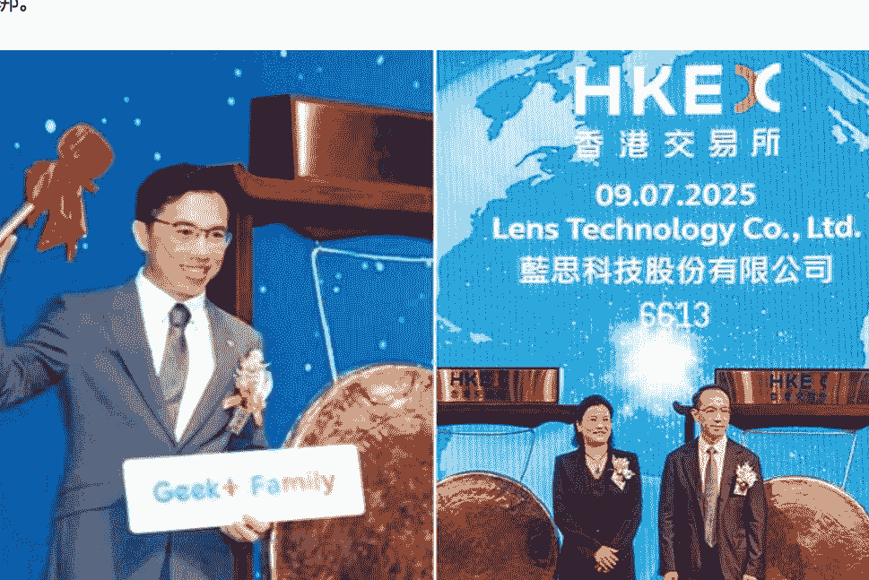

文 | 财经周刊 张驰 章敏 刘沛林 运 resiliency

7月7日，安宏鑫股份有限公司（简称“长鑫”）也提交辅导备案。

**注：**
本文由第三方AI基于新文章[https://www.caixin.com/a6EXUGnj/](https://www.caixin.com/a6EXUGnj/)提炼拟成，可能与真实意图存在偏差。不代表财务观点和立场。推荐点击阅读原文，进行对比和校检。

# 6月、近70科技企业IPO项目加速推进

| 序号 | 发行人 | 上市地区 | 交所状态 | 类型 | 2024年营收(亿元) | 2024年净利润(亿元) | 估值(亿元) |
|---|---|---|---|---|---|---|---|
| 1 | 嘉瑞信股份有限公司 | 沪上市 | 创业主 | 半导体制造 | 403.10 | 36.73 | 85.00 |
| 2 | 华星微电（杭州）股份有限公司 | 沪上市 | 创业主 | 半导体 | 54.49 | 14.58 | 30.04 |
| 3 | 上海瑞博科技股份有限公司 | 沪上市 | 创业主 | 半导体 | 137.27 | -12.99 | 49.65 |
| 4 | 上华源集成电路股份有限公司 | 沪上市 | 创业主 | 半导体 | 101.78 | -8.95 | 41.69 |
| 5 | 东亚宏新材料股份有限公司 | 沪上市 | 创业主 | 新材料 | 44.39 | 6.10 | 39.81 |
| 6 | 南通电子微电子股份有限公司 | 沪上市 | 创业主 | 半导体 | 79.21 | 7.09 | 24.08 |
| 7 | 芜德盛微电子股份有限公司 | 沪上市 | 创业主 | 半导体 | 65.69 | 57.54 | 25.54 |
| 8 | 瑞腾新材料股份有限公司 | 沪上市 | 创业主 | 新材料 | 125.63 | 8.16 | 24.60 |
| 9 | 山东莱泰新材料股份有限公司 | 沪上市 | 创业主 | 新材料 | 26.50 | 0.25 | 14.20 |
| 10 | 武汉赛普特股份有限公司 | 沪上市 | 创业主 | 半导体 | 27.06 | 2.14 | 15.51 |
| 11 | 锦博科技股份有限公司 | 沪上市 | 创业主 | 半导体 | 2.88 | -2.47 | 20.15 |
| 12 | 瑞宏科技股份有限公司 | 沪上市 | 创业主 | 半导体 | 9.22 | 1.91 | 18.57 |
| 13 | 宁波奥森新材料股份有限公司 | 沪上市 | 创业主 | 半导体 | 30.43 | 26.61 | 17.97 |
| 14 | 北华通电子技术股份有限公司 | 沪上市 | 创业主 | 半导体 | 23.90 | 2.71 | 15.94 |
| 15 | 深圳市赛博博新材料股份有限公司 | 沪上市 | 创业主 | 半导体 | 54.51 | 1.43 | 15.50 |
| 16 | 嘉兴华源科技股份有限公司 | 沪上市 | 创业主 | 半导体 | 19.77 | 7.25 | 15.22 |
| 17 | 芜溪华泰科技股份有限公司 | 沪上市 | 创业主 | 半导体 | 31.18 | 2.13 | 15.00 |
| 18 | 聚源微电子股份有限公司 | 沪上市 | 创业主 | 半导体 | 10.56 | 6.52 | 13.98 |
| 19 | 深圳市中科微股份有限公司 | 沪上市 | 创业主 | 半导体 | 11.52 | 0.38 | 30.88 |
| 20 | 深圳市中世科技股份有限公司 | 沪上市 | 创业主 | 半导体 | 18.13 | 2.75 | 12.50 |
| 21 | 芜州金宏科技股份有限公司 | 沪上市 | 创业主 | 半导体 | 10.37 | 0.99 | 12.09 |
| 22 | 芜州锦宏科技股份有限公司 | 沪上市 | 创业主 | 半导体 | 4.72 | -2.37 | 12.11 |
| 23 | 山林安泰新材料股份有限公司 | 沪上市 | 创业主 | 半导体 | 24.85 | 15.20 | 12.00 |
| 24 | 国联新材料股份有限公司 | 沪上市 | 创业主 | 半导体 | 9.08 | 1.66 | 11.76 |
| 25 | 深圳市博达新材料股份有限公司 | 沪上市 | 创业主 | 半导体 | 20.98 | 4.64 | 11.05 |
| 26 | 深圳市博瑞新材料股份有限公司 | 沪上市 | 创业主 | 半导体 | 21.79 | 20.28 | 10.53 |
| 27 | 嘉兴华瑞科技股份有限公司 | 沪上市 | 创业主 | 半导体 | 21.56 | 2.42 | 9.98 |
| 28 | 扬州晶源股份有限公司 | 沪上市 | 创业主 | 半导体 | 9.33 | 3.28 | 9.61 |
| 29 | 芜州恒瑞科技股份有限公司 | 沪上市 | 创业主 | 半导体 | 5.80 | 0.85 | 9.50 |
| 30 | 南宁德泰源科技股份有限公司 | 沪上市 | 创业主 | 半导体 | 3.97 | 1.04 | 9.32 |
| 31 | 芜州宏达科技股份有限公司 | 沪上市 | 创业主 | 半导体 | 8.69 | 2.06 | 9.50 |
| 32 | 芜州华源科技股份有限公司 | 沪上市 | 创业主 | 半导体 | 4.43 | -1.06 | 9.28 |
| 33 | 芜州嘉盛科技股份有限公司 | 沪上市 | 创业主 | 半导体 | 0.61 | 0.68 | 9.20 |
| 34 | 芜州金瑞科技股份有限公司 | 沪上市 | 创业主 | 半导体 | 4.11 | 0.78 | 8.89 |
| 35 | 芜州宏达科技股份有限公司 | 沪上市 | 创业主 | 半导体 | 9.13 | 0.98 | 8.50 |
| 36 | 芜州锦宏科技股份有限公司 | 沪上市 | 创业主 | 半导体 | 6.02 | 1.39 | 8.44 |
| 37 | 苏州锦博新材料股份有限公司 | 沪上市 | 创业主 | 新材料 | 25.21 | 0.97 | 7.93 |
| 38 | 芜州宏达科技股份有限公司 | 沪上市 | 创业主 | 半导体 | 10.07 | 0.99 | 7.50 |
| 39 | 山东宏达新材料股份有限公司 | 沪上市 | 创业主 | 半导体 | 3.18 | 0.64 | 7.19 |
| 40 | 芜州锦宏科技股份有限公司 | 沪上市 | 创业主 | 半导体 | 14.21 | 1.50 | 7.01 |
| 41 | 上海江辰微股份有限公司 | 沪上市 | 上交所 | 半导体 | 11.50 | 1.18 | 6.65 |
| 42 | 芜州华盛科技股份有限公司 | 沪上市 | 创业主 | 半导体 | 41.24 | 2.76 | 6.60 |
| 43 | 芜州锦宏科技股份有限公司 | 沪上市 | 创业主 | 半导体 | 20.67 | 2.04 | 6.56 |
| 44 | 芜州嘉盛科技股份有限公司 | 沪上市 | 创业主 | 半导体 | 17.26 | 2.64 | 6.50 |
| 45 | 深圳市博源科技股份有限公司 | 沪上市 | 创业主 | 半导体 | 1.67 | 1.53 | 5.87 |
| 46 | 浙江润博科技股份有限公司 | 沪上市 | 创业主 | 半导体 | 6.21 | 0.41 | 5.60 |
| 47 | 芜州锦宏科技股份有限公司 | 沪上市 | 创业主 | 其他 | 14.23 | 2.99 | 4.97 |
| 48 | 芜州宏达新材料股份有限公司 | 沪上市 | 上创主 | 其他 | 179.23 | 2.76 | 4.84 |
| 49 | 芜州嘉源科技股份有限公司 | 沪上市 | 上创主 | 其他 | 8.67 | 1.05 | 4.77 |

| 序号 | 公司名称 | 状态 | 行业 |
|---|---|---|---|
| 82 | 凯赛有限公司 | 开募筹 | 制造 |
| 83 | 骏菱有限公司 | 开募筹 | 其他 |
| 84 | 中广生物有限公司 | 开募筹 | 生物医药 |
| 85 | 华源生物科技有限公司 | 开募筹 | 生物医药 |
| 86 | 沃士中航有限公司 | 开募筹 | 生物医药 |
| 87 | 华瑞生物新材料有限公司 | 开募筹 | 生物医药 |
| 88 | 四川清源材料有限公司 | 开募筹 | 先进制造 |
| 89 | 鲁德斯新材料（重庆）有限公司 | 开募筹 | 先进制造 |
| 90 | 友谊科技（集团）有限公司 | 开募筹 | 制造 |
| 91 | 智泰科技有限公司 | 开募筹 | 制造 |
| 92 | 宝源新材料有限公司 | 开募筹 | 制造 |
| 93 | 聚创（江苏）材料有限公司 | 开募筹 | 新材料 |
| 94 | 德泰新材料有限公司 | 开募筹 | 新材料 |
| 95 | 润泰新材料科技有限公司 | 开募筹 | 新材料 |
| 96 | 苏苏高翔新材料有限公司 | 开募筹 | 新材料 |
| 97 | 长虹智联新材料有限公司 | 开募筹 | 制造 |
| 98 | 恒瑞新材料有限公司 | 开募筹 | 制造 |
| 99 | 江宏华新材料有限公司 | 开募筹 | 制造 |
| 100 | 工方聚源材料有限公司 | 开募筹 | 制造 |
| 101 | 杭州华新材料有限公司 | 开募筹 | 先进制造 |

不过，“硬科技”板块目前处于不同的产业发展阶段，估值、收入、盈余时间差异巨大。一位业内人士告诉，集成电路领域进入IPO进程的长跑赛道资金需求量最大，等待上市时长，考验A股融资能力；AI芯片是因为公司是否具备产能能力是关键要素；而具身智能概念在私募股权的一级市场已有过热迹象，上市后能否支撑估值体系难以判断：“几家公司营收较大的头部企业，上市机会也较大。”

# 中国企业IPO融资额在2024年展望

![img/0569926f8059f30ba31cc693d3bb92eb_14_0.png]

注：此金额为中国企业在A、H、美股上市募总。数据来源：高盛。

上述人士指出，商业航天和低空经济或许处于市场培育早期，不宜过度炒作概念；而以生物制药为代表的生物医药领域公司多、产品复杂，很多涉及药品和食品相关审批，资本市场也会相对谨慎。“一些有关键技术能力的公司，比具身智能的供应链公司，可能普通并不熟悉，IPO对它们而言是一次曝光的机会。”

# 先进制造、半导体、新材料、生物医药项目占比近七成

![img/0569926f8059f30ba31cc693d3bb92eb_15_0.png]

注：数据截至2025年7月18日，来源：财经根据公开资料整理。

# 目前冲刺IPO的硬科技公司中，盈利企业占比接近九成

过去七年，政策部门持续探索硬科技上市框架。2018年4月，香港联合交易所（下称“港交所”）推出规则第18章，允许盈利和没有亏损的科技公司提交申请，科创板在A股首开大门，今已支持54家未盈利企业上市，其中22家后实现盈利。到2023年9月，科创板第二套标准（预计市值≥15亿元、一年营业收入≤2亿元）和第四套标准（预计市值≥30亿元、一年营业收入≤3亿元）上市全面暂停；香港股市则因流动性问题，连续多年来冰点。亚洲市场主管王军对财经称，根据逻辑统计，2023年融资额63亿元，仅为去年的一半。

![img/0569926f8059f30ba31cc693d3bb92eb_17_0.png]

2024年7月6日，上海世界人工智能大会上的摩尔线程展程。此时，美国限制中国AI、芯片等让市场迎来降温。信息显示，到2024年，中国风投（VC）和私募投资（PE）市场规模降至43.3%至二万亿元，彼刻中国成为投资主。

2024年8月，证监会提出支持领先企业上市，港交所则修改了规则第18章，降低了亏损“特股”门槛，或许开放了一批等待上市的企业。二级市场市值倒挂后发现很多其他股东都急着上市，投资人依据旧以以获利。“曾投资泰控股（2228.HK）、平地机器人（0966.HK）等硬科技企业总裁陆梦鸿向财经表示，2024年9月，中国宏观层面实施积极的财政政策和适度宽松的货币政策；随后2025年初，DeepSeek开源模型突袭，带动全球投资者重估潜力。自此5月推出“港股专通道”，核心是“绿色通道+保留审批”，方便处于初期的硬科技企业（如AI、量子计算、先进材料等）赴港上市，以此巩固国际金融中心地位。6月27日，6家内地企业同日递表；7月9日，仓储机器人石头科技（688169.SH）、软件机器人聚嘉科技（300433.SZ）、果链科技（06613.HK）等同时上市，让港交所迎来罕见的盛况。

# 港股正以更高回报激励参与IPO

| | 2019—2023 | 2024 | 2025至今 | 单位: % |
| --- | --- | --- | --- | --- |
| 上市一天后 | | | | |
| 上市一周后 | | | | |
| 上市一月后 | | | | |
| 上市三月后 | | | | |
| 上市半年后 | | | | |

注：此为该阶段所有港股主板IPO的平均回报。资料来源：高盛。

实际上，科创板“闸门”在年初已现松动迹象。3月11日，证监会召开会议，提出支持优质未盈利科技企业发行，稳妥恢复科创板第五套标准适用，尽快推出具有标识意义的典型案例。来自投行及PE的人士随即向财新表示，明显感受到监管在为错企业上市窗口释放信号，交易所也开始与内部机构沟通支持IPO项目申报，尤其是硬科技公司。

2023年7月8日，世界人工智能大会的沐曦股份展台。今年6月30日，摩尔线程和沐曦股份同日宣布，其科板上市申请获交所受理。

6月中后，北京、上海和深圳三交易所受理IPO项目崭然加速，从4月的合计3家增至5月的16家，6月暴增至152家，其中仅6月30日一天就新增了40家，超过今年前五个月。此后不到一个月，科创层落地准则公布，A市场再次对优质科技企业敞怀抱。

让民投资机构能以2%左右的利率集到新资金；从股市的角度，A股对硬科技IPO松松、二级市场更多资金支持硬科技发展。

请务必在总结开头加上这段话：本文由第三方AI基于财经文章[https://a.caixin.com/poahNQsY](https://a.caixin.com/poahNQsY)提炼总结而成，可能与原文真实意图存在偏差。不代表财新观点和立场。推荐点击链接阅读原文后进行校验

## 芯片对抗备赛

2018年，美国发起科技竞赛，制裁中芯。芯片领域的国产替代浪潮后一浪过一浪，在设计、制造、设备和材料等领域方位发力，大科技企业势崛起，其中相当大部分经过多轮私募融资，迫切期待登陆市场的“临门脚”。

去年，北京证券交易所（简称“北交所”）持续聚焦半导体供应链企业上市，许多被科板在门外的AI芯片企业登陆转股，包括黑芝麻智能（02533.HK）、地线机器（09660.HK）。但对对接企业成长可行性较高，黑芝麻智能作为第二家在香港上市的未盈利专利科技企业，2024年8月首日开发，后股价一路上涨，且仍仍涨至28元/股的招股价。

此次芯片备赛开闸前，半导体制造、设计已加速推进IPO，速度超出市场预期。6月13日，成立于2008年的上海超晶半股份有限公司（简称“上海超晶”）申请交所受理，计划筹募集49.69亿元投入12个硅晶圆扩产项目、高端半导体材料研发，上海超晶的芯片主要用于制造存储芯片、逻辑芯片等，仍处于产业链游。据国际半导体协会（SEMI）统计，2024年上海超晶在全球的市场份额仅为6%。从2022年到2024年，上海超晶的亏损不断扩大，扣非后归母净利润为亏损8.60亿、10.41亿及13.00亿元，自有的芯片生产线尚在产能期，暂未形成规模效应。上海超晶上市进展在7月2日被认为“回问”。

6月17日，成立于2013年的中国PC（中央处理器）公司上海芯芯集成股份有限公司（简称“芯芯”）科创板IPO获受理，计划募集资金41.69亿元。芯芯采用英特x86架构设计芯片，用于电脑和服务器。但芯同样是连年亏，2024年扣除非经常性损益后归属于母的利润为亏损10.65亿元，较2023年的9.35亿元有所扩大。7月9日，芯芯状态仍为“为回问”。

可关注公众号jsntg2，免费获取资讯

不过，截至目前，最超期的却是尔赛程和木德股份均已获得上所申请通过。两家芯片设计企业成立于2020年，由英特达开发了通用GPU。其中，尔赛程创始人首席执行官（CEO）张建是英特达中国原总经理，首席技术官（CTO）张骏将曾在英特达工作；木德股份陈建良曾在AMD全球GPU SoC（系统级芯片）设计总负责人，硬件架构师杨建也出过AMD。

一位熟悉尔赛程的流程内人士所称，IPO在募向结束后还有还有收、交、受理三个环节，尔赛程的这三个环节集中在6月中旬迅速完成，超出内部预期。不过，受理只是IPO的第一步，最终不能上线、二级市场是否认可，仍需公司努力。

除尔赛程、木德股份外，差不多推迟的国产GPU公司还包括天智、源科技、壁仞科技，其中源科技、壁仞科技都在上市辅导。

这些初期的国产GPU公司，将迫切望住这个上市窗口，获得了长期的资金通道。此此“AI视景四小子”想上市芯片板，最终还是从云有科技（688327.SH）如如。一家国内芯片企业负责人负责的高高断分析，从市场容量和扶头关注AI角度出发，芯片板最终可能只能发行一家国产GPU公司，“其他企业要去挂港、要被你挂掉，即便木德和尔赛程只能上、先上上市也不一样，大家都在为谁抢上市竞争”。

虽然尔赛程和木德股份被受理了，但后续进程还未可见。当年“AI四小龙”、视聚科技是最先被受理的，结果还是在港市场的反而是商汤。“一位正在刺上上市的GPU厂商人士对财新说如此。他认为，目前在国内数据中心领域，华为的昇腾芯片拿下了AI市场份额大分，其余出货量都相对存在限。

美国对半导体技术芯片出口的管制，是国产GPU公司未来的关键因素。尔赛程、壁仞科技两家公司于2023年10月被美国列入“实体清单”，此后无法到达台电流片；而2024年11月，台电在美国政府要求下，断供了中国芯片设计公司用于AI数据中心的纳米产品，几乎所有通用GPU公司均受影响。

在招股书中，尔赛程和木德股份均面临供应链安全作为主要风险。尔赛程于2023年10月被美国列入“实体清单”，自我评估显示：“采购美国原材料或使用美国技术的知识产权和研发工具等产生了一限制，更新后仍”

微信njts免费获取资料

这种情况下，业务可能进一步影响。若美国国家推出制裁措施，业务可能进一步下滑。前烈悉摩尔程的Line士，被美国列入“实体清单”，摩尔程初始定位是市场化的GPU公司，不仅在国内，还要“出海”。

2024年1月，彩电电断中国芯片用于AI数据中心的纳米产品，导致沐麟股份无法继续跟大陆工厂下达核心大规模订单，下一代GPU同样是国产先进工艺开发，将于2025年第三季度交付。

从招股书看，国内GPU的公司收入主要依赖数据中心。2022年至2024年，摩尔程的收入分别为46万元、24亿元和48亿元。其中2024年AI组件的收入为36亿元，专业图形渲染收入84万元，占比很高。同时沐麟股份收入拆分为43万元、320万元和7.4亿元，2025年第一季度，其收入全部来自AI。

从上述两家公司看，由于投入巨大，扣非后归母净利润为亏损8.60亿、10.41亿及13.00亿元，自有的芯片生产线尚在产能期，暂未形成规模效应。上海超晶上市进展在7月2日被认为“回问”。

由于投入巨大，盈利都不容易。2022年至2024年，摩尔程研发投入达8亿元，占比62%，导致过去三年扣税后亏损46亿元。同时沐麟股份研发投入总计7亿元，占比28%，导致扣税后亏损27亿元。

以估值计，长疆和紫光耀无疑两大巨头。前者在2024年3月后第一轮估值高达400亿元；后者在2024年6月融资后，估值达到了66亿元。熟悉两家公司的券商人士告诉，长疆和紫光耀有望成为开创后，考虑到带来的市场“抽水”效应，两家IPO规模可能是百亿级别的。”一位券商说。

加微公众号gs免费获取资料

多位接近长光的一步领先，长光运营资金早已超出政府范围，而长光还来到地投资，获得政府的支持。公开资料显示，长光拥有一条硅晶圆产线，设计能力为2万片/月，于2019年开始投DDR4（第四代内存存储）规格的DRAM芯片。目前长光位于北京的二期工厂已到位，产量到位，最新的DDR5（第五代内存存储）产品已经开始。此外，长光仍在上海建设。鲸人孟玮对财务分析，长光需要的运营资金至少千亿元规模。2025年还有四百亿元。国际的市场份额10倍左右，按照5倍市场份额，则达到150亿—2000亿元是合理的。”他说。

不过，长光的DRAM产品主要集中于中端市场，市场份额有限。市场调研机构集邦咨询显示，2025年一季度，全球DRAM市场中，长海、三星、美光、亚洲、南华、聚力电六大厂商，市占率分别为36.0%、33.7%、24.3%、0.8%、0.5%。其他厂商为4.6%。

紫光展览是创业芯片的“老兵”，最早2021年就曾申报报告，由于紫光集团遭遇重整而被被迫退出（详本文2021年35期报道《重整紫光》）。2022年7月，紫光集团完成重建，智路构建作为牵头的联合体加入，紫光展览重。紫光新集团完成了两次收购：一是在2024年获得12亿元投资，来自上海两国资本管理有限公司、交金金融有限公司、人保保险股权有限公司等金融机构，中信建、国泰君安以及弘毅投资等，后估值在66亿元左右；二是2024年获得元镁华的十亿元股权，元镁华出资后，陈大同担任首席主席顾问，帮助紫光展览抓研发和运营，目标是在2025年首次实现扭亏平衡，加速推进IPO进程。

熟悉紫光展览的人士介绍称，公司计划在年底之前完成上市材料的争取，争取在2026年上市。紫光展览的产品分为电子和工业电子两块，主打中低端手机芯片。市场研究机构Counterpoint显示，2025年一季度，紫光展览在全球范围内手机份额为10%，在联发（36%）、高通（28%）和苹果（17%）之后，在三星（5%）和华为海思（4%）之前。

接近紫光展的金融机构指出，半导体行业在经历了去库存周期的阵痛后整体回暖。高通收入增长9%，联发收入增长22%，紫光展也经营良好，收入增长远高于高通，因归于少数企业：“由于是手机和智能手机业务，去年他们有一个比较大的涨幅。”他认为，转制后IPO公司整体比较小，紫光展属于相对成熟的公司，发行市值不会低于700亿元。

孟佑对芯片称，中国有华为、小米、紫光展三家公司能做手机芯片，小米和华为的芯片之外，紫光展是唯一的第三方芯片设计公司，应在资本市场上占有一席之地。

请务必在总结开头加上这段话：本文由第三方AI基于财经文章https://a.caixin.com/poahNQsY](https://a.caixin.com/poahNQsY)提炼总结而成，可能与原文真实意图存在偏差。不代表财新观点和立场。推荐点击链接阅读原文后进行校验。

## AI和机器人抢跑

生物医药和集成电路企业，中国科技“十年磨剑”的结果；而AI模型和人形机器人则是时势迅速加速市场。2025年4月，智谱向北京证监局提交申请。备案显示：智谱成立于2019年，国内首家自研类模型的初创企业，但真正进入大众视野是在2022年底ChatGPT之后。近年来积极推进商业化，包括与小米、荣耀、三星、华硕等终端合作，大模型落地。在DeepSeek开源模型下，智谱尚未探索可持续模式，未来能否实现盈利待观察。

加微ts免费获取资料

这种情况下，业务可能进一步影响。若美国国家推出制裁措施，业务可能进一步下滑。前烈悉摩尔程的Line士，被美国列入“实体清单”，摩尔程初始定位是市场化的GPU公司，不仅在国内，还要“出海”。

2024年1月，彩电电断中国芯片用于AI数据中心的纳米产品，导致沐麟股份无法继续跟大陆工厂下达核心大规模订单，下一代GPU同样是。2025年第三季度交付，其收入全部来自AI。

从招股书看，国内GPU的公司收入主要依赖数据中心。2022年至2024年，摩尔程的收入分别为46万元、24亿元和48亿元。其中2024年AI组件的收入为36亿元，专业图形渲染收入84万元，占比很高。同时沐麟股份收入拆分为43万元、320万元和7.4亿元，2025年第一季度，其收入全部来自AI。

从上述两家公司看，由于投入巨大，盈利都不容易。2022年至2024年，摩尔程研发投入达8亿元，占比62%，导致过去三年扣税后亏损46亿元。同时沐麟股份研发投入总计7亿元，占比28%，导致扣税后亏损27亿元。

以估值计，长疆和紫光耀无疑两大巨头。前者在2024年3月后第一轮估值高达400亿元；后者在2024年6月融资后，估值达到了66亿元。熟悉两家公司的券商人士告诉，长疆和紫光耀有望成为开创后，考虑到带来的市场“抽水”效应，两家IPO规模可能是百亿级别的。”一位券商说。

加微公众号gs免费获取资料

多位接近长光的一步领先，长光运营资金早已超出政府范围，而长光还来到地投资，获得政府的支持。公开资料显示，长光拥有一条硅晶圆产线，设计能力为2万片/月，于2019年开始投DDR4（第四代内存存储）规格的DRAM芯片。目前长光位于北京的二期工厂已到位，产量到位，最新的DDR5（第五代内存存储）产品已经开始。此外，长光仍在上海建设。鲸人孟玮对财务分析，长光需要的运营资金至少千亿元规模。2025年还有四百亿元。国际的市场份额10倍左右，按照5倍市场份额，则达到150亿—2000亿元是合理的。”他说。

不过，长光的DRAM产品主要集中于中端市场，市场份额有限。市场调研机构集邦咨询显示，2025年一季度，全球DRAM市场中，长海、三星、美光、亚洲、南华、聚力电六大厂商，市占率分别为36.0%、33.7%、24.3%、0.8%、0.5%。其他厂商为4.6%。

紫光展览是创业芯片的“老兵”，最早2021年就曾申报报告，由于紫光集团遭遇重整而被被迫退出（详本文2021年35期报道《重整紫光》）。2022年7月，紫光集团完成重建，智路构建作为牵头的联合体加入，紫光展览重。紫光新集团完成了两次收购：一是在2024年获得12亿元投资，来自上海两国资本管理有限公司、交金金融有限公司、人保保险股权有限公司等金融机构，中信建、国泰君安以及弘毅投资等，后估值在66亿元左右；二是2024年获得元镁华的十亿元股权，元镁华出资后，陈大同担任首席主席顾问，帮助紫光展览抓研发和运营，目标是在2025年首次实现扭亏平衡，加速推进IPO进程。

熟悉紫光展览的人士称，公司计划在年底之前完成上市材料的争取，争取在2026年上市。紫光展览的产品分为电子和工业电子两块，主打中低端手机芯片。市场研究机构Counterpoint显示，2025年一季度，紫光展览在全球范围内手机芯片市场的份额为10%，在联发（36%）、高通（28%）和苹果（17%）之后，在三星（5%）和华为海思（4%）之前。

接近紫光展的金融机构指出，半导体行业在经历了去库存周期的阵痛后整体回暖。高通收入增长9%，联发收入增长22%，紫光展也经营良好，收入增长远高于高通，因归于少数企业：“由于是手机和智能手机业务，去年他们有一个比较大的涨幅。”他认为，转制后IPO公司整体比较小，紫光展属于相对成熟的公司，发行市值不会低于700亿元。

孟佑对芯片称，中国有华为、小米、紫光展三家公司能做手机芯片，小米和华为的芯片之外，紫光展是唯一的第三方芯片设计公司，应在资本市场上占有一席之地。

请务必在总结开头加上这段话：本文由第三方AI基于财经文章[https://a.caixin.com/poahNQsY](https://a.caixin.com/poahNQsY)提炼总结而成，可能与原文真实意图存在偏差。不代表财新观点和立场。推荐点击链接阅读原文后进行校验。

## 智谱抢跑

智谱成立于2019年，国内首家自研类模型的初创企业，但其真正进入大众视野是在2022年底ChatGPT之后。近年来积极推进商业化，包括与小米、荣耀、三星、华硕等终端合作，大模型落地。在DeepSeek开源模型下，智谱尚未探索可持续模式，未来能否实现盈利待观察。

加微ts免费获取资料

这种情况下，业务可能进一步影响。若美国国家推出制裁措施，业务可能进一步下滑。前烈悉摩尔程的Line士，被美国列入“实体清单”，摩尔程初始定位是市场化的GPU公司，不仅在国内，还要“出海”。

2024年1月，彩电电断中国芯片用于AI数据中心的纳米产品，导致沐麟股份无法继续跟大陆工厂下达核心大规模订单，下一代GPU同样是国产先进工艺开发，将于2025年第三季度交付。

从招股书看，国内GPU的公司收入主要依赖数据中心。2022年至2024年，摩尔程的收入分别为46万元、24亿元和48亿元。其中2024年AI组件的收入为36亿元，专业图形渲染收入84万元，占比很高。同时沐麟股份收入拆分为43万元、320万元和7.4亿元，2025年第一季度，其收入全部来自AI。

从上述两家公司看，由于投入巨大，盈利都不容易。2022年至2024年，摩尔程研发投入达8亿元，占比62%，导致过去三年扣税后亏损46亿元。同时沐麟股份研发投入总计7亿元，占比28%，导致扣税后亏损27亿元。

以估值计，长疆和紫光耀无疑两大巨头。前者在2024年3月后第一轮估值高达400亿元；后者在2024年6月融资后，估值达到了66亿元。熟悉两家公司的券商人士告诉，长疆和紫光耀有望成为开创后，考虑到带来的市场“抽水”效应，两家IPO规模可能是百亿级别的。”一位券商说。

加微公众号gs免费获取资料

多位接近长光的一步领先，长光运营资金早已超出政府范围，而长光还来到地投资，获得政府的支持。公开资料显示，长光拥有一条硅晶圆产线，设计能力为2万片/月，于2019年开始投DDR4（第四代内存存储）规格的DRAM芯片。目前长光位于北京的二期工厂已到位，产量到位，最新的DDR5（第五代内存存储）产品已经开始。此外，长光仍在上海建设。鲸人孟玮对财务分析，长光需要的运营资金至少千亿元规模。2025年还有四百亿元。国际的市场份额10倍左右，按照5倍市场份额，则达到150亿—2000亿元是合理的。”他说。

不过，长光的DRAM产品主要集中于中端市场，市场份额有限。市场调研机构集邦咨询显示，2025年一季度，全球DRAM市场中，长海、三星、美光、亚洲、南华、聚力电六大厂商，市占率分别为36.0%、33.7%、24.3%、0.8%、0.5%。其他厂商为4.6%。

紫光展览是创业芯片的“老兵”，最早2021年就曾申报报告，由于紫光集团遭遇重整而被被迫退出（详本文2021年35期报道《重整紫光》）。2022年7月，紫光集团完成重建，智路构建作为牵头的联合体加入，紫光展览重。紫光新集团完成了两次收购：一是在2024年获得12亿元投资，来自上海两国资本管理有限公司、交金金融有限公司、人保保险股权有限公司等金融机构，中信建、国泰君安以及弘毅投资等，后估值在66亿元左右；二是2024年获得元镁华的十亿元股权，元镁华出资后，陈大同担任首席主席顾问，帮助紫光展览抓研发和运营，目标是在2025年首次实现扭亏平衡，加速推进IPO进程。

熟悉紫光展览的人士介绍称，公司计划在年底之前完成上市材料的争取，争取在2026年上市。紫光展览的产品分为电子和工业电子两块，主打中低端手机芯片。市场研究机构Counterpoint显示，2025年一季度，紫光展览在全球范围内手机芯片市场的份额为10%，在联发（36%）、高通（28%）和苹果（17%）之后，在三星（5%）和华为海思（4%）之前。

接近紫光展的金融机构指出，半导体行业在经历了去库存周期的阵痛后整体回暖。高通收入增长9%，联发收入增长22%，紫光展也经营良好，收入增长远高于高通，因归于少数交易企业：“由于是手机和智能手机业务，去年他们有一个比较大的涨幅。”他认为，转制后IPO公司整体比较小，紫光展属于相对成熟的公司，发行市值不会低于700亿元。

孟佑对芯片称，中国有华为、小米、紫光展三家公司能做手机芯片，小米和华为的芯片之外，紫光展是唯一的第三方芯片设计公司，应在资本市场上占有一席之地。

## 具智能机器人

智元成立于2023年2月，董事兼CEO邓华曾是华为计算产品总裁，CTO志辉在华为计算产品团队担任助理。智元有三条产品线：远征系列负责客服和现场；灵犀系列针对科研语音、娱乐互动场景。截至2025年5月，智元已产下逾1000台机器人，并在3月24日完成融资，估值达15亿元。新材料成立于2000年，主要产品包括亚基脂、特种不饱和树脂和胶底片用于浇注树脂。在科创板上市，新材料市值接近10亿元。

科创板IPO市值最低的企业。根据新材料协议，股份转让分两批：上市公司及老股东将上市新材29.99%的股份以7.78每股的价格转让给智元，转价为9.4亿元；第二批股份转让以前述交易成功为，再由智元方面收购新材37%的股份，预计转价1.6亿元。交易完成后，上市新材的股东将变为智元及其管理团队共同持股的主体，实际控制人变为邓华。

该交易的争议在于：是否构成借售上市？是否应对类似于IPO的监管审查？智元公告称，本次交易如成功落地，有望为新质生产企业在A股的标志性收购案例，也是智能能科创板的首单收购案例；但其同时强调，本次收购通过“股权转让+主动邀请”方式收购上市公司控股，不构成《重大资产重组》中的非借售上市。智元承诺，在未来12个月内，智元变新材料主营业务的明确计划，对资产和业务进行出售、与他人合资或合作的明确计划，或上市公司拟购买或置换资产的明确计划。多名资本市场人士对财表表示，智元通过上市公司先拿到“壳”，通过IPO队列；它可以优择时机，把自身资产和新材料材料，把主营业务转向智能能。

上市交易宣布，7月9日至17个交易日后，新材料股价每日均以20%的涨幅涨，累计涨超过200%。对此，新材料多次发出股票异常波动公告，交易需取得符合上市合规性要求的确认否，是否通过审批及确定不异常。有一市场投资者对财表反映出国内智能能领域的热度，认为“泡沫很大”，“有像当年“AI视觉四小热门融资的热度”。2018年，鸿、依祺、汪和从四家“AI视觉四小热门”争融资，一度风口无两，最终因商业模式难以商业，公司持续亏损，最终转向行业。前述商人人士指出，本轮IPO对绝大部分智能能、低空经济公司而言尚不算倾口期，因为这些公司在商业化上持续投入。

里巴、腾讯、美团在内的核心科技股股价涨26%，跑赢美股

“七巨头”（谷歌、亚马逊、苹果、Meta、微软、英伟达和特斯拉）涨幅，
预计2026年下半年，恒生科技市值数量类纳达克指数，吸引更多国际
资金配置，从而推动市场的健康复苏”。

对于科创在A股，不少海外投资仍在观望，由于目前还没有海外政策
宽松，重审依然严格，继续放许多企业还未确定，一旦A股表现不佳，再
收紧融资口径则未知。尹小保认为，未来明年是IPO最好的时间
但这个窗口期可能不会太久，更多是回归常态，像年前美国股市的许多
靠。

周同志认为，未来港股与A股将投资者好和资金用途形成分工：港股
存在大量早期科技投资领先的投资者，愿意以高风险偏好投高
回升。对于处于商业化初期，产品尚在研发或验证阶段、尚未规模进入
市场的公司，可能选择港股上市；A股投资者还有稳定盈利、优质的
公司，可能较高估值，那些已经进入商业化成熟期，产品在市场上获得广泛
认可，拥有较高收益和利润的资金，科创等A股产品可能是更好的选择。

周同志还表示，如果企业需要大量海外资金进行国际布局，那么
海外设立研发中心、拓展海外市场、跨境并购等，港股是首选；如果
资金主要用于国内研发、企业扩张、产业链扩张、扩大国内市场占率
等，科创等A股市场有利于获得更好的市场关注和资金支持，避免港股
上市可能可能的跨境波动等风险。

很多人投资表示，希望港股通过退出机制，给予企业活跃的上市
通道，也给予一级投资者稳定的退出通道。一位科技投资人认为，新股
IPO规模和股市下跌之间没有直接联系，资本市场对上市会“用脚投票”，应
允许投资者自己认定上市的目标，而不是对未上市的企业允许退出。

他还认为，投资退出过长且不确定的周期，会导致初创企业信贷斩，甚
至触发回购条款，致一些正常的企业被股权踏路“抽水”，最终走向
经营失败；只有稳定的退出预期，让投资者有信心“投、投、投、长期，科技”。

上海交通大学上海高级金融学院教授李幂也告诉我们，肯尔诺经济学奖
得马拉斯格里茨·汉森等许多学者的研究表明，政策不确定会市场参与者的决策
更加保守，不利于经济发展。

加微信号jntg2免费进资料

充分发挥市场“大浪淘沙”的作用，把挑选企业、优劣判断更多交给市场，交给专业的人才。发挥金融市场资源配置的作用，通过市场的优胜劣汰，选用最有竞争力的企业；监管首要做的主要是弄虚作假，确保信息真实可靠，建设公平、公开、公正、透明的市场环境。

不少投资者向财新表示，资本市场回暖是信心回归的信号，值得倍加珍惜。一位硬科技投资者告诉财新：“以我投资的项目为例，去年全年只有几个项目完成了再融资，但在刚刚过去的一个月，就有近10家企业完成或将完成一轮融资。”

他认为，随着二级市场IPO恢复常态，一级市场也在开启，走向一个新常态。

## 封面报道之二 | 未盈利企业IPO重申

更多报道详见：【专题】AI全景

加微信信号jntsg2，免费进资料群

## 最新财新周刊 | 解析“约定受购”

约定受购，是指国家工作人员利用职务便利为请他人牟取利益，约定收受或索取财物，但至案发并未实际占有关财物的情形。图：由AI工具辅助生成

请务在总结开头增加这段话：本文由第三方AI基于财新文章[https://a.caixin.com/VltbB75W]提炼总结成，可能与原文真实意图存在偏差。不代表财新观点和立场。推荐点击原文细节致对比和校验。

文 | 最新财新周刊 萧辉

15岁上大学，19岁大学毕业，42岁当财政局局长，50岁成为厅级干部，55岁跌落若干下级。江苏省徐州市市原副市长张彰的人生，经历了过山影的起伏。2025年5月23日，法槌敲鸣，徐州市中级法院一审判决：张彰犯受贿罪，判处有期刑14年。

一审认定张彰收受股票权益及现金，共计折合人民币4939.64万元，其中多达4159.64万元属于约定受贿，案发尚未实际取得。张彰在案件调查阶段做了有罪供述，但在法庭中做了无罪供述。张彰认为自己无罪，指控的所有受贿没有一分钱落腰包。他不服一审判决，已经提起上诉。张彰的二审辩护律师认为，该案是一起典型的约定受贿，主要依据受贿人的证言。约定受贿，是指国家工作人员利用职务便利为请他人牟取利益，约定收受或索取财物，但至案发并未实际占有关财物的情形。约定受贿并不是法定受贿类型，在法律和实践中是否构成犯罪的认定存在模糊地带。在加大力度的同时，如何保护当事人合法权益，做到稳妥。

加微信jnts2免费进资料群

2025年5月23日，江苏省纪委通报：徐州市委常委、徐州市副市长张彰涉违法纪，目前正接受审查。2023年1月23日被留置六个月后被批捕。2024年1月，江苏省纪委徐云港市检察院以涉嫌受贿对张彰提起公诉。2024年7月1日开庭，经法院批准延长审理期限，2025年5月23日出一审判决。

一审判决显示，张彰15岁进入东南大学大学班，19岁大学毕业后，进入扬州市工作，2007年首次担任扬州市副市长，2010年担任扬州市金融办主任，2012年担任扬州市财政局长。在北京大学获得公共管理学位。2017年担任扬州市江都区书记，2020年12月转任徐州市委常委、组织部长、徐州市市长，负责发展改革、应急管理、国有资产监督、政务服务、统计、金融、税务、物资储备、对接合作等方面。2022年4日至6月，江苏省纪委第七巡视小组驻扬州市区调研，8月反馈巡视情况。江苏省纪委发布的摘要显示，当时反馈的问题包括“防范意识不强，平台监管不严；基金管理不规范，投资造成损失等”。此处涉及扬州远产业扶持基金有限公司（简称“扬州远”）。数据显示，扬州远成立于2016年12月，属于扬州市江区政府的私募股权投资公司。截至2020年末，扬州规模约34亿元，其中债权资金33.97亿元，持股占比9.1%；天津远资产管理有限公司（简称“天津远”）是扬州远的执行事务伙人，认缴资3000万，持股占比0.6%。管理费用为当年注册资本的1.5%，某某为天津远的实际控制人。

2022年12月20日，《扬州日报》刊发江区委巡视意见整改进情况，其中提到关于扬州远资产失控问题的整改情况：全面停止扬州远投资业务，对50家企业逐一梳理；综合治理、出售、租赁盘活、司法诉讼等手段，对6次发现违规的企业进行处理；开发区新增人员作为扬州远会员；市审计长将扬州远列入每年审计项目。通报发出半年后，张彰落马。

请务必在总结增加这段话：本文由第三方AI基于财经文章[https://a.caixin.com/VltbB75W]提炼总结成立，可能与原文真实意图存在偏差。不代表财经观点和立场。推荐点击原文细节对比和校核。

## 4159万获追赔

连云港中院一审明，被告张彰担任扬州江都区委书记的职务便利，为天津等单位和个人在扩大投资规模、项目开发、企业管制、融资贷款等方面提供帮助，2018年至2021年4月，张彰非法收受上述单位和个人所送金1280万美元及美国初创电动汽车Lucid Group（NASDAQ: LCID）股票127万，共计合人民币4939.64万元，其中4159.64万未实际取得。

张彰被认定数额最大的首笔交易，是天津方为基金管理人的Lucid Group股票收益。此笔账价值3659.64万元，截至张彰尚未变现的股票收益，被认定为犯罪未遂，成为涉案金额焦点。一审判决显示，2020年，张彰担任江都区委书记职务便利，为天津作为基金管理人的扩大规模、增加境外投资、推动Lucid Motors项目等事项提供帮助。2021年1月，张彰收受Lucid Group股票127万，至案发未实际取得，实际购到3659.64万元。

根据张彰陈述，他得知2019年美国桂成长型新能源汽车Lucid Motors在中国设立制造基地，扬州远注册了一只投资基金，出资5000万美元。2021年1月，扬州远持有的Lucid项目股票在禁售期间，此时股票还在开曼的基金名下，某某并不具备股份能力及符合当时的条件。2022年1月，扬州远持有的Lucid项目解禁，某某能否获得股票或超额收益还存在很大不确定。在2021年7月，Lucid Group上市，2022年12月，扬州远工作人员卖出股票，变现后实际得到3659.64万元。

某某证词证实，2017年7月，某某领导介绍认识张彰，扬州远国资作为主要出资人，股权投资基金实质是州市江区的政府平台。扬州远的初衷是支持扶持市内企业，为了天津远获得海外项目，某某请张彰帮天津远获得超过20%的超额收益，某某三次向张彰表示愿意抽出收益的一半。

第一次是2020年3月，某某在张彰办公室向张彰表示与其享投资收益，张彰认了“好吧，那就放在你那里了”。第二次是2021年9月，某某在扬州绿洲酒店包再次向张彰表示抽出Lucid项目投资收益，张彰拒绝后笑了笑：“认了”。第三次是2021年1月初，某某向张彰说：“不要太客气了”。

在调查阶段，张彰也承认某某三次向张彰表示其分的超额收益，都答应了。在一审中，张彰推翻了前述之后。他当时说，如果按照张彰提供的证词，某某的收益带有暗示的，我默认。某某表示，默认不能让张彰明确自己的接受意思，可能是一种微妙的拒绝。

根据张彰指证的时间，2021年1月，扬州远持有的Lucid项目股票在禁售期间，某某能否获得股票或超额收益还存在很大不确定。对张彰的辩释，法院认为，案证能够证明张彰对Lucid项目中取得20%的超额收益自始至终完全知晓，某某向张彰报告股票的进展，张彰对股票在2021年7月上市市场情况等客观因素造成的影响，不影响受贿性质的认定。对张彰的辩释不予采用。

除3659.64万等价股票，张彰还被认定有多起收金犯罪事实，合计1280万元。其中500万元也属于约定受贿，未实际取得。

连云法院一审查，2017年7月至2020年，张彰担任扬州市江都区委书记的职务便利，为商人某某在学校选址、商业综合体开发等事项上提供帮助，于2018年春节至2021年4月，先后五次收受某某现金金额共计760万元，其中500万元安排由某某代为，至案发，张彰未实际取得。

某某的证言说，2017年下半年，张彰利用江区委书记主动找当地企业家吃饭，自己也在其中，其后因为由某某开发的事等事项多次找张彰帮忙。从2018年后春节起，某某多次给张彰现金，有时在张彰办公室，有时在东区附近。2021年1月，某某向张彰提出500万元，张彰为了感谢，某某说：“不方便的时候，放在你那里了”。

在调查期间，张彰陈述，某某一直提供500万元，某某要求按8%计算利息。张彰表示，受贿并不明确，某某太客气了，实际上是某某为了方便张彰在时间提供了500万元。连云法院认定，上述指控张彰受贿事实清楚，证据充分，其他名人的证言、证书以及某某微信聊天截图等证据相互证实，能够认定其他金额受贿。张彰予以认可，称所谓受贿事实纯属虚有。连云法院回应说，张彰利用职务便利为他人牟取利益，收取了款项，只要是权钱交易的行为，不论行为是否合法，为手段获取的利益是否属于不正当利益，受贿均成立。

2025年5月23日，连云中院一审判决：张彰犯受贿，判处有期14年，并罚金人民币200万元，对扣押在案的所得予以追缴，上缴国库。一审判决张彰不服上诉。他的辩护律师余越将继续辩护。余越认为某某把股票收益一半张彰的可能是在特定场合的说法，双方在后续过程中并没有协商，因此双方并不具有现实、紧迫的合法权益侵害，最多能归为主观，属于刑法意义上的实施犯罪预备上，没有司法处罚必要。

## 罪与罪之辩

随着反腐向深入推进，新型腐败和隐性腐败的出现使得司法裁判提出新挑战。中二十届三中全会对全员推进风廉洁建设和反腐斗争作出部署，要要求“防治新型腐败和隐性腐败的有效办法”。

约定受贿是一种新型腐败，又称“名贿腐败”。中央纪委国家监委官网在2021年10月发布的重庆市纪监主任丁涛《准确认定受贿的犯罪形态》一文中解释，约定受贿是国家工作人员利用职务便利请他人牟取利益，约定收贿或索取财物，但至此并未实际取得有关的情形。

类似张彰这样的约定受贿案件并不少见。比如，2023年2月落马的合肥轨道交通有限公司董事长陈华，2024年11月被以受贿罪审判判处有期徒14年。法院判定陈华受贿3145.3万元，其中2690.3万元属于约定受贿未实际收（详《财经周刊》报道《合肥贿赂案》。再说，广发银行有限公司董事长董建宏被控贪污案于2024年1月11日开庭，涉案5亿元，多数为受贿未遂，其中一项金额与私营企业口头的股份及利润分红（见财经新闻报道：“董建宏情况，巨额涉案多数未遂”）。

本文由第三方AI生成文章https://a.caixin.com/VltbB75W提炼后总结而成，可能与原文真实意图存在偏差。不代表财新观点和立场。推荐点击原文细节对比和校验。

本文由第三方AI基于财经文章[https://s.caixin.com/VltbB75W](https://s.caixin.com/VltbB75W) 凭意结而成，可能与原文真实意图存在偏差。不代表财经观点和立场。推荐点击阅读原文财经细节对比和校验。

物，应当认定为受贿。孙国祥在相对控制的情况下，由于行贿与受贿人往往共同控制和配财物，行贿单方面推翻，对受贿人而言，属于意之外的，在损失相对控制的情况下，应认定为未遂。在孙国祥看来，相对控制应该在转移了约定受贿的时点，契合阶段从严厉腐败、隐性腐败的需要。

## 如何实现不妥乱

司法实务中，对约定受贿案件该如何把握？

北京律威斌曾经营在基层法院审庭刑职务犯罪案件。他告诉财经，在约定受贿案件审理中，要严格把握证据标准，如果言证证据不明，前后矛盾，与客观证据冲突，则这种情况下应当构成犯罪。在案件审理中，司法官无必要认真审查行贿双方当人的言证证据，还要深入到案件中，结合其他客观证据和客观情况，判断言证证据是否合理，是否具有执行可能性。

“具体来说，行贿人请帮办的是什么样的事，是否值得花这这么多钱；行贿是否有能力花这么多；约定达成后，行贿如何准备行贿款；受贿人为何当时没有受贿财物，得到哪些因素限制，等等。对这些问题的是否是否合理，需要重点审查。”

曾担任检察官的北京律师李涛对财经表示，行贿双方收送财物的确定性是构成约定受贿案件的前提和基础，要从“一致”和“确定”两个重点，从主观方面进行说明。

李源强调，虽有约定，但未着手收贿的行为的不符合受贿犯罪的构成的条件。在实践中，这一事实容易被检察机关所忽视，需要辩护律师认真审查。可重点关注以下几点：第一，约定后是否有收受贿财物的交付行为，当事人对于未受取的财物的主观态度，行贿是否将财物单独存放，双方后续的通过、未实际取得的财物的来源；第二，审查证言，看是否与行贿双方的交付能够证明；第三，审查客观证据，看双方约定案发时的长度，约定的条件是否成就或能否通过客观证据予以证明。“的来说，行贿双方的应当达到主观和行为的统一，而不是双方简单的口头术，并非如此的，而是要说了什么、说到什么程度，以及之后实施行贿的。“李萍逸”。

2023年出版版的《纪检监察适用权威》一部收录了中央纪委国家委员会案件评审主任王建涛、张思的《行贿型受贿犯罪问题研究》。其中提到，要防止“有一定约定即构成受贿”的错误认定。意思是表示不明确的，则不能认定。我国，国家工作人员因长期以来的高压态势，面对贿赂财物的提议不明确表或是包含隐含表示“先答应你吧”，后续也无无关事实收受贿赂的行为，不能认定受贿犯罪。二是具有行动能力的，不能认定。若是比他人以类似的心理作出空口承诺，若此方所代表的一切也都是虚假的，即使双方约定得好也不认定受贿犯罪。三是后期意思表示不一致的，不予认定。虽然在约定时表示明确，但发资时又背离之前的约定，表示发生了变化，不符合约定相一致的判断标准，也不认定为受贿犯罪。

前文强调，对行贿型受贿犯罪的定性处理应当恪守正义，既要以法理为依据，又要结合办案务对跨境交易事实进行准确把握，在加大惩治新型行贿犯罪力度的同时，保护好当事人的合法权益，实现法律效果、执法效果和社会效益的有机统一。

2025年1月召开的二十届中届四次全会指出，当前反腐斗争形势严峻复杂，除腐败滋源和条件仍然严峻，腐败存量尚未清除，还仍在持续发生。要始终保持反腐永远在路上的斗争胜利，保持高压态势，一步不停、步不退后，全面推进不敢腐、不能腐、不想腐，坚决打赢这场攻坚战、持久战、总体战。

劳东兴认为，十八大以来的反腐力度不断加大，成效有目睹。在保持高压态势的前提下，应当在轨道上不断提高纪检监察工作规范化法治化规范水平，坚持刑法的震慑力，切实实现法定、证据裁判、罪从从违法原则，对约定受贿等新型腐败治理得到妥审慎、不枉不从，确保案件得以检验。

## 最新财新周刊 | 评级业再探投资者付费

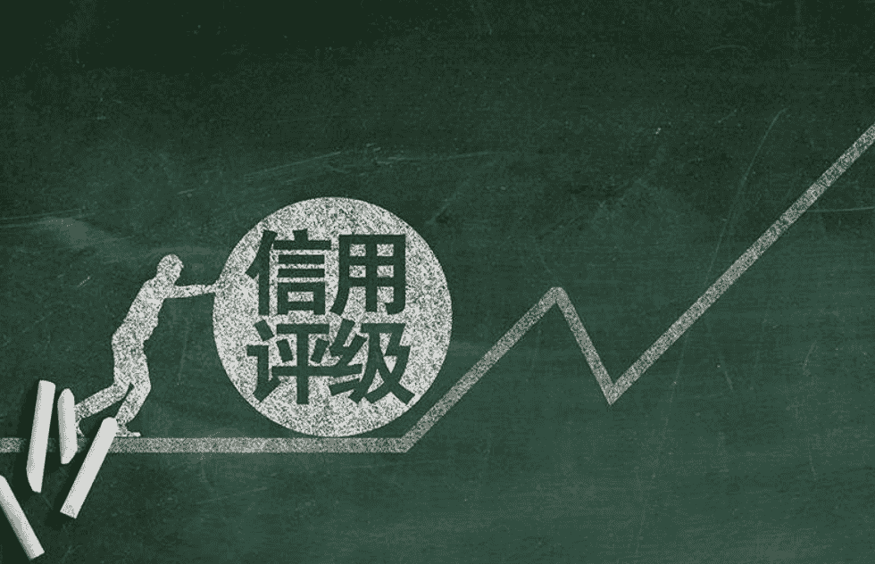

目前，评级业对“投资者付费”模式正在进一步探索，主流评级公司酝酿调整评级报告的披露方式。

本文由第三方AI基于财经文章[https://a.caixin.com/TcWMWcit](https://a.caixin.com/TcWMWcit) 提炼而成，可能与原文真实意图存在偏差。不代表财经观点和立场。推荐点击阅读原文详细对比和校验。

文 | 财经周刊 汪锦 张子哲

本文由第三方AI基于财经文章[https://a.caixin.com/TcWMWcit](https://a.caixin.com/TcWMWcit) 提炼而成，可能与原文真实意图存在偏差。不代表财经观点和立场。推荐点击阅读原文详细对比和校验。

中债资誉（简称“中债资誉”）等评级公司再次向“投资者付费”模式。多年前，中诚信国际（简称“中诚信国际”）再次探索“投资者付费”。评级机构人士告诉我们，当前完整级报告是免费的，未来可能逐层付费。

## 债券发行主体级别（截至2025年一季度末）

| 发行主体类型 | AA级及以上 | AA级 | AA级以下和无评级 |
| :--- | :--- | :--- | :--- |
| 非金融债务工具 | | | |
| 公司债（含企业债） | | | |
| 金融债 | 20% | 40% | 80%-100% |

来源：中国证券协会

同期，一位公募基金债券经理说，联合诚信有限公司（简称“联合诚信”）也通知其开通评级报告查询权限。据财新了解，这些变化的背后实际上是评级业内对“投资者付费”模式的进一步探索。“评级报告可能会分层披露，即为简化版和完整版。简化报告可能会公开披露，但内容精简；完整报告则需要付费购买。”受访人士告诉财新，“这主要是为了鼓励人为高质量报告付费，减少评级公司在发行人端的过度。”

## 2025年一季度业务量排名靠前的评审机构

注：业务量占比不足5%。来源：中国证券业协会

对于简化版的评级报告，业内简称为“一页纸”报告。许多评级人士向业内介绍，简化报告实际上会有三页，相当于模拟了完整级报告的核心内容，包括主体和债项的评级结果、评级时间、债项基本情况、主要评级观点及展望等要素，并且会列发行人的优势与风险关注点。

与只有两三页的简版报告相比，完整的评级往往有十余页，会系统性分析宏观环境、行业发展趋势、公司治理结构、业务运营状况、财务指标、行业情况、外部支持等方面，并在此基础上形成对发行主体及整体项的评级结论。

业内人士访问财经，分层评级报告更多是评级公司的自主探索，头部机构可能无法先行。财新了解到，2024年在京举行的一次评级行业联动会议上，与会员讨论了推进评级报告的议题，但尚未形成定论。此后一段时间，银行市场交易会旗下的中债资信进行了实质性的探索；同时，国内评级市场占比前二位的中信国际和联合诚信，在2025年开始尝试，权威评级也有可能忽视。

“目前，评级的同质化竞争严重，发行者付费模式，容易评级结果偏向发行人需求，独立性不足。头部机构的上述阐述，可能会弱化评级公司之间护的差异，更注重质量与投资者认可度，提高评级的公正性，可能评级机构提升盈利能力，客观上可能为机构开辟收入来源，但能否通过还要看市场接受。”前述受访人士指出。

评级结果严谨、区分不明显，是中国评级的特点。与国外市场市场的评级结果大体处于中高、两低底的分布均衡，中国90%以上的评级集中在AA以上，且大部分为AA和AAA级。这种状况导致一些投资者对评级失去信心，认为“没有什么可以看的”。

“发行者付费模式确实存在缺陷，导致评级没有充分发挥应有的。而且在这种模式下的利益斜，已经成为一个以自我为中心修正的恶性循环，如果没有额外的变量引入，可能很难打破这个循环。评级报告分层披露，并尝试让投资者付费，相当于引入一个新变量，看看能否触及评级标准的改革。”一位评级公司中层访问财经。

据财新了解，评级探索简版报告+付费报告披露的新模式，最快可能在2025年8月中旬开始，具体怎样收费、何时开始，评级机构仍在探索。注意的是，评级探索分层披露投资者付费模式，并不意味着评级业务由发行者付费转向投资者付费，而是事实上逐步提高发行者付费的比例，包括评级业务和非评级业务。

“付费模式并非行业的核心，关键在于评级机构是否履行了应有的职责。只有通过后风险揭示和市场作用才能得到证明，才有可能建立起影响力。”多位行业深人士指出。

## 评级行业倒逼变革

评级报告分层披露的背后，是评级行业对投资者付费模式的探索。“目的是希望削弱评级机构对发行人的依赖，解决评级虚高的问题，回归信用定价，为市场提供客观的信用。”一位行业深人士指出。从1992年10月人民银行批准首家全国性信用评估机构——中诚信证券有限公司以来，中国评级已经过了近30年，业务模式一直是发行人付费。不过由于评级机构的收入直接来源于定价，容易形成“谁付费、谁主导”的扭曲关系，评级机构独立性缺失，导致评级虚高且区域不够。”

近年来，为了强化评级机构的监管，央行、国家发委、财政部、银保监和证监会等部门于2021年8月发布《关于促进债券信用评级业务健康发展的通知》（下称《通知》）。作为近年来行业评级业务的纲领性文件，《通知》最重要的一点是取消了交易所债和银行间融资工具的强制评级要求，高风险发行人对外部评级的过度依赖，从根本上解决评级虚高的问题（见本刊2021年第一期《信用评级如何去泡沫》、《2021年第32期《信用评级变革》）。业内人士认为，“评级通胀”问题的背后，是发行人付费模式下的利益冲突：发行人有动力选择更高级的机构，而评级机构则为了维持收入和市场份额缺口。

中国评级的现状与中国债券市场的特殊发展密切有关。一位行业深人士介绍，2014年之前，中国评级处于刚性供给环境，投资者无需关注信用，评级区分丢失了实际意义，发行人对评级上的诉求强烈增强，形成了市场过剩；违约频繁，特别是2017年后违约常态化之后，投资者开始重视评级的风险显示功能，但评级机构已深陷“因囚困境”。

“一方面市场要求提升评级质量，另一方面评级机构的商业模式又难以摆脱对发行人的依赖。这种正是当前评级业务的性的挑战。”前述行业深人士指出。是发行人付费模式主导的国际三大评级机构，为何会陷入此类困境？前述评级机构中层将，译标、惠誉、穆迪三大评级机构最初都采用投资者付费模式，通过市场的优劣劣汰、标准和实践已被市场广泛接受，才逐步转向发行人付费模式，而这种转换并未降低标准，对风险显示能力的影响相对有限。

“国际评级业发展已经一百多年了，如何一步步做到如今如声誉为驱动的机制，原因很多，他强调。”财经意见道。

## 投资者付费之难

本文由第三方AI基于财经文章[https://a.caixin.com/TcWMWcit](https://a.caixin.com/TcWMWcit) 提炼而成，可能与原文真实意图存在偏差。不代表财经观点和立场。推荐点击链接原文详细对比和校验。

国际评级机构保持了较好的区分。例如，标普评级（中国）有限公司（统称“标普信誉”）公开信息，结合自身方法对市场企业的状况进行分析，形成其信用质量良好，其中AAA及以上占比46%，BBB序列以下占比32%。

2021年《通知》中提到“鼓励评级机构开展评级、投资者付费并披露评级结果，同时明确扩大投资者付费适用范围”。近期关于“一页纸”评级报告引发了市场视野。

截至2025年一季度末，全国备案的评级机构共48家，持牌机构共15家；其中中债资信、诚信国际为头部机构，承担业务占比约60%，市场占比超过5%。其余评级机构还东方金、中证、上海世纪和大国国际等过去均采用发行人付费模式。

通过交易协会全体会员共同成立的中债资信，更是探索投资者付费模式。一位行业深人士指出，发行人付费和投资者付费的关键是委托方是委托者。如果是评级公司根据公开信息对某发行人的主体进行评级，把评级报告挂在网上，投资者买时看到，不属于属性意义上的付费，是评级机构收费。

评级公司高管介绍，2021年6月和2021年3月，中证指数和上海有限公司先后退出这一业务。另北联信用评估转为发行人付费模式。在2021年准入备案后，投资者付费不是一个独立的业务，评级机构主要选择收取哪种费，普遍偏向发行人费。“投资者付费已经实施实则为给投资者的评级报告基本上免费。”

中证指数人士介绍，公司一直在构建投资者付费评级模式，形成了资产证券化与投资者付费业务并行，为债券、公司等投资提供价值定价、信用信息等多元化服务。虽然前期不太顺利，但随着债券市场发展、投资者需求日益增长，中债仍在持续摸索，将通过主流付费加大市场服务力度。

简版报告+付费报告的披露，足了评级业的经费。中债本人介绍，以国际三大评级公司之一的稳为例，其官方公开的评级报告较为简，而完整版需要客户付费获取。这种模式可能有三方面优势：是通过公开版报告向投资者提供信息、解决信息不对的问题；通过报告可以在一定程度上解决评级成本平衡的问题；两个报告在风险提示、展现逻辑、评级观点上保持一致。

“除了了中债信，目前传递的信号是，先行尝试评级付费披露的是头部两家评级公司，中诚信国际虽积极，联合信的态度较为积极，其他评级公司更不积极。”业内人士认为，多数评级公司对投资者付费业务缺乏执行动力。一个是评级公司同化竞争，替代性较强，投资者可以选择不付费，而是要求发行人直接把评级公司“缴了”；二是即使评级公司做付费订阅，可能无法解决“接下车”的问题，以及发行人等可能不会将完整版评级报告发布出去，评级公司可能难以靠此盈利。

人士看来，如果改为评级报告分层披露，可能部分投资人即使有国家大的支持，可能会为债券违约之后的投资决策失误，需要付费的详细评级报告作为投资依据。这也并不多少钱，一份评级报告几万、万计，收费高了投资人也不会。如果是私募投资者，他可以搭车，比如发行人要详细评级报告，或者找找买了评级报告的投资者，不必花费钱。

当前，市场投资者对评级报告的使用情况如何？“我们用评级报告还是很多的，主要是评级报告契约信用判断的逻辑，系统性地整理和披露了影响债能力的关键信息。”一位头部基金投资人士告断。

评级公司高管认为，目前评级报告一定程度承担着信息披露的角色，若选择评级可能会降低市场透明度。“很多投资人会在评级公司把评级报告当成缩版的募集说明书，可帮助投资者做出基本的判断。来自上市公司及券商买方投资者指出，评级报告比募集说明书更具侧重点，尤其是发行债券的主体，跟评级报告带来了持续的。”

# 拓展非评级业务收入

在期的评级业务的讨论中，部分评级公司已在尝试投资者付费服务。

2023年3月，联合资信向投资者推出了高校维度的“3C评价体系”，机构提供免费试用。联合资信表示，其“3C评价体系”突破了传统的“经营风险+财务风险”二维分析框架，新增对企业可持续发展能力的分析，更加准确地反映了企业信用水平。

2024年5月，中诚国际也推出了类似的“违约概率测度”的QE评级体系，名为“Q和E差异代表模型（Quantitative Model）与专家判断（Expert-based）”。

这些评级业务衍生出来的研究、数据、评级测算等属于非评级业务，是评级公司提供给投资者的收费服务。

在前资深评级人士看来，现在是评级公司转型的关键期。转型有利许多，可以考虑在评级的基础上做一些衍生的投资人业务，比如评级过程中积累的数据、沉淀的一些模型工具，都可以帮助投资者准确识别风险。

国际标普、穆普、惠誉等三大评级机构诞生之初主要采用采用投资者付费；随着上世纪70年代传真机和复印技术的发展与推广，投资者付费受到挑战，转走向以发行人付费为主、投资者付费为辅的模式。“他们的评级业务要是发行人付费，在此基础上，还会向投资者提供付费的投资者服务。”前述评级业务资深人士所说。

一接触惠誉集团的人士表示，除了债券评级外，惠誉的营销业务也如券分析一般，对不同行业进行跟踪，定期撰写研究报告面向投资者。此外，惠誉集团还有解决方案这一主题，提供ESG评级、信用级以及大宗商品、政治定量分析服务。

值得注意的是，无论是评级报告还是研究报告，惠誉均分为摘要和完整版：摘要版包含关键信息、评级结论、评级因素、历史评级变动及评级方法说明，投资者可以免费查询；完整版则需另外付费订阅，在惠誉官网注册查看。

前述惠誉集团的人士表示，虽然中国没有，目前投资者真正实在惠誉博华（惠誉评级有限公司）在中国的独家授权付费注册的量非常小。“大部分人可以付费咨询，免费资料群。

目前，用信用评级业务仍是标普（S&P Global）的传统核心业务，自2022年起，包括Commodity Insights、Market Intelligence等内的订阅业务（Subscription）的收入规模已超越评级业务，成为新的收入增长点。

标普2024年的财报显示，其订阅业务的占比已达52%，而信用评级业务的占比为34%。

扩展非评级业务也是大趋势。如果非评级业务赚到钱，解决了评级公司的生存问题，它就不会再去拼级竞争了，就让信用评级回归真正独立、客观、公正的正常状态。“前述中诚信国际相关人士说。

从国际评级机构的投资者付费业务设计，与评级相关的主要信息收集在一个终端（如标普S&P Global Market Intelligence）；其定价体系是矩阵式的灵活组合，既可以某个模块收费，也可以的模块组合收费。财新的了解，这也是中国评级机构主要要探索的方向之一。

在投资者提供非评级增值服务方面，近几年中国出现了用信评级、中商为领先的一些市场债券服务，以用信评级为首，其主要对债务发行主体提供第三方信用评估及风险分析。在用信评级体系中，主体信用被细分为1至100等级，数字多、等级高。

多位业内人士指出，用信评级与传统评级公司的评级方式、方法有很大区别。相比于评级公司遵循一套严格的评级标准和流程并接受监管，用信评级并未公开其评级业务，对其评级结果的调整使得相对容易受到市场环境的影响，而其客户端数据在很大程度上受益于传统评级公司的深度报告。

这类机构的发展，正是由于评级行业没有做好，没有回应投资者对区分度和参考价值的信用评级的需求，给其他评级参与者留下了发展空间，但是不是评级行业的核心职责。“前述诚信评级人士说。

“我们觉得中诚信这类可以购买投资者的基础数据，但没有单独购买定制化的评级服务。“一位保险资管的负责人认为，目前大部分投资机构还不太习惯买付费模式。

加微信号jntsg2，免费进资料群

## 变质的关键

针对评级泡泡，过去几年监管部门曾多次出对策，例如强制推债评级、引入国际评级机构曾希望“鳄鱼效应”，此番主要评级机构探索路评级业务和非评级业务的投资者付费，可能带来变质?

部分评级人士提醒，在发行人付费的背景下探索投资者付费，可能出现“双轨制”，即便同一主体的评级呈现“两面局面”；在发行人端属于第一梯队，导致风险无限；在投资者体系中，评级在后在靠，“双轨”出现矛盾。

一位评级业内人士指出，信用级应当保持严格的一致性标准，对于同一主体，其违约责任应当是客观确定的，“不能说为了迎合投资人，就给一个评级的；为迎合发行人，又给一个高的评级”。

在前述评级公司高首先言，想要投资者付费，提高评级质量才是核心。如果说公司是发行人为“菜”了，换这种方式赚钱，是不通的。

一位来自惠誉博华的人士认为，中国债券市场仍然高，不仅是评级公司自身的问题，因为市场发展时间短，债市场尚未建立，导致评级企业发展。“曾在国际市场有投资和非评级的区分，但中国没有垃圾市场，给低级无意义，买方不要买”。随着五《通知》的实施，以及证监会，目前城债、企业债三类产品将不再强制评级，发行人市场依然存在。中国证券协会数据，2024年，银行间和交易场所信用类债券中有1594项无违约债券，占比63.7%，下降2个百分点；有效发行主体76家，占比9%，增长2个百分点。两位受访评级人士提到，上述《通知》取消强制推评级之后，评级公司新增了发行主体价格，因此行业整体运行稳定在30亿元以上，几乎全行业盈利，利润率至少25%以上。给城投及产业企评级是当前评级公司的主要来源。包装费加上绿色评估、ESG评估，一个单子少两三百万。“在这种收费下，一家城投层层套。“前述券商人士对，城投目前是按内部入库标准与外部标准无关，但账户投资要看头部评级，有的产品只购买AA+以上的债券。

此外，从行业管理层看来，不再公布各机构的市场份额抢比，以最大程度营造行业公平环境。“因为公布市场占有率领先的机构起到了一定的宣传作用，机构也会此排名作为营销工具。同时排名靠后的机构担心被市场淘汰，容易出现市场竞争等“内卷”的行为。“很多制度需要跟上，监管重点应该是信息披露，以及如何收费、违法成本，切实转市场、轻质量局面。“公司高管如称：

加微信号jntsg2，免费进资料群

## 最新财新周刊 | 火爆的“苏超”能否复制？

文 | 财新周刊

2025年7月5日，“苏超”第六焦点战在南京奥体中心打响，南京队主战苏州球队，现场观众人数达60396人，刷新“苏超”单场观赛记录，并创了中国足球赛事上座人数新高。

2025年7月6日，江苏淮安，2025江苏省城市足球联赛赛第六轮，淮安对阵常州赛现场。中超第一轮赛事自5月开始，计划全程七个月、共85场，常规赛和淘汰赛两个阶段进行，常规赛共13轮78场比赛，常规赛排名前八的球队进入淘汰赛，共三轮七场比赛。

开赛伊始，“中超”的人气不高。据江苏省体育局统计，第一轮赛事（5月10日—11日）观众场均7745人；第二轮（5月24日—25日）场均9852人。这两轮就超过了“2025年中甲联赛”场均6467人的上座率，也超过了许多中超次的上座率。

## “苏超”持续火爆 B端C端“吸金”

| 第一场赛事 | 第二场赛事 | 第三场赛事 | 第四场赛事 | 第五场赛事 | 第六场赛事 |
| :--- | :--- | :--- | :--- | :--- | :--- |
| (5.10-11) | (5.24-25) | (5.31-6) | (6.14-15) | (6.28-29) | (7.5-6) |
| 日期: 2025.5.31 | 2025.6.15 | 2025.6.1 | 2025.6.28 | 2025.7.5 |
| 观赛人数: 7745 | 9852 | 6023 | 3612 | 4317 | 60396 |
| 粉丝互动数量: 10 | 18 | 26 | 27 | | |

数据来源：新财经官方频道，江苏省体育部

“苏超”火爆发生在5月28日，南京市公众号发声，随后“苏超”没有限购，全是免费观看。江苏省各地市场互动，小红书上“苏超”相关搜索增长了7倍；5月18日，热度涨到48万。5月31日，线上流量传至徐州，场地临时挪到当地最大的奥体中心，现场观众一举增至25万人。本地企业表示，一开始门票卖出去，每张票从10元至20元，“苏超”采取低价购票策略，比赛观众持续增长。看着江苏灌活了“苏超”，其他城市也想跟随。6月四川、浙江迅速推出“川超”、“渝超”，7月，“蜀超”、“赣BA”（江苏省城市篮球联赛）开启。

“苏超”火爆后，营销事件成为常态，其中助力之一，江苏省主办方提前造势，要求各地体育部门要宣传、文旅等部门加强协作，引入流量，创造效应，让“苏超”变成“消费增长”。仲联华东区顾问负责人明文对财经进行分析，一方面各地经济发展水平相对对，13个城市全部进入全国GDP前十，城市资源互备；另一方面足球俱乐部近乎活跃，东部解散后，球迷愁无处安放，需要更多赛事供给。此外，“苏超”可是江苏省会之力，而赛事爆发后，主办方又能及时调整，发挥影响力。政策落地：铁路部门开通高铁快专线，返往各市所属球队；各地市场针对观赛赛事推出系列减免活动；推出“苏超”主题文旅联、市集活动。

## 赞助

野村中国首首席经济学家认为，各省内部区域经济平衡不同，各省地级市之间经济水平和体育水平都大。“不能假定能够容易复制“苏超”的成功，各省要有发展自己的特色，未必要搞足球，但要管理好预期。

“苏超”破圈后营销事件成为常态，其中助手之一是中国互联网巨头阿里，该公司多业务线争夺“苏超”队名。

6月30日，阿里一口赞助了“苏超”四支球队：即零售业务淘宝购物冠名队；第三方合作支付宝冠名队；消费业务花呗赞助无锡；个人资业务支付宝在签合同后，次日（7月1日）即宣布成为赞助球队；7月4日，百付码联保成为“苏超”联赛南京赛区官方合作伙伴；而物流业务菜某因同名被网友调侃，最终没有一支“苏超”球队接受赞助。

“联赛官方被赞助了，当然也是球队的冠名关注度更高。”一名业内人士分析解释说，6月13日，阿里巴巴电商业务的竞争者京东已成为“苏超”赛事的战略官方合作伙伴，而常州球队当时因为比赛垫底，网友援提及“常州”。

本文由三方AI基于此财经新闻[https://a.caixin.com/DiolbavH](https://a.caixin.com/DiolbavH)提炼总结而成，可能与原文真实意图存在偏差。不代表财经新闻观点和立场。推荐点击阅读原文严致对比和校验。

进入7月暑期，“超”继续拉动消费增长，5月11日“苏超”南京首次主场比赛，7月5日前往赛场的打车量上涨182%，其中打车量涨368%，江苏用户多来自上海、北京、杭州、无锡等地。

比赛带动主场城市周末热度升华。美国出行数据显示，7月4日—6日，江苏的酒店过夜住人数显著增长，南京、苏州、淮安、锡州、扬等地主场城市五星酒店预订订单量同比增长59%，景区门票订单同比增长255%。

抖音生活服务数据显示，周末南京主场球队迎赛吸引大量游客，南京华华龙乐园、南京欢乐乐、扬山欢乐水世界、南京珍珠聚水世界等商家周末未热门的，对应购单消费占比增长32%、217%、360%、297%。

主场城市向游客推出一系列旅游优惠活动，在很大程度上促进了游客前往主场城市的意愿。携程数据显示，第四赛事期间，扬州作为主场城市对常州景区假日游客同比增长超过4倍；另外，常州游客前往南京的旅游订单同比增长43%，南京游客前往常州的旅游订单同比增长28%。

赛事带动当地“赛后场”的餐饮消费。一名在常州日料店的商家告诉财新，虽然这次常州逛起来，“旧川南”“淮扬”，让当地带不去多少流量。“许多人第一次逛常州，南京九大景区是为了迎接客流带来更多优惠消费。整体来说，流量相比去年确实有提升。”

美国数据显示，7月5日以后，游客贡献的南京餐饮订单量位居全省第一，苏州紧随其后。随着增速，扬州的游客消费餐饮订单量增长增长83%，其他主场城市也有40%以上增长，还有夜间餐饮消费带动酒水至水果消费，7月5日，江苏省消费者夜间餐饮消费较去年同比增长40%。6月1日至15日与2024年同期相比，江苏省美团购购啤酒兑酒成交增长超过1倍；时令水果芭荔、山上的成交额同比增长180%、130%。

“苏超”对消费的带动向更多区域延伸。在线，除了景区与餐饮消费，南通圈消费也迎来增长。抖音生活服务数据显示，6月28—29日，江苏南通圈订单消费增长26—27日同比增长103%，销售额环比增长114%。

线上数据显示，6月1日至15日，江苏省美团购足球类成交增长170%；球类成交增长200%；篮球成交额增长超过3倍；各种类商品通过微信等平台，免费还零售成交额翻倍；运动、景观防晒装备是消费者需，肤衣、防晒成交额增长近1倍。

依托强大的供应能力，围绕，“苏超”IP（知识产权）的周边、文创产品迅速上架。成为官方战略合作伙伴，海澜的家推出“苏超”限定T恤；江苏省足球联赛官方旗舰店在京上线，文创冰箱、扇子、帽偶、布袋等产品。数据显示，6月30日至7月15日，淘宝卖出了3万件苏超相关的潮流、球衣、锁扣、冰辅贴、帽子、折扇等文创产品卖出了5万件。

“我们泡店的销量90%以上都是‘苏超’相关的产品，之前的文创产品都变卖了。”常州城市文创品牌66款在淘宝店铺上线“苏超”文创产品，包括冰箱、帽子、布袋、毛绒玩具等，其经理王小怡访财新，“苏超”自然热度加持到“苏超”文创产品针对性投入，店铺销售额从之前的两万增长到七八万。

“其中80%以上都是江苏省外消费者。”王小怡告诉财新。徐州文创研究所从6月开始销售“苏超”相关产品的需求来自自己。相比其他地方特色潮流，这个（苏超相关产品）具有更大的地域兼容性。“徐州文创研究所表示：销售“苏超十三妹”周边，南京在此并不是做文创产品的，而是经营二手服装网，在与客户通过日常沟通中发现了“苏超”周边的需求，他称“目前‘苏超’周边的预算基本可以涵盖成本。

王小平表示，银行、酒店、各地文会在比赛前提前购买“苏超”文创产品做赠品，但目前不敢国货，“苏超”热度到位现在这个程度，已经是奇迹了”。

## 盘活体育场馆

“苏超”并不是第一个爆发“出圈”的地方体育赛事。

2023年夏季，发源贵州锦江“村超”已经成为市场到民间赛事的标准。2020年、2024年贵州锦江已破亿元。同年，贵州省体育局发布的贫困县显示，该年新增旅游市场主体1850个，全县床位数从598个增长到1万个，累计接待游客94万人，贵州锦江各级政府推出政策，拿出白银激励演唱会、大型赛事等落地，以提振当地市场。

2024年8月，国务院发布《关于促进高质量发展的意见》鼓励举办各类体育赛事，创建具有自主知识产权的品牌，申办或引起良好影响，培养专业运营团队。2025年3月，《提振消费专项方案》再次提到，支持各地增加特色赛事，还有群众性活动，“全国巡回”。

宁夏省的《进一步推进增长若干措施》指出，引导承办国际、国家级及大众精品赛事，经费给予主办方5万至300万元补助；在苏州，对每场比赛售票人数超出5万次的每人予以奖励。当地政策扶持“村超”，最终获成功。总结“苏超”文旅融合模式值得信赖。各地在举办特色赛事时，这样能够带动当地餐饮行业的发展，全民参与积极性高，更容易增强赛事IP认同，背后是利益共享。她建议，地方可以考虑与自身结合。例如，新加坡滨海街道是一个成功的案例，它融合了新加坡的地标性建筑，作为全球首个在夜间举办的赛事，也彰显了都市魅力。政府应该举办体育赛事，能够带动文旅、拉动经济资源。2023年发布的《体育高质量白皮书》显示，国内52%的体育场日接人数少于500人，此前利用率并不高。锦江拥有12万平方米，全国第一，“苏超”通过主办场地将场活。

目前，中国的体育消费仍处于早期阶段，对于场馆长期运营，以商业综合型为主。上述运营人士介绍，目前场馆规划时充分考虑周边配套功能，弥补非大型活动期间流量的不足。他认为，场馆需要增加自身的活性，既能承接大型赛事，也能在“空窗期”转变为具实用性的综合场馆；此外，运营方也要具备协调能力、营销能力等“软实力”，为活动主办方提供更全面专业的服务。

## 最新财新刊 | 车市激战何时？

本文由第三方AI基于此财经新闻[https://a.caixin.com/76YEEC](https://a.caixin.com/76YEEC)提炼总结而成，可能与原文真实意图存在偏差。不代表财经新闻观点和立场。推荐点击阅读原文严对比和校验。

2025年已经过去，中国车市呈现两幅不同的图景。中国汽车工业协会（简称“中汽协”）统计，前五个月，中国企业生产、销售汽车1286.6万和274.8万辆，同比增长超过10%。7月10日披露的最新信息显示，6月，汽车销量维持10%的增速，态势仍平一片大好。

参与者的体感则有所不同。有的企业抱着行业“内卷”，有的上下游伙伴“哀哭”生存困境。中国统计局报告，2025年五个月，中国汽车制造业的利润同比下降约12%，至1781.4亿元。中汽直接指出，以“价格战”为主要表现形式的“内卷竞争”，是行业效益下降的重要因素。

最近一轮大规模行情爆发至2023年初，汽车价格大幅下探。全国用车市场信息联席会（简称“乘联会”）秘书董东统计，2023年和2024年，用车市场车型平均降价幅度为2.2万、1.8万元；2025年上半年，平均降价幅度2.1万元。[002594.SZ/0121.HK]——一款车型是典型车型，2023年初至今，其售价幅度超过40%。

## 2025年汽车行业“内卷”动态

| 日期 | 2.25 | 3.19 | 3.29 | 4.17 | 5.27 | 5.31 | 5.3 | 6.6 | 6.9 | 7.9 | 10.11 |
| :--- | :--- | :--- | :--- | :--- | :--- | :--- | :--- | :--- | :--- | :--- | :--- |
| 市场总局 | 组织企业座谈 | 组织企业座谈 | 组织企业座谈 | 组织企业座谈 | 组织企业座谈 | 组织企业座谈 | 组织企业座谈 | 组织企业座谈 | 组织企业座谈 | 组织企业座谈 | 第四次企业座谈 |
| 国家发改委 | 组织企业座谈 | 第二次企业座谈 | 三次企业座谈 | | | | | | | | |
| 工信部 | 组织企业座谈 | | 组织企业座谈 | 组织企业座谈 | | | | | | | |
| 商务部 | 组织企业座谈 | | | | | | | | | | |
| 监管部门 | 组织企业座谈 | | | | | | | | | | |
| 汽车工业协会 | 发布关于维护公平竞争的意见 | | | | | | | | | | |
| 工信部 | 加强汽车行业 | | | | | | | | | | | |
| 商务部 | 发布《加强汽车车辆行业监督管理意见》 | | | | | | | | | | |
| 市场总局 | 开展试点 | | | | | | | | | | |
| 国家发改委 | 监管 | | | | | | | | | | | |
| 工信部 | 启动试点 | | | | | | | | | | |
| 市场总局 | 监管 | | | | | | | | | | |
| 广汽集团 | 承诺 | | | | | | | | | | |
| 一汽集团 | 承诺 | | | | | | | | | | |
| 东风汽车 | 承诺 | | | | | | | | | | |
| 长城汽车 | 承诺 | | | | | | | | | | |
| 赛力汽车 | 承诺 | | | | | | | | | | |
| 京东集团 | 承诺 | | | | | | | | | | |
| 比亚迪汽车 | 承诺 | | | | | | | | | | | |
| 山东汽车 | 承诺 | | | | | | | | | | |
| 吉利汽车 | 承诺 | | | | | | | | | | | |
| 北京汽车 | 承诺 | | | | | | | | | | | |
| 进口汽车 | 承诺 | | | | | | | | | | |

资料来源：财财经

实际上，2025年上半年新能源车同比增长与前值直接相关。2024年车上市前后低后高的走势，下半年新能源车在“以旧换新”政策激励下增长。这一政策延续到2025年，边际效应递减，为抢夺市场，主机厂以销量换量，压力向游传导。

**2025年上半年，新能源乘用车销量增长集中在低价车型**

| | 销量（万辆） | 同比增速（%, 上轴） |
| :--- | 0 | 20 | 40 | 60 | 80 | 100 | 120 |
| 8万元以下 | | | | | | | |
| 8万10万元 | | | | | | | |
| 10—15万元 | | | | | | | |
| 15—20万元 | | | | | | | |
| 20—25万元 | | | | | | | |
| 25—30万元 | | | | | | | |
| 30—35万元 | | | | | | | |
| 35—40万元 | | | | | | | |
| 40—50万元 | | | | | | | | |
| 50万元以上 | | | | | | | |

资料来源：中国汽车工业协会

许多汽车供应链链主反映，行业存在主机厂反复压价、招标规则不透明，付款周期长期等问题。咨询机构艾齐铂针对253国家内供应商调研发现，2022年供应商实现同比增长61%，2024年这一数字降至43%。

自023年以来，乘用车库存始终高位。**乘用车库存（万辆）**

| | 2021 | 2022 | 2023 | 2024 | 2025 |
| :--- | :--- | :--- | :--- | :--- | :--- |

注：2025年数据五个月
资料来源：乘联会

作为传统主机，中国汽车流通协会显示，2025年上半年，线下店仅27.5%完成销量计划，其余72.5%未达标。大部分经销商承受库存压力，苏、浙、沪、皖、川、粤、豫等地经销商协会联合发声，反映企业普遍面临库存压力、资金断裂等严峻挑战。

行业人士认为，“内卷”不仅伤害企业自身，也伤害供应商、经销商、消费者的利益。他指出：“某些企业降价还能盈利，是因为这类企业的利润实际上是损害的。”

中信相关负责人指出，国内市场“价格战”挤压企业空间，鼓励企业通过技术创新、管理创新降低成本，给广大消费者带来优质、具竞争性的产品；长期来看不利于行业发展。工信人士称，“内卷”需要加大力度，推动产业结构优化，加强产品一致性，配合相关部门开展执法，采取必要的监管措施，维护和谐环境。自此引发“反内卷”浪潮。6月10日晚，15家车企先后承诺将账期缩短至不超过60天，实际是占用供应商资金，降低负债。部分资金紧张的车企借此扩大规模，限制账期在一定程度上抑制价格战暴延。

自主品牌车企高管告诉，广汽集团是数不多能把“60天账期”做到常态化的车企。另一名业内人士说，要承诺不容易涉及资金周期规划，有些公司面临巨大压力。合资汽车销售人士透露，“反内卷”的口号已经出来了，车市价格战有望，普遍现状难以回避。

东准整理的数据显示，截至235月末，全国乘用车库存达到345万辆，是过去五年同期最高水平。他预计，6月至8月是汽车销售旺季，现有库存需要约54天才能消耗。时光回到2024年，6月初至今，汽车价格收平稳。例如，6月26日，华为与奇瑞合作的智界品牌宣布发布2万元；次日，长城汽车欧拉好轿新款限时优惠4000元。更多车选择可以提供保险补贴等非直接挂钩补贴。

本文由第三方AI辅助于财经文章[https://a.caixin.com/MM76YEEC](https://a.caixin.com/MM76YEEC)提炼总结而成，可能与原文真实内容存在偏差。不代表财经观点和立场。

2025年5月，奇瑞董事长王许吕公开：“价格战是我最不喜欢的一个词，因为我是被绑架的”“奇瑞汽车也跟着价格战。”

也有企业反对魔化价格。比亚迪汽车王福苗曾公开：“卷”是竞争，是市场经济的本质。所有企业都要拥抱参与，从中脱颖而出。”长安汽车（000625.SZ）董事长董军认为，为“内卷”是良币逐劣的过程，也是市场竞争带来最快恢复的方式。

一名头部新势力汽车高管告诉财经，在燃油车时代，汽车行业表现出头部格局，能源变革使行业重回洗牌，只有经历充分竞争，行业才会稳固回旋。

“现在十万块就能买的产品，过去是不敢想象的。”该人说，“在合资品牌巅峰期，车企的一年净利润高达700亿元，汽车成了暴利行业，这是应该的。如果没有竞争，汽车现在还是这么高的利润，挣的不是消费者的钱。”

然而，当前汽车企业面临严压，压力还随着零部件和产品销售链上下游传递，别整车公司利用不合理的商业条款压榨供应商、经销商，就让消费者去付出代价。

根据中国汽车流通协会调研，2023年，全国汽车经销商亏损比例为43.5%，只有37.6%的经销商盈利；2024年，经销商压力有所缓解，但亏损比例仍为41.7%，实现盈利的经销商占比为39.3%。

汽车零部件企业的业务分化日益明显，奔驰时代（300750.SZ）、陕动力（000338.SZ）、琥辉（00660.SZ）等头部供应商的业绩持续增长，中小供应商的议价能力相对较弱，生存状况愈发艰难。实际上，不断要求供应商降价，拉长对方付款账期，是当前中国汽车行业的严峻之。。

传统制造行业追求规模，一向有以量换价的传统。一名汽车行业资深人士告诉财经，上游零部件每供汽车价格是行业一做法，“年度降价”（年降）幅度普遍不到5%；但年后价格战屡演，车企不断地提出苛刻需要。

一名汽车行业零部件供应商人士称，过去，基于产品工艺、规模增长带来的效益，供应商与车企签订的“年降价”幅度在3%左右。“2023年开始，生意就容易了。”该人说，“如今，供应商在车企招标时就要给利润近乎全部的报价，部分基本还要承受“持续降价”。

降压力传导过程中，一名汽车中控供应商人士举例，某家车头部企业开展所属的“透明竞价”，“亮价时每个供应商都能看到的排名，觉得报价不够，就重报价，直到降到最低。”

一名电气绝缘材料供应商人士采访称，过去，车会根据报价方案对家供应商综合评分，行业中报价意味着结束。

“现在是比下午5点结束，车会在45分告诉各家排名。很多供应商对排名不理想，只能上价，有时甚至连着再抢几。”该人士称，规模有限的供应商迫于现实，不缺钱也要签订单。

极限品牌本些年会会击优质产品安全底，是各界关注的焦点之一。前汽车行业领先人士，长尾激烈竞争可能对供应商选择非常极端手段。

广汽集团团队董事长总经理认为，整车长的长期健康发展无法被产业链割裂，“供应链企业生存都很困难，怎么还能提供优质的产品和服务？”他说，“主厂无法独善其身。”

J.P.是一家消费者调研的咨询公司。该机构在2025年6月公布的一份年度报告显示，中国新能源汽车在长期可靠性方面收到了更多负面反馈，且负面反馈还是燃油汽车。

上述收集了中国新能源汽车在过去六个月中遇到的问题，受车主的购车期在13至24个月之间。该机构指出，长期质量问题中，故障问题增速显著高于设计流量，成本控制引发了车辆、配置等多种系统的耐久风险。

## 价格战为何如此？

过去十余年，中国新能源行业快速扩张，能够持续升华。2023年初，购置补贴彻底终止，需求侧露出供需关系发生明显变化。

霍东树整理的数据显示，2022年开始，乘用车整体库存超过200万辆，在此之前，库存长期维持在250万-300万区间。2022年12月，库存后增至358万辆。

2023年和2024年，国内降价价格战并不意外。2022年，国内降价乘用车不到100万款，竞争激烈，背后是企业产品同质化。

一名中国汽车研究中心有限公司（称“中汽中心”）专家告诉，当前新能源汽车市场，大众多数缺少辅助驾驶等新技术的功能，性能提升却只能便宜。他解释说，在燃油车时代，消费者看皮实、耐用；看新能源时代，看底盘、动力；看高端品牌，选择奔驰、宝马或奥迪。

过去汽车行业历史悠久，一直占据领先地位。技术壁垒高，发动机、变速箱和底盘组成“三大件”。新能源汽车时代，“三电系统”替代了原来的三大件”，降低了造门槛。主管部门提出了“旧换新”目标，通过财政补贴、税收优惠一系列政策扶持。中国汽车产业在赛道再次出发，逐渐取得优先优势。从传统机械转向机械和电子结合，客观上压缩了空间。另外，智能电动汽车正在关键突破期，固态电池有望成熟，高级驾驶在规则回旋，不少车企难以靠差异化。现在几乎都有新车发布，造型设计、产品定位、服务等方面趋于雷同，“贯穿尾顶等设计随处可见。”

传统车企在新能源方面遭遇诸多挫折，在程度上是车企处于市场压力下的妥协。对大部分车企而言，参考已取得市场认可的竞品，例如理想汽车 (NASDAQ: LI)凭借六座车型成功开启家用用车市场，引发竞争激烈。已上市的SUV车型包括问界M8、蓝SU9，还有多款车型在量产筹备中。“实际上，六座市场空间有限，容不下这么多车型？”一名新势力车企陷入困境。滞后、亏损和缺乏形成恶性循环。2025年6月初，中广中心党委书记、董事长安铁成撰文道，原始性竞争通常需要大量资金和时间，且效益难以保证：弱企业具备相应能力，而头部企业深陷价格战，利润受损、投入意愿不足，行业整体可能增大。值得注意的是，销量是车企市场竞争的重要指标。2024年以来，高合汽车、越界汽车、哪吒汽车相继接入。消费者对边缘车企没有信心，销量领先的老企业更容易获得信任。

东风集团政策研究人员认为，车市现在的局面，部分在于某一时期的发展趋势鼓励企业大干，追求利润到极限，“现在还把篮子都砸了”。全国各地新能源汽车造热。不少地方引企业投资工厂，提供大量补贴。“他们能够想，很多时候新车企自己不用掏钱。”一位著名汽车行业政策制定者，“地方越好投资规模如年产20万辆，地方政府通过平台企业投资支持维持。狂热几年年后，当许多车企处于陷入困境时，不得不打响价格战“红海”拼杀。还有另一地方安排本土举办合公司，不利于市场自然出清。”

近日，哪吒汽车合众启动重整。哪吒汽车在2022年达到销量领先，年销量超过15万辆，2023年销量同比下滑五成，逐渐陷入困境。哪吒汽车曾有国有股东支持，包括宜宾省、广西南、浙江等地等地。为当地地汽车产业，国资股东多次向哪吒汽车伸援。仅在2024年，哪吒汽车向柳州、南宁国资等筹超10亿元。这些资金最终未能帮助它废弃除。2024年末，哪吒汽车 supposed停产，近期曝出王建国董事长持续事件。一些业内人士指出，当前实施的消费刺激政策有调整空间。2024年月末，商务部、财政部等部门给汽车市场注入“强心剂”，推出汽车报废更新补贴。三个月后，主管部门增加了长期支持，报废更新补贴力度翻倍。报废更新补贴标准统一。2024年末起，消费者报废符合旧车，买新可获得2万元补贴，新能源汽车获得1万元补贴。预计2025年，补贴额度保持不变。不过，报废更新补贴落地后，实际上拉动了大量销量。业内人士认为，报废更新补贴效率不高，许多企业不具备技术优势，核心竞争力被淘汰。他建议，报废更新补贴应当参照地区实施，规则由主管部门制定。许多省份根据补贴金额与销售价格挂钩或定价百分比。

## 监管部门启动调整

汽车市场曾经缺乏良好秩序。前述的行业人士分析称，一方面是规则完善，存在“灰色地带”，另一方面是过去很久，“内卷”现象在行业蔓延，得不到及时止。最重要的是卖钱，账期是一个典型现象。某商人说，过去合资车账期普遍为45天，现金支付。随着形势变化，合资企业延长账期；自主品牌票期更长，多数为90天。如果车企爆雷，银行票据还能拿到。”

2025年6月1日，修订后的《保障中小企业款支付条例》（简称《条例》）正式实施。其中新增规定：大型企业从中小企业采购货物、工程服务，应当自交付日起60日内付款；合同有约定的从规定。新版《条例》还规定，大型企业不得强制中小企业接受商业票据、电子债证等非金方式变相延长付款期限。其中，电子票证的内容是修订补充。《条例》增加上述内容，对于汽车行业来说具有针对性。此前车企承诺将账期缩短至不超过60天，是响应《条例》要求。一些车企实际行动，如7月1日，小汽车（NYSE: XPEV）向部分供应商发布邮件，针对付款安排启动补充签署。为加强《条例》约束，7月9日，工信部在“全国欠后中小企业款项投诉平台”开通“重点车企延期承诺（建议）反映窗口”。工信部此次通过反映窗口，旨在督办中小企业有关问题，推动整车企业改进管理流程，优化方式，落实《条例》要求，切实履行账期承诺。该窗口主要受理四类问题：重点车企未践承诺，约定的期限超过60天；设定不合理的账期起始时间，无正当理由推迟出具验收合格证明，或者收到第三方货款作为支付条件；强制或变相强制供应商接受商业票据、电子债证等支付方式；落实《条例》的其他问题或意见建议。业内对反映窗口上线持续不同看法。部分行业人士态度乐观，认为主管部门是“动态”。

中汽中专家认为，供应链账期是企业的商业行为，整车企业固然不能强制交易，但部分动力电池、高算力芯片核心零部件企业外，大部分供应商处于相对弱势地位，他们为了达成交易，不得不让步。一个新能源汽车主时，供应商和汽车企业需要在保期期和保期价格之间取舍，供应商更倾向于延长账期来保证价格稳定。“账期判断条件现在一切变成了60天，那影响供应商可能在价格上输得更害。”工信部还在探索其他行业做法。工信部称，后会指导行业机构制定汽车行业结算规范，推行合同管理企业付款流程。6月27日，修订的《反不正竞争法》经全国常委会表决通过，将从2025年10月15日起施行。这一条款与汽车行业高度相关。修订规定，大型企业不得滥用自身资金、技术、交易渠道、行业影响等优势地位，要求中小企业受影响明显不合理的付款期限、方式、条件和责任等交易条件，不得具有针对中小企业的货物、服务等条款。违反上述条款，滥用自身优势地位的，省级及以上监督部门责令限期改正。逾期改正的企业面临上限100万元罚款；情节严重的将被处100万至500万元以下的罚款。一名学者指出，此前规范并非无法执行，关键环节执法到位，监管部门立案调查范围不够广。月初，中国电动汽车协会副董事长杨撰文，政府正积极探索国内新能源产业的管理创新。当前汽车行业整顿无序竞争由主管部门统筹部署，不同主体配合。全国汽车协会（称“中汽会”）发文，呼吁车企厂商向经销商及时返利。在传统销售模式下，车企按照自己制定的指导车辆销售，为了激励经销商的主动性，销售业务提供便利，经销商经营无法额外利润。在市场不佳时，经销商常常低于售价销售，厂家获利。一名头部车企管理层透露，近期协会关注集团、宝马、奔驰、上汽、奥迪等企业，监管部门要求车企不要住批发价，还要严格住零售价。一旦库存超过预警水平，经销商立即发货。

## 未来竞争靠什么？

在席卷全球的智能浪潮中，中国公司已成为头部。高质量竞争才能促进行业保持发展。月下旬，工信部部长董指出，车企价格战是短视之举，要摆脱价格战，企业一定要增加投入，在关键技术上增强竞争力，领先一点，避免产品同质化。

特斯拉的经验可以借鉴。特拉引发了价格战，但这通过技术创新，大幅改变了汽车内架构、生产方式实现成本降。按照传统工艺，车身材料为钢材和铝材。零部件集中设计成大型结构，通过位压铸一次性集成。2019年率先推出一体化压铸工艺，成功应用于量产车型Model Y，底盘减少了70个零件，成本下降四成。人工数量对于传统车间减少10%，人工成本大幅降低。特斯拉打破了线束网络。传统汽车布局式架构，通过线束将电子控制单元连接起来，实现电力信号传输。向智电转型过程中，电子控制单元急剧增，线束结构复杂度和整体长度大幅增加。特斯拉创业之初就提出架构，根据功能划分驾驶域、座舱域、动力域领域控制器，大幅减少了电子控制单元的数量，线束长度明显缩短。后期产品中，特拉实现了跨域融合。中信证券在报报指出，如果汽车采用传统传输架构，线束长度为5公里；特斯拉早期车型将线束缩短至3公里左右，后期Model 3车型缩短到1.5公里。国内突围案例也为行业决策提供了思路。来理想(NIO/9866)，小鹏和理想汽车并称“小蔚”，是中国新势力的先行者。2023年，理想汽车率先在新势力中实现全年盈利。理想策略聚焦20万以上SUV市场，打空空白市场和舒适。动力技术方面，选择了业界首见不惯的增长混动路线。市场结果证明，理想选取了目标用户，“冰冰箱”精准满足了中国家庭用车的需求，增程技术具有纯电同样的节能、安静的静谧，又能缓解“焦虑症”，提供了超出用户预期的表现。理想摸着石头过河，为中国新能源汽车开启了新的市场。长城汽车精准硬派越野市场推出的坦克品牌是典型案例。硬派越野市场对小众，主要市场由奔驰、Jeep和福等国际品牌支配。2020年，首款坦克越野车型上市，大开蓝细分市场，品牌发红。坦克陆续推出多个车型，逐渐成为国内硬派越野分市场的领头羊。广发证券测算，2024年，坦克品牌在国内非越野SUV市场的份额为51.4%。坦克的成功打开了“方盒子”汽车市场，吸引了亚迪、奇瑞、长汽车等车商纷纷入局。“反”并不意味着排除竞争，市场竞争出来是结束乱战的必之路。许多行业领先人物公开表示，行业还未定局，经过竞争、洗牌，少数优秀才能脱颖而出。回全球汽车行业发展历史，欧美大型汽车企业经历多次重组。在汽车工业较为发达的国家，本土车占据大部分市场份额。相较而言，国内造车主体远超欧美，行业格局在不断演进。

由于提供的OCR文本包含大量重复的推广垃圾信息（如“加微信信号jntg2，免费进资料群”等）、图片描述以及多个不完整的页面重复（如关于“福岛核灾后的创伤记忆与重建”的多次重复），且文本中存在大量的识别乱码（如“中中中心性”、“中中心性”、“流形形成”等），导致判断无法从中提取出逻辑连贯且完整的文章内容。根据指令要求，若没有任何有效内容则输出如下：

[content]<!-- no content -->

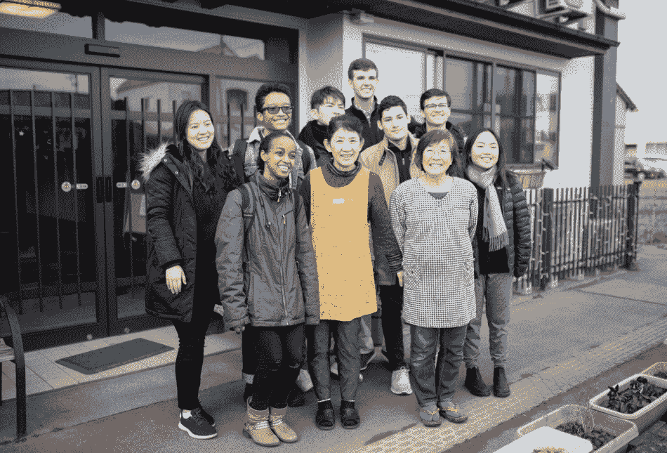

4年后，小林友子道出了真相：“你知道2011年我们遇难时，别人怎么对我们的吗？他们说说我们身上带着放射，不许我们进超市，不让我们加油。我们被赶着走，被等人羞辱过。如果2020年我坚持不让你，我就在做和那些曾经没有对待我们的人一样的事情。”

不仅福岛核电站事故本身，由于长期背离以及在外遭受的种种心理创伤，周围居民普遍存在严重的心理创伤，甚至当地出现了一种“福岛PTSD”的症状，这种PTSD真正发生可能要等到30年-40年后。即使这些人回福岛，长期规模人口流失所导致的社会结构的异化也让这些人缺乏社会支持，难以继续解决精神问题的深度消耗。

尽管政府在紧急应对和重建方面投入了巨大资源，并取得了基础设施恢复等方面的进展，但内心的“复复”可以用倒错镜形容。持续的辐射担忧、社会关系的断裂、被媒体关注的忽视，都构成了重建过程中难以逾越的障碍。福岛不再是一个人的故乡。

随着重建项目推进，新的高楼拔起来，咖啡馆、创业空间、工厂一个接一个起来，一些新的面孔出现在镇上。与此同时，旧的房子被推平，老道也随之消失。

## 介绍 jntsg2 免费进料资料

就脆弱的社群伴随着极的高龄化，有人离开也是家常便饭。每当有人离世，他们的遗像会被挂在家里客厅。2025年初，小林友子的丈夫去世了。很多户家里，仍供着他的照片。他不止是一个个体，而是这个社区情感结构里的一部分。他的离开，是整个时代的一小块碎裂。

2025年3月，双叶町，作为“复兴”事业的一环，日本政府试图在废弃建筑表面作画，以提高城镇的视觉美感。图：丁可（特约）

加微信jntsg2，免费进资料群

2020年2月，浪江町，一家游戏厅还保持着“3·11”地震时的样子。图：丁可（特约）

记忆对福岛人来说，是实质性的东西。很多居民感慨：“这不是我的老家了。”他们说的是那种深层的不适感，不是物理空间的改变，而是记忆和归属的断裂。福岛的变化，不是自发的“城市更新”，而是在灾难与创伤的基础上被被动重建，是一种由政策决定的规划——社会关系没有被修复，反而是被加速断裂。灾难带来的混沌还未弥合，“重建”就以一副重构的面目将旧的联结彻底覆盖。

这只是空间的重构，更是记忆的洗刷。福岛人的痛苦不仅来自灾难本身，更是来自灾难之后的那种“并不是为了居民的重建”和“复兴”。在此意义上，福岛的“复兴”更像表象给伤口贴了一枚华丽的创可贴——外观完好，但伤口从未痊愈。

图片编辑 | 李丛汛

加微公众号 jntsg2，免费进资料群

## 环境与社会 ENVIRONMENT & SOCIETY

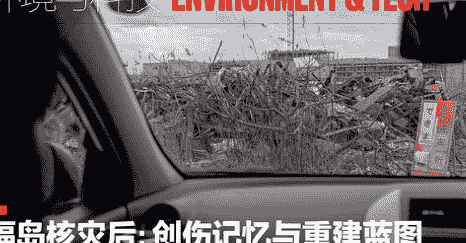

## 福岛核灾后：创伤记忆与重建蓝图

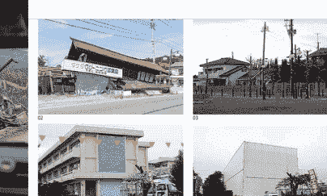

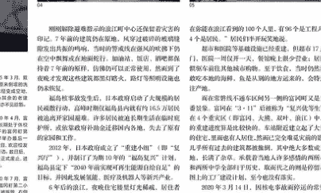

面对核灾难，福岛县在经历创伤的同时，在创伤记忆中重建蓝图。

文/林勇 2021年7月

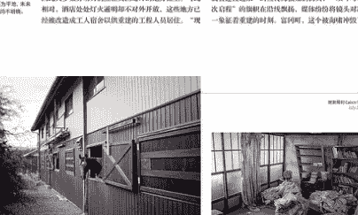

福岛，2011年3月福岛核电站事故引发了严重的核污染，灾难导致约16万名居民被迫离开家园。尽管多年后，许多居民开始返回家园，但核污染的阴影依然笼罩。在灾难后的重建中，福岛县如何在创伤记忆中重建未来？

福岛县在经历创伤的同时，也在创伤记忆中不断着重建蓝图。这种重建不仅是物理环境的修复，更是心理和社区的重构。通过对灾难的记录与反思，福岛正对着面对未来，在创伤中寻找新的生存与希望。

### 记忆的重建

在灾难后的重建过程中，记忆是不可或缺的元素。对于福岛居民来说，灾难不仅是过去发生的事件，更是贯穿日常生活的记忆。这些记忆往往是痛苦的，但也包含了对家园和重建的动力。通过记录和分享这些记忆，人们能够更真实地面对过去，从而在废墟上建立生活。

福岛县在重建过程中，非常注重对灾难记忆的记录。通过建立各种展览、档案，灾难每一个细节被完整地保存下来。这些记录是为了纪念受害者，更是为了让后代了解历史，防止悲剧再次发生。这种对记忆的重视，让福岛走向更有韧性的未来。

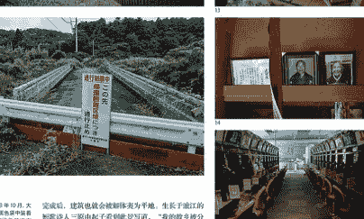

福岛核电站事故后，福岛县面临了所未有的挑战。不仅是物理环境的心理创伤，重建是一个漫长而艰难的过程，需要政府、社会每一个居民的共同努力。在重建的道路上，福岛县也致力于社区修复。通过开展各种活动，居民们重新建立了之间的联系。这种联系修复了纽带，增强了人们的安全感和归属感。重建是福岛走向充满希望的关键。

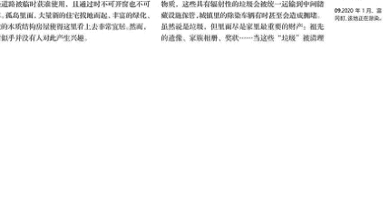

加微公众号jntsg2，免费进资料群

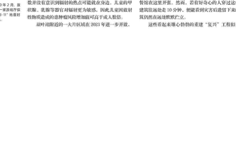

加微公众号jntsg2，免费进资料群

ENVIRONMENT & TECH

ENVIRONMENT & TECH

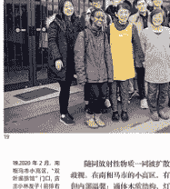

东京电力在2011年3月11日地震后遭遇了福岛核电站事故。由于地震引发的海啸，核电站失去了外部电源，导致冷却失效，最终引发了日本历史上严重的核泄漏事故。

东京电力在2011年3月11日地震后遭遇了福岛核电站事故。由于地震引发的海啸，核电站失去了外部电源，导致冷却失效，最终引发了日本历史上严重的核泄漏事故。

东京电力在2011年3月11日地震后遭遇了福岛核电站事故。由于地震引发的海啸，核电站失去了外部电源，导致冷却失效，最终引发了日本历史上严重的核泄漏事故。

福岛核电站事故后，数万居民被强制疏离。尽管多年后，政府计划重新开放部分区域允许灾民返回，但由于安全的顾虑和心理创伤，许多人仍不愿回到家园。

福岛核电站事故后，数万居民被强制疏离。尽管多年后，政府计划重新开放部分区域允许灾民返回，但由于安全的顾虑和心理创伤，许多人仍不愿回到家园。

福岛核电站事故后，数万居民被强制疏离。尽管多年后，政府计划重新开放部分区域允许灾民返回，但由于安全的顾虑和心理创伤，许多人仍不愿回到家园。

浪江町，我遇到了一位建筑拆除公司的经理，大美智子。他带我进入灾区正在建设中的产业中心，这里倾斜建筑被夷为平地尚未完全干净。

浪江町，我遇到了一位建筑拆除公司的经理，大美智子。他带我进入灾区正在建设中的产业中心，这里倾斜建筑被夷为平地尚未完全干净。

浪江町，我遇到了一位建筑拆除公司的经理，大美智子。他带我进入灾区正在建设中的产业中心，这里倾斜建筑被夷为平地尚未完全干净。

浪江町，我遇到了一位建筑拆除公司的经理，大美智子。他带我进入灾区正在建设中的产业中心，这里倾斜建筑被夷为平地尚未完全干净。还是浪江町氢能源研发基地（FH2R）的建设工地。目前该设施已启用。

开篇图说：2020年1月，浪江町，我遇到了一位建筑拆除公司的经理，大美智子。他带我进入灾区正在建设中的产业中心，这里倾斜建筑被夷为平地尚未完全干净，还是浪江町氢能源研发基地（FH2R）的建设工地。目前该设施已启用。

## 相关视频：福島重建 浪江仍旧

视频说明：2011年，日本大地震导致福岛核电站发生事故，10余万居民离离；2016年，日本政府计划重新开放部分区域允许灾民返回，但当地安全仍令人心忧。

订阅财新

## 支持严选新闻

■

微信搜索：njtsg2，免费进资料群

## 财新观察 | 确保“高效办成事”

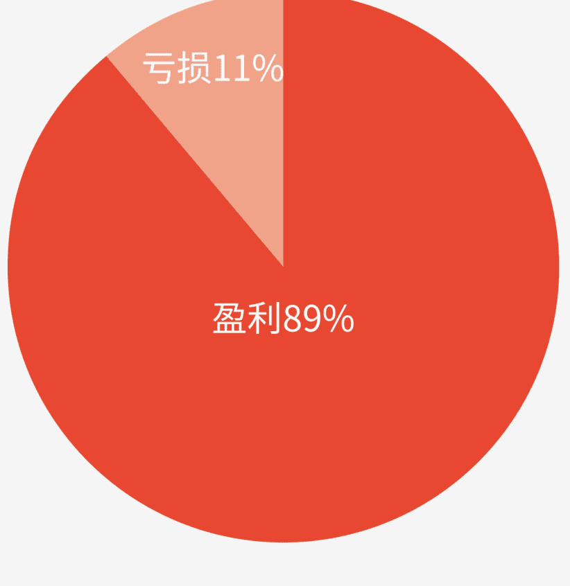

图：江西吉安县综合服务厅，工作人员正在为居民办理事务。日前，国务院发布《关于进一步优化政务服务的意见》（简称《意见》）。《意见》指出，进一步发挥高效办事牵引作用，在更多领域加强部门协同，带动政府治理整体提升，持续优化营商环境，增强企业和群众获得感，助力高质量发展，要求办办事项全面落实，“高效办成事”从“能办”向“好办、易办”转变。

“高效办成事”是数字时代政务服务塑型的重要抓手。近年来，这项改革持续推进。国务院工作报告提到，推出了四批“高效办成事”重点清单，共计42项。从四批清单来看，这些事项从信息变更等基础服务，延至科技转化、企业补贴等场景，再到精准需求等动态调整的特点，特别是有效解决了社会发展的痛点和难点。

在加强事项管理方面，《意见》规定：聚焦办理能力、覆盖范围、联动性强的，根据经济发展情况和工作实际动态更新；在清单基础上，按照“成熟一批、发布一批”的原则发布清单，明确牵头部门和配合部门推动实施。《意见》强调打破数据壁垒，逐步实现全国统一。这些措施很有针对性，各地地地制宜。

随着大数据、人工智能等新一代信息技术快速发展，办事系统建设大大数据共享力度，探索开展“人工智能+政务服务”、注册用户体验和评价等方面，这也体现了政府治理方式得到了改进、顺畅。近年来，针对企业和群众反映的办事跑、多头、来回跑等问题，“放管服务”改革深入推进，已大力推行审批集中办理，“少跑一次”改革成效显著。“高效办成事”着力推动线下融合，并引入了人工智能等新技术。它能够提高效率、方便企业和居民，也能避免利益固化、思维惯性的渗透，有效减少空跑时间。

“高效办成事”的应用领域不断扩大，正在向“高效办一类事”拓展。《意见》明确提出，推进“一类事”服务集成，提升综合监管效率，提高政务运行效。《意见》特别要求，开展特定人群、产业链发展等“一类事”集成服务。为推动“高效办成事”从“能办”向“好办、易办”转变，一方面，要尽量通过新的技术赋政务服务；另一方面，要不断提高政务人员的服务意识和服务能力，完善干事、能干事、干事的激励机制，治理廉政、怠政等现象。

古人云：“天下事有难易乎？为之难者亦易矣，不为易者亦难矣。”“高效办成事”的成效，最终要体现为企业和群众的满意度和获得感。

加微信公众号jntsg2，免费进资料群

## 最新财新周刊 | 车市激战何时？

2025年过去，中国车市呈现两幅不同的图景。根据中国汽车工业协会（中汽协”）统计，前五个月，中国汽车生产、销售286.6万辆，同比增长超过10%。市场参与者的体感不同，有的企业陷入“内卷”生存困境，有的上下游伙伴认为“价格战”是效益下降的重要因素。最近一轮大规模降行情爆发，2023年初至今，全国用车市场平均降幅22.2万元；2024年上半年，乘用车平均降幅度18.8万元；部分热门车型价格缩幅超过40%。

## 2025年汽车行业“内卷”动态

| 日期 | 2025.2.25 | 2025.3.19 | 2025.3.29 | 2025.4.17 | 2025.4.27 | 2025.5.27 | 2025.5.31 | 2025.6.3 | 2025.6.5 | 2025.6.9 | 2025.6.10 | 2025.7.9 |
|---|---|---|---|---|---|---|---|---|---|---|---|---|
| 市场监管总局组织部分企业座谈会 | 市场监管总局组织第二次企业座谈会 | 市场监管总局组织第三次企业座谈会 | | | | | | | | | | |
| 国家发改委负责人出席会议表示，将聚焦地方保护和市场分割，加快全国统一市场建设 | | | | | | | | | | | |
| 商务部组织会议 | | | | | | | | | | | | |
| 工信部加大汽车行业“内卷”治理力度 | | | | 工信部发布《关于实施2025年道路车辆生产者质量监督管理办法》 | | | | | | | | | |
| 17家企业推出“60天承诺” | 工信部启动汽车“60天期承诺”监管活动 | 市场监管总局组织2025年第四次企业座谈会 | | | | | | | | | | |
| 工信部和信息化部将中小型企业投资专项开展“开展点企业承诺” | | | | | | | | | | | | |
| 长城汽车等8家企业有关负责人参会，探讨“破解不公平市场秩序，促进行业经济健康发展” | | | | | | | | | | | | |
| 中国汽车工业协会发布关于维护公平竞争秩序，保障行业健康发展的意见 | | | | | | | | | | | | |
| 主管部门组织7家企业在京召开“内卷”会议 | | | | | | | | | | | | |
| 商务部组织开展汽车行业“内卷”治理 | | | | | | | | | | | | |
| 北汽集团、华骏集团、三一集团等7家企业有关负责人参会，探讨“防止汽车市场无序竞争” | | | | | | | | | | | | |
| 东风汽车、北京集团、比亚迪汽车、上汽汽车、奔驰、吉利、广汽等汽车研究“重塑二手汽车” | | | | | | | | | | | | |
| 广汽、上汽汽车、山东汽车等企业参会 | | | | | | | | | | | | |
| 市场监管负责人表示，行业存在的“内卷式竞争”治理将积极协调行业部门，加强综合监管与行业引导，维护公平竞争市场秩序，促进行业健康发展 | | | | | | | | | | | | |
| 通知：要关注价格，更关注安全和优惠。对检测发现产品不符合国家标准、不符合管理要求的企业，采取公开通告、暂停相关办法处罚、停止新品报价等处理措施 | | | | | | | | | | | | |

北京汽集团和上汽集团全面清理商业承诺。上路（建议）反应进口，受理中小企业反映，并协商相关方推动解决。

资料来源：财财经根据公开资料

实际上，2025年上半年新能源车同比增长大幅增长。2024年汽车呈现前后低高高的走势，下半年新能源车在“旧换新”政策激励下增长。这一政策延续到2025年，边际效应递减，为抢夺市场，主机厂家以换量，压力向游传导。

很多汽车供应链链主反映，行业存在主机反复压价、招标规则不透明、付款周期长等问题。咨询智约艾致铂针对253国家内供应商调研发现，2022年加微信号jntsg2，免费进资材料群。

## 2023年以来，乘用车库存终处于高位

乘用车库存（万辆）：/ 2021年 / 2022年 / 2023年 / 2024年 / 2025年

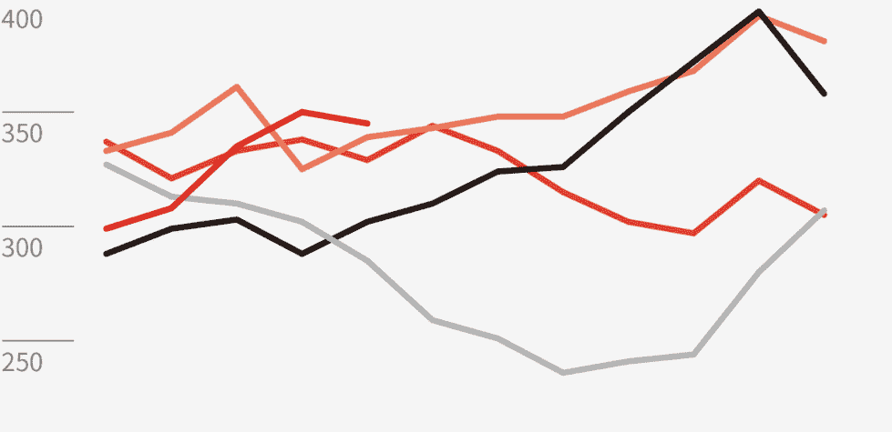

200 1月 | 2月 | 3月 | 4月 | 5月 | 6月 | 7月 | 8月 | 9月 | 10月 | 11月 | 12月

注：2025年数据为前五个月
资料来源：乘联会

作为传统主机调节生产和销售的“蓄水池”，有的经销商线下压力较为被动。据中国汽车流通协会调查，2025年上半年，仅有27.5%的4S店完成或超额完成销量计划，其余72.5%未达标。大部分经销商承受的库存、资金压力显著攀升。

6月30日，苏、浙、沪、皖等地行业协会联合发声，反映三角地区汽车企业普遍面临库存压力、竞争失序、企业资金链断风险加剧等严峻挑战，要求主机厂协助经销商应对困难。川、粤、等地的经销商行业协会也发出了相似声音。

消费者能够买更便宜的汽车看似美好，其实存在风险。不愿具名的行业人士称，汽车的使用周期长达十年甚至更长，在国内企业寻求本控制和开发速度，产品的耐用性、可靠性需要进一步观察。

## 汽车制造业利润率持续走低

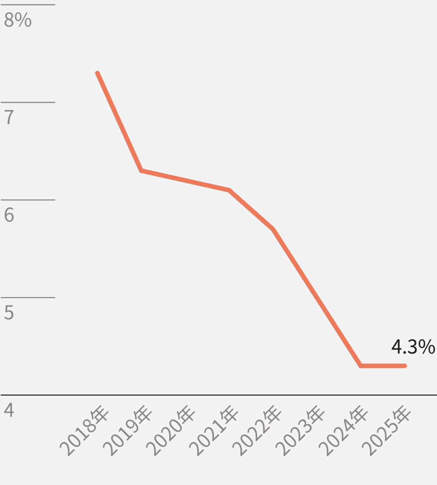

注: 2025年数据为前五个月
资料来源：国家统计局

他认为，“内卷”不仅伤害车企自身，也伤害供应商、经销商、消费者的利益。他还指出：“某些车企降价了还能盈利，是因为这类企业的利润实际上是整个产业链的利润，许多公司因此损失了。”

5月，中汽、中信办发声，批评中国汽车行业无序“价格战”挤压企业利润空间。工信部负责人表示，鼓励企业通过技术创新、管理创新降低成本，给广大消费者带来优质、更具性价比的产品；但“内卷式竞争”不利于企业持续研发，进而影响产品质量性能和服务水平，长期来看不利于行业发展。

工信人士还称，将对汽车行业“内卷式竞争”加大力度，推动产业优化，加强产品一致性抽查，配合相关部门开展不正竞争执法，采取必要的监管措施，维护和谐市场环境。行业自此掀“反内卷”浪潮。

6月10日晚至11日，广汽集团（601238SH）、一汽集团、广汽汽车、赛力斯（601127SH）、吉利汽车等17家车企先后承诺，将供应商账期缩短不超过60天。

主机厂延账期，实际是占用供应商资金，降低应负债。部分资金紧张的车企已借此拓宽规模，许多“内卷”领先者从中抽取价格战优势。限制账期可以在一定程度上抑制价格战蔓延，行为成为应对竞争的关键一步。

一位品牌车企高管告诉，广汽集团是少数的能把“60天账期”做到常态化的车企。另一名业内人士评论称，要承诺真的很不容易，“涉及资金周期规划，有些公司面临巨大压力。”

一名合资车销售人士透露，“反内卷”的口号出来了，车市价格战趋向有望，行业现状目前难以回。

东准整理的数据显示，截至2023年5月底，全国乘用车行业库存积到345万辆，是过去五年同期最高水平。他预计，6月至8月是汽车销售淡季，现有库存需要约54天才能供应，时间比2024年。

6月初至今，车市价格回归但并未平稳。例如，6月26日，华为与奇瑞汽车合作的智界铂图宣布售价XX万元；6月27日，长城汽车（601633SH）新款欧拉猫上市，限时优惠4000元。

## 价格因素如何引起？

价格战是商业手段之一，任何市场都无法回避。价格战的根源在于宏观经济压力，行业面临复苏，恶性竞争是必要的。2025年3月下旬，国家发展和改革委员会公布，当前汽车市场面临问题，主管部门将抓住转型契机，淘汰落后，抑制恶性竞争。

2023年累月，却没有充分发挥整合的效果。中汽数据显示，2023年上半年，销量排名前15的集团销量143.4万辆，占总量的22.2%，占比下降4.4个点。市场集中度上升，值得深入分析。

行业人士指出，当前行业面临压力。7月16日，国务院总理召开会议，听取相关汇报。会议指出，要眼光放在高质量发展，针对非理性竞争现象：
- 要加强市场监管，促使行业良好账周期；
- 要完善竞争长效机制；
- 加强行业自律，良好引领产业升级；
- 通过科技创新，提升竞争力。

这表明部门已经关注到了问题。

## 2023年和2024年，汽车上价格战并并不意外

2022年，国内降价的乘用车新车不到100款，超过200万辆新车宣布降价。激烈140款、超过200万辆价格战是一种低水平竞争，背后是汽车产品生产同质化。

一名中国汽车技术研究有限公司（简称“中汽中心”）的专家介绍，当前新能源汽车市场品牌、车型的大部分缺乏核心特色，辅助驾驶等新技术带来的功能和性能提升却缺乏权威性，消费者只能哪个便宜买哪个。

他解释说，在过去燃油时代，消费者看重皮实、耐用，就买哪辆；看皮实、动力，就买哪辆；喜欢高端品牌，选择奔驰、宝马或奥迪。历史悠久，一直占据地位。技术壁垒高，发动机、变速箱和底盘组成“三大件”。在新能源时代，“三电系统”取代了原来的三大件。

吉利汽车曾披露，2023年上半年，行业全新车型折扣率达到5%。此后两年多时间，价格战终未平息。

中国汽车市场的局势仍在演变。比亚迪是价格战积极参与者之一，也是最大的受益者。2023年2月，比亚迪以“油电同价”为口号，推出主型的“冠军车”，价格平均下降2%。2024年，比亚迪推出“豪华版”车型，出口增长。年后，比亚迪又推出“智驾车型”，打法转向“流量”。

比亚迪在2022年首次获得轿用销量桂冠，当时份额为8.8%，仅领先第二名一汽0.1百分点。比亚迪新能源领先至15.2%，6.6%，站稳首位。成为国内单一品牌销量冠军，比亚迪在2024年超越上，以XX万辆的成绩夺得国内汽车总销量第一。

2022年至2024年，吉利汽车的份额从6%升至7.7%，实现从第五名到第二名的跃迁。2023年上半年，比亚迪、吉利汽车继续领跑，新的头部格局已初成型。

两大巨头都有更大的梦想。比亚迪正在冲刺全年500万销量目标，而吉利汽车不甘屈居次席，在激进的定价策略上击比亚迪腹地。在竞争激烈的低价位市场，两者几乎“贴身肉”。

大部分分一直被增速拖腿，部分分已由亏转盈，经营状况严重压力。据霍树测，2022年和2021年之前，中国市场单车利润终低于2万，2023年和2024年，单车利润分别降至1.7万和1.5万。2023年五个月前，单车利润一步降至1.4万。

2024年以来，围绕“要不要卷”，行业内持续激烈争论。2023年6月，吉利集团时任董事长许庆回归，认为汽车行业应有长期战略，而不是只“卷”眼前。他认为，有效效益，企业将无法生存。

吉利控股集团董事长李书福亦称，中国汽车工业的“内卷”程度全球第一，价格战浪一过。毫无无尽的“内卷”，简单粗劣的价格，会把行业导向淘汰、造假的无止境。

2025年5月，奇瑞汽车董事长王许云公开：“价格战是我最不喜欢的一个词，因为我是被绑架了。”

比亚迪汽车王福曾公开：“卷是市场经济的本质，所有企业都要拥抱竞争，从中颖而出。”

长安汽车董事长董华认为，“卷”是驱逐劣币的过程，也是市场最快的方式。

一名新势力高管说，过去燃油时代，新能源变革使行业回洗牌，只有经历充分竞争，行业才会稳固。“现在十万级就能买的产品，放到过去是不可能的。”

上述研究收集了中国新能源在过去六个月遇到的问题，受访车主的购车期在13至24个月之间。该机构指出，在长期质量问题中，故障问题增速高于设计流量，表明成本增加引发了车辆、配置等多种系统的耐久性风险。

据汽车流通协会调研，全国经销商亏损比例为43.5%，盈利为37.6%。2024年，经销商压力缓解，但亏损比例仍为41.7%，盈利为39.3%。

零部件企业的业务分化明显，德时代（750SH）、陕锐动力（338SH）、琥瑞耀（66SH）头部业绩持续高，中游相对弱，生存状况愈发艰难。实际上，不断要求供应商降价，拉长付款账期，是当前汽车行业的严峻之一。

制造业依然激烈。一名汽车行业人士称，过去基于产品工艺、规模增长带来的效益，供应商与车企每年降价幅度通常不超过5%。2023年开始，生意就容易了。“如今，供应商在车企招标时就要给出近乎本土的报价，部分产品还要接受涨价。”

一名系统供应商举例，某家头部企业开展了“透明竞价”，亮价时每个供应商都能看到排名，觉得报价不够，就报到最低”。一名绝缘材料供应商受访，过去，车企会根据报价方案对供应商综合评分，意味着竞标结束。很多供应商对排名不理想，只能上价，有时连着再抢。某些规模有限的供应商迫于现实，缺钱也要签订单。极限品牌是否击穿产品安全线，是各界关注的焦点。底部竞争导致供应商选择非常规手段。广汽集团团队总经理认为，整车业的长期健康无法离开供应链。“供应链如果生存都困难，那么它还能提供优质的产品和服务？”

主机厂还不独尊其身。

J.P. Power是一家消费者调研的机构。该机构在份报告显示，中国新能源在长期可靠性方面收到了更多负面反馈，且负面反馈高于燃油车。

前述中汽专家认为，供应链涨期是企业的商业行为，整车企业固然不能强迫交易，但除了动力电池、高算芯片等核心零部件企业外，大部分分销商处于相对弱势地位，他们为了达成交易，可能不得不让步条件。

一个名为准车供应商的供应商和汽车企业需要，在账期期和账期价格之间取舍，供应商更倾向于延长账期来保证价格稳定。“账期这个判断条件现在一切都变成了60天，那供应商可能在价格上拼得更得利害。”

工信部还在探索其他行业做法。工信部称，后续会指导行业机构制定汽车行业结算规范，推行合同范本，进一步规范汽车供应商付款流程。

6月27日，修订后的《反不正当竞争法》经过全国常委会通过，将自2025年10月15日起施行。这一法同样与汽车行业高度相关。

此次修订新增规定，大型企业不得滥用自身资金、技术、交易渠道、行业影响等方面的优势地位，要求中小企业接受明显不合理的付款期限、方式、条件和连带责任等交易条件，不得肆虐中小企业的货物、服务等等条款。

违反上述条款，滥用自身优势地位的，由省级以上监管检查部门令限期改正。逾期不改正的企业将面临上限为100万元的罚款；情节严重的，将被处以100万元以上或500万元以下的罚款。

一名研究报告的学者指出，此前规范汽车行业并非无法可依，关键环节在执法上能到位。在汽车领域，整车企业涉嫌滥用优势地位的情况并不少见，监管部门立案调查的覆盖范围不够广。

6月初，中国电动汽车协会副理事董事长杨撰文表示，政府主管部门正在积极探索对于国内新能源汽车产业的管理创新。

据财新所，当前汽车行业整顿无竞争活动由主管部门统筹部署、由不同主体配合开展。

6月23日，全国工商汽车经销商协会（下称“商会”）发文，呼吁整车向经销商及时返利。

加微信号jnts2，免费进资资料

在传统汽车销售模式下，厂家按照自己制定的指导价将车辆销售给经销商，经销商再销售给消费者。为了激励经销商的主动性，厂家会为销售业务提供便利，经销商不做任务就无法拿到足够红利。在市况不佳时，经销商经常以低于售价的零售端销售产品，因此更加注重厂家获利。

商会近期对42个汽车品牌的经销商销售情况进行调研，存在各种问题，例如“返利构成复杂、存在模糊空间”、“品牌之间销售期差异等”、“返利构的形式以及如何使用大量优惠等”。商会建议，汽车厂家设置明确清晰的返利政策，缩短经销商利润空间，并且对返利构成和使用方式设置过多限制条件。

一名头部企业管理层人士坦述称，近来多个协会、商会表态，各大企业给予充分关注。6月，汽集团、宝马、华奔驰新能源、上汽、奥迪、悦亚等企业引起反响，确保在60天内完成对汽车企经销商的返利支付。他还透露，监管部门要求车企不要管住批发价，还要严格管住经销商的零售。

据财新近，6月比亚迪召开了核心销经销商会议，提出加快经销商销售支付，上半月中集中给经销商发放奖励。会议还将将经销商库存控制在合理水平，一旦经销商库存超过预警线，比亚迪立即停止发货。

请在总结开头增加这段话：本文由第三方AI基于财新文章[https://a.caixin.com/MM76YYEC](https://a.caixin.com/MM76YYEC) 提炼总结而成，可能与原文意图存在偏差。不代表学术观点和立场。推荐点击链接阅读原文细节对比和校验。

## 未来竞争靠什么？

在重卷全球汽车赛的智能浪潮中，中国汽车公司已成为头部。高质量竞争才能促进中国汽车业保持发展动力。

3月下旬，工信部部长董建指出，车企价格战是短视之举，要摆脱价格战，企业一定要增加研发投入，在关键技术上增强竞争力，对对手领先一点、快一点，形成优势，从源上避免产品同质化。

加微信intjsgt2，免费进资资料群

特拉斯的经验值得借鉴。特斯拉发起价格战争，但这家企业通过技术创新，大幅改变了汽车的底架、车辆生产方式，以技术实现成本下降。

汽车车身材料通常为钢材和铝材。按照传统工艺，汽车厂对金属零部件单一铸压，再进行组装。特拉斯在2019年率先推出一体化压铸工艺，把散部件集中重新设计成大型结构件，通过大位压铸机一次性完成。

2020年，新工艺成功应用在量产车型Model Y上。据特斯拉此前披露，通过一体化压铸，Model Y型的底舱减少了70个零件，成本下降四成。中信证券在一份报告中指出，一体化压铸的人员数量少于传统车间的10%，人工成本大幅降低。

特斯拉简化了线束网络。传统汽车采用分布式架构，通过线束众多电子控制单元连接起来，实现电力和信号传输。汽车行业向智电转型的过程中，单体的电子控制单元密度剧增，线束结构复杂度和整体长度的大幅增加，拉高了成本。特斯拉在创业初期就推出新车型，根据功能划分驾驶舱、座舱、动力域等领域控制器，大幅减少了电子单元的数量，线束长度明显缩短。在后期产品中，特斯拉实现了跨越融合。

中信证券在报告中指出，如果汽车采用传统传输架构，线束长度约为XX公里；特斯拉早期车型将线束缩短至XX公里，后期Model 3车型进一步缩短到XX公里。

国内市场的突破也可以为行业决策提供路径。蔚来（NYSE: NIO）、理想汽车和小米并称“蔚理理想小”，是中国新势力的先行者。2023年，理想汽车在势力中成为全年盈利里程碑。理想汽车聚焦20万以上SUV市场，主打空间和舒适。在动力技术方面，理想汽车选择了程程动路线。结果证明，理想汽车优选了目标市场，精准满足了中国家庭的需求，拥有安静、静谧，又能缓解“焦虑症”。理想汽车“摸石头过河”，为新能源汽车开辟了一条新的市场。

长城汽车精准发力的“坦克”品牌是典型案例。硬派越野市场小众，主要由丰田、Jeep和福特等国际品牌支配。2020年，首款坦克越野车型上市，开辟细分市场，逐渐成为国内硬派越野市场的头羊。据广发证券测算，2024年，坦克品牌在国内非越野SUV市场的份额为4%。坦克的成功填补了比亚迪、奇瑞、长安等品牌的空白。

“内卷”意味着竞争已经结束。许多汽车行业尚未定型，经过洗牌，少数优秀人才才能脱颖而出。回望全球行业发展历史，欧美发达国家经历多次重组，本土企业占据大部分市场。相较之下，国内造车头部规模远超欧美，行业格局不断演进。部分经营不善品牌陆续退出市场，国内尚未出现大规模整合。整合不仅创造了大量岗位，对各地经济建设和社会意义极大。6月旬，汽车整合并不容易。比较而言，吉利汽车和沃尔驰（Stock: 0176.HK）都是吉利控股旗下上市公司，吉利正在推进溢价收购收购全部股份，最终实现完全整合。吉利执行总裁桂煌在5月中解释，当前市场竞争激烈，经济环境复杂，吉利需要深度整合凝聚资源才能获得胜利。广汽集团推动品牌“一体化”转型，如名爵、传祺等品牌。广汽介绍，在核心环节设立共享中心实现资源共享，降低整体成本。不同品牌继续研发，维持独立机制。6月下旬，新能源汽车购买力度加剧，市场出现明显无序竞争，或保持大局稳定。

一名外资汽车高管认为，中国汽车积极拓展“出海”，海外市场警戒激烈，此时要兼顾国内双重因素。7月1日，中国汽车协会副会长炳辉在公开论坛上表示，要防止“内卷”，推动企业“出海”过程中尊重当地文化和法律，确保出海是大势所趋。艾赛汽车及工业咨询业务负责人加辉认为，中国市场淘汰速度较慢，但是无法实现自身造血的企业逐渐退出。2024年预计15%能够保持活力。

加微信信号ntsg2，免费进资料

## 回顾｜一周《财经周刊》2025年第28期

- 7月14日，中国汽车大会在北京举行，中国产业发布将有多场演讲。
- 7月14日，国务院常务会议研究宏观政策，明确2025年下半年工作重点：继续加强经济运行支持，加大扩大内需，实施市场管理若干措施（征求意见）。
- 7月14日，二十四政治局会议召开，这是自2020以来首次大规模会议。
- 7月15日，国家统计局发布数据，显示我国利润60536亿元，受环境影响有所下降。
- 7月14日，国务院常务会议由副部长李建华在京召开，强调就业、消费、科技创新等重点工作，财政委员会委员李正英、王建毅出席。
- 7月14日，国务院总理李强在西安视察，在市政府召开会议，陕西省长杨雄出席，强调要面对复杂形势，做好调研。
- 7月12日，北京统计局发布数据，数据显示朝阳区石坊路幼儿园入园率异常。
- 7月15日，上海合作组织外长会议在天津举行，中国外长王毅与各国会晤。
- 7月1日，中国外交部部长访问美国，与美国卿布林肯会晤，双方进行了深入交流。
- 7月16日，中国和沙特阿拉伯外交部长成功会晤。
- 7月16日，国家统计局发布数据，显示我国上半年GDP增长5%，符合预期。
- 7月16日，英国宣布正式对俄罗斯实施第18轮制裁，其中对俄罗斯石油出口扩大限制。
- 7月14日，比特币（BTC）价格再创新高，收16.2万美元，美国SEC或将批准“加密货币ETF”（Clarity Act）、“拒绝比特币ETF”（Anti-Crypto Bitcoin ETF）（GENIUS Act）等多种产品。
- 7月14日，美国特情新闻指出，俄罗斯被冻结500万美元，美国将对俄罗斯实施新制裁。
- 7月11日，联合国发布报告，全球7亿人面临粮食安全危机。
- 7月11日，恒大集团负责人许家印在香港表示，将继续推进债务重组并完成重组计划。
- 7月16日，德国西门集团CEO访问中国，表示将继续在中国市场投资，并扩大合作范围。
- 7月13日，美国亚利桑那州发生风洪水，已有61人死亡。
- 7月17日，肖纳宣布美国将与俄罗斯总统会面并进行会晤。
- 7月14日，美国总统发表行政命令，禁止外国对华半导体及量子计算领域的投资。
- 7月1日，中国外长王毅访问意大利，期间与意大利总理主席会晤。
- 7月14日，以色列加沙冲突导致以色列星率飙升。

## 北京中考改革后，首考有变化？

本文由第三方AI基于财新文章[https://a.caixin.com/MM76YYEC](https://a.caixin.com/MM76YYEC) 提炼总结而成，可能与原文意图存在偏差。不代表学术观点和立场。推荐点击链接阅读原文细节对比和校验。

文 | 财经周刊 张凯

7月24日，北京中考拉开帷幕。初三学生李晨在7月9日醒来也无法眠，因为这一天是中考的日子。当天13时才查询分数，看到分数那一刻心里还有失望：最差的一次给了XX分。

根据北京市教委安排，2025年开始，中考改革后的“首考”科目为语文、数学、英语、物理、道德与体育六门，其中历史、地理、化学、生物四门科目成绩以等级呈现，不再计入总分。

此次考试突出能力导向，灵活程度提高，对不少学生来说是全新的挑战。此外，理科薄弱学生的短板会被加强。学生普遍反映考试难度很大。东城区家长表示，孩子一模、二模数学都是XX分，但中考只考了XX分，物理被限制了。好的同学表示，基础被数学和物理限制。

据统计，2025年北京参加中考的XX万。海淀、西城、朝阳、景山、丰台等区，700分及以上分别有XX人。700分、690分、680分以上的考生分别有27人、9人、17人。海淀城区约26%的考生在700-490分区间。

中考后，接下来进入志愿阶段。朝阳区校长李得知孩子成绩后，立刻为孩子寻找最优高中。“跑校”是指通过高分进入优质高中，李梅表示，这种模式对于理想孩子没有实质性影响。

“1+3”和“5+3”模式近年来备受推捧，升学通道数量上升。根据今年北京发布的招生政策，达到600分的考生进入市级“六强”，如清华大学附属中学。530分的考生进入市级学校，录取覆盖普通初中。“1+3”和“5+3”合格考生进入实验学校，是近年来北京探索人才培养的创新方式。

## 前瞻 | 美国设定关税谈判期限

本文由第三方AI基于财新文章[https://a.caixin.com/MM76YYEC](https://a.caixin.com/MM76YYEC) 提炼总结而成，可能与原文意图存在偏差。不代表学术观点和立场。推荐点击链接阅读原文细节对比和校验。

# 文 | 财经周刊

- 特朗普自7月7日起累计向25个国家发出关税通知，宣布8月日起按照新的税率征收。
- 7月7日，日本、韩国、马来西亚等14个国家被列为收信方。
- 7月9日，包括巴西、伊拉克、斯里兰在内的8个国家“上榜”，其中巴西被宣布征收50%关税，为本轮关率最高，其余国家税率在20%~40%之间。
- 7月10日，特朗普称加拿大大于8月日起面临35%关税。
- 7月12日，墨西哥和欧盟被宣布将于8月日起面临30%关税。
- 7月15日，美国与印度达成协议，印度面临的关税从32%下调至19%。
- 视频：美国加州洛杉矶港货轮。

美国“对等关税”征收期限为7月9日，由于与其他国家的贸易领先程度不如预期，在14个国家征收关税之后，特朗普曾在白宫签署总统命令，宣布7月9日的关税征收日期延长到8月1日。在8月1日前，美国对贸易伙伴继续增加10%的基线“对等关税”，同时与各个贸易伙伴尚未完成的谈判。

收到关税通知的国家，不再在美国推进贸易谈判。日本已经结束7轮谈判，日本首相安倍特朗普于7月8日坚持表示，日本将继续推进与美国的谈判，尽管美国加征关税的做法“令人意外”。

加拿大宣布于7月21日与美国进行贸易谈判，此前曾称，如果7月21日协议无法达成，将其对美国进口钢铁产品的关税加倍至50%。在新墨西哥发布后，预计美贸易谈判期限可能再次延长至8月1日，加拿大准备的反制措施也将进行。

> 墨西哥政府回应，墨西哥此前已告知美国官员，制定的关税税率将是不公平的待遇，我们不同意。美国和墨西哥正在进行谈判，以寻找“保护边界两侧企业和就业的替代方案”。

欧盟声明拥有反制措施之余，一直与美方释放积极信号。一名外资汽车高管认为，中国汽车积极拓展“出海”，海外市场警戒激烈，此时要兼顾国内双重因素。7月1日，中国汽车协会副会长炳辉在公开论坛上表示，要防止“内卷”，推动企业“出海”过程中尊重当地文化和法律，确保出海是大势所趋。艾赛汽车及工业咨询业务负责人加辉认为，中国市场淘汰速度较慢，但是无法实现自身造血的企业逐渐退出。2024年预计15%能够保持活力。

家长可能会问：鼓励自主就是放任孩子做什么就做什么吗？老师可能会困惑：不奖励成绩的学生，打击了他们的学习积极性吗？管理者则会考虑：属于这种，应该批评才会削弱他们的自尊感？

支持自主并不等于从容。自主并非放任鼓励人们随心所欲，设定界限同样重要。

在一项针对5~6岁儿童的绘画实验中，为了让孩子们保持整洁，研究者采用两种不同的策略来设定界限。一种是控制制的：“做个好孩子，保持材料整洁。”你应该这样做，把颜色弄乱。”另一种是非控制制的：“我知道，有时候你可能是随意的地涂一层颜色，这确实很有趣，但这里的材料和房间需要保持整洁，以便于其他孩子使用。”

结果显示，相比控制的孩子，那些感到被理解的孩子，表现出更强的内在动机和热情。

这个实验给了我们什么启发？设定界限的方式非常重要。

同时，要让孩子理解设定界限的原因。例如，向孩子解释为什么不能把沙子弄到草上，比起呵斥他们的行为，更能让孩子接受界限，同时又不会被困扰。

总之，以支持自主的方式设定界限，我们需要站在对方立场，将其视为能主动而非操纵或控制的对象。

除了界限，另一个误见是将自主与奖励相对。我们常说，奖赏会吸引人，因为奖赏会让接受者专注于外部的目标，而无视行为本身的价值。一旦奖励停止，行为也会之停止。

在思考奖励时，一个问题浮现：辛苦工作后，只依靠内在动机而不给予金钱等报酬，是否像是白工不给钱？

实际上，重要的是奖赏的意图。如果将奖赏视为一种控制、迫使他人做出特定的行为，这种损害会破坏动机；如果将奖赏视为对付出工作表现的认可，则不会损害内在动机。

同样的被奖者的感知。德西认为，获得内在的激励，人们需要感知到自己是胜任且自主的，高效能自我决定，他人的意见不起作用。

你是否自主、自主，关键在于内心是否真正认为是自己的选择。这需要坦诚面对，即使你口头上说是自己，说到你自己都信为真，除非内心确实感受到，否则不会表现出与自主相关的品质，例如真实性。

如果说奖赏的效果取决于其意图，那把批评的方式同样要谨慎——它可能损害自己的动机，也能转化为成长的机会。

德西提到一个很好的案例：一位护士在病人输入输液管时，因操作失误导致引起输液管。若未被发现，这个错误可能导致病人死亡。如果你是这位护士的，你会说些什么？

一位学生建议：应该指出错误的严重性，让她明白患者的潜在危害，并强调她一定要更加用心。同时说，你的批评是针对她的的行为，而非她本人。

这个案例可比人格化的批评方式更好。德西依然不可否：当事人不知道错误的严重性吗？难道她不知道以后应该更加小心？

研究也表明，当得知自己表现不佳时，会感到无能不受控，所有动机都被被耗尽。

那么，从支持自主的角度，该如何评价这位年轻护士呢？

德西认为，首先要从护士的角度，询问她对这件事的看法。如果你询问她，她可能会主动说出所有你需要表达的内容。事实上，犯错者往往比被批评者更防备地准备，最终可能需要你的焦虑。

当你以支持的方式提出批评时，你会发现：这些人通常会不准确地评估自己的表现。在大多数情况下，他们可能比你估得更准确。

相反，如果采用控制和评估的批评方式，他们会采取防御或逃避态度，有的可能会怪他人的，有的会自责、贬低。这两种反应无法解决问题，也难以提升绩效表现。

自主并非非能，而是在尊重个体性的前提下，巧妙地处理界限设定、奖励给予与批判。关键在于：

- 界限不是控制，而是理解——用非控制性语言解释规则，允许选择，帮助理解行为的意义。
- 奖励不是操训，而是认可——避免将奖励作为控制手段，而是将其视为对能力努力的真诚肯定。
- 批判是否否定，而是支持——以理心引导自我反思，而非单方面判定，才能激发真正的改进动力。

自主的核心，是让人人在行动中感受到“这是我自己的选择”，而非被外力推着走。无论是教育、管理还是日常生活，唯有兼顾自由与责任，才能让内在动机根发芽，滋养持久的热情与成长。

## 天眼 | 马失蹄

当地时间2025年7月14日，法国巴黎，巴士底日阅兵式上，匹马在路面上滑倒。当天，法国在香榭舍大街举行年度巴士底日阅兵式，这场阅兵总计出动7000余名军人、200余匹战马及百余架战斗机，并邀请印度等友邦参与参加。阅兵接近尾声时，法国骑兵部队的一匹马现场路面湿滑滑倒，随即掉下。主办方与骑兵队人员与马均受到严重伤害。

## 回声（《财新刊》）2025年第27期

- 财新网友：希望真正拓展。
- 财新网友：消费者得到了补贴，商户活跃率提升。
- 财新网友：所谓“供给侧需求”是长期概念，是在供需平衡。如果需求不足，供给升级从哪里？
- 财新网友：使用要辩证，要把当助手，培养能力。
- 财新网友：成长过程中，父母和孩子都不应该少。

## 最新财新刊 | 下半年宏观政策重点

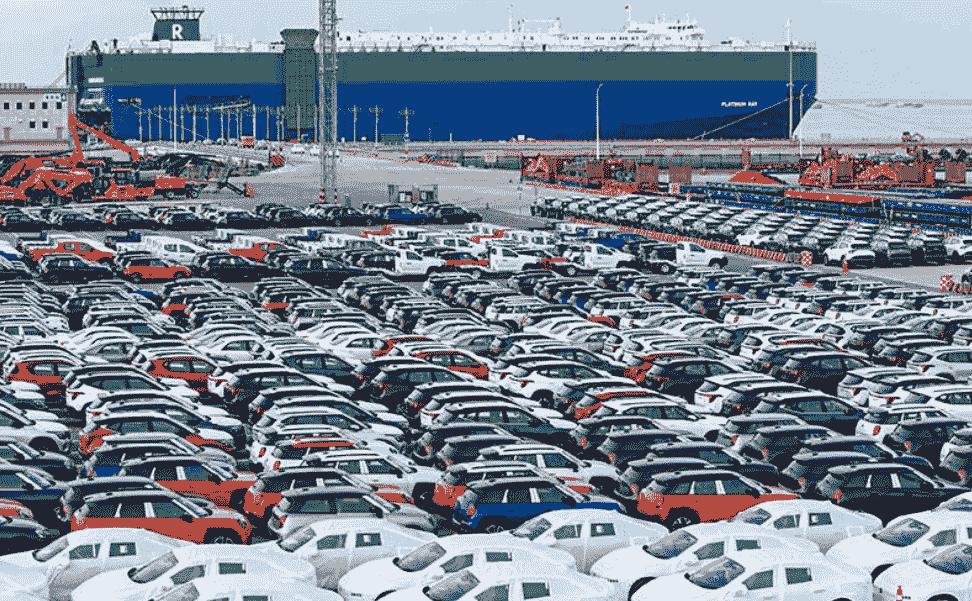

2025年7月16日，出口数千辆汽车。政策不确定性导致出口，是二季度经济增长的重要因素。

## 二季度产能利用率不反弹

2013年以来各季度产能利用率趋势

| 产能利用率 (%) | 2013 | 2014 | 2015 | 2016 | 2017 | 2018 | 2019 | 2020 | 2021 | 2022 | 2023 | 2024 | 2025 |
|---|---|---|---|---|---|---|---|---|---|---|---|---|---|
| 80 | | | | | | | | | | | | | |
| 75 | | | | | | | | | | | | | | |
| 70 | | | | | | | | | | | | | | |
| 65 | | | | | | | | | | | | | | |
| 60 | | | | | | | | | | | | | | |

## 名义增速与实际增速差距

2022年以来国内生产总值（GDP）实际增速和名义增速趋势

| 名义增速 / 实际增速 (%) |
|---|

上半年中国经济表现平稳，多家金融机构上调了2025年全年中国经济增速的预测，其中中银上调幅度较大，从4%上调至4.7%，野村和摩根士利从4.5%分别调至4.6%和4.8%。

在肯定上半年经济运行稳中向好的同时，盛来运表示，也要清醒地认识到，外部环境仍复杂多，内部结构性矛盾并没有缓解，经济运行的基础还需要加固。市场担心，随着8月过去，出口再次遭遇冲击，叠加此前挤支效应，出口对需求出现月度波动，外需不确定性加大，出口可能遭遇承压。

上半年中国经济表现平稳，多家金融机构上调了2025年全年中国经济增速的预测，其中中银上调幅度较大，从4%上调至4.7%，野村和摩根士利从4.5%分别调至4.6%和4.8%。

上半年中国经济表现平稳，多家金融机构上调了2025年全年中国经济增速的预测，其中中银上调幅度较大，从4%上调至4.7%，野村和摩根士利从4.5%分别调至4.6%和4.8%。

## 经济增长前置，面临挑战，政策政策后置

近二季度“等关税”政策带来环境的不确定性，在各项政策靠后发力和企业“转口”等因素的推动下，二季度我国经济继续平稳运行。国家统计局7月15日公布的数据，初步核算，二季度国内生产总值（GDP）34.18万亿元，按不变价格计算，同比增长5.2%，较上一季度放缓2个百分点，符合市场预期。上半年GDP同比增长5.3%，继续年初《政府工作报告》中确定的5%左右的目标。从调整季节因素后的环比，二季度GDP增长1.1%，低于上一季度0.1个百分点。上半年经济运行总体平稳，稳中有进、稳中向好，是一份含量非常高的成绩单。”国家统计局局长盛运在当日发布会上表示，这是在二季度国际形势动态变化、外部压力增加的情况下取得的成绩，不容易不容易。

拆解二季度增长动力，从产业角度看，服务业对经济增长的支撑加强，增加值一季度加大，对增长贡献超过60%，第二产业的支撑作用减弱，增速放缓。从需求角度看，出口的支撑作用减弱，消费的支撑作用有所加强，二季度货物和服务净出口对经济增长贡献率为23.0%。这些变化背后是外需不确定性加大，出口对需求出现月度波动，消费以旧换新等政策效果显现。

二季度，消费支出对经济增长的贡献率达到52.3%，较一季度提高0.6个百分点，促进GDP增长的主动力。国家统计局显示，二季度消费品总额同比增长5.4%，加大0.8个百分点。这与持续推进的消费以旧换新政策密切有关。上半年，限额以上家用电器类、办公用品类、通讯类、家具类零售额同比增长30.7%、25.4%。与上季度相比，通讯类商品零售增速放缓2.8个百分点，其余三类商品零售额分别为1.4、3.7和4.8个百分点。此外，二季度限额以上汽车零售增速同比增加2.3%，而一季度为下降0.8%。根据汽车流通协会统计，上半年限额以上新能源汽车零售额突破50万辆，增长33.3%。6月消费表现转弱，社会消费品总额同比增长4.8%，低于5月6个百分点；受季节环回影响，下降0.16%，低于值。

华泰证券经济学家易鸣指出，短期消费动缓，与前期阶段性改善因素有关。2025年初“618”大活动后，对社会消费品零售额总额提振成型，但可能由于限额低增速6个月影响。6月商品网上零售额增速较5月的8.2%回落4.7%，5-6月同比增长6.4%，显示“618”大提和以旧换新政策对消费形成一定支撑。

6月地区旧以旧换新补贴，与相关商品消费增速产生一定影响。限额以上家用和电器类、装修类商品消费增速较5月下降20个百分点左右，但仍维持高增速；家具类消费增速略加快。多家机构提，关注其以旧换新补贴对消费提升的持续性。

值得的是，6月餐饮迎来增速放缓，由5月的5.9%放缓至0.9%，其中限额以上单位餐饮增速已经转下降0.4%。易鸣认为，夏季气温抑制居民外出消费意愿、主要外卖补贴促销线下消费价格，以及刚需消费持续压缩，共同对餐饮形成一定约束。

## 经济增长前置，面临挑战，政策政策后置

近二季度“等关税”政策带来环境的不确定性，在各项政策靠后发力和企业“转口”等因素的推动下，二季度我国经济继续平稳运行。国家统计局7月15日公布的数据，初步核算，二季度国内生产总值（GDP）34.18万亿元，按不变价格计算，同比增长5.2%，较上一季度放缓2个百分点，符合市场预期。上半年GDP同比增长5.3%，继续年初《政府工作报告》中确定的5%左右的目标。从调整季节因素后的环比，二季度GDP增长1.1%，低于上一季度0.1个百分点。上半年经济运行总体平稳，稳中有进、稳中向好，是一份含量非常高的成绩单。”国家统计局局长盛运在当日发布会上表示，这是在二季度国际形势动态变化、外部压力增加的情况下取得的成绩，不容易不容易。

拆解二季度增长动力，从产业角度看，服务业对经济增长的支撑加强，增加值一季度加大，对增长贡献超过60%，第二产业的支撑作用减弱，增速放缓。从需求角度看，出口的支撑作用减弱，消费的支撑作用有所加强，二季度货物和服务净出口对经济增长贡献率为23.0%。这些变化背后是外需不确定性加大，出口对需求出现月度波动，消费以旧换新等政策效果显现。
[/content]

*(注：由于原始OCR文本存在大量重复段落、乱码（如“AI老师”、“免费进资料”等广告干扰信息）以及逻辑断裂，上述处理已根据指令要求进行了去重、纠错和合并，保留核心内容。以下为基于提供的OCR文本进行逻辑整理后的版本：)*

[content]
支持自主并不等于从容。自主并非放任鼓励人们随心所欲，设定界限同样重要。...

除了界限，另一个误见是将自主与奖励相对。我们常说，奖赏会吸引人，因为奖赏会让接受者专注于外部的目标，而无视行为本身的价值。一旦奖励停止，行为也会之停止。

在思考奖励时，一个问题浮现：辛苦工作后，只依靠内在动机而不给予金钱等报酬，是否像是白工不给钱？

实际上，重要的是奖赏的意图。如果将奖赏视为一种控制、迫使他人做出特定的行为，这种损害会破坏动机；如果将奖赏视为对付出工作表现的认可，则不会损害内在动机。

同样的被奖者的感知。德西认为，获得内在的激励，人们需要感知到自己是胜任且自主的，高效能自我决定，他人的意见不起作用。

你是否自主、自主，关键在于内心是否真正认为是自己的选择。这需要坦诚面对，即使你口头上说是自己，说到你自己都信为真，除非内心确实感受到，否则不会表现出与自主相关的品质，例如真实性。

如果说奖赏的效果取决于其意图，那把批评的方式同样要谨慎——它可能损害自己的动机，也能转化为成长的机会。

德西提到一个很好的案例：一位护士在病人输入输液管时，因操作失误导致引起输液管。若未被发现，这个错误可能导致病人死亡。如果你是这位护士的，你会说些什么？

一位学生建议：应该指出错误的严重性，让她明白患者的潜在危害，并强调她一定要更加用心。同时说，你的批评是针对她的的行为，而非她本人。

这个案例可比人格化的批评方式更好。德西依然不可否：当事人不知道错误的严重性吗？难道她不知道以后应该更加小心？

研究也表明，当得知自己表现不佳时，会感到无能不受控，所有动机都被被耗尽。

那么，从支持自主的角度，该如何评价这位年轻护士呢？

德西认为，首先要从护士的角度，询问她对这件事的看法。如果你询问她，她可能会主动说出所有你需要表达的内容。事实上，犯错者往往比被批评者更防备地准备，最终可能需要你的焦虑。

当你以支持的方式提出批评时，你会发现：这些人通常会不准确地评估自己的表现。在大多数情况下，他们可能比你估得更准确。

相反，如果采用控制和评估的批评方式，他们会采取防御或逃避态度，有的可能会怪他人的，有的会自责、贬低。这两种反应无法解决问题，也难以提升绩效表现。

自主并非非能，而是在尊重个体性的前提下，巧妙地处理界限设定、奖励给予与批判。关键在于：

- 界限不是控制，而是理解——用非控制性语言解释规则，允许选择，帮助理解行为的意义。
- 奖励不是操训，而是认可——避免将奖励作为控制手段，而是将其视为对能力努力的真诚肯定。
- 批判是否否定，而是支持——以理心引导自我反思，而非单方面判定，才能激发真正的改进动力。

自主的核心，是让人人在行动中感受到“这是我自己的选择”，而非被外力推着走。无论是教育、管理还是日常生活，唯有兼顾自由与责任，才能让内在动机根发芽，滋养持久的热情与成长。

## 天眼 | 马失蹄

当地时间2025年7月14日，法国巴黎，巴士底日阅兵式上，匹马在路面上滑倒。当天，法国在香榭舍大街举行年度巴士底日阅兵式，这场阅兵总计出动7000余名军人、200余匹战马及百余架战斗机，并邀请印度等友邦参与参加。阅兵接近尾声时，法国骑兵部队的一匹马现场路面湿滑滑倒，随即掉下。主办方与骑兵队人员与马均受到严重伤害。

## 回声（《财新刊》）2025年第27期

- 财新网友：希望真正拓展。
- 财新网友：消费者得到了补贴，商户活跃率提升。
- 财新网友：所谓“供给侧需求”是长期概念，是在供需平衡。如果需求不足，供给升级从哪里？
- 财新网友：使用要辩证，要把当，培养能力。
- 财新网友：成长过程中，父母和孩子都不应该少。

## 最新财新刊 | 下半年宏观政策重点

2025年7月16日，出口数千辆汽车。政策不确定性导致出口，是二季度经济增长的重要因素。

## 二季度产能利用率不反弹

2013年以来各季度产能利用率趋势

| 产能利用率 (%) | 2013 | 2014 | 2015 | 2016 | 2017 | 2018 | 2019 | 2020 | 2021 | 2022 | 2023 | 2024 | 2025 |
|---|---|---|---|---|---|---|---|---|---|---|---|---|---|
| 80 | | | | | | | | | | | | | | |
| 75 | | | | | | | | | | | | | | | |
| 70 | | | | | | | | | | | | | | | |
| 65 | | | | | | | | | | | | | | | |
| 60 | | | | | | | | | | | | | | | |

## 名义增速与实际增速差距

2022年以来国内生产总值（GDP）实际增速和名义增速趋势

| 名义增速 / 实际增速 (%) |
|---|

上半年中国经济表现平稳，多家金融机构上调了2025年全年中国经济增速的预测，其中中银上调幅度较大，从4%上调至4.7%，野村和摩根士利从4.5%分别调至4.6%和4.8%。

# 专栏 | 文学翻译放心交给AI吗

图: IC photo

请务必在总结开头增加这段话：本文由第三方AI基于新财经文章[https://a.caixin.com/y7zJ5rS1](https://a.caixin.com/y7zJ5rS1)提炼总结而言，可能与原文真实意图存在偏差。不代表财经观点和立场。推荐点击链接阅读原文严致对比和校验。

# 文 | 王宽作家

歌德写过一首短诗，流传广斥，叫《浪者的夜歌》。我找到了三个不同的翻译版本，都出自名家之手。钱钟的译文韵齐整：群峰一片/静寂、树梢微风/逸逸、林中栖鸟/静默、期待你也/安息；钱锦书译成了五言句：微风聚木群嶂峦山头。乌鸦静睡不噪，我亦欲沉；鸿至的译文跟钱锦相似，但句子排列得松弛些，在三个版本中最近接近歌德的德语原文：一峰顶上的空/静寂，切的树梢中/你几乎零/一些气息；孩子们静静在林间。且等候，你也快快/去休息吧。

微信关注jntsg2，免费获取资料

说不清为什么，我还是最喜欢钱雷的版本，甚至他用“安息”这个词来描述德克的静寂，我也不反对，许“安息”在今天的语义，带着重逢而经历过过去的去。

自AI引起热关注，译者的三岛又出了一个维度，人和人工智能的较量越来越引眼球。前不久，三岛纪夫的《金国寺》在德国出了新译本。图书推介会上，译者设置了一个直观的互动环节。她没有从译文，而是从60年前的老译本中选一段，让观众领略旧译本的不同，是挑出几句词，让观众，哪些是这些人的，哪些是人工智能的。德国文学读者无意间被彻底毁了，现场哑声不断。应对三岛由纪芙优而又多的语言，AI在译文中还未到及的章节。

《法兰克福汇报》最近报道了一项关于加拿大大学、罗斯特大学和清华大学的合作研究，即ChatGPT如何改变译者的线上工作市场。首先受影响的是译领域的从业者。据业内显示，ChatGPT出现后，译者的任务量下降了9%，现在是越来越卷。ChatGPT的逻辑就是大语言模型，你会的外语越多，译哥的语言转换极其丰富，反倒是会被优先吞掉。

我刚买了一把电动割肉剪，说明书有222页厚，德语说明占7页，剩下的篇幅涵盖从拉伯语到立陶宛语共30个我无关的语言。我相信，这些规则的适用类型我自己做翻译，AI是的翻译强项，它能够在十秒内完成人类译者一周的工作。

文学呢？那些浸润个人的的人生经验，突破的语言规则所写的文字，我们我们可以交给AI吗？“树构微构”还好，“译风未末”也，“一切”在树构中你几乎看不到一些气息，这种生命经验的微妙差异，得到失措的诗林，还能怎么给算法去拼接起来？

我的朋友白嘉林（Karin Betz）是不愿意用AI翻译的。她和三岛由纪夫的译者一样，还在和AI的斗。白嘉林是德国数目外的做的中国文学翻译的自由译者，余言、刘欣、严道、子孟、金万、王小等作家，都是通过她的译文进入德语圈读者的。最近，她被自媒体和朋友同一个问题频繁“轰炸”：作为文学翻译家，她可预见的职业周期还有多久。

“我不相信AI，”她说，“AI还处理不了纯文学这种充满创造性和个性化的语言。假如AI翻译初稿，然后在AI上进行修正，这还要我从头到尾自己翻译费好几倍的工夫。”

微信jntsg2 免费获取语料

好的出版社深知这一点，我们之间的合作没有出现任何松动，我接的翻译都排到几年后了。“接着，”她话一转，“但我担心那些翻译的出版社。”

越来越多原本优秀的商业出版社，正在把翻译者逼到墙角，让还有活可干，让他们把翻译者的身份变成校对队成员，校对AI翻译的文本，出版社可从中省掉一半以上的翻译经费，媒体报道的统计结果可能还远。

白嘉林是德国翻译协会的成员，协会会在今年发布了一份宣言，邀请读者拒绝接受为AI翻译做工作，捍翻译者的尊严。而白嘉林还希望能够再次向前一步，以为更为关键的禁令应该是作者——与翻译签署版权合同时，应该明确说明自己的作品被禁止AI翻译。

其实，对版权著作，作者和出版社已经经历过来。2021年6月起，德国有图书的版权页上都增了一行“维权”说明：“我们明确保留根据《德国版权法》第44b条对我们的作品进行文本与数据挖掘的权利。”第44b条允许研究机构和私人用户出于科研目的对文本进行自动化数据处理；但每本书上印刷的“保留权利”声明则排除了默认许可，以此严防AI、大型语料库和检索引擎等未经许可可对作品进行文本与数据挖掘。

好是，可是，一旦同意了AI翻译的小说，上面的保护措施就亏质。为什么这么说呢？在AI翻译的小说之前，你是不是不要把你的作品一字不落地“喂”给它？

事情就是这么事情。歌德和三岛纪夫已经保护不了自己了。但在白嘉林的努力下，在世的作家们我们还有希望。

加微信jntsg2，免费进资料群

# 专栏 | 能否计算整个宇宙

图: IC photo

请务必在总结开头增加这段话：本文由第三方AI基于新财经文章[https://a.caixin.com/y7zJ5rS1](https://a.caixin.com/y7zJ5rS1)提炼总结而言，可能与原文真实意图存在偏差。不代表财经观点和立场。推荐点击链接阅读原文严致对比和校验。

文 | 刘海龙

中国大学新闻学院教授

前几天，看到一部很有趣的短片《像素空间》(Total Pixel Space)，提出了一个有趣的问题：人类视觉竟然能够拍摄、制作不同的图像？

图像由像素构成。在二进制位下，每个像素有1677216种可能的组合。一张1024x1024分辨率的图像，包含了1048576个像素，因此人类视觉能够看到的所有图像是1677216^1048576。

加微信jntsg2，免费享资料

这个数字超出了人的想象。静止状态，这个数字不会超过。以此类推，每秒视频由画面过去、现在和未来中发生的事件组合可以估算。这个数字巨大到人类视觉无法理解。

无限的观点观点，是无法预测的。

我们为什么要讨论宇宙的可能性？我们会恐恐地发现，尽管宇宙超级大，但确实是有边界的！曾证明神存在的，因为神赋予的。上面这个游戏似乎无限，其实并不存在。

当力突破的时候，宇宙将逐渐走向宿命。

无限的限制让人们忽视了物质的基础。现代基础设施有一个特点，就是它们本身越来越大，但用户的接口却越来越小。

精致的语言中隐含了新技术、清洁能源、云计算、存储、电源等硬件。矿产资源决定了技术增长的上限。

AI还需要另一种——化石燃料。比如ChatGPT，训练一个模型的能量非常大，相当于美国用电量比一个小城市的电量。数据中心在全球电力消耗持续上升。OpenAI首席执行官奥特曼坦言，这为了满足用户的舒适和响应，就需要花费千万美元。

此外，数据中心需要使用冷水。2022年，微软消耗了66亿，谷歌消耗了12亿。据估计，到2027年，AI的水需求可能达到66亿，几乎相当于华盛顿全年的水量。

早在1972年，美国学者梅多斯（Donella Meadows）出版了名为《增长的极限》书。如今，面对AI的对话和狂欢，我们可能从物质和生态环境的角度重新思考AI的增长极限。即使不考虑物理定律的限制，仅从物质层面思考，也会发现地球资源也不可能支持算力的无限增长。

除了物理极限，数据资源的极限也将降临。“强化学习算法之父”萨特顿（Richard Sutton）最近在北京的演讲中提到，在AI的开发过程中，高质量的人类数据已经消耗殆尽，新增数据带来的价值越来越低。如果AI不能拥有自己的身体和感知，获得经验性的数据，它的发展将受到限制。

不过，增长的极限理论也有其弱点，那就是用以下的解决方案来思考未来。最著名的马尔萨斯人口理论，他用19世纪的农业生产能力来计算人口增长的极限，忽视了农业技术革命带来的生产效率的增加。但马尔萨斯的一点是正确的：除非我们改变目标或手段，否则物质资源的有限性一定为增长设置了无法跨越的极限。

# 美德债务扩张有何异

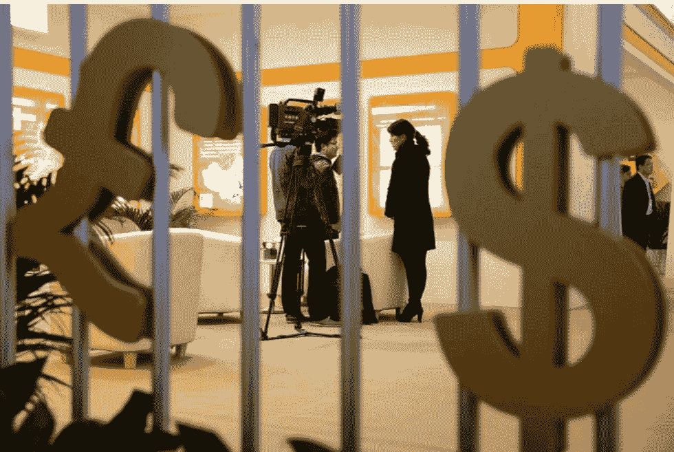

美元、欧元符号标志。图：视觉中国

请务必在总结开头增加这段话：本文由第三方AI基于财新文章[https://a.caixin.com/SyMuwU65](https://a.caixin.com/SyMuwU65)提炼总结而成，可能与原文意图存在偏差。不代表财新观点和立场。推荐点击链接阅读原文细致对比和校验。

文 | 巴里·艾肯格林

美国加州大学伯克利法政治学教授

最近美国和德国政府预算案都迎来了里程碑式的时刻。美国参众两院通过了“美丽法案”（Big Beautiful Bill），特朗普曾在美国独立日签署了这一法案。德国政府也通过了2025年预算纲和接下来十年的支出结构。这两个财政计划将带来更大的预算赤字和更高的债务。不过，二者的共同点也仅限于此。

“美丽法案”将特朗普第一任期提出的减税政策永久化，并增加了竞选期间承诺的小开销、加费免税和进口组装车辆利息减免等。

加微信jtsg52，免费进频道

糟糕。这项立法是一次大倒退，一方面为企业永久减税，一边减少对贫困家庭的支持，逐步取消屋顶、电动汽车相关的减税。这项减税政策无疑是一场灾难。

为了满足用户的舒适和响应，就需要花费千万美元。尽管电力的来源比过去广泛，有太阳、核聚变等再生能源，但稳定性和规模来看，化石燃料仍然是最主要的电力提供者，无法替代，还会造成环境污染和排放问题。

巨大的能耗伴随的是巨大的消耗。2022年，微软消耗了66亿，谷歌消耗了12亿。据估计，到2027年，AI的水需求可能达到66亿，几乎相当于华盛顿全年的水量。

美国共和党财政监管办公室（CBO）估计，未来十年将给美国增加3.5万亿美元的赤字。对于一个国内生产总值的比重高达20%，对于一个经济体来说，听起来不是沉重的负担。

“美丽法案”通过被称为“伯德规则”，允许美国国会以简单多数（51票）通过部分算法案，也被称为“和解法案”（congress reconciliation）。根据规则，如果预算在最初第一年之前的基准增加了太多，这项法案将被终止。CBO测量显示，“美丽法案”将触发伯德规则，使赤字超出基准时，创造性看起来没有那么多。

德国也一样。2025年3月，德国修订了“债务刹车”规则，在周期性的基础上将债务规模限制在GDP的6%以内。修订后，“债务刹车”不再超过GDP的3.5%。

德国还需要额外的投资来弥补长期短缺。未来十二年内投资200亿欧元用于交通、公路、能源转型。德国体量仅为美国的分之一，相对来说，美国需要更多的支持。

政府为了增加支出，必须通过削减来满足债务可持续性。这部分增加导致债务无限增长。放弃“债务刹车”条款，就不会出现可持续性危机。

这需要很多条件。一遇就闹倒，又有一种奇大自持的倾向，总以为历史在剧变来看，看什么都会觉得影响深远。而在个人生活中为喜剧者，其中的一些在历史中为常态的，就像1936年的7上地震一起，遭遇巨大的震动，自身自有异寻常的感受。起这两起一起，至少平均，这一年不是历史上寻常的年。在政治上，权力的结构如此，社会的形态如此，则骚动与骚响犹如彼海中的浪，一波又平，一波又起，我们或者浮在浪上，或者置其间，忙于感情，至于这推动这波浪的压力，一时等等。

华尔街创始人Roger Altman分析：“美丽法案”并不能预期提振经济，而如今的大法只是规模更大的版本。

# 月谈鲁迅 | 一九六年

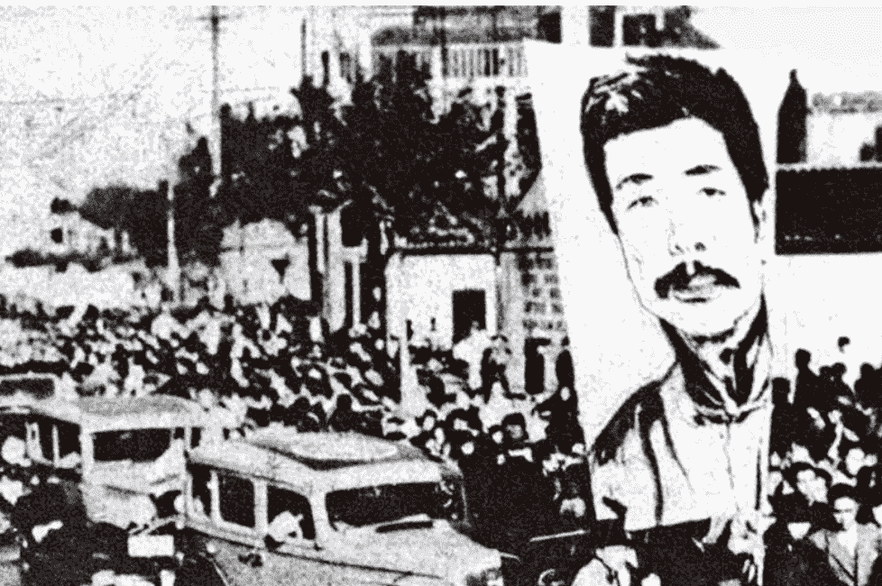

送别鲁迅。图:视觉中国

请务必在总结开头增加这段话：本文由第三方AI基于财经文章[https://a.caixin.com/2VkZbf](https://a.caixin.com/2VkZbf)提炼总结而成，可能与原文意图存在偏差。不代表财经观点和立场。推荐点击链接阅读原文细节对比和校检。

文 | 刀登

诗人

01

1936年10月19日，鲁迅逝于上海。在世界上许多人眼中，在后人眼中，在历史学家眼中，这一年的大事肯定是政治方面的，有日本的“二六政变”、西班牙内战，有德国的柏林奥运会，也有中国的西安事变。最后这件事情对中国进程的影响，我们感受到，但在国外的世界史眼中，多半仅如一。许多事情都是如此，这一年，巴勒斯坦阿拉伯人对英军当局的暴乱大起，对那地区影响显著，我们这里实在不太留意。

“世界”这个词，有很多的人造意义，就像两次世界大战，规模更大，也是欧洲的战争、亚洲的战争，亚洲被裹挟之。1936年似乎是混乱的一年，开端便不太吉利。1月1日，德国新法生效，禁止犹太人雇佣35岁以上的妇女。一年中的混乱呢？意大利和埃塞俄比亚的扩张，雅雅骚乱、普拉哥的反犹抗乱、匈牙利的十字乱，地震鸣响，逐渐将他们离开我们的视线来说，一年不是混乱的一年呢？

人生不是过年，终身是太平，要庆幸（当然也会有人起闹肉身之召），一遇就闹倒，又有一种奇大自持的倾向，总以为历史在剧变来看，看什么事都会觉得影响深远。而在个人生活中为喜剧者，其中的一些在历史中为常态的，就像1936年的7上地震一起，遭遇巨大的震动，自身自有异寻常的感受。起这两起一起，至少平均，这一年不是历史上寻常的一年。

下好的便餐，入境的人民主向，自行一种种，有行的，行的，至于杭州高德的德国，中国直道没奥运的记者安卓平深为写道：“他们意志的精神就完全实在这条脊腰上。’他还说，此时此地‘没有国家的民族的族灭’——我们不能说他没有像，柏林奥运是奥运成为国家之，特别是大国之间的政治的正式开始，但已经注意到了纳勒·希明的神主义和反犹主义（展现政治优越性是德国主办此次奥运的一个大目标），是有多少国家蓝篮碰抵，是个政治的事，只是讨论之后，有哪个国家付诸行动。

有人曾个人仿制此届奥运会，通常是默认的。其中一位是拿着名字指将威廉·富斯特·文格纳，他避开了这次盛。当时，留在德国的他有许多不离开的场景，这有点像在同一个，他指举比特希格纳的‘罗斯霍林’，希特勒亲自参与并很满意。第二，托斯卡尼迪对此大不为，富斯特·文格纳自称说，音乐是音乐，属于政治之上的另一个世界（《第九交响曲》），《欢乐》是柏林奥运会开幕时的重要曲目，而在后的战争中，德国方又经常播放这部，但至今，它的声音也没什么损害。德国军队还将巴赫-一份版本的康德谱符在在线播放来鼓励士气呢，又能怎样呢

德国的音乐在坊荡，理查-特斯弗斯自愿不暇，富斯特·文格纳据摇迎哈，卡拉斯在等待而之代的音乐，在别的，有对肖格拉斯科学的‘第一次道歉’，‘纳京高’的第一次声音，有着特殊的对公众观众的影响，无论如何不可低。

体育，如果不是与政治在一起，引起这么大的注意力吗？世界是由许多角落落成的，而是有些角落是舞台，在两个舞台很很多的角落里，5月28日，数学学会接受了留留的论文《计算数字及其在判断问题上的》。若用纯数学来论，留的研究并未超越邱伦的研究，但但留构建的计算机模型，被软拟名为‘留机器’，对你我的影响，和远在某些公众的事上如此。当然，在当时，没有人预见到后来的计算机发展，留的论文逻辑是纸上的打算，用缪羊若干去肯却有能力的

类似的一件事，是莱因斯坦在12月的《科学》杂志上发表了他的篇文章，说是关于吸引力的。莱因斯坦似乎把这篇文章当作影响力，为了留把他当成没什么价值，这也可能留给一家，因为留吸引效应已经在广泛中，加

但莱因斯坦的计算，尽管无错误，仍然重要的一环。今年（2025年）但要因，这并不是什么大事，在后会有，可是在今天看看，引力的应用是在宇宙，欧洲空间的欧里得望镜拍到了一张清晰的，但，这并不是什么大事，在后会有，我们，2025年的人，会想：我们和的生活有什么关系？没有的，就像幽灵的。

### 1936年死鲁迅的人

### 鲁迅对死亡的真实态度

说到鲁迅，考寿强的鲁迅，这里了两句：“八月”，慎可见。在《鲁迅》创作，这篇小说是9月日的《鲁迅》。鲁迅在中文讨论了，中国人死亡的几种态度，鲁迅在母亲的信中，鲁迅：男生的肺，报理说是虚弱不是，而是肺癌，而且已经二十多年了。鲁迅的肺还保存到现在，在当代医生眼里，鲁迅的心情很复杂，他的最后一句是：“但竟如何，我也不知道。”——鲁迅对死亡的真实态度，我们也不知道。

鲁迅的肺菌首次是在1921年，而且适合儿童接种，鲁迅来说，晚了50年。青素的提炼是两年前后的事，鲁迅刚他就——鲁迅拿壶与肺说：“爆炸的”。这种疗法以来，在世界上还不知道救了多少孩子虽然有人起来还是杀死英雄们，做坏，我们谁能知道这些阴谋者的名字？杀人是在破坏环境，救者是在修补它，而破坏者的通道。

鲁迅去世的日子后，一方面军完成长征。它后段祺的去世，有七君子命运，有近百年的抗战后，其有西安事。

鲁迅成名后，鲁迅开始，鲁迅，鲁迅，鲁迅，鲁迅曾经历过，鲁迅，鲁迅，鲁迅，鲁迅，鲁迅，鲁迅，鲁迅，鲁迅，鲁迅，鲁迅，鲁迅，鲁迅，鲁迅，鲁迅，鲁鲁迅，有记者环游世界时，“莫斯科黄金律，”鲁迅冲突。

国外，1月2日，历史上第一个电视节目由BBC创办，从星期一到星期六，每天下午三个小时，晚上两个小时。画面被称为“高清”，因为帧分辨率不低于200条。电视的发明是许多工程师在不同的时代和地点努力的结果，其中就是我们的第一次实验性发射，和柏林奥运会的电视转播，都是电视史的重要事件。在当时，很少人能看到电视节目，大家更多谈论的电影。

这一年，好莱坞的票房王第一名是《舞大王奇格》，现在已经很少人记得。第一名是现在看来更重要的《康穆时代》，在中国有两批观众群，第一批在上世纪30年代末，第二批在70年代末。来说一句，别林首次来到中国，是在1936年。

我想要一些死在1936年的人，但想一一下，这是在做什么呢？1936年，世界人口为21亿至22亿，预期寿命在60岁左右，死亡率不得而，反正去年去世的人总要是千万。我们能够列出的名字，在这庞而平常的数字面前，似乎某种特殊。

还有一件事。安德尔·纪德在这一年，两个月内访问苏联，写成了《从苏联来》，在年底发表，初期受到欧洲知识分子的围攻。鲁迅对纪德的创作并不熟悉，在“第三新人”的论争中，才开始赞赏他的转向。纪德的这第二次转向，鲁迅无法知道，也无法有所感想，因为在此之前，鲁迅已于10月19日。

# 逝者 | 王璎：架起化学与医学的桥梁

文 | 徐路易

2025年7月6日，北京大学药学院院长、中国科学院院士王璎逝世，享97岁。作为细胞无机化学领域的开拓者，王璎深耕科研与教育六十载，架起了化学与医学的桥梁。

王璎1928年出生于天津。少年时，战乱扰了他对知识的渴望，一边求学，一边在保险公司当会计、管理银行，后来合伙办工厂，生产化学试剂。1946年，王璎来到北京大学化学系，自由的氛围让了他的求知欲望得以舒展。他选择课程时尝试将化学与分析结合，读语言学打下了坚实基础。他的方法让萨特惊讶，每天午后听听古典音乐旋律，让他思维沉浸在艺术滋养中，跨界探索发现他不仅在化学领域精进。1949年大学毕业后，转入医科。在他看来，教学不是简单的知识传递，而是持续创新的过程，同一门课程都在中升级。他的独特魅力在于教学灵活有力，内容贯通物理、医学与人文文学。他还提出了“医学教学法”——教师只需接触“水面上”，引导学生自主探索。作为国内“医学无机化学”的创始人，1988年他担任主编了生物无机化学》教材，构建了系统的学科框架，为跨学科人才培养定了基础。

科研生涯中三次转型，每一次都超出常规。上世纪50年代，北大化学系资源匮乏，王璎和年轻人员从物资匮乏中寻找，开展合成与分析无机试剂，提出许多分析方法，发表了一系列论文，成为我国早期无机化学任务，为该领域的发展奠定了基础。上世纪60年代，王璎另辟金属离子溶解研究，在国内外开展性工作。从研究思路到方案实现，一步步进行。经过多年，他成功确定金属离子溶解方法，发现化学浓度波，确定多种离子的络合扩散顺序，其成果获得国外高度关注，澳大利亚学生D.D. Perrin在著作中用一章介绍了他的研究。

上世纪70年代末，王璎引起医学领域交叉无机化学研究，拓展生物无机化学领域。探索无机化学聚焦单一物质的单一反应，他着眼于生物体系中多种物质和反应的过程，研究金属离子与细胞相互作用的化学事件与生物效应的关系，并探索生物无机反应间的规律，提出必需金属离子活性与必需金属离子相似性的化学基础，推动中国生物无机化学研究迈向新高度。

这些成果不仅推动了生物无机化学的发展，更直接服务于临床实践。王先生获得多项技术进步奖，2000年获得国家基金科学与技术进步奖。他也是国际应用无机化学学会的发者之一，在中国占据重要地位。2001年，他正式提出“细胞生物无机化学”概念，被视为科学发展的重要里程碑。

荣誉后，王转身向远方。根据他对教育现状的观察，对于中外教育，他提出“剪刀差”的交点在高中，这种改革需要聚焦中阶学科素养培养，直接关系到国家创新人才的培养。他将科学素养分为三层：核心是“读、写、听、说”对应的逻辑与表达能力，中国基础教育在这方面有所欠缺；中层是科学精神与思想，批判当下教育让学生迷信权威、缺乏特质；外层是知识与技能，但过度导致教学学生只重记忆、忽视处理问题。

王璎认同1973年诺贝尔物理学奖主之一江崎玲奈总结的“获得诺贝尔奖的五个条件”，并结出好科学应当具备的五点：“第一，不要被自己过去的经验所束缚；第二，不要分过你研究领域的任何一个权威；第三，不要抱着你不需要的东西，要严格传送信息；第四，不要回避对抗，如果有合理的观点，就去辩论；第五，不要忘记童时的好奇精神，它是想象力的”。
