特别报道：光伏急教

普惠金融增长滞后

中年失业者的焦虑

石炭戈待破局

瑞士、芯片出口与松绑

望影：拯救快递的母亲和她的工友们

# 财经周刊

# Caixin Weekly

# 宗庆后留下了什么？

宗庆后遗产之争引发连环破坏，个人财富分割与公司控制权争夺交织，娃哈哈走向何方？

P. 24

2025年第29期 7月28日发行
第1166期
期刊代号：32-235

ISSN 2096-1251

创刊：人民币40元 零售价60元 www.caixin.com

# 知识星球TOP
付费资源分享群

添加微信
免费入群
微信: jntsg2

| 序号 | 公号/星球/社群 | 原价 | 领域 |
| :--- | :--- | :--- | :--- |
| 1 | 生才有木 | 2765/年 | 副业、搞钱 |
| 2 | 怂农从吃瓜群 | 365/年 | 时政、历史 |
| 3 | 记忆承载/碧树西风 | 365元/年 | 成长、搞钱 |
| 4 | 欧洲金靴 | 328元/年 | 时政、历史 |
| 5 | 卢克文青会 | 699/年 | 时政、社会 |
| 6 | 体制内主任 | 599/年 | 体制；职场 |
| 7 | 外局人的视界 | 669元/年 | 金融、时政 |
| 8 | 灏泽异谈 | 4166/年 | 财富、成长 |
| 9 | 守护总司令 | 599/年 | 时政、经济 |
| 10 | 江宁知府 | 365/篇 | 时政、国际 |
| 11 | 政堂/顾子明 | 568/年 | 时政、经济 |
| 12 | 唐书院 | 1399/篇 | 金融、财富 |
| 13 | 大树乡谈 | 199/年 | 时政、成长 |
| 14 | 水库欧大 | 10000元 | 房产、经济 |
| 15 | 洪灏的宏观策略 | 4376/年 | 经济、搞钱 |
| 16 | 金政通鉴/北海道山 | 4576/年 | 股票、行研 |
| 17 | 猫豹的世界 | 299/年 | 时政、社会 |
| 18 | 飞沫 | 3600/年 | 股市、经济 |
| 19 | 米联储见闻 | 599/年 | 经济、金融 |
| 20 | 鉴茶财经院 | 330/年 | 房产、股票 |
| 21 | 赢在八小时之外 | 365元/年 | 成长、职场 |
| ... | ... | 更多资源，不再列举 |

+ 图书、报告、课程等各类高价值资源

- ★ 免费群 每日分享资源
- ★ VIP群 每日分享所有资源（日均20+），75/年

# TOP级资源 TOP社群

# 财新观察 | 构建多方共赢的平台经济生态

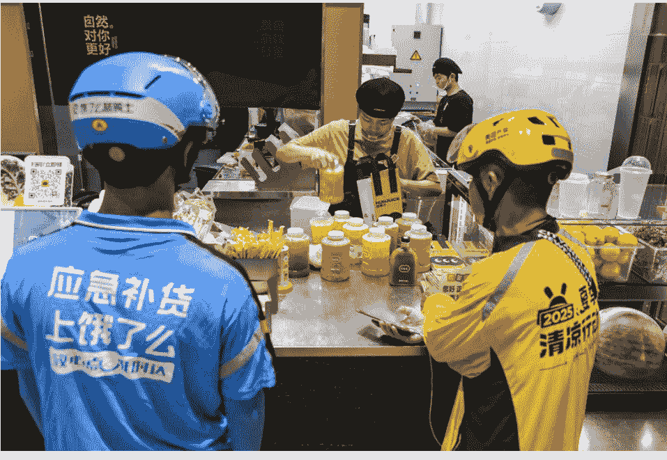

## CAIXIN| 听文章

今日，国家市场监管总局约谈了美团、京东、饿了么三家平台企业。市场监管总局要求相关企业严格遵守法律规定，落实主体责任，规范促销行为，理性参与竞争，共同构建消费者、商家、外卖骑手和平台等多方共赢的良好生态，促进行业健康持续发展。市场监管总局同中央网信办等部门，针对竞争中存在的突出问题进行了约谈。

首先需要清楚的是，低价竞争并不等同于“内卷式”。价格是竞争的一种方式，也是市场活力的表现。借助技术改进、规模提升或者商业模式创新等方式大幅降低产品或服务，使得消费者得到更多实惠，而是社会进步的重要途径。近年来，互联网平台低价竞争日益激烈，有的属于正常范围，有的则涉违反法律。市场监管总局曾公布了七类典型违法行为，首先提到的就是不正当竞争。

“内卷式”竞争之下，几乎没有赢家。近年来，互联网平台对于下游经营者以及消费者的影响，不仅远超传统制造业，平台之间流量激烈，往往导致了平台与内部经营者之间的利益争夺。普通消费者看似获得即时利益，但是长期来看将成为受害者。

这轮价格战的症结不在于价格本身，也不可归于竞争，而是与数字平台内部结构相关。近年来，互联网平台发展迅猛，一方面拥有内部规则制定权；另一方面依靠算法和流量加持，几乎是透明的。这不是小事，关系中国经济的微观肌理。

“内卷式”竞争下，消费者可能失去自主选择权。一旦算法推荐和流量加持成为权重，一旦平台利益优于消费者利益，消费者优先看到的未必是自身喜欢的，而是平台希望你看到的，从而实现对消费者偏好的精准投放。

近年来，市场数据显示，商品质量呈现几何级增长。长此以往，可能出现“劣币逐良币”的现象，最终影响的是企业创新和产业升级。

再次强调，妥善处理“内卷式”竞争是不正当竞争。平台间的公平竞争是激活中国经济的首要环节，也有助于消费者利益。随着市场监管总局约谈，一些地方政府主管部门也开始约谈平台，治理“内卷式”竞争力度加大，成效日益显。

总之，“内卷式”竞争的危害是多方面多层次的，涉及消费者、商家、外卖骑手和平台企业。既防止价格战继续蔓延，也要注意在《电子商务法》和《反不正当竞争法》等法律框架内维护平台活力。法治则是最好的治理。同时，公众也相信，随着消费进一步提升，中国经济将实现高质量发展。

更多报道详：【专题】“反内卷”进行

# 最新封面报道 | 娃哈哈争产案幕后真相：各方缠斗已不只是宫斗剧

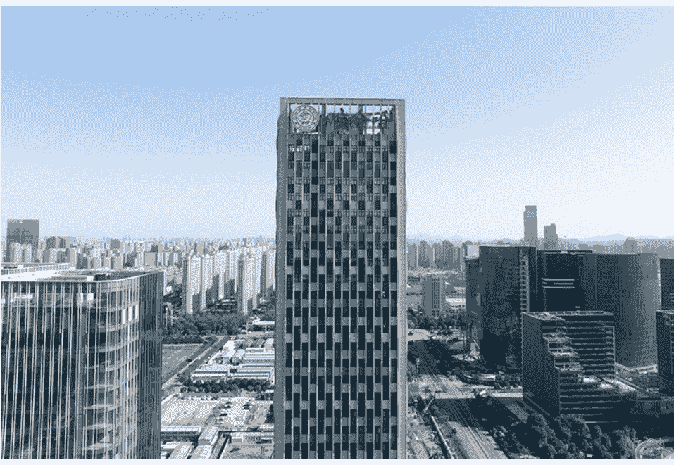

# CAIXIN | 文章

文|冯奕铭 王小青 朱亮韬 包云红

7月，一起发生在中国香港的相关遗产诉讼将知名饮用水品牌娃哈哈再次推至风口浪尖。自称娃哈哈创始人宗庆后子女的三个名士走到台前，将宗庆后的继承人、公众中的“独女”宗馥莉告上法庭，申请冻结宗庆后在世时安排的、共计18亿美元疑似家族信托资产下的账户，一举引发市场对娃哈哈的全面关注。宗庆后的个人生活、公司股权和控制权演变、家庭内部、公司内外的利益分配、国资第一股东的角色和责任，统统被置于聚光灯下。原来，娃哈哈与宗氏家族还有这么多故事。

## 接班与馥莉风波

一开始，人们还以为这是场顺利接班的交。2024年2月25日，宗庆后突然离世，市场早已默认接班人为其“独女”宗馥莉。

此前，娃哈哈集团的第一大股东为国资杭州上城区商旅控股集团，占股46%，宗馥莉此时尚未直接持有娃哈哈集团的股权，宗庆后仍为持股29.4%的第二大，职工工会持股24.6%。2017年1月12日，浙江杭州市，娃哈哈集团董事长宗庆后、宏胜饮料有限公司总裁宗馥莉父女联袂出席“2016·云游湖”奖宴。

宗庆后去世后，宗馥莉通过一份公证委托杭州市公证处申请继承宗庆后持有的29.4%股份。这份继承文件显示，宗庆后和宗馥莉母亲已结婚，宗馥莉的身份证明为中华人民共和国港澳居民，居住在内地。

同年4月，宗馥莉要求娃哈哈集团下的销售骨干、管理层劳动合同从娃哈哈转至宏胜饮料有限公司（下称“宏胜集团”）。宏胜集团的实际控制人为宗馥莉，材料显示，娃哈哈集团旗下12家公司中，从4.8%到50%不等，其中6家大股东是宗馥莉控制，持股比例为1%。然而，宗馥莉的财产继承和骨干转签未能推进。一旦劳动合同变化外，员工无法通过职工会获得分红权益。随后，7月局势突变。一封宗馥莉辞信在社交媒体流传。辞信显示，宗馥莉称：“杭州市市政府以及部分股东对其经营管理的合理性提出质疑，使其无法履行集团及其所属职责，决定从7月15日起辞职，不再参与经营。”

一名娃哈老员工向国资部门递交一封举报信，认为娃哈目前的运营存在资产风险。国资部门认为，宗馥莉辞职在网络上引发了大量讨论。舆论发酵后，国资方面与宗馥莉取得联系并沟通。一周后，2024年7月22日晚间，娃哈哈发布声明称，为确保公司的稳健发展，经各股东友好协商，宗馥莉决定继续履行哈哈集团的相关职责。“宗馥莉辞职事带来了很大影响。”一位接近东方人士透露，“辞职风波以宗馥莉口碑风险。在国资股东方的协调下，宗馥莉重回公司，不希望接班问题对公司带来影响。”下一轮出牌，宗馥莉选择更换董事。2024年8月15日，遗产继承结束。娃哈哈召开临时股东大会，宗馥莉继承所有职责。董事会共有五人。值得注意的是，职工持股会作为三大股东，宗庆在世时仍拥有委派三名董事的权利，而宗庆和国资大股东各委派一名。娃哈哈集团2023年度第一次股东大会议显示，宗庆后去世前，公司召开了临时股东大会，宗馥莉和王国祥被职工持股会委派为董事，接替吴建林、余勇兵。这一安排与遭遇都显示出宗庆后由宗馥莉接班。2024年8月15日，由职工持股会委派的三名董事中，宗馥莉转而接过了父亲留下的席，同时担任董事长；新进董事王国祥未动；总经理潘杰退任。由此空出的董事席，由“70后”洪焯和“80后”洪琼接任。二人任董事由职工持股会推荐，其劳动关系已转至宏胜集团。两人中，洪焯在宏胜集团职十余年，现在是财务总监；叶雅曾辅助宗馥莉，本人曾任宏胜集团总裁。自此，在新的集团董事会中，宗馥掌控了多数董事席位，顺便推进了高管换血。这场股东大会同期变更了公司章程：各方股东对董事和监事的委改为“推荐”，且最终需获得股东会的确认，这意味着拥有三位热门选人的职工成为各方竞争的控制权。2024年10月，此前的娃哈员工转签宏胜集团事务重新启动，对象从原中高层员工更进一步，还包括基层员工。2024年11月起，宗馥莉将全国经销商的合作调整到宏胜系公司。2024年12月至2025年1月，娃哈集团全面要求转签。对于老员工，转签至宏胜集团转为年薪制，新合同薪酬较原来的收入下降20%—50%不等。春节一过，曾在娃哈总部楼的员工也被签至离8公里外的宏胜集团总部。另一边，香港港版文件确权，将此属于娃哈集团的关键利益拉出市场。自称宗馥莉“同父异母”妹妹的宗钰昌（Jacky Zong）、宗建莉（Jessie Zong）、宗洪盛（Jerry Zong）目前均为美国公民，其中至少两个是娃哈老人物。宗庆后在世时购买股权，恢复职工会的集体所有权。杜建英最早是娃哈总经理，一度成为宗庆后的“左右手”。2008年从娃哈离职，2010年创建上海三捷投资集团，对对外持股权业务。杜建英旗下共有5家一级子公司，其中娃哈集团外，但杜建英并非大股东。到此，“争产”持续一年，各方力量全部曝光。诉讼文件和股东决议可见，宗庆后对遗产的安排是海外信托账户。宗庆后去世后，舆论沸然。

1945年生的宗庆后，初中毕业后就学，18岁后辗转于浙江舟山、绍兴的农场工作，回到杭州。1987年，42岁的宗庆后从承包亏损的企业开始创业，创立娃哈哈，主营儿童营养饮料，“喝哈哈”广告词成为一代人的记忆。妻子幼珍是宗庆后四岁。杜建英1966年生，1999年12月娃哈哈有限公司成立的第一轮增资扩股后持股73%，宗庆后之外第二大自然。这一年，她的第一个孩子宗继三岁。杜建英建立娃哈哈二人物地位，负责企业运营和营销策略的落地。在杭州企业高管训财经，杜建英在杭州企业内的口碑不错，早期就是宗庆后的左右臂，上世纪的金名片，很多都是杜建英接待。2004年，美国本科毕业回国，宗莉进入娃哈哈任职，最初在萧山基地担任生产委员会副主任。曾管过童装和日化业务，这两项业务逐渐没落。“宗莉任职之后，杜建英就在公司出现越来越少了，两个人不会同时出现。一开始他们的名字还会在通讯录里面，后来在通讯录里也找不到了。”一名娃哈员工。2007年前，宗馥莉接手宏胜集团。宏胜集团开始娃哈产品代工，接近三分之一的产能。宏胜集团脱胎娃哈哈（不限于国资持股）当年投资的一些工厂，主要以华南、华中为主。宏胜只负责生产，销售则由娃哈哈负责。“一名离职员工，宗庆后曾获多宗骨干支持宏胜集团，“老板曾派的人叫到办公室，让你们去帮阿莉（宗馥莉）。”宗馥莉开始接代业务后，2008年，杜建英从娃哈集团辞职管理职务，仅保留董事席位。2010年，成立三捷投资集团有限公司，对对外持股权投资业务。“2017年到2018年期间，宗总（宗庆后）的身体状况已经开始走下坡路，他可能觉得交班之事迫在眉睫，所以有意让宗馥莉与集团管理。“前述元老们指出，2018年到2021年，宗馥莉担任关部部长，后兼任销售总裁。2019年，53岁的杜建英不再担任董事会的董事职务，彻底退出公司。2021年末，宗馥莉任哈总经理，一直至2024年“接班”。在长达数年交接班及，宗馥莉继承所有职责。宗庆后占29.4%的股东，以及董事长和法定代表人。同期，娃哈哈“董迎高”全线。董事会共有五人。值得注意的是，职工持股会作为三大股东，宗庆在世时仍拥有委派三名董事的权利，而宗庆和国资大股东各委派一名。娃哈哈2023年度第一次股东大会议显示，宗庆后去世前，公司召开了临时股东大会，宗馥莉和王国祥被职工持股会委派为董事，接替吴建林、余勇兵。这一安排与遭遇都显示出宗庆后由宗馥莉接班。2024年8月15日，由职工持股会委派的三名董事中，宗馥莉转而接过了父亲留下的席，同时担任董事长；新进董事王国祥未动；总经理潘杰退任。由此空出的董事席，由“70后”洪焯和“80后”洪琼接任。二人任董事由职工持股会推荐，其劳动关系已转至宏胜集团。两人中，洪焯在宏胜集团职十余年，现在是财务总监；叶雅曾辅助宗馥莉，本人曾任宏胜集团总裁。自此，在新的集团董事会中，宗莉掌控了多数董事席位，顺便推进了高管换血。这场股东大会同期变更了公司章程：各方股东对董事和监事的委改为“推荐”，且最终需获得股东会的确认，这意味着拥有三位热门选人的职工成为各方竞争的控制权。2024年10月，此前的娃哈员工转签宏胜集团事务重新启动，对象从原中高层员工更进一步，还包括基层员工。2024年11月起，宗馥莉将全国经销商的合作调整到宏胜系公司。2024年12月至2025年1月，娃哈集团全面要求转签。对于老员工，转签至宏胜集团转为年薪制，新合同薪酬较原来的收入下降20%—50%不等。春节一过，曾在娃哈总部楼的员工也被签至离8公里外的宏胜集团总部。

2018年，宗庆后进行了“二次改革”，取消原有的股权分红政策，改为干分分红。原本员工出资认购的股份被职工持股会全部回购，回购价为“2元溢价+1元本价”，即3倍出资价格。此轮改革涉及1万多名娃哈哈员工，他们手中的股份凭证也被收回。所谓“干分分红”，员工不再持有股份，但继续享受这些股份的分红权益。

之后，这些被收回的股份由宗庆后向职工持股会认购。“名义上宗总（宗庆后）个人持股还是29.4%，职工持股会的24.6%名义上还是集体的，但在持股会内部仅有宗总一个人。”前述娃哈哈元老人人物诸。

2024年之前，“干分分红”基本落地。前述员工表示，实行干分分红制度之后，原先稳定的分红收入根据业绩的好坏上下浮，但最终拿到的分红和2018年以前相比差别不大，多数员工并未因此此下滑。

然而，2024年宗馥莉接掌后，启动高管和员工转签宏胜，员工工资结构发生巨大变化。员工工资实行“年制”，薪资构成包括基本工资、岗位津贴、绩效奖和其他福利。此外，员工转宏胜，意味着继续享受娃哈哈集团员工的“干分分红”。对部分老员工来说，取消干分分红后工资减半。

2024年4月，宗馥莉要求娃哈哈集团旗下的销售骨干、管理层将劳动合同从娃哈哈集团转签至宏胜饮料集团有限公司。宏胜集团的实际控制人为宗馥莉，被称为宏胜系，有数十家经营娃哈哈相关的实体。

2024年9月，在任职董事后的第一次职代会上，宗馥莉回应“取消分红、降低薪酬”的说法，称“2024年娃哈哈分红不会取消、薪资结构并没有变化。但分红将基于个人的岗位绩效，而非以往过去的级别或额外福利”。

但仍有一系列工资制度变化认为自身受益的老员工开始维护权益。有的部分员工认为回购对价偏低，职工持股会沉淀资金分配不当时员工等。陆续有员工向法院提起诉讼，核心诉求是确认2018年的股份回购行为无效，股权不属于转移，并重新确认员工在持股会中的股份。

目前，职工持股会在娃哈哈集团推荐的三名董事中，至少两人被员工视作宗馥莉的自己。如果娃哈哈集团的员工被悉数转移至宏胜集团，将无法就职持股会的股权继续主张。“维权”员工目前除了诉讼，尚未其他办法可以主张对这部分股权的所有和相关权利。

目前，娃哈哈职工持股会声明表示，职工持股内部股份回购事宜，经过会员大会全体决通过，相关协议由持股会会员自愿签署，合法有效，不存在损害持股会员利益的情形。

2025年1月23日，农历小，娃哈哈举办年会团拜会，披露2024年共给一线员工发24亿元，比2023年多发了4亿元，生产端一线员工工资增长23%，营销端销售人员工资增长31%。这两端的一线员工人数占全集团总人数的93%。

## 体外公司的集中与利润

娃哈哈高管等人士指出，从宗庆后时代开始的体外公司已经悉数归于宗馥莉控制，部分体内公司的利润也在此向体外公司转移。

“娃哈哈集团的体外工厂每年生产娃哈哈产品产生的利润，逐级按比例回流到持股会。职工持股会每年的利润一部分来自娃哈哈早期早期成立的“娃哈哈系公司”，另一部分来自后期成立的无国资参与的工厂的利润。宗馥莉把部分体外公司职工持股会所有股份以零对价转至个人名下。

财经看到的一份材料显示，2024年8月，职工持股会将将其持有的杭州萧山源食品包装有限公司的34.53%股权转让给宗馥莉，转让价为0元。

浙江启力投资有限公司（称“浙江启力”）成立于2007年。浙江启力最开始由宗庆后持股60%、职工持股会持股40%。2024年4月，宗庆后的股份全部由宗馥莉继承，八个月后，职工持股会退出，浙江启力变为宗馥莉百分百持股。

浙江启力控制了吉林、陕西、江西吉安、新疆石子霍、哈尔滨城的牛奶公司；杭州、青海、天津、沈阳的食品公司；南京、大理、重庆的饮料公司等“娃哈哈系”工厂。在此前，浙江启力还是娃哈哈食品营销有限公司（称“浙江娃哈营销公司”）的母公司，后为娃哈哈产品的主要销售公司之一，主要负责华南和西南区的销售。

娃哈哈的桶装水业务，主要由浙江娃哈哈实业股份有限公司（下称“浙江娃哈哈实业”）控股的两家公司在浙江和上海市内承接业务。浙江地区收入占比约85%。而浙江娃哈哈实业的股东包括娃哈哈集团（持股43.03%）、内部职工（持股31.47%）和社会法人（持股25.55%）。

一名接近浙江哈哈产业的人士告诉财新，浙江地区近500家经销商此前是先打款后发货，但2025年4月起，经销商接到通知称，将全部货款交至一家名为远城通商的公司，通过其App报账。工商资料显示，远城通商由宏胜集团百分百控股。新模式下，桶装水成本每桶1.6—1.7元，远城通商进货价格为2.75元，销售给经销商的价格为7元。这意味着，远城通商分了桶装水公司利润，也将利润转移到了娃哈哈集团体系，对浙江哈哈集团的利润以及基于利润的股东产生影响。

据财新了解，2024年负责浙江地区桶装水公司的浙江哈哈饮用水公司全年剔除折扣后的净销售收入为1.91亿元，利润为0.84亿元公司。在远城通商作为中间商后，今年6月，浙江饮用水公司的当月营收约6000万元，减少超6000万。据悉，杭州市财政局已委托第三方评估机构和会计师事务所，对浙江哈哈饮用水公司、饮料公司等进行合规要求。

2025年2月，娃哈哈集团公告，将“哈哈”商标从浙江哈哈集团转签至宗馥莉。由于股权纠纷，转让未能完成，宗馥莉持有娃哈哈食品39%的股权，从24%增加到39%。但一名离职员工透露，此次转让被停。财新通过商标查询确认，目前“哈哈”商标仍属于娃哈哈集团。

## 离岸信托与遗产之争

宗馥莉致力于全面控制娃哈哈内外公司时，另一方在香港发起了诉讼。根据彭博报道，7月11日的庭审中，宗馥莉的律师称，此次诉讼是为了协助其的遗产。法律文件显示，自宗庆后去世后，至少有2亿美元的境内财富。宗庆后生有女宗馥莉、其母亲珍，以及另外三个兄弟：
- 宗继昌（Jacky Jong）
- 宗建莉（Jessie Jong）
- 宗继盛（Jerry Jong）

宗庆后去世前的一个月，曾向属下写过“手写指示”，要求三妹在香港成立信托。宗馥莉的律师则辩称，所谓父亲手写的成立信托的指示，对象并非宗馥莉。

信托（Trust）是一项合约关系。常见的信托涉及委托人（settlor）、受托人（trustee）及受益人（beneficiaries）三方。在信托合约下，委托人将其资产指定为信托资产并转移至受托人名下，由受托人以自身的名义为受益人的利益或特定目的来管理和分配信托资产。在信托合约的规定下，委托人的长远财务延续至离世之后，确保家族财富得以按委托人的计划下去。

常见的离岸信托成立地点有开曼群岛、英维尔京群岛、泽西岛、香港和新加坡等地。香港法律主要以普通法为依据，辅以《受托人条例》和《财产及收益条例》。国内富豪喜欢设立离岸信托，一个原因是隐私；另一个原因在于中国企业“出海”，企业确实积累了一些境外财富，更需要离岸的财富管理和传承。

一名香港家族人士对财新说，账户内资金可能被挪用，最大的一种可能是信托未在法律上设立，否则受托人会对资金移出负责。民法专家、国科研究院专家郭祥对财富分析，假如信托已设立，还有一种可能是宗庆后委托宗毅和其公司去承担信托财产的注入或补足义务，故其作为第三方处置信托资产；又或者宗氏设立的离岸信托架构链条很长，宗毅控制的建浩创属于距离离岸信托实体较远的底层公司，而受托人一般不会干预底层公司的经营活动。

杨祥指出，有别于国内成立信托必须签署书面协议，英美法系下认可口头信托；也就是说，只要有证明宗庆后去世前明确做出了信托设立的意愿，香港特区在法律上即可认可。至于有人指注入不足（未达2亿美元）认定信托无效，杨祥解释称，信托的有效性不是是否足资金决定的，在实操中只要有1美元资金转入信托账户，信托就生效。

信托的有效性，以及建浩创旗下香港汇丰银行账户是否属于信托架构内，预料将是香港法庭临时制令与否的关键，但法庭文件显示，香港法庭本身并不涉及信托有效性的认定。彭博报道，7月11日的庭审中，担心影响案件审理，预计两个个月后作出判决。

根据香港高等院质讯显示，随着银行账户和BVI公司的曝光，公众的目光聚焦于宗家控制娃哈哈体外公司中，就有不少家离岸公司。其中包括：
- 恒枫贸易（Ever Maple Limited）
- 建浩创投（Jian Hao Ventures Ltd.）

上述资深人士办，设立离岸信托有两个关键焦点：一是资金来源的合法性，若涉及资产侵占，信托可能被穿透；二是境外合规，当事人责任对境外收入必须进行境外申报。

律师事务所合伙人李巍指出，信托是否被“穿透”关键在于资金来源。在法律层面，诉讼只是一个辅助手段。通过香港诉讼，目的是保全他们主张的。宗馥莉的自己。李巍强调，在法律层面，信托优先级高于遗嘱。

目前，由于宗馥莉的律师称，这是宗庆后生前承诺的2亿美元。如果不存在信托和遗嘱，则按法定继承权。清华大学金融学院家族研究中心主任李巍指出，他的团队前期基于模型将企业问题的程度分为三个阶段：
- 三级（威慑性）
- 六级（战略性）
- 七级（有限打击性）
- 八级（破坏性）
- 九级（毁灭性）

这种程度不可避免地溢到企业经营层面，可能会对其他股东、员工、供应商、客户等造成不可逆的负面影响。但不要希望这样。

目前，宗庆后留下了。宗庆后宗庆后宗庆后宗庆后宗庆后宗庆后宗庆后宗庆后宗庆后宗庆后宗庆后宗庆后宗庆后宗庆后宗庆后宗庆后宗庆后宗庆后宗庆后宗庆后宗庆后宗庆后宗庆后宗庆后宗庆后宗庆后宗庆后宗庆后宗庆后宗庆后宗庆后宗庆后宗庆后宗庆后宗庆后宗庆后宗庆后宗庆后宗庆后宗庆后宗庆后宗庆后宗庆后宗庆后宗庆后宗庆后宗庆后宗庆后宗庆后宗庆后宗庆后宗庆后宗庆后宗庆后宗庆后宗庆后宗庆后宗庆后宗庆后宗庆后宗庆后宗庆后宗庆后宗庆后宗庆后宗庆后宗庆后宗庆后宗庆后宗庆后宗庆后宗庆后宗庆后宗庆后宗庆后宗庆后宗庆后宗庆后宗庆后宗庆后宗庆后宗庆后宗庆后宗庆后宗庆后宗庆后宗庆后宗庆后宗庆后宗庆后宗庆后宗庆后宗庆后宗庆后宗庆后宗庆后宗庆后庆庆后庆庆庆庆庆庆庆庆庆庆庆庆庆庆庆庆庆庆庆庆庆庆庆庆庆庆后庆庆后庆庆庆庆庆庆庆庆庆庆庆庆庆庆后庆庆庆庆庆庆庆庆庆庆庆庆庆庆庆庆庆庆庆庆庆庆庆庆后庆庆庆庆后庆庆庆宗庆后庆庆庆庆庆庆庆庆庆庆庆庆庆庆后庆庆庆庆庆庆庆庆庆庆庆庆庆庆庆庆庆庆庆庆庆庆庆庆庆庆庆庆庆庆庆庆庆庆庆庆庆庆庆庆庆庆庆庆庆庆庆庆庆庆庆庆庆庆庆庆庆庆庆庆庆庆庆庆庆庆庆庆庆庆庆庆庆庆庆庆庆庆庆庆庆庆庆庆庆庆庆庆庆庆庆庆庆庆庆庆庆庆庆庆庆庆庆庆庆庆庆庆庆庆庆庆庆庆庆庆庆庆庆庆庆庆庆庆庆庆庆庆庆庆庆庆庆庆庆庆庆庆庆庆庆庆庆庆庆庆庆庆庆庆庆庆庆庆庆庆庆庆庆庆庆庆庆庆庆庆庆庆庆庆庆庆庆庆庆庆庆庆庆庆庆庆庆庆庆庆庆庆庆庆庆庆庆庆庆庆庆庆庆庆庆庆庆庆庆庆庆庆庆庆庆庆庆庆庆庆庆庆庆庆庆庆庆庆庆庆庆庆庆庆庆庆庆庆庆庆庆庆庆庆庆庆庆庆庆庆庆庆庆庆庆庆庆庆庆庆庆庆庆庆庆庆庆庆庆庆庆庆庆庆庆庆庆庆庆庆庆庆庆庆庆庆庆庆庆庆庆庆庆庆庆庆庆庆庆庆庆庆庆庆庆庆庆庆庆庆庆庆庆庆庆庆庆庆庆庆庆庆庆庆庆庆庆庆庆庆庆庆庆庆庆庆庆庆庆庆庆庆庆庆庆庆庆庆庆庆庆庆庆庆庆庆庆庆庆庆庆庆庆庆庆庆庆庆庆庆庆庆庆庆庆庆庆庆庆庆庆庆庆庆庆庆庆庆庆庆庆庆庆庆庆庆庆庆庆庆庆庆庆庆庆庆庆庆庆庆庆庆庆庆庆庆庆庆庆庆庆庆庆庆庆庆庆庆庆庆庆庆庆庆庆庆庆庆庆庆庆庆庆庆庆庆庆庆庆庆庆庆庆庆庆庆庆庆庆庆庆庆庆庆庆庆庆庆庆庆庆庆庆庆庆庆庆庆庆庆庆庆庆庆庆庆庆庆庆庆庆庆庆庆庆庆庆庆庆庆庆庆庆庆庆庆庆庆庆庆庆庆庆庆庆庆庆庆庆庆庆庆庆庆庆庆庆庆庆庆庆庆庆庆庆庆庆庆庆庆庆庆庆庆庆庆庆庆庆庆庆庆庆庆庆庆庆庆庆庆庆庆庆庆庆庆庆庆庆庆庆庆庆庆庆庆庆庆庆庆庆庆庆庆庆庆庆庆庆庆庆庆庆庆庆庆庆庆庆庆庆庆庆庆庆庆庆庆庆庆庆庆庆庆庆庆庆庆庆庆庆庆庆庆庆庆庆庆庆庆庆庆庆庆庆庆庆庆庆庆庆庆庆庆庆庆庆庆庆庆庆庆庆庆庆庆庆庆庆庆庆庆庆庆庆庆庆庆庆庆庆庆庆庆庆庆庆庆庆庆庆庆庆庆庆庆庆庆庆庆庆庆庆庆庆庆庆庆庆庆庆庆庆庆庆庆庆庆庆庆庆庆庆庆庆庆庆庆庆庆庆庆庆庆庆庆庆庆庆庆庆庆庆庆庆庆庆庆庆庆庆庆庆庆庆庆庆庆庆庆庆庆庆庆庆庆庆庆庆庆庆庆庆庆庆庆庆庆庆庆庆庆庆庆庆庆庆庆庆庆庆庆庆庆庆庆庆庆庆庆庆庆庆庆庆庆庆庆庆庆庆庆庆庆庆庆庆庆庆庆庆庆庆庆庆庆庆庆庆庆庆庆庆庆庆庆庆庆庆庆庆庆庆庆庆庆庆庆庆庆庆庆庆庆庆庆庆庆庆庆庆庆庆庆庆庆庆庆庆庆庆庆庆庆庆庆庆庆庆庆庆庆庆庆庆庆庆庆庆庆庆庆庆庆庆庆庆庆庆庆庆庆庆庆庆庆庆庆庆庆庆庆庆庆庆庆庆庆庆庆庆庆庆庆庆庆庆庆庆庆庆庆庆庆庆庆庆庆庆庆庆庆庆庆庆庆庆庆庆庆庆庆庆庆庆庆庆庆庆庆庆庆庆庆庆庆庆庆庆庆庆庆庆庆庆庆庆庆庆庆庆庆庆庆庆庆庆庆庆庆庆庆庆庆庆庆庆庆庆庆庆庆庆庆庆庆庆庆庆庆庆庆庆庆庆庆庆庆庆庆庆庆庆庆庆庆庆庆庆庆庆庆庆庆庆庆庆庆庆庆庆庆庆庆庆庆庆庆庆庆庆庆庆庆庆庆庆庆庆庆庆庆庆庆庆庆庆庆庆庆庆庆庆庆庆庆庆庆庆庆庆庆庆庆庆庆庆庆庆庆庆庆庆庆庆庆庆庆庆庆庆庆庆庆庆庆庆庆庆庆庆庆庆庆庆庆庆庆庆庆庆庆庆庆庆庆庆庆庆庆庆庆庆庆庆庆庆庆庆庆庆庆庆庆庆庆庆庆庆庆庆庆庆庆庆庆庆庆庆庆庆庆庆庆庆庆庆庆庆庆庆庆庆庆庆庆庆庆庆庆庆庆庆庆庆庆庆庆庆庆庆庆庆庆庆庆庆庆庆庆庆庆庆庆庆庆庆庆庆庆庆庆庆庆庆庆庆庆庆庆庆庆庆庆庆庆庆庆庆庆庆庆庆庆庆庆庆庆庆庆庆庆庆庆庆庆庆庆庆庆庆庆庆庆庆庆庆庆庆庆庆庆庆庆庆庆庆庆庆庆庆庆庆庆庆庆庆庆庆庆庆庆庆庆庆庆庆庆庆庆庆庆庆庆庆庆庆庆庆庆庆庆庆庆庆庆庆庆庆庆庆庆庆庆庆庆庆庆庆庆庆庆庆庆庆庆庆庆庆庆庆庆庆庆庆庆庆庆庆庆庆庆庆庆庆庆庆庆庆庆庆庆庆庆庆庆庆庆庆庆庆庆庆庆庆庆庆庆庆庆庆庆庆庆庆庆庆庆庆庆庆庆庆庆庆庆庆庆庆庆庆庆庆庆庆庆庆庆庆庆庆庆庆庆庆庆庆庆庆庆庆庆庆庆庆庆庆庆庆庆庆庆庆庆庆庆庆庆庆庆庆庆庆庆庆庆庆庆庆庆庆庆庆庆庆庆庆庆庆庆庆庆庆庆庆庆庆庆庆庆庆庆庆庆庆庆庆庆庆庆庆庆庆庆庆庆庆庆庆庆庆庆庆庆庆庆庆庆庆庆庆庆庆庆庆庆庆庆庆庆庆庆庆庆庆庆庆庆庆庆庆庆庆庆庆庆庆庆庆庆庆庆庆庆庆庆庆庆庆庆庆庆庆庆庆庆庆庆庆庆庆庆庆庆庆庆庆庆庆庆庆庆庆庆庆庆庆庆庆庆庆庆庆庆庆庆庆庆庆庆庆庆庆庆庆庆庆庆庆庆庆庆庆庆庆庆庆庆庆庆庆庆庆庆庆庆庆庆庆庆庆庆庆庆庆庆庆庆庆庆庆庆庆庆庆庆庆庆庆庆庆庆庆庆庆庆庆庆庆庆庆庆庆庆庆庆庆庆庆庆庆庆庆庆庆庆庆庆庆庆庆庆庆庆庆庆庆庆庆庆庆庆庆庆庆庆庆庆庆庆庆庆庆庆庆庆庆庆庆庆庆庆庆庆庆庆庆庆庆庆庆庆庆庆庆庆庆庆庆庆庆庆庆庆庆庆庆庆庆庆庆庆庆庆庆庆庆庆庆庆庆庆庆庆庆庆庆庆庆庆庆庆庆庆庆庆庆庆庆庆庆庆庆庆庆庆庆庆庆庆庆庆庆庆庆庆庆庆庆庆庆庆庆庆庆庆庆庆庆庆庆庆庆庆庆庆庆庆庆庆庆庆庆庆庆庆庆庆庆庆庆庆庆庆庆庆庆庆庆庆庆庆庆庆庆庆庆庆庆庆庆庆庆庆庆庆庆庆庆庆庆庆庆庆庆庆庆庆庆庆庆庆庆庆庆庆庆庆庆庆庆庆庆庆庆庆庆庆庆庆庆庆庆庆庆庆庆庆庆庆庆庆庆庆庆庆庆庆庆庆庆庆庆庆庆庆庆庆庆庆庆庆庆庆庆庆庆庆庆庆庆庆庆庆庆庆庆庆庆庆庆庆庆庆庆庆庆庆庆庆庆庆庆庆庆庆庆庆庆庆庆庆庆庆庆庆庆庆庆庆庆庆庆庆庆庆庆庆庆庆庆庆庆庆庆庆庆庆庆庆庆庆庆庆庆庆庆庆庆庆庆庆庆庆庆庆庆庆庆庆庆庆庆庆庆庆庆庆庆庆庆庆庆庆庆庆庆庆庆庆庆庆庆庆庆庆庆庆庆庆庆庆庆庆庆庆庆庆庆庆庆庆庆庆庆庆庆庆庆庆庆庆庆庆庆庆庆庆庆庆庆庆庆庆庆庆庆庆庆庆庆庆庆庆庆庆庆庆庆庆庆庆庆庆庆庆庆庆庆庆庆庆庆庆庆庆庆庆庆庆庆庆庆庆庆庆庆庆庆庆庆庆庆庆庆庆庆庆庆庆庆庆庆庆庆庆庆庆庆庆庆庆庆庆庆庆庆庆庆庆庆庆庆庆庆庆庆庆庆庆庆庆庆庆庆庆庆庆庆庆庆庆庆庆庆庆庆庆庆庆庆庆庆庆庆庆庆庆庆庆庆庆庆庆庆庆庆庆庆庆庆庆庆庆庆庆庆庆庆庆庆庆庆庆庆庆庆庆庆庆庆庆庆庆庆庆庆庆庆庆庆庆庆庆庆庆庆庆庆庆庆庆庆庆庆庆庆庆庆庆庆庆庆庆庆庆庆庆庆庆庆庆庆庆庆庆庆庆庆庆庆庆庆庆庆庆庆庆庆庆庆庆庆庆庆庆庆庆庆庆庆庆庆庆庆庆庆庆庆庆庆庆庆庆庆庆庆庆庆庆庆庆庆庆庆庆庆庆庆庆庆庆庆庆庆庆庆庆庆庆庆庆庆庆庆庆庆庆庆庆庆庆庆庆庆庆庆庆庆庆庆庆庆庆庆庆庆庆庆庆庆庆庆庆庆庆庆庆庆庆庆庆庆庆庆庆庆庆庆庆庆庆庆庆庆庆庆庆庆庆庆庆庆庆庆庆庆庆庆庆庆庆庆庆庆庆庆庆庆庆庆庆庆庆庆庆庆庆庆庆庆庆庆庆庆庆庆庆庆庆庆庆庆庆庆庆庆庆庆庆庆庆庆庆庆庆庆庆庆庆庆庆庆庆庆庆庆庆庆庆庆庆庆庆庆庆庆庆庆庆庆庆庆庆庆庆庆庆庆庆庆庆庆庆庆庆庆庆庆庆庆庆庆庆庆庆庆庆庆庆庆庆庆庆庆庆庆庆庆庆庆庆庆庆庆庆庆庆庆庆庆庆庆庆庆庆庆庆庆庆庆庆庆庆庆庆庆庆庆庆庆庆庆庆庆庆庆庆庆庆庆庆庆庆庆庆庆庆庆庆庆庆庆庆庆庆庆庆庆庆庆庆庆庆庆庆庆庆庆庆庆庆庆庆庆庆庆庆庆庆庆庆庆庆庆庆庆庆庆庆庆庆庆庆庆庆庆庆庆庆庆庆庆庆庆庆庆庆庆庆庆庆庆庆庆庆庆庆庆庆庆庆庆庆庆庆庆庆庆庆庆庆庆庆庆庆庆庆庆庆庆庆庆庆庆庆庆庆庆庆庆庆庆庆庆庆庆庆庆庆庆庆庆庆庆庆庆庆庆庆庆庆庆庆庆庆庆庆庆庆庆庆庆庆庆庆庆庆庆庆庆庆庆庆庆庆庆庆庆庆庆庆庆庆庆庆庆庆庆庆庆庆庆庆庆庆庆庆庆庆庆庆庆庆庆庆庆庆庆庆庆庆庆庆庆庆庆庆庆庆庆庆庆庆庆庆庆庆庆庆庆庆庆庆庆庆庆庆庆庆庆庆庆庆庆庆庆庆庆庆庆庆庆庆庆庆庆庆庆庆庆庆庆庆庆庆庆庆庆庆庆庆庆庆庆庆庆庆庆庆庆庆庆庆庆庆庆庆庆庆庆庆庆庆庆庆庆庆庆庆庆庆庆庆庆庆庆庆庆庆庆庆庆庆庆庆庆庆庆庆庆庆庆庆庆庆庆庆庆庆庆庆庆庆庆庆庆庆庆庆庆庆庆庆庆庆庆庆庆庆庆庆庆庆庆庆庆庆庆庆庆庆庆庆庆庆庆庆庆庆庆庆庆庆庆庆庆庆庆庆庆庆庆庆庆庆庆庆庆庆庆庆庆庆庆庆庆庆庆庆庆庆庆庆庆庆庆庆庆庆庆庆庆庆庆庆庆庆庆庆庆庆庆庆庆庆庆庆庆庆庆庆庆庆庆庆庆庆庆庆庆庆庆庆庆庆庆庆庆庆庆庆庆庆庆庆庆庆庆庆庆庆庆庆庆庆庆庆庆庆庆庆庆庆庆庆庆庆庆庆庆庆庆庆庆庆庆庆庆庆庆庆庆庆庆庆庆庆庆庆庆庆庆庆庆庆庆庆庆庆庆庆庆庆庆庆庆庆庆庆庆庆庆庆庆庆庆庆庆庆庆庆庆庆庆庆庆庆庆庆庆庆庆庆庆庆庆庆庆庆庆庆庆庆庆庆庆庆庆庆庆庆庆庆庆庆庆庆庆庆庆庆庆庆庆庆庆庆庆庆庆庆庆庆庆庆庆庆庆庆庆庆庆庆庆庆庆庆庆庆庆庆庆庆庆庆庆庆庆庆庆庆庆庆庆庆庆庆庆庆庆庆庆庆庆庆庆庆庆庆庆庆庆庆庆庆庆庆庆庆庆庆庆庆庆庆庆庆庆庆庆庆庆庆庆庆庆庆庆庆庆庆庆庆庆庆庆庆庆庆庆庆庆庆庆庆庆庆庆庆庆庆庆庆庆庆庆庆庆庆庆庆庆庆庆庆庆庆庆庆庆庆庆庆庆庆庆庆庆庆庆庆庆庆庆庆庆庆庆庆庆庆庆庆庆庆庆庆庆庆庆庆庆庆庆庆庆庆庆庆庆庆庆庆庆庆庆庆庆庆庆庆庆庆庆庆庆庆庆庆庆庆庆庆庆庆庆庆庆庆庆庆庆庆庆庆庆庆庆庆庆庆庆庆庆庆庆庆庆庆庆。，请识别并处理以下OCR文本。要求识别标题（用 ## 表示一级标题，### 表示二级标题）、列表项（- 开头）。如果出现表格样式的文本，将其转换为 Markdown表格。

原始OCR文本：
[content]
[PAGE 15]

2018年，宗庆后进行了“二次改革”，取消原有的股权分红政策，改为干分分红。原本员工出资认购的股份被职工持股会全部回购，回购价为“2元溢价+1元本价”，即3倍出资价格。此轮改革涉及1万多名娃哈员工，他们手中的股份凭证也被收回。所谓“干分分红”，员工不再持有股份，但继续享受这些股份的分红权益。

诸，这些被收回的股份由宗庆后向职工持股会认购。“名义上宗总（宗庆后）个人持股还是29.4%，职工持股会的24.6%名义上还是集体的，但在持股会内部仅有宗总一个人。“前述娃哈哈元老人人物诸。

2024年之前，“干分分红”基本落地。前述员工表示，实行干分分红制度之后，原先稳定的分红收入根据业绩的好坏上下浮，但最终拿到的分红和2018年以前相比差别不大，多数员工并未因此此下滑。

然而，2024年宗馥莉接掌后，启动高管和员工转签宏宏，员工工资结构发生巨大变化。员工工资实行“年制”，薪资构成包括基本工资、岗位津贴、绩效奖和其他福利。此外，员工转宏宏，意味着继续享受娃哈哈集团员工的“干分分红”。对部分老员工来说，取消干分分红后工资减半。

2024年4月，宗馥莉要求娃哈集团旗下的销售骨干、管理层将劳动合同从娃哈集团转签至宏宏饮料集团有限公司。宏宏集团的实际控制人为宗馥莉，被称为宏宏系，有数十家经营娃哈哈相关的实体。[PAGE 16]

2024年9月，在任职董事后的第一次职代会上，宗莉莉回应“取消分红、降低薪酬”的说法，称“2024年娃哈哈哈分红不会取消、薪资结构并没有变化。但分红将基于个人的岗位绩效，而非优优过去的资级或逸来福利”

但仍有一系列工资制度变化认为自身受益的老员工开始维护权益。有的部分员工认为回购对价偏低，职工持股会沉淀资金分配适当时员工等。陆续有员工向法院提起诉讼，核心诉求是确认2018年的股份回购行为无效，股权不属于转移，并重新确认员工在持股会中的股份。

目前，职工持股会在娃哈哈集团推荐的三名董事中，至少两人被员工视作宗莉莉的自己。如果娃哈哈集团的员工被悉数转移至宏胜集团，将无法就职持股会的股权继续主张。“维权”员工目前除了诉讼，尚未其他办法可以主张对这部分股权的所有和相关权利。

目前，娃哈哈职工持股会声明表示，职工持股内部股份回购事宜，经过会员大会全体决通过，相关协议由持股会会员自愿签署，合法有效，不存在损害持股会员利益的情形。

2025年1月23日，农历小夜，娃哈哈举办年会团拜会，披露2024年共给一线员工发24亿元，比2023年多发了4亿元，生产端一线员工工资增长23%，营销端销售人员工资增长31%。这两端的一线员工人数占全集团总人数的93%。[PAGE 17] # 体外公司的集中与利润 娃哈哈高原高管等人士指出，从宗庆后时代开始的体外公司已经悉数归于宗馥莉控制，部分体内公司的利润也在此向体外公司转移。

“娃哈哈集团的体外工厂每年生产哈哈哈产品产生的利润，逐级按比例回流到持股会。职工持股会每年的利润一部分来自哈哈集团早期所成立的“娃哈哈系公司”，另一部分来自后期成立的无国资参与的工厂的利润。宗馥莉把部分体外公司职工持股会所有股份以零对价转至个人名下。

财经看到的的一份材料显示，2024年8月，职工持股会将将其持有的杭州萧山源食品包装有限公司的34.53%股权转让给宗馥莉，转让价为0元。

浙江启力投资有限公司（称“浙江启力”）成立于2007年。浙江启力最开始由宗庆后持股60%、职工持股会持股40%。2024年4月，宗庆后的股份全部由宗馥莉继承，八个月后，职工持股会退出，浙江启力变为宗馥莉百分百持股。

浙江启力控制了吉林、陕西、江西吉安、新疆石子霍、哈尔滨城的牛奶公司；杭州、青海、天津、沈阳的食品公司；南京、大理、重庆的饮料公司等“娃哈哈系”工厂。在此前，浙江启力还是娃哈哈食品营销有限公司（称“浙江娃哈营销公司”）的母公司，后为娃哈产品的主要销售公司之一，主要负责华南和西南区的销售。[PAGE 18] 哈哈哈的桶装水业务，主要由浙江娃哈哈实业股份有限公司（下称“浙江娃哈哈实业”）控股的两家公司在浙江和上海市内承接业务。浙江地区收入占比约85%。而浙江娃哈哈实业的股东包括哈哈集团（持股43.03%）、内部职工（持股31.47%）和社会法人（持股25.55%）。[PAGE 19] 一接近浙江哈哈产业的人士告诉财新，浙江地区近500家经销商此前是先打款后发货，但2025年4月起，经销商接到通知称，将全部货款交至一家名为远城通商的公司，通过其App报账。工商资料显示，远城通商蜀由宏胜集团百分百控股。新模式下，桶装水成本每桶1.6—1.7元，远城通商进货价格为2.75元，销售给经销商的价格为7元。这意味着，远城通商蜀分了桶装水公司利润，也将利润转移到了哈哈集团体系，对浙江哈哈集团的利润以及基于利润的股东产生产影响。据财新了解，2024年负责浙江地区桶装水公司的浙江哈哈饮用水公司全年剔除折扣后的净销售收入为1.91亿元，利润为0.84亿公司。在远城通商蜀作为中间商后，今年6月，浙江饮用水公司的当月营收约6000万元，减少超6000万。据悉，杭州市财政局已委托第三方评估机构和会计师事务所，对浙江哈哈饮用水公司、饮料公司等进行合规要求。2025年2月，娃哈哈集团公告，将“哈哈”商标从浙江哈哈集团转签至宗馥莉。由于股权纠纷，转让未能完成，宗馥莉持有娃哈哈食品39%的股权，从24%增加到39%。但一名离职员工透露，此次转让被停。财新通过商标查询确认，目前“哈哈”商标仍属于娃哈哈集团。[PAGE 20] # 离岸信托与遗产之争 宗馥莉致力于全面控制娃哈哈内外公司时，另一方在香港发起了诉讼。根据彭博报道，7月11日的庭审中，宗馥莉的律师称，此次诉讼是为了协助其的遗产。法律文件显示，自宗庆后去世后，至少有2亿美元的境内财富。宗庆后生有女宗馥莉（宗馥莉）以及其母亲珍，以及另外三个兄弟：
- 宗继昌（Jacky Jong）
- 宗建莉（Jessie Jong）
- 宗继盛（Jerry Jong）

宗庆后去世前的一个月，曾向属下写过“手写指示”，要求三妹在香港成立信托。宗馥莉的律师则辩称，所谓父亲手写的成立信托的指示，对象并非宗馥莉。

信托（Trust）是一项合约关系。常见的信托涉及委托人（settlor）、受托人（trustee）及受益人（beneficiaries）三方。在信托合约下，委托人将其资产指定为信托资产并转移至受托人名下，由受托人以自身的名义为受益人的利益或特定目的来管理和分配信托资产。在信托合约的规定下，委托人的长远财务延续至离世之后，确保家族财富得以按委托人的计划下去。常见的离岸信托成立地点有开曼群岛、英维尔京群岛、泽西岛、香港和新加坡等地。香港法律主要以普通法为依据，辅以《受托人条例》和《财产及收益条例》。国内富豪喜欢设立离岸信托，一个原因是离岸信托合约不公开，允许高度隐私；另一个原因在于中国企业“出海”，企业确实积累了一些境外财富，更需要离岸的财富管理和传承。

一名香港家族人士对财新说，账户内资金可能被挪用，最大的一种可能是信托未在法律上设立，否则受托人会对资金移出负责。民法专家、国科研究院专家郭祥杨对财富分析，假如信托已设立，还有一种可能是宗庆后委托宗毅和其公司去承担信托财产的注入或补足义务，故其作为第三方处置信托资产；又或者宗氏设立的离岸信托架构链条很长，宗毅控制的建浩创属于距离离岸信托实体较远的底层公司，而受托人一般不会干预底层公司的经营活动。

杨祥指出，有别于国内成立信托必须签署书面协议，英美法系下认可口头信托；也就是说，只要有证明宗庆后去世前明确做出了信托设立的意愿，香港特区在法律上认可。至于有人指资金注入不足（未达2亿美元）认定信托无效，杨祥解释称，信托的有效性不是是否足资金决定的，在实操中只要有1美元资金转入信托账户，信托就生效。

信托的有效性，以及建浩创旗下香港汇丰银行账户是否属于信托架构内，预料将是香港法庭临时制令与否的关键，但法庭文件显示，香港法庭本身并不涉及信托有效性的认定。彭博报道，7月11日的庭审中，担心影响案件审理，预计两个个月后作出判决。

根据香港高等院质讯显示，随着银行账户和BVI公司的曝光，公众的目光聚焦于宗家积累的财富。事实上，早在宗家控制娃哈哈体外公司中，就有不少家离岸公司。其中包括：
- 恒枫贸易（Ever Maple Limited）
- 建浩创投（Jian Hao Ventures Ltd.）

上述资深人士办，设立离岸信托有两个关键焦点：一是资金来源，二是中国居民境外收入必须进行境外申报。律师事务所合伙人李巍指出，信托是否被“穿透”关键在于资金来源的合法性，若涉及资产侵占，信托可能被穿透。在法律层面，诉讼只是一个辅助手段。通过香港诉讼，目的是保全他们主张的。宗馥莉的自己。李巍强调，在法律层面，信托优先级高于遗嘱。如果不存在信托和遗嘱，则按法定继承权。

目前，由于宗馥莉的律师称，这是宗庆后生前承诺的2亿美元。如果不存在信托和遗嘱，则按法定继承权。宗庆后生有女以及以及非婚子女。

清华大学金融学院家族研究中心主任李巍指出，他的团队前期基于模型将企业问题的程度分为三个阶段：
- 三级（威慑性）
- 六级（战略性）
- 七级（有限打击性）
- 八级（破坏性）
- 九级（毁灭性）

这种程度不可避免地溢到企业经营层面，可能会对其他股东、员工、供应商、客户等造成不可逆的负面影响。但不要希望这样。目前，宗庆后留下了。宗庆后宗庆后庆庆庆庆庆庆庆庆庆庆庆庆庆庆庆庆庆庆庆庆庆庆庆庆庆庆庆庆庆庆庆庆庆庆庆庆庆庆庆庆庆庆庆庆庆庆庆庆庆庆庆庆庆庆庆庆庆庆庆庆庆庆庆庆庆庆庆庆庆庆庆庆庆庆庆庆庆庆庆庆庆庆庆庆庆庆庆庆庆庆庆庆庆庆庆庆庆庆庆庆庆庆庆庆庆庆庆庆庆庆庆庆庆庆庆庆庆庆庆庆庆庆庆庆庆庆庆庆庆庆庆庆庆庆庆庆庆庆庆庆庆庆庆庆庆庆庆庆庆庆庆庆庆庆庆庆庆庆庆庆庆庆庆庆庆庆庆庆庆庆庆庆庆庆庆庆庆庆庆庆庆庆庆庆庆庆庆庆庆庆庆庆庆庆庆庆庆庆庆庆庆庆庆庆庆庆庆庆庆庆庆庆庆庆庆庆庆庆庆庆庆庆庆庆庆庆庆庆庆庆庆庆庆庆庆庆庆庆庆庆庆庆庆庆庆庆庆庆庆庆庆庆庆庆庆庆庆庆庆庆庆庆庆庆庆庆庆庆庆庆庆庆庆庆庆庆庆庆庆庆庆庆庆庆庆庆庆庆庆庆庆庆庆庆庆庆庆庆庆庆庆庆庆庆庆庆庆庆庆庆庆庆庆庆庆庆庆庆庆庆庆庆庆庆庆庆庆庆庆庆庆庆庆庆庆庆庆庆庆庆庆庆庆庆庆庆庆庆庆庆庆庆庆庆庆庆庆庆庆庆庆庆庆庆庆庆庆庆庆庆庆庆庆庆庆庆庆庆庆庆庆庆庆庆庆庆庆庆庆庆庆庆庆庆庆庆庆庆庆庆庆庆庆庆庆庆庆庆庆庆庆庆庆庆庆庆庆庆庆庆庆庆庆庆庆庆庆庆庆庆庆庆庆庆庆庆庆庆庆庆庆庆庆庆庆庆庆庆庆庆庆庆庆庆庆庆庆庆庆庆庆庆庆庆庆庆庆庆庆庆庆庆庆庆庆庆庆庆庆庆庆庆庆庆庆庆庆庆庆庆庆庆庆庆庆庆庆庆庆庆庆庆庆庆庆庆庆庆庆庆庆庆庆庆庆庆庆庆庆庆庆庆庆庆庆庆庆庆庆庆庆庆庆庆庆庆庆庆庆庆庆庆庆庆庆庆庆庆庆庆庆庆庆庆庆庆庆庆庆庆庆庆庆庆庆庆庆庆庆庆庆庆庆庆庆庆庆庆庆庆庆庆庆庆庆庆庆庆庆庆庆庆庆庆庆庆庆庆庆庆庆庆庆庆庆庆庆庆庆庆庆庆庆庆庆庆庆庆庆庆庆庆庆庆庆庆庆庆庆庆庆庆庆庆庆庆庆庆庆庆庆庆庆庆庆庆庆庆庆庆庆庆庆庆庆庆庆庆庆庆庆庆庆庆庆庆庆庆庆庆庆庆庆庆庆庆庆庆庆庆庆庆庆庆庆庆庆庆庆庆庆庆庆庆庆庆庆庆庆庆庆庆庆庆庆庆庆庆庆庆庆庆庆庆庆庆庆庆庆庆庆庆庆庆庆庆庆庆庆庆庆庆庆庆庆庆庆庆庆庆庆庆庆庆庆庆庆庆庆庆庆庆庆庆庆庆庆庆庆庆庆庆庆庆庆庆庆庆庆庆庆庆庆庆庆庆庆庆庆庆庆庆庆庆庆庆庆庆庆庆庆庆庆庆庆庆庆庆庆庆庆庆庆庆庆庆庆庆庆庆庆庆庆庆庆庆庆庆庆庆庆庆庆庆庆庆庆庆庆庆庆庆庆庆庆庆庆庆庆庆庆庆庆庆庆庆庆庆庆庆庆庆庆庆庆庆庆庆庆庆庆庆庆庆庆庆庆庆庆庆庆庆庆庆庆庆庆庆庆庆庆庆庆庆庆庆庆庆庆庆庆庆庆庆庆庆庆庆庆庆庆庆庆庆庆庆庆庆庆庆庆庆庆庆庆庆庆庆庆庆庆庆庆庆庆庆庆庆庆庆庆庆庆庆庆庆庆庆庆庆庆庆庆庆庆庆庆庆庆庆庆庆庆庆庆庆庆庆庆庆庆庆庆庆庆庆庆庆庆庆庆庆庆庆庆庆庆庆庆庆庆庆庆庆庆庆庆庆庆庆庆庆庆庆庆庆庆庆庆庆庆庆庆庆庆庆庆庆庆庆庆庆庆庆庆庆庆庆庆庆庆庆庆庆庆庆庆庆庆庆庆庆庆庆庆庆庆庆庆庆庆庆庆庆庆庆庆庆庆庆庆庆庆庆庆庆庆庆庆庆庆庆庆庆庆庆庆庆庆庆庆庆庆庆庆庆庆庆庆庆庆庆庆庆庆庆庆庆庆庆庆庆庆庆庆庆庆庆庆庆庆庆庆庆庆庆庆庆庆庆庆庆庆庆庆庆庆庆庆庆庆庆庆庆庆庆庆庆庆庆庆庆庆庆庆庆庆庆庆庆庆庆庆庆庆庆庆庆庆庆庆庆庆庆庆庆庆庆庆庆庆庆庆庆庆庆庆庆庆庆庆庆庆庆庆庆庆庆庆庆庆庆庆庆庆庆庆庆庆庆庆庆庆庆庆庆庆庆庆庆庆庆庆庆庆庆庆庆庆庆庆庆庆庆庆庆庆庆庆庆庆庆庆庆庆庆庆庆庆庆庆庆庆庆庆庆庆庆庆庆庆庆庆庆庆庆庆庆庆庆庆庆庆庆庆庆庆庆庆庆庆庆庆庆庆庆庆庆庆庆庆庆庆庆庆庆庆庆庆庆庆庆庆庆庆庆庆庆庆庆庆庆庆庆庆庆庆庆庆庆庆庆庆庆庆庆庆庆庆庆庆庆庆庆庆庆庆庆庆庆庆庆庆庆庆庆庆庆庆庆庆庆庆庆庆庆庆庆庆庆庆庆庆庆庆庆庆庆庆庆庆庆庆庆庆庆庆庆庆庆庆庆庆庆庆庆庆庆庆庆庆庆庆庆庆庆庆庆庆庆庆庆庆庆庆庆庆庆庆庆庆庆庆庆庆庆庆庆庆庆庆庆庆庆庆庆庆庆庆庆庆庆庆庆庆庆庆庆庆庆庆庆庆庆庆庆庆庆庆庆庆庆庆庆庆庆庆庆庆庆庆庆庆庆庆庆庆庆庆庆庆庆庆庆庆庆庆庆庆庆庆庆庆庆庆庆庆庆庆庆庆庆庆庆庆庆庆庆庆庆庆庆庆庆庆庆庆庆庆庆庆庆庆庆庆庆庆庆庆庆庆庆庆庆庆庆庆庆庆庆庆庆庆庆庆庆庆庆庆庆庆庆庆庆庆庆庆庆庆庆庆庆庆庆庆庆庆庆庆庆庆庆庆庆庆庆庆庆庆庆庆庆庆庆庆庆庆庆庆庆庆庆庆庆庆庆庆庆庆庆庆庆庆庆庆庆庆庆庆庆庆庆庆庆庆庆庆庆庆庆庆庆庆庆庆庆庆庆庆庆庆庆庆庆庆庆庆庆庆庆庆庆庆庆庆庆庆庆庆庆庆庆庆庆庆庆庆庆庆庆庆庆庆庆庆庆庆庆庆庆庆庆庆庆庆庆庆庆庆庆庆庆庆庆庆庆庆庆庆庆庆庆庆庆庆庆庆庆庆庆庆庆庆庆庆庆庆庆庆庆庆庆庆庆庆庆庆庆庆庆庆庆庆庆庆庆庆庆庆庆庆庆庆庆庆庆庆庆庆庆庆庆庆庆庆庆庆庆庆庆庆庆庆庆庆庆庆庆庆庆庆庆庆庆庆庆庆庆庆庆庆庆庆庆庆庆庆庆庆庆庆庆庆庆庆庆庆庆庆庆庆庆庆庆庆庆庆庆庆庆庆庆庆庆庆庆庆庆庆庆庆庆庆庆庆庆庆庆庆庆庆庆庆庆庆庆庆庆庆庆庆庆庆庆庆庆庆庆庆庆庆庆庆庆庆庆庆庆庆庆庆庆庆庆庆庆庆庆庆庆庆庆庆庆庆庆庆庆庆庆庆庆庆庆庆庆庆庆庆庆庆庆庆庆庆庆庆庆庆庆庆庆庆庆庆庆庆庆庆庆庆庆庆庆庆庆庆庆庆庆庆庆庆庆庆庆庆庆庆庆庆庆庆庆庆庆庆庆庆庆庆庆庆庆庆庆庆庆庆庆庆庆庆庆庆庆庆庆庆庆庆庆庆庆庆庆庆庆庆庆庆庆庆庆庆庆庆庆庆庆庆庆庆庆庆庆庆庆庆庆庆庆庆庆庆庆庆庆庆庆庆庆庆庆庆庆庆庆庆庆庆庆庆庆庆庆庆庆庆庆庆庆庆庆庆庆庆庆庆庆庆庆庆庆庆庆庆庆庆庆庆庆庆庆庆庆庆庆庆庆庆庆庆庆庆庆庆庆庆庆庆庆庆庆庆庆庆庆庆庆庆庆庆庆庆庆庆庆庆庆庆庆庆庆庆庆庆庆庆庆庆庆庆庆庆庆庆庆庆庆庆庆庆庆庆庆庆庆庆庆庆庆庆庆庆庆庆庆庆庆庆庆庆庆庆庆庆庆庆庆庆庆庆庆庆庆庆庆庆庆庆庆庆庆庆庆庆庆庆庆庆庆庆庆庆庆庆庆庆庆庆庆庆庆庆庆庆庆庆庆庆庆庆庆庆庆庆庆庆庆庆庆庆庆庆庆庆庆庆庆庆庆庆庆庆庆庆庆庆庆庆庆庆庆庆庆庆庆庆庆庆庆庆庆庆庆庆庆庆庆庆庆庆庆庆庆庆庆庆庆庆庆庆庆庆庆庆庆庆庆庆庆庆庆庆庆庆庆庆庆庆庆庆庆庆庆庆庆庆庆庆庆庆庆庆庆庆庆庆庆庆庆庆庆庆庆庆庆庆庆庆庆庆庆庆庆庆庆庆庆庆庆庆庆庆庆庆庆庆庆庆庆庆庆庆庆庆庆庆庆庆庆庆庆庆庆庆庆庆庆庆庆庆庆庆庆庆庆庆庆庆庆庆庆庆庆庆庆庆庆庆庆庆庆庆庆庆庆庆庆庆庆庆庆庆庆庆庆庆庆庆庆庆庆庆庆庆庆庆庆庆庆庆庆庆庆庆庆庆庆庆庆庆庆庆庆庆庆庆庆庆庆庆庆庆庆庆庆庆庆庆庆庆庆庆庆庆庆庆庆庆庆庆庆庆庆庆庆庆庆庆庆庆庆庆庆庆庆庆庆庆庆庆庆庆庆庆庆庆庆庆庆庆庆庆庆庆庆庆庆庆庆庆庆庆庆庆庆庆庆庆庆庆庆庆庆庆庆庆庆庆庆庆庆庆庆庆庆庆庆庆庆庆庆庆庆庆庆庆庆庆庆庆庆庆庆庆庆庆庆庆庆庆庆庆庆庆庆庆庆庆庆庆庆庆庆庆庆庆庆庆庆庆庆庆庆庆庆庆庆庆庆庆庆庆庆庆庆庆庆庆庆庆庆庆庆庆庆庆庆庆庆庆庆庆庆庆庆庆庆庆庆庆庆庆庆庆庆庆庆庆庆庆庆庆庆庆庆庆庆庆庆庆庆庆庆庆庆庆庆庆庆庆庆庆庆庆庆庆庆庆庆庆庆庆庆庆庆庆庆庆庆庆庆庆庆庆庆庆庆庆庆庆庆庆庆庆庆庆庆庆庆庆庆庆庆庆庆庆庆庆庆庆庆庆庆庆庆庆庆庆庆庆庆庆庆庆庆庆庆庆庆庆庆庆庆庆庆庆庆庆庆庆庆庆庆庆庆庆庆庆庆庆庆庆庆庆庆庆庆庆庆庆庆庆庆庆庆庆庆庆庆庆庆庆庆庆庆庆庆庆庆庆庆庆庆庆庆庆庆庆庆庆庆庆庆庆庆庆庆庆庆庆庆庆庆庆庆庆庆庆庆庆庆庆庆庆庆庆庆庆庆庆庆庆庆庆庆庆庆庆庆庆庆庆庆庆庆庆庆庆庆庆庆庆庆庆庆庆庆庆庆庆庆庆庆庆庆庆庆庆庆庆庆庆庆庆庆庆庆庆庆庆庆庆庆庆庆庆庆庆庆庆庆庆庆庆庆庆庆庆庆庆庆庆庆庆庆庆庆庆庆庆庆庆庆庆庆庆庆庆庆庆庆庆庆庆庆庆庆庆庆庆庆庆庆庆庆庆庆庆庆庆庆庆庆庆庆庆庆庆庆庆庆庆庆庆庆庆庆庆庆庆庆庆庆庆庆庆庆庆庆庆庆庆庆庆庆庆庆庆庆庆庆庆庆庆庆庆庆庆庆庆庆庆庆庆庆庆庆庆庆庆庆庆庆庆庆庆庆庆庆庆庆庆庆庆庆庆庆庆庆庆庆庆庆庆庆庆庆庆庆庆庆庆庆庆庆庆庆庆庆庆庆庆庆庆庆庆庆庆庆庆庆庆庆庆庆庆庆庆庆庆庆庆庆庆庆庆庆庆庆庆庆庆庆庆庆庆庆庆庆庆庆庆庆庆庆庆庆庆庆庆庆庆庆庆庆庆庆庆庆庆庆庆庆庆庆庆庆庆庆庆庆庆庆庆庆庆庆庆庆庆庆庆庆庆庆庆庆庆庆庆庆庆庆庆庆庆庆庆庆庆庆庆庆庆庆庆庆庆庆庆庆庆庆庆庆庆庆庆庆庆庆庆庆庆庆庆庆庆庆庆庆庆庆庆庆庆庆庆庆庆庆庆庆庆庆庆庆庆庆庆庆庆庆庆庆庆庆庆庆庆庆庆庆庆庆庆庆庆庆庆庆庆庆庆庆庆庆庆庆庆庆庆庆庆庆庆庆庆庆庆庆庆庆庆庆庆庆庆庆庆庆庆庆庆庆庆庆庆庆庆庆庆庆庆庆庆庆庆庆庆庆庆庆庆庆庆庆庆庆庆庆庆庆庆庆庆庆庆庆庆庆庆庆庆庆庆庆庆庆庆庆庆庆庆庆庆庆庆庆庆庆庆庆庆庆庆庆庆请根据以下要求回答几个问题：

### 1. 什么是XX？

### 2. 这里的-XX的定义是什么？

### 3. 如何XX？[/content]
请根据以下要求回答几个问题：

### 1. 什么是XX？

### 2. XX 有什么作用？

### 3. 如何XX[content][/content]
请根据以下要求回答几个问题：

### 1. 什么是XX？

### 2. XX 有什么作用？

### 3. 如何XX?[content][/content]
请根据以下要求回答几个问题：

### 1. 什么是XX？

### 2. XX 有什么作用？

### 3. 如何XX?[content][/content]
请根据以下要求回答几个问题：

### 1. 什么是XX？

### 2. XX 有什么作用？

### 3. 如何XX?[content][/content]
请根据以下要求回答几个问题：

### 1. 什么是XX？

### 2. XX 有什么作用？

### 3. 如何XX?[content][/content]
请根据以下要求回答几个问题：

### 1. 什么是XX？

### 2. XX 有什么作用？

### 3. 如何XX?[content][/content]
请根据以下要求回答几个问题：

### 1. 什么是XX？

### 2. XX 有什么作用？

### 3. 如何XX?[content][/content]
请根据以下要求回答几个问题：

### 1. 什么是XX？

### 2. XX 有什么作用？

### 3. 如何XX?[content][/content]
请根据以下要求回答几个问题：

### 1. 什么是XX？

### 2. XX 有什么作用？

### 3. 如何XX?[content][/content]
请根据以下要求回答几个问题：

### 1. 什么是XX？

### 2. XX 有什么作用？

### 3. 如何XX?[content][/content]
请根据以下要求回答几个问题：

### 1. 什么是XX？

### 2. XX 有什么作用？

### 3. 如何XX?[content][/content]
请根据以下要求回答几个问题：

### 1. 什么是XX？

### 2. XX 有什么作用？

### 3. 如何XX?[content][/content]
请根据以下要求回答几个问题：

### 1. 什么是XX？

### 2. XX 有什么作用？

### 3. 如何XX?[content][/content]
请根据以下要求回答几个问题：

### 1. 什么是XX？

### 2. XX 有什么作用？

### 3. 如何XX?[content][/content]
请根据以下要求回答几个问题：

### 1. 什么是XX？

### 2. XX 有什么作用？

### 3. 如何XX?[content][/content]
请根据以下要求回答几个问题：

### 1. 什么是XX？

### 2. XX 有什么作用？

### 3. 如何XX?[content][/content]
请根据以下要求回答几个问题：

### 1. 什么是XX？

### 2. XX 有什么作用？

### 3. 如何XX?[content][/content]
请根据以下要求回答几个问题：

### 1. 什么是XX？

### 2. XX 有什么作用？

### 3. 如何XX?[content][/content]
请根据以下要求回答几个问题：

### 1. 什么是XX？

### 2. XX 有什么作用？

### 3. 如何XX?[content]

公认为自民党缺乏自净能力，仅22.8%认为石破茂上台后问题会“朝解向方向发展”。

更为致命的是，这位“反黑金政治”的“清廉”首相自己也卷入腐败旋云之中。

今年7月，日本共产党机关报《赤旗》先屡曝石破茂政府自上任以来就以异常频繁动用名为“内阁房机密费”的内阁房长官的支款，在解散众议院并发动大选期间每日平均支出高达383万元，引发公众对其“政治黑箱”的质疑。3月，NHK等媒体曝出石破茂在首相官邸邀请15名新参议员举行聚会，疑似动用机密费向每人发放10万日元商品券，涉嫌变相“派系经营”。5月，《赤旗》再度指出，石破茂政府上台半年内就动用了高达6.294亿元的“机密费”，支出速度远超上届内阁，且未公开使用明细。商品券风波爆发，石破茂的支持从3月初的飙降至26%，跌幅达4个百分点。

被视为“国民主食”的大米在今年春陷入价格危机，对石破茂支持率也形成了巨大的冲击。

多个日媒的出口显示，“通胀和食品价格上涨”是推动选民倾向的首要因素之一。日本的物价2022年起持续攀升，至2025年仍未明显缓解。2024全年消费者物价指数（CPI）同比上涨2.7%，其中食品类价格上涨4.3%。石破茂执政9个月以来，上涨的物价仍在持续推高日本人的生活成本。日本厚生省7月7日公布的数据显示，受通胀持续影响，5月份日本就业人群实际工资下降2.9%，连续5个月同比下降。而5月民用大米价格同比上涨近104%，每5公斤价格突破4200日元（约合41人民币/公斤）。

大米在日本不仅视为粮食安全和农业振兴的核心，更关乎“粮食权”。同时，农村地区选民是自民党的传统票仓，日本的小选区制使农村票在选举中具有较高权重。

为稳定大米价格，石破政府先后两轮宣布投放约41万吨储备，其中6月份的20万由政府直接协调供应，并提前启动9月份的3万吨免税主食米进口招标，同时承诺开放大米增产政策，以缓解应对紧张。

对国民来说最关切的物价问题，石破政府派出每人2万日元、儿童及低收入家庭成员额外2万日元的一次性现金补贴，试图缓解通胀压力对民众的冲击。然而该政策并未获得广泛支持。据NHK6月底的选民调查显示，有63%的受访者对这一补贴政策表示“不满意”。

物价上涨导致此次选举中最核心的民生议题。北京大学国际关系学院院长长卫归对财经新措指出，在这一议题面上，野党普及主义主张涨税，自民党则选择发放一次性现金，虽然操作更为迅速，亦无需国家修改税法，却金额过低、缺乏可持续，难以缓解民众对物价长期飙升的焦虑。相比之下，减税是长性的，哪怕在立法上更难推动，在选民眼中更具吸引力，这就让自民党的对策显得“不痛不痒”。

2025年，日本东京，折扣商店唐吉德的一家分店，店内放置着政府通过酌情释放的稻米。今年5月，民用大米价格同比上涨近104%，每5吨零售价突破4200日元。

同时，被石破茂视为最关键任务的日美关税谈判也迟迟未能突破。日本作为首个与特朗普开展谈判的发达国家，在参议院选举前历经七轮谈判仍未达成协议。目前关税战已对日本出口造成冲击，6月份日本对外出口下降0.7%，其中对美锐减11.4%，汽车出口价值更下26.7%。

高薮7月17日的报告分析为，美国加征关税的短期影响主要由日本出口企业承担，平均承担60%—80%的美方新增关税成本，尚未传至消费者端；但若政策长期化，日本制造业将面临压力。报告表明，日本社会对关税问题的矛盾在于，既希望与美国达成成功、避免贸易冲突，又希望在谈判中展现强硬姿态维护国家利益。一旦谈判失败，不仅被视为无能，也让自民党陷入被动，认为石破政府“对内强硬、对外软弱”。

2025年6月，自民党在全国政治具有意义的选举中遭遇惨败，仅获得XX席，创下历届选举最低，并失去了单一多数地位。重重压力下，7月的选举成为石破茂政府的致命“大考”。本次选举改变了参议院的格局，其中包括75个选区和50个代表席位。最终投票结果显示，自民党获得39席，公明党获得XX席，执民联盟改选后自民党曾为第一党，但明显萎缩，仅占XX席，公明党。

在比例代表选举中，自民党和公明党大幅下跌，自民党得票数从34万降至28万，包括参议院长山东昭子、干事代理藤正久在内的重量级人物落选；公明党的票数也跌至52万，远低于其设定的700万目标。野党总席扩大至26席，其中最大的野党立宪党获得22席，在参议院占席位维持38席，与之立场相近的其他左派同样维持平稳，亦未能突破。

执政联盟的此次大败符合预期。在选举日前，执政联盟在选区和比例代表选举中均陷入胶势。石破政府的支持率连续4个月低于30%，被认为是滑入“危险水域”。日本通信社于7月1日至14日的民调显示支持率为20.8%，较上个月下滑了6个百分点。此前自民党也做过一次民意调查，然而可能在50个席位左右。复旦大学日本研究中心副教授王涛对财界表示，自民党和日本国内对本次失利都有预期，这是去年选举非常自然的延伸，因为石破茂的支持率在执政9个月内一直处于下降趋势。“这是合理性、合乎逻辑——一个选举结果。”

## 民粹势力异军突起

保守执政联盟大幅萎缩、传统中左派政党强势维持之际，擅长利用社交媒体进行宣传的民粹势力在本次参院选举中异军突起，迅速成为保守派之外，成为日本政坛最关注的新变量。

- 2018年成立、减税和补贴政策刺激消费的国民民主党获得17席，在参院占席位从9席上升至22席；
- 2019年成立、以“日本人优先”为口号的参政党获14席，在参院占席位从1席上升至15席，顺利获得参议院单独提交法案的权利，未来可能在国会中进一步发展影响。比例代表选举中，国民民主党和参政党票数均成倍上涨，仅次于自民党，位居第二和第三，传统最大的野党立宪位列第四。

此外，选举结果还显示，年轻选民投票率明显上升，且大量流向参政党和国民民主党。20多岁选民中，国民民主党与参政党分别获得26%与24%的支持率，显著超过自民党的12%。TBS与朝日新闻的选后分析指出，在30—40岁选民中，参政党已成为比例代表区的首选政党，同时也获得了大量来自40—50岁的“就业冰期世代”的选票，国民民主党在20—30岁的年轻人中表现强劲。

成立于2018年的国民民主党，是在旧民党分裂后由其温和改革派整合而成，定位为中间偏右、现实主义的改革型在野。本次选举该党以“让所得增加”为口号，聚焦实际停滞、物价上涨等议题，提出将税免额调至178万日元、发放青年减税、倍增新入职者工资一揽子政策，并将缴税频率降至5%。统一扶养金标准、废除再生能源加费，以减轻家庭生活成本。同时，国民主党积极回应“黑金政治”问题，提出强化资金监管、建立独立监督机制，以重建民众对信任。

相比之下，成立于2020年的参政党的“草根”属性更为明显。源于新冠肺炎期间的一个YouTube频道，通过分享信息积累了超过5万订阅者。2020年正式组建，2022年首次进入参议院，凭借网络动员获得XX万票。参政党主张“日本人优先”“反对外国人特权”，提出除消费税负担控制在35%以下，主张强化宪法与国家安全。此外，虽然官方声明和纲领较为模糊，避免直接贴上“排外”标签，但在实际演讲、社交媒体传播中，频繁使用煽动性的表述包括“日本人优先”。《东京周刊》报道，截至本轮选举前，参政党的订阅数达到46万，远超自民党等传统党。参政党走过的道路相似，竭力挑战自民党的立场，在参议院选举中成为巨大力量。

由于自民党执政不力，民众普遍感到政治疲劳，一部分日本选民倾向于这类政党，使其产生危机心理，更加重视并回应民众需求。日本民众认为自民党离民众越来越，其政策表态常常显得不痛不痒，缺乏对情绪的回应。而参政党借社交动员，网络声量遥遥领先自民党等传统党。

“未来”的关键在于两个层面：一个是日本国内能否恢复稳定、理性的政治秩序；二是国际社会该民粹主义旋风还能持续多久。”王涛说，日本“外国人问题”在传播中也出现大量不实。《每日新闻》7月20日报道，选战期网络上流传的XX虚假或失实信息中，约四成与“外国人问题”相关，普遍带有强烈煽动性标题。在被核查的不实信息中，有30条可追溯至参政党。

归清指出，参政党凭借敏锐的舆论嗅觉，善于利用“外国人特权”等情绪化动意。NHK选战期间反复证实，只有永久居留或日本人结婚的外国人才能申请生活补贴，但参政党在竞选中将其简化为“外国人拿福利”，制造不公平印象，极具煽动性。他表示，参政党敢于触碰传统政治回避议题，是因为“光脚不怕鞋”，没有既得利益的包袱，而传统政党则担心被贴上“排外”标签，不愿涉险。“参政党策略短期有效，是否能转化为政策仍待观察。选民在情绪上是否被回应，而不是政策是否实现。”归清指出，日本民众认为自民党离民众越来越，其政策表态常常显得不痛不痒，缺乏对情绪的回应。

早稻田大学全球经济研究所特任研究员友雄表示，今年年轻一代对新兴政党抱有更高期待，在他们看来，老牌政党长期未能改善生活更加艰难。另外，YouTube等社交媒体带来的影响日益显著，成为这些新兴政党兴起的巨大助力。“这种现象与德国AFD欧洲反移民势力，以及美国MAGA运动颇为相似。值得注意的是，参政党的口号是“日本人优先”，而非“日本优先。”友雄大表示。

归清刘涛对财新表示，欧美的民主主义早已成形，虽然各国诉求不同，有的强调排外、有的主打保护主义关税，但都已形成系统性政治考量。相比之下，日本长期奉行“单一民族国家”理念，这种情况正在发生。由于自民党执政不力，民众普遍感到政治疲劳，一部分日本选民倾向于这类新兴政党，使其产生危机心理，更加重视并回应民众需求。

日本“外国人问题”在传播中也出现大量不实。《每日新闻》7月20日报道，选战期网络上流传的XX虚假或失实信息中，约四成与“外国人问题”相关，普遍带有强烈煽动性标题。在被核查的不实信息中，有30条可追溯至参政党。

日本长期面临劳动力短缺。根据日本厚生省统计，外国人劳工数量从1995年起28万持续下降，但2022年起迅速反弹，2024年攀升至38万，创史高。来源更加多元，包括印尼人、汉字圈国家。受疫情影响，人数大幅下降，目前在制造业、建筑业、农业和护理行业占比XX%。日本日本日本日本日本日本日本日本日本日本日本日本日本日本日本日本日本日本日本的补充。

友雄认为，当前进入日本的移民不再是单纯留学或务工，而是高学历人士。他们拥有一定资产，大规模购买房地产和土地，引起选民调查显示，日本国内对外国人的负面印象迅速扩散。与此同时，游客集中也引发了“观光污染”议题。在京都、镰仓等景点频繁出现人流拥挤、房价飙升、居民生活受阻等问题。京都2024年调查显示，超过七成居民认为“游客过多影响正常生活”。友雄指出，这种感受背后长期实施超宽松货币政策有关，导致日元持续贬值。日本居民实际工资多年未上涨，外国人在一定程度上成为经济发展的“替罪羊”。他看来，如今正逐渐显现出类似伦敦的趋势——在京都或欧美度假胜地，普遍实行“入境型价格”，游客潮涌动，“你会感受到日本人变得贫穷，而外国人则越来越富有”。另一方面，日本政治长期回避移民议题，造成国民心理预期与现实的脱节：劳动力主要由企业主导引入，尽管左翼政治势力在价值观念方面倡导文化包，但在保守派下，整体层面并未出台足够的融合政策。友雄说，“这导致社会缺乏对外来者的系统性理解和接纳准备。”王涛认为，由于日本不赋予外国人选举权，政治讨论中有“外国人问题”往往缺乏约束，成为部分政党与媒体动员便利工具。借群众事务维持政治正当性，却无需负担道德或政策后果。客观上，日本人缴纳税金与保险，却无法享有参政权，养老金也在多年、60或65岁后才能领取。可以说，他们正在存钱养日本。”他强调，大多在外国人从事日本人不愿承担的“三K工作”——辛苦、繁忙、危险。根据资料，凡是在日本定有地址并居住满一年者，无论国籍，必须缴纳税款并加入养老保险体系——包括国民年金与养老金。若外国人在缴费未满10年或未足资，即便缴费亦无法领取养老金，只能在离开时申请一次性退金。如果没有他们的补充，日本人的生产和消费将持续萎缩。”他呼吁，日本社会应该将外国人视作负债的偏见，正视他们对国家的长期贡献。现阶段已显著缓解了劳动力短缺，并推动日本经济潜增长率提升0.1个百分点。到2040年，日本老龄人口比例将突破35%，社会福利和劳动力压力将进一步攀升，继续扩大移民将是不可缺的战略举措。据日本经济团体联合会5月发布的一份报告显示……

然而，即便石破得以留任，他领导的仍然是一个“弱政府”——在众两院均处于少数地位，政策推进困难，尤其难以在外交上采取积极主动，避免遭遇反对攻击。石破在国内的政治弱性也将削弱其在国际谈判中的可信度与外交能力。

另一方面，石破政府已决定在8月1日启动临时国会，试图借此在野野围绕通对策、社保改革以及应对日美关税协议带来的连串影响等关键政策上朝协商。

两场会议，一内一外，或将决定石破此后的政治命运。亚洲大学表示，未来政权结构尚难以预测，由于在野党之间理念分歧明显，由民主党主导政权更换可能性不大。若自民党与公明在参议院失去多数，自民党的执政压力可能增大。“若石破辞职，自民将重选总裁，但新总裁几乎未出任首相。在派阀制度废除、新一代领袖尚未形成的背景下，自民党能否重建待观察。

郭鸿涛指出，虽然石破茂寻求扩大和除公明以外与其他第三党的联合执政，但可能继续仿效野党在特定问题上与野党联合以维持预算案的通过，来维持有效执法。

无论石破茂是去是留，由于日本政坛碎片化加速和保守派内多元化的趋势，自民党都将不得不面临“少数执政”处境，将比以往更多地与野党进行朝野合作。

> 当前日本政坛的基本格局未变，保守派也仍占三分之二的席位，进步派占三分之一。然而，保守阵营内部已出现明显的多元化趋势。” 郭鸿涛指出，这种分化在社交媒体时代几乎难以避免，社会需求多元，一个政党难以以全面代表，新的竞争力只要敢于挑战，保守派的多极化成就现实。但他表示，这一局势是否持久仍需观察，“短期内，保守阵营的碎片化可能将持续一段时间，但长期能否形成新的政治秩序，仍有待更多事实验证。

神大学政治学教授木间在《日本经济新闻》评论称，在议会内阁制的日本，首相和执政党在总会中处于少数派属于极为罕见的“异常常态”。相比之下，在总统制国家如韩国、美国，这种“朝野大”的局面较为常见，则也更容易引发政治僵局。他表示：“为防止日本陷入类似的政治功能失调，无论谁上台，朝野间的对话合作都将越来越重要。”

## 最新财经周刊 | 普惠金融增长背后

## CAIXIN | 听文章

文| 财经周刊丁锋 张宇哲 武晓豪

经历了连续7年高速增长的普惠微贷款，如今余额已超35万亿元，是2017年末的5倍多，全部贷款余额的比重也由不足6%升至13%。

中国人民银行于7月22日发布的《2025年二季度金融机构贷款投向统计报告》显示，二季度末人民币普惠微贷款余额35.57万亿元，同比增长12.3%，增速比各项贷款高5.2个百分点，上半年增加2.63万亿元。

目前人民银行统计口径的普惠微贷款主要包括：单户授信小于1000万元的小微企业贷款、单户授信小于1000万元的个体工商户和微企业主经营性贷款。

监管指标鞭下的国有大行，全力冲刺普惠金融。“普惠金融在国有大行体系的考核之重，相当于一个指标胜负。”一位国有大行人士向财新指出。

不过，普惠金融的增长动力来自哪里？能否持续高速增长？多位银行人士指出，单纯从商业逻辑考虑，在经济下行期，银行往往会收缩信贷；但当前阶段，政策更强调银行的社会责任，激励其逆周期放贷。

一方面，银行面临不良率飙升的压力；另一方面，很多微企业也是靠银行的续贷生存。“一位大行普惠金融人士表示，“现在看流量表，很多企业的经营现金流是负的，如果普惠金融贷款宽松，那么小微企业的日子更加艰难。”

普惠贷款高速增长的背后，一些隐忧：一方面持续提升不良率敲响警钟；另一方面，低利率存在套利凸显，包括非法中介借款人伪造材料。

人民银行最新数据显示，2025年5月起，大型银行的普惠贷款加权平均利率为3.6%，较同期下降0.6个百分点。主要银行的普惠贷款依然在4%以上。国家金融监督管理总局称，深圳、天津、广东、青海、云南等地相继发布关于普惠贷款的提示，要求当地银行清理非法中介合作。

不过，业内人士表示，非法中介乱象在全国范围内的影响有限。“当前的经济环境下，要实现业务增长，关键要在把握好度。”一位东部人士指出。

过去七年，人民银行每年公布普惠贷款增速都是两位数。其中2019年至2023年，普惠贷款平均增速达25%；2024年回至14.6%，但仍然是商业银行的发力重点。推动这一增速的是考核机制。财新了解到，在工商银行、农业银行、建设银行和中国银行的经营考核中，普惠金融这一项都在10分以上（总分100分）。相比之下，其他类别业务考核一般在2分、3分左右。

“单项10分以上，相当于一个干净了。”一位大行人士向财新指出，“只要关键指标拿到高分，就锁定了排名第一的位置。因此，四大行都在全力冲刺。”银行业绩效指标包括五大类：合规经营指标、风险管理指标、经营效益指标、发展转型指标、社会责任指标；部分银行倾向于社会责任指标项下。

对国有大型银行而言，普惠金融业务更多体现的是政治担当和社会责任，不能单纯从利润最大化的角度来看。”前述大行人士指出，普惠金融步入快车道于2018年。之前监管对商业银行的考核指标包括“小微企业贷款”，包括增速不低于各项贷款平均增速、户数不低于同期户数等。

2018年，普惠型微企业贷款纳入考核指标，并明确了“两增两控”的具体要求，即普惠微贷款增速不低于各项贷款增速，余额不低于年初，合理控制小微贷款质量水平和贷款成本。

2019年、2020年、2021年连续三年的“政府工作报告”均对当年大型商业银行微企业贷款的增速提出了具体目标，为年增长30%以上，其中2020年高于40%。不过从2022年开始，“政府工作报告”不再对普惠金融业务设置具体的增长目标。

2024年，金监对普惠金融的要求“两增两控”转变为保量、稳价、优化结构；2025年延续这一提法，增加了“提质”。金监办公室发布的《做好做好微企业金融服务的通知》指出，大型商业银行、股份银行要实现普惠型微企业贷款增速不低于各项贷款增速的目标；各金融监管机构要督促境内法人银行争取实现普惠型微企业贷款增速不低于各项贷款增速的目标；对结构改革等任务较重的地区和机构，可实行差异化安排。

目前，大型国有银行逐渐替代传统金融机构成为小微企业贷款发放的主力军。金监数据显示截至2024年末，大型商业银行在普惠型微企业贷款市场中的占比已达42.77%，近乎半壁江；农村金融机构普惠型微企业贷款占比下降至26.8%。

六大行普惠金融贷款规模已是万亿元级。截至2024年末，建行普惠金融贷款余额3.41万，位列六大行第一，农行以3.23万领先其后，然后依次是工行、中行、邮储银行和交行，分别为2.89万、2.28万、1.63万和0.76万。

但增速开始分化。其中，普惠金融起步最早的是建行，在较大的基数之上，已放缓增速，2024年同比增长为12.01%；农行领先六大行；工行、中行、邮储银行增速分别为29.88%、23%、10%和16%。2025年以来，上述格局延续。截至2025年第一季度，农行和中行的增速分别为15%、12%，而建行的增速已降至位数6.6%。

一位大行人士表示：“建行是先行者。现是在存量资产剥离；二是要强化内部管理的稳健程度。”

## 实体需求偏弱的情况下，普惠金融如何做到增长？

业内人士指出，由于实体需求偏弱，普惠金融面临挑战。在房地产繁荣阶段，贷款人倾向于自行处置房产，因为市场售价以往足以覆盖贷款。但在当前市场环境下，抵押物贬值导致贷款人选择主动违约，将抵押物甩给银行。这正是贷款不良率飙升的关键之一。”

大行人士认为，造成这类贷款违约的原因主要是小微企业经营不善，而是经济环境变化导致抵押物价值缩水。对于这类不良贷款如何处置，从政策层面应有特殊考虑？

此外，在抵押贷款中还存在抵押物虚值的问题，甚至出现专为骗贷而设计的“高估贷”。高估贷是一种房产交易中的违规手段，其操作模式为：人为抬高房产评估价或虚假交易金额，向银行提供高于实际成交价的虚假购房合同或评估报告，以此获取超出房产真实价值的贷款额度。

财新近日报道，广东、广西等地存在不少“阴阳合同”和“高估贷”的方式，将房产产业化为融资工具。更有许多者，一些金融中介寻找“套债人”代持房产，待达成半年或一年后断贷，相关贷款则沦为银行不良资产。

## 贷款中介乱象何解

“高估高贷”的背后操盘手——非法贷款中介，引起银行和监管部门的关注。

多家银业内人士指出，贷款中介是一个正常行业。由于各家银行的贷款产品种类繁、利率、额度、年限、审批条件各不同，小微企业往往于主动了解银行产品的意识，贷款机构根据个人或企业的贷款需求，帮助其匹配不同的银行信贷服务。

但近两年，非法贷款中介伪造材料骗取银行贷款的案例屡见不鲜。一位大行内控人士指出，在近两年员工贷款异常的查处过程中，发现不少人涉及非法贷款中介。

他介绍，这些非法贷款的手段分为两种：第一种是“包装式贷款”，为不符合资质的企业伪造材料，通过收取高额服务费的方式帮助获取贷款；第二种性质更为恶劣，直接利用空壳企业实施诈骗，这些中会刻意注册一些企业“养贷”，通过注册缴税来贷款。

## 不良率上升之忧

快速扩张背后出现了一些“烦恼”，其中最大的忧扰是不良率上升。在经济下行、楼市调整、部分经营欺诈等多重因素下，经营贷款规模在快速扩张后开始暴露。

不良贷款的特点出现了一些变化。业内人士指出，当前信贷市场出现了一个值得关注的现象，即传统上认为风险较低的贷款，反而超过了预期。背后的原因在于，贷款通常有一些基础条件，如征信记录、经营流水等门槛，一些机构容易放宽实质审查，导致抵押贷款不良率上升的一个重要原因是抵押物萎缩引发的主动违约。举例来说，贷款人当初以价值1000万元房产获得700万元贷款；当房产市值贬至600万元时，贷款人可能直接放弃房产，因为即便银行处置抵押物，所得款项也难以覆盖贷款余额。

# 专栏 | 贸易碎片化的代价

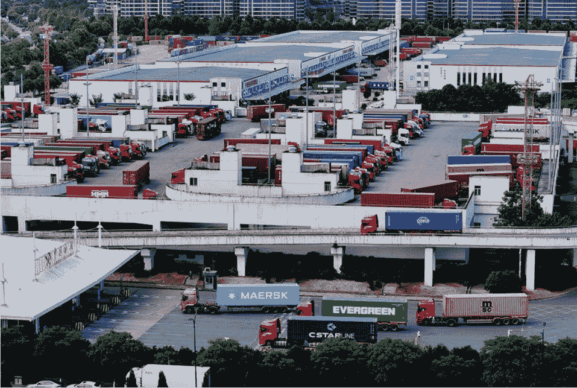

## CAIXIN| 听文章

文 | 高占军
国家金融与发展实验室 (NIFD) 副主任

在2025年7月18日结束的二十国集团财长和央行行长会议上，国际货币基金组织（IMF）第一副总裁吉吉塔·戈皮纳特（Gita Gopinath）表示，虽然全球经济不确定性很大、下行风险将继续起主导作用，但目前的韧性尚存。她在提及IMF将于7月底对全球经济预测例行修正时，表达了一种乐观情绪，暗示或上调增速。

这背后的原因主要有三：第一，IMF已发现强有力的证据，表明在美国调关税前预先采取进口行动的情况和部分贸易转移；第二，随着一些贸易协议的达到，规模降低后全球金融环境也有所改善；第三，需求降温能量价格下跌预计水平将持续下降。

无独有偶，世界银行此前7月初曾发布报告，认为“全球贸易如今仍保持韧性”，与IMF的上述判断形成响应。但与此同时，世界银行也指出贸易正在经历倒退，主要是关税上调和政策不确定性加剧的累效应引起。该报告预计2025年全球贸易增速将从2024年的3.4%放缓至1.8%，较上月的预测下调1.3个百分点。各国对贸易限制措施的偏好进一步增强，可能产生更广泛的溢效应，并促使第三方市场出现各自的限制措施，从而加剧对贸易流动和全球需求的抑制。

除上述短期压力，世界银行特别强调产业链的重组问题，认为这是长期不确定性，加剧下行风险。笔者对此类有认同。因为在过去30年间，全球生产过程跨边界进行分解，已成趋势。越来越多的企业在全球范围内组织生产，将零件、组件或服务外包到其他国家（地区）。价值链节点、生产分解、本土化、垂直专业化、全球生产共享、分离、外包、产业转移等基本都是相互替换的用语，一时大行之道，全球的出口有50%都是产业链贸易。但在当前地缘政治紧张局势加剧，旨在提升供应链韧性和国家安全的政策激增背景下，全球的贸易和投资正沿着地缘政治曲线趋向化，由此产生碎片化现象，且逐渐加强的趋势。

全球贸易碎片化的代价很高，会削弱专业化带来的效率提升，限制规模经济，并降低竞争。贸易激励行业内重新配置和促进生产率提升的能力将受到抑制。贸易减少和跨境投资的碎片化也可能削弱知识传播。普遍认为，英国欧对英国经济产生相当大的负面影响，便与此有关。“冷战”初期，当时市场贸易GDP的比重为16%，而如今已达到45%。

目前各对碎片化经济成本的估算差异很大，且高度不确定。IMF的项目研究显示，在调整较低的温和情况下，损失或为全球GDP的0.2%；而在各经济调整能力有限的极端碎片化情形下，损失或高达全球GDP的7%。至于外国直接投资，在美国和中国为中心的两大阵营中，其中一些国家仍不结，碎片化或导致全球GDP约2%的损失。

随着贸易碎片化加剧和全球供应链压力增大，中国作为世界工厂的地位受到了威胁。过去中国之所以处于产业链的核心，是因为成本低、市场大、资源容易整合，且地理位置优。在贸易紧张局势加剧后，情况已出现不乐观变化。比如，中国在美国进口中的份额在2017年到2024年间下降了8个百分点。据美国人口普查发布的最新数据，2025年5月在中国进口中的占比下降至7.1%，比去年同期下降4.3个百分点，为2001年以来最低水平。当然，因为部分贸易和投资也通过第三方国家转移，部分抵了中美之间直接联系的削弱。比如，墨西哥和越南等美国进口增长最多的国家，在中国出口份额中的占比上升了。这些国家也是中国对外投资的主要国家。

全球产业链具有惯性，不易调整，一旦形成逆转也将十分困难。所以稳住现有格局是重中之重。通过谈判解决贸易争端，中国还要进一步改善环境、保护产权、扩大市场准入和提高效率，同时下调中间关税，并采取措施实现升级。■

相关的视频：【峰会·观点】WTO副总长向晨：全球贸易碎片化冲击全球经济

# 专栏 | 美国如何应对气候危机

## CAIXIN| 听文章

文 | 让·皮萨
法国前总统、现气候顾问

科学家们反复警告全球变暖正在接近临界点，数据表明全球变暖控制在1.5°C以内的可能性越来越小。目前趋势正以前所未有的速度爆发，全球生态系统健康面临着连锁灾难的风险。两大领域都取得了一些进展。2015年的《巴黎协定》是最具雄心且政治上行的，通过“国家自主贡献”模式设定了长远目标，各国参与并构建了统一框架。

然而，特朗普在第二任期再次退出《巴黎协定》，并将气候变化斥为“骗局”。各国政府与组织面临一个根本性挑战：在美国缺席的情况下，如何应对投资需求巨大、资本成本高、财政空间有限等巨大障碍？此有效的行动需要建立互利共赢的伙伴关系，兼顾全球减排目标。报告探讨了可能的方案。首先要认识到，尽管美国是主要的温室气体排放国，但新兴市场和发展中国贡献了全球三分之二的排放。报告提出了新型合作框架的四大支柱。第一支柱是建立以共享碳边界机制（CBAM）为支撑的碳定价联盟。政策和补贴固然重要，碳定价是激励企业与家庭减减的关键。如果缺乏必要保障，定价远低于有效水平的国家可能获得竞争优势，造成贸易扭曲，这正是欧盟推行CBAM的根本原因。我们建议，建立发达国家与中国共同参与的气候联盟，按收入水平设定不同的定价，成员国家可互免碳边税、融资、技术与市场支持。许多发展经济体仍然依赖排放电厂，是因为投资成本远低于更绿色的替代选择。因此，第二支柱是建立帮助这些经济体电力脱碳的气候联盟。到2030年，发展清洁能源投资额须翻倍，才能实现《巴黎协定》目标。更严峻的是，这些经济体资本成本高，即使再生能源技术下降，总体成本仍显高昂。我们建议各国达成协议，发达经济体提供气候融资，换取新兴发展国家的净排放承诺。例如欧盟、韩等每年提供GDP0.3%左右的资金，可以避免气候损害，这是适度的投资。第三支柱是欧盟、英国、挪威与特定范围内绿色产业伙伴关系。欧洲再生能源潜力有限，将持续依赖能源进口，与其跨境运营绿电，不如将能源密集型产业转移至资源丰富的新兴经济体。目前欧洲政策正在转型能源密集型产业；更明的选择应该是支持下游附加值产业，并逐步取消对缺乏竞争力的上游产业的保护。第四支柱是建立碳清除与自然保护市场。实施净零要求2050年后净负排放，但碳清除技术发展仍不足、碎片化且激励不足。两项创新措施可以助力建立清零市场：一是引入清零凭证，允许排放主体举“碳债”，通过未来清除量来偿债，借助市场需求可以实现规模融资；二是创设“自然股票”，支持生物多样性丰富长期投资。与传统抵碳常受限于可信度不足与短期主义不同，自然股票持续提供碳与生物多样性红利，定价透明且有效的公共治理支持。这些工具使市场自然为资产而非负债。欧盟凭借成熟的碳市场与监管公信，完全有能力成为新兴国际联盟的主心骨。为此，欧盟需加速自身减排，扩大CBAM覆盖范围，并建立有效的产业伙伴关系。若气候灾难正在逼近，欧洲有机会通过以身作则引领变革。■

更多报道详见：【专题】特朗普新政、特朗普2.0 时代：影响与变局

# 最新特别报道 | 光伏急救

## CAIXIN| 听文章

文 | 周刊罗平

6月底以来，光伏市场风云突变，产业链各环节价格异动，多晶硅期货合约在一个月内飙升80%，每吨涨38万元。近年来，跌的光伏龙头股也集体下跌。激活光伏市场的动力来自“反内卷、去产能”。多名业内人士称，6月底国家委派员前往光伏一线调研，深入了解价格战、踩踏式恶性竞争现状。光伏企业虽然自发限价、控量、清库存，但依靠企业间自律十分困难。7月初以来，多晶硅期货成交量环比一日涨67%至184.66万手，但持仓降15%至33.5万手（一手对3吨），持仓保证金约100亿元。中信建期货研究部分分析师王彦青认为，出口思路主要是“上游法限价、下游市场化清”。7月初以来，市场传出的行业自律措施之一是：光伏行业需以“价格法”等法律为依据，不能低于成本销售，而成本最高为可覆盖生产、折旧等完全成本。光伏行业目前形成的一大共识是，要从最上游的硅料端“破局”，通过上游控制来下游的总产。光伏产业链从上游至下游依次为材料、硅片、电池片及组件，其中硅料多指多晶硅基础材料，从硅矿冶炼到工业硅获得。上游的硅料龙头企业计划联合成立平台公司，承接收产业链的过产能。多名了解该方案的人士告诉财新，若收购完成，该公司将统一安排生产、销售，协调开工率、产量、库存等指标，推动行业消化转型，实现供需的相对平衡，带领行业进入良性循环。

“这是企业被市场逼到‘墙角’，东方希望、亚洲硅业以及青海灵盟七家企业的产能占比在八成以上，销量占比更高。中国有金属工业协会硅业分会专家委员会副主任吕锦对财新如此如此，他看好该方案的原因是企业在强力推动执行了一年后，来想低价开拓市场，但却没有奏效。他呼吁企业要坚持“不做亏本生意”的理念，市场将回归基本面。

# 抓住光能转型的机遇

中国光伏行业自2022年起进入新一轮发展，不少企业涌入，原料暴增，业界称之为“硅为王”阶段。截至2024年底，中国具备投产条件的硅片企业有21家，其中通盛股份、协鑫科技、大全能源、新钛、东方希望、亚洲硅业以及青海灵盟七家企业的产能占比在八成以上。在光伏行业中，其产能集中度最高，而被视为相对容易协同整合。彭博新能源（NEF）显示，2024年，中国光伏产量占全球范围内九成左右。但2025年全球装机量从两位增速放缓至3.6%，2025年全球新增装机量预计990亿瓦，硅料需求140万吨。

6月底以来，多晶硅商品主力价格中，其中月初以来，焦煤涨了77%，玻璃、碳酸锂、镁纹钠单日涨幅44%、38%、13%。

| 产品 | 产品 | 6月底以来涨幅（月内） |
| :--- | :--- | :--- |
| 焦煤 | 77% |
| 玻璃 | 44% |
| 碳酸锂 | 38% |
| 镁纹钠 | 13% |

多晶硅期货在2024年2月26日在广所上市，从6月底以来持续吸引券商、散户以及产业等多方资金，市场以短线为主。7月23日，多晶期货成交量环比涨67%至184.66万手，但持仓降15%至33.5万手，持仓保证金约100亿元。

中泰国际首席经济学家李雷在7月22日发布的报告中指出，这轮“反内卷”将不是疾风暴式的预期，主要目的是为了避免重复投资带来更严重的产能过剩；但需求不足是长期形成的结构性问题，非“反内卷”可短期解决。王彦青认为，本轮反内卷应关注“有效市场”，希望依靠市场力量建立市场秩序。而在布式光伏企业山东航能能源公司执行董事丁文豪看来，此轮出清产能需配合政府“有形的手”与市场以无形的“手”，在全统一市场建设的框架下。

国家委六次会议提出要治理行业增速，释放明确信号。7月3日工信部召开企业座谈会，邵少锋表示，接下来将实施一轮重点工作，调整结构、优化供给、淘汰落后产能。24日国家委与监管局就《价格修正案》征求意见，完善定价标准。这些举措，推动市场迅速扩展到钢铁、煤炭、化工、玻璃、金属、生猪养殖、碳酸钙等过剩行业，政策把市场点燃。

“反内卷”概念股：多晶硅、通威、协鑫、大全能源、新特、晶科、阿特斯等。

| 股票 | 代码 | 6月底以来涨幅（月内） |
| :--- | :--- | :--- |
| 通威股份 | 15% |
| 协鑫科技 | 38% |
| 大全能源 | 38% |
| 新特 | 30% |
| 晶科能源 | 5% |
| 阿特斯 | 17% |
| 绿能 | 15% |
| 晶科能源 | 10% |
| 新特股份 | 20% |
| 阿特斯 | 15% |
*(注：部分数据根据OCR识别内容修正)*

“现在是舍不得采取行动的时候。”一名硅料负责人称，当前实际交易流量很低，并不像市场那样乐观。

“后续取决于‘反内卷’行动的落地情况，需要继续观察。”一位交易员说。市场多博弈激烈；7月23日，多晶硅主力合约“炸板”，开盘触及涨停之后掉头回落；24日最高与最低价差7000元/吨；25日先跌后，收益跌5.1%至5.1元/吨。

硅业分会7月18日解释“价格不低于成本”规范：若企业长期库存积压，缺乏现金支撑，将面临停产风险，该规范可通过综合成本优势筛选出先进产能，并让价格恢复良性区间，同时再从产品品质、能耗指标对行业进行强制性规范，一举避免陷入低成本而再次陷入“内卷”。

不过，此轮供应链涨价尚未传导至下游，伏件的价格仍然保持在0.7元/瓦之下。“组件预计涨价，但还需看终端端的接受度。”——一位光伏企业销售人员认为，终端电站和电力市场对光伏涨价的接受，很大程度上取决于国资主导的电力能否通过。

多位了解产业的人士坦忧，期货市场短期震荡，只是资金超前买入对市场进行观调预期，并不代表市场供需结构已实质性缓解。若方案未能落地，价格将或断式回落。“方案若落地，价格就有望稳定，关键是设计一个全机制，监管管控到位，确保方案能够长期得到获利。“一位硅企业高层为。

通威股份亏49亿—52亿元，TCL环购40亿—45亿元，隆基蓝能亏24亿—28亿元，晶澳科技亏25亿—30亿元。

2020年以来，这些光伏“头部玩家”为提升供应保障能力，压低整体成本，集体向“一体化”迈进。所谓“一体化”，是指至少在硅片、电池、组件三个环节实现大部分自供、小部分外供，甚至延伸至硅料环节。

在光伏头部企业中“一体化”程度相对较低的阿特斯，2024年归净利润为正，仅下降两成至22.5亿元。丁文鑫认为，企业应专业分工，在某一环节/领域推动升级、降低成本。

“一体化”最致命的痛在于合盛硅业（063260.SH）。合盛硅业是硅料上游行业龙头企业，这一环节的市占率约30%。2022年2月与2023年4月，合盛硅业两度宣布豪掷共38亿元，要在新疆分两期建设年产40万吨的硅料产能，打通硅基础产业链。到2024年底，两期项目显示仍在建设中，一、二期进度在92%、65%，并已投入264.6亿元；其中一条10万吨产线在2024年1月实现量产。

2025年上半年，百亿投资未产生现金流，叠加工业硅市场需求持续走弱，合盛硅业资金链非常紧张，已在全球出售工业硅与多晶硅资产，7月16日宣布控股股东拟26.3亿元协议转让5.08%股份。

## 时间能否换空间

近三年，1万吨硅的投资成本在5亿-8亿元，如百万吨过剩产能计算，涉及资产规模高达700亿元。

硅料环节整合方案的核心共识，是成立一个多方参与的平台式主体，收购过剩产能和债务，在金融机构的监督与支持下，开展行业自救。

据透露，这一方案思路目前在硅料头部企业中基本达成一致，被收购标的企业表示配合；金融机构也认为“承债式”收购的商业模式可行，愿意参与重组新公司。

初步方案显示，通过收购整合，标的产能退出，平台公司要对标标的企业进行债务重组，职工及税款债权、小额债权等予以优先清偿，剩余债权通过分期支付。

业内人士分析，这一方案的本质，是用未来良性循环实现的盈利分期偿过剩产能债务，“不流血或少流血”地出清产能，用更长时间消化阵痛。简言之，用时间换空间。

“希望大家（过剩的落后产能）体面离开，拿到一定补偿的情况下顺利退出。”一位协鑫科技负责人曾在券商会议中称：

计划参与产业整合的金融机构包括银行和贷款方、金融资产投资公司（AIC）、资产管理公司（AMC）等。据财新了解，金融机构主要参与两部分工作，一是提供资金参与新公司设立，资金占所需资金比重在30%；二是作为被收购企业的贷款方参与债务重组，原有债权将由收购通过新公司承担。

前述协科技负责人强调，初步调查显示，很多被收购企业已深入负债状态，收购所涉股权占比“非常小”，最重要的是债务负担。

初步方案显示，若硅料价格低于6万元/吨，金融机构在每吨出货量中可提取5000元“去产能资金”；价格在6万元及以上，金融机构在可超出的售价部分中分得50%。“银行愿意，因为现在的市场形势持续低迷，大概率形成大量坏账，银行本息都有风险。但债权主体变更、债务置换后，坏账就可能变成优质负债。”上述协科技负责人透露，在与金融机构初步沟通中获得了积极回应，而被收购企业也愿意参与重组，避免“流产后一烂血”。

他进一步指出，要快速遏制当前行业过度“内卷”的状态，硅料领域有两件事必做：降低库存与扩产能，只改一端都是短期行为，都难以推动行业长期良好发展。

参与成立收购主体的硅料龙头企业，则需缴纳资本，承担相应的债务与股权义务，并给出承诺与补偿；同时还需要引入约束与监管机制，根据债务与股权承担情况，确定生产配额。目前，龙头企业在平台主体的股权占比比例等核心条款仍在探讨中。

市场关注的一大问题在于，“屠龙的少年如何变成恶龙？”多位接近整合方案的人士强调，该方案是为提高行业聚力，并已参考了下游意见，不会“哄抬价格”，承诺控产，不给行业增加库存；此外，这一新设联合体不会无限期，待价格回升、债权收回、目标达成之后，即可进入退出机制。

这样的行业价格同盟的组织是否涉及垄断问题？清华大学国家战略研究院特约研究员刘旭向财新分析，若光伏企业之间的合作是为提高集中度，收购过剩产能，同时国家市场监督局可能根据《反垄断法》第二十条予以批准。此外，相关合作不应涉及垄断及划分区域市场、客户，不能用于串通投标，也不应直接干预市场。

《反垄断法》第二十条规定，经经营者能够证明达成的协议是缓解市场下降或供需结构严重失衡由此引发“内卷”竞争，且不会严厉限制市场竞争、影响消费者，则属于垄断。

据财新了解，目前方案的时间表是在今年9月—10月内首次闭合，即签订收购协议，多方方案能否出台，目前还是心里底。一位分析师认为，该方案很难在资金管理、利益分配、股权结构达成一致，且如何满足投资收益率、如退出路径等细节待明确。

吕锦进一步解释，当前的产线普遍实现了模块化、智能化，很容易停产，价格战打了白字。因此现金流紧张的企业淘汰，但现实是负荷高的企业现金流反而恶化，陷入恶性循环。

此外，新方案要求收购价格一视，所有硅料企业将进入新公司，否则无法长期发展。“这个方案谈得很长，因为被收购企业只要几家知情人士向财新分析，各家有自己的战略规划、资金储备等技术路线乃至生产成本存在差异，如何定价是难题所在。一位硅料贸易商指出，当前光伏的市场定价是（投资成本）一折不有人要；此外，各家加速“出海”寻找市场，本土化投资，使得国内过剩问题更加严重，资产预计便宜。

## 谁愿“割肉”离场？

尽管亏一年余，业内尚无规模的光伏企业愿意“割肉”出售资产，更轻易彻底离开。“光伏企业的生命力比预期的还要强。”谭优称，与前几轮光伏淘汰周期相比，本轮过剩规模更大，涉及主体与利益复杂，出清难度所需时间随之增加。一位行业人士指出，光伏产业可快速拉动GDP，大批资本跑步场，一方不顾产业正常发展规律，本来可能10年的发展空间，一下子缩短到只有两三年。

在各等地实操中，光伏厂房多由地方政府建设，生产设备仅需支付10%—20%定金，设备可抵押给金融机构或租赁公司再融资；企业还从政府拿到补贴，并在政府担保下拿到低息贷款，自己只需支付辅材、工资、设备租赁等现金支出，“有的甚至不到5%的自有资金，杠杆了100%的投资资金。”

谭逸指出，产能调整有三种途径：一靠兼并重组，但市场关注的通威股份江苏润阳新能源案例未能落地；二靠收缩规模，但当前银行比较审慎，国资“输血”案例也不少。最后，在需求增长缓慢但已芜的先进产能的情况下通过市场竞争出清方式。“竞争淘汰必然惨烈，但这种痛苦不可避免。”

目前跨界行业最易被淘汰，2024就有大跨界企业“割肉”离场，进入2025年，服装上市公司榜杰股份（002634.SZ）易主、*ST旭蓝、*ST嘉嘉等更多上市公司退市，中国乐高、益智玩具厂商*ST沐邦（603398.SH）处在退市边缘，电气机械和器材制造企业*ST玲达（300125.SZ）、设备厂商华东重机（002685.SZ）等进入破产重整，这些企业几乎都受到了投资光的拖累。

有的光伏企业还在苦苦支撑，典型案例如上述润阳股份。该公司曾为全球前三出货量的电池厂，2021年以保障供应链为名引入硅料领域，在宁夏、内蒙古分别有5万、8万硅料产能。能借材料了解到，润阳股份硅料厂房设计、配件与生产方式等与头部企业有差距，生产成本高于行业水平，“一产一亏一吨”。截至2022年底，润阳股份负债总额高到从2023年的40亿跌至20亿元。“资金来源是银行，亏后利息补不上，还有供应商欠款。”知情人士称，润阳股份多次尝试退出。通威股份在2024年8月拟以XX亿元收购润阳股份，历经数月寻源谈判后，在2025年2月宣布意向性投资。今年7月，国资江苏悦迈有限公司（统称“悦迈集团”）追加投资XX亿元，持35.6%股份，变成单一最大股东，接下董事长职，还给股份转让。

业内人士认为，当前产能过剩，润阳股份好的解决方案是地方政府学习“合肥模式”，即政府以投资形式推动产业集群，推动产业升级；这种中产能咬合，出清难度高。通威股份、阿特斯、天合能等光伏头部企业入驻，吃到了硅片、电池、组件、逆变器等光伏链。

另一同样二线线，全球第一的硅料企业，穿透后的股东是XX资本；但2024年8月IPO遭遇失败，XX资本有意退出，当地国资在2025年4月接盘，从XX资本手中收购46%股份，谋求后续上市重塑。润源股份已经表态出售。许多人士指出，当前硅料环节投资高，被收购意愿并不强烈。比如新疆XX集团，新能源控股方是XX电力（600089.SH），中越、XX等深度参与此轮扩张。

曾是中国最大光伏企业的无锡尚德电力有限公司（下简称“无锡尚德”）正在被二次重组。福建老国企、厦门建发作为债主，在2025年2月成为另一家光伏企业中集集团（002309.SZ）的第一大股东。中集集团因战略失误亏损多年，到2023年1月申请破产重组。厦门建发旗下建发股份（600153.SH）与中集集团自2020年开始在光伏领域开展业务，建发股份负责原材料采购，并交由山东、泰国基地加工生产，再利用中集集团品牌、渠道、完成产品的出口和境外销售。

地方政府参与光伏产业的模式应防潜在的金融风险。韩雪建议，地方政府支持产业，要在政府与投资之间做好协调，接下来要加强市场与金融环境，在规范范围内投资基金的投资领域、范围、杠杆、准入等，避免以市场化方式投入又附加诸多行政干预。

## 为什么买票？

“上游每个环节都要挤，想把成本转嫁终端，但现在需求很难创造。”前述贸易商。

2025年1月—2月，国家能源局连两份重要文件，第一份以5月1日为节点，在此之前并网的工业分布式光伏才全额上网，被称为“430新政”；第二份文件主要是为了推动新能源上网电价全面市场，以6月1日为节点区域分量与增量项目，此后的增量项目需要竞价上网，业内称之为“531新政”。

光伏领域随之出现衰潮。2025年前五个月，中国光伏新增机容量197.85GW，同比增长150%。但这是支持后期需求。近期国内订单交付以前期补装项目为主，大基地项目尚未开展，需求整体偏弱。2025年6月，中国光伏新增装机14.36GW，环比5月下滑85%。

新政实施之后的电量、电价均不明确，这对央国企意味着收益不明显。“由于有固定机制电价（或市场化不明确），现在IRR（内部收益率）无法计算，这种情况下成本本能可能省。”前述资本市场人士称，新能源消纳水平高，终端的收益无法满足央企内部基准条件，2025年下半年，需求超过预期，央企核准更为谨慎。多位人士认为，光伏产业处于回调期，价格至少持续到026年。

目前，广东、山东、山西、甘肃、蒙古等省间电力市场，除甘肃外，价格上涨，其他市场均下降。（详见译《为何缺电》）韩雪预计，今年下半年需求整体平稳，目前没有出现超预期变化。

谭佑认为，2025年下半年需求整体放缓。考虑到库存充足、价格持续波动，最终还会回到基本面。王彦青进一步介绍，美国通胀并不支持，欧美两大市场增长放缓。负责海外业务的人不知道出口退会在何时结束，也不敢当下签发。

进入2025年，各地电力价格信号显示市场总体进入供需周期。不仅在华南，还有华东的江苏、山东、西北的内蒙古、甘肃等地，诸多因素促成了这波电价下行；电力改革进一步深入、区域联动加强、电力市场试点全面铺开；新能源装机在大幅增长；煤价回落触动电边成本下降；同时，出口走弱与制造业调整等影响，电力需求增速放缓。

电价下行，有利于用电尤其是工商企业降低成本；但发电侧需重新审视长期投资和运营的商业模型。作为现代工业的引擎，电力部门正向融合新能源的新型电力系统加速转型，电力供给与市场结构亦随之重构。经历大规模、跨越式发展后，新能源投资在回归理性，发电侧市场竞争日益激烈，发电企业必须关注生命周期的成本挑战。同时，在新能源全面入市后，发电侧市场竞争日益激烈，发电企业必须关注生命周期的成本挑战。

目前硅料企业高管称：“如果供应端不解决产能过剩问题，后端传递涨价的动力不大。”——一位电力央企告诉财新，近期亟待去库存的光伏企业表态愿以0.6元/瓦给供货，“那我们为什么去买贵的？”相关报道：特别报道之二 | 为何缺电？

## 最新特别报道之二 | 为何缺电?

### 特别

进入高温季节，“尖峰负荷、缺电、高价电”一直是年常见词，然而今年各省电价却接连走低。作为全国第一用电大省的广东，7月的现货市场电价已多次穿过0.3元/千瓦时（度）。7月21日，广东现货电价跌到当月最低点——加权平均电价0.2377元/度，相当于当地燃煤标杆电价0.453元/度的一半。

广东最大电力上市公司粤电力A（000539.SZ）2025年上半年净利同比预降96%。“电价大幅下降、加西电增送、机组投产因素、2025年广东电力市场竞争压力。”粤电力管理层在接待投资者调研时，进入2025年，各地电力价格信号显示市场总体进入。不仅在华南，还有华东的江苏、山东、西北的内蒙古、甘肃等地，诸多因素促成了这波电价下行；电力改革进一步深入、区域联动加强、电力市场试点全面铺开；新能源装机在大幅增长；煤价回落触动电边成本下降；同时，出口走弱与制造业调整等影响，电力需求增速放缓。

电价下行，有利于用电尤其是工商企业降低成本；但发电侧需重新审视长期投资和运营的商业模型。作为现代工业的引擎，电力部门正向融合新能源的新型电力系统加速转型，电力供给与市场结构亦随之重构。经历大规模、跨越式发展后，新能源投资在回归理性，发电侧市场竞争日益激烈，发电企业必须关注生命周期的成本挑战。同时，在新能源全面入市后，发电侧市场竞争日益激烈，发电企业必须关注生命周期的成本挑战。

目前硅料企业高管称：“如果供应端不解决产能过剩问题，后端传递涨价的动力不大。”——一位电力央企告诉财新，近期亟待去库存的光伏企业表态愿以0.6元/瓦给供货，“那我们为什么去买贵的？”

在另一经济省江苏，2025年1月至7月，江苏电力集中竞价交易均价0.3906元/度，但6月成交价大幅跳水，低至0.3128元/度，比江苏煤基准价0.391元/度还了20%；7月报价回升至0.3956元/度。2025年上半年全社会用电量同比增长3.31%，低于2024年8.4%的增幅。借此快速发展的光伏，江苏在2025年5月成为长三角地区首个新增源机“破零”的省份，新能源机在全省电源总机占比46%。

从南到北，电力下行出现在沿海发达省份，内蒙古西部地区2025年的电力现货市场上均价由1月的0.344元/度逐月降至4月的0.153元/度，降幅高达56%。

去年，内蒙古积极引导对电力需求较大的晶硅光产业，并在包头和浩特等地培育产业集群。作为内蒙古最大的工业城市，包头全社会用电量常居内蒙古自治区各盟市之首，与深圳等大城市相当。在晶硅光伏产业拉动下，包头一度经历了全社会用电量高速增长，但如今部分线路停工、员工待岗，当地用电量快速回落。去年上半年，包头仍保持着两位数的用电增长，但今年同期同比负增长0.67%。

与此同时，内蒙古当地的发电机高获猛进，2024年新能源机达1.35亿千瓦，是全国首个新能源突破亿千瓦的省区，较2020年增长170%。

但在包括蒙古在内的西北地区，以新能源为主的“电力冗余”现象突出。多名新能源行业人士告诉财新，今年上半年，甘肃河西、新疆分区的“限电率”高至40%以上。对于并网新能源项目，根据电网的调度要求，当用电需求小于发电供给能力时，发电企业必须使发电低于发电设备的额定能力，这种情况统称为“限电”。

## 合力降电后

“未来，外部贸易环境不确定性加大，叠加内部困难挑战，经济下行压力依然巨大。”财智库高级经济学家王皓分析称，2024年初至今，新中国制造业PMI价格指数均值为50.2，出厂价格指数为49.3，价格水平持续低迷，且盈利遭压，企业生存情况恶化，通缩压力增大；国内有效需求不足，2024年初至今，新中国制造业PMI生产指数均值为51.8，新订单指数为50.9，前者明显增强。”

“全国来看，电需宽寒，煤价下降，叠加现货市场的快速推进，导致了电价的剧烈下跌。”上海绿建创新能源科技有限公司技术总监敖昭宇说。

与此对应，2025年，在光伏抢装“531”节点的背景下，1月—5月，光伏新增装机容量达2亿千瓦，同比增长150%，5月单月新增装机更是同比增长388%，加速扩张电电源的供应。所谓“531”节点，是国家发改委、国家能源局在2025年2月发布《关于深化新能源上电网电价市场化改革促进新能源高质量发展的通知》（简称“136号文”）明确，实施新能源可持续发展价格机制，以2025年6月1日为节点区分新增和总量节点，此后的增量项目需要见到上网。同时，该文要求各地在今年年前完成配套细则。目前，内蒙古、山东、甘肃等省份已完成配套细则或征求意见。

新能源全面带来的边际电价下行，则是另一个结构性因素。在电力市场中，新能源“零边际成本”的特点，使得其报价量显著低于煤电、电气机组，从而将系统电价整体拉低。

随着高比例能源引入，目前现行省份电量价格普遍降至煤电标杆价以下，整体呈现持续下降态势。北京电力交易中心总经理谢凯在2025年6月在中国电力联合会主办的行业论坛上表示。

电力市场的电源结构朝着新能源转变，就会导致整个系统的边际成本降低。在自身具有竞争的市场中，叠加供给大于需求的环境，形成降价合力。”幂宇说。

在山东，光伏出力最强的中午成为深谷电价时段，现交易市场出现“负电价”频繁。据蓝云数据显示，2025年上半年，山东在负0.1至负0.05元/度的负电价区间持续时间最长，在现交易市场各价格区间中占比超过两成。而往年经常缺电的浙江，今年的电力市场也多次出现负电价。“负电价是市场数据的真实的短时供需反映。山东、广东、山西等地也常出现负电价或零电价。“国网浙江电力调控中心人士在浙江电力交易中心7月的市场交流会上表示。在高新能源渗透率区域，这种现象未来会更加频繁。

更关键的是，2024年以来，煤炭价格低位震荡，减弱了煤电上网电价的成本支撑。近期，全球动力价格已跌至半年的新低。截至2025年6月30日，秦皇岛动力价格520元/吨，较年初下降超过20%。煤电成本也同步下降。

除了供需变量，电力市场化交易机制深度演进，电力市场建设节奏加快。截至2025年底将实现现货市场覆盖：山西、山东、甘肃、蒙西等6个省级现货市场转正式运行；浙江、福建、安徽、辽宁等6个省级现货市场进入连续结算；四川、重庆等13个省级现货市场开展连续结算；天津、冀北等2个省级现货市场开展模拟运行。电力现货市场常态化，使得电力价格对供需变化的敏感性，有效地传导电价信号。

与此同时，电力市场联通也在逐步加强。截至2025年6月28日，南方区域电力市场启动连续运行，这是国内首个跨省统一市场，范围涵盖广东、贵州、海南等五省，电量规模超过380亿千瓦，是全球最大的跨省统一电力市场。

国家能源局称，南方区域电力市场通过打破省级行政限制，实现跨省电力资源配置、优化资源配置，有效解决新能源消纳矛盾。

南方区域现货市场在区域内博弈更充分，有助于推动电价下行。”幂宇说，当前南方区域电力普遍呈现供给大于需求状态，如7月前20天的均价低于18元/度，创下历史新低。

## 新能源发电暂缓

“新能源在现货市场的价格降幅较大，‘贴地’装机回报率持续受压，考验电源侧经营能力。2024年，在山西光伏、风电均价分别保持在25—26元/度，今年这两者分别跌到16—19元/度左右。”电力研究院院长、山西电力监督管理委员会委员南国称，由于新能源低边成本、高消纳成本的特点，难以在市场中回收全部成本，压力日益显著。“2025年一季度，现货市场运行甘肃、山西发电电价分别为18元/度、28元/度，在此基础上还要分摊资金。”国家能源集团运营中心董事长陈旭伟在中电论坛上表示，少数开发商开始暂缓投资。

7月14日，山西省能源局公示2025年第二批拟废弃风电、光伏发电项目。山西省能源局表示，为加快推进新能源建设，优化电网接入与提高项目落地率，省各市对存量风电、光伏发电项目进行梳理，汇总上报了废弃规模华能3052万千瓦等7个项目。7月17日，宁夏发改委公告对9个49.3MW新能源项目予以废弃，原涵盖涵盖逾期、投资主体放弃建设等。

“136号文件重塑新能源项目的估值体系，市场和企业还需要探索并建立新的规则。”南方电网调度控制中心水电及新能源处长王皓培表示：“市场仍处于不定的氛围中。”赛留指出，136号文让地方不敢机制定价太高，否则承担不起；但没有这部分，新能源又压力很大。

所谓机制电价，是136号文中明确的一种调电工具，通过调节发电两侧价格，保障新能源基本收益，实施“多退少补”；“多退少补”资金纳入系统运行成本，疏导在当地工业用电价中。这一政策实施后，地方政府需要直面电价的传导机制。

“机制电价高会影响系统运行成本，反映在当地工业用电价上。所以地方需要综合考量新能源发展到何种规模，如何以当地绿电支持当地经济发展。”中国宏观经济研究院能源所研究员时环丽说。

抢装潮后，6月，国内光伏新增机容量大幅回落，环比下降85%，同比下降38%，到1436万千瓦。下半年光伏新增增速预期放缓，深受产能过剩困扰的光伏制造企业将面临更大的竞争压力。

聂昂宇强调，从制造端来看整个行业或将进入出清阶段，“市场对投资项目、组件意愿不高，预计今年年底或明年初，光伏制造企业的风险可能集中暴露”。

对一些“三北”地区来说，新能源产业仍是区域发展的支柱之一，机制电价低轨不利于吸引新增投资。同时，“三北”地区电价敏感型用户多、规模大，机制电价过高将对用户成本不利。东部负荷中小型省尽量能新能源发展，但在经济增速下，容易引起供需波动，积极参与电力市场以缓解经营压力。

浙江发改委主任姚亮表示，2025年7月前，浙江电力现货交易比例提高至20%，希望尽快实施现货市场运行。在高新能源渗透率区域，这种现象未来会更加频繁。

更关键的是，2024年以来，煤炭价格低位震荡，减弱了煤电上网电价的成本支撑。近期，全球动力价格已跌至半年的新低。截至2025年6月30日，秦皇岛动力价格520元/吨，较年初下降超过20%。煤电成本也同步下降。

除了供需变量，电力市场化交易机制深度演进，电力市场建设节奏加快。截至2025年底将实现现货市场覆盖：山西、山东、甘肃、蒙西等6个省级现货市场正式运行；浙江、福建、安徽、辽宁等6个省级现货市场进入连续结算；四川、重庆等13个省级现货市场开展连续结算；天津、冀北等2个省级现货市场开展模拟运行。电力现货市场常态化，使得电力价格对供需变化的敏感性，有效地传导电价信号。

与此同时，电力市场联通也在逐步加强。截至2025年6月28日，南方区域电力市场启动连续运行，这是国内首个跨省统一市场，范围涵盖广东、贵州、海南等五省，电量规模超过380亿千瓦，是全球最大的跨省统一电力市场。

国家能源局称，南方区域电力市场通过打破省级行政限制，实现跨省电力资源配置、优化资源配置，有效解决新能源消纳矛盾。

南方区域现货市场在区域内博弈更充分，有助于推动电价下行。”幂宇说，当前南方区域电力普遍呈现供给大于需求状态，如7月前20天的均价低于18元/度，创下历史新低。

“新能源在现货市场的价格降幅较大，“贴地’装机回报率持续受压，考验电源侧经营能力。2024年，在山西光伏、风电均价分别保持在25—26元/度，今年这两者分别跌到16—19元/度。”电力研究院院长、山西电力监督管理委员会委员南国称，由于新能源低边成本、高消纳成本的特点，难以在市场中回收全部成本，压力日益显著。“2025年一季度，现货市场运行甘肃、山西发电电价分别为18元/度、28元/度，在此基础上还要分摊资金。”国家能源集团运营中心陈旭伟在中电论坛上表示，少数开发商开始暂缓投资。

7月14日，山西省能源局公示2025年第二批拟废弃风电、光伏发电项目。山西省能源局表示，为加快推进新能源建设，优化电网接入与提高项目落地率，省各市对存量风电、光伏发电项目进行梳理，汇总上报了废弃规模清单，华能3052万千瓦等7个项目。7月17日，宁夏发改委公告对9个49.3MW新能源项目予以废弃，原涵盖逾期、投资主体放弃建设等。

“136号文件重塑新能源项目的估值体系，市场和企业还需要探索并建立新的规则。”南方电网调度控制中心水电及新能源处长王皓培表示：“市场仍处于不定的氛围中。”赛留指出，136号文让地方不敢机制定价太高，否则承担不起；但没有这部分，新能源又压力很大。

所谓机制电价，是136号文中明确的一种再调电工具，通过调节发电两侧价格，保障新能源基本收益，实施“多退少补”；“多退少补”资金纳入系统运行成本，疏导在当地工业用电价中。这一政策实施后，地方政府需要直面电价的传导机制。

“机制电价高会影响系统运行成本，反映在当地工业用电价上。所以地方需要综合考量新能源发展到何种规模，如何以当地绿电支持当地经济发展。”中国宏观经济研究院能源所研究员时环丽说。

抢装潮后，6月，国内光伏新增机容量大幅回落，环比下降85%，同比下降38%，到1436万千瓦。下半年光伏新增增速预期放缓，深受产能过剩困扰的光伏制造企业将面临更大的竞争压力。

聂昂宇强调，从制造端来看整个行业或将进入出清阶段，“市场对投资项目、组件意愿不高，预计今年年底或明年初，光伏制造企业的风险可能集中暴露”。

对一些“三北”地区来说，新能源产业仍是区域发展的支柱之一，机制电价低轨不利于吸引新增投资。同时，“三北”地区电价敏感型用户多、规模大，机制电价过高将对用户成本不利。东部负荷中小型省尽量能新能源发展，但在经济增速下，容易引起供需波动，积极参与电力市场以缓解经营压力。

浙江发改委主任姚亮表示，2025年7月前，浙江电力现货交易比例提高至20%，希望尽快实施现货市场运行。在高新能源渗透率区域，这种现象未来会更加频繁。

更关键的是，2024年以来，煤炭价格低位震荡，减弱了煤电上网电价的成本支撑。近期，全球动力价格已跌至半年的新低。截至2025年6月30日，秦皇岛动力价格520元/吨，较年初下降超过20%。煤电成本也同步下降。

除了供需变量，电力市场化交易机制深度演进，电力市场建设节奏加快。截至2025年底将实现现货市场覆盖：山西、山东、甘肃、蒙西等6个省级现货市场正式运行；浙江、福建、安徽、辽宁等6个省级现货市场进入连续结算；四川、重庆等13个省级现货市场开展连续结算；天津、冀北等2个省级现货市场开展模拟运行。电力现货市场常态化，使得电力价格对供需变化的敏感性，有效地传导电价信号。

与此同时，电力市场联通也在逐步加强。截至2025年6月28日，南方区域电力市场启动连续运行，这是国内首个跨省统一市场，范围涵盖广东、贵州、海南等五省，电量规模超过380亿千瓦，是全球最大的跨省统一电力市场。

国家能源局称，南方区域电力市场通过打破省级行政限制，实现跨省电力资源配置、优化资源配置，有效解决新能源消纳矛盾。

南方区域现货市场在区域内博弈更充分，有助于推动电价下行。”幂宇说，当前南方区域电力普遍呈现供给大于需求状态，如7月前20天的均价低于18元/度，创下历史新低。

“新能源在现货市场的价格降幅较大，“贴地’装机回报率持续受压，考验电源侧经营能力。2024年，在山西光伏、风电均价分别保持在25—26元/度，今年这两者分别跌到16—19元/度。”电力研究院院长、山西电力监督管理委员会委员南国称，由于新能源低边成本、高消纳成本的特点，难以在市场中回收全部成本，压力日益显著。“2025年一季度，现货市场运行甘肃、山西发电电价分别为18元/度、28元/度，在此基础上还要分摊资金。”国家能源集团运营中心陈旭伟在中电论坛上表示，少数开发商开始暂缓投资。

7月14日，山西省能源局公告英伟达美国政府恢复H20对华出口。7月15日，英伟达宣布恢复H20对华出口。

另一方面，中国稀土出口管制也切实放松。根据海关总署7月20日公布的数据，6月稀土材料出口提升至3187.7吨，出口管制以来单月最高，对美国的出口量环比超过6倍，至352.8吨。

2025年4月2日，美国总统特朗普宣布对所有贸易伙伴加征“对等关税”，对华关税率一度高达45%；中方则在对美关税率提高到125%后，不再理美国的无理策略。5月以来，中美双方在瑞士内瓦和英国举行了两轮谈判。谈判后，双方大幅削减或暂停关税，最终仅对等保留10%关税，且一旦同意建立中美贸易机制。

在此针相对“关税战”，美国以AI芯片、半导体制造的必需电子设计自动化软件（Electronic Design Automation，下称EDA）为核心，威胁阻碍中国高科技发展；中国则以稀土相抗。6月以来，中国“开启”受理科板申请，上海超硅、摩尔线、沐渝股份、洪志集，从硅芯片的制造到中游的设计，再到下游的半导体设备和制造，一批未盈利的半导体企业国产替代概念有望在二级市场上获得融资，加速研发先进半导体产品。美国一方面通过“矿产换资源”的外交政策，多次对乌克兰、格兰兰岛开发矿土；另一方面加强与澳大利亚等传统盟友的矿合作，同时大力推动本土矿土产业建设。当地时间7月22日，美国宣布与菲律宾、印尼达成协议，加上早前达成协议的越南，在主要的贸易逆差国家，美国已与四国达成协议。7月22日，贝赛特透露将于28—29日前往瑞典与中国谈判代表进行第三轮贸易谈判；而特朗普曾称本人可能很快访华。

7月14日，中国市场监管局批准了美国EDA软件和设计IP公司新思科技收购美国数字建模仿真与分析软件安科技；7月22日晚，中国市场监管宣布暂停对美国杜邦公司旗下的杜邦中国集团有限公司的反垄断调查程序。

虽然近一个月内双方分别放宽了国产芯片，但也都有所保留：H20 AI芯片整体性价比优于中国国产芯片，但只是英伟达上一代Hopper架构特供版，算力为标准H100三分之一，更落后2024年半年规模出货的Blackwell架构。英伟达美国政府许可H20在中国，是市场关注焦点。“我还没见过任何中国客户，需要他们时间看看。我很期待能够满足他们的需求。”7月16日，黄仁勋在北京召开中国国际博览会开幕式演讲，致辞并与签名合照。在一次采访中，黄仁勋作为英伟达创始人英伟达市值当时超过4000亿美元，如今已破4万亿美元，成为全球第一科技公司。此次接受媒体采访时，黄仁勋避免提到英伟达在范围内竞争对手华为，直言中国制造能力都是极其真的（deeply naive），华为仅几年就坐上牌桌。“任何人忽视华为都是令人谦服的。”

另一方面，中国稀土出口管制也切实放松。根据海关总署7月20日公布的数据，6月稀土材料出口提升至3187.7吨，出口管制以来单月最高，对美国的出口量环比超过6倍，至352.8吨。

2025年4月2日，美国总统特朗普宣布对所有贸易伙伴加征“对等关税”，对华关税率一度高达45%；中方则在对美关税率提高到125%后，不再理美国的无理策略。5月以来，中美双方在瑞士内瓦和英国举行了两轮谈判。谈判后，双方大幅削减或暂停关税，最终仅对等保留10%关税，且一旦同意建立中美贸易机制。

在此之前针相对“关税战”，美国以AI芯片、半导体制造的必需电子设计自动化软件（Electronic Design Automation，下称EDA）为核心，威胁阻碍中国高科技发展；中国则以稀土相抗。6月以来，中国“开启”受理科板申请，上海超硅、摩尔线、沐渝股份、洪志集，从硅芯片的制造到中游的设计，再到下游的半导体设备和制造，一批未盈利的半导体企业国产替代概念有望在二级市场上获得融资，加速研发先进半导体产品。美国一方面通过“矿产换资源”的外交政策，多次对乌克兰、格兰兰岛开发矿土；另一方面加强与澳大利亚等传统盟友的矿合作，同时大力推动本土矿土产业建设。当地时间7月22日，美国宣布与菲律宾、印尼达成协议，加上早前达成协议的越南，在主要的贸易逆差国家，美国已与四国达成协议。7月22日，贝赛特透露将于28—29日前往瑞典首都德哥尔与中国谈判代表进行第三轮贸易谈判；而特朗普曾称本人可能很快访华。

7月14日，中国市场监管局批准了美国EDA软件和设计IP公司新思科技收购美国数字建模仿真与分析软件安科技；7月22日晚，中国市场监管宣布暂停对美国杜邦公司旗下的杜邦中国集团有限公司的反垄断调查程序。

虽然近一个月内双方分别放宽了国产芯片，但也都有所保留：H20 AI芯片整体性价比优于中国国产芯片，但只是英伟达上一代Hopper架构特供版，算力为标准H100三分之一，更落后2024年半年规模出货的Blackwell架构。英伟达美国政府许可许可在中国，是市场关注焦点。“我还没见过任何中国客户，需要他们时间看看。我很期待能够满足他们的需求。”7月16日，黄仁勋在北京召开中国国际博览会开幕式演讲，致辞并与签名合照。在一次采访中，黄仁勋作为英伟达创始人英伟达市值当时超过4000亿美元，如今已破4万亿美元，成为全球第一科技公司。此次接受媒体采访时，黄仁勋避免提到英伟达在范围内竞争对手华为，直言中国制造能力都是极其真的（deeply naive），华为仅几年就坐上牌桌。“任何人忽视华为都是令人谦服的。”

阿里和腾讯的自研芯片进展较慢，还未组成单一的大规模集群进行训练，而字节跳动的自研芯片仍在研发中。阿里旗下芯片设计公司平头哥推出了自研的含光800 AI推理芯片，应用于数据中心、边缘服务器等场景；腾讯投资了AI芯片企业盛源科技，2020年镁源芯片芯讯完成内部测试，腾讯自研的AI推理芯片紫霄已发布完毕。

华昇腾、海光AI芯片公司，是国产替代最大的受益者。2025年一季度，海光经营营收同比增长超过40倍，11.11亿元，并连续第二季度实现盈利；同期，海光信息收益同比增长超过50%，是创新领先者。

一名投资过海光的的国产半导体领域投资人向财经分析称，英伟达H200恢复，短期内可能会有一些市场化客户基于价格比下单，但长期来看，在过去几年的中美科技和贸易战中，芯片国产化已成共识，H200恢复也不会改变这一趋势。“美国政策朝夕改，万一明天H200回到国产芯片上，AI领域衔接对美国依赖的趋势将不会。”他说。

金元证券研指出，在中美博弈背景下，高性能GPU（图形处理器）出口限制中国AI供应链核心的非市场化变量。包括潮信息、中景光在内的多家上市公司披露“客户延迟采购”项目延期、“算力供给紧紧张”，市场资金短期内撤除了原本强势的AI板块，转向传统产业方向。而H20对华出口重启，则被市场视为重要信号，缓解了中美在高科技领域“完全脱钩”的悲观情绪。

金元证券进一步指出，AI芯片的出口许可已经成为“战略变量”，对中国科技安全系统带来不确定性。预计中国将继续推进国产GPU芯片及其配套生态系统的建设。

EDA对华出口已经经历了短时间被封禁、再解禁的过程。

5月后，全球三大EDA公司新思、Cadence和西门子均在美国商务部要求下，停止对中国EDA软件技术的出口。禁令发布后，美国对中国的软件密钥不可更新、IP（知识产权）不得更新，这也这意味着国内已购买的软件无法继续使用。

7月3日，西门子、新思科技、EDA三家公司陆向财经表示，此前收到的出口管制限制已被取消。

在半导体行业，EDA包含一系列从设计到制造的软件工具，涵盖功能设计、布线、验证等环节，极为关键。IP如果是预先验证的功能模块，就像“预制菜”，可以直接应用在芯片设计中，这样能大大缩短设计复杂度芯片的时间。IP的使用和再利用高度依赖EDA公司，因此不少EDA公司也在拓展业务。

2024年，全球EDA市场规模约150亿美元，中国市场仅占分之一。在中国市场，新思科技、Cadence和西门子合计占比八九十分。

不过，市场调研机构Counterpoint研究副总胆Ethan Qi对财经分析称，EDA软件的技术门槛不像光刻机那样，实际上EDA软件厂商很大程度上依赖于芯片设计公司，并通过与芯片设计公司的配合、联调等不断提升自己的产品竞争力。例如，在芯片设计前置环节，只要头部芯片设计公司尝试使用国产EDA，向国产EDA厂商开放设计库，大概需要两年左右，中国国产EDA的能力就能快速提升。

## 中国：收放有序

稀土磁体是智能手机、电脑、可穿戴设备和其他电子产品，以及汽车、机器人人和能源系统的重要部分。据美国地质调查局，2020年至2023年，美国进口的稀土金属70%来自中国。

中国稀土对出口在6月迎来2025年内最大涨幅，出口量也是自出口管制实施以来的最高值。

中国海关总署7月20日发布数据显示，今年，中国出口稀土制品3187.7吨，环比涨1倍，同比仍减少38.1%；其中，中国对美国出口352.8吨稀土磁性品，较5月大660%，但同比下降52%。

> “中国对美国稀土磁性制品出口量增长，主要受中美贸易议达成、中国出口许可审批的顺序下降，以及海外稀土磁性制品的旺盛需求影响。”上海有色网指出，稀土出口管制于2025年4月4日起实施，企业自那时起提交许可证审批，由于中国商务部出口许可办理周期为45个工作日，因此结算时间主要集中在月中旬。

整体来看，中国上半年稀土出口呈现下降趋势，累计出口稀土永磁材料2.2万吨，同比减少19%；其中对美出口2512.3吨，同比减少三成，出口额7.44亿元，是中国第二大稀土出口目的地，仅仅次于德国。

磁体是稀土产业链的下游产品，稀土元素经过加工、分离和冶炼等一系列环节后，最终的高附加值应用形态之一，运用在电机、电动车、风电、军工、航空航天等行业。在中国稀土开采、分离、冶炼和磁体制造上，其中分离、冶炼和磁体制造均处于领先地位，开采环节占全球总产能力的58%。

中国商务部、海关总署于4月4日起，对针、铈、��稀、钱、���、���、��等七类重稀土相关物资实施出口管制措施。彼时多业内人士告财经称，此举对海外市场波动。中国同时拥有轻稀土和重稀土矿藏，一名资深分析师告财经，重稀土资源占全球总量80%；轻稀土和重稀土的差别就是，重稀土供应短缺，将影响到海外等工厂扩张。福特公司、特斯拉CEO马斯克在4月初表示，其“擎铁”人形机器人生产受到中国稀土出口的影响。

| 产品 | 国际均价 (美元/kg) | 中国均价 (美元/kg) |
| :--- | :--- | :--- |
| 氧化锂 | 790 | 750 |
| 镍合金 (NdPr) | 550 | 500 |

《中国禁止出口目录》于月中旬完成第四次调整，实行许可管理。具体看，新增了电池：
- 电池用磷酸铁制备
- 电池用磷酸锰制备
- 电池用磷酸蓝制备
- 原材料制备

涵盖了从稀土到金属的完整产业链，包括：
- 锂提炼
- 合金提炼
- 卤提炼
- 水提炼
- 膜提炼
- 净化提炼

除了南方稀土集团，行业机构指出，防范电池泄漏，中国在国际市场上长久巩固国内企业的“护城河”。进一步分析，目录管理的对象是“技术”而非“产品”。针对电池及电极材料实施了限制，并未对相关产品出口。也就是说，利用相关技术在国内生产的产品，依然可以正常出口到海外，不受限制。

## 各自芯片

当前，互联网厂商忙于扩大产能、发展AI业务，美国对华恢复H20出口给互联网带来了难得的窗口期。

金元证券研报指出，尽管H20为英伟达为市场推出的合规产品，AI算力为H100的15%—30%，但在推理任务中，H20的大内存和宽带宽仍然优势。此外，中国主要云厂商和AI开发者仍然依赖英伟达软件链，这种依赖使得H20在模型训练、推理等场景中困难。市场普遍认为，因H20出口导致的英伟达H20库存，存在出口管制后并不愁。金元证券指出，2025年二季度中国云厂商虽然加大了对国产芯片的租赁和购买力度，但由于国产芯片的良品率和交付能力不足，云厂商增长预计还是以消耗库存的英伟达芯片支撑，三季度大家将恢复原有的H20采购计划，甚至抢购。市场调研机构Omdia也认为，中国云厂商短期内无法对接英伟达生态。Omdia在报告中指出，中国云厂商基于Arm架构的自研芯片取得了很大进展，部分产品开始大规模应用，而自研AI芯片仍需时间。而在互联网之外，大量企业在近期不断加码的美国对华出口管制下全面转向国产芯片。因此，即便H20恢复供应，国产芯片需求仍能持续。一名头部云方人士曾访财经，美国在2023年10月禁令不允许英伟达A800（第一代AI芯片）之后，商家下单华昇腾，2024年建设国产万卡设备集群国产化率就已超过95%，目前更是全部国产化。

半导体行业调研机构Semi Analysis显示，华为推出昇腾910C芯片的缺点是单块GPU性能仅为英伟达领先芯片的三分之一，但凭借384块昇腾910C互联，整体AI能力能够做到后者的2倍，不过这一技术路线需要更高的能耗，每单位的AI算力能耗为英伟达的2.5倍。华为为更多的国产AI芯片发展在加速，其中海仞、沐曦股份两家头部国产AI公司的科创板已获受理。

摩尔线程从2021年到2024年连续推出了四代芯片“均衡”，主打支持DeepSeek等前沿大模型训练所需的FP8精度。FP8使用位浮点数字格式，相对FP16或FP32带宽低、存储占用，同时尽量保持模型精度和计算效率。摩尔线程搭载该芯片的板卡产品S5000已经出货，其称自研技术将模型的算力利用率从行业平均的35%提升至60%，基于S5000卡构建的千卡GPU集群效率超过同等规模国外同系GPU的计算效率。

沐曦股份分别于2023年4月和2024年2月推出了推理专用芯片C600，后者是目前出货的主力产品。沐曦股份称，目前在研的下一代芯片C800已经完成流片，采用HBM存储，目前在英伟达H100对比下算力为2000TFLOPS（每秒万亿次浮点运算），在FP16精度下达300TFLOPS。

## 稀土供应

稀土磁体是智能手机、电脑、可穿戴设备和其他电子产品，以及汽车、机器人人和能源系统的重要部分。据美国地质调查局，2020年至2023年，美国进口的稀土金属70%来自中国。

中国稀土出口。中国海关总署7月20日发布数据显示，今年中国出口稀土制品3187.7吨，环比涨1倍，同比仍减少38.1%；其中，中国对美国出口352.8吨稀土磁性品，较5月大660%，但同比下降52%。

> “中国对美国稀土磁性制品出口量增长，主要受中美贸易压力达成、中国出口许可审批的顺序下降，以及海外稀土磁性制品的旺盛需求影响。”上海有色网指出。稀土出口管制于2025年4月4日起实施，企业自那时起提交许可证审批，由于中国商务部出口许可办理周期为45个工作日，因此结算时间主要集中在月中旬。

整体来看，中国上半年稀土出口呈现下降趋势，累计出口稀土永磁材料2.2万吨，同比减少19%；其中对美出口2512.3吨，同比减少三成，出口额7.44亿元，是中国第二大稀土出口目的地，仅仅次于德国。

磁体是稀土产业链的下游产品，稀土元素经过加工、分离和冶炼等一系列环节后，最终的高附加值应用形态之一，运用在电机、电动车、风电、军工、航空航天等行业。在中国稀土开采、分离、冶炼和磁体制造上，其中分离、冶炼和磁体制造均处于领先地位，开采环节占全球总产能力的58%。

中国商务部、海关总署于4月4日起，对针、铈、��稀、钱、���、���、��等七类重稀土相关物资实施出口管制措施。彼时多业内人士告财经称，此举对海外市场波动。中国同时拥有轻稀土和重稀土矿藏，一名资深分析师告财经，重稀土资源占全球总量80%；轻稀土和重稀土的差别就是，重稀土供应短缺，将影响到海外等工厂扩张。福特公司、特斯拉CEO马斯克在4月初表示，其“擎铁”人形机器人生产受到中国稀土出口的影响。

| 稀土产品/原材料 | 国际市场均价 (美元/kg) | 中国国内均价 (美元/kg) |
| :--- | :--- | :--- |
| 氧化锂 | 790 | 750 |
| 镍合金 (NdPr) | 550 | 500 |

《中国禁止出口目录》于月中旬完成第四次调整，实行许可管理。具体看，新增了电池：
- 电池用磷酸铁制备
- 电池用磷酸锰制备
- 电池用磷酸蓝制备
- 原材料制备

涵盖了从稀土到金属的完整产业链，包括：
- 锂提炼
- 合金提炼
- 卤提炼
- 水提炼
- 膜提炼
- 净化提炼

除了南方稀土集团，行业机构指出，防范电池泄漏，中国在国际市场上长久巩固国内企业的“护城河”。进一步分析，目录管理的对象是“技术”而非“产品”。针对电池及电极材料实施了限制，并未对相关产品出口。也就是说，利用相关技术在国内生产的产品，依然可以正常出口到海外，不受限制。

美国稀土供应的长期性

美国智库战略与国际研究中心（CSIS）在6月发布的一份分析中指出，稀土获取是解决稀土危机的长期解决方案。美国本土有一些稀土资源，但产量不多。美国地质调查局（USGS）数据，美国稀土储量190万吨，主要为中国、俄罗斯和巴西；美国生产4.5万吨稀土精矿，3000吨稀土化合物，但在本土磁体上几乎没有产量，处于前期规划阶段。美国国防部，通过资助本土公司MP Materials，帮助美国重建从矿山到企业的完整的供应链。

7月10日，美国国防部宣布与唯一的稀土企业MP Materials建立“公私合作伙伴”。美国国防部投入亿美元获得MP Materials15%股权，成为最大股东，同时提到一份包含金融支持、最低采购价和十年采购承诺的全面支持。按照协议，MP Materials将在美国建设第二本土磁体制造工厂，名为“10X工厂”，服务国防和商业客户。新厂预计于2028年投入运营，完成后磁体产能将达到1万吨。上述产能规划若落地，将大幅降低美国的稀土对外依赖。“美国每年进口7000多吨铁硼磁体，这些本土设施有望替代相当进口，并随着电机及其他依赖磁的产业生产逐步回流美国而实现规模化。”MP Materials公司发言人Matt Sloustcher为保证MP Materials足够的现金流和订单，美国国防部将与其签署了一项2025年第四季度起生效、持续十期的保价包销协议——将MP Materials库存或出售的镍合金（NdPr）产品设定为10美元/公斤的最低价格承诺，这一价位是MP Materials2025年一季度售价的1倍多。具体而言，每当合金售价低于10美元/公斤时，美国国防部将向MP Materials支付额外溢价市场价。美国国防部这份罕见的、完全脱离市场原则的保价承诺，声称是为了确保MP Materials在未来周期内“免受国外竞争导致价格暴跌，并可预测的现金流和共享的市场空间”。资深稀土专家表示，日本、澳大利亚等国也有稀土技术，但由于十多年来中国稀土行业猛发展，海外稀土项目在成本和规模上无力与中国竞争，导致项目规模较小或者开发缓慢，而出现稀土技术更新慢、熟练技术人才不足等问题。稀土是周期性行业，稀土价格持续走低会使项目陷入停滞，欧美国家稀土项目因此此发展放缓。（美国）这是很大度的政策刺激，目前稀土的基本面支撑了这么高的价格。“上述资深稀土分析师认为，合金金价格在2022年升至150美元/吨的高位，近年供应放量，稀土价格持续回落，即便在美国购股MP Materials的消息刺激了，钛合金价格在7月日只涨到了78.5美元/吨，仍比上述价位低28%。

基准机构稀土研究经理Neha Mukherjee认为，美国设定价格下限对市场产生巨大影响；在中国实施出口管制之后，这是市场首次看到这是一项改变游戏规则。上述协议发布后，苹果宣布与MP Materials签约，2027年起购买订单量长达45万吨。苹果此前在德克萨斯州工厂配备一系列设备生产产品，以提升整体结构，打造可持续的供应。苹果CEO库克表示，双方还将提供广泛的培训和专业人才，打造全新的美国磁制造。美国野心勃勃的规划能否达成？业内人士认为，美国本土能力填补这些空缺存在不确定性，限于上游开采、中游分离、下游制造三个环节。MP Materials此前大部分加工交给中国，美国国防部承诺在一个月内提供亿美元贷款，用于在加Mountain Pass扩建分离能力，实现在同一地点提取、分离和精炼。此外，该公司在加利福尼亚州拥有的稀土元素含量很低，后者对于使用高温磁体至关重要。哥伦比亚大学全球能源政策研究员Toemerhout认为，美国在稀土元素方面面临挑战，由于中国以外地区开发的关键瓶颈，即使能够开采稀土元素，也缺乏分离能力，开采出的稀土元素无法转化为高性能磁体或其他先进技术所需的原料。他认为，尽管少数地方公司正在开发含稀土元素的采矿项目，但目前没有中国以外的工业规模产能能够分离和提纯这些元素，MP Materials还需要证明自己。

当下，大部分企业期望用更低的薪资招聘到100%符合缺岗位的候选人。但大部分35岁以上的候选人往往薪资较高，且在过去10年里形成了“跳槽=加薪或升职”的认知，导致期望与现实的落差较大。

另一方面，产业的智能化升级和颠覆性技术的渗透，令高龄职场人旧有的职业技能贬值，甚至被新技术所替代，而导致技能所需的时间和精力远高于从前。前忧资深顾问王凯新表示，技术迭代加速、产业升级带来的鸿沟使得人才的供错配存在，对于不同年龄求职者这种大环境下感知更加明显的人群。

国家统计局最新发布的年龄组城镇调查失业率数据显示，不同年龄组失业率出现分化。6月，不包含在校生的16—24岁、25—29岁劳动失业率分别为14.5%、6.7%，低于5月0.4个、0.3个百分点，但高于去年同期水平；不包含在校生的30—59岁劳失业率5月上升0.1百分点至4.0%，与去年同期持平。

从失业率来看，国内30岁以下初入职场的劳动力就业压力更大，30—59岁劳调查失业率一直保持在合理水平。但根据《中国统计鉴2024》抽样调查，30—59岁人口占比46.07%，15—29岁人口占比约10.76%。经财经估算，30—59岁群体失业总数高于15—24岁群体。

更容易被忽略的一点是，与青年年龄相比，35岁以上劳动者失业，就业难度更大，更容易陷入长期失业状态。随着人口老龄化的不断加深，35岁以上劳动者的占比将进一步提高。如何促进这一群体就业，提高就业质量和稳定收入水平，不仅关系到每一代人和家庭的福利，更是应对人口结构转型的必然选择。

目前看来，要攻破高龄群体就业难题，需要政府、企业、个人和社会协同发力，从法律保障、制度兜底、技能升级、观念转变等多个维度构建年龄友好的就业支持体系。

**※新数据专题《老年的数据账》，含深度报道与详尽数据解读，数据通Pro会员专享。

# 中年危机

今年以来，不少外资企业开始调整在华业务布局，IBM、奔驰、沃尔沃、微软等外企相继传裁员消息。

徐阳所在的公司是一家美国软件企业，业务涵盖美国软件、建筑设计、影视制作等领域。今年3月，公司决定将核心业务移至中国总代理负责运营。

徐阳看来，这一调整可能是公司逐步退出中国市场的前奏。她表示，受政策影响，美资企业在华发展存在诸多不确定性，例如大部分客户可能被美国政府列入实体清单，从而影响合作。出于对未来形势的判断，公司最终选择在中国市场收缩战线，将主要业务交由总代理操盘，以降低风险。

在此次调整中，徐所在的中国团队被撤除70%，她所任职的市场部更是被裁。

她坦言，如今外企在中国的处境较为尴尬，尤其是中美贸易摩擦背景下的美企业。从公司角度来看，转向总代理运营有利于大幅降低人力成本，毕竟外企自己的薪资体系和福利待遇普遍过于高，总代在薪酬和福利上会节省很多。这是团队内部的推测，也是她认为为公司调整的原因之一。

公司控本动作在疫情之后显露。徐徐透露，由于大幅缩减办公面积，许多移动办公的员工只能申请临时，即在需要时才前往办公室，日常则以居家办公为主。团队每周召开一次线下会议，确保高效协作。

在被裁之前，45岁的金融行业从业者武潇涛薪已达50万，属于行业内的中高层收入水平。然而，2021年下半年开始，金融机构开始规模收缩。武潇涛所在的信托行业也不例外。中国信托业协会发布《2023—2024年中国信托业社会责任报告》显示，截至2023年末，信托业从业人员为17563人，2022年末为20693人。

2023年8月，武潇涛任职的知名信托公司启动裁员计划，削减40%人力，此后，武潇涛最终未能幸免。尽管公司仍维持原有薪资和社保缴纳，但整个团队处于“待岗”状态。

作为吸纳就业的主力军，35岁以上中年职场人更容易被忽略的一点是，与青年年龄相比，35岁以上劳动者失业，就业难度更大，更容易陷入长期失业状态。

情报平台显示，2020年以来，民营企业数量保持增长，但结构调整频繁，民营企业平均寿命由20世纪90年代下降到现在的25年左右。在波动的就业市场上，35岁以上中年职场人成为“出局”的人群，技术的快速迭代推进使得中年职场人的转型压力也随之加剧。

国家统计局数据显示，今年一季度，民营企业83.6万个，占民营企业总量的四分之一，同比增长1.4%。其中“互联网”增长最快，达到18.0%。其中“数字经济”增长27.4%，其中“数字服务”增速最快，几乎是去年的5倍。

猎聘《2025年上半年人才供需报告》显示，高科技领域出现强烈动力，在职位中，人工智能相关岗位占六席，且增速超过30%。其中机器人工程师和算法工程师增速第一和第三，其中深度学习、数据标注及机器学习等岗位呈现显著增长趋势。

上海为例，今年二季度，TMT（电信、媒体、短视频平台、电商等）高科技行业占比22.7%，传统行业（互联网、房地产、培训和金融）在加速消失。

首都经济大学劳动经济学院吴亚飞指出，新旧转换带来的就业结构矛盾是比较突出的。35岁以上的求职者处于旧行业中，部分劳动者的技能无法及时转换，导致新行业闲的供应仍待恢复。

业界普遍将“20%空置率”视为城市过剩的警戒线”。数据显示，今年二季度，北广深的甲级字楼空置率分别为16.9%、23.6%和27.8%。上海和深圳的空置率已经越过“警戒线”，且在2024年第四季度提升了2个百分点。

戴德行分析市场指出，租赁需求仍旧限。看来，北广一线城市的甲级字楼租金仅相当于去年的68%、69%和76%。

即使一些公司在行业景气较高，也可能因为公司发展策略突然裁员，或为吸纳年轻人而“换血”。

今年36岁的陈某此前于浙江嘉兴一家500强半导体企业，非985大学英语专业毕业的她在这家企业担任董事长秘书一职。被裁之前，她已在这家公司工作了12年。（工作非常轻松，朝九晚五，每天忙一小时，很自由，每月到手薪资1.4万。）陈果表示这是一份幸福感很高的工作。

2024年7月，陈某在35岁的人生节点上经历了人生的第一次裁员。她表示，没有想到裁员落到自己身上，当时脑子一片空白。“由于半导体行业的发展越来越好，我以为能在这家公司工作一辈子。”

得知失业的陈某感到非常悲伤，“一是因为老有下，二是担心找不到工作，因为我所在的这家公司就不会聘用35岁以上的人”。当时的她对自己还能找到工作没有任何底。

目前劳动力市场中“35岁门槛”的表现形式多样。首都经济贸易大学劳动经济学教授对陈某表示，在招聘环节，用人单位可能将35岁作为内部筛选的条件，不给予相应的求职机会。在职位晋升和劳动条件的限制也将35岁设定为门槛，即35岁以上的员工无法获得晋升机会，或者解聘、裁员35岁以上的员工。

吴语在疫情进入互联网大厂面试时，当时公司处于上升期，对年龄段的员工都比较客观。2021年半年以来，随着互联网监管趋严，公司进行结构性改革，裁员风暴在各部门展开。

35岁以上的员工成为裁员重点对象。2023冬季，45岁的吴语成为部门第一个收到裁员通知的人，她回忆，自己表现优秀，每年都会获得优秀称号，由于需要灵活化等原因，其他部门开启了多轮裁员，但没想到自己。

2024年陈果身边不少朋友也遭遇了裁员，她叹道：“以前见过这种情况。”观察到，裁员并非全是35岁以上群体，年轻人同样会被波及；但若裁员范围较小，35岁以上群体则当冲。

重返职场，徐阳从大学毕业到今年3月连续工作了3年，意外中断了工作，这让徐阳感到难以适应。徐阳表示，在求职过程中明显感受到了年龄带来的压力：即使通过朋友推荐进入流程，最终也因年龄限制被拒。

很多外企显示，虽然公司在招聘平台上不再标注年龄要求，但根据老板的要求，HR在筛选简历时，只能借助年龄这一标签判断。徐阳表示理解，她认为当市场上有很多选项时，更愿意选择年龄中、经验丰富、性价比高的求职者。

专家认为年龄歧视的产生，既有企业基于成本控制的考量，也有对中年生产力和适应力的忧虑。近年来，技术的快速迭代强化了年轻体的偏好。王剑认为在实际招聘过程中，企业基于“成本控制”和“学习能力”等因素筛选。35岁以上的求职者往往贴上“学习能力下降”“薪资预期高”等标签。此外，职位结构性的变化成为不利环境。一方面，基层岗位往往被年轻或自动化系统替代；另一方面，高层岗位数量有限，竞争激烈。

宇飞称，应届毕业生和35岁以上中年职场人相比，一方面学历普遍高，尤其是硕士、博士人数在逐渐增加；二是从成本来看，属于零经验的职场小白对薪资的期望比较低。

某公司HR（人力资源）表示，虽然公司在招聘平台上不再标注年龄，但在筛选简历时，文员、中心客服、技术支持等一线岗位会直接连接28岁及以下的求职者，软件开发等技术性岗位的年龄要求会放宽到33岁，但绝对不会超过35岁。

目前《劳动法》和《就业促进法》尚未将“禁止年龄歧视”纳入。最初颁的《就业促进法草案征求意见稿）包含两个条款：一是“劳动者就业，不因民族、种族、性别、宗教信仰、年龄、身体残疾等因素而歧视；二是“用人单位招聘人员以及职业介绍机构、人工交流服务机构从事中介活动，不得以民族、种族、性别、宗教信仰、年龄、身体残疾等因素歧视劳动者”。但在正式发布的《就业促进法》中，有关“年龄”的相关规定被删除。

此外，专家指出，目前司法实践对包括年龄内的就业歧视举证比较困难。随着规范的完善，用人单位、中介机构等手段越破，劳动者很难获得相应证据。需要劳动者明确证明单位以年龄或其他歧视理由被拒绝。目前司法裁判的实践中认定就业年龄歧视的案例，可以通过文书网查询，但公开支持的判决不多。

另外，根据《公务员录用规定》，报考公务员的年龄区间为18～35周岁。这是为了配合公务员职级晋升机制与人才培养周期，但这类做法进一步延至其他领域，加剧了社会整体的年龄歧视。

近年来，打破“35岁就业门槛”的呼声越来越强烈，“遏制就业年龄歧视，完善就业保障法律法规成为社会热议的话题。部分地区的公务员考试录用年龄标准确实有放宽。据财经统计，在各地发布的2023年考录用公务员公告中，除北京、福建、陕西等地，其余29省（市、区，新疆生产建设团）已将高学历人才的公务员报考年龄限制为40周岁以下。

今年全国两会上，中国社会保障学会会长、中国人民大学教授郑成功提出，国家应当明确机关事业单位在纠正各类就业歧视特别是年龄歧视方面发挥关键作用，并接受社会监督。

一些省份事业单位带头破冰，山东、新疆、贵州、辽宁等地发布事业单位公告，部分岗位年龄宽至40或45周岁以下。

国务院发布的《关于实施就业优先提高质量发展的意见》要求，目前大多数招聘网站不再标注年龄要求。一些求职者表示，尽管招聘公告没有明确设置限制，但在实际筛选过程中，“35岁框”依然存在。

“向下兼容”之路

不仅是企业，35岁以上人在求职时也会考虑自身精力、体力条件以及兼顾家庭，因此出现了“向下兼容”趋势。毛宇飞指出，从生命周期视角来看，劳动者的收入呈现U形特征：16—35岁阶段收入持续增长，但随着年龄增长，受限于体力和精力，逐步淘汰。徐阳刚开始工作时，每月三千元，失业后每月只有五千元。

徐阳在失业后，找到找到一份兼职工作，每月进账三千元，极大缓解了心理焦虑。“从每个月都没有收入，只能靠积蓄日子，家里还有七八十的老人照顾，再加上宠物一生病就得几千块时，你就没办法淡定了。”

灵活就业的弱性也是明显的。陈旭指出，灵活就业人员所受的保障程度远不及正规员工，因此在经济冲击时更容易流失；此外，灵活就业人员分布较多的服务业本身就更容易受到经济形势影响。

求职遭遇的人选择退出就业市场。由于有些积累，被裁后的武潇涛并不想找新机会。目前是在空余时间看是否有合适的岗位。她表示，是因为超过35岁，很多岗位没有限制；二是前一段工作经历给自己很大影响，不想再从金融行业。“后续可能会考虑自己创业，目前的经济形势又让她不敢尝试，只能走走停停。”

“慢就业”现象最终导致一部分劳动力退出劳市场，加入既不接受教育、培训，也不工作的“尼特族”（Not in Education, Employment or Training, NEET）。

在近日举行的劳动学会就业促进委员会2022年二季度就业形势分析会上，对外经济大学国家对外研究院与开放经济研究中心研究员苏丽锋介绍，“尼特族”出现明显的大龄化趋势。2018—2022年，30—34岁青年劳动参与率从98.7%下降至88.3%，尼特率从2.2%上升至12.3%，而16—24岁青年尼特率则从12.1%下降到10.9%。

苏丽锋强调，中国移民现象从短期（失业时间≤6个月）转向长期（失业时间>6个月），从个体偶发化为普遍问题，这可能引发大规模青年人才闲置，“如果不能得到有效控制，将对经济增长、社会造成长期的负面影响”。

当劳动者离开就业，意味着原本由企业和个人共同分担的社保支出，将转移到个人身上。为了减轻经济负担，失业或灵活就业人员往往不参加或选择性参加社保。

36岁的刘阳在失业后很快找到工作，但坦言，自己很难心理地躺平，“当你知道自己没有任何收入，只能靠积蓄日子。”

身边也有朋友，拿着裁员赔金好好休息，但她叹道，自己已经很难了。

灵活就业规模持续扩大。智联联合发布的《2024中国新型灵活就业报告》显示，新型灵活就业市场，人数占比从8.4%增长至15.2%，2023年至2024年间，比重上升3个百分点。

证券宏观分析师陈兴指出数据显示，2023年以来，一季度参保人数减少幅度较去年扩大。陈兴指出，通常由单位为员工办理参保手续，意味着退出人数减少，新增人数减少。

《报告》显示，从供应端来看，灵活就业求职者规模呈现波动上升。2019年至2024年，投递人数占比从35.5%下降至30.6%，后又回升至36.4%。

当中年群体在就业市场上面临的现实困境，也在一定程度上影响着青年群体的职业取向，打破某些岗位的供需关系。例如，不少届毕业生为规避年龄风险，扎堆进入“年龄友好型”单位。

在武汉985高校人工智能专业就读的高同对对新场景表示，今年大厂的招聘需求增加，发展前景也不错，但实验室的同学大多还是选择公务员，只有一位同学去了腾讯算法岗。“大厂可能会裁员，公务员更稳妥。”小高解释道。

## 政策如何抵佐

对于企业在招聘和裁员时呈现出的年龄歧视倾向，多数年中职场人选择灵活应对。但在遭遇裁员后，吴瑜选择了抗争。

根据《劳动法》和《中华人民共和国劳动合同法》（简称《劳动合同法》），公司以员工不能任职工作为辞退员工，需对员工进行培训或者调整工作岗位，仍不能任职工作的，才能启动单方面辞退。“吴瑜说，为了维护自身的合法权利，她还咨询了专业劳动律师和HR顾问。在与腾讯进行多轮协商和谈判后，吴瑜获得了满意的赔偿金和充足的求职期。但后续的同事逐渐被裁，这个宽限期不断缩减，HR的立场态度也更为强势。

在破解年龄歧视上，范围认为从企业管理角度来看，企业应完善内部的招聘、晋升、留任等制度的公平性审查，切实建立公平、规范的岗位职责条件，基于岗位实际需求进行人员的筛选，而非基于刻板印象或者管理者个人偏好，真正实现“合适的人安排到合适的岗位”。

同道猎聘集团总裁认为，年龄兼容性招聘的终极目标是推动社会观念转变，让“年龄不是问题”成为普遍共识，这需要多方协同发力。企业是招聘的主体，需突破“年龄=能力”的刻板认知，将年龄包容性融入人才管理的底层逻辑，建立科学的人才评估体系。在人才培养方面全周期职业发展路径，充分发挥各个年龄阶段人才的能力。

王颖指出，近年来，打破“35岁门槛”、放宽公务员及事业单位招聘年龄限制释放了深刻的政策信号。这不仅是对特定群体就业困境的回应，更预示着中国劳动力市场用人机制的根本调整。民营企业能否有效响应并落实这一理念，面临多重挑战。

王颖表示，首先，企业文化很重要。许多民营企业形成了深根蒂固的“年龄歧视”文化，在互联网、快消等行业尤为明显。其次，法律保障不足。目前我国关于年龄歧视的法律较为模糊，缺乏具体的执行细则和惩罚机制，企业较少承担年龄平等责任的法律压力，制度落地困难；第三，对许多中小企业来说，构建健全学习体系、提供再培训和职业发展支持，意味着增加人力成本和管理复杂度。

不过，一些积极信号正在出现。王颖观察，制造业、医药、技术等领域企业开始优先招聘35岁以上经验丰富人才；有的企业推行“师徒制”、设立跨代项目组，通过内部合作提升团队效率，展现新型用人逻辑的可能性。

作为曾互联网大厂被裁的一员，吴玮认为，劳动监察部门应对应对企业裁员的监管职责，要求互联网等企业上报裁员数据并向社会公开。

“互联网大厂在繁荣时期急速扩张、密集招人，然后在政策收缩后迅速裁员，35岁以上的劳动者残酷地抛到社会上去。这批人难以重职，且距离退休养老金还有10—15年的空档，该如何去何从？”

事实上，裁员潮下互联网大厂的营收增长仍然强劲。

腾讯财报显示，2023年裁员统计有105416名员工，相比2022年的108436名员工。根据《劳动合同法》第四一条，符合情形需要裁减人员20人以上或者裁减不足20人占企业职工总数10%以上的，用人单位提前30日向公司或者全体职工说明情况，听取工会或职工的意见，裁员方案需向劳动部门报告，可以裁减人员。

离开腾讯后，吴玮向成都、上海、深圳和北京4等地劳动监察部门提出了关于腾讯公司裁员的信息申请。成都和深圳的劳动监察部门对吴玮的申请作出明确回答，表示他们并没有收到腾讯公司提交的裁员申请报告。上海和北京的劳动监察部门则表示，吴玮所申请的事项属于查询事项，不应申请政府信息，并拒绝了她的申请。

吴玮表示：“国家关心中年青年的危机，也关心老年人的退休问题，但是谁来关注中坚力量的生存压力和困境？最应该应对裁员相关数据进行披露，让社会有一个预期，也有助于政府部门后续决策。”

吴玮认为，中年被裁不仅是她个人的遭遇，更是一个社会性事件。为此，吴玮向法院提起诉讼，但最终以败诉收尾。

针对当前失业数据统计，陈兴亦在工作中强调，改善就业环境应先丰富就业指标体系，加强对新就业形态的监测和统计，同时借鉴国际经验，公布多种形式的失业率，优化统计方法和口径，提高数据质量和时效性。

除了增强法律保障和就业市场监管，一些专家指出，尽量消除目前存在对招聘需求不利的政策因素，破除年龄歧视根本上还需拓宽就业渠道，增加适应岗位供给。

中国就业研究所曹湘教授在2025年一季度中国就业季度分析会议上指出，除了加大宏观经济政策出台力度，国内制造业普遍存在员工临时长、小时工资偏低，对招聘需求产生不利影响，问题应引起高度关注。

把准方向表示，年龄包容性的推进还需要政策托底，通过立法、财政、公共服务等多维度手段，降低企业转型和运营成本，降低企业用人意愿，激发市场活力。

## 社保的作用

目前，针对失业人群，国家有失业保险兜底。失业保险金的领取期限与缴费时长有关，最长可领取24个月。在政策设计上，为鼓励失业人群尽快回到就业市场，政策规定失业保险金低于当地的最低工资标准。但对经济支出压力较大的群体而言，仅靠失业难以维持的基本开支，重返职才能回归正轨。

许多专家和受访者均表示，当前就业市场结构性矛盾凸显。随着人工智能、自动化技术的普及，传统岗位不断重塑甚至替代，仅依靠过往经验难以适应新的需求。中国人若想保持竞争力，就需要抱着终身学习的理念，持续更新知识储备，主动适应数字化转型。然而，在数字化转型的当下，职业周期明显缩短，门槛显著提升。权威机构显示，过去的技能衰期通常在3年，而此相伴的是，技能缺口所需的时间不断增加，从7年增加到15年。在此背景下，职业培训体系建设对于稳定增长至关重要。这一过程中，专家建议优化失业保险金利用效能，加大职业培训力度。

目前，失业保险基金支出包括七类，近年来，失业保险基金整体支出中的比重不断提升，说明失业保险从消极功能转向积极功能。

中国人民大学劳动关系学院世明在2024年发表的《社会保障评论》中指出，在大规模职业培训的同时，注重就业服务的精准性和有效性，根据失业人员的需求，提供精准的就业指导，或者开展“订单式”职业培训，提高就业匹配率。

近期出台的政策来看，国务院小组印发了《关于开展职业培训行动的意见》（统称《意见》），针对高校毕业生、农民工等重点群体，围绕企业岗位需求，持续加强职业培训，推行“岗位需求+技能培训+评价”模式，规范培训内容并加强质量。此外，范世提到，有必要建立健全的公共服务体系（通过就业信息发布、职业介绍等），使灵活就业人员获得相应的保障。经过就业后仍无法返回职场的中年群体，可能流向灵活就业市场。他认为，应当明确灵活就业为生活来源，并且处于失业状态的人可以办理登记。

目前，国家发改委提出全面取消户籍限制，为异地就业打破户籍壁垒。从目前来看，尽管政策面对灵活就业者的重视，但灵活就业者在五险一金及福利、薪资和发展等方面与正式员工仍较大差距。陈兴指出，一个重要的原因就是许多灵活工没有规定的劳动关系，导致就业人员无法享有保障。参照海外国家来看，灵活就业法化或是政策优化是必经之路。

今年，国家提出放宽异地户籍限制，但部分相关地区来看，灵活就业人员的参保意愿并不高。以医保为例，《2024年全国医疗保障统计》显示，截至2024年底，灵活就业人员参保人数为66159万。

专家指出，灵活就业人员参保意愿主要受到收费和负担过重、转移接续等因素影响。取消户籍限制后，应加强缴费激励、优化迁移衔接、宣传。鉴于目前年轻人进入灵活就业的趋势，毛宇飞建议，应明确劳动关系的主体，如部分网工、平台劳动者，应依法强制平台为其缴纳社保，或至少缴纳保险，提供便捷、低门槛的灵活自保通道。在社保额度方面，允许灵活就业人员在当地工资区间，如60%到150%自主选择缴费基，适应其收入波动性。在社保费方式方面，支持灵活就业人员按月、按季甚至按年缴费，允许在合理期限内临时性缴，缓解其现金流压力。探索“按缴费”或“按项缴费”的可行性。

郭盛：辞职去看看？中年人没有奢侈

2023年1月，智联招聘CEO郭盛表示，要关注35岁以上中年人，他们表面光鲜，实际养家的压力巨大，处于潜在的失业边缘。年轻人“一人吃饱，全家不愁”，中年人没有这个奢侈。对于原本可能是消费能力最强的人群，如何让他们获得更多安全感，敢于消费，是一个值得关注的课题。

## 显影 | 拯救快递的母亲和她的友们

母亲生命最后几年做了快递这个“奔活”，摄影师儿子从内部观察这一职业群体

2020年初，我刚参加完研究生考试，便连续高考二三天，困在西安的出租房屋里，时刻关注疫情的动向。那些日子里，母亲只有在很晚的时候与我通电话，直到有一天她发送一张手背、虎口还有手指关节处开裂的照片，才知道她在医疗器材厂上班，每天将手浸泡在消毒水里。她的皮肤天生容易，一块胶带就能让她起一片红疹。

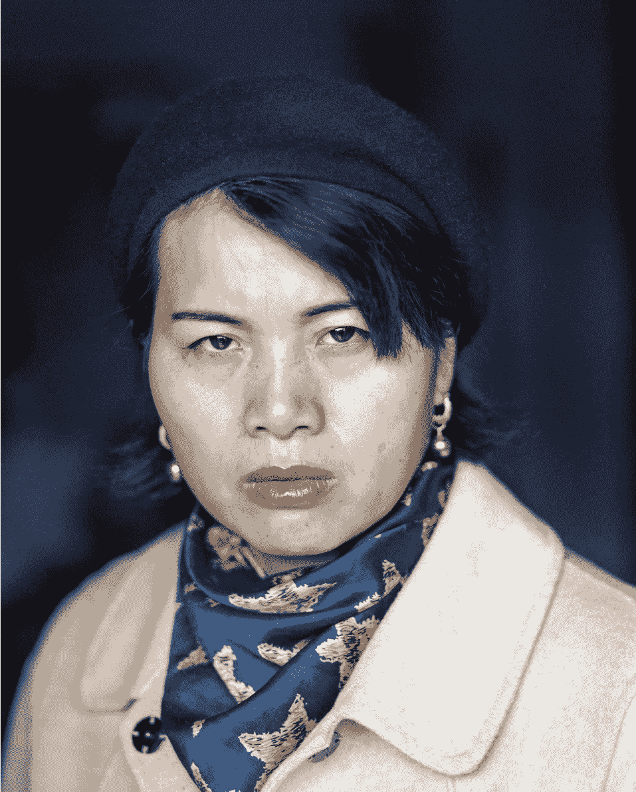

2021年12月，我在家门口给母亲拍了一张肖像，母亲认真打扮。

自从2011年36岁的母亲被淘汰了十年的工厂以来，她先后做了快递、卖过酒店、进过工厂。不久后的某天，母亲电话说：“准备干了，手受不了。”

2020年12月，南京东南角方向的一家快递站，母亲在里面工作。第二天，下班比较晚，我带着设备，想看看母亲的地方。快递站不远，这条小路随着新城重新修了，但是到工厂的地方是在绕道和新城夹角处，还是原来的样貌。

看见左边巨大的工厂，灯火通明；右边是新建的房，家家户户亮着灯。

快递站后，母亲站后，母亲的友们正在运输最后一批货物。由于刚下雨，地上还有积水，空气中薄薄雾雾，我雨差，妈妈的衣服。

我听，母亲的话中感受到了对工作的工作，，，，的。

母亲收工后，我着着，我站在处处，选择拍摄了一张曝光半小时的照片

座上。，我问母亲：“你知道这些吗？”她摇了摇头，说：“已经了。”

，，，，堆，，，，，，

。

这是我们之间所有对话，明明地班了，只说了一句：“等了，毕业了。”

2023年3月，快递叔刚跳槽到新的公司，仍然穿着之前的工服。

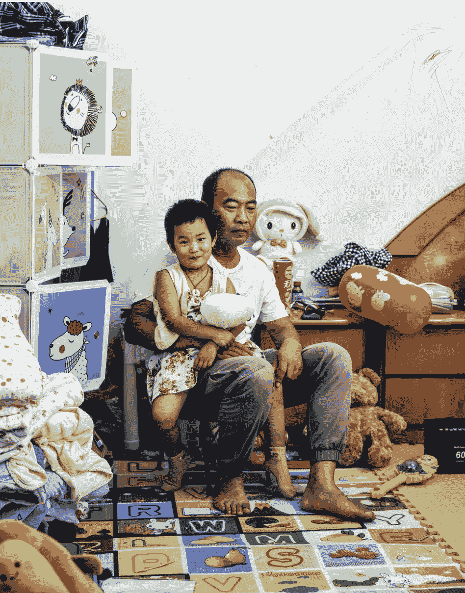

2022年8月，女儿即将上学，快递员从城市回到县城，参加女儿的入学。

2023年1月，快递员刘凤和老公返回老家，农村中堂已经很少见了，挂着传统的装饰画。

2023年4月，一位中年快递员单戴着手套，方便分拣与操作。

2023年4月，年轻的快递员以快递工作为跳板，适应城市工作与生活。

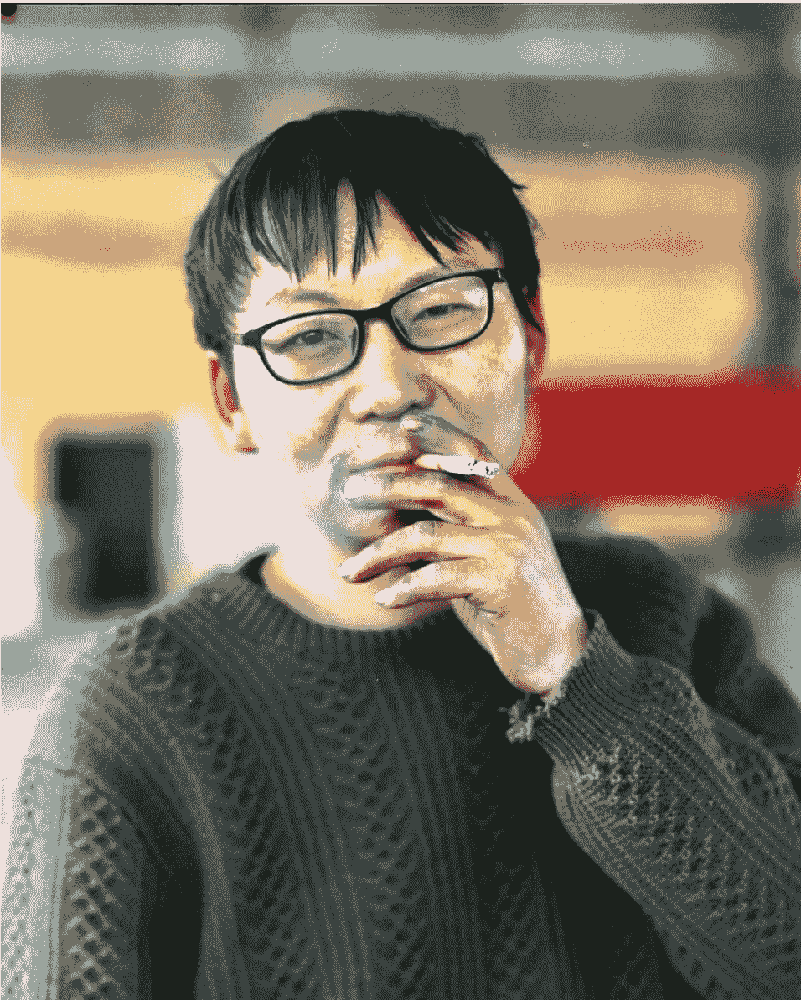

2023年3月，快递分拣场面临倒闭，快递员拍下最后的肖像。

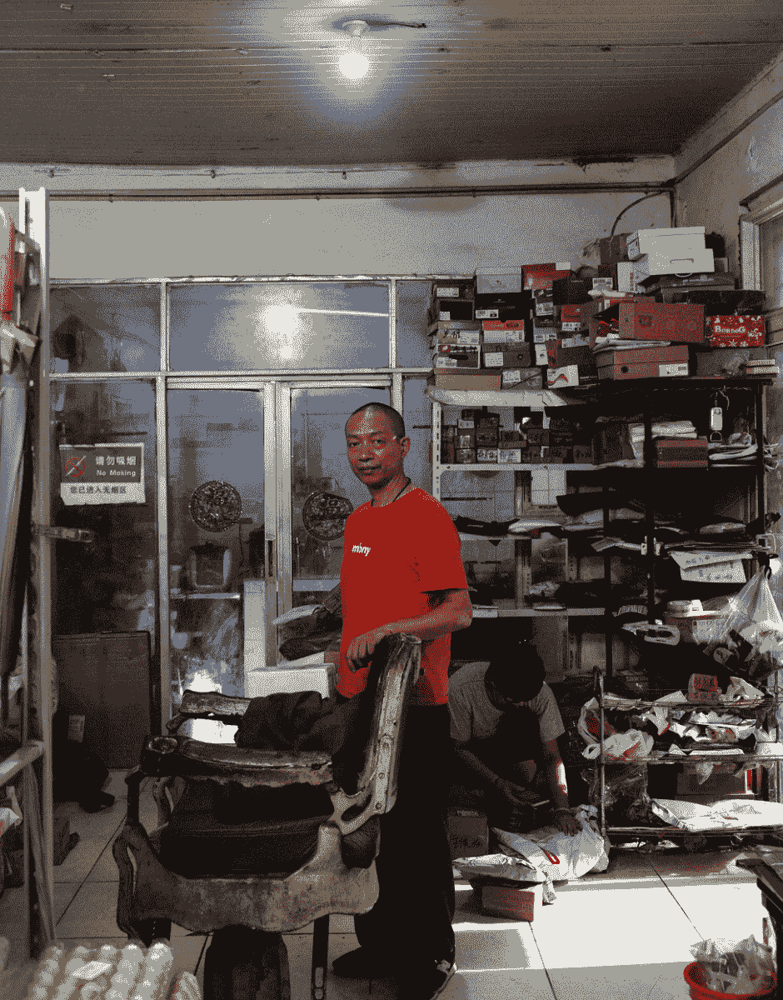

2021年7月，小刘叔叔把经营近30年的理发店改成了快递站，快递的空间越多，也给他带来了不错的收入与生活上的变化，他们一家人生活在这间屋子内。

2022年7月，快递员深夜回家，坐在在楼梯前拍摄。

到自己的货物，越往传送带的后面，需要筛选的货物越少，压力也就越小。到了王芳这里，货物已经经过了几人的筛选，洪流变成了相对有秩序的支流。而传送带的最后一人往往不必分拣，只需检查货物有没有出错，如果遇到错件就将它们扔回原来的位置。

上工前，王芳组里的人不愿意和我过多交流，虽然没有明确拒绝，但态度冷淡。突然，外面暴雨倾盆，雨水密密麻地捶打着铁皮屋顶，凉风卷裹着细碎的雨水灌进铁皮棚子里。这场雨来得及时，为工人们降了降温，也将工人的匣子打开，口心的那股闷气得以抒发，有几位也主动跟我上几句话。

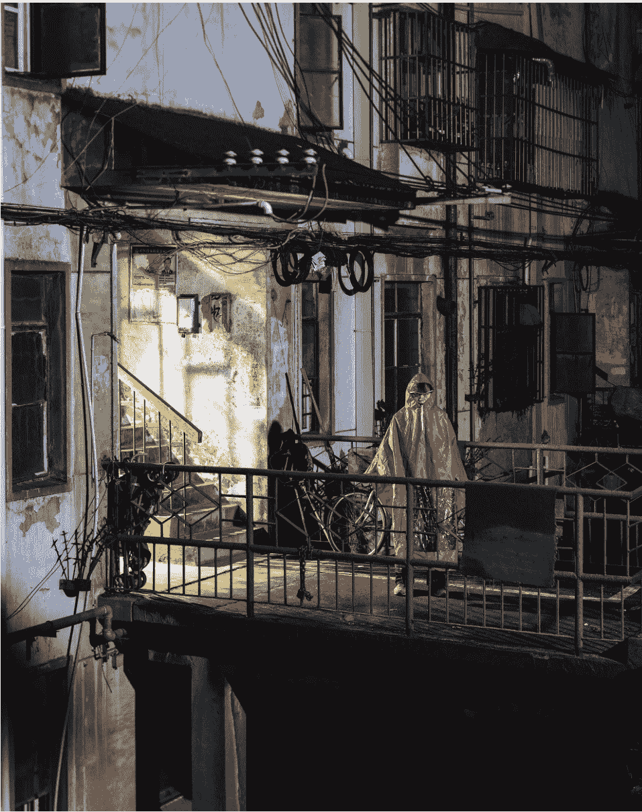

2022年8月，王芳结束工作后回到家。她和我聊起她的过往与工作，快速成为我为数多的选择与依靠。

王芳清理了她的货物，骑上车去送货。我们约了等她回来，再去她家里拍拍照。她回来时，天色已经昏沉，零零的雨点再次落在下来，她住在城北郊的一个老旧小区，她穿着红色雨裙，巷道里是老式的白炽灯泡，带着点橙黄色的暖光照在她的身上，我决定就在那拍。她好奇那里有什么好拍的，于是我一边挪动相机寻找构图，一边在大画幅取景器给她指出的雨夜颜色的奇异感受。也许大画幅的取景器的夜晚逐渐昏暗，王芳表示看不，但她看着镜头，反而更实在。

或许我母亲的故事引起了她的共鸣，王芳和我说的成长：我和母亲是相似的，人上学、爱情、逸，想要掌握自己的人生。只是过了一年级就因贫辍学，倔强地站在教室门口听课遭遇了老师的冷嘲热调；在大城市里流浪谋谋，执意逃离原生家庭的控制，又陷入并不如意的婚姻。

现在我年纪大了，去哪里都没人，身体也渐渐跟不上了。前几年去送外卖，冬天晚上，我揉进小区的小子里，单子也快超时了。我马上楼起来，一口气爬上六楼，把单子送完才回家换。那天冻着身，身体现在承受不住风，兜兜转转就在小区做分拣，但是有社保，也不用总是冷。我现在买了一些保险，这个费用，那个费用和房租交，孩子哪里需要钱呢，还能多少钱？现在快心里有点愁。

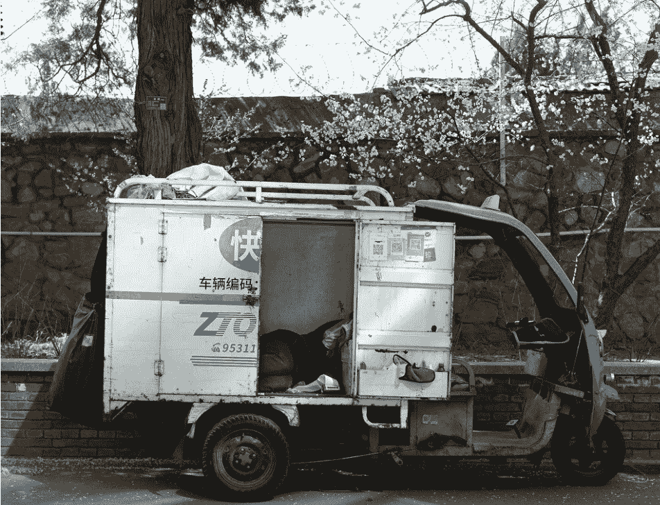

2022年4月，清华大学校园内的樱花开了，快速配送员在车厢内午休，等待师生取件。

2022年4月，午休时间，快递员躺在沙发上休息。

2022年5月，我刚北京完成了一个项目的拍摄，赚了几万钱，回到西安的学校，母亲突然打电话，办完家事后，轻柔地告诉她最近回家了，快递先不做了。我感觉异常，于是追问，她说，她癌症了，结直肠癌，四期。

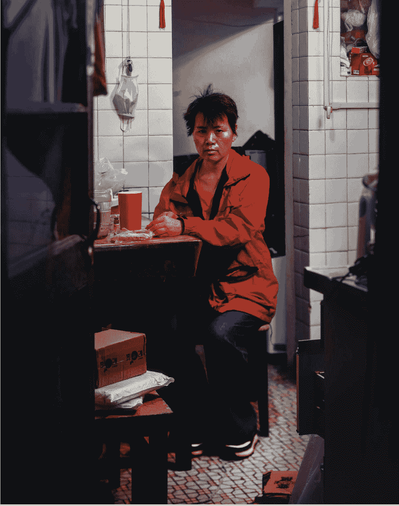

2022年7月，母亲结束了一个疗程的化疗回家，桌上放着口服的药物。药物对母亲产生了影响，头发枯槁，脸上起了疹。2022年7月，我们每天忙碌赶赴南京，我陪着母亲严格遵循、化疗、锻炼、饮食。2024年底，医生将我从病房叫出来，说母亲过不了，尽快转到社区。这段时间，母亲与朋友王芳阿姨经常来帮忙，每天做丰盛饭，菜一汤荤素做了三个月。她每天等母亲睡着后再回去，聊天。等母亲转院的时候，也是王芳阿姨独自照顾，直到母亲离世。

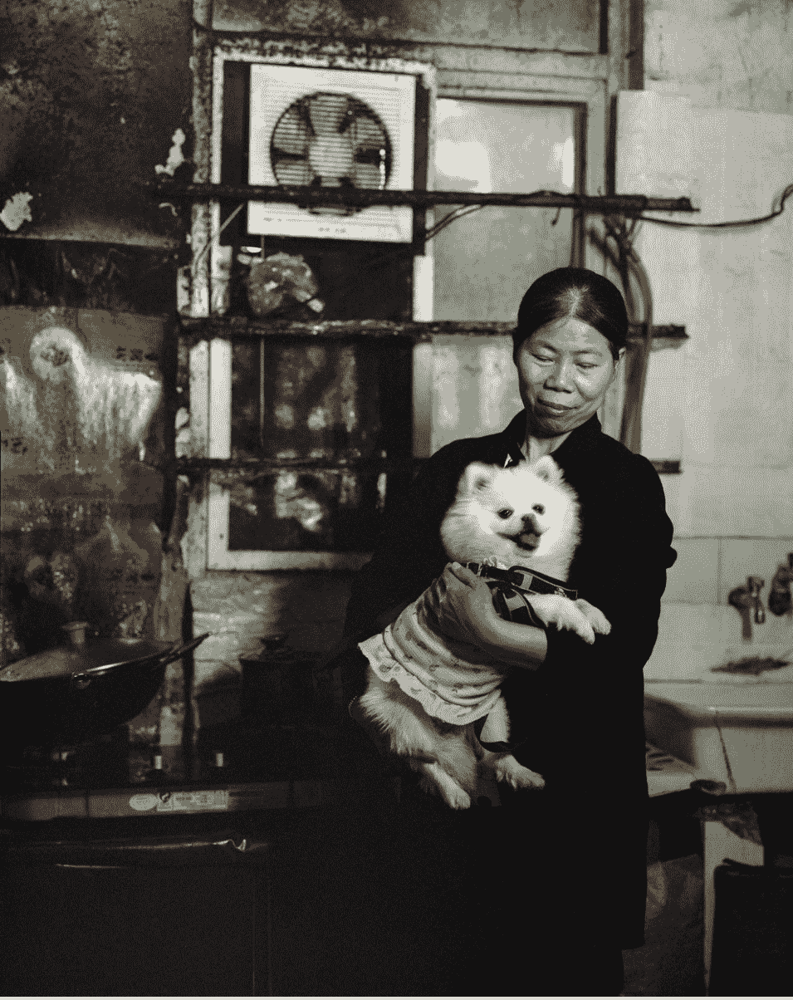

2023年3月，王芳与朋友，她我照顾了母亲的最后时光。在医院里，我向远处雾罩下的山，夕阳渐落下，我已经清楚这是几个日子。母亲的心跳渐渐衰弱，身体也开始失去呼吸。看着她在昏迷前，握着她的手，我忍住哭，对自己说：“不要哭……”在陪伴母亲的灰暗日子里，我收到邮件告知拍摄项目，我很希望带着母亲一起去，而且她已经虚弱到无法承受。母亲的生命落幕是一个瞬间，但对她的告别，是一个漫长的过程。在母亲离开后的第32天，502年清晨，她进入了我的梦，站在门口院子等我。我远远地看到了她，不敢相信眼睛，慢慢抬起手向她招呼一声，她微笑着回应。我奔过去，扑到的她的怀里，竟然在哭。“现在很好。”小区里最近都在流传这件事：小叶去世了；小叶的儿子来说，家门口的小院和母亲照料成了我的背景，记者想了解作为快速快递员的母亲。他们问我，方便在栏目里透露母亲的名字吗？

名字很美，像是野菊。

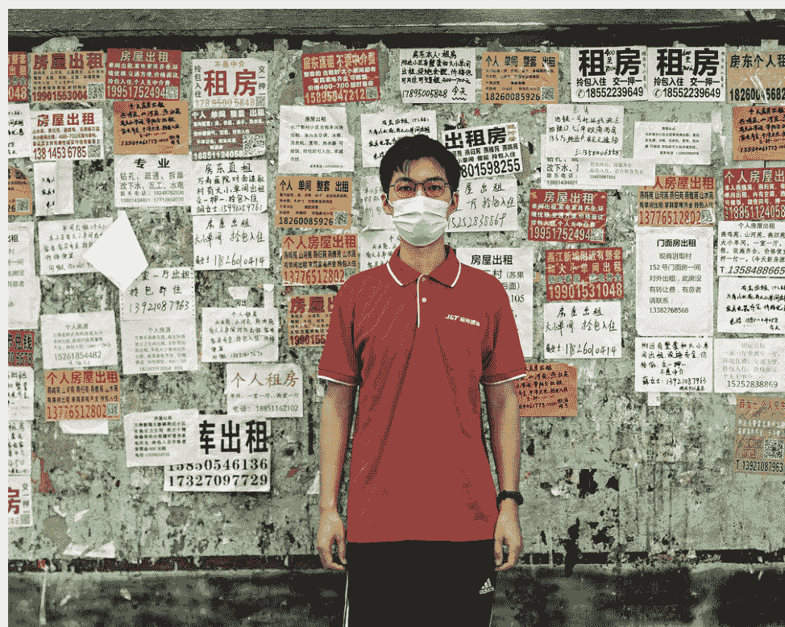

2022年8月，我结束快递工作后，一名快递员挑选了一个场景，按下快门。在面对镜头时，我也会紧张与局促。

图片编辑 | 葛倩

## 熟悉的母亲

我发现妈妈老了，她老了许多岁。第一年春天，她开始变得健忘；夏天，她开始变得走路费力；秋天，她不再爱去公园散步；冬天，她开始整天在床上躺着。

第二年，妈妈变得更老了。春天，她开始频繁咳嗽；夏天，她开始变得听力下降；秋天，她不再爱做饭了；冬天，她开始整天都在做梦了。

妈妈生病了，医生说她得了癌症。我们全家都害怕了，但还是决定为她治疗。化疗、放疗、手术，所有的办法都试过了。妈妈很痛苦，但她很坚强，她总是对我：“没事，你们别担心。”

妈妈生病后，她变得更老了。春天，她开始变得健忘；夏天，她开始变得走路费力；秋天，她不再爱去公园散步；冬天，她开始整天在床上躺着了。

妈妈去世后，我变得更老了。春天，我开始想念妈妈了；夏天，我开始想念妈妈了；秋天，我开始想念妈妈了；冬天，我开始想念妈妈了。

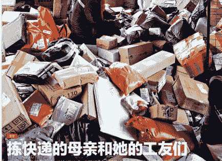
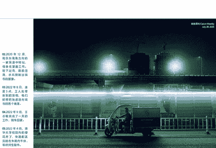
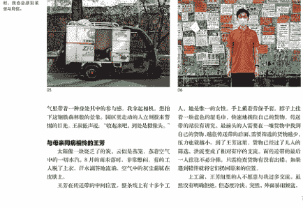

那座废弃的火车站，那座废弃的工厂，曾经是这片土地最有活力的中心，如今在漫长的岁月里渐渐死寂。这里不再有人进出，不再有机器的喧嚣。夏天，我决定回到家乡。虽然我已经离开了那里多年，家乡的记忆依然在脑海中清晰。我想回去看看，找回那些记忆。当我回到家乡，发现一切发生了变化。新的街道取代了旧街道，新的建筑取代了旧建筑。熟悉的家乡每一个角落，现在似乎都变得陌生。我走在熟悉的街道上，看着陌生的面孔，心中有一种失落感，感觉自己是一个异乡人。在那座废弃的火车站旁，我遇到了一个头。他坐在椅子上，望着远方。他的眼神中透着哀伤和迷茫。我走过去，坐在了他的身旁。老头告诉我，这里曾经繁华。他说，几十年前，这片火车站总是人满，工厂里也充满了热闹。但现在，这一切消失了，只剩一片荒芜。我听着老头的讲述，心中五味杂陈。意识到时代已经变了，而它留下的痕迹，却深深刻在了心上。那些痕迹，是时间无法磨灭的。

## 记忆的碎片

我开始在脑海中寻找那些记忆。我记得小时候在巷子里嬉耍的日子，记得午后在树下捉蝉的时光。那些时光是美好的，现在却变得遥远。我还在家里翻了一些照片，照片上的人已经苍老，但他们的笑容依然灿烂。看着这些照片，我仿佛回到了那个无忧无虑的年代。渐渐明白，记忆虽然模糊，但却是我们生命中不可缺的一部分。没有记忆，我们失去了灵魂。因此，我要好好珍藏这些记忆。我再次离开了家乡，带回了记忆。我知道，无论我走多远，这些记忆将永远留在我的心中，它们将成为我继续前行的力量。

## 随笔 | 外公胡伸持: 报业、出版、翻译三重建

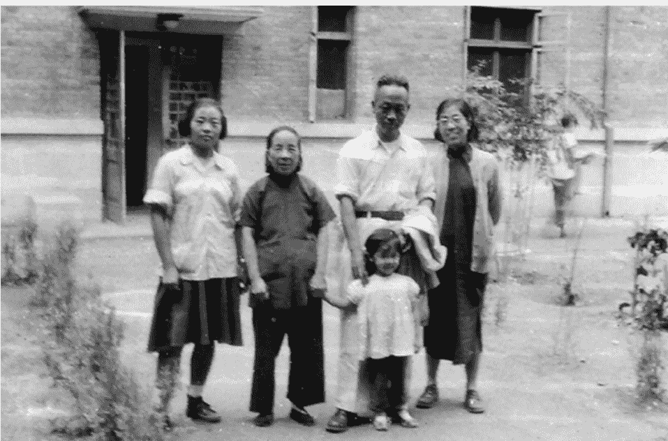

## CAIXIN | 听文章文 | 胡舒立 媒体人

外公胡伸持生于1900年2月25日，今年是他出生125周年。他1968年去世，当时我们还年少，除了亲情，对他知寥寥。如今人生过半，循着众多史料和遗作才慢慢看清，默默无闻的外公，原来如此勤勉、自律、进取。他们那一代知识分子的人生经历以及时代与社会的贡献，至今仍默默滋养着我们和大众。回望外的一生，他在报业、出版业、翻译事业三向精，都做出了成就。或许，如今我们，一个研究文学，一个从事报刊业，并非巧合，而是他的另一种延续。

## 从乡居手抄到报纸总编

外公的父亲、我的曾祖父胡陆倾（1878—1924）是前清秀才，当时最早的“新锐派”，家中常订《申报》《时报》等多种报刊。外公与长兄胡适之从小读这些报刊，热衷于做报并装成册，后来萌发了办报的念头。于是，上虞县唯一的报纸《家庭三日报》诞生了；一张黄草，他手字，记录了家里三日内发生的事，只出版一份；十几期后，改为《家庭杂志》月刊，六七十页，由胡适之任主编，兄弟俩执稿插画。

胡适（1900—1968），报人、出版家、翻译家。

胡适之离开家去读书，胡钟持对办业兴致不衰，自己编辑《后因园周报》，摘整《申报》《汇报》上的文章、时事和消息，分送给心心时局的同学和友亲友，最多手抄二十份。此事虽不值得入正史，但是胡氏比更热于办报的种子。

兄弟二人中，胡适之有创意，可靠，妥局，胡钟持能执行，对编辑实务很执迷。此后，两人的报业人生确实中有异，胡适之为成为职业革命者中的报人，胡钟持则是献身报业的进步人。

1921年，胡伸持入职时上海最大的日报之一《申报》，在报业上汪溪下手做外勤。晚回忆：编辑部只有二十人，每天工作三小时，每天五小时写万余字，从全国各地及上海各区付出。可见，现代报业而言，胡伸持专业起点很高。从余年，胡伸持便捷在上海，新创了《商报》，担任主编，获益于潘宣。潘宣毕业于南京大学，在版面处理上大胆选用手法，革新气象。一时胡钟持与董事会冲突，1927年7月，《商报》经营不佳，凡经易手，胡伸持幸运离开。当年潘宣邀请他加盟当年最重要的报纸《申报》，在潘宣带领下，升为主编。1927—1940年是《申报》命运的关键岁月。从总编辑到老板董才被害，抗战爆发被迫停刊与复制，胡伸持都是重大事件的前线观察者和经历者。尽管他在报社只是“无名英雄”，但在业内名气日益增长。当时上海有“申报》，胡伸持便是其长项：国际新闻。1936年沈案之后，《申报》日论激烈，刊登相当数量的左进步家的稿件，胡伸持在内部起到了作用。27岁开始，胡伸持在中国报任职13年，直至40岁时离开“孤岛”。这是他作为成人时期关键最重要的阶段，受到了深厚的专业主义影响和规范。1950年，他在自传中说，“在上海反法西斯斗争时期，幸与共产党组织有过联系。”的一些同志直接或间接提及他，主要就是他的兄长胡意之。1937年全面抗战爆发，政府当局与具有中共背景的左翼人士商定，于1937年8月24日创办《亡报》。由郭沫任校长，夏衍与樊云任国民党集团的总编辑。双方最初确定的30人委委会，胡意之、胡伸持均列其中。中共将该报定位为公开身份的“党报”，周恩来直接负责，夏衍来主持。初办，胡意之、郑铮几乎都赴陕。从上海到广州，最后在桂林，报纸坚持到1942年2月28日。1940年12月，胡伸持从上海到香港，担任中共在香港新创办的《华报》总编辑。在皖间事之后，国共关系恶化的背景下，《华报的创办，既面向海外华人社会，介绍中共参与的国内抗战局势，又要发布国内难以发表的中共重要文件，实际上是《新华日报》的补充，属中共华南局机关报。按周恩来指示，要办得“统一”。胡伸持作为党资深报人，既可靠又专业，自然成为恰当的人选。《华报》党内文化名流云集，实际主持的是长江，社论主笔张友谊，副总编辑梅蕴，都是在党内有职务、社会上有名的左文人。胡伸持的角色相当于总编辑室主任，技术型核心人物，处理新闻和安排版面。每天下午定版内容，报纸准下午1点出街，各个流程都由胡伸持执行。在胡伸持身边，还有他的朋友、副总编辑廖沐沙。八个月后，太平洋战争爆发，《华报》被迫停。胡伸持从沦陷的香港来到桂林。1944年，中共下党决定用《广西日报》的刊号办“昭平版”，胡伸持担任总编辑。当时每天只有5人，“大家一致，在十分艰苦的条件下丝毫没有感到疲劳”。此时，经过几次报纸的锤炼，胡伸持对办好“党的报纸”有了更大的信心，这在这一份“编竹为篱，电石作灯”的报纸的创刊号上，他发表了评论《公众的眼和曙》。不过，很快胡伸持就病倒，“昭平版”和病号分别转移到不同的隐处。1945年日本投降时，《华报》准备尽快在香港复刊。当年在香港参与过报业的乔冠、郝广等，胡伸持写信给秘书。当时国民党老仆李济深委托另一人，胡伸持随广州进。内战再起，兄弟再度联手，成为新加坡推出的《南日》。1949年5月，胡伸持重回上海，在长江、范逸等群人的带领下，在原址处创办《解放日报》，担任编辑长。胡舒立加盟，胡伸持调到国际组长。1957年1月，胡伸持离开《人民日报》，也外舒。他的母亲与报纸的缘分很浅。

## 孤岛出版奇迹

在“孤岛”时期，妈妈老了许多岁。春天，她开始变得健忘；夏天，她开始变得走路费力；秋天，她不再爱去公园散步；冬天，她开始整天在床上躺着。第二年，春天，她开始频繁咳嗽；夏天，她开始变得听力下降；秋天，她不再爱做饭了；冬天，她开始整天都在做梦。妈妈生病了，医生说她得了癌症。我们全家都害怕了，但还是决定为她治疗。化疗、放疗、手术，所有的办法都试过了。妈妈很痛苦，但她很坚强，她总是对我：“没事，你们别担心。”妈妈生病后，她变得更老了。春天，她开始变得健忘；夏天，她开始变得走路费力；秋天，她不再爱去公园散步；冬天，她开始整天在床上躺着。妈妈去世后，我变得更老了。春天，我开始想念妈妈了；夏天，我开始想念妈妈了；秋天，我开始想念妈妈了；冬天，我开始想念妈妈了。

在“孤岛”时期，文化进步人聚集。妈妈烧菜的手艺，那时那时好。母亲与朋友王芳阿姨经常来帮忙，每天做丰盛饭，菜一汤荤素做了三个月。为了办，胡意之和胡伸持租住一些小的房子，全家一起搬到德乐路（今乐路）74号。此处住房，一层厅很大，三楼有五房间，一家人住得比较宽敞。为了办办公地点，十位进步文人，每人出资50元，类似于合作。在胡意之举办的“星期聚餐”上，以1元售价，又筹集了两千元。陕陷后，大批出版社内迁，留下不易迁的印刷厂处于闲状态，由于价跌到最低，纸费比较便宜。他们将英文原文拆开，由二十人翻译，胡坤为总校。恰好斯诺在上海，有问题随时请教，他还为中文写了序言，补充了照片。八角的一张是他亲自拍摄，中文版独有。胡申持巧将英文名Red Star译为《西行记》。胡申持在译后说：“这是复社的第一本书，也是读者自己组织、自己编辑，不以营利为目的的一本书。这种读者自己组织出版的事业，是一种冒险也是成功的经验。《西行记》从翻译到出版用多一个月，1938年10月10日正式发行，红色布封面，初版装印1500册，售价1.5元。不到一年多次加印，共发行2万册。这些都是从这里传递到读者手中。

1936年10月19日，鲁迅逝世。群众社会致许广纷歧，争相出版《鲁迅全集》。但许广未获得鲁迅著作权，后经许寿堂建议，鲁迅原配夫人朱安将版权全权委托许广。在许广的推动下，成立了蔡培培、茅芹、周作人、静农等列名的编辑委员会，确定了编辑基本原则。国民党中宣部的审查意见，三分之二的作品都要改。许广虽然气恼，仍说是接受。她托胡适、蔡培信响馆总王云五，王立表示可以出版，因版权纠纷被悬置。这件事起来，许广十分焦急。她努力搜集和初步整理，文稿已经满一屋子，如果被日本人弄走就麻烦了，运到内地面临运输交通不便。胡适之认为，最好的保存就是印刷书。许广决定交由复社操作。胡适给国民党中宣部部长郭子信，得到这位绍兴同志支持，通过了“审批”程序。中共下周组织的经费颇为困难的情况下，拨了一笔款项，用于补贴全职的编辑人员。

《迅全集》的编辑为鲁迅先生之前的“三十十年集”，加上翻译集，依各性质版本为20册。编辑工作较为繁杂，仅搜集十部绝版书就费颇功夫，战乱之时更甚不便。

元；乙种棕色皮面烫金，外送一份柚木书籍，蔡元增款，售价100元。

胡愈之旅程港找蔡元和宋庆龄求助，蔡元即席挥豪，题写《鲁迅全集》四个字，又写了订购《鲁迅全集》纪念本》和《鲁迅先生全序集》。离港途中，胡愈之又在广州和武汉开茶话会“路演”，现场销售纪念版书籍。在武汉，沈钧儒自组织预售茶话会，邵力力当场购买10套纪念版，一场就获资数万元。

安乐郭胡后的客室间就是临时库房，全书分四次印刷，每批都分运到安乐部再行装。许多平装预订读者就是直接进入胡奎后门，捷了了自己的书。至迟到1938年，客室间已堆放成一批有木匣的精装。

集全之后，胡钟持和冯沂符、梅等人一起翻译出版了斯诺夫人宁汉·韦尔斯所写的《越西游记》；又借赖稳印刷之，秘密翻印了吕泽东《论学术持久》等书籍。

复社影响起来，胡钟持和安乐郭几乎即刻成为警方目标。1935年5月和7月，我和我的小公胡学两次在家里被租界巡捕抓获，尽管下党安排营敛，很快被释放，继续以复社名从事出版就难了。

复社存在时间虽有三四，在出版史上重重的一笔。1972年2月，美国总统尼克松访，周恩来送给他一套《鲁迅全集》，为此多次派去人民文学出版社取书。但1958年出版的《鲁迅全集》10卷已被视为“禁书”，只从库房找到1938年复社版。

这个版本前10卷涵盖创作、学术著作与分部书籍，后10卷为翻译作品。卷前有蔡元培，各卷首均有鲁迅各个时期的照片和墨述，卷末附逸自传，许寿裳编“鲁迅谱”以及许广平“编后记”。经周恩来批准，1973年12月重版时，除为简体字和校正个别错字，仍沿用了复社版。这就是当时国内所说的“红皮版”。

## 与许佑得大师精神共响 

胡健持的翻译生涯始于1920年，终于于1951年。他的译作数量，范围，包括小说、诗歌、散文、文艺理论、世界文学、儿童文学、人物传记、酷文学、社会学等。教授的姐姐曹准，对外的翻译工作进行详实的梳理和研究发现，自从改革开放后翻译学在中国兴，胡健持已成为翻译学者的对象，被誉为“翻译大师”和“翻译高手”。

“五四”运动后，大量外国文学名著介绍到中国，青年胡健持是那时文化潮流中的先行者之一。1921年，他便在当时影响最大的综合性文学《东方杂志》发表了14篇国外短篇小说译，其中9篇是俄国文学作品。第一篇是契尔夫的《一个闹闹的朋友》，另一篇是法国作家伊斯以色列·赞格·威尔（Israel Zangwil）的《婚姻访客》，是幽默作品，说明胡健持对审美趣味颇为看重。屠格洛夫的小说《木木》（当时译作“语呀”），陀思妥夫底基斯的《圣节的穷孩子》，反映出胡健持在选材上偏重描写底层劳动人民的特点。

这一年，胡适参加了由周作人、郑泽、沈涵（茅盾）等人发起的文学研究会。文学研究共有170多名成员，是新文学运动中最重要的一个文学社团。1924年，胡适翻译的德国作家赫尔曼·苏德曼的长小说《忧悦夫人》，作为“文学研究会丛书”之一，由上海商务印书出版。这次规模巨大的文学作品共译125部，71翻译作品中有30部小说，包括彻底翻译的三部作品。

1928年，曾经慷怀激情的一年胡适突然陷入彷彷境。近而的胡适，已经登上了申报的大平台，文学翻译追求也渐臻佳境。他翻译了《日本小说选优》和菊池的戏剧剧本《藤十郎之恋”，“当时对日本文学的东方情调引起好奇，对日本文学学一番，利用对照日本出版的英文版本翻译了一些中短篇，等到日本暴行，引起日本日本怜厌，又把文抛弃了。

身居闻间编辑岗位的胡适，并没有像其他那样心于“名者”之名，而是擅译音。美国文学批评家约翰·梅（John Albert 1877—1925）的巨擘译《世界文学的故事》，由他先在《申报》连载，后修订成书，由开明书店于1931年出版，题为《世界文学史述》。此书属于经典作，30年中频频再版。

最能明响胡适眼光与趣味的，当他翻译的诸承诺得主的经典作品。

1931年3月，珍珠玲的《大》在美国出版，立即引起关注。小说描写了当时中国水灾、旱荒、兵祸、患等严重的问题，引起共鸣。他认为，要使中国得救，首先要彻底认识。1932年起，“东方杂志》开始以“闲”笔名连载，1933年8月，译文书由上海开明书店出版，至1949年发行。1938年获得贝尔文学奖后红一时，《大地》在中国左翼界存在争议，鲁也有微词，所以胡适继续译“大地”。

1933年，宋庆龄、蔡元培、鲁迅、杨发起的中国民权盟邀请下，贝尔文学奖得主、英国作家萧伯纳来到上海，胡适应接待萧伯纳，翻译萧伯纳在《申报》副刊译稿的《黑女求记》。

1939年，美国作家约翰·斯坦贝克（John Steinbeck）的小说《愤怒的葡萄》（The Grapes of Wrath）问世，迅速登上畅销排行榜。胡适在译序中提到，斯坦贝克的作品深刻反映了当时民众的遭遇、感受以及人类的命运，无法逃脱。

斯坦贝克是当时美国文学的代表。1941年10月，《愤怒的葡萄》由上海出版。1942年1月，胡适在译序中提到，斯坦贝克的作品语言平实，没有太多华丽辞藻，更能突出普通人的快乐。

学者梁志芳在《珍珠玲和诺斯特斯的中国知音：翻译家胡适》文中，详细介绍了胡适的《大地》译本，以及梁志芳、褚静、薛静曾写论文对胡适做了深入研究。

1945年10月，《愤怒的葡萄》在香港公映，胡适在译序中提到，斯坦贝克的作品不仅反映了时代的变迁，更是一部世界文学的经典。

胡适的《大地》译本被认为是经典的，符合理想的。一些学者认为，胡适的译标题为“美国大地”，具有社会现实主义的特点。

1962年，斯坦贝克获诺贝尔文学奖，胡适去世，这是文学的遗憾。

最能明响胡适眼光与趣味的，当他翻译的诸承诺得主的经典作品。

1931年3月，珍珠玲的《大》在美国出版，立即引起关注。小说描写了当时中国水灾、旱荒、兵祸、患等严重的问题，引起共鸣。他认为，要使中国得救，首先要彻底认识。1932年起，“东方杂志》开始以“闲”笔名连载，1933年8月，译文书由上海开明书店出版，至1949年发行。1938年获得贝尔文学奖后红一时，《大地》在中国左翼界存在争议，鲁也有微词，所以胡适继续译“大地”。

1933年，宋庆龄、蔡元培、鲁迅、杨发起的中国民权盟邀请下，贝尔文学奖得主、英国作家萧伯纳来到上海，胡适应接待萧伯纳，翻译萧伯纳在《申报》副刊译稿的《黑女求记》。

1939年，美国作家约翰·斯坦贝克（John Steinbeck）的小说《愤怒的葡萄》（The Grapes of Wrath）问世，迅速登上畅销排行榜。胡适在译序中提到，斯坦贝克的作品深刻反映了当时民众的遭遇、感受以及人类的命运，无法逃脱。

斯坦贝克是当时美国文学的代表。1941年10月，《愤怒的葡萄》由上海出版。1942年1月，胡适在译序中提到，斯坦贝克的作品语言平实，没有太多华丽辞藻，更能突出普通人的快乐。

学者梁志芳在《珍珠玲和诺斯特斯的中国知音：翻译家胡适》文中，详细介绍了胡适的《大地》译本，以及梁志芳、褚静、薛静曾写论文对胡适做了深入研究。

1945年10月，《愤怒的葡萄》在香港公映，胡适在译序中提到，斯坦贝克的作品不仅反映了时代的变迁，更是一部世界文学的经典。

胡适的《大地》译本被认为是经典的，符合理想的。一些学者认为，胡适的译标题为“美国大地”，具有社会现实主义的特点。

1962年，斯坦贝克获诺贝尔文学奖，胡适去世，这是文学的遗憾。

## 财新 | 福柯 

文 | 严飞

清华大学社会系教授

小孩自己发明了一个游戏，要和我玩“脱狱”。我演犯人，他演警察，他走进已经成了监狱的卧室，而作为犯人，我需要和警察斗智斗勇，努力想办法乘备，从卧室门跑出去，逃离监狱。

第一轮，我们手上面没有武器，就赤手用来比，再加上嘴巴里发的“bi”枪响音效。我假装向门口试探，他则挡着大门，舞着双手，让我没有空隙可以钻出去。我再尝试着在床上躺平，假装自己了，骗警察上前看，我出其不意地滚到近门的床沿，一跃而而出，可惜从床上起来跑到门口，总比他慢半步，又让他变身为守卫，守住了大门。

第二轮，我们开始装备国王的盾牌和宝剑（我们的游戏的主打就是一个混搭）。我手拿着宝剑，小孩握着盾牌，我们开始对击。我锋利的宝剑遇到了坚硬的盾牌，自然难以分胜。我机，突然一个“不小心”，在碰撞的瞬间，剑落在地上，并且很俏妙地掉到了远处大门的地上。我对他说，我的宝剑掉了，你快去捡，这样你的武器就聚在一起，无敌了！小孩没多少想，就顺着胳赖跑过去捡剑，想把自己武装。我看着他弯腰捡剑的瞬间，立即朝门口冲出去，一头就跑到了客厅，天天笑，哈哈，这一轮爸爸赢了！你看我多么聪明，逃离了你重重设计的监狱！

小孩追过来，竟然胜利地看着我一眼——你只是逃离了这一个牢房，但没有离开我的监狱，因为我的监狱是infinite prison，外面也是我的监狱，你不过从我的监狱跑到了另一个监狱，因为我的监狱是无限的。

最近这孩子看了漫画可是学得很快，灭霸最想拥有的“无限宝石”，他在这里马上就转化成了“无限监狱”。再一想，他却是说着很对，我看着上脱成功，却不想想，牢房外面是一个更大的牢房，天地看上去很大，实际却逃可是。

小孩继续说道：“这也太好玩了！我们是在演一戏，第一幕我赢了，第二幕你赢了，现在我们要继续来演出第三幕，你假装抓剑，我去捡，然后这一次，逃出去，不可以。”

于是我们开始第三幕演出。假装权力一样，冲出卧室，却在出门的那刻恍然大悟，大声叹：“原来这里是我的监狱！原来这里是我的监狱！”

本文最后一部分参考了财新专栏。

这个词来自，米尔·福柯。当我听到“权力无处不在”的时候，我还是觉得脊发凉。法国学家米尔·福柯在《规训与惩罚》中描绘了那个核心象——权力无处不在。福柯告诉我们，现代并没有让权力消失，而是权力更加隐蔽、温和。

在古代世纪，统治者热衷于暴力、处刑等手段，用身体上的痛苦。然而，现代社会不再依赖身体，而是将权力分布，通过一套话语、规则进行监控。这种新的权力形态称为“规训”。

这种监控渗透到每一个网格，将权力内化为身体的习惯。这种权力不是通过暴力，而是通过碎片化安排，将权力渗透到每一个微微微的身体。

福柯说，权力是无处不在的“权力无处不在”！

## CAIXIN | 听金 

文 | 蒋哈

律师

财产分配始终是社会发展的关键题，深刻映射出社会结构。宗庆后去世引发遗产纷争，清晰映照出当下法律问题。现代法律框架下的遗产分配规则，涵盖了性别差异。《民法典》明确规定，“继承权男女平等”，这从根本上改变了女性地位。从宗庆后遗产案件中各类主体的权益状况可以看出，现代法治已具备场景覆盖的能力：生子女的遗嘱继承与信托受益权、非生子女的合法继承与信托主张、非家族成员的权益，甚至未参与诉讼的潜在继承人，其权利都能在法律框架内找到依据。这种无缘身份如何通过法律程序界定分争的机制，彻底取代了封建社会家族权威一言九鼎的模式。

法律赋予被继承人更大的财产自由，遗嘱继承的效力这符合民法典中“遗嘱优先于法定继承”的原则。法律允许更为灵活的工具实现传承，例如宗庆后采用股权信托，将公司委托给信托机构管理，以此保障子女的利益。

随着资产的全球化配置，遗产分配常常涉及地域问题。内地、香港及海外在规则上存在差异，但核心原则还是类似的。内地采取“属人法”与“属地法”（当人的国籍、住所和财产所在地）相结合的方式；香港实行“遗嘱认证”制度；欧美遵循“遗嘱自由”。这些规则共同构成了全球的遗产分配网络，确保不同身份、不同地区的继承人权益都能得到法律保护。宗庆后遗产案，跨越香港和杭州两地法院，涉及效力、非生子女继承权、跨境信托合法性和有效性、跨境诉讼的法律适用涉及诸多复杂问题。

当然，这场争议也暴露了现代法治的复杂性：股权信托的效力认定、非生子女的血缘继承、跨国资产的法律适用等问题，对法律的细化程度与司法实践的专业性构成了考验。但这些争议恰恰表明，现代法治并非完美无缺，而是在不断解决问题的过程中持续完善。

尽管纷争仍有可能发生，但解决路径清晰。

站立他的，全程端在定制黑色“王座”上完成演出，座椅最上方装饰着蝙蝠和骷的图案。他坦言，“这场告别演出是我执意要做的的一件事。我不想无声息地死去，我必须亲自说再见。哪怕是坐着，我也要在舞台上。我希望人们看见，无论身体多么虚弱，黑暗王子（dark prince）仍然如此。”

共同完成这场盛宴演出的还有金属乐队、枪与玫瑰乐队、地杀手乐队以及炭息乐队。现场座无虚席，全球约580万观众通过直播在线观看，演出共收益1.4亿英镑，全部捐献给帕金森病研究以及伯明翰儿童医院。

奥斯本曾经想象过自己的死亡，大概以某种愚蠢搞笑的方式收场。“至于他们要在我的墓碑上刻下什么话，我已不再抱幻想。当我闭上眼睛，就能看到这几行字：奥兹·奥斯本，生日1948年，死于某年。他留下了一只蝙蝠的袋。”■

## 前瞻 | 日本将纪念原子弹爆炸80周年

## CAIXIN| 听文章

文| 财经周刊 侯吴婷

日本广岛市和长崎市将分别于8月6日和8月9日举行原子弹爆炸周年纪念式，料参与两市活动的国家和地区的规模将达到史上最大。

为敦促发动侵略战争的日本尽快投降，1945年8月6日，美国向广岛投下一枚名为“小男孩”的原子弹；三天后的8月9日，名为“胖子”的两枚原子弹在长崎爆炸。联合国相关报道估计，原子爆炸造成广岛市约9万到14.6万人死亡，长崎难民人数在3.9万到8万人之间。

此后，广岛市于每年8月6日在和平纪念公园举办纪念仪式，长崎的纪念仪式则于每年8月9日在松山町和和平公园后祈念纪念像前举行。

纪念仪式参与者包括原子弹难民遭遇者和其他市民。两市市会分别在仪式上发表和平宣言。日本政要以及其他国家代表也将受邀出席。

去年，日本时任首相岸田文雄，以及来自约100个国家和地区的代表出席了两市的纪念活动。

广岛市消息，截至7月11日，共有124个国家和地区以及欧盟团体有意参加该市纪念活动。日本广播协会（NHK）表示，该活动的数量创下历史新高。往常，广岛市采取向各国和首脑发送邀请函的方式，而今年，该市改为向所有有外交关系的国家和地区发送通知。

自乌克兰危机爆发之后，这是广岛市首次向未被承认的国家发出邀请。今年出席广岛纪念活动的国家和地区中，包括巴基斯坦、英国、法国、印度等。长崎市方面，7月15日，共有77个国家和地区以及欧盟代表参与纪念仪式。受乌克兰危机影响，长崎市在过去三年内，希望在和平而非压抑的氛围中举行，导致美国、其他国家成员以及欧盟代表团出席长崎市纪念仪式。

史明表示，这一立场的转变是因为“超越国界的意识差异”。8月27日，以色列驻日大使吉拉德（Gilad Cohen）、俄罗斯驻日大使诺兹列夫（Nikolay Nozdrev）将出席长崎市纪念活动。

## 国民风 | 《房屋租赁条例》侧重保护承租权益

 （注：此处为图片）

## CAIXIN | 听文章

文 | 财经周刊 王婧

此前，国内涉及房屋租赁领域的法律主要有《民法典》《城市房地产法》等，缺乏国家层面的专门立法。《条例》首次以法规的形式，明确了住房租赁的社会公共定位，通过构建“稳租、保租、强监管”的制度框架，将租房从市场行为升级为政府主导的民生工程。“北京地产行业协会秘书赵庆祥、住房城乡建设政策中心副主任刘增湛，《条例》对出租人、承租人、住房租赁企业、经纪机构、住房租赁信息发布经营者等市场主体‘要做什么、不能做什么’进行了规定，通过立法从根本上整治住房租赁市场的乱象。北京大学学院教授常鹏称，《条例》在平衡租赁双方利益的基础上，适度倾斜保护了租赁人的合法权益。（注：原文“租人”为笔误）

当前部分租赁房屋的设施陈旧、卫生条件、安全隐患，其中“隔断房”和“甲醛”较为严重。针对这些现象，《条例》已明确了租赁的基本标准符合建筑、消防等方面的标准，还将厨房、卫生间、阳台、过道、地下储藏室、车库等非居住空间用于居住，并要求单租人数限额和人均最低面积符合地方规定。为保障承租人的居住环境，《条例》还规定出租人不得擅自进入住房。

租赁关系不明、不稳定，是导致承租人权益受损的另一个因素。《条例》规定，出租人和承租人应用实名签订租赁合同，且出租人通过住房租赁管理平台将合同向相关部门备案。《条例》赋予承租人一定的自主权，明确出租人未办理合同备案的，承租人可以办理备案。

浙江工业大学中国住房和研究院院长晓昕认为，这一规定相当于用租赁合同备案的方式来保护承租人的权益和相对租赁关系。《条例》还规定，出租人不得采取非法方法迫使承租人解除住房合同或者擅扣租赁资金。

住房租赁企业、住房租赁机构提供虚假房源、克扣押金、侵占、挪用租赁资金等行为，亦可能给承租人带来经济损失。《条例》要求住房租赁企业、住房租赁机构建立档案，如实记载相关信息，并保证发布的房源信息真实、准确、完整、一致。

针对租赁押金纠纷，《条例》提示当事人在合同中约定押金金额、返还时间、扣减事由等事项，并明确规定除约定外，出租人无正当理由不得扣减押金。

针对部分住房租赁企业“高进低短付”等违法潜藏的“爆雷”风险，《条例》规定，从事转租经营的住房租赁企业，应当按照规定设立住房租赁资金监管账户并向社会公示，并且通过该账户办理住房租赁资金收付业务。

## 心智 | 意识何来

## CAIXIN | 听文章

文 | 阳志平

安人心智增长

意识也是人类最神秘的心智现象。为什么人会产生那些只属于自己并且难以言说的主观体验？一个颇具影响力的观点认为意识源于与心的交互，这就是法国哲学家笛卡尔提出的身心二元论。哲学家、认知科学家丹尼尔·丹尼特用“大脑剧场”来比喻这类观点：大脑中有一个中心剧场，所有感官收集到的视觉、触觉、嗅觉等信息都会聚在这里，按照次第呈现。现在大脑中有一个代表“自我”的小人（内在观察者），所有在特定时刻投射在屏幕上的感官信息（构成意识的内容），决定并发布命令。这个小人观察到的，就是我们实际经验到的。

这些观点很有道理，然而它们似非。丹尼特在《意识的解释》中通过四个要点进行了反驳：首先，“呈现”并不意味着意识产生；其次，外界事物的呈现不是到位，而是经历了漫长的演化过程；再次，意识并不具备精确的时空坐标；最后，意识并不是由自己说了。丹尼特将意识依赖内在整合的这种观念来理解为意识的“现象学”路径。

那么，意识究竟是什么？答案就是丹尼特的多稿模型（Multiple Drafts model）。用一句话括括：意识是草稿相互竞争的结果。详细拆解为四个问题：

第一，是谁撰写的草稿？这些草稿是由大脑中数亿个神经元相互作用形成的结果。各种知觉在大脑中完成，靠的就是感觉输入的并行、解释和细化过程。进入神经系统处在编辑修改中，各种内容的增加、校正与重写可能以不同的顺序发生。我们实际到的不是感官刺激，而是感官信息经过加工后的结果。

第二，是否同时存在多份草稿？有很多份草稿，有的处于激活状态，有的处于沉默状态。你可以把它们理解为编辑中的草稿。多重草稿模型是在并行路径上同时进行。

第三，多重草稿是如何转化为意识的？类似“群魔混战”的竞争方式，谁力大谁胜出。不同的草稿相互竞争，获得的草稿被看见，其他草稿则消失。大脑内部没有剧场，也没有呈现，只是在加工。但在“群魔混战”时并不存在一个主宰，各种内容的增加、校正与重写都以不同的顺序发生。随着时间的推移，会产生某种类似叙事的东西，无限延续未来。

第四，多重草稿在什么时候转化为意识？在多重草稿模型中，并不存在一个特定的时间点或时间点。

意识从何而来？从多重草稿模型出发，丹尼特继续讨论了人类的意识是如何产生的。他借用道·金斯在《自私的基因》中的观点，将人类意识的产生看作一个从基因到模型的进化选择的过程。他发明了一个极其精彩的思想实验“基因叛乱”来形容这一过程。人是承载基因与模型的机器人，在进化早期，基因的利益对生物的影响就像一条短绳，至关重要。随着时间的演化，在进化后期，生物体本身的利益逐步背叛了基因的利益，最终就形成了模型。

最终，诞生了人类独特的架构架构。这就是丹尼特在他的著作《灵魂物种》里提出的“四心智模型”。该模型将人类的大脑分成了四种机制：

第一层（底层）是达尔文心智。这一层的我们像动物一样，受本能的驱动。第二层是斯金纳心智。按照达尔文心智，老鼠看到猫本能会害怕。如果在老鼠看到猫的时候得到甜头，老鼠会不断去尝试，这种甜头就是刺激。第一层达尔文心智与第二层斯金纳心智是所有动物共有的。第三层波普尔心智和第四层格列利心智是人类独有的心智。波普尔心智意味着你在脑海中对某些事情进行提前测试。这就是人类最重要的能力——对真实世界予以抽象，并在脑海中进行尝试与预判。你会发现你的思想可能对，也可能错。你放错的放弃，挑对的执行。什么是对错呢？你有时依赖自己的判断，有时就会依赖社会习俗去判断，也就形成了第四层格列利心智。如果你将波普尔心智比拟人类大脑模拟真实世界的那台虚拟机，那么第四层格列利心智这台虚拟机就再是由人类个体而是由人类群体制造了。

既然人类难以举起自己，为什么低层级的心智会涌出高层级的意识？实际上，丹尼特提出的多重草稿模型告诉我们，意识本质上是一个文化的举重机。一级、一层，一个虚拟机安装在另一个虚拟机之上，最终涌出人类复杂的心智。

更多精彩阅读：【专题】心智

## 天眼 | 洗村清零

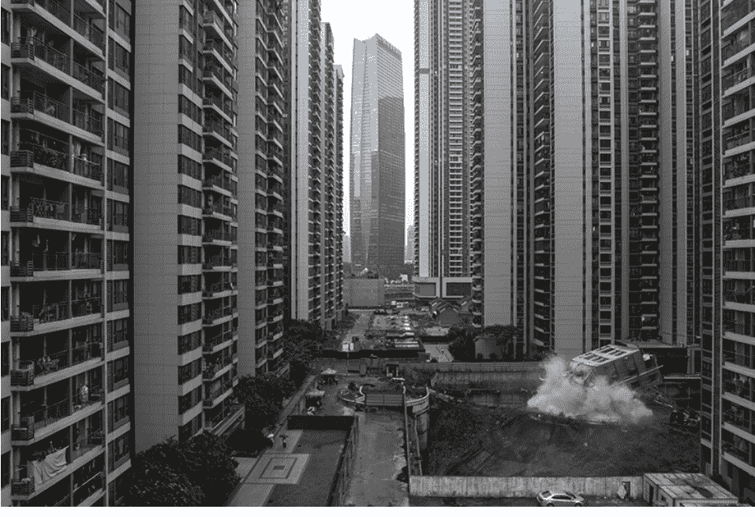 （注：此处为图片）

## CAIXINI | 听文章

图 | 张志辅（特约）

2025年7月20日，广州珠江洗村，一条紧挨着复建祠堂的村屋被拆除。洗村是广州新城的最后一个城中村，拥有800年历史，地处广州最繁华中心，但因安置赔付以及村官贪腐等矛盾，改造进程一度受阻。2024年5月1日，《广州城市中村改造条例》正式实施，洗村旧改是广州第一个依据这部法规解决留守户困局的项目。随着最后两栋旧村被拆除，历时16年的拆迁拉锯落下帷幕——全村1950栋房屋拆除“清零”，洗村旧改全面进入重建新阶段。
