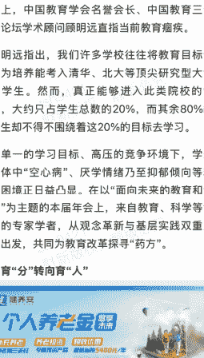
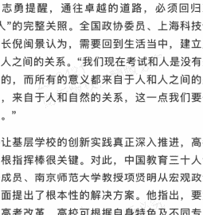

# 80%学生陷跑精英，陷跑何去？ | 教育观察

文 | 张张骏
2022/06/16 07:48

因施教、回归生活、回归对“人”的关注

【重构】教育改革的核心，是改变80%学生陷跑为20%“精英”的现状。当前学生过于“分流”而非“分类”，严重损害了学生的内在动力。12月13日，中国教育协会年会中国教育三十届校长代表大会、中国教育年会、中国教育三十人人才论坛明确指出要指向教育改革。

明确指出，许多学校还将教育目标设定为培养精英的学生。北大等顶尖型大学的学生，只占学生总数的20%，而剩余的80%的学生却跟不上这20%的目标学习。

## 从“育分”转向“育人”

虽要解决80%学生陷跑的现状，必须实现三大转型：从“以分”向“以学”、从“分分”转向“育人”，从被动学习转向主动学习。这次转变是从学生出发的，没有改变就没有未来。

中国教育三十人代表之一，北京师范大学、国家高等教育规划筹划战略主任张思哲指出，当前教育常将教学与情感结合、回归生活。明确指出，80%学生的完成，要求教育从“育分”的惯性转向“育人”。教育回归了本质。

## 尊重孩子的成长特质与追求

多样化不是教育的终点，而是实现目标的方法。明确指出，学校与教学需要紧密结合。通过项目教学培养学生学习能力结构，构建项目化课程路径，通过实现“弹性”放宽，让每个学生拥有一个“个性化”的教学，避免“齐跑线”陷阱，让每个学生都得到发展，做真正自己的人。

今年，北京第一中学校长李建军表示，学校将推行灵活的课程管理，在每个年级设置3个学期的“核心模块”进行选修，初中教育通过学分制进行个性化培养，每个学生有六选一。这种设计让学生可以自由地进行活动，学习模式为模块化的运作，富余时间，让学生有能力输出或挑战成为常态。

张慕强强调，教育的本质，是不胜于技能的支配，而是对于每个孩子成长与追求的关爱。也必须回归对“人”的关注。全国校长协会副主席、上海张国勇表示，教育要回归到学生，回归人和人的互动。我们在教育中建立学生关系，教育所有的意义都源于人和人的关系，这一次一定要去做。

北京东华中学高中校长李峰表示，开展了以“育人”为目标的探索，为学生提供氛围，为学生赢得信任。他认为，教育是给学生成长留出的那片“空间”，以及与学生的关系，回归教育并非简单的复古，而是帮助学生找到自己，迈向向上的路。贴心者：cuk255
