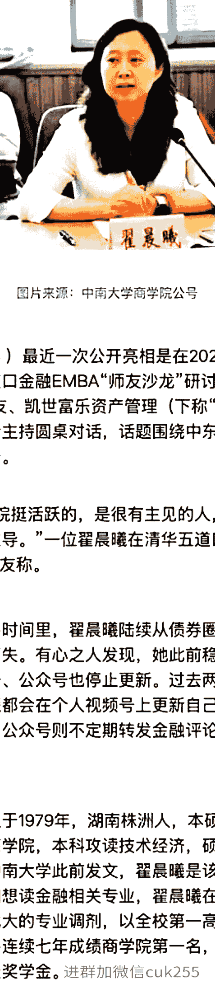

# 介绍

回顾中国航天事业的发展历程，从“天舟”到“天宫”。

2021年1月2日，我国载舟四号发射成功，中国人的太空有了自己的“家”。这次发射标志着中国空间站建设进入了正式组装阶段，也实现了从“空间进驻”到“空间驻留”的跨越。

随着神舟十二号、神舟十三号、神舟十四号的相继发射，中国空间站的基本型结构已完成组装。自此以后，中国航天员进入了在空间站长期驻留和运行的新时代。

## 一、 航天员选拔

我国航天员的选拔工作非常严格、科学、公平。从选拔标准到选拔流程，每一位入选的航天员都经过了重重考验。

在航天员的选拔中，主要涵盖了飞行员、技术工程师和科研人员。其中，飞行员主要从现役空军中选拔，对选拔人员的年龄、学历、飞行能力、身体素质和心理素质有着极其严苛的选拔要求。

如今，我国航天员的选拔范围更加多元化，不仅局限于飞行员，还涵盖了更多的工程师和科研人员。这些人员在各自领域同样具备卓越的身体素质、心理素质和专业知识能力。

此外，我国航天员的选拔还注重个人的综合素质。优秀的航天员不仅要在专业领域上做到顶尖，还要具备极强的心理承受能力、团队协作能力以及在极端环境下快速决策解决问题的能力。

## 二、 航天员培训

入选航天员后，他们面临的是漫长而艰苦的培训。培训内容涵盖了体能训练、专业知识学习、技能训练、模拟训练以及心理适应等多个方面。

在离心机中，航天员需要承受巨大的离心力，以模拟火箭发射和返回大气层时经历的过载环境。这种训练对航天员的生理机能是极大的考验。

此外，航天员还需在失重环境中进行长时间的训练，以适应失重环境对生理和心理的影响。这些培训确保了他们进入空间站后，能够迅速、自如地应对各种突发状况。

在模拟器中，航天员会反复演练空间站的各项操作，包括设备维修、出舱、科学实验等。每一个细节都经过反复练习，以确保任务的精准执行。

通过这些严苛的培训，航天员才最终具备了执行任务的能力，准备好奔向星辰的征程。

以聂伟刚为例，他在成为航天员后经过了长达十年的培训。在这段时间里，他面对了无数次失败和挑战，但这种坚持和奉献精神令人动人。

聂伟刚于1979年出生于北京，1997年毕业于北京航空军大学。随后他进入空军，成为一名优秀的飞行员。2001年，他入选我国第三批航天员，从此开启了他辉煌的航天生涯。

## 深度视野优质文集（链接优质社群，助你成功）

全部包含以下内容：限时年费188/年 加微信cuk255

- ① 吃瓜群众包帝文档加实时社群对话（原价365 元/年）
- ② 子明私享会（含）内部文章（原价568 元/年）
- ③ 政事室（子明佛）付费内享再送顺子明群聊
- ④ 米联闲间【作者米穗】（原价599 元/年）
- ⑤ 欧洲金铂会员专属文章（原价328 元/年）
- ⑥ 砖瓦斥内部文档（原价400 元/年）
- ⑦ 卢克青读书会专属文章（原价699 元/年）
- ⑧ 鉴茶财经知识星球（原价3310 元/年）
- ⑨ 猫哥的视界知识星球文章（原价299 元/年）
- ⑩ 财新周【独家新闻】（原价1498 元/年）
- ⑪ 杨世光在金钱（原价2200 元/年）
- ⑫ 森森财经知识星球（原价1600 元/年）
- ⑬ 激源异译付费文章（持续更新）
- ⑭ 司马林解读毛选全套音频和全书籍珍藏无削减（原价2.3 万）
- ⑮ 虚吾三部曲[民国梦、帝国亡、不被理解的MAO]（原价599 元）
- ⑱ 克知识星球文章（原价268 元/年）
- ⑰ 额外再送：卢祺元新浪博付费专栏、三丰京东老、三花九树文集

不定期内容：——（更多资源将下去……）

- ① 守夜人司令星球、接换魔王知识星球、生有术知识星球、
- ② 创始老师、达沃迷论知识星球、成才财富圈、雪雪花甲老头等
- ③ A视野、大树乡谈、江初号、泮咩说、上海海家学等付费文集
- ④ 西风付费文章、老端、赢在八小时之外、局外的视野、升值、老体制内等等其它一些大V付费文章（每月不超过600元的付费文集）
