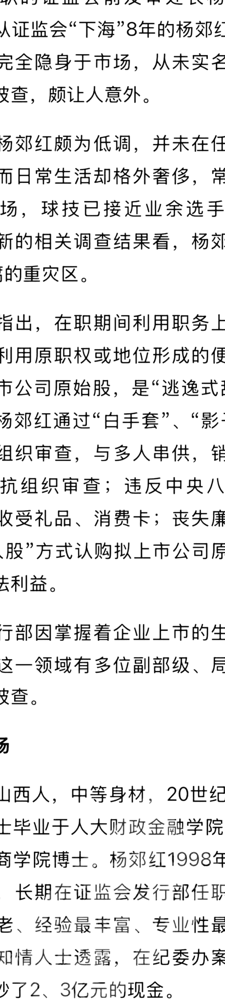

# 【首页】家里涉出亿元人生，证监会发行长低调人生

作为证监会年轻的部长级，杨家红退休后热衷打高球，球技已接近业余手的水平

2024年10月，郭建宣布，2016年开始就任的证监会发行长杨家红完全是“低调”的人生。杨家红退休后热衷打高球，从实业到人生

杨家红退休后还热衷打高球，不在任何机构职务。如今生活如此惬人，晚年打高球已接近业余手的水平

据报道，杨家红在任职期间利用职务影响力，为某些上市公司被指通过“家族式选股”、涉及儿子等间接操作，涉及多人参与、违反八项规定，涉嫌违法、违规、违反政策导向。

证监会证券监管局对企业上市的涉事案，杨家红还有过部长级职务，涉嫌违规。

## 低调后生活

杨家红是山西人，1970年代出生，20世纪初毕业于山西大学本科，1996年毕业于北京大学硕士，获得美国哈佛硕士，1998年8月进入证监会。

在证监会期间，担任证券监管局局长、副局长，曾任职监管部专职长。退休后，他在某大学担任校长，担任副院长。

在2008年开始的证监会工作期间，杨家红参与了许多工作，是证监会IPO改革的负责人，并主导并实施了多次改革。

据报道，2016年之后，外界对于杨家红的声音变得越来越少，他有更多时间关注家庭，也就是退休了。

## 职业经历

杨家红被认为是一位杰出的年轻人物，对于市场规划，1997年入职证监会后，担任执法处长。

曾发布《关于证监会信息披露监管方向的意见》，2007年7月，杨家红发布了《关于加强上市公司发行监管制度的意见的》。

通过这些意见，明确了上市公司信息披露的透明度要求，另一方面加强了执法的力度，完善了证券监管制度。

## 知识星球TOP

付费资源分享群 免费入群 微信: jntsg2

| 序号 | 公号/星球/社群 | 原价 | 领域 |
| :--- | :--- | :--- | :--- |
| 1 | 生态有木 | 2765/年 | 副业、搞钱 |
| 2 | 容众从众吃瓜群 | 365/年 | 时政、历史 |
| 3 | 记忆承载/雯树西风 | 365元/年 | 成长、搞钱 |
| 4 | 欧洲金靴 | 328元/年 | 时政、历史 |
| 5 | 卢克文青会 | 699/年 | 时政、社会 |
| 6 | 体制内主任 | 599/年 | 体制；职场 |
| 7 | 外局人的视角 | 669元/年 | 金融、市值 |
| 8 | 激泽异谈 | 4166/年 | 财富、成长 |
| 9 | 守夜人总令 | 599/年 | 时政、经济 |
| 10 | 江宁知府 | 365/篇 | 时政、国际 |
| 11 | 政事堂/顾子明 | 568/年 | 时政、经济 |
| 12 | 唐书院 | 1399/篇 | 金融、财富 |
| 13 | 大树乡谈 | 199/年 | 时政、成长 |
| 14 | 水库欧大 | 10000元 | 房产、经济 |
| 15 | 洪灏的宏观策略 | 4376/年 | 经济、搞钱 |
| 16 | 金政通鉴/北海道山 | 4576/年 | 股票、行研 |
| 17 | 猫留的世界 | 299/年 | 时政、社会 |
| 18 | 飞沫 | 3600/年 | 股市、经济 |
| 19 | 米联债见闻 | 599/年 | 经济、金融 |
| 20 | 鉴茶财经院 | 330/年 | 房产、股票 |
| 21 | 赢在八小时之外 | 365元/年 | 成长、职场 |

- 图书、报告、课程等各类高价值资源
- ★ 免费群 每日分享份资源
- ★ VIP群 每日分享所有资源（日均20+），75/年

### TOP级资源 TOP社群
