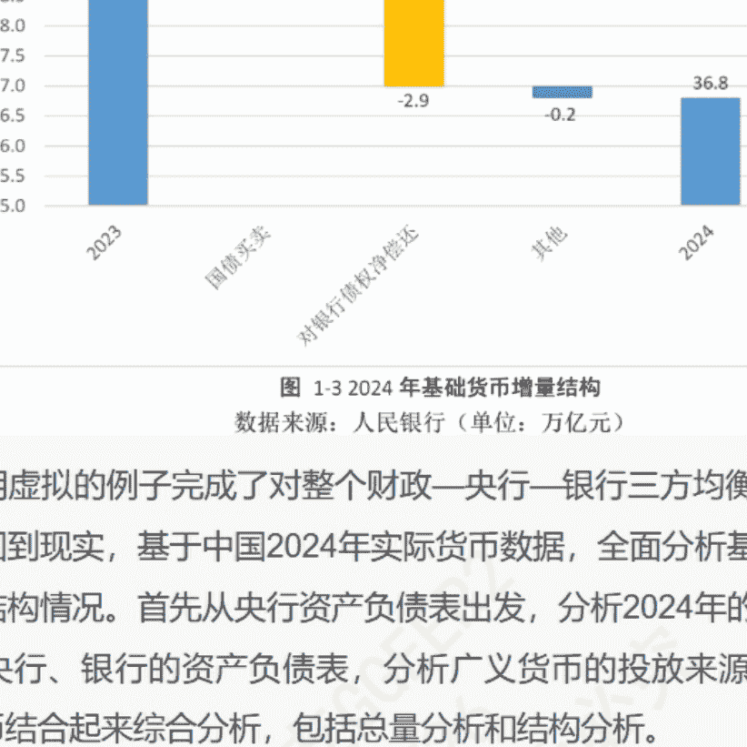
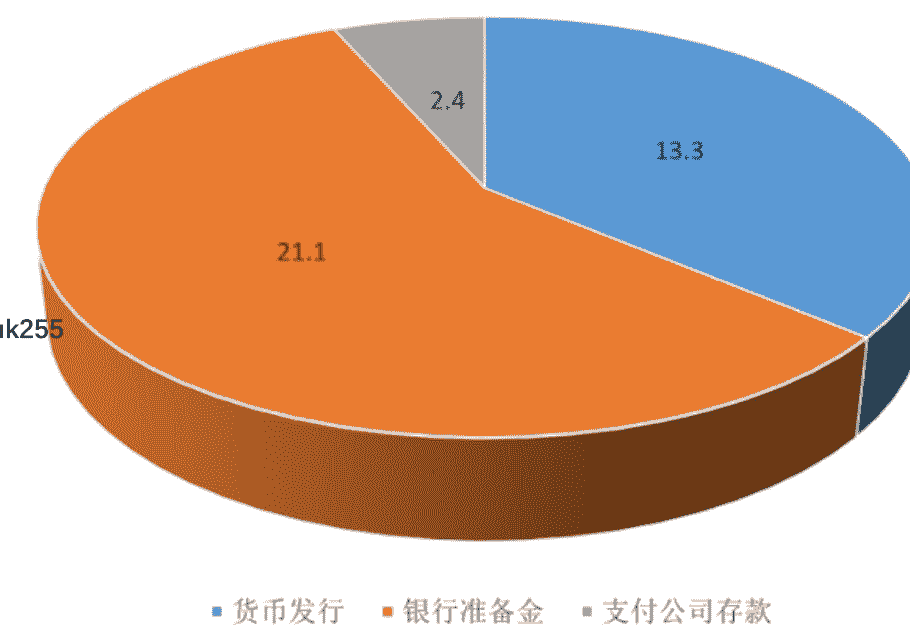
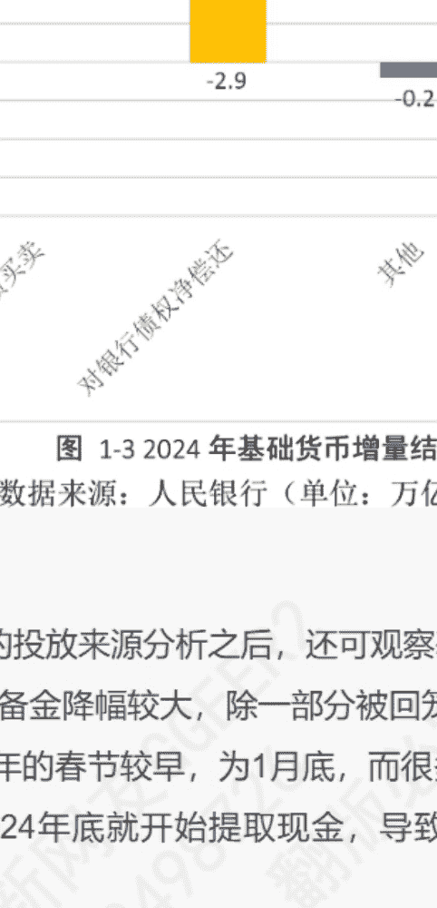
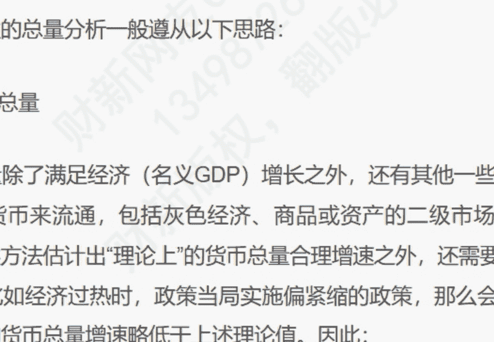
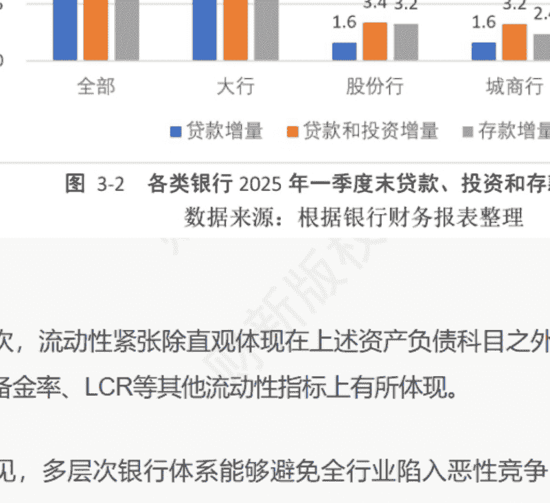

# 货币分析实战

理论上，央行的投放基础、银行存款、财政货币行为并不是交汇的场所，而是现在通过相互交互，开阔视野，更关键是在困难时期维持总体的性平衡。

图 1 2024年末基础货币结构

数据来源：人民银行（单位：亿元）

前两个用过的例子已经对整个货币体系（央行、银行三方的货币体系）有了概述。接下来回到现实，以中国2024年基础货币数据为例，全面分析基础货币、广义货币的总量、结构。首先从资产负债表出发，分析2024年的基础货币投放来源；再结合银行行的资产负债表，分析广义货币的投放来源；最后对基础货币、广义货币结合进行分析，包括总量和结构分析。

## 一 基础货币分析

在实证分析货币时，继续用之前提到的央行政策调控框架（图1-1）：

- (1) 央行通过法定准备金调节
- (2) 银行直接增减准备金余额
- (3) 调整准备金总规模。

图 1-1 央行对准备金率的调节

银行准备金是基础货币的绝对主体，也是基础货币分析的起点。首先，通过各种货币政策工具来调整基础货币的总量，以此实现其货币政策的目标。

图 1-2 2024年末基础货币结构

数据来源：人民银行（单位：亿元）

中国行业2024年对比2023年的增量资产负债表（表1-1）。

| 表 1-1 2024年年度流量增量资产负债表 | | | |
| :--- | :--- | :--- | :--- |
| 外汇资产 | | 货币发行 | 14,641 |
| 对政府债权 | 13,541 | 其他客户存款 | -35,101 |
| 对其他性债权 | -29,131 | 非金融机构存款 | -537 |
| 对其他金融性债权 | 5,399 | 发行债券 | -1,295 |
| 其他 | -5,705 | 政府债权 | 5,540 |
| 总资产 | -16,431 | 总负债 | -16,431 |

数据来源：人民银行（单位：亿元）

完全基于基础货币的投放分析后，可以看到基础货币的内部结构（表-2），其中，银行准备金下降、除部分被吸收之外，另有11万元规模为现金，是因为由于2023年的缺口，为1月。而更多国民的提取现金通过通过的过程，使得2024年底开始提取，导致2024年末的余额较2023年增加。

### 1-2 2024年基础货币量结构

| 基础货币 | 金额 |
| :--- | :--- |
| 货币发行 | 1.5 |
| 银行准备金 | -3.5 |
| 支付公司存款 | -0.1 |
| 合计 | -2.1 |

数据来源：人民银行（单位：万元）

## 二、广义货币分析

在发行体系下，广义货币的主要来源是存款来自于银行的财务业务，产生于存在的存款部分被吸收或转移至支付账户余额，此外还有少数交易会导致货币消失，最终形成一个国家的货币缺口。在货币的分析工作中，需要对货币来源（或回流）、消失渠道进行追踪。

广义货币的来源分析（见图2-1）：

- （1）首先分析存款的来源；
- （2）再追踪消失的方式和规模；
- （3）再对消失的存款中间金额，支付公司存款转移的规模；
- （4）最后对广义货币的消失渠道进行分类，以及其存款内部结构。

注意，中国广义货币统计中包含了（除银行以外）持有的市场基金（一种零售基金），将该部分避免重复计算，将该部分广义货币基金中的预存存款剔出广义货币统计。

首先，看2024年末的广义货币总规模及其内部结构（见表2-1）。

### 表 2-1 2024年末广义货币总量与结构

| 项目 | 金额 |
| :--- | :--- |
| 现金 | 12.8 |
| 支付公司余额 | 2.4 |
| 单位活期存款 | 54.3 |
| 单位定期存款 | 55.3 |
| 个人存款 | 152.1 |
| 非金融存款 | 32.4 |
| 零售业务 | 4.2 |
| 广义货币总量 | 313.5 |

数据来源：人民银行（单位：万元）

然而2024年广义货币新增了133万元，通过分析其来源和消失渠道。存款来源主要可以分为流量源、财政源和发行源（见图-2）。其中，财政源是存款的主要来源，由于银行对居民资产负债（包括贷款和购买业务）占比了很大。近年来金额上常发生，由于央行向商业银行的操作，发行也可以增加留存，应放在处理。

### 表 2-2 2024年存款派生与灭失因素

| 项目 | 金额 |
| :--- | :--- |
| 信贷 | 17.8 |
| 购买债券 | 3 |
| 购买外汇 | -8 |
| 财政支出 | 9.3 |
| 银行流动性 | -3.4 |
| 存款净流入 | -3.6 |
| 利差（非金融业务） | 1.6 |
| 广义货币量 | 1.3 |

数据来源：人民银行（单位：亿元）

对于最终的利差，虽然难以准确衡量，但可以进行估计。其他存款数量反映了非金融业务，2024年规模67亿元。金融机构收支业务，包含了购买债券等项目，不能准确反映非金融业务投资。

## 三 综合分析

完成广义货币增长、灭失因素的分析时，使得我们掌握了它的未来去向，但现实中情况较为复杂。理论上的路径解释了存款、灭失因素，由于存款与货币之间并不是平行的，而在现实中相互交互，充分且同时引导我国部门维持平衡。

### （一）总量分析

在我国流动性管理下，可以通过引导银行准备金率来影响市场流动性，结合广义货币总量来影响利率。广义货币量是政策决策的重要中间指标，分别为货币政策（见图3-1）。在中国居民主导的金融体系中，货币政策主要通过投资改变供给，长期以来我国与其他国家差异很大。因此货币政策较为重要。

流动性因素分析主要从以下几个维度：

#### 1.货币总量估计

货币供应量除了满足需求（名义GDP）之外，我国经济运行还需要金融、商品的需求。应当根据实际的操作广义货币总量，使得实际货币供给低于总量是合理的。

#### 2.货币流向

完成货币总量及变动的估计后，再对数据点发生、灭失因素进行分析。一方面，作为政策决策的工具，广义货币的发生、灭失受到财政支出的影响。另一方面，存款发生、信贷以及货币收支行为的影响，由于各种因素导致不能准确预测，在一年的跨度中遇到许多特殊情况，比例很大，但可以进行调节。

#### 3. 基础总量估计

对于货币总量和流量估计之后，还要对银行存款准备金率规模进行估计。现实中存款规模可能完全取决于外部因素，广义货币结束带来的结果，此部分对我国影响很大，可能需要一种特殊的处理方式。

### （二）结构分析

在上部分的总体分析中，将整个国家的银行（其他类金融机构）看作一个整体，通过基准市场、货币市场操作把银行流动性表现为银行内部的结构化。这一过程与现实表现高度相似。中国银行业是多层次的结构化，例如，中国银行在2015年（关于构建完善市场化配置体制的意见）中再次明确了这种层次性结构清晰、差异大，大部分小银行都是行业性机构。结构分析的重点不在基准市场的流入、消失问题，而是这些流动性释放之后在银行内部的流向。

此外，2020年4月28日，市场和行业自律机制下发布了《关于禁止通过利差维持市场竞争的意见》，维持行业竞争压力但也导致某些银行面临转型特定问题。同时，阶段性部门信贷需求紧缺，增长压力加大，国有银行在贷款以及政府投资上更加积极，因此导致了明显的缺口。

图 3-2 各银行2025年第一季度贷款和存款量对比
数据来源：根据银行行业财务报表整理

流动性结构直观地体现在资产负债表均衡之外，也存在贷款、存款、存款准备金、LCR等指标对银行行业表现的直接影响。

可见，多层次银行结构能够全行业内部的良性竞争，但也导致某些银行面临转型特定问题。近年来经济运行放缓和经济结构调整，以农业为主的中小银行贷款、存款和大行的资产、存款结构形成错，形成了行业性流动性短缺。在正常的市场运行中，中小可以通过政策引导以同业的形式向大银行流出，从而实现行业内部的流动性均衡。而中国监管部门对于此类流动采取较为积极的监管、同业业务、投资业务以外，使得这一内部流动不符合政策，决策者可以注意一些针对不同类型的银行的政策引导，并非阶段性。
