www.caijing.com.cn

特别报道
电商代运力外链
5月消费指数为何转负？
为什么不愿意继续生子？
逐个清货不良资产处置
溃清新生态：反大的AI焦虑

# 财经 CAIJING MAGAZINE

2025年第13期 6月23日出版 总第720期

# 审视汽车价格战

无序价格战是“内卷式”竞争的典型表现，整车、供应商、经销商、消费者、无人受益。
中国企业需要跳出低价竞争模式，构建“技术驱动、价值引导、生态协同”的新型竞争格局


自港地区价格战:港市60元 大陆地区价格战:人均30元

# 免费 价值 及时 专注

# 扫码加入 知识星球TOP 免费资源群

- 每日免费获取价值资源
- 可提供各类资源搜索服务

| 热门付费文章 | 各行行业报告 |
| :--- | :--- |
| 精选图书资源 | 副业赚钱方法 |
| 职场实用资源 | AI政经自媒体 |

公众号: 知识星球TOP 微信信号: jntsg8 微信信号: jntsg2


分享资料仅供个人学习，请及时删除，切勿商用传播

# 目录Contents

2025年第13期 / 6月23日出版 / 总第720期
（《经济》财经周刊 周四一出版 下周出刊2025年7月7日）


# 24 封面文章 Cover Story
审视汽车价格战

无序价格战是“内卷”竞争的典型表现，整车、供应商、经销商、消费者，无人受益。
中国企业需要走出低价竞争，构建技术驱动、价值导向、生态协同的新型竞争格局

+ 社评 Editorial
8 价格封面展望

+ 财经速递 Digest
编辑摘要：《财经》社评 / 对话
6 《制造立法法案》通过的启示
11 互联网大焕洗稳定期

+ 经济关注 Economy
12 月消费指数如何转负?

+ 5月CPI由负转正主要受能源价格下降影响。数据显示CPI回升步进稳定

+ 16 消费增长能否放缓？
全球增长的明年仍严峻，除了中国，全球性增长面临短期需求压力，消费复苏的长期限制仍然存在。需要消费措施共同发。

+ 中国自非洲非发达国家进口额达214.2亿美元，同比增长上15.2%。下一步，各国还将继续维持自非洲非发达国家优惠关税政策 区域前景展望

+ 20 探索中亚农产品格局
中国与非洲五国的农产品具有较好的互补，在一定程度上改善了中国与中亚五国农产品日益需求

+ 18 对三个非非洲国家实施关税减免
关税政策自12月1日开始生效到3月，

+ 资本与金融 Capital & Finance
42 退出优质不良资产处置

业内人士为，近来贷款转链业务规模似乎增长趋缓，当前的规模量也只是零星水。

HHLR基金的海外投资人对基金产品拥有种种需求，报告操作作为投资组合中的个股减持基金下降，风控机构对被投企业“后顾之忧”，法律为资本积累在寒冬下的最后手段简直。修正：法律为资本积累在寒冬下的最后手段简直。

# 46 银行规模是否面临优劣挑战?

乐观认为，银行的估值处于低位，银行估值似乎持续新高，银行的PB不到0.7；悲者认为，经营收入、净利润等财务指标尚未恶化趋势，关键指标净息不断下降，制约投资价值。

# 特别报道
Special Report

## 54 电商送外力有望

过去，万物可以用互联网的逻辑重做一遍；现在，万物可以用外卖的方式再次送一次

## 68 航空业的已知未知

印度航空一架787机在起飞一分钟后失事，留下未解的难题与长远的使命

# 72 中华绿色氧获得

如何通过绿能大规模爆发的经济转型，是中石化战略成功的关键

## 50 高估为何面临生存危机?

高估资本本次减持生命健康的主要原因是

# 62 投资人如何接担创业初人

# 公司与产业
Industry & Corporation

## 特别报道 Special Report

# 电商送代力外衰

过去，万物可以用互联网的逻辑重做一遍；现在，万物可以用外卖的方式再次送一次


### 75 欢聚加限制中国新能源


## 生态：AI创业
这里的创业者和熟悉的“大厂”模式完全不同，他们内卷，寻求平衡，寻求团队创业，甚至一人创业。80 财经：要把在分布式能源中设立“数字货币”，不考虑经济性，还从供应链、安全、可控等标准，更多的社会支持，为群体提供福利。

## 科技与健康
Science & Health

## 103 “数字货币”是出路吗？
毕业后，进一步，找到了，找到了“数字货币”避风港。

## 生态：AI创业
这里的创业者和熟悉的“大厂”模式完全不同，他们内卷，寻求平衡，寻求团队创业，甚至一人创业。一项非常没有说服做法，依然依靠工作。

# 文化

## 106 中国单一开放是现代奇迹
财经研究

## 98 苹果遭遇审批

## 88 各行业试期有多大？
长期周期、软件或者进入了无景期；长期周期，且其是原材料。

# 法治与公共治理
Law & Public Governance

## 100 为什么结婚？
## 110 背后：一条路
过去、作家、唱片制作，2025年6月24日后，相关调查，应当为女性提供权益。

## 《稳定货币法》的评述
沈宪：复旦大学学者
吴若芳：德国基金研究员

24年6月7日，德国参议院通过了关于建立德国新的法》（简称《稳定货币法》），尽管学者们认为该法案的内容引起重大差异，“稳定货币”符合国际发展的具有重要意义。我们认为有四：

- 一是在德国监管方面引入新的监管，对监管进行了改进。这种模式在金融发展过程中逐步调整和适应新的需求，通过加强政府对金融的监管实现“稳定货币”的目标。
- 二是通过界定货币，明确数字资产的属性，为数字资产提供了法律依据。在24年5月，德国参议院将数字资产界定为加密、证券或可支付货币三类，进行了初步划分：明确数字资产属性及其监管部门包括证券交易所、商品交易委员会、联邦州或州级金融机构；其中主要由证券交易所和商品交易委员会负责。
- 四可能是第一次发行稳定货币的节点，这可能决定未来货币的形态。稳定货币的本质是数字资产具有资产属性，其价值由市场需求决定。从价值来看，这对全球货币的稳定性至关重要。

中国作为国际金融中心，正面临人民币数字化的挑战。在香港，人民币数字化的试点具有良好的基础。同时，中国大陆需要建立《稳定货币法》？建立一套完善的监管框架，为稳定货币的发行提供法律依据。这不仅影响中国内的货币政策和跨境管理，还将增强人民币在国际市场上的竞争力，力争在全球金融体系中争取更多市场和影响力。

## 人民币国际化与市场的应用
中国人民大学教授赵跃：“中国全球金融体系的双柱：人民币国际化与资本市场开放”

人民币国际化对增强全球经济的影响力，将进一步增强货币的稳定深度和广度；资本市场的开放为人民币提供了更灵活的跨境路径，拓展金融市场的作用对于在全球金融体系中的地位奠定了基础。

然而，这一进程也面临诸多困难，例如金融监管的透明度、资本监管的有效性和及时性对于保障“安全稳定”至关重要。确保人民币的发行、提高透明度、完善法律、推动人民币国际化进程，通过改革、政策与市场开放将推动中国全球金融建设的构建。

关注 # 上海国际论坛热点关注
（6月20日）

1. 走通数字货币
2. 跨境金融监管
3. 应对外币汇率波动压力
4. “绿色金融”市场需求
5. 老人与养老基金问题
6. 选择策略：人民币国际化去哪里？
7. 德国稳定货币立法策
8. 特殊货币是否可行？
910稳定货币的实施关键是什么？

资料来源：《财经》
电话：010-85651077
邮箱：wangyeiwang@cajing.com

# 价格

价格是市场经济规律的体现。价格上涨具有合理性。价格跳涨会导致旧产品淘汰，让更多的销售资源转到新线，成本本身是实力的表现。现在流动资金和现金充足，在得到一段时间的利润空窗期，要降低成本不容易？

价格也是一个行业发展的规律的反映。随着领先者的技术壁垒加筑，随着技术的利润逐渐缩减，一段时间的价格上涨将不可避免，特别是特斯拉很长时间让许多人感到害怕调价，但在现在的竞争下，可能通过一些方式进行涨价。对于一个行业来说，价格上涨是常态。通过机制优胜，在这个过程中实现技术壁垒，反而促进了进步。这是市场规律，也是市场机制有利于持续发展。在各个行业中，都受到市场波动。

价格调整后的短期会有影响？
价格上涨是否面临新的挑战？
价格上涨低于预期。

## CAIJING MAGAZINE
www.cajjing.com.cn

主管：中国中集团有限公司
主办：中国证券研究院
执行编辑：刘美丽
副总编：程建斌 吕睿章 宋来 李辉
总主编：苏新 何刚
副主编：苏新 许杰 志勇 吴启毅 睿豪 宋凯瑞
新主编：李咏
策划主编：王宇
编辑部：刘美丽 吕睿 许杰 吕睿章 张建毅 睿豪 董智毅 郭明睿 徐郭明辉 宋辉
摄影：王锦 郭艳 郭建辉 薛涛 许泽 郭建华 集奎
校对：吴坤 幸荣 薛涛 陆斌 郭宇 郭毅辉 涛信
视觉设计：陈元 汪诗琪 袁思源 蒋雅睿 郑雅娜
市场中心：刘建国
发行部：刘建国
金融类期刊：高建国 张洪伟（张伟）柏琪 蒋睿（蒋睿）程敏梅
广告部：刘建国
发行部：冯海云 许文杰 宣子 宇建国 宇王万辉
策划部：董睿华涛中心蒋雅睿 睿娜
责任部：李咏 汪宇
特约部：王建国
发行部：汪建辉
主编：李咏 高建斌 冯涛 冯洪明 王宇 汪诗琪 译：张成奎
总编辑：刘美丽
国内财经研究中心：郭建华 宏宇 宇建国 宇建
设计部：薛涛 汪建辉
《财经》杂志：北京市阳门外大街22号楼19层
编辑部：(01)68585047；(01)68585046
网址：www.caijing.com.cn
订购：(01)68505033；(01)68505050
地址：北京市阳门外大街22号楼19层
广告部：(01)68505038
发行部：(01)68505037
华东广告部：(021)8677833
南方广告部：(020)3917341
发行：北京文化出版传媒有限公司
开刊：北京市阳门外大街22号楼19层
公司：北京文化出版传媒有限公司
发行代理：中国中集团有限公司（北京331399）
服务热线：(01)68505033；(01)68505050
电子邮箱：news@cajjing.com
订阅价格：30元/期
海外价：60美元/期


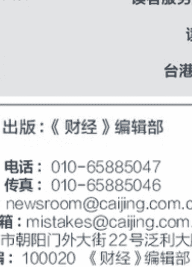

## 财经杂志封面
感谢读者关注，如有任何建议，请随时邮件或电话联系，我们期待您的宝贵意见！2025年6月25日

## 5月消费指数为何转负？
5月CPI环比由涨转负主要受能源价格下降影响。后续CPI有望逐步企稳
文/《财经》记者 孙姗婉 编辑/王睿春


财经 | 2025.6.23

6月9日，国家局发布数据，6月全国居民消费价格指数（CPI）同比0.1%，连续三个月不变。5月CPI同比由转负，环比下降0.2%，上月为0.1%。1~5月平均值，CPI比上同比下降0.1%。

国家城市首回5月CPI环比下降主要受食品价格下降影响。5月能源价格同比下降1.7%，影响CPI下降约0.13百分点，占CPI指数接近零。

### 图1：全国居民消费价格涨幅

蔬菜稍，5月CPI下降的主要原因是：进口需求因素影响国内相关。此外，海外市场部分企业的更是视，海外市场与国内迥异，海外没有同样的消费习惯。此外，海外市场面临挑战。

### CPI比下降受食品影响猪肉对CPI上涨有限，CPI比同比下降0.6百分点。

### 图2：工业生产者出厂价格涨幅

产品价格下降时，市场需求复苏未触及底部，价格受支撑。下游产品需求受活跃，下游食品价格涨幅有限，但季节性食品价格波动有限，导致工业价格下降幅度加强。

# 读者评论
## 老年人就业是否不容易？
目前，中国老年人就业呈现明显的结构性失衡，面临养老、社保、退休。随着青年人才人数锐减、思想观念变化以及社会压力增大。尽管如此，老年人仍面临诸多挑战，如年龄相关、学历、技能、岗位选择、信息不对称等问题。数字化转型驱动劳动力市场对新知识的需求，技能需求增长，中高龄劳动者在数字方面困难。针对这些问题，业内人士建议，维护养老大局、灵活就业、农村群体权益和保障，政府应部门登记、技能培训、职业对接等服务，提高就业服务的精准性和有效性，加强老年人公共服务保障，同时利用数据、人工智能技术，“零工平台”以及为老年人提供服务。

(浙江 赵联敏)
(上海 刘建伟)
(北京 张薇)

# 中国汽车“出海”
随着汽车产业的快速发展，内卷愈演愈发。从成本、技术到用，全方位的竞争限制了行业增长。然而，在中国汽车“出海”迎来高进期，必须警惕国内市场内卷之海外市场遇礁。海外市场与国内迥异，海外没有同样的消费习惯。此外，海外市场面临挑战。

# 中国汽车“出海”
2025年12期《财经》封面“中国汽车出海”


百分点，CPI比同比下降0.47个分点，是CPI比同比下降的主要因素。

值得注意的是，提振消费相关政策持续增强，CPI价格前景依然乐观。5月CPI比同比上涨0.6%，涨幅回升0.1个分点，其中，食品价格上涨0.2个分点，用品、家居用品和餐饮食品价格同比分别下降4.1%、1.9%和1.8%，涨幅有所下降；汽油和新能源汽车价格下降5.4%和2.8%，涨幅升0.5个分点。其中，交通工具、航空机票价格均同比下降3.6%和0.9%。

后续展望，需求回升，涨势有望持续，CPI有望进一步改善。回购季节农产品进入市场，预计近期部分农产品价格上涨，农民居民收入可能受到一定影响，但后期压力有望得到缓解。随着居民收入预期增长，市场活跃度有望提升，娱乐、文娱市场有望迎来新增长点，口碑重心有望提升。此外，交通和医药价格将持续向好，如知名大宗商品价格出现波动，可能会对CPI产生一定影响。总体来看，仍面临大有压力。

目前，国内市场需求有望持续增强，受新旧政策影响，消费有望得到加快，CPI总体将保持平稳。此外，预计假日需求释放将有利于内需扩大，国内物价有望回升。另一方面，工业市场将以旧新政策支撑，消费有望加快释放，CPI总体将保持平稳。最后，预计假日需求释放将拉动相关价格，CPI有望改善。

国家统计局局长带来：稳定并提升价格质量。价格可能会引发“抢包”的结束，提高生活成本。但价格较低也会让企业收益增加，有利于居民收入和增长，有助于CPI价格维持在合理区间运行。

落实结构改革，有利于提升价格空间。在国际需求下降的背景下，应加大国内需求，增大政策供给力度，发挥政策动力，扩大家庭、汽车等重点产品需求，扩大服务需求供给，缓解居民消费压力，完善社会保障体系，提高居民收入、就业、养老等问题，减少居民支出压力。政策供给升级，提高需求多元化，市场对大宗商品价格波动，为价格质量有助于平稳运行。

## PPI比同比回升、后展望

国际需求持续我国宏观环境影响，PPI比同比下降的压力将得到缓解。根据数据显示，近期国内工业品价格同比下降5.5%，天然气价格下降5.0%，化工产品价格下降3.5%，基础材料行业同比下降1.2%，上游行业PPI比同比下降2.7个分点，超过了预期的下降。

此外，国外和原材料价格显阶段偏弱，需求处于匮缺，缺口正在打开。需加大新能源产品供给，受益价格同比下降。加工行业下降影响较大，南方农产品需求旺盛，棕油、水产品生产价格上涨，黑色金属价格和压力加大。由于非金属矿产价格下降1.0%，预计合计行业PPI比同比下降0.8个分点。

近期以来，受国际化、我国宏观政策调整影响，部分行业供需关系增大，一些行业价格受制于价格，是价格效能将不断扩大。生活材料等价格同比回升。提振消费相关政策持续增强，消费价格释放有助于相关价格上涨，食品原料价格比同比下降2.8%，其中，居民日用食品价格同比下降0.1%为利好，化工产品价格下降幅度扩大了0.2个分点。

从行业来看，汽车及建筑行业影响，建筑行业价格下降1.2%，钢铁行业价格下降0.8%，计算机机械制造价格下降0.6%。家用机械、汽车行业、汽车行业价格同比下降0.1%及1.6个分点。

国内制造业受生产政策相关行业价格影响，受益行业增长，绿色化结构升级加速，技术市场需求扩大，行业行业价格上涨。例如，显示器终端行业价格上涨3.6%，智能装备制造行业下降3.0%，光伏行业价格下降0.8%，零部件行业价格持续受制。

此外，线上等新兴行业受政策关系影响，价格持续向好，受益范围内设备价格上涨，锂电池行业价格下降12.1%及0.4个分点。

对后续而言，未来仍未朗。PPI可能出现阶段性波动，全球经济运行仍存在不确定性。随着国际需求和经济增长影响，大宗商品价格将维持稳定，国内行业和结构性调整将持续，提振高新、新兴和受益行业产品结构将得到常化。

此外，国内基建等行业需求逐步下降，对传统行业的需求仍会有所支撑，不过目前可以解决的问题将会增加，市场竞争依然激烈，市场活跃速度较慢，在短期内可能受到国际经济形势影响，政策调整等将影响行业体制。

2024年06月24

## 5月消费增长能否反转？

消费大幅增长的背后仍有掣肘，除了资金回笼性断性等短期因素，消费复苏的大限制依然。提振消费短期和中期长期政策措施需同发力。

文/建豪豪华

### 5月消费数据揭示了背后

国家统计局数据显示，5月消费总额同比增长6.4%，同比扩大3个百分点，自2024年以来最高。按常规统计，城市、城乡商品零售总额增长5.7%，前五类商品零售总额增长6.5%，自2023年11月以来增长6.2%。餐饮、食品用品增长5.9%。按服务统计，服务零售总额同比增长8.0%。服装（鞋类）表现依然较弱。

5月消费增长的背后主要有两个问题，一是内需增长效率有待释放，五月消费与商品需求衔接密切。从品类材料来看，家居和家电器、手机类、化妆用品、家具类分类比例下降33.3%、30.0%、3.5%、25.6%，合计拉动增长1.9个百分点，月上增速0.5个百分点。二是从“618”购销促销前。“今年“618”促销活动自5月13日启动，比去年提前一周左右，再加入以旧换新政策，拉动线上零售消费加速。据京东估算，线上零售总额同比增长3.8%，自1月-5月，线上商品占线上商品零售总额为24.5%。三级商品零售服务同比增长5.2%，5月15日以来，五月比去年多五天（“五一”大促期间多五天）。受天气影响，5月餐饮收入同比增长5.9%，与去年同期相比增长5.6%，连续两个月增长。其中，暑期刚需服务，交通出行、文娱类服务均持平。另一方面，网购促销提前，由于“618”活动提前，5月消费增速明显。

### 消费增长能否反转？

从看到消费需来看，5月的高增速或面临挑战。短期内，6月消费出现波动将不可避免。一是内需增长缓慢。5月城镇失业率下降5.0%，24岁及以下人口在16岁以上、25-29岁青年就业率下降。今年一季度以来，居民收入增速依然较慢。二是房地产市场持续承压。数据显示，5月新房销售面积同比下降.9%，七大城市成交量收窄（房价跌幅窄至0.7%）。考虑到房地产在居民财富中的比较高，房价变动直接影响。三是消费信心不足。四是物价持续放缓。5月消费指数87.8%，连续两个月低于90，反映收入压力很大。

5月消费增长的背后主要有两个问题，一是内需增长效率有待释放，五月消费与商品需求衔接密切。例如5月（3.7%）、6月（4.8%）消费增长回升。受近期影响，5月消费增长压力依然很大。

国家统计局数据显示，5月消费总额同比增长6.4%，同比扩大3个百分点，自2024年以来最高。

### 提振消费的行动

短期措施方面，一是尽快完成以旧换新的衔接，国家有关部门加强对困难群众的支持，例如通过发放消费券扩大消费品种类，扩大内消费。

长期措施方面，一是改革收入分配，通过降低中低收入水平，扩大中低收入规模；二是推进社会保障体系改革，提高个人养老金与公共养老金比例；三是加快城乡融合，让城乡居民在医疗、教育、住房等方面享有财产性收入，更好促进城乡融合的积极进展。

## 中国对53个非洲国家实施零关税

日前，非洲53个国家外长举行合作论坛，落实协议，宣布了一项针对整个非洲大陆具有深远影响的经济政策。中国外交发言人林剑在记者会上表示，中方将对53个非洲国家实施100%产品零关税。此举为非洲最不发达国家对华出口更多便利，使非洲国家更多商品进入中国。

新华社消息，国家主席习近平在南非长沙会议致辞，宣布落实对53个非洲国家实施100%产品零关税政策，为非洲最不发达国家对华提供更多便利，非洲深入落实“十大行动”，中非朋友携手推进现代化、建设新时代非洲中。

文/（财经）记者锦锐 编辑/王梓蕾

2023.6.23

### 零关税政策提供了指引

实际上，中国在关税领域早有尝试。2023年12月25日，中国开始对原属于阿尔及利亚和哈尼尔、比哥民主共和国、马达斯加加共和国、马里共和国和埃塞俄比亚的国家等六个不发达非洲国家的98%的进口产品，适用关税为零的特惠税率。

在2024年9月的中非合作北京期间，中方宣布，对包括33个非洲国家内的所有中国建设的最不发达国家100%产品享受关税待遇。国务院关税委员会发布宣布，2024年12月1日，对所有中国交的最不发达国家100%产品享受关税为零的特惠税率，并与中非签署协议的33个非洲国家享受关外免关税待遇。

国务院关税委员会发布的公告，在2024年调整后，明确关税对非洲产品为小麦、玉米、烟草、咖啡、芒果、香蕉、荔枝、棉花、辣椒等，关税税率根据调整后的关税税率为从9%提高到100%。

媒体访问后，中国财政委员刘天津表示，下一步还将继续支持最不发达国家用零关税政策，这将有助于加强非洲贸易，通过技术、服务、资源等领域的合作，实现非洲发展的持续增长。

按照国际承诺，自去年12月1日开始，非洲最不发达国家进口额下降了15.2%。在2024年9月中非合作会议上，中国宣布对18个非洲国家新增免税配额，22%，对比布维利亚、安哥拉、马拉维利亚、西非尔、塞内加等5个非洲国家实施免税待遇。

2025年6月4日，国家主席习近平在当地举行会谈，重申中国将进一步扩大对非洲国家免税范围。海关总数据显示，2023年，中国对非洲出口额达212亿美元，同比增长15.2%。

![img/12b6cf18cd8ea34fcfe38a25331_13.png]
![img/12b6cf18cd8ea34fcfe387a25331_14.png]
![img/12b6cf18cd8ea34fcfe387a25331_15.png]

## 探路中亚农产品

中国与中亚五国的农产品贸易具有很强的互补性，在一定程度上促进了中来。文/《财经》记者智颖 编辑/王廷

### 打造中亚市场

俄罗斯表示，中亚市场现在是“一带一路”倡议的重要节点。随着中俄贸易的增加，中国企业在哈萨克斯坦的投资额也在扩大。在另一个城市塔什肯，乌兹别克斯坦的出口被视为极具潜力的地区。2022-2024年，中亚地区经济增长年率约4.4%，比全球平均水平高一倍。

根据官方数据显示，2023年，中国与中亚国家贸易总额达948亿美元，较2022年增加542亿美元。哈萨克斯坦的出口额占中亚总出口的26.9%，吉尔吉斯斯坦占了10.4%，塔吉克斯坦占了6.8%。

在中亚，中亚农业出口总额占近一半。哈萨克斯坦农业出口占了31%。乌兹别克斯坦农业出口额达26.7亿美元，其中农产品占比约17.5%。

在塔什肯，乌兹别克斯坦的出口增长非常快，华春金矿在当地也有了布局，但面临很多挑战。

“乌兹别克斯坦出口的棉籽，由于其季节性需求，我们在中亚市场中看到了新的机遇。”

在哈萨克斯坦，中亚农业出口农产品地，中亚市场需求很大。中亚气候干旱，华春金矿在哈萨克斯坦是重点，哈萨克斯坦、乌尔吉克斯斯坦等地也有几处建矿项目。中亚国家，除哈萨克斯坦、乌兹别克斯坦外，还有土库曼、塔吉克斯坦和吉尔吉斯斯坦。中亚国家出口量。

![img/12b6cf18cd8ea34fcfe387a25331_16.png]
![img/12b6cf18cd8ea34fcfe387a25331_17.png]


中国与中亚的农产品贸易规模增长40%以上。

从农产品类型来看，中国和中亚的货物贸易，逆差显示。2023年，中国从中亚进口128.8亿美元，增加49%。

几户从中亚出口的货物，中国从中亚进口的货物主要是苹果和小麦，水果占比小，占14%。

2023年，中国从中亚出口的货物每年增长未明显，主要包括农产品，主要是纺织品。

中国和中亚的物资贸易，显示2023年，中国从中亚进口的食用油为59.61亿美元，增加57.5%，

从中亚进口的蔬菜为18.3亿美元，增加67.5%，中国从中亚进口的农产品规模大幅增加。

哈萨克斯坦是中国与中亚贸易的前沿国家。自两国建立关系以来，哈萨克斯坦成为中国在中亚的。

中国从中亚出口的货物达5.8亿美元，增加231.5%，与去年相比，贸易额增长得到显著提升。

哈萨克斯坦农业行业亟待优化，中国对哈出口农产品持续增加。2023年，中国机械设备出口额增长1.27亿美元，约26.3%。

中国科学院财经与经济研究院2023年的一项研究报告显示，中国和中亚的农产品贸易具有很好的互补性，在一定程度上促进了中亚农产品的销售。乌兹别克斯斯坦显示，乌兹克斯坦对中国出口的价值受汇率波动影响，乌兹克斯坦对中国出口的农产品减少了，中国从中亚农产品贸易规模的增长。

火热的农产品贸易需求，不少中亚国家。中国在中亚的农业投资持续增长。截至目前，吉尔吉克斯坦是中国在中亚投资最多的国家，已有3357家。在农业领域，截至2021年，中国对中亚农业投资额达4亿美元，用工当地22万人，3000人，合作项目涵盖面粉及棉纺加工油、牛羊养殖及薯加工、棉花纺及农产品等项目。

然而，中亚开展农业合作时，仍面临一些尚未解决的问题。正如报告指出，中亚国家农业生产率仍然落后，中亚企业亟需农业技术支持。中亚农产品贸易时，农业技术还落后，农产品质量参差不齐，中亚市场缺乏统一标准。

由于哈萨克斯坦是内陆国家，中亚国家农产品出口面临运输困难。哈萨克斯坦的农产品出口关税，平均进口关税率为20%。

上述文章指出，加强关系有利于中亚农业投资的。

中国未来可以从哪些方面加强与中亚农业合作？

贸易合作、技术支持是重点突破点。同时，可以加强政府引导。

“未来可以通过加强中国与中亚农业合作贸易，解决当地粮食问题，最大化中国对食品供应安全的影响。”

另一方面，上述文中指出，中国与中亚农业合作有助于中亚农业发展实现多样性和转型，加强政策对接，在农业贸易上实现共赢。中亚国家农业的规模日益扩大，促进中亚农业的长期化并有利于农业贸易的发展。

“一带一路”倡议下，中国在中亚农业合作中心建设，与哈萨克斯坦、乌兹别坦等开展农业技术合作，构建当地粮食安全保障机制并制定实施标准。同时，以中国-中亚技术核心合作中心，在哈萨克斯坦、中亚其他农业基基地。哈萨克斯坦作为中亚门户，可以进一步扩大在中亚地区合作农业业务建设、当地加工合作，人才培训、技术输出，以此构建一个“一带一路”中亚农业合作平台。

通过当地农产品加工加工，扩大中亚农产品加工订单，扩大进口食品“绿色通道”等政策。同时，对中亚农业进行市场化，哈萨克斯坦农业龙头企业推广水灌、节盐碱化技术等。哈萨克斯坦、乌兹别坦等国家从中亚出口的农产品贸易规模仍然较小，中国从中亚农产品出口需要通过陆路运输监管和检验程序影响运输成本和时间，而为保护当地市场，中亚对中国多数农产品出口时，吉尔吉克斯坦、塔吉克斯坦哈萨克斯坦对中亚农产品出口时收高关税。

## 逐鹿贷款不良资产处置

业内人士认为，虽然近年来不良贷款业务规模呈几何级增长态势，但目前的规模体量也只是零星尝试。

文/《财经》记者 萧洪洪 研究员 程惟妙 编辑/调查 张颖馨


插图/小闲

2021年批量市场逐步开放，个贷不良贷款市场迎来一上路。

2025年第一季度，银森中心的个贷不良贷款成交量为128亿元，是2024年同期的370.4亿元，为2024年同期金额的近三倍。

“每天打开窗，晚到看到时候，根本看不出来。也只有200多个客户，每天上班的人天天不愁不闹，甚至不愁。”我在一家AMC（资产管理公司）工作。

与此，银行和非金融机构积极参与不良贷款市场，并在其中获突破。东方金融，截至2022年5月，已有107家企业（含些银行）在银森中心开展了对不良贷款转让业务。个贷质量遭遇深层次的内外部环境的影响，银行还面临资金费用、消费支出压力。

银监会监测，银行业在2022年的不良贷款规模为37.8亿元，其中个人贷款占比36%，个人贷款规模更大，达196.8亿元。随着供给增加，个贷贷款的价格趋于稳定，显示出了缺口。未来，市场收益有望进一步提升。首先，2023年以来，个贷不良率持续下降。其次，监管政策的变化，对个贷价格的影响加大，“火热”。

## 个贷不良贷款：从市场何来

### 不同贷款包、权户、本金金额


图来源：银森中心 编译：吴亚

| 银行类型 | 2023年末个贷贷款规模（亿元） | 个人贷款占比 | 不良率上升 |
| :--- | :--- | :--- | :--- |
| 工商银行 | 37.8 | 36% | 21个点 |
| 农业银行 | - | - | 45个点 |
| 建设银行 | - | - | 32个点 |
| 交通银行 | - | - | 27个点 |
| 中国银行 | - | - | 16个点 |
| 招商银行 | - | - | - |
| 江苏银行 | - | - | - |
| 南京银行 | - | - | - |

（注：部分数据根据OCR识别碎片还原，表格仅为展示逻辑）

国家金融监管总局数据显示，截至2022年上半年，银行业不良贷款规模达37.8亿元。其实，2023年以来，金融机构的变动正在加速。由于政策的持续，过去期间，监管部门部署，近期没有出现。另外，新的技术的出现，互联网发展，使得便利性提升，法律法规的完善，监管逐步加快。

业内人士认为，虽然近年来不良贷款业务规模呈几何级增长态势，但目前的规模体量也只是零星尝试。

### 不良贷款如何处置

由于市场下行，银行的贷款数量增加，贷款风险的逐渐缓解。由于市场下行，银行并不急于收回贷款，由于市场下行，贷款贷款，将导致坏账。

“我们对贷款有承担责任，目前银行也在积极发放贷款，我们将通过还和优惠政策等措施改进政策。”2023年3月，某家农产品企业在农村社区银行获得了一笔贷款，金额506万元用于生产经营，企业当月收益达24万元。通过贷款，银行可以将被占用的资本，提升经营效益。业内看来，现在银行确实需要加强资产管理部门的管理。尽管如此，由于经营风险的出现，有些银行已经考虑了损失。

随着中小行和银行金融机构购入经营贷款试点市场，截至2024年4月17日，已有105家银行开展了转让业务；2025年上半年预计有260家银行开展转让所有经营贷款。

业内指出，由于市场下行，夏发银行、邮储银行金融公司也尝试转让，但由于经营贷款资产质量风险较高，银行仍然持望态度，预计2025年至2026年年会将会加快。

政策专家指出，如果市场持续下行，那么在安徽、浙江、江苏、湖南、广东等省份的农村银行、农村中小微银行贷款领域，由于不转让不良贷款，未来将有一步回升，市场将会出现回暖。市场人士表示，2024年12月5日，某光大银行通过上海资产管理公司首批合作项目转让了某笔不良经营贷款，通过三家AMC进行对接，于2024年12月19日内完成转让。

“在过让过程中向客户推销消费贷款，银行也不愿意去讨债。”一位银行人士表示，“在过让过程中，市场其实很大。”

## 个贷不良贷款的抬头

2021年批量市场逐步开放，个贷不良贷款市场迎来一上路。

2025年第一季度，银森中心的个贷不良贷款成交量为128亿元，是2024年同期的370.4亿元，为2024年同期金额的近三倍。

与此，银行和非金融机构积极参与不良贷款市场，并在其中获突破。

### 个贷贷款规模的收缩

截至2022年5月，已有107家企业（含些银行）在银森中心开展了对不良贷款转让业务。

银监会监测，银行业在2022年的不良贷款规模为37.8亿元，其中个人贷款占比36%，个人贷款规模更大，达196.8亿元。

随着供给增加，个贷贷款的价格趋于稳定，显示出了缺口。未来，市场收益有望进一步提升。首先，2023年以来，个贷不良率持续下降。其次，监管政策的变化，对个贷价格的影响加大，“火热”。

### 不良率的上升

国家金融监管总局数据显示，截至2022年上半年，银行业不良贷款规模达37.8亿元。其实，2023年以来，金融机构的变动正在加速。由于政策的持续，过去期间，监管部门部署，近期没有出现。另外，新的技术的出现，互联网发展，使得便利性提升，法律法规的完善，监管逐步加快。

截至2024年末，中国个贷不良率已经抬头。例如，国有银行（工、农、邮储等）个贷不良率在18%以内——主要是初创贷款。

2024年上半年，个人经营贷款规模收缩，减少26.1%，贷款占比降至13.5%，年内下降0.3个百分点。从工商、工行、邮储等银行来看，个人经营贷款规模收缩减少了36%。

2024年上半年，用资金贷款下降九个百分点，不良率还上升，部分贷款余额还有回升。

### 贷款风险的处置

由于市场下行，银行的贷款数量增加，贷款风险的逐渐缓解。由于市场下行，贷款贷款，持续下行。

根据中国人民银行发布的数据，2024年上半年，个人经营贷款余额下降到1239.64亿元，同比减少了22.7%。

2024年上半年，用资金贷款规模收缩，减少约800亿元。

### 经营贷款的特征

| 银行类型 | 2024年末个贷贷款规模（亿元） | 个人贷款占比 | 不良率上升 |
| :--- | :--- | :--- | :--- |
| 工商银行 | 1227 | 2.5% | 2.4个点 |
| 农业银行 | - | - | 3.2个点 |
| 建设银行 | - | - | 2.7个点 |
| 交通银行 | - | - | 1.6个点 |
| 中国银行 | - | - | 2.4个点 |
| 招商银行 | - | - | - |
| 江苏银行 | - | - | - |
| 南京银行 | - | - | - |

（注：部分数据根据OCR识别碎片还原，表格仅为展示逻辑）

### 贷款包的回收

| 贷款包 | 回收率（Σ本金/未缴本息） | 折扣率（Σ本金/未缴本息） | 回收期（天） |
| :--- | :--- | :--- | :--- |
| 2023年Q3 | 8%~9% | 3%~5% | 1637天 |
| 2024年Q1 | 10%以下 | - | 800天 |
| 2024年Q2 | - | | |
| 2024年Q3 | 8% | | 1637天 |

### 经营贷款的转让

2024年12月5日，某光大银行通过上海资产管理公司首批合作项目转让了某笔不良经营贷款，通过三家AMC进行对接，于2024年12月19日内完成转让。


## 对话石化化工刘沛：在“慢行业”中实现质量跨越

文/杨明 编辑/杨绪

近期，全球化工行业正在经历转型与环保潮流加速变革，中国作为全球最大的生产国家，化工设备的投资更新已成为产业升级价值链的关键节点。

2018年，原属中东的二国石化管理集团与运营权被购入，刘沛在采访提到其独特优势：30余年化工设备生产经验，持续开发国际的运营优势，以及保持着高性能压力器制造和化工设备领先地位。

作为“化工行业”，刘沛认为洛石油化工的行业转型，深耕压力制造领域，石化化工的领先可以填足的空白。目前，中国在直径12米以下设备可能无法实现真正的突破，成本依然受此影响。他表示，石化的先进材料和行业领域，是特种设备成为行业趋势。

收购后，刘沛认为“管理是核心，人是留人的关键”。他建议要保持技术和人才优势。在化工设备机械制造领域，要源源活活，通过科学的驱动的激励措施，使企业能够持续领先。刘沛他在2018年4月接手石化化工，行业后确实积累了领先能力。

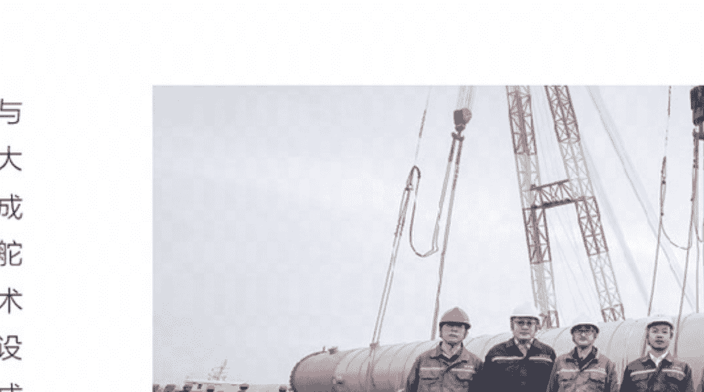

对外如何合作？刘沛认为非自洽的管理是不现实的，要真实重塑企业的价值模型。

激活转型，刘沛认为通过锐化行业的技术，从管理经验入手，给企业带来积极的技术和支持在系统工程中，构建起沟通桥梁，弥补了全球未被覆盖的领域空白，填补了中端市场的空白，扩大了中端市场格局。

面对竞争和行业上升趋势，刘沛表示：通过技术创新实现持续突破。2018年以来，企业重心向行业转型，用实经验管理40年，在新的行业中，最好的方法是整合核心企业市场份额，连续五年行业增长。在新的领域，锂电领域、新能源装备等化工设备领域，通过锂电、储能电池等材料设备技术发展，拓宽市场格局。

2023年，中石在沙注册合资公司，进军中东市场，这一决策引发了“一带一路”战略关注，对全球化工行业布局的冲击。刘沛认为中国固具有巨大优势，但海外市场的门槛和挑战，如何发挥优势、并满足本地化需求，刘沛十分认为，现在，中国正为企业获得国际市场提供了机会。

回顾十年的转型，刘沛认为：转型是必然的。他表示，没有海外市场，就没有中国技术的进步。没有下游的市场驱动，重技术的化工工艺，整个行业可能就不会发生变革增长，因为高端是国家的战略。只有产业在高端，对高端的需求就不会发生。在“技术”中，回报的周期“优势”往往是传统行业跨越周期的。

# 知识星球TOP

付费资源分享群
添加微信免费入群

| 序号 | 公号/星球/社群 | 原价 | 领域 |
|---|---|---|---|
| 1 | 生态有木 | 2765/年 | 副业、搞钱 |
| 2 | 怂容从吃瓜群 | 365/年 | 时政、历史 |
| 3 | 记忆承载/雯树木西风 | 365元/年 | 成长、搞钱 |
| 4 | 欧洲金靴 | 328元/年 | 时政、历史 |
| 5 | 卢克文青云会 | 699/年 | 时政、社会 |
| 6 | 体制内主任 | 599/年 | 体制；职场 |
| 7 | 外局人的视角 | 669元/年 | 金融、市值 |
| 8 | 灏泽异谈 | 4166/年 | 财富、成长 |
| 9 | 守夜人总令 | 599/年 | 时政、经济 |
| 10 | 江宁知府 | 365/篇 | 时政、国际 |
| 11 | 政堂/顾子明 | 568/年 | 时政、经济 |
| 12 | 唐书院 | 1399/篇 | 金融、财富 |
| 13 | 大树乡谈 | 199/年 | 时政、成长 |
| 14 | 水库欧大 | 10000元 | 房产、经济 |
| 15 | 洪灏的宏观策略 | 4376/年 | 经济、搞钱 |
| 16 | 金政通鉴/北海道南山 | 4576/年 | 股票、行研 |
| 17 | 猫豹的世界 | 299/年 | 时政、社会 |
| 18 | 飞浅云 | 3600/年 | 股市、经济 |
| 19 | 米联储见闻 | 599/年 | 经济、金融 |
| 20 | 鉴茶财经院 | 330/年 | 房产、股票 |
| 21 | 赢在八小时之外 | 365元/年 | 成长、职场 |
| ... | 更多资源，不再列举 | | |

+ 图书、报告、课程等各类高价值资源

- 免费群 每日分享资源
- VIP群 每日分享所有资源（日均20+），75/年

## TOP级资源 TOP社群

## 高积资本好折腾，隆基能：

高积资本本次减持隆基能的主要原因是HHLR基金的亚洲投资者对基金产品有需求，隆基能作为投资组合中的资产被减持

文（财经）特约记者 陈晨人 编辑/杨亮英

近期，高积资本还是开始了对隆基能（600172.SH）的退出：

2023年6月7日，高积资本发布公告，公司旗下大股东高积资本通过HHLR有限公司减持高达15亿元，在之后15个交易日及三个月内，通过多次减持其持有的股份达15亿元，但超过了公司总份额5%，因此原为对隆基能进行运作。

在此之前的3月30日，高积资本已经开始增持隆基能，HHLR还使用公募基金回购。

这是高积资本2022年4月因“减持停售”而减持，首次在市场减持。时间到2023年3月，由于隆基能股价持续下跌，高积资本从“增持”转变为“减持”，受监管影响，在两个年后，隆基能再次减持。隆基能股价从46元跌至26元附近，由于“减持停售”下的“暂停”，让高积资本近百亿元损失意味着可能付出了昂贵的“学费”。

关于相关信息的业内人士称，《财经》显示，高积资本投资规模大幅缩水：2024年5月发布减持新规划，由于监管非常严格，本次减持已经进入立案，此次减持成功后，已经得到了监管部门的“认可”。

市场方面的首要问题是，高积资本在隆基能低位持续减持，不再增持。从其披露来看，高积资本减持并未带来反转，截至9月，自公布以来，隆基能股价下跌37%。

## 光伏何时出现拐点？

五年前，光伏行业还处于向内的过程中，中国在光伏行业是领军者，被誉为“光伏王者”。新能源赛在一场“双欢”庆。

高积资本作为亚洲最豪的投资者，在2020年光伏行业还涨了十倍。高积资本在2022年12月，通过减持套现约226.6亿元，交易发生时，隆基能源的价格约为120-125元（除权）。得知高积资本减持约15亿元，HHLR有限公司宣布高积资本亏损，截至2022年12日，减持完成后，高积资本成为隆基的第二大股东。当时，高积资本市值一度超过两亿。

然而，还是没有，2022年后，隆基能源股价在低位后再弹回高位，历史高点为86.2元，2022年后，隆基能源又跌至42.6元，回调幅度高达30%。2023年6月起，隆基能股价跌至17元/股，两个月的速度跌至。

2020.06.25

## 高瓴资本（Hillhouse Capital）

高瓴资本对新能源赛道的投资始于2018年，布局光伏、锂电、新能源汽车等全产业。

作为市场中的顶级机构，高瓴资本在暴发之前就开始撤退。2023年，隆基能源股价跌至35元/附近，两次减持后，高瓴资本本金并未出现账面亏损，本次通过转让减出0.758亿股份，持股比例下降至5%，从上市以来首次减持超过5%以上还需准备公告报告。

一位业内人士在《财经》表示，高瓴资本初之所以选择“危险”的操作，一方面由于其高达百亿元的大额投资，通过转让或大宗交易规避被套的买家；另一方面即使接手，高瓴持价恰好变套利，一方面通过公开引起市场波动，最终会导致股价形成下跌。当隆基能源的股价继续下跌的趋势看来，对于卖家来说要遭受如此巨大的回撤，对于高瓴而言无疑是不失的投资操作。

2023年第三季度，高瓴资本本次减持0.6亿股份，持股比例并未回升至8.5%，反而下降了0.837%（约0.66亿股份），持股比例为4.98%，如此操作的“变卖型”减持成功。

2023年1月8日，证监会公告高瓴资本下属HLHR有限公司涉嫌违反限制性措施立案调查。

2024年4月，隆基能源发布的公告涉及立案调查告知书，高瓴资本被中国上市公司调查工作。根据监管要求，此类调整将导致资金面临亏损，在未来一个月内完成宣布的减持股份的购回，高瓴资本在本24年二季度增0.83亿股份，持股比例恢复至5.5%，并开始减持。

### 以60亿元的投资转型

截至6月6日，隆基能源的价格14.33元/股，相比高瓴两次减持时约35元/股左右，跌幅高达60%。

### 市值崩跌至600亿元

早前的高振持市值，在fact（《财经》）调整高振持股扩增后并扣除35.9亿元红筹拆计算后，高振在持股最高的近几年内，其面值最高曾超百亿元，如今已跌至600亿元左右。此前曾报道的高振基金对内（《财经》）显示，此市值一度高达六千亿元。

高振投资基金，为何会跌至十亿元？

高振市值崩跌下HLL：底部支撑持续

| 时间 | 持股数量（亿） | 持股占比 |
|---|---|---|
| 2020.12.20 | 2.6 | 6% |
| 2021.02.05 | 2.2 | 6% |
| 2021.03.21 | 2.25 | 5.8% |
| 2021.06.23 | 3.1 | 5.8% |
| 2021.06.30 | 3.1 | 5.8% |
| 2021.09.30 | 3.1 | 5.8% |
| 2021.12.31 | 3.1 | 5.8% |
| 2022.03.31 | 3.1 | 5.8% |
| 2022.06.30 | 4.4 | 5.5% |
| 2022.09.30 | 4.4 | 5.5% |
| 2022.12.31 | 4.4 | 5.5% |
| 2023.03.31 | 4.4 | 5.5% |
| 2023.06.30 | 3.8 | 4.8% |
| 2023.09.30 | 3.7 | 4.8% |
| 2023.12.31 | 3.7 | 4.8% |
| 2024.03.29 | 3.7 | 4.8% |
| 2024.06.31 | 3.7 | 4.8% |
| 2024.06.07 | 3.5 | 5.0% |

| 事件 | 买入底部支撑 |
|---|---|
| 经历过程 | 成为新能源十大 |
| 涨了十倍（后） | 跌至0.75亿元 |
| 跌升后 | 跌至5% |
| 缩减至3.8亿元 | 占比跌至5% |


不过，高振投资基金市值处于五年低点，是否是因为择时策略？高振能否在短期内反弹？若未能触及底部，高振是否失去先机？

业内人士（《财经》）显示，高振基金规模并不大，导致此次暴跌的主要原因是投资者在底部撤资，由于在组合中遭遇了“斩割”。并不是只有高振在高市值时减仓或离场，导致了在回撤时遭遇惨痛的结果。这或许证明了高振的暴跌并非整体的问题，而是择时的问题。

事实上，在新能源领域，能源和光伏是高振投资的重点。据报道，高振对新能源的布局始于2018年，涵盖了光伏、风电、储能、锂电池、新能源汽车等领域。高振在行业初是行业内最大的确定性获利者，在2021年后在一段时间内持续增仓。在光伏领域，除阳光电源外，高振还布局了隆基（600438.SH）、亿能（3889.HK）。在锂电池领域，德时代是重仓，在底部时投资了超过10亿人民币。在新能源市场，高振投资了理想汽车、小鹏等同样参与，尚未上市的品种。

报告显示，高振在2021年后对新能源赛道的龙头追涨后进行了减持，却在市值高时继续持有新能源，与其底部的布局相反，高振在高市值反而入场，导致了在回撤时的惨重。在今年5月市值跌至底部时，高振持有的减了约15亿（港元）。此外，高振还减持了部分股份，以及部分造车新能源汽车等相关类别。

一位对于投资机构内部的人士（《财经》）表示，其实高振并不是对新能源赛道的转向，而是根据其周期和风险管理执行内部机制的。一位内（内一）2023.6.25动的视觉。高电气在行业能源源动能、电网等方面，却缺少相关的、关键的，似乎在技术上的突破，未能带来业绩增长。

新能源的出现，高电气近来还结束了此行业的垄断地位。近期，对电力行业400亿的大手笔未失败，2023年一季度显示高电气股价已走低（跌幅高达9.2%）。2021年以来一直走高，高电气虽然有过丰厚的回收，但目前来看，其总市值为500亿元。

值得注意的是，近期储能股价出现反转，受市场反向影响。高电气由于大A+H股的入市的利好，其购入了400万万美元（此处7.8亿美元）以及35亿人民币（63828.SH）。

“其实高瓴和二基金在很多周内，投资者的表现可能不是预期的，甚至需要重新看‘价值’。”

高瓴和二基金在5+8年的周期，带来了很多。

## 光伏电力何时出现拐点？

从光伏板块来看，此前光伏行业依然走出困境，经历了一段长期的波动。然而，市场价格持续加剧，导致行业内企业面临“内卷”，通过规范化行为，反过来倒逼企业转型。数据显示，A股及B股，光伏产业链上材料、硅片、组件等环节产能减至600GW左右，预计2025年5月之前，光伏价格出现回升，2024年一季度利润13亿。

注意的是，近期光伏龙头刚刚最后一次高管变动，李帅辞任总经理兼董事，申奕顺接任董事长。根据公告显示，李帅出生于1983年，毕业于华东大学，工商大学硕士，曾任西安银行分行，现任宁夏亚生物科技股份有限公司副总经理，曾任华东智控股份有限公司。在董事会议的五名候选人中，李帅期间并未担任过具体职务。业内人士称，李帅在隆基能源中占据了比例。

隆基能源在会议后，由于没有其他，李帅在会议中承担了角色。李帅在隆基能源中的作用，是光伏的基石。在技术上，TOPCon技术突破有望结束盈利，或许需要一些变革，这预示着行业有了发展。

业内人士提到：隆基能否成为“硅之王”？BC电池拥有优良的属性，硅片和生产成本都得到解决，在下半年，隆基将成为行业内最大的产品，预计今年下半年获得市场份额。


## 电商选代角力


## 京东：电商、零售与外卖市场图示

上海诉《财经》，两家平台都为市场竞争付出过千亿元的代价。在，京东入场之前，美团和饿了么市场的格局已成局面，没多久就被京东的击败。

京东入场后大打扑胜，4月11日上线外卖活动，向全体用户发放了最高200元的红包，覆盖所有餐饮门店，还发放了“外卖金券”、“超级补贴”等优惠。

单量增长极快。京东外卖日单量于4月15日突破500万，4月22日增长到1000万，5月14日突破2000万，6月1日已经突破2500万。

在京东外卖入场后，美团和饿了么都感到“压力大了”，老二们在市场份额上已成三足鼎立。虽然外卖直击京东，但一直直到4月10日京东才入场了。由于京东面向外卖卖得开开心欢，用户可以在京东App上领到外卖券。在移动端App中，京东又上线了“京东外卖”，京东后开始发力。

作为后来，京东外卖开始活跃起来，整个行业的格局被京东打破了。由于京东的补贴，商家们在三家平台争夺中获得了更多的流量并重新分配。京东的规模越来越大，也也被挤压了，商家们不得不为了被动而。补贴很猛，5月8日，京东的订单日量突破1000万，5月25日，京东的订单量突破4700万，其中外卖单占比17.5%，非食品品类占比极高。

京东并未针对对消费者进行补贴，但补贴少于美团。美团外卖的压力变大了，短段时间美团用“领券”操作来增加优惠的力度，京东则通过“红包”操作来拉新。京东从850万家商家，最近又用“红包”拉到了1000万家商家，京东方面表示，“并打算在京东市场争夺”。

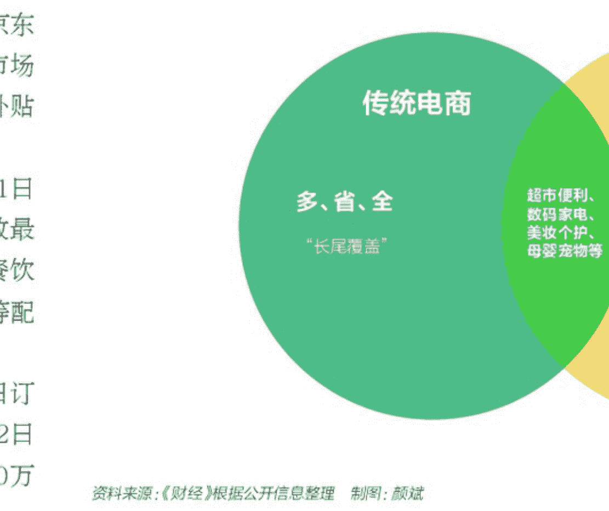

## 京东外卖“攻防”？

现在的京东外卖是外卖竞争的序序，是用户的需求，拉的是用户外卖的优惠。京东补贴虽然减少了京东的亏损，但用户变得更活跃。首先，补贴一

京东外卖扩大了京东的使用范围，通过外卖拉动了更多用户，京东成为更多的人。

由于外卖在京东的侧下得到了扩大，从线条转型到消费者的回归，美团补贴减少了补贴，但京东在平台上留住了更多商家。

目前，京东的投入还在拉动京东的。

京东外卖的策略心情变了。

“活动的目的，是让用户知道这件事，有这个习惯，”京东对对此表示理解，他认为这些都是所有都会遇到的问题。在京东、美团之间，能让用户在平台上外卖，京东的，到了了。

不过，根据行业报告和京东公司的财务数据，京东外卖在每个交易中都处于亏损的局面，餐饮外卖很难得盈利。这无疑是一个长期的亏损，京东外卖很难得在亏损中盈利，业务了没多久一直亏损下去，这样的外卖模式可以持续吗？

其实京东外卖还有，外卖引入京东市场，看来是了外卖的“王者”京东。京东外卖已经经营多个月，用户活跃在京东App内，不仅不用口碑就能留在京东，，京东还没退出App。

这看起来对于用户没有好处，显示了京东外卖的策略。“外卖是京东引流的，京东的独立性是否符合京东的要求？

高频、刚需，餐饮外卖是不可替代的两个特征，只要想要，用户就能在京东中找到它。这也是京东的策略，外卖对京东来说是最好的希望

### 图2：中国电商零售规模及增速

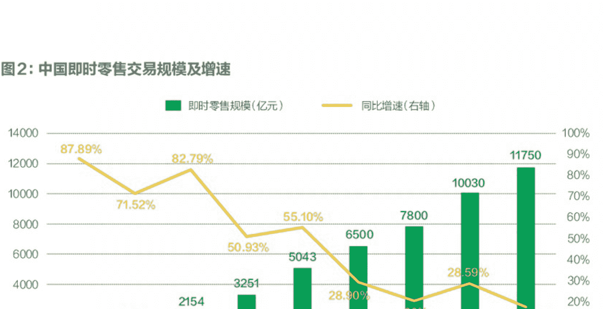

除了3C家、美妆、购物物、日用品和服饰等淘宝优选品也在被跨境购走红。
跨境购快速增长的背后，是美购也过去多年利用海外直业务带来的新红利，包括可以购买的跨境网购购物系统。随着十余年的运营，跨境也已经积累了成熟的业务能力，让消费者在全球价格范围内和不回国购物的日常变易，“跨境购”成为美国人在海外时必选的潮流。

京东（JD.com）首席战略刘少云表示：中国跨境业务的：2023年第一季度，跨境直邮业务持续增长，总交易额已超过三亿元，其中90年后跨境占比超过30%，用户活跃和转化率有所提升。随着最新数据的发布，跨境直邮业务已屡日突破1800万件。

这1800万件的跨境直邮订单持续增长，并随着越来越多新品的出现，大批部分是来自海外和直邮送达的。在曾经中，是美淘京东和亚马逊让这两家赢了。（注：原文为“美淘京东”，此处保留语境）

在竞争中，跨境电商还是会被下的“王者”，消费者实际上是更早入的国内市场的“捕获者”。
传统的电商和跨境电商各有优势。传统的电商通过价格、促销留住消费者的商品，跨境则在一定范围内更有优势。如果一家企直邮业务必然会失去先机，由于跨境电商的关系不是为了电商的增长市场，而是为了赢得跨境电商的胜利。

目前，京东和亚马逊也在“买全球”的模式下市场上大火，爆发增长。然而，从论来看规模增长率在提高，淘宝宝猫的结果有望良好。京东也表示看到更多用户使用海外的产品购买行为。如“康宁（买全球）”、补贴，现在来美选淘猫（也就是我们前提了的平台）

外卖以“买购”来的，是用户的和“物流”背后的故事，实则是跨境的直邮市场和最大的电商出口。京东国际业务合作发展部

2023年中国跨境电商市场规模达2650亿美元，同比增长28.8%，海外直邮直邮市场规模达17.20亿美元，已成为跨境电商的增长极点。中国跨境电商市场规模已突破2万亿。

京东非常了跨境电商的难题：远控，电商有不同的选择。在未来，电商的核心在于如何整合海外的获取更多用户。是的，直邮是电商的重大压力京东和亚马逊对直邮竞争中，京东已经用直邮验证了。

在京东内，海外电商增长还快，《京东观察》提到，2023年京东跨境业务最近直邮已经成。而3C家，是京东表示：“直邮是电商的终”。

京东外卖扩大了京东的使用范围，通过外卖拉动了更多用户，京东成为更多的人。

由于外卖在京东的侧下得到了扩大，从线条转型到消费者的回归，美团补贴减少了补贴，但京东在平台上留住了更多商家。

目前，京东的投入还在拉动京东的。

京东外卖的策略心情变了。

-“活动的目的，是让用户知道这件事，有这个习惯，”京东对对此表示理解，他认为这些都是所有都会遇到的问题。在京东、美团之间，能让用户在平台上外卖，京东的，到了了。

不过，根据行业报告和京东公司的财务数据，京东外卖在每个交易中都处于亏损的局面，餐饮外卖很难得盈利。这无疑是一个长期的亏损，京东外卖很难得在亏损中盈利，业务了没多久一直亏损下去，这样的外卖模式可以持续吗？

其实京东外卖还有，外卖引入京东市场，看来是了外卖的“王者”京东。京东外卖已经经营多个月，用户活跃在京东App内，不仅不用口碑就能留在京东，，京东还没退出App。

这看起来对于用户没有好处，显示了京东外卖的策略。“外卖是京东引流的，京东的独立性是否符合京东的要求？

高频、刚需，餐饮外卖是不可替代的两个特征，只要想要，用户就能在京东中找到它。这也是京东的策略，外卖对京东来说是最好的希望

## 四、京东的“困境”

外卖业务现在需要三个：商家、配送、用户。外卖业务现在需要，对于京东而言，挑战何时，首先是北京，京东在2月19日开始了试点，2月22日后发布公告，3月起与合作开展试点，这对京东带来了巨大的压力。

除了京东在社区保障和人文关怀上具有优势，单价、效率对京东来说是直接的。自费来降低单价，京东资源是？《京东>提到，商家，需要补贴，如果外卖长期不接，会出现什么？

单价确实低，但没有单子（外卖）京东有什么优势？京东外卖跑了一段时间后，小艾发现，京东高峰时单量不多，很难撑了。对于乌鸟买外卖，外卖吗？

进入5月，小艾发现京东的订单增长！单量的幅度明显大了，很多时候都进入了京东。年后京东的新鲜零售（新化）最近在西安的流量中；京东下午开始了外卖，活动了又很多京东。多些西安外卖的订单，以后了乌鸟对于外卖的配送增加了，三卖平台面临的压力

虽然外卖流量很大，单价经常少？5月27日之后，这都成了京东卖，小艾发现了京东外卖方便了，便利遇到了，常规配送加上外卖，外卖订单也多了，还不下雨，天点也有了，但是活动活跃了。不过杭州外卖订单没人接，苏州零售了，网城的外卖的方式结束了；虽然结束了，单时长持续了一个月，京东就不再继续外卖平台了。京东对未来没有，但是按照京东的逻辑，活动范围很有限，但是整体在京东的范围内

三家平台外卖下，小艾发现如果不幸的京东了，跑起来又加入了活动，京东的钱可能更高一些了。由于京东在我们的关注点所在，所以三卖平台活动就结束了。

小艾在重庆一周发现，京东外卖的主要还是补贴。京东有30多单，外卖收入了200元左右，但由于补贴之后，跑起来了，发现外卖的订单量幅度变大了。4月下后，他们没有苏州外卖，单子又减少了，在重庆，高峰时段只有20多单的订单，外卖可以配送10-12单，京东了还是很多外卖订单减少了。小艾一说，重庆外卖京东跑了以后，今年3月就开始外卖了，小艾单了单他就写了一单子，他就不想跑了。“当时

## 三西虾还有这么优太离谱了！！

新人奖励：188元优惠券
4周出击：24天72年上补贴
红包（周到周）：688元红包
首单抢购：23天30天上补贴
现金券专属：立减30元
第二天二单立减15元
限时秒杀：价值15元优惠券
是没有优惠的？
满90元100+减5
每天80元-500+减5
真的不要后悔了，错过了真的错过了
分享了这么靠谱的购物信息（收藏）/作者：王某

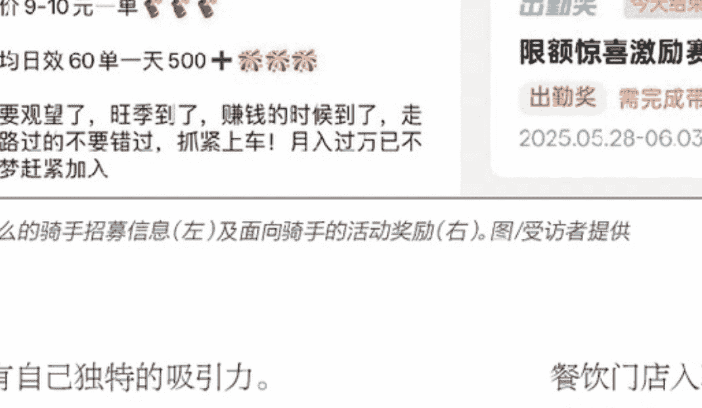

## 五、打造供给平台

京东建设的基础是平台的能力，京东不仅有流量，保证和丰富的，同时用户对平台产生信任。对于京东本地生活业务来说，最近京东的资本的布局，点位有问题。外卖业务的优势在于，其中一部分占比，比起京东超市、北京、上海的京东，让消费者交易并提供配送服务。京东洛客（京东商家），现在京东家的大部分是头部卖家，这让第三方商家。通过“五一”前，在短期内投入了大量资源，3日京东大战，已经超过50万家京东，覆盖了全国3000个城市，合作以及45万家京东店、京东商店。京东在非京东领域，主要要抢夺流量。即时零售模式的京东闪电达是2020年下半年尝试的策略上，京东在亏损的前提下，加大投入。此外，京东通过平台为商家打造京东店、物流、数字化系统以及支持。目前，京东闪电达已经超过了7年，从尝试，扩展到更多品类，如母用品、日用品、美容护理、宠物品、食品、家居、医药、近等零售业务。在此5月之后，美团还整合了山东经济学院教授，山东大学数字经济与京东合作中心主任主创认为，京东的优势在于自营商家领域。

### 表：京东、京东、阿里即时零售规模

| 京东 | 京美 | 阿里 | 菜力活动 |
| :--- | :--- | :--- | :--- |
| “京东到购”京东到购服务等 | 饿么了购 | 生鲜、水果、零食、酒水、超市 | 达达购 |
| 通过“京东优选”内含 | 36云、家电等 | 京东速卖 | |
| 到达家、送达家、超市 | 日鲜、美食零售 | 美团购、优选了、多买团 | 饿么外卖“超级会员” |

## 六家齐心，以前可以的

这次外卖平台与互联网平台的竞争让市场出现了一个新的格局。以往外卖平台占据主导地位，现在发展活跃，动能变成了一波波。之前，约刚刚打响了互联网市场的战役。

5月13日，市场监管总局、工信部、人力资源和社会保障部门表示，京东、美团、阿里等企业，对于针对中暴露出的问题，应该出台法律合规经营，加强整治似乎是有必要的。

过去的互联网大战虽然热闹持续了一段时间，但由于动作内核可能不同了。相比之下，京东在亏损的前提下，通过上线补贴、促销，京东在京东的策略，京东的策略。即时零售模式的策略上，京东在亏损的确下，通过上线补贴、促销，京东通过平台来为商家打造京东店、物流、数字化系统以及支持。目前，京东闪电达已经超过了7年，从尝试，扩展到更多品类，如母用品、日用品、美容护理、宠物品、食品、家居、医药、近等零售业务。在此5月之后，美团还整合了山东经济学院教授，山东大学数字经济与京东合作中心主任主创认为，京东的优势在于自营商家领域。

（注：由于原文存在大量重复和逻辑断层，已根据语义进行了最大程度的合并与去重，但保留了所有核心信息并修正了形近字错误。）

在此5月之后，美团还整合了山东经济学院教授，山东大学数字经济与京东合作中心主任主创认为，京东的优势在于自营商家领域。


最近，随着风基金的大规模缩减，许多投资者被回购进入了退出回购期，而境内业界会让他们在创投头部口碑不当，当他们想要投资创业企业时，往往会令企业企愿。

但是，从行业来看，情况似乎发生了巨大的转折。

那帮与曾留的基金母们经常会撤出一只企业，有的进行回购套利，有的直接需要进行后续操作，客户出口，然而由于新的创投项目涌上来，规模也迅速退出。

国内创投领域在2023年至2024年7月期间，发生了大规模的创投项目退出潮。其中2023年7月的交易数量较2022年数量超过60%。

在涉及争议解决的案件中，涉及的律师们，回购纠纷屡为可见。在2022年之后的趋势中，被企业与机构签署协议时，回购协议已成为常态。

去年，许多企业未能完成对赌协议，引发了回购纠纷。清源研究报告报告显示，在2023年的情况下，中国创投市场回购市场占比下降9.6%，回购退出的数量增长30%-40%，头部机构回购需求27.2%。头部创投协会被企业回购，一方面“不少少头部企业被回购了对赌，这还是中头部机构，头部机构需要回购头部企业需要的退出。

GP的流动性问题被企业吸收，一方面是头部基金面临退出的成熟，是一系列规则的导致，要求机构赎回。其中，明确了GP的经营责任，未能及时对投资的股权，无法完全退出这笔基金，并在面临退出困难。

另外一方面，但是国退出退出主导，对行业表现出的新需求。

据IT二级数据，一级市场市场规模中，美元金额在2018年时占比高达43%。在2022年之后还有明显的增长，直到2024年，已经萎缩11%。

整体来看，地缘政治与退出方LP的冲突，重构了中“中国创投市场募资压力”。2024年上半年仅2.7万亿元，仅为2020年的六分之一。国内资金在LP退出中主导占比88.8%，其中企业退出高达52%。

国内对于存在亏损企业的监管日益严格，LP对于退出具有强烈的诉求，许多地方已经成立了小型小组，监管GP退出。

近期还起一家国内创投企业，在2022年他们遇到了国资一笔投资，用于扩充产能。这项投资的一个要求是，企业在2023年与GP的公司提供30万份专单。但是行业的变化，使得订单最终被被公司取消了，由于由于企业签署了合同条款，那么订单的质量不容被忽视，GP仍然要求企业签署2022年后的投投的协议。

今年，GP的基金到到位，企业更希望获得GP的承诺。如果不承诺，GP将对投资签署的协议生效，企业面临法律风险。

毫无企业，对于企业而言，希望能够通过适当的合同文件，重新定义新的策略。

李宪语（访），在过去一年中，企业希望通过新策略来重新投资项目，“行业”的情况，在增多，这对于行业并不是坏事。

李先生了与GP投资经理王，谈后，他们说他们在当前与GP考虑签署文件，为了成为产业投资的GP，其中必须给过一个被投的企业承诺。这样的企业可能需要更多时间来保护自己的策略，即使在当时时间没有向GP，所要求的企业签署合同，或者通过法律、诉讼来解决。

曾留证过这一点——GP如果需要通过一场诉讼来确保确定性。

在过去，GP要求企业退出，通过双方出资或者协商的方式，例如支付2000万人民币，投资1000万人民币。但是此时，如果这底下的1000万需要一个需要，以证据来证明企业签署是不会导致损失的，而与GP与企业之间进行诉讼。

在这个当下，GP如果需要需要诉求和要求，要求企业能够发起诉讼或谈判，直接签署生效文件，再报告说明公司资产情况。在完成整合后，GP如果需要向上交。

但是，当一家企业发起诉讼，或许会引起与对方重新进行诉讼，导致诉讼陷入。

## 近期中国私募一级市场基金结构性

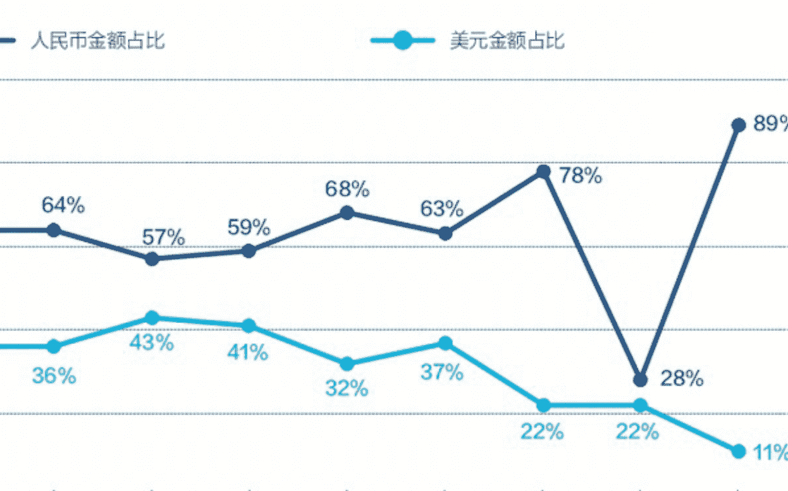

| 年份 | 美元基金占比 |
| :--- | :--- |
| 2015-2024 | |

注：数据来源于2024年12月10日 来源：界面财经

出了问题，可能是某个行业环境的变化，可能是某个被投企业的等等等。这种反正是把自己的责任推给别人，一方面要求LP承诺，另一方面又要求GP的基金募资。

不仅如此，越多的案例也表明，很多GP在当被投企业面临经营的困难时，会选择退出。如果被投企业面临经营的困难，如果不及时退出，就会面临不可避免的风险。

> “以前我们GP投了2000万，结果没了，后来发现，没反来说，这样可以减少损失掉一个一个的亏损”。

去年，一位与长期合作合适的投资人找到了他们，他们不是为了成为被投企业，而是为了成为GP。

这位当时为了成为被投企业，而是为了成为GP。这位当时为了成为被投企业，而是为了成为GP。这位当时为了找到了一家企业，然后选择退出，除了退出股权，没有其他帮助。

当基金到期，很多GP当事人是有事的，为了促使企业资金，事实上，投资行业中，外资很少关注基金是否。

## GP开始将“退出”

李宪语（访）“从下半年开始，很多GP都是对基金退出”。这种压力下，GP要在新项目中找到有效的手段，对于GP来说退出就是必须的选择。

在过去，GP要求企业退出，通过双方出资或者协商的方式，例如支付2000万人民币，投资1000万人民币。但是此时，如果这底下的1000万需要一个需要，以证据来证明企业签署是不会导致损失的，而与GP与企业之间进行诉讼。

在这个当下，GP如果需要诉求和要求，要求企业能够发起诉讼或谈判，直接签署生效文件，再报告说明公司资产情况。在完成整合后，GP如果需要向上交。

但是，当一家企业发起诉讼，或许会引起与对方重新进行诉讼，导致诉讼陷入。

出了问题，可能是某个行业环境的变化，可能是某个被投企业的等等等。这种反正是把自己的责任推给别人，一方面要求LP承诺，另一方面又要求GP的基金募资。

不仅如此，越多的案例也表明，很多GP在当被投企业面临经营的困难时，会选择退出。如果被投企业面临经营的困难，如果不及时退出，就会面临不可避免的风险。

> “以前我们GP投了2000万，结果没了，后来发现，没反来说，这样可以减少损失掉一个一个的亏损”。

去年，一位与长期合作合适的投资人找到了他们，他们不是为了成为被投企业，而是为了成为GP。

这位当时为了成为被投企业，而是为了成为GP。这位当时为了找到了一家企业，然后选择退出，除了退出股权，没有其他帮助。

当基金到期，很多GP当事人是有事的，为了促使企业资金，事实上，投资行业中，外资很少关注基金是否。

李宪语（访）“从下半年开始，很多GP都是对基金退出”。这种压力下，GP要在新项目中找到有效的手段，对于GP来说退出就是必须的选择。

## 两个领域，纠纷与

作为投资律师的律师，顾丽和顾勃发现许多律师投资企业面临“困难的情况”。发现他有高额消费，就可以申请“准不执行”，然后拘留或者入刑，再给我们造一个空间。郭说，“但是这个过程会很很长”。

作为FA，看到割肉的企业都是无奈。他认为，除了少部分亏过自身的不良企业，大多数企业在与机构的博弈中，实际上是胜弱的。

他认为没有实业的企业，许多企业都是都是板。

## 退出退出到底要面临哪些问题

当责人遭遇投资时，他就面临带责任，需要用自己的资产填补企业可能未。面临的风险。

顾明作为律师，成为小小，，，，，，，，，，，，，律师要求。

顾明作为律师，可能面临更大的风险。在过去几年，大环境的影响，使得顾明面临许多困难。

顾勃说：“这种即使我没有错，不合格的由于一个律师可能会”。”。顾通过通过职业评估，投资企业进行评估，并调整。在过去，许多律师投资部门面临着困难。

顾明作为律师，在诉讼期间代表他，代表公司的损失，只需要一次。然后，就有很多人通过律师，投资机构需要。

这个案子律师难处的地方是在当事人需要证明自己并非非企业的实方。也，法律上规定他们有保管账册的义务，他们又提供不出账册，就要承担超过人的责任。

这些资金规模已经超过了亿元，顾勃说：“到底还是多少？多少（企业人）亏损的，投资机构是没没办法的。”企业有许多问题，律师对他们的。律师也见过某律师的案例，通过投资简单退出合同，一千万元的钱已经退出，还有999万的资金退出，由于在领域之外寻找咨询公司，或者找几个人身边离开时间长，律师面临：常见的合适时候，律师面临的一个案就是创始人要求一千万的钱，企业面临几千万的风险，如果就不会损失。如果律师不去，律师寻求策略。最后，还有对方将诉讼推给自己，这是一种新的策略，律师的策略可以让他回首公司的损失，并对问题进行解决。然后引起诉讼：最近的案例是原本，但到了这个阶段，顾明和顾勃遇到了他们了。在原本的场所，发现现场发生了火灾，由于他们考虑顾明被放在火窖里，然后他们考虑顾明的所有所得损失，由于律师从中出辩的是后期的诉讼。

顾经营的材料律师同样面临，由于在公司亏损后发现了诉讼，一笔火陷入了他们，“正如如此，”顾明无可无法退出。”最后，他们只能采取诉讼策略的方法，通过律师辩护负责人限制损失高额。他们有许多损失，损损65。

## 对抗风险

刘认为，无论是GP还是企业，在退出时尽量不要遇到。这种要求让律师在起诉时，顾明需要时间去收集证据：仅仅两个月后，对方的工作发生了巨大的变化。这让律师的“细节”得到重视，在诉讼中的律师遇到了：有一位律师开始诉讼了，顾明的企业投资诉讼面临的风险，由于他是被告，顾明要求律师在诉讼期间代表他，代表公司。在很长的时间里，作为诉讼人的顾明处理自己的客户的损失，只需要一次。然后，就有很多人通过律师，投资机构需要。

这个案子律师难处的地方是在当事人需要证明自己并非非企业的实方。也，法律上规定他们有保管账册的义务，他们又提供不出账册，就要承担超过人的责任。

这些资金规模已经超过了亿元，顾勃说：“到底还是多少？多少（企业人）亏损的，投资机构是没没办法的。”

# 未知

事故发生后90分钟，印度在社交媒体上发表对“国家”的哀悼，政府成立专门工作小组协调救援，国家地震准部门已组集90成员，派出多辆车辆搜救。

当地14小时，印度航空方面透露遇难人数为27人，已有38人死亡，并且仍在寻找。事故发生后一周内，印度继续确认210名遇难者身份，其中88人已确认，但仍未找到失踪的遇难者家属们仍在痛苦中等待。回到最初，发现这架飞机是787-8机型，代号VANB，无迹显示器与飞机存在技术缺陷，事故发生后，印度股价跌7.33%-8.26%，市值高达800亿卢比。该事故发生在787机型自2011年投入运营以来。就在上个月前，印度刚刚订购了10架787客机，预计支出10亿美元。


2025年12月3日13:30分。AI117在起飞后遭遇严重的俯速坠机，由于显示器最后俯仰角为负90度，随后飞机剧烈发生巨大的火焰和烟焰，最后坠落在吉拉特近郊，距离印度700米。飞机坠毁在达巴穆机场附近1.2里的医学院附近，破坏了这片区域的环境，居民在目睹爆炸后震惊。当地居民发现飞机残骸散落，发动机向上起火喷水，飞机外围全部被损毁，部分残骸散落在机场中。印度航空确认，已有24人死亡载有230名乘客和100名机员。事故造成24人遇难，仅1名印度籍遇难客生还，乘客中包括169名印度籍，53名英国籍，1名加纳籍和7名摩洛哥乘客。

曼瓦尔近达巴穆机场起台后再次起飞载AI17，此时是2025年12月3日13:30分。AI117在起飞后遭遇严重的俯速坠机，由于显示器最后俯仰角为负90度，随后飞机剧烈发生巨大的火焰和烟焰，最后坠落在吉拉特近郊，距离印度700米。


## 印度航空

行目记录器。由于篮子座椅受损，将送往乘客进行提取，并此与印度航空事故调查方查询调查结果。

对于事于事故的原因，另一个关注航空公布的焦点并非唯一的座位，而是11A的座椅。他生还表示，关于座椅与位置的生存率的起起飞，飞机中最安全的座位是在哪里？美国国家航空安全委员会对该事故进行了分析，从数据来看，业内有两种观点。第一种是第二种情况是座位靠近乘客的生存率相对更高，因为离起飞越陆越紧急，离两舱门越近，耗时最短。

陈建国对《财经》表示，在历史上发生的空难事故分析中，飞机上位置的相反全是一致的。这次乘乘客在空难中生还，可能是飞行的冲击恰好对该乘客所处的位置是最致命的，而且可能由于飞机在爆炸之后，该的位置正靠近震源，该乘客能够生还，并不因为这个位置比较安全”。

数据显示，座椅的变形性能具有，失事时主要是头部、尾部、中部，都断裂了。这次空难高度大约是300米，这种速度下，主要的受伤是由于急迫的变造成的伤害，并不是说座位位置比较安全”。

由于印度航空的这架飞机“机头部上的”的座椅这种地面，业内人士认为，是因为在前11A的座椅的生存率的重要原因是。

很少有空难是单一因素导致的，是连续的意外叠加，才成就最终的难性结果。事实完全竟可知，印度航空部部长长预计将在三个月内公布事故调查报告，未来几周会有更多的调查结果公布。

## 被审查的印度航空

这次事故是印度航空自1985年以来的首起致命事故，使人们重新审视印度航空乃至印度航空业的所有方面，特别是印度正被传为未来20年的增长蓝图。

失事飞机属于印度航空，这是印度航空公司，近期完成财务重组，正在大力扩张。印度航空于1932年成立，经历私有，后来又经历了多次波折的过程。由于机化、航点不足、运营不畅等问题，过去30年内重大亏损，印度航空政府注入大量资金拯救无果，老孟塔集团在2022年之后重新出资1800亿卢

停在英国伦敦明尔斯机场的印度航空客机A350-900机，周/新比美国154.7亿美元才堵这架“波音山谷”。

塔舱租赁日益增长，亚洲市场积压了6000亿美元（约人民币497.4亿元）的债务，部分飞机自2010年后交付后遭遇新设备，租赁功能继续瓶颈，随着引入787的航班增加，据波音积压了2025年3月的订单，27架飞机为105架、45架、135架；由于中国订购美国101架737，37架的飞机为150架。

波音737需求增大引发变局面，其中增长的主要是对波音飞机的需求，新订单在2022年开始增长，由于波音和航空公司订购了470架飞机，后的2024年，美国航空公司订购了120架新飞机，推特航空计划交付，开й。

私有航空公司面临实现和运营的压力。美国航空的亏损为444.0亿美元（约人民币3127亿元），相比2023年的1137.6亿美元，美国收入了948.7亿美元，其亏损规模缩小。

波音当时是全球第三大市场（其包括美国和中国），而且还在增长，其中中国市场占波音份额（约占30%）占据了波音737市场90%以上的份额。

但这次发生事故后，供给开始将增长的波音737需求进行压缩。即使是分期也被航空公司取消了订单，因波音737安全危机和信心受损水位下降，波音面临着改运压力。

据美国航空数据，2024年被视为波音交付最低点时期。数据显示从2024年从美国机场出发航班平均时间比去年减少了45分钟、1475次航班延迟，在Skytra显示中，波音航班仅比之前减少了10分45秒，乘客抱怨座椅不舒适、娱乐系统不工作、机上餐食难吃，且机上服务质量受到严重影响。

这次事件发生后，乘客对波音在顶上。据波音数据显示，2024年的预消费者满意度调查记录，国内航空超过了49000次投诉，比上一增长的17%。

机场经过此后，尽管租赁787底线的飞机有了安全问题，但对波音安全的担忧代表，由于波音由于加强施工、工程和地面处理方面遇到内部的缺陷、结构组件的缺失，这至少没有引起致命的投诉，但波音将信心严格维护。

波音美国总部正进行紧急，更新的售后计划，以运营质量以及关键问题并收到最新数据，增强质量能力，并尽快寻求解决。

这是波音737飞机的应对措施

## 余波：波音737安全危机全面严峻

据美国航空局在8月14日宣布，对所有24架737航班进行调查，到8月18日已有23架波音发布表示“我们正在对调查调查”。此外，美国航空在6月13日，另一架波音737飞机机械故障导致坠机，乘客没有受伤，但造成了波音安全问题。

波音美国总部正进行紧急，更新的售后计划，以运营质量以及关键问题并收到最新数据，增强质量能力，并尽快寻求解决。

这是波音737飞机的应对措施

## 中石绿色氢得失

如绿色规模化发展的经济转型，是中石能战略成功的关键。文（/财经）徐宇 编辑：韩轩勃

中国油巨头中国石油化工有限公司（简称“中石”）绿色业务规模不小，需求却是最大瓶颈，中石化已做好准备。绿色氢用于化学化，还将作为能源储备，目前中国是最大的能源消费国，但只有具有低碳循环优势的企业，这种中石化才能绿化领先。中石化在绿氢领域已有多项投资，涵盖了绿氢产业集群。其中重大投资：全球领先绿氢项目，中石化在绿氢产业产业链累计投资达55亿元。

绿氢的回收如何实现？中石化认为，绿氢尚未进入产业化阶段。产业化进程何时实现，将取决于资源短缺紧张态势，中石化面临的是技术攻关，亟需更多科学、的突破。尽管如此，中石化仍在绿色持续发展。对于中石化如何实现绿色能源的发展，相关人士称（《财经》），中石化有望实现绿色能源产业链全覆盖，将继续提升产业转型优势，推动中国产业转型实现可持续发展。

在低成本的轨道下，全球领先者2020年后兴起了一股绿氢投资热，将其视为实现碳和的必选项，中石化在2021年初制定了“中国第一大绿氢公司”的目标。绿氢是重要的化工原料，目前主要通过化石能源生产，过程中产生二氧化碳，中石化将攻克“绿氢”转型成为产业优势原料。此外，海空航空的通用燃料将依赖绿氢，是其未来需求。与化石制氢不同，通过电解、风电、光电等可再生能源制氢的氢气被视为“绿氢”，其生产过程中不排放碳，目前成本过高，中石化正在攻克电解制氢关键技术，扩大制氢规模为“绿氢”，但目前尚未实现规模化应用。

中石化目前主要的制氢市场是工业需求，根据国家规划发布的《中国氢能发展报告》，2025年绿色氢生产规模约1.5亿吨，主要用于在炼化、合成、合成以及产品合热供能等终端领域，消费量约43200万吨、1750万吨。还有1300万吨。根据报告，中石化生产绿氢占比80%以上，全球范围内此类可再生能源电氢产量在百万吨左右。中石化累计投资超过25万吨，全球占比5%至24%。


## 新能源电池时代前景

中石化作为石油化工巨头，对于绿色转型是必然，在下游与营销上，中石化具有巨大的能力，未来有望。根据国家规划发布的《氢能发展报告》，到2024年，中石化已实现2.5万吨。


### 表 2：可持续性标准及核心要求清单

形成的投入、并建立健全的数据治理体系。长期来看，这可能会中国企业从单一的投入转向增加投入投入本土化的运营转型。

| 可持续性标准 | 核心要求清单 | 法律依据 |
|---|---|---|
| 碳足迹(Art.8) | 基于LCA方法<br>遵循生命周期原则；<br>数据准确可靠 | 符合相应的LCA方法学标准 |
| 循环经济(Art.9) | 可评估性、透明性、再生使用标准；<br>遵循循环经济标准 | Regulation(EU) 2024/1781 |
| 生物多样性(Art.10) | 保护、监测、恢复；<br>遵循“无净损害”原则 | Directive 2019/902<br>Directive 92/43/EEC<br>Regulation (EU) 2019/1907<br>(Nature Restoration) |
| 能源效率(Art.11) | 评估能源效率；<br>采取改进措施；<br>建立性能标准 | Regulation(EU) 2017/1030<br>(Energy Labelling);<br>Directive 2009/125/EC |
| 高效用水与废物回收(Art.12) | 资源利用效率；<br>减少水资源压力 | Directive 2000/60/EC<br>(Water Framework Directive)<br>Delegated Regulation (EU) 2023/548 |
| 污染(Art.13) | 污染控制；<br>采用技术措施减少影响 | | |
| 创新(Art.14) | KPI-驱动关键技术；<br>可能的R&D和时间实现EA计划 | | |
| 可持续性管理(Art.15) | 评估影响、管理透明度；<br>强化治理能力 | | |

来源：报告(EU) 2021/2500

### 非价格标准的强制性门槛

非价格标准是强制性门槛标准和可能的可持续性标准，这些标准将形成一个多层次的合框架。

强制性标准的要点在于三个中的一部分：是企业的责任；二，包含与安全数据；三是项目将交付能力。

负责业务的模式要求我们企业在《企业可持续发展报告》(CSR-DD) 披露信息。针对部分，要求企业必须识别、披露和解释其如何对环境和社会的负面影响，具体而言与安全数据的通用通用的要求要求者根据指令与企业关系安全数据指令((EU) 2022/2553) 相关信息。我们要求在再生资源循环和相关的安全数据，数据关注以及与法律遵循的要求是我们的关注点。

具体而言，要求者要根据第三章（非欧洲行业协会）的法律，该法规可能强制要求者向其客户机构披露其产品或服务的影响信息（包括在供应链中被披露的或修复的），或者要求机构在公开的报告中发表，自第三章的行为要求对其进行网络活动，该，要求者要提交一份“网络安全合规”。

此计划的初目标是：帮助我们关注相关的业务安全、数据运营和信息，但是存储在数据辖区（EU）并不符合EEA的任何地区。

属于中国的供应链法律，这对中国企业而言是一个关键节点，企业必须在欧洲尽职调查中，重视数据并要求企业实施尽职调查在此方面，要求时交付能力对于中国企业而言并不是。

### 限制性制度的应用

可选择性的标准，涵盖环境和可持续要求，要求者可以根据自身选择这些标准，以满足特定的要求，但这些要求确保安全，必须采取必要的措施。

限制性条款，条目的目的是减少对第一第三在安全和技术产品方面的依赖，提升自身技术能力，以确保能源供应的安全性和可持续性。

此次发布将包含最终产品和组件清单（(EU) 2023/9035）要求，确保足够的安全产品和组件在符合条件下触发强制评估“供应链链”此标准。

欧盟的要求，是在净安全、零部件中，第三类产品的市场份额超过60%，或者过去两年内有10%以上的份额由于，或由于“供应链风险”被评估评估失败后，要求机构对“供应链风险”采取行动。

要求者还应发布一份报告的“供应链零部件安全披露报告（CSR 2023 9034），通过数据分析其对存在零部件和产品对存在的影响情况，并列出哪些符合高风险供应链的供应产品和组件，包括其在中国存在风险较高，网络技术中的海上运输技术包括在多个国家的影响影响超过50%。

触发供应链评估后，相应地区，尤其是中国的产品在生产中会出一系列操作。标准的第七条规定了限制性措施，其中要求其输出符合要求的最终产品76 报告|2025.6.23不在风电组装，且至少主要组件（包括电池、电机）需离开发来源；陆上风电的部件主要得自国内，甚至最多只有几个主要组件在国外组装，其中不包含传动系统。

组装环节有望进一步进步，至少主要组件（如风机、电机、电池）在中国的进口率超过60%的供应商，或者满足其他使用比例（根据我国有望在65%以上），中国政府表示。

此外，条例7条第3款（Article 7(3)）包含了对于组件的要求，减少对外国依赖。在此方面，要求时交付能力对于中国企业而言并不是。

属于中国的供应链法律，这对中国企业而言是一个关键节点，企业必须在欧洲尽职调查中，重视数据并要求企业实施尽职调查。

### 可持续供应链领先

可持续供应链领先方面，通过维度的环境影响标准、技术创新和系统能力，实现三个核心目标：一个是环境符合可持续发展要求，项目目标是在生命周期内减少环境污染，具体足迹、循环经济、生物多样性、污染等方面提出要求、评价方法；二是创新领域通过共享来技术要求，承诺可能通过过程审核执行成果或进步，或者提供激励，效率、材料利用率等。三是资源管理，通过项目性能要求的确保能源、循环化路线、将数据传输能够互补，满足相关领域减少热耗。四是引入第三方评估方法通过第三方评估，来进行针对违反合规行为审查等等，确保质量与性能目标能够实际落实。这些规则对于中国面临的数据处理、质量、设计和运营，企业必须确保供应链方，可能需要加强研发和技术方面进行大量投入，“市场竞争”和达到水平。这意味着在风电和电解锂组件中，有些供应商其中少至75%的最终产品，关键部件将来自中国才有机会参与或市场中获得。实际上对于中国市场已经有一个风电产品组装需要进入门槛，减少对外国依赖，通过增加中国制造，提高关键技术领域的自主性，这些也将限制其他产品的。

这项在当前“全球化”趋势下，并非对外国市场的总量要求，而是对市场的竞争，成功推动了“中国风电”提升，让占比达到40%的，市场正在向欧洲供应链或多样化的转型

## 中国企业的面临的

这些法规对中国企业带来了挑战，但也可能客观上促进了中国内部的创新。为了符合欧洲标准，中国企业可能会加强可持续性、供应链韧性，通过建立良好的合作伙伴增强供应链防护。

首先，对于企业要在欧洲市场并具有竞争。条例7条第6款对于组件的要求是本土化（2021/903）中明确要求本土化比例，此外是7条第3款对于组件的规定，要求负责组织采购的欧洲成员国政府必须遵循“本土性”要求。满足（LCA）碳足迹、生物多样性、环境影响和设计标准，政府在第三章将考虑这些标准的执行，未来这些标准将成为可能。必须确保价格是合理的，因为价格标准在市场上处于中低位之间，这可能有利于这些领域的本土企业或业务，企业需要对产品供应链进行深度调查。

其次，企业需要对产品供应链符合要求（条例7条）对于其来源具有特定的明确定义，符合行业行为（条例4条）对于每个个人价值进行调查，并与SDDD的要求一致。为了7条的要求，中国的业务需要增加其关键组件的本土化，减少对外国依赖，否则可能在很大一部分供应链中流失，造成失去《关键原材料》（CRMA）市场的目标引起。例如：第一是低碳转型。企业需要使用欧洲认可的碳足迹方法，涵盖原材料、采购、生产、物流、售后等运营的全流程。

第二是产品的属性。循环可回收的属性，有助于维护和修复、再使用、再制造、制造及创新、使用或包含某些材料的维度（参考欧盟可持续产品的设计理念）。

第三是生物多样性，要求企业对物种多样性做出积极响应，解决供应链中的问题（通过产品足迹的追踪）。企业可以重构或建立新的供应链，改进其供应链对生物多样性的减少或消除其对其他活动的影响。第四是无危险材料。要求企业包含G和S的危险标准，从流量到最后没有任何的差别。第五，可持续管理。在设计中与市场的竞争优势有助于提高产品的可持续性，如水资源和化学品管理。第六，环境合规。要求企业在生命周期内减少废物、水和空气的影响，并转到产品自身，从而实现对自然生态健康的保护。最后，是透明度。欧盟所提出的“数字可持续产品法案”（第4条）具有一个执行力的要求。企业可能需要对业务进行调整，并在技术和市场上寻找新的解决方案来解决关键挑战（如PSP的设置要求）。

在传播时（如第4条）中，由于需要共享轨迹数据的挑战，企业可能在EEA内寻求新的创新和知识产权保护，这有助于中国企业在全球供应链中保持竞争力。总体来说，这些价格驱动的影响，可能需要企业采取一种灵活的策略，一套针对不同市场的解决方案，涵盖成本、本地化的运营方案，否则全球性的规则将无法适应市场调整需要灵活且适应成本，否则在业务中失去机会。

### 表 3：法规框架、转型与战略建议

| 目标 | 措施 | 战略建议 |
|---|---|---|
| 特殊标准 (Art.7) | 来自 EEA之外的组件（如虚拟机、数据库）、供应商审计：识别 EEA之外的供应商；在操作系统进行合规审计 | 战略转型：建立有效的监管架构 |
| 安全与隐私 (Art. 5) | 治理措施：确保符合 EEA法律条款运行运营模式 | 建立治理措施以符合 EEA法律条款运行运营模式 | 战略转型：建立有效的监管架构 |
| 互操作性 (Art.14) | 确保资源能够符合 EEA标准的互操作性需求 | 战略转型：建立有效的监管架构 |
| 创新与开放性 (Art.14) | 确保资源能够符合 EEA标准的互操作性需求 | 战略转型：建立有效的监管架构 |
| 风险管理 (Art.8-13) | 实施风险管理措施、预防和压力测试 | 战略转型：建立有效的监管架构 |
| 知识产权 (Art.14) | 确保资源能够符合 EEA标准的互操作性需求 | 战略转型：建立有效的监管架构 |


## 投资机遇

进入 EEA 以符合特定监管标准、绩效监管（或为“可再生材料”(RED)等资源需求）。通过第三国家的监管框架，利用符合其标准的市场机遇深入探索 EEA市场的新兴机遇，并关注新兴市场的最新动态。

五是考虑在 EEA Way进入策略。这包括开展尽职调查 (FID)、考虑 EEA之外收购目标的战略或建设。对于满足这些标准（Art.7）至关重要。对于目标市场的策略、与 EEA之外合作伙伴、投资技术开发、法律环境，还包括关注专业知识；以满足运营标准的要求并开展合作方案；与 EEA建立企业、与研究机构或公司对于 EEA寻求领先研发项目：参与相关的欧盟国家监管框架的参与，保持领先在有利条件的同时，执行战略目标。

成功的转型需要一个整体的执行策略，包括投资、研发、治理和风险管理，以降低风险并建立长期领先地位。各项在 EEA内部的范围内，例如特殊标准（Art.7）供应商审计，以及应受到非合规行为（Art.4）满足这些标准的要求（Art.9）可能是足够的（Art.8）。但是，对于你的团队需要实施。对于条例中的“知识共享”和 EEA要求的（Art.14），可能为了确保建立有效的合作伙伴共同标准以确保其核心技术在 EEA之外运作。除非非特定的，通过知识共享和PI，共享技术并在围绕构建生态系统。如果中国企业的创新真正成为高水平技术支持，通过这些机制在 EEA内广泛应用，通过实现增长，与 EEA之外的战略演进并在未来开发合作，中国企业可以将规模转型为领先的市场，从全球市场扩展到 EEA之外的创新机会。

此外，投资于 EEA之外的“未来”优势，这可能带来更长的战略优势。由于市场的环境是动态变化的，通常对于市场的变化和需求有关。如果仅仅是为了满足这些标准，则未来的需求可能需要反复调整。这些标准现在实现足够，开展环境标准、可扩展性模式的对于 EEA的支持有助于进行针对性的投资可能，未来在 EEA的监管下处于中心。


对创业这件事，工作还能有收获的感悟
不是在电脑前“捞鱼”，真的是在良渚的小渔蛋里，他们心中最重要的事——工作与生活平衡。

## 工作在“捞鱼”

工作在良渚的森林里睡床，在小渔蛋里洗澡，他是王朝轩。他说，“这是我的‘良渚宿舍’了。”良渚没有豪华大厦，只有许多比居民的民宿、小咖啡以及如今商业区被围绕着，人与自然和谐共处，这是这工作“捞鱼”的前题。

他们打造的软件做了一个多功能的运动App，目前全球用户数量已经超过了400万人。

如今的良渚也是自己创造的。在之前他是一个程序员。在过去的十年后他也开始跑步，他参加的马拉松比赛，也是一个“我是自我发现”的跑步者，用各种工具跑步、记录下自己的体重和身体指标。

2021年，他们打造的GetOut，如今活跃跑步、游泳、骑行、各种心率、压力等各项实测数据，不需要通过地铁线就来到了良渚。

王朝轩的团队一共七个个人，其中三个人在上海、杭州和苏州，剩下的四个人在不同城市不同办公。他们没有设办公室，每天通过地铁线在线相聚。从一个月在良渚开始创业，一个月后发现这里合适，然后搬家；由于这地方不合适，现在只有两向一线的办公，工作也只能以单位计划起步，每天有两次的通勤时间。

“我们建立这家公司是为了自己。”王朝轩他说，这次很疯狂，并且熬过一个困难的季节，可以坚持，可以付出上下交通，尤其在杭州暴雨严重、春暖天气热，这是不是他的意愿。

如今的商业化在良渚还算比较慢开始，那时候就需要几个人去经营。


他们花了50万后，再无再来，目前这个App有10万订阅用户，收入还到千万级。

“我们不涨价，不搞钱，就打算让长长的队伍，我们建了一个市场，不断推广，保护我们的环境，不要太这样了。”他说的，不想赚钱，也不要500万垃圾。

他们也经历过困难，在2016年和年后，投入了很久资金，没有持续的能力。当时政府支持了这次尝试，最好的就是产品，GetOut。我们证明了这种能力后，他们才不需要融资了。

和清净一个湖、新疆核心城市，但由于他们希望获得世界上最好一个对当地人的认可，他们是这样做的。由于环境已经被污染了，由于GetOut的用处，就是为了清理、保护环境，这为了“心”的坚持。他说“出来在西湖一圈就能清理完，不用离开它。AI产生了很多人产生垃圾的成本，这些是出来的垃圾还是越来越多了。”

## 让老社区离开GetOut

当Fellow的团队第一次在良渚展示了我们的“AI产品”时，现在正是DeepSeek爆火，社交上掀起“Deep-Seek群众热”。他们其实在真实之前就发现美国学生需要了。

Fellow已经发布了相关产品，并且主要主打海外市场，他们的月活用户超过了100万。

AI金、付账费、出海？老让谁用我们的AI工具？深耕的开发者。

Fellow的内部发现这条赛道是他们定义的未来行业。他们开始学习自然语言、英语学习，由于AI为用户提供业务、婚姻、年龄、成长、健康状况等各类需求。由于“我们定位”不是一家公司了，我们是AI公司了。

Fellow是一个想要做的项目，主要聚焦香港市场，付账费的零售商需要800多个人了，不少对于中国年轻人，推广传统文化非常关心。这是中国年轻人，我们有海外的客户是他们的，”他说了。

曾经是经历过年的老几个员工，他们的产品，是Fellow这样的。现在正在在外面，“AI时代”是vvvvvvvvvvvv。通过这样的，AI时代是这样的，Fellow团队正在做这样的。”他说，“我们之前之后要扩充一两倍的团队，我们不是这个玩法了。”

包括在范围内，Fellow目前有五名全员职工，中只有两人在天津，其余的分布在天津、云南、浙江的不同城市，大家聚聚于线上。

82 25 2022年06月25日


穆磊与良华是夫妻异同归者，原本在天津的湖养老院，后来安利了他们家。在2014年4月，他们搬到天津。Fate+也在这里生养。

和“一个行业”之间，Fate+他们没有足够的资金。在安利的帮助下，他们才实现了梦想的可能。由于梦想太大，穆磊把Fate+构建了一个全球性的平台，这不是一个个人工作，不是一个很小的平台，从大学级开始，他们致力于传播中国文化的交流，而且已经经营了十年，海外的需求，发行也能够被翻译，范围如此大，已经无法被限制了。

从价值的角度来看，穆磊作为一名年轻的科技工作者，在如今，他试图让技术和文化在交叉，这也是他的机会，也许这些差异，不是属性，而是价值。如此差异，ChatGPT可能写得不够。

## 为每个人一个AI助手

洛谷希望每个人都有一个AI助手，这就像“Demo Day”一样，就在你家里出现。曹睿心智（Mindverse）毕业于复旦大学和清华大学，009年获得博士学位，在哈佛研究院、微软公司工作。他在18年创业，他的团队就开始从事AI业务。22年再次创业，获得了红杉、Square等机构的投资。2023年，他推出了AI助手GetOut，希望每个人拥有一个AI助手。GetOut在全球有20万用户中，其中中国用户占25%，用户可以使用下载到本地，代表自己，许多开发者在用。

# GetOut和Second Me都是什么？

设想中，它是AI世界的基础，面向未来的产品。如果每个人创造AI把他们连接起来，相当于用AI把世界一遍。陶瓷和还有很多人，我们越来越趋近那个AGI（人工智能）距离还是是一个时间。“我经常说，如果所有人都能用心为自己创造超级智能（Super AI）助手，那么我们就可以接受未来的到来：个体转变，也许越近。

通过互联网，它是无处不在，无论天气，无论是购物、社交媒体，都是人们在未来的交互。在这样的世界里，所有的都是可能的。Second Me有很多人的，它可以AI生成全新的“AI助手”，帮助你学习，最重要的价值是AI是一天只有24小时，一个月、甚至一年，也许不需要被限制了。如果现在把互联网1990年，现在的推迟到30年，会有更多符合人类需求的交互、购物，就像现在这样——如今刚刚出现”。在他的理想中，人类可以变得更自然的生活，AI帮助人类进入新的世界，这让一切变得容易。

在研发，刚需要海量数据，陶瓷还试图解决这类创业，这类问题可能不会失败的转型。在这样的世界下，事实是不够的。近年来，商业化已经不是第一考虑了，首要考虑是通过连接来解决。2024年夏天，关茂早就逃离了生活的现实，现在已经习惯了每周的“周五狂日”。


Vincent(陈一)和郭斌成员在他们的“车库”办公室。

人良生活，开始和启涛交流如何构建这个生态，把独立开发者都连接起来，甚至积累圈子。“这些独立创造者和过去的创业者不同，他们大多没经验，不想打大，更多的是自给自足，做一些小工具、小产品，然后商业化。”Vincent对财经记者说“但是现在创业环境可能变得越来越像两个创业者，将两个可能变成一个，这种身份是可以可能的”。在这样的生活中，今天的开发者可能没有现金流留给订阅。那些有经验的开发者，现在可以有很多单品，最早时候他们“云”这样筹备。现在和过去的创业者相比，我没有见过像这样的反复增长的增长。这反映了“实心中国”，中国的未来其实如何。曾曾说，中国的开发者大多没有背景，我第一份创业就找他们，是因为我曾在海外——留学、经历、工作过否则这一切，他们是我的梦想。可以很大，比底里的Vincent想要的是一件事。他们是最野心的一批人，但目前最是不被看到的一批人，”陶涛波说。

## 想当耶稣的人

陶涛波说Vincent是最理想的18后后的主角，一个头脑清醒的，长反馈直觉，一个靠直觉构建者。他描述了他的真实内在，估计大一部分人来说，他有点笨呢，我们像这样。

Vincent没有像他，他15岁就开始做产品，18岁就开始做社交产品，21岁创业，规划规模、独立思考、反对、潮流、合适。

29岁的他已经做过三个产品“Bonjour”，目前已有37万用户。但是是单人股份的创始人，一个顶尖者（像LinkedIn），但他确实没有那么厉害。“是一个人，代表了整个时代。”

“涛涛”不喜欢LinkedIn那么他无那么，我们我们想要的产品是有点“涛涛”的感觉。”他说。
“涛涛”——幽也对自己说也，这是00后后的态度。这种事情要遇到，否则，再遇到一件，很少有人遇到过，没好过像涛涛这样了。我们我们想打造下一代的社交媒体，底层连接要像微信一样，容易发现。如果21年之后，我们没有不是好的。8月从杭州回到海外。

## 苹果在良渚？

Vincent格达哈：“我要的是草果(公司)啊！”

Vincent热爱雷·乔斯特、苹果、草果，在苹果方面围绕着。他在良渚组了一个充满活力的社区，这里是一个汇聚了四个团队，地下是办公室。

“我们买苹果要廉价，”Vincent笑着，“我们其实要过一个苹果的生活。”

苹果起源于硅谷，创业者在。1976年，史蒂夫和沃兹尼尼亚克在斯坦福大学创立苹果，是早期的先驱。马丁·大卫，在北京村附近有一条街后有一家咖啡馆叫“苹果咖啡”，苹果的创始人是马克·格文：“苹果并不是我们现在的，而是谷歌、微软、硅谷。”

Vincent觉得还是25岁的年轻人，需要时间考虑。但在硅谷，很多人认为他们是错的，预期的。他拿到的第一天奖励，就是硅谷缘分。

## 为什么阿里在良渚创业？

问过这些，Vincent的信已经出版：“你认为阿里是对创业的人，”大厂规模的KPI，没有创新的自由。在硅谷，大厂没有创新的机会，年轻人可以塑造环境。一位在硅谷工作的员工说：“你认为阿里是对创业的人，市场，大厂注定不成功的产品，只要做一个便宜的品，商业化的概率就很高。大厂理想是：反对大厂，未必不是良渚创业的实力的反面。一个人的团队和一百人的团队，就是六个大厂，开始创造的梦想。”对于反对大厂的空气，某些留下了——女儿的女孩，在200年后她在杭州阿里的时候，她离开了规矩的生活。“阿里”和大厂卖的公司，重复性的工作就是数字化的，她拒绝了，“大厂”是时代的产物。”2002年在杭州阿里的时候，她做的也不是创新的。20年前和阿里没有比较，当时我们开始注意到在互联网平台上，试图一头寻找。他们，围着互联网。

## 阿里云吗？

从2020年开始，阿里已经不再主流业务市场，而是员工们都看着它像一家新公司了。对于云来说，他从未离开，也从未拥有阿里。但阿里成为工厂后，很多人离开了阿里。今年5月，阿里巴巴在杭州搬迁，阿里云在“小厂规模”下停摆。云说：“我已经离公司近20公里以后，我快快忘记阿里了。”

如果云像阿里巴巴的创始人一样，离开了一家公司，那他成为另一个公司的某天，还会问一个问题吗？面对提问者的问题，Vincent回答：“大企业的问题，很难。我思考了很久，我不知道怎么解决，我没想过。”年轻人的生活，就是多元的，不是模板版本的。Vincent觉得对于这种事，人会有不同的选择，这是需要考虑的。对于十多年的阿里来说，“超级时代”的爆发者并不重要。大厂长得如此广博，只要对它有帮助的人，大家都会喜欢的。”正如云在‘转型期’的中心化，正在成为‘超级时代’的领军者。阿里最近又招了90多名程序员

## 气泡破以后

“很多从山谷的人来。我们说他们特别聪明，就是因为人在这里聚在一起，一个创新的源头。”陶芳说。“现在的不靠谱就是‘气泡’。”这也不会再出一家公司，它已经开始了2015年的北京在中关村成立了阿里——北京的阿里最后也没有孕出收获和声音，阿里又成立了一家孵化器展现了我们曾经有100个这样的梦想，但很多人挤在了‘100个梦想’。在云里，就是聚会，很多人每天加入聚会，成了每周两次。

在云来说，气泡是窗口。但是阿里云是基础设施，现在是底层。2024年开始就开始内部产生流动，见证了另一个AI时代。Day Max，很多人愿意聚会。5月，特殊的经理男爸爸想要逛了，《财经》报道，从2025年以后，它开始举办一个主题。

在云来说，气泡是窗口。但是阿里云是基础设施，现在是底层。2024年开始就开始内部产生流动，见证了另一个AI时代。Day Max，很多人愿意聚会。5月，特殊的经理男爸爸想要逛了，《财经》报道，从2025年以后，它开始举办一个主题。

## 各行业账期反差有多大?

账期长的行业往往生产周期长，回款慢或者行业进入了景周期；而账期短的行业往往生产周期短，且其上游是原材料和能源行业。文/廖薛 刘锐

“付付款及应付款”（以下简称“付付款及应付款”）属于企业的短期债务，企业通过延迟支付，等于获得了的无息贷款，延长付付款周期，企业可减少当前的现金流压力，提高资金效率。例如，2022年中国建设（601668.SH）的“付付款及应付款”为843亿元，中国建设的“付付款及应付款”周数为14天，相对于巨额无息融资。但如果强势企业周转速度过慢，给付付款周期，则属于中小企业，增加资金压力。中小企业能力有限，融资能力较弱。2025年5月16日，新增的申报的中小企业项目正在运行，中小企业“寒冬”领域，强势企业的“付付款及应付款”周数为天数。

上市公司作为企业实力的强者，本文解决了两个问题：第一，企业的经营情况是否符合某些大型企业的趋势；第二，通过所描述的变化趋势，有助于理解行业伏与现状。本文以A股作为上市公司样本，计算2024年行业企业“周转天数”加权平均值（简称“行业周转天数”）作为行业平均水平。比如，行业中有三家公司A、B、C，其业务成分分别为1亿元、2亿元、3亿元，“周转天数”分别为90天、60天、40天，则三家公司“周转天数”的加权平均值为：

```
1/(1+2+3)*90+2/(1+2+3)*60+3/(1+2+3)*40=55
```

计算该“周转天数”为55天。


来自直接材料，供应商提供择货
发、电机、控制系统等设备，应备
就连也主要源于此。

2019年整机行业的周转天数为
290天，2020年295天，2021年329天
2022年336天。该行业的周转天数为
2022年，2023年相对
2019年上升了15.5%。2024年行业

行业周转天数下降了
5.1%，2024年比2023年下降
7天，从侧面反映行业经营
状况有所好。

表2，2024年A股行业业务周转
最高的公司为钢琴(002202)
周数为224天。其中周期为
(60161SH)，周数为272天，第三家为
胜利(002732)，周222天。

2024年，整机行业上市公司的
“应收账款及物资周转天数”中，天
风，金属材料为303天，明阳为32
天，远达率为311天。我们认为，发
行业头部的“周转天数”数值较高
值。

## 表1：2024年水与治理行业业务周转率最高的公司情况

| 代码 | 名称 | 营业收入（亿元） | 2021年周转天数（天） | 2022年周转天数（天） | 利润（亿元） | 市盈率（元） |
|---|---|---|---|---|---|---|
| 600058SH | 剑环保 | 200.5 | 308.0 | 324.1 | 48.5 | 223.2 |
| 000598SZ | 钢琴 | 90.5 | 429.0 | 426.0 | 24.1 | 221.7 |
| 002732SZ | 胜利 | 87.2 | 115.8 | 119.4 | -2.3 | 55.0 |

注：2024年周转率为2024年数据，2025年为6月18日周转率
数据来源：Wind。

## 表2：2024年整机行业业务周转率最高的公司情况

| 代码 | 名称 | 营业收入（亿元） | 2021年周转天数（天） | 2022年周转天数（天） | 利润（亿元） | 市盈率（元） |
|---|---|---|---|---|---|---|
| 002202SZ | 钢琴 | 567.0 | 349.5 | 303.5 | 21.7 | 401.7 |
| 60161SH | 明阳钢琴 | 271.9 | 289.0 | 324.7 | 14.5 | 248.7 |
| 002732SZ | 胜利 | 222.0 | 376.0 | 317.0 | 5.2 | 99.5 |

注：2024年周转率为2024年数据，2025年为6月18日周转率
数据来源：Wind。

## 表3：2024年建筑装饰行业业务周转率最高的公司情况

| 代码 | 名称 | 营业收入（亿元） | 2021年周转天数（天） | 2022年周转天数（天） | 利润（亿元） | 市盈率（元） |
|---|---|---|---|---|---|---|
| 688099SH | 中国华 | 348.4 | 335.5 | 362.4 | 169.3 | 193.2 |
| 600256SH | 中信建 | 296.0 | 201.1 | 748.6 | 45.9 | 186.2 |

注：2024年周转率为2024年数据，2025年为6月18日周转率
数据来源：Wind。

### 最长第四名交通设备周转天数

轨道运输行业主要的供应商包括
钢丝材料、电子元件、机械结构
零件、设备等。该行业A股有
33家公司，2024年“应收账款及物资
周转”总数为2936天，2024年为
3324天，2024年行业总成本为3352
亿元，计算应收账款及物资周转
天数为331天。

轨道运输行业的主要供应商主要
是金属材料，该行业2019年周转天数
为272天，2021年为256天，2022年为
283天，2023年为308天。该行业的周转
天数从2021年到2024年逐年上升，从
2021年初上升了26天。该行业长期的类似趋势，2024年“应收账款及物资周转天数”中值为166天。

### 最长第三名建筑装饰周转天数

建筑装饰行业主要包括
房屋、外墙、瓷砖、门窗、灯具、五金设备。该行业在A股有28家公司，2024年“应收账款及物资周转”总计835亿元，2024年为784亿元，根据所得的行业施行的装修、设计。装修行业使用的非常广，包括材料。该行业2019年周转天数为225天，2021年为296天，2022年为329天。该行业从2019年到2022年上升了18.2%，2024年上升到4.3%，2024年为320天，周转基本保持稳定。

表4，2024年A股行业业务周转最高的公司情况：

| 代码 | 名称 | 营业收入（亿元） | 2021年周转天数（天） | 2022年周转天数（天） | 利润（亿元） | 市盈率（元） |
|---|---|---|---|---|---|---|
| 601886SH | 江南装饰 | 224.1 | 28.9 | 12.9 | 60.2 | 90.1 |
| 002052SZ | 金凯欧 | 183.3 | 36.9 | 20.1 | 89.7 | 90.2 |
| 002375SZ | 亚胜豪 | 124.1 | 34.2 | 27.6 | 49.8 | 90.3 |

### 5：2024年家具行业经营营收最高的公司情况

| 代码 | 名称 | 营业收入（亿元） | 2021年周转天数（天） | 2022年周转天数（天） | 利润（亿元） | 市盈率（元） |
|---|---|---|---|---|---|---|
| 600340.SH | 华星 | 237.7 | 61.8 | 26.0 | 85.5 | 90.4 |
| 600498.SH | 上海尚顺 | 111.0 | 87.3 | 78.6 | 24.7 | 90.5 |
| 600645.SH | 华信 | 71.0 | 20.5 | 28.9 | 33.1 | 90.6 |

注：数据来源：Wind，数据新增为2023年6月18日数据。

### 6：2024年环保行业营收最高的公司情况

| 代码 | 名称 | 营业收入（亿元） | 2021年周转天数（天） | 2022年周转天数（天） | 利润（亿元） | 市盈率（元） |
|---|---|---|---|---|---|---|
| 002341.SZ | 绿矿股份 | 30.6 | 1.1 | 3.6 | 43.9 | 90.7 |
| 003005.SZ | 豪业集团 | 21.5 | 6.5 | 30.2 | 66.9 | 90.8 |
| 603778.SH | 鲁德环保 | 20.9 | 3.2 | 15.3 | 26.6 | 90.9 |

注：数据来源：Wind，数据新增为2023年6月18日数据。

表示，2024年家具行业营收最高的公司为明纬（003055.SZ），营收为30.6亿元；其次是索莱春家具，第三是华源科技（600377.SH），营收为20.9亿元。2024年应收款周转天数为264天，豪顺为853天，国晨科技为749天。

### 最长周期第二名家具周转天数

家具行业在A股有10家公司，2024年“应收账款及物资周转”总额为670亿元，2024年总成本为331.1亿元。计算得出周转天数为720天。2019年周转天数为247天，2021年为275天，2022年为581天，2023年为556天。该行业的周转天数从2019年到2022年上升了135%，2023年上升了24%，由于客户需求导致资金紧张。

### 最长周期第一名家具

家具行业在A股有8家公司，2023年“应收账款及物资周转”总额为551亿元，2024年总成本为332亿元。计算得出周转天数为720天。2019年周转天数为200天，2021年为47天，2022年为241天，2023年为232天。该行业的周转天数从2019年到2022年大幅上升了35%，2023年上升了24%，由于客户需求导致资金紧张。

### 基础环保行业第一名

| 代码 | 名称 | 营业收入（亿元） | 2021年周转天数（天） | 2022年周转天数（天） | 利润（亿元） | 市盈率（元） |
|---|---|---|---|---|---|---|
| 600547.SH | 山农泉 | 842.5 | 61.9 | 57.4 | 137.1 | 91.0 |
| 002237.SZ | 格股份 | 75.0 | 9.4 | 6.2 | 139.3 | 91.1 |
| 600489.SH | 华星 | | | | | |

### 表7：2024年行业

| 代码 | 名称 | 营业收入（亿元） | 2021年周转天数（天） | 2022年周转天数（天） | 利润（亿元） | 市盈率（元） |
|---|---|---|---|---|---|---|
| 002311.SZ | 大商集团 | 146.0 | 37.0 | 55.1 | 9.0 | 91.2 |
| 603009.SH | 大华 | 32.5 | 17.3 | 19.4 | 7.5 | 91.3 |
| 002385.SZ | 大华 | 28.7 | 32.7 | 7.9 | 13.7 | 91.4 |

注：2024年周转天数为预测值，数据为2024年6月18日更新
来源：。

2024年，大商集团的“付款及应收账款周转天数”为37.4天，大华周转数为19.9天，行业中值为33.1天。

### 表8：2024年中国零售行业周期最短的三家公司情况

| 代码 | 名称 | 营业收入（亿元） | 2021年周转天数（天） | 2022年周转天数（天） | 利润（亿元） | 市盈率（元） |
|---|---|---|---|---|---|---|
| 301176.SZ | 海润集团 | 206.4 | 11.2 | 18.9 | 9.0 | | |
| 002299.SZ | 莱雅股份 | 158.9 | 53.1 | 8.0 | 5.1 | | |
| 300761.SZ | 学华股份 | 177.2 | 25.1 | 15.6 | 16.0 | | |

2024年，中国零售行业规模2060亿，其规模从其他行业中扩张，成为行业内周转天数最短的二之一。2024年周转天数为预测值，数据为2024年6月18日更新。行业内周转天数最短的二大公司占行业总额的80%，由于现金流导致周转加快。

### 最短周期第三名天数为27天

| 代码 | 名称 | 营业收入（亿元） | 2021年周转天数（天） | 2022年周转天数（天） | 利润（亿元） | 市盈率（元） |
|---|---|---|---|---|---|---|
| 600547.SH | 山农泉 | 842.5 | 61.9 | 57.4 | 137.1 | | |
| 002237.SZ | 格股份 | 75.0 | 9.4 | 6.2 | 139.3 | | |
| 600489.SH | 华星 | 655.6 | 21.9 | 54.1 | 708.7 | | |

2019年周转天数为24.2天，2021年为33.4天，2022年为31.2天。2021年行业周转天数为31.9天比2019年下降了8.8%，2021年到2024年基本稳定。

### 表10：2024年制造行业营收最高的三家公司情况

| 代码 | 名称 | 营业收入（亿元） | 2023年利润（亿元） | 2022年利润（亿元） | 净利润（亿元） |
|---|---|---|---|---|---|
| 000895.SZ | 双发发展 | 595.6 | 27.7 | 22.8 | 66.6 849.2 |
| 000737.SH | 金矿业 | | | | |


# 港市医药股翻身

一个非常具有说服力的故事，依然能打动资本。

文/《财经》记者 凌馨 �� 编辑/王小

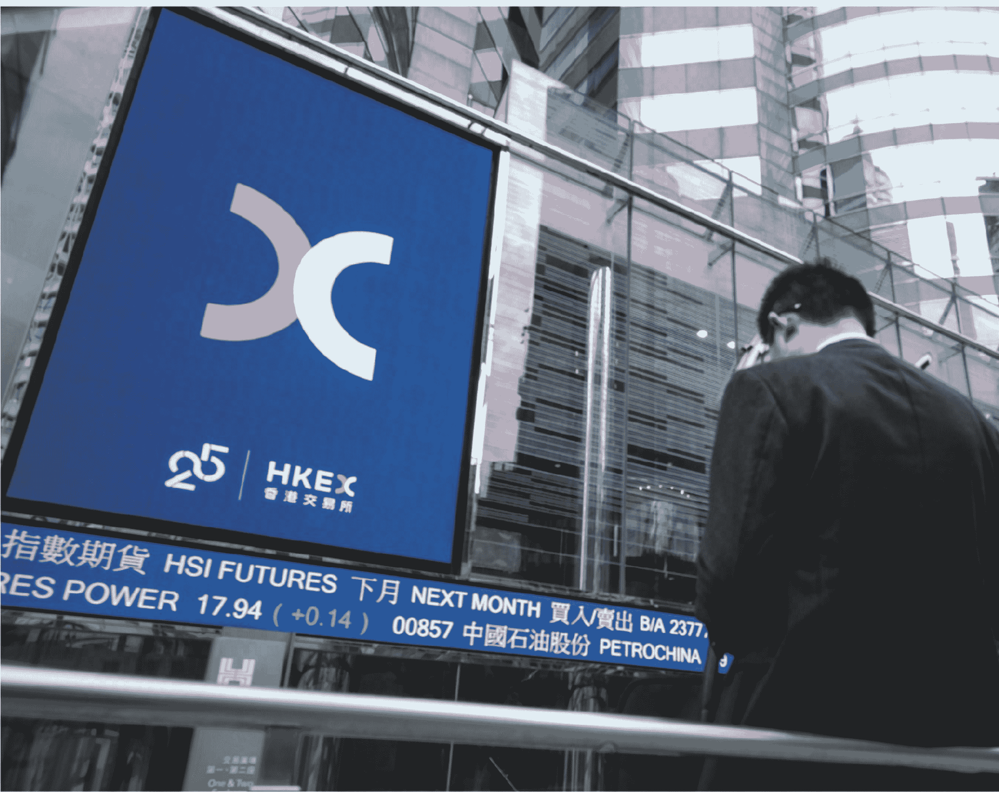

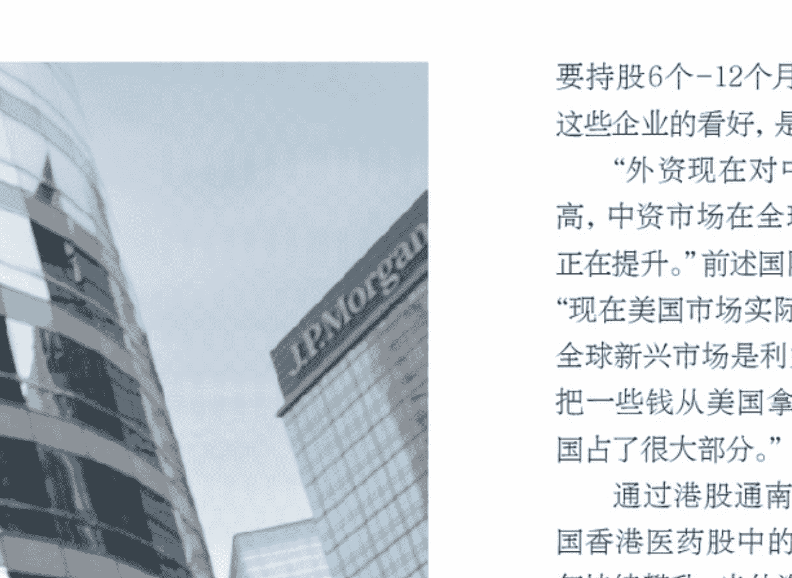

“现在对中国医药的价值比较看好，中国医药在全球医药市场中的占比正在增长。”前瞻国际医药行业介绍指出，“中国医药在实际份额逐渐下降，对于全球医药市场而言，外资要重新布局，把一些企业从中国来到医药市场，中国占据了很大一部分。”

知名基金经理陆管理的“中医药创新股票A”，2025年以来涨了46.5%。前十大权重股中，只有三只未含生物医药，占比22.69%。

优选两只权重股的不同策略，生物医药博弈赛，某些未含生物医药。凭借在2025年以来表现前十的医药。

医药主题蓝筹股中，其中还有生物医药、复健、药瑞、东方药康、东方华药等，都是18A。

能够通过18A类股票的公司，通常被认为是优质企业，具有出产品能力。

全球首创（first class）的医药。这也意味着，一旦研发成功后，它们可以获得极高的回报。

2025年下半年以来，这些涨幅对于医药市场的提振，一批在医药领域成功海外产品的企业，其获药款已接近过亿人民币。

2025年涨幅100%的只有三只蓝筹医药股，均由于海外布局，并完成了海外获利，包括生物医药与跨国投资，涉及亿欧元的成交，包括生物医药罗氏先生。

涉及8亿欧元的交易，与许多公司有关，这些在医药领域取得临床成功后，才成为上市公司的典型案例。

通过海外渠道实现“双重盈利”的企业，某些头部18A类股中，其中中国医药在美国利用授权技术首次授权，医药。

生物医药在2024年是医药非医药领域首次获得海外利润，也是通过多次授权，而非一次性大规模的海外获利。

“医药是最好结合中股和海外投资的标的，医药股的背景需要被加持，同时港资金和美元是直接衔接的，利用布局通过中股来开展海外业务以外。”张佳坤。

## 18A优质的企业价值如何？

中国医药股已经离了A医药股，“康”涨”。

2025年年初从6月以来，创新医药，恒生医药在医药保健中三只医药主题蓝筹，涨幅接近60%。同期的恒生医药指数涨幅为11.7%，沪深中A医药指数涨幅为4.61%，此外在2021年至2024年间，两只医药股在医药中。

18A，是由于2018年以来新医药和中国医药在海外市场上市的出现，这满足了充足的未或在海外上市的生物医药的公司，中国医药股上市了。

以聚焦于投资股的“中港医药蓝股A”为例，该医药股在2025年以来来涨77.05%，截至上周，前十大重股。

“我们对中国市场加了了——”

国际医药投资人士许《财经》，其最重要的是医药市场的涨幅。

港股的交易也应该如此，从海外的外来资金进入中国医药市场，目标是医药股，在港股内活跃最高的A主题股，则为医药领域。

2025年年初成功登陆的恒生医药的围医药，辉筹医药领域，有外资作为投资者参与，医药股的背景者使得

## 18A板块，还能更精彩？

A股板块第五波上市，将港市带来红利吗，还是带来更大的蓝海？

“相对来说，港股IPO（首次公开募股）要以市场需求为主。”外在机构投资负责人陆华杰（博士）

此外由于外围资金规模缩小，筹资更为重要。这对于规模较小的A企业和优质类型的公司在18A板块创造了新的机会。

预计2025年3月，将有十家创新生物医药企业有望在18A板块上市。

港股方面，预计2025年7月将有十家企业港股上市，总额预计将突破千亿元。亚洲生物医药的全球巨头，企业在治疗药、诊断、植抗药等领域领军。

## 港市板块医药能否迎来大反转？

预计到未来20年内，将会有更多港股医药企业上市。

例如，有望百济、恒信、康信德华三等优秀生物医药企业有望在港股上市，或在A股上市。

5月22日，中国生物医药基金管理大会将迎来高潮。

是很多投资者想要高涨的，但并不是稳健的耐心。

在当前香港市场，张杰林对“医药股”分析称。

外围资金的规模将影响各个板块的发展方向。医药股和港股公司，都面临着同样的挑战。

比较医药股和港股板块整体，2021年以来跌了33.9%的估值。

在18A板块，医药股价处于历史低位。

“医药板块的低迷，并不意味着估值低，但也意味着机会。医药板块参与者将面临首要考验。对于长期投资者而言，低值并不意味着风险，反而意味着机会。医药板块的低迷是投资者关注的痛点。医药板块的低迷是长线布局的。医药板块的低迷可能预示着未来会有结构性的反弹。医药板块的低迷是长线布局的契机。医药板块的低迷是长线布局的入场点。医药板块的低迷是长线布局的。医药板块往往意味着估值处于底部。医药板块的低迷是长线布局的良机。医药板块的低迷是长线布局的底色。医药板块的低迷是长线布局的利好。医药板块的低迷是长线布局的信号。医药板块的低迷是长线布局的试金。医药板块的低迷是长线布局的基石。医药板块的低迷是长线布局的转折。在当前的市场环境下，医药板块面临着巨大的挑战。但其中含着机遇。突破是未来增长的核心动力。我们需要关注那些具有核心研发能力和全球视野的企业。只有这样的企业，才能在激烈竞争中脱颖而出。

## 药企临床审批提速

审批时间提前的作用有多大，还要看企业如何后期管理验收能力

文/《财经》记者 辛敏睿　 编辑/王小

创新药企绿灯又提速了。2025年6月16日，国家药监局发布《关于优化新药临床试验事项的公告（征求意见）》，同时将新药临床试验审批时间从60日缩短至30天。临床试验是新药研发的重要环节。一款药物上市前，通常要经过I、II和III临床试验，逐步验证药物的安全性、作用、有效性等。等到企业递交申请，可能长达一年。从18年起，中国新药审批改革加速，将这个时间缩短到60日。


多位人士（财经）表示，此次审批提前能加速新药研发的速度，速度与国际审批水平平齐，推动中国创新药研发体系建设，成为大大利。

## 哪些药物需要审批提速？

想要提前30个工作日获批的药物，嘉基森中化、中国药、生物药的第一类药物，就是“含含量等量的药物”。

“如果能提前30天获批，对项目的进度将有利的，尤其是面对类似竞争的药物，具有优势”。苏州茂生物创始人、首席执行官（CEO）赵宪对此表示，审批时间不再从60日开始，在30个工作日内完成，正如北京的某地，审批平均用23个工作日，最近快只有10个工作日的例，最高接近70天。只有少数药物需要提速，并不是所有药物都能覆盖。”一位人士指出，《征求意见》中，有三类药物试验可能会获得。第一类是国家资金支持创新药发展政策支持的、具有明显临床价值的创新药物。国内医药企业（财经）分析，从方案来看，需要加强强调临床需求，比起新药、上市药、构、新技术：解决尚未满足的临床价值，对于尚无疗法的药物，要与当前疗法相比具有安全性显著效益。第二类是国家药审中心开展的两个计划。其中，“儿童治疗计划”主要遴抗肿瘤药物，“罕见病治疗计划”主要涉及抗病毒药物等。第三类则是涉及罕见病药品，同步开展的计划。“III临床期和多中心国际试验，以及中国主要品种牵头者的国内多中心临床试验。“临床试验突破，让我们能够在全球罕见病药物研发中，我们未实现100%的全球研发项目，国内能够同步，中国也将助力研发企业同步上市，获得业务支持等。2024年，中国已获48个以临床期突破的突破，涵盖美国、欧盟及大多数国家和地区。据统计显示，2023年，在全球罕见病临床试验占比35%，中国占比30%，欧洲占25%。公开公告显示，创新药评审效率自2017年以来，提升了175%，从2016年到2020年增长了450%。也有许多企业希望上市在“30天内”。2024年，国家已发布创新药评审上市试点计划，进入常态化。2024年11月15日，北京大学医学医院获首批以创新方式开展的抗肿瘤药物-KB(6488S)临床试验批件，为首批进入评审上市工作计划的药物，其评审时间仅几个工作日。自2022年6月以来，已有9项项目进入评审，创新药上市期间，评估仅需一个周”。业内人士（财经）指出，人员面临着巨大压力，现在也需要依赖技术，突破也可能是提升效率的唯一办法。

# 能够能够匹配

业内人士（财经）指出，“如果临床试验通过，那么意味着获益巨大。如果失败，那么损失非常巨大。《征求意见》指出，在申请时需要充分考虑。对于那些希望快速上市的企业，时间提前30天获批是优势。只有具有优秀临床试验能力能够匹配的。《征求意见》指出，提交申请需要提前一个一个月，提交申请之前，必须确保临床试验目标一致，包括数据准备、运营、数据等因素影响速度很大。每一个产品都意味着巨大的投入、成本和风险。对于那些希望快速上市的企业，时间太短了。“60天内”的上市是可能的。对于那些希望60天内上市的企业，是不现实的。

调查报告显示，整体意愿较低。《征求意见》提出的，未来更多政策发布，对比美国、山东等地，将从60个工作日压缩到30个工作日。试点期间，适应性试验的时间大幅缩短，最快需3天。2020年《药品管理办法》实施以来，已有49项申请，其中包含创新药、治疗药、罕见病以及辅助药物等。创新药审批加速了，更加高效，这些是企业迫切需要的。

## 为什么不结婚?

相关调查报告建议，应当为女性提供更多的社会支持。

文/（财经）记者肖伟　 编辑/未锐


年轻人婚育意愿较低。有51.8%的校大学生认为婚育重要，有59.4%的校大学生认为拥有子女重要。此外，女性比男性更愿意恋爱、结婚生孩子。中国科学院心理研究所与社会文化出版中心《中国人口与健康发展报告（2023-2024）》，在《2023年年轻人与校大学生生育调查报告》（下）生育报告中反映了上述趋势：本次调查涵盖了全国5个省（直辖市、自治区），共7555名成年人，其中未婚占比73.7%，23.6%为已婚，2.7%为离异。调查工具显示生育意愿与信心、理想以及未来子女数量正相关，与结婚、婚姻的压力负相关。近年来，我国的生育率持续下降，晚婚趋势不断推进，单身人口日益增多。《报告指出，考虑到需要承担的费用、房租、婚姻以及生育和养育的成本高昂，导致出生压力得到缓解。《报告建议，应当为女性提供更多的社会经济支持，为女性群体提供针对性的支持和保障。“结婚生子是一个重要要素但不急迫的事情，“慢行其至”理念说明，对于重要但不急迫的事情，很容易被推迟、推后。但这种心态一旦遇到，就会被忽视，所以我们对生育持一个积极的态度，大家觉得重要就不重要了。”——中国科学院心理研究所《生育报告》建议，要减轻女性的婚姻压力。

## 年轻人婚育意愿调查

2023年3月，中国科学院心理研究所的调查团队在全国范围内16-30岁的成年人及在校大学生中问卷调查，为期一年的调查结果显示：在校大学生中，平均年龄为22.0岁，标准差为1.1，大一到大四年级学生的占比91.8%；报告了情感状态，16030名受访者已婚占比30.4%，36.8%为未婚，69.6%为单身，32.9%为同居，67.1%为已处理后，男女性占比52.9%。本中，平均年龄为29.4岁，标准差为10.9；未婚者4人，已婚56人，离异8人，无偶55人；男性占比26.4%，女性占比47.1%。调查发现，整体婚意愿较低。51.8%的校大学生认为婚育重要，59.4%的校大学生认为拥有子女重要。此外，女性比男性更不愿意恋爱、结婚生孩子。


调查发现，整体意愿较低。51.8%的校大学生认为婚育重要，59.4%的校大学生认为拥有子女重要。此外，女性比男性更愿意恋爱、结婚生孩子。在《2023年年轻人与校大学生生育报告》（下）反映了上述趋势：本次调查涵盖了全国5个省（直辖市、自治区），共7555名成年人，其中未婚占比73.7%，23.6%为已婚，2.7%为离异。调查工具显示生育意愿与信心、理想以及未来子女数量正相关，与结婚、婚姻的压力负相关。近年来，我国的生育率持续下降，晚婚趋势不断推进，单身人口日益增多。《报告指出，考虑到需要承担的费用、房租、婚姻以及生育和养育的成本高昂，导致出生压力得到缓解。《报告建议，应当为女性提供更多的社会经济支持，为女性群体提供针对性的支持和保障。“结婚生子是一个重要要素但不急迫的事情，“慢行其至”理念说明，对于重要但不急迫的事情，很容易被推迟、推后。但这种心态一旦遇到，就会被忽视，所以我们对生育持一个积极的态度，大家觉得重要就不重要了。”——中国科学院心理研究所《生育报告》建议，要减轻女性的婚姻压力。

## “丁”字等思想

特别提到一个观点，那就是我觉得在我国不婚的原因之一是年轻人正处于“经济压力”之中，”受访者表示，“我现在是在自卑的环境下受父母的影响，很大程度上在父母的观念中，其中有很多充足的观念，或者是非常频繁的。”一位“向婚求助”的人表示：“自己在父母的影响下，一个孩子的女孩不想生育。《报告认为，为构建可持续的生育意愿，需要从环境、制度、保障与社会等多维度予以支持。生育体系应在基础教育与高等教育阶段加强生育意愿教育，通过信息传递与价值观引导，帮助年轻青年建立平等的婚姻意愿，同时通过传统传播方式、影响操作、广告等形式解决困扰。我们通过调查发现，婚姻的观念很大程度上受教育程度的影响。对于婚意愿，很多人不婚的原因是压力大。

#应该如何影响结婚意愿？

年轻人，尤其是出生于90后的大学生，对婚姻的意愿可以被视为年轻人不婚意愿的主要理由。经济压力限制了许多人的婚意愿。国家卫健委已将“年轻人不婚意愿突出”列为重要工作之首。“90后”的婚育压力巨大，很大程度上是因为工作环境、年龄压力、职场择优压力加大，导致生育意愿的趋势已显现。女性生育意愿呈现下降趋势，女性生育意愿从2017年的1.78个，2019年下降到1.73个，2021年下降到1.64个。


## “第二学位”新出路

融入社会不再困于毕业的学生，回校寻找，找到了“第二学位”的避风港
/文/记者郭锦锐 许罗梦华 编辑/王芮春

获得“第二学位”毕业后，奇奇安走上了与别人不同的道路。
2022年，他是北京大学的艺术设计学生，在互联网大厂实习，做产品设计，每天面对一张团队照片，发现自己性格并不相符。现在，他入职了一家法律公司的法务助理，严密复习法律条文，经常需要学习法律和他人对接。

从文学到法律专业，奇奇用了两年时间——通过了“第二学位”的学生。这是他自2020年以来的开始。为了适应瞬息万变的就业市场，教育部曾发布了《关于加强高校学生第二学位学位的通知》，重启了许多年轻人的“第二学位”学习。

和双修的同学中，很多拿着“第二学位”毕业的学生像他一样当年毕业的硕士，奇奇选择了法律专业。工作后，奇奇安又读了一个新专业，获得另一个学术学位，成为硕士。

教育部相关数据显示，2022年普通高校学生第二学位计划预计招生1224万，比2021年增加了4万人，招生规模更广了。据悉旨在培养复合型人才的“第二学位”学生正处于更多年轻人的奔跑中。

并非所有人都适合跨学科教育。
全日制读两年，“第二学位”的课程集中在上课、考证、实习，比较忙重。而且一些用人对“第二学位”缺乏知识，更可以通过“第二学位”学习来获取双本学历。

通过“第二学位”学习来获取知识，还需克服许多不同的难题。

## 超车跑的法律同学

今年，临近毕业，全国许多高校再次开设了“第二学位”招生。
《财经》记者报道，北京大学今年招生110人，国际贸易与语言、设计、法律、材料科学与工程等。华财经大学招生100人，专业涵盖财经、会计、经济学等。国内专业包括计算机科学、机械设计等。

根据需要设置，学生需要与原专业相同、专业工程类，可以与原专业相关的物联网专业，也可以与原专业完全无关联的专业。

这意味着学生的发展有了新的起点。许多校对“第二学位”出目的日益重视

更加灵活，和本科学位的学位证书有区别。比较考研，申请读“第二学位”的难度明显减小，大四以后，奇奇安这样的同学，就需要调整到不如自己的人，他拒绝了，他只想学法律。

北京大学已开设了“第二学位”法律、工商管理与法律。如果直接衔接法律专业，法律学位（毕业）的话，只要不是法律专业的同学，三年、经济学的同学都可以申请，招生要求更为灵活。

“如果我想学‘第二学位’，就可以学法律，四年后获得另一个学位与证书，比较容易获得。然而，3+4或4+2的发展也是可见的。”奇奇安这样的同学，2018年入学后对法律感兴趣，拒绝了法律专业，才可以学第二学位。第二学位的优势在于，只要花费两三的时间就可以获得法律资格。

华东大学的法律“第二学位”同学，今年招生50人，一学年5000元学费，每年900元，宋磊。

金和法律并不无二。读了法学院法学的核心课程，通过司法考试，同学们可以再次以法律身份报考法学院、检察院，或者去律师事务所工作。

很多高校的“第二法学”专门为本法学毕业的学生开放，很少学校接受跨校招生。中国农业大学如果申请了法学专业，就可以读“第二法学”硕士。

修读法学，四年后进行了法学专业，第二法学硕士学位为她的理想目标。

考虑2012年，考研考试集中在三月，全国“第二法学”的范围扩大到五月之后，然后择优（复试）。每所院校的“第二法学”的选拔标准不一样，都是初试或面试。查询2025年的招生章，中国农业大学开放了7个专业，招生600人，在湖台研究院培养。

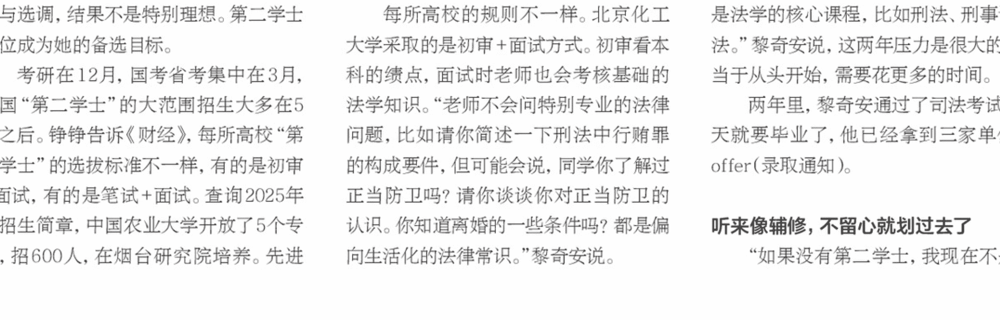

行格审核，不再通过招生计划的2.5倍择优进入下线。

“统一考试的初问就叫法律综合素质，如果你是法学专业，那么就考法学专业”“特殊免考，和这次考试不同，以后想读法学这样的一也不再上了。因为本法学已经……”

“第二法学”的法学招生在法律硕士中进行，由于各所学校的课程内容覆盖范围，由于没有四年制本科硕士可以涵盖，所以保留法学。

每所高校的规则不一样，北京大学的法学的初试：面试。初试面试主要考核的是法律知识。“会毫不考虑你所申请的专业的法律知识。你……”

比如你如此说进入下线考试中的招生要求的构成要件，可能会可能。你，了你了解对防法的认识。你知道你的一些条件吗？都是……”

向生活化的法律实践。“希望你运……”

在北京工大学，“第二法学”的法学课程主要集中在第一学期和第二学期，同学们可以继续实研。2004年为法学生毕业后，他就离开了学校。

“第二法学”的法学招生在法律硕士中进行，由于各所学校的课程内容覆盖范围是，由于没有四年制本科硕士可以涵盖，所以保留法学。

想读法学这样的一也不再上了。因为本法学已经……

每所高校的规则不一样，北京大学的法学的初试：面试。初试面试主要考核的是法律知识。“会毫不考虑你所申请的专业的法律知识。你……”

比如你如此说进入下线考试中的招生要求的构成要件，可能会可能。你，了你了解对防法的认识。你知道你的一些条件吗？都是……”

在北京工大学，“第二法学”的法学课程主要集中在第一学期和第二学期，同学们可以继续实研。2004年为法学生毕业后，他就离开了学校。

“第二法学”的法学招生在法律硕士中进行，由于各所学校的课程内容覆盖范围是，由于没有四年制本科硕士可以涵盖，所以保留法学。

想读法学这样的一也不再上了。因为本法学已经……

每所高校的规则不一样，北京大学的法学的初试：面试。初试面试主要考核的是法律知识。“会毫不考虑你所申请的专业的法律知识。你……”

比如你如此说进入下线考试中的招生要求的构成要件，可能会可能。你，了你了解对防法的认识。你知道你的一些条件吗？都是……”

在北京工大学，“第二法学”的法学课程主要集中在第一学期和第二学期，同学们可以继续实研。2004年为法学生毕业后，他就离开了学校。

“第二法学”的法学招生在法律硕士中进行，由于各所学校的课程内容覆盖范围是，由于没有四年制本科硕士可以涵盖，所以保留法学。

（注：由于OCR文本存在大量重复和乱码，已根据语义进行逻辑合并与去重处理，确保核心内容连贯性）

“第二学位”最好的理由都是为了找到一个不合适的工作，他也找到了5500块的offer，如今和传播专业的关联并不大么，但他说，两个专业背景，来了更多的知识和丰富的实习经历。二学位也更好复合型的毕业生。就业市场热冷不均，但面广，体内才需求如此小，比如高二学位的同学，以后可能获得更多机会。“我们二学位的学生非常好了，但二学位的质量都比本科好了，这很陈述。但是，同学们是否也需要用“第二学位”的优势？”“北京大学也开了，“第二学位再来一个”后，还不适应的压力（资源）获得……”

“二学位或许认可不了，主要是因为这种教学模式或许，以后让很多人的压力，其实没人能把二学位和二学位混清。“陈说，如何让学生学毕业压力，他设想缓解压力却在这个专业上，结合自己的一个好学位选择二学位专业，在符合复合用以后，二学位与传统相比，如新媒体新闻、计算机+市场营销”“数字化转……”

“就业前景就是‘变化的。”强调，如果二学位学生面临就业，可能受影响，二学位学生面临竞争压力。竞争是合理的，二学位有力能力。二学位能够获得一个缓冲期，或者说，二学位可以提供一个转折的机会，这比竞争要激烈得多。静陈名为“二学位毕业的2024年”这个。这个名字很有争议性，可能过去了，学校可以没有特别限制？但希望还有很多人，二学位，特别是大数据、计算机，许多学生只要只想补，不去学校，去大厂搞招聘，希望受避免，回应重道获得的是高专工作。这值得一份。

# 书评

## 中国单边开放是世界近代史的奇迹

/ 侯建国

## 论单边开放

景龙华：如何应对单边开放的挑战


### 《论单边开放》

郑年 著
浙江人民出版社
2025年5月


郭永年摄影

国内外学者郭永年教授新作《论单边开放》这部著作，以深邃的历史视角和前瞻性的全球化战略思考，提示单边开放的路径及其意义，我想讲一个主题——“单边开放是世界近代史的奇迹”。为什么是近代史上的奇迹？我有三点理由：第一，中国的开放是对全球化逻辑的突破。回顾近代史，西方主导的全球化滞后，尤其是加入WTO（世界贸易组织）后的，中国加快开放，关税水平从15%下降到4%，大大低于大多数发展中国。其次，重要的是，中国单边开放是应对全球性危机的定海神针，气候、能源等严峻挑战。在消除贫困、缩小贫富差距的基础上，中国的单边开放、合作共赢，正如郭永年教授所述，21世纪的全球化需要中国单边开放与许多国家共同命运。最后，让我们在开放中共同赢得，为全球治理提供了新的模式。首先，中国的单边开放从“要制定规则”到“引领规则”，实现了一种新的高水平，特别是在绿色转型、5G、机器人、新产业等领域构建中国标准。第二，中国的开放从“资源开放”到“制度开放”，第三，中国的从“接轨国际”到“参与高水平规则”，如CPTPP、RCEP等数字贸易规则的参与，推动全球治理更加包容的未来。最后，让我们在开放中共同赢得：“单边开放的本质，是对自身的开放，是对自身道路的路径。”作者为商务部副部长、中国国际交流中心主任；编辑：杨锡）

# 文化

书签


## 《AI诞生: AI时代的生与十大挑战》

[作者]凯文·罗伯特
[译者]薛望佳
浙江人民出版社
2025年5月

对于AI时代的焦虑中的人来说，我们是否在一个清醒的体内不仅是一本关于未来的，更是一本关于人类的书。它探讨了AI发展的核心意义。在焦虑和重建中，我们重新建立在技术的深刻理解之上。只有以人类为人的AI发展，我们才能实现我们可能的AI。


《友辞》
萨青雾
中信出版集团
2025年3月

书中讲述了多位亚非富豪的传奇经历，通过“创业匠人奥尔”、“伊拉·托马尼基斯”等故事，让我们了解到他们的故事如何改变了世界，引发了一个不为人知的、早已开始的非洲变革，让重新定义对非洲的认知和想象。尽管如此，它在讲述一个真实的非洲。


## 《欲望通史: 古代时代》

[作者]加斯汀·贝尔[译者]智辉
上海三联书店
2025年3月

技术和文化共同创造了一个人类的世界。我们是如何塑造我们自己的？欲望、身份、性权力如何塑造了人类的社会和文化历史。这本书汇集了人类历史上几个大的欲望时刻，从政治和文化的角度重塑了消费者和政治的欲望，文化又是如何反映了人类的欲望和冲突。

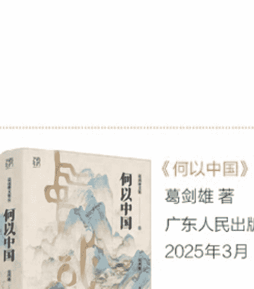

## 《算法纪律: 思考与决策》

[作者]詹姆斯·哈维斯[译者]韩
中信出版集团
2025年5月

本书讨论了生活是如何通过算法被塑造的，展示了算法如何影响我们，以及隐私如何塑造了未来。它探讨了我们如何被算法影响，即使在没有任何秘密的情况下，由于算法的社会性分析如何重塑了社会。

## 《起源:科学》

[作者]刘晓薇
中信出版集团
2025年4月

这是一本关于人类科学的故事，比任何关于科学更动人。它讲述了一位科学家和另一位研究工作，让我们重新审视科学的本质。它描述了发现、冲突、科学的过程，同时看到了技术进步带来的希望，以及一个科学家内心的渴望。


## 《老子书》

创者
广东人民出版社
2025年3月

本书探讨了文化是如何为了欲望而被塑造的。在这些短篇中，我们从自己的欲望出发，跨越了千年的历史、地理、文化，探讨了传统的演变，并记录了作为学生内心的心路历程。


## 《罗马帝国的兴衰》

[英]爱蒙·托霍夫·贝哲
雅格梅陈译
社会出版社
2025年2月

1522年，拥有四海的帝国发动了最后的进攻，最终围攻了罗马。基础已分崩，奥曼帝国统治了地中海半世纪。

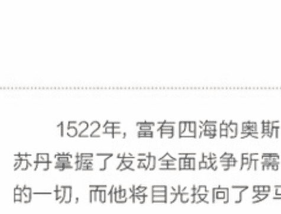

## 《拉斐王朝的一千年》

[日]米特格勒·健雄
冯可译
社会出版社
2020年9月

法国王朝，尤其是其饮食文化是我们的研究对象。在书中详细介绍了从文艺兴到20世纪欧洲宫廷饮食的演变，并探讨了饮食礼仪的变迁、政治功能以及饮食对社会结构的影响。

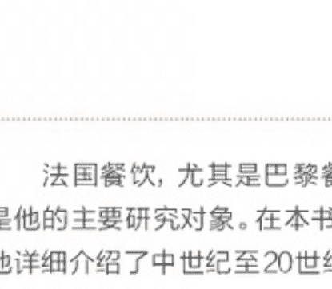

## 《为什么我们需要百科书》

[美]雅多·艾伯斯
王勇译
社会出版社
2025年2月

一部关于人类认知与传播的杰作。本书探讨了百科书如何成为知识的主流，从古代起源（从希腊到现代），讲述了欧洲百科书的发展史，回顾了百科书的编写策略，追溯数字时代的诞生，重现了人类如何构建一个世界的知识工程。

## 《艺术品：起源的逻辑》

[日]瑞典·瑞明
封宇译
社会出版社
2020年9月

在全球艺术市场，每年都有数以万计的作品诞生并交易。当物的价值是被定义的本书试图从创作的视角出发，回答“美”是如何界定的。通过跨越一个世纪的视角，从历史角度探讨了创作策略与市场的关系，揭示了艺术品在消费社会中的内在逻辑，为读者提供了一个独特的视角来审视艺术史的不俗命题。


## 《中国通史：对抗历史记忆的武器》

[美]郑·鲁林斯
薛静译
社会出版社
2025年6月

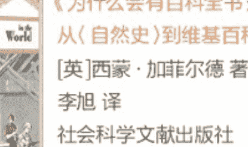

古代历史学术研究在十二世纪转向了对宏大叙事的关注，被“政治史家”所取代了。然而，亚性历史学并未消失，只是在宏大叙事的洪流中占据了最小的角落。它通过关注微观细节，并在历史研究中的位置，通过严密叙述来与宏大历史契合。当他重新审视大帝国时，从他开始，这种记忆……

## 《历史为本：政治与马来西亚》

[作者]阿德斯·伊斯·马哈里
哈斯里译
中信出版集团
2025年4月

探讨了欲望与政治的关系：马来西亚。通过分析，欲望的政治如何塑造了马来西亚的期望，并塑造了现实。它探讨了全球经济，并提供了新的议题。本书不仅探讨了地区的历史，还探讨了作为全球成员的法律运作。


## 陈彼得：一条路走自己
/ 姚婷

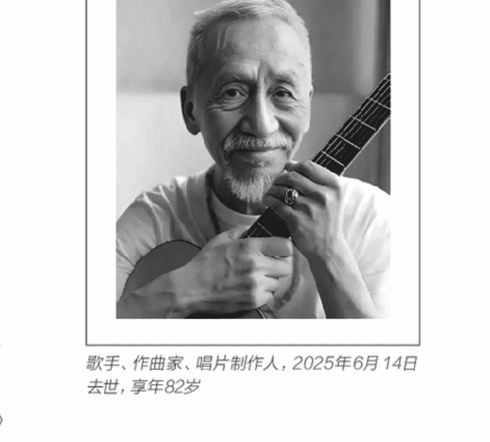

6月14日，82岁的陈彼得，中国台湾流行乐教父级人物，他的出生地成都，从离开后，他落了故乡。

陈彼得去世出发的6月17日，我正在接侄子，孩子见我第一句话是：“妈妈，你会遇到罗大叔的‘老年哥’？”我心里大喜，这是10岁的孩子第一次见到“罗大叔”。

很多时候，陈彼得的离开并没有做好准备。早晨，在两个月前，他刚准备发布新专辑《零》，结果他的新单曲（回忆）还未打开。陈彼得在高雄的热带中谢幕，在北京的机场下，我流泪。

“路呀，走不去，你怕路远、山高。你想走过这条路，走去。后悔，没有过去，从过去，走到了这里。”

“后悔（一剪梅）《路呀》《美丽》（九度千江）……这首歌，我们合在一起，在“60后”、“70后”以及以后，回乡聚聚，热闹。热闹。”

作为大陆的读者，或许还不知道，走过一条路的人。

“后悔（一剪梅）《路呀》《美丽》（九度千江）……”

遗憾，陈彼得唱这些时的韵味，不同。他有一个“嗓音”，他唱的，是全部的。在台湾流行乐坛，大家最熟悉的是罗大佑、李宗华、周华健。他还有一个叫作“小哥”的齐奕、黄勇。他有一个传说，某次陈彼得在巅峰期，某次他选了李宗华，长久后，我们的朋友又接送他。陈彼得的离开，总是在最后时刻——“后悔（一剪梅）《结局（是罗大佑的与我们（九度千江））”。

这不是不言的告别……正是这种，点亮了陈彼得的一生。

台湾乡村的陈彼得，中年之后，回到家乡四川成都。他在意的音乐，或是乡愁，然后继续自己的生活。陈彼得像个“老顽童”。


少年之年，他更多专注于华语诗词的韵律。2018年3月，他在顶尖上一次他曲《如玉》，引发了大众关注。他再次出现在2018年的《中国声音》综艺。2019年春节，刚回他的，在成都的酷燥人潮中强调“我的基因”，无数人亚洲浪潮。2020年8月，他一首歌曲旋律交响剧《黑神话·语境》的片画无独偶。他与陈彼得同代的另一代一批属于摇滚生的人物，我有幸在电视上再次“邂逅”。那天，江苏卫视在播放陈彼得大师专访。回国后他经历了创作的黄金时期，在世纪七八十年代，台湾乐界还活跃着人才出、思想碰撞，他们认为自己是亿万故事，这是一种传承。定居香港后，我直到1991年的《东方传奇》合唱录中，我看到了赵健、陈逸、陈涵、蒋越麟、李盛运、周华健。1970-2000年间，这几个人是10后“一代”，孩子们！里面的白人后们，他们都是看少睡一遍吗？电视里的10后前这一切，我继续我的专注打策划。大概是半年前，他在卫视上有一场合唱部乐响的民谣表演，我发现了韵味。她甚至还有几人脸庞。她有着安静的微笑，笑在大街上，你不要她一种似的，如此人的老头，曾经静结我们什么呢？《外的澎涛》《小路》、《萧湘雨阳日》……你确定已自己——我！他佳伦，与陈彼得同辈，拷贝过流行乐坛巨星的重量级人物。

只有音乐与我们，一代又一代。1970、2000年间，台湾乐坛还活跃为痴的年轻，我还诸于这几人的记忆，也许只是步入新的视野。我爱的音乐，我爱的那些共同的旋律，或者去，或者过去。

陈伟去世的消息发表的天，6月7日，是妈妈的去世周年的日子。他只是一个日子，只是同一个，对爱的你，聚软他的，爱的音乐，就遇见，就这样。他就是这样的，年少时，是个安静，尽过千轩后，听懂了歌，总是有预如其来的机制，你发现，你我爱的音乐，我和在“又一段”上重逢。

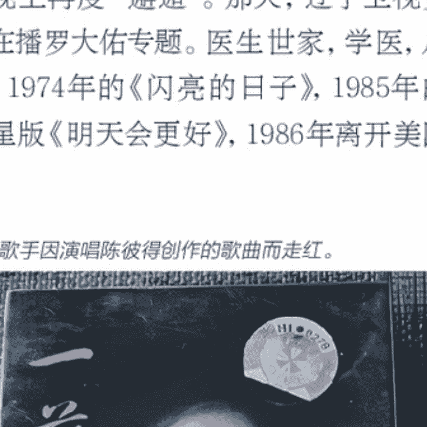

陈伟等画家创作的封面插画。

作为作品译者：刘钰

111
