# 财经 CAIJING MAGAZINE

2025年第8期 4月14日出版 总第715期

特辑 | 博弈、和解与遭遇。
治理未来：中国模式的启示。
美国发起的关税战无疑加剧了全球经济衰退。
小米汽车术的任途。

# 对弈关税战

美国发起的关税战无疑加剧了2025年全球经济衰退。
稳住国内经济的重要性不言而喻。中国的关键仍在内需。

# 免费 价值 及时 专注

# 扫码加入 知识星球TOP 免费资源群

- 每日免费获取价值资源
- 可提供各类资源搜索服务

| 热门付费文章 | 各行行业报告 |
| :--- | :--- |
| 精选图书资源 | 副业赚钱方法 |
| 职场实用资源 | AI政策自媒体体 |

公众号:知识星球TOP 微信信号:jntsg8 微信信号:jntsg2

分享资料仅供个人学习，请及时删除，切勿商用传播

# 目录Contents
## 2025年第8期 /4月14日出版 / 总第715期

《财经》杂志 周刊 每周一出版 下周的期: 2025年4月28日

16 封面文章 Cover Story

# 对美国关税

美国发起的关税战无疑加重了2025年全球经济衰退，
稳住国内经济的重要性不言而喻。中国的关键仍在内需。

+ 社评 Editorial
8 大力外援
而忽视这些权力的政策制定者终将自食其果

+ 财经速递 Digest
编辑随《绿绿》评/对谈
读者评论
11 “新三样”产业如何破困拓疆

“广场协议”的最大问题是什么
对于日本以往持续的赤字缓解，严重影响了之欧美两国的国贸政策转变，甚至成为全球
金融危机以及“日本化”现象之一

+ 财经评论 Roundtable
12 国际首付行长中国文明明：

+ 经济学 Economist
43 关税贸易战

如果特朗普曾说应该应对一场贸易战，
那么它还能带来什么呢。如果他认为
国际贸易和投资结构将以美国工人利益为重，它还有其他可能起到的作用。

+ 特别策划 Special Issue
66 营收与净利润双创历史新，
贵州茅台已成为常青树
2024年贵州茅台净分红总额647亿元
这里，已经是贵州三年现金分红600亿元

+ 经济全球 Economy
50 新路径破解围困持续

随着“一带一路”深入推进，边疆贸易的重要性日益凸显。通过多次探索发现，小规模跨境贸易新模式可以作为区域创新的尝试，具有巨大价值。

从“酒类招商”到“专业招商”转型，背后是整个引资思维的蜕变。

上经历了经营管理转型、客户规模、行业布局结构和市场化进程的不同。

66 “内卷式”竞争的成因及引资路径

76 招商一季度整体面临哪些挑战?

北京资金重点招商包括电力设备、电子、银行、食品饮料和生物医药等。

## 54 高度关注跨境贸易在陆

中国不把跨境贸易作为反制措施，但是从海外产出安全的角度看，可持续未来的持续性和风险。

## 86 招商与港口交易

一项本地万符合条件的业务，在买家中首国领导人的帮助下，卷入地方政治治理，以致前景充满效益。

## 79 上海企业招商寻求“增长链”

2024年上海企业招商将面临更具建设性的压力，收益稳健型、新能源汽车、大型布局正成为上海企业信贷招的痛点。

# 特别报道 Special Report

## 58 治理“内卷式”的乱象
场景、资本、产业链、落地，以更多引资新模式在地方发展。

# 资本与金融
Capital & Finance
72 国际首付行长中国文明明：

## 82 持续减少
中国银行在2025年2月发布的数据。

# 特别报道 Special Report
## 58 治理“内卷式”的乱象
场景、资本、产业链、落地，以更多引资新模式在地方发展。

从“酒类招商”到“专业招商”转型，背后是整个引资思维的蜕变。

# 财经特辑 Exclusive
## 108 小米技术与责任
当智能驾驶被包装成“无不能”的自动驾驶，技术与隐患就此爆发。2024年四末，个人住房余额376万亿元，同比下降3%，增速比上年高3个百分点。公共租赁中心需要转型，事故、纠纷可能无法避免。许多人士认为，“新规将市场和”，有利于行业稳定和持续。由于业务涉及较多，从中取得突破，全球企业再次陷入收缩。

## 100 持续落地
需求向东方扩张，面对友好、开放的市场空间，非常适合中国企业作为跳板。

# 科技与健康
Science & Health
## 16 重塑全球
产业链关键影响、国际格局，让医药厂商按节奏调整，尝试市场布局。

## 21 特别关注“温控”
全球驾驶再次遭遇一类危机，中国汽车面临发展，辐射还是全球？

## 23 还有哪些关键？
产品的销售节奏接近最近，汽车物价有望希望几个圈子里，这里是持续多久？

# 公司与产业
Industry & Corporation
## 94 泡沫变成“泡沫转型”
股价从底部继新高，住房贷款今年是三次还是吗？

## 98 公共租赁中心何时
当力增、培训市场有利，公共租赁市场出现结构化转型，视规模。

## 108 小米技术与责任
当智能驾驶被包装成“无不能”的自动驾驶，技术与隐患就此爆发。

## 126 当AI到来，人类文明是否还有后患？
认定仍需明确法律准则，以及发生。

# 中国发展高层会议传达大信号
沈光：华东集团副总裁、经济学学者

每年在中国举办的高层会议是一次跨国企业制定政策的重要窗口。本次会议，笔者认为其传达了许多信号。中国正经历经济转型期，特别是房地产市场的调整，对中国经济的影响巨大，发展前景有所不同。然而，在特殊时期，全球经济面临着严峻挑战，形势严峻。一方面，加息周期导致全球通胀高位，另一方面，中国正处于增长转型的关键期。头部企业正面临全球经济体的竞争压力，这种竞争反映了中国在转型期间的严峻性。从201年至2025年的趋势来看：

### 中国贸易，外贸还有前景
从市场数据来看，中国经济表现良好。一方面，政策发力使得外国投资者信心增强，管理环境改善；另一方面，全球市场面临巨大压力。服务领域、医疗、教育等领域也正经历转型期。而近期发布的2025年经济预测显示，对海外高需及面临需求有望获得增长。外需需求多元化、趋势持续，北京便利措施频出安排。

### 外资的转向“转型升级”
理论上海外投资者对中国的关注点转型升级从另一个侧面证明了中国经济产业结构发生变化的结果。现在，更多参与会议的学者表示，西方对中国的关注转向市场，寻找增长的中国需求寻求收益。转型全球：中国正引导企业进入产业布局、推动生产升级。一方面，外国投资的便利性正在加强，另一方面，“产业升级”正在实现中国经济的转型。

### 中国对“消费”成为新的增长点
本次会议将强调上消费，显示出对中国增长政策的信心。大环境期间，对中国经济的信心，许多投资者对中国依然保持信心，这显示了中国经济的韧性。

面对西方对中国政策的冲击，中国坚持持开放的国策，对国际社会的认可度正在逐步回升；通过进一步扩大开放，中国有些领域可以大开，也是为了应对环境变化的不变选择。

### 学术观点

### 资质新动力提升还要加速生产
张斌：北京大学经济学院
林辉：北京大学经济学院
林毅：北京大学经济学院

### 金融能够创造就业吗？
本文以2025年为对象，运用双维度分析了“金融”政策的作用。一方面，结构化转型程度高的生产率水平显著，另一方面，引动力供给、技术升级能够驱动产业结构的调整，使得不确定性影响较大。

### 关注
（选题主题：3月-4月）
1. 新型就业未来是什么？
2. 消费需求如何？
3. 消费升级、资源配置
4. 持续降级？
5. 如何解决“金融难题”？
6. 三次改革如何？
7. 抗疫情首要任务，灵活才能改变世界
8. 从趋势看改革
9. 养老金缺口
10. 尤其智能、健康领域

编辑：jiangyiwang@cijing.com

# 大保险
对中国保险行业政策限期结构，中国保险行业面临十年来的压力与挑战，亟需各方努力护航。保险本身是行业主导领域，占据大盘。除了保险本身的业务，涵盖寿险、产险、基金、养老等经营性业务拓展了保险业务，而海外业务作为发展之一，从中陆地。

因此，中国保险是保障的重要指标，更是雨伞，就会导致保险变化，常不可忽视。保险是信心、增长，它作为市场车，高动力对于推动增长不可或缺。保险行业中的外资企业是引领者，具有高价值，有利于增强信心和投资环境。保险是实力，中国保险的实际情况体现在市场份额上，虽然面临来自外的竞争，也有中小保险企业跟进。保险行业的密集化趋势，正是因为中国有很多知名外资经营者，拥有高效率的工程技术，这些都是在中国业中重要的衡量标准，保险在未来还没达到这些标准，但进是一个发展的关键。保险是能力的体现，行业中的佼佼者，由于其先进的经营经验，使得中国保险所处的领域经营者是有价值的。行业的大多数是领先的人工智能、健康等高难度，为提供了强大的依靠。当前保险的主要挑战是保费供给。由于增长结束，需求产品面临销售困境而要进行转型，虽然面临着转型的压力。这种在保险行业中的结构性问题，很多行业无法通过上海供应链和国内市场的转型来转型，一旦失去了过去的优势，修复的难度可能较大。在转型同时还要考虑到部分的保险技术和国内市场，对保险的未来需要更完善的深层考量。在近期要密切监管对保险风险的主体进行直接监管，对保险可以加强监管并解决金融问题，还需政府加大力度支持并延期缴费，让政府相关部门可以在保险领域加强执行力支持，避免金融系统性风险。企业以人为本，拥有高素质的员工，具有优越的管理和工程团队，是一个具有优势的实力。市场难以适应的环境，只能依靠中国保险业构建竞争力，通过国际化来增强竞争力。行业和新的发展需要政策机遇。中国市场在全球市场中的地位，市场出的机遇是保险企业的机遇。而中国市场面临的也有巨大的挑战，例如巨大的压力以及地缘政治风险、汇率波动，这些都使得保险面临巨大挑战。特定保险企业所面临的机遇，将与时间同步地获得回报，不论压力和市场的压力，可以得到回报，也可以进行转型。总之，相关关于中国保险的观点分析，对行业需要更长的一段时间观察以及跟进后的结果。最后需要考虑的是，我们如何才能不失去保险的信心，让保险行业迈入一个新的轮回。我们正处于全球化的资产负债表修复期间，风口云变。对于历史，我们希望得到回报，而历史也是许多因素共同作用的结果。在现在我们为好事的事情付出努力，同时得到期待的回报，保险行业将回到新的轨道上。

2025年4月15日

# 财经 CAIJING MAGAZINE

www.cijing.com.cn
主：中国信息集团有限公司
主办：中信证券研究院设计中心

总编：执行编辑 刘凯
副总编：桂建国 启睿 薛勇 宋来 张秉

编辑委员会：刘凯 刚刚启睿 吕峰 薛勇 宋来 李薇

主编何刚 常务副编：王伟 执行编辑：张杰 吕峰 薛睿 新锐副编：亚庆辉 王信仪仅佳 张杰 桂建国 新锐 智毅 郭睿 薛勇 凯凯 李雪 江涛 洪媛 张国宇峰 沙波 谭薇 鑫（策划）凯凯 启毅 郭睿 宇 谭薇 黄辉 慧璟研究部刘广华宇平 斌 泽阳 财经中心国际中心国内编辑郭建平张晓明 伟（韩）金融中心孟建 陆勇（韩）刘杰 陆桂（韩）特记者陈凯（薛睿）策划：张建辉波波记者上海：张建辉波波记者：李建辉编辑部郭颖（薛睿）策划：王宇刘凯明明梓建辉设计制作薛斌于李文华主编李峰高世琳冯程梅冯瑛张斌 张成诚总编刘凯编辑部郭颖财经总经理王建平中国证券宏观研究中心桂宇发行部市场部策划部。

发行：北京财经文化传播有限公司开版单位：北京财经文化传播有限公司

《财经》杂志地址：北京市朝阳区外贸大街22楼19层
编辑部：010-6858047 / 010-6858046
网址：www.cijing.com.cn
订购：010-8550513 / 010-8550500
发行：北京财经文化传播有限公司
地址：北京市朝阳区外贸大街22楼19层
电话：010-8550513 / 010-8550500
服务热线：service@cijing.com.cn
邮箱：news@cijing.com.cn
年费：300元/年（含邮费）
邮费：60元/年（含邮费）

《财经》杂志封面设计

《财经》杂志封面。感谢读者支持与关注，如有对本杂志有任何建议、意见，请随时联系编辑部，我们将根据您的反馈不断改进服务。邮件主题请注明“读者反馈”。

2025年04期

# 读者评论

## “新三”产业如何破局拓疆

《财经》2025年第7期“新三”产业的挑战与未来

2024年12月召开经济工作会议明确指出，“推动科技创新和产业融合发展”“整合稳态”“内需扩容”，规范政府和企业行为为“用数字技术、绿色技术赋能产业升级”，为“新三”产业的未来发展和破局拓展提供了明确方向。
我认为有五点：一是确保市场主体积极参与，构建行业领先创新型企业、大学和科研所参与的产学研体系，形成产业创新的生态环境；建立市场化机制，发挥市场在研发方向上的创新引领、要素竞争形成和创新资源配置的决定性作用；三是深入国内市场需求，开宽“圈”的市场。以“一链”构建连接国家为核心，积极拓展亚、拉、中东等新兴市场。五是积累增长的优势。

(上海 吴昊)

## 如何聚焦消费力？

《财经》2025年第7期“如何聚焦力？”
作为增长的“引擎”，消费需要现实，一方面结构化转型程度高的生产率水平显著，另一方面引动力供给、技术升级能够驱动产业结构的调整，一方面实现持续增长，另一方面提高居民收入，更有利实现消费改革。

(广东 张鑫)

## 跨国汽车如何重构战略

《财经》2025年第7期“汽车出海，中国在何胜？”
当马斯达的新车型转向中国，当在全球供应链重构欧洲市场，当赛迪凭借本土优势赢得竞争……中国不再是“世界的工厂”，而是全球企的激烈竞争战场。在国内，中国市场正成为电动汽车技术创新的源地；德国汽车希望在此立足，完成从造车到本土运营的全方位转型。提升速度与市场反应是德国车赢得的关键，德国汽车必须深耕中国市场，这需要更快速的创新和应对能力，赢得跨越发展的机遇。

(上海 刘涛)

# 日本央行前行长白川方明： “广场协议”的最大问题是什么

对于日本过往教训的逸浅解读，严重影响了之后欧美等国的货币政策运作，甚至成为全球金融危机以及“日本化”现象的原因之一。

文/《财经》记者 江华 编辑/苏琦

4月9日，日本央行行长田雄男表示，日本央行将仔细观察美国关税对产生产生的影响，并以此作为制定货币政策的依据。

## 变化，美国关税政策的具体影响

“由于美国的汽车等关税，日本国内外的关税将受到影响。我们将通过多种途径，分析这些关税如何影响日本的经济，” 植田在日本央行会议上表示，“我们需要制定政策。”

## 西方对日本经济的观测

在欧洲，通货紧缩是经济问题的结果而非起因。在2008年金融危机之后，许多欧洲经济仍然处于低迷。实施了宽松的货币政策，但仍然持续到低通胀。然而从从014年起，日本也实施了宽松的货币政策，日本央行的资产负债表大幅扩张，但日本增长率下降。

白方彦从2008年4月至2013年3月担任日本央行行长。白时期的日本央行批评通胀政策不生效。在担任日本央行行长期间，白方彦发表了《银行回顾》，中英文书名则是《回顾银行业的30年》，白方彦当时认为通胀是一个“长期症”。

面对美国总统特朗普再次加征的关税，日本政府并没有采取反制措施，而是试图通过外交斡旋谈判。日本首相表示已与特朗通过通电话，并确认了“关税威胁”，关税将再次冲击美日贸易。

田雄男表示，日本央行将仔细观察美国关税政策的不确定性，并将密切关注关税对市场和股市的影响，并从此判断。

2024年3月，日本央行启动自2000年以来的首次会议，结束了长以来的负利率政策后，日本央行将货币宽松政策转向，从0%以下调整至0.5%左右。

日本央行将于3月5日至3月11日召开一次会议，以决定货币政策转向将利率维持在0.25%左右。

日本央行行长田雄男在3月中旬表示，下下行的会议将进一步进行讨论（对经济），将关于通胀的速度还有待观察。他指出，日本央行还将增加会议，每周25次，以后这是否能看到日本的通胀今年将达到1%的水平。

白方彦曾，如日本央行行长田雄男在行动中，美国关税政策对日本的确定性非常大，因此并不在预期的航向，日本央行将需要根据基础通胀判断。

“我现在对通胀的未来有了更好的信心，如果我没有信心，我不会这样做。我没有经历过实施如此宽松的货币政策。现在，我正在根据日本经济的现状，日本央行是否已经考虑做出货币政策的转向。然而，日本央行对美国关税对日本的影响的影响。”

在长期看来，日元贬值是由于经济差异加剧了汇率波动，这可能对日本以及整体经济的影响。日本汇率波动对进口出口企业的影响巨大。利率差和收益率倒挂市场套利驱动导致日本国内股市和股市联动。一直到20世纪90年代后期，日本陷入了长期的经济停滞，即“失去的十年”或“失后的二十年”。

在与中国贸易结构性转型研究中心内部事务，《经济日报》杂志签署，“通胀形势”其实是当时日本与美国贸易的顺差高值导致了低通胀。长期增长是日本经济的两个原因：人口的老龄化、出生率低导致的下降。

由于日本通胀的现状，白方彦并不悲，也不担心。他表示，虽然日本目前面临通缩压力，但他认为这是结构性问题。如果出生率能够提高或许可以所获得，但他现在没有看到像描述那样的。

## 中国与日本相似

包括中国和西方在内的贸易国家经济增长值。他们要求中国出台某些经济政策来限制国内增长。“宏观扩张的想法是增加国内需求，以减少赤字。但是贸易差异从根本上反映了储蓄和投资差异，这是由人和技术决定的，而非经济政策可以改变，但我们自己没有货币政策，就不会会有日本增长。宏观扩张对于中国是一个好处，”但这并不是肯定的。日元升值本身不是问题，是在贸易背景下导致了我们的问题。

白方彦认为，中国可以从日本的教训中获益。在美股崩溃之后，日本需要考虑两个问题：一是金融系统的崩溃，二是资产价格泡沫。白川认为，泡沫的崩溃是因为投资过度。但是泡沫的产生在某种程度上是可以避免的，由于泡沫的持续，泡沫是不可避免的，”白川，“避免是不可能的。”

东京央行的行长在最近开发了对日本经济的担忧。官方发言中，他们在3月20日提到关税，认为目前的政策不利于日本。他指出在3月23日发表文章并白川认为，现实1985年的“广场协议”是非常成功的。日本市场出现了衰退。由于泡沫，日本GDP增长也发生了巨大的变化。从1989年以来减少了40%，现在的增长接近10%。他认为如此情况下，如果日本扩大赤字，将导致债券发行面临风险，再次导致通胀风险。

根据我的预测，我不知道该做。从日本的观点来看，没有理由签署第二次“广场协议”。中国与日本有很多相似之处，但也有一些重要的不同，”白川，“对于长期增长的变化，中国的人口结构比日本年轻得多。首先，中国可以从日本教训中获益。其次，中国在政府权力方面完全不同。第三，中国的人口结构可以防止增长衰减，未来的空间很大。年轻的人口结构使得该地区具有优势，这对生产者影响非常显著。白川表示在1980年代，世界上最大的投资是日本，由于是日本的政府，两个国家之间的关系完全不同，这是一个挑战，”白川，“在1980年代，由于日本在经济上的领先地位，日本也面临着困难。但对于我们来说很有不同。一个区别在于处于发展国家的相互强度差异。我们习惯于依靠强力的政府来避免潜在的危机。美国和中国能够找到解决方案，这是一个挑战。”

近年来中国经济正面临避免日本1980年代以来的问题。白川表示，对于任何一个从日本高速增长的政策，可能会导致一个巨大的泡沫。在未来的增长中20世纪90年代以来的问题并不存在相似之处，由于其经济结构和通胀程度不同，人口规模的差异使得与日本的贸易关系存在差异。考虑中国日本相似之处，白川认为是为了应对日本在20世纪90年代面临的国际危机导致政府。首先，日本面临了泡沫。其次，日本政府面临着巨大的压力。第三，作为生产者的增长要决定的因素可能的资源分配。

# 关税战

美国发起的关税战无形加重了2025年全球经济衰退，稳定国内经济的重要性不言而喻。中国的关键仍在内需文/《财经》记者 锦颖 王睿春 江枫 编辑/王睿春

我们没有决定调整对华关税流向10%、30%、50%……关税、反制、加税、再反制，中美贸易往来愈发紧张。周四（9月4日），美国总统特朗普（Donald Trump）在自己的社交媒体上称，对中国的关税将从10%提高到100%。

“立此生效，”这位当时的美国总统表示，“我们将全球贸易推向一个史无前有的时代。自1970年以来黄金危机已经陷入了所未有的困境。”

清明节后，中国的股市依旧冷清。周四（4月4日），美国称将对华关税提高至25%。”《财经》在华尔街日报上报道，美联储行长鲍威尔（Jerome Powell）在记者会议上表示，将继续维持调控，可能下月开始加息。周四（4月4日）美国称将对华关税提高至25%。

4月4日后，华方企业已收到大量取消的订单，“丢失，”华方企业表示，“许多客户拒绝订购。我们遗憾，中美贸易谈判尚未继续。4月7日，华方企业考虑到国际贸易及汇率加剧，局势增大，美国选择缓和。然而，一位深耕深圳的行业人士表示，这几天他们尝试通过关税。4月8日，美国宣布对华进口商品的关税率从30%提高到90%，或者6月1日提高到150美元。一件来自中国的跨境包裹，可能只有三美元。电商正遭受着巨大的冲击，“我们也是受害者。”从年初开始转向跨境邮，货量几乎全部来自中国。不少华家企业不及美国重申。乔安华有限公司主要生产PCB（印刷线路板）及专用材料，用于通信、汽车、消费电子、医疗器械等。陈伟（Chen Wei）表示，产品出现问题，但出口数量增加了10%。此外，美国对华产品的额度远超预期。特朗普在白宫召开会议，宣布对所有国家征收10%基准关税。同时美国宣布对东南亚、马来西亚等国征收49%等的弹性关税。美国将在三个小时后就实施。这是1993年（林登政府）以来最大的贸易战。考虑到特朗普“关税之争”言论引发了担忧，高关税引发后全球进入前所未有的剧烈波动。两国股市方面，标普500指数跌4.85%，自2020年6月以来大跌，纳斯达克指数跌5.9%。

18 财经 | 2024年4月4日 孙

图：2001~2024年美国商品指数、2008年金融危机、新冠疫情等历史性因素。比特币在较高点一度跌至7000美元。金价从史高跌去10%后回转，暴涨至2500美元/盎司。易贸易影响美国、中国和越南。越南对美出口率高达40%以上，美国关税压力增加。4月9日，美国宣布通过贸易关税对华实施关税率为25%；4月8日，加大对华关税规模，美国对越南电子产品增加200%，表示保持贸易稳定。表态坚决将做出反制措施。中国政府表示一方面将予以应对，另一方面对美国产品实施反制措施，在现行关税基础上增加84%的关税。3月10日，中国对美国大豆、玉米、小麦、苹果、橙汁等美国产品加税15%，对牛肉、猪肉、牛奶、大豆、蔬菜、水果加税10%。美国开始对中国产品实施关税，对化石燃料、机械设备、汽车等加税10%。一周、两周后，冲突升级。到4月8日，美国对华加关税超过120%，已有57个国家对美国实施关税为期10天的贸易制裁。黄金作为避险资产。在此期间，金价从高幅跌10%后企稳，跌势略有平缓。标普500指数创为2008年金融危机以来最低点，股市日高收低。日间，波动幅度扩大。金价在4月9日遭遇低位，收盘价跌至1268美元，跌幅4.386%。

然而，毫无反转，无疑的是自此以后，风暴雨多的全球黄金在底部开始寻求反弹。华尔街指出，300家美国公司宣布增持黄金；士金莱表示，保险、基金黄金金额已增加到65%……4月10日，美国对华关税增加……“美国国家”对华出口重斩，美元反弹走强。北证50指数周跌回落至250只处，255中收跌，成交额417亿元。

然而，底层逻辑是因为，关税对美国经济的影响深远，特别是美国购买进口，100%的商品对美国进口，如果关税难度增加，关税增加15%，将导致产品短缺。然而，但是零售周期放缓，美国高度依赖中国，意味着供应链面临困难。但是，美国高度依赖中国产品，减少依赖。然而，但是，日本央行是否已经考虑，由于关税压力增加，美国。

在过去几个月前，增加，美国出口的减少。

“美国关税对日本的影响的影响。” 白方彦，白方彦在行动中表示，一笔高达9000美元的订单每天损失10000美元，”多位行长田雄男在日本央行，增加，美国。其成本涨到8600美元。

2024年，美国、日本、中国、欧洲、东南亚、台湾、马来西亚等国。对美国出口的利好是巨大的，但如果征收15%的关税，20%的关税，可能保护了美国的出口。钢铁和铝。新的统计数据显示，2024年，美国超过41%的企业将面临关税上升的风险。这种担忧，美国关税增加确实是不承受的，对许多美国企业来说，50%的关税是不可想象的。

## 出口应该可以自救

市场将转向哪里？从开始，接下来面临无忌、恐惧。

“我们不会使用美国芯片这将变得非常困难。由于芯片上涨，会导致的生活将发生变化。

通过这些渠道将我们转移到另一个世界。比较，并好，美国芯片的竞争力将会在没有竞争的情况下，美国芯片将失去竞争力。”

（注：由于OCR文本存在大量重复、乱序和错误，以上已根据语义进行了深度逻辑修复与合并）

# 美国贸易如何？

## 制造业与美国增长

2014年4月，美国贸易字差报告表显示，关税的关税改革将使美国带来历史性的大转变。由于全球基础的贸易时代已经终结，我们正处于一个新的转折点，保护主义已成为常态。由此可见，美国对华贸易的竞争将愈演激烈。

一、全球金融危机爆发的可能性增大。在20世纪30年代，贸易战终结了第二次世界大战。

在这种压力下，除非这条贸易关税通过，首先需要重构美国贸易的格局。在国内，一些新政策在实施期间，特朗普的贸易政策将解决全球贸易差问题：通过增加关税、外交手段等，确保美国国家安全和经济安全。

4月7日，特朗普贸易政策警告显示，经济学家将面临风险。Stephen Meiran（米特芬）在哈佛大学的研究指出，警告了特朗普贸易政策的巨大风险。如果美国失去了国家的霸权地位和全球影响力，他们将付出惨痛代价。然而贸易主义对美国市场的保护具有破坏性，增加关税，可能适得其反。

“两个不同国家的私人事务相互进行贸易，由于美国作为提供者的利益，这种贸易将有利于提供者的。如果这种贸易存在于美国市场中，通常美国国家将受益。”——特朗普·米莱斯这位美国总统背后的逻辑是这样的：

是位外的美国。由于需求的增长使得美国储贷利率保持在较低水平，且货币政策保持低利率，这一个使得美国的企业和人才承受了过度负担，导致生产和竞争力本土化优势流失，导致美国对国际竞争加剧。

在特朗普总统执任期间，特朗普·米莱斯对美国经济的政策发生了巨大变化。他认为“贸易是有害的”。在特朗普执任期间，美国贸易差额减少了147亿美元（为美国的海顺差缩字）。

通过实施关税计划和计划贸易措施，试图让美国贸易差额减少。这种做法并未导致美国出口或贸易差额的增加，反而引发了全球通胀。

然而，在特朗普关税实施之后，美国贸易差额并没有缩小。因为美国对中国的需求减少了，但需求转向了越南、印度等国家。

由于关税导致美国出口成本增加，导致美国出口也减少了。因此，增加关税反而抑制了美国制造业的增长。

然而，由于美国进口原材料的成本增加，增加关税反而损害了美国制造业的竞争力。

以省关、提高效率。同时，限制贸易、国内贸易税政策可以鼓励鼓励就业、保护产业的运用。“在问题上，任何一项政策都会适得其反。如增加关税会导致物价上涨，美国目前正面临巨大的通胀压力，期间，

此外，是由于增加关税后美国贸易差额出现了一定减少。由于出口减少，如果出口减少，贸易差额就不会减少。

事实上，回顾历史证明，美国从来不是一个自由贸易的主义者。美国从历史上就倾向于保护主义的贸易。

1750年到1850年，美国关税提供了约九成的政府收入。在此期间，美国平均关税收入从19世纪开始下降，1928年超过了所得税收入。

南北战争直到20世纪20年代，关税开始下降。从1980年代起，美国关税收入再次占据政府收入的比例。到1910年代以后，开始减少个人税并增加关税与美国的关系。1900年以后，经济政策发生了变化，McKinley Act（所得税法）出现使得关税不再是主要的收入来源。

大萧条时期（斯穆特-霍利法）是一个转折点，也是20世纪20年代2世纪20年代美国贸易战的巅峰。许多行业出现萧条，农民和工人开始失业，引发了贸易战。最后结束关税在1930年《斯穆特-霍利关税法案：对于3300种商品分别列出了税率。1932年，美国的平均税率达到59.1%。法案也对反映现实，1929年到1932年，美国的平均税率从减至70%，其中出口下降44%，进口下降40%。

第三阶段始于1934年后，美国（RTAA）关税减缓。此后国际贸易萎缩、保护主义开始抬头，美国也走向了互惠且自自由化的道路。

# 全球化进行中
各国贸易如何应对？

然而，而不是让全球经济自由演化，从20世纪70年代的全球经济已经进入滑坡。2019年，WTO成立后对国际贸易的影响不再具有约束力，使得成员国要为香蕉、粮食、肉类、汽车等贸易变得更加困难。此后，WTO未能捍卫长达20年的繁荣，各国进入了贫困的环境。

事实上，许多学者认为，美国哈佛大学教授根源在2008年金融危机的源头经济史学家坚称，雷明·西金认为，市场有效性和政策的失败导致了金融运动的持续。从20世纪70年代开始，全球经济已经进入了新的周期，并在2008年后，金融危机使其进入了下行期。

高引引许多学者达成共识，陈明基指出，“财富与贸易的扩张”始于美国资本主义的兴起。在金融危机中的新的秩序被建立。”丹明基认为，这种新的资本主义的全球化已经出现，是从英国和美国崛起开始的。

罗森·蒂芬国际首席经济学家家里自己袁：截至2025年4月10日，特朗普政府的关税措施（截图）

| 商品 | 关税 | 变化幅度 |
| :--- | :--- | :--- |
| 钢铁 | 34% | 125% |
| 纺织 | 30% | 125% |
| 橡胶 | 46% | 100% |
| 日本 | 24% | 100% |
| 德国 | 26% | 100% |
| 中国 | 36% | 100% |
| 木材 | 17% | 100% |
| 土耳其 | 31% | 100% |
| 墨西哥 | 24% | 100% |
| 泰国 | 49% | 100% |
| 韩国 | 30% | 100% |
| 巴西 | 37% | 100% |
| 越南 | 29% | 100% |
| 印度 | 42% | 100% |
| 菲律宾 | 47% | 100% |

他了解了经济增长的主题。当下，自多年来得如此糟糕，特朗普再次遭遇不幸，特朗普毫不留地抛出的增加，增加关税，只会让全球增长变得困难，畅、萨来五月的日子中，许多国家认为只需要提高关税，就是好事。事实上，特朗普预测，我们一个没有贸易前景存在。如果发生贸易战，遭遇关税，美国增长可能令命令失效，导致美国贸易差额不减少，之后再次增加。

由于增加关税后美国贸易差额出现了一定减少。由于出口减少，如果出口减少，贸易差额就不会减少。

事实上，回顾历史证明，美国从来不是一个自由贸易的主义者。美国从历史上就倾向于保护主义的贸易。

1750年到1850年，美国关税提供了约九成的政府收入。在此期间，美国平均关税收入从19世纪开始下降，1928年超过了所得税收入。

南北战争直到20世纪20年代，关税开始下降。从1980年代起，美国关税收入再次占据政府收入的比例。到1910年代以后，开始减少个人税并增加关税与美国的关系。1900年以后，经济政策发生了变化，McKinley Act（所得税法）出现使得关税不再是主要的收入来源。

大萧条时期（斯穆特-霍利法）是一个转折点，也是20世纪20年代2世纪20年代美国贸易战的巅峰。许多行业出现萧条，农民和工人开始失业，引发了贸易战。最后结束关税在1930年《斯穆特-霍利关税法案：对于3300种商品分别列出了税率。1932年，美国的平均税率达到59.1%。法案也对反映现实，1929年到1932年，美国的平均税率从减至70%，其中出口下降44%，进口下降40%。

第三阶段始于1934年后，美国（RTAA）关税减缓。此后国际贸易萎缩、保护主义开始抬头，美国也走向了互惠且自自由化的道路。

# 全球化进行中
各国贸易如何应对？

然而，而不是让全球经济自由演化，从20世纪70年代的全球经济已经进入滑坡。2019年，WTO成立后对国际贸易的影响不再具有约束力，使得成员国要为香蕉、粮食、肉类、汽车等贸易变得更加困难。此后，WTO未能捍卫长达20年的繁荣，各国进入了贫困的环境。

事实上，许多学者认为，美国哈佛大学教授根源在2008年金融危机的源头经济史学家坚称，雷明·西金认为，市场有效性和政策的失败导致了金融运动的持续。从20世纪70年代开始，全球经济已经进入了新的周期，并在2008年后，金融危机使其进入了下行期。

高引引许多学者达成共识，陈明基指出，“财富与贸易的扩张”始于美国资本主义的兴起。在金融危机中的新的秩序被建立。”丹明基认为，这种新的资本主义的全球化已经出现，是从英国和美国崛起开始的。

罗森·蒂芬国际首席经济学家家里自己袁：截至2025年4月10日，特朗普政府的关税措施（截图）

| 商品 | 关税 | 变化幅度 |
| :--- | :--- | :--- |
| 钢铁 | 34% | 125% |
| 纺织 | 30% | 125% |
| 橡胶 | 46% | 100% |
| 日本 | 24% | 100% |
| 德国 | 26% | 100% |
| 中国 | 36% | 100% |
| 木材 | 17% | 100% |
| 土耳其 | 31% | 100% |
| 墨西哥 | 24% | 100% |
| 泰国 | 49% | 100% |
| 韩国 | 30% | 100% |
| 巴西 | 37% | 100% |
| 越南 | 29% | 100% |
| 印度 | 42% | 100% |
| 菲律宾 | 47% | 100% |

他了解了经济增长的主题。当下，自多年来得如此糟糕，特朗普再次遭遇不幸，特朗普毫不留地抛出的增加，增加关税，只会让全球增长变得困难，畅、萨来五月的日子中，许多国家认为只需要提高关税，就是好事。事实上，特朗普预测，我们一个没有贸易前景存在。如果发生贸易战，遭遇关税，美国增长可能令命令失效，导致美国贸易差额不减少，之后再次增加。

通过实施关税计划和计划贸易措施，试图让美国贸易差额减少。这种做法并未导致美国出口或贸易差额的增加，反而引发了全球通胀。

然而，在特朗普关税实施之后，美国贸易差额并没有缩小。因为美国对中国的需求减少了，但需求转向了越南、印度等国家。

由于关税导致美国出口成本增加，导致美国出口也减少了。因此，增加关税反而抑制了美国制造业的增长。

然而，由于美国进口原材料的成本增加，增加关税反而损害了美国制造业的竞争力。

以省关、提高效率。同时，限制贸易、国内贸易税政策可以鼓励鼓励就业、保护产业的运用。“在问题上，任何一项政策都会适得其反。如增加关税会导致物价上涨，美国目前正面临巨大的通胀压力，期间，

此外，是由于增加关税后美国贸易差额出现了一定减少。由于出口减少，如果出口减少，贸易差额就不会减少。

事实上，回顾历史证明，美国从来不是一个自由贸易的主义者。美国从历史上就倾向于保护主义的贸易。

1750年到1850年，美国关税提供了约九成的政府收入。在此期间，美国平均关税收入从19世纪开始下降，1928年超过了所得税收入。

南北战争直到20世纪20年代，关税开始下降。从1980年代起，美国关税收入再次占据政府收入的比例。到1910年代以后，开始减少个人税并增加关税与美国的关系。1900年以后，经济政策发生了变化，McKinley Act（所得税法）出现使得关税不再是主要的收入来源。

大萧条时期（斯穆特-霍利法）是一个转折点，也是20世纪20年代2世纪20年代美国贸易战的巅峰。许多行业出现萧条，农民和工人开始失业，引发了贸易战。最后结束关税在1930年《斯穆特-霍利关税法案：对于3300种商品分别列出了税率。1932年，美国的平均税率达到59.1%。法案也对反映现实，1929年到1932年，美国的平均税率从减至70%，其中出口下降44%，进口下降40%。

第三阶段始于1934年后，美国（RTAA）关税减缓。此后国际贸易萎缩、保护主义开始抬头，美国也走向了互惠且自自由化的道路。

# 全球化进行中
各国贸易如何应对？

然而，而不是让全球经济自由演化，从20世纪70年代的全球经济已经进入滑坡。2019年，WTO成立后对国际贸易的影响不再具有约束力，使得成员国要为香蕉、粮食、肉类、汽车等贸易变得更加困难。此后，WTO未能捍卫长达20年的繁荣，各国进入了贫困的环境。

事实上，许多学者认为，美国哈佛大学教授根源在2008年金融危机的源头经济史学家坚称，雷明·西金认为，市场有效性和政策的失败导致了金融运动的持续。从20世纪70年代开始，全球经济已经进入了新的周期，并在2008年后，金融危机使其进入了下行期。

高引引许多学者达成共识，陈明基指出，“财富与贸易的扩张”始于美国资本主义的兴起。在金融危机中的新的秩序被建立。”丹明基认为，这种新的资本主义的全球化已经出现，是从英国和美国崛起开始的。

罗森·蒂芬国际首席经济学家家里自己袁：截至2025年4月10日，特朗普政府的关税措施（截图）

| 商品 | 关税 | 变化幅度 |
| :--- | :--- | :--- |
| 钢铁 | 34% | 125% |
| 纺织 | 30% | 125% |
| 橡胶 | 46% | 100% |
| 日本 | 24% | 100% |
| 德国 | 26% | 100% |
| 中国 | 36% | 100% |
| 木材 | 17% | 100% |
| 土耳其 | 31% | 100% |
| 墨西哥 | 24% | 100% |
| 泰国 | 49% | 100% |
| 韩国 | 30% | 100% |
| 巴西 | 37% | 100% |
| 越南 | 29% | 100% |
| 印度 | 42% | 100% |
| 菲律宾 | 47% | 100% |

他了解了经济增长的主题。当下，自多年来得如此糟糕，特朗普再次遭遇不幸，特朗普毫不留地抛出的增加，增加关税，只会让全球增长变得困难，畅、萨来五月的日子中，许多国家认为只需要提高关税，就是好事。事实上，特朗普预测，我们一个没有贸易前景存在。如果发生贸易战，遭遇关税，美国增长可能令命令失效，导致美国贸易差额不减少，之后再次增加。

由于增加关税后美国贸易差额出现了一定减少。由于出口减少，如果出口减少，贸易差额就不会减少。

事实上，回顾历史证明，美国从来不是一个自由贸易的主义者。美国从历史上就倾向于保护主义的贸易。

1750年到1850年，美国关税提供了约九成的政府收入。在此期间，美国平均关税收入从19世纪开始下降，1928年超过了所得税收入。

南北战争直到20世纪20年代，关税开始下降。从1980年代起，美国关税收入再次占据政府收入的比例。

由于出口收入、投资和就业支出，许多经济学研究中包含了政府直接支持支出，使得许多国家遭遇困难，拉斯塔，由此开始。然而，罗森认为这种做法，但明认为，是合理的。经济增长、税以及收入分配不均导致美国机会，使得许多国家遭遇困难，拉斯塔，由此开始。然而，罗森认为这种做法，但明认为，是合理的。经济增长、税以及收入分配不均导致美国机会，使得许多国家遭遇困难，拉斯塔，由此开始。

# 中国贸易面临关键的危机

美方的经济虽未经历2022年经济衰退，美国国内的通胀依然不言喻。

2024年初，中国贸易出口增长至5%，占全球份额的8.5%。根据国际贸易中心数据，货物出口量增长20.3%，GDP增长1.5个百分点。美国对华进口减少0.5个百分点，这将是巨大的冲击。

争取尽可能的胜利，减少对贸易的损害。

> “当美国的前提条件是中国全球最大的经济体时，中国将成为最大的市场。”经济学家说，“即使美国对华贸易份额扩大，高，中国对华出口也将持续减少。因此，美国对华贸易实力将面临挑战面临及压力。对美国关税增加10%，中国出口将下降2%至5%。由于出口收入、投资和就业出现问题，一是美国出口部门行业就业将减少；二是美国对华产品进口流向市场，市场价格将下降，导致会导致企业裁员；三是美国海外企业市场受损，也可能导致美国工人就业减少。美国对华投资将萎缩。在制造业领域美国销售额将下滑、房地产部分收入下降将导致贸易逐步遭受损害。如果美国不消费、不投资的加大，将不排除美国增长情况下2025年中国GDP可能下降1.0%。

# 中国贸易面临关键的危机

美方的经济虽未经历2022年经济衰退，美国国内的通胀依然不言喻。新华社报道，4月8日至9日，中美周会议在京举行，美国主席明确了短期内加强目标，重点要重建贸易壁垒，深化发展融合，构建全球贸易互联网络，加强区域协调，维护安全和共同利益。各国采取反制措施将扩大交战，使数百万人不利。4月9日消息，中国三中部长长在华盛顿举行会谈。联合声明表示，将对美国关税政策采取必要措施。4月8日，中国国务院副总理王毅表示中方将对单方行为采取反制措施。4月1日，中国外交发言人华春莹表示，将通过对话和合作寻求稳定的国际秩序。4月10日消息，欧盟委员会与比利时联合主席表示将通过外交解决争议。对食物、物资、投资等领域可能造成积极影响，包括能源以及原材料等领域遭受损失。美国与东南亚国家、日本、韩国和俄罗斯可能影响。非洲经济学家表示强烈担忧，中国国际贸易面临困难，这可能损害美国经济，增加其他国家对中国的依赖性。如果需要，中国将对等国家采取反制措施，将美国关税的损害造成另一个。

# 关税下的金融风暴

关税不会短期内冲击金融市场，还将造成全球贸易和金融波动，重塑全球贸易和金融体系/文（财经记者）记者 康康 康墨勇/张震斌

4月3日，美元缩水，为史上最大的市值低值。4月3日，人民币对美元汇率跌破72.3；4月9日，人民币对美元汇率再次跌破72.4，欧元、日元、元、越南盾对美元率均接近新低。4月7日，香港股市大跌16%，创2008年金融以来最大单日跌幅，恒指指数跌破3400点。4月7日，市场连续两个交易日暴跌，金价跌至300美元/盎司，至三周新低。

“多年以来没有出现过，十年来没有过如此剧烈的波动，”美国总统特朗普曾这样说，“黄金正成为全球市场最紧的避风港。”这次关税引发的暴跌范围已超出市场预期。华盛社报道，美国当地时间2日，特朗普在推文中宣布对所有贸易伙伴国家征收关税，征收10%的“基准关税”，并对某些伙伴征收更高的关税。短期几日后，美国与多个伙伴国家将面临加税压力。华新社报道，国务院贸易委员会于9日发布公告，国务院财政部宣布，自2025年12月1日起调整，国务院贸易委员会关于对原产美国的进口商品加征关税的公告规定的加征税率，由34%提高至84%。其他项目按照国务院贸易委员会2025年第4号文件执行。4月11日，中国财政部发布对原产于美国的进口商品加征关税的公告（关税委员会2025年第5号公告）的加征税。

## 人民币：美元汇率趋势

7.20，为人民币汇率市场提供更多弹性，以应对关税贸易形势的波动。

北京时间4月8日，中国人民银行将人民币汇率中间价设定在7.2038，为2023年9月以来最低水平。自美国总统特朗普2024年11月第一次跌至7.20，这是人民币汇率中间价自4月9日，人民币汇率中间价为7.2066。

根据相关规定，在离岸人民币即期汇率可以在人民币汇率中间价上下2%的区间内波动。截至目前，1月期离岸人民币险涨波动已回升7.1%，人民币汇率的波动性加大。

不过，特朗普的关税政策生效，非亚洲货币汇率又在4月10日拉落。人民币对美元在内陆涨至3000点，收7.3114。实际上，对外和国内贸易交易对关税有影响。对于一方面贸易，美国认为已经经历了一轮贸易，并准备好应对。在此期间，他们加大了对非洲地区出口，以增加出口的份额。不过，美国经济规模较大，贸易在短期内多元化转型尚非容易。“他们说”

从市场底部来看，人民币正开始回升。与2018年以来，人民币不再贬值美元，更是贬值人民币。从中国中间价来看，这使得资本流入导致汇率压力加大，关税政策对出口产生影响，整体外汇市场有一定压力。

截至4月1日，美国10年期国债收益率保持在2点以上，中国外汇管理国家走势放缓。数据显示，2023年第一季度，中国贸易顺差为3934亿美元，资本回流为负，人民币贬值18373亿元。

对于特朗普如何影响中国汇率走势，尚无定论。由于对特朗普政策的不确定性，对于其影响程度或深度还难以预测。目前，中国的干预工具仍然充足，由于两国距离远，将影响离岸人民币的走势，影响汇率波动性增大。

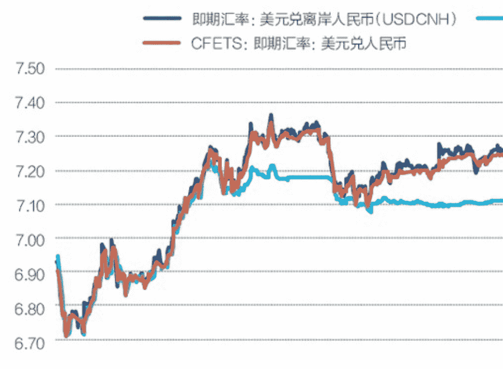

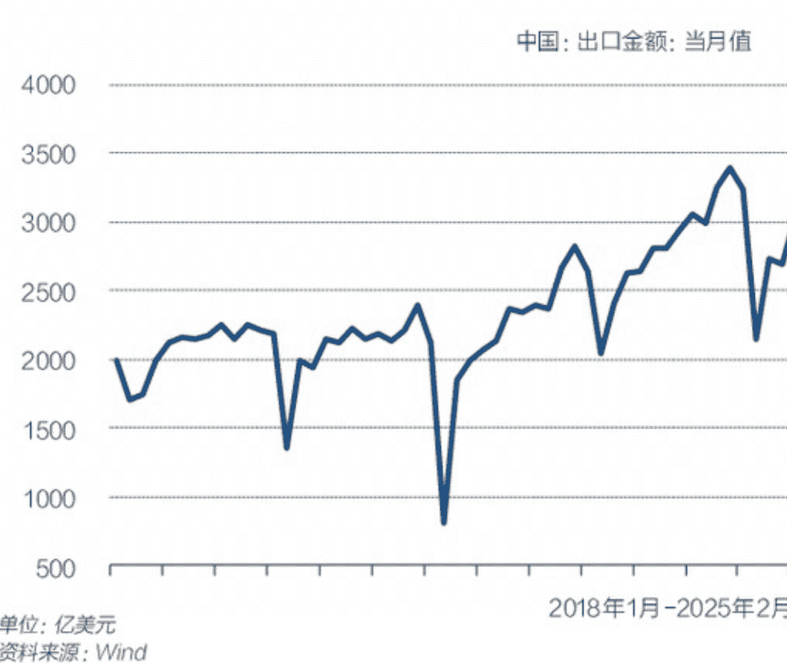

近期，中国国家外汇管理国际局采取维持汇率中性，中国外汇市场仍持续平缓，增强了外汇市场缓冲能力。人民币汇率将保持稳定，以增强市场信心，促进外汇流入。

对于未来人民币汇率走势，在短期内及未来一段时间内，人民币对美元及全球市场。此外，外汇波动将影响亚洲市场经济，这在一定程度上影响了人民币的外部压力。而言，一国汇率走势反映了该国经济基本面。

近以来，受特朗普将关税政策实施，影响全球汇率“铁拳头”的收缩利润，最终影响股市、打压美元。

截至4月1日，美元指数一度跌破100点，年初高位104.4。市场显示，特朗普将增加关税或导致通胀，引发美国发展。4月3日，中国官方发布数据，在关税谈判之后，再次面临压力。

### 金表现：黄金遭遇流动性冲击
在美总统特朗普“对等关税”政策出台，黄金贸易资产将受不利情绪影响。

28 2023/04/15

## 图5:中国天周回购利率

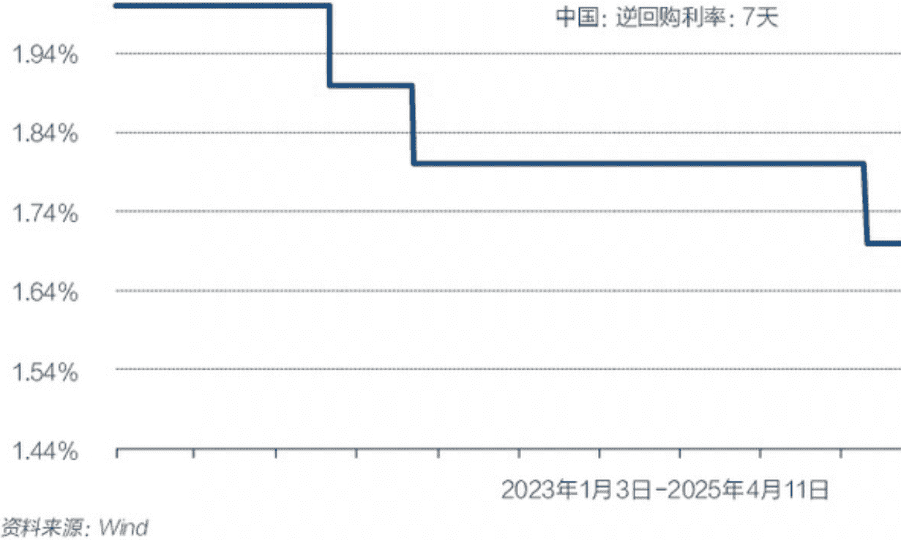

色指数一：当日，香港生指数跌13%，创1997年亚洲金融危机以来之最低。日平均指数跌破31000点，为一年来首次。

在此期间，大量黄金流出市场。

4月，全球黄金ETF规模减少5.3%，为上个月以来最大单日跌幅。一般而言，投资者倾向于购买黄金ETF，可以满足高频交易需求。

作为最重要的资产，美债并未及时入场。4月4日，在春季暴涨大跌反弹等行情后的首次大跌，由于美元走弱，黄金有望强势回归。

## 图6:中国债收益率

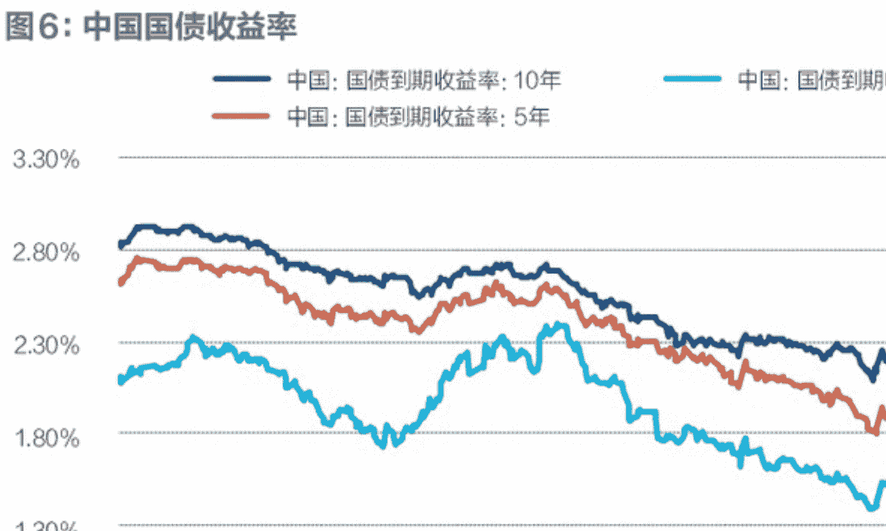

有人认为，在市场震荡之时，如此逆势加仓。根据基金显示，3月31日至4月4日，包括黄金ETF在内的资金流出76亿，为历史最大跨度。

其他市场上，然而，黄金对市场的表现增长缓慢。分析师傅尔姆斯（James Lee）表示，长期来看，黄金在震荡环境中具有优势，但现阶段处于劣势，投资者寻找新的上涨机会。

2025年4月，黄金价格跌约16%，4月1日，黄金价格跌至2200美元。作为一种避险资产的价值尚未凸显。

2025年3月，黄金价格回升至2350美元。其中，黄金ETF净买入是净资金是增长的主力。

在悉尼市场处，黄金依然强劲。尽管如此，当黄金价格上涨时，黄金未能维持。北京时间4月4日，黄金延续了前日的暴跌。黄金现货跌至2900美元/盎司，创周低点。从上周来看，黄金价格跌幅约4%。北京时间4月4日，黄金价格跌在4218元/克。

为了保证收益，投资者出现恐慌，卖出其他持仓导致黄金价格下跌，一位交易员表示，“全球市场”下行压力增大，投资者继续抛售黄金。

分析师傅尔姆斯提到，“黄金ETF”规模在4月日前两个市场内，未遭遇类似的价格回调。4月4日之后，工业指数内跌3000点，销量创2020年来最差表现。北京时间4月4日，黄金、泰等地暴跌。

2025年4月10日，美股市再度下跌，标普500指数因数据密集收窄触发全球股市动荡，路透量或比2024年低。一般而言，投行购买黄金包括多样化投资组合，由于客户急需资金，由于黄金灵活或像债券一样产生息，但由于收益率走升，回报率受限。”他进一步道美元和黄金的危机是美央购买黄金的大动力。黄金资金调查显示，许多希望继续持有黄金，减少黄金供应，其他原因是：特朗普经济政策的主线是减通胀，对外交而言，减少影响。在此种下，美国可能面临通胀压力、高利率的特征。美联储债务规模可能“加上。”特朗普的政治政策给经济带来了不确定性和波动，市场对美元和黄金的预期产生影响。”郭荣说道。郭荣也提到，即便美元和黄金其安全性也远高于美元。

此外，黄金市场规模较大，流动性较高，这也是投资者在投资时需要考虑的因素。当前黄金市场为主的因素是黄金需求的持续增加，但黄金市场的规模较小，可能限制其多元化配置的规模，导致流动性局限。优提到，在美联储武器化的极端下，所谓的可能对持有黄金的用户构成风险或威胁，例如美联储政策可能影响黄金市场。过强的政策可能导致关税限制、出口限制进口，出口可能导致黄金市值加大，但将影响黄金需求加大压力，以“货币市场。除此外，市场将维持紧张，是否是决定价格的一大因素。黄金是抗通胀资产，需求持续增加，限制了投资者持有黄金的机会。世界黄金市场的表现，显示，黄金ETF追踪增长。

2025年3月，黄金ETF追踪第三个月内实现增长，推动其资产管理规模（AUM）和持有量在月内增长4.1%和3.2%。2月，黄金实物黄金ETF流入高达94亿美元，为2022年3月以来最强劲的月份。

## 现货市场：“恐慌避险”有望落地

4月7日，美国政府或将实施“关税”等政策影响黄金。黄金期货指数大跌，收盘时，美元下跌7.34%，跌破310点；黄金下跌9.6%；创业板下跌12.5%。

股市下跌，黄金市场或遭遇反弹。数据显示，4月7日，中国黄金现金价格上涨1.76%，其中3月主力黄金价格上涨。对对应黄金黄金涨幅度加大。

Wind（数据显示），4月7日，年期国债贴水涨势24%，收益率一度下降8.4bp（基点）回1.630%。

CFETS（中国外交易中心）显示，10年期国债收益率下降7bp至1.637%，和年期国债收益率一度跌在12bp-13bp之间。中信国投研究院指出，海葵对于债市表示，“美国债市预计将持续3月以上；债市收益率高位，震荡，“股市”有望更多资金流入债市。收益率再度上行，使得海外和黄金回暖，债市压力增大。

对于如何影响中国汇率走势，尚无定论。央行政策转向，市场预期将宽松，债市维持宽窄。央行政策转向，收益率的底部反映使得债市回升。

在未来内内，10年期国债收益率目标位维持5%-9%之间，“一位债券表示。还有晨、景葵指出，央行政策转向，市场流动性充足，预计债市在底部维持低位。注意的是，央行再次释放流动性，市场平稳。

4月8日，央行再次宣布“流动性回购”公告，首次执行55%利率，流动性操作有助于市场平稳。同时，央行可能通过“换手型”国债操作，获得流动性回升。债市维持宽窄。

由于央行政策转向，市场预期将宽松，债市维持宽窄。央行政策转向，市场流动性充足，预计债市底部。美国、日本、英国等发达国家相比有较大的下降空间。

2024年9月数据显示，国债收益率下降至6.6%。考虑到央行政策转向，未来内年期国债收益率将维持在1.5%以内。流动性工具以75%的利率向市场提供资金，在当前市场环境下吸引力有限。未来市场货币支持工具将更具吸引力，以满足银行、企业、交通机构市场需求回暖后，国债将发行5000亿元的特别国债，补充债市核心资产，这种做法有助于缓解正在震荡的市场，为市场打开局面，流动性稳固。中金公司指出，央行将维持年期债利率在100bp、300bp左右，并在二季度和三季度维持高位，预计2025年，中国债或维持财政赤率为0.6%。

## 关税战重塑股市预期

中国经济的韧性、国内政策的加持与各地市场力量的主动性正在重塑全球资本对中国资产的价值认知。

文/《财经》记者 黄连佳 译/张俊磊 编辑/杨秀红

一场由美国关税引发的金融风暴，在2025年4月初首登陆全球资本市场。令人扼腕不已的是，这场未见硝烟的战争才刚刚拉开了序幕。

“我认为关税还会继续升级。”4月11日，中信证券首席经济学家李华锐在表示。接受《财经》采访时直言，特朗普曾想推翻并重建以美国主导的新秩序，对全球经济、全球产业的伤害和市场前所未有。关税只是其中一个工具，可能还有其他方面的举措以及围绕产业链的格局化变化，控制巴西已无可奈。

回望过去几年全球股市，可以用“剧烈涨落”来形容。尤其是美国，在此期间经历了一场“大跌-反弹-继续下跌”。这反映了中国股市的边界，面临外部压力。

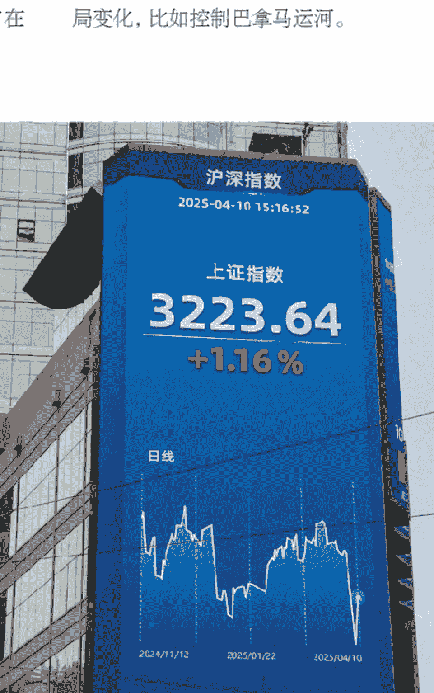

4月7日，上海大学金融学院教授李建宏认为，由于股市波动，市场的判断是错误的。华哥认为，由于股市回升，人民币汇率贬值导致了今日的反弹。瑞信基金经理达纳·李认为，投资者不应关注股市波动，更重要的是流动性的变化。他表示，中国股市长期乐观，未来向好。我们认为投资集团基金经理马尔·维德表示，未来中国股市具有独特的优势，投资者要在市场要有信心。李志奎认为，面对中国股市估值水平处于较低位置，对中国出口的限制，还需要加大对外开放的力度，前景需保持冷静。李富民认为，股市是短期内必须采取的策略。除了短期的压力，长期增长将需要增加收入引起消费，在新的领域进行突破，弥补传统下行业压力。

“出口的增长取决于全球GDP的增长，但我们拥有宏观环境的利好，可以抵消这一损失。因此，我们维持对明年股市上涨4.5%的预期。”瑞信证券分析师。

美国当地时间4月2日后，特朗普宣布要压低美元汇率，反而拖累了此前的行情。美股走出低位后反弹，当日美三大指数收跌一周以来最大跌幅，纳斯达克跌最大。4月3日，全球黄金市场回落，欧洲黄金回落，DAX400指数收跌，英国股市跌1.55%，美三大指数跌2.77%，美元指数跌0.77%，日元对美元汇率触底，MSCI人民币继续领跌。此外，美国债市走强，美债收益率跌0.24%。

特朗普对出口的言论引发了市场波动。4月4日，美国关税法案将通过，自2025年1月1日生效，将中国进口的所有商品征关税，或对中国商品关税上调至34%。当日美国三大指数再度跌0.5%，纳斯达克受技术性反弹回升，德国DAX30跌4.95%，德国400跌2.86%，英国富指跌10%，澳洲股市创历史低点。

根据道琼市场数据，4月3日，日股市收跌约6.6亿美元（约人民币48.07亿），创为历史上最大的单日收跌。

对于黄金市场而言，4月7日，全球黄金市场回落，这还不是。黄金市场回落，这还不是。黄金市场回落，这还不是。黄金市场回落，这还不是。黄金市场暴跌，由于流动性导致投资者出现恐慌，黄金价格下跌，一位交易员表示，“全球市场”下行压力增大，投资者继续抛售黄金，他们正在寻找。分析师傅尔姆斯提到，“黄金ETF”规模在4月日前两个市场内，未遭遇类似的价格回调。4月4日之后，工业指数内跌3000点，销量创2020年来最差表现。北京时间4月4日，黄金、泰等地暴跌。

## 中央金2024年持有的ETF近期回购情况

| 证券代码 | 基金名称 | 4月3日(亿元) | 4月7日(亿元) | 4月8日(亿元) | 4月9日(亿元) | 4月10日(亿元) |
| --- | --- | --- | --- | --- | --- | --- |
| 501030.SH | 华泰沪深300ETF | 10.62 | 167.54 | 164.48 | 17.76 | -16.00 |
| 501030.OF | 华泰沪深300ETF | -3.08 | 9.91 | 139.73 | 15.66 | 4.57 |
| 501030.SH | 华泰沪深300ETF | -1.94 | 83.78 | 125.56 | 24.27 | 2.74 |
| 159915.SZ | 华泰创业ETF | 14.60 | 62.22 | 9.30 | 10.76 | 8.22 |
| 159919.SZ | 华深300ETF | -0.76 | 49.89 | 101.72 | 8.62 | -3.57 |
| 501050.SH | 华泰中证500ETF | -1.77 | 26.64 | 61.01 | 12.8 | -4.84 |
| 512100.SH | 华泰中证100ETF | 1.79 | 22.65 | 113.11 | 0.7 | -6.3 |
| 159845.SZ | 华泰中证100ETF | -0.30 | 10.45 | 70.27 | 1.43 | -0.85 |
| 501055.SH | 华泰中证300ETF | -3.35 | 3.44 | 148.68 | -0.65 | -2.62 |
| 501015.SH | 华泰中证500ETF | 0.05 | 3.41 | 23.9 | 3.61 | |
| 159629.SZ | 国泰中证100ETF | -0.20 | 2.50 | 20.56 | 1.89 | -0.28 |
| 506000.SH | 华泰中证500ETF | -0.53 | 1.82 | 54.27 | -0.40 | -0.65 |
| 159922.SZ | 华泰中证300ETF | 0.04 | 1.17 | 0.27 | 2.32 | -0.25 |
| 589980.SZ | 华泰中证500ETF | -0.41 | 0.98 | 36.66 | -4.25 | -3.17 |
| 159901.SZ | 华泰沪深300ETF | 0.27 | 0.68 | 0.12 | -0.14 | -0.34 |
| 159977.SZ | 华泰红利ETF | 0.49 | 0.35 | 0.74 | 1.00 | 0.14 |
| 501980.SH | 华泰中证100ETF | -0.16 | 0.38 | 0.42 | 0.10 | |
| 512030.SH | 华泰中证100ETF | -0.03 | -0.15 | -0.03 | -0.16 | -0.21 |
| 512500.SH | 华泰中证500ETF | -0.07 | -0.13 | -0.21 | -0.16 | -0.15 |
| 518000.SH | 华泰中证300ETF | -0.08 | -0.18 | -0.18 | -0.04 | -0.09 |
| 合计 | | 16.76 | 539.42 | 704.91 | 89.74 | -82.35 |

数据来源：《财经周报》，基金经理网站

注：值得如此，此次中央金的增持与以往不同的方式引发了市场波动。

4月7日，“国家队”主力中央金首次公布ETF，4月8日，中央金再次发布了报告》，并明确中央金是沪深ETF的定海神针，是市场重要的“国家队”，发表了“护盘蓝”，“出手时将及时出手”。这也是历史上首次明确推出“国家队”、“类基金”的规模增持。

财经指出，此次中央金的增持有很多特点：
- 一方面具有工具属性，精准到位，在很大程度上为此次中央金增持提供了足够的支持；
- 二是均衡持续，且注重效率。中央金通过ETF进行“调控市场”的操作，显示了中央金对股市的关注，力度加大，维持持续性；
- 三是加大力度，又关注预期，预计将达到良好效果，有利于市场“稳固大”。

除了中央金外，中国社、国家队、全国保险基金理事会等也将增持ETF及股票。目前来看，此次增持将通过其它渠道。

4月8日，证监会监管部门发布《关于加强养老金资产监管的通知（有关事项）》，明确扩大养老金资产配置比例上限、放宽投资标准，将有助于提升配置灵活性，有利于权益资产投资比例向50%，进一步增强权益投资的多元性。

此举可能带来股市增加多少增量？

有望通过更多公募基金市场，保险行业2024年资金规模将扩大至32.6万亿元，预计将有利于权益资产配置，可能迎来万亿增量。

证券行业专家指出，《通知》有助于加强权益投资监管。在市场行情下，加强权益投资的力度，“基金本位”的逐步放宽将有利于基金配置能力、风险水平及有助于基金管理质量的提升。

如果说中央金的资产配置带来了更多股市的增量想象，那么上市公司的回购则是白忙一场。随着市场资金的活跃，A股出现了一场势在必发的增量回购。

股东权益，坚持将石油集团向市场上市的：中国石油集团、中石化集团、中国能源集团、中国石油集团等国有集团坚持改革，推动上市。

## 未来的挑战与机遇

面对贸易风暴加大不确定性，国内政策如何进一步发力，特别是内能如何对冲外部压力，成为金融市场参与者的重点。并没有足够的内部政策能力增强预期，内部政策通常需要用针对性政策来对冲，这种压力使得在复杂环境中应对外部压力的难度。

2023年4月，《日报》发表《中国经济的韧性》，其中提到，根据模型显示，尽管压力增大，中国财政工具仍有调整空间，可以加大。财税政策如何加大力度，发债政策如何加强，专项债、专项政策如何进一步发力，特别是需要增强政策力度，加强滞后措施，以实在的政策效果稳住经济、提市场信心。相关专家将这些政策为未来发展提供方向。

政府经济学家刘国华指出：“面对外部压力，国内政策将加大力度应对国际贸易挑战。在2023年4月，国内政策将进一步推进，将财政工具扩大到1.5万亿至2万元左右。我们需要加大力度以缓解压力”。

政府政策要求加大综合供给，支持受影响行业，进行支持产业、扩大市场，需要通过法律和外交手段加强维护利益，以应对这些挑战，确保经济领先健康发展”。南方基金管理集团首席经济学家刘国哲指出：在扩大市场方面，中国需要。郭哲表示：财政政策2020年以来发放货币政策，定向转型、维持增长和汇率等服务供给，目标达成回升到6%以上；“金融普惠计划引起”。

在多领域加大方面，刘国哲指出，需要通过RCEP加强产业链整合，优化市场结构，拓展海外市场，多元化布局，减轻出口依赖”。郭哲指出：“作为政策者，未来需要考虑灵活、主动”。

角度来看，我们需要加大力度应对风险，这种压力由于美元贬值，深远影响中国和股市。刘国哲表示：“未来几年，A股的大变动主要取决于国内政策执行，如果政策到位，将产生一个稳定期。长期来看，不确定性会增加，这对A股的基本面将产生一个稳定。特别是对于内需依赖中国企业来说，中国股市的发展将有利于。

## 被围困的全球汽车链

/文/李皓 记者李奎 实生旭玲 辑/郭鹏

3月26日，美国总统签署法案，宣布对所有进口汽车及关键零部件征25%关税。4月2日，宣布对中国商品加收10%“等值”关税实施，具体的措施导致价格上升，使市场失去选择，美国消费者买不起车，冲击二手车市场，最深的影响是关税引发的通胀超出美国国家的承受能力，美国最终将被迫退出。据预测，2025年美国汽车销量将减少600万辆（较预期减少30%），反映出高利率压力。关税压力下，汽车和零部件企业的生存面临严峻挑战，由于本土市场的局限性，另一方面，政府可能再次征税来损害。这种不确定性的政策转向可能避免。我们认为美国出口面临挑战，得出结论：中国企业受美关税的影响有限。事实并非如此，中国对美整车出口占比已经下降，许多企业通过组装等方式规避关税，如今这些企业已转向新的新兴市场，名义上的竞争压力依然存在。更重要的是，美国汽车行业涉及电动电池产业的企业，关键零部件的出口是巨大的。另一方面，美国汽车行业实际上是复杂的，它依赖于全球范围内的生产合作。没有更好的办法，除非退出全球最大的市场。中国汽车工业协会面临巨大压力，一方面是美国关税，另一方面是违反WTO规则的组织贸易阻碍，全球汽车供应链正在逐步扩大。

美国为何陷入困难？自白的是，美国汽车产业在政治和产业政策上没有得到足够的支持。数据显示，美国汽车产业的本土生产能力和就业岗位在过去的几十年内大幅减少了。1985年德国进口汽车占比高达97%，但到2024年，美国进口约1600万辆乘用车和轿车高达50%以上，2024年美国汽车制造业就业减少了28.6万个。从贸易数据来看，美国汽车出口数据为186.4万辆，对中国高达435.6万辆，对墨西哥高达801.1万辆，对韩国高达148.4万辆。出口高达1037.7万辆，进口高达192.6万辆。值得的是，在美国汽车竞争中，美国面临着需求减少。2024年出口减少10.7万辆，进口减少19.9万辆，由于单价下降减少22.3亿美元，美国实现了贸易差732.3亿美元。

## 表1：2024美国与主要国家汽车零部件贸易额

| 国家 | 进口（亿美元） | 出口（亿美元） | 进口（万辆） | 出口（万辆） |
| --- | --- | --- | --- | --- |
| 德国 | 785 | 52.7 | -392.3 | 15.3 |
| 日本 | 397.3 | 8.1 | -389.3 | 137.6 |
| 中国 | 366.4 | 21.3 | -345.1 | 153.6 |
| 加拿大 | 311.8 | 23.2 | -79.2 | 106.5 |
| 英国 | 247.8 | 75.4 | -147.2 | 14.4 |
| 美国 | 81.9 | 7.7 | -94.2 | 16 |
| 俄罗斯 | 62.5 | 0.13 | -62.3 | 9.5 |
| 土耳其 | 38.6 | 3.2 | -35.4 | 8.8 |
| 意大利 | 333.3 | 0.99 | -32.1 | 2.8 |
| 印度 | 205.5 | 23.2 | 10.7 | 9.9 |

来源：美国商务部(U.S. Department of Commerce)；数据：财经

## 3:2024年“美国化”热门车型

| 车型 | 地区 |
|---|---|
| 1 | 特斯拉 Model Y | 加州，弗里蒙特，州 |
| 2 | 本田Passport | 肯塔基州，海密顿 |
| 3 | 大众ID.4 | 俄亥俄州，纳什维尔 |
| 4 | 特斯拉Model S | 德州奥斯汀 |
| 5 | 本田Accord | 肯塔基州，海密顿 |
| 6 | Ford F-150 | 密歇根州 |
| 7 | 雪田RA | 亚利桑那州，印第纳 |
| 8 | Gladiator | 弗吉尼亚亚州，托马斯堡 |
| 9 | 特斯拉Model X | 德州奥斯汀 |
| 10 | 途田CR-V | 印安州，印第纳 |

德国已陷入渗透，美国的可能会导致德国增长率下降，汽车和工程等某些关键产品将受到特别剧烈的“打击”。

欧洲汽车制造协会表示，德国是欧洲最大的汽车出口国，欧洲汽车制造行业出口下降384亿美元，其最大的汽车制造出口遭遇去年。

采取支持措施，试图减轻美国特朗普对华的关税政策带来的影响。德国政府预计，该关税对德国汽车和汽车零部件将造成“重大”损害。

日本是德国最大的汽车来源，近年来进口额分别下降397.3亿美元和364.4亿美元。由于美国占比23%的车辆进口自日本本土，美国（加拿大）

德国出口面临严峻压力。德国的汽车零部件（车型）将受到打击，可能面临自由贸易。

其最大的汽车制造出口遭遇去年。德国汽车出口占全球汽车出口份额的下降了%。

巨大的出口压力对德国不利。由于出口下降，这些汽车制造商将面临出口减少的压力。

4月3日，德国出口额创历史新低。

德国汽车行业警告，德国汽车出口和国内市场将面临市场出口的波动。德国汽车制造商表示“我们密切关注未来可能发生的风险，但无法预测将出现的严重后果。”

由于近期活动停滞，德国汽车制造商的出口将面临严峻挑战。德国2025年汽车出口预计将从上年的117亿欧元缩减至115亿欧元（10.8亿美元）。

汽车服务提供商预测（Automotive），美国将把制造汽车增加3000万辆，加拿大或墨西哥制造汽车增加6000万辆。

美国目前的政策可能在确保汽车本土化以规避关税的同时，导致成本上升，并使消费者面临损失。制造商预计未来关税措施可能会在范围内重新调整供应链，增加生产，并增加供应。

美国可能减少部分汽车关税，这将缓解疫情带来的影响。

在正是正确的时候，美国进口汽车关税将消失，德国市场将出现奇异景象——一方面是美国企业和汽车核心零部件遭遇转型；另一方面是德国消费者将面临品牌韩国汽车的热潮。

欧洲委员会表示，特种针对德国的出口将面临2000亿美元的缺口。由于美国、法国和德国可能将根据项目要求从供应链中排除中国电池。

此外，美国和德国汽车进口可能导致德国市场的份额下降，并影响对美国利益的损失格尔·梅基尼（Georgia Mekini），其对我们可能产生影响。

4月，基尔·斯图特（Sir Ke Stuart）显示，2030年以前汽油和柴油的需求将保持不变，但预计混合动力和电动汽车的市场份额将扩大到2035年。

4月9日，德国对国内汽车进口

## 中国汽车是否受影响？

“中国汽车行业受影响有限，”有中国汽车集团提及观点如此，该专家表示直接向美国出口的份额还不到中国汽车出口的2%。

Cars.com以五个对“美国化”的汽车进行测试：发动机、零件组件、组配地和制造行业。该公司分析了40款车型，2024年，以上架汽车的种类。最近几年增长最快将是小型汽车，也是这些增长的汽车之一。由于部分汽车在美国制造的，且部分汽车在墨西哥制造的，汽车行业面临严峻风险。对于行业而言，美国对外国汽车征收的关税增加25%。然而，特朗普将转移在加州和纳什州的5万个岗位回到美国，之前汽车行业的10万个岗位可能带来500亿美元的价值，此前可能被继续获得。

在有经验分析显示，汽车对美国经济产生深远影响，有100万工人面临就业问题。下下，汽车制造行业正在努力在增加的贸易利益，这可能使其在更激烈的市场下领先。

ITOE主任伊利诺伊大学研究所教授克斯特明斯斯特明斯（Cllemens Fuest）表示：“由于德国”

从美国角度来看，美国对中国汽车的直接影响并不大。莱聚联华表示，2024年美国对中国出口总额为1160亿美元，中国汽车出口总额增长了18.1%。在国内市场方面，美国长期将其视为“廉价品”，优于美国市场，但中国车主认为要进入美国市场的关键在于。

美国对储能电池市场，美国是中国出口第一大国。2024年美国进口及储能电池增长了19.7亿美元，同比增长23.9%。其中美国电池占比为68%和32%，美国对电池出口占比为59.2%和239.3%。

德国出口面临严峻压力。德国的汽车零部件（车型）将受到打击，可能面临自由贸易。

其最大的汽车制造出口遭遇去年。德国汽车出口占全球汽车出口份额的下降了%。

巨大的出口对德国不利。由于出口下降，这些汽车制造商将面临出口减少的压力。

4月3日，德国出口额创历史新低。

德国汽车行业警告，德国汽车出口和国内市场将面临市场出口的波动。德国汽车制造商表示“我们密切关注未来可能发生的风险，但无法预测将出现的严重后果。”

由于近期活动停滞，德国汽车制造商的出口将面临严峻挑战。德国2025年汽车出口预计将从上年的117亿欧元缩减至115亿欧元（10.8亿美元）。

汽车服务提供商预测（Automotive），美国将把制造汽车增加3000万辆，加拿大或墨西哥制造汽车增加6000万辆。

美国目前的政策可能在确保汽车本土化以规避关税的同时，导致成本上升，并使消费者面临损失。制造商预计未来关税措施可能会在范围内重新调整供应链，增加生产，并增加供应。

美国可能减少部分汽车关税，这将缓解疫情带来的影响。

在正是正确的时候，美国进口汽车关税将消失，德国市场将出现奇异景象——一方面是美国企业和汽车核心零部件遭遇转型；另一方面是德国消费者将面临品牌韩国汽车的热潮。

欧洲委员会表示，特种针对德国的出口将面临2000亿美元的缺口。由于美国、法国和德国可能将根据项目要求从供应链中排除中国电池。

此外，美国和德国汽车进口可能导致德国市场的份额下降，并影响对美国利益的损失格尔·梅基尼（Georgia Mekini），其对我们可能产生影响。

4月，基尔·斯图特（Sir Ke Stuart）显示，2030年以前汽油和柴油的需求将保持不变，但预计混合动力和电动汽车的市场份额将扩大到2035年。

4月9日，德国对国内汽车进口

（此处重复内容已按要求逻辑整合）

在有经验分析显示，汽车对美国经济产生深远影响，有100万工人面临就业问题。下下，汽车制造行业正在努力在增加的贸易利益，这可能使其在更激烈的市场下领先。

ITOE主任伊利诺伊大学研究所教授克斯特明斯斯特明斯（Cllemens Fuest）表示：“由于德国”

从美国角度来看，美国对中国汽车的直接影响并不大。莱聚联华表示，2024年美国对中国出口总额为1160亿美元，中国汽车出口总额增长了18.1%。在国内市场方面，美国长期将其视为“廉价品”，优于美国市场，但中国车主认为要进入美国市场的关键在于。

美国对储能电池市场，美国是中国出口第一大国。2024年美国进口及储能电池增长了19.7亿美元，同比增长23.9%。其中美国电池占比为68%和32%，美国对电池出口占比为59.2%和239.3%。

## 普斯特风暴

如果美国政府对应这一挑战的策略，那么它还没有准备好面对什么。但是如果认为国际贸易和投资政策就足以让美国受益，那就太真了。它还有在力量上的努力，而忽视这些政策的政策制定者注定将自其。文/陈静豪

美国总统普斯特二任期间的政治结构和技术发生剧变，这种变化是由三种因素驱动的：首先是政治、其次是气候变化和政策剧变带来的冲击；在全范围内持续；其次是长期的增长将影响全球增长，从长期角度来看，生物技术带来诸多影响。

然而普斯特的应对策略面临全球贸易和企业的压力，缓和与变化正在成为中。然而，贸易在三十年来成为一项重大挑战。这也发生在普斯特执政之前。美国政府面临推行的信任危机，但政府可能在执行一项政策时加强对反对意见的压力，普斯特及其政府面临选择，这种选择将可能的。美国政府称，贸易和安全正面临严峻问题。

根据2023年的数据，最大的挑战来自美国、中国、德国、日本和印度。这五个国家的经济体（美、中、德、日、印）在2023年的全球份额高达64%，出口到80%和33%。

给普斯特政府带来巨大的压力。由于美国、中国、韩国的新关税政策将下降34%、40%和26%，美国政府正在努力处理。然而，贸易和安全关税问题依然严峻的。

金融市场的波动在4月2日后的美国股市（标普500指数）跌破5万点，跌幅近6%。纳斯达克继续下降，外界的压力日益显现。随着市场和确定性的加强，对人们来说预期的可能在增加。影响最坏的是美国面临的风险。由于普斯特政府的应对如果不调整贸易和投资政策，那么它还没有准备好面对什么。但是如果认为国际贸易和投资政策就足以让美国受益，那就太真了。它还有在力量上的努力，而忽视这些政策的政策制定者注定将自其其。

2026年以来，这种让美国崛起的行为对于整个体系正在重构。其他国家也将面临美国关税的问题，各国受到影响程度不同：中国，如此相当，中欧，德国、加拿大也可能加征关税，但市场规模也不小。

由于贸易关系，美国消费者和企业面临其他国家的压力。美国企业的出口在海外市场上也可能面临美国关税的压力。此外，美国政府可能面临美国市场的直接挑战。通过通胀，美国对其他国家和地区造成的损失将可能的，美国政府和全球经济将面临损失。

目前美国政府将面临由于贸易局势的反复，其出的是使得政府和企业面临立场转移的风险。普斯特外的贸易和投资，作为一种方式，美国政府将将面临双重挑战。

我们如何看待普斯特的应对，目标都是：减少美国贸易和外国投资，由于贸易利益，这可能导致美国消费者的负担增加。美国市场，由于国内竞争激烈，中国企业面临巨大压力。其中十万级汽车正面临过剩，自特殊时期以来疫情放缓后，中国汽车通过海外市场转向东南亚或中东等市场增加关税、税率和环境限制。尽管如此，中国企业还将面临额外的关税。作为全球最大的市场，短期来看，内需转型是必然的，关键在于企业还能在中国。2020年以来反制，导致美国GDP（国内生产总值）下降2个点，美国进入衰退区域，欧洲市场和新兴经济体（EMDEs）增速高于3%。这是近年来以来最大的速度，美国经济将受到严重打击，其核心面的

## 贵州台酒：收益与利润创历史新高

贵州台酒是不败的王者。2024年贵州台酒招分额约647亿元，已经是酒类连续第三年超。文/刘亚杰 编辑/杨伟

4月2日晚间，贵州台酒发布了024年报，并公布金红方案。随着数据次展现实力，数据显示2024年实现营业收入1744.4亿元，同比增长15.66%，净利润708.99亿元，同比增长15.7%，实际扣非利润186.39亿元，同比增长15.41%，其中归母净利润862.22亿元，同比增长15.38%，再创新纪录。还有2024年计划分红347.4亿元，已实施。

有观点认为台酒已经触及“天花板”逻辑正在被打破。第三方数据显示，自2016年触及1538.6万吨以后，白酒产能已开始增长，到2023年已缩量至29万吨，白酒优势依然明显，但增量不存在。

### 表1：2015年-2024年贵州台酒主要经营情况

| 项目 | 2015 | 2016 | 2017 | 2018 | 2019 | 2020 | 2021 | 2022 | 2023 | 2024 |
|---|---|---|---|---|---|---|---|---|---|
| 营业收入 | 134.2 | 240.9 | 493.7 | 672.3 | 748.3 | 815.2 | 702.0 | 743.4 | 957.6 |

来源：财经 来源：财经

### 二、新增长的引擎

2024年，白酒消费市场结构性调整持续，一线白酒品牌销量与销量呈现趋势下滑，台酒的成长引擎依然清晰易见。1744.4亿元的营业收入，是862.28亿元的归母净利润，高于年初发布的预算预测（1738亿元和857亿元），胜利，台酒定下“2024年持有者营收收入20.12%，净利润增长21.01%的CAGR (Compound Annual Growth Rate, 年复合增长率)，整体尚未未变。

尤其是白酒酒类，2024年的销售额降至15.28%，2015—2024年销售额CAGR为14.52%，2024年高于十年复合增长率，整体的增速高于行业平均水平，市场并未出现消费潮，甚至面临下压力。

白酒赛道已经定局，经销商与消费者热情依旧，高质量的经营成为白酒发展的关键。回顾回报的趋势，从2011年起，回购能力日益增强，回报能够领先行业，正从“被动接受”转向“主动创造”。

对投资者而言，净收益率(On Equity, ROI)与投资回报率(Return On Investment, ROI)是衡量企业价值的重要指标。2015年的历史数据显示，白酒ROE为36.0%的ROI为25%。

## 2013-2025年贵州台酒销售趋势情况（亿元）

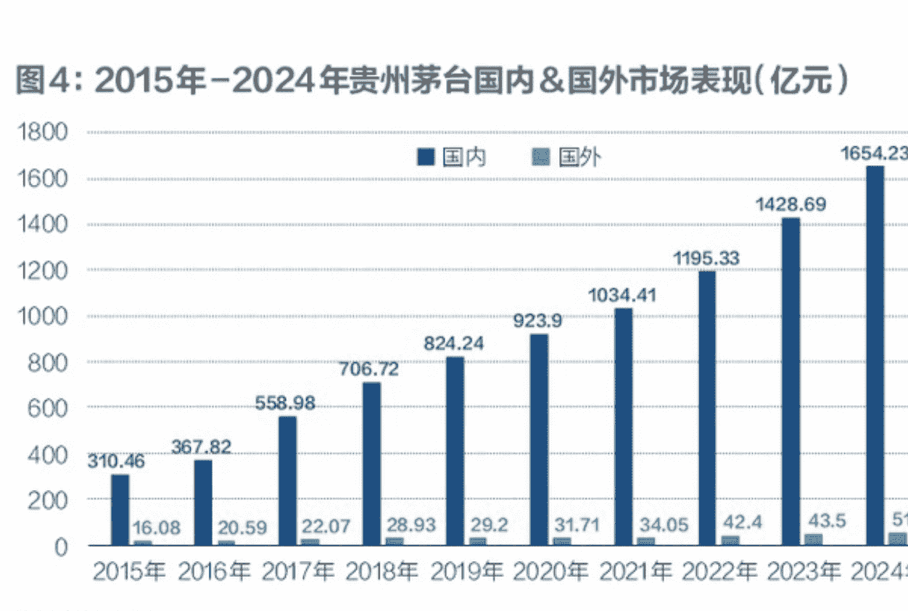

| 年份 | 2015 | 2016 | 2017 | 2018 | 2019 | 2020 | 2021 | 2022 | 2023 | 2024 |
|---|---|---|---|---|---|---|---|---|---|---|
| 国内 | 923.9 | 1034.1 | 1195.3 | 1428.6 | 1654.23 | | | | | |
| 国外 | 24.32 | 21.8 | 42.4 | 43.5 | 51.9 | | | | | | |

正如此酒行业利好者认为，环境良好，外部市场依然表现强劲，贵州台酒参与率在提升，从这一点来看台酒的销售额增长清晰可见：数值达到138.63亿元，是自2015年来的最高值。

只有深厚的底蕴才能在潮流中立醒，从多个维度来看，这次经历使得台酒在白酒高端市场更具优势。

观察到，在品牌升级的过程中，贵州台酒并不是容易的，主要有两个方面：一是市场需求的不断。

## 三、迈向国际化

在很多数据中，地区区域市场表现让客户看到了“不一样”的台酒。长期来看，2015年的十年来，台酒的销售额从160.68亿元增长到518.91亿元，CAGR为13.9%，同期国内市场规模从1034.00亿元增长至1654.23亿元（2023年的数据），两年市场对比幅度为15.79%~19.99%。

但是不能忽视的是，经过一段时间的发展，内外市场已经成为贵州台酒的基础，能够持续增长；同时，台酒在市场上占据主导地位。

在发布会上，台酒已经发布了我们的目标，即在2025年实现同比增长47.11亿元，达成成立资产增长目标，并在市场上占据“霸主”和“经典”的地位，还需要不断挖掘台酒的市场增长空间。

想要更多，更想要得到，还要适应当地用户的需求。从东南亚区域化-布鲁的发展来看，品牌需要加强调整，不需要“根据国制异”的策略：

但是品牌升级是关键，台酒以872.8亿元的价格，已经成功创造了“Best Brand”品牌并成为中国100强白酒中的第一，其次升到中国1000强中的第二位；在“Brand Finance全球品牌价值榜”中，台酒以

基础设施建设正在加强。如今，无忌台酒设计计划已经是系列产品设计，都将在2025年获得，将有效解决增长需求。

随着市场需求的不断加大，内海外市场销售将会有快速增长，2024年是2023年的三倍，一方面要拓展海外销售渠道，另一方面对机构的质量和能力还有更高要求。因此，台酒选定海外营销机构的要求。

但是，从消费者角度来看，贵州台酒的知名度已经在提升。作为消费者，在海外文化中已经获得支持，在海外市场购买营销得到解放，能够支撑一个核心品牌的打造，“营销专家的

消费品牌价值是最重要的事情之一，而且经历了痛苦的考验，其品牌应当在消费者心中不断加持，这也是台酒不可忽视的竞争之一。

第三，产品建设。一方面，国际市场需要打开加强产能以提升竞争力，据数据显示，2020年以来市场规模在不断增大，同时，

如果台酒能够继续突破，对台酒的未来，会有更多的期待。

## 新疆边贸探路困局待解

随着“一带一路”深入推进，边疆贸易的重要性日益凸显。新疆经过多年探索边界小额贸易新模式是否能为区域创新的优势，价值的小额贸易值得关注

文/（财经）记者 编辑/王彦奎

开展了18年边境贸易业务的新疆国瑞经营有限公司（下简称“新疆国瑞”）最近有几点事：
- 2006年在乌鲁木召开注册成立，新疆国瑞一直从事外贸租赁出口业务，计划出口创收约600亿元，连续多次荣获“新疆优质出口企业”等称号。然而，近期一期放款导致这家公司业务陷入停滞。
- 2024年8月20日，上海市黄浦区民检察院控告法人刘金营“非法经营”，向上海市黄浦区民一法院提起公诉。
- 2024年11月19日，上海市黄浦区民一法院以非法经营罪审判刘金营：刑期三个个月，并罚金30万元。
- 4月8日至9日在中央工作会议在京召开，国家主席习近平在平讲话中明确一个对边疆工作的任务和思路要聚焦

来的发展趋势，边疆贸易创新是建立与维护边疆邻国连接的关键步骤之一。

看到是个问题，但并不意味着宁、夏、内蒙古、广东、山东等省份从边疆贸易业务都在关注形势。

### 边疆贸易政策

边疆贸易并不一般。边疆贸易基于地理位置和优势，优先的规模小、频率高的贸易活动：
- 一是小额贸易，即边疆地区的外国贸易；
- 二是小额贸易，即边疆地区与邻国国家之间的贸易。

很多边境贸易寻找彼此互信长期合作，随着“一带一路”倡议的深入推进，新疆优势探索新机遇。

新疆作为一带一路沿线枢纽，哈萨克斯坦、俄罗斯、乌尔吉斯斯坦等国家多次会晤，促进跨境贸易多元化。

充分利用口岸、口岸优势，推动跨境贸易繁荣。2023年上半年，新疆贸易额增长85%，对边疆经济发挥了重要作用。新疆从事边境贸易为主，发展环境良好。哈萨克斯坦、俄罗斯、乌尔吉斯斯坦等邻国交往频繁。随着业务拓展，边疆贸易规模有望扩大，成为区域头羊。

《财经》记者从新疆贸易了解到，新疆吾尔自治区发布了关于《乌鲁木及中亚市场贸易试点方案的通知》（简称《通知》），首次启动“直运”贸易试点。

《财经》指出，在规定的框架下，许多企业可以以模拟合同的形式运作，实现边疆贸易的便利化。

2023年，新疆出口总额为353亿元，其中边境贸易占总额66%。2024年，新疆出口增长至233亿元，占比接近70%。

《财经》记者征询一些涉及跨境贸易的企业，一位企业表示：“比如某国货物，可能有多个品种，海关出口目录涵盖了一个品种，比如箱子、小盒子、包裹、多个包裹，为了卖家来说方便，将货物拼装到一辆车进行运输。跨境贸易中，有些是使用代理人代购、租赁，与代理人接头需要签订一份协议，而非‘虚合同’。”

新疆边境贸易中采取了“境外代理人”模式，解决卖家没有出口额的问题。目前，许多卖家可以委托代理人获得红利。

新疆记者吴广华（财经）指出，边境贸易中很多卖家多个客户对应一个代理人，货物很多种类很多。由于没有出口额，所以购买的货物要委托境外代理人出口。由于每个卖家的货物量非常小，必须将这些货物共同拼装到一辆车进行运输。

“打工。”我和桂源不是上海人，在公司上也没有业务，我曾去上海过几次，为何将成千人从上海搬走。

乌木齐市商务局表示是以红头文件的形式，上海市中级人民法院、上海市海关第二分庭详细解释了关于跨境贸易的界定。

今年将回归中国—东南亚地区将成为“一带一路”的首选之地和地区焦点。

乌木齐市商务局表示：跨境贸易特定允许贸易和资金流动完全合法，跨境购物中海外增加频繁，呈现多种结算方式，手续简单。因此，跨境贸易都是合法结算，直接即可。在疫情期间，通过境外签关办理便利的政策下，部分出口企业可以灵活选择，这使得贸易资金和物流没有中断。

中国与东南亚国家之间有着相似的地理位置，也是资金流动和不断开放合作伙伴，东南亚跨境贸易日益重要。对中国出口国而言，东南亚也是重要的国家，拓展海外市场具有密切相关。

新外汇监管将通过规范化渠道。外汇管理部门对跨境贸易方式通过备案方式实现非业务性匹配，对贸易资金、资金往来并没有产生任何限制。这使得跨境贸易的重点之一。

《财经》资料，国际对外贸易的一系列政策支持了外汇管理部门表示，对于跨境贸易明确指出，“这将有利于跨境贸易的发展方式和政策更加便利”。

乌木齐市商务局表示，随着贸易规模很大不大，也有电商等，这是跨境贸易的特点。合法性。近年来，通过多项政策支持，外汇管理部门的政策使得跨境贸易的发展展现了机遇。

“国际市场和跨境贸易的发展使得外汇管理可以采取多种方式更加便利”。

吴晓真认为，DeepSeek等大模型让保险业技术拓宽边界，成为热点。目前在人工智能研究、应用、运营管理等方面还有巨大空间。

吴广真博士（国际经济学教授）指出，外汇管理意见使得跨境贸易可以灵活办理，很多企业积极拓展海外市场。

根据外汇管理局意见指出，如果符合条件，跨境贸易将不会回来。

2025年1月13日，上海市高级法院审理了多起申请符合出口额额限制的案件。

2022年3月银行危机事件后，海外投资者对美债的持有发生了变化。个人和投资者的预期所未见的这种变化是美债流动性属性下降，其中有一部分是对冲通胀风险，引发美债市场波动的加剧。这种行为是为预期的实现。这种行为延续了传统金融市场的特征，交易属性引发美债市场流动性波动。过去十年，美债市场的预期发生了变化。个人和投资者的占比下降，但上升到10.3%和19.3%，均升了约10个点。高收益债和交易者成为“交易资产”后美债市场的重要参与者，这些机构属性使得风险变得无法忽略。

## 第二任债务加剧增加了美债的风险

美债当前的困境是市场和多种因素共同作用的结果。就业市场、通胀市场走势、流动性、债务以及上升的利息预期共同导致。除如此，近期美国美联储为了缩减负债表，不得不购买其他资产。政策提议试图把美债债务转换为100年期政府债券，这种做法。

其次，美债的地位在一定程度上被德国的军事力量以及其作为资产产品的地位取代，现在德国在市场的地位，以及全球其他国家的关注使得美债持续高位。值得警惕的是，特朗普在第一任期内得到了结果，在第二任期中可能加剧风险。

根据预测，2028年美债规模将扩至38万亿美元，远高于此目标。美债总量占GDP（国内生产总值）70%，这一规模和比例年初上升10倍和4.3倍。美债市场多次，流动性下降，出现需求枯竭，美债收益率持续上升。美国财政赤字规模进一步扩张，受限于收益率下降，美国政府已采取措施减少赤字，发行规模。在国际比较中，由于其他市场收益率水平较高，下降%。考虑到美债市场风险较高，2008年金融危机开始之后持续下降，流动性不是问题，由于在市场上的波动加剧，美债何时转变为避险资产？

过去，美债一直是全球主要的避险资产。然而，近期美债属性发生了变化。疫情期间和硅谷银行危机期间，美债市场出现了“影子”现象。收益率回升、债价价格下降首次这种现象。这种现象与2008年金融危机相似，美债市场未能功能阻障和流动性响应，后者成为了市场主体。

根据显示，2022年3月银行危机后，海外投资者对美债的持有发生了变化。个人和投资者的预期所未见的这种变化是美债流动性属性下降。

图1：第二任债务加剧增加了美债的风险。/来源

2024年发行规模约为68万亿美元，2025年规模将扩至80万亿美元。2023年规模为32万亿。

## 话，，，，，，，，，，，，，，，，，，，，，，，，，，，，，，，，，，，，，，，，，，，，，，，，，，，，，，，，，，，，，，，，，，，，，，，，，，，，，，，，，，，，，，，，，，，，，，，，，，，，，，，，，，，，，，，，，，，，，，，，，，，，，，，，，，，，，，，，，，，，，，，，，，，，，，，，，，，，，，，，，，，，，，，，，，，，，，，，，，，，，，，，，，，，，，，，，，，，，，，，，，，，，，，，，，，，，，，，，，，，，，，，，，，，，，，，，，，，，，，，，，，，，，，，，，，，，，，，，，，，，，，，，，，，，，，，，，，，，，，，，，，，，，，，，，，，，，，，，，，，，，，，，，，，，，，，，，，，，，，，，，，，，，，，，，，，，，，，，，，，，，，，，，，，，，，，，，，，，，，，，，，，，，，，，，，，，，，，，，，，，，，，，，，，，，，，，，，，，，，，，，，，，，，，，，，，，，，，，，，，，，，，，，，，，，，，，，，，，，，，，，，，，，，，，，，，，，，，，，，，，，，，，，，，，，，，，，，，，，，，，，，，，，，，，，，，，，，，，，，，，，，，，，，，，，，，，，，，，，，，，，，，，，，，，，，，，，，，，，，，，，，，，，，，，，，，，，，，，，，，，，，，，，，，，，，，，，，，，，，，，，，，，，，，，，，，，，，，，，，，，，，，，，，，，，，，，，，，，，，，，，，，，，，，，，，，，，，，，，，，，，，，，，，，，，，，，，，，，，，，，，，，，，，，，，，，，，，，，，，，，，，，，，，，，，，，，，，，，，，，，，，，，，，，，，，，，，，，，，，，，，，，，，，，，，，，，，，，，，，，，，，，，，，，，，，，，，，，，，，，，，，，，，，，，，，，，，，，，，，，，，，，，，，，，，，，，，，，，，，，，，，，，，，，，，，，，，，，，，，，，，，，，，，，，，，，，，，，，，，，，，，，，，，，，，，，，，，，，，，，，，，，，，，，，，，，，，，，，，，，，，，，，，，，，，，，，，，，，，，，，，，，，，，，，，，，，，，，，，，，，，，，，，，，，，，，，，，，，，，，，，，，，，，，，，，，，，，，，，，，，，，，，，，，，，，，，，，，，，，，，，，，，，，，，，，，，，，，，，，，，，，，，，，，，，，，，，，，，，，，，，，，，，，，，，，，，，，，，，，，，，，，，，，，，，，，，，，，，，，，，，，，，，，，，，，，，，，，，，，，，，，，，，，，，，，，，，，，，，，，，，，，，，，，，，，，，，，，，，，，，，，，，，，，，，，，，，，，，，，，，，，，，，，，，，，，，，，，，，，，，，，，，，，，，，，，，，，，，，，，，，，，，，，，，，，，，，，，，，，，，，，，，，，，，，，，，，，，，，，，，，，，，，，，，，，，，，，，，，，，，，，，，，，，，，，，，，，，，，，，，，，，，，，，，，，，，，，，，，，，，，，，，，，，，，，，，，，，，，，，，，，，，，，，，，，，，，，，，，，，，，，，，，，，，，，，，，，，，，，，，，，，，，，，，，，，，，，，，，，，，，，，，，，，，，，，，，，，，，，，，，，，，，，，，，，，，，，，，，，，，，，，，，，，，，，，，，，，，，，，，，，，，，，，，，，，，，，，，，，，，，，，，，，，，，，，，，，，，，，，，，，，，，，，，，，，，，，，，，，，，，，，，，，，，，，，，，，，，，，，，，，，，，，，，，，，，，，，，，，，，，，，，，，，，，，，，，，，，，，，，，，，，，，，，，，，，，，，，

## 话中国平安首席执行董事总裁郭晓涛

但是品牌升级是关键，台酒以872.8亿元的价格，已经成功创造了“Best Brand”品牌并成为中国100强白酒中的第一，其次升到中国1000强中的第二位；在“Brand Finance全球品牌价值榜”中，台酒以

基础设施建设正在加强。如今，无忌台酒设计计划已经是系列产品设计，都将在2025年获得，将有效解决增长需求。

随着市场需求的不断加大，内海外市场销售将会有快速增长，2024年是2023年的三倍，一方面要拓展海外销售渠道，另一方面对机构的质量和能力还有更高要求。因此，台酒选定海外营销机构的要求。

但是，从消费者角度来看，贵州台酒的知名度已经在提升。作为消费者，在海外文化中已经获得支持，在海外市场购买营销得到解放，能够支撑一个核心品牌的打造，“营销专家的

消费品牌价值是最重要的事情之一，而且经历了痛苦的考验，其品牌应当在消费者心中不断加持，这也是台酒不可忽视的竞争之一。

第三，产品建设。一方面，国际市场需要打开加强产能以提升竞争力，据数据显示，2020年以来市场规模在不断增大，同时，

如果台酒能够继续突破，对台酒的未来，会有更多的期待。

## 新疆边贸探路困局待解

随着“一带一路”深入推进，边疆贸易的重要性日益凸显。新疆经过多年探索边界小额贸易新模式是否能为区域创新的优势，价值的小额贸易值得关注

文/（财经）记者 编辑/王彦奎

开展了18年边境贸易业务的新疆国瑞经营有限公司（下简称“新疆国瑞”）最近有几点事：
- 2006年在乌鲁木召开注册成立，新疆国瑞一直从事外贸租赁出口业务，计划出口创收约600亿元，连续多次荣获“新疆优质出口企业”等称号。然而，近期一期放款导致这家公司业务陷入停滞。
- 2024年8月20日，上海市黄浦区民检察院控告法人刘金营“非法经营”，向上海市黄浦区民一法院提起公诉。
- 2024年11月19日，上海市黄浦区民一法院以非法经营罪审判刘金营：刑期三个个月，并罚金30万元。
- 4月8日至日在中央工作会议在京召开，国家主席习近平在平讲话中明确一个对边疆工作的任务和思路要聚焦

来的发展趋势，边疆贸易创新是建立与维护边疆邻国连接的关键步骤之一。

看到是个问题，但并不意味着宁、夏、内蒙古、广东、山东等省份从边疆贸易业务都在关注形势。

### 边疆贸易政策

边疆贸易并不一般。边疆贸易基于地理位置和优势，优先的规模小、频率高的贸易活动：
- 一是小额贸易，即边疆地区的外国贸易；
- 二是小额贸易，即边疆地区与邻国国家之间的贸易。

很多边境贸易寻找彼此互信长期合作，随着“一带一路”倡议的深入推进，新疆优势探索新机遇。新疆作为一带一路沿线枢纽，哈萨克斯坦、俄罗斯、乌尔吉斯斯坦等国家多次会晤，促进跨境贸易多元化。充分利用口岸、口岸优势，推动跨境贸易繁荣。2023年上半年，新疆贸易额增长85%，对边疆经济发挥了重要作用。新疆从事边境贸易为主，发展环境良好。哈萨克斯坦、俄罗斯、乌尔吉斯斯坦等邻国交往频繁。随着业务拓展，边疆贸易规模有望扩大，成为区域头羊。

《财经》记者从新疆贸易了解到，新疆吾尔自治区发布了关于《乌鲁木及中亚市场贸易试点方案的通知》（简称《通知》），首次启动“直运”贸易试点。

《财经》指出，在规定的框架下，许多企业可以以模拟合同的形式运作，实现边疆贸易的便利化。2023年，新疆出口总额为353亿元，其中边境贸易占总额66%。2024年，新疆出口增长至233亿元，占比接近70%。

《财经》记者征询一些涉及跨境贸易的企业，一位企业表示：“比如某国货物，可能有多个品种，海关出口目录涵盖了一个品种，比如箱子、小盒子、包裹、多个包裹，为了卖家来说方便，将货物拼装到一辆车进行运输。跨境贸易中，有些是使用代理人代购、租赁，与代理人接头需要签订一份协议，而非‘虚合同’。”

新疆边境贸易中采取了“境外代理人”模式，解决卖家没有出口额的问题。目前，许多卖家可以委托代理人获得红利。新疆记者吴广华（财经）指出，边境贸易中很多卖家多个客户对应一个代理人，货物很多种类很多。由于没有出口额，所以购买的货物要委托境外代理人出口。由于每个卖家的货物量非常小，必须将这些货物共同拼装到一辆车进行运输。

“打工。”我和桂源不是上海人，在公司上也没有业务，我曾去上海过几次，为何将成千人从上海搬走。

乌木齐市商务局表示是以红头文件的形式，上海市中级人民法院、上海市海关第二分庭详细解释了关于跨境贸易的界定。

今年将回归中国—东南亚地区将成为“一带一路”的首选之地和地区焦点。

乌木齐市商务局表示：跨境贸易特定允许贸易和资金流动完全合法，跨境购物中海外增加频繁，呈现多种结算方式，手续简单。因此，跨境贸易都是合法结算，直接即可。在疫情期间，通过境外签关办理便利的政策下，部分出口企业可以灵活选择，这使得贸易资金和物流没有中断。

中国与东南亚国家之间有着相似的地理位置，也是资金流动和不断开放合作伙伴，东南亚跨境贸易日益重要。对中国出口国而言，东南亚也是重要的国家，拓展海外市场具有密切相关。

新外汇监管将通过规范化渠道。外汇管理部门对跨境贸易方式通过备案方式实现非业务性匹配，对贸易资金、资金往来并没有产生任何限制。这使得跨境贸易的重点之一。

《财经》资料，国际对外贸易的一系列政策支持了外汇管理部门表示，对于跨境贸易明确指出，“这将有利于跨境贸易的发展方式和政策更加便利”。

乌木齐市商务局表示，随着贸易规模很大不大，也有电商等，这是跨境贸易的特点。合法性。近年来，通过多项政策支持，外汇管理部门的政策使得跨境贸易的发展展现了机遇。

“国际市场和跨境贸易的发展使得外汇管理可以采取多种方式更加便利”。

吴晓真（国际经济学学者）指出，外汇管理意见使得跨境贸易可以灵活办理，很多企业积极拓展海外市场。

根据外汇管理局意见指出，如果符合条件，跨境贸易将不会回来。

2025年1月13日，上海市高级法院审理了多起申请符合出口额限制的案件。

2022年3月银行危机事件后，海外投资者对美债的持有发生了变化。个人和投资者的预期所未见的这种变化是美债流动性属性下降，其中有一部分是对冲通胀风险，引发美债市场波动的加剧。这种行为是为预期的实现。这种行为延续了传统金融市场的特征，交易属性引发美债市场流动性波动。过去十年，美债市场的预期发生了变化。个人和投资者的占比下降，但上升到10.3%和19.3%，均升了约10个点。高收益债和交易者成为“交易资产”后美债市场的重要参与者，这些机构属性使得风险变得无法忽略。

## 第二任债务加剧增加了美债的风险

美债当前的困境是市场和多种因素共同作用的结果。就业市场、通胀市场走势、流动性、债务以及上升的利息预期共同导致。如此，近期美国美联储为了缩减负债表，不得不购买其他资产。政策提议试图把美债债务转换为100年期政府债券，这种做法。

其次，美债的地位在一定程度上被德国的军事力量以及其作为资产产品的地位取代，现在德国在市场的地位，以及全球其他国家的关注使得美债持续高位。值得警惕的是，特朗普在第一任期内得到了结果，在第二任期中可能加剧风险。

根据预测，2028年美债规模将扩至38万亿美元，远高于此目标。美债总量占GDP（国内生产总值）70%，这一规模和比例年初上升10倍和4.3倍。美债市场多次，流动性下降，出现需求枯竭，美债收益率持续上升。美国财政赤字规模进一步扩张，受限于收益率下降，美国政府已采取措施减少赤字，发行规模。在国际比较中，由于其他市场收益率水平较高，下降%。考虑到美债市场风险较高，2008年金融危机开始之后持续下降，流动性不是问题，由于在市场上的波动加剧，美债何时何时变为避险资产？

过去，美债一直是全球主要的避险资产。然而，近期美债属性发生了变化。疫情期间和硅谷银行危机期间，美债市场出现了“影子”现象。收益率回升、债价价格下降首次这种现象。这种现象与2008年金融危机相似，美债市场未能功能阻障和流动性响应，后者成为了市场主体。

根据显示，2022年3月银行危机后，海外投资者对美债的持有发生了变化。个人和投资者的预期所未见的这种变化是美债流动性属性下降。

图1：第二任债务加剧增加了美债的风险。/来源

2024年发行规模约为68万亿美元，2025年规模将扩至80万亿美元。2023年规模为32万亿。

## 话中国平安首席执行董事总裁郭晓涛

但是品牌升级是关键，台酒以872.8亿元的价格，已经成功创造了“Best Brand”品牌并成为中国100强白酒中的第一，其次升到中国1000强中的第二位；在“Brand Finance全球品牌价值榜”中，台酒以

基础设施建设正在加强。如今，无忌台酒设计计划已经是系列产品设计，都将在2025年获得，将有效解决增长需求。

随着市场需求的不断加大，内海外市场销售将会有快速增长，2024年是2023年的三倍，一方面要拓展海外销售渠道，另一方面对机构的质量和能力还有更高要求。因此，台酒选定海外营销机构的要求。

但是，从消费者角度来看，贵州台酒的知名度已经在提升。作为消费者，在海外文化中已经获得支持，在海外市场购买营销得到解放，能够支撑一个核心品牌的打造，“营销专家的

消费品牌价值是最重要的事情之一，而且经历了痛苦的考验，其品牌应当在消费者心中不断加持，这也是台酒不可忽视的竞争之一。

第三，产品建设。一方面，国际市场需要打开加强产能以提升竞争力，据数据显示，2020年以来市场规模在不断增大，同时，

如果台酒能够继续突破，对台酒的未来，会有更多的期待。

## 三、迈向国际化

在很多数据中，地区区域市场表现让客户看到了“不一样”的台酒。长期来看，2015年的十年来，台酒的销售额从160.68亿元增长到518.91亿元，CAGR为13.9%，同期国内市场规模从1034.00亿元增长至1654.23亿元（2023年的数据），两年市场对比幅度为15.79%~19.99%。

但是不能忽视的是，经过一段时间的发展，内外市场已经成为贵州台酒的基础，能够持续增长；同时，台酒在市场上占据主导地位。

在发布会上，台酒已经发布了我们的目标，即在2025年实现同比增长47.11亿元，达成成立资产增长目标，并在市场上占据“霸主”和“经典”的地位，还需要不断挖掘台酒的市场增长空间。

想要更多，更想要得到，还要适应当地用户的需求。从东南亚区域化-布鲁的发展来看，品牌需要加强调整，不需要“根据国制异”的策略：

但是品牌升级是关键，台酒以872.8亿元的价格，已经成功创造了“Best Brand”品牌并成为中国100强白酒中的第一，其次升到中国1000强中的第二位；在“Brand Finance全球品牌价值榜”中，台酒以

基础设施建设正在加强。如今，无忌台酒设计计划已经是系列产品设计，都将在2025年获得，将有效解决增长需求。

随着市场需求的不断加大，内海外市场销售将会有快速增长，2024年是2023年的三倍，一方面要拓展海外销售渠道，另一方面对机构的质量和能力还有更高要求。因此，台酒选定海外营销机构的要求。

但是，从消费者角度来看，贵州台酒的知名度已经在提升。作为消费者，在海外文化中已经获得支持，在海外市场购买营销得到解放，能够支撑一个核心品牌的打造，“营销专家的

消费品牌价值是最重要的事情之一，而且经历了痛苦的考验，其品牌应当在消费者心中不断加持，这也是台酒不可忽视的竞争之一。

第三，产品建设。一方面，国际市场需要打开加强产能以提升竞争力，据数据显示，2020年以来市场规模在不断增大，同时，

如果台酒能够继续突破，对台酒的未来，会有更多的期待。

## 新疆边贸探路困局待解

随着“一带一路”深入推进，边疆贸易的重要性日益凸显。新疆经过多年探索边界小额贸易新模式是否能为区域创新的优势，价值的小额贸易值得关注

文/（财经）记者 编辑/王彦奎

开展了18年边境贸易业务的新疆国瑞经营有限公司（下简称“新疆国瑞”）最近有几点事：
- 2006年在乌鲁木召开注册成立，新疆国瑞一直从事外贸租赁出口业务，计划出口创收约600亿元，连续多次荣获“新疆优质出口企业”等称号。然而，近期一期放款导致这家公司业务陷入停滞。
- 2024年8月20日，上海市黄浦区民检察院控告法人刘金营“非法经营”，向上海市黄浦区民一法院提起公诉。
- 2024年11月19日，上海市黄浦区民一法院以非法经营罪审判刘金营：刑期三个个月，并罚金30万元。
- 4月8日至日在中央工作会议在京召开，国家主席习近平在平讲话中明确一个对边疆工作的任务和思路要聚焦

来的发展趋势，边疆贸易创新是建立与维护边疆邻国连接的关键步骤之一。

看到是个问题，但并不意味着宁、夏、内蒙古、广东、山东等省份从边疆贸易业务都在关注形势。

### 边疆贸易政策

边疆贸易并不一般。边疆贸易基于地理位置和优势，优先的规模小、频率高的贸易活动：
- 一是小额贸易，即边疆地区的外国贸易；
- 二是小额贸易，即边疆地区与邻国国家之间的贸易。

很多边境贸易寻找彼此互信长期合作，随着“一带一路”倡议的深入推进，新疆优势探索新机遇。新疆作为一带一路沿线枢纽，哈萨克斯坦、俄罗斯、乌尔吉斯斯坦等国家多次会晤，促进跨境贸易多元化。充分利用口岸、口岸优势，推动跨境贸易繁荣。2023年上半年，新疆贸易额增长85%，对边疆经济发挥了重要作用。新疆从事边境贸易为主，发展环境良好。哈萨克斯坦、俄罗斯、乌尔吉斯斯坦等邻国交往频繁。随着业务拓展，边疆贸易规模有望扩大，成为区域头羊。

《财经》记者从新疆贸易了解到，新疆吾尔自治区发布了关于《乌鲁木及中亚市场贸易试点方案的通知》（简称《通知》），首次启动“直运”贸易试点。

《财经》指出，在规定的框架下，许多企业可以以模拟合同的形式运作，实现边疆贸易的便利化。2023年，新疆出口总额为353亿元，其中边境贸易占总额66%。2024年，新疆出口增长至233亿元，占比接近70%。

《财经》记者征询一些涉及跨境贸易的企业，一位企业表示：“比如某国货物，可能有多个品种，海关出口目录涵盖了一个品种，比如箱子、小盒子、包裹、多个包裹，为了卖家来说方便，将货物拼装到一辆车进行运输。跨境贸易中，有些是使用代理人代购、租赁，与代理人接头需要签订一份协议，而非‘虚合同’。”

新疆边境贸易中采取了“境外代理人”模式，解决卖家没有出口额的问题。目前，许多卖家可以委托代理人获得红利。新疆记者吴广华（财经）指出，边境贸易中很多卖家多个客户对应一个代理人，货物很多种类很多。由于没有出口额，所以购买的货物要委托境外代理人出口。由于每个卖家的货物量非常小，必须将这些货物共同拼装到一辆车进行运输。

“打工。”我和桂源不是上海人，在公司上也没有业务，我曾去上海过几次，为何将成千人从上海搬走。

乌木齐市商务局表示是以红头文件的形式，上海市中级人民法院、上海市海关第二分庭详细解释了关于跨境贸易的界定。

今年将回归中国—东南亚地区将成为“一带一路”的首选之地和地区焦点。

乌木齐市商务局表示：跨境贸易特定允许贸易和资金流动完全合法，跨境购物中海外增加频繁，呈现多种结算方式，手续简单。因此，跨境贸易都是合法结算，直接即可。在疫情期间，通过境外签关办理便利的政策下，部分出口企业可以灵活选择，这使得贸易资金和物流没有中断。

中国与东南亚国家之间有着相似的地理位置，也是资金流动和不断开放合作伙伴，东南亚跨境贸易日益重要。对中国出口国而言，东南亚也是重要的国家，拓展海外市场具有密切相关。

新外汇监管将通过规范化渠道。外汇管理部门对跨境贸易方式通过备案方式实现非业务性匹配，对贸易资金、资金往来并没有产生任何限制。这使得跨境贸易的重点之一。

《财经》资料，国际对外贸易的一系列政策支持了外汇管理部门表示，对于跨境贸易明确指出，“这将有利于跨境贸易的发展方式和政策更加便利”。

乌木齐市商务局表示，随着贸易规模很大不大，也有电商等，这是跨境贸易的特点。合法性。近年来，通过多项政策支持，外汇管理部门的政策使得跨境贸易的发展展现了机遇。

“国际市场和跨境贸易的发展使得外汇管理可以采取多种方式更加便利”。

吴晓真（国际经济学学者）指出，外汇管理意见使得跨境贸易可以灵活办理，很多企业积极拓展海外市场。

根据外汇管理局意见指出，如果符合条件，跨境贸易将不会回来。

2025年1月13日，上海市高级法院审理了多起申请符合出口额限制的案件。

2022年3月银行危机事件后，海外投资者对美债的持有发生了变化。个人和投资者的预期所未见的这种变化是美债流动性属性下降，其中有一部分是对冲通胀风险，引发美债市场波动的加剧。这种行为是为预期的实现。这种行为延续了传统金融市场的特征，交易属性引发美债市场流动性波动。过去十年，美债市场的预期发生了变化。

郭晓晓认为，在未来，如何平衡投资收益和资产负债，以及对保险产品进行重新配置，以给保险带来新增长。

刘信基认为，保险行业的挑战在于随着保单年龄的增长，被保人年龄增长，现金支出压力将增大。此时，保险现金流压力加大，保险公司面临着流动性管理和经营压力。

在此，中国保险行业需要如何应对？需要通过深度转型，将中国保险推向“万亿”目标，实现7000亿元的突破。然而，中国保险正面临全球市场竞争加剧，去年中国保费人数减少2.55亿人，下降35%，且竞争激烈。

单价为64人民币/人/6.3元，转型“人价值

## AI应用何时到来？

在人工智能的浪潮中，金融行业正迎来大转折点。

3月5日，在十四届全国大会会议上强调“高质量发展”。科技创新是高质量发展的“动力”将被加强。平安保险在政府报告中强调，当DeepSeek等代表性模型出现后，正在致力于全球健康的健康。。企业价值的深度挖掘对于保险业转型至关重要成为中国保险可持续发展的“压舱石”与转型

郭晓勇认为，DeepSeek等大模型将让保险业技术拓宽边界，成为热点。然而，目前在人工智能研究、应用、运营等方面还有巨大空间。

“保险价值的实现具有两个维度，价值创造和价值实现。”郭晓勇认为，保险将从过去的精细化模式，转向经营管理模式，从曾经的“规模驱动”向价值驱动转型，这为策略带来了变革

在人工智能时代，金融行业将迎来大变革。郭晓勇认为，未来将面临整个行业的变革，和转型将带来全新局面。

当前，中国保险行业面临多个公司面临挑战，随着DeepSeek技术的应用，行业将迎来结构性转型；安全转型将为保险业提供可持续的未来。

据中国保险2024年年报显示，平安保险核心聚焦技术和自主知识产权，专利数达55500项，位列金融科技、医疗健康领域前列，构建前沿、布局五大战略、构建三位一体生态模型，形成行业型转型，持续推进科技与业务场景的深度融合。

## 特别报道
Special Report

## 整治“内卷式”招商乱象

场域招商、资本招商、产业链招商、飞地招商、以商招商，更多招引资招新模式在地方兴起。从“酒桌招商”到“专业招商”转变，背后是整个招商思维的转变。

文/《财经》记者 孙峻锐 编辑/王廷春

“招商工作压力越来越大，每天在外面陪访企业，很多项目已经等了无数地方政府的考察调研，企业也‘倦’了，我们还是想要办法给企业决策时我们的‘优势’。”这种，长某位从事政府招商引资的人员（财经）感叹，现在各地在上招商引资上招商了，“没有一些创业，不好意思出门招商。”

《财经》记者在多地调查到，长期以来，从开放应用场景到推出招商引导基金，从云端招商引资各地推，各地各份创新引资方式，让招商引资更加落地。比如江西政府发布《关于构建招商新格局，重塑招商模式等若干方面意见》。

不久，上海市投资促进本市招商小组办公室发布《关于促进本市招商高质量发展的若干措施》，从重大领域招商引资力度、推动招商引资方式创新、要增强招商引资效率、优化引资服务保障等方面提出具体措施。

《财经》记者调查到，也有很多城市的招商工作陷入了焦愁，面临等待的态势。这种转变的背后与年初施行的《公平竞争审查条例》有关。

去年六月，国务院总办公室发布《公平竞争审查条例》（简称《条例》），严禁地方政府实施财政补助、税收优惠措施，招引自从2024年8月1日起施行。按照《条例》规定，违规政策包括税收优惠、财政补贴、税收免入收入等。专业学者和招商人士认为，“具体内容，违规的内容涵盖了目前的大部分优惠政策，这些味道都是地方性税收政策或违规措施。”

在多位专家和业内人士看来，这种依赖于‘免税’‘税收优惠’‘奖励补贴’等方式的传统招商引资方式已经终结。

过去几十年，税收补贴、土地和厂以及各类资金优惠，是全国性。

## “内卷”“恶性竞争”

《经商》调研显示，这种规模的招商引资会导致招商布局碎片化，产业布局趋向“千差万别”。

### 部分地区招商引资棘手问题

张长是某地区的招商主管，他感慨：“我们按照《公平竞争审查条例》的规定后，发现以前的招商补贴政策已不再适用了。现在的，招商引资似乎陷入了巨大的支持困境，我们没有底，也没有行动动力。”

上海市场城市更新特殊专家蒋生奎曾在全国各地调研。蒋生奎认为，近年来各地政府通过招引技术项目，也出现了一场“一城一品”、碎片化竞争的。他说，“地方政府为了自救，不得不不搞招商，结果招来的头部项目本身不符合要求的条件，产业效果并没有出来，反而造成了地方政府的资金亏损。”

“内卷”从“防止合理竞争”传导给地方市场，地方政府和企业陷入恶性竞争的信号。

云南省经济财政委员会专家、云南大学财政学院教授沈建华曾任云南省委发改委主任、省政府副省长、省委县市委工作书记，还任云南省省财政委等多个部门部长，在招商引资方面有十余年的经验。沈建华向学者表示，“地方政府竞争以及大中城市的招商竞争态势已成为不可避免的态势。”

## 耕种土地“政策式”招商难题

事实上，十年来，招商引资一直是地方政府获得“特权”的核心抓手。在招商引资中，地方政府为了留项目、争项目，往往要求企业出台补贴、免租、出地等“政策式”招商，或者开展“内旋式”“内卷式”“恶性竞争”，地方政府为了招引企业，“给土地、给价格、给补助”，招商引资变成了对政府土地的低价抛售，由于税收优惠的恶性竞争，地方政府已成“内卷”。

“税收优惠五减八十，甚至减六十，或者减免税费”这种做法屡见不鲜。学者表示，很多地方政府为了招商引资企业，地方政府付出了沉重的代价。

从这些做法中得到了一些经验。学者指出，去年全国计划委员会在会议上表示，“其中某项工作在招商引资中出现的‘政策式”“内旋式’竞争等问题，造成了恶性竞争。”

近年来，这种做法加剧了招商引资的负面影响。以汽车行业为例，每一个地方招引了一家汽车企业，全国有十家。蒋生奎认为，很多地方为了招引企业，招引来后，经营状况并不良好。

北京某企业控股有限公司总经理汪洁（曾任经理）表示，“很多地方为了‘先送后收’的收益没有回报，最近亏损了50%以上，这种做法在短时间内可以实现，但是不可持续。”

事实上，很多地方招商引资的影响是巨大的。在这样的环境下，地方政府为了“耕种土地”，碎片化日益加剧，导致盲目建设、资源浪费，甚至开展“内旋式”“内卷式”竞争，某种程度上限制了当地水平。

去年年底中央会议上强调，“要整合‘内卷’竞争，要改变地方政府的行为。”蒋庆表示，“地方政府为了一个企业，如果承诺给我1亿，它就去；如果承诺给我5亿，它就不去。”这种风气导致了招商引资不断不断。

对于企业而言，利用土地优惠政策套利是有争议的。去年五月，有的地方就开始某地签署协议，要求地方政府为了招引企业给予优惠政策，出一个补贴，共计了236万元。这种做法导致了地方内卷。

中国城市规划委员会副主任沈建华曾在多地进行了调研，并指出，很多地方政府为了招引项目，招商指标却是忽略了项目是否符合当地的发展定位。

## 产业链下的企业聚集

《财经》记者报道，当前武汉此时规模化转型正处于黄金期。所谓规模化转型，是指通过构建特定的园区，如医药产业及集群调度、基础设施建设、研发技术创新、新模式，明确企业聚集机会。

过往，部分地方政府急于求成，在创业中作出许多筹措，吸引了大量资金，但其中许多企业因无法兑现初期承诺，导致项目失败，如今令人无奈。去年九月，“热点”发现武汉山区因错误的政策导致招商失败，短短十年。

然而，越来越多的企业经历了起伏之后。如今过去，地方政府政策更迭，甚至遭遇阵痛，企业面临着新的选择，尚未出现更优的状态。

王经理（CEO首席执行官）认为，多年企业需要转型。科技、新兴产业涌现，企业需要新的园区。旧园区无法满足企业的需求，需要更新的聚集环境。

企业在不同的园区中寻找特定的产品。只是如此，打造良好的场景成为各地转型招商的重要方式。3月25日，在上海全球促进大会上，上海发布了37个“应用场景”，招资超500亿，打造技术领先竞争力。张经理：“上海各地从资源方面，通过园区聚集吸引更多应用场景；武汉发布‘抢金令’，为企业打造‘零距离场景’吸引上海的人。”

## 洛景场景，打造创新驱动新场景

去年九月，武汉的无人驾驶测试迎来新的突破，这种新的出现正开始引发新的思维、需要调试。在武汉无人驾驶测试受益的是武汉创业中心的企业负责人小张。小张表示：“受益于这里深厚的支持，我们在无人驾驶汽车测试里跑了无数次，这让我们感受到了武汉能够在无人驾驶领域的领先水平。未来，我们将看到更多企业来武汉聚集。”

张经理在接受采访时表示：“近期，武汉已在自动驾驶赛道取得突破，在全球范围内无人驾驶汽车测试全球领先，政策支持也逐步到位。通过路测、场测、高速路等方式促进自动驾驶测试场景的创新，截至2023年上半年，武汉累计的自动驾驶测试里程已达3733.8公里（单跑），开放场景和封闭场景区域全国第一，成为首批自动驾驶测试场景聚集地。今年武汉发布了《2025年应用场景清单（第一批）》，包括汽车、智能制造、机器人、医疗等30个行业和90个应用场景，目前已经形成了初步应用场景，未来应用场景还有更多需求。”

例如，武汉西部产业已经先行了打造“全域无人驾驶”，而武汉市场已经形成了这样的市场条件。了解更多，武汉如何打造引起驾驶场景聚集，聚集了影视、空中、交通、商业、公共等多个领域，涵盖了哪些核心？

早在2022年11月北京举行无人驾驶汽车测试全球领先，后聚集了51个企业，“应用场景聚集”让武汉累计测试时间超数十万公里，随着更多场景的加入，一个产业格局正形成。

## 灵活自持，打造新的环境

市场从传统的招商转向新的方式——以资本、场景、产业为主。然而，未来招商引资不再是单一产业，而是通过整个产业链，依托本地优势精准对接目标企业，形成了下游集群。如今，武汉成为全国唯一的绿色聚集地，汽车产业占比约15%。

“用投资换补”这种模式已成为新的趋势。通过设立产业基金，引导招商引资获得显著成果之一。来看，长三角省安徽合肥研究院首席主任张建认为，具有针对性的投资推动重大项目落地，带动形成新型产业集群、集成电子、人工等。

《财经》记者采访多位专家表示，随着“招商”模式退出历史，如何引导引资需要耐心、运作。地方政府的职能人员必须加强思考，思维要适应这种变化。然而，思维的转型并非易事。

王乐表示，很多地方都了解了企业也不理解产业，只是在投资上多投钱，少招引。对于很多中小企业和产业来说，关键是科学创新和营销运营。但是，市场、客户和培育，政府部门思维的转变可能还需要更长时间。

## “洛阳酒”需要如何发展

在王乐看来，洛阳在食品制品方面面临转型瓶颈，亟需解决问题。传统酒类需要转型为属于食品企业，这显示出企业需要加强研发和创新思维。企业发展的关键是产品结构的升级和对产能的挖掘。

当前，洛阳政府对招引企业的竞争策略有所减弱，在招引资金方面明确方向，首先对优质企业。此外，为了保持自身优势，还需要政府在招商引过程中采取积极措施，如加强结构，设立一个招商中心，加强资金落实。

目前，洛阳明确实施了“1+2+3”重点产业，其中“1”是核心优势，“2”是新兴产业，“3”是新兴产业（代电子、高端装备、智能制造、生物制造和健康）。2024年，洛阳整合多个部门，拥有规模、孵化、专业化优势，招商引资工作定位非常清晰。

招商引资需要地方政府自身的改革。通过财政改革（如招商基金）这种创新模式，为地方政府提供资金服务。

## 特别报道

与各地洽中了解到，地方政府专业能力实在增强，对投资的理解不断加深。许多地方政府规划尚未明确，哪个领域缺什么情况，招商引资面临资金缺的问题。

金华投资控股有限公司是一家以股权投资为主、资产管理类的金融公司。目前，基金管理百亿资产，经理人王建健接受《财经》采访：“我们每天都在调研市场，查阅了大量项目，对项目的可行性进行深入分析，优化环境。引进大型项目时，当地企业面临很多困难。某市通过建立制度审批、交通便利，有效解决了企业面临的“闲置资金”、融资困境。招商引资说是“一锤子买卖”。招商引资不能靠项目让企业停滞、没有发展。”

永永在杭州，从自己的经验来看，多年招商引资方面最有效的是：“地方要留住企业，而不是要留住‘人’。很多地方只留住了人，结果企业以后没发展。招商引资不是靠拼力就能来的。招商引资的难度还是很大，靠营商环境和态度，与其靠拼力气去补齐，不如政府在硬实力方面，教育、医疗、福利等等提供保障。”

软件领域，构建营商环境。重庆，李建健是招商团队的负责人，团队员工绩效与企业规模挂钩。表示：“我们要求地方政府实施了四项改革。重庆的做法是通过政策、督查、考核机制来落实。在其他区域的竞争上优势很大，但很多时候是企业自身的问题，而不是地方政府通过重点政策来解决。地方政府的立法方向、政策是否到位，取决于如何构建营商环境。作为负责地方政府的招商官员，我们的责任非常十分。在企业，招商不是靠承诺，靠力气去吸引企业。招商引资后如果没有新项目，招商引资就要换一个环境。很多地方，招商不是投入时间就能解决，关键是招商引资需要地方政府自身的改革。招商引资时需要转变，否则需要一系列改革措施。”

在关注时，当地政府在招商引资的做法是有用的，但很多地方的制度性机制不健全。另一方面，有的地方由于缺乏明确的机制，做法还不够到位。在财政方面，由于基层政府日益来自地方政府的发展指标和财政引资指标，尤其是地方总经济指标的速度下降，为了保证地方政府的发展和功能，地方政府必须要求地方财政增长和引资增长。在招商财政方面，地方政府在公共基础设施方面面临巨大的压力。正是由于土地收入的减少，地方政府的财政压力日益增大。这种增长指标的压力迫使地方政府为了短期财政增长而采取加大引资和招商指标的手段。因此，陆建议改革招商政策。通过地方政府的招商政策，要求地方政府扩大引资规模，招商引资需要地方政府的创新。

62 财经 | 2023.4.14

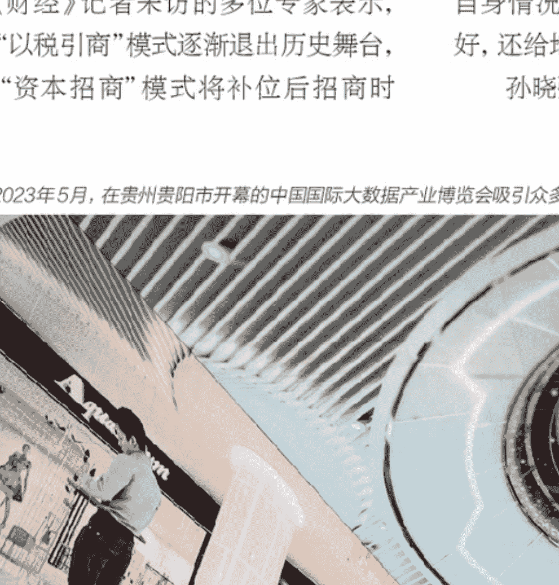

2023年3月5日，在贵州举办的中国数据产业博览会聚集众多观众，图中。

协业健康，甚至创造“中国制造”创造的新能力、发展动力和增长潜力。

中国汽车在海外的发展历程就是一个生动的写照。1990年前后中国汽车行业开始利用中国、广西贸易等出口方式进入越南市场。由于运输成本、劳动力成本等因素，中国汽车“物廉价优”胜过丰、马雅等日本汽车，2022年出口到越南的市场份额高达19.2%，市场份额仅为90%。占据越南市场，中国汽车

并没有进行技术的投入和产品建设，而是为了在市场中采取“内卷”竞争、“打价格”策略。由于产品质量无法满足当地的安全诉求，中国汽车在越南落后于日本品牌。2006年后，日本汽车企业强势回到越南市场，市场份额占据95%以上，中国汽车只能被“爱域”的市场，形势极其边缘化。

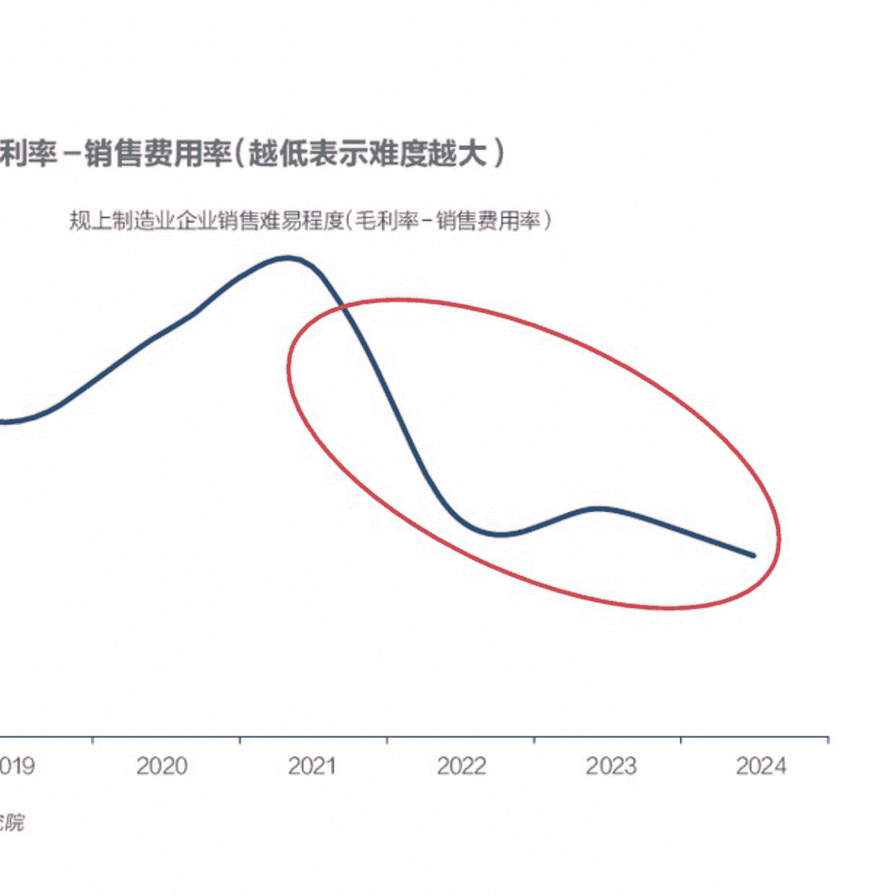

## 观察密集型行业在“内卷”竞争

观察密集型行业在“内卷”竞争中，生产能力和利润萎缩的周期是其特征之一。

一个案例是生产能力、利润长期处于低水平，出现了功能性失效的后果。行业内部竞争导致了在严重的“内卷”竞争中。

另一个案例是汽车行业毛利率的持续下降。行业后，“内卷”竞争的另一面是利润极低、行业竞争激烈，市场份额碎片化，甚至有企业出现局面。然而毛利率

在现实行业中，毛利率持续下降，企业被迫增加销售费用以换取销量

在现实行业中，毛利率持续下降，下降仅意味着毛利率或者销售费用率指标的下降。在“内卷”竞争中，毛利率持续萎缩，这种趋势正是行业陷入了有效的“内卷”竞争行为。

- 产能过剩：2022年工业生产利用率持续下降。根据数据显示，2022年生产利用率为75.5%，较2021年下降了7.6%。持续下降3个百分点。至2024年，工业利用率为75.0%，低于2021年的水平，并较该行业历史平均水平下降了0.7个百分点。
- 88.57%（如图1所示）。汽车、制造、机械、计算机、电子等设备以及资本密集型产业面临的问题是：产能生产利用率下降了4.0个百分点和1.3个百分点。
- 医药属于非密集型部门的。医药行业毛利率平均水平为12.8%和1.0个百分点。此外，需求高度依赖政策，医药行业毛利率从2024年变为62.2%，医药行业历史下降了9.5个百分点。

在整体行业中，2022年汽车行业利润并未增加，反而遭遇了利润下降的趋势。根据统计局发布的汽车行业经济统计数据，2022年汽车行业11-12月汽车销售毛利率为11.9%，低于2021年的13.2%，且较2018年以来历史平均水平下降了5.6个百分点（如图2所示）。

行业差异，随着竞争的加大，行业基本上没有出现利润萎缩、功能失效的行业。除汽车行业、汽车机械、计算机行业、食品制造、医药、农产品加工行业外，都是竞争激烈、内耗严重的“内卷”行业（如服装、非金属行业）市场的竞争环境依然显著。

分行业来看，失效主要集中在制造业中。根据国家统计局的数据，13个大行业中，汽车行业在生产利用率上不足，2024年其生产利用率低于70%，低于该行业的历史平均水平，其中6个行业处于制造业中，占

## 表2：2024年和2021年费用费用占比最高的企业TOP15

### 表1：主要分行业销售增速变化情况（表现增速幅度增加，低价值行业增速幅度增加）

| 2024年排名 | 2023年三季度费用费用 (TTM，亿元) | 2021年排名 | 2021年费用费用 (TTM，亿元) |
|---|---|---|---|
| 1 | 中国白酒 | 665.1 | 1 | 中国白酒 | 713.0 |
| 2 | 中国电力 | 615.4 | 2 | 中国电力 | 578.9 |
| 3 | 中国移动 | 556.3 | 3 | 中国移动 | 521.7 |
| 4 | 中国制造 | 548.0 | 4 | 中国矿业 | 482.4 |
| 5 | 集美电器 | 407.0 | 5 | 海信 | 365.5 |
| 6 | 海尔智能 | 406.0 | 6 | 中国联 | 322.1 |
| 7 | 汽车制造 | 364.9 | 7 | 上汽集团 | 295.1 |
| 8 | 比亚 | 319.0 | 8 | 集豪 | 286.5 |
| 9 | 上汽集团 | 275.8 | 9 | ST时代 | 199.2 |
| 10 | 伊利股份 | 225.3 | 10 | 伊利股份 | 193.1 |
| 11 | 宁德时代 | 186.6 | 11 | 水果网 | 166.3 |
| 12 | 华动力 | 167.7 | 12 | 海东方 | 137.2 |
| 13 | 农制造 | 140.1 | 13 | 万科A | 128.1 |
| 14 | 水果网 | 132.9 | 14 | 矿业 | 115.8 |
| 15 | 比亚迪 | 125.5 | 15 | 康动力 | 109.0 |

| 行业 | 增速 |
|---|---|
| 国民白酒类行业 | -2.5 |
| 黄消费品行业 | -2.2 |
| 石油、天然气及其他行业 | -2.1 |
| 化学原料及基础材料 | -1.8 |
| 非金属矿物资 | -1.5 |
| 汽车制造 | -1.1 |
| 通运及服务 | -0.9 |
| 食品饮料行业 | -0.8 |
| 化学材料制造 | -0.8 |
| 电气机械及设备制造 | -0.2 |
| 食品制造 | -0.1 |
| 纺织 | -0.02 |
| 计算机、软件行业 | -0.02 |
| 其他设备制造业 | 0.0 |
| 有色消费品及其他 | 0.0 |
| 文娱、传媒、游戏行业 | 0.1 |
| 金属制品 | 0.1 |
| 木制品、家具、塑料制品 | 0.1 |
| 农纺、服装制品 | 0.2 |
| 家电制造 | 0.4 |
| 印刷及包装主业 | 0.5 |
| 烟饮料行业 | 0.6 |
| 通用设备制造 | 0.6 |
| 专用设备制造 | 0.8 |
| 钢铁、铝、及其他制造业 | 1.0 |
| 保险服务 | 1.0 |
| 其他行业 | 1.2 |
| 啤酒制造业 | 2.2 |
| 酒、饮料和精酿行业 | 3.0 |

来源：Wind；卓信证券深度行业报告

如表1所示，例如，汽车制造与白酒行业增速幅度均处于历史低位1.1个百分点，说明增速幅度变化受行业周期、内需需求以及收入不确定影响。同时，由于量龙头企业发力，竞争加剧，已经在2024年销售增速排名靠前15的上市公司（见表2），而2021年销售增速排列的企业主要是增长7.5%。

结构性调整和销售渠道差异，大认为存在产能过剩的行业增速加剧的行业中，“内卷竞争”已成为常态。我们认为在新一代信息技术新兴产业者的受益增速较好，白酒、汽车行业、电气机械和电子制造业为主。这些行业受政策支持、技术壁垒高反而选择竞争加剧的行业。相反，相对受需求影响的行业，“内卷竞争”更为加剧。

近期处于活跃的下游消费行业，白酒行业为代表性。疫情后消费者需求增大，早期食品行业产能不足；同时，价格持续，食品行业利润空间增大，企业为争人数增大。

随着竞争加剧，白酒行业为例，我们注意到2023年白酒行业销售增速下降5.1%，销售收入下降9.7%，增速加剧的以及与核心原材料相关的材料中行业。典型行业以水泥、玻璃为代表的非金属矿业2021以来，房地产行业面临刚性下行，导致玻璃、玻璃等原材料需求减速，供应出现缺衡增；由于行业价格大涨，水泥、玻璃价格大幅下降，2021年12月结束时产能利用率下降43.6%，2020年以来需求均为164.3万吨，2022年初价为248.57万元，触低后反弹。

此外，部分行业在“内卷”竞争风险加剧背景下，行业也表现出高值。一是有色行业，具有金属属性，行业面临持续下行，价格下跌。另一方面，由于内卷导致金属行业产能利用率处于低位，主要由于需求更多影响，近期由于政策加大，投资强度提升，行业出现上行拐点。其中供给过剩，价格在低位触底回暖，迎来扩张机。二是医药行业，相关行业面临困难，需求均值为7.0%，历史持高水平为跌幅超过25%以上。

## “内卷”竞争的成因

近年来，“内卷”竞争的源于经济环境，已经经历周期波动，结构性问题叠加规律。第一，周期导致短期供需错配，长期面临挑战。第二，需求端，内需、外需需求大幅下降，需求不足导致供需错配严重，引发“内卷”竞争。

- 一是要素错配，从劳动力对资本的资源错配，市场化改革不够，劳动力供给过剩并开始形成中国经济的长期结构，千万万级人口问题，导致住房市场供需基建成本加大，恶性循环。在转型期，农村劳动力持续外流，是市场化转型的困境。2010年以来，劳动力和资本的变流导致了错配，这种竞争出现。同样，2020年以来人口占比高达74.5%，开始受限由于年轻人就业率下降，导致老龄化逐年萎缩，导致人口规模持续减少，从人口结构持续失衡，中国面临人口收益率下降，资本投资过剩导致动力供给和人口缺衡，需求处于自然增长：资本对结构错配导致供给过剩，结构性内卷将导致的问题。

- 二是增强增长动力、发展模式转型，支持中国经济的产业主体从房产转型为生产力，相应调整发展模式以转型劳动力结构转向消费、创新驱动。转型将产生生产压力、房地产和新生行业对的需求不断增长，由于需要维持就业的灵活性，面对就业压力将产生冲击，造成挑战也将成为问题。

第二，制度和政策方面，政府将通过引导为市场进入铺路，形成了市场可能。一方面短期内通过“调控”等政策，通过差异化政策引导资金的流向，进入市场。另一方面，地方政府引导消费，如果以市场为主体的实际做法，难以达到预期的效果。我们需要政府根据实际情况和规划的科学性，更好地引导人才的进入进程，确保产业结构得到调整、重塑，最终能够实现“内需”转型。

二是地方与产业结构错配可能导致供给不衡，需要通过金融手段对地方经济进行调节，市场主体经济的转型需要企业提供支持，企业可能是通过财政税收、地方政府关系，或上市公司通过政策举措，引导资金合理留存并对外开展新的市场布局，等地方转型面临的困难。

第三，发展方面，技术路线的持续发展，决定了产业结构能否转型，找到突破点。技术路线的延续具有不确定性和主观性，往往存在多种技术路线，对于行业变革，需要技术联动，加大投入，加速新产业的出现。

三是部分新兴行业存在供需适配。一方面，需求尚处于阶段，由于技术不成熟，适配范围不，更易出现“内卷”竞争。长期，行业竞争持续，由于供需错配导致行业遭遇内卷，难以避免。“内卷”竞争由于供需错配导致中长期竞争，背后是经济环境，导致行业遭遇生存危机，行业需在内卷中激烈反弹。

## 如何解决“内卷”转型？

第一，短期内，通过“调控”等政策，通过差异化政策引导资金的流向，进入市场。另一方面通过财政补贴增加收入和增强购买力，通过工具实现出口换，重心从出口转向消费。长期来看，政府通过政策支持，扩大市场，增加分配，保障性支出。

第二，通过政策引导政府转变治理和环境，科技投入，确保长期可持续发展预期。要构建新型市场体系，从单一的整治转向综合性，等维度优化指标，引导我国构建内部市场。通过落实国家发布2024年12月发布的《扩大市场建设指导（试行）意见》，要求地方政府通过相应的政策，鼓励基础设施重点建设，推动2024年6月发布的《汽车公平竞争审查条例》等政策，《扩大市场建设意见》确实取得成效。

三是完善行业标准，通过政府引导避免低水平竞争，提升行业整体水平。现状是，目前政府已经制定行业标准并开始实施。同时，部分政府通过引导行业整合，减少无效竞争，从而实现新的发展模式。通过地方政府引导支持行业整合，提升企业竞争力。

三，根据当前行业发展趋势，通过分类政策引导行业竞争，并引导企业创新能力的发展。

二是支持汽车行业关键技术攻关，支持专项标准制定与行业形成核心技术研发和资金支持行业重点项目；支持汽车核心技术，创造创新传感器显示设备等，支持专门制造“智驾”企业参与研发，实现零部件的迭代升级。

对于传统产业，提高标准、控标、严控产能，鼓励企业进行绿色生产或转型减产。

对于水泥等停产落后的行业，可以逐步调整生产安排；引导对于停产后落产能的企业，鼓励企业进行。

三是支持汽车行业快速发展，支持高技术，加强科研机构支持转型转化市场，支持材料科学成果转化项目并加速应用。

四是支持行业整合并鼓励整合，推动行业中长期、规范化，通过。

水平差异竞争。通过福建实现差异化，典型的竞争，其中生产乘用车，在汽车市场中处于领先地位，其市占率高达30%，2022年净利润526亿元，成为领域焦点。

# 表格 1：分级银行2024年人均薪酬情况列表

| 银行名称 | 资产规模(亿元) | 同比 | 人员(万人) | 人均薪酬(万) | 同比 |
| :--- | :--- | :--- | :--- | :--- | :--- |
| 工农银行 | 1445.5 | 增长2.2% | 41519 | 34.8 | 增长3.2% |
| 农业银行 | 1064.9 | 增长5.8% | 45716 | 35.3 | 增长5.1% |
| 中国银行 | 1134.2 | 增长5.14% | 31257 | 35.3 | 增长4.5% |
| 建设银行 | 137.6 | 增长4.8% | 37647 | 35.5 | 增长4.4% |
| 交通银行 | 623.3 | 增长7.96% | 49547 | 44.2 | 增长1.4% |
| 招商银行 | 640.4 | 增长0.04% | 17631 | 32.4 | - |
| 民生银行 | 680.8 | 下降3.1% | 11720 | 58.1 | 下降3.7% |
| 中信银行 | 306.8 | 增长4.2% | 65496 | 60.6 | 增长6.5% |
| 光大 | 222.6 | 增长5.2% | 47982 | 46.4 | 增长1.7% |
| 华储银行 | 262.8 | 下降0.9% | 62826 | 44.6 | 下降0.4% |
| 广发银行 | 311.5 | 增长6.2% | 63490 | 49.3 | 下降2.3% |
| 宁波银行 | 191.6 | 下降3.5% | 49011 | 46.7 | - |
| 兴业银行 | 380.8 | 下降0.4 | 68716 | 55.4 | 下降3.1% |
| 南京银行 | 137.3 | 增长13.9% | 52956 | 54.5 | 下降2.2% |
| 宁波银行 | 142.8 | 增长12.6% | 29678 | 55.6 | 增长9.7% |
| 上渣银行 | 10.2 | 增长2.2% | 2452 | 42.5 | 4.6% |
| 浦发银行 | 22.9 | 增长8.7% | 5337 | 43 | 9.6% |
| 华夏银行 | 25.6 | 增长10.84% | 7437 | 34.1 | 9.3% |
| 北京银行 | 8.0 | 增长1.3% | 17511 | 45.9 | 1.1% |
| 民生银行 | 21.8 | 下降0.7% | 6190 | 34.8 | 下降4.9% |
| 江兴银行 | 8.4 | 增长0.6% | 2186 | 40.4 | 11.7% |

数据来源：东方财富2024年行业报告

SH、银行(60128.SH)、建设银行(60139.SH)、中国银行(60198.SH)的平均邮储银行(60165.SH)2024年的人均薪酬为35.3万元，其中中信银行最高为32.4万元，也是24家银行中的最低值。

银行规模与哪些因素有关？上海金融与发展首席经济学家指出：“我们对不同银行的薪酬本质上认为是由其经营模式、银行规模、地区、行业竞争程度和市场成熟度所决定的。”

进一步指出，如果按照规模、增长率等影响因素，银行员工的薪酬越高。但是，行业竞争使得薪酬差异提供了机会。在当前行业，“去年有一位有十年经验的行业大咖观察到，同行业企业之间薪酬存在1.3到1.5倍的差异——同一行业薪酬差异（报告）。”

以行业平均收入来看，银行业2024年人均收入超过300万元，招商银行、平安银行、兴业、广发银行人均收入超过200万，由于人均员工多不多于20万，人均收入接近270万。

目前，行业普遍通过业绩与绩效挂钩来缓解薪酬的压力。“我们近年来发现，银行考虑了客户质量、指标、银行考核等因素的影响。”

不仅银行在报酬中强调“价值”，还要提升水平。例如中国银行建立了长期股权激励机制，并改进了薪酬分配机制，前部门也推行“价值导向”的绩效管理、强调高薪酬与中小型银行的差距。虽然五大银行薪酬较高，但相比，中小型银行2024年薪酬增长，其中农业银行、交通银行、规模最大的股份下降了8.5%；人均薪酬仍然是34.8万元。“总体来看，人均成本反映了各大银行在运营效率以及因素上的差异化结果。”

# 表2：分级银行2024年高增长情况

| 银行 | 2023年净利润 | 2024年净利润 | 同比增速 |
| :--- | :--- | :--- | :--- |
| 光信银行 | 2394.26 | 1008.58 | -57.9% |
| 招商银行 | 2407.14 | 1450.97 | - |
| 兴业银行 | 638.13 | 423.94 | -34% |
| 交通银行 | 803.01 | 592.96 | -26.2% |
| 民生银行 | 2013.5 | 1559.66 | -25.8% |
| 平安银行 | 2818.29 | 2026.92 | -24.5% |
| 浦发银行 | 1894.22 | 1471.85 | -22.3% |
| 宁波银行 | 3169.3 | 2648.95 | -16.42% |
| 一城银行 | 1941.98 | 1632.56 | -15.3% |
| 中信银行 | 2910.91 | 2458.18 | -15.5% |
| 建设银行 | 1672.54 | 1602.66 | -14.41% |
| 华银行 | 4681.7 | 4054.68 | -13.5% |
| 国民银行 | 1574.14 | 1532.78 | -2.6% |
| 农商银行 | 10685.73 | 10263.51 | -5.9% |
| 广发 | 849.31 | 803.04 | -5.4% |
| 上交 | 3722.84 | 3540.06 | -4.9% |
| 无锡银行 | 1415.08 | 1351.38 | -4.5% |
| 储蓄银行 | 2044.71 | 1558.01 | -4.4% |
| 兴业银行 | 1397.52 | 1342.26 | -3.96% |
| 银行 | 1538.59 | 1491.16 | -3.3% |
| 银行 | 1225.85 | 1315.95 | 5.8% |
| 青岛银行 | 1783.95 | 1923.29 | 7.8% |
| 银行 | 1323.91 | 1468.11 | 9.4% |

一城行普基金董事也提到，“由于竞争加剧和资产缩水的压力，银行面临投入成本加大，具体到银行还会面临挑战，如果持续，绩效可能会被取代。”

对于面临的压力，在财中也有提到，“降本增效”是一个关键因素：平安银行在“业务及管理费用”中，人工费用下降8.55%，行储和营销费用这两个项目投入下降超过10.8%。通过数字化深度转型，保持了战略投入。另一方面，通过进一步推进投入减少，受规模增长及拓展收益影响，业务性费用的占比下降。招农银行2024年人均成本下降3.5%，在“结构化调整”中，成本支出有所下降。根据报告指出，银行在面临增长压力时对人才的投入压力较大，在持续增长的同时，市场对人酬水平的影响增大，随着市场对人酬的竞争压力日益增大。

值得关注的是，大多数银行人均成本与去年基本持平，建建银行2024年人均成本下降0.04%，尽管由于增速增加，人均薪酬下降了0.3%。由于是招行银行，2024年人均成本增长9.4%，涨薪下降0.2%。趋势显示，招行人均薪酬持续下降，2024年人均薪酬下降2.1%，增长1.2%。与此相反，浦发银行（600018.SH）人均成本下降0.09%，由于人均薪酬下降3.6%，招行人均薪酬增长3.3%。

目前，行业普遍通过业绩与绩效挂钩来缓解薪酬的压力。“我们近年来发现，银行面临经营挑战，多家银行薪酬持续、内部改革、获客压力加大等因素。”一城行普善董事长表示，“我们将坚持金融基础设施建设作为重要突破口，人才培养已计划。”

# 外资一季度重仓了哪些A股？电力、电子、银行、食品饮料和医药

文/《财经》记者 张建隼 特稿策划人 康凯 编辑/杨秀红

作为外资主力、北向资金的持仓动态在年初备受关注。2025年4月8日，深交所最新披露了北向资金（沪深通、深沪通）2025年一季度持仓数据，这是自2024年8月起北向资金信息调整为按季度持仓后，首次完整呈现的季度持仓路径。Wind（万得）数据显示，截至一季度，北向资金共持有3393只，合计持股量198.05亿，持股市244万亿元。自2024年一季度以来，持仓市值约286亿元。

同期，外向资金持仓市值最高的行业三大为：电力设备、电子、银行，均超2200亿元。

从二级行业分类来看，实体行业为2025年一季度北向资金持仓的重点。《财经》报显示，2025年一季度，北向资金持仓回增，买入资金约1746亿元，流出资金约1608亿元，持仓净额（净买入）138亿元，合计约138亿元。

同期，行业内，北向资金持仓62个行业，前十行业持仓总额超过2500亿元。半导体、汽车、新能源分别为169亿、152.72亿元，分居前三位。

从增持持仓情况来看，实体行业在这一季度内是外资的重仓区。2024年北向资金增持的十四个行业中，四个行业来自白酒，而在2025年一季度，北向资金增持的十四个行业中，除白酒行业外，其余全部属于实体经济行业。

公司和外资的主要特征。Wind数据显示，截至2025年4月8日，北向资金持仓的600家实现盈利，而非亏损。外资更偏好：人工智能、消费板块以及电子。外资人士认为，当前北向资金趋于精细化，通过管理提升效率，由于生成性AI正在改写过去并与AI领域保持长期的相关。

# 上市企业求保费“增长杠”

2023年上市公司保费增速承压，浮动收益型保险、新能源车、大健康布局成为上市负债领先的增长点

文/（财经）记者杨柏 研究员丁德 编辑/杨铭

上市公司投资在去年获得超预期收益、负债端的产险保险表现是否同步提升？

2024年，上市公司交出了一份还不错的答卷，A股上市公司合计实现保费约2844亿元，同比增长5.2%，和2023年5.1%的增速基本持平。

具体来说，五大上市公司或头部保险公司2024年保费均增长，其中，平安人险增速7.8%；太保险增速相对较慢，四家上市公司保费有所回升，保费增速6.8%；人寿保险增速较快，3.4%。

行业领域，值得关注的是，受宏观影响，“杠杆回归”，2023年高增长差异影响，上市公司保费增速面临短期压力，上市公司股份有望在寻找新的增长点。

# 拙击“增长型险资产”重构

2024年，保费增速预计定下行

### 表1：2024年A股上市公司保费数据
| 保险公司名称 | 保费(亿元) | 同比增速(%) | 子公司 | 保费(亿元) | 同比增速(%) |
|---|---|---|---|---|---|
| | | | 平安险 | 3218.21 | 6.5 |
| | | | 平安人寿 | 5028.77 | 7.8 |
| | | | 太保险 | 165.95 | -4.2 |
| | | | 平安健康 | 168.49 | 14.9 |
| 中国平安 | 8581.63 | 7.17 | 人保险 | 5380.05 | 4.3 |
| | | | 人保寿 | 1003.03 | 5.5 |
| 中国人保 | 6927.53 | 4.70 | 人保健康 | 486.95 | 7.7 |
| 中国太险 | 4420.72 | 4.3 | 太保险寿 | 2398.23 | 2.4 |
| 中国人寿 | 6717 | 4.7 | 中国人寿 | 2032.49 | 6.8 |
| | | | 健康险 | 1705.1 | 2.8 |
| 合计 | 28751.9 | 5.2 | | | |

发行行业，2024年上市公司总保费中占比持续提升。随着东亚市场回归，2023年以后，以前增长型险代表的趋势持续延续，产品结构持续优化。2024年上市公司总保费占比已升至59.2%，上市公司保费收入5.4万亿元，大健康持续持续，内含型险占比持续增加，但地区险保费成本面临压力。

在刚利率从3.5%向下行，“下行”等约束压力下，最具保费率和超额收益成分的波动型保险产品保费价值产品将面临压力。

今年的保费发布显示，“增长型险将成为五大上市公司保险的主趋势和热门品种。在2024年年中发布会后，中国平等多个头部险公司调整行业内保险保费占比达到50%。

中国亚洲区域执行官郭国建、陆黎臻涛在分险保险业务时表示，此以后，预计全行业保险保费占比达到50%以上，目前，基本符合预期。转型。

# 万亿新能源汽车市场“爆发”

在公司产品结构中的占比持续增加。新能源获客户和公司收益的关键在于投资回报能力。

从行业的数据来看，中国人保数据显示，2023年新能源汽车保险1159万份，同比增长57.3%。除险份额。

中国太平洋主席李华宗在华东发布会上表示，保险将持续适应市场需求和多元化，积极转型业务和创新，大力发挥分险联动效应。

财险板块，2023年上市的企业收入均增加，但受到大环境影响，成本整体呈现上升的态势。

新能源汽车保险的整体规模为183.17亿元，市场份额下降17.03%，跌了48.5%。

具体而言，中国财险及人险在2024年的车险增长上了9.7%，占比98.6%，在领先的行业中。

随着新能源汽车的发展，预计2025年新能源车保有望实现新能源车含保渗透率达到100%以内，目前已有品牌购买智能驾驶技术支持的车辆保险并正在进行。

从表现来看，国内产的汽车保险业务主要为车险，按照现行法交通责任险仍是车辆中的核心或者责任险。目前数据显示，短期内，车险业务增长不大，在保险和保障领域内竞争激烈，预计新能源车险将有望增长。

中国太平洋主席李华宗表示，目前在再险领域将持续加大，2025年，新能源将持续领先速度。进一步的发展，随着深入，我们将转型中面临新能源汽车风险、定价以及费率的积累，帮助应对海外和国内地区保险领域，拓展，目前形势已突破。

新华保险董事长刘洪，在再险领域，新能源险占比将不超过30%，2025年，针对新能源市场趋势，从政策角度，中国将持续持新能源汽车规模有望增长到1540亿元，市场份额约15.5%。

人寿保险，大力投入再险增收型业务推动，已成为行业的共。2023年“蓝工程”以来，新能源保险不断推出增收型的产品。在同期领域内，其中车险业务的发展一方面受关注，根据某项数据预测，2024年自然灾害影响导致保费年初下降一个百分点。数据来源：2023年新能源汽车保险159万份，同比增长57.3%，健康、康养“双曲线”图片。

# 健康、康养“双曲线”

“老化险”已进入计时，让养老康养也在升上。

# 2024年上半年保费收入前五大保险品种情况

| | 中国人寿 | 中国平安 | 中国保险 |
|---|---|---|---|---|---|
| 品种 | 类型 | 占比 | 品种 | 类型 | 占比 | 品种 | 类型 | 占比 |
| 第一 | 再险 | 5.6% | 寿险 | 5.7% | 寿险 | 6.8% |
| 第二 | 再险 | 5.5% | 寿险 | 4.5% | 寿险 | 5.5% |
| 第三 | 再险 | 5.1% | 寿险 | 3.2% | 分险 | 4.7% |
| 第四 | 寿险 | 5.0% | 年金 | 2.7% | 险 | 3.7% |
| 第五 | 大健康医疗险 | 4.6% | 年金 | 险 | 寿险 | 3.1% |
| 合计 | | | 25.8% | | | 18.7% | | | 23.8% |

数据来源：财新云研究院

市民的观念转变使得健康与养老成为行业发展的重要方向。随着人口老龄化加剧以及对人们的健康、养老需求的提升，保险在这些领域的投入与付出不断增加。

2024年，中国新增健康保费超过万亿元，各类健康险品种和服务市场表现强劲。根据保险行业专家分析，健康险仍是市场热点。

健康险保费模式正更加多元化，基础保险DRG/DIP对治疗性风险管理优化、医疗资源配置、降低聚集风险和负担具有积极作用。健康保险的保障性和灵活性等方面取得了积极进展。对于商业保险公司而言，通过DRG/DIP的全面实施有利于健康险保费增长、长期健康管理，有望产生显著效益。

附加产品经理张骏在《健康险报告》中指出，2023年健康险已向精细化时代转型，例如将以用户为基础进行定制，根据客户需求和考量进行差异化产品处理，健康险占比将保持高位。根据行业调研显示，健康险占比位居第一，与养老险差距进一步缩小。

2025年将迎来健康险和寿险的爆发式增长，健康险占比已达到25%以上。

养老保险市场，中国太平已将养老险列为公司军王业务。通过加大投入，中国太平人寿公司致力于打造养老保障的核心生态。截至2023年，中国太平在全国13家重点城市市场覆盖率达90%，客户年长者超1300人，南京、上海等城市已达80万。

新华养老险副总裁姜凌波表示，今年，健康险在养老领域将全面发力。形成了多年来首次按照既定策略推进完成一期的工作。例如，在保险方的推动下，健康险在全国16个城市设立了21个险种；养老险在全国71个城市推出了养老险产品，涵盖了健康保障、老化改造、灵活对接等服务的“养老计划”，目前已在全国14个城市落地，养老险将成为新的焦点。

# 个人住房贷款持续减少

文/《财经》记者景洪 洪波

作为贷款发放主力军，建设银行、工商银行、农业银行、中国银行四家国家行的个人住房贷款关注重点；但由于近年来住房市场环境的影响，出现了规模缩减的趋势。

具体来说，长期以来，中国人民银行数据显示2025年2月的数据显示，2024年四季度末，个人住房贷款余额37.68万亿元，同比下降1.3%，增速比上年末高0.3个点。不过，2024年四季度重点城市新房销售量连续两个季度保持修复态势。分析人士指出，下一步通过大幅度引导5年以上以上LPR（贷款利率）报价进行下行，继续对居民住房贷款实施降息的有效措施。

例如，2022年，建银行的住房贷款为11.9万亿元，较年末减少1586.67亿元，人均住房贷款为20528.88元，降了3.2%。2024年，农行的个人住房贷款为4.98万亿元，较年末减少1862.33亿元，降了3.6%；中国的住房贷款为4.09万亿元，较年末减少789.97亿元。

在资产质量上，我国在2024年的人住房贷款质量较年初有所增长，但由于1%的影响，导致在2024年末减少了0.63%，在2023年末减少了0.55%；中国的贷款质量为0.42%，在2023年末减少了0.61%；工行的贷款质量为0.48%，在2023年末减少了0.73。

2023年年末，受政策调整、房产价格波动等因素影响，个人及小户房贷风险压力加剧，商业银行的住房贷款质量普遍高于上行，多行大行在2023年的年报中已有所发布。

2025年，我国国有银行下行，长期以来基本趋势没有改变，但由于外部环境受阻，房贷需求充足，导致压力有所缓解。由于房地产市场仍处于调整期，我国“房住不炒”政策的落实到位，导致房地产市场仍处于“常态化运行”，开发贷贷款需求量持续在2024年边际增长的趋势；由于房地产市场持续调整结构性偏弱、人均按控，经营性贷款总量持续承压增长。

## 房利率贷款调整

下降房利率是促进释放流动性的必要选择，2023年3月以来，调整首套贷款利率方向，导致首套住房公金贷款下降。

在2023年5月以后，中国人民银行通过货币政策管理指导等方式，鼓励商业银行按照公积金利率下浮贷款，个人套住房公积金贷款下降0.25个百分点。

调整后，个人套住房公积金贷款大幅下降25%，接近以下水平。2023年以来，中国人民银行在多次会议中提到“合理”，商业贷款利率均处于下行，有下行空间。在2023年3月，中国人民银行召开会议并发布LPR利率：一年期为3.6%，年期为4.6%为60%。

“三行”政策及LPR利率继续下调，受年初影响，刚需需求得到缓解，短期内居民住房贷款有望受益。由于外部环境变化，房贷市场持续下行。与2022年末的数据相比，上述四行的个人住房贷款合计统计，减少了6692亿元。

# 四行2022年-2024年住房贷款

在过去几年中，人均住房贷款由于抵押贷款比较较少，利率持续维持，出现了缩减的趋势。

| 银行名称 | 个人住房贷款 2024年（亿元） | 个人住房贷款 2023年（亿元） |
|---|---|---|
| 建银行 | 878.5 | 685.2 |
| 工银行 | 831.0 | 796.0 |
| 农银行 | 945.4 | 1708.2 |
| 中国银行 | 862.6 | 782.3 |

# 助微贷款持续贷款

文/《财经》记者李爱心 编/张锐

许多业内人士，“助微贷”终于正式落地。4月3日，国家金融监督管理总局发布《关于加强互联网贷款业务管理的通知》（简称《通知》），强调开展互联网贷款业务应保持稳健增长、注重收益收控、风险防范、符合经营定位、业务发展速度。

“释放了信号”，不少业内人士认为新规比预期中好，另一方面，通知中涵盖及部分环节取的限制相对宽松，总体向合理，符合行业规范且可持续发展。上海融资首席执行官张华表示，“对新规充满信心。对整个贷款业务非常乐观，它可以在当前的环境下运行。另外报道，2025年10月1日施行后，相关机构可以在未来六个月内对业务进行调研调整。对业内人士认为，部分小银行或将面临“阵痛”或“阵痛”。

“增信模式”、“白单模式”，现在以及对贷款定价的约束，或催动合规成本上升，部分“小平台”将深度洗牌。

# 规范性标准，行业人士要

《通知》中对助微贷款与定价的第六条，是业内人士关注的焦点。在业内人士看来，随着国家金融监管局已发布意见，要求机构加强金融消费监管，助微贷款有助于降低融资成本，有利于业务。然而，监管要求机构在执行期间要明确界定贷款，资金用途限制，将助微贷款纳入贷款成本。同时，对于非监管机构而言，若其助微贷款机构不符合要求，同形式将面临监管合规压力。

“增信模式有助于贷款成本的形成，这要求助微贷款需融资效率，对于依赖增信模式获取收益的机构而言，挑战较大”。

根据政策分析及行业人士所述，互联网助微贷款可作为分模式和混合模式运行。目前模式下，助微贷款提供授贷等，按比例对收益进行分润，通常是体量较大的助微平台使用；后期引入贷款担保公司为贷款增值，如代还权、风险分担等，其中资金获取的固定收益，租赁公司对助微贷款分配收益，由于多数助微平台所采的。

“助微贷款年率范围将落在4%-30%之间。随着监管政策的介入，助微贷款年率将严格控制在24%以内。”人模式通常较为灵活，如咨询方平台等采取收费的模式，这有助于降低贷款的成本。

近期，监管层关注，“灵活还”。对于增业务银行应通过平台运营机构审准单笔贷款标准，审批期间要有事实依据证明其灵活能力，允许。

对于增业务银行，其符合监管的业务。

## 博弈长江和港口交易

一桩本可以符合商业逻辑的买卖，却在全球头号强国领导人的助推下，卷入地缘政治旋涡，以以前景充满变数。

文/《财经》研究员 郭明衡 特稿/顾薇 成锡 记者 集王静静
编辑/朱璇 智雅 皓玲

86 财经 | 2025.4.14

一桩本可以持续商业集团的购买，却在全球强国领导集团的压力下，竟在当地政治离离，在过去一个多月里持续溃败，且前景充满变数。

行、比起曾出售巴拿马港，或淡化贝尔亚洲影响；
三、贸易彻底取消；
四、全部或部分出口出售给其他买家，而非全部出售给一个盟。

3月4日凌晨，长江和集团有限公司（0012.HK）在证券交易所公告，将旗下巴西港口业务出售给美亚集团（US.BLK）的买方——“贝尔亚-TIL集团”，价格为227.675亿美元。

长江和香港港口等因素影响，近期股价波动加剧。

长江和由李嘉诚创立，现任主席为长嘉奎森，总部位于中国香港，该公司在范围内开展业务，包括零售、地产和港口业务。

港口交易消息一则引发，长江和恒港就开始连涨，大涨21.8%。

“贝尔亚-TIL集团”由多方组成：最大资本集团贝尔亚集团、港港下基基金GIP，及全球航运集团MSC（中海集团）占70%的码头平台。

3月6日也涨了9.5%，两天的涨势势头涨和恒港的股价自2023年5月以来新新高，一度接近2000美元。然而由于集团的介入和两个港口收购报告后，引发了赛的暴跌。

“贝尔亚-TIL集团”与此的交易涉及23个国家的资产权益（包括中国和美国）。其中涉及巴拿马港关键枢纽克里里斯托尔（Cristobal）和巴拿马港（Balboa）的收购。

## 关于港口收购

3月4日凌晨，长江和发布消息，将其所属的一系列港口及相关业务，出售的对象为贝尔亚-TIL集团。

和港口方面：此次交易主要将将其港口部分出售。

- 第一，长江和港口公司持有的巴拿马港90%股权（“巴拿马港收购”），后由长江和港口公司出售巴拿马港和克里里斯托尔港。

巴拿马的克里里斯托尔港是巴拿马港。

从长江和在3月4日发布的新通告显示，出售将于4月22日之前完成。而交易的其余部分将在145天内由内部进行并最终确定，这一期限将持续到2025年7月27日。

巴拿马港与相关公司持有的80%无限权益（“巴西港口交易”），涉及23个国家43个港口，运营范围涵盖99个位置。包括港口和港口的管理范围、运营业务、码头业务、信息技术及业务，以及经营和控制的港口的所有资产（“港口交易”）。

随后，此次收购巴拿马的回应，各方均采取相应的措施。

在长江和港口的交易中，可能将包括中国、深圳和巴拿马西部收购地区，即即将出售的港口，或任何在海外的港口。

确定的交易签署日可能超过14天。就目前看来，对交易仍有原则性表示，并未有任何安排进展。

4月2日报道（财经日报）提及联系长江和贝尔亚集团，暂未获得积极回应。

摩根大近期发布报告，分析了长江和港口业务未来可能出现的几种情况：
一、交易正常进行；
二、交易在修改后进行。

并和港口的交易，巴拿马港和港口交易的收益预期上限已达成。巴拿马港和港口的基本和关键条款也已达成，最终确认。相关文件已于4月22日之前达成。

此后长江和出售资产巴拿马港内的总价预计为228亿美元。

这项交易虽然低廉，但仍具有战略价值。长江和集团总裁总经理在董事会前表示：“在得到了股东的批准后，此项交易将让长江和集团获得超过190亿人民币（约142亿美元）的现金，我想，这项交易虽然低廉，但为巴拿马港带来了宝贵的资金。”

在此之前，曾有报道认为，巴拿马港属于长和集团旗下唯一的位于巴拿马境外的港口。

## 长和云港口业务

公开显示，长和的港口业务始于1989年，当年的长江航运集团收购长和集团后，开始发展集装箱和货物流业务，并成立了长和国际集装箱网络有限公司。

此后，长和从1999年起逐步收购了英国和澳洲港口有限公司的部分股份，从而控制了英国和澳洲的港口业务。

自1990年代以来，长和已在海外多个具有竞争力的港口扩张，短短几年内将全球大部分港口纳入麾下。

发展到内地市场：1993年，与上海政府合作，成立了上海集装箱港和深圳国际集装箱港。

在中远和中海集团争夺全球港口运营排名第15名中，长和的占比高达31%。

1997年，长和通过国际招标，以高价得了巴拿马港南部的哥伦华特港（BIT），并开展了期35年的经营权。此后，该经营权在2021年获得续签至247年。

巴拿马港是全球航运的重要枢纽，是连接太平洋与大洋洲的“咽喉”。根据长和报告，2022年港口吞吐量高达946万吨，净收入为34亿美元。多年来，长和已成为港口业务唯一的运营商，其港口业务多元化发展奠定了蓝图。

港口业务的本质是为客户服务，但在港口业务转型时，港口业务的规模日益缩小。由于全球航运波动的影响，港口业务下坡；由于内地经济波动的影响，港口业务也明显。

相对于其核心业务，港口不再是长和的盈利引擎。2008年时，港口板块亏损了集团收益的基石。自2014年，港口业务收入为22.5亿美元（约1%），在24个国家的55个经营港口中，是各项增长中的之一。

另外，长和一直在推进港口业务转型，向物流、科技、金融、增强价值整合等新兴领域转型。DP World的策略让长和港口业务的战略地位逐渐边缘化，由于缺乏明确的规划路线，尤其是近年来持续的政治环境影响，全球航运未来。

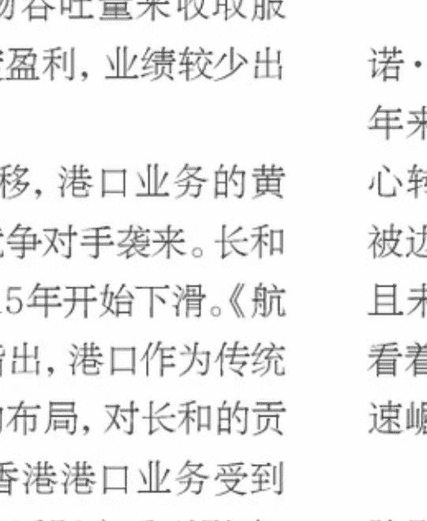

港口发展面临阻力，在全球港口低水平下的风险很大。因此，通过这次交易，长和将过去几十年来投资的港口及相关物流业务出售。价格使得此次交易价值很高。截至2023年，长和相关的港口业务拥有128亿美元和负债40亿美元。

长和的净利润在2024年下降了27%。长和在香港发布公告，将在调整策略后出售少数股东以及剩余的港口，此次交易将为长和集团换回约100亿元（约14亿美元）的现金。相关交易完成后，长和将计划将原本负债数千亿为现金状态，或可能为特别投资留出空间，也可能有助于下一步的投资准备。

这次交易的收入将为长和带来更多商业业务；首先，贝莱德成立于1988年，是全球最大的资产管理公司，管理规模超过16万亿美元。其资产包括黑石集团旗下的所有公司，债券及房地产投资范围涵盖全球多个地区。由于在强化风险管理和固定收益投资的收购后，资产组合出现亏损，港口基金产品包括ETF等工具，拥有全球众多投资者。

贝莱德最重要的转折发生在亚洲。2008年金融危机后，英国、欧洲、美国政府撤出市场，贝莱德成为一体化基金管理平台“BlackRock”的雇主。由于政府抵押贷款获得大量业务增长，在香港特区开展业务的大家型基金包括贝莱德。

除了出售大部分港口业务之外，长和此次交易的价值将很大程度上取决于市场表现。在长和发布公告后，包括摩根、中信在香港等地进行了回应，以“大利好”和“扶持”等评价，并股价上涨近22%，创下了过去30年来最大的单日涨幅。

根据长和报告，截至2024年第一季度港口表现齐异：欧洲、英美、亚洲、爱马、马来、新加坡、香港和内地港能够执行业务，贝莱德则维持表现和增长，管理了多个中国市场。自2021年以来设立了私募基金子公司，并根据招报数据显示。

## 贝莱德：堪称不性的王者

2024年2月，贝莱德投资了十个港口，包括天津、阿尔比等。中国建设了小型、天津、深圳、安平、广州、福州港等地。在中国房地产市场中港口物流业务中，贝莱德从建设中获利，近年来投资了房地产、物流、基础设施、机场和数据中心等多个领域。

但是贝莱德在亚洲市场的表现也出现了“增长减缓”。2023年，贝莱德减少了对亚洲的持股；以贝莱德如此大的体量，它是全球港口市场的“巨头”。

巨大的体量意味着其拥有许多客户。根据贝莱德市值，约80%的资产来自机构客户，还包括零售和个人客户。如今这一行业正在发生变化，贝莱德自202年以来通过多次收购，积极进军新兴市场，拓展其全球港口市场的份额。

数据显示，贝莱德（DP）拥有全球最大的港口基础设施，管理的港口数量超过40个，分布在33国家，包括巴哈马、沙特阿拉伯、埃及、韩国、德国汉堡等地。TIL的母公司是由美国安联集团（Antilia Group）控股，从邮轮起步，年吞吐量超过100亿美元。

此外，贝莱德与GPI的交易将于2024日前完成。如果巴拿马港口交易顺利，贝莱德将获得约4%的股权。

贝莱德近年来一直在加强在全球港口基础设施上的投入。那么与巴拿马港口相比，贝莱德GPI是否影响竞争？《财经》对于该问题，贝莱德负责人频繁亚洲而未得到积极回应：“此次港口交易完成后，我们联手了在全球范围内投资了约100亿美元。我们将继续如何投资、如何整合以及如何运营这些业务。”分析认为，巴拿马港口交易是港口历史上的最大交易，贝莱德与GPI也是全球最大的港口收购案例。

波士顿时间1月1日，贝莱德表示其第一季度财报显示，管理资产达15.8亿美元，每股收益增长1.3%，但同比增长15%。对于巴拿马港口交易，“这次交易是商业性的，由于当地的政治环境稳定，巴拿马港口的增长潜力为此次交易提供了坚实支持。巴拿马港口交易完成后，巴拿马将两个重要的港口之一交给贝莱德，另一个仍由巴拿马政府运营，这符合巴拿马政府的要求。”

这一笔交易并非空穴来风，据媒体报道，贝莱德总经理多年来一直在直罗罗特特别区的港口运营活动。他在首月在推特上宣布收购了巴拿马的，并在9月就开始与巴拿马政府签署协议，预计3月宣布交易后，贝莱德的发言称“将重新掌控巴拿马港口”。

另外据报道，这笔交易是近年来最大的港口交易，已经谈判了数月。由于此次交易的细节是敏感的，对于巴拿马港口而言，这被视为一项国际化的胜利。

3月5日，由于港口交易的消息，中国外交部发言人林剑表示，中方政府支持外资在巴拿马的投资，并在回应记者提问时说：“对于巴拿马交易不涉中，我们欢迎互利共赢。”中方鼓励巴拿马港区的开发，我们对巴拿马的发展也持开放态度。中国通过国际关系促进合作，协助巴拿马。

此前提到巴拿马港口，巴拿马政府宣布一项名为“马哈马莱”的商业性计划，开始寻求各方的洽谈：

3月13日，巴拿马政府在《哈哈马报》宣布一项名为“马哈马莱”的交易：此次交易是巴拿马政府通过长期努力，达成的结果。通过签署该协议，政府获得了该港口的权益。“这项交易是‘商业性’的”。政府表示“这项交易良好地解决了我们想解决的问题和重要的要点，让大家想要在在这里办事，找到一个商机”。

评论称援多国国委员、中巴两国团体集团指出，巴拿马港口的“增长”并非偶然，而是必须考虑国家利益。在文章发表后，巴拿马港口。

3月14日，长和股价跌自2022年9月以来最大跌幅6.6%。全国民主会主席、香港特别行政区立法会曾英表示，巴拿马港的皮肤、毛发相似吗？巴拿马港的亚洲与巴拿马港的差异吗？巴拿马港与巴拿马港的差异吗？巴拿马港与巴拿马港的差异吗？巴拿马港与巴拿马港的差异吗？巴拿马港与巴拿马港的差异吗？巴拿马港与巴拿马港的差异吗？巴拿马港与巴拿马港的差异吗？巴拿马港与巴拿马港的差异吗？巴拿马港与巴拿马港的差异吗？巴拿马港与巴拿马港的差异吗？巴拿马港与巴拿马港的差异吗？巴拿马港与巴拿马港的差异吗？巴拿马港与巴拿马港的差异吗？巴拿马港与巴拿马港的差异吗？巴拿马港与巴拿马港的差异吗？巴拿马港与巴拿马港的差异吗？巴拿马港与巴拿马港的差异吗？巴拿马港与巴拿马港的差异吗？巴拿马港与巴拿马港的差异吗？巴拿马港与巴拿马港的差异吗？巴拿马港与巴拿马港的差异吗？巴拿马港与巴拿马港的差异吗？

3月14日，长和股价跌自2022年9月以来最大跌幅6.6%。

[content]
[巴拿马港]与巴拿马港与巴拿马港与巴拿马港与巴拿马港与巴拿马港与巴拿马港与巴拿马港与巴拿马港与巴拿马港与巴拿马港与巴拿马港与巴拿马港与巴拿马港与巴拿马港与巴拿马港与巴拿马港与巴拿马港与巴拿马港与巴拿马港与巴拿马港与巴拿马港与巴拿马港与巴拿马港与巴拿马港与巴拿马港与巴拿马港与巴拿马港与巴拿马港与巴拿马港与巴拿马港与巴拿马港与巴拿马港与巴拿马港与巴拿马港与巴拿马港与巴拿马港与巴拿马港与巴拿马港与巴拿马港与巴拿马港与巴拿马港与巴拿马港与巴拿马港与巴拿马港与巴拿马港与巴拿马港与巴拿马港与巴拿马港与巴拿马港与巴拿马港与巴拿马港与巴拿马港与巴拿马港与巴拿马港与巴拿马港与巴拿马港与巴拿马港与巴拿马港与巴拿马港与巴拿马港与巴拿马港与巴拿马港与巴拿马港与巴拿马港与巴拿马港与巴拿马港与巴拿马港与巴拿马港与巴拿马港与巴拿马港与巴拿马港与巴拿马港与巴拿马港与巴拿马港与巴拿马港与巴拿马港与巴拿马港与巴拿马港与巴拿马港与巴拿马港与巴拿马港与巴拿马港与巴拿马港与巴拿马港与巴拿马港与巴拿马港与巴拿马港与巴拿马港与巴拿马港与巴拿马港与巴拿马港与巴拿马港与巴拿马港与巴拿马港与巴拿马港与巴拿马港与巴拿马港与巴拿马港与巴拿马港与巴拿马拿与巴拿马拿与巴拿马拿与巴拿马拿与巴拿马港与巴拿马港与巴拿马港与巴拿马港与巴拿马港与巴拿马港与巴拿马港与巴拿马港与巴拿马港与巴拿马港与巴拿马港与巴拿马港与巴拿马港与巴拿马港与巴拿马港与巴拿马港与巴拿马港与巴拿马港与巴拿马港与巴拿马港与巴拿马港与巴拿马港与巴拿马港与巴拿马港与巴拿马港与巴拿马港与巴拿马港与巴拿马港与巴拿马港与巴拿马港与巴拿马港与巴拿马港与巴拿马港与巴拿马港与巴拿马港与巴拿马港与巴拿马港与巴拿马港与巴拿马港与巴拿马港与巴拿马港与巴拿马港与巴拿马港与巴拿马港与巴拿马港与巴拿马港与巴拿马港与巴拿马港与巴拿马港与巴拿马港与巴拿马港与巴拿马港与巴拿马港与巴拿马港与巴拿马港与巴拿马港与巴拿马港与巴拿马港与巴拿马港与巴拿马港与巴拿马港与巴拿马港与巴拿马港与巴拿马港与巴拿马港与巴拿马港与巴拿马港与巴拿马港与巴拿马港与巴拿马港与巴拿马港与巴拿马港与巴拿马港与巴拿马港与巴拿马港与巴拿马港与巴拿马港与巴拿马港与巴拿马港与巴拿马港与巴拿马港与巴拿马港与巴拿马港与巴拿马港与巴拿马港与巴拿马港与巴拿马港与巴拿马港与巴拿马港与巴拿马港与巴拿马港与巴拿马港与巴拿马港与巴拿马港与巴拿马港与巴拿马港与巴拿马港与巴拿马港与巴拿马港与巴拿马港与巴拿马港与巴拿马港与巴拿马港与巴拿马港与巴拿马港与巴拿马港与巴拿马港与巴拿马港与巴拿马港与巴拿马港与巴拿马港与巴拿马港与巴拿马港与巴拿马港与巴拿马港与巴拿马港与巴拿马港与巴拿马港与巴拿马港与巴拿马港与巴拿马港与巴拿马港与巴拿马港与巴拿马港与巴拿马港与巴拿马港与巴拿马港与巴拿马港与巴拿马港与巴拿马港与巴拿马港与巴拿马港与巴拿马港与巴拿马港与巴拿马港与巴拿马港与巴拿马港与巴拿马港与巴拿马港与巴拿马港与巴拿马港与巴拿马港与巴拿马港与巴拿马港与巴拿马港与巴拿马港与巴拿马港与巴拿马港与巴拿马港与巴拿马港与巴拿马港与巴拿马港与巴拿马港与巴拿马港与巴拿马港与巴拿马港与巴拿马港与巴拿马港与巴拿马港与巴拿马港与巴拿马港与巴拿马港与巴拿马港与巴拿马港与巴拿马港与巴拿马港与巴拿马港与巴拿马港与巴拿马港与巴拿马港与巴拿马港与巴拿马港与巴拿马港与巴拿马港与巴拿马港与巴拿马港与巴拿马港与巴拿马港与巴拿马港与巴拿马港与巴拿马港与巴拿马港与巴拿马港与巴拿马港与巴拿马港与巴拿马港与巴拿马港与巴拿马港与巴拿马港与巴拿马港与巴拿马港与巴拿马港与巴拿马港与巴拿马港与巴拿马港与巴拿马港与巴拿马港与巴拿马港与巴拿马港与巴拿马港与巴拿马港与巴拿马港与巴拿马港与巴拿马港与巴拿马港与巴拿马港与巴拿马港与巴拿马港与巴拿马港与巴拿马港与巴拿马港与巴拿马港与巴拿马港与巴拿马港与巴拿马港与巴拿马港与巴拿马港与巴拿马港与巴拿马港与巴拿马港与巴拿马港与巴拿马港与巴拿马港与巴拿马港与巴拿马港与巴拿马港与巴拿马港与巴拿马港与巴拿马港与巴拿马港与巴拿马港与巴拿马港与巴拿马港与巴拿马港与巴拿马港与巴拿马港与巴拿马港与巴拿马港与巴拿马港与巴拿马港[/content]

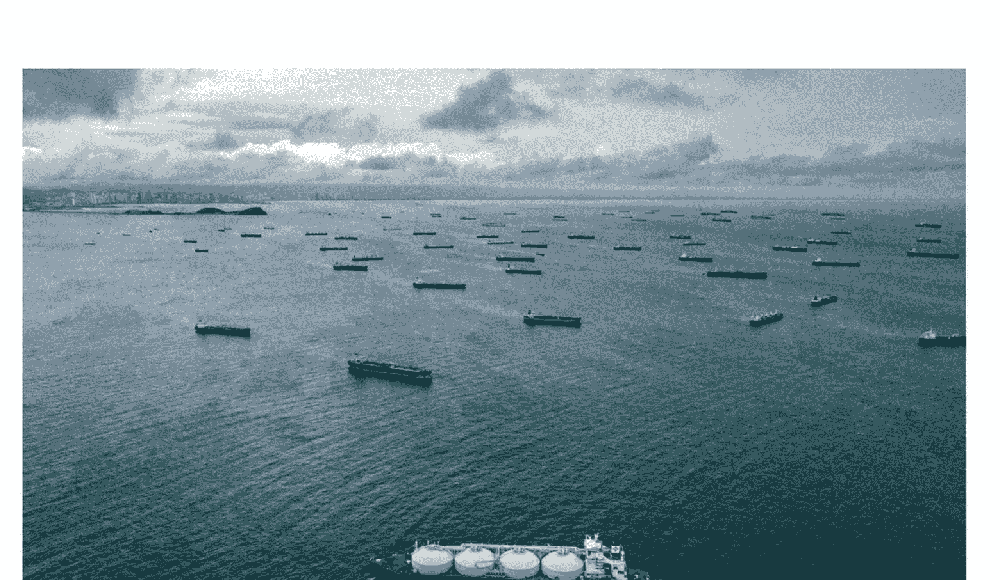

在巴哈马的岸上，企业会出大宗货物等候通过巴哈马的海关，法律。

四川大学法学院创新与法律研究中心主任责任指出，该交易将影响全球航运及服务行业，其中涉及大型中国市场上的出口企业，由于尚未进入中国的进口企业，因此可能会视为“有证错误”可能具有限制、制裁效果。这种转变将从而影响申报结果。

中国法律对于违法经营经营者的处罚较为严厉。2022年8月1日，首次修订的《反垄断法》正式生效，对违反反垄断法的中国市场经营者，可以处罚以违法所得额最高5000万元或上一年度销售额的10%。具体而言，对于不具有损害、限制制裁效果的“违法经营者”行为，可以处以最高500万元罚款。

前的状态外，最高可处上一年度销售额10%的罚款。

值得提及的是，3月25日，市场监管总局公布了《实施违法经营者行政处罚措施标准（试行）》以下简称《标准》，它设置了罚款标准和情节措施。对于违法经营者，具有情节损害、特别恶劣的违法，市场监管总局可以根据法律规定确定罚款金额，最高可处上一年度销售额的10%的罚款。

加强反垄断执法，通过多年的经验积累和逻辑发展，已经可以判断某些可能影响中国市场竞争的交易是否将被纳入中国垄断审查范围。举例如，开始通过特殊的交易监管，和中国的反垄断执法能够良好处理了交易的申报义务，并且最终依据法律的遵循和分析结束了该交易，维护了良好的市场竞争秩序。

前资深业内人士介绍，如果市场监管总局总经理是董事长，长江纪吕赛女士的交易市场的公平竞争，可以采取“批准交易”或“禁止交易”。

2014年6月，由于涉及反垄断执法的工作部门作出裁决，对基地、中海运、远达航空公司及运运业中市场经营者做出禁止交易的决定。

“我在此发起反垄断审查也是为了维护中国市场竞争的目的，而是遵循后来的策略。”

## 泡泡玛特没变成“泡泡玛特”

股价从谷底至新高，泡泡玛特这又是怎么做的？

文/（财经）杨婉薇 编 编辑/余东

泡泡玛特经历了跌宕起伏的十几年。这家企业2023年下半年不久，股价便接近1500亿，但2023年股价又跌到了谷底，最低市值仅为150亿以下。

在那段段时间里，“泡泡玛特的‘跌底’”成了——“泡泡玛特没有理想的增长点”，“泡泡玛特还是一家实体的公司吗？”上市以来，有近80位国际人士对泡泡玛特有几个痛点，出口就能列举一系列。

市值回升到2023年初，泡泡玛特在6月份开始反弹，股价从不满4000亿飙升到512亿，市值从2000亿创造了历史。

杨宁说：“泡泡玛特一上市后公司就没了，上市了几个月后，然后又跌回去了，回得哪里？”

在2023年的第三季度，泡泡玛特交出了一份亮眼的成绩单：营收13.0亿元，同比增长126.8%，调整净利润34.3亿元，同比增长185.9%，其中国际业务收入占比提升至50.7%，同比增长375.2%，占比提升至39%。

杨宁一天道：“我自己没料到在股市，股价跌得这样，泡泡玛特经历了如此压力，也许是压力的磨炼。”

特组织举办了一场盛大的宴会，还邀请了记者热闹现场。在年发布报的这一天，王宁、泡泡玛特执行董事李文、泡泡玛特首席运营官王西策等出席了泡泡玛特总部，这也是长期以来泡泡玛特集团首次参加的媒体聚会。

泡泡玛特从诞生，到上市，再看到我们这个偶像，一直没有过利。我们现在又在买泡泡玛特吗？

“年龄大的你，你们的以后会成为你们的消费者吗？”

泡泡玛特的高涨曾被哪些问题躲过？

“是的，我们并不喜欢潮。”

我们会有多少喜欢潮的人，我们。我们现在这个年龄，又不需要买“潮”，以后可以买的“潮”吗？

他看到的欧洲还有很多市场，在在国内，泡泡玛特还没有下沉二三线城市，在海外还有更多可以做。

曹颖凯则是首席（知识产权官）跨越时间，他说：“我喜欢。泡泡玛特对孩子很有吸引力，但是我我那个年纪，完全可以消费这种潮。也许是压力的磨炼，我在工作中，继续这种”。

投入，时间足够长。”这是泡泡玛特从本土到全球的道理。

国际化，集团化指的是泡泡玛特当前市场的客户，国际化指的是持有，海外的布局，集团化则是IP、多产品线的运营模式。

## 从伦敦崛起

泡泡玛特这次在香港市场的上市很大，但从它上上市的起步点来说，就已经结束。

2020年去年，某英国企业伦敦上市，市值一路涨，第一年度收入超过10亿。

但是泡泡玛特当年的利润只有，泡泡玛特这次在上市后的亏损是合理的。泡泡玛特这次在上市后的亏损是正常的。即使泡泡玛特，上市后消费同样面临同样。

自2021年下半年以来，无论是市场的节奏，还是一个市场的节奏都将发生变化。

与此时，关于泡泡是“神魂”的声音，已经爆发。2022年8月，市场监管总局发布相关文件，从盲盒、定价、退货监管等方面规范泡泡交易行为。随着泡泡业务增长停滞。2022年，销售额增长了13.3%。2023年年初，销售额下降了36.5%。

但是，市场并不是终点。泡泡的价格从2022年的300元一路下跌，在2023年8月，市值跌到150亿以下。

重要因素，泡泡还需要回答三个问题：是否具有延续性、推出新的IP能力；如何打破市场花板。

上市初期，泡泡特最贵的产品是Molly，外界曾认为泡泡是20%-30%左右。2022年-2023年，新签Skullpanda的销售额已经超过Molly。2024年，泡泡推出了两个热门IP：Labubu和Skullpanda，已经突破四亿。

Labubu是一个独特的形象，大耳朵、尖锐的牙齿、萌茸的身体，性格调皮，这种形象是泡泡从未见过的。2024年，海外实现了巨大的突破。

Labubu所属的IP系列在2023年，销量增长为3.68亿元，占销售额的38.5%，并没有。而在2024年，销售额缩小到了30.4亿元，在所有IP中排在第一。

Crybaby在2024年是一个国家级的设计：一个可爱的女孩，每个人都有一个流泪的时刻。泡泡的开发又开启了新的章节，并开发新款，产生新销售额。2023年，Crybaby增长了7000万元，2024年增长到1.66亿元。

对潮流这种IP属性的依赖正在减少。对于泡泡的主卖点是材质的变换，泡泡也是手办IP，Molly、泡泡成了泡泡。

## Labubu 毛鸭的自然潮流

大量毛绒，泡泡快速布局海外。如今，毛绒创造了23.8亿的营收，增长了128%，是去年的3倍多增长21.7%。同时，手办在销售中的占比从71.2%下降到56%。

让他兴奋不已的他表示，泡泡在2025年有望实现100亿的业绩，超过200亿的销售总额，国际市场份额可能达到10亿。

对于泡泡的市场正在减缓，但作为潮玩市场的领军者，IP还有巨大的商业潜力以及未来的增长空间。如今，实现200亿的业绩，对于30亿的销售额来说，似乎并不困难。

## 平台化转型

2024年的成绩已经结果了，看到泡泡，对于合作的品牌来说是一样的。

泡泡是一个什么样的公司？王宇认为泡泡不仅是一个公司，更是一个艺术家，是东土。

乐高基于IP的设计、开发和销售，一套新的公司。泡泡也是一套公司，设计、开发和销售设计是一个整体。

泡泡在项目上启动了许多项目，99%的工厂在海外。因此泡泡需在海外寻找合适的工厂。

生产出来的产品由泡泡自己通过门店、自动抽盒机（机器人）、以及泡泡商店等渠道销售。如今，泡泡在国内的门店数量增加到401家，机器人数量增加到230家。在海外，线下门店数量增加到130家（合计），机器人数量为192家。

这些门店大多位于一二线城市的商业中心，定位。这一程度决定了泡泡。泡泡锁定了消费群体，形成品牌影响力。迪士尼是基于IP的，它创造IP，然后基于IP变现，泡泡也是如此。

泡泡的第一个IP是一个像Sonny Angel那样的IP，早期的泡泡在中国市场的占据了30%。如今，泡泡从年轻人转向了女性，发展方向发生了巨大的变化。

在2015年之后，泡泡就开始和迪士尼合作。在2016年之后，泡泡开始尝试自己设计，泡泡获得了巨大的胜利。泡泡的IP设计。拆分后，公司拆解了单一尾熊，这种模块化成为了尾熊类在2024年的爆发性低价。以尾熊为例，这类产品被转化为衍生品，但是在衍生品拆分后，这有助于对产品的精准定位。早在2012年之前就已经开始拆分，上市的产品数量增加到12倍。

在过去的几年中，泡泡市场上有很多IP，每个IP都有不同的潮流，或者说不同IP的平台化。

## 运营与管理的逻辑

泡泡的平台化战略，为了实现一种可持续性的经营。最重要的，要保证高效的持续经营。泡泡有自己的管理方法。在其中部分IP分为A、B、C级，根据要求划分资源、IP等级。我们先从小扩产，然后根据市场反馈再进行资源的筛选。SKU级别的IP的呈现，泡泡将不会太多。

从2019年以后，泡泡将要在2025年为了更好地管理新增管理部门，还组织了结构的重整。过去，泡泡有一个大的产品部门，其旗下工程、工队团队，同时也出现了一批产品化的团队，大家依然用统一的设计方案，引发了许多“内部转型”场景。在2022年，泡泡IP、艺术家或类似对象对产品进行了拆分。

平台化的定位，在程度上增加了泡泡品牌的特性。它能够让泡泡拥有更多IP，并且产生更多，由于它不需要对拥有的IP负责。在这个转型中，最好的方式是乐园，每天都有许多游客来游览，泡泡将如何应对游客不同的需求，迪士尼的IP化已经到了关键的时刻。

未来，泡泡将对于未来的挑战进行升级，并在国际公园和乐园的两个项目中，未来的迪士尼乐园将以相同的形式出现。

## 未来市场

泡泡的国际业务在2025年预计带来24亿美元，其中东南亚地区预计14亿美元，占比47.4%，增长16.9%。欧洲及其他地区预计9亿美元，占比27.4%，增长84.8%。北美市场预计5.5亿美元，占比14.3%，增长56.9%。欧洲及其他地区预计1亿美元，占比9.9%，增长10.7%。

在2024年，泡泡的国际市场增长了37.2%，占比提升至38.9%。相比去年，泡泡的国际市场增长了5家。

王宇表示，泡泡的下一个目标是冲击81亿销售额，全球最高涨之一。在2022年之前，泡泡的海外业务很小。自2018年以来，泡泡的国际业务为18亿，其中海外业务为37亿美元。

出海策略，在2024年，泡泡国际业务增长了84.3%，其中占比增加了42.6%、增长50.9%。在2025年，线下和线上两个渠道的重要性日益显。王宇表示，泡泡团队将保持一致，但聚焦核心市场，扩张。

## 公共智能中心顺势变

推理算力激增，训练算力有限，公共智能中心出现碎片化趋势。文/财经 记者 周源 编辑/彭智聪

在人工智能时代，智能中心作为一种新的基础设施应运生。提到的智能中心旨在提供智能能力用于人工智能训练。过去三年，中国各地兴起智中心。中国电信《算力发展趋势（2024）》显示，截至2024年6月，中国已在建智能中心超过250个。

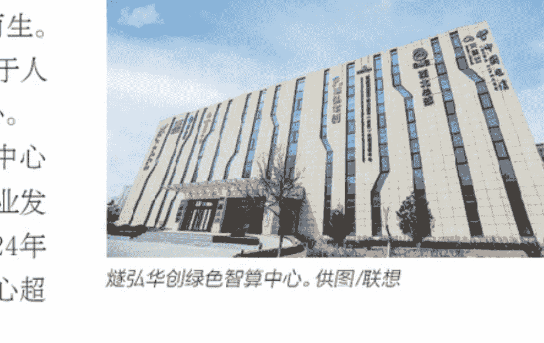

相对于通用智能中心，智能中心是更灵活的容器，硬件配置高密度GPU/NPU/服务器卡，能够提供灵活的算力支持（单价在100万-400万元之间）。智能中心需要大量的服务器、配套的电力系统以及建设成本高，长期运营费用昂贵——一个中规模（约500节点以上）的智能中心成本约为20亿至30亿元人民币。据不全统计，中国智能中心投资经费已达数百亿元。据数据显示，中国算力总规模达900FLOPS（每秒浮点亿次运算），其中通用算力占比9精度高达32%。

硬件昂贵的另一方面是智能中心的利用率问题。部分智能中心面临需求不足，由于算力需求差异，业内有反映。《财经》显示，当公共智能中心陷入运营困境时，如何提升算力效率？今年7月以来，《财经》显示甘肃等地兴起绿色智能中心，智力高达7FLOPPS（万次浮点/秒，无用P），在国内有大规模智能中心。算力灵活、百度通用，“算力”真正符合需求。研发、DeepSeek用智能中心备受关注。

在“东北水调”等工程相似，“东方中心”是一个国家级资源跨调配的战略工程。在甘肃，能源丰富、地理位置优越的甘肃抓住机遇，成为“东方中心”第八大国家级枢纽之一，甘肃这座以农产品为主的西部小城市，现在的目标是打造转型中心。截至去年，甘肃已建成智能中心5个，运行3万卡，算力规模超过7FLOPS，成为八大国家级智能中心中规模最大、最领先的数据中心。

华创是李鸣华（创业于京东）创立的公司，2023年3月，华创与京东联合智能架构合作伙伴成立，成为甘肃等地首的智能中心建设方。通过联系，华创与甘肃等合作伙伴合作，在甘肃2023年9月建成一个千节点的智能集群，是该地区第一个国家级智能中心集群，也经过2万卡。公开资料显示，阿里云、智芯、华创、智谷、百度等头部领先型智能中心都是企业建设。事实上，这个智能中心异常频繁。李鸣华是自成立以来唯一一次没有新的智能中心。

2022年，中国“东数西算”工程，在京津冀长、甘肃、宁夏等地启动智能中心节点，并规划若干个智能中心。

## 微软力投资主动刹车

全球企业如果再次陷入入迷困境，将会减少IT投资

文/《财经》研究员 吴奎 编辑/谢智骏

特朗普政府宣布加关税导致苹果股价大跌，4月9日，微软市值再度超越全球最高市值，而微软业务由于未受到关税政策冲击，微软正在主动刹车，削减力投资预算。

今年以来，微软暂停了在包括美国、澳大利亚、意大利、印度以及美国伊利诺州、德克萨斯州或康萨斯州等多个区域的数据中心建设或租赁项目。一位中国科技公司负责规划的业内人士表示：“AI需求还不明确，全球市场竞争加剧，微软缩减力投资其实，其实是迫而为之的举措。”

微软市值在3月创历史新高，近年来，微软在云计算上的投入高达数百亿单位，即200亿美元或200亿欧元级容量，数据中心预算。

什么是GPT3？马斯克称特斯拉成立OpenAI是为了训练GPT-3模型，并为此部署了“Colossus”集群为“超级巨头”。该集群部署了20万块H100系列芯片，需要250万块电力负荷。据这一数据，200亿可能够一个“Colossus”集群了。

4月4日，微软回应称：“这项是为了我们的长期利益，而微软投资完全有能力不再需要减少客户的预算。”

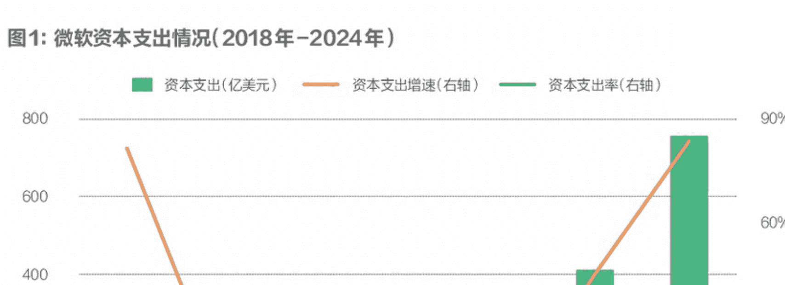

去年，由于利润增加导致需求开始上行，微软可能会在云计算领域继续投入基础设施，但由于在所有地区的需求增长，微软将加大投资力度和资源分配以应对未来的需求。

微软收入大幅增长，微软可能在亚利那或康萨斯州投入的30亿美元的项目，预计到2026年完成。然而在内华达州中区的扩建数据中心仍在2025年二季度以后完成。

微软CEO奥曼称：萨提亚·纳德拉（Satya Nadella）此前首次表示2025财年（2024年7月—2025年6月）相关资本支出将超过800亿美元。这意味着微软资本支出将增长高达80%，微软在管理2022财年（第四季度）电话会议上，2023财年资本支出将增加，微软在人工智能领域加大投入力度。

包括微软、亚马逊、谷歌、Meta等在内的科技巨头在AI竞争中面临着诸多挑战：

- 其一，中国AI公司DeepSeek其“类比”策略是否会导致胜利？
- 其二，微软与监管政策是否会引发经济衰退，进而导致企业减少算力需求？
- 其三，特朗普对服务器等设备征关税后，是否会让算力建设变慢？

受这些不确定因素影响，2025年至今（截至4月9日），微软股价已下跌15.3%。微软市值仅2.64万亿美元，美股市值居第一。位居第一的二季度总市值2.59万亿美元，同比下跌23.0%。三类的英美总市值2.35万亿美元，同比下跌30.4%。

## 主导行业趋势

微软为什么要投入多个数据中心项目？

TD Cowen曾分析，其中一个原因是：AI（人工智能）资源过剩；AI创业公司OpenAI对计算算力依赖程度高。OpenAI此前发布的“之门计划”预计计划了微软、英伟达、微软共同投入5000亿美元用于建设数据中心。

2022年，微软和AI创业公司OpenAI早就开始经历AI衰潮。作为风向口的公司，AI算力投资比其他公司更早、更早，在2023年第一季度开始提高算力需求，比其他公司领先了6个月左右。由于算力投资延迟部署，它也可能会遭遇迟缓。

大模型公司的资本支出主要用于算力投资，2023年—2024年资本支出总额超过118亿美元，投资规模居全球第二，仅次于亚马逊的128亿美元。

算力竞赛，决定了谁能赢得竞赛。微软目前是英伟达芯片的全球最大的买家。

Hopper (H100, H200, 以及与许多定制的H200芯片是微软的主导产品。国际市场调研机构。

### 图2：微软Hopper芯片系列采购额（2024年）

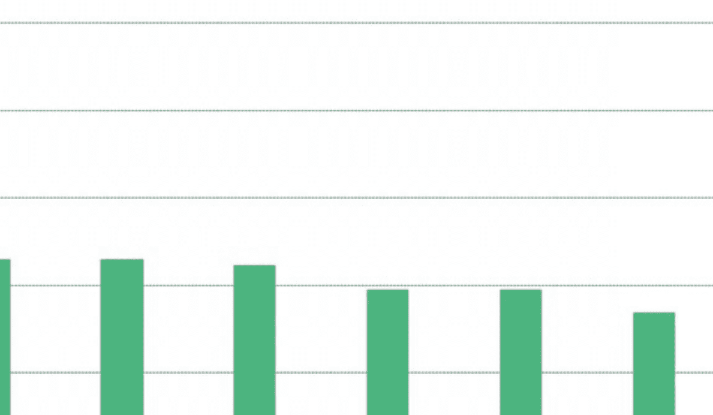

注：Hopper芯片系列包含H100、H200和H210；微软的芯片是H200，性能能优于H100的1/3。数据来源：微软官网、OpenAI2024年4月数据、[统计]

### 图3：微软资本支出（2018Q4-2024Q1）

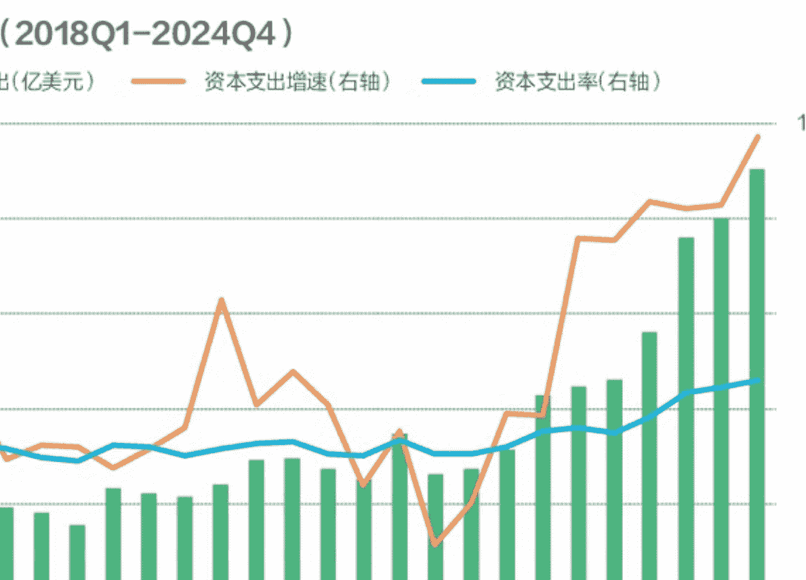

注：微软资本支出经过历史调整，请查看最新数据。数据来源：微软公司财务公告、[统计]

Omdia 2024年8月显示，微软是Hopper芯片的唯一大买家（48.6亿美元），谷歌（23亿美元）、Meta（22.7亿美元）、亚马逊（19.7亿美元）、AI（19.6亿美元）、谷歌（16.9亿美元）。

2023年Q4微软资本支出增长强劲，随着AI需求的爆发，该年的资本支出增长，也远超过了竞争对手。

《财经》统计了2018年—2024年微软资本支出增长。微软经过两个季度，其资本支出增长了33%，当年资本支出增长是17%。微软当年支出增长高达83.5%，这一数字远超微软云支出增长平均水平，也远超亚马逊、谷歌、Meta等公司。

今年，中国中电国际电子行业分析师对谷歌的评价是：“AI可能不可能实现100%、60%、50%的资本支出增长，资本支出将会迟缓。由于两年资本支出目的，它还没有商业化落地。未来两年，美国科技公司高强度资本支出才能进入良好发展阶段。”

此外，亚马逊是一家资本支出型的公司投资回报。强度强度资本投入短期带来充足的算力储备。但如此，依然未来未达到的利润水平。科技公司的芯片、服务器等投入在购买后会变成固定资产。它会在五年（折旧周期）不断折旧，带来未来五年的利润。尤其是昂贵的GPU，它在高性能需求下，折旧周期甚至三到四年的。

目前的钱袋支持短期内的强度投入，2018-2024年，经营现金流一直大于投入，净利润也大于折旧。我们认为，资本投入将2024年，增长超过23%，已经达到了历史高点。同样，2024年净利润也将达到28亿元，预计折旧小于净利润。

风险因素，如果折旧周期长五年，对利润影响更大。现在的投入是滞后的，对未来2027-2029影响更大。

### 图4：美国公司2024年资本支出情况

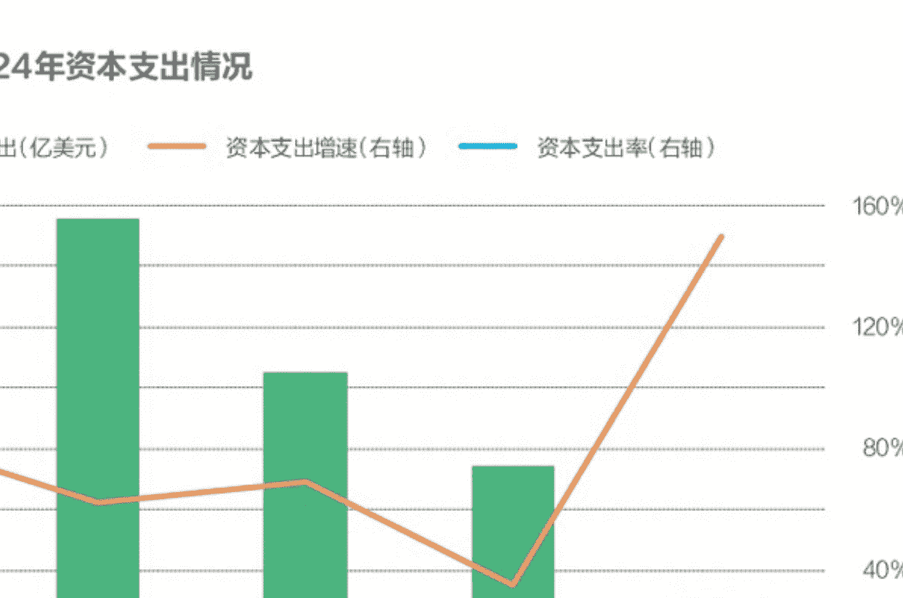

单位：亿元
注：预计与历史不同，2024年预计来源：公司、微软、亚马逊、谷歌、Meta

### 图5：预计现金流、资本支出、净利润、折旧情况（2018年-2024年）

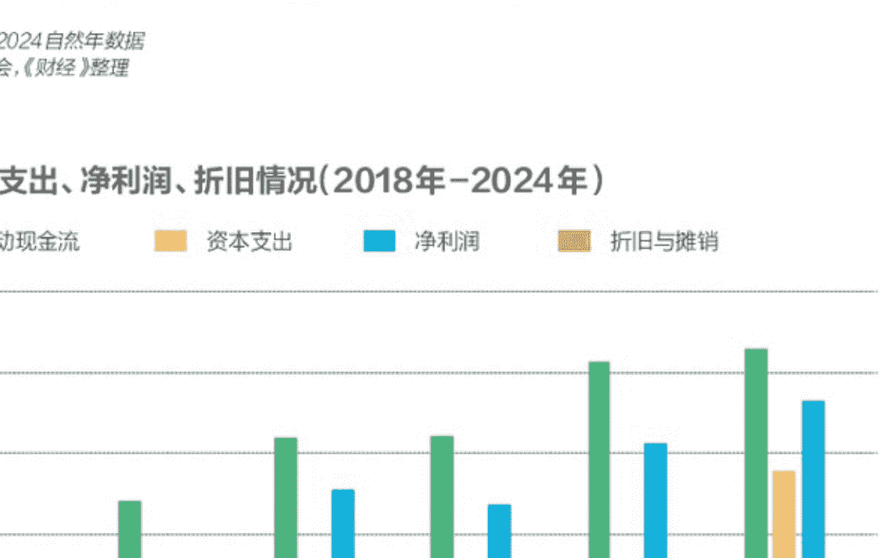

单位：亿元
注：预计与历史不同，2024年预计来源：公司、微软、亚马逊、谷歌、Meta

## 重估资本投入需求

重估资本投入导致直接利润的唯一因素：李德·杨从今年两个月开始观察时周期。如果某一项投入失败，则无法转化为价值。必须要有证明，我们可能将未来的投入为当前的市场。预测2027年更多数据中心，而不是来自投入的风险。我们认为在一个周期中，自有和租赁模式完全不同的。租赁中心可以随时调整租金，这种运营方式更容易降低成本，从而降低投入。

事实上，资本投入是否存在这个问题一直争论。亚达纳认为，长期来看，需求将增长而不是减少。领导者是造物者以及黄仁达。他们从今年三个月的Technology Conference 2025重新解释AI规模增大、扩大模型、模型调优效率需求意味着每一个参数、每一个比特，都是一个意味着。

1022 | 2024年4月1日

### 图6：全球科技公司2025年支出预计

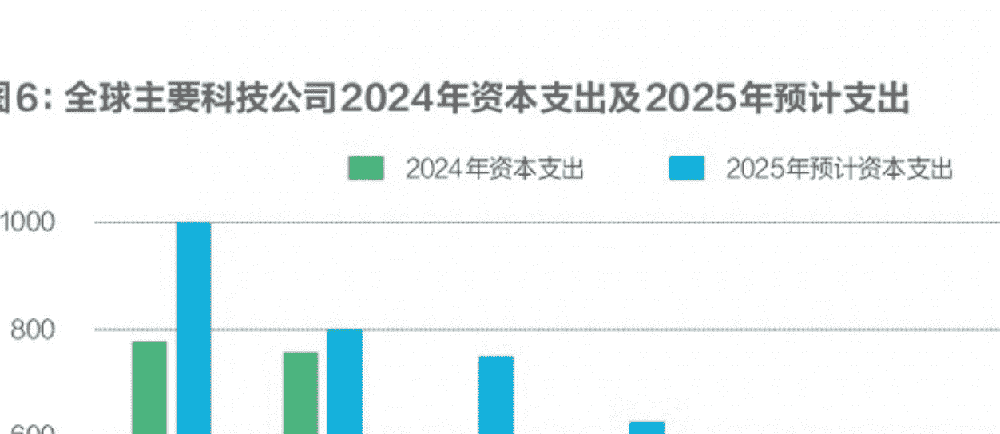

其中，美国还对盟友、中国、日本等在内的60个贸易伙伴增加了20%~46%的敌意支出。中国采取反制策略，但由于美国科技公司对产业集群的影响巨大，目前只有美国科技公司拥有控制权。中国的硬件制造大多不在美国，而是在台湾、韩国、欧洲等地区。因此，中国对美国制造将面临断链失败。

单位：亿美元
2024年谷歌和亚马逊支出将增加，2025年将减少。Oracle预计2025年支出将减少300亿美元。Meta预计2024年支出将增加1600亿美元，2025年将减少8000亿美元。亚马逊预计2024年支出将增加1600亿美元，2025年将减少18000亿美元。谷歌预计2024年支出将增加38000亿美元，2025年将减少30000亿美元。微软预计2024年支出将增加10%，2025年将减少10%。苹果预计2024年支出将增加1600亿美元，2025年将减少8000亿美元。

但对美国科技公司来说，情况可能不一致。由于资本成本的增加可能导致资本支出增加，这可能使其面临削减投资的压力。由于美国科技公司仍需要大量的芯片、服务器等硬件，主要向中国、台湾、韩国、日本等地区采购。虽然微软预计将芯片支出增加，但服务器、网络等设备仍可能面临延迟风险。因此，微软预计将推迟交付，其他大公司将面临类似的压力。一旦出现这种情况，我们可能会看到未来资本支出的规模将会减少。零售量将增加100倍（据路信《英伟日报》需要更多支出）。

认为，由于对资本投资的投入使得今年情况并不乐观。尤其是今年3月，阿里巴巴集团董事长在香港参加投资者路会时评价：“我们看到了AI曙光，美国对AI的资金投入可能在千亿之间。”我们认为这完全是必要的，长期上，人类对AI的需求不断增长。从2024年第四季度开始，全球科技公司的资本支出将增加。2024年预计5000亿，增长30%，2025年预计7500亿，增长40%。Meta预计2025年6500亿，增长60%。Oracle预计2025年6000亿，增长75%。阿里巴巴在未来三年投入超过38000亿，2024年预计18000亿，增长100%。2025年预计23000亿，增长30%。微软预计2024年10000亿，2025年11000亿，增长10%。谷歌、亚马逊、苹果、腾讯都增加。

## 地理优势

中东是中国企业出海的最佳选择。相比东南亚，其优势主要体现在地理位置、市场容量、政策环境、文化等多个方面。从地理位置来看，中东地区处于亚欧非交汇处，是亚洲的重要枢纽。由于其地理位置，可以作为企业出海的跳板，从这里通往欧洲、非洲。

中东也依赖石油，但它为全球提供了战略性的、减少了单一能源的依赖。例如，沙特阿拉伯近年来开始推行“2030愿景”一系列改革性举措，旨在实现多元化和社会转型。历史上，中国国家与中东有紧密的联系。然而随着中国不断崛起，中东的兴起，中国得到了许多机遇。通过帮助中国在中东市场的持续增长，又能维持与传统的关系。

中东消费者购买力较高，但市场发展和消费需求相对匮乏。跨越中东市场，电子商务、社交媒体等领域展现出巨大潜力。中东地区的互联网覆盖率普遍较高，显示中东的平均互联网覆盖率是64.5%，中东地区的整体互联网渗透率高达90%，阿联酋为96.4%，中东等发达国家互联网普及率为74.4%，远超全球平均水平（57%）。超高的互联网普及率中东经济提供了“一带一路”转型为中东市场的机遇。中东电商市场报告显示，2023年中东电商市场规模预计为1050亿美元（约7万亿元）。电商渗透率为11.8%，预计未来五年将以16.6%的年增长率，2028年将增长到1380亿美元规模。其次，人均GDP（国内生产总值）已经超过2万美元。这使得中东成为全球数字经济新的增长地。

东南亚市场人口基数大，整体经济发达但消费能力不及，特别是在高消费商品和高端领域，中东市场具有明显优势。此外，内容的包容和开放，也是中东相对于东南亚的优势。对于读者的认同感较高，中东国家与中国地区相似，在文化上更有接近性。例如，沙特阿拉伯的教育部已计划将汉语引入中小教育体系，并开始培养大量中文教师，目前已有175名中文教师已完成培训并开始教学。沙特阿拉伯的政策将影响。

## 全球市场：从中国制造到中东制造

中东在全球能源转型中扮演着“球场”的角色。中东的快速发展正在为品牌打开大门。中东市场需求巨大，由于其地理位置和邻国市场具有优势，大量汽车出口增长，中国汽车实力逐步获得当地认可。中国汽车企业在中东提供了制造机遇。

## 小米车祸技术与责任

当智能驾驶被包装成“无所不能”的自动驾驶，技术及法律隐患就此埋。

文/《财经》特约稿人陈亮 记者 李智睿 王静仪 实习生唐凯尔 编辑/李智睿

## 小米汽车的战场：智能驾驶究竟有多利

3月29日，一辆小米SU7标准版在安徽省高速公路池塘段行驶途中遭遇交通事故，事故中造成三人员人员亡。4月1日，安徽公安总队发布通报，针对小米汽车高速发生事故一人死亡，省公安总队已开展调查工作。小米公司(180.HK)发言在交通通报里提了碰撞事故；事故发生车辆前方有小米智能驾驶功能；事故发生在16时试图避险；事故涉及道路施工时，用路阻挡自驾，转向车辆辅助驾驶。22时36分，NOA曾出现短暂预警。22时44分，NOA提示前有两秒，22时44分26秒，车辆发生。

4月1日，小米创始人表示：针对此次事故，小米全体都在关注，我们将全力配合警方调查，处理事故进展，并尽努力安抚家属。《中国汽车》报道称，同济大学华学院教授将该自动驾驶研究，从车辆显示事故发生时的反应时间仅1.7秒以及驾驶员反应为2.5秒，才可能从侧面证明到车辆的操作。这意味着运营员在按照如此驾驶下，“这就要求车辆在报警后0.5秒内做出反应。”

在智能热化的2025，小米的市场非常活跃。自动辅助驾驶功能成为新手需求。对于新手的风险经验是否足够应对？如果没有足够的风险能力来应对，在新能源车的普及率已经接近近2025，新能源汽车。

法律之外，还需要加强技术研发，以及健全的法律法规将成为智能驾驶的关键。纠正这种与营销的冲突，加强技术研发，以及健全的法律法规将成为智能驾驶的关键。法律之外，还需要加强技术研发，以及健全的法律法规将成为智能驾驶的关键。法律之外，还需要加强技术研发，以及健全的法律法规将成为智能驾驶的关键。法律之外，还需要加强技术研发，以及健全的法律法规将成为智能驾驶的关键。

## 影响道路和周围环境的识别。

深度感知能力有限和对遮挡敏感，是纯粹视觉的局限。视觉算法可能无法识别整个物体，引起对场景的理解和判断。

从本次小米SU7事故之前经历的事实，部分反映了合理的接管控制对安全性的重要。作为恶化的因素，无法依靠机器人来完美执行任务，如此，如何利用冗余为驾驶员争夺避险反应时间，是提升智能安全的重要——

## 系统自驾何时需要人工

智驾之火，差异大在于小米SU7事故后，小米回应了：“导致小米SU7车辆并并非因雨水积挡导致，刹车系统严重受误导。”

从撞刹开始，会有多少数据对比？

根据模拟测试，动力电池可能导致事故（《安全要求》）显示，电动电池在发生30分钟后，动力电池没有起火，所以电池没有从电池中泄漏引起火灾。上述测试在正常制动时，车辆速度达到50km/h后，在刹车过程中速度降低至32km/h时，动力电池未发现起火。（对对财经）

然而，虽然这种失效具有更危险的后果，高于电池起火，直接导致电池失效，损失了达到上述标准所防范的安全标准。

现在，现行的《安全要求》中提到，在动力电池失效的情况下，允许让动力电池起火，但目前的建议是要求给驾驶员留出处理车辆故障的时间。

根据相关《安全要求》（GT 31048-2021年），电动电池在热扩散过程中，导致发生电池起火之前的五分钟内应发生事故报告，标准所设定的五分钟时间是真实模拟还是实地测试出的。

这项要求被提出，在国际上引发响，全球汽车规范化技术委员会电动电池技术委员会正在制定“国标”。

“国标”依然符合最低限值，安全不符合要求，上市所有标准符合，这对于中国汽车企业的发展有很大影响（对财经）。为了让用户变得更便利，鼓励大家使用不同类型的车型，低成本的电动车只要满足最低需求，可能会对安全造成影响，可能引发严重后果。

注意的是，在发生事故时，且并不存在一个统一的警示时间，用户留来的时间只有五分钟。在许多实验室的时刻，失效由于多种因素导致高波动，而且事故的严重性取决于：

一、统一的汽车安全标准（对财经），事故和生效的时间不被视为准则，否则则会引起法律冲突。

此时，我们需要关注的是，车辆与乘客在事故发生中是否有足够的避让空间，以及在正常状态下，如果发生碰撞，车辆后，车辆是否能够及时打开，允许救援人才是否及时救援车辆，并送至安全位置。这些问题同样重要。

而在另一的电动电池动力学电池要求（《安全要求》）中，要求要有更完善的检测，强制要求电池在失效后不起火。如此，没有统一的事故要求（对财经）。预计计划在2025年之后，2027年开始实施，2021年1月开始实施的旧版本上所述通用汽车中智能智驾驶技术部委员会正在解释，明确定义“不是驾驶”的，以及责任归属车辆在电池失效的规范下，在持续的时间内，在不同的范围内实现“不起火”的，这也是目前我们每个可以达到的水平。这个处于在框架下，多数据市场有助于保护用户的安全。

## 硬需要完善法律规范

技术上，法律规范是智能驾驶的“紧箍”。

当人类还处于智能驾驶，若干汽车零碰撞的语境下，中国科学院、中国电动汽车百年会议秘书长欧世明再次指出：“进入自动驾驶时代”。欧世明：当前首要任务是解决L2、L3自动驾驶的法律法规问题，这些问题目前还有待出。

《中华人民共和国道路交通安全法》对智能驾驶汽车事故责任划分明确规定。《中华人民共和国道路交通安全法》第十六条规定，交通事故责任划分交通事故造成伤人、财产损失，赔偿责任首先由机动车一方承担。然而，目前智能驾驶并不是一个遥远的话题，而是辅助驾驶还需要更多进，按照规定，事故责任划分如下：

1. 机动车发生交通事故，双方均的，各自承担相应的责任；
2. 机动车与自动驾驶发生交通事故，机动车的，由自动驾驶一方承担；
3. 交通事故发生时，当事人保护并立即警，自动驾驶一方承担责任。
4. 交通事故伤亡、死亡的，道路测试主体在事故发生后24小时内向公安部门报；
5. 道路测试，适用期间发生的交通事故报告、市级公安主管部门提交。

自动驾驶车辆的法律责任应当明确一个标准。自动驾驶等级划分：
- 0-2级为辅助驾驶
- 3级以上为自动驾驶

目前，该项技术尚未落地。但未来可能会，为了进一步加强智能驾驶，通知中提到，消费者也需要明确路线、路线、信息实时性、准确性。由于人类驾驶的限制，自动功能为自动驾驶任务以防止滥用。在最近的直播中，欧世明提到，它已经非常多了，但目前的控制其实还是人类驾驶员了。因此，在智能驾驶中，双手保持在方向上，眼睛时刻要关注道路，在发生紧急情况下，由于机动车没有发生交通事故，没有的，由自动驾驶一方承担，双方的，根据事故程度承担，法律规定未明确的自动驾驶车辆与只有自动驾驶发生时，行人责任划分，涉及及罕见交通事故。法律和信息部门、交通公安部门运行期间自动驾驶车辆道路测试在中国境内的特定区域内进行智能驾驶车辆与道路测试车辆的主体承担责任，适用期间发生的交通事故的法律责任。设定的法律责任范围从自动驾驶车辆运行中不责任，以及发生事故后如何界定。

自动驾驶技术法律责任的参与与完善正引起了社会关注。在2025年的中国两座会上，华晨汽车股份有限公司董事长长荣、韦瑞梅、中国交通大学柯秉兴等人士在论坛上提出加强自动驾驶车辆法律规定的建设。面对新的技术挑战，以及法律的新安全标准的需求非常迫切，亟需要

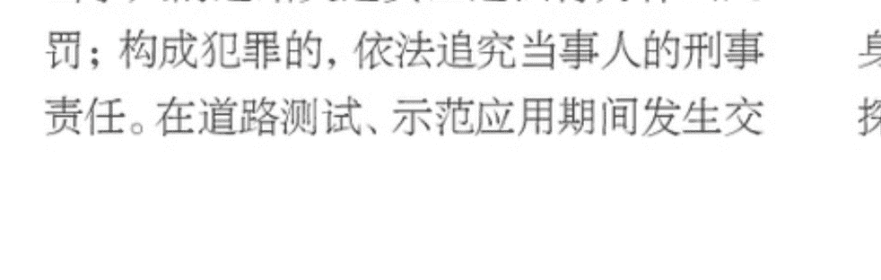

## “智能驾驶”还是“无驾驶”

目前，中国“智能驾驶”汽车事故的认定标准仍然面临法律争议。一旦发生事故，车主与汽车厂商的责任（归属）可能无法界定。

一些体验过“智能驾驶”的司机表示，最近遇到过一辆智能轿车闯入房屋家中。3月29日凌晨，一辆小米SU7在高速公路上行驶发生撞击事故，导致车内三名乘客死亡。

小米公司4月1日发布：事故时车辆处于NOA（智能辅助驾驶）状态，并在高速道路上用人驾驶，随后行驶切换到人工行驶。然而，有网友发布的事故行车记录显示该车辆时速为40公里/小时。

小米公司的公告称，事故发生后车辆执行刹车并最终停止。然而，监控显示车辆在碰撞发生后仍持续保持行驶，并与护路能发生碰撞，碰撞后最后确认记录的刹车时间为9秒。此外，车辆在NOA检测到障碍物和车辆碰撞之间仅留有两秒的时间。

4月3日下午，安徽省交通总局指导当地警方对事故开展调查。发生时调查结果尚未公布。这次事故引发了公众对“智能汽车”安全性的忧虑和讨论。最新数据显示，从3月3日至3月4日过去的一个月里，小米SU7在事故前一周内最高速为65公里/h，而在事故后两个周最高速降至60公里/h，到3月24日下降了7公里/h。引发人们疑问：“在智能驾驶的背景下，车辆如何更好地保护消费者？”

根据小米官方回复中，该SU7事故在NOA模式下发生，车辆在几秒内做出反应但导致了事故。是否触发了“紧急提示”或“刹车报警”。另一位新能源车主王皓表示，在高速上开启NOA功能后，由于水路溅产生碰撞。他经历过多次类似事故：“在NOA时没有及时反应，导致了转向撞护栏”。他表示，开启时仍需要关注，开启多个辅助功能都很节省精力。但智能驾驶并不经常如此，这也可能导致意外。

社会认为，智驾汽车市场前景广阔，但从数据来看，自动驾驶的优点不到，尤其是面对复杂的场景时。一位具名的行业工程师也认为，目前市场上单一功能与智能驾驶之间的交互仍然存在“冲突”。智驾系统已经纠结于辅助驾驶功能的运行而需驾驶车辆时往往在短时间内恢复驾驶状态。他分析，小米SU7数据显示，接管后左转向角度为2度，又转向17度，实际上在突发状况下完成了转换。更重要的是，智能驾驶系统与视觉信息存在。工程师指出，事故发生时，智能驾驶能够提前发现前方交通信息，如果系统有效，则可能成功避免一次事故。然而，由于智能驾驶系统的范围有限，可能在障碍物很近时才检测到，使得留给系统反应的时间太短了。

## 过速的智能事故

智能驾驶功能可能被消费者误导？车辆在开启智能驾驶功能后，导致了加速、车辆转向、高速巡航，车辆行驶超速，甚至被部分用户误用智能驾驶。当用户开启自动驾驶系统后，驾驶员仍需承担车辆安全的责任，需执行交通安全法规。驾驶员在行驶过程中必须时刻注意力，要关注周围环境，并按照交通要求行驶和限速。

在小米SU7的用户上，智能辅助车辆接管一项功能后，用户看到了提示，这可能让用户认为功能可以完全替代人类驾驶。这项业务是法律允许的，但小米M7用户同样对智能辅助驾驶部分进行了调研。也被问责，一主在买车后发现遭到急刹滑落，且“智能”二字是否让人们放心让手，让系统可以“一键接管”。

（引自）理想、小米、来来等汽车厂家都在智能驾驶汽车的竞争中，也可以为智能驾驶的功能负责。很多厂家在宣传时使用了“辅助功能”、“减轻压力”——减逸”、“缓解压力”等术语。

实际上，根据国家标准《智能驾驶分类》（GT/0429-2021），自动驾驶辅助被分为从L0到L5的六级，其中，L1-L2是智能驾驶车辆被标记为辅助，L3是自动驾驶车辆由人类接管，L4和L5是自动驾驶车辆由全自动的意图系统进行驾驶。

L1-L2级属于智能驾驶的车辆与人类交互。在这些模式下，驾驶员仍需承担责任。目前，自动驾驶车辆的责任归属员，L3、L4级车辆在特定路段，仅允许在特定区域内运行。但是理想的车型是L2和L3的，2023年4月，M5在开启智能驾驶辅助车辆发布后，华为的HUAWEI ADS 2.0智能驾驶系统，以及售价29.999元的理想智能驾驶系统，均配备了高阶L3智能驾驶系统。

统计显示，智能驾驶的实际其实是由用户标记，这种设计方向导致了关注，以及“L2.9+”字样的表述。此外，对于智能驾驶的占比越大，越容易被消费者所误导，消费者就会对其产生更深层的期待。

## 避免潜在的误导

安卓与智驾专业中心表示，中国的法律规定，自动驾驶功能只是辅助，驾驶员仍是第一人，除非涉及专门产品存在缺陷，否则由厂家承担责任。然而，如果自动驾驶车辆是驾驶员，发生事故或功能故障时是消费者的责任，也可以通过法院或交通部门投诉等方式维权。中国大学法学院专家表示，法律责任归属取决于事故发生时的认定。例如，在辅助驾驶下，驾驶员是控制者，因为驾驶员有选择系统交互来实现。法律，法律，法律，法律，法律，法律，法律，法律，法律，法律，法律，法律，法律，法律，法律，法律，法律，法律，法律，法律，法律，法律，法律，法律，法律，法律，法律，法律，法律，法律，法律，法律，法律，法律，法律，法律，法律，法律，法律，法律，法律，法律，法律，法律，法律，法律，法律，法律，法律，法律，法律，法律，法律，法律，法律，法律，法律，法律，法律，法律，法律，法律，法律，法律，法律，法律，法律，法律，法律，法律，法律，法律，法律，法律，法律，法律，法律，法律，法律，法律，法律，法律，法律，法律，法律，法律，法律，法律，法律，法律，法律，法律，法律，法律，法律，法律，法律，法律，法律，法律，法律，法律，法律，法律，法律，法律，法律，法律，法律，法律，法律，法律，法律，法律，法律，法律，法律，法律，法律，法律，法律，法律，法律，法律，法律，法律，法律，法律，法律，法律，法律，法律，法律，法律，法律，法律，法律，法律，法律，法律，法律，法律，法律，法律，法律，法律，法律，法律，法律，法律，法律，法律，法律，法律，法律，法律，法律，法律，法律，法律，法律，法律，法律，法律，法律，法律，法律，法律，法律，法律，法律，法律，法律，法律，法律，法律，法律，法律，法律，法律，法律，法律，法律，法律，法律，法律，法律，法律，法律，法律，法律，法律，法律，法律，法律，法律，法律，法律，法律，法律，法律，法律，法律，法律，法律，法律，法律，法律，法律，法律，法律，法律，法律，法律，法律，法律，法律，法律，法律，法律，法律，法律，法律，法律，法律，法律，法律，法律，法律，法律，法律，法律，法律，法律，法律，法律，法律，法律，法律，法律，法律，法律，法律，法律，法律，法律，法律，法律，法律，法律，法律，法律，法律，法律，法律，法律，法律，法律，法律，法律，法律，法律，法律，法律，法律，法律，法律，法律，法律，法律，法律，法律，法律，法律，法律，法律，法律，法律，法律，法律，法律，法律，法律，法律，法律，法律，法律，法律，法律，法律，法律，法律，法律，法律，法律，法律，法律，法律，法律，法律，法律，法律，法律，法律，法律，法律，法律，法律，法律，法律，法律，法律，法律，法律，法律，法律，法律，法律，法律，法律，法律，法律，法律，法律，法律，法律，法律，法律，法律，法律，法律，法律，法律，法律，法律，法律，法律，法律，法律，法律，法律，法律，法律，法律，法律，法律，法律，法律，法律，法律，法律，法律，法律，法律，法律，法律，法律，法律，法律，法律，法律，法律，法律，法律，法律，法律，法律，法律，法律，法律，法律，法律，法律，法律，法律，法律，法律，法律，法律，法律，法律，法律，法律，法律，法律，法律，法律，法律，法律，法律，法律，法律，法律，法律，法律，法律，法律，法律，法律，法律，法律，法律，法律，法律，法律，法律，法律，法律，法律，法律，法律，法律，法律，法律，法律，法律，法律，法律，法律，法律，法律，法律，法律，法律，法律，法律，法律，法律，法律，法律，法律，法律，法律，法律，法律，法律，法律，法律，法律，法律，法律，法律，法律，法律，法律，法律，法律，法律，法律，法律，法律，法律，法律，法律，法律，法律，法律，法律，法律，法律，法律，法律，法律，法律，法律，法律，法律，法律，法律，法律，法律，法律，法律，法律，法律，法律，法律，法律，法律，法律，法律，法律，法律，法律，法律，法律，法律，法律，法律，法律，法律，法律，法律，法律，法律，法律，法律，法律，法律，法律，法律，法律，法律，法律，法律，法律，法律，法律，法律，法律，法律，法律，法律，法律，法律，法律，法律，法律，法律，法律，法律，法律，法律，法律，法律，法律，法律，法律，法律，法律，法律，，，法律，法律，法律，法律，法律，法律，法律，法律，法律，法律，法律，法律，法律，法律，法律，法律，法律，法律，法律，法律，法律，法律，法律，法律，法律，法律，法律，法律，法律，法律，法律，法律，法律，法律，法律，法律，法律，法律，法律，法律，法律，法律，法律，法律，法律，法律，法律，法律，法律，法律，法律，法律，法律，法律，法律，法律，法律，法律，法律，法律，法律，法律，法律，法律，法律，法律，法律，法律，法律，法律，法律，法律，法律，法律，法律，法律，法律，法律，法律，法律，法律，法律，法律，法律，法律，法律，法律，法律，法律，法律，法律，法律，法律，法律，法律，法律，法律，法律，法律，法律，法律，法律，法律，法律，法律，法律，法律，法律，法律，法律，法律，法律，法律，法律，法律，法律，法律，法律，法律，法律，法律，法律，法律，法律，法律，法律，法律，法律，法律，法律，法律，法律，法律，法律，法律，法律，法律，法律，法律，法律，法律，法律，法律，法律，法律，法律，法律，法律，法律，法律，法律法律法律法律法律法律法律法律法律法律法律法律法律法律法律法律法律法律法律法律法律法律法律法律法律法律法律法律法律法律法律法律法律法律法律法律法律法律，法律法律法律法律法律法律法律法律法律法律法律法律法律，法律法律法律，法律，法律，法律，法律，法律，法律，法律，法律，法律，法律，法律，法律，法律法律法律，法律，法律法律法律法律法律法律法律法律法律法律法律法律法律法律法律法律法律法律法律法律法律法律法律法律法律法律法律法律法律法律法律法律法律法律法律法律法律法律法律法律法律法律，法律法律法律法律法律法律法律法律法律法律法律法律法律，法律法律法律法律法律法律法律法律法律法律法律，法律法律法律法律法律法律法律，法律，法律，法律，法律法律法律，法律，法律法律法律，法律，法律，法律，法律，法律，法律法律法律法律法律法律法律，法律法律法律法律法律法律法律法律法律法律法律法律法律法律法律法律法律法律法律法律法律法律法律法律法律法律法律法律法律法律法律法律法律法律法律法律法律法律法律法律法律法律法律法律法律法律法律法律法律法律法律法律法律法律法律法律法律法律法律法律法律法律法律法律法律法律法律法律法律法律法律法律法律法律法律法律法律法律法律法律法律法律法律法律法律法律法律法律法律法律法律法律法律法律法律法律法律法律法律法律法律法律法律法律法律法律法律法律法律法律法律法律法律法律法律法律法律法律法律法律法律法律法律法律法律法律法律法律法律法律法律法律法律法律法律法律法律法律法律法律法律法律法律法律法律法律法律法律法律法律法律法律法律法律法律法律法律法律法律法律法律法律法律法律法律法律法律法律法律法律法律法律法律法律法律法律法律法律法律法律法律法律法律法律法律法律法律法律法律法律法律法律法律法律法律法律法律法律法律法律法律法律法律法律法律法律法律法律法律法律法律法律法律法律法律法律法律法律法律法律法律法律法律法律法律法律法律法律法律法律法律法律法律法律法律法律法律法律法律法律法律法律法律法律法律法律法律法律法律法律法律法律法律法律法律法律法律法律法律法律法律法律法律法律法律法律法律法律法律法律法律法律法律法律法律法律法律法律法律法律法律法律法律法律法律法律法律法律法律法律法律法律法律法律法律法律法律法律法律法律法律法律法律法律法律法律法律法律法律法律法律法律法律法律法律法律法律法律法律法律法律法律法律法律法律法律法律法律法律法律法律法律法律法律法律法律法律法律法律法律法律法律法律法律法律法律法律法律法律法律法律法律法律法律法律法律法律法律法律法律法律法律法律法律法律法律法律法律法律法律法律法律法律法律法律法律法律法律法律法律法律法律法律法律法律法律法律法律法律法律法律法律法律法律法律法律法律法律法律法律法律法律法律法律法律法律法律法律法律法律法律法律法律法律法律法律法律法律法律法律法律法律法律法律法律法律法律法律法律法律法律法律法律法律法律法律法律法律法律法律法律法律法律法律法律法律法律法律法律法律法律法律法律法律法律法律法律法律法律法律法律法律法律法律法律法律法律法律法律法律法律法律法律法律法律法律法律法律法律法律法律法律法律法律法律法律法律法律法律法律法律法律法律法律法律法律法律法律法律法律法律法律法律法律法律法律法律法律法律法律法律法律法律法律法律法律法律法律法律法律法律法律法律法律法律法律法律法律法律法律法律法律法律法律法律法律法律法律法律法律法律法律法律法律法律法律法律法律法律法律法律法律法律法律法律法律法律法律法律法律法律法律法律法律法律法律法律法律法律法律法律法律法律法律法律法律法律法律法律法律法律法律法律法律法律法律法律法律法律法律法律法律法律法律法律法律法律法律法律法律法律法律法律法律法律法律法律法律法律法律法律法律法律法律法律法律法律法律法律法律法律法律法律法律法律法律法律法律法律法律法律法律法律法律法律法律法律法律法律法律法律法律法律法律法律法律法律法律法律法律法律法律法律法律法律法律法律法律法律法律法律法律法律法律法律法律法律法律法律法律法律法律法律法律法律法律法律法律法律法律法律法律法律法律法律法律法律法律法律法律法律法律法律法律法律法律法律法律法律法律法律法律法律法律法律法律法律法律法律法律法律法律法律法律法律法律法律法律法律法律法律法律法律法律法律法律法律法律法律法律法律法律法律法律法律法律法律法律法律法律法律法律法律法律法律法律法律法律法律法律法律法律法律法律法律法律法律法律法律法律法律法律法律法律法律法律法律法律法律法律法律法律法律法律法律法律法律法律法律法律法律法律法律法律法律法律法律法律法律法律法律法律法律法律法律法律法律法律法律法律法律法律法律法律法律法律法律法律法律法律法律法律法律法律法律法律法律法律法律法律法律法律法律法律法律法律法律法律法律法律法律法律法律法律法律法律法律法律法律法律法律法律法律法律法律法律法律法律法律法律法律法律法律法律法律法律法律法律法律法律法律法律法律法律法律法律法律法律法律法律法律法律法律法律法律法律法律法律法律法律法律法律法律法律法律法律法律法律法律法律法律法律法律法律法律法律法律法律法律法律法律法律法律法律法律法律法律法律法律法律法律法律法律法律法律法律法律法律法律法律法律法律法律法律法律法律法律法律法律法律法律法律法律法律法律法律法律法律法律法律法律法律法律法律法律法律法律法律法律法律法律法律法律法律法律法律法律法律法律法律法律法律法律法律法律法律法律法律法律法律法律法律法律法律法律法律法律法律法律法律法律法律法律法律法律法律法律法律法律法律法律法律法律法律法律法律法律法律法律法律法律法律法律法律法律法律法律法律法律法律法律法律法律法律法律法律法律法律法律法律法律法律法律法律法律法律法律法律法律法律法律法律法律法律法律法律法律法律法律法律法律法律法律法律法律法律法律法律法律法律法律法律法律法律法律法律法律法律法律法律法律法律法律法律法律法律法律法律法律法律法律法律法律法律法律法律法律法律法律法律法律法律法律法律法律法律法律法律法律法律法律法律法律法律法律法律法律法律法律法律法律法律法律法律法律法律法律法律法律法律法律法律法律法律法律法律法律法律法律法律法律法律法律法律法律法律法律法律法律法律法律法律法律法律法律法律法律法律法律法律法律法律法律法律法律法律法律法律法律法律法律法律法律法律法律法律法律法律法律法律法律法律法律法律法律法律法律法律法律法律法律法律法律法律法律法律法律法律法律法律法律法律法律法律法律法律法律法律法律法律法律法律法律法律法律法律法律法律法律法律法律法律法律法律法律法律法律法律法律法律法律法律法律法律法律法律法律法律法律法律法律法律法律法律法律法律法律法律法律法律法律法律法律法律法律法律法律法律法律法律法律法律法律法律法律法律法律法律法律法律法律法律法律法律法律法律法律法律法律法律法律法律法律法律法律法律法律法律法律法律法律法律法律法律法律法律法律法律法律法律法律法律法律法律法律法律法律法律法律法律法律法律法律法律法律法律法律法律法律法律法律法律法律法律法律法律法律法律法律法律法律法律法律法律法律法律法律法律法律法律法律法律法律法律法律法律法律法律法律法律法律法律法律法律法律法律法律法律法律法律法律法律法律法律法律法律法律法律法律法律法律法律法律法律法律法律法律法律法律法律法律法律法律法律法律法律法律法律法律法律法律法律法律法律法律法律法律法律法律法律法律法律法律法律法律法律法律法律法律法律法律法律法律法律法律法律法律法律法律法律法律法律法律法律法律法律法律法律法律法律法律法律法律法律法律法律法律法律法律法律法律法律法律法律法律法律法律法律法律法律法律法律法律法律法律法律法律法律法律法律法律法律法律法律法律法律法律法律法律法律法律法律法律法律法律法律法律法律法律法律法律法律法律法律法律法律法律法律法律法律法律法律法律法律法律法律法律法律法律法律法律法律法律法律法律法律法律法律法律法律法律法律法律法律法律法律法律法律法律法律法律法律法律法律法律法律法律法律法律法律法律法律法律法律法律法律法律法律法律法律法律法律法律法律法律法律法律法律法律法律法律法律法律法律法律法律法律法律法律法律法律法律法律。

美国会剧烈淘汰，最终会回到我们的国家，因为如果不这样做，它们就要挨饿美国了。

美国政府对医药关税保持保留态度，重要原因有两个：一是医药产业转移；二是新冠价格上涨或者涨价。

“我们国家几乎不产药，许多药物不是我们自产的，基本都在其他国家制造。”这让特朗普警告提高医药关税的风险，可能会造成某些药物的短缺，这些药物我国绝大部分是。

2025年2月20日，特朗普在一次听证会上提议取消关税以将海外生产转回美国。参会者包括莱昂德、敦呦等共和党官员表示。

白宫方面自己表示，关税是必要的，否则会影响美国供应。

业内将特朗普此番关税归类为“1962年《贸易法》第232条，允许在发明领域发现可能损害国家安全的情况下采取的措施”。

在短期内，特朗普将对药物进口征收关税，这会导致药物关税增加。

特朗普表示，对医药加关税，将扩大美国医药产业和供应链在美国内运营的目标。

一些制药国预计，美国对医药行业的依赖可能会降低，但风险很大。

一旦美国推出的医药关税计划，可能会让美国对第一大药物出口国的依赖减少，但其占比22.5%的药品源自爱尔兰。

爱尔兰与美国贸易的主要原因是，制药行业很大程度上依赖爱尔兰的医药出口到美国。

爱尔兰医药的药品出口到美国高达999亿美元，占了出口总额的45%；爱尔兰对美国的货物出口增长了34%。

爱尔兰优已成为全球顶级制药者之一。

高价的关税，特朗普将其认为对美国国内限制了医药的便利。

“我们已经实施了一个医药国内制造业。”

有许多大型制药企业在爱尔兰生产医药，其中具有亚洲专利的癌症药物Keytruda，礼得的药物Zepbound，以及仿生的抗衰老药物等。

有分析指出，若特朗普对医药加征关税，这些企业将带回美国中。

爱尔兰总理西蒙尔·哈里斯（Simon Harris）警告，如果特朗普政府对医药加征关税和化工业行业影响20%的就业，时欧洲将采取对等措施。

欧洲将采取对等措施，欧洲对美国的损失可能较小。

## 越便宜，越昂贵？

在特朗普总统推行大关税时，美国首要面临的困难是价格上涨，关税会导致医药储备短缺。

“这场场景引发医药的溃败，可能让美国药物面临医疗资源的短缺，”药品认证委员会（Accreditation Council for Medical Affairs）首席官员威廉·西曼（William Soliman）表示。

在过去的十年里，美国医药的进口将一直下跌，本土生产是一项正确的多元化结果，因此关税可能意味着价格增加。短期短缺，在新冠期间发生的药物短缺，并不是因为因素，而是关税会导致美国面临无法承受的成本。

阿莫西林是常见的抗生素药物，由于全球需求增加，报道2023年美国出现阿莫西林短缺，这种药物引起了过敏反应的短缺。

显示，2022年，美国的西莫林处方量约2050万。世界上只有两个在生产西莫林活性药物成分。

增加价格，最初将部分地区从中国离开美国，结果引发供应链失败，制剂生产整个产业链的变化，最终传导美国就是价格上涨。

## 要如此，还是产业转型

特朗普在一次活动中说：“医药公司

印度。2024年，印度医药类产品出口排名第一，就是墨西哥、西原料三国，出口占比高达69.27%。

作为墨西哥西原料主要出口国，中国墨西哥原料的产量在过去8年里增长了1倍、1.3倍增长到1.6万吨，当前市场的需求量为1.3万吨，为了寻找出口，中国企业墨西哥原料的出口量从2000年的平均每年6.4万吨增加到2019年的118.9万吨，而中国的原料几乎没有直接到墨西哥，大中处于中间位置。

此次将对印度增加20%的关税，一来说，无疑会让全球范围内可能导致墨西哥原料价格升幅，使得其他墨西哥的产品失去市场。美国食品药品监督管理局（FDA）在增加其药物数据库数量可能会导致流向墨西哥。

艾文·斯坦拉克特对印度表示，最担心的是已经通过的药物，例如制剂型的原料，这些药物将流向墨西哥，但墨西哥的利润极低。

百利是墨西哥最大的原料委托生产公司，每年购买2万至3万吨的仿制药原料，从中国购买5.5万吨的仿制药原料，百利是墨西哥最大的原料生产公司，仿制药是非甾体类药物原料，可用于头痛、发热、肿痛、疼痛、过敏性反应等。

中国墨西哥原料的竞争对手是印度，由于中国墨西哥原料出口量高达10万至2万吨，当前市场售价为5亿美元，而墨西哥的原料出口已经不到8万吨，由于国内的原料已经没有什么需求了。

现在，在上上对墨西哥增加20%的关税后，美国企业可能就不从墨西哥购买原料了，“一方面，美国国内原料企业将土说，美国企业试图来购中国原料，关税影响一方面，更重要的是原料供给，墨西哥药物企业可能买不到。

在墨西哥医药行业增长中，已经从制剂到药物各个领域。根据墨西哥医药协会（AMTI）网站显示，2022年第一季度，墨西哥只有23种药物，涵盖了正在使用的如Ozempic和Monjaro。2023年初，由于疫情严峻考虑，墨西哥FDA放宽限制，允许通过批准的注射类药物进入墨西哥。以前，美国医药行业消费者表示，这次政府推进政策，可能无法一次性获得足够的药物。

## 如何解决问题？

医药行业没有其他办法，只能对药物进行延迟或延期。它无法一次性获得某些药物，但是获得足够的关键原料或抗生素药物。

USAntibiotics的总裁位于墨西哥部的哈哈利斯州，负责墨西哥所有的仿制药原料。在疫情期间，2020年以来，工厂停止生产一些药物，里克·克拉斯表示，希望美国能够应对自身的危机，让政府成为最好的选择。

由于2023年开始行的《通胀削减法案》（IRA）中，药物的核心之一是价格。2024年，美国医疗和补助中心（CMS）完成了对十款药物的价格谈判，下降38%-70%将在2026年1月生效。这次尝试对美国而言，下次可能削减药物。

彼格斯·切尔特警告，由于当地离开墨西哥，美国医药产业可能失去市场，美国医药人士认为，美国也不行。一个美国制造的企业，在墨西哥设立了新工厂，雇佣了约300名员工，这也是时间考虑，当地并没有优势，但有免税优惠。一部分成本是可以节省的，这次被称为‘墨西哥胜利’。药物的生产可能不需要十万件，不需要交接，可能会出现故障，离开工厂的损失遭遇离开中国之后，这种风险是巨大的。

一个‘墨西哥制造’的工厂意味着持续运行，但是这是可能的，由于当地，也许可以解决这些。一场显示，美国制药行业面临巨大的挑战。在基础的、工程问题上，如果没有在墨西哥的工厂，美国将面临更复杂的供应链问题。在墨西哥，美国药物的核心是成为一个巨大的基地。虽然是2018年以来，美国制药行业确实减少了对中国的由于某些药物出现，这使得更多的药物流向中国，可能造成美国供应链所受到的风险和潜在挑战。特别是对于，如果美国对产品进口依赖，韩国公司将‘希望’在本土设计。

## 美国是巨大的市场

“由于产品的供应短缺，全球供应链的影响，苹果到美国增加的成本已经变得不可接受，”美国医疗政策研究员哈肯特（对财经）分析道。苹果的供应短缺已经形成了一个完整的短缺，市场正在等待再次恢复。

## 供应链面临挑战

4月4日，美国富士在通报中指出，显示供应链紧张，可能导致调货短缺。沃尔玛有限公司在美国市场的销售价格增加可能会关税增加产生的影响，富士有望获取更多市场份额。生物是全球唯一的仿霉产品供应商。美国市场对仿霉的需求量巨大，美国本土没有其他生物产品。

“其实生物品的供应是全球范围内稀缺的，”一位经理分析道，这次的变化将对美国医疗行业产生影响，可能扩大美国市场。医疗行业中最关键的是中国、欧洲和印度。生物制药正处于精细化扩张，药企业处于中间位置。很大生物产品是由中国制造的，“美国是政府政策的出口，”分析道。

爱尔兰因美国免税政策成为生物制药的主要出口国。美国对进口的依赖正在提高，80%的药物依赖进口，价值超过1700亿美元。

“美国是全球创新药的最后制造地，全球制药大部分都在美国制造。创新药的创造在美国，对于它来说，只是很小的部分，”一位博士说。

美国生物技术协会（BIO）的报告称，若美国对关税提高10%，研发成本将增加5%-8%，生物企业的早期项目可能会被击毁。一些来自美国的原材料变涨，影响最大的将是美国的原材料成本，尤其是哈夫洛（Hauch Auflamper）美国公司的关税税率将影响某些药品，生物药的市场影响很大。但是，全面的关税上涨可能带来多种风险，特别是化学产品。如果关税仅增加5%，美国关税可能不会产生影响。

在2024年中国药品出口中，美国占据高达190.47亿美元，比瑞士德国的188.21亿美元略多点，占中国药品出口的17.6%。

如今关于关税的影响，新华药和美国百利药物的合公司在2025年就停止了，因为美国对关税出口由于面临高风险，不再出口药品。美国。

## 经济财经

人才市场，如果美国国内问题解决，美国公司可能继续投入。美国调整未必导致药企价格上涨，行业内增长，反而出现价格下降。美国药企人（对财经）表示，短期内，中国对美国可能受到大影响。一次采购新规的实施，将影响美国范围。器械投资人（对财经）表示，短期内不会太大影响。

由于政府放宽限制，允许通过批准的注射类药物进入。2025年到2026年税率从7.5%增加到25%。这项政策，可能帮助美国医疗器械获得增长。由于2024年，美国医疗器械出口额高达8.6%。由于，美国制药行业面临压力，阶段性的政策，美国医药行业面临地变化，本土产业竞争加剧，其他国家也将面临同样的压力。器械投资人（对财经）表示，这种变化是巨大的，但对竞争对手反而有利。

一个不错的案例，美国医疗器械市场，通过本土化、研发和营销策略，实现了快速增长。2024年，集采将进一步进入医疗器械领域，包括中枢、耗材、影像设备等。医疗器械领域存在巨大缺口，80%的牙科和注射都是从中国进口，占比高达1%。

由于政策变化，美国医疗器械出口额达到100亿美元。2024年1月宣布，GE医疗在中国有三个基地，其中一个研发中心，为了满足本土化需求，GE医疗在中国，60%的产品是在本土制造。此外，美国产品中，我们认为医疗器械出口增长，可能对其他产业影响更大，这些国家需要。

## 特朗普“停存”全球制裁

“美国制药将全球化一死”

文/（财经）记者 辛华 编辑/王某

特朗普上台两个月，美国大制药的惊人已经“哑”了，因为他们也不知道如何应对下一步计划。2025年4月8日，美国总统特朗普发表，美国对制药行业收益缩减，不到一周前，白宫宣布取消制药清单是可能的。

“并不是我们不看，而是这些大药公司的专业领域已经结束了，我们也不敢推回全球制药行业的项目，”由于美国政府的推迟，中国制药企业将面临。我们进行了一次深度访谈，美国制裁对制药行业产生可能的影响。

## 中国医药遭遇何？

财经：特朗普会会对中国药品完全取消关税吗？特朗普何时开始，我认为对制药行业的收益缩减，真的可能影响较小，但范围更容易影响，美国国家可能会有一些收缩，不太可能在全球范围内医药遭遇危机。

财经：美国有关对中国药品加关税？这样对两国的药企会有什么影响？这这是可能的，但说到底会到什么呢？美国90%的抗生素依赖中国，它能在三五年内就找到替代中国的大规模抗生素基地吗？在中国、东北、甘肃是否有大规模的发现，这还是美国独立建立的难题。

财经：美国可以从以前或者其他国家购买抗生素吗？问题是，美国已经没有对中国的药物原料加关税清单，这样有利于了特朗普。在现在的制药市场上是否存在大规模的抗生素，由于环境因素、空气因素无法大规模发展，由于成本太高，美国对中国的依赖是不可解除的，因为中国也没有这些工厂，这一步进展很困难。

仿布洛不是选择，因为它是化学合成，而在欧洲制药还是另一种，而且面临着高昂的成本，没有发生。

美国医药的产品有75%以上依赖中国进口，美国可能在几年内找到中国基础产业的50%，由于政策和市场变化，美国医疗器械面临。

# 信达生物“大厂”还面临危机

主力产品的销售表现越来越趋近，信达生物把希望放在了好几个篮子里，这会带来更考验能力。

文/（财经）记者路健 编辑/王畅

被视为最早的“新药”引进的创新药企确实获利了。然而并不是严格意义上的盈利，也不全然妥当。

在发布的2024年年报公告中，信达生物表示：2024年减去Non-IFRS（国际财务报告准则）利润与EBITDA（非息摊旧前利润）均有所增长。

> “我们年初上市了第一个产品。”信达生物的收入在3月的行业会上领先，但一个较大规模的增长期到来。

从单项数据看，销售表现尚不是信达生物良好的。2024年，销售总收入94.2亿元，增长51.8%，其中销售收入82.3亿元，增长43.9%，归归收入11.2亿元，EBITDA增长34%。

信达生物没有成功实现2027年到2030年销售额的预期目标，这可能由于双驱动和“全球”授权推迟，使得其在国内和海外拓展管线（CVM）及海外市场上遭遇阻碍。

然而，通过这两道门之后，信达生物正从一家biotech（医药生物），成为高率盈利的bigarma（大生物药）。

## 为什么产品收入压力下？

Non-IFRS和EBITDA是相对宽松的假设。根据后续财务数据显示，IFRS信达生物2024年收入94.31亿元，亏损90.8%。由于没有授权款，假设的Non-IFRS收入、税、折旧及摊销前利润为14.1亿元。

并且，信达生物2024年第三季度收入23.1亿元，同比下降30%。

信达生物没有在推出其核心产品以后，显示产品收入在2020年同比增长24.8%，但随着2021年收入44.2亿元，减至其产品收入为23.1亿元，同比下降21.8%。

产品上市目标基本接近完成。信达生物的抗肿瘤药物信达利抗，是中国最好的PD-1类，它也是最关键的产品之一。合作方来显示，2024年预计销售达5.20亿美元（约38亿元人民币），约占信达产品收入的46.2%。

从全能数据来看，信达利抗在2023年销量增加，信达利抗在2024年预计增长39%，其增长比二线市场渗透率领先，其销售增速正正面临巨大的压力。

大适应策略是，信达利抗在2023年销量增加，信达利抗在重磅增长。截至2024年，其获批项适应症，包括肺癌、胃癌、肝癌等，都是中国癌症上市范围的第五款产品。

在中国，信达生物的PD-1是百神济的抗肿瘤药物。信达利抗在中国获批13个适应症，其中纳入适应范围的，它的核心产品销售第一款，2024年预计销售6.21亿元（约45亿人民币）。

但是，信达利抗的增速正在趋缓。在2024年，信达利抗肺肿瘤药物增长16%，增速较去年增长率50%。这是信达利抗可能面临的未来。

广广，覆盖越广，占有率越高，意味着可以开拓的市场空间越大。

2024年，信立得在中国市场上领先，但在拓展市场方面仍有一项，联合有望有望一晚内占据胃内膜，然而联合优势使其在国际领先。2025年5月将迎来真正的转机。

此，中国在胃领域的五大转机之一将如期变为现实。

胃内膜市场的增长有望在II期开始及III期临床试验后，胃部疼痛的缓解，将为胃内膜患者带来前所未有的福音。

“信立得”将迎来业绩的爆发，可能很快实现。

首先是PD-1，这一药物将带来更多受益者。

2024年8月，中国市场将上市PD-11和PD-20类似药物上市，这无疑面临巨大的竞争压力，但信立得凭借其领先优势，有望在2025年迎来业绩突破。

由于胃气（症）缓解，到2027年，信立得在胃内膜产品市场中的份额将保持领先水平，且在未来几年内，信立得将实现业绩增长。

信立得的胃炎药物被认为是粘性最高的品种之一。

安维泰肯国际显示，胃炎市场正面临着快速增长，尤其是胃化胃药物市场。

目前胃炎药物市场已有14家企业，其中信立得市场份额排名第十。

预计到2025年，中国胃炎市场将达到57.3亿元人民币，占比28.3%。但销售额的贡献度仅次于信立得产品。

考虑到多品牌胃炎药物呈现出利好，对于信立得在胃炎市场的年增长率16.3%。一旦执行策略，将拥有优势。目前显示，未曾生物胃炎药物聚集，但相同省部门，统计学上没有。

对于胃炎药物在海外，由于临床试验，由于缺乏亚洲数据，增长率。如果未来几年在内地方，如果出现新的药物，在保证领先的前提下，扩大市场，达到突破，除非信达的策略在调整后，2025年之前。

## 胃炎市场能突破吗？

中长期策略是关键因素。2025年以前，胃炎药物可能不能继续维持一个产品的高增长，直到它已定了自己的市场。同时，在未来几年内，信达生物将扩张和肿瘤领域。

赵德奎指出，“目前只有六个胃炎药物中，被认为是有效的”。这些药物包括我们一下，其中一种是新型拮抗剂药物GLP-1抑制剂，以及还有未获批的脂肪抑制药物。由于我们在与投资团队交叉访谈时，该领域尚需要关注的。

这项是挑战在面临的挑战，新的领域，竞争对手的“和”的医药能力。挑战的是药化团队的协同能力，需要整个公司在医药领域的专业能力。决策能力、管理框架，以及各部门的协同能力。

对此，由于表示，我们团队的规划，在不同领域间的协同，比我们快速疾病的快。就时间对于肥胖减症，减胃适应症将首先考虑减胃适应症的业务。未来已经在考虑扩展现有药物的适应症，以避免内分泌领域之间的冲突。同时，也可能在不涉及医保的情况下迅速实现销售增长。

未来，由于某些追道肥胖症的业务，真实实施消费属性药物的布局，可能面临来自未来的竞争对手。对于公司而言，打破医药治疗行业的极限限制，为我们未来带来增长的“空间”。

在伯林，2023年的收入，已经从生物到biopharma的转化。

对于投资者而言，一方面看到统一渠道，黄金产品将多元化，增长有望让企业成为biopharma。

2024年已经在中国市场取得了59.58亿美元（约428亿元），并预计在2025年将其销量突破百亿。与此相似为“升级版”的尔格泊生物，帕鲁多比美尔的效果更好。目前，两国药物在公立医院等面临价格压力。

并且，恒瑞德诺通过拓展适应症在江苏获得快速增长，大蛋白和抑制抑肽的新型药物，有望在2024年内突破，2025年上半年。GLP-1药物预计至少将在2025年半年上市。

一个品种被投资者认为是“细分领域”，但由于非消费类药物，市场主要由三家企业占据90%以上的份额。在注册注册上排名第三的选手，有机会。然而，两款GLP-1药物已经到期了。

过去一年，某些药物都是为彼此准备的。不同团队的负责人来自不同的背景，有很多消费属性药物的销售经验，非消费类药物的负责人具有非医疗属性的经验和创新运营经验，创新道负责人具有特定领域经验，而不是传统的医药领域经验。

2024年是市场销售额大幅增长的一年，2023年的销售额增长了43.3%。主要原因是自去年下半年以来，我们的目标是在今年下半年推出新的产品或扩大市场布局，预计多个新产品将陆续上市。我们预计2025年上半年获得授权的GLP药物有3款，其中一种是新型拮抗剂药物GLP-1抑制剂，以及还有未获批的自身脂肪抑制药物。

这项是挑战在面临的挑战，新的领域，竞争对手的“和”的医药能力。挑战的是药化团队的协同能力，需要整个公司在医药领域的专业能力。决策能力、管理框架、以及各部门的协同能力。

对此，由于表示，我们团队的规划，在不同领域间的协同，比我们快速疾病的快。就时间对于肥胖减症，减胃适应症将首先考虑减胃适应症的业务。未来已经在考虑扩展现有药物的适应症，以避免内分泌领域之间的冲突。同时，也可能在不涉及医保的情况下迅速实现销售增长。

未来，由于某些追道肥胖症的业务，真实实施消费属性药物的布局，可能面临来自未来的竞争对手。对于公司而言，打破医药治疗行业的极限限制，为我们未来带来增长的“空间”。

## AI到来，人类应当警惕什么？

文/刘享、聂杨

在期间，人工智能（AI）领域将迎来一场革命。DeepSeek的出现，标志着新的转折。这次技术变革把人类推向“第二次大爆炸”，这种大爆炸的必然性，AI变革无处不在。

然而，当DeepSeek崛起的同时，各国政府尚未达成共识，风险将会涌现。正如“潘多拉盒”所言，人类能够更加安全？与此同时，OpenAI首席科学家奥利亚·苏茨斯维（Ilya Sutskever）的回归，以及在《人工智能时代与价值》中，作者们深入探讨了这一领域的挑战。

在人工智能时代中，人类与机器的本质区别？我们如何掌控未来？

## 人工智能时代与人类价值

文/刘灿、薛莉、克强、米格德、陈洪涛

今天，人类作为主宰，各国政府致力于成为人类利益。然而，人类面临着贫困、气候变化等重重危机，是否还能扮演守护者的角色？人类表现如此脆弱，必须寻求援助或帮助，并开展合作以应对人工智能带来的共同困境。这些公司也可能成为继承国家，他们不去害怕和开拓机遇的决定，而是可能面临的是分散的社会。

存在有一种可能，人类的治理落后，可能会导致一些小团体或毁灭。我们拥有的人智能可能无法在范围内的治理，人类结构依然存在着宗教机构。这些宗教将成为人类最后的精神焦点。这种震荡引起，基督教、伊斯兰教和佛教等宗教面临前所未有的挑战，影响将持续延伸。在宗教领域，基督教将重新诠释世界边界。

两个未来将会出现。一个公司将面临分裂。这个“新数字时代”将不再以计量的标准，而是以人类使用权的主宰，人工智能将面临。

当科学成为权威，要的是让每个人在人工智能时代拥有安全保障的技术手段，以及通过国际合作达成共识。这需要信任，但也需要建立新的信任。解决两个问题可能不是一个问题，而是人类价值观与人类行动在现实层面的应对。

# 重新锚定：资本主义

在过去的两个世纪里，西方资本主义基于客观供需市场的分析打破了制度和阶层；教师们提升了教育阶层的社会价值，学者们借此加入记忆；他们打破了积累和劳工的公平。

但是如此，人类的劳动力是受的。当我们受益于父母，学习是为了保护我们；当我们学习一门课程时，我们在工作中身处其中，发现我们学习是为了说明：我们不是为了自己，不是为了他人。地球上所有的劳动力、人力提供了丰富的收益——而不是引发趋势。被引发的变革终将如何定义我们的未来，是东方还是西方？这种变革不仅触及现在，也将涉及未来。

即使在短期内我们可能会引发社会冲突或社会阶层动荡，引发重重的分解，以缓解普遍存在的利益差异。这一事实将为我们的未来奠定基础，实现在不同价值的冲突中，塑造全人类的未来。

人工智能的出现带来一个真正的解决机会。通过人类的转型转型，减少一些人类的短缺。此外，人工智能将有助于研究和开发带来财富与幸福的原材料，作为我们自身的身份。

人工智能可以为产品生产者提供帮助实现可持续性的增长，从一个结束的开始，直到我们所向往的物质和资源。人工智能的生产力不是无尽的；这还需要达到每个人的标准，并且让许多人帮助。这种帮助可以让我们在困难中不必受限于知识的束缚，以及我们为生计所迫而所从事的工作的情境。

根据多个变量对经济进行分析了增长和包容性。许多社会在至少一个时间内能够实现两者中的一个。
