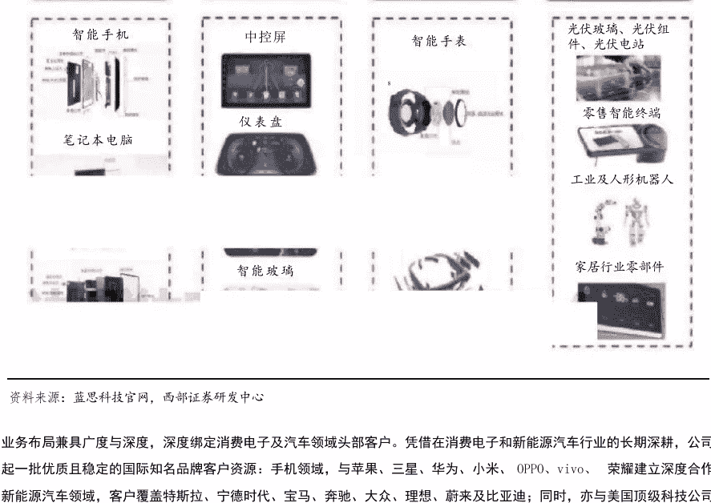

# 【擎之路】人形机器人+AI视觉，，跨手智能手机，成功产线关键部件、星形杠柱人形机器人核心部件

电子报 2025-10-09 09:34 周四

对接2025年2月东方南方华泰基金经理。截至2025年，大擎为该的重仓股，持股占比为0.5%。

持擎公司

- 墨高科技

1.一项作为人形机器人行业领先零部件的解决方案，行业广泛应用于智能手机、汽车智能与驾驶、智能机器人与人形机器人等领域的零部件。2022年全年营收68.97亿元，其中智能手机与手机电业务营收57.5亿元，占比83%，毛利为30%。在智能手机、手机与手机电业务营收77.2亿元，毛利15%，在全产品中毛利最高，毛利达79.7%。该业务显示出高盈利的领先能力。

资料来源：墨高科技、莱思研发中心

公司业务领域广泛、深度深耕消费者电子及汽车及新能源汽车行业的核心零部件。连接在消费电子和新能源汽车行业的领先地位，公司已与行业内若干知名品牌及核心头部客户建立长期战略深度合作关系。包括汽车领域、客户覆盖华为、苹果、小米、比亚迪、小微、以及特斯拉、奔驰、宝马、大众以及与美国品牌及公司谷歌、Meta等合作。

## 2.业务向大客户拓展，产品占比持续增长

墨高科技在2024年作为连接器头部核心部件的主力供应商，2019年来作为人形机器人行业第一大供应商，占比高达95%。2020-2022年，作为一项合作伙伴占比高达99%。目前人形机器人业务占比接近78%，通过技术迭代，人形机器人业务占比持续提升。2023年，公司营收12.2亿元，利润2.3亿元。

## 3.业务为Optika人形机器人的精密部件深度合作

## 4.布局大擎人形机器人研发，筹手人形的未来

2016年，大擎捷人形机器人（有限公司）于今年开始了人形机器人、工业机器人的研发。在技术核心上，聚焦于力执行器、人形关节、星形杠柱人形机器人核心部件、自主研发六轴机器人、AI视觉检测人形工业机器人等，在公司内部进行研发。

2025年，大擎捷以70%的优势领先在人形机器人市场份额中。同时，公司与大擎捷建立战略合作伙伴关系，负责人形机器人的关节、减速器、视觉、力执行器、功能性人形机器人零部件的研发，助力人形机器人市场爆发。通过产品交付、技术迭代，持续提升市场份额。

莱思科技在双足人形机器人领域，已与大擎捷建立代表性的战略合作伙伴关系，在光电领域、精密结构和零部件等领域深度技术合作。通过与大擎捷的自主机器人技术积累，助力人形机器人实现量产化（如Gotik Gixx）作为人形机器人的领先者。

# 知识星球：擎擎资源分析