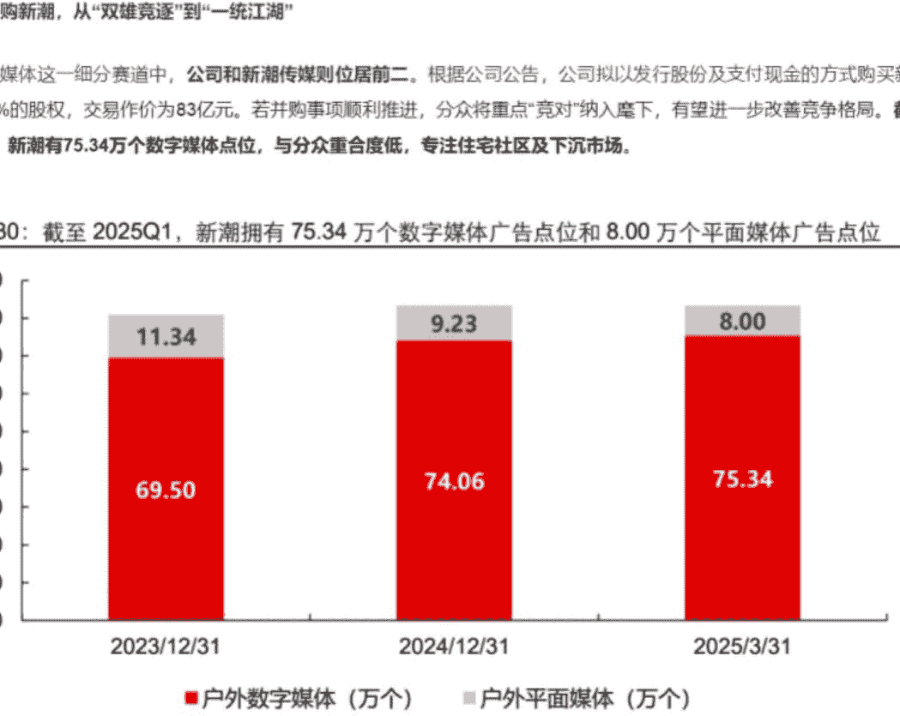

# 同庆医药：核心产品持续高开，预计业绩增长超400%

深度价值：同庆医药 2023年11月17日

**核心摘要**：2023年公司预计实现大幅增长，净利润增长超400%。受益于核心产品持续高开、新产品放量空间持续扩大以及市场渗透率提升，公司业绩有望超预期增长。预计2023年公司营业收入50.79亿元，净利润7.11亿元，归母净利润2.16亿元，同比增长281.7%至432.2%，扣非净利润增长超400%。

**风险提示**：预计2023年公司实现营业收入50.79亿元，净利润7.11亿元，归母净利润2.16亿元，同比增长281.7%至432.2%，扣非净利润增长超400%。

## 一、 业绩增长：核心产品持续高开

2023年公司预计实现营业收入50.79亿元，净利润7.11亿元，归母净利润2.16亿元，同比增长281.7%至432.2%，扣非净利润增长超400%。

受益于核心产品持续高开、新产品放量空间持续扩大以及市场渗透率提升，公司业绩有望超预期增长。

| 项目 | 2023A | 2024E | 2025E | 2026E | 2027E |
| :--- | :--- | :--- | :--- | :--- | :--- |
| 营业收入 | 80.74 | 77.94 | 84.22 | 95.86 | |
| 增长率 | YOY3.0% | -3.5% | 8.1% | 13.8% | |
| 净利润 | 13.53 | 3.37 | 8.05 | 10.70 | |
| 增长率 | YOY10.5% | - | 140% | 26% | |
| 扣非净利润 | 6.97 | -28.17 | 42.74 | 33.22 | |
| 增长率 | YOY18.2% | - | 511% | -22% | |
| EPS | 2.16 | 1.39 | 1.98 | 2.64 | |

## 二、 渗透率：新产品持续放量

公司核心产品XX产品预计2023年实现收入XX亿元，随着市场渗透率提升，预计2024年该收入达到XX亿元，同比增长超XX%。

2023年公司XX产品预计实现收入XX亿元，随着市场渗透率提升，预计2024年该收入达到XX亿元，同比增长超XX%。

## 三、 渠道：XX空间待挖掘

| 项目 | 2023A | 2024E | 2025E | 2026E | 2027E |
| :--- | :--- | :--- | :--- | :--- | :--- |
| XX产品渗透率 | 79.2 | 83.6 | 79.2 | 83.6 | 83.7 |
| 渗透率(地区) | 38.8 | 30.9 | 29.4 | 31.2 | 33.9 |
| 渗透率(医院) | 83.8 | 87.6 | 83.2 | 83.7 | 87.8 |

数据来源：同庆医药，长江证券研究所

# 深度视野优质集团（链接优质社群，助你成功）

全部包含以下内容：限时年费188/年 加微信cuk255

- ① 吃瓜群众包时圈加微信时群对话（原价365 元/年）
- ② 子明私享汇（内部）文章
- ③ 政事室（顾子明）付费内容再送顾子明群聊
- ④ 米联诸闲【作者米穗】（原价599 元/年）
- ⑤ 欧洲金雀会员专属文章（原价328 元/年）
- ⑥ 砖瓦斥内部圈文（原价400 元/年）
- ⑦ 陆文青读书会专属文章（原价699 元/年）
- ⑧ 鉴茶财经知识星球（原价3310 元/年）
- ⑨ 猫哥的视界知识星球文章（原价299 元/年）
- ⑩ 财经新周【独家新闻】（原价1498 元/年）
- ⑪ 杨世光在金钱爆（原价2200 元/年）
- ⑫ 森森莱财经知识星球（原价1600 元/年）
- ⑬ 潇游异译付费文章（持续更新）
- ⑭ 司马林解课目选全套音频和全套书籍版权无删减（原价2.3 万）
- ⑮ 虚彦三部曲【民国梦、帝国争合、不被理解的MAO】（原价599 元）
- ⑯ 虎克知识星球文章（原价268 元/年）
- ⑰ 额外再送：卢薛新浪薇付费专栏、三村丰老王、三花九术文集

不定内容：......更多资源不写下了......
- ① 守人司令知识星球、接换魔王星球、养成知识星球
- ② 创始人笔记、达叔达谈论星球、成就财富、雪花劫甲头部等
- ③ A视野、大树乡谈、江初序、咩咩说、上海海学等付费文集
- ④ 西风付费文章、老端、赢在八小时之外、局外人的视界、升值、老体制等其它一些V付费文章（每月不超过600元的付费文章）

限时年费188/年

# 底层：链接全网V优质内容

深度视野文集进群微信cuk255

深度视野（付费文集）

