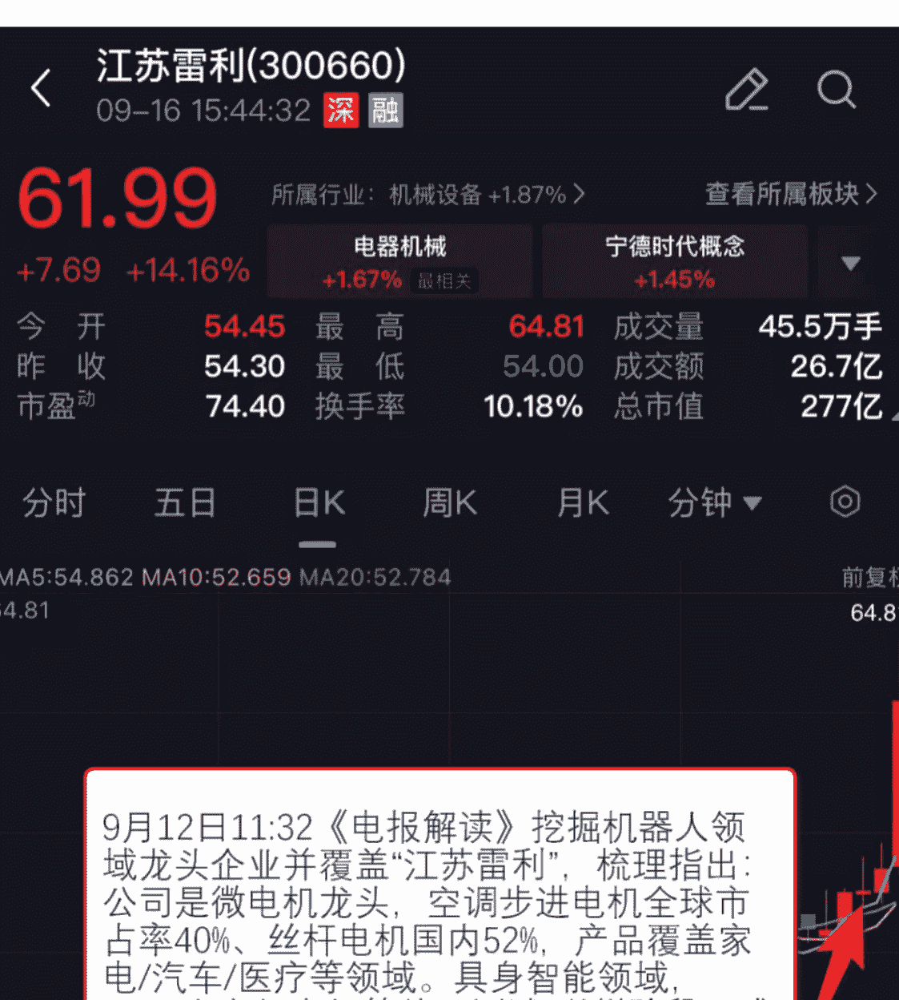
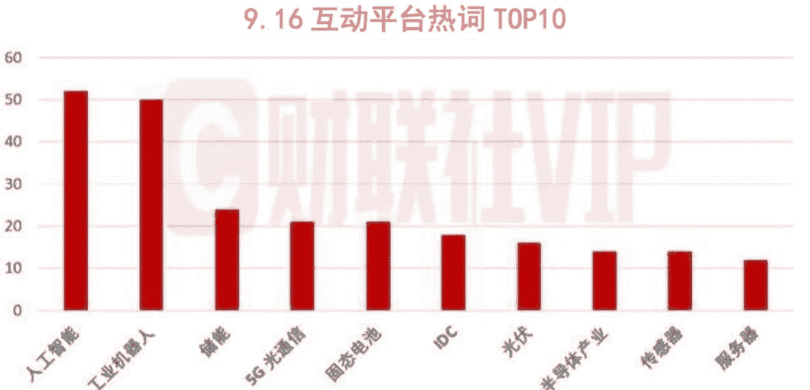
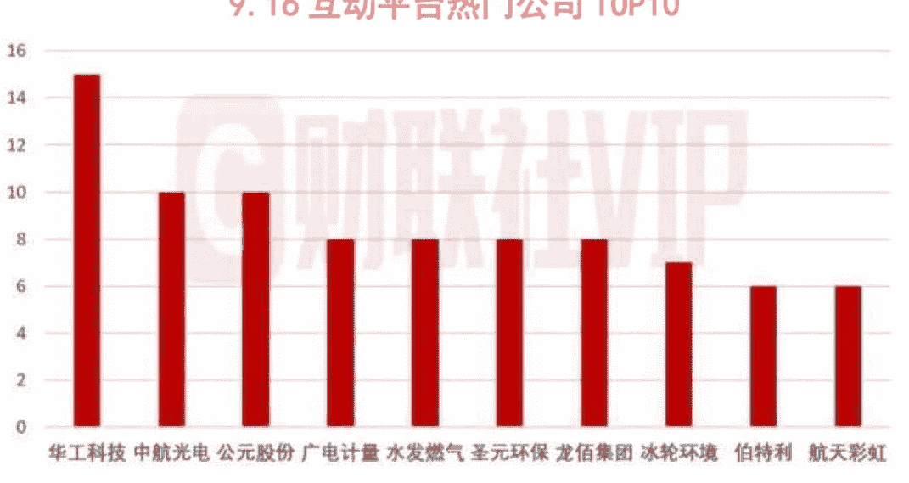

# 【点金互动】机器人+固态电池，传感器产品已准备量产与头部机器人企业开展合作，这家公司布局固态电池材料及设备领域

2023-09-27 01:47

①机器人+固态电池，传感器产品已准备量产与头部机器人企业开展合作，这家公司布局固态电池材料及设备领域
②人形机器人+优迈，开发PEEK等材料零件并获量订单，这家公司提供核心设备。

以往回顾：9月12日11时《电解读》挖掘机器人领先龙头企业并覆盖“江苏雷利”，指出：公司是微机龙头，空调调度电机全球占市40%，线性汽车国内5%，产品覆盖家电/汽车/医疗等领域。具有智能领域，机器人空抽机电机处于测试/送阶阶段，成为智能机器人优秀供应商。海外布局方面，越南基地一期完成，马来西亚/泰国基地投产，墨西哥已批投产。9月16日，雷利大涨，3日最高涨20.33%。

9月12日11:32《电解读》挖掘机器人领先龙头企业并覆盖“江苏雷利”，指出：公司是微机龙头，空调调度电机全球占市40%，线性汽车国内5%，产品覆盖家电/汽车/医疗等领域。具有智能领域，机器人空抽机电机处于测试/送阶阶段，成为智能机器人优秀供应商。海外布局方面，越南基地一期完成，马来西亚/泰国基地投产，墨西哥已批投产。9月16日，雷利大涨，3日最高涨20.33%。

大佬文集VIP专属分享，付费进群微信pep854 微信daizongdai2021

电报解读

2025.09.17 07:45 深度三期

## 一、互动情绪指标热图

从图表统计数据显示，人工智能、工业机器人、储能排名前三，此外还有5G光通信、固态电池、IDC等靠前。

## 二、今日精选

大佬集团VIP专属分享，付费进群加微信pep854 微信daizongdai201

东方电热：公司柔性压力传感器已准备就绪，公司与机器人头部企业开展合作协议并送达。

公司布局三大百亿赛道：一是新能源汽车管理，从零部件转向主机型通用服务集成，大幅提升单车价值；二是固态电池材料及设备，包括锂电设备及集成材料；三是机器人柔性压力传感器产品，已并在其上发布了。

长智创：公司签下订单，台湾头部 ODM GM 厂商为英达提供线铜材料相关产品。

在人形机器人方面，公司从2024年开始开发相关领域的建设，为海外的人形机器人客户开发了铝合金、镁合金、钛合金等金属材料，PEEK、IGS 工程相关，橡胶、轮子等多种材料的开发，公司已对接了多个客户、海外人形机器人客户的订单服务。公司开发的应用于服务器、工作站内部高速连接器已签接到国内头部客户送达。

| 股票代码 | 股票名称 | 回复日期 | 回复业绩 | 回复金额 |
|---|---|---|---|---|
| 002017 | 东方电热 | 2025-09-16 16:54:40 | | |
| 300115 | 长智创 | 2025-09-16 20:45:21 | | |
| 009988 | 华科技 | 2025-09-16 17:40:11 | | |
| 002466 | 大洋云 | 2025-09-16 14:45:13 | | |
| 003017 | 大洋生物 | 2025-09-16 15:15:39 | | |
| 300553 | 集团联 | 2025-09-16 16:36:40 | | |
| 002179 | 中航光电 | 2025-09-16 14:45:40 | | |
| 603197 | 保源科技 | 2025-09-16 15:00:12 | | |

公司柔性压力传感器已准备就绪，公司与机器人头部企业开展合作协议并送达。

公司签下订单，台湾头部 ODM 厂商为英达提供线铜材料相关产品。公司业务拓展至海外的 IPS 规划。

亚固态电解质的开发，在固态电解质方面，针对固态电池的需求，已实现落地。公司拥有聚苯醚 (PEEK) 的领先技术，开发的机器人柔性转子轴、减速器、滚珠轴、激光传动组件等产品与客户及供应商建立了合作，并承接了机器人转子摄像头，目前处于这种状态。

## 三、日精选表现

近期热门列表：

- 9月10日《这家公司十级固态电池小批量出货，百级固态电池产能规模，并送达》
- 9月5日《储能·电池，从电池到集成的储能解决方案，公司已成功布局全球固态电池全线设备》
- 9月3日《宇钛·人形机器人关节，智擎机器人已研发关节模块、无源电机在人形机器人关键部件等》
- 8月29日《PCB+服务，以服务器为主的上半年增长3倍，光模块已经量产，这家公司在人形机器人相关领域具有很强优势》

| 关注个 | |
|---|---|
| 东方电热 +2.81% | 长智创 +8.94% |

大佬集团VIP专属分享，付费进群加微信pep854 微信daizongdai2021

大哥文集 VIP 群（原价300，限时年费249）包括以下全部内容：

加微信 daizongdai2021 大哥文集 VIP 群简介

- ① 吃瓜群众实时文档实时聊天（原价365/年）
- ② 子明私享会（原价568/年）
- ③ 政事堂（顾子明）付费内部再读
- ④ 米联见闻【作者米穗】（原价599/年）
- ⑤ 欧洲金雀会员专属文章（原价328/年）
- ⑥ 诡瓦内部文章（原价400/年）
- ⑦ 卢克文读书专属文章（原价699/年）
- ⑧ 茶茶财经顶级知识星球（原价3310/年）
- ⑨ 猫猫的视角知识星球文章（原价299/年）
- ⑩ 财新周刊【独家新闻】（原价1498/年）
- ⑪ 杨世光财富榜（原价2200/年）
- ⑫ 蔡森财经知识星球（原价1600/年）
- ⑬ 激泽异异付费文章（持续更新）
- ⑭ 司马解读精选全套音频和全书珍藏版无删（原价2.3万）
- ⑮ 虚虐部曲（民国事、帝国扩张、不被理解的MAO）（原价599/年）
- ⑯ 卢克知识星球（原价268/年）
- ⑰ 额外内容：卢泉新浪微博付费专栏；三末屯老树、三花九树文集;

不定期内容（更多资源写不下去了）：

- ① 守夜人司令知识星球、唤魂魔王知识星球、生财有术知识星球、
- ② 创始人笔记、达叔谈论知识星球、成竹财富圈、雪花劫老头等
- ③ A视野、大树乡谈、江宁知府、砰咩、财上海学家等付费文集
- ④ 西风付费文章、老端、赢在八小时之外、局外人的世界、升值纪、老体制内等等一些大V付费文章（每月不低于600元的付费文章）

大哥文集 VIP 群络购，年费300元，现需249元/年。
