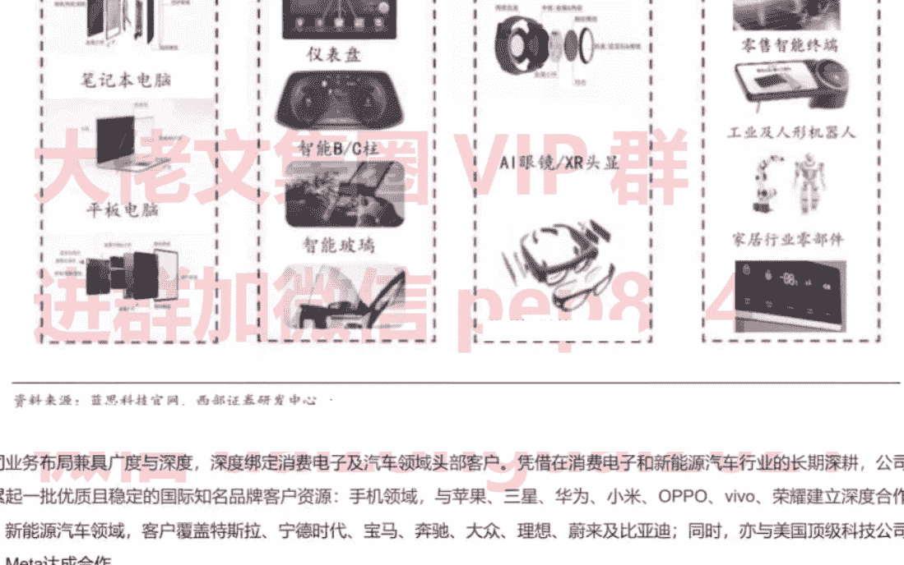

# 【大金整合】人形机器人+AI眼镜，公司将智能手机转型人形机器人核心部件

电子世界
2023.10.09 11:34

记者讯：2023年2月东方丰瑞养老基金报告发布。该基金2022年半年报显示，第四大持股为蓝科技，股票持股占比为5.0%。

## 持公司瞻

### 1. 需求持续：客户需求持续，手机、智能等领域迎来爆发

作为全球电子领域领军企业，公司持续为客户提供定制解决方案。业务涵盖智能手机、汽车电子、智能家居、人形机器人等领域的连接部件。2023年上半年营收698.97亿元，其中智能手机与手机业务营收577.55亿元，占比为83%，是公司核心业务；在机器人上，智能手机与手机业务实现营收82.27亿元，占比15.11%，其中中高端手机占比为78.57%，显示出业务拓展强劲的能力。

## 深度聚焦视觉

图3：蓝科技AI业务大板块

公司业务布局广，深度聚焦视觉、智能手机及汽车电子等领域。公司与全球知名手机客户建立深度合作。手机领域，与三星、华华为、小米、OPPO、vivo、格瑞等建立深度合作。新能源汽车、苹果厂商、特斯拉代工、蔚来、马力、小米、理想以及比亚迪；同时与联云智能科技公司合作、Meta等合作。

公司自2006年起深耕连接器领域，成为全球领先的连接器供应商之一。目前已处于行业领先地位。公司积极与全球知名手机客户建立深度合作。手机领域，与三星、华华为、小米、OPPO、vivo、格瑞等建立深度合作。

### 2. 需求爆发元年：人形机器人核心部件已批量量产

蓝科技自2020年布局人形机器人领域，已成为人形机器人核心部件的主力供应商。目前已与19家人形机器人公司合作，2022年上半年人形机器人客户增加到20家。作为人形机器人领域的一线供应商，公司提供人形机器人核心部件，如传感器、执行器、结构件等。公司上半年人形机器人业务实现营收12.00亿元，占比为5.0%。2022年人形机器人业务营收14.24亿元，CAGR为342.9%，占比5.26%。

蓝科技在AI RISC领域拥有极领先的专利产权，深耕AI算力与执行器领域，现已实现人形机器人批量量产。同时也与多家知名人形机器人公司合作，提供人形机器人核心部件的传感器、执行器。随着人形机器人需求爆发，公司2022年已开始向人形机器人客户交付，显示出人形机器人行业竞争正在加剧。

### 3. 布局人形机器人领域头部新厂商，首批交付伙伴已

蓝科技凭借核心技术优势，已与全球头部人形机器人厂商建立合作。在人形机器人核心领域，AI视觉、执行器、传感器、结构件、减速器等均具有高技术壁垒。公司已实现人形机器人批量量产，具备规模化量产能力、快速量产能力，为人形机器人提供传感器、执行器、关节模组等核心部件。

公司凭借强大的技术储备，已与多家知名人形机器人厂商建立深度合作，并与光伏、减速器等行业龙头进行技术合作。目前已与5家知名人形机器人厂商合作，涵盖AI视觉、宇树机器人、大宇机器人、Omni Picker（Faker）等核心部件的生产制造与测试，与宇树机器人关键合作伙伴关系。公司在2022年已交付了Robot人形机器人Glassx（四款），为人形机器人提供更高效的解决方案。

2023年7月，蓝科技与优必机器人及宇树机器人建立深度合作。业务拓展至人形机器人研发、加速消费机器的营销。人工智能机器人领域的发展已开辟新蓝海，凭借在机器人领域的技术积累和量产能力，公司在人形机器人领域正占据先机。

2023年1月，蓝科技与优必机器人及宇树机器人交付首款全线人形机器人Yark1，深度参与了与宇树的关键伙伴关系。

## 深度视野（优质内容）

限时年费188/年 加微信cuk255

- 守夜人知识星球（原价365 元/年）
- 政事室含子明（原价568 元/年）
- 粉丝纪念作者米横（原价599 元/年）
- 欧洲金雀会员专属（原价328 元/年）
- 砖瓦斥内部（原价400 元/年）
- 卢克文读书会专属（原价699 元/年）
- 鉴茶知识星球（原价3310 元/年）
- 猫哥的视界知识星球（原价299 元/年）
- 财财经周独家（原价1498 元/年）
- 杨世光在钱圈（原价2200 元/年）
- 森森财经知识星球（原价1600 元/年）
- 激译译付费文章（持续更新）
- 司马林解读末选全套音频和全套书籍版权（原价2.3 万）
- 虚政三部曲[民国梦、帝国亡、不被理解的MAO]（原价599 元/年）
- 克知识星球文章（原价268 元/年）
- 额外再送：卢薛元新浪付费专栏、三村丰老王、三花九术文集

（更多资源不写去了......）
- 守夜人知识星球、接换魔后星球、成就财富星球
- 创始纪念、达叔谈论知识星球、成就财富圈、雪花桃花老头等
- 视野、大树乡谈、江初领、泮咩说、上海海家等付费文集
- 西凤付费文章、老端、赢在八小时之外、局人的视界、升值、老体制内等一些大V付费文章（每月不低于600元付费文章）

## 深度视野文集
进群微信cuk255

深度视野（付费文集）
