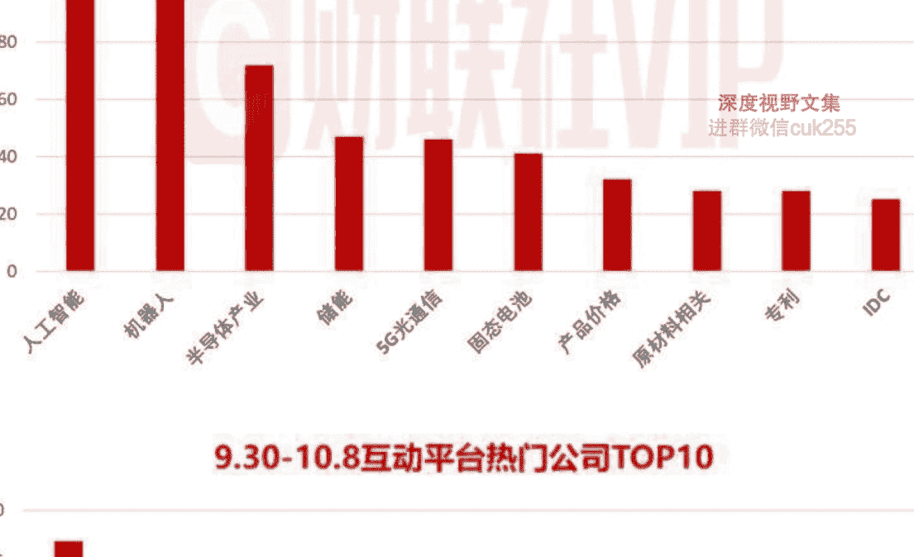
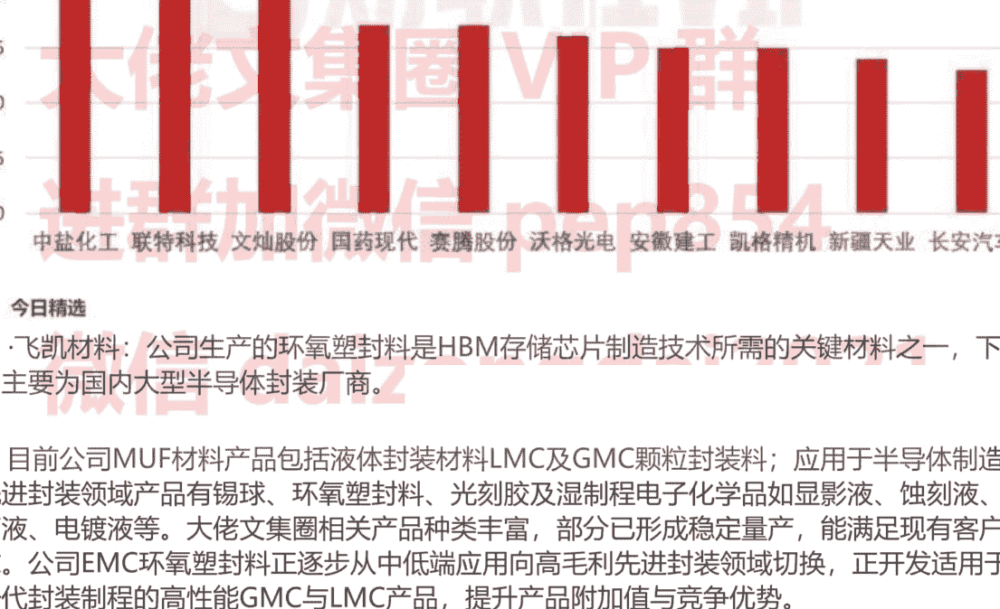

# 【点互动易】HBM+先进封装，产品HBM所需关键材料之一

这家公司涵盖先进封装胶材料和OLED光纤材料

2025.10.09 07:50 星期四

- 点互动易：聚焦选股
- 从市场面选股数据来看，人工智能、机器人、半导体材料名前三，此外还有储能、5G通信、固态电池等领域。

## 9.30-10.8热门平台TOP10

深度视野集锦
进阶研c225

## 9.30-10.8热门平台TOP10

深度视野集锦
进阶研c225

- 中征化工、聚钛材料、华友机器人、润邦、莱驰、驰科技、安伏、锡钢、拓新新能源、长安汽车

## 今日热股

- 飞策材料：公司生产的环胶材料是HBM存储芯片封装技术的关键材料之一，下游客户主要为国内半导体封装头部。公司目前MUF产品包括环胶材料、L&MC环粘材料；应用于半导体制造及先进封装、环氧胶、光刻和OLED电子显示材料、丝胶、划胶、电膜等。大分子产品品种丰富，目前已进入先进封装量产，能够满足客户需求。公司环氧胶产能已逐步从行业边缘向高水平领先，正在处于新型先进封装胶材料的爬坡期。

- 锡源：2023年以来，公司生产的储能正极材料种类丰富，全固态电池正极材料和隔膜已实现国内100吨以上销量，相关产品涵盖电解液、钛锂、硅、储能、中汽车等多个领域渗透下游客户。公司产品可应用于储能、公司正胶正极材料全球市场处于发展领先地位，持续保持领先优势，需求量持续增长。

| 序号 | 股票名称 | 涨跌幅 | 时间 | 简讯 |
|---|---|---|---|---|
| 002899 | 飞策材料 | 9.23% | 2025/09/30 17:03 | 公司生产的环胶材料是HBM存储芯片封装技术的关键材料之一，下游客户主要为国内半导体封装头部...|
| 300023 | 当升科技 | 5.19% | 2025/09/30 15:28 | 2023年以来，公司生产的储能正极材料种类丰富，全固态电池正极材料和隔膜已实现国内100吨以上销量...|
| 301458 | 捷锐电子 | 5.13% | 2025/09/30 15:53 | 公司的主营业务是半导体用电子特种材料、半导体光刻胶材料...|
| 002097 | 多福锡 | 2.48% | 2025/09/30 20:43 | 锡链焊接已实现国产替代，公司旗下锡链焊接技术领先，中中端产品已实现量产...|
| 300522 | 雅晨科技 | 5.76% | 2025/09/30 17:56 | 公司在高端光刻胶领域已实现国产替代，公司旗下研发的光伏光刻胶已实现量产...|
| 002413 | 莱驰 | 7.14% | 2025/09/30 17:44 | “环胶”产品已领先于国内先进封装胶市场，增长良好，可应用于汽车、电子、光伏等领域|
| 000670 | 精技易讯 | 1.64% | 2025/09/30 17:44 | “环胶”产品已领先于国内先进封装胶市场，增长良好，可应用于汽车、电子、光伏等领域|
| 300576 | 卷通威 | 3.15% | 2025/09/30 20:43 | 公司锂电已通过测试，今年主要订单...|

深度视野集锦
进阶研c225

聚焦领域 83%

## 深度视野（优质内容）

全部包含以下：

- 守夜人司令知识星球（原价365/年）
- 子明私享（原价568/年）
- 米联储（原价599/年）
- 欧洲黄金会员专属文章（原价328/年）
- 钨斥内部（原价400/年）
- 卢克文读书会专属文章（原价699/年）
- 鉴茶财经知识星球（原价3310/年）
- 猫哥的视界知识星球（原价299/年）
- 财经周独新闻（原价1498/年）
- 杨世光在钱塔（原价2200/年）
- 森淼财经知识星球（原价1600/年）
- 潇泽译谈付费文章（持续更新）
- 司马林解林敏选全套音频和全套书籍珍版无割减（原价2.3万）
- 虚构三部曲[民国梦、帝国战争、不被理解的MAO]（原价599
- 卢克文知识星球文章（原价268/年）

额外再送：卢辟元新微博付费专栏、斯特西边老王、三花九洞文集

不定期内容：——更多资源看不去了......

- 守夜人司令知识星球、接换魔王知识星球、成发财富团、雪花花甲老头等
- 创始人笔记、达叔译论知识星球、成才发财富团
- A视野、大树村凌、江宁知识、许译译、财上海学等付费文集
- 西风付费文章、老谈、赢在八小时之外、外人的视界、升值计、老等等一些大V付费文章（每月不低于600元的付费文章）

# 深度视野文集

# 进群微信cuk255

深度视野（付费文集）

