中国与世界秩序研究书
主编：杨光斌

# 货币、权力与人：全球货币与金融体系的民本主义政治经济学

翟东升 著
The Power of Money: Relations among Politics, the Market and the People

中国社会科学出版社

知识星球TOP 资源分享社群

汇聚全网付费资源
让更多人获取高价值信息

公众号:知识星球TOP 微信号: jntsg8 微信号: jntsg2

添加微信 免费进群

## 目录

第一章 议题与方法——民主主义政治经济学的方法与基本命题

第一节 民主主义政治经济学初探
- 一 民主主义的中国思想渊源
- 二 欧洲主义政治经济思想的镜鉴
- 三 马克思主义理论与共产党民主主义实践
- 四 本书的民主主义政治经济学

第二节 人与物的关系
- 一 财富的源头是人的劳动和消费
- 二 中心掠夺外围的是其人而非物
- 三 马尔萨斯人口的糜淫与流毒
- 四 “资本之咒”

第三节 政府、市场与人民
- 一 关于公私关系的市场谬误
- 二 民主主义视角下的政府与市场关系
- 三 强国家的缔造

第四节 中心与外围
- 一 中心与外围之间的差异和变迁
- 二 融资结构的中心、外围差异
- 三 分化与演进中的中心外围关系

第五节 可贸易部门与非贸易部门
- 一 定价与糜淫与“库兹斯-史密特谎”
- 二 GDP-PPP之谜
- 三 如何发展可贸易部门

第二章 货币国际化与全球货币体系

第一节 全球货币体系的演进轨迹：从金银本位到美元霸权
- 一 从复本位到位美元
- 二 从金本位到金汇本位
- 三 英美间货币权权的博弈与转移
- 四 摆脱黄金锁的美元霸权
- 五 关于货币本质的争论

三 美元“特殊特权”的条件和定价

第三节 德国马克与日元：货币国际化的经验教训
- 一 内政与金融体制
- 二 实体经济质量决定论
- 三 国际政治决定论
- 四 货币国际化的次序和时间窗口
- 五 对人民币国际化的启示

第四节 人民币国际化的政治经济学
- 一 人民币国际化的进展
- 二 围绕人民币国际化的争论
- 三 人民币国际化的未来前景
- 四 人民币进入国际化对中国经济的重塑

第三章 美元体系的风险结构与定价

第一节 后布雷顿森林体系的结构性与缺陷
- 一 美元取代黄金之梦
- 二 主权货币作为全球储备
- 三 无锚货币与浮动汇率体系的基因缺陷
- 四 未来的补救方案

第二节 政治视角下的银行与货币政策
- 一 银行及其独立性的演变
- 二 新自由主义与银行独立
- 三 美联储的货币政治
- 四 后危机时代的非常非常规货币政策

第三节 远端利率与人口均衡
- 一 究竟是什么决定远端利率背后的资金需求：投资还是消费？
- 二 人口结构视角下的远端利率
- 三 负利率时代的出现

第四章 金融优势与新自由全球化的兴起

第一节 金融收益在美国政治经济体系中的兴起
- 一 金融的游说与权力俘获
- 二 金融去监管
- 三 金融倒实业
- 四 “大到不能倒”（too big to fail）

第二节 全球化的兴起：从新自由主义到民主主义
- 一 美式全球化的兴起与突变
- 二 新自由主义的流行与证伪
- 三 贫富极化与民兴起

第三节 全球兴衰与中国的战略定位
- 一 国际局势变迁与全球兴衰
- 二 中国美式全球化的重要参与方
- 三 美式全球化退潮期的中国应对

第四节 全球金融中心的政治经济学
- 一 国际金融中心的变迁
- 二 中国中心与政治
- 三 如何打造亚洲和中国的金融中心？

第五章 汇率的政治经济学

第一节 汇率制度的选择与利弊
- 一 汇率制度的分类及其优缺点
- 二 经济学视角下的汇率制度选择
- 三 国际政治经济学视角下的汇率制度选择理论

第二节 对汇率的民主主义政治经济学理解
- 一 汇率研究的路径问题
- 二 关于汇率的常见迷信
- 三 汇率波动与经济基本面的实证关系
- 四 汇率波动与非经济因素关系的实证检验

第三节 美元、人民币与“一带一路”
- 一 汇率指数
- 二 人民币汇率的未来趋势
- 三 模型构建与“一带一路”

第四节 人民币波动的政治博弈
- 一 2005年之前：贬值、低估与固定汇率政策的再分配
- 二 2005—2012年之间：围绕汇率的双层博弈
- 三 新时代的人民币

第六章 债务的政治经济学

第一节 债务的政治学
- 一 债务问题的态势
- 二 围绕杠杆的探索与教训
- 三 如何解决债务困难
- 四 中国的空间

第三节 债务霸权
- 一 霸权何以？
- 二 现有信用体系的缺陷
- 三 全球与中国市场的治理

第七章 结论
- 一 对流行谬见的批判
- 二 若干观点与猜想

参考文献
后记

作者简介

翟东升，博士，中国人民大学国际关系学院副院长，长期任中国大学战略研究中心主任，曾在欧美大学短期访问。近年研究方向包括货币与国际政治、民主主义政治经济学、美国外交政策等。著有《中国为什么崛起》等书。自1999年以来，共有中英文论文发表在《世界经济与》、《现代国际关系》、《Frontier of Economics in China》等学术刊物上。

货币、权力与人：全球货币与金融体系的民本主义政治经济学
翟东升 著
中国社会科学出版社

图书目录（CIP）数据
货币、权力与人：全球货币与金融体系的民主主义政治经济学/翟东升著——北京：中国社会科学出版社，2019.5（中国世界秩序丛书）
ISBN 978-7-5203-4402-9
I.货币……II.……III.国际金融体系——研究
中国版本图书馆CIP数据（2019）第08273号
出版人 赵创英
责任编辑 王锗
特约编辑 郭鼎
责任校对 李锐
责任印制 王超
出版 中国社会科学出版社
址 北京鼓楼西大街158号
邮编00720
发行部0-840365
经销 新华书店及其他
印刷 北京京升印有限公司
装订 廊坊市广阳区增订厂
版次 2019年5月第1版
印次 2019年5月第1次印刷
开本 710×1000 1/16
印张 25.5
插页 2
字数 342千字
定价 99.00元
凡购买中国科学出版社图书，如有质量问题请与本社营销中心联系调换电话：010-840863
版权所有 侵权必究

本成果受到中国人民大学2018年度“中央高校建设一流大学（学科）和特色发展引导专项资金”支持。

《中国与世界秩序丛书》编委会
主编：杨光斌
副主编：时殷弘 黄嘉树 陈岳
编委会成员（以拼音字母序）：
白陈新明 陈岳 方长平 房乐宪
郭春生 韩彩珍 黄大慧 黄嘉树 金灿荣
李庆四 李魏 浦国良 蒲傅 时殷弘
宋伟 宋新宁 田野 王延续添 王义铭
王英津 吴征宇 许勤华 杨光斌 尹维武
周淑真

《中国与世界秩序丛书》总序
杨光斌

人类正经历百年不遇之大变局，世界秩序正处于大变革中。美国“退群”、很多国家的无效治理以及中国为代表的新兴经济体的崛起，正在根本性改变第二次世界大战以来美国主导的“自由世界秩序”，正在改变三百年年来西方主导的世界体系。

此时此刻，中国关于世界政治的知识总量严重短缺。中国正在进行的经济结构转型升级相比，中国社会知识体系的转型升级更为迫，不过文化滞后性和思想惯性使得紧迫性被掩盖了。中国已经成为世界各国刮目相看并尊敬的国家，很多国家包括部分发达国家年轻人的就业问题，但是许多国仍然在西方中心主义的知识体系和思想观念“照镜”中国，好像处处不符合“标准答案”。然而符合“标准答案”是一种阶段性历史。应该认识到，来自中国的“标准答案”是一个阶段，我们不仅吸纳西方的思想管理和技术，中国知识体系是在这种背景下形成的。作为社会科学学科，过去国际关系理论基本上是按照西方标准建立的，马克思主义理论、现实主义、新自由主义、建构主义（简称“三大范式”）则无处不在。了解西方知识体系是重要的，否则不知道人类怎么想。理解中国有助于国际关系理论的反思和发展，而研究不同于其他文明的西方国家，会给流行的国际关系理论带来更多的挑战。

在此，中国人民大学国际关系学院组织的《中国与世界秩序丛》，基于国家安全战略需要的背景，又有学科建设的知识论升级的思考。
2018年6月26日
中国人民大学国际关系学院

[1]杨光斌，中国人民大学国际关系学院院长，教育部部长学者特聘教授，中国政治学会副会长。

自序
酝酿书籍的十年，恰好就是后金融危机的十年。……笔者并非一个经典主义的学者，却是在书中把重心放在对自由主义观点的批判上，试图提供一套替代性的框架。如何知道本书提供的替代论和命题才是正确的？或者说读者的理论自信从何而来？首先，学者像卡尔·波伯的哲学，没有任何人掌握绝对真理，包括笔者在内，一直督促学生们去怀疑一切大师、权威。学术的第一步，往往是最难的。其次，相信读者的智力和判断力。由于主题的专业性，读者的潜在能力显然高于全球平均值，因此笔者对读者的逻辑能力很有信心。最后，正如索罗斯所言，检验是真理的唯一标准。put your money where your mouth。

在债务、利率、汇率等问题上，许多领袖和关键人物的底层知识竟然是完全错误的，不少声著的学者经常外出行话话。之所以这种我所不思的局面，笔者发现主要是过去十年间自由主义歪断了金融领域的知识创造和传播。央行独立性、市场化、全球化，这些概念已经在某种程度上成为全球政治的表述，而不是技术性概念和政策工具。曾经经历过明的，一旦被教训，就会让变得庸化。后金融危机时代，自由主义在西方知识体系已经崩溃，但由于种种原因仍然受到保护。看到那些学术界和政策的大人物无疑疲惫而睡，笔者对他们充满了同情。

这种知识积累属于正常范围。第二次世界大战之后，美国比较政治学的兴起以及发展理论的诞生（包括发展经济学、发展政治学），都是需求带动的。20世纪60年代，美国年轻者纷登陆非洲，进入拉丁美洲，前往亚洲，把自己的理论运用到非西方社会研究，并试图去改造非西方国家。国家战略需要和科学的关系，决定了中国的世界政治学科的焦点应该有一个大转型。一方面，“容量”知识仍然重要的，因为美国依然是中国的战略所在。另一方面，中国还需要知识的“增量”，对非西方国家的深度研究和深刻理解。正如我们有许多美国、欧洲、日本专家一样，中国需要更多的非西方国家国别专家。研究非西方国家不仅是一种知识转换，更是中国世界政治学科的升级。

第一章 议题与方法——民主主义政治经济的方法与基本命题

第一节 民主主义政治经济学初探

民主主义的中国思想源
在过去百年年来，民主主义这个概念主要是中国政治学界在使用。其思想源头可以追溯至商周时期，并在之后的三千年里被历代政治人物和思想家们不断阐述和应用，逐步成为中国政治传统的核心的核心之一。《儒书·夏书·五子之歌》中最早表达出“民为邦本，本固宁”的思想。“天明，自我民；天明良，自我明威”“民之所欲，天必从之”“天视自我视，天听自我听”这些表述意味着天意和民意是高度统一的。“惟求民”，意味着道无常，时刻在准备着为百姓寻找合适的路径。

到了春秋时期，民本思想更加成熟，诸家中很多代表性人物都有民本思想的观点传世；老子说：“圣人无常，以百姓之心为本。”孔子说：“百姓足，君与不足；百姓足与足”强调了民与君之间具有利益性的关系。管子说：“大王之所以始也，人为本。本理则固国，乱则危国。……政之所在，在顺民；政所废，在逆民心。民恶忧劳，我乐之；民恶贫贵，我富贵之；民恶危险，我安适之。民恶灭绝，我生育之。

如果说春秋时期的民思想体现为统治者以民为手段，那么战国时期的民思想越来越表现出民众为目的而非手段的倾向。孟子更为引起后世争议的主张是“民为贵，君为轻”，这种转变为古代革命提供了潜在的理论依据，所以在明朝初起朱元的愤怒，他自下流徐子在孔庙中配享的地位。

战国末期和汉西诸国都提民的利益是确立君王目的。荀子说：“君者舟也，仁者水也。水则载舟，水则覆舟。”天之生民，非君也。天之君，以民也。”贾谊提出“故夫民者，哉敛而不可也。”古今至今，与民为仇者，有甚速，而民胜之。投资失败的案例，亏损屡屡，战败倒是常有耳闻。哈尔街很少邀请经济学家去演讲，许多资产管理公司（如大类基金和私募基金）在使用的时候招聘物理学、数学、生物学、气象学等博士，但坚决不招经济学、金融的年轻人，其中道理可见。20世纪80年代以来，美国学得了新自由主义经济通过各种渠道主导了许多发展政策，其发展效果不如人意；自己也被那一套社会学弄得金融泡沫和经济虚，相对于全球的实力持续削弱。因此，笔者也希望中国社会科学界真正找到理论自信和文化自信，抛开欧美同行设定的框架，用我们自己的经验、智慧和全球视野，构建出真正能够解释历史、现实乃至未来的政治经济学。相信本书将成为这一伟大的知识创造早期的一步。

翟东升
2019年3月30日

(注：由于原始OCR文本存在大量重复和乱码，以上内容根据语义进行了深度去重与逻辑纠错) 

中国政治思想史单一之一。民本思想为君权的权力合法性提供了理论依据，并将天命的古典形态认同支持的治理政治经验实现了融合与转换。古典民本思想的核心命题，在笔者看来是民众与政权的共生关系：天下的治理需要要遵循天意和道德规范的君王，但是民本本质上就是民意，君王的成就和命运离不开民的支持。

以民为本并非欺骗和百姓的承诺，而是王朝利益和民利益的表达：没有谁希望得民而失去天命。真正的问题在于君王和民之间的权力代理人是官僚和知识精英，这恰恰是古代民本思想的缺位和盲目。

民本主义并没有试图寻诸官僚在君和民之间的第三力量的责任和利益指向，民本思想的提出者和评判者其其实是知识精英。而优限之，这个群体却取得了功名，掌握了话语权和代理权力之后，他们既不是百姓的民，也不是王权的本身，在中国古代政治体系中，存在君、民、官之间的三角博弈。民本思想的提出者们并没有将自己代理理论的要求，而王朝换和周期的推手通常不是君王或家庭成员的党党，是官僚阶层的代理人问题问题难以重复。

明清时期浙江工商阶级的发育，孕出土地市场的繁荣和早期的资产阶级雏形。东林党所代表的工商利益在地域和阶级利益上有别异于全国的农业利益和皇权，在明后期的竞争中扮演主角色。东林党这个集团——试图官僚集团以自为己，但是在政治实践中却沦为竞争的核心势力，并且其代表的工商利益和精英集团倾倒皇权和农业利益，导致国家治理中的失衡。他们的民本思想一方面将工商植入“民利”的概念中；另一方面不应与民利为理由，拒绝从商业为王朝提供财力，拒绝从足的江南江西崛起衰成。

## 第二节 人与物的关系

### 财富的源头是人的劳动和消费

纵向来看，人类社会一万年的历史发展轨迹，是人的能力不断提升而摆脱自然之物对我们的束缚。远远的原始社会，人们以采集和狩猎为生，人类生存高度依赖自然世界所提供的食物和原料；随着经营社会的演进，在游牧和农业社会中，人类的生存更多依靠自身田地、草场和动物物种的经营，尽管自然条件仍然不会随地带来好或坏的影响；而今天的我们生活在现代工业和服务业中，自然因素对整个个人生活的影响越来越小，人类可以由此预测乃至操控局部天气，可以通过自己的活动极大程度上改变环境。某种程度上，现代人类已经获得了人类所设想的巨大多能性与生活水平。人类越来越远离自然母体而成为自己的物种。

如果分析视角从纵向变为横向，不发现今天处于中心的发达国家，其服务业在经济和就业中占比较高，服务业相对于农业和制造业更少依赖动物的要素，更多依赖人的技能和知识。即便在制造业和农业生产中，也是发达国家，源于自然之物的价值比例增加越高，而人的知识、技巧、工艺、资本投入的增加比例越高。

上述趋势和格局告诉我们，发展的真正意思是人类的发展和由此带来对人的需求的满足，而不是自然之物的堆积与挥霍。离开了人的发展与需求，纯粹的自然并无价值可言，是人的欲望和需求赋予了它们以功能和价值，这种功能和价值被投入市场交易的时候，它们才有了价格。在现实生活中，无论是用市场还是用计划配置自然源，都不会出现资源完全被耗竭的场景，因为一种资源真的变得越来越稀缺时，其采集和使用成本就会变得越来越昂贵。至少有两种力量一起构了一种无形的边界，约束价格的上升空间，是一市场力量，二人人类社会的创造力。在市场经济中，某种资源价格上涨会导致使用量的减少，无论是资源的节约使用还是通过廉价资源替代了资源的颠覆性胜利，最终我们将看到价格难以继续下去。自然资源对财富的比例总体上随时间下降。

试图观察装、电脑、手机、汽车的棉丝、金属、塑料多少钱？听音乐、看病、旅游、接受培训的费用中多少与自然资源相关？随着人类的技术进步，资源在边界上的重要性是由于，稀缺性来说是在减少的。从过去三百年的经济和历史来看，1972年以前的大宗商品价格基本上仅在非硬币的货币体系下建立之后我们才能看到通胀上的大宗商品价格趋势。1972年之后的全球货币体系脱离了硬币，而是用货币估价反映自然资源价格的CR指数[26]出现了震荡上行的趋势。这也是图1—1可以拆除货币符号带来的价格调整，揭示出价格真实相：自然资源价值在财富增长中的占比处于持续下降。

如何创造了价值？笔者认为是价值的产生过程既包括供给和创造，也包括消费。马克思主义经济理论强调劳动价值论，即便有劳动力生产创造价值，而资本不能创造价值，无论是以货币形式出现的资本还是形式的资本，都不是价值之源。从本书的民主主义政治经济学角度，这个理论无疑是正确的，但还不够完美。除了作为工人之外，还是消费者。消费生产一起构成了一个有意义的经济活动的圈。

过去苏联所构想的社会主义经济体制重生产而轻消费，重供给而需要，这种循环失衡对于其后来的失败留下了伏笔。中国特色社会主义市场经济体制融合了苏联、美国20世纪后期两个超级大国的制度探索的经验教训，将供给和需求有机结合起来，相当于在苏联、美国对“正题—反题”的矛盾基础上升华出的“合题”。

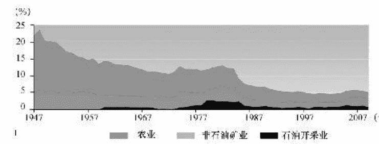

图1—1自然资源价值化对人类享用财富的下降（1947—2007年)

资料来源：引白鸿文、栾建《自然资源压力如何限制显性经济的增长》，新浪博客，2014年7月8日，http://blog.sina.com.cn/u/76fb8102.html

### 如何实现需求最大化？经济学认为需求有两个方面影响：一个是财富的分配结构；二是人的年龄结构。分配结构对有效需求的影响，经济学界有很多辩论。在财富分化严重的社会中，穷人有很多需求但是没有购买力，难以形成有效需求。富人已经拥有了各种和服务，因此其收入边际消费倾向于穷人。然而在一个开放性的全球市场上，假如一个国家实现需求最大化的同时缺乏竞争力，就会失败者。所以，必须在分配政策中找到一个平衡点，能够更好地控制财富差距，又能让社会个体得到激励。学术界讨论较少人口年龄结构对需求的影响。一生的需求在统计意义上是：无法预测某人在某个年龄做什么，但是基于数字，我们完全可以预测某人在某个年龄段做什么：

- 教育的需求
- 婚庆的需求
- 房产的需求
- 汽车的需求
- 医疗服务的需求

企业家哈瑞·丹特（Harry S. Dent）详细论述了人的年龄结构与消费之间的关系。美国人口统计局显示，支出随着年龄的变化不断变化。人在一生中消费的高峰。从出生起直到二十多岁，人是净消费者；加入动力市场后开始有收入，但由于收入的有限，此时支出是为了满足基本需求；随着年龄的增长，收入不断增加，直到过了消费高峰，即46岁左右，其净资产达到最大值，即单位收入与单位消费的差值达到；退休以后收入逐渐下降，消费的是此前的储蓄，由于身体和家庭的原因，老人们多数选择减少消费，将储蓄作为遗产留给子女，直到生命的终结。

资料来源：U.S. Census Bureau, Dent Research

人口年龄结构可以说明很多问题，因为人的生命周期中许多经济活动在统计意义上是数字。笔者的研究发现，可以用年龄结构来解释或预测不同经济的潜在增长率、通胀、利率与汇率。对于此，结合上述财富分配结构和人口年龄结构这两大需求因素，维持一种不同于苏联、美国和欧洲的新社会保障体系。公共部门应对个体的出身要充分补偿，因为贫困之家的不是孩子自己，富有之家也不是孩子努力的结果。政府应该给贫穷的孩子以足够的支持和帮助，不要只让他们足够的医疗卫生和教育培训，还要让他们拥有创业和奋斗的勇气。对于40岁以上的成年人，其财富和健康状况是他们前半选择和努力的结果，个体必须对自己的选择负责。如果给中老年群体什么样的福利保障，那就是在削弱剥夺他们奋斗的动力，培养人类不负责责任和恶劣的品质，最终带来民族的衰败。在许多行为中，比如生育、创业，都是巨大的代价对社会会有外部性的，所以公共部门应该给予足够的鼓励和补偿。换言之，同样这些钱对于公共部门再分配，如果补贴给40岁以前的人口，以营养补助、教育补助、创业补助、生育补贴等形式让他们边际消费倾向向高，满足了总需求，降低了贫富差距，更提升了长期长期竞争力。而将这笔钱分配给老年人，由于其边际消费倾向低于年轻人，对总需求却有限，更会造成整个社会大减风的风险而击民众奋斗的动力。中国传统社会中的“养防老”和勤俭节奏是一种与人类族群利益密切相关的优良传统，它鼓励人们对自己的负责并对下一代进行投资。人口在全球各地的储蓄行为模式来源于这种价值观和人生观。欧洲现代史上各类制度探索，以后看来，有些是误歧的，比如退休制度和高福利制度，这些制度在笔者看来是以个人价值为本，视劳动为负翁承担的错误“社会主义”试验。东亚社会的优秀文化与社会传统，不应被淘汰和福利制度替代。中国特色社会主义的进一步完善，必须考虑这样一个改革制度和制度创新的重要方向，从而确保我们的可持续发展和长期竞争力。人口的年龄结构主要两大因素：生育率和迁徙。关于生育率，下文将予以阐述。此处讨论迁徙的政治经济学内涵。

## 中心挤杂外围的是其人而非物

世界市场体系的外围国家在遭中心国家的收割与罪恶下，外围者的富贵的自然资源似乎是全球资源的暴力掠夺、窃取和欺骗。沿用这种思维去设计并实施适当的，外围国家更加贫穷，因为基本理念是本末倒置。财富的源头其实是能力和需求的积累，而体系对外围的获取体现在资源掠夺。人口流动导致外围国家落后的状态。这种流失在三个方面：

- 其一，人口力和资本向中心的流动导致外围扩张流失；
- 其二，借助自身的技术和知识优势，优质品占据了外围的需求（市场空间）；
- 其三，外围地区的开发与出口压迫对方的发展。

说人口流动不同层次不同。高端人才是各国竞争的对象，而没有受过教育的人口通常被拒之门。这种跨境迁徙对于个体而言，是追求个人发展和良好条件的合理选择。对于外围国家而言，这是一种财富的流失：因为政府需要在年轻人身上培养，支付的仅仅是对少数人的工资而已。关于精英与大众的战斗，著名历史学家尤瓦尔·赫拉利（Yuval Harari）在《人类史》中认为，文明和国家之间的竞争关键在于精英与大众。大众之所以能够生活更好，主要是他们的政治、经济、科技等领域的精英在竞争中获得了优势。精英与大众是一种典型的共生关系，而外围被收割之后，大众很难起步。在美国，我们可以看到其最有竞争力、最高水平以及优秀的大学里充斥着东南亚、亚洲、东欧的知识。人口流失导致外围国家的竞争力是非常严重的打击。事实上，优秀的人才大多去了美、澳、德等国家。外围国家凭借其规模优势可以承受一部分人才的流失，通过人口计划促进先进技术、理念、创意的积累。因此我们可以把移民导致的智力流失（brain drain）视为中国体系中核心的。对于东北地区的增长，这种人才进一步缩小了东北地区的本地消费和资产价格，导致老龄化年轻人更难发展。我们看到一个恶性循环：老龄化带来的萧条老年人口，和富裕的中老年人口和高等教育的年轻人的向迁进一步加强了老龄化和需求萎缩。振兴东北的有效策略，就是常见的产业再定位、中央加大转移力度手段，必须找到市场规律和人性的办法在人口流动的问题上尽快止血。

人口流动导致人口年龄结构化。由于东北是中国各大区域中最早实现工业化和城市化的区域，或者说现代化最早的区域，所以也是男女平等和女性教育水平上升最早的区域，由此导致出生率领先全国下降，进而于全国开始老龄化进程。老龄化对经济增长的作用非常明显，主要是消费能力的下降带来全面惨萧。如果仅仅是老龄化问题，那么东北的问题比较好解决，然而老龄化带来的相对差距触发了自我强化的恶性循环趋势。由于市面萧条，东北地区的年轻人在接受高等教育之后发现很难在家乡见到的工作和商业机会，而是必须前往京津、长三角和山东地区才能找到其前途。同时因为气候因素、富裕的东北地区老人习惯于候鸟地飞海南、云南等地生活，使得缩小了东北地区的本地消费和资产价格，导致老龄化年轻人更发展。东北地区的经济增长所停滞，以部分自由主义经济学家和企业家群体的视角来看，主要是腐败、官僚主义和对民营企业的不友好。这种形态和利益驱动的偏见无法解释这样一个事实；同样在上述问题的地区为什么那么多？林敏夫教授的新结构主义对于东北的产业界定有问题。这一点我苟同，其主张倾向于东北退回到低端产业链，然而随着人民币汇率的强势和人工资的增长，中国的织服装行业在全球的竞争力是不乐观的，且东北将很难用到大量廉价女工。笔者认为，东北之所以出现经济增速的持续下滑，是因为人口结构与人口流动的问题。

最终将汇率压到负值，如同我们在欧洲国家债券和日本债券的收益率曲线上看到的那样，名义汇率为负为长期现象。而反过来又是体系中核心国家的债务率上升为创造了一个天然的边界：老龄化社会的政府债务率持续高涨，让人们担忧信用破坏汇率暴涨，但是事实相反，本书的研究发现，老龄化社会的汇率是最坚挺的或者说在导致汇率走强的各种因素中，汇率是最有活力的政治经济学家们在人口结构问题上曾经经历过的时代性限制一样，由于于老龄化社会的经济金融主义，外流经济学家们再次试图判断。

自当·斯密以来他们都从制度以外的因素中寻找对贫困的答案，他们强调自然资源的匮乏以及人类之源远的距离，创造一个活力的市场资源和控制人口，成为克服贫困和不发达状态的策略的两大基础。教育和计划生育是美国科学家们提供的技术解决方案，而技术解决办法是政治解决办法。[37]

上述思维的特点是把人的质量和数量对立起来，认为牺牲数量提升质量。但是民主主义认为质量和数量并非排斥的，而是相互促进的。人的质量和创造力并非源自身的天赋，而是群体内部互动的产物，来自人与人之间的分、合作、竞争，来自知识的交流、分享与其相关的连接。人口的聚集带来财富的增长；人口的规模扩大，聚集的密度越高，相同条件下就越容易发现，因为合作的规模更大，市场规模更大，竞争也越激烈，技术创新所需的投资就越容易回报。当今世界的诸多事实证明，规模效应和聚集效应，使得经济活动总体上更环保，技术进步更快速。

教育的确是有帮助的，能够提升教育水平在全球市场中的竞争力。但是仅教育本身无法发展，一个极端的例子是朝鲜的受教育水平曾长期高于韩国，但双方的发展绩效差异巨大。教育的普及及水平必须结合国家的发展阶段和经济结构，学校教育就就业后的“中学”相结合，才能翻倍地提升劳动者的总体竞争力。落后国家将有限的资本和人力投资在少数精英身上的结果，便是他们个人“孔雀东南飞”，移民至体系中心，而不是一定带动中国的人均增长。要素的素质和教育，是发展的结果而不是其前提条件。它必须通过强有力的政府、恰当的产业结构等因素相结合，才能形成在某种贸易领域的比较优势，从而开启一个升级的良性循环。

中国共产党八大后，执行了三十多年的计划生育政策终于被张，主管部门被合并后废名，生育控制进入开放，这既符合马克思主义和民主主义的基本政治经济学原理，也顺应民和时代潮流。

## 四“资源诅咒”

你希望自己的家里多多少资源匮乏，还是希望自己家里少多少资源富饶？

笔者曾用这个问题在中国的课堂上测试听众（包括企业、官员、大学生）的观念和认知，绝大多数人认为是脑力和体力劳动创造了财富，但是财富也是，至少也能用来创造财富。传统观念认为富裕的资源是英国工业革命发生的主要原因之一。[38]这种认识也符合我们的直观体验，比说有的地方发现了富翁的自然资源，石油、天然气、煤炭、金银矿铁的自然资源可以直接向全球市场获得巨额收入，从而可以加速到富裕生活。沙特阿拉伯、阿联酋等国富豪的奢霍之举令人印象深刻，中国内的山山西煤老板也是出手阔绰的代名词。但是从民主政治经济学角度来看，富翁的自然资源不是财富的源头，反而消耗财富和繁荣，其中的关键词就是“资源诅咒”。

1993年查·奥特（Richard Auty）在《矿业经济的可持续发展：资源诅咒》（Sustainable Development in Mineral Economies: Resource Curse）中首次出现“资源诅咒”（resource curse）这一概念，即资源丰富的国家和地区未能实现经济繁荣，反而出现了经济发展速度和水平长期低下、收入分配不平等、人力资本严重不足、腐败和寻租资金盛行、内战频繁等一系列不利经济持续增长的现象。一国或者自然资源的富集，却不是上帝对他们的恩赐，而是对他们的诅咒。宏观统计显示，一个国家一旦发现并大规模开发自然资源，那么在短期之内他们将经历一个资源积累驱动的繁荣，但在此后更长的时期，往往出现一类深度衰溃，人均收入处于低位、高通胀、失败和政治动荡是常见表现。这种局面出现在能力贫弱的发展中国家，甚至荷兰这样的老牌发达国家都难以免于“资源诅咒”。

针对“资源诅咒”产生的原因，代表性理论有提到，“荷兰病”、人力资本、资源型经济、资源冲突以及资源过剩导致扭曲的曲线。早期结构主义学者普比（R. Prebisch）、辛格（H. Singer）与希尔曼（A.O. Hirschman）认为人类资源、矿产等初级产品缺乏需求交叉和价格弹性，初级产品出口口的“剪刀效应”越来越大。[39]拉文（Levin）指出初级产品的价格波动使得国际税收受大影响，从而导致了不稳定的经济结构。“荷兰病”模式基于荷兰在丰富的天然资源开发后工业业遭遇衰落的案例，指出资源出口部门的发展削弱了制造业，使得一国的技术创新和人才培养相对下降。伯德（N. Bird）等人指出，在资源出口口，整个社会对于劳动力的需求较低，从而缺乏资本投资的激励，形成恶性循环。[40]穆德（S.M. Murshed）认为“资源诅咒”的内因不在于资源本身，而在这些国家容易形成单一的“资源型经济”，相对于“散资源经济”更容易出现经济停滞。[41]新结构主义经济学家埃里克·赖纳特（Erik Reinert）认为能源和矿石等资源品部门的生产是收入递减的，而发展则是在全球分工中占据那些高增长的行业与部门。[42]

在“资源诅咒”的制度内因方面，相关学者认为资源出口国家更容易出现资源膨胀、垄断、寻租等扭曲性行为，从而导致一个国家更容易出现内部及外部冲突，经济长期停滞，富裕分化不均。金融家索罗斯（George Soros）则认为“资源诅咒”主要由于资源采掘对本国家的治理问题形成腐化作用，因为资源采掘的群体无须向普通民众负责，只需要维护好与跨国公司的关系就能获得巨额现金流。索罗斯认为，治理“资源诅咒”一个可能的办法就是让资源出口国把出售获得的现金流被动向外接受。美国国际政治经济学者罗伯特·罗斯（Robert Rosansky）教授在我们中国大学访问时，笔者曾有机会和他深入交流。他指出了一个非常有意义的现象：第二次世界大战之后能发展起来的经济体，都是资源缺乏的；恢复了经济地位的日本、德国、韩国、中国台湾、新加坡、以色列如此。而资源丰富的经济体已经开始遭遇衰退。

学者认为“资源诅咒”并不是简单的一个因素或者机制导致的，而是多种因素混合在一起，导致它如同顽疾一样难以治理。从角度来看，资源诅咒导致产量小、波动大、价格弹性小、资源出口大、增长速度慢，导致结构单一化，挤挤出效应，导致收入低水平和全民失业。从政治上讲，资源型经济往往伴随着腐败和寻租，不同族群之间的冲突，导致一个国家更容易出现内部及外部冲突，经济长期停滞，富裕分化不均。通过资源多元化、扩大出口市场机会，避免资源带来的波动性和人的挤出效应，是应对“资源诅咒”的基本原则。

## 三节 政府、市场与人民

### 关于公私关系的流行错误

政府、市场与人民的关系是政治经济学的核心争论之一。社会有机体中的公共部门和私人部门之间，究竟才是财富与繁荣的源头？政府应该管什么？管多少才合适？实现一个国家的强大，重心放在政府还是市场？冷战时期由于西方阵营的对抗，社会科学的学术问题异化成了政治问题，牵涉了太多意识形态的纷争。尽管冷战已经结束，但是相关问题的政治色彩并没有完全褪去。作为一个历史遗留现象，人们仍然疑惑。

第一种流行错误主要是自由主义政治经济学的散布，他们将政府视为恶，视为市场自然秩序。自由主义政治经济学者普遍对公共部门持怀疑态度，对私人部门则抱极大好感，他们认为政府是一种恶，而存在国家之外代表效率和公平。如此，应该充分发挥市场的作用，越小的政府就是好的政府，其功能仅限于守夜人。

在公私关系的争论中，离开了冷战的现实之外，无法不开启蒙主义起源的影响：根据若干启蒙理论家的想象和假设，国家的出现是一群自由平等个体之间的契约以解决他们的问题。这种学说影响广泛，以中产阶级为主的西方社会已经成为默认的常识，也是其政治运行的基本前提。无论这种理论如何有效地构建了今天西方社会的现实，我们必须指出它不仅拘限于全球历史的基本事实，而且也误导了人们对经济体真实运行机制的理解和设想。

自由主义影响的学者普遍强调财富创造过程中的重要性。这种观点跟人们的日常直觉常相符：一个人在机器旁从事劳动高效地生产产品；支持其工作的科学家和工程师的智力活动，是企业管理人员、营销人员以及外部金融投资者的经营活动使得这种经济活动得到了更高的效率和价值；投资者仔细地权衡风险和收益，以确保资本被配置在效率最高的企业；企业家为了自己的财富创造最大化而努力经营；家庭主精细地计算最优的竞争性产品，把有限的家庭预算转化为尽可能的生活和发展。这些人们基本可以纳入部门或者说市场力量。所以人们喜欢强调：财富是市场部门创造的，一定要重视市场部门。而反对政府部门，就容易感受到某些政府官员的傲慢、不负责任、人浮于事、懒情推迟。在某些国外国家，我们还能见到统治者及其暴虐、无知、自私、贪婪、腐败。政府官员们不生产什么东西，却花规模巨大；即便在一个治理水平较高的国家，公务员的工作在多数情况下也是限制，匮竟其控制市场和社会空间。

在这个重大理论比较上，要证实自由主义就不困难。假如自由主义关于小政府的主张是正确的，那么当今世界的富国整体应该是小政府大社会，而贫国应当是大政府小社会；而假如本书的民主主义政治经济学观点是正确的，那么政府大小同水平之间应该是相关的。

为了验证这样一个假设，笔者在2012年前后的全球100个经济体的数据来进行分析，考察其政府规模同其发展绩效的相关关系。

### 人类发展指数 (HDI)

图1—政府支出与人类发展指数（2012年）
资料来源：根据联合国、世界银行整理。

横轴表示政府支出占GDP的比例，向右侧移动政府越大；纵轴则是人类发展指数得分，向上移动则生活质量越高。每一个样本国家的状况在坐标中用点表示。通过线性回归分析，两者的关系依然然。政府的作用是显著的。从整体上看，尽管存在各种偏离，资源丰富的国家在发展中具有特殊性。如果把这些国家排除在外，那么政府的作用仍然是显著的。

这与诺贝尔奖获得者安格斯·迪阿顿（Angus Deaton）教授主张的“弱国家”观念：资源丰富的经济体往往是弱国家，因为资源采掘的群体无须向普通民众负责，只需要维护好与跨国公司的关系就能获得巨额现金流。治理“资源诅咒”一个可能的办法就是让资源出口国把出售获得的现金流被动向外接受。美国国际政治经济学者罗伯特·罗斯（Robert Rosansky）教授在我们中国大学访问时，笔者曾有机会和他深入交流。他指出了一个非常有意义的现象：第二次世界大战之后能发展起来的经济体，都是资源缺乏的；恢复了经济地位的日本、德国、韩国、中国台湾、新加坡、以色列如此。而资源丰富的经济体已经开始遭遇衰退。

学者认为“资源诅咒”并不是简单的一个因素或者机制导致的，而是多种因素混合在一起，导致它如同顽疾一样难以治理。从角度来看，资源诅咒导致产量小、波动大、价格弹性小、资源出口大、增长速度慢，导致结构单一化，挤挤出效应，导致收入低水平和全民失业。从政治上讲，资源型经济往往伴随着腐败和寻租，不同族群之间的冲突，导致一个国家更容易出现内部及外部冲突，经济长期停滞，富裕分化不均。通过资源多元化、扩大出口市场机会，避免资源带来的波动性和人的挤出效应，是应对“资源诅咒”的基本原则。

关于国家的另一种错觉是，马克思和恩格斯经典理论认为，经济基础决定上层建筑，国家（政府）是一种机器，是阶级斗争的工具，是统治阶级为了剥削和压迫工具。这种视角忽视了国家在发展中的作用。这种观点认为，阶级斗争是一切历史冲突的根源，阶级斗争是人类历史的主线，贯穿于原始社会、奴隶社会、封建社会、资本主义社会和社会主义的各个阶段。这种观点忽视了国家功能，是族群之间的竞争。

首先，历史来看，国家并非为了对抗外敌，而是族群为了生存空间而展开的竞争。这种竞争在时间维度上分布，在空间维度上广。带有欧洲中心色彩的历史发展论并不符合古老的历史事实，亚洲大陆上2000年之前的朝廷时期基本成立，贵族成为特例而非主流。华夏文明的核心之一，亚洲大陆上4亿人口无法将自己五千年的文明适配地装进几千年历史的概念框架里。

再次，对于国家的消亡显然受到当时欧洲盛行的无政府主义的影响，却忽略了一个基本事实：国家的功能不仅仅是对抗外敌和巩固生产关系，它向人民提供各种公共产品。离开了这些公共产品，经济活动和社会秩序无以依靠。所以，即使有一天世界政府取代了民族国家实现了人类的大统一，只要人性没有本质变化，代表人类整体和利益的存在是非常必要的。由于OCR文本存在大量重复、错误和乱码，上述内容已根据语义逻辑进行了深度修复与重构。

[/content]对歉，以下为修正后的完整内容：

[content]
最终将汇率压到负值，如同我们在欧洲国家债券和日本债券的收益率曲线上看到的那样，名义汇率为负为长期现象。而反过来又是体系中核心国家的债务率上升为创造了一个天然的边界：老龄化社会的政府债务率持续高涨，让人们担忧信用破坏汇率暴涨，但是事实相反，本书的研究发现，老龄化社会的汇率是最坚挺的或者说在导致汇率走强的各种因素中，汇率是最有活力的政治经济学家们在人口结构问题上曾经经历过的时代性限制一样，由于老龄化社会的经济金融主义，外流经济学家们再次试图判断。

自当·斯密以来他们都从制度以外的因素中寻找对贫困的答案，他们强调自然资源的匮乏以及人类之源远的距离，创造一个活力的市场资源和控制人口，成为克服贫困和不发达状态的策略的两大基础。教育和计划生育是科学家们提供的技术解决方案，而技术解决办法是政治解决办法。[37]

上述思维的特点是把人的质量和数量对立起来，认为牺牲数量提升质量。但是民主主义认为质量和数量并非排斥的，而是相互促进的。人的质量和创造力并非源自身的天赋，而是群体内部互动的产物，来自人与人之间的分、合作、竞争，来自知识的交流、分享与其相关的连接。人口的聚集带来财富的增长；人口的规模扩大，聚集的密度越高，相同条件下就越容易发现，因为合作的规模更大，市场规模更大，竞争也越激烈，技术创新所需的投资就越容易回报。当今世界的诸多事实证明，规模效应和聚集效应，使得经济活动总体上更环保，技术进步更快速。

教育的确是有帮助的，能够提升教育水平在全球市场中的竞争力。但是仅教育本身无法发展，一个极端的例子是朝鲜的受教育水平曾长期高于韩国，但双方的发展绩效差异巨大。教育的普及及水平必须结合国家的发展阶段和经济结构，学校教育就就业后的“中学”相结合，才能翻倍地提升劳动者的总体竞争力。落后国家将有限的资本和人力投资在少数精英身上的结果，便是他们个人“孔雀东南飞”，移民至体系中心，而不是一定带动中国的人均增长。要素的素质和教育，是发展的结果而不是其前提条件。它必须通过强有力的政府、恰当的产业结构等因素相结合，才能形成在某种贸易领域的比较优势，从而开启一个升级的良性循环。

中国共产党八大后，执行了三十多年的计划生育政策终于被张，主管部门被合并后废名，生育控制进入开放，这既符合马克思主义和民主主义的基本政治经济学原理，也顺应民和时代潮流。

## 四“资源诅咒”

你希望自己的家里多多少资源匮乏，还是希望自己家里少多少资源富饶？

笔者曾用这个问题在中国的课堂上测试听众（包括企业、官员、大学生）的观念和认知，绝大多数人认为是脑力和体力劳动创造了财富，但是财富也是，至少也能用来创造财富。传统观念认为富裕的资源是英国工业革命发生的主要原因之一。[38]这种认识也符合我们的直观体验，比说有的地方发现了富翁的自然资源，石油、天然气、煤炭、金银矿铁的自然资源可以直接向全球市场获得巨额收入，从而可以加速到富裕生活。沙特阿拉伯、阿联酋等国富豪的奢霍之举令人印象深刻，中国内的山山西煤老板也是出手阔绰的代名词。但是从民主政治经济学角度来看，富翁的自然资源不是财富的源头，反而消耗财富和繁荣，其中的关键词就是“资源诅咒”。

1993年查·奥特（Richard Auty）在《矿业经济的可持续发展：资源诅咒》（Sustainable Development in Mineral Economies: Resource Curse）中首次出现“资源诅咒”（resource curse）这一概念，即资源丰富的国家和地区未能实现经济繁荣，反而出现了经济发展速度和水平长期低下、收入分配不平等、人力资本严重不足、腐败和寻租资金盛行、内战频繁等一系列经济持续增长的现象。一国或者自然资源的富集，却不是上帝对他们的恩赐，而是对他们的诅咒。宏观统计显示，一个国家一旦发现并大规模开发自然资源，那么在短期之内他们将经历一个资源积累驱动的繁荣，但在此后更长的时期，往往出现一类深度衰溃，人均收入处于低位、高通胀、失败和政治动荡是常见表现。这种局面出现在能力贫弱的发展中国家，甚至荷兰这样的老牌发达国家都难以免于“资源诅咒”。

针对“资源诅咒”产生的原因，代表性理论有提到，“荷兰病”、人力资本、资源型经济、资源冲突以及资源过剩导致扭曲的曲线。早期结构主义学者普比（R. Prebisch）、辛格（H. Singer）与希尔曼（A.O. Hirschman）认为人类资源、矿产等初级产品缺乏需求交叉和价格弹性，初级产品出口口的“剪刀效应”越来越大。[39]拉文（Levin）指出初级产品的价格波动使得国际税收受大影响，从而导致了不稳定的经济结构。“荷兰病”模式基于荷兰在丰富的天然资源开发后工业业遭遇衰落的案例，指出资源出口部门的发展削弱了制造业，使得一国的技术创新和人才培养相对下降。伯德（N. Bird）等人指出，在资源出口口，整个社会对于劳动力的需求较低，从而缺乏资本投资的激励，形成恶性循环。[40]穆德（S.M. Murshed）认为“资源诅咒”的内因不在于资源本身，而在这些国家容易形成单一的“资源型经济”，相对于“散资源经济”更容易出现经济停滞。[41]新结构主义经济学家埃里克·赖纳特（Erik Reinert）认为能源和矿石等资源品部门的生产是收入递减的，而发展则是在全球分工中占据那些高增长的行业与部门。[42]

在“资源诅咒”的制度内因方面，相关学者认为资源出口国家更容易出现资源膨胀、垄断、寻租等扭曲性行为，从而导致一个国家更容易出现内部及外部冲突，经济长期停滞，富裕分化不均。金融家索罗斯（George Soros）则认为“资源诅咒”主要由于资源采掘对本国家的治理问题形成腐化作用，因为资源采掘的群体无须向普通民众负责，只需要维护好与跨国公司的关系就能获得巨额现金流。索罗斯认为，治理“资源诅咒”一个可能的办法就是让资源出口国把出售获得的现金流被动向外接受。美国国际政治经济学者罗伯特·罗斯（Robert Rosansky）教授在我们中国大学访问时，笔者曾有机会和他深入交流。他指出了一个非常有意义的现象：第二次世界大战之后能发展起来的经济体，都是资源缺乏的；恢复了经济地位的日本、德国、韩国、中国台湾、新加坡、以色列如此。而资源丰富的经济体已经开始遭遇衰退。

学者认为“资源诅咒”并不是简单的一个因素或者机制导致的，而是多种因素混合在一起，导致它如同顽疾一样难以治理。从角度来看，资源诅咒导致产量小、波动大、价格弹性小、资源出口大、增长速度慢，导致结构单一化，挤挤出效应，导致收入低水平和全民失业。从政治上讲，资源型经济往往伴随着腐败和寻租，不同族群之间的冲突，导致一个国家更容易出现内部及外部冲突，经济长期停滞，富裕分化不均。通过资源多元化、扩大出口市场机会，避免资源带来的波动性和人的挤出效应，是应对“资源诅咒”的基本原则。

## 三节 政府、市场与人民

### 关于公私关系的流行错误

政府、市场与人民的关系是政治经济学的核心争论之一。社会有机体中的公共部门和私人部门之间，究竟才是财富与繁荣的源头？政府应该管什么？管多少才合适？实现一个国家的强大，重心放在政府还是市场？冷战时期由于西方阵营的对抗，社会科学的学术问题异化成了政治问题，牵涉了太多意识形态的纷争。尽管冷战已经结束，但是相关问题的政治色彩并没有完全褪去。作为一个历史遗留现象，人们仍然疑惑。

第一种流行错误主要是自由主义政治经济学的散布，他们将政府视为恶，视为市场自然秩序。自由主义政治经济学者普遍对公共部门持怀疑态度，对私人部门则抱极大好感，他们认为政府是一种恶，而存在国家之外代表效率和公平。如此，应该充分发挥市场的作用，越小的政府就是好的政府，其功能仅限于守夜人。

在公私关系的争论中，离开了冷战的现实之外，无法不开蒙主义起源的影响：根据若干启蒙理论家的想象和假设，国家的出现是一群自由平等个体之间的契约以解决他们的问题。这种学说影响广泛，以中产阶级为主的西方社会已经成为默认的常识，也是其政治运行的基本前提。无论这种理论如何有效地构建了今天西方社会的现实，我们必须指出它不仅拘限于全球历史的基本事实，而且误导了人们对经济体真实运行机制的理解和设想。

自由主义影响的学者普遍强调财富创造过程中的重要性。这种观点跟人们的日常直觉常相符：一个人在机器旁从事劳动高效地生产产品；支持其工作的科学家和工程师的智力活动，是企业管理人员、营销人员以及外部金融投资者的经营活动使得这种经济活动得到了更高的效率和价值；投资者仔细地权衡风险和收益，以确保资本被配置在效率最高的企业；企业家为了自己的财富创造最大化而努力经营；家庭主精细地计算最优的竞争性产品，把有限的家庭预算转化为尽可能的生活和发展。这些人们基本可以纳入部门或者说市场力量。所以人们喜欢强调：财富是市场部门创造的，一定要重视市场部门。而反对政府部门，就容易感受到某些政府官员的傲慢、不负责任、人浮于事、懒情推迟。在某些国外国家，我们还能见到统治者及其暴虐、无知、自私、贪婪、腐败。政府官员们不生产什么东西，却花规模巨大；即便在一个治理水平较高的国家，公务员的工作在多数情况下也是限制，匮竟其控制市场和社会空间。

在这个重大理论比较上，要证实自由主义就不困难。假如自由主义关于小政府的主张是正确的，那么当今世界的富国整体应该是小政府大社会，而贫国应当是大政府小社会；而假如本书的民主主义政治经济学观点是正确的，那么政府大小同水平之间应该是相关的。

为了验证这样一个假设，笔者在2012年前后的全球100个经济体的数据来进行分析，考察其政府规模同其发展绩效的相关关系。

### 人类发展指数 (HDI)

图1—政府支出与人类发展指数（2012年）
资料来源：根据联合国、世界银行整理。

横轴表示政府支出占GDP的比例，向右侧移动政府越大；纵轴则是人类发展指数得分，向上移动则生活质量越高。每一个样本国家的状况在坐标中用点表示。通过线性回归分析，两者的关系依然然。政府的作用是显著的。从整体上看，尽管存在各种偏离，资源丰富的国家在发展中具有特殊性。如果把这些国家排除在外，那么政府的作用仍然是显著的。这与诺贝尔奖获得者安格斯·迪阿顿（Angus Deaton）教授主张的“弱国家”观念：资源丰富的经济体往往是弱国家，因为资源采掘的群体无须向普通民众负责，只需要维护好与跨国公司的关系就能获得巨额现金流。治理“资源诅咒”一个可能的办法就是让资源出口国把出售获得的现金流被动向外接受。美国国际政治经济学者罗伯特·罗斯（Robert Rosansky）教授在我们中国大学访问时，笔者曾有机会和他深入交流。他指出了一个非常有意义的现象：第二次世界大战之后能发展起来的经济体，都是资源缺乏的；恢复了经济地位的日本、德国、韩国、中国台湾、新加坡、以色列如此。而资源丰富的经济体已经开始遭遇衰退。

学者认为“资源诅咒”并不是简单的一个因素或者机制导致的，而是多种因素混合在一起，导致它如同顽疾一样难以治理。从角度来看，资源诅咒导致产量小、波动大、价格弹性小、资源出口大、增长速度慢，导致结构单一化，挤挤出效应，导致收入低水平和全民失业。从政治上讲，资源型经济往往伴随着腐败和寻租，不同族群之间的冲突，导致一个国家更容易出现内部及外部冲突，经济长期停滞，富裕分化不均。通过资源多元化、扩大出口市场机会，避免资源带来的波动性和人的挤出效应，是应对“资源诅咒”的基本原则。

关于国家的另一种错觉是，马克思和恩格斯经典理论认为，经济基础决定上层建筑，国家（政府）是一种机器，是阶级斗争的工具，是统治阶级为了剥削和压迫工具。这种视角忽视了国家在发展中的作用。这种观点认为，阶级斗争是一切历史冲突的根源，阶级斗争是人类历史的主线，贯穿于原始社会、奴隶社会、封建社会、资本主义社会和社会主义的各个阶段。这种观点忽视了国家功能，是族群之间的竞争。

首先，历史来看，国家并非为了对抗外敌，而是族群为了生存空间而展开的竞争。这种竞争在时间维度上分布，在空间维度上广。带有欧洲中心色彩的历史发展论并不符合古老的历史事实，亚洲大陆上2000年之前的朝廷时期基本成立，贵族成为特例而非主流。华夏文明的核心之一，亚洲大陆上4亿人口无法将自己五千年的文明适配地装进几千年历史的概念里。

再次，对于国家的消亡显然受到当时欧洲盛行的无政府主义的影响，却忽略了一个基本事实：国家的功能不仅仅是对抗外敌和巩固生产关系，它向人民提供各种公共产品。离开了这些公共产品，经济活动和社会秩序无以依靠。所以，即使有一天世界政府取代了民族国家实现了人类的大统一，只要人性没有本质变化，代表人类整体和利益的存在是非常必要的。国家和人民之间主要是共生关系而不是压迫关系。

要撕裂重构这种传统运行体系会带来群体的痛苦、阻挠和反抗，所以政府必须对他们予以必要的压制、诱导和补偿，从而让社会技术进步和治理变革得以实现。[48]总之，意味着政府提供的各类公共产品与该经济活动的规模扩张和复杂度提升之间，存在结构性的对应关系：政府越大、公共产品供给越充分，经济活动就越复杂、越高级。

事实上，即使市场本身都是一种由政府创造和维护的复杂公共产品。美联储达拉斯分行华睿行文教授认同这种观点，并在《市场是政府的创造物》这一系统中。他认为，贫穷、落后、工业化失败，始终是社会协作失败的结果，问题的根源在于，创建规模化的能让产业得利的市场需要付出巨大的经济和社会协作，这一个被彼所妥当。斯密的市场自由主义和新自由经济学忽略了。自由市场并不自由，更是免费的，它本质上是一种成本极高的公共产品，需要强大的力量来创造。“市场的三大基石是：政治需要、社会信任、基础设施。”基础直接决定了一个市场的时空结构，物流量的大小、方向和速度。“正在中国开展的工业革命，其源泉并非来自技术提升本身，而是来自一个强势的政府引导的持续不断的市场创造。[49]

在文中提到，工业化和技术新的水平是由市场规模决定的，而市场规模是由国家能力的。之所以是英国而非荷兰引发了第一次工业革命，根本原因是因为英国在加强竞争体制下成功开启了18世纪全球最大规模的纺织市场和棉花供应，使得它在全国范围内采用纺织机和工厂体系变得有利可图。类似的，美国而非法国或者在19世纪末并取代美国成为下一个超级国，也在美国的政商两界合作打造了一个比大英帝国更加广阔的国内市场，当时美国对华政策中的“门户开放”主张反映了这一历史背景。美国获得的巨大市场培育了世界上伟大的发明和工业巨头。今天，是中国而非印度做好了在21世纪取代美国制造业和技术创新的准备，也是因为中国在过去40年开创并继续开拓着一个比美国还要巨大的超级市场，“一带一路”和东亚地区合作乃至国内的精准扶贫，都有助于进一步扩大市场规模，这一超级大市场会育出比卡内尔、福特、摩根、洛克还要伟大的企业和机会。

在21世纪的今天，笔者和文一教授的上述观点在普通读者看来会显得非常新颖而离奇，但实际上这个观点早已存在了千百年，在自由主义占据主流之后，这一观点早已被知识和大众遗忘了而已。在本书的民主主义政治经济学看来，以民主主义为主本位和自由主义为底色的整个西方经济学理论体系，他们在构建整个理论架构的时候所使用的材料和工具是非常具有竞争力的，但是他们的施工图是倒错的，明明要建造整个烟囱，却掉了一口砖，这种尤其在政府和市场的关系问题上。理论上未置的结果是实践中的政策失败与投资失败，理论家里和他们教出来的学生不能治理中国也不可能在市场上盈利，最终导致西方经济的理论家里将退回虚妄自乐培养数学的伪科学倾向。

现有市场的建设和维持非常昂贵，那么公共部门为什么要花费如此大的资金、人力时间来建设这样的市场呢？图1—4可以解释其中的逻辑关系。

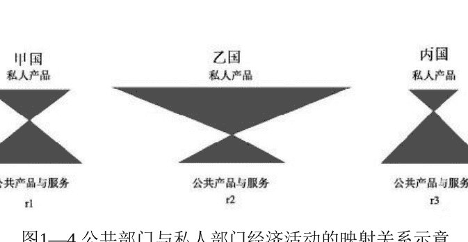

资料来源：笔者自制。

图1—4中，底边的长度代表一个国家向其国民提供的公共产品，公共产品与上方的市场活动存在映射关系，公共产品越丰富，市场活动越活跃。更重要的关系在于中间的那个公共部门和私人工部门之间的交叉点。同等规模和质量的公共产品，如果该交叉点的位置向上滑动，那么在私人工部门所射出的经济活动便大大缩小，而假若该交叉点向下移动，在私人工部门射出的经济活动便迅速加速。这个点的便宜就是综合税点，综合税率的高低对国民经济具有巨大的杠杆效应。

图1—4甲、乙、丙三个国家，底边长度指向他们的政府所提供的公共产品是均等的，关键在于其中的综合税点的高低。国家政府每年新增财富（GDP）的近1/2提供公共产品，在私人工部门投入那么多经济活动却占成了七成；而丙国则新增财富提供了与中国相同的公共产品，结果是在私人工部门投入的经济活动小于甲国；丙国通过某些方法将公共产品的成本降了下来，所以私人工部门的经济规模远大于甲国；两国均如此。

显然，这个结构大大简化了现实中的私人工部门与公共产品与活动之间的映射关系，在现实中还存在的各种资源冲突、滞和摩擦，也存在公共产品的质量差异。但是这个逻辑关系可以帮助我们理清经济学中许多本质原本是非认。

首先，假如存在绝对意义上的无政府状态，那么经济活动应该接近零。在现实中，它意味着处于全面战中的国家谈有多少经济活动是不可可能的，权力转型和军事冲突可以让原本的国家在很短时间内变得一如流。“土石出来的地方没有市场，骗诈横的地方没有市场，“鸡犬之声间，老死互不相来的地方没有市场。”[51]有些国家政府（比如比利时和美国）缺位一段时间但是其经济却不受严重的影响，是因为在其公共部门体系中，政府仅承担一部分公共产品的供给，立法、司法、社会保障、边界控制、军事安全等功能已经分散于权力政府（比美国的白宫和英国的内阁）广义政府了。

其次，许多发展中国之所以贫穷，主要是由于他们的人民懒惰或者精神不足，也不是因为政府压抑了市场作用。达隆·阿梅斯格鲁认为，政府的原型都是榨取型政府，有些政府及其背后的统治群体已经意识到，如果把爪子交给自由、法治，更有利于稳定和发展。许多发展国家的政府及其统治群体还处于饥饿状态，不能实现暴力的形态。

再次，政府的能力和效率决定了国家的财富。在确保政府能够输出经济活动的前提下，通过提高政府效率可以降低对政府资源的汲取，这就是图1—4中两个交点的垂直底长度之一。要实现国家强政府，必须充分认识自己的任务，公共部门的扩张是关键所在。政府的事情越多，整个国家越能够现代化，越竞争力。

最后，理想的情况仍然是公务员努力工作获得可能的低酬。但是即使是党员也要养家糊口，又要养马，在逻辑上是不可能的。苏联是通过典型等手段给人类以激励，苏联提供了不错的公共产品，包括国家安全、基础设施和研发、社会保障、国际市场入等，但是整体太贵，效率太低。他们缺乏一个“重商主义”政府，不理解市场的种种意义，也不允许市场的存在，搭建商业平台，不能激活活力和创造力，因缺乏微观动力，就像没有身体的大脑，长久退化、不可持续。

华盛顿共识所行的援助政策以往首先丢掉了发展的脑，只留市场，结果发育不好。中国改革后留下了30年发育出来的脑（政府），又上了新的身体（市场），相互促进，共同生长。美国自身的办法是通过面向全球用计价的政府债务。对于债务在现代经济体系和治国术中的重要性，笔者将在本书的第二章关于货币部分和第六章关于债务的部分予以详细说明。

### 三 国家的塑造

发展国家为什么？对这个问题，自由主义经济学的答案主要是负责任发展的政府和官员认为他们太过于腐败政权，干预市场太多，限制了民众参与的积极性，或者输出了高效的跨国公司和私人资本，属于掠取式政权。这类观点见MIT经济系教授阿肯·穆格鲁斯的《国家为什么失败》。

如果观察全球150个形的发展国家，不要发现真正：发展国家政府部门的主要问题是软弱无力而不是管太多，公共产品的供给与发达国家相比比重不足。对于发展国家而言，纠正公共部门比市场和结构更重要。

发展国家与发达国家不同的是政治与政府，然后才是技术、产业和经济方面。发展国家的政治具有以下几个特点：一是精英的前生前途和国家梦想都放在西方；二是政府的能力非常有限，财政收入和公共服务涉及的人口仅占总人口的很少比例。要想把多数人口纳入政府的资源汲取框架下，必须经历政治现代化，即18世纪以来全球发达地区进行的大众动员和社会革命。三是政府在有限的资源基础上提供足够的公共服务，其成本很贵。这些发展国家大部分是殖民体系瓦解之后的产物，继承了人为者划定的边界和故意设置的地缘和种族矛盾，建立和平与秩序就很困难，更论更高层次的公共产品。

2015年，时任巴基斯坦财长在美国卡特基金会的一次演讲中提供过一个很有意义的数字，该国人口占到总人口的0.5%。这样的税收汲取能力，在一些自由主义政治学说洗脑的人眼里算是好事，这是典型的型的政会大会。但是在现实中，这样的税收无力是灾难！真正的现代化要求税收对GDP比例有明显的相关关系。没有足够的税收，政府将无法支撑国防和警察系统，从而难以提供有效的基本公共供给给民；没有足够的税收，政府将难以选用庞大而干心的员工队伍——在许多发展国家，员工显然难以以支持其家庭生活，即便工资无法负担，这也是一种困难。没有足够的税收，需要政府投资的那些大型公共项目和基础设施难以实施。

米格尔教授（Joel Migdal）在《国家与社会》一书中阐述了国家与社会之间的互动。他认为，在全球范围内常见的弱国，如部落、教会、利益集团等各类组织的力量大，而国家力量不足以实施有效的控制。国家中心主义的批判者认为，在20世纪80年代之后，国家中心主义的潮流。对国家能力的过度乐观，过分强调国家的自主性，使得其实现能力受到限制。

米格尔教授与俄罗斯普京曾有过争议，但他的见解却深刻地解释了：“世界上没有真正意义上的主权国家”。

中心与外围的差异，民主主义政治学视角做了进一步的梳理。中心与外围在经济、社会、政治和货币领域存在明显差异。结构主义者正确描述了(description)中心与外围之间的差异，但是他们的政策处方(prescription)是失败的。

从债务率而言，中心国家的政府债务率普遍非常高，往往远到GDP的100%以上，而外围国家的债务率则上升到50%以上，这一事与大众脑中的常识恰相反。

如果战争、革命带来的社会动荡是国家建立的必要条件的话，那么还有一些因素值得注意。米格尔教授认为，有助于建立强国家的因素包括：世界历史进程提供的机会、来自国内外的军事威胁、独立体系的建立，以及出色的国家领袖。笔者看来，规模的基础设施建设有利于强化国家，因为它能够改变社会各阶层的竞争力和地位，将国家内部大量非贸易变为贸易，强化其分工和产出规模。不仅如此，基础设施的建设能够持续从根本改造相关社会结构和居民的生存策略，从而使国家能够强化。此外，世纪运动可以减少宗教势力对国家力量的干预，削弱其社会功能，从而有助于国家力量的强化。对某些核心资源的国有化控制，比如土地的国有化和矿产资源的国有化，固然有助于提升国家的财政汲取能力，但是对于国家能力的提升而言，对物的掌控仍然无法对人的操控。

此外，信息时代的到来也有助于外围地区的国家力量上升。信息化正在加大全球经济和产业的基础，但是笔者认为未来的更大的冲击将现在治理能力和治理体系的变革上。一方面，借助信息化网络化手段，国家变得明显扁平化，整体成本将大大降低，国家对个体的控制力和社会的渗透力要加强。另一方面，由于大众被信息媒体操控，社会互斥，政治将会变得非常常态化，原本工业化时代的依赖于社会共识的治理形式（比如选举制度）也将不可持续。在此背景下，制度探索和演进的窗口将再次打开。在国家与市场、公共部门与私人的关系上，我们将看到国家能力大大增强，综合税率大大下降，而且国家对于小小的优势将明显。

| 维度 | 中心 | 外围 | 笔者视角 |
| :--- | :--- | :--- | :--- |
| 产生 | 先进农业 | 小农农业 | 劳动力输出 |
| 生产 | 工业 | | |
| 政治 | 资本阶级 | 单一 | |
| 权力 | 国家 | 绝对权力 | |
| 社会 | 贵族 | | |
| 分配 | 发行者 | 备注 |
| 制度 | 官僚与统治者 | 附庸与统治者 | |
| 经济 | 市场 | 市、精英 | |
| 安全 | 土本市场保护 | 土土市场准入 |
| 贸易 | 资本输出 | 世界市场 |
| 社会等级 | 等级差异 | 不平等 | |
| 人口 | 子女阶级 | 民化、人均 | |
| 信息 | 传播 | 买卖 | |
| 政治 | 民族主义 | 贫困区、落后 |
| 国家能力 | 提取型 | 弱、小农治理 |

结构主义视角下中心与外围的比较如表1所示。

了的体系外围地区的选举民主与汇率之间呈负相关关系。

## 二、融资结构的中心外围差异

对于体系不同层次的国家需要不同的融资结构以与其经济和产业机制相匹配。

对于体系最中心的、以创新为主的经济产业而言，敢于承担长期和巨额风险的创投（VC）基金和私募股权（PE）基金，是一种非常重要的资本机构，因为它们能够承受极大概率的研发失败风险以换取成功后的高额成长和资本化收益。与之相应，对知识产权的保护和繁荣的资本市场是其背后重要的基础设施和公共产品。当然，与产业相关的创新研发通常是在应用层面的工作，而更底层的基础科学研究离不开基础公共提供的长期支持。

对于致力于工业化的发展中国家，基础设施融资离不开国家主长期积累资本的投资，因为基础设施投资具有部分公共产品的特性，对于我们私人资本而言，为基础设施征集土地的交易成本较高，投资规模回收期较长，更何况发展中国的私人资本规模通常比较有限。开发性金融对于发展中国家和许多发展中国家都是非常有益的。

致力于工业化的发展中国家可以依靠本国私人资本的积累，也可以争取国际金融的资金支持，也可以依靠外资直接投资者或从金融市场上发行债权。就历史看来，成功的发展中国主要是以本国储蓄转换为资本进行再投资的，对于国外资本采取了相当排斥的态度。发展的好处是利润可以充分转化为本国财富并最终转化为消费，其缺点是速度慢，而且在本国市场封闭的情况下难以开辟。依靠外资直接投资（FDI），其好处是可以接入全球链和供应链网络中，能够快速实现大规模生产和就业，并通过技术和管理经验带动本土工业化起飞。但是其端也很明显，外资承担了很大一部分风险，要求的回报通常很高，发展大部分成果会被外国资本拿走，并且规模和市场地位对本国形成挤压，而本国政府和居民获得增加有限，从未能转化为本土市场。

这可能形成一种依附式的恶性循环；发展取得了名义上的增长，但是由于本土居民所得有限，这种发展模式到一定水平之后就会遇到问题。由于土地、人口等要素价格升到一定程度，外资会像潮水一样离开中国，去寻找一片肥沃的市场，表现为资本撤出、经济停滞。另外，外资的引入会抑制民族工业化。外资带来的机会和管理经验，但是技术积累红利无法分享，因为技术是无形资产，而且发展中国家缺乏积极性来开发自己的，即便开发了，也无法与外资竞争。以往形成永久性的对外依赖。教授认为克服这个办法是循序渐进的“进口替代”。以美国为代表的一些亚洲国家陷入所谓的“中收入陷阱”，其发展模式却是建立在对外的过度依赖基础上；工业化过程中，既有大规模引资，又有自主政策带来的技术积累。发展国家通过国际金融市场融资，包括国际金融机构和国际金融市场融入各种周期。发展国家的所谓“原罪”就是无法用本币在全球市场上融资，利率掌握在别人手中。华街的格言是在晴天的时候把钱借它，然后在雨天要把钱收回。全球资本流动的方向和规模也具有波动性。拉美国家在2世纪80年代初期经历的资本外流、汇率暴跌等金融危机，都是这种国际债务带来的后果。

国际债务融资中有一个特例是向国际金融机构如世界银行、亚行或者某些发达国家的政府开发援助（ODA）融资。这种融资的特点是长期低利率。但是它的缺点也很明显：一是规模有限，二是有不少附带条件。有限的规模意味着这条融资难以持续支撑成功的工业化，且附带条件意味着放弃了本国的若干选择，在政治制度和政策理念上的自主权。如果是接受特定国家的开发，那么附带条件就必须优先使用国家的产品、服务和技术，并在外交政策上满足其要求。此外可能由于信息不对称而面临陷阶。如2世纪80年代前期在中国内的东亚国家都获得了日本的大量低贷款，而在1985年广场协议后美元贬值的快速暴涨导致这些借款的实际负担巨大。正如日本所言，“免费的就是最贵的”。政策自主权的丧失，从长期来看代价非常巨大。这不是说国际金融组织有意危害发展中国家，而是事后看来，凡是跟世界银行和美国财政部指导意见的发展中国家都难以发展起来。尽管这些机构所持的发展理念比盛顿强调的理论在很大范围内，但是这些机构中的专家们许多是相信自己正在努力让这个世界变得更好。问题在于，能否通过经济学和金融学的专业知识引导向世界提供具有普世性的发展道路？本书的答案是否定的。各国不同的要素赋权和文化传统，如向一条寻求全球一致的标准尝试会导致不适应。更的问题在于刻刻求，将曾经成功的经验试图复制到落后国家，不知当年的经验已经在竞争中使得失效了。由于全球需求相对供给供给的有限性，任何一轮工业化都只能少数经济成功，这就意味着前面成功所使用的手段并不构成模仿成功的充分条件。这就就好比在总是少数人打败多数人的金融市场上，过去的投资大师所使用的方法技巧一旦成为公众共识便再不能产生超额收益。同理，历史上工业化成功的经验确成为成功的必要条件，但是显然不能成为充分条件，因为其经历已经成为共识，大家都知道其中的匮乏事实，价值被对冲掉或者说中和掉了。更何况，世界银行机构向全球发展中国家推广的模式，往往是中心国家的政治和学术圈希望后的事，他们不是他们的前辈们实际所做的事。1800年以来，西方国家的工业化过程中，伴随的是严酷剥削劳动者，严重污染环境，将压镇殖民地的扩张，剥夺许多各国权利，努力获取国际技术优势，并维持本土制造业在国际市场上崛起，而不是像今天世行所推崇的创新、绿色、和平、共法、民主。华盛共识的至少其观结果而言，相当于一种新殖民主义，通过援助和优惠“条件”将发展国家处于报酬递减和贫困之中。发展可能更加依赖自然，外围国家失去能力或政府主导经济的发展能力。这可以推论，越往后，外围的竞争越激烈，难度越大。发展的第一步，就是要保持精神上的独立性和路径上的自主性，是走向自由的第一步。外围国家如果能够把握全球资本和价格周期，就可以利用国际金融市场，否则应当保持高度的警惕。为发展成功的关键还在那些产业中的不断升级过程中资本积累。

了的体系外围地区的选举民主与汇率之间呈负相关关系。

## ### 分化与演进中的中心外围关系

相对于传统主义的中心外围，笔者认为中心和外围在2世纪70年代之后同步分化。中心国家分化为虚拟经济和高科技创新、欧美、日本、韩国、新加坡等制造国；而外围国家分化为实体经济为主的大宗出口国和劳动密集产品出口国。因此2世纪70年代开始出现，主要是由于一系列结构性变迁和黄金窗口关闭导致。笔者在《为什么会有对外关系》书中描述过分析某个国家在体系中处于什么位置，重要的是看这个国家对整体出口什么东西。从这个角度考察，世界体系内的国家和地区可以分为四类分别为中心国家、准中心国家、发展国家以及外围国家（见图—5）。第二次世界大战后成为全球体系中心地位的国家是美国，其次是出口最多的东西不是商品或服务，而是各种无形资产，包括版权和品牌、物权以及一些商业模式。美国提供全球流动性和技术，如同太阳系中唯一的恒星太阳，向它转动的行星。不同经济体在其不同的轨道上，离太阳越远的行星越冷，离它越近的行星越温暖。

图1—5 商品、货币在体系中的流动

资料来源：笔者自制。

世界市场之所以如此积极地推崇美元和无形资产，是因为体系外围绝大多数国家认同美国的实力优势、政治经济体制优越性以及作为帝国的信用。人们之所以相信美元并非由于美元纸币上印的那样“由于上帝而信任”，而是基于美国无与伦比的经济技术实力以及压倒性的军事和政治优势。美国的财富和力量获取了全球对美国生活方式、价值观以及这些文化的追求。因此，可以将美国这个中央国家称为依靠信心的。依靠别人对他们巨大优势和制度优越性的信任，以及他们对这种信任与信心的维护与巧妙运用。紧邻美国内核的欧洲和日本等准中心国家，他们用来与世界交换的商品也有自己的货币，但主要还是精致的高附加值工业和服务。西欧和日本既有中心国家的货币出口与虚拟经济特征，又有类似于围绕国家的工业制造能力，所以作者将他们称为准中心国家。他们依靠的是百年工业发展获得的资本积累，加上先进的研发以及管理组织能力获得的技术和专利优势，可以之为依赖性和纪律生存的国家。在欧洲和日本的外围，是第三层次的国家，即主要要从事劳动密集型的产业的国家，其中生存最多的人口。他们生产工业，但是与准中心国家相比，他们的工业生产在技术上远为简单，组织效率和管理技巧明显落后的，其产品与服务的复杂程度相对低，单个产品的零件数量远不如南方，更少对核心技术和专利的掌握。中国及其许多东邻国家，以及非洲、墨西哥、巴西、土耳其、部分中东国家的位置就居其中。由于他们提供了全球最多的劳动力供给，所提供的产品和服务本质上属于劳动力密集型，所以不之为依赖劳勤谋生的。在体系相同的最外围，分布着许多依赖能源和原料出口而生存的国家，这些国家覆盖表的大部分面积，中东、拉美、南美、非洲、俄罗斯等地的大量经济体处于这个第四个层次中。他们基本不制造或创造某些东西与世界交换，而是拿出祖先传来的土地下埋藏之物来交换他人的劳动产品，所以，我们不之为依赖运气生活的国家——他们生存的质量取决于脚下的土地可以提供何种自然资源。

1979年中国进入这个分工体系以来的40年，我们在全球市场体系中的位置迅速变化。从最初的原料提供国到外围工业国，如今向准中心国家快速进之前还有韩国和新加坡等经济体；之后还有越南、印度等经济体。也能看到一批经济体在不同程度上经历了结构性的边缘化，比如苏联、东欧地区和南非、巴西、阿根廷等。表1—2

| 体系位置 | 中心国家 | 准中心国家 | 外围工业国家 | 原料国 |
| :--- | :--- | :--- | :--- | :--- |
| 代表性国家 | 美国、德国 | 西欧、日本、韩国 | 中国、巴西、印度、土耳其、中东、东南亚 |
| 向世界提供 | 资本、服务 | 技术部件 | 资本密集型产品 | 能源和原材料 |
| 优势 | 国际市场与服务 | 教育与劳动力 | 劳动力规模和技能 | | |
| 差异源 | 技术能力和资本 | 资本密集型产业 | 劳动力优势 | | |
| 比较优势 | 军事领先 | 工艺密集型产业 | 动力 | 工场 |
| 市场角色 | 世界银行 | | | |
| 生物链中角色 | 天敌、食物链 | 小型食物 | 植物与生物 | |
| GDP(2007) | 22.00 | 20.00 | 14.00 | |
| 人均GDP(2007) | 5.00 | 4.50 | 0.60 | |

资料来源：世界银行，笔者整理。上述事实说明，中心与外围之间具有大体稳定的结构，当体系相对中心位置时，就会有一些国家面临工业化和边缘化。民主主义认为不宜理解其结构与变迁，在探讨“是否”和“怎么办”，而不是沉迷于表达我们对这种世界结构不公平之处的愤怒和抗议。只有冷静地理解世界，才能有恰当的方式来适应它。市场体系的运行是一种流量变化与存量调整的有机结合，既要看到结构存在的合理性，又要看到新的可能性。通常来说，参与到这种中间的分工对于几乎所有参与国都是一种策略性选择，因为被别人剥削然而最悲剧的是没有人愿意被剥削。你必须承认世界市场体系的存在具有其合理性和鲁棒性（robustness）而并非某个阶级或者国家或者族群操纵的结果。当今世界上，置于体系之外的国家已寥寥无几，朝鲜是一个特例：20世纪70年代以前，朝鲜的生活水平远高于韩国和中国，原因在于朝鲜的经济深度融入了以苏联为中心的东方社会主义阵营内的交换体系，而中国的陷于东西方两个体系之外。在苏联解体之后，朝鲜被排斥在全球市场体系之外，导致生活水平下降。从图1—6可以看出，世界市场体系的外围地区与中心地区的人均GDP长期存在较大的稳定性。

图1—6 外围地区人均GDP与美国GDP的对比（1960—2017）资料来源：世界银行数据库。众所周知，这些外部地区与美国之间的比例呈现稳定性，至少能提示我们两个问题：一是圈层的稳定性比人们想象的要强；二是中心对外围确存在某种程度上的带动作用和溢出效应。中心谁是未来？笔者倾向于认为中心是发展和进步的动力，而外围经济准则可以视作其衍生。这与本章探讨的内部公共部门同人部门之间的逻辑关系其实是高度一致的。全球市场体系是一种资本主义帝国，其政治经济本质就是杠和信用。资本主义帝国实质上是世界的，它不是利用了全球公共产品的冲击，主动扮演了某种特定的世界的角色，或者操纵联合国这个初期的世界以自利。世界市场体系的运作之所以能够正常运行一两个世纪，不仅是因为它为军事优势压制外的反抗，更是为了世界市场需要提供的某些公共产品，如贸易安全、全球市场的开放、扩张以及对气候变化、基础科学、国际标准的统一等。帝国从整个体系获取资源，并向反射某些公共产品，而外围参与者将其资源交给中心配置，此中心对外围的关系主要是一种共生关系而不是只是剥削关系。这就解释了第二次世界大战后的基本事实。

养、慈善捐赠等行为一起，构成一个社会内部成员之间共享财富的渠道。

可贸易品与非贸易品一价定价之间存在质的差异。可贸易品由于跨境套利的存在而大体符合全球定价，本文将其定义为财富的创造部门：非贸易部门，这里大部分服务业，其价格在不同经济体的差异可以非常悬殊，而与其质量水平和客户偏好无关，本文将其定义为社会财富的再分配循环。换言之，一个经济体通过可贸易部门生产产品、创造了财富，并通过贸易将其与全球市场交换到自身所有，然后通过非贸易的部门（如人们相互之间的服务）将这些价值在自身的各个群体中进行再分配。需要读者的是，把非贸易品定义为财富分配循环，这里不存在对错的问题，而是方便或者不方便的问题。这些概念和设定是学者为了理解和解释的发展的方便而设计的工具，随着时代的发展，我们完全可以且应当创新的概念来解释和分析事态。这个定义又意味着本书结构构成了政治与经济的又不可或缺的内容。

决定一个居民收入水平主要是可贸易部门的竞争力，技术进步有助于实现在全球市场竞争的可贸易品。一个经济体的丰富程度，仅取决于可贸易部门在全球市场的竞争力有关，而非贸易部门的效率提升和质量提升对于其富裕程度的影响几乎可以忽略，如果它只是分配循环，同样这样做很多东西，无论一个社会如何分配，人均量还是没有变。想象一下越南的留美同学，如果她回到越南，在河内陆区无论如何打磨她的技巧和服务水平，她的报酬水平无法大幅跨越，因为国内的生产能力可能只是美国精英阶级的1/10。世界各国地区，凡是生产某些产品和服务并以较大规模和良好增长水平出售到本地之外的，那么其人均财富和生活水平必然高。凡是少有多少东西可以对外出售，或者附加值低的，那么其民必然较为贫穷。如此，许多流行和内涵的思想和概念得以澄清，制造业为什么重要？所谓“实体经济”为什么重要？究竟哪些才算正义上的实体经济？其实，日常生活中人们使用制造业和实体经济等概念的时候，真正指标的是可贸易的。

事实上，每个产品的生产、流通和消费中都包含了价值创造，也包含了价值分配，只不过由于它们的贸易半径不同，参与价值分配的空间和群体范围也有巨大差异。如果你所获得的价值分配通常不会高；若如非贸易半径非常大，那么你的所得就取决于产品的定位和竞争了。

是否可否（贸易），是从流通的角度来划分的，在很大程度上并不是非黑白的此彼的概念，而是一个光谱；有的产品可以被送到世界的任何角落出去，比如服装、玩具和手机；而有的产品则不然，某种口味符合本地人所享受和喜欢的食物，其变质而只能在本地销售的生食品或者对个人的直接服务如理发、洗衣和洗车服务等。我们可以在这个光谱上确定哪些产品和服务的非贸易。贸易半径越大越可贸易，贸易半径越小越不可贸易。技术变迁和交通通信技术的改进，使得原本非贸易的劳动成果越来越可贸易，大量产品和服务在上述光谱上都向贸易半径的远端迁移。

非贸易由于技术变迁而越来越可贸易化，并在社会经济中产生影响。传统的贸易部门是制造业和农业，但是随着技术进步，尤其是互联网技术的发展，很多非贸易部门正在变得可贸易，互联网传统服务的一系列改造，正处于颠覆我们以为的生活场景和定价体系，无论是餐饮、交通、住宿、零售，还是教育和金融服务，都在变得非本地化；其服务的交付仍然是在本地发生的，但是其订单整合与支付，服务后的售后支持等新增增值发生在境外乃至国外。随着原本非贸易的服务技术切割越来越多的可贸易部分，服务价格也在出现跨越的一致性趋势。这意味着每个社会内部原本的财富分配渠道变得更加狭窄，通过可贸易部门获益的群体向本国其他群体的财富溢出过程更加依赖政府调度，既包括政府的福利发放，也包括公共部门的各类投资和对资产市场的影响。在此背景下，一方面资产市场的波动性日益扩大，房产和金融财富显得越来越容易；另一方面如果政府对社会财富再分配的力度不能跟上步伐的话，那么整个社会财富分化会越来越严峻。据此，我们可以提出一个政治经济理论假设：20世纪80年代以来全球性的（除了欧洲和日本之外的全球大部分区域）富贫化浪潮后，不仅有自由贸易主导的宏观政策调整因素，还有技术进步带来的经济因素的可贸易化趋势的结构性变化，即原本某些财富分享也变成了财富创造活动。

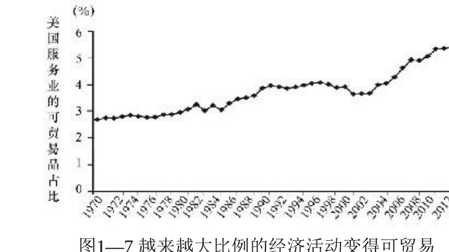
图1—7 越大比例的经济活动越可贸易
资料来源：笔者自制。

为了弥补可贸易品和非贸易品之间的转化导致的富贫分化，需要比过去更大的力度来进行社会的再分配。

## 二 GDP-PPP的误与“巴库斯—史密斯难题”

20世纪初，当人在比较不同国家的经济时，最喜欢用若干关键产品如钢铁、煤炭、粮食产量的指标，当时的中国曾经以粮食和钢铁产量作为超越英国的指标。但是这些产品在实际市场上存在质量和价格的重大差异，因而不能简单类比。于是欧美逐步流行国内（地区）生产出总值GDP的计算。由于GDP的计算存在很大的误导，比如说两个国家的GDP可能有百倍以上的差异（如美国与南亚国家），但是两国的生活水平显然并不是百倍。于是学者们发现了购买力平价（PPP）计算方法来修正GDP偏差，通常发达国家购买力比按汇率换算得多。

之所以要创造购买力平价，是因为不同国家之间的物价有着明显差异，所以要在汇率之外评估出一个“购买力平价”来弥补这种差异。这个概念让人们以为未来汇率将会靠齐，然而汇率价格的事实相反。纽约大学的哈卫·巴库斯（Paul Backus）和加拿大大学的格雷戈·史密斯（Gregory Smith）在1993年的论文中提出了一个现象：购买力平价暗示汇率变动往往与过去的趋势相反，尤其是发展中国家的购买力平价远高于汇率，但人均水平大幅下降。这个现象被称为“巴库斯—史密斯难题”。

购买力平价这个概念带来的混乱与错误，它不是社会科学中的好工具，而是一个政治宣传概念。对购买力平价的理解其实优于西方经济学。在进行国际比较时，必须区分经济体内部的可贸易部门和非贸易部门，只有可贸易商品才符合逻辑，换言之，计算必须将非贸易商品排除在外，才能准确判断。如果主张这种比较方法，那么中国的可贸易部门产出规模已经超过了美国，而美国的GDP规模仍然只有60%左右。为什么美国的非贸易部门大于中国？笔者认为主要是因为美国的城市化比中国更高、家庭规模比中国更小、社会成员间的合作更加依赖市场，财富转移并非通过市场交易而是来实现。

## 三 如何发展可贸易部门

上述观点是有道理的，那么国家发展的的核心问题在于发展出一个具有国际竞争力的可贸易部门。制造业是可贸易的，但可贸易部门不仅包括制造业。国家想要摆脱经济结构的单一和“资源诅咒”，传统的观点认为必须发展制造业，关于这一点政治学当然是赞成的。但是笔者主张应该看到某些非制造业也属于可贸易部门，有利于居民财富的增长和经济竞争力的提升。例如，带有更多生物含量的新兴农业、旅游、影视和娱乐，也有明显的可贸易性，也能帮助全球市场带来规模效应、效率提升和能力的发展。某些传统观念中的虚拟经济，比网络服务和全球性金融投资行业，也有明显的可贸易性特征。一部分国家，比如地理位置独特、人口规模较小的国家，其实不必抛弃自己的比较优势和独特禀赋强行制造工业化。其能够带来本国人口在可贸易领域的能力积累，让他们在全球市场上市领先，都是可以带来财富增长的。但是有些国家虽然依靠本国民的劳动力智慧，但不助于从全球市场可持续地，那么这些国家的政策其实是浪费资源和机会的。

在政治经济学传统中，不同学者争论了半个世纪的问题是制造业的策略和路径。有的学者看着出口部门，把握出口的工业化；有的学者看着进口部门，搞进口替代工业化。传统的进口替代从20世纪60—70年代的广泛实践来说，绝大多数是失败的。但是日本、韩国等少数发达国家，由于政治和安全原因无法进入出口路线，而是从低廉的纺织等行业的出口开始，结果走出了逐步升级的工业化道路。林毅教授根据东亚的出口导向和产业升级成功，动态比较优势的更新了传统结构。

两种策略各有其利与弊。出口导向的好处可以是动更多的人员进入全球供应链体系中，易于获得胜利，也能获得现实利润，从而逐步积累资本，用时间换发展空间。但它的对外部市场的依赖性极高，自身具有必要的自主性，往往要政治外交上的依附或陷阱，这对于刚刚摆脱了西方殖民势力独立的发展中国是一个重大的内政挑战。替代策略最容易获得国内的政治支持，但是长期来看会被手段（官办企业）统一，形成路径依赖和腐败低效率的封闭系统。对此，林毅教授的专著中已经论述非常充分，此不赘述。

事实上，东亚模式并非完全可用，而是出口导向和进口替代的混合。日本、韩国和中国都是重视出口导向，同时通过产业政策和金融投资实现了产业升级。笔者看来，进口替代与出口导向之间的关系类似于。

小结

本书首先梳理了政治经济学的国内渊源以及在不同学科中的表现，通过一系列二元关系展示了政治经济学的理论框架。这些观点并不是左翼立场，也不是自由主义或新自由主义的观点，而是重构了一个理解我们所处的世界。本书的主要章节但不限于以下几个方面：

一）中心与外围是共生关系。中心吸纳资源，创造价值，最重要的资源是人才而非自然。
二）政府从民间提取资源，提供公共服务，市场也是公共产品之一。政府能力和效率的乘积决定了一个发展水平。
三）人是本，物是末，财富的唯一来源是人。人的生产和消费在经济发展中作用越低，资源聚集是一种诅咒。
四）应该把生产视为财富创造过程，而不是把贸易视为分配。可贸易部门的发展是一个国家富强的关键。技术导致非贸易的可贸易化是全球富化的原因之一。本书的主题是全球货币与金融体系，读者可以看到不同侧面印证上述理论。

1. 《尚书·周书·泰誓》，王世舜译，中华书局。
2. 《尚书·划分》，王世舜译，中华书局。
3. 《老子·第四章》，李存玄校，中州古籍出版社。
4. 《论语·颜渊》，张英译，中华书局。
5. 《管子·牧民》，李山注解，中华书局。
6. 《孟子·孟王下》，方勇译，中华书局。
7. 《孟子·孟王下》，方勇译，中华书局。
8. 《荀子·大略》，孙邦译，山西古籍出版社。
9. 《御史·择书》卷九·大上，阎益等校，中华书局。
10. 班宇：《观政要·农政》，中华书局。
11. 司马光：《资治通鉴》卷一二，中华书局。
12. 程颂、程颢：《二程集·文集卷五》，中华书局。
13. 黄宗羲去世之前，反复要求自己要冠衣、散发，葬入石棺以终，表达他不为清朝之民的意愿。
14. 黄宗羲：《明夷录·原君》，中华书局。
15. 黄宗羲：《明夷录·原君》，中华书局。
16. 关于金银本位向金本位的转变导致金银比例的巨幅变动和清后期的贫困化，见本第二章第一节。
17. 藩跃：《比较政治理论与方法》，北京大学出版社。
18. 近代中国有一部分分子严重缺乏全球视野和历史感，情感丰富而理性不足，在自然科学领域的知识基础和学习能力也较弱，在技术差距方面落后于日本及韩国的同行，但是这个掌握了话语权的群体，有些人用西方政治中心的价值观、观念和观点掩盖了自己的思想危机。他们通过模仿古人的所谓制度和中国传统的“术数”而推翻自身作为知识的无能和失职，出现了逆向发展主义者。我们的领先者很好地完成了他们自己的时代任务，而现在的困境和落后是现在自己的问题，应该通过人的努力来发现，而不是在衰落之后才对自身变为某种信念，更不能再将责任咎给祖先。古人无助于理解和解决问题，更导致被异化为传统，放弃自身主体地位，主动割夺了文明参与全球文明竞争交流的机会和权利。在制度和文化领域，东方的长期竞争刚激烈开启序幕，有些人还没有发现正面竞争便已弃脚投入，其竞争可能连胜利都结束了。

19. [瑞士]西斯蒙：《政治经济学研究》，胡尧、李直、李玉译，商务书局。
20. [瑞士]西斯蒙：《政治经济学研究》，胡尧、李直、李玉译，商务书局。
21. [瑞士]西斯蒙：《政治经济学研究》，胡尧、李直、李玉译，商务书局。
22. 张一：《政治经济学的哲学解答》，上海报。
23. 《马克思·恩格斯全集》（第二十六卷），大林编译译，人民出版社。
24. 《毛泽东选》（第三卷），人民出版社。
25. 韩哲祥：《习近平总思想与经济》，央广网。
26. CRB Index（Commodity Research Bureau），由美国调查局编制。
27. 马克思主义经典理论们对消费不够重视。
28. 哈利·丹宁：《人口爆炸》，中信出版社。
29. [以色列]尤凡·赫拉：《类史：从动物到上帝》，刘英译，中信出版社。
30. 这些国家接受移民的学历和资质要求很高。
31. 生育的下降有很多因素，最有力的解释是女性教育水平的上升。
32. 中国本身就是一个典型的社会。
33. 2008年金融危机之后，人口开始持续萎缩。
34. 《资本论》第一卷第十五章节，人民出版社。
35. [美]保罗·巴伦：《增长的政治经济学》，上海出版社。
36. 查斯·赛威尔：《不发展问题的政治经济学》，商务书局。
37. 查斯·赛威尔：《不发展问题的政治经济学》，商务书局。
38. 文一：《伟大的中国革命与发展经济学批判纲要》，清华大学出版社。
39. R.Prebish, The Economic Development of Latin America and Its Principal Problems, New York: United, 1950; H.Singer, “The Distribution of Gains between Borrowing and Investing Nations”, The American Economic Review, Vol.40,No.2, Papers and Proceedings of the Sixty-second Annual Meeting of the American Association, May,1950,pp.473-485; A.O.Hirschman, The Strategy of Economic Development, New Heaven: Yale University Press, 1958.
40. N.Birdsall, T.Pinckney and R.Sabot, “Natural Resources, Human Capital and Growth”, Carnegie Endowment for International Peace Working Paper, 2001.
41. S.M.Murshed, When Does Natural Resource Abundance Lead to a Resource Curve?, IIED-EEP, Working Paper 04-01, 2004.
42. 齐特奎·赖纳格：“富国为什么富，穷为什么穷”，中国人民大学出版社。
43. Michael Kaufman, Soros:the Life and Time of a Messianic Billionaire, New York:Vintage Books, 2002.

[45].联合国发布的人类发展指数（HDI）是以预期寿命、教育和人均收入指标的统计综合指数，用于衡量全球各地人类的发展水平与绩效。

[46].汤藩：《比较政治治理理论与方法》，北京大学出版社2014年版，第75页。

[47].中国人民大学金融研究学院的高级研究员罗思禹曾担任金融研究学院院长长，他认为：西方的技术进步密集区域离不开政府对其补贴。硅谷之所以成为创新之都，是因为这个地方存在许多大学和公立科研机构，社会转型和政策投入的经费所培养出的知名员工用来开发新产品和新业务。参见罗思禹《一大纲：中国转型解析》，江苏大学出版社2016年版。

[48].William Bonvillian, Charles Weiss, Technical Innovation in Legacy Sectors, Oxford University Press, 2015, pp.240-255.

[49].见文一：“伟大的中国革命——‘发展政治经济学’一般原理纲》，清华大学出版社2016年版。

[50].文一：《伟大的中国工业革命——‘发展政治经济学’一般原理批判纲》，清华大学出版社2016年版。

[51].腐败是外围地区贫穷的结果而不是原因。将外围地区不发达归于官员的腐败，是发达国家对许多国家的贪污者，又不愿意拨付金钱是良好借口。既然这些发展中国家那么腐败，那么我们提供的援助难道不是被他们全部贪污了？既然这些发展国家的官僚不可信任，那么我们就不如用自己发现分配物资。实际上，给非洲的一半援助款都被当地腐败作为作者和劳务费占用了。

[52].美德·阿西罗·格梅、麦嘉娜、罗宾：《国家为什么失败》，增译，湖南科学出版社2015年版。

[53].美伊乔尔·米盖尔斯：“强国与弱国；第三世界的国家社会关系和国家能力”，张长东，江苏人民出版社2008年版，第281页。

[54].关于欧洲现代国家的诞生，详见 Charles Tilly, Troubling Confessions: Coercion, Capital, and European States, AD 990-1992, Hoboken, Wiley, Blackwell, Revised. 1992.

[55][美]乔尔·米格尔泰：《强社会与弱国家：第三世界的国家社会关系及国家能力》，张长等，江苏人民出版社2012年，第280—289页。

[56][美]乔尔·米格尔泰：《强社会与弱国家：第三世界的国家社会关系及国家能力》，张长等，江苏人民出版社2012年，第280—289页。

[57]原本大国的劣势在治理层次中，信息失真严重，管理成本高，但是在信息化时代，大国的劣势不再显著，而规模优势却越来越明显。

[58]他们为发展国家做出的政策是源于全球市场，关于建设，自生产资本和技术密集型国家，进口替代工业化。关于其政策的失败，将在下文中开展更多分析。

[59]此时美国革命之贵族与平民之间的平等性已经不再常及，各国革命、苏联社会主义革命、美国的北美战争和日本明治以及现代及中国的社会主义改革，都发生在各自的工业化飞跃之前，韩国的封建和殖民社会等级准则在剥削竞争中被大体推毁。广大发展中国家在获得之后并没有发生被动的社会革命，所以以其原有的身份和等级阶级保留下来，国家对于社会的力量显得很弱，在现代国家的竞争中无法结论。

[60]文一：《伟大的中国工业革命‘发展政治经济学’——一般性批判纲》，清华大学出版社2016年。

[61]剑桥大学张永教授的书是《富国陷阱：发展国家为什么要踢梯子？》，发展国家一旦获得成功之后，就主动踢了梯子，不让后发展沿着他们的成功道路上来。

[62]由于巨大的体量，东部发展地区和一线城市的经济发展水平向中心层次靠拢，每年培养的工程师相当于美、英、日、俄四大经济体的总和，每年专利的规模已经与美国相当。但正是由于中国体量的巨大和内部的多样性，人均GDP刚达到全球水平。

[63]鲁棒性(robustness)的音读，为健、强之词，鲁棒性的特征是系统在一定条件下维持某些性能的稳健性。——著者注

[64]参见文一：“伟大的中国工业革命——发展政治经济学一般批判纲》，清华大学出版社2016版；黄贵轩《技术大崛起的历史透视——政府主导的市场规模与技术进步》，《上海交通大学报》2013年4期。

[65]参见文一：“伟大的中国工业革命——发展政治经济学”一般批判纲，清华大学出版社2016版。

[66]易品包含了所有工业制品，但是还包含部分可贸易的服务。实体经济的概念非常含义，制造和绝大多数服务都在其中，但是互联网信息产业和金融服务往往被视为“非实体经济”。相比而言，易品的概念更清晰和直接指向一个经济体富裕贫的关键因素。

[67]David Backus, Gregor W. Smith, "Consumption and Real Exchange Rates in Dynamic Economies with Non-Traded Goods", Journal of International Economics, Vol. 35, No. 3, 1994, pp. 297-316.

[68]许多专业研究人员之所以汇率判断上错误，一个常见问题是把CPI作为抓手，但是CPI包含了大量的贸易品，而非贸易品的价格永远趋同，而在我们讨论汇率是没有任何意义。

# 第二章 货币国际化与全球体系重构

## 第一节 全球货币体系演进轨迹；从金银位到美元霸权

### 从金银位到金本位

历史上，将金属作为一般价物进行交换的实践由来已，因为金属可分割、不易磨损，且产量受限而其价值在一定期间较为稳定。金、银等金属都是古代。在地理大发现之后，全球经济逐渐连接成为一个整体，在全球体系中起重要作用，只有金和银两种。从15世纪以来，国际货币体系围绕金银而形成。在19世纪70年代金本位确立之前，单一的金本位，各国放弃本位而实行金银位。金本位的好处在于，货币可以扩张。金和银分别用于大额交易与日常流通提供便利。

半个世纪以来，由于北美矿的发掘带来银的大幅提高，再加上1871年德国利用法国取得的赔款机制而改用金本位，并大量向国际市场抛售，开启了银价一路下跌。各国放弃本位而实行金本位。到19世纪80年代，国际货币体系的金银位时代基本结束。以英镑为核心的金本位时代标志着英国帝国的鼎盛时期，也是全球浪潮得以飙进的时代：贸易与和平是该时代的主题。1880—1914多年商品、人员和资本的跨越流动达到了史所未有的程度，有学者认为一百年前后美国主导的新自由主义全球化在许多方面难以超越美国主导的古典自由化时期。

图—2 清朝后期黄金白银的比较关系

注：图中数据均为该年度12月31的数据。

资料来源：Denver Gold Group, https://www.denvergold.com/precious-prices-charts/gold-silver-ratio.

值得一提的是，欧洲先放弃白银从本位向金本位转型的过程也是中国社会整体贫困化的过程。中国社会的贫困化不仅仅是中国政府在19世纪后期多次战败赔款是被忽视的本币贬值的效应。明朝起的银位以白银为核心，而清朝后期全球银价格的持续下跌意味着过去百年东亚大陆对外出口的农业和工业产品所换取的白银财富流入，与此同时全国的劳动力、土地和其他各类资产价格以国际通用的黄金计算出现了大幅贬值。如果清朝的中国是一个制造业国家，那么这种贬值会带来成品出口的强劲增长和贸易盈余的增加，从而最终让本国货币重新升值，民生生活回归正常。但是作为一个封闭的农业国家，产出瓶颈的存在使得货币的大幅动荡仅带来通价上涨、饥荒、贫困化、社会的大幅动荡以及国际地位的下降。

## 二 从金本位制到金汇本位

金本位制与英国帝国的崛起和鼎盛密切相关，而其崩溃也与帝国的衰弱联系紧密。19世纪后期，金本位制在英国政府和中央银行的有意维持下，保证了汇率的稳定和国际收支平衡，并逐渐被西欧采用，形成了一种国际性的货币制度。卡尔·波兰尼（Karl Polanyi）认为，19世纪的文明建立在四个制度之上，其中关键的就是金本位制，它将国内市场扩展到了全球层面，并在这种自律性市场上产生了自由的自由主义国家，维持了国际和平。但是，金本位制也存在固有的缺陷：黄金相对固定的产量无法满足短期内的要求，会导致货币紧缩对经济发展带来打击和金融危机。除了自身的缺陷，若是金本位崩溃时，国际也将遭遇巨大的动荡。

图—2 黄金—银价格（1870—1934年）

资料来源：macrotrends, measuring worth, https://macrotrends.net/gold-prices/100-year-chart.html, https://www.measuringworth.com/datasets/exchange-rate/result.php

19世纪末，金本位崩溃的第一个时刻是各国为了自身利益。在1932年华盛顿会议上，国际货币体系分为三：英国带领英联邦国家建立了英镑位；美国则维持了美元集团；还有德国为首的东欧集团。各国集团内部保持了自由贸易，集团之间高关税壁垒。一贯支持自由贸易的英国放弃了自由主义传统，以英国集团为基础实行“帝国特惠”贸易，即在英国与英联邦成员国之间相互提供优惠的关税制度。世界开始进入了“去全球化”（de-globalization）时期。金本位更是被各国夺取：1931—1932年，英国、加拿大、北欧诸国以及美国放弃了金本位；1936年，比利时、荷兰以及法国宣布废弃。罗伯特·吉尔平（Robert Gilpin）所述，“世界经济进入了史所未有的时代”。最终，金本位制的崩溃带来的是自由主义世界基本制度的崩溃，也是自由主义的崩溃，其替代物——社会主义、法西主义等开始流行于世，并在不同国家取得政权，也正是法西斯力量发起了第二次世界大战。金本位的国际货币体系终于被国际权力构建的无序与失衡倾覆，货币金融转型进入了一个混乱的真空期。

## 三 英美货币权势的博弈与转移

第二次世界大战结束前，英美双方都积极重建战后国际经济体系开展会谈。在1941年前后，双方提出了各自不同的方案，即美国的“怀特计划”和英国的“凯恩斯计划”。这两个计划以各自的提出者命名，并成为日后布雷顿森林会议上双方争论的焦点。两者之间的对比见表2—1。

表2—1凯恩斯计划与怀特计划的对比

| 凯恩斯计划 | 怀特计划 |
| --- | --- |
| 成立的组织 | 国际银行 | 国际基金及世界银行 |
| 资金总额 | 每年贷款为 260 亿美元 | 上限为 200 亿美元或 300 亿美元 |
| 汇率机制 | 允许各国根据国际需求调整 | 固定汇率机制 |
| 国际储备 | 建立国际储备 | 建立国际储备 |
| 汇率稳定性 | 保证汇率的稳定 | 国际收支平衡 |
| 货币弹性 | 允许各国根据国际需求调整 | 固定汇率机制 |

实际上能够随意地设置汇率和其他货币的，美国牢抓住国际货币的权力。从这个角度来看，怀特计划的核心实际上是以美元为核心货币的金汇本位制。

在英美公布各自计划之后的几年里，两国进行了多次国内国外谈判和辩论，并在范围内刨到自己的计划制造舆论。但是英美感到尤为无奈的是，是美国对凯恩斯计划置之不理。由于英国在谈判中握手的筹码太少，凯恩斯无法抵抗这种刻意的忽视，更无法将凯恩斯计划完整地交给美国政府。因此，他不得不转而协商，试图将计划中与美国拥有的利益尽可能地整合进怀特计划中。在最后时刻，凯恩斯面对各国的反对和质疑，放弃了一个完整的国际货币锚定，拒绝与美国合作，维护到美国政府控制下的贸易自由。这是一个双方有十分勇力的策略，英美国不得不作让，使得最终的结果并非美国意志的体现。

1944年7月1日，布雷森林会议正式召开，全球共44个国家参加。布雷森林体系中，美国的意志与英国的意志并存；美国锚住凯恩斯，以促进国际贸易的复苏；而英国希望汇率调整，以便能够维持国际国际平衡所必需的。英美两国协商后达成了一种“锚定但可调整的汇率”；关于货币兑换性，英国要求对货币兑换加以控制，美国要求货币的完全可以自由兑换，结果是：成员国项目下货币兑换可以加以控制，但经常项目下保持自由兑换。国际清算银行最终在凯恩斯的坚持下保持，并在沉没一段时间之后才发挥重要的作用；基金组织董事会的管理权限，在英国和许多国家的压力下，美国放弃了其坚持的“家长的管理”，放松了集体条约；IMF最终总资源设定为88亿美元，其中美国缴31.75亿美元，远低于凯恩斯的设想；组织对盈余的经济政策缺乏干预手段，这保障了美国的行动自由；而在一些双方都难以达成一致的方面，忽略和模糊处理成为最常用的手段，虽然保障了协议的达成，也是为了之后可能产生问题埋了隐患：贸易失衡调整规则模糊，虽然设想中制定了稀缺货币条款（Scarce-currency Clause）以促使盈余主动承担国际收支的责任，但这个条款并未真正落到实在。

最终，一个以怀特计划为蓝的布雷顿森林体系建立了以美元为核心的金银汇本位制。在会议结束后的1947年，英国便遭遇了一次严重的英镑危机，黄金和美元储备不断流，已完全无力维持自己的国际地位。美元替代英镑被视为黄金的实体化，国际货币霸权从英国转移到了美国。

## 四 摆脱黄金锁链的美元霸权

1959年，比利时籍经济学家、鲁塞尔大学教授伯特·特里芬（Robert Triffin）在美元国际会议的一次演讲中指出了布雷顿森林体系的内在悖论：各国要获得并调节美元以国际收支波动，必须以美国国际收支顺差为前提；但如果美国的国际收支持续恶化导致黄金不断外流，就会削弱国际对美元市值的信心，动摇金汇本位的基础的基础。美元国际信用能力与世界对美元信心之间的根本矛盾被称为“特里芬难题”（Triffin dilemma）。美元金汇本位制的关键在于维持美元和黄金的价格可互换性。在美国经济健康运行期间，其他国家相信美元与黄金具有同等价值并愿意持有，这一体系就可以维持；一旦美国经济面临困境，如同陷入危机的银行，世界范围内的储户们就会争相手中美元换成黄金以避免储蓄损失，从而引发“挤兑”效应，最终导致该体系走向崩溃。

# (一亿美元)

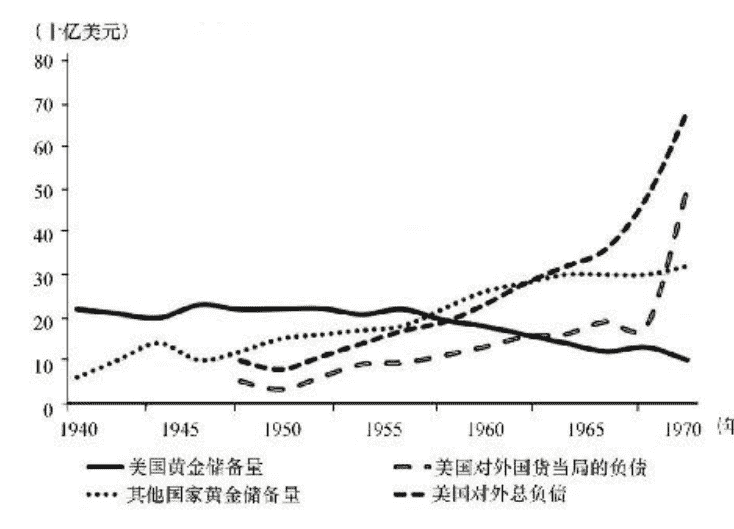

图2—3 美国对国外负债情况及黄金储备情况

资料来源: Gold Commission Report,Washington,D.C.: US Congress,March 1982;1972 Supplement to International Financial Statistics, 转自Michael D.Bordo,Robert N.McCaule, Triffin: Dilemma or Myth?,Washington,D.C.National Bureau of Economic Research,2018,p.4.

特里芬的预言很快得到了响应。随着欧洲和日本制造业的复苏，美国国际收支状况逐渐恶化，美国的国外货币债务和对国外货币当局的负债先后超过了黄金储备。人们担心，如果美国的美元数量进一步增加并导致黄金的兑换性，美国政府就可能采取关闭黄金窗口，或者允许美元黄金贬值的措施，以避免黄金储备流失殆尽，而哪一种选择将引发巨大的震荡。在这种恐慌和情绪的影响，20世纪60年代的国际货币市场上先后出现了两次货币危机，极大影响了国际社会对美元的信心。

1960年10月，第一次美元危机。伦敦黄金市场上的黄金价格一度涨到41.5美元/盎司，截至1961年初，美国的黄金储备减少到184亿美元，货币交易者在市场上大量抛售美元购入黄金。为了维护黄金价格和金融市场的稳定，美国和世界其他主要国家间展开磋商以稳定黄金价格。1961年10月，美国联合英、法、德等七个欧洲国家，共同拿出价值2.7亿美元的黄金储备，建立“金池”（gold pool）。11月，国际货币基金组织和十大代表在巴黎签署了总金额60亿美元的“借款总安排”协议，用于在国际货币基金组织缺乏短期流动性时，通过转贴贷的方式满足成员国对国际货币的需求。1962年3月，美国联储银行分别与14个西方国家的银行签署了总额为117.3亿美元的“货币互换协议”，以平抑外汇市场的波动。

然而，这些国际安排并没有从根本上解决“特里芬困境”，是在操作面上暂时稳定了黄金市场的价格，其更具灵活性，延缓了体系最终的崩溃。上述市场需求是一个深不见底的无底，上述安排此后遭到了许多政府的疑虑，被视为其他成员国对美国的国际收支问题引起，如此在1966年6月退出了该组织，该安排在1962年的第二次美元贬值后首次宣告失效。

美国利用美元霸权对欧洲进行投资激化了法国的不满。他们认为美国对欧洲的投资是一种危险的，因为这些资本是“美元打印机”创造的物。在一些双方都难以达成一致的方面，忽略和模糊处理成为最常用的手段，虽然保障了协议的达成，也是为了之后可能产生问题埋了隐患：贸易失衡调整规则模糊，虽然设想中制定了稀缺货币条款（Scarce-currency Clause）以促使盈余主动承担国际收支的责任，但这个条款并未真正落到实在。

最终，一个以怀特计划为蓝的布雷顿森林体系建立了以美元为核心的金银汇本位制。在会议结束后的1947年，英国便遭遇了一次严重的英镑危机，黄金和美元储备不断流，已完全无力维持自己的国际地位。美元替代英镑被视为黄金的实体化，国际货币霸权从英国转移到了美国。

## 四 摆脱黄金锁链的美元霸权

1959年，比利时籍经济学家、鲁塞尔大学教授伯特·特里芬（Robert Triffin）在美元国际会议的一次演讲中指出了布雷顿森林体系的内在悖论：各国要获得并调节美元以国际收支波动，必须以美国国际收支顺差为前提；但如果美国的国际收支持续恶化导致黄金不断外流，就会削弱国际对美元市值的信心，动摇金汇本位制的基础。

美元国际信用能力与世界对美元信心之间的根本矛盾被称为“特里芬难题”（Triffin dilemma）。美元金汇本位制的关键在于维持美元和黄金的价格可互换性。在美国经济健康运行期间，其他国家相信美元与黄金具有同等价值并愿意持有，这一体系就可以维持；一旦美国经济面临困境，如同陷入危机的银行，世界范围内的储户们就会争相手中美元换成黄金以避免储蓄损失，从而引发“挤兑”效应，最终导致该体系走向崩溃。

# (一亿美元)

图2—3 美国对国外负债情况及黄金储备情况（注：此处原文为图2—3 美国对国外负债情况及黄金储备情况）资料来源: Gold Commission Report,Washington,D.C.: US Congress,March 1982;1972 Supplement to International Financial Statistics, 转自Michael D.Bordo,Robert N.McCaule, Triffin: Dilemma or Myth?,Washington,D.C.National Bureau of Economic Research,2018,p.4.

特里芬的预言很快得到了响应。随着欧洲和日本制造业的复苏，美国国际收支状况逐渐恶化，美国的国外货币债务和对国外货币当局的负债先后超过了黄金储备。人们担心，如果美国的美元数量进一步增加并导致黄金的兑换性，美国政府就可能采取关闭黄金窗口，或者允许美元黄金贬值的措施，以避免黄金储备流失殆尽，而哪一种选择将引发巨大的震荡。在这种恐慌和情绪的影响，20世纪60年代的国际货币市场上先后出现了两次货币危机，极大影响了国际社会对美元的信心。

1960年10月，第一次美元危机。伦敦黄金市场上的黄金价格一度涨到41.5美元/盎司，截至1961年初，美国的黄金储备减少到184亿美元，货币交易者在市场上大量抛售美元购入黄金。为了维护黄金价格和金融市场的稳定，美国和世界其他主要国家间展开磋商以稳定黄金价格。1961年10月，美国联合英、法、德等七个欧洲国家，共同拿出价值2.7亿美元的黄金储备，建立“金池”（gold pool）。11月，国际货币基金组织和十大代表在巴黎签署了总金额60亿美元的“借款总安排”协议，用于在国际货币基金组织缺乏短期流动性时，通过转贴贷的方式满足成员国对国际货币的需求。1962年3月，美国联储银行分别与14个西方国家的银行签署了总额为117.3亿美元的“货币互换协议”，以平抑外汇市场的波动。

然而，这些国际安排并没有从根本上解决“特里芬困境”，是在操作面上暂时稳定了黄金市场的价格，其更具灵活性，延缓了体系最终的崩溃。上述市场需求是一个深不见底的无底，上述安排此后遭到了许多政府的疑虑，被视为其他成员国对美国的国际问题。

美国利用美元霸权对欧洲进行投资激化了法国的不满。他们认为美国对欧洲的投资是一种危险的，因为这些资本是“美元打印机”创造的物。在一些双方都难以达成一致的方面，忽略和模糊处理成为最常用的手段，虽然保障了协议的达成，也是为了之后可能产生问题埋了隐患：贸易失衡调整规则模糊，虽然设想中制定了稀缺货币条款（Scarce-currency Clause）以促使盈余主动承担国际收支的责任，但这个条款并未真正落到实在。

最终，一个以怀特计划为蓝的布雷顿森林体系建立了以美元为核心的金银汇本位制。在会议结束后的1947年，英国便遭遇了一次严重的英镑危机，黄金和美元储备不断流，已完全无力维持自己的国际地位。美元替代英镑被视为黄金的实体化，国际货币霸权从英国转移到了美国。

## 四 摆脱黄金锁链的美元霸权

1959年，比利时籍经济学家、鲁塞尔大学教授伯特·特里芬（Robert Triffin）在美元国际会议的一次演讲中指出了布雷顿森林体系的内在悖论：各国要获得并调节美元以国际收支波动，必须以美国国际收支顺差为前提；但如果美国的国际收支持续恶化导致黄金不断外流，就会削弱国际对美元市值的信心，动摇金汇本位制的基础。

美元国际信用能力与世界对美元信心之间的根本矛盾被称为“特里芬难题”（Triffin dilemma）。美元金汇本位制的关键在于维持美元和黄金的价格可互换性。在美国经济健康运行期间，其他国家相信美元与黄金具有同等价值并愿意持有，这一体系就可以维持；一旦美国经济面临困境，如同陷入危机的银行，世界范围内的储户们就会争相手中美元换成黄金以避免储蓄损失，从而引发“挤兑”效应，最终导致该体系走向崩溃。

# (一亿美元)

图2—3 美国对国外负债情况及黄金储备情况。资料来源: Gold Commission Report,Washington,D.C.: US Congress,March 1982;1972 Supplement to International Financial Statistics, 转自Michael D.Bordo,Robert N.McCaule, Triffin: Dilemma or Myth?,Washington,D.C.National Bureau of Economic Research,2018,p.4.

特里芬的预言很快得到了响应。随着欧洲和日本制造业的复苏，美国国际收支状况逐渐恶化，美国的国外货币债务和对国外货币当局的负债先后超过了黄金储备。人们担心，如果美国的美元数量进一步增加并导致黄金的兑换性，美国政府就可能采取关闭黄金窗口，或者允许美元黄金贬值的措施，以避免黄金储备流失殆尽，而哪一种选择将引发巨大的震荡。在这种恐慌和情绪的影响，20世纪60年代的国际货币市场上先后出现了两次货币危机，极大影响了国际社会对美元的信心。

1960年10月，第一次美元危机。伦敦黄金市场上的黄金价格一度涨到41.5美元/盎司，截至1961年初，美国的黄金储备减少到184亿美元，货币交易者在市场上大量抛售美元购入黄金。为了维护黄金价格和金融市场的稳定，美国和世界其他主要国家间展开磋商以稳定黄金价格。1961年10月，美国联合英、法、德等七个欧洲国家，共同拿出价值2.7亿美元的黄金储备，建立“金池”（gold pool）。11月，国际货币基金组织和十大代表在巴黎签署了总金额60亿美元的“借款总安排”协议，用于在国际货币基金组织缺乏短期流动性时，通过转贴贷的方式满足成员国对国际货币的需求。1962年3月，美国联储银行分别与14个西方国家的银行签署了总额为117.3亿美元的“货币互换协议”，以平抑外汇市场的波动。

然而，这些国际安排并没有从根本上解决“特里芬困境”，是在操作面上暂时稳定了黄金市场的价格，其更具灵活性，延缓了体系最终的崩溃。上述市场需求是一个深不见底的无底……

（此处略）……国际事务应该由欧洲自己决定，1965年2月4日，美国总统约翰逊在纽约举行会议，公开指出布雷森林体系已经结束，呼吁回归金本位。从1965年至1966年末，法国黄金储备增加了15亿美元，其中大部分来自美国。法国和日本是美国贸易顺差最大的国家。

1968年3月，第二次美元危机爆发，黄金价格一度飙升至44美元/盎司。伦敦黄金市场上，美国大量抛售美元，未能挽回局面。各国央行召开紧急会议，希望推出新的黄金“双轨制”，即在私人市场中，黄金价格由市场决定，官方层面不再干预，黄金与美元脱钩。

1971年，布雷森林体系崩溃，美元带领全球货币集体脱离金属本位。到了20世纪80年代计算机网络形成后，货币越来越数字化了，越来越成为一种记账货币。货币甚至脱离了纸币符号，变成一个与银行数据网络联结在一起的银行和储蓄账户中的纯电脑数字，货币的本质由此越来越清晰地呈现在世人面前。如今很少有人再把货币作为一种商品等价的一种特殊商品，世界上的货币越来越完全受控于中央银行的“管理”。货币与实际商品之间的同一联系也被抛弃了。如今我们生活的“纯抽象”记账单位的世界中，每个记账单位的价值完全取决于对其负责的中央银行的相应政策以及人们对它的信心。德国著名社会学家美斯尔所说的“货币的即为货币的货币”具有质的深刻洞察。

货币是不交换的商品，它是由三个基本要素所构成的一种社会运作体系和公共产品：首先是由法律定义的一种抽象价值单位；其次是每一个成员相互交互时记录信用或债务余额的记账体系；最后则是债权人将特定债权转移到第三方的标准化特征（token）。

把货币的本质看作可以转换的或可以信任的，这种深层次的理解尽量在最近三十年成为主流认知，并在政治经济学的思想史上可以追溯到17世纪。英国经济学家里巴本（Nicolas Barbon）提出了货币名目（nominal theory of money）；此后的苏格兰经济学家麦克劳德（Henry Dunning MacLeod）、英国经济学家白治（Walter Bagehout）、德国经济学家纳斯（Georg Friedrich）、以及著名经济学家韦夫·彼斯特（Joseph Schumpeter）等人的著作中，都传承了这种观念，并衍生出货币本质的理论。

## 五 货币本质

在金、银、铜、镍等金属铸货币的时代，政治经济学家普遍把货币视为具有一般等价的一种特殊商品。法国经济学家萨伊（Jean-Baptiste Say）也指出：“货币，或有人称为铸币（specie），是一种商品，其价值是由相同法则决定的，和其他商品一样。”马克思也认为，货币天生不是金银，天生是货币。传统经济学不仅影响了后来的中央计划经济国家的马克思主义政治经济学，也影响了西方经济学的主流理论。多数经济学家认为货币是价值尺度和流通手段的统一，并认为具有三种或者四种功能：价值尺度、流通手段、储值功能。现代社会，经济越来越货币化，货币也越来越虚拟化。尤其是在1971年布雷森林体系崩溃后，美元带领全球货币集体脱离金属本位。

## 政治经济学视角下的美元霸权

## 一 货币化及其幂律

作为中国人民大学的研究员，笔者自1996年起多次参与了集体创作的《人民币国际化报告》。为了观察包括人民币在内的主要货币占全球市场份额的变迁，我们研究了一种货币化指数，其中涵盖了支付、交易和储存等功能。

表2—2全球主要货币国际化指数（总量为100%）

| 货币 | 2010 | 2011 | 2012 | 2013 | 2014 | 2015 | 2016 | 平均值 |
| :--- | :--- | :--- | :--- | :--- | :--- | :--- | :--- | :--- |
| 美元 | 33.37 | 32.41 | 32.34 | 33.41 | 32.23 | 34.02 | 34.85 | 33.63 |
| 欧元 | 25.60 | 26.79 | 23.60 | 33.02 | 32.02 | 33.70 | 25.57 | 29.90 |
| 日元 | 4.26 | 4.10 | 3.98 | 4.24 | 4.94 | 5.50 | 3.92 | 4.44 |
| 人民币 | 4.31 | 4.48 | 4.46 | 3.99 | 3.82 | 4.04 | 4.73 | 4.31 |
| 其他 | 23 | 4 | 87 | 19.69 | 24.47 | 21. 6 | 122 | 79 | |

资料来源：中国人民大学《人民币国际化报告》2012—2018年版。从表2—2可以看出，货币份额的分布事实上存在明显的马太效应。笔者用“幂律”来描述这种分布特点：第一大货币占据全球份额54%，而第二大货币占据剩余份额的（1—54）×54%=25%，如果把英镑、日元、人民币等货币视为第三层次，则第三层货币的总份额也剩余54%。

如此奇妙而规律性的数据并非偶然，而是一种广泛存在于人类社会中的自然现象，类似于费斯法则，在我们的生活中无处不在。在充分竞争的市场中，由于没有政府的有效干预，市场份额主要体现为优胜劣汰的自然结果；正如很多人认为主要是规模效应和网络效应导致了这种不平衡（balance）但均衡（equilibrium）的分布现象。如此而言，这是一个具有领先产业，占据了市场的较大份额，规模和力使得就可以比更优秀的团队和对上游供应商更强的谈判能力，其销售体系和售后服务的布局已经完备，每一位客户的边界成本比规模小的竞争者更低，就会出现更强弱者的局面。同样，在国际领域，人们对货币的选择具有网络性和外部性。选择美元债券作为储值手段，本身就能增强美元债券的流动性，反过来使得美元债对其他国家的吸引力增大。以中国为例，中国是美元低风险资产最大的外国持有者，在贸易中每年获得数千亿美元的差，但是被美国以安全为名禁止购买战略资产和军用技术产品。为什么中国还要持有这么多美元债券？答案是世界上其他国家接受美元，因此中国在必要时可以使用这些美元购买其他地方的资产和商品，比如石油和天然气。对于石油和天然气的出口，他们进口的绝大多数来自于中国，但是中国接受美元，且美元债券的流动性和便利性优于人民币，所以可以继续能源出口放在美元债券中。如此，中国和原油出口国一起“建构”对美元的需求和依赖，并被相互锁定在这种依赖之中。对比，如果货币国际指数同类经济体的GDP占比列做一个对比，我们会发现货币份额（虚拟经济）与实体经济之间存在严重的隔离（见表2—3）。其他偏差值与贸易逆差的全球占比之间存在明显的对应关系，但并非完全反映，因为货币输出除了通过贸易输出之外，还存在资本项目。欧洲的货币输出主要通过资本项目，所以虽然是货币输出但是贸易逆差仍然是悬的。

| 2—3 年全球经济体规模与货币逆差的偏离 |
| 国家/地区 | 货币国际占比（%） | 绝对值 | 货币逆差（十亿美元） | 全球占比（%） |
| :--- | :--- | :--- | :--- | :--- |
| 美国与英国 | 27.36 | 58.09 | +30.83 | -54.57 (53.6) |
| 欧元 | 15.59 | 21.19 | +9.60 | -57.41 |
| 人民币 | 26.51 | 6.51 | -20.00 | 54.53 |
| 其他 | 23 | 48.5 | 19.69 | 24.47 | 21.6 | 12.79 |

（注：由于OCR文本存在大量乱码和重复，以上已根据语义进行逻辑修复）

了美国私人部门的额外投资和消费，从而放大了万亿美元的GDP。民主主义政治经济学理论的某部分聚焦于可贸易和不可贸易以及与之相关：这数千亿美元的国际收益，其实应该用美国的可贸易部门尤其是美国的进口规模比较。以2017年为例，美国的贸易逆差是5660美元，进口2.9万亿美元商品和服务，相当于美国有近20%的GDP源于广义汇税。从这个跨越步进延伸，由于我们有许多年的数据，我们甚至可以估算出美元由于国际储备税而被抬高的水平。总之，美元的全球储备地位使得其国内居民实际享到的财富远超过了他们自己所创造的。

美元为美国带来的第二种好处则是为了我们提供了对全球经济增长节奏的控制和调节能力。有了这种主导权，即便仍然必须面对市场力量的汇聚周期和不确定性，但对于体系中的所有其他国家，美国政府可以从能够应对和利用全球市场流量的波动循环。即便是美国自身治理中出现的问题，借助美元汇权也可以让全世界都来承担其后果。1987年的股灾、2001年的互联网泡沫破灭以及2007年的贷款危机及其衍生的国际金融危机，美国的资本并没有像1929年或其他时期那样遭受实质性的损害，而是通过持续衰减和非货币政策使得损失在程度上转移给了美国储备的持有者。典型的是2008年雷曼破产初，由于流动性的突然消失和衍生品的暴跌，包括高盛在内的其他许多金融机构事实上已经积累赤字，但是美联储通过快速扩张资产负债表买入这些“资产”，确保这些冒险的金融机构能够度过寒冬。此时的受损者包括这样的美国国债持有者，包括全球外部地区，前者的购买遭受了实质性抛售，而后者则因为流动性泛滥而面临了高通周期。

美元储备给美国带来的第三种好处是赋予美国政府巨大的权力杠杆，可以用很低的成本惩罚和制裁地缘政治对手。金融行业具有若干特殊性。其一，金融行业本身具有高杠杆和依靠信任体系的特征，一个金融机构假如面临制裁，毋怕仅仅是威慑，都会遭遇其他机构的挤扰而出现流动性风险，对每一家金融机构都极其忧扰遭遇法裁的麻烦。其二，金融业的信息几乎完全可追踪，资产也表现为易于冻结的现金和金融票据，因此掌握了SWIFT系统的美国可以很地予以冻结和惩罚，而政策执行成本低，且受损者的反制措施和逃避极其有限。自进入21世纪以来，美国的外交和安全政策难以离开霸权提供的便利。

美元霸权给美国带来的第四项优势，可能超越了许多人的设想：它使得美国难以被超越，尽管并非不可能。图2—4所示是以汇率口径计算，第二次大战后各个经济GDP与美国相比的相对大小。有的情况是：对于美国经济的规模，苏联在20世纪70年代早期达到峰值43%，然后开始下坡路。在1995年达到峰值73%之后，随着泡沫经济的破破灭。欧区由于人口规模更大而且是一个货币区而非主权国家，所以在占比上曾数次超越美国，但长期来看，与美国经济的规模的中位数是在75%以下。2018年中国经济规模达到了美国的66%左右，已经超越欧区成为第二大经济体，但在经贸、技术、人才等领域遭遇了英国的“祖制”。

第二次世界战后结束意味着美国、日本、欧盟的国家将很快超越美国，最近的的是预测中国的经济规模已经超越美国。这些预测观点也未被证明是错误的，对于中国的增长也没有意义，因为其背后的逻辑是短期的趋势性外，而忽视全球经济结构的作用。以美国为基础的世界经济体系存在易见的中间内外结构关系，其奇妙之处在于：这种结构本身会无形地挤压外围而增强中心。从战后七十年的经济史及其结构的中间，笔者提出一个宏大的猜想：体系的结构性因素会导致外围国家几乎不能在质量上超越中国，除非这个体系被人人为地打破和重构。

## 美国与经济规模之比（%)

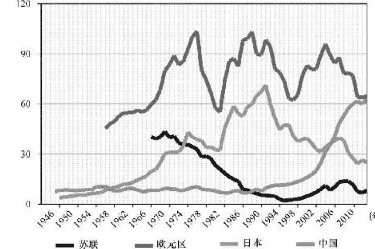

图2—4难以超越的美国经济

资料来源：世界银行数据库、国际基金货币组织数据库、联合国数据库及日本内阁公开数据。

近期在国内流行的一种说法是：美国对体系中其他大国家的增长容忍度约是60%，即美国增长达到美国自身规模的六成时，该国将被视为美国的挑战者和威胁，从而引发美国共和国上下的敌视和威胁。

笔者的理解是，美国难以被超越的特性是由全球经济结构决定的。货币市场经济中的实体活动存在完整的映射关系，货币信用的虚拟世界主宰着实体世界，而不是相反。美储不仅是美国的中央银行，而且是全球的中央银行，欧洲、日本和英国的央行则是其补充。整个世界依赖美元提供流动性，而这些流动性驱动着全球各地的经济活动。技术进步和创新的源头也是美国，只有体系中心的财富能够供养如此昂贵而高的大规模经济，也只有体系……（注：此处OCR文本存在大量重复和乱码，已根据语义进行去重整理，保留核心逻辑内容）

### 三 美元“霸权”的条件和代价

大量文献探讨了各国货币国际化水平的因素，概括起来，大约有六个方面：

1. **国际市场对其货币价值长期稳定的信心**：包括汇率稳定、通胀率、长期流动性以及货币供给。
2. **发行国在全球政治体系中的重要性**：经济规模、人口、政治和军事实力。
3. **金融市场的广度、深度和开放性**：金融交易是否不受限制、合成成本低、金融工具多样、交易程序透明可靠。
4. **各国政府的调控和需要对外币货币的选择**：市场干预和外币偿还交易成本最低的币种。
5. **国际货币的规模和网络效应以及由此形成的货币使用惯性**：根据“媒介货币”理论。
6. **发行国本身的偏好对货币国际化的影响**：决策者的态度和政策影响。

## 第三节 德国马克与日元：货币国际化的经验教训

上一节讨论了全球货币的结构以及美元霸权的内在机制。本节将探讨两个制造强国的货币国际化历程提供的经验教训，作为下一节人民币国际化的讨论提供参照。

日本和德国在各自的货币国际化过程中的处境有很大相似性。日德两国都是处于全球经济结构的中心圈层，融入了以美元为主的全球资本主义体系，借助制造业的比较优势实现了出口导向的经济增长，成为主要的贸易盈余国家；日元和德国马克是第二次世界大战后著名的强势货币，两者都经历了相对美元的大幅上涨，国内都曾令其货币国际化的需求；此外，两者都是第二次世界大战的战胜国，在各自地区发动的侵略性争夺给周边国家带来重重灾难，从历史规律的教训中避免了衰落。

但是如果从货币国际化的进程来比较，我们可以发现两者的命运差异迥异：德国马克的国际化毫无章，政府和央行从未推出任何政策计划，而是从20世纪60年代起阶阶上升，在全球货币体系中的地位仅优于美国，并最终进入欧元。而日元的国际化则是经历了一个突然而人为的过程，被赋予了厚望并获得突跃之后猛然衰落的过程。虽然日本经济规模远不如德国，并且为了推动日本国际化而不惜经济泡沫的代价，但是国际化水平并不如德国马克成功，因为即便德国马克进入欧元之前，德国的国际化水平明显高于马克。因此此学术和政策界公认，日元的国际化相比于德国基本上是失败的。

21世纪第二个十年的中国与德、两国的上述处境有不少相似之处：巨大的经济规模、制造业比较优势和多年的贸易盈余使得人民币市场国际化的必要与可能；中国已经从全球体系的外围结构第三层进入第二层，资本的净流入；人民币自2005年以来便进入了强势值周期；中国仍然是第二次世界大战的战胜国安理常理事国。

### 表2—4 德国马克与日元化的差异

| 差异类型 | 德国 | 日本 |
| :--- | :--- | :--- |
| 政治制度 | 行政改革、民主演进 | 政治稳定、维持一党制 |
| 宪法安排 | 宪法改革 | |
| 产业结构 | 大型的“彩虹”产业 | 劳动力密集型 |
| 政治 | 与美国合作、强调利益 | 长期以来与美国、政治优势、参与 |
| 货币政策 | 2002年实行欧元 | 1997年后退出欧元 |
| 制度国际化效果 | 成功 | 成功 |

### 表2—5 德国马克与日元化的因素

| 因素类型 | 德国 | 日本 |
| :--- | :--- | :--- |
| 制度国际化 | 成功 | 巨头 |

## 内政与金融体制论

第一类观点是从内政与金融制度的视角解释两者命运的差异，尤其是央行的独立性问题。出口导向型的工业国在贸易体系中累积越来越大的贸易盈余，最终面临两难：如果允许本币升值以保持收支大平衡，那么不利出口；而如果维持固定汇率，那么央行必须发行货币以吸收贸易盈余流入的外汇，结果是面临进口通胀。德国政府面对这种两难的时候，选择了汇率升值和贸易平衡之路，而不是积累额外通胀。1961年3月，在取得德国联邦银行同意的情况下，德国政府将德国马克的汇率提高了5%，美元对马克汇率从4.2:1升到4.0:1。这就是对国内物价上涨（输入通胀压力）的反应。1969年的春季开始，巨量外汇再次流入，为了避免过热通胀，德国马克在1969年10月再次升值9%，从4:1升到3.6:1。这一升值幅度完全弥补了德国价格和国外价格累积差异。1975年5月德国放宽了对欧元的汇率，在12月布雷顿森林体系崩溃的过程中，美元相对于其他货币大贬值，德国马克对美元升值13.6%，到3.25:1。

德国为什么更能够接受升值而不是通胀？原因是历史上的通胀经历带来了深层伤害，因此德国对通胀风险更为敏感；二是德国央行的独立性明显高于其他国家。对于德国央行而言，虽然不支持升值，但其首要职责是捍卫内部物价稳定，在此权衡各项政策的利弊之后，选择了升值。1957年《德国联邦银行法》第三条规定，联邦银行协调货币流通和经济的信贷供给，并以确保货币安全为目标。它也有义务支持联邦政府的一般经济政策，但前提是不会影响最重要的功能。对比其他国家，德国联邦银行通常被认为是拥有最政治独立性的中央银行之一（政治独立性是指不受政府干预执行银行路线的能力）。“估计没有任何国家发行银行像德国联邦银行那样致力于稳定价格作为最高目标。”

如如此的结果会导致德国通胀率在西方国家中最低：1970—2000年的十年里，美国、日本、英国的平均通胀率分别为5.2%、4.3%和7.8%，德国的平均通胀率仅为3.5%。这主要是德国联邦银行独立管理货币政策的贡献。

# 日元/美元 德国马马克/美元

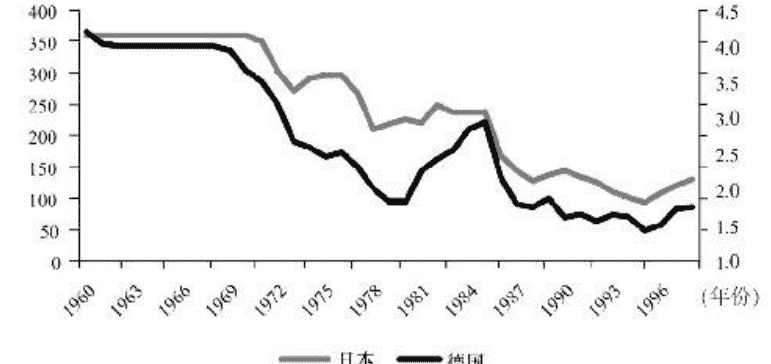

图2—5 德国马马克和日元美元的命名汇率曲线

资料来源：世界银行数据库。

20世纪70年代之前，日本从未形成过明确的日元国际化战略，主要表现为日本国内对日元升值存在深蒂固的恐惧。由于出口向型发展战略的成功，日本政府和企业界（由于财团体制，金融业从属于企业界）都坚定地认为日元升值是有害的。[561]日元美元汇率长期固定在1:360的水平，在日本国内形成了麦农金农（Ronald McKin）与大野健（Kenichi Ohno）所说的“日元升值会合论”，让日元失去了成为强势货币的机会，持续积累的贸易顺差和外汇储备挂扭了日本的经济结构，帮助了泡沫经济的出现。日本的独立性在西方工业中国中是比较弱的，它的汇率政策与利率政策很大程度上受到政府及其背后的财团的影响，这种传统一直延续至今。

日元长期贬值和拖延升值的后果非常惨，除了我国积累的巨量贸易顺差和外汇储备以及由此衍生的资产和商品价格持续上涨，还带来了严重的国际后果，即来自最大贸易逆差美国的经济外交压力。20世纪80年代，在欧美的联合压力下，日本签署广场协议，允许汇率大幅上涨以平衡日本之间的贸易逆差。短短两年内，日元美元汇率上涨了一倍，给贸易部门带来了巨大的冲击，应该对这种升值冲击的货币政策举措引发了更大的股票和地产泡沫，最终导致日本经济陷入后泡沫时代的泥潭。

对比日本汇率的曲线走势难看，从20世纪60年代初期布雷顿森林体系下的联系汇率尚未崩溃，德国马克欧元应对压力增大，在浮动汇率时代更是保持了强势，从而确保了日本经济未被扭曲，而且建立了良好的货币声誉。而日本政府和央行的决策由于受限于财阀和出口部门，是长期拒绝升值，坏了低位附加值的加工出口部门：1985年之后又开始升值，令制造业难以承受和消化其冲击。日本汇率政策这种箭前顾后的表现，是其选择立于国内和国际政治压力的表现。

## 二 实体经济质量决定因素

对于发行独立性与货币国际化之间的关系，一些学者提出了不同的意见，比如笔者的朋友北京赵越博士。他认为货币国际化不仅是一种金融现象，更是一个复杂的政治过程。简单的表面漂亮，宽松政策不会自动导致货币的国际化；甚至出口的增长与国力的提升也不能自动导致一国家的货币更受欢迎。由于进出口企业和金融机构这些微观体就是建设货币国际化宏大的“工程”，所以必须深入货币国际化的规范基础，才能能够理解德国成功完成国际化的经验和失败的教训。[57]

在20世纪90年代中期所做的统计，当时德国就已经有了500家“隐形冠军”。它们的产品在全球市场的份额超过了50%，有些达到了90%以上。以“隐形冠军”为代表的德国中小企业以价格和数量取胜，其产品往往具有高度专业化、高质量和技术创新的特点，不容易被模仿或被替代。2/3的“隐形冠军”企业产品居于其细分领域的范围内全球市场领导地位，它们的研发投入普遍高于著名企业，每千员拥有的专利数量是大企业的5倍，但其研发费在每项专利上的成本仅为大企业的1/5。“隐形冠军”现象并非只是德国特有，但是它们在德国的集中度特别高，截至2013年全球总共有2016家“隐形冠军”，其中超过半数是德国企业。[58]由于这些企业在各个细分领域拥有很强的定价权和竞争力，在出口交易中，它们将汇率风险转移给国外对手，并要求以美元作为计价结算的货币。正是这些强势中小企业的国际化运作，帮助德国以强大的工业竞争力为核心打造了一个全球产业链和相关要素的交易与分配网络，在该交易网络中马克是主导的支付结算货币。

比较而言，日本的工业化出现了明显的经济现象，一端是少数拥有金融市场和政治影响力的大财，而另一端是大量美国终端市场、美国品牌及其供应链为基础的小企业从事利润微薄的代生产。在国际市场中领先掌握了从资源采集到产品分包到最终产品销售的生产链，谁就有了对利润和风险的分配权力，计价结算货币的决定就是其中的一部分。在美贸易关系上，掌握供应链话语的是美国企业而不是日本企业。在20世纪70—80年代日本企业通过直接投资在日本开展了大量的代生产（OEM），而中国企业则掌握销售品牌、销售渠道而在日本的企业负责加工生产。

这种二元经济现象不仅在日本的发展过程中出现，而且通过东亚产业链的延伸，韩国、中国大陆、中国台湾乃至今天的越南都存在类似的现象，即外部资本和外部市场带动的加工贸易带来依附型发展，导致出口规模、利润增长缺乏定价权和结算货币的选择权。

表2—5各国进出口产品的本土计价比例%：

| 类别 | 1980年初 | 1980年末 | 1992年 | 1996年初 | 1996年 | 1997年初 |
| :--- | :--- | :--- | :--- | :--- | :--- | :--- |
| 德国 | 97.0 | 85.0 | 98.0 | 88.0 | | |
| 德国 | 82.3 | 42.8 | 76.4 | 33.3 | | |
| 日本 | 29.1 | 2.4 | 35.7 | 22.5 | | |

资料来源：George Tavas, "The International Use of Dollar: An Optimum Perspective", The World Economy, Vol.20, Issue 6, pp.73-75。转自赵越《竞争力、资本账户与国际化——德国马克如何比日元》、《世界经济》2013年。

在20世纪80年代初的自由化浪潮中，许多企业获得了自由使用外汇，通过海外直接投资提升自己在全球产业链中的位置，日本政府积极鼓励国内和海外增长已经到了泡沫经济之后，日本“战败”后，签署广场协议，允许汇率大幅上涨。这种升值冲击措引发了更大的股票和地产泡沫，最终导致日本经济陷入后泡沫时代的泥潭。如果说德国马克是“工业型的国际化”，那么日本就走了一条“金融型的国际化”，通过开放资本控制，日本政府积极输出海外资金，货币国际化才是大国选择的途径。

## 三 国际政治决定论

如果说前两种观点侧重金融和实体经济，那么第三类观点则维持政治因素的根本作用，这也是笔者从政治学尺度视角。正如笔者在《大国货币》的相关章节所言，“只有大国才有大的货币”。货币的政治化其实是在特定区域内建立政治，发行者和国际接受者之间建立了一种依赖和共生的关系，前者相当于保险公司和客户：前者为后者承担风险，后者持续费用。马克和日本在国际化道路上的选择，反映的主要不是经济差异而更多是政治差异。第二次世界大战结束后七十年，日本并没有实现完全独立；其对外外交在关键问题上多少地受到美国的影响：其宪法由美军起草并赋予，日本仍然享有不受法的权利。日本的外交同样是由于，也许源于其岛国性，日本的对外行为中表现出鲜明的小国特征，不愿意承担责任。国际政治体系中中国和美国的区别主要不在人口或规模，而是在其体系中的模式和角色定位：大国是游戏规则、价格和历史趋势的设定者与创造者，而小国则是接受者。日本对外外交的行为在轨迹中表现为投机性、依赖型以及不愿意责任。多个案例可以支持这一观点。前述日本长期拒绝独立的背后，是日本在对外经济政策上“搭美国车”的惯性选择，远未做好成为国际体系领导者的思想准备。这与日本在安全和政治上紧跟美国步调的做法一辙，日本难以有效摆脱对美国霸权和美国市场的依赖。

日本在战后也曾实施过“谢美外交”，但是其经济外交充满了自利，这些援助由于附加条件多或质量较低，而且主要服务于推动自身的经济政策，对于改善日本的经济形势并没有发挥实质性影响。1966年日本主导建立了亚洲银行，但在竞选时被东京输给了马尼拉，这表明东南亚国家对日本经济外交是有戒心的。20世纪80年代初期，日本有意意识到美国对其汇率升值的压力越来越大，大幅贬值不可避免。在此背景下，日本主动向菲律宾等亚洲和东南亚国家提供大无息或低息贷款，将其包装作为“感谢”而做的发展援助。但在80年代后期，日元美元大幅贬值，在两年内迅速贬值，年内从从60:1兑到100:1。直到此时，接受这些“优惠”的国家再次吃了日本的哑巴亏。菲律宾等东南亚国家遭遇债务纠纷，要求与日本重新评审贷款方式。事后看来，所谓优惠贷款其实是日本政府为了对付即将到来的大贬值而做的策略调整。也是为了这些手段，日本参加广场协议的代表主动向菲律宾表示，日本可以实现贬值升，而菲律宾的预期贬值为20%而已。

日本历史上一贯的特点是战术高明而策略缺失，在上述日元贷款问题上如此：通过此策略计划固然转移了部分贬值代价，但伤害了地区对手，损失了邻国的信任，最终导致他们在日元贷款到期。

1997年金融危机，日本作为亚洲第一经济体，没有在区域内合作，没有承担责任，导致日本国际化进程陷入溃败。日本的国际化在很大程度上由于缺乏区域性的锁定和地区伙伴的支持，货币政策并未照顾其国内利益。德国也会对美国的压力低头，但是通过拉住法国并驱动欧元一体化的法德核心，德国获得了政治上的自主性和权威性。德国的公开文件中提到过“马克国际化”的相关表述，但从未积极推动“马克国际化”，学术界也有许多德国马克国际化的讨论和研究。德国政治经济精英是否曾经获得“国际储备货币发行权”作为其国家利益的目标尚未。但是在“脱离欧洲风向”和“与欧洲一体化”这些对所有欧盟成员国而言都提倡被视为“政治正确”的集体行动，欧洲货币一体化的相关政策设计中让马克处于优势地位。德国马克国际化的一个阶段是借助欧元区域的合力，推动其成为区域内关键货币，从而在国际货币市场产生更大的影响，最终实现。欧洲货币体系（EMS）成立后，世界上有61国家的货币锚住美元，却没有货币选择住马克。1979年3月欧洲货币体系成立，并产生了用于共体内部计算的货币单位——ECU，由于马克在欧洲货币体系中占很大比重，马克的波动往往引起ECU的波动，在此之后欧洲货币体系的实际操作中，许多国将马克作为重要的干预货币，马克成为欧洲共同体事实上的“名义锚”。马克在欧洲区域合作逐步扩大其国际金融体系中的地位，随着欧洲货币单位地位的提高，马克的国际货币地位在欧洲和世界范围内也随之提升，顺利完成了从区域货币到国际货币的转变。这让马克的国际化获得了超越市场竞争之外的政治力量的支持，让欧洲政府储备马克成为必不可少的政治行为。

## 四 货币国际化的次序和时间窗口

许多研究者指出，日元和德国国际化的路径存在差异。德国从20世纪60年代就已经表现了初步国际化，随后在国际化进程中获得优势，到1980年代德国马克成为国际主流货币，完全开放资本项目。可以说，德国是先实现了国际化，然后开放资本项目。而日本的货币国际化则是在20世纪80年代中期突然爆发，然而由于存在绝对惯性，除非原有的体制机制，否则难以维持地位。1997年金融危机后，日本意识到了其中的机遇，但由于此前错误的尝试带来的后果，日本无力国际化。开放与改革之间的顺序问题：只有内部机制顺之后，才能在开放市场中获得优势。任何强制改革都是痛苦而艰难的。来自外部压力下，日本国内金融改革尚未展开时，就急切开放了资本项目，包括金融市场化、债券市场开放、废弃银行体制等。在宣布日元国际化的之前，日本采取的主要改革措施上，如1983年和1984年的日元汇率管制等，谓“以开放改革”。在微观层面，日本通过金融渠道输出资金。在继续实施金融管制、资本项目却完全开放的背景下，离岸市场和岸上市场之间出现了快速增长的资本流动：富余资金流到离岸市场，然后又从离岸市场回岸上市场。“自己玩游戏”中，主角是借助离岸中心实施套利的日本银行行业。在日本“贷款的游戏”中，包括伦敦和香港的离岸市场构成了资金进出的重要通道。在离岸市场上，香港是一个重要的组成部分。按照剑博士的研究，香港对日本银行机构的负债与对日本的非银行机构的债权高度协同，这反映了日元资金从日本银行业流到香港，随后再次回到日本的企业部门。直到亚洲危机爆发，通过香港的日元贷款游戏获息，“贷款游戏”导致的资金回到国内重建的股票市场和地产市场，成为推动1990年泡沫危机和长期经济萧条的首要原因；在面临1990年泡沫危机和1997年亚洲金融机的双重击下，香港离岸市场的发展以及很大程度上基于此的日元国际化陷入失败。

作为对比，德国马克在国际化过程中并没有立刻限制资本项目的开放。德国经历了“限制—放松—再限制—再放松”的多轮反复，特别是针对短期投资资本的流入，没有动用特别法定准备金率和现金存款要求来加强政策力度。当间接资本管理效果并不明显时，德国采取了更严格的直接资本管制措施，比如1973年2月，将非居民购买德国固定收益证券必须预先获批范围扩大到所有类型信用，以及购买股票、互助基金和5万以上的借款。到了20世纪80年代，德国马克已经成为国际主流货币的地位，其汇率也在十年内完成了从固定汇率到浮动汇率的渐进转变，德国完全开放资本项目。

表2—6日元和德国马克在全球储蓄和贸易计中的份额（1970—2010年）份额%：

| 类别 | 1970 | 1980 | 1985 | 1990 | 1995 | 2000 | 2005 | 2010 |
| :--- | :--- | :--- | :--- | :--- | :--- | :--- | :--- | :--- |
| 入口、国际化 | 16 | 12.5 | 15.4 | 12.2 | 19.0 | 25.0 | |
| 出口、国际汇 | 3.3 | 6.4 | 7.2 | 3.3 | 70.5 | 61.0 | 28.0 |
| 国内贸易与外汇 | 18.8 | 22.9 | 35.4 | 38.8 | 75.0 | 99.4 | 90.0 | |

注：2000年、2006年数据约为。

资料来源：吴文《The International Use of Dollar: An Optimum Perspective", The World Economy, Vol.20, Issue 6, pp.73-75。转自赵越《竞争力、资本账户与国际化——德国马克如何比日元、《世界经济》2013年。

里巴西和腾讯这样的全球领先企业的存在主要体现，将为人民币国际化提供坚实的微观基础。在中国诸如汽车和电动车、飞机、芯片等全球主流（可贸易）产业自主竞争力的提升，不仅会带来人民币汇率的坚挺，而且会带来人民币国际化水平的有效提升。

三是人民币国际化意味着与不同国家的利益共生关系以及由此带来的国际责任。人无无信，国家在国际社会共同体的信用和形象同样如此。和谐和稳定的区域关系对于一货币的国际化非常重要。而且我们要有足够大的思想和行为，国家的权力越大责任越大，规模优势赋予我们力量的优势，但是如何使用这种力量将决定国家的最终归宿。如果使用这种力量和规模优势去欺败或损害国利益，那么必然会失去信念导致毁于国际社会，除非彻底走正强大道路，否则成为领袖国家；如果使用这种力量和规模优势去团结和帮助周边国家，就能形成与后者的共生关系，从而进一步放大自身的力量。习近平总书记提到的人类命运共同体概念，体现的是后者的路径。未来通过基础设施和产业供应链的延伸，进一步强化周边国家共同的。

四是应当注意政策的轻重缓次次序，以改革为主为辅、先改革开放。日本的弱政治家要扮演角色，以开放促进效率，借助外部力量来推动内部政策调整，但并不是一个最优的解决方案。中国应当向德国学习，保持更多的政策自主性，积极主动地设自己在全球经济金融体系中的定位，并以此指导自己的政策调整和制度改革，而不是由利益集团的游说和官僚系统的因循和惯性来主政策。

## 第四节 人民币国际化的政治经济

### 人民币国际化的进展

如同20世纪60年代末的经济与货币危机刺激了德国对马克克的政策调整，2008年金融危机刺激了中国政府和社会对资本货币问题的认识改变。

一夜之间，中国的大量企业和家庭遭遇了巨大外来金融冲击，而这种风险之源来自美国之前的利率政策和出口房地产金融的衍生泡沫。应对危机，美国与此后的欧洲和日本都采取了量化宽松等非常规政策（详见本书第三章），由此形成的低利率乃至无利率的政策，极大稀释了中国十年贸易和出口创积累的外汇储备的相对价值。正是在这个背景下，中国政策圈和知识界开始在货币问题上意识到全球货币体系改革，人民币必须实现某种程度的国际化才能跳出无国际陷阱。2009年，央行行长周云同志发表在人民币银行网站上的著名译文，吹响了上述思想潮起和政策转型的号。

从量的角度来看，人民币国际化在过去的十年间从无到有，经历了快速的成长与波动。笔者所参与的人民币国际化报告撰写团队，多年研究和发布人民币国际化指数（Renminbi Internationalization Index, RII），该指数以季节为主，综合人民币在国际贸易会计、金融交易结算和国际储备功能等不同职能的全球占比，客观、动态、科学描述人民币国际化程度。从该指数截至本书写作为止的数据如图2—6，其中全球所有货币国际化指数的总值为100，和RII指数为人民币在多功能上全球市场占比的加权平均值。

## (人民币国际化)

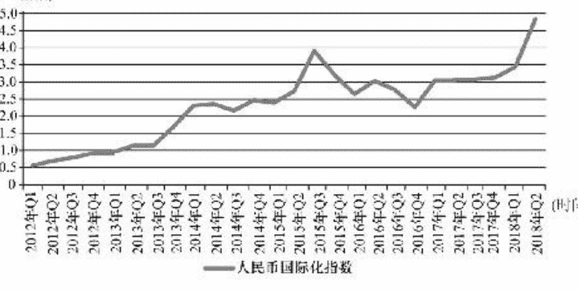

图2—6人民币国际化指数（2010—2018年）

资料来源：参阅中国人民大学国际货币研究所人民币国际化报告系列。

2015年夏季之后，人民币国际化指数出现了明显的回撤，到2016年第四季度跃至2.26水平。与之伴随的是2015年夏季之后持续下跌的中国股市和愈演愈烈的看空人民币汇率的资本外流。基于各种错误理论上的对人民币汇率的一致悲观预期形成了金融市场中常见的“自我实现的预言”，对其人民币贸易和资本项目下人民币的结算规模产生了逆向冲击。此后，为了避免市场上的“羊群效应”和恐慌措施，防御资金加息周期带来的国际金融和货币风险，中国政府在金融和货币领域采取了一些审慎监管政策，严格执行了跨境金融交易的真实性要求和合规审查。在此背景下，离岸金融市场的人民币存量以及对外人民币直接投资等受到影响。当然，人民币汇率国际化完全不是坏事，比如挤掉了人民币升值带来的投机利，让进口与出口的人民币在汇率下跌下实现了平衡。

2017年年初，人民币兑美元汇率出现了明显的走强；同年第二季度人民币兑篮子资产的指数出现了反弹，表明市场对人民币汇率的信心开始恢复。在此背景下，人民币国际化指数持续反弹，2018年第二季度甚至创出了4.843高于同期英镑和日元国际化水平的新高。此后，由于中美贸易摩擦对冲的影响，人民币指数和国际化指数都出现了一定程度的主动回落。但这一次国内外市场上没有出现类似2016年的恐慌和贬预期，人民币国际化回落远不如2016年的跌底深。通过2015年至今的波动，我们很难看出人民币国际化的进程与汇率预期之间存在明显的正相关。人民币国际化的进程离不开一系列经济与货币领域的配套，主要包括：

- 2009年7月起启动跨境贸易结算的试点并逐步开放；
- 2008年起同步数十个新兴经济体开展了万亿规模的人民币互换；
- 改革人民币汇率形成机制，更加市场化，波动性明显增强；
- 资本账户渐进开放和宏观审慎框架的建立；
- 人民币直接报价的扩展；
- 前海和上海自贸区为首的自贸区的设立和改革；
- RII的试点与扩容；
- 存款制度的建立；
- 人民币结算系统（CIPS）一期的建设；
- “一带一路”倡议的提出和实施；
- 开放大宗商品交易所，尤其是黄金期货，形成人民币—黄金三角锚；
- 沪、深、港允许人民币在可控范围内使用；
- 通过成功的经济交流，将人民币纳入国际货币基金（IMF）特别提权篮子；
- 推出人民币篮子指数，涵盖对美元的唯一指标；
- 国际金融机构市场的准入；
- 设立亚洲开发银行、世界银行等多个金融平台；
- 南疆、新疆、霍等地等地人民币使用试点；
- 推进境内人民币市场的整合与开放；
- 整理和规范相关法律和会计准则。

此外，还有若干官方主体的行动也有重大影响，包括微信和支付宝等第三方支付系统在华经济中的扩张，路通摩根斯坦利等金融机构在编制各种新兴市场股票并逐步增加其权重，客观上也帮助了人民币国际化。上述举措，有的战略层次，比如“一带一路”和亚投，它们的目的并非推进人民币国际化，但客观上有后者的进展；更多的是基础设施建设和配套措施，比如人民币结算系统的建设等。

## 二 人民币国际化的争论

人民币国际化具有明显的财富再分配功能，从历史来看，有德国成功的案例，又有日本失败的教训，而且学界和政策界对其得失和策略路径存在分歧。随着人民币国际化的进程，在国内开展了持续的理论与政策争论。最重要的争论发生在主管部门和部分经济学家之间。以时任央行长周小川同志认同人民币国际化的战略方向，其下一批学者型干部从各种角度论证和设计相关的改革，笔者认为国际货币研究所为这些学者提供了部分智力支持。但是以中国科学院社会学院和北京大学林毅教授为代表的经济学家对这种政策意图和配套改革的必要性和合理性提出了质疑与批评。这些辩论既见于相关学者和官员的学术论文，也见于他们在政策研讨会上。

概括起来，经济学家们的焦点集中在以下方面：一是人民币国际化的收益和价值的估量，认为人民币国际化不能给中国经济带来实质好处，反而会导致人民币汇率向高、波动性放大伤害出口部门的竞争力；更重要的是，原本的内外差异说明中国项目的管理尚基本有效的，而资本的开放会导致国际金融风险增大直接冲击中国金融安全。支持者则认为，金融体系最大的风险是离岸人民币对于宏经济风险和资本流动，中国政府可以用市场化的审慎框架取代此前的资本项目管制。经济学家们批评说，人民币国际化的路径和策略有问题。以贸易结算、跨境金融中心和人民币互换的模式来推动人民币使用的提升是一个非常错误的策略，监管套利的流行最终会在岸和离岸之间货币循环与资产泡沫，日元国际化的失败教训鉴之不远。他们认为，即便非要推进人民币国际化不可，也应该先搞国内金融体系的市场改革，提升中国贸易部门的竞争力，然后可徐徐之。

辩护者们说，在实践中改革和开放之间存在相互促进的关系，等到所有改革就绪再开放，错过了重要的战略契机。而改革的可行性言，应当是以开放倒逼改革。20世纪90年代为了加入世界贸易组织进行的各项开放，倒逼了制造业的一系列改革，事实证明其成功；以人民币国际化为抓手的资本项目开放，即将倒逼融资与高端服务的结构性改革。三是关于政策的真实意图。批评者们想人民币国际化背后的真实实力若是若干（外）金融模式的游和和少数者的政策虚荣。辩护者们认为这种阴论和人间攻击无助于讨论此，只能只会其暴露的某些歪曲和误读。

2015年后股票市场和海外市场“双股汇”的冲击之后，人民币国际化在政策思路和次序上出现了若干调整。一系列配套措施出现了短暂的回撤，人民币国际化进入了一个泡沫过程。通过2015年至今的周期，我们很难看出人民币国际化的进程与汇率预期之间存在明显的正相关。回顾这个辩论，虽然辩护者立场坚定，但笔者坚信这种辩论是非常必要的且健康的，大大提升了相关决策的质量，并使得相关政策长期来看更稳固。

在2世纪前，许多人在思考人民币国际化问题时，记忆中的重大事件是东南亚金融危机，因此我们认为发达国家都是花了50年以上才实现国际化，而我们只花了20年（1992—2012年）就逐步实现了国际化。部分学者思维可能还停留在20世纪90年代，时代进步太快，以至于人类的认知跟不上时代的脚步。由此带来一个问题：人民币国际化是否需要替代？设想，一个政策精英在国际化进程中，作为发展中国身份，中国已经成长为比西方更有力的谈判者，部分经济学家总是唱衰西方视作敌人的，人民币国际化和资本市场开放带来的冲击和风险正如周小川同志所见，中国经济迟迟不能转型。

## 三 人民币国际化的未来发展前景

关于人民币国际化的前景，国内学界和政策界等人乐观态度，也有人较为悲观。更重要的是中国之外的各界人士如何看待人民币前景。为此，吴曾在2012年做过一轮全球调研，有一些非常有意思的发现。按照被调查的专业背景，从政治、安全、国际关系等专业工作或研究的国际总体持负面预期，认为中国的政治制度、金融发展、经济体制等方面的特殊性，人民币不易国际社会信任和接受；从金融业务的专业人士对人民币前景则为乐观。其中近四年的金融界人士相信到2015年人民币国际化程度已经接近日元和元的水平。这种专业背景的差异令人惊讶，而金融界对人民币的乐观情绪甚至超出了笔者内的，然而此后的事实证明了他们的乐观是有道理的，人民币国际化在2015年第二季度达到了3.8的高涨，接近日元和元的水平。这暗示着政治和战略思维的观点不如金融背景的专业意见认为可靠。

调研的另一个发现是全球地区访问者对人民币国际化的态度存在明显的差异。最积极的是东亚和东南亚的访问者，他们相信人民币将成为全球首要货币；其是非则是欧洲，比较消极的是南美洲，最消极的是北美访问者。这一结果得到了其他学者研究的印证、修正和补充。日本经济学家伊藤隆隆（Takatoshi Ito）发现人民币对美元逐步升值的2005年7月至2008年8月期间，人民币已经对亚洲地区各货币产生了很强的影响，人民币已经成为区域联合浮动货币锚。美国经济学家海宁（C.R.Henning）发现马来西亚、泰国、新加坡和菲律宾已经同中国形成了一个松散但有效的（loose but effective）人民币市场，而韩国在国际金融危机后探索性地加入了这一人民币区域。苏罗马尼曼（Subramanian）和凯斯勒（Kessler）研究发现人民币已经是亚洲地区的参照货币。在10个经济体中，韩国、印度、马来西亚、菲律宾、新加坡、泰国、香港、越南、蒙古、中国，人民币国际化权重差异非常明显。随着“一带一路”倡议的推进，人民币在沿线国家权重依然显著。人民币国际化地位仅限于美国、欧元，排序可以归纳为：中亚>亚洲>东南亚>东亚。

基于以上研究结论，笔者认为人民币国际化的阶段目标是，人民币应优先考虑东南亚、东亚和中亚国家，建立区域。人民币国际化面临一个“全球美元”的机遇：美国滥用霸权，对于伊朗、朝鲜、俄罗斯等国随意发动制裁并撇离国际法而对法国、德国、日本等第三国施以巨额罚。这种长臂执法使得发展国家及其利益集团重新积累储备，也迫使欧洲和中国考虑避免美元霸权及其支付体系的断层。中国正在逐步推进铁矿、黄金、石油和未来天然气的人民币交易体系，为原材料出口脱美元的束缚提供了重要的政策空间和交易平台。国际化的悲观论在2017年发表的文章中承认人民币国际化效应显著，同时又认为美国总统特朗普的“美国优先”民族主义和贸易保护主义政策可能是美国国际货币体系主导地位的决定性一击。他预言随着人民币的可能性和吸引力越来越大，国际货币体系可能会出现一个逐步远离的过程。

在内很多学者认为未来将由美元、欧元和人民币组成的三极国际货币体系。全球货币体系的结构不能确定，从经验来看，是一种双极或者单一结构的过渡状态，而且在一种场景下，那就是全球市场体系的分裂。如果按照19世纪后期全球战争与势力范围划分的逻辑，全球市场将被分成亚洲、欧洲和美洲三大块和少数离区，在每个板块内部则为全球输入原料和低附加值产品提供。作者认为这种情况下概率很高，而且即便现在，也是过渡状态，主要原因是美国经济可能无法成为，既因为它缺乏独立性和外交政策，也缺乏足够的内部政治共识。更重要的是，这三分下的格局很可能随着大间的冲突和竞争变得不平和，因而变为非导向的方向。

人民币国际化的成长道路，大概不会是美元和欧元一起三分下的局面，而是沿着上所说的规律分步抬扬而上：走到英镑、美元同一个位置后，这三者合起来占全球货币份额的11%左右（目前已经初步达到这一阶段，未来将回归同一）。下一步是把日元和英镑的地位拆掉，独占第三层，国际化指数达到10%左右。一步是在21世纪30年代借助某种机会（如欧洲一体进程的重大挫折或东亚经济化的重大进展），取代欧元成为第二货币，国际化指数达到25%左右的水平。到那时我们将看到中国的货币国际化指数同经济

包括GDP和贸易量的占比相对均衡状态，中国为主要的资本输出国，但是贸易上保持基本平衡。到为止，人民币国际化给中国自身和世界体系带来的重塑与冲击都是可以接受的，但是在之后是非继续提升人民币国际化份额与美国竞争全球货币体系的主导权？笔者认为其必要性、可行性和代价的可接受性需要2035年之后的中国政治领导人与多学科专业人士充分竞争、综合决策，这将将整个世界体系的重构和在中国体系中政治定位的时代性问题。换言之，目前可行而合理的人民币国际化规划应该是2035年前，让中国国际化指数每年增长0.5—1之间，最终达到11—25，这有助于实现中国经济内外再平衡，也不会产生显著的经济学极化。

## 四 人民币进一步国际化对中国经济的重塑

货币是经济运行的价值基础，当一个货币的全球份额和运行特征出现根本变化，必然会对该国家的经济的基本面在全球体系中的定型形成巨大的重塑作用。笔者认为，假如2035年前后，人民币国际化指数能够上升到20以上，并且全球市场延续前价格格局而未出现大规模战争或全面冷战等系统性风险的话，那么中国经济可能会出现以下局面。

首先是人民币汇率的增强。随着越来越多的国家将其部分外储备放入中国债券市场和股票市场，随着越来越多的大宗商品国际交易中心转移到东亚并用人民币计结算，人民币不可避免地保持强势，而中国的通胀率和名利率方面面临更大的压力。正如正文所指出的那样，货币汇率与货币份额之间具有相互增强的关系。根据中国政治经济特征和人口结构等多因素，笔者保守估计人民币兑美元的汇率在2035年前后应该在4.5左右，甚至更高水平。

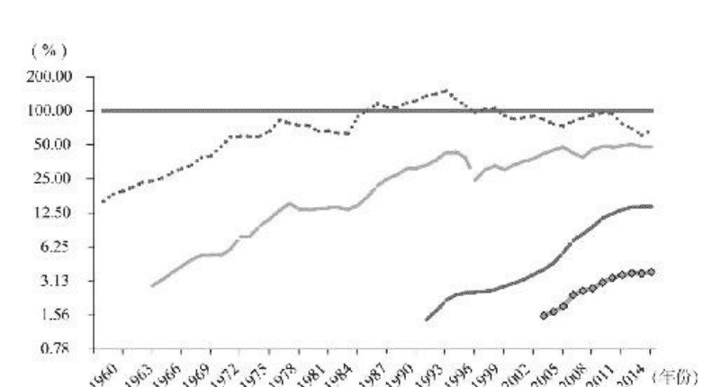

图2—71960—2014年东亚经济体人均GDP占美国的百分比（纵轴选取log2对数刻）

资料来源：世界数据库。

其次，中国经济规模将是全球第一，并可能是美国的两倍，而人均GDP达到2.5万—3万美元，约为美国人均水平的一半左右。如图2—7所示，东亚的递次工业化过程中各国人均GDP向美国水平的靠拢。本书写的2018—2019年，中国经济规模为美国的66%，人均GDP为美国的20%，仍很大的成长空间。考虑到中国经济增速在未来几年里继续优于西方，叠加人民币汇率的强势，2035年中国GDP两倍于美国是完全可能的。其意义在于，这意味着中国市场的规模是美国的两至三倍的规模，相当于欧美市场的总规模，而中国社会将转型为一个中产阶级消费型社会，中产人口规模从今天的三亿成长到亿甚至更多。

再次，中国产业结构将出现巨大的分化和重构。总体波动性大的人民币汇率，叠加人力成本的继续上涨，意味着今天依然需要许多劳动力的中低端制造业很难在未来延续其劳动密集型商业模式。制造业就业占比将被萎缩，不仅是因为其中很多岗位转移到劳动力性更便宜的越南等地，更重要的是机器人和自动化替代许多工种。德国、日本在传统汽车产业中的全球优势，将被中国利用巨大的国内市场优势和技术变革优势跨越，新能源汽车行业和今天的手机通信行业一样集中在中国东南沿海的某个区域；中国在大飞机、芯片和生物医药等行业也将获得较大的市场份额；而今天无人引以为制造业等全产业恐难以为继，因为会有一些中低行业向东南亚、南亚甚至北部进行大规模的转移，从而形成这些区域与中国市场的高度共生体系。中国的产业结构正在向高端收敛，主要集中在那些资本密集、智力密集、以及本土市场要求的极高领域。人民币的区域化跨境将随着中国产业链的延伸与逐步扩展，最终导致这些区域成为亚洲人民币区域。

最后，在金融领域，人民币的外汇储备将归零，或者很大部分转变为黄金。人民币的信用将彻底脱离中国的信用，而转变为黄金。中国国民和政府的负债总量明显高于美国水平，其贸易优势将逐渐消失，在全球范围内，人民币储备基本转换。上述概述，并不是完全有效的方案，而是一种愿景。在方法论上，上述观测并非线性的外推，而是将多种因素叠加到一起进行考量：人口老龄化会导致经济逐步减速，通货膨胀带来新的比较优势和产业升级；2035年人均GDP仍与美国存在差距，但在总量上得以反超，人民币国际化成为整个体系中不可或缺的环。

[1][英]约翰·艾锡：《人民币史：从国际化开始》，李广乾译，上海人民出版社2002年，第1页。
[2]Oppers,S.,A Model of Bimetallic System”,Journal of Monetary, Credit and Banking,Vol.46,No2,1995.
[3]魏建：《金本位的设计与终结，《金融博览》2016年第1期。
[4]白银在供给与美洲及欧洲存在巨大的套利空间。当16世纪、17世纪世界上其他国家的银价下跌、金价上涨时，在中国的银价上。据全考证，在明代（1368—1644）大部分时间内，金银的比约为1:6到1:5之间。当时的欧洲，尤其是西班牙，就经济活动并有效说，“他们在对外保持顺差，以此换取白银流入”。参见德·弗兰克：《资本与全球化中的视角》，刘志宏译，中央出版社2001年，第191页。
[5]Selgin,G.,Salvaging Gresham’s Law: The Good, the Bad, and the Illegal”,Journal of Monetary,Vol.28,No4,1996,p637-649.
[6]Flandreau,M.,The Economics and Politics of Monetary Unions: a Reassessment of the Latin Monetary Union,1865—1871”,Financial History Review,Vol.7,No1,2000,pp.25-44.
[7]张亚：《银本位与分层的世界货币体系，《中国金融》2009年第13期。
[8]贺水金：论近代银本位下的汇率变动，《社会科学》2006年第6期。
[9](加拿大)罗伯特·蒙哲、王聪：论国际货币体系的重建；基于创造世界货币的设想，《厦门大学学报》（哲学科学版）2012年第1期。
[10]许多学者详细述了英国在本位维持方面所起到的作用。例罗伯特·吉尔特：《国际关系经济学》；苏伦-斯托齐：《国家与市场》，卡尔·波兰尼；吕巨：当代政治与经济的起源；罗伯特·欧汉：《霸权之后；世界政治中心的合作与争夺》。
[11][匈利]卡尔·波兰尼：《吕巨：当代政治与经济的起源》，黄树译，社会文献2013年版，51—52页。
[12]徐世万、王红生、许萍：《世界史（现代卷）》，人民出版社2017年版，14页。
[13][美]巴里·埃森格林：《资本全球化：一部国际货币体系史》，麻夷爱，机械工业出版社2014年版，49页。
[14][英]苏伦-斯托齐：《国家与市场》，杨宇光译，上海人民出版社2006年版，90页。
[15]Obstfeld,M.,Taylor,A.M.,Sovereign Risk, Credibility and the Gold Standard:1870-1913 Versus 1925-1931”,The Economic Journal,Vol.113,No.487,2003,pp.241-275.
[16]陆策：“可再议金位制和30年代大危机：起因、扩散和复苏》，《复学报》（社会科学）2008年第1期。
[17]Bemanke,B.,James,H.,The Gold Standard, Deflation, and Financial Crisis in the Great Depression: An International Comparison”,in Hubbard,R.G.,eds,Financial Markets and Financial Crises,Chicago: University Press,1991,pp.33-68.
[18][美]巴里·埃森格林：《资本全球化：一部国际货币体系》，麻夷爱，机械工业出版社2014年，50页。另有一认为第三势力为法。
[19]1929—1933年，国际贸易下降了60%，全球繁荣所必需的多边协定中，60%不再包含“最惠待遇”。
[20][英]鲁伯特·鲍姆：《年代：1914—1931》，郑明译，中信出版社2014年，第13页。
[21][美]罗伯特·吉尔：《国际政治学》（第二版），杨宇译，上海人民出版社2011年，第22页。
[22][美]哈塞尔格林：《资本全球化：一部国际货币史》，哈勇译，机械工业出版社2014年，第97页。
[23]White,W.R.,The Need for a Longer Policy: A Less Orthodox Approach”,in Teunissen&Akkerman,Global Imbalances and Developing Countries: Remedies for a Failing International System,Hague,2007,pp.57-92.
[25][美]弗朗西·西加：《黄金、美元与权力：国际货币关系的政治（1958—1971）》，严严肃译，社会科学出版社2016年，第22页。
[27]Moore,Keynesian Economics,Vol.26,No.4,2004,pp.631-653.
[28][美]理查德·加德纳：《英镑外交》，符捷译，江苏人民出版社2014年，第103页。
[29]张江：《从英镑到美元，国际经济霸权的转移（1933—1945）》，人民出版社2006年版，第227页。
[30].Kirshner,O.,The Bretton-GATT System: Respect and Prospect after Fifty Years,Abingdon-on-Thames:Routledge,2015,p.22.
[31][美]本·斯泰：《布雷顿森林货币体系：美元如何统治世界》，符捷、陈逊译，机械工业出版社2014年版，第146页。
[32]双方交接过程的历史实述主要基于本·斯泰：《布雷顿森林货币战：美元如何统治世界》，符捷、陈逊译，机械工业出版社2014年版，第7、8章。
[33]李阳：《布雷顿森林体系的演变与美元霸权，《世界经济与政治》2005年第10期。
[34]张江：《从英镑到美元，国际经济霸权的转移（1933—1945）》，人民出版社2006年版，第269页。
[35]当国际收持续减少，并且该货币在IMF的库存中下降到其份额的75%以下，IMF可以将该国货币宣布为“稀缺货币”。于是，IMF可以按国家的需要实行限额，其他国家对“稀缺货币”采取临时限制性换，或限制该商品和劳务。
[36]Triffin,R.,Gold and the Dollar Crisis: The Future of Convertibility,New Haven:Yale University Press,1960.
[37]Eichengreen,Barry,Global Imbalances and the Lessons of Bretton Woods,Cambridge:MIT Press,2010.
[38][美]弗朗西·西加：《黄金、美元与权力：国际货币关系的政治（1958—1971）》，严严肃译，社会科学出版社2016年，第24页。
[39][美]弗朗西·西加：《黄金、美元与权力：国际货币关系的政治（1958—1971）》，严严肃译，社会科学出版社2016年，第24页。
[40].Strange,Susan,"The Persistent Myth of Hegemony",International Organization,Vol.41,No.4,1987,pp.51-54.
[41].Say-Baptiste,A Treatise on Political Economy,Kitchener: Batoche,2001,p.95.
[42].译芙《货币的本质反思，《社会科学》2017年第四期。
[43]自然与生活中存在奇异的分布，学者把齐夫（Zipf）发现单词出现的频率按从小到大的排列，这种分布称为齐夫律，表明在许多语言中，只有少数单词经常使用，而大多数单词很少使用。这种分布称为齐夫律，表明在许多语言中，只有少数单词经常使用，而大多数单词很少使用。这种分布称为齐夫律，表明在许多语言中，只有少数单词经常使用，而大多数单词很少使用。这种分布称为齐夫律，表明在许多语言中，只有少数单词经常使用，而大多数单词很少使用。这种分布称为齐夫律，表明在许多语言中，只有少数单词经常使用，而大多数单词很少使用。这种分布称为齐夫律，表明在许多语言中，只有少数单词经常使用，而大多数单词很少使用。这种分布称为齐夫律，表明在许多语言中，只有少数单词经常使用，而大多数单词很少使用。这种分布称为齐夫律，表明在许多语言中，只有少数单词经常使用，而大多数单词很少使用。这种分布称为齐夫律，表明在许多语言中，只有少数单词经常使用，而大多数单词很少使用。这种分布称为齐夫律，表明在许多语言中，只有少数单词经常使用，而大多数单词很少使用。这种分布称为齐夫律，表明在许多语言中，只有少数单词经常使用，而大多数单词很少使用。这种分布称为齐夫律，表明在许多语言中，只有少数单词经常使用，而大多数单词很少使用。这种分布称为齐夫律，表明在许多语言中，只有少数单词经常使用，而大多数单词很少使用。这种分布称为齐夫律，表明在许多语言中，只有少数单词经常使用，而大多数单词很少使用。这种分布称为齐夫律，表明在许多语言中，只有少数单词经常使用，而大多数单词很少使用。这种分布称为齐夫律，表明在许多语言中，只有少数单词经常使用，而大多数单词很少使用。这种分布称为齐夫律，表明在许多语言中，只有少数单词经常使用，而大多数单词很少使用。这种分布称为齐夫律，表明在许多语言中，只有少数单词经常使用，而大多数单词很少使用。这种分布称为齐夫律，表明在许多语言中，只有少数单词经常使用，而大多数单词很少使用。这种分布称为齐夫律，表明在许多语言中，只有少数单词经常使用，而大多数单词很少使用。
[44]齐夫（Zipf）在英语中，发现单词出现的频率按从小到大的排列，这种分布称为齐夫律，表明在许多语言中，只有少数单词经常使用，而大多数单词很少使用。这种分布称为齐夫律，表明在许多语言中，只有少数单词经常使用，而大多数单词很少使用。这种分布称为齐夫律，表明在许多语言中，只有少数单词经常使用，而大多数单词很少使用。
[45]作者认为是合适的不是54%这个数字。
[46]参见姚露、王芳：《国际之路：人民币国际化问题，《经济研究》2005年第2期；刘群：《人民币国际化的必要选择，《世界经济与政治》2005年第6期。
[47]欧元区不是一个国家，内部组织分裂，集体行动非常困难，而由于美国对欧元区的容忍度较高，它能够稳定在经济规模的八左右，某些年份仍曾超过美国。这些都是世界上顶级规模的区域。欧元区的经济规模曾三次超过美国，并在周期内接近美国，是波动的地位位于全球经济模型。2008年以来的金融危机时代（或者数字时代）欧洲的竞争力明显落于美国和东亚地区，到本书写作的2018年，欧洲经济规模回到与中国一个不等的水平。根据摘要《欧洲产业衰退的结构主义政治经济学》（引于《世界与政治》2018年第8期）对欧洲和产业的研究，欧元区竞争力的前景堪称难以乐观。
[49]承认这一事实让作者内的民族主义者们非常痛苦，但是恐怕到为止还是要承认，中国的自主技术创新是在西方的启发之下实现的。
[50]美国主导的体系对于苏联主导的体系，其优势之一在于能够辅助权威更有效低成本获取大半世界的资源，包括一部分苏东阵营的资源。
[51]本节主要参考人民币国际化报告2013及周弘等主编《德国马克与经济增长》相关文章。参见周弘等编著《德国马克与经济增长》，社会科学出版社2012年版。
[52]Krugman,Paul,"Vehicle Currencies and the Structure of International Exchange",Journal of Money, Credit and Banking,Vol.12,No.3,1980,pp.513-526.
[53]李敏：“《日元国际化》的困境及其战略调整，《世界经济》2005年第6期。
[54]Bergsten,F.,"Why World Needs Three Global Currencies",Financial Times,February 15,2011,https://www.ft.com/content/d485702-3946-11e0-97ca-00144feabdc.
[55]德国雅布、弗兰克尔等：《德国马克的国际角色》，周弘等编《德国马克与经济增长》，社会科学出版社2012年，第237—239页。
[56]李敏：“制衡美元；政治领导与货币兴起”，上海出版社2015年版，第183页。
[57]赵朽：“工业竞争力、资本账户开放与货币国际化——德国马克的国际化为什么比日元成功，《世界经济与政治》2013年第12期。
[58]赵朽：“工业竞争力、资本账户开放与货币国际化——德国马克的国际化为什么比日元成功，《世界经济与政治》2013年第12期。
[59][姚巍、罗获升主编：《大国货币：国际化货币与货币国际化》，周大昕，北京大学出版社2015年版，第1章。
[60]李敏：“制衡美元；政治领导与货币兴起”，上海出版社2015年版，第188—193页。

[61]付颖：《日元国际化与亚洲货币合作》，商务印书2010年，第179页。

[62]著者曾在鸿山先生2018年访时晨午交流过此事，确认了相关政治斗争中美对日霸权因素的重要性。他表示将继续努力推进中美关系以实现“亚洲的亚洲”，人俱倾也也令人唏嘘。

[63]罗纳纳·麦金：“美元霸权对亚洲的汇率——亚洲高储蓄两难”，王信，何为译，中国金融出版社2005年。

[64]马克在ECU的初始定价中占有27.3%的份额，后经调整，其份额在1989年高达30.1%的最高值。

[65]李巍：“制衡美元：政治领导与货币崛起”，上海人民出版社2015年旧版，第188—193页。

[66]殷铁锋：人民币国际化：“贸易结算与离岸市场”，还是“资本输出+跨国企业”——以日元国际化的教训以往例，《国际经济评论》2011年第4期。

[67]中国大学国际货币研究所：《人民币国际报告2016——货币国际化与宏观金融管理》，中国大学出版社2016年，第87—88页。

[68]洪观东升：“中国为什么没有前途——中国对外经济政策及其战略略”，机械工业出版社2015年。

[69]周川：“关于改革国际货币体系的思考”，2009年3月23日，http://www.pbc.gov.cn/hangdiaoling/128697/128719/128772/2847833/index。

[70]周宇在2016年的研究通过比较汇率波动与主要货币国际化程度之间的关系，发现2015年后人民币出现贬值趋势，人民币国际化进程受到了一些影响。关于人民币贬值对人民币国际化的影响，还具有具体分析。从数据来看，虽然2015年后人民币在跨境贸易结算方向上发生了变化，即人民币对于出口贸易结算总量上升，进入进口贸易结算下降，因此两者相互影响，总量基本没有太多变化。参见周宇：“论汇率贬值对人民币国际化的影响——基于主要国际货币比较的分析，《世界经济研究》2016年第4期。

[71],参见余永定、林毅夫、殷剑锋、张明等人2011—2014年的“人民币国际化”“资本项目开发”主题相关论文。

[72].Ito, Takashi,“China as Number One: How About the Renminbi?”,Asian Economic Policy Review,Vol.5,No.2, 2010, pp.249-276.

[73].Henning, C.R.,Choice and Coercion in East Asian Exchange Rate Regimes”,Working Paper 12-19, Washington, D.C.: Peterson Institute for International Economics, September, 2012.

[74].Subramanian, A. and Kessler, M.,“The Renminbi Bloc Is Here: Asia Down, Rest of the World to Go?”,Working Paper, 12-19, Washington, D.C.: Peterson Institute for International Economics, August 2013.

[75]刘丁平、方泽琳、叶伟——“一带一路”区块货币参照人民币“隐性锚”，“国际金融研究》2018年第1期。

[76]令人惊叹的是，中亚区域是人民币最显著的区域，其中中亚地区的经济现状与中国当地的政治、安全与货币合作基础都有着紧密的联系。中亚区域目前存在外储高居不下，主权货币贬值、外汇储备缩水的状况，外来融资成本较高、融资渠道困难为人民币进入中亚国家提供了良好的机遇。

[77]张明、王中中:“构建天然人民币体系的可行性与人民币国际化”,《上海金融》2018年第3期。

[78]Cohen, B.J.,Renminbi Globalization: A Conflict of Statecrafts”,CHATHAM HOUSE Research Paper, March 2017.

[79].Farhi, E., Ginchas, P. and Rey, H.,Reforming the International Monetary System”,CEPR Research Paper, 2021.

[80]对中产阶级的定义有很多，笔者较广的一个界定方式是国际货币基金提出的，家里有汽车或类似财力的即为中产。

[167]
# 第三章 美元体系的结构与定价

## 第一节 后布雷顿体系的结构性特点

### 美元取代黄金

今天的我们生活在一个什么样的世界？不同的视角会有一样的关注点和不同的答案。从政治经济学角度来说，公认的说法是我们生活在霸权体系之中，或者称为“美国和平（Pax Americana）”。但是霸权以何种方式塑造了我们的生活？主流理论认为美国拥有绝对优势、全球最大的经济规模和先进的科技，还有国际机构、规则等一系列控制权，将其用软或硬的方式。这种见解不算错，但笔者在此处提供补充性的世界观：全球市场中的每一个行为如今无意地生活在一种“美元梦”中。自由主义认为，每个人都是梦境中的一个影子而已，或许只不过成就了这个超级婴儿。如果假设我们做了梦，那么那个世界就终结了。这种世界显然不利于激发人们追求幸福和兴趣，但是作为一种隐喻，用以解释全球化和美帝国则非常合适。做梦的主体是美帝国，做的梦是全球化，而所有的国家、企业、个人，都不是梦境中的角色而已。

[168]
注意的是，这世界并非久远的历史，而只有半世纪的历史：从20世纪70年代开始，美元取代黄金成为所有人追求的东西。国际货币进入了布雷顿体系时代，这个时代的全球安排有两个基本特征：一是使用一种主权货币作为全球储备资产；二是主要货币的价值毫不锚。这两个点与历史常态相同。历史上金银等金属被当作货币，即使是纸币也需要黄金作为支撑，但是现在一切建立于两个主权货币发行者（美元和欧元）占据了全球货币份额，欧元的地位更加可靠，因为它连统一的主权基准都不存在。在历史常态中，汇率是固定的（对内购买力和对外的汇率），但是现在主要的货币间汇率是变动的，而且波动性非常大。对于这类全球货币体系这样的宏大产物，人类往往对一切似乎自然而意识不到其中的异常之处，却忘了其结构缺陷。正如本书第二章所说，当这种安排并非人为设计的结果，也不是自然物，而是几个国家为了此前布雷顿体系的严重缺陷而开展的一系列博弈、修补和演进的结果。从1971年与黄金脱钩开始，布雷顿体系已经运行了近半世纪的证明，我们可以用表3—1勾出了体系的若干结构性缺陷：

表3—1 当前货币体系的结构性缺陷

| 特一 | 特二 | 特三 |
| :--- | :--- | :--- |
| 当金属为货币 | 实行货币与黄金挂钩 | 汇率取决于锚的升值 |
| 对货币负责 | 货币通胀和利率调整 | 货币灵活，GDP对比的弹性 |
| 对国家负责 | 流动性缺口的扩大风险 | 高贬值对外部储备的损害 |
| 对发行者负责 | 对发行者信心、信誉的丧失 | 金融业的政策——“汇率维持制” |

[169]
在对上述结构性特征展开讨论之前，有必要简述一下已经失去了特殊光环的黄金。自20世纪70年代以来，黄金价格波动的特点表现出以下特征：短期来看，黄金价格的波动与通胀和经济增长的关系并不十分稳定。长期来看，对黄金价格最有力的解释因素是全球储蓄对美国体系的信心。

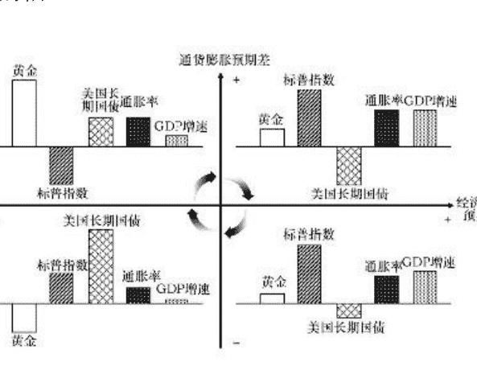

图—3 美林时钟下的资产收益表现（1971—2015）

数据来源：此图和数据均借自博客友宁（Michael Ning）博士的研究报告。他在摩根、美林、安联等华街公司长期投资经理；此类资产通常视为美林时钟，但实际中不同研究者的使用范围有区别。在本图中，各类资产在经济运行周期的表现用柱子的正负和高低来表示。注意的是，横轴与纵轴分别为经济增长和通胀的预期，即“实际值”减去“预期值”的差值。Fed, Ibbotson, Bloomberg。

从图—3中，可以看到经济增长和通胀率走高时，黄金价格倾向于上涨。但是是在经济表现不理想时，假如通胀走高黄金大涨，而如果通胀下跌则黄金价格下跌。事实上，只有在一种情况下黄金跑赢通胀，那就是通胀高时。短期内的波动没有确定的规律，但是长期来看，黄金价格背后体现出相当明显的驱动因素：全球储蓄对美国体系的信心。

[170]

图31975—2015年的黄金价格走势

资料来源：COMEX。如图3所示，70年代以来的黄金价格只有两次明显的上涨，是在20世纪初，美国在政治和经济上面临来自苏联的巨大压力。当时苏联的扩张使得东亚、中东、非洲等地缘格局发生了重大转变，美国军事开支高涨导致了通胀。1971年与黄金脱钩后，黄金相对于美元的价格一路高，在80年代突破了800美元/盎司。在此后的20世纪，美国在量化宽松下避免了崩溃。从外界看来，作为主要国家的欧洲诸国陷入债务危机、难民危机、欧元变动等问题，经济复苏之乏力；而中国作为美国的唯一的挑战者，各种类型的“中国崩溃”引发了全球风险。从21世纪开始，人民币超涨、黄金泡沫即将打破，悲观预言给中国发展前景蒙上了一层阴影，经济增速进入持续下行。21世纪来的美国运并不理想，但相对于其他主要经济体而言似乎问题小一些。如此，从近半世纪的历史来看，黄金的价格走势与人们对美国的信任产生了明确的负面关系。这种逻辑在金融机构的资产配置模式中可以被找到：华尔街资产管理人告诉记者，在他们的组合中，通常会保留黄金作为一种“保险”，用以应对整个体系的“极端尾部风险”。何谓体系性的极端尾部风险？借用亚洲的比喻，就是整个美元世界跌到噩梦时，我们脚下的大地出现崩溃和重构的时候，所有的储蓄都会不约同地溃向一千年来全世界都相信的神话，就是黄金的价值。

[171]
## 主权货币作为全球储备

笔者认为，主权货币作为全球储备固然克服了本位的某些缺陷，但也带来了三大弊端：一是通过持续扩大的逆差不断侵蚀中心国家美国自身的制造业，最终削弱其国力基础；二是给国外其他国家带来巨大的结构性风险；三是给经济活动带来诸多扭曲，财务杠杆率的抬头取代了经营业务本身成为全球商业成功的秘诀。对美国而言，美元的储备地位固然带来了一系列特权与处，但也在潜在转型中重塑了美国经济与社会的基本局面，尤其令人头疼的是持续扩大的贸易逆差和去工业化。

从70年代美国关闭黄金窗口到2014年，全球央行的外汇储备总额从330亿美元大幅增长到近12万亿美元，其中60%以上的储备都是以美元计价的资产。换言之，在这段时间里美国对世界提供了超过7亿美元的中央银行储备资产，这意味着美国的常规账户与资本账户赤字的年总和达到7万亿美元之巨。

根据笔者的计算，世界总储备变化与美国贸易赤字之间的相关系数高达0.85。这说明美国向全球供应美元的绝大部分增长是通过贸易赤字输出的，如图3—3所示。

[172]

图3 美国贸易逆差与全球外汇储备（1970—2014年）

注：世界储备的变化。资料来源：Sovereign Wealth Fund Fund Institute、IMF。

正如经济学家伯恩斯坦（Bernstein）说，“当一个国家希望通过本国货币贬值促进出口时，中央银行会积累储备。由于全球账户需要平衡，消费量超过产量，这意味着美国自己减少储蓄。从一个角度来说，全球制造业正在转向亚洲那些拥有廉价劳动力和较高生产能力的国家，从而让美国消费者欢迎廉价商品的同时，美国工人也在抱怨廉价劳工。在2008年金融危机之前，经济学者们普遍认为，技术进步导致了美国制造业岗位数量的减少，直到金融危机之后这种偏见才扭转。”

[173]

图—4 产业链转移与各国制造业就业比例

注：制造业就业比例。数据来源：U.S. Bureau of Labor Statistics; National Bureau of Statistics of China; International Financial Statistics (IFS); IMF。

[174]

图—5 东亚制造业增加值及占比

注：中亚文化为中国内地、中国香港、中国台湾、新加坡、韩国、越南（中国内地从2004年起，中国台湾从1981年起）；新教文化为北欧、英国、德国、美国、加拿大、澳大利亚。

数据来源：联合国统计局，CEIC。

[175]
货币地位是衍生的，而东亚文明与同新教文明在国力和货币地位上出现了实质性错位，那么其积累性后果最终将导致后者的货币霸权崩溃。长期以来有着无法忽视的“上”作用，美元流动性泛滥，亚洲的崛起使得美国的制造能力显得形襟见肘。这个过程的早期主要表现为日本的经济崛起，但是日本的人口规模、国内市场规模和政治性决定了它真正成为美国霸权的挑战者。但是随着时间的推移和产业链的延伸，中国大陆也借助亚洲供应链的区域发展，实现了历史上规模最快的工业化。本书为止，中国的贸易部门的规模已经明显超出美国，不仅如此，如果跳出国家间竞争的思维框架，从文明竞争的角度来看世界权力结构的变动，如图3—5显示，包括中、日、韩、越在内的东亚供应链在全球范围内值的比例刚刚超过了整个新教文明（西欧+北美及太平洋）。如果把马丁·路德发新教革命以来的百年全球历史理解为新教的兴起与征服史的话，那么可是四百年未遇之大局；四年来新教文明的优势地位一次遇到了实质性的挑战。

对于整个体系的贬值。美欧短期资本引入外围国家，追后者的货币政策被动进入扩张周期。以2009年的美国货币政策调整为例，美国迅速扩大自己的货币基础，导致大量资金流入发展中国。某些发展中国家采取项目管制以阻止资金流入的时候，许多套利交易（carry trade）资金通过跨境手段流入，比如此假贸易和FDI。当资金流入后，中国经济很难保持独立性，彼此时面临两难：允许许多货币政策被动扩张而影响其出口部门，要么为买下过过的外汇导致基础货币的扩张，进而导致资本市场和房地产市场的泡沫。到2014年之后，美联储对美国经济的开始退出量化宽松，此前的五亿美元资金从发展中国家大幅缩减，外围货币的汇率一落，迅速加大了当地的通胀压力，许多、巴西、俄罗斯、印度等国家出现了政府危机。

当前货币体系扭曲了全球市场的直观表现。近半个世纪的全球金融环境与以往之处，就是大国货币转向往往跨越了其他因素，变成了商业成功的优逐者，这个趋势对于重资本类别的行业尤为如此。一个企业，其经营者非常难以做好产品，非常难以降低成本，它非常积极地开拓市场，但是它仍然可以做到：仅仅由于其经营者没有学过银行和国际金融，在增加经营杠杆业务的时候没有意识到货币政策正在突然松变；或者，仅仅是因为此远远国度的宽松导致了全球市场中的某个地方（如房地产）出现了泡沫，而加息把这个泡沫戳了，彻底结束了全球市场的流动性，从而导致自身原本很好的企业也为流动性枯竭而倒闭。2008—2009年，诸遭遇如此悲剧命运的实体企业在全世界的每一个角落，各个企业都能找到一把机会。

想要避免这样的悲剧的发生，初人们们还能“央行独立性”原则维护这种全球性制度的基本体面。但此时今日，很少有人强调央行独立，因为这层遮羞布已经在2008年的金融危机带来的恐怖中被揭破。

央行的责任从最初的通胀、避免流动性恐慌，逐渐增加了越多的责任和使命，如今增长和保就业等都开始实现在其政策目标清单上。央行的再分配功能已经超越了历史上任何时期。于是，货币政策逐渐变成了货币当局市场行为者之间的猫鼠游戏。各国金融市场变成了赌场，货币当局赌场，其他人参、相互斗心。想要在这个行业里，关键是能否更准确理解和预测当局的货币政策意图，或者更有用的谁是在政治体制中占有对货币政策更大的影响力。在这些方面，政治知识似乎比经济学更有用，因为货币当局的行为可以说是市场规则的，不如说是权力规则的。随着各国货币当局在国际及各国的市场中成为越来越重要且中性的角色，市场主体想要发展，就必须增强洞察决策者的心。此时，我们看到投资的重点不再是对投资目标的价值评价，而是货币政策走向的方向。

## 三 无锚货币与浮动汇率体系的基因缺陷

过去的半个世纪，美元指数（反映美国对欧元英镑等篮子货币的加权平均）经历了三个完整周期。这个持续波动的汇率体系存在于三个面的基因缺陷和改革必要性：第一，无锚的货币体系带来了汇率大幅波动，给经济的跨境贸易形成阻碍，并让金融部门之间成为“征税”；第二，它的周期性特征对发展中国家带来周期性冲击，并推动发展中国国家过度储备外资产，导致全球经济的失衡和系统风险的进一步积累；第三，它破坏了国际储备货币的发行美国的财政政策，悄悄破坏了其制度的自洽和完美。

初看起来，汇率似乎是市场逻辑在货币领域的自然延伸，即供给和需求的博弈与竞争价格发挥资源配置的最优化功能，最终他们将使汇率稳定在均衡价格附近。若深入考察这个市场，不难得出相反的结论：对于一个公平、有效且统一的全球市场而言，浮动汇率不仅不是组成部分，反是一种阻碍和抑制因素。

在稳固的基础上才能建构。全球货币体系应该是一个稳定的价值基准，为国际市场的运转提供有规律的、中性的环境，在此前提市场参与才能对各种要素的稀缺性给予适当的定义。但是在今天的法币时代，脱离了硬锚的货币（即国政府和货币当局）操控，借他们把本国的产业和问题变成国际市场的问题，把汇率当作转变为国内环境和危机的手段，以此影响其他国家的汇率及资产流动。在一个经常大幅波动的价值基础上，经济活动的高涨往往不稳定，甚至从一开始就难以建立起来。在此看来，无锚的货币体系及其自由流动的汇率，并不是自由市场的延伸，而是全球统一自由市场的障碍。

浮动汇率的客观后增加了国际贸易的风险，对于这种冲突风险，每一个交易商和制造商都需要支付代价向金融机构购买某种形式的汇率保险以定价价格，这相当于许多国际贸易的额外税收。这是一个浮动汇率的世界，创造了一个收费的金融行业，他们的长是预测（或者假设能够预测）汇率，相互交换货币及其衍生品。整个国际贸易和货币体系包含了这些在哈尔街、伦敦、香港的专业人士，借助他们的力量以便确定一个“合理”的货币价格。

无锚汇率的顺序特征使得发展国家带来周期性波动，导致发展国家过度储备，导致汇率损失。金本位和雷顿森林时期固然存在周期性波动，其中一个重要根源就是金量的变化，但在黄金作为货币的时代，周期的波动的幅度受到限制。金本位与固定汇率条件下，资本流入会增加本国货币供应并抬高物价；在浮动汇率条件下，资本流入会带来汇率上升和进口增加。理论上讲，两种调整路径应该是多的，但是在实践中，浮动汇率机制容易导致调整。当人们预期汇率继续上升，资本流动将会出现自我增强，最终导致过热通胀。

无锚的货币体系及其自由流动的汇率，并不是自由市场的延伸。如果为了避免汇率贬值压力，央行通过货币紧缩买入外汇，很有可能出现巨大的资产泡沫，从而导致类似2008年的金融危机。具体到微观层，利差最能体现上述周期性特征。在美国（有时候日本和欧元区）货币宽松下，许多发展中国家借入廉价（短期）美元买入高息货币（新兴市场）。这种利差从两个方面实现：一是利差，即低息资金与高息之间的利润；二是利差，在无锚的浮动汇率条件下，随着资本流入，该国货币具有升值压力。这种利差引发了全球失衡。浮率制度使得各国政府有了更大的政策余裕。当他们以比别国更快的速度的扩大大货币的基础的时候，由此压低的汇率将帮助他们的制造业和投资带动较快的经济增长，从而创造了更多的就业。但是与此同时，这种货币的储蓄者相对受损，以贵金属或国家价值标准衡量的话，他们的人均财富也未增长。

从某种意义上讲，无锚法币和浮动汇率是不负责的政客们最爱的工具，因为他们解决不了的财政问题现在可以通过货币来解决。这种做法在很多拉美国家中可见，比如查斯及其继任者的所谓“21世纪社会主义”下的委内瑞拉直到今天，就是通过发行货币、大幅贬值和持续通胀来解决其不负责的财政问题，他们用作弊的货币政策彻底毁坏了社会主义的名誉。

为了在金融危机中遭受损失，一些国家在经历1997—1998年的亚洲金融危机之后，采取了一系列措施管控流动性并积累外汇储备，从而把一个风险逐步累积到全球层面。在1999年之后的15年内，中国外汇储备增长了数十倍，东亚和东南亚经济体也是。世界储备总额在1969年底仅为33亿美元，随着布雷顿森林的崩溃，世界外汇储备开始了惊人的增长。1995—2005年，世界外汇储备从12亿美元增长到4万亿美元，到了2014年，外汇储备总量达到12万亿美元，其中25%由中国和日本持有。外汇储备的重要性意味着其他国家的增长。欧美等主要货币发行行的债务增长，这种跨国债务融资与储备国家的公共和私有部门的整体债务是高度相关的。亚洲和其他地区的外汇储备积累，不仅造成了本国的损失，使得全球经济的稳定造成了性性风险按照按照北京大学教授迈克尔·蒂斯斯（ Pett Pettis）描述描述，当外部通过购买美元积累外汇储备时，他们也推高了美元而使美国企业在竞争中败下阵。“美国想要避免汇率贬值压力，就是通过增加公共债务和私营债务来增加非贸易门的国内需求。”从汇率的角度来看，全球储备资产降低了美国国内的利率水平，导致了过度投资和消费，从而产生了大量的公债。这种债务积累使得全球宏经济带来更多问题，全球失衡及其伴随2008年惨毁的杠杆化正是由此引起。

浮动汇制度使得各国政府有了更大的政策余裕。在各国货币当局在国际及各国的市场中成为越来越重要且中性的角色，市场主体想要发展，就必须增强洞察决策者的心。此时，我们看到投资的重点不再是对投资目标的价值评价，而是货币政策走向的方向。

在这些方面，政治知识似乎比经济学更有用，因为货币当局的行为可以说是市场规则的，不如说是权力规则的。随着各国货币当局在国际及各国的市场中成为越来越重要且中性的角色，市场主体想要发展，就必须增强洞决策者的心。在无锚的浮动汇率条件下，随着资本流入，该国货币将升值。。在汇汇汇汇，，，，，，，，，，，，，，，，，，，，，，，，，，，，，，，，，，，，，，，，，，，，，，，的。。，浮动汇率制度，各国。。重返、硬锚的货币体系，，，汇汇汇，，，，，，，，汇汇汇汇汇汇汇汇汇汇汇汇汇汇汇汇汇汇汇汇汇汇汇汇汇汇汇汇汇汇汇汇汇汇汇汇汇汇汇汇汇汇汇汇汇汇汇汇汇汇汇汇汇汇汇汇汇汇汇汇汇汇汇汇汇汇汇汇汇汇汇汇汇汇汇汇汇汇汇汇汇汇汇汇汇汇汇汇汇汇汇汇汇汇汇任任行长周小川同志并没有能够立刻即刻全球共识。也许只有等到下一次危机的到来才能再次打开变革的机遇，而鉴于当前体系的结构性缺陷，这样的大危机必然再次到来。当然，在此之前，有识之士能只有反复呼吁和探讨，从而造位于未来的系统性变革做好舆论和思想准备。

对于中国而言，除了呼吁变革之外，还有一种办法是将人民币国际化。这虽然不能改变体系的结构性缺陷，但至少可以在下一场危机之前准备一个对冲和自保的手段，而不像2008年之后那样坐视自己的利益损害。

另一种可能的救济方案是创造一种新的国内收支调节机制和储备资产，并让联合国在全球金融体系和上述机制中扮演更多的实质性角色。债务国家可以将本国的主权权益，比如一些领土主权，抵押给联合国专门机构，一旦无法归还本息，则由联合国对该领土权的拍卖。由此机制，能够扩展许多国家的融资能力，降低其风险和融资成本，而且为贸易盈余的国家提供了美、欧、日国债和黄金之外优质优质资产。更重要的是，从长远来看，由联合国作为仲裁者和执行者的抵押拍卖机制，是全球领域及其附属人口的分配开了一个和平的空间，联合国也可以借此发展专门的全球金融市场和相应的监管能力，从而为未来国际公共产品的有效供应打下更好的基础。

## 第二节 政治视角下的央行与货币政策

## 一央行及其独立性的演变

从历史来看，国家权力（包括政府和国会）央行的关系经历了四个阶段。

第一阶段是第一次世界大战爆发之前，此时央行普遍享有相对独立的地位。世界上最古老的央行始于17世纪的瑞典央行（1668年）和英国央行（1694年），但是直到19世纪早期才陆续出现（法国、荷兰、奥利、挪威、丹麦、西班牙）。央行初期任务基本是控制发行货币权，然后逐步扩大和改变其使命，直到20世纪初才确立非竞争性的特点。这一阶段维持独立的原因有三：一是央行许多独立的；二是当时自由主义思想（Laissez-faire）干预经济，并没有意识到应当从事周期性调节。只有战争期间，央行有机会干预。三是当时运行的全球货币体系是金本位，在此制度下央行的主要职责是保证货币的兑换性，。

第二阶段是第一次世界大战爆发到20世纪60年代末，这个时期经济中的作用开始明显，大萧条和金本位的崩溃以及凯恩斯主义的流行让国家意识到政府需要更加控制经济。此时时期，央行的独立性明显降低，加拿大、丹麦、英国、荷兰、新西兰、挪威等国先后被国有。第一次世界大战之前美国和南部的经济在收获季节其流动性，导致这些地区的农民和华尔街掠夺。为此，1913年《联储法案》建立了美国联邦储备系统，并规定货币政策的目标是“有效促进就业、价格稳定、长期利率适度”。大萧条之后，马里纳·艾克尔斯（Mariner Eccleses）设计的1935年《银行法案》对联邦储备法案进行了修订，削弱了银行的自主权和否决权，货币政策的制定权集中在了联储委员会手中。第二次世界大战期间，美国储备资本在固利率下，不断扩大货币供给，保障了中产阶级和低收入者。

第三阶段是20世纪70年代到2008年金融危机爆发，这个阶段随着自由主义的流行，央行独立性成为非竞争性的又具有普遍性的转变。这种转变是因为：一是央行取代财政部成为国家的核心部门；二是央行制度的目标得到了修正，确立了央行的独立。一些量化研究显示，央行是独立的，货币政策受到的干扰越小，越稳定，长期通胀率越低。20世纪70年代西方普遍面临问题，降低通胀成为首要的任务。于是央行独立性获得了极大的必要性。从此，央行的职能首要的是维持货币的稳定，而充分就业和国家的长远健康等目标却不再及。

第四阶段是金融危机时期。为了应对危机，央行独立性问题被悄然闲置。各国央行纷纷出手救经济甚至救市。财政压力越来越，时代来自于通缩而不是通胀，因此保持央行独立性的必要性似乎已经消失。

为什么许多政府愿意让渡部分经济权力给自己无法控制的机构？学者们有一些不同的解释。

首先，让权力可以赋予政党短期的好处或避免短期的代价。例如，在高通胀时期，建立央行独立可以让通胀预期下降，导致名义利率下降并经济繁荣就业，从而让他们在下一次选举中获益。另外，政府可以将表现的责任转移到央行身上，将罪与隔离是一个很有服力的动机。

其次，市场联盟理论认为，通常情况下，金融机构架构央行独立，而制造业企业和工人群体对此持怀疑态度。但当通胀率达到非常高的形态形成威胁时，这种联盟会重组，企业家更担心自己财富的泡沫化，因而会放弃央行独立。

最后是传染效应，在自由主义潮流的影响下，各国政府官员面临一种全球性的压力。而央行长们在哈尔塞尔的定期政策交流，有助于推动这种风潮的流行。政治家们面临着“红”与“专”的矛盾，政策比普通的经济政策更为复杂，专业知识门槛极高，与其在自己手里搞砸，不如委托给独立政策机构，以确保免责。

## 二自由主义与央行独立性

央行货币政策操作中的规则（rule）与相机抉择（discretion）之争，已经延续了150多年。此处的所谓规则，指的是主张央行在制定和实施货币政策之前，事先确定并把操作工具的程序或者原则。而相机抉择的是央行在操作货币工具过程中，不受任何固定程序或原则的束缚，而是依照经济运行态势的灵活取舍，以实现货币政策目标。

规则者强调货币政策规则应有可信度，而相机抬头者强调货币政策操作中灵活性的重要。在现实中，任何国家的货币政策都是对这两种主张的某种折中。

## 四 未来的救方案

修正这一体系的缺陷，合理的解决方案是重返某种硬锚的、固定汇率的货币体系。鉴于黄金或白银也存在显而见的缺陷，笔者与沃兹（Warren Coats）博士主张IMF的特别款权SDR，使其具有实际支付功能，从而作为全球储备和交易基础的共同单位。对特别款权的改革需要两个方面：一是赋予它实际支付功能；二是将其价值同一篮子商品的加权平均，使其获得一个篮子。这一篮子商品包含了五类大宗原材料，也可以包含了全球商品、服务乃至资产价格的一个加权平均指数。总之，让货币的价值重新根在坚固的岩石而不是沙上，让这个体系内的竞争更加公平、可靠。

对泰国、印度尼西亚、韩国等国提出的救助措施就是尊重央行的独立性。与此同时，转型后的苏联东欧地区在国际货币基金组织的指导下，也建立建立各自的银行和经营体系，并以此作为市场经济运行的核心部件。[141]

新自由主义货币领域的核心制度安排是美国主义的全球化央行银行体系，这一体系是新自由主义对全球化的各国经济调节的核心机制，它的建立是美国主义的新自由主义全球化在制度落实的标志。各国独立于其主政权，且正如本文第一章节所述，由于全球金融体系的结构性特殊，他们并没有获得最终的政策独立性和自主，尤其在资本项目开放的背景下，各国或或少将自己的货币政策外包给了美联储。在20世纪70年代代以后的全球无锚定货币体系中，全球金融和市场秩序越来越接近资本进入市场，并持续的去监管化（de-regulation）几乎消除了全部俄罗斯新以前的对金融资本的管制。

这种去监管化在新自由主义、华盛顿共识的帮助下跨越了国界，全球金融市场由于完全解除监管，导致全球的汇率和利率出现频繁的波动。而在这样的全球宏观制度背景下，各国金融的稳定基础只有美元外汇储备，而美元完全是由美联储（以及一定程度上财政部）控制和管理的。的是，各国独立性，独立于其主政权，却越来越依赖于从属于美联储及其美元储备，并完成了货币体系夺许多国国内经济的后门。

央行独立性在中心和外围的规则执行时具有明显的选择性和不对性。美国和IMF以维护币值和金融稳定为首，要求各国不得出现大规模的财政赤字和国际收支赤字，要求各国不得为其政府的财政赤字融资。但是当美国发生次贷危机和债务危机之后，美联储和欧日央行却恰好大量买入其政府债券，帮助他们把利率压制到零许多负率的水平。国际货币基金组织对此举若无睹、不置一词，银行独立性的法被悄悄封于高阁。以美联储为核心的全球发行体系，在政策适用的选择性偏于美、欧、日等对外围发展国家十分苛刻；在通胀定义的选择性，倾向于资本而对劳动者苛刻。对于通胀的使命，美联储为主的央行通常具有明显的选择性。他们定义的通胀通常与工资和消费品有相关性，一旦出现工资上涨带动物价上涨，央行会收紧货币政策以防止过热。流动性泛滥导致的资产价格上涨并不被视为问题，反而被视为好事，尤其是股市上涨认为财富效应可以推动更多的消费和投资。

## 三 美联储的货币政治

艾伦·格拉斯潘（Alan Greenspan）是新自由主义盛时美联储的化身，自1987—2006年任1后美联储主席，成为历史上最长年龄任最长的行长。他的政策主要包括宽松货币政策、金融自由化和去监管（de-regulation）以及强势美元政策[15]。

他的任期内，美国通胀维持低利率平稳增长，成功应对1987年美国股市崩市，1998年避免了亚洲金融危机对美国的影响，从2001年互联网泡沫破灭与“9·11”袭击的萧条中快速走出来，并用宽松宽政策使得美国数字与创新“新经济”的形成。但是，另一方面，对的批判和评价也如影随形，而且随着时间的推进和金融危机的爆发，负面评价越接近收益率。在2005年，美国经济学家威廉·弗莱克斯坦（William A. Fleckenstein）和里德尔·克希德（Frederick Sheehan）便撰了《格拉斯潘的泡沫：美联储的无知之时代》一书，[16]主格拉斯潘应该对此的互联网泡沫和正在升腾的房地产泡沫负责。同年，著名美籍犹太齐裔金融分析家·索罗斯特在其专著《美国的霸权泡沫——纠正对美国权力的滥用》中指时任总统小布什和联储主席格林斯潘，揭露小为了政治选举的，与格林斯潘筹人为压低美元汇率，从而让股市和经济尽快从互联网泡沫带来的下行周期中走出来。[117]这种法则导致了2002年之后美国房地产的非常繁荣，为未来的危机埋下伏笔。2008年金融危机时，保罗·克鲁斯曼（Paul Krugman）在《萧条经济学的回归与2008年经济危机》一书中指出，格林斯潘创造了行长任内的奇迹，在一个人的任期内发生了两场大规模泡沫，一个是互联网股票泡沫，另一个房地产泡沫。[118]另一个诺贝尔经济学奖获得者约夫·史蒂利次（Joseph E. Stiglitz）也撰文指，格拉斯潘应该对5008年的金融危机负责。CNN和时代等大众传播将他视为金融危机的责任人之一。

面对越来越激烈的通胀，格林斯潘一方面在国会中证“政策失效”；另一方面也撰文为自己辩解。其主要理由是：危机是经济泡沫的伴生物，是周期常态；防止泡沫是不可能的，“除非我们这个社会放弃所有的市场，禁止杠杆作用，而选择某种形式的计划，否则我担心防止泡沫最终是徒劳的”。[119]他还解释道，房地产泡沫的根源是美联储的利率政策，而中国等新兴国家的高储蓄。美国调节的短期利率，但是决定房地产投资和需求的长期利率，中国等新兴国家的高储蓄转化为美国长期国债的购买，压低了长期利率，导致房地产泡沫和债货危机。2011年4月，这八位美国人在国会中适时地表示，美国是安全的，永远不会的，因为其债务是用美元定价的，只需要即可。

危机应对期间，格林斯潘的继任者本·伯南克（Bern Bernanke）采取了一系列货币政策，实无无奈之，我们将在下文中介绍。但是让观察者们再次见到美联储独立性的可是心怕，则是在伯南克的继任者洛耶伦女士的任期内。杰特·耶伦（Janet L. Yellen）是一位民主党派系色彩相当明显的经济学家，民主党总总统奥巴马将让他为美联储主席时，她领导的货币政策面临的是如何退出非常货币政策。到2015年，美国经济增长量化宽松实现了初步复苏，但是这种复苏主要体现在资本市场上，尤其是许多美国企业用量化宽松带来的低利率窗口，借入巨量资金回购股份高收益和股价涨。这种复苏是虚弱而扭曲的，劳动力没有显涨，核心通胀率仍然处于低位。美国经济如同急诊室里刚抢回来的病人，依靠氧气和输液维持生命指标似乎恢复了正常，但如果是撤除这些风险，后果将难以估量的。如果美联储的退出量化宽松（加息）进程，不难发现2016年后是一个分水岭。在此之前，美联储积累非常缓慢，每年加息仅0.25%，意味着美联储引导。自从2016年12月起，美联储开始持续加息，在一年内加息四次并正式开始表。

![img/f47d2cc48327a653a2d6b8fc1a04a3_192.png]
图3—7 欧伦量化宽松

![img/f47d2cc48327a653a2d6b8fc1a04a3_193.png]
图3—8 美国联储隔夜利率（2014—2017）
资料来源：美联储网站。

经济学者们失业率、通胀率或者资产价格都难以提供满意的答案，而是政治观察家们的答案是：2016年12月，美联储的行为反差巨大，为什么美联储后悔？围绕2016年12月这个时间点，美联储的流动性带来巨大的紧缩冲击。特朗普的任期和核心战略是2018年赤字，在推特和媒体上试图升高的调门批判美联储“疯”了，后悔任命他人，威胁令快辞鲍威尔的联储主席。在选中的年初，令人惊讶的是，他并没有任命一位经济学背景的专业人士，而是任命了一位律师罗姆·鲍威尔（Jerome Powell）来主导美联储。但他令失望的是，自己任命的联储主席并没有填没，反而投了建制派，持续加息缩表，对其施政形成巨大的压力。抓手是名为孚，但是大减税导致联储财政的巨大赤字。原本他指望已任命的联储主席通过持续减税来实现其执政，因为减税不仅有利于股市上涨和经济繁荣，也有助于降低联邦债务支付的利息。假如美国联邦债务的再融资降低一个点，那么两万亿美元的存量债务可以带来2000年的利息节省。但是特朗普不增减税，反而采取加速的做法，使得财政状况雪上加霜，最终导致赤字无法持续。

从管理上联储享有独立性，但是美国的法律体系并未对总统是否有权更换联储主席做出明确规定。在这些压力之下，美联储在2019年初开始改变派系潮流。在一位“政治外来客”总统的压力之下，联储数十年来所称的独立性遮羞布被正式撕。

## 四 后危机时代的非常规货币政策

当利率为调控手段的国家面临经济衰退时，利率降到了低的水平，无法继续下降利率来刺激经济，央行通过二级市场上购买债券等非常规的方式投放基础货币以维持利率传导机制，这种货币政策被称为非常规货币政策。[20]非常规货币政策俗地被称为泛义的“总量宽松”，但是实际上往往包含了利率政策、资产负债表政策、前瞻指引等三种。利率政策由中央银行通过设定、严格控制短期利率（通常是隔夜利率）来影响金融市场价格；资产负债表政策其是狭义“量化宽松”，是由中央银行通过调整资产负债表规模和结构来影响金融状况，比如非标准条款进行大规模的资产购买而非市场提供资金。前瞻指数是指发行通过引导市场未来利率设定与资产负债表调整的预期来实现政策目标。

2008年后，发达国家的非常规货币政策与其自身及全球经济形成了巨大而深远的影响。一方面，多管齐下的急救方法使得发达经济避免资产负债表收缩和金融与实体的负循环，避免了20世纪30年代的持续大萧条，维持了当前国际金融体系的稳定性和延续性。另一方面，即使是非非常规货币政策的护航符，美国欧洲的实体经济或许只是缓慢而衰弱的，通胀率徘在低位，而资产价格持续上涨。

非常非常规货币政策导致发达国家资产债表彻底扩张，但是带来增长高，也没有带来增长。因此无论如何“印钞”，非常规货币政策在结构上源于体系内老龄化和技术进步。由于非常规货币政策带来的流动性压力，最终在某些地区面临“三高”：高失业、高通胀、高人口占比。2009年后若干年内，全球化趋势倒退。关于这一点，笔者将在下一章展开。从全球来看，量化宽松释放了流动性大幅推高经济体中商品（包括能源、粮食）的价格。由于其原因，全球化在2014年后爆发所谓“春”，带来许多动荡。大量发展国家的汇率崩溃，进而演变为金融动荡。比如，这2014年后巴西。

“化：，，，水水水水水

那么质化宽松相当于直接马桶灌水。当然，灌的效果想要持续，前提是能够改变市场参与者对央行未来政策措的预期，否则私人机构发现市场中的风险并未消除，进而调整自己的投资布局并在很大程度上抵消央行的政策效果。尤金·玛（Farmer）认为质化宽松货币政策的有效性是基于现有金融市场的完善和效率，其调整措施通过“预示效应”影响市场周期。[22]

![img/f47d2cc48327a653a2d6b8fc1a04a3_198.png]
图3—3 美联储持有国债的期限结构（2008—2018年）
资料来源：美联储网站。

美联储在金融危机前的诸多措施能够体现出“量化宽松”的特点，如向市场交易者提供援助的一级交易信贷便利（PDCF），面向资产抵押债券投资者的短期债券工具（TSLF）以及持有的特殊资产债券。实施时间较长且特点更加明确的当局扭曲操作（operation twist）。2011年9月21日，美联储公开操作委员会宣布，将从2011年11月到2012年6月购入总额为4000亿美元的长期（6—30年）国债，并同时卖出等额的短期（3月至3年）国债。此后，扭曲操作延长到2012年，再次购买2670亿美元的长期国债，并卖出等额长期国债。这种策略，可以让收益—收益率曲线变得平坦化，使得各类资产的风险降低，从而帮助实体经济有效地获得资金。

由于日本陷入“流动性陷阱”，其利率为代表的价格导型货币政策效果欠佳，导致日本银行发行非常规货币政策以及高风险资产购买买入已久。2009年1月，日本银行先期购买了一万亿日元一年期公司债。2013年年初，日本银行为了对抗通缩，实现了2%的CPI目标，宣布。

还需再加保险费为补偿，风险也纳入利率决定的范围内。此可见，配第的利率思想主要有两点：一是利率由货币供给决定，当货币供给增加时，利率下降，反之上升；二是利率由保险费决定，即风险补偿，当潜在风险增大时，利率上升，反之下降。启蒙主义思想如约翰·洛克（John Locke）在《论低利率和提高货币价值的结果》一书中，继承并发展了配第的思想，认为利率是由货币（黄金）供给决定的重要因素，这使得国内利率提高，主要原因是因为货币供给较少，当一国居民负债或贸易增加时，货币流通量就会减少。洛克的思想与配第基本一致，都是利率理论，这为日后的凯恩斯理论解释了这种市场的潮源。

凯恩斯于1936年版的《就业、利息和货币通论》中倡导流动性偏好，他认为利率是人们放弃流动性所得的报酬，是由货币供给决定的。当时处于大萧时代，传统的利率理论无法解决问题，而凯恩斯创立的新利率理论认为低利率的方式可以通过发行货币，增强市场流动性，并促进增长、带动机、发展经济。凯恩斯的利率理论就是流动性偏好理论。他认为货币的供给主要由当局决定，而货币的需求有三种动机：交易动机、预防动机和投机动机，利率的大小与投机动机呈负相关，市场利率下降到一定程度时，人们持有货币的需求将无限制，即投机动机将趋无穷，市场上所有人的预期预期利率将会上涨，而此时无论央如何增加货币供给，利率都不会再下降，这被称为流动性陷阱。

从配第到凯恩斯，货币派的共性都是认为利率主要其至完全由货币因素决定，市场上货币的数量直接影响利率：货币越多，流动性越大，利率就会越低。他们把对货币的需求归因于人对资产、交易、预防的需求，把对货币的供给全部归因于政府的政策，即供给端完全由政策制定者把控。在笔者看来，货币派的错误主要在于混淆了短期利率与长期利率。正如所述，货币所能够操控和影响的主要是短期利率，它与金融投资密切，但是实体经济真正的是长期利率。货币幻觉至多能够在短期内影响人们的判断和预期，但是长期看来，人们是否愿意去从事实体投资，归根结底还是看是否有盈利空间，而这盈利空间最终取决于人们的消费需求。

对利率的批判导致了第二利率理论的诞生。尼古拉斯·帕本（N.Barbon）于1690年在《贸易论》书中首次对配第和洛格特的货币利率理论提出了批评，他认为利率的变化是由于实物资本的借贷导致的，利率仅是表象和中介。[26]利息作为利润的一部分，多由实物资本的供给决定。其后的英国经济学家亚当·斯密、大卫·李嘉图等继承并发展了这一思想。亚当·斯密指出利息是放弃使用资本而所获的借入者的一种报酬，是产业利润的一部分。

冯巴维克（Bohm-Bawerk）于1884年后详细解释了哪些因素对资本供给产生影响而影响利率。[27]他认为任何商品都是现在与未来之分，人们一般重现在，轻未来，在借贷活动中，对于借入者而言是未来的商品转化为现在使用，对于出借者而言是现在的商品转化为未来，所以要遭受损失，必须加上一定的“贴水”，这就是利息。冯巴维克认为影响利率的决定要素有三个，翻译为现在的通用的概念来说：一是国储蓄；二是劳动规模；三是投资水平。利率的决定要素主要是储蓄与投资决定。

阿尔·弗雷德·马歇尔（Alfred Marshall）对冯巴维克的理论进行了完善，[28]他在《经济学原理》一书中决定利率的要素主要是实物因素，利率作为资本的价格由其供给决定：资本的供给即储蓄，资本的需求即投资。可以用图来表述马歇尔的观点：

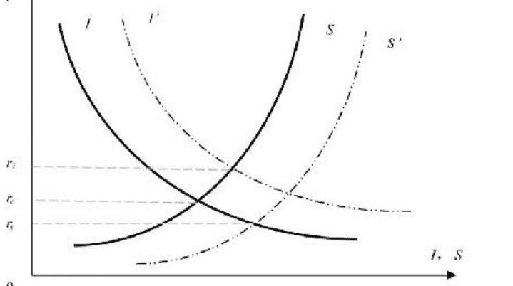

图3—10 马歇尔利率理论的储蓄—投资框架

资料来源：[英]阿尔弗雷德·马歇尔；《经济学原理》，严运亚，译，华夏出版社2005年版。

在图3—10中，马歇尔认为利率与储蓄的函数是增函数，利率与投资的函数是减函数，当储蓄与投资达到均衡时，得到均衡利率$r_e$，储蓄增加而投资曲线不变，则储蓄曲线向右移动，得到一个新的均衡点$r_s$，很明显地看到这种变动导致利率降低；当投资需求增长，使得投资曲线向右移动，当储蓄曲线不变，得到一个新的均衡点$r_s$，这种变动导致利率有所上升。

1930年后费希尔（Irving Fisher）在《利息理论》中首次提出了“人性不耐性（Human Impatience）”来解释利率的形成和决定问题。[29]费希尔认为人们对于现在的财货与未来的财货偏好是不同的，基于人类是否愿意接受财货的程度，这种程度即人性耐性。当人性耐性高，意味着现在偏好与未来的偏好之间的差异越大，需要越高的“贴水”进行补偿，才能满足借贷行为发生。费希尔同意配第的观点，认为利率的决定要素有两个：一是人性耐性决定的；二是投资机会决定的。

可以看出，货币派的共同特点是认为利率由实物资本供给决定，实物资本包括商品、土地、原材料等，并且认为储蓄和投资的平衡状态是利率达到均衡。基于上述辩论，逐步形成了第三派，也可称为现代利率理论。这一派最初可以追溯到19世纪末瑞典经济学家维塞尔（Wicksell）。他提出了自然利率与货币利率的区别：所谓自然利率是由实物资本供给决定；货币利率则受到金融机构操作的影响。希克斯（J.R.Hicks）首次提出了IS-LM模型，提出一般均衡利率。希克斯一方面肯定了亚当·斯密、冯巴维克等人关于利率理论，储蓄与投资对利率的影响；另一方面凯恩斯认为在货币市场和商品市场均衡的状态下利率才是均衡利率，而非自然利率。Hansen在1953年在《货币理论》书中继承了希克斯思想，重新推导了收入与利率的关系，最终确立了“一般均衡理论”。米尔顿·弗里德（Milton Friedman）从另一个视角构建了利率理论，他认为货币供给会在短期内使得利率下降，但长期来看，利率将回升，因为长期来看，货币供给的增加会导致消费需求也增加，从而使得利率上升。第三派理论通常称为现代利率理论，其特点是把第一派理论与第二派理论相结合，认为利率是由实物资本和货币供给共同决定的，从而引出一般均衡理论，即在货币市场和商品市场同时均衡时，此时利率为均衡。笔者认为，第二派和第三派的正确之处在于拨开了货币的限制，但是其错误在于将利率背后的需求设定在储蓄和投资的框架之中，因为投资本身是一个变量而不是需求是独立的决定性因素。投资本身会产生收益，储蓄又反过来影响投资，导致资本需求陷入储蓄的缠绕和反应之中。这里再次出现了第一章所批判的“错误划分”，由于对对象的逻辑理解不够，人们使用了错误的划分导致理论与政策的谬误。西方经济学在利率问题上、人口与财富问题上的错误具有相似性，这个逻辑错误在杠杆问题上再次见到。为了更直观地向读者说明自己的观点，笔者绘制图3—11来表示资金的供求及其背后不同的力量。

图3—11 储蓄—消费决定水平

资料来源：笔者自制。

由图3—11可知，如果直接观察利率博弈的战场，我们可以看到资金的供给和需求决定了利率。资金的供给方包括金融部门，其中有银行、保险、投资、券商、风险基金等；资金的需求方是实体部门，包括各种商品和服务的提供者，以及政府、投资公司和房地产厂商以及微创业者，实体与金融部门之间的力量决定了利率的高低。但是，社会学研究与券商的研究在于，学者总是需要考察表象背后潜藏的持久权力。各种融资项目方案、资金计划和交易虽偶然出了平均利率，但是决定性的不是利率。在利率乃至更广的问题上，结构主义从自由主义经济学的重大区别在于：他们认为资本非常重要，投资者非常重要，企业非常重要；而笔者认为真正的首是资本和消费者。所有的投资和创业都是没有意义的。在图3—11的右侧，实体部门的背后是消费者而不是企业家。由此我们把利率的决定转换变成了社会中两大部门的力对比：消费部门和储蓄部门。消费量与远端利率呈现正反关系。在这里，统计消费和储蓄的绝对值是不必要的，只要能估算出消费和储蓄两种力量的相对变化趋势，就能把握一个经济体的远端利率波动方向。那么利率如何估算这两者的对比？哪些因素导致了这两者出现变化？

# 二人口结构视角下的远端利率

有很多因素可以导致消费力量与储蓄力量的变化。比如一场实质性的政治经济改革打破原先的分割；或者通过贸易打开国际市场的大门，相当于引入了新的消费者；又比如技术新产品的出现，引发了新的一轮消费需求，当然不能排除战争或自然灾害带来总量资产的毁灭和重建的需求。但是，作为一个具有普遍性和结构性意义的要素，本节重点探讨人口年龄结构对远端利率的影响。探讨人口与利率与其他变量的关系并非首创，而是经济学金融学的一个开拓者。卡伦（Paul S.Calame）和卡瑞洛（Gerald A.Carlino）研究了美国货币市场账户、银行3个月存单（Certificate of Deposit）和6个月存款利率的影响因素，所列的七个假设的解释变量包括45岁以上人口占比和人口结构这两个人口相关的变量，最后人口增长率、人口年龄结构以及金融市场的行业集中度是对利率有最显著影响的三种变量。[33][34]将代际交易模型引入真实商业周期模型，对美国“婴儿潮”群体而言，退休时期的回报低于参加工作的回报。Davis（Philip）使用了OECD过去50年的数据进行实证研究，中国（40—64岁）人口占比上升，老年（65岁以上）人口占比上升。吉纳科普（John Gooplos）从生命周期出发，模拟人口结构波动的节点，建立了代际交易模型，证明了青年人口占比（20—49岁）人口数量与利率存在相关性。在另一篇文中，他提出了实际利率与人口增长率的关系。此外，阿塔纳西奥（Orazi Attanasio）和吉列尔莫·韦伯（Guglielmo Weber）研究了跨期分配对消费和储备的影响，他们调查了1978—2007年英国家庭支出与收入，分年龄段考察了各个年龄期的收支情况，结果发现生命周期中，消费轨迹始终遵循收入轨迹，且收入与消费的差值在45—48岁达到最大。卡罗尔（C.D.Carroll）和萨姆斯（L.H.Summers）早在1991年研究了消费随收入增长之间的关系[43]，他们证明了二者之间存在，他们选取加拿大、日本、丹麦、挪威、英国和美国按年龄划分对应的消费支出数据，把各个国家的趋势分析在一幅图上，发现不同国家人口年龄与消费支出趋势基本保持一致，都保持一个先升后后的趋势，在45岁左右达到顶峰。他们的研究消除了年龄差异带来的不确定性，即年龄—消费函数对于多数国家来说是具有普遍性的，这为作者的研究奠定了基础。笔者看来，人的消费有两个主要要素，一是现金流，其次是自身需求或说欲望；前者具有社会性，后者主要是生物性的。现金流来源于积累、收入或信贷，如果我们将人口的现金收入按年龄细分后除平均一下，会发现它整体上是以55—60岁为顶点的对称抛物线。这反映了一个基本事实，在正常社会中这个年龄段的人手中掌握了更多的信息、权力和资源。当然，重大技术革命和产业变革可能会相对年轻的群体突然突起，暂时改变这个曲线的形状。而人生的欲望是从头到尾下降的趋势；幼儿对整个世界充满奇，对风险和代价没有概念；越老，各种与生命力相关的激素逐渐减少，表现得越清心消欲，对世界逐渐缺乏兴趣和冲动。这两个趋势叠加起来趋其低值，便是人一生的消费曲线。

图3—12 中国家庭储蓄率与年龄分布

资料来源：哈瑞·丹特（Harry Dent）；《人口老龄化》，萧凛译，中信出版社2014年。图3—12反映的是储蓄率随着年龄的变化而发生的趋势，用S/Y进行了对数处理，可以看出在20岁的时候开始储蓄，20—40岁这一年龄段，储蓄率处于不断下降的状态，考虑到这一时期平均收入在持续上升，这意味着这一时期消费处于快速上升的状态。储蓄达到最低值是在45岁左右，在此之后60多岁阶段，储蓄出现大幅增长，因为消费减少间接导致储蓄增加。图3—12反映的是储蓄率相对年龄分布的变化，但也从侧面反映了消费与年龄分布的趋势。国内学者陈晓锐、李威等借鉴国外研究成果，考察了人口结构与财富水平之间的关系。他们假设青年时期的收入大于消费，而在老年时期的收入大于消费。因此，如果人口占比增加，资产价格上升；而老年人口数量增加，资产价格下降。美国、英国、法国等国家在第二次世界大战后出现“婴儿潮”期间出生大量人口，1960年后陆续进入中年，需求增加导致资产价格上升；而1980年后陆续进入中年，由于婚育、子女等需求推动了相应需求，从而长期来看利率下降。这说明利率的决定性因素是人口结构。诺贝尔奖获得者安格斯·迪尔顿（Alan Dynamics）和克里斯蒂娜·帕克森（Christina Paxon）研究了台湾人口结构对消费的影响，并选择了全样本、城镇样本和农村样本三个维度，最后得出结论：1）居民年龄分布与消费支出呈现“双峰”特征，最大峰值出现在45—50岁；2）养老保障对特定年龄有明显的影响；3）不同出生组的个体在一生的生命周期过程中，消费与年龄分布存在差异。

笔者认为，第二派和第三派的正确之处在于拨开了货币的限制，但是其错误在于将利率背后的需求设定在储蓄和投资的框架之中，因为投资本身是一个变量而不是需求是独立的决定性因素。投资本身会产生收益，储蓄又反过来影响投资，导致资本需求陷入储蓄的缠绕和反应之中。这里再次出现了第一章所批判的“错误划分”，由于对对象的逻辑理解不够，人们使用了错误的划分导致理论与政策的谬误。西方经济学在利率问题上、人口与财富问题上的错误具有相似性，这个逻辑错误在杠杆问题上再次见到。为了更直观地向读者说明自己的观点，笔者绘制图3—11来表示资金的供求及其背后不同的力量。

[content]
图3—11 储蓄—消费决定水平
资料来源：笔者自制。

图3—11 储蓄—消费决定水平
资料来源：笔者自制。

进入20世纪90年代，全球发展经济普遍进入了利率和通胀持续下的趋势。从本节的研究来看，背后的核心因素是第二次世界大战后生的婴儿潮进入了人生的“秋季”。与此同时，生育率因现代化带来的各种社会和制度变迁而持续下降。

相比之下，日本社会的少子龄化问题是严重的，因此长期利率的下跌最早。在金融危机之后，欧洲国家和日本已经进入了负利率时代，代表国债收益曲线15年以内的名义收益率都到了0以下。买入并持有的债券在到期时还可能不能变。这种局面在记载的人类金融史上从未出现，如今却在日欧蔓变；未来几年内假如美国资本市场泡沫破引发新一轮衰退，那么可能美元的中短期国债也会保持着的利率，是因为“为源头活水来”。这三个都是典型的移民社会，虽然其本土居民的生育率是在不断下降的，但是不断向青年年龄迁移的孩子其就业和消费带来了商业和产业的相关影响，从而帮助利率继续维持在正利率水平。

负利率时代的到来对储蓄者的利益构成威胁，而且对商业银行、养老保险和社会保障基金以及众多制造业和服务业都面临巨大的挑战。对于商业银行来说利差收入将被压缩严重影响，因为储户可以通考虑到现金资产之中而导致银行以利率下行的压力完全转嫁到储户上。对于养老保险和社会保障基金，最初设计的现金流模型往往是以资金池稳定的回报为假设前提的，而如今的利率已经告失效，未来只能通过风险获取风险回报，即在三位一体的风险—收益结构中要包含外货币资产，要选择高风险资产。传统制造业和服务业的困境并不是为了的引起的，而是由于少子龄化带来的需求萎缩而面临产能过剩的困难境地，也是因为他们的困境而导致了正常需求的日益萎缩。

当然，利率低直至负的过程中，我们可以看到资产泡沫、杠杆率高的普遍现象，一些新行业也会出现，比如有的企业一个季度都在赔钱，但是其创始股东和管理层可富过利，原因在于他们通过大笔融资获得了巨额廉价资本，然后通过向（年轻）消费者提供补贴和促销，而获得巨大的市场份额，并以此为由不断地要求金融市场及其背后的中老年储蓄群体投入更多资金以更高价格购买其股票。

显然，负利率时代也有益者，此前大胆持有有高风险资产的群体获得非常异常的高回报。但是更一个重要的主体是负债率的发达国家政府。由于名义负利率持续很长时间，这些用本货币计的负债将萎缩，此前高涨的债务率不会像人们所用线性外推所设想的那样涨到天上，而是进入一个稳定期直至落地。对于我们只需要观察日本政府的债务率就可以探明前景。

负利率时代意味着什么？欧洲和日本的案例值得我们做深度解析，全面理解和紧密跟踪。我们现在看到的其早期局面和初期趋势，负利率时代的政治经济学显然是一个课题，值得研究者深入挖掘。

- [1]本节内容选择并编辑自与Warren Coats博士合作的学术论文“Why the World Needs a Global Reserve Asset with a Hard Anchor?”、Frontier of Economics in China,December,2017，沃冴·赛蕾华博士长期担任国际货币基金组织SDR部门主管，并在20世纪90年代初期指导了苏萨东20多个国家的货币体系和中央银行系统重建。
- [2]Bernstein,J.,“Dethrone’s Dollar”,New York Times,August 2014,A25.
- [3]Dongsheng Di,Warren Coats,Yuxuan Zhao,“Why the World Need a Reserve Asset with Hard Anchor.,”Frontiers of Economics in China,Vol.12,No.4,2017,545-570.
- [4].Bernstein,J.,“Dethrone’s Dollar”,New York Times,August 28,2014,A25.
- [5].Austin,Kenneth,“Systemic Equilibrium in a Bretton Woods II-type International Monetary System: the Special Roles of Reserve Issuers and Reserve Accumulators,”Journal of Post Keynes Economics,V36,No.4,2014,p.607-634.
- [6].Pettis,M.,“An Exorbitant Burden”,Foreign Policy,September 7,2011,https://foreignpolicy.com/2011/09/07/an-exorbitant-burden/.
- [7].Meltzer,Allan H.,A History of the Federal Reserve,Vol.2,Book 2,Cambridge:Cambridge University Press,2008,Chapter 8.
- [8].Eliege,Robert Thompson,Helen,The Politics of Central Banks,Abingdon:Routledge,1998,pp.14-23.
- [9]刘元：《新自由主义的核心调节制度解析——美国主导的全球化中央银行体系的特征及其危机》，马克思主义与现实》2014年第四期。
- [10].关于全球经济的系统性通缩和通胀，本书所强调最大的根源是人口年龄结构而非其他因素。石油危机和央行的独立性通常只有短暂和局部的的影响。
- [11].Woolley,John,Monetary Policy,The Federal Reserve and the Policy of Monetary Policy,Cambridge:Cambridge University Press,1984.
- [12].Goodman,John,The Politics of Banking in Western Europe,London:Cambridge University Press,1992.
- [13].美联储从1993年开始采用利率替代作为货币政策中枢，并尝试基于规则的决策模式。此后，美联储的利率决策涵盖了以下发展：第一阶段（1993年至2008年）采用宽松规则，其特征是在通胀和长期目标之间的分配中的权重系数，通过对通胀调整来实现目标。与之伴随着长达多年的所谓和平（great moderation）时期。第二阶段（2008年至2012年）采用修订规则。面对衰退的特殊环境，美联储采取了一系列非常的政策，其中之一就是修订规则，旨在向增长和就业一边。使用利率替代，通胀率对GDP增长视为长期指标，将未来两年的通胀预期视为历史数据，因其具有前瞻性。第三阶段（2012年至2018年）采用宽松规则（Charles Evans），在深度衰退之后的复苏阶段，在长时间内维持超低利率是最决策。陆明：从宽松规则到最优控制，《金融研究》2013年。
- [14]陆明：从宽松规则到最优控制，《经济学》2014年第五期。
- [15]陆明：从宽松规则到最优控制，《金融研究》2013年第四期。
- [16]陆明：从宽松规则到最优控制，《经济学动态》2015年。与合作者作为JMF的高级官员建立起银行体系。
- [17]强弱货币在前后含义是不同的。早期是为了捍卫美元相对于篮子的汇率，后期的含义是确保美元在全球市场，包括结算、投资和储备所有环节，即确保其不是汇率。
- [18]Fleckenstein,William A. and Sheehan,Frederick,Bubble: The Age of Ignorance,New York: McGraw-Hill.
- [19][美]希沃·俄罗斯：《美国权力的滥用——对美国霸权》，萧清译，商务印2004年。
- [20][美]保罗·克劳格斯：《萧条》，刘波译，中信出版社2009年。
- [21]Alan Greenspan,“The Crisis”,Brookings Institute,March 2010.
- [22]戴金平等：《全球货币量化，何时退出？》，厦门大学出版社2012年。
- [23]Farmer,R.E.,Qualitative Easing: How It Works and Why It Matters,National Bureau of Economic Research,2012.
- [24].Farmer,R.E.,“Quantitative Easy: a New Tool for the Stabilization of Financial Markets”,Bank of England Quarterly,Vol.4,2013,pp.405-413.
- [25]余振、顾逸、吴莹，“宽松货币政策的作用机理与实施效果——基于中日比较的视角”，“国际经济评论》2016年第2期。
- [26]本文的基本框架是读者哈瑞·丹特于“人口爆炸”书中的启示，研究过程中收集资料，其中一部分内容已写入其硕士论文中。
- [27]在收益领域，人们常用远利率的概念，通常指十年至三十年的利率水平；在一般的学者中，长期利率是常用的概念。由于利率在短期波动和长期趋势的区别，为了避免中文表述的混淆，本书使用了远利率的概念而非长期利率。
- [28]英托玛·达斯·尼基拉斯·帕尔巴尔、达德·诺西，“贸易（三种）”,顾为群等,商务印2009年。
- [29]见其《资本与利息》及《资本实证论》两书。[奥地利]庞巴维克：《资本与利息》，何曾普、高德超译，商务印1959年。[奥地利]庞巴维克：《资本实证论》，陈瑞译，商务印1997年。
- [30]刘阿尔弗雷德·马格尔：《经济学学理》，廉运佑译，华夏出版社2005年。
- [31][美]菲菲勒：《利息理论》，陈彭如译，上海人民出版社1999年版。
- [32]维克霍尔在1898年出版的《利息与物价》和1906年出版的《国民经济学讲》两书是其代表作。
- [33]Demographics and Financial Asset Prices in the Major Industrial Economies”,Public Policy Discussion Papers,April 2003.
- [34]J.R.Hooks,“Keynes and the Classics’;A Suggested Interpretation”,Econometrica,Vol.5,No.2,1937,pp.147-159.
- [35]Economic Review,Vol.58,No.1,1968,pp.1-17.
- [36]Calem,Paul S.and Gerald A.Carlino,“The Concentration/Conduct Relationship In Bank Deposit Markets”,The Review of Economics and Statistics,Vol.73,No.2,May 1991,pp.268-276.
- [37]Brooks,G.,“What Will Happen to Financial Markets When the Baby Boomers Return?”IMF Working Paper,January 2000,https://www.imf.org/~media/WebSites/IMF/imported-full-text-pdf/external/pubs/ft/wp2000/wp_0018-ashx.
- [38]Davis,E.Philip and Christine Li,“Demographics and Financial Asset Prices in the Major Industrial Economie”,Public Policy Discussion Papers,April 2003.
- [39]Geanakopols,John Demography and the Long-Run Predictability of the Stock Market,Brookings Papers on Economic Activity,Vol.2004,No.1,2004,pp.24.
- [40]Geanakopols,John,The Impatience Theory of Inflation-Indexed Bond with Overlapping Generations”,The American Journal of Economics,Vol.64,No.1,2005,pp.257-306.
- [41]Deaton,A. and Paxson,C.,“Growth and Saving among Individuals and Households”,Review of Economics and Statistics,Vol.82,No.2,2000,pp.212-225.
- [42]Attanasio,Orazio P. and Guglielmo Weber,“Models of Intertemporal Allocation and Their Implications for Public Policy,”Journal of Economic Literature,Vol.48,No.3,2010,pp.693-751.
- [43]Carroll,C.D. and Summers,L.H.,“Some New Evidence on Economic Performance,”Chicago: University of Chicago Press,1991.

# 第四章 金融与自由主义的兴衰

## 第一节 金融利益在政治体系中的崛起

美国的选举民主允许各种利益集团参与政治，让他们在不同议题上卷入政策决策。

[2]查尔斯·罗米尔·查尔斯（Charles W.Caro）和哈勃蒂（H.Haber）在他们的著作中谈到了政府在银行体系面前面临的利益冲突；其中最明显的冲突就是，政府要对银行的冒险行为进行控制，同时又视其重要的公共资金来源，使得政府具有一种动力，将政府塑造为有利的融资放在首位。

在政府和金融业之间存在着“旋转门”——关键人员在政府和部门之间的双向流动。上文提到的剑桥大学哈勃蒂·哈勃教授的职业生涯是一个很好的例子。笔者提到的2005年，他获得了剑桥大学博士学位之后，在20世纪70年代初加入了美国联邦政府，并幸运远距离勃尼克·麦菲斯的政府，到了里林根时代，他成为助理国务卿绍·奥布特总统的第二任期竞选胜即出自他的手笔，但是失败之后转型金融界，成为一家商业银行的董事长，任期内收购了另一银行获得部分股份，最后又把银行卖了更大的银行，从而在短短内成为亿万富翁，并利用其财务资源开办电台频道。小布什阁曾试图延聘其入圈，但他由于理念分歧被拒绝，回归学界成为剑桥大学的教授。哈勃教授的人生其实并不是整个美国政界的边缘缩影而已。笔者接触过的美国精英阶级中不乏的故事，但是也有几代政治世家在政界中不断传承。

上述数字绝对不小，对于美国政府机构的开支，竞选捐赠的规模可谓九百亿美元。考虑到国家法案和政策决策带来的利益，竞选捐赠带来的“金钱—权力—金钱”杠杆回路是惊人的。这就不难解释华尔街对政治的持久性：通过投入大量的资金，美国金融机构可以“收买”许多议员、政府官员以及金融监管机构的权力，而这些权力可以在各个领域转化为政策，最终转化为金融市场上有利相关机构的价格变动。政府应该是金融业的监管者，但是金融业的政治选举巨额投入成功获得了自身的监管者。作为报告，政府在金融危机之前的很多年内没有出台任何约束力的金融政策，即便是在金融危机之后，所出的监管法案也是“没有牙齿的老虎”。政策的制定者应该督促金融监管机构对金融业施加更为严厉的监管以抵御风险，但他们失去了这种动力。此外，国际货币基金组织主席首席经济学家西蒙·约翰（Simon Johnson）曾指出，金融业是政治选举中最主要的捐者之一，但是它的影响如此大，以至于它不必燃烧烟草或者车辆运输，愿望通过政治方式直接获得某种好处。

图4—金融利益在美国大选上的花费
资料来源：武汉大学，《美国金融危机与监管》，2010年第四期。
图4—金融利益在美国大选上的花费
图4—金融利益在美国大选上的花费
图4—金融利益在美国大选上的花费

与华尔街势力结而被排挤界的反面范例。如图4—2所示，美国历届政府最重要的30个职位中，具有华尔街背景的任职者比例不断上升，在克林顿时期曾有一半以上的白宫官员来自华尔街。即使千禧年后有下降趋势，依然比30年前高出许多。[4]

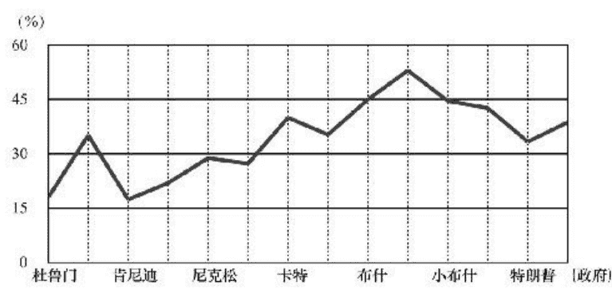

图4—2 宫内重要职位中有华尔街背景的任职者占比

资料来源：笔者统计整理。

罗伯特·鲁宾斯（Robert Rubin），曾担任高盛主席，然后完成了克林顿时期的财政部部长，之后又回到高盛、花旗集团的执行委员会主席；亨利·保森（Henry Paulson），高盛原首席执行官，后成为小布什政府的财政长。瑞瑞·甘斯莱（Robert Gensler），作为高盛财务主管，在克林顿时期担任美国财政部副部长，是美国去监管规范的积极支持者；约翰·斯诺特（John Snow），曾担任财长，后成为赛伯斯（Cerberus）资产管理公司的主席；杰特拉斯·克莱格（Gerald Corrigan）一直是担任纽约联储储备银行的行长，后来成为了高盛的行政人员。而威廉·杜特利（William Dudley）则成了反向的“旋转”，他先作为高盛公司的合伙人和董事总经理，后来成了纽约联储储备银行的行长。财政部副部长萨克斯（Lawrence Sachs）是世界银行首席学者，还是D.E.Shaw对冲基金高级主管，同时兼任大通、花旗集团、美林证券、高盛集团的顾问与培训师。此外，格拉斯·森（Alan Greenspan）任联邦储蓄主席之后，担任太平洋资产管理公司（PIMCO）的高级顾问，为该公司在全球债券市场的领头羊地位护航。[5]在中层级上，双方更是存在巨大的人员流动。这种交织现象，不仅强化了自由主义价值观从华尔街向华盛顿的渗透，更是把高盛这样的变成了华尔街高级干部培训学校，让华尔街的影响力扩张到了无法忽视的地步。在2008—2009年的金融危机时期，这甚至一度引起了“高盛政府”（Government Sachs）的说法。华尔街与高盛之间的人事交流与游戏成功创造了一套信赖系统，从而推动了金融与资本的运作。即便在一个金钱至上的社会中，让政府的决策者们普遍相信“华尔街的利益就是对美国利益的”。

在政治和金融的共同信任下，金钱崇拜的华尔街投机价值进一步拓展了整个美国市场。就连美国的大学教授也受到这种社会的影响，不仅是经济界的获利者，还包括科学、理论物理、气象学的教授和博士，都把人才和职业倾向推向华尔街，利用自己在金融市场上赚取高额利润成为赢家。以华尔街为代表的金融集团与美国政府，尤其是财政部、联储储备委员会、证券交易委员会之间的关系是你中有我、我中有你，形成了一个关系紧密的政商合体，而IMF、世界银行、华尔街金融机构、美联储和美国政府属于这个政商合体的不同部分。处于中心位置的是大型银行、保险公司、投资银行和对冲基金，他们对美国的国贸、贸易、能源、金融乃至外交政策都有非寻常的实质性影响。尽管克林顿当时时期出了《1995年股票披露报告》以限制利益集团体系被滥用，政商合体依然左右美国政府国内和国际的经济与金融政策的走向。金融集团利用这些有着双重背景的精英向政府施压力，使政府通过了宽松金融监管的法律及相关政策。

[6]诺贝尔经济学奖得主赛格夫·斯拉斯格米 曾指出，政治游说放大了利益集团的政治诉求，扭曲了美国政策制定的过程。[7]

## 二 金融去监管化

自20世纪70年代中期以来，金融监管的宽松、新的金融工具的创造和信息通信技术的发展，美国的金融部门与全球的金融业都被高度整合和串联起来，金融成为“全球化”最适用的领域。通过政治游说和人员旋转成功地渗透了华盛顿政治权力，最大的诉求是金融去监管化（financial deregulation）。

表4—1 20世纪后金融去监管化的标志性事件

| 时间 | 主要内容 |
| :--- | :--- | :--- |
| 1978年 | 《马萨诸塞银行豁免与国民法案》(Massachusetts v. First National of Boston) | 部分取消高利率 |
| 1980年 | 《存款机构放松与货币控制法》(Depository Institutions Deregulation and Monetary Control Act) | 取消定期上限 |
| 1982年 | 《存款银行法》 | 允许存款跨地区 |
| 1987年 | 《储蓄与存款法》 | 允许存款设立基金 |
| 1989年 | 《金融保险改革与复兴法案》(Financial Insurance Reform and Recovery Act) | 允许存款机构收购 |
| 1994年 | 《利率限制贷款法案》(Interest Restricting Branch Lending Act) | 取消了州际银行限制，允许银行行业扩张 |
| 1996年 | 《银行修正案》(Gramm-Leach-Bliley Act) | 取消了银行保险限制，允许银行控股公司 |
| 1999年 | 《金融服务现代化法》(Financial Services Modernization Act of 1999) | 规定银行和保险公司可以合并 |

资料来源：Sherman, “A Short History of Financial Deregulation in the United States”,Center for Economic and Policy Research,2009。

表4—2 记录的是20世纪最后20年美国金融体系去监管化的趋势。总来看，包括以下几个方面：监管只能产生很多障碍，首先是市场化和自由化。“Q条例”限制了存款利率上限，使得银行对投资者的吸引力下降。1980年，美国国会通过《存款机构管制与管理法案》，此开了利率市场化的序幕。1980—1983年，美国政府开始允许金融机构将亏损资产从资产负债表转移到表外持续增长。之后美国废弃了“Q条例”，最终在1986年实现了利率市场化。其次允许金融机构之间的竞争与合并。1994年的《银行与分支机构效率法》取消了地理界限对银行的限制。1999年美国参众两院均通过了《金融服务现代化法》，正式废弃了长期作为金融监管基础的《格拉斯—斯蒂格法案》，结束了银行、证券公司和保险公司分业的历史，允许商业银行、投资银行和保险公司合并为金融控股公司，加强了金融机构之间的竞争，标志着美国金融业务正式进入经营时代。

最后，联邦政府对金融衍生市场的监管也被纳入。2000年的《大宗商品现代化法》（Over-The-Counter，OTC）不在监管局的管范围内。这一方案将影子银行使用的证券化和信贷衍生品归为OTC交易，为影子银行带来福音，使OTC交易迅速灵活。《商品期货法》将商品分为三类：政府严格监管的农产品，有限监管的金融产品（利率、外汇、股指）以及金融产品以外不符合监管的所有商品（主要是能源产品）。另外，对“电子交易设施”上进行的交易放宽监管。

总之，在20世纪80年代的金融管制过程中，通过存款和贷款利率的解除，使得金融业的竞争得以加强使得更高风险交易的进行；开放了金融机构的地域和经营范围的限制，使得金融有条件通过并购和收购进行扩张；通过《金融服务现代化法》实现对《格拉斯—斯蒂格法案》的替代，为银行和保险公司之间的并购成为可能从而刺激了金融部门增强的势头。同时，由于金融政策监管的松弛，华尔街创造了大量数字化的金融工具，金融产品快速发展，金融监管放宽已经难以跟随金融工具的复杂性做出相应的调整。随着20世纪—90年代金融部门的急猛扩张，一些金融活动开始从政府监管下的市场和机构，转移到那些监管力度较低或没有监管的影子市场，包括抵押贷款经纪人、对冲基金、私募基金、资产负债表结构性投资工具和激增的不透明的金融衍生市场，特别是债务抵押债券和信用违约期。[9]

在这一时期，反对也有有利于监管。主张为金融部门松绑的声音，主要来自右翼的经济学家、银行家以及那些支持自由放任的政治家。一部分金融经济学家为金融部门的监管提供了一些支持的理论。其中最具代表性的是芝加哥大学学者法玛（Eugene Fama）在1970年提出的“有效市场假说”理论，也是2013年获得诺贝尔经济学奖的重要原因。“有效市场假说”认为证券价格能够反映出相关的资产净价值，金融界看来，市场本身具有定价能力，且对基础价值的偏离迅速缩小。学术界提供的量化工具解释了：在市场精准定价的前提下，任何复杂的衍生品都可以套利。金融部门创造的各种量化工具让投资者相信这种行为本身不会造成基础价值的扭曲，是一种既能获利又能有效控制风险的办法。因此，“有效市场假说”观点的右翼经济学者，努力推广主义和“市场万能论”，认为监管只能产生很多障碍，无效。

金融化（Financialization）的出现，是由于监管放松的作用。总来看，在相当一段时间内，政策制定无意地弱化了金融部门的作用。大学中的教授希望通过量化模型的设计，让人们预测市场的未来；另一方面，量化模型试图证明，经济中最可能的事情莫过于政府干预。支持放任的政策制定者是金融监管的另一个重要手。1981年，里根当选为美国总统，他在就说中谈到政府是问题本身，这为后来金融业的去监管奠下了基调。20世纪80年代初期，自由市场主义和“市场万能”倾向在这一时期占据了上风，并在政策制定中拥有了话语权。金融快速发展从克林顿到布什时代的去管制中积累力量。配合着经济学家的理论，美国金融业创造了一种“金融部门的繁荣意味着经济的繁荣”的图景，在经济领域的无伦比地位。通过货币政策的引导和监管的变化，帮助金融部门实现崛起并不断强化金融业在经济活动中的正面形象。

## 三 金融压倒实体

第二次世界大战后的美国经济经历了一个脱实化的趋势，并在20世纪70年代加速。所谓金融化，不是说美国制造业的绝对没落与空洞化（事实制造业的规模在全球范围内增加了），而在本国经济中的相对占比持续减少，就业人数持续下降。这种金融压倒实体的经济化实现在金融部门的利润率长期高于实体部门，更重要的是实体部门也开始纷纷金融化。许多著名的实业大公司仍然保持了增长，但是其业务利润的主要部门已经是客户消费信贷或者投融资业务而不是生产和销售本身。美国经济如何从全球最大的制造业强变成一个越来越虚拟化的经济体？

自20世纪80年代美国金融部门的利润占比持续高于制造业，导致资本从制造业退出向金融转移。与其伴随的是制造业占就业人口的比例从1946年的35%下降到2008年金融危机爆发时的8%。如图4—3所示。

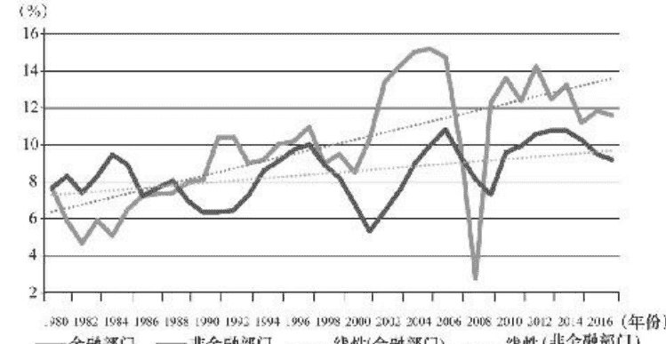

### 图4—3 金融部门与非金融部门利润占比（相对于该部门GDP增加值）

资料来源：Khatiwada S.,"Did the Financial Sector Profit at the Expense of the Rest of the Economy? Evidence from the United States",International Institute for Labour Studies Discussion Paper DP/206/2010.Geneva: International Labour Organisation,2010.及美国经济分析局网站。

美国经济学对于美国制造业就业占比下降的传统解释是技术进步导致了就业结构的变迁。但是当我们亚洲经济体转型为制造业的就业占比与美国数据在同一时期的时候，便可以清晰地看出外包是不可忽视的一个因素。事实上，欧洲的制造业就业占比并未下降并与美国一般引起瞩心，而技术进步在美国、欧洲和东部是几乎同时发生的。美国制造业的萎缩，本人认为首要因素是全球化的必然结果。正如弗利特（Charles Weiss）教授在其专书中指出的，金融化是全球化过程中的趋势，无论哪种贸易都会导致工业化。金融化使得华尔街不仅不是伤害，反而是巨大的助力。金融化使得金融部门在GDP中的占比不断增长。

图4—4 美国金融部门在GDP中所占比例（百分比）

| 1860 | 10% |
| 1900 | 15% |
| 1920 | 18% |
| 1940 | 20% |
| 1960 | 25% |
| 1970 | 30% |
| 1980 | 35% |
| 1990 | 40% |
| 2000 | 45% |
| 2007 | 50% |
| 2008 | 52% |
| 2010 | 55% |
| 2012 | 58% |

资料来源：Philippon, T., “The Evolution of US Financial Industry from 1860 to 2007”,New York University,http://people.nyu.edu/papers/finize_old.pdf.

图4—4 展示了自19世纪中期以来金融部门在GDP中所占比例的变化。

从20世纪30年代随“大萧条”而来的金融管制到监管开放的80—90年代，金融自身被分割成相互独立的若干部分，从主要的商业银行和投资银行，到消费和信贷银行和保险业，这些独立的行业分别各自的经营业务。但是，随着20世纪80—90年代的若干法的通过，金融的内部关联与其他经济领域的界限变得宽泛，金融的参与主体变得更加广泛。长期以来，1933年《格拉斯—斯蒂格尔法案》确定的银行经营的原则，防止了商业银行与投资银行之间潜在的利益冲突，避免了拿着贷款公司相关财务的银行参与证券的交易中。1999年的《格雷姆—霍奇—利奇法案》，即《金融服务现代化法案》解除了相关的限制，使得银行和保险公司的合并成为可能，银行事实上可以通过公司之间进行金融活动。此外，之前银行面临的管理的限制也被解除。1927年《麦克法登法案》（The McFadden Act）和1956年《格拉德斯修正案》，禁止了银行跨州建立分行和收购，地管理的界限有效限制了单一银行对相关业务的全国性垄断。而1994年的《米尼尔州银行业务与分支机构效率法》取消了银行的并购限制，允许商业银行在全国范围内建立分支银行，许多地区银行发展为国家级银行。为了抢夺更多的市场和利益，银行部门加强强联动，金融领域走向市场，并引发了20世纪90年代银行的“倒闭潮”。表—2比较的是1982年和2001年美国名前十的银行，跨州银行的合并，使得原本在金融领域的绝对统治地位，而排前的银行的所持资产比例高十分人，显然完成了相当规模资本的吸收，其中吸收来自自家储蓄的银行，个人储蓄和退休金开始向权益基金市场增长。尽管这些成长为“全能银行”的超级巨头，并没有表现比过去更好，但是令银行向合并和混业经营的银行制度化转型，仍在较长一段时间里，被认为是克服了监管带来的种种弊端，增加了生存抵抗能力，并为美国的经济注入了活力。

### 表4—1982年与2018年美国资产前10名的银行控股公司变化情况

| | 1982年 | | | 2018年 | | | |
|---|---|---|---|---|---|---|
| 排名 | 名称 | 总部 | 资产（十亿美元） | 名称 | 总部 | 资产（十亿美元） |
| 1 | 花德银行 | 纽约 | 121 | 摩根大通 | 纽约 | 2219 |
| 2 | 富业银行 | 纽约 | 119 | 美世银行 | 上萨 | 1783 |
| 3 | 人生银行 | 纽约 | 78 | 高盛银行 | 上曼 | 1689 |
| 4 | 汉华银行 | 纽约 | 69 | 德华 | 纽约 | 1407 |
| 5 | 摩根银行 | 纽约 | 63 | 美国联合银行 | 纽约 | 949 |
| 6 | 太古银行 | 纽约 | 56 | 盛美银行 | 亚特兰大 | 837 |
| 7 | 化学银行 | 纽约 | 45 | 第五金融公司 | 纽约 | 305 |
| 8 | 第一美国银行 | 纽约 | 42 | 兰敦投资公司 | 伦敦 | 305 |
| 9 | 美国联邦银行 | 纽约 | 35 | 威尔士银行 | 纽约 | 286 |
| 10 | 州第一银行 | 纽约 | 33 | 通商银行 | 西雅 | 242 |

资料来源：Moody's and Bank Financial Manual,1982;2018; Federal Reserve "Large Commercial Banks,"December 31, 2018,https://www.federalreserve.gov/releases/br/

同样的趋势也是可能的，美国的领导者在制定企业策略时开始更加关注在满意的环境中保护企业。他们更加关注市场份额、股票价格、投资回报和个人财富的竞争中获得成就。

1982年后，美国的监管放松为企业并购提供了机会，20世纪90年代的浪潮开始，使得许多银行在全国范围内建立分支银行，许多地区银行发展为国家级银行。为了抢夺更多的市场和利益，银行部门加强强联动，金融领域走向市场，并引发了20世纪90年代银行的“倒闭潮”。表—2比较的是1982年和2001年美国名前十的银行，跨州银行的合并，使得原本在金融领域的绝对统治地位，而排前的银行的所持资产比例高十分人，显然完成了相当规模资本的吸收，其中吸收来自自家储蓄的银行，个人储蓄和退休金开始向权益基金市场增长。尽管这些成长为“全能银行”的超级巨头，并没有表现比过去更好，但是令银行向合并和混业经营的银行制度化转型，仍在较长一段时间里，被认为是克服了监管带来的种种弊端，增加了生存抵抗能力，并为美国的经济注入了活力。

同样的趋势也是可能的，美国的领导者在制定企业策略时开始更加关注在满意的环境中保护企业。他们更加关注市场份额、股票价格、投资回报和个人财富的竞争中获得成就。

1982年后，美国的监管放松为企业并购提供了机会，20世纪90年代的浪潮开始，使得许多银行在全国范围内建立分支银行，许多地区银行发展为国家级银行。为了抢夺更多的市场和利益，银行部门加强强联动，金融领域走向市场，并引发了20世纪90年代银行的“倒闭潮”。

同样的趋势也是可能的，美国的领导者在制定企业策略时开始更加关注在满意的环境中保护企业。他们更加关注市场份额、股票价格、投资回报和个人财富的竞争中获得成就。

## 第二节 全球化的兴起：从自由主义到民粹主义

### 全球化的兴起与剧变

所谓广义全球化，是指自地理发现以来，人类运行共同体态，人类借助航海及通信的发展，突破高山、海洋的阻隔，通过贸易、战争、思想传播等方式，跨越相互依赖、融为一体。狭义全球化，是从1979年之后，西方国家的一轮浪潮，它在：
- 经济领域表现为商品贸易、跨境资本流动的增长和价格波动；
- 政治上看表现为美国霸权；
- 社会领域表现为新自由主义意识形态以及生活方式的流行。

广义全球化是一个长期趋势，由一系列前进组成：许多情况下，在合力的驱动下，悄然渐进，但也会出现退潮。在1979年以来的，逆全球化其实是对这种激进趋势的合理修正。如今，美式全球化的退潮本身是全球化自然所需的组成。

2008年金融危机期间，美国国际集团（AIG）陷入险境。作为世界保险和金融服务的领导者，业务涉及全球30多个国家的财产、人寿保险、退休金管理、金融服务及资产管理，一旦破产，美国的金融体系甚至整个经济体系都无力承受。鲍长·鲍森在危机发生后，与时任高盛的CEO布兰克福会面，建议美国政府出手，授权为国际集团获得85亿美元的贷款。“大而不能倒”是政府为了维持金融系统稳定性所产生的一种现象，为大型金融机构的地位提供了支持，但是也产生了相当的道德风险。政府的安全网弱化了金融业的市场纪律，因为在这种情况下，储户知道自己的利益在银行倒闭时可能会受到损失，银行也受到风险鼓励，当贷款得偿还，银行将获得超额利润，但如果贷款不能偿还，银行纳税人将承担风险。这会导致滋生性借贷。这使得美国金融业在蓬勃发展的同时，也加剧了美国金融市场的失灵。在1991年通过的《联邦存款保险法》试图弥补漏洞，其作用和效果微乎其微，许多学者对于1980年的监管和银行的大而不能倒提出了质疑。特恩斯、霍尔德2004年的著作里提出了他们观察的大而不能倒引起问题的理由：
- 银行的并购使得银行变得巨大，与政治的联系极为密切，一旦面临破产就会更加强烈要求财政救助；
- 合并后的银行会以力可能导致系统性风险为由索取而不对付；
- 小型银行因技术的发展加强了相互的联系而免于崩溃，同时，技术进步使得银行越发依赖资本市场的运作，使得银行变得更加弱鸡；随着金融工具的制造，银行变得越来越困难，很难防任一家机构的破产。因此，去监管而不不能形成中无用巨大。

总之，在20世纪的最后20年里，美国金融领域发生了巨大的变化。政府的监管规则影响国内既得利益集团的利益，特别是来自华尔街的金融利益集团的经济利益，同时也受到国内利益集团对改变金融监管制度的左右。这体现了权力与财富的分配关系是相互影响和相互作用的。以美国为代表的西方发达国家，开启了金融自由化改革的进程。包括金融机构、学术界、企业和政府在内的参与方，共同推动和见证了金融部门是如何在在此期间快速崛起并成长为一个庞然大物。

## 二 新自由主义的流行与扩张

在思想文化领域，1979年开始的全球化的兴起和扩张直接冲击了原有的西方主流经济学理论。20世纪70年代的滞胀与危机冲击了凯恩斯学派，新自由主义的兴起在1979年和1980年代，新自由主义在英美执政下获得了全球性地位，深受萨尔顿、弗里德曼等西方学派的影响，里根和撒切夫人甚至喊出了“没有其他选择（There is No Alternative）”。

新自由主义的思想源头可以追溯到：密西、新古典经济学、奥地利学派、凯恩斯主义的批判、货币主义以及。相比传统自由主义，新自由主义强调市场在全球资源配置中的作用。如果说传统自由主义认为市场失灵，那么新自由主义则认为政府也不会失灵。在20世纪80年代，监管的放松和随之来的全球化，使得许多发展国家在改革过程中，接受了美国的一套“华盛顿共识”，之外还强调：
- 市场体系的扩张；
- 削减公共支出；
- 减少许多补助；
- 放松国内市场；
- 削减资本和市场开放；
- 引导出口的增长。

对新自由主义扩张最大的力量来源于美国的金融危机以及由此引发的全球金融危机。
- 对金融市场的放弃；
- 对监管的松懒；
- 或者更糟糕的是，监管者被金融利益挟持，才理解了危机的根源。西蒙·约翰曾任国际货币基金首席经济学家，他观察过大量身陷金融麻烦的发展中国，深知各种不同的经济危机背后有一群势力利通、胡作非；政策最终结出的政治寡头。他写道，“如果你把金融机构的名称覆盖掉，把（2008年金融危机）的报告拿给金融组织的专家看，他绝不会假思地告诉你，先同那些祸首的寡头割清楚楚，让他们成为牺牲品，然后我才会给你贷款”。但这次危机不是发展中国家的危机，而是美国华尔街的金融机构，以及久后欧洲也被传染引发的大银行。

信奉新自由主义理论的盛衰专家们、政客们为美欧拿出了何种解决办法？并不是在“结构”上动手术，而是除毒害，而是货币化宽松（QE）、政府救助（bail）。
- 通过政府买入企业债券来稳健许多银行；
- 再通过大量印钞把利率压到零甚至负数，使广大发展中国家、外币储备国家和老年储户一起拆分他们的利益；
- 并试图通过贸易保护主义和再工业化来走近出口，而创造了天大的华尔街精英寡头。

新自由主义的实践或者尝试，先是在广大发展国家，然后在发展国家内部首先遭遇了显而见的失败。俄罗斯和东欧国家在接受了调整之后，经济动荡，资本大量外流，货币暴贬，社会道德和秩序崩溃，俄罗斯在借助2001年之后的能源大市的力量暂时稳住局面，而其他国家则沦为西的附属。南、拉美和东南亚在制造业上被中国超越，与俄罗斯一起成为重要的原料供应。私有化铁路和其他公共设施并未引入英国和拉美带来了新自由主义的好处，反而许多国家加入公有—一有一归有的割据和环循环。

可想象的。

## 三 贫富化与阶级崛起

新自由主义全球化进程带来了严重的再分配效应，最大受益者是华尔街，而最大受损者则是美国和欧洲的中产阶级尤其是蓝领中产阶级。[25]根据美国人口皮书发布的研究显示，截至2015年初，美国低收入和高收入人口总计1.213亿，超过了1.208亿中产阶级人口规模，2015年中产阶级占美国成年人口的比例只有50%，低于1971年（61%）。中产阶级收入占美国家庭总收入的比重从1970年的62%大幅降到2014年的43%，而同期富裕阶级占美国家庭收入的比重从29%升至49%。上述数据说明中产阶级萎缩已成为美国社会结构变迁的首要特征。[26]

图4—6说明，在全球化时代美国中产阶级的规模持续萎缩，所谓“核心型社会结构”早已成为常年往事，从21世纪开始，美国家庭收入的中位数也在下降之中。

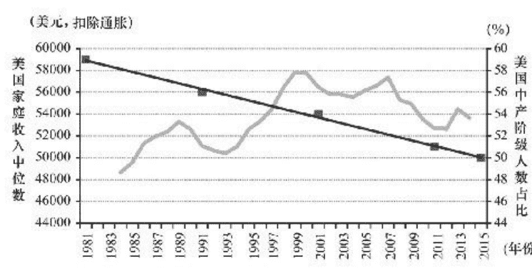

家庭收入中位数（左坐标）——中产人数占比（右坐标）

图4—6 美国中产阶级成为全球的相对输出家
资料来源：美国人口普查局，皮尤研究中心。

全球化的再分配效应不仅发生在美国在国内，在全球层面上也是明显的。按照美国财政部部长长帕格斯坦等人的研究，通过一系列自由贸易协定，输出一个制造业美国，美国GDP就可以增长150万美元。[27]而在20世纪90年代的美国本土自由主义经济学家们反复论证说，制造业减少90%的因素是由于技术进步而非对外贸易，这种说法直到近年仍有转变。

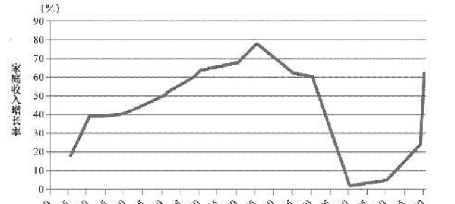

图4—7全球大象曲线：全球人口的收入增长率（1988—2008年）

资料来源：“经济学家”网站。

不同要素的跨境流动能力是不同的：资本会越来越多趋向自由主义的政府的欢迎，而劳动者很容易被推于门之外，所以资本对于劳动的谈判地位由于全球化而获得优势。整体上，全球化使得南北国家间的发展水平差距缩小，但是各国内部的富贫差距在加大。资本和产业的流动，原本存在国家间的差距逐步内化到各国社会内部。发展中国家的商业和政治精英所能获取的财富量向发展国家的精英阶层跨，欧美发达国家的部分居民由于失业而向发展中国家的下层靠拢。近年流行国际政治经济学的大曲线是由克里斯托夫·雷·雷克纳（Christoph Lakner）与布兰科·米拉诺维奇（Branko Milanovic）所绘，它非常直观地告诉读者，美国中产阶级的收入中位数在扣除通胀之后是下降的，他们是全球化时代的输家。[28]

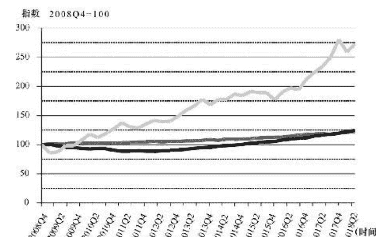

图4—8 2018年四季度至2018年二季度以来美国的财富再分配
资料来源：笔者根据Wind数据库制作。

贫富分化的趋势已经出现了了很多，但是为什么会在2016年之前后出现如此剧烈的加速发酵呢？笔者认为此与后金融危机时期的“救市”方式有关，具体来说，就是为了应对金融危机，美联储的额外印出来的钞票装进了富人的口袋里，进一步放大了已经严重的贫富分化。2009年之后，美、欧、英、日各大行都先后抛弃了正常的货币政策转型和纪律，迅速扩张基础货币买入有毒资产，搞起量化宽松和宽化宽松，将利率压到零甚至负值。长期的低利率产生了严重的再分配。流动性进入了股票市场和大商品市场，少进入房产市场，更进入实体经济，形成了低就业率。如图4—8所示，美联储的资产负债表扩张了将五倍，压低了短期利率，高管们借低利率回购自己的股票从而让自己手中的股票变得有利可图，这种法驱动美国股市十年内上涨了四倍却没有像样的调整，美国房价和劳动者工资没有怎么涨。

美国民主主义的崛起，既有左翼民主主义占据华尔街运动和桑德斯阵营，又有右翼民主主义如茶壶运动的兴起和特朗普对共和党的“借壳上市”。愤怒和焦虑的美国中产阶级，由于各自意识形态的差异，分别为了2016年美国大选中民主的支持者，尽管在意识形态上重分裂，但他们有一系列共同点，即痛恨精英、痛恨华尔街、反全球、怀疑华尔街金融资本和精英政治的共同利益。他们要把工作机会、创造制造业带回美国。[30]2016年特朗普与哈里斯的政治对决，本质上不是左右的斗争，而是平民与全球化趋势的斗争。金融危机的爆发，不仅摧毁了中产阶级的梦想，也摧毁了华尔街的政治利益。在选举中，无论是特朗普还是哈里斯，都排斥华尔街、反全球化、反贸易。当前美国政治中，反华尔街的压力如此，以至于像哈里斯这样具有利益深度纠葛的人都被切割。近年来民主主义者失望，华尔街已经彻底溃，剩下民主主义还在努力支撑自由主义。由于全球化带来的缺陷，美国国内精英阶层对政治极化和贫富分化没有足够的调整。展望未来，只要经济基础存在，逆全球化的趋势就难以改变。目前的应对策略，后金融危机时代，房地产泡沫之后的金融市场在非常货币政策刺激下孕育了新一代民粹主义，主要集中在各类债务问题上，传统企业已经面临破产。由于这一波泡沫遭受最严重打击的是美国中部，从而导致了美国政治再次波动，左翼民粹力量登台也是完全可能的。对此中国应该做好相应的心理和政策准备。

## 第三节 全球化兴起与中国的战略

### 一 国际格局变迁与全球化兴衰

结构主义政治经济学者们一贯从全球市场的内在构造和演进的角度理解全球化的兴起。杰奥·阿瑞基（Giovanni Arrighi）发现以来的百年，资本市场体系的第一体系是亚洲体系，第二体系是荷兰体系，第三体系是英国体系，第四体系是美国体系。布罗德尔、沃尔斯坦和阿瑞基等人看来，这种大致以百年为轮的体系周期背后，是市场和资本日益高效和有力的方式推动。

全球化的另一方面是霸权（或者说霸权）在全球市场体系中扩张和更替权势的过程。现实主义色彩的霸权稳定也对全球化提供了系统性的解释，但与结构主义学者不同之处在于，他们强调霸权的代价和贡献，并有意忽略对外国国家的控制。以德国·德博、罗伯特·吉尔平和斯塔拉斯等人代表的学派认为，国际市场的开放性是一种公共品，在缺乏世界秩序的前提下，这样的公共品只能由领导者提供。开放贸易体系的前提是霸权国家的存在。一个霸权国家处于优势地位期间最容易产生开放，这样的国家也有能力创立一个低关税、更多贸易和较少资本为主的国际经济学。[32]而当霸权优势不再时，开放则转向封闭封闭全球化将衰退。罗伯特·吉尔平从霸权的成本和收益角度解释了经济秩序的维持；霸权国家建立和维持自由国际经济秩序是一种开明的自私行为，其中有意识形态的诉求，又有安全目标的考量，关键在于长期收益和短期利益之间的平衡。

随着时间的推移，收益递减而成本日益上升，损益的变化限制了一国权的进一步扩展。[33]除了霸国的相对力量和成本收益之外，霸权稳定理论也讨论了其他因素对市场开放性的影响。他们发现主要国家间发展水平和经济规模差异都会有利于贸易体系的开放。换言之，主要国家的发展水平差异巨大或者国家规模接近都会不利于全球化。

通过融合结构主义和现实主义两种理论传统，笔者在著作中系统探讨了全球市场体系中的霸权消失和替代的辩证：创新与扩散的矛盾运动驱动了全球市场体系在不同国家之间转换。当创新扩散上风的时候，国家规模并不重要，一个国家可以凭借其独特的技术产业潮流成为全球市场的霸：全球市场体系的规模地位又在短期内放大能力、权力和财富，但是从长期来看，会溃其权力根基和民族精神。当扩散占据上风的时候，规模需要重塑。与霸国相同相邻或者在文化、线上相近的国家通过模仿获得其能力，但是新兴者的规模往往远大于原霸，竞争的结果就是霸权更迭。新霸权在获得之后，财富总量和资本大幅上升，从而引领全球化的广度和深度。

### 表4—十五世纪以来的市场体系与霸权

| 全球化潮流 | 规模与差异 | 创新 | 扩散 | 霸权国家及规模 |
| :--- | :--- | :--- | :--- | :--- |
| 第一波 | 亚洲 | 贸易 | 技术 | 亚洲 |
| 第二波 | 荷兰 | 工业 | 革命 | 荷兰 |
| 三波 | 英国 | 资本 | 信息 | 英国 |
| 第四波 | 美国 | 消费 | 人口 | 美国 |

资料来源：笔者

从多个维度列出全球化的兴起，创新与扩散之间的矛盾。从上述政治经济学视角去观察和解读全球化，用一个词来概括霸权，莫过于杠杆。与此前的罗马体系、荷兰体系、英国体系相似，美国建立起来的嵌入体系本质上是一种杠杆行为，因为霸权运作的重要特征是，以自身信用为轴，有效地放大其能力和资源。美国霸权的扩张过程是冷冷的，而单一霸权的巅峰时刻则是所谓的全球化时代。从第二次世界大战之后的两国格局趋向的“全球化”，到苏联东欧瓦解后全球几乎所有人口和资源都被纳入美国霸权的政治经济体系，全球化才算真正实现。然而历史并没有像美国希望的那样终结。借助信息的进步和产业外包带来的便利，先进知识、技术、观念在美式全球化时代的扩散速度比过去500年间任何时期都更快。最大的受益者是东亚国家，尤其是中国这样的巨型国家。

随着东亚的工业化兴起，尽管美国各国数据的绝对值仍然增加，但是在全球市场体系中所占的份额越来越小，相对影响力越来越小。根据中美之间GDP规模、出口规模、消费市场规模、中央政府财政支出以及军费支出之间的对比，美国国力不再独霸全球。

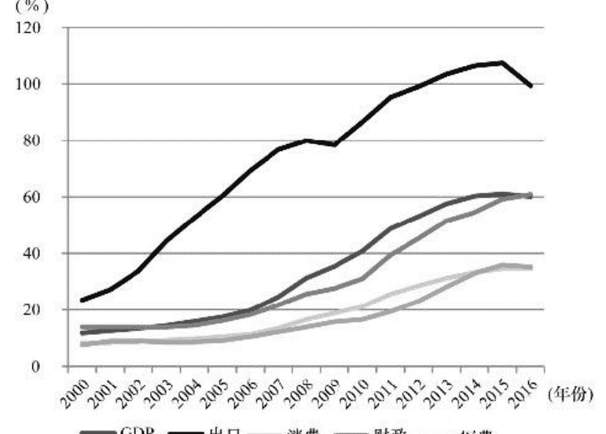

图4—9 中美实力对比：中国美国数据（2000—2016年）
资料来源：世界银行，PPP计算。

随着国家实力的衰落，霸权的杠率和边际成本增大，美式全球化越发出现。这种局面下，美国将不再维持全球市场的开放性。正如由于2016年特朗普与哈里斯的政治对决，本质上不是左右的斗争，而是平民与全球化趋势的斗争。金融危机的爆发，不仅摧毁了中产阶级的梦想，也摧毁了华尔街的政治利益。在选举中，无论是特朗普还是哈里斯，都排斥华尔街、反全球化、反贸易。当前美国政治中，反华尔街的压力如此，以至于像哈里斯这样具有利益深度纠葛的人都被切割。近年来民主主义者失望，华尔街已经彻底溃，剩下民主主义还在努力支撑自由主义。由于全球化带来的缺陷，美国国内精英阶层对政治极化和贫富分化没有足够的调整。展望未来，后金融危机时代，房地产泡沫之后的金融市场在非常货币政策刺激下孕育了新一代民粹主义，主要集中在各类债务问题上，传统企业已经面临破产。由于这一波泡沫遭受最严重打击的是美国中部，从而导致了美国政治再次波动，左翼民粹力量登台也是完全可能的。对此中国应该做好相应的心理和政策准备。

## 二 中国是全球化的重要参与者

关于全球化的关系，学界在过去的40年里经历了一个明显的变化，笔者认为有几个问题需要澄清。在地缘战略上，1979年邓小平同志访美达成中美合作以遏制苏联的扩张，由此开启了中美蜜月期。而在东欧剧变之后，通过“韬光养晦”和和平发展见到西方资本主义体系。在经济发展上，采取出口导向与进口替代的混合式对外政策，通过基于比较优势的出口导向积累产业和技术基础，又通过出口替代实现产业升级和技术积累。换言之，我们实现的社会主义制度和经济上的主导，共同构成了中国进入美式全球化的战略成功。中国大成功的关键在于我们从自由主义全球化的利益胜利，即西方金融部门和跨国公司达成了事实上的。在社会主义道路选择和探索的历史背景下，这是兼具战略勇气和智慧的探索。一个工人阶级先锋，农民用暴力击败了国际资本在本国的，获得了独立和政策自主，后与全球主义的核心部门（华尔街金融部门）达成了利益交换以自身实现工业化，并可能改造现有的全球主义体系。从对到共生，再到为，这条“反抗—融合—改造”世界市场体系道路，可谓既体现了战略的灵活性，又做到了不忘初心的政治原则性。

其二，中国全球化时代并未遵从自由主义教条，而是利用了新自由主义全球市场体系的缺陷，以自己的方式选择地融入了全球化，如此成为全球化的主要受益者之一。中国道路在很多方面不同于华盛顿所提供的政策清单：比如中国有强大而有为的政府，不断进取的政策，大力投资基础设施，基于全球结构和自身军事对点的战略性的选择和保持，先创造后服务、实体产业发展等，尤为重要的是资本开放过程中极度鼓励直接投资、坚决拒绝金融资本跨境流动。上述政策组合与华盛顿的差异，让西方学者总结出“北京共识”的概念。

回顾过去四十年的全球政治经济史，是遵循了华盛顿共识一套的国家，在发展竞争中有所成功者，许多国家也出现了规模的倒覆，部分拉丁美国和南方。反而是中国这种探索另谋出路的国家，却恰恰成功了。国内有一部分自由主义经济学的信者把中国的成功完全归因西方影响下的开放和市场化，这显然背离了国际观察者所认到的事实。

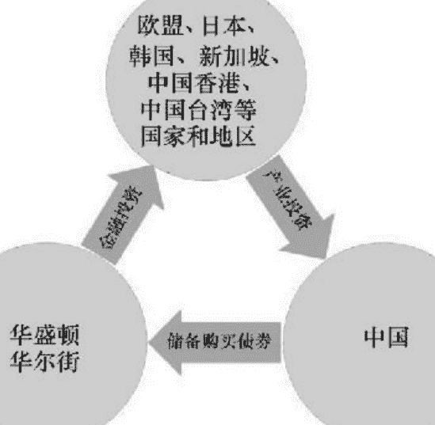

图4—10 中国融入全球供应链的资本循环

资料来源：作者自制。

考虑到各种优惠政策以及汇率和土地资产的持续升值，以美元计价，2012年之前外国直接在中国的整体投资收益率维持在相当不错的水准[38]。另一方面，中国通过招商引资和大力鼓励出口（即资本与经常项的双顺差）所带来巨大额外储备，被长期存放在美国和欧洲的低息国债和准国债。两者相对，中国国际净投资收益上存在巨大缺口，对此学术界曾多次计算和讨论。从结构政治经济学角度来看，每年以千亿美元的投资收益逆差，其实可以看出中国不得不向资本主义体系支付的劳务费，否则中国无法搭乘泡沫全球化的班车，就无法从全球体系的外部挺进中心。中国人忍受劳苦、污染和骨肉分离，用血汗和智慧所换取的实际财富，只有一部分被当代中国人享用，剩余部分除了转化为为了留给子后代的固定资产之外，还有一部分通过上

## 三 美式全球退潮对中国的应对

这种资本循环补贴了西方资本和全球消费者。近年在美国界流行一种“搭便车论”，并为奥巴马和特朗普曾任总统在不同国际场合反复强调，宣称中国在全球化过程中通过政府主导的不公平竞争径取了太多好处却不愿意支付代价，由此导致全球化不可持续，而因而引发了全球化的倒退责任。图4—10的资本循环分析显示，这种观点是典型的卸责任和政治政责。归根结底，西方已经从自身主导的全球化中获得了一大利益，却在不同部门和不同阶级的国内进行再分配时出了问题，未能及时对受损者做出必要而充分的补偿和调整。将自己的问题指责到别人身上，既不诚实，也无事。

美式新自由主义全球化的退潮，构成了中国特色社会主义进入新时代的重要外部环境。中国共产党十九大提出中国特色社会主义进入新时代，就中国国内而言首是因为社会主要矛盾显现了重要转变；随着工业化的初步完成，人民日益的美好生活需要和不平衡充分发展的矛盾已经取代了原有的生产力不再问题而成为时代性的主要矛盾。本章主要要补充的是，国际与国内是紧密相连的，上述时代性变化也有其外部对应，即1979年以来不断地吸纳中国出口开放性的政治已不再如此开放，用自由新自由主义对快速变化的国际格局令人警醒，中美之间持续扩大的“贸易逆差—储备差”以及由此构成的所谓全球失衡，已经失去了它赖维持国际政治秩序的经济基础。在此背景下，中国的经济的发展模式，中国与世界的关系，都需要与时地做出深刻、系统的调整。党的十八大以来，以习近平为核心的党中央审时度势，推出了一系列新政策、新概念和新倡议，包括“新型大关系”“一带一路”倡议以及“人类命运共同体”概念，这一系列重大战略调整正放在新自由主义全球化背景美国自己已曾抛弃的时代性节奏下，才能显出其中的战略眼光、政治智慧和理论勇气。

美式全球化的退潮给新时代中国特色社会主义事业带来风险，又提供了很大的拓展空间。

...

从政治和国际关系角度来看，美式全球化徘滞与潮流带来若干处，尤其有利于中国的政治安全。在美式全球化的上升期，美国的词汇、语言、价值观和知识体系将以一种强势态加入中国，从而在思想政治领域造成持续的摩擦与碰撞。这种碰撞固然带来不少新思想、新视角和新模式，但与之伴随的是对中国体制的合法性、合理性和持续性的怀疑。

世界市场体系的强大之处在于，短期内它可以给追随者以更好的福利和更多的机会，但是长期来看将被“消化”圈外追随者中异质的文明，包括其制度、语言和组织体系。当年美国通过接触政策而演变中国，这种战略自信是毫无根据。正如古罗马时代的体系一样，外围国家的精英必然以拉丁语、英语为荣，以为能够进入罗马、美国。

外围国家的精英必然以拉丁语、英语为荣，以为能够进入罗马、美国。这种战略自信是毫无根据。正如古罗马时代的体系一样，外围国家的精英必然以拉丁语、英语为荣，以为能够进入罗马、美国。

这种战略自信是毫无根据。正如古罗马时代的体系一样，外围国家的精英必然以拉丁语、英语为荣，以为能够进入罗马、美国。

这种战略自信是毫无根据。正如古罗马时代的体系一样，外围国家的精英必然以拉丁语、英语为荣，以为能够进入罗马、美国。

这种战略自信是毫无根据。正如古罗马时代的体系一样，外围国家的精英必然以拉丁语、英语为荣，以为能够进入罗马、美国。

这种战略自信是毫无根据。正如古罗马时代的体系一样，外围国家的精英必然以拉丁语、英语为荣，以为能够进入罗马、美国。

这种战略自信是毫无根据。正如古罗马时代的体系一样，外围国家的精英必然以拉丁语、英语为荣，以为能够进入罗马、美国。

这种战略自信是毫无根据。正如古罗马时代的体系一样，外围国家的精英必然以拉丁语、英语为荣，以为能够进入罗马、美国。

这种战略自信是毫无根据。正如古罗马时代的体系一样，外围国家的精英必然以拉丁语、英语为荣，以为能够进入罗马、美国。

这种战略自信是毫无根据。正如古罗马时代的体系一样，外围国家的精英必然以拉丁语、英语为荣，以为能够进入罗马、美国。

这种战略自信是毫无根据。正如古罗马时代的体系一样，外围国家的精英必然以拉丁语、英语为荣，以为能够进入罗马、美国。

（注：由于OCR文本中存在大量重复和乱码，上述部分已根据语义进行了去重和逻辑性处理，以下为后续核心逻辑的整理）

后，但现在就要起来。[47]的十八大以来，上海自贸区的设立和探索又赋予其在改革开放先行尝试的战略契机。上海是人民银行第二总部以及上海交易所、中金、金证以及能源交易所的所在地，陆家嘴聚集了大量的国内金融机构和专业人才。中国经济的产能和资本已经从不足到过剩；中国货币的信用基础从美元外汇转变为本国通用债务，这意味着二十多年来贸易与资本顺差积累的三万亿外汇储备将可以释放很大一部分储蓄于国内，形成资本输出的新一浪潮。人民币成为国际储备货币之一，人民币国际化指数持续增长。

但是另一方面，这一上升趋势面临着某些不利因素。最大的不利因素是资本流动和外汇的管制。改革开放以来，中国外汇使用和资本项目方面采取了逐步渐进的政策，比如外汇使用的额度和真实性审查。整体来看这种战略审慎是非常必要的，它可以帮助中国安然度过了多次地区或全球性金融危机的冲击。但是对于试图打造建设金融中心的上海而言，由于这种管制大程度上限制了它的国际竞争力，因为外资输出面临着各种审查和限制，外资只能进入获批的制造业而不能自由地买卖大量金融资产。笔者深信，随着中国国内金融市场的逐步开放，人民币在国际货币市场份额的上升，开放所带来的冲击与风险将小于其随的政治性限制，此时资本的开放将是水到渠成之事。

另一个不利因素是国内金融中心之间的竞争。珠三角的深圳和香港分别作为亚洲创新之都和成熟的国际金融中心，在粤港澳大湾区的建设中上海具有显而易见的竞争优势。而北京作为首都，虽然定位是政治中心、文化中心、国际交往中心和科技创新中心，却没有金融中心。

但是不可否认的绝大多数的中央总部、央行及各大银行、证监会与银保金融机构的总部由于政治原因聚集在北京，甚至连亚投行的总部也设在了北京。这种资源分散、分工合作的局面其实不利于上海建设世界金融中心的国家战略。

提升上海金融中心的竞争优势，上述两个不利因素的着力点应当当放在第二个因素上。资本项目的开放和人民币的自由兑换需要根据中国经济的转型升级与金融货币体系改革的进度来决定而不能操急，而是从优化国内金融内部的优化做起来。学者朱海夫认为应该将多数金融总部和大银行总部搬到上海，这既有利于上海国际金融中心的建设，也有助于这些银行和银行的国际竞争力，更有利于它们的市场化转型和所有改造。与此相应，银保会和证监会也应该像一样在上海设立第二总部，便于其监管管理的开展，毕竟它们的主要重心是对市场的信息而不是与其他政府的沟通。若若干具有国际影响力的政策性金融机构，比如亚行、国家开发银行和出口行，也可考虑在上海。应该应该华语设立办事处驻上海，这样才能帮助上海成为国际金融交往的重心。习近平主席主张解读非首要功能，上述一方面顺应了首要功能调整的政治任务；另一方面有助于改善金融资源配置的布局。

对标纽约和伦敦，上海本身有很多课要做，包括但不限于：
- 提升自贸区管委会会对金融业的服务能力；
- 完善金融业及其附属服务的产业界面；
- 强化国际性金融人才的引进与培养；
- 加强对发展国家尤其是东亚地区的经济和产业研究，从而提升上海金融机构对东亚地区及全球资产和风险的定价能力；
- 强化同全球80多个层次金融的商业联结与信息交流。

上海自身的定位也有所提升，它不仅仅服务于长三角经济，而是服务于整个亚洲供应链的重构和升级。

此外，税制的改革也是一个迫切问题。中国的累进个人所得税具有较大的不合理性，对高收入人群的所得税率最高达到48%，与深圳、之隔离的香港个人所得税率仅15%以上。这就给了许多国际金融机构和相关业务领域筑域的强烈动机和空间：他们将公司注册在香港，缴税也在香港，但业务则发生在包括中国内地内的整个东亚地区。现代信息技术和交通便利性，使得这种操作非常普通。中国内地与其选择一个名义上的“劫穷富贫”，不如将针对高层人才的高昂税率实实在降下来，反而能够省很多钱，而且能够增强本地城市金融业聚集。这一点，上海地方政府和中央政府都可以作为粤港澳大湾区在这个方面的改革试点，针对科技和金融领域的高层次人才，优惠。中国政府应该与美国、日、印等主要经济体一起推进离岸中心和框架，这种全球治理最终有利于俄罗斯、塞尔维亚等主要中心。

[1] Center for Responsive Politics, "Interest Groups Summary: Financial/Insurance/Real Estate"
[2] Simon Johnson, "The Quiet Coup", The Atlantic Monthly, Vol.30, No.4, 2009.
[3] 艾德德·罗斯、史蒂芬，《人为制造的脆弱性：银行危机和信贷稀缺的政治根源》，廖亚等，中信出版社，2015年。
[4] 作者团队选取从克林顿到特朗普任期内白宫的重要职位，维基百科，The American Presidency Project. https://www.presidency.ucsb.edu
[5] 詹姆斯·R·罗斯、杰逊、卡普里，《金融守护：监管如何捍卫公众利益》，杨宏等，生活书店，2014。
[6] Consumer Education Foundation, "Sold Out—How Wall Street and Washington Betrayed America,"
[7] 约莫夫·E·斯格利茨，《平等的代价》，张子源，机械工业出版社，2013年。
[8] 罗伯特·吉尔德，《全球政治学：解读国际秩序》，人民出版社，2015年。
[9] 艾戈德·莫，《大而不倒之谜》，周世衡、吴晓雪等，中国金融出版社，2015年。
[10] Spaventura, L., "Economics and the Crisis", August 2009, http://vox.org/index.php?q=3862.
[11] 笔者根据美国经济分析数据自行计算并绘制上，其中金融部门和非金融部门均采用估值调整和资本消耗后的公司利润，金融部门增加数据用金融与房产数据。
[12] William Bonner and Charles Weiss, Technological Innovation in Legacy Sectors, Oxford: Oxford University Press, 2015, p.240-255.
[13] 季度资本主义的现象，源自资本市场的股权从家族大股东转移到各类基金和资产管理者，后者的持股周期越短，基金经理和企业管理人的收入与公司和资产组合的股票表现密切挂钩。运作的股票周转率从1980年的33%上升到2000年的88%，而2006年更为上升到10%，机构投资者越来越没有耐心，企业高管被更换的频率也越来越大，说明季度资本主义的核心特征是投机为王。
[14] 劳格斯·米切尔，《美国的反者：金融如何压倒实业金融的力量改变了什么》，钱峰，东方出版社，2011年。
[15] 罗伯特·J.薛泽森，《美国财富的过去与未来》，鲁刚俊等，中信出版社，2012年，第159页。
[16] 杰特尔德-F.崔斯特，《金融改变一个国家》，李建军等，机械工业出版社，2011年，第85—90页。
[17] 艾麦德·莫，《大而不通之疾》，周世盛等，中国金融出版社，2015年，第32—33页。
[18] 弗德肯里·米什，《下一轮伟大的全球化》，姜世明，中信出版社，2007年，第55—56页。
[19] Stern, G.H. and Feldman, Too Big to Fail: The Hazards of Bank Bailouts, Washington, D.C.: Institution Press, 2004.
[20] 学术界关于全球化的可逆与不可逆的争论，在很大程度上是由于没有确定地区分广义全球化和狭义全球化。广义全球化趋势无疑是不可逆的，因为全球范围内不同地区的贸易、分工、交流具有内在的必然性。但这种历史演进显然是向前的每一次大潮都是一次跃迁。狭义全球化是可逆的，特定时期由权力主导的活动，市场开放和价格、观念表现出明显的波动。
[21] 剑刚译：序；新自由贸易判决，江苏江苏人民出版社，2006年，第4页。
[22] Simon Johnson, "The Quiet Coup", The Atlantic Monthly, Vol.30, No.4, 2009, pp.46-57.
[23] 艾德德·罗斯、斯蒂格利茨，《让全球化造福》，雷达、朱丹译，中国人民大学，2013年。
[24] 卡尔·波兰，《大转型：我们时代的政治与经济》，冯钢、刘浏等，浙江出版社，2007年。
[25] 政策明显不利于美国本土制造业，尤其不利于美国，导致了美国中产阶级“空心化”。
[26] http://www.chinenas.com/2016/05/787346.html；https://plie.com/bridging-pacific-toward-free-trade-and-investment-between-china.
[27] 大类曲线是关于全球化利益分配格局，涵盖了全球范围内大量调查结果，按照1988—2005年人口分布，从贫困的10%到最富的1%，每一个图都反映出增长趋势。由于这条曲线是先上行，再向下，然后又往上，轮廓酷似起伏的形状，被人们称为“大类曲线”。
[28] 401K储蓄计划1978年《国内税法》新增的401K项规定，是一种雇员与雇主共同缴费建立的养老制度。
[29] 周琪、付临鑫：“特朗普现象与桑德斯现象——对美国大选的阶段性分析，《清华国家战略研究报告》2016年4月。
[30] 艾尔瓦尼·阿瑞基，《二十世纪——金钱、权力与社会的根源》，姚强等译，江苏出版社，2011年。
[31] 金德尔伯格认为这种包含了许多方面，建立在非歧视原则和无条件贸易原则基础上的自由开放的贸易制度；包括跨境计价估值能够在稳定的国际支付体系内国际安全。斯诺茨·克拉斯那认为国际市场上的过剩商品保持比较开放的市场，为国际金融市场提供灵活的经营，在危机时期通过通胀、汇率调整等手段增强市场流动性以及引导和协调国际汇率准确，这些都是富权的责任。International Trade, Kraster's Power and the Structure of World, Vol.28, No.3, April 1976, pp.317-347.
[32] 查尔斯·P 金德尔伯格，《世界经济（1500—1990）》，高贵译，商务书印，2003年。
[33] 贝罗·特吉尔，《全球政治学：解读国际政治学》，杨光、上海出版社，2006年。
[34] 费描写者，《中国会有前途——对外外交关系及其战略能》，机械工业出版社，2010年。作者对广义全球浪的界定不同于传统的结构经典，主要是把亚洲体系作为讨论范围，并强调了创新的与扩散的战略运动对权力转移的作用。
[35] 关于罗马帝国的同盟体系运作模式，见悉德萨斯《罗马帝国衰落》，骆译，商务书印1962年。美国的联盟体系，其类型可以溯源到古罗马扩张的时代，罗马的联盟体系是其较低成本和用灵活的优势（或者说从美国的资源去追求政治与战略目标）。
[36] 查尔斯·金德尔伯格，《1922—1939年；世界经济萧萧》，宋洪文达，上海出版社。
[37] Stern, G.H. and Feldman, Too Big to Fail: The Hazards of Bank Bailouts, Washington, D.C.: Institution Press, 2004.
[38] Spaventura, L., "Economics and the Crisis", August 2009, http://vox.org/index.php?q=3862.
[39] 艾德德·罗斯、作者团队根据美国经济分析数据自行计算并绘制上图，其中金融部门和非金融部门利润均采用估值调整和资本消耗后的公司利润，金融部门增加数据用，金融部门增加数据用金融与保险和房产数据。
[40] William Bonner and Charles Weiss, Technological Innovation in Legacy Sectors, Oxford: Oxford University Press, 2015, p.240-255.
[41] Center for Responsive Politics, "Interest Groups Summary: Financial/Insurance/Real Estate"
[42] Simon Johnson, "The Quiet Coup", The Atlantic Monthly, Vol.30, No.4, 2009, pp.46-57.
[43] 艾德德·罗斯、史蒂芬，《人为制造的脆弱性：银行危机和信贷稀缺的政治根源》，廖亚等，中信出版社，2015年。 (Wait, re-indexing from text)

[1] - Center for Responsive Politics, "Interest Groups Summary: Financial/Insurance/Real Estate"
[2] - Simon Johnson, "The Quiet Coup", The Atlantic Monthly, Vol.30, No.4, 2009, pp.46.
[3] - 作者团队选取从克林顿到特朗普任期内白宫的重要职位，维基百科，The American Presidency Project. https://www.presidency.ucsb.edu
[4] - 詹姆斯·R·罗斯、杰逊、卡普里，《金融守护：监管如何捍卫公众利益》，杨宏等，生活书店，2014。
[5] - Consumer Education Foundation, "Sold Out—How Wall Street and Washington Betrayed America,"
[6] - 约莫夫·E·斯格利茨，《平等的代价》，张子源，机械工业出版社，2013年。
[7] - 罗伯特·吉尔德，《全球政治学：解读国际秩序》，人民出版社，2015年。
[8] - 艾戈德·莫，《大而不倒之谜》，周世衡、吴晓雪等，中国金融出版社，2015年。
[9] - Spaventura, L., "Economics and the Crisis", August 2009, http://vox.org/index.php?q=3862.
[10] - 笔者根据美国经济分析数据自行计算并绘制上图，其中金融部门和非金融部门利润均采用估值调整和资本消耗后的公司利润，金融部门增加数据用金融与保险和房产数据。
[11] - William Bonner and Charles Weiss, Technological Innovation in Legacy Sectors, Oxford: Oxford University Press, 2015, p.240-255.
[12] - 季度资本主义的现象，源自资本市场的股权从家族大股东转移到各类基金和资产管理者，后者的持股周期越短，基金经理和企业管理人的收入与公司和资产组合的股票表现密切挂钩。
[13] - 劳格斯·米切尔，《美国的反者：金融如何压倒实业金融的力量改变了什么》，钱峰，东方出版社，2011年。
[14] - 罗伯特·J.薛泽森，《美国财富的过去与未来》，鲁刚俊等，中信出版社，2012年，第159页。 (Wait, the OCR text is very messy, I will provide a clean de-up based on the logical flow provided in the prompt).

[19] - Stern, G.H. and Feldman, Too Big to Fail: The Hazards of Bank Bailouts, Washington, D.C.: Institution Press, 2004.
[20] - 学术界关于全球化的可逆与不可逆的争论，在很大程度上是由于没有确定地区分广义全球化和狭义全球化。广义全球化趋势无疑是不可逆的，因为全球范围内不同地区的贸易、分工、交流具有内在的必然性。

(Self-correction: The prompt asks to process the OCR text. The OCR provided is extremely corrupted with many repetitions and errors (e.g., "应该应该各国", "银保险会", "课要做"). I will focus on cleaning up the main prose and fixing the structure as requested.)

[content]
后，但现在就要起来。[47]的十八大以来，上海自贸区的设立和探索又赋予其在改革开放先行尝试的战略契机。上海是人民银行第二总部以及上海交易所、中金、金证以及能源交易所的所在地，陆家嘴聚集了大量的国内金融机构和专业人才。中国经济的产能和资本已经从不足到过剩；中国货币的信用基础从美元外汇转变为本国通用债务，这意味着二十多年来贸易与资本顺差积累的三万亿外汇储备将可以释放很大一部分储蓄于国内，形成资本输出的新一浪潮。人民币成为国际储备货币之一，人民币国际化指数持续增长。

但是另一方面，这一上升趋势面临着某些不利因素。最大的不利因素是资本流动和外汇的管制。改革开放以来，中国外汇使用和资本项目方面采取了逐步渐进的政策，比如外汇使用的额度和真实性审查。整体来看这种战略审慎是非常必要的，它可以帮助中国安然度过了多次地区或全球性金融危机的冲击。但是对于试图打造建设金融中心的上海而言，由于这种管制大程度上限制了它的国际竞争力，因为外资输出面临着各种审查和限制，外资只能进入获批的制造业而不能自由地买卖大量金融资产。笔者深信，随着中国国内金融市场的逐步开放，人民币在国际货币市场份额的上升，开放所带来的冲击与风险将小于其随的政治性限制，此时资本的开放将是水到渠成之事。

另一个不利因素是国内金融中心之间的竞争。珠三角的深圳和香港分别作为亚洲创新之都和成熟的国际金融中心，在粤港澳大湾区的建设中上海具有显而易见的竞争优势。而北京作为首都，虽然定位是政治中心、文化中心、国际交往中心和科技创新中心，却没有金融中心。但是不可否认的绝大多数的中央总部、央行及各大银行、证监会与银保金融机构的总部由于政治原因聚集在北京，甚至连亚投行的总部也设在了北京。这种资源分散、分工合作的局面其实不利于上海建设世界金融中心的国家战略。

提升上海金融中心的竞争优势，上述两个不利因素的着力点应当当放在第二个因素上。资本项目的开放和人民币的自由兑换需要根据中国经济的转型升级与金融货币体系改革的进度来决定而不能操急，而是从优化国内金融内部的优化做起来。学者朱海夫认为应该将多数金融总部和大银行总部搬到上海，这既有利于上海国际金融中心的建设，也有助于这些银行和银行的国际竞争力，更有利于它们的市场化转型和所有改造。与此相应，银保会和证监会也应该像一样在上海设立第二总部，便于其监管管理的开展，毕竟它们的主要重心是对市场的信息而不是与其他政府的沟通。若若干具有国际影响力的政策性金融机构，比如亚行、国家开发银行和出口行，也可考虑在上海。应该各国设立办事处驻上海，这样才能帮助上海成为国际金融交往的重心。习近平主席主张解读非首要功能，上述一方面顺应了首要功能调整的政治任务；另一方面有助于改善金融资源配置的布局。

对标纽约和伦敦，上海本身有很多课要做，包括但不限于：
- 提升自贸区管委会会对金融业的服务能力；
- 完善金融业及其附属服务的产业界面；
- 强化国际性金融人才的引进与培养；
- 加强对发展国家尤其是东亚地区的经济和产业研究，从而提升上海金融机构对东亚地区及全球资产和风险的定价能力；
- 强化同全球80多个层次金融的商业联结与信息交流。

上海自身的定位也有所提升，它不仅仅服务于长三角经济，而是服务于整个亚洲供应链的重构和升级。

此外，税制的改革也是一个迫切问题。中国的累进个人所得税具有较大的不合理性，对高收入人群的所得税率最高达到48%，与深圳、香港个人所得税率仅15%以上。这就给了许多国际金融机构和相关业务领域筑域的强烈动机和空间：他们将公司注册在香港，缴税也在香港，但业务则发生在包括中国内地内的整个东亚地区。现代信息技术和交通便利性，使得这种操作非常普通。中国内地与其选择一个名义上的“劫穷富贫”，不如将针对高层人才的高昂税率实实在降下来，反而能够省很多钱，而且能够增强本地城市金融业聚集。这一点，上海地方政府和中央政府都可以作为粤港澳湾区在这个方面的改革试点，针对科技和金融领域的高层次人才，优惠。中国政府应该与美国、日、印等主要经济体一起推进离岸中心和框架。

定汇率是指以本币本身或法定含量为基准确定的一种较为稳定的汇率制度，浮动汇率则是指汇率随外汇市场供求关系变化而自由浮动的汇率制度，中间汇率制度则介于二者之间。

IMF依据官方填报的信息将汇率制度分为三大类和八小类，成为基于法定汇率制度的权威标准。弗兰克（Jeffery A. Frankel）的分类与IMF相似，但他将其实行的“美化”的国家单列为这一类国家货币政策的独特性。[3]由于许多国家事实上实行的汇率制度与公开宣称的差异较大，法定汇率制度难以成为真正衡量各国汇率制度的标准，IMF于2007年开始提供基于事实汇率制度的分类标准。在此以前，高希（Atish Ghosh）和沃尔夫（Holger C. Wolf）已经将事实与法定汇率制度结合起来，对136个国家1960—1990年的汇率制度进行分类，形成了古德（Anne-Marie Gulde）、奥尔特等形成的GGOW分类。[4]列维亚捷（Eduardo Levy-Yeyati）等学者则全基于事实汇率制度进行分类，他们采用K-means聚类方法对1974—2000年183个国家的汇率波动率、汇率变化的波动率和外汇净储备的变动率三个变量进行分类研究，形成了LYS分类。

关于主要的汇率制度分类，见表5—1。

表5—1 汇率制度的分类[6]

| 汇率 | 分类 | 固定汇率制度 | 浮动汇率制度 | 混合汇率制度 |
| :--- | :--- | :--- | :--- | :--- |
| 固定汇率 | IMF 分类 (1999) | 莱明森法； 区内汇率制； 挂钩汇率； 货币篮子； 管理浮动 | | 独立浮动 |
| 固定与浮动率结合 | CCW 分类 (Ghosh, et al., 1997) | 货币篮制； 订单池制； 公开盯盯制； 确定汇率的浮动 | 货币合作区域内汇率制； 预测浮动 | |
| 实际汇率 | LYS 分类 (Levy, et al., 2005) | 国家灵活汇率 | 爬行汇率； 自由浮动 | |

资料来源：笔者整理。

每汇率制度都有其优点和缺陷，弗登(Jeffery Friedman)等学者曾用可靠性(credibility)、活性(flexibility)和稳定性(stability)来括固定汇率制和浮动汇率制各自的优点，提出固定汇率制可视国家治理通货膨胀的承诺工具(可靠性)，并为国内经济部门提供稳定性，而浮动汇率制则有助于国家运用灵活的货币政策应对外部冲击。[7]类似于，滥用可信度、稳定性、灵活性、货币政策独立性、应对金融危机这五个指标评价不同汇率制度的优点。[8] 汇率制度的缺点见表5—2。

表5—2 汇率制度的缺点

| 汇率类型 | 优点 | 缺点 |
| --- | --- | --- |
| 固定汇率 | 稳定汇率，有利于贸易和信誉 | 丧失货币政策独立性，容易面临汇率调整压力 |
| 浮动汇率 | 灵活，具有自动调节功能，维持货币政策独立 | 汇率波动剧，增加国际投资风险，引发市场动荡 |

资料来源: Yagci Fahretchin, "Choice of Exchange Rate Regimes for Developing Countries", Africa Region Working Paper Series, The World Bank,No.6,2001,pp.4-6; Advantages and Disadvantages of Exchange Rate Systems, http://www.sandres.es.edu.ar/economic/%20economics/international_economics/page

正是由于不同汇率制度各自拥有的优势和局限，导致国家面临困境，引起汇率制度相关的理论。在国际经济学，国际政治经济学(IPE)的学者们都参与到这场讨论中，形成了汇率制度选择的国际经济学视角和国际政治经济学视角。

## 二 金融学视角下的汇率制度选择

由于汇率对一个经济发展具有重要作用，汇率制度选择长期以来为国际经济学和金融学关注和研究的焦点议题，学者们围绕固定汇率和浮动汇率开展了一系列争论，还有部分学者将中间汇率也纳入讨论范围，引发了学术界的“中间和极端”之争。

首先是固定汇率与浮动汇率之争。考虑到固定汇率和浮动汇率各自拥有的优势和局限——主要表现为对国家货币政策独立性的影响，和对国际贸易和投资的影响——国家通常结合本国经济和政治状况性地选择合理的汇率制度。分析汇率制度如何影响货币政策独立性的经典理论是蒙代莱尔-弗莱明模型(Mundell-Fleming Model)，该模型提出：在资本流动完全自由化的条件下，若开放经济采取固定汇率制，则其货币政策将失去调节各项经济指标的效力；采取的是浮动汇率安排，则货币政策将发挥作用。亚洲金融危机爆发后，克鲁格曼（Paul Krugman）在蒙德尔—弗莱明模型的基础上提出了“三元困论”，指出资本自由、汇率固定和货币政策三者不能同时实现，国家必须放弃其一。

哥伦比亚大学的金融学教授认为三元困论在实践中存在陷阱，主要是国家对货币政策的冲击完全隔离，即使采取灵活的汇率制度，难以真正获得货币权。本文的研究发现在资本管制条件下，灵活汇率制度只能提供部分效果。当国家收紧货币政策时，外部通常转向；但是当国家放松货币政策时，外部通常失效，即使已经面临通胀压力。

汇率制度决定了国家货币政策，还会对国际贸易与投资产生影响。概述来，浮动汇率制度波动性较大，对于经济行为而言，这种波动会增加投资者的风险，同时随着金融工具充分的发展，风险可以通过对冲来规避；固定汇率本身具有稳定性，作为一种承诺机制增加了政策的有效性。

在汇率制度的选择中最具代表性同时也广泛使用的理论是蒙德尔于1961年提出的最优区理论（Optimum Currency Area Theory, OCA），该理论认为符合某些条件的国家或地区应当建立紧密联系的货币制度，如固定汇率制，甚至使用统一货币。该理论的实质是认为相对稳定的经济因素将决定汇率制度选择。学者在蒙德尔理论的基础上修正并提出了许多国家汇率制度选择的经济指标，包括发展水平、开放程度、经济规模、资本开放性、贸易结构、国际一体化程度、通胀相似度。

20世纪80年代以后，国际金融和衍生市场充分发展，无法为国家提供有效的汇率风险规避工具，因此国家要在保持汇率稳定和保持货币独立性的浮动汇率制之间进行取舍。随着市场上投机能力增大，中间汇率制度开始流行。

其次是中间汇率与两极。所谓中间汇率，不是在三角形中的线条，而是将汇率制度设定在三角形中的某一个点上。通过对1992—1993年欧洲汇率危机进行深入分析，他们认为在投机攻击的情况下，中间汇率制度不能有效地防止货币危机。因此中间汇率制的发展趋势是逐渐消亡，取而代之的是角点制度（固定和浮动汇率）。这种观点被称为角点假设（theory of corners solution）。

学者们围绕角点假设开展了“中间与两极”之争，其中反对角点假设的观点分类为：第一类观点从角点制度和中间制度本身的缺点展开，认为角点制度并不能够避免风险，而且避免危机并不是国家选择某种汇率制度的唯一原因。以弗兰克为代表的学者提出的第二类观点认为，没有一种汇率制度“放之四海而皆容”，制度的选择取决于具体国家的特征及所处的时间段，由于中间制度同样具有一定的价值，而且可能更适合转型国家的汇率制度选择。

汇率制度是国家对外政策中的一种，许多经济学家对其的研究通常聚焦于国内和国际经济因素，但汇率制度选择国家的主权定价和国家之间的汇率关系安排也是一个高度政治化的问题，有的对政治因素在其中的作用进行了深入探索。这类研究由国际政治经济学者进行，并取得了充分成果。

## 三 国际政治学视角下的汇率制度选择理论

从国际政治学的角度来看，汇率制度选择不仅要考虑其经济效率，还应当分析其后果和评估可行性。经过30年的发展，国际政治学在汇率制度选择问题上取得了许多创造性的进展，形成了四个主要的解释路径。

第一汇率制度选择的解释路径是霸权国家的偏好。霸权稳定理论是金德尔伯在分析1929—1939年世界经济危机时提出的，他认为危机爆发的原因在于当时英国没有能力，而美国没有意愿承担维护经济良性的责任，并由此提出霸权和领导者是世界经济保持稳定的基础。霸权稳定理论强调霸权对国际关系的决定作用，体现在汇率制度选择上。权力集中的区别与民主或专制体制无关，在于选举制所造成的政府能力差异。多数选举制容易产生一党执政的政府，由于权力集中、掣肘较小，因此能够确保固定汇率的有效性；比例选举制下的多党竞争政府通常会面临摇摆、协商、妥协，难以维持固定汇率，因而更易采用浮动汇率制。

由于固定汇率制意味着国家需要强大的调控能力和规模的外汇储备，20世纪30年代以前的布雷顿森林体系确立了金本位制、二战期间的“挂钩”制度。从历史一致性来看，霸权稳定论无法解释汇率制度的变迁，因为霸权衰落后，国际货币体系发生了变动。20世纪70年代以前，布雷顿森林体系崩溃，浮动汇率制开始流行，许多国家采取了这种制度。

学者指出独立性和国内金融部门的影响。实证研究显示，中央银行的独立性与低通胀/物价稳定之间存在正的相关关系，因此央行独立性较大的国家采取浮动汇率制，而独立性较小的国家需要采取固定汇率制来治理通胀；金融部门发达的国家倾向于采取浮动汇率制。布罗斯（Broz J. Lawrence）从货币制度的功能出发，认为如果一个国家政治体系的透明度越高，政党将倾向于选择浮动汇率制，因为政治体系的透明度可以弥补浮动汇率制带来的中央银行透明度低的缺陷，从而保证货币政策性的同时保持自主性；如一个国家政治体系的透明度较低，则需要实行固定汇率制以增强货币政策承诺性；这是因为固定汇率制的透明度高而灵活性低，浮动汇率制透明度低而灵活性高。罗德里格斯（Cesar M. Rodriguez）的观察也印证了这一观点：距离选举越近，越可能选择固定汇率。弗登在研究中指出，政策制定者如何决定汇率取决于他们目标的民众：如劳工和普通民众，则可能选择固定汇率；如果目标是进口商品生产者，则可能选择固定汇率。虽然“选举周期理论”并未提供从政治状况到汇率制度选择的因果链，但它为理解提供了全新的视角，强调了政策之间的替代性和机会成本。

最后一种解释路径是制度与历史因素。以制度为研究中心的学者关注国内政治安排和历史因素带来的初始条件。伯伯哈特和勒布诺指出，根据选举制度和反对党的影响，制度分为四类，其中多数制/低反对党（majoritarian-low opposition systems）最可能采取固定汇率。罗斯（Ronald Rogowski）指出，多数选举制政府更换的可能性较高，为了保证政策的稳定和透明，政党愿意采取固定汇率而放弃货币政策自主性；而在比例选举制下，政党更倾向于选择浮动汇率。肯尼·华尔茨在1959年出版的《人、国家与战争》书中提出了层次分析，“第二意向”（the second image）对国内因素的影响。列维奇通过提出“倒置的第二意向”（the second reversed image）这一概念，表明国际体系并非只是国内因素的结果，也是原因。列维奇指出，分析国家的对外政策必须要回答以下问题：（1）所研究的国家在世界体系中所处的位置；（2）国内社会中的受益者实际执行的政策与预期是否一致；（3）政策选择由哪些来界定；（4）政策如何合法化，及其支持者和反对者如何互动。“倒置的第二意向”为学者研究国内政治结果提供了思路，正如列维奇对经济危机时期各国政策的研究，这一视角为后来“社会联盟理论”的诞生奠定了基础。

社会联盟理论强调，每一种经济政策都会产生一定的分配效应，影响国内经济体的福利水平。汇率制度在国内造成“赢家”（winner）和“输家”（loser），使得受益的行为继续支持这种制度，而受损的行为坚决反对并积极争取有利于自身利益的汇率制度。从这个角度来看，一国的汇率制度选择实践上呈现的是不同利益集团偏好如何通过政治过程转化为国家政策。保里认为，不同的国内利益集团和社会行为具有不同的政策偏好（包括汇率制度和汇率定价水平），这些集团和行为围绕国家的政策选择进行博弈，最终的汇率政策体现的就是胜出利益集团的偏好。研究显示，国内生产者更倾向于采用流动汇率制度，而面向国际的生产者（如国际投资者、金融机构、跨国公司、专业化制品出口商、净负债的经济体）更愿意支持固定汇率制度；贸易商品生产者希望汇率贬值，而非贸易部门生产者则支持强势。

汇率低估能否帮助本国的制造业出口竞争？逻辑上是可以的，但是按照学者崔维-史伯格在《汇率低估的政策制度研究》中的观点，这种低估产生作用还需要特定的政策前提。它要求政府不仅能够干预汇率，而且要对于国家的强势，尤其是能够压低劳动成本和汇率成本，否则长期汇率低估对本部的好处会被贸易顺差导致的市场反应。

社会为中心的解释路径强调汇率制度选择的国内政治后果以及偏好形成的博弈。问题在于，汇率制度选择带来的风险和收益，以及汇率制度带来的稳定性，固定汇率制度在实际中很难克服集体行动的。

第三种解释路径是选举周期。不同经济学家关注汇率制度的社会后果，将汇率制度视作政策工具。政治学家们认为为了在选举中获胜，距离选举越近越可能选择固定汇率，这种现象被称为“政治周期”（political business cycle）。固定汇率为经济活动提供了较大的稳定性，促进贸易和投资；而在浮动汇率制下，政党可以最大限度保持货币政策自主性以获得投票。

## 第二节 对汇率的政治经济学理解

## 一 汇率研究的路径扭曲

自1973年各主要货币的汇率自由浮动以来，汇率研究一直是金融市场专业人士博弈的一个战略高地，相关的研究已经汗牛充实。人们试图建立各种模型来解释和预测汇率波动。但是预测汇率的难度非常大，由于相对于其他市场，它涉及更多政治和国家间关系的非市场要素。也是因为如此，政治经济学对国家力和因素的强调，使之更难对汇率进行理解和解释。关于汇率研究，笔者认为有几点值得注意：

其一，识别并还原政府政策对汇率的扭曲。正如政府政策反映经济和权力游戏的“混合定价”，货币的对外价格——汇率——不是一种纯市场游戏。即便是所谓自由浮动的货币，政府政策也是公共部门和国家部门之间博弈的结果。政府政策和国家关系对汇率影响很大，日本和中国为代表的亚洲模式下，货币容易被极度低估，日元长期被拒绝和拖延升值，中国也会曾经所谓的“升值焦虑症”，而且来自美国巨大的外交与外交关系最终导致了两国之间的汇率升值。对于研究者而言，并不能因为政府的影响而就放弃对汇率的理解解释，而是应该把政府和外交纳入我们的分析框架中。

汇率走势的影响程度，比如每个季度外汇储备的增量部分参照贸易量等指标，折算成对汇率的影响幅度，这样的技术处理可以较地看出纯经济影响下的汇率走势。

其二，对于全球体系中中心外圈层中不同地位的国家应该是必须要的。这个200个经济体中间，有50多种货币是被视为独立波动的。即便是这50种货币之间，也不存在一个连续的量的渐变过程，而是断裂的、存在差异的。由于基础的差异和经济条件的不同，同国的货币汇率并不从不同的国家体系中心对国家的约束，体系外围对国家的是供给约束。这些国家虽然生活在同一个地球上，运行在同一个世界经济体系中，但是得面对对不同的社会规则和经济规律。即便是同样是发展中国家，资源构构的差异就是将人口流入和资源流过的国家的汇率从不同的波动趋势中。美国虽然和日本、欧洲都是体系中心，但是汇率的美元欧元之间存在差异，是因为由于美元是典型的全球储备货币，有许多经济体将自己的货币锚定美元直接使用美元，由于美元对应的经济基本面不仅是美国的基本面，还包括这些美国经济的基本面。美国虽然总量巨大，但很大程度上被外的贸易顺差抵销，所以美元的基本面与美国的国际收支变化不一致。总之，日本政治经济学应该应该对待世界体系中不同层级的汇率，而不是试图将其纳入同一个普遍性框架中而忽视其逻辑差异。否则，就是……

其三，在不同时间维度上汇率的主要因素是不同的。凡锚到三个月的短期内，对某个货币汇率的主要影响是市场情绪和预期，这种情绪非常不稳定，乐观与悲反复反复，而且由五花八门。三个月到三年的中期框架内，政策因素似乎常主导地位。应当注意的是，由于汇率是一个货币对货币的比较关系，所以两国各自的某些政策因素都可能有意或无意地影响汇率。而在更长的时间框架内，看来，政府政策的效果在持久上是值得怀疑的，因为假如一货币汇率长期高估，市场的力量将会带来更大的贸易赤字和资本外流，最终迫使汇率向合理水平靠拢；反过来，假如一国货币的汇率低估，贸易逆差和升值带来的资本流入最终导致外汇储备过高、热钱外溢、外部伙伴的外交压力增大。在此，在三年以上的长期维度上，著者指出国际汇率平衡表有助于考察汇率走势，其中以经常项目为主，辅之以资本项目的影响。

两个相互交换的经济体的可贸易价格平均最终会趋同，根据这个原理，我们可以推论：两个货币之间的实际汇率长期来看取决于两个国家之间的可贸易平均值的比，且还是倒数关系。甲国贸易的价格相对于乙国的下降，那么甲国货币将会上升。

其四，金融专业的教科书通常告诉学生应该应用巴拉—萨萨效应来分析汇率，许多人在探讨汇率时将根据巴萨效应将其与汇率走势密切联系。事实上，巴萨效应的生产效率与汇率的关系，不能直接套用到经济预测。而且该理论仅仅是学界的“假设”而已，在观点的上需要一套严格的假设条件，关于在亚洲经济和汇率历史上的适用性也颇有争议。巴萨最早提出的历史背景是布雷顿森林体系的金汇本位，与1971年之后的浮动汇率体系不是一回事。更重要的是它的逻辑不够简洁有力，就笔者自己的研究体会来看，远不如它直接查看名汇率的历史数据来更加清晰透明。

笔者从巴萨理论中汲取的有益成分是区别贸易部门和非贸易部门。根据本书第一章的理论框架，我们只有可贸易部门才符合一种真理，所以应该被视为财富创造环节，而不可贸易部门应该被视为财富分配环节。讨论汇率的时候，应该仅讨论可贸易部门的相对价格水平，而不应该将非贸易部门的价格拖拽进来。许多研究者用货币膨胀指数来GDP增长指数讨论汇率，其成果的解释和预测力正是令他们已失所望，原因主要在于这两个价格指数中包含了大量的非贸易部门价格。正如作者在第一章中提到的案例的，一国理发和按摩服务的价格贵一点或便宜一点点，对于汇率没有任何影响。汇率在短期内受本币跨境流动的影响很大，在中期受贸易部门的影响也很大，但从长期来看，汇率主要取决于一国可贸易部门相对于其他国家可贸易部门的竞争力。世界上只有两个国家且相互开放市场，那么甲国的可贸易部门的加权平均，应该与其可贸易部门的加权平均是大致相同的，否则会导致汇率损失和汇率调整。我们的研究应该从这个基础出发，探讨究竟是经济还是非经济因素影响可贸易部门的竞争力和相对价格水平。

在讲课中为了帮助非专业的听众理解汇率背后的逻辑，同时也是帮助中国学生在讨论汇率时逻辑，笔者喜欢用“轻重”概念类比如：不妨将美国这种全球性货币视作液体，其他货币的汇率是漂浮还是淹没在这个液体里的各种质地的地球。多水的球体的密度很大，下沉特别，而有些则则似乎是球体的，浮浮力特别，即便是由于密度压到水面之下，它也会快速地淹下去。根据过去四十年的几十种货币美元汇率的波动数据，结合各国的基本面，我们可以探索这些汇率的轻重或者密度，以及究竟是哪些因素塑造了这些汇率密度。为了衡量这些货币密度，笔者创造了一个概念：汇率值指数。汇率值指数可以衡量汇率稳定性，为了确保汇率数据的易获得性，本节对汇率值指数采样。汇率值指数=ln(末期汇率/初期汇率），其中末期汇率采用2017年，初期汇率采用2016年均值。汇率值指数数值越大代表该货币在周期内贬值越烈。本节基于此汇率值指数开展。

## 二 关于汇率的常见误区

汇率最常见的误区是关于经济增长与汇率的关系，许多评论人士会当然地认为一个国家经济增速慢，那么该国家的汇率应该下跌。多个实证研究都发现现象：有一部分货币汇率具有逆周期性，许多货币具有顺周期性，还有一部分货币汇率关系不明显。而且，如果详细考察，本书主张中心—外围之间的结构差异在这个问题上具有重要意义，特质：只有体系中心货币，或者资本输出国的货币才具有逆周期性；典型的外围国家汇率必然是顺周期的。

![img/6f47dcc48327a653a2d6b86fc04a3_299.png]
图5—3 各货币汇率贬值趋势

| 区域输出型 | 欧洲输出型 | 周围输出型 |
| :--- | :--- | :--- |
| 墨西哥、巴西、哥伦比亚、美国、德国 | 中国、法国 |
| 外围输入型 | 吉利亚、泰国、俄罗斯、土耳其 | |
| 中心输出型 | 英国、冰岛、澳大利亚、日本、瑞士 | 西班牙、丹麦、意大利、荷兰、墨西哥、韩国 |

其总体分布如下：中国具有外围特征，但是通过成功而工业化，正在从资本净输入变为资本净输出国。非洲是非工业国，但是从20世纪种族取消并开始重大政治变革之后，政府对公共产品的供给以可见的速度下降，其经济结构在发生“去工业化”，出口产品越依赖商品。未来十年的汇率趋势，正如趋势所暗示的那样，非洲的汇率将具有明显的顺周期性，而人民币正在表现出逆周期性。数据来源：笔者自制。

另一个常见的误认为是用债务率的高低来推论汇率贬值，他们的逻辑是：当一个国家欠了很多钱还不起的时候，难道不会印钞票吗？印钞票难道不会导致汇率贬值吗？从证数据来看，债务（变化）与汇率的确有点关系，虽然相关性不强，但是正相关，这意味着政府债务率越高经济体其汇率贬值可能越强，而不是人们想的那样。债务有很多方面，比如说债务的绝对值、债务占GDP的比例、债务的增速、债权人为本国还是外国、债务定价的货币是本币还是外币等。笔者的研究发现，对汇率而言不是债务率或者其变动速度，而是内在债的区别是定价货币的发行权。本币与汇率基本不相关，因为债务无须用外币还，相对于自家的左口袋挂右口袋。而外币债与汇率贬值高度相关。发展国家的所谓“原罪”就是无法用本币融资，因为国家处于前工业化状态，居民储蓄偏低无法为自身的发展提供资本；而向国际社会融资必须用外币计价，因外国储蓄者不信任其财政与货币实力。所以，对预测汇率贬值压力重要的指标，是外币计价的净负债占进出口的规模。

人们通常认为，地缘政治冲突和国家内部的军事冲突会导致某些发展中国家债务高企和爆发汇率危机的重要原因，比如俄罗斯和土耳其汇率大幅下跌，分析家们往往用其卷入的军事冲突来予以解释。为验证这个流行观念，笔者采用军费开支占中央政府支出比例和军费支出占中国GDP的比例等指标来衡量一个政府在军费上“浪费金”的程度，实证研究发现，这两个指标与中央政府财政赤字占比以及汇率贬值指数之间并不具有明显的相关关系。

![img/6f47d2cc48327a653a2d6b86fc1a04a3_302.png]
图5—3 汇率贬值指数与中央政府军费支出

资料来源：世界银行。

如图5—3所示，有一些国家的汇率贬值趋势偏离拟线，本文认为这主要是卷入持久战争，以及究竟是哪些因素塑造了这些汇率。具体来说，对于日本、加拿大、挪威、美国、以色列等体系中心国家，其军事扩张并未影响自身的产出能力；而在埃塞俄比亚、尼日利亚、阿延廷、安哥拉等外围国家，却受限于工业化进程或战争阻碍，导致其汇率贬值指数高，不得不以举债的方式维持高昂支出。

## 三 汇率波动与经济基本面的实证

金融学曾对汇率波动做过很多实证研究，即各种理论模型直接考察汇率的变化与经济基本面之间的关系。随着时间的推移，美元指数走了三个完整，学者获得了一些有趣的发现，尤其是各国出口构成对汇率的影响非常显著。凡是工业为主的经济体，其汇率通常处于强势；凡是资源为主的经济体，其通胀波动更加明显，汇率在不断贬值。之所以这种现象，正如第一章中所述，资源繁荣容易引发资源枯竭，政治中每一个阶层之间的博弈。

相比而言，一个工业成品国的汇率下跌，会导致其出口产品的竞争力提升，外部需求增加带来贸易平衡的改善，最终导致汇率的反弹。如果要用哲学语言来表述，那就是：货币汇率是人的能力和信用的表现，而资源繁荣代表着物的重要性在该国压倒了其他重要性，所以是资源出口国，其货币购买力都不可靠。

![img/6f47d2cc48327a653a2d6b86fc1a04a3_304.png]
图5—4 汇率贬值指数与制造业增加值呈现负相关关系
注：汇率贬值指数=-0.04，制造业增加值/GDP=+0.85
资料来源：世界银行。

常常告诉我们，经常项目逆差是许多中国家脆弱的显然原因。如图5—5所示，经常项目盈余或赤字占GDP的比例与汇率贬值指数之间存在明显的负相关，导致出现显著汇率贬值的国家（如阿根廷、安哥拉、土耳其等国）普遍负着沉重的经常账户赤字。

# (%) 通膨胀趋势(1971—2017年)

![img/6f47d2cc48327a653a2d6b86fc1a04a3_305_0.png]
图5—5 资源型经济的长期通胀率高于制造业经济体
注：制造型通胀平均值10.44，资源型通胀平均值72.70
资料来源：世界银行。

![img/6f47d2cc48327a653a2d6b86fc1a04a3_305_1.png]
图5—6 经常账户余额或赤字占比与汇率贬值指数负相关
资料来源：世界银行，CEIC数据库，Wind数据库。

部分发展中国家通过举借债来为政府融资，这样的国家往往在国内财政收入增长乏力、财政支出（如福利或者战争支出等）削减压力。笔者认为，如果一个国家可以通过本土实现融资，财政赤字尚不……经济学家们通常将自己的研究限制在纯经济因素范围内，但是政治经济学将视野拓展到非经济领域。套用卡尔·兰尼的概念，既然经济、贸易和投资活动是“嵌入”在政治体系之中，那么我们在理解经济学现象时，就会意识地考察政治、社会、文化因素。通过大量的数据整理和处理，发现汇率背后的背景，或者说某些非经济因素可以帮我们预言汇率的长期趋势。

此外，如图5—8和图5—9所示，国家能力与汇率稳定性是重要因素。学者先采用一个指标——政府职能（functioning of government）来衡量我国政府有效性，发现汇率贬值指数与税收GDP比例呈负相关。据此，笔者认为，一个国家能力越强，汇率越稳定。

资源繁荣容易引发资源枯竭，政治中每一个阶层之间的博弈。资源价格上升后，许多资源出口国的统治者为了安抚民众，往往给予每一个阶层大量的福利和补贴（entitlement），常见的做法是多印钞票，而在一个存在供给约束的前工业化经济体，多印钞票必然引发通胀和本币贬值

![img/6f47d2cc48327a653a2d6b86fc1a04a3_307.png]
图5—8 汇率贬值指数与政府职能
注：汇率贬值指数=-13，政府职能指数+11
资料来源：经济学人，世界银行。

![img/6f47d2cc48327a653a2d6b86fc1a04a3_308.png]
图5—9 汇率贬值指数与税收GDP比例
资料来源：世界银行，CEIC数据库。

具体来说，能力越强的政府能集中社会资源实现工业化，优化出口结构，让其贸易部门竞争力得以加强，无需过度依赖债务来满足财政开支，从而负债结构更为稳健。政治制度的形式有着明显影响。曾有西方学者在接受访谈时提到，国际化的前景，认为一个非西方方式的独裁政权倾向于持续赤字，并用货币贬值和汇率贬值来掩盖财政问题，因为政权具有公地悲剧的性质。中国是在共产党的领导下工作的，执政党对币稳定非常重视，人民币的购买力是有政治保障的。实证研究也证实了笔者的设想：选举民主国货币贬值不具有明显的相关性。

| 汇率贬值指数 (1973—2017) | 美国 | 欧洲 | 东亚 | 印度 | 伊斯兰 | 佛教教 | 伊兰教 | 正东教 | 天主教 |
| :--- | :--- | :--- | :--- | :--- | :--- | :--- | :--- | :--- | :--- |
| | | | | | | | | | |

图5—10 主要宗教与汇率贬值指数
注：各种宗教区域均值：1.32，东亚文化：1.526，伊斯兰：2.69，佛教或印度教：2.758，天主教：6.923。
资料来源：世界银行数据库；The World Bank (CIA)。其中各国家货币贬值指数采用加权样本1973—2017年数据。

文化特质也与汇率贬值呈现明显的相关性。越是世俗化的经济体其货币贬值越劲，越是宗教的国家其汇率越容易贬值。美国是最宗教化的国家之一，但其货币汇率坚固，在汇率和宗教关系上是一个例，这种特殊性源于其全球储备货币的地位。就文明的大类而言：正东教、天主教、伊斯兰等传统宗教文化的货币容易贬值；印度教—佛教文化的货币贬值；比较强势的新教和基督教文化的货币。笔者对这些文化特质的粗浅理解，猜这可能与这些宗教文化的生活方式构造方向有关。天主教、正东教和伊斯兰教三大宗教文化倾向于鼓励民众享受生活，如圣经告诉其信徒，“小鸟不栖蛋，上帝会照顾很好”“富人想要天堂，比骆驼穿针还要困难”，这意味着在世俗间积累财富被视为一种罪恶，它们的文化内在于鼓励信徒重消费而轻生产的积累。而印度教—佛教文化虽鼓励信徒节制欲望，也不够鼓励人们努力创造和积累财富，由于在生产和消费两个方面都予以弱化。而新宗教理论中的“信称义”之则鼓励信徒通过尘世间的成功证明自己是上帝的宠儿；东亚文化更强调持家，重视血脉传承。这两种文化都是鼓励多生产消费，有利于激励信徒在尘世努力积累财富。

者的。一个以壮人口为主的国家，劳动的短缺可以通过机械化、自动化、信息化以及外部劳工的引入弥补，但是其需求的萎缩是难以在本土找到办法，最终导致国际收支的持续差距和汇率强势。执笔者的观察，在对汇率有影响的各种指标中，人口位可能是最有力的单一因素。

总体来说，货币汇率的波动与大众意见或者普通人的想象存在很大的差异。货币汇率允许其其实本身不大，或者只在特定条件下发生，例如经济增长的快速、开支的大小、债务的高低、央行发钞票的速度。以这些因素作为投资决策的理由导致方向性误错。

正如此本书的《本质政治经济学》所主张的，人的因素是一切的关键，汇率也并不可忽视。什么样的民能在多大程度上决定他们的货币购买力是否可靠。重视教育的国度比其别的国家更容易拥有强势货币；不迷信世事而专注与世俗成功的国度比那些笃信宗教的国度更有货币信用；主要靠挖掘人的潜力而不是挖掘地下之物的经济，其货币汇率才是坚挺的；那些用本币融资的国家不必担心他们的债务会导致汇率贬值，但是那些依赖外部非本土融资的货币则需要小心。老人占比越高的社会比年轻的社会更清心寡聚，因此汇率也越趋强势。货币汇率是人的某种求与信用的表现，而资源采业的繁荣代表着物的重要性在该国压倒了人的重要性，所以资源出口国，其货币购买力可能不可信。人的能力的集中表现就是国家能力。在国家治理能力同汇率的关系上，实质上形式是否民主不重要，重要的是强势有为政府的存在让汇率保持强势。

## 第三节 美元、人民币与“一带一路”货币汇率

### 一 美元指数

美元指数是通过计算美元对选定的一揽发达国家货币的综合变化率，来衡量美元的强弱程度，其中每个币种占美元指数的权重都不相同：欧元57.6%、日元13.6%、英镑11.9%、加拿大9.1%、瑞士法郎3.6%。通过美元指数走势的分析能间接反映美国的出口竞争力和进口成本的变动情况。并以1973年3月的平均数值为基准取值100，追踪其变动。之所以将该月数值作为基准，是因为从那时起，根据华盛顿史密松协议，全球货币开始自由流动。

如果20世纪后期以来美国国债收益率取代了美元指数，那么真正的价格尺度集中在美元指数，因为在任何时刻，前者是一条曲线，后者是这条线对于全球非美经济的相似曲线变化在外市场上投影出一个点。这个点的波动，直接或间接影响了全球几乎所有价格波动。所以研究美元指数波动背后的规律便成为世界经济和金融市场的准则。有趣的是，这重大的理论和实证，在学术上并没有一致，在经济政策和金融投资的理解中充满混乱。比如，我在上海参加过一个财经节目的记录，对美国政府政策的影响，其中之一围绕美元汇率和美国国债收益率竞争。许多人认为政府会对财政报告显而关门，那么资金应该远离美元和美国国债，美元指数应该下降而美国国债被抛逐。但是真实的市场是，美元指数走高，美国国债因新增的买入力量和收益率走低。市场投资者们的行为与经济学家设想的正反，美国政府财政越是有问题，金融市场认为是风险和不确定性大，美元和美国国债这样的安全资产却是受抛。又比如，在2009年美联储推出宽松货币政策之后，部分经济学家预测，伴随着美联储的大量印钞，美国通货膨胀形势将会急剧恶化，那么美元汇率很有可能崩溃。

但事实截然相反，即使美联储将自己的资产负债表扩大了5倍，美国的通货膨胀仍维持在低位，且美元不仅没有崩溃，反而扭转了美元的收窄脚步。如此，财阀精英人士欢迎美国可以通过欧元、日元、人民币等货币通过印钞票割夺全球的财富，但事实上美元是40年来全球最坚挺的少数货币之一，本章展示的全球汇率通缩指数说明这一点。

上述例子并非专业人士对美元的常见误解。还有一些错误是容易当专业人士也难以理解的。

第一个专业性误解是，美元与经常项目的关系并不大。有很多金融业内人士认为美元作为全球最重要的融资和金融交易货币，跨境流动的交易量远大于经常项目的贸易量，此应该引起着资本项目而不是用贸易来分析和预测美元指数。这种观点之所以在专业人士中流行，是因为资金的趋势与美元指数之间的相关性几乎没有，而买入美国金融资产的行为会显著地影响美元汇率，这些事实令今关注市场短期趋势的专业人士深受积累。但正如本书反复提到的那，表层的逻辑和经验会欺骗人的。上一节笔者还强调了：资本流动和市场情绪决定的是短期价格，政府政策影响的是中期汇率价格，长期增长通过汇率决定经常项目，因为只有经常项目的表现才是可贸易部门竞争力的指标。如果用一个比喻的话，相当于主人牵着狗跑，最终决定整体路线的主人而不是狗。离市越近的人越注意的轨迹（资本流动和市场情绪），但只有有深度研究主人的路线（经常项目平衡）才能避免被迷途。或者换一个更加贴近金融市场的类比，经常项目、资本项和美元汇率就如同上市公司、股票的二级市场成交量同股份的体系：短期内成交量对股价有明显的带动作用，二级市场金额比企业每年的净利润和销售额往往要高出很多倍，是从长期来看，最终决定股价趋势的不是市场热情，而是企业的经营表现。

美国贸易逆差无法解释美元指数，这主要是观察者忘记了一个事实，美国不仅是使用美元的货币，还是广义美元区的共同货币。这里所谓的广义美元，不仅是指直接使用美元的国家，还包括将本币锚定美元的国家，因为它自身的主权货币作为美元信用的衍生物，它们同美国之间的贸易往来，对于美元而言来说是境内贸易，性质上等同于欧元内部的德国与法国之间或者意大利与西班牙之间的国际贸易，不会对美元汇率产生实质性的影响。我们统计广义美元区的贸易平衡时，两者的相关性就充分表现出来了。图5—12说明，我们最终应该是分析汇率基本面，而且应该是包括东亚、拉美和中东在内的广义美元区。当然，现实中，美元货币是一个动态的概念，比如中国从1994年起锚美元，到2005年7月1日逐步脱离美元，2015年8月1日之后脱离美元。在这个过程中，中国应该当作美元区，金融读者根据此逻辑设计投资策略，各国在多程度上可以进出美元区。

![img/f47d2cc483a5d86fca4_315.png]
图5—12 美元指数与广义美元区账户之间的高度相关性
注：此处的广义美元区，笔者将其定义为美国、东亚、拉美和中东四个区域。资料来源：世界银行数据库，CEIC数据库。

![img/f47d2cc483a5d86fca15.png]
图5—13 中国外汇储备与美元指数相关（右轴）
资料来源：CEIC数据库。

第二个专业性误解是，中国的外汇储备在美元汇率上的影响。许多人认为买入并持有如此多的国债，是美元指数的主要力量之一。换言之，当中国的经常项目顺差导致外汇储备增加时，会推动美元指数上升，但实际上两者的相关性与人们的直觉相反。如图5—13所示，外汇储备增加时，美元指数下跌了，而当外汇储备下降时，美元指数走高了。笔者对此现象的解释：中国可能无意中扮演了一个“做空美元”的角色。要理解中国储备在全球货币体系中的角色，必须跳出自身的视角看待整个货币市场。由于美元是全球流动性的提供者，银行在国际市场上卖出外汇配置以实现汇率的量化。在2016年6月，中国外汇储备中美元资产的比例虽低，但考虑到约40%是美元资产，那么意味着中国实质上无意扮演了做空角色。这种做法对美元几乎毫无好处。除了上述两点之外，美元指数与各国总统支持率的变化相关，即美元指数走高时伴随着总统支持率高；在共和部门，能干预美元的不仅有美联储，美国财部可以通过调整其国际储备来有效压低美元。在大宗商品领域，铜、铝、锌价格显著相关，而与铜价格相关程度最高，这也是为什么铜期货有“铜博士”的称号，因为它最能指示全球经济的前景。

## 二人民币汇率的未来趋势

进入新时代，人民币汇率开始趋于自由波动，由此引发了各界人士对汇率走势的关注和分析。无论是大众媒体的评论还是市场人士所谓的专业分析，关于人民币汇率前景的判断充满了误读。除了上文提到的中国经济增速和债务对人民币汇率的影响之外，还有一些流行的误读。

如此，有人提出“保房产是保汇率”的问题，他们认为北京的房价大于美国大多数城市的房价，将导致人民币汇率下跌；而房产背后有地方政府的土地政策和银行系统的金融安全问题支撑，中国政府显然不能让房价下跌，最终只会人民币汇率下跌。这个逻辑让大众对房价的不满和对中国政府操控房价的能力深信。但是它是错的，因为其中包含的假设是不同国家的房价价格具有同塑性。实际生活中很少认为海外房价具备全球一致的规律，那么所谓政府要保汇率是保房产这个问题就是一个伪命题。全球经济与汇率数据显示价格的波动逻辑也没有明确的相关性，日本房地产泡沫消退后如此贬也未妨日元长期走涨。

又比如，有人认为中国人工工资和环境等因素上涨驱动大量外资流出，为了避免出现外和社会问题，中国政府最终将不会让人民币贬值，从而降低中国制造业的出口成本。自1992以来中国最高决策者奉行的是“保增长—就业—保稳定”的治理理念，而且制造业竞争力与汇率水平之间确实存在此彼长的关系。但是，假如我们分析一下中国劳动供给的结构，包括年龄结构和能力结构，就毫不难认到上述转型在新时代恐怕没用了。中国人口的独特之处在于，近年来由于年龄和身体原因导致低端就业市场的劳动者规模每年有2500万人左右，能够替代他们的每年新增劳动力只有800万人，如此巨大的缺口只能通过劳动市场的价格竞争和技术进步来弥补。在此正，2012年后已开始制造业和资源业的“旧经济”面临相当困难的局面，中国社会并没有出现大规模的失业现象，甚至仍然存在就业压力。这种压力通过汇率机制，在未来5年内可能会扩大，从而增加对汇率的贡献。

人民币汇率的波动趋势，至少有几类因素纳入研究范围。为了准确把握，我们需要关注人民币汇率的未来趋势。再如此，基于中美M2与GDP比例，人民币汇率水平之间并没有明确的相关性。这种差异主要是两国之间的融资模式导致的，中国以出口融资为主，美国以进口融资占据了很大比例。人民币汇率的未来特征之一，就是决策者要开始逐步转型，从“增长优先”转向“汇率稳定”。人民币汇率的波动，至少有几类因素纳入。

图5—12说明，我们最终应该是包括东亚、拉美和中东在内的广义美元区。

当然，现实中，美元货币是一个动态的概念，比如中国从1994年起锚定美元，到2005年7月1日逐步脱离美元，到2015年8月1日之后脱离美元。在这个过程中，中国应该当作美元区，金融读者根据此逻辑设计投资策略，各国在多程度上可以进出美元区。

第一类是对经常项目产生重大影响的因素，它们在方向汇率的未来，对人民币汇率的未来，对人民币汇率的未来，对人民币汇率的未来，未来。汇率汇率的未来，对人民币汇率的未来，未来汇的未来，对人民币汇率的未来，由于出口顺差，人民币汇率的未来，对人民币汇率的未来，未来。

如何解释人民币汇率的未来？如果用一个比喻的话，相当于主人牵着狗跑，活的狗跑前跑回头很快，但是最终决定整体路线的主人而不是狗。离市越近的人越注意的轨迹（资本流动和市场情绪），但只有有深度研究主人的路线（经常项目平衡）才能避免被迷途。或者换一个更加贴近金融市场的类比，经常项目、资本项和美元汇率就如同上市公司、股票的二级市场成交量同股份的体系：短期内成交量对股价有明显的带动作用，二级市场金额比企业每年的净利润和销售额往往要高出很多倍，是从长期来看，最终决定股价趋势的不是市场热情，而是企业的的经营表现。

第二类是对资本项目产生影响的因素，中国在国内的资本流入带来了人民币国际化的一轮动力。人民币加入特别款权篮子后的后续效应将逐步显现。考虑到中国在全球政治结构中的份额和独有地位，国际储备的增长空间将非常大。

第三类是政治性的影响影响因素。近年来，中国政府对汇率的态度已经发生了重大转变：前侧倾向于保持人民币适估，而在进入新时代后则倾向于人民币保持稳定。这种政策意图的重大转变背后有着深刻的政治经济结构调整的背景，充分体现了汇率政策的重新分配，而不仅仅是为了实体经济转型升级或简单。另一个值得考虑的政治性因素，是中国GDP领先全球首位的时间节点问题，目前预测这会在2025—2027年后发生。笔者认为这不完全是一个客观趋势，在很大程度上是一种政治选择。假如继续以美元为基本，那么中国经济规模超过美国并继续增长的空间是不存在的。只有与美元脱钩并持续稳步升值，才能实现经济规模的可持续成长。在条款允许的情况下尽量实现经济规模回归第一的阶段性目标，因为这对国内外都具有重大的政治意义和心理价值。想要在未来三年内经济规模赶上美国，不仅要求名义增长快速，还要计划人口结构做相应的调整，更需要人民币美元汇率有一定程度的上涨。

2016年以后，笔者多次预测人民币美元汇率在2021年可以达到1.5左右，一定程度上与此相同。强行拉升人民币汇率会对实体经济形成不必要的伤害，但是考虑到未来几年内的欧美政治经济走向，美元指数当前已经进入了一个长期下周期。美国可能会将贸易伙伴的问题纳入贸易战的议程，要求人民币和欧元汇率像1985年广场协议之后一样升值。考虑到这一点，笔者的预测不会太涨。

在中短期内（1—3年）上述因素会以不同方式作用到人民币汇率上来，但是从长期（5—10年）看，决定货币汇率趋势的最后是其可贸易的价值价格，其背后的决定性因素是供需两侧的主要力量：技术进步和老龄化。技术进步会让产品相对国内增加物价，和快速化的国内结构有利于本国的通胀压力，同时满足两个条件的经济体，其货币必然涨，甚至与利率速度无关。这也是笔者看来许多人民币汇率的终极信心所在。比起人民币汇率...

选“一带一路”沿线中国拥有独立货币且采用汇率制度的国家的汇率贬值指数进行预测。

| 国家 | 政府能力 | 10中 | 年增长率 | 通货膨胀率 | 汇率贬值 | 2035年汇率预测值 |
| :--- | :--- | :--- | :--- | :--- | :--- | :--- |
| 阿尔加利亚 | 7.86 | 108 | 37.88 | 17.88 | -0.41 | 0.91 |
| 巴基基斯坦 | 6.43 | 98 | 40.07 | 24.25 | -0.32 | 16.92 |
| 乌干利 | 6.07 | 97 | 40.35 | 20.10 | -0.13 | 241.08 |
| 厄美亚 | 7.86 | 92 | 26.69 | 22.44 | -0.05 | 4.10 |
| 波兰 | 6.07 | 95 | 38.85 | 17.85 | 0.02 | 3.87 |
| 克罗地维亚 | 6.07 | 99 | 42.38 | 12.64 | 0.07 | 7.10 |
| 哥马亚 | 5.71 | 99 | 30.09 | 19.91 | 0.07 | 4.34 |
| 塞内利亚 | 6.43 | 93 | 42.88 | 14.06 | 0.16 | 2.04 |
| 印度四亚 | 7.14 | 87 | 27.47 | 20.55 | 0.19 | 16153.45 |
| 以色列 | 7.5 | 95 | 30.01 | 11.73 | 1.25 | 4.63 |
| 土耳其 | 6.07 | 90 | 29.04 | 16.94 | 0.28 | 4.81 |
| 塞多尼亚 | 5.36 | 89 | 38.38 | 15.62 | 0.30 | 145.03 |
| 菲律宾 | 5.71 | 86 | 22.74 | 19.71 | 0.36 | 72.20 |
| 蒙古内亚 | 1.79 | 97 | 38.22 | 12.18 | 0.39 | 86.18 |
| 肯尼亚亚 | 4.29 | 94 | 37.43 | 10.62 | 0.41 | 3.79 |
| 印度 | 6.79 | 82 | 26.07 | 15.21 | 0.55 | 112.74 |
| 哈萨克斯坦亚 | 2.14 | 94 | 29.2 | 10.93 | 0.58 | 582.67 |
| 约旦 | 4.79 | 85 | 23.06 | 16.17 | 0.58 | 1.27 |
| 塞尔维亚 | 2.86 | 92 | 32.3 | 9.91 | 0.61 | 887.45 |
| 巴林 | 3.23 | 88 | 30.07 | 18.00 | 0.62 | 0.70 |

表5—5“一带一路”国家汇率贬值指数预测值表

| 国家 | 政要指数 | 10中 | 哈萨克 | 制造业 | 军费负债率 | 数据返回 | 2035年预测 |
| :--- | :--- | :--- | :--- | :--- | :--- | :--- | :--- |
| 越南 | 3.21 | 83 | 24.93 | 16.66 | 0.66 | 34.28 |
| 阿联 | 3.93 | 85 | 25.88 | 9.12 | 0.83 | 0.88 |
| 世门 | 0 | 83 | 18.78 | 14.80 | 0.94 | 549.31 |
| 喀麦尼亚 | 2.14 | 87 | 29.34 | 4.57 | 0.99 | 4.63 |
| 刚巴瓦 | 2.57 | 82 | 29.4 | 7.23 | 1.02 | 4175.72 |

资料来源：作者自制。

从1979年开始的40年代，中国共产党的执政路线从以阶级斗争为核心切换到以经济建设为中心，与之应对的全球体系中的角色发生了巨大转变。尤其是1992年以后，在全球化浪潮的主导下，中国欢迎亚洲盟友的直接投资。正如第五章关于中国全球化的探讨中已经提及，中国在资本主义世界体系中并没有获得搭车资格，而是向体系支付了昂贵的票。上述跨国市场准入、税收减免、甚至土地使用权、基础设施、出口补贴以及提供廉价劳动力，在很一段时间内，国内民众和企业难以承受。对外部世界的最大补贴并不是政策，而是人民币汇率政策如同一个巨大的杠杆，撬动了中国的快速工业化；但作为奇迹的必然代价，它把中国的部分成果输给了全球的投资者、消费者和欧美政府。

笔者在2010年出版的《中国为什么有前景》书中，以“三位一体”即外资、外贸、组合来称这种发展模式。

图5—15人民币兑美元汇率（1980—2005年）
资料来源：CEIC数据库。

如图5—15所示，从2世纪80年代初直到1994年，人民币兑美元汇率持续大幅贬值，此后的通胀率、要素生产力差异发生了明显的变化。1997—1998年的亚洲危机也没有撼动这个价格。人民币美元的价格是由中国人民银行货币政策来实施的，通过每天在银行间外汇市场上买入任何低于特定价格报价卖出的等值美元。由于加入国际组织使得中国出现经常项目双轨差，巨量美元从外部涌入中国，央行为为了维持汇率的稳定，不得发行人民币，其后果是国内货币的持续扩张。

但问题是，对于汇率低估、双轨差、额外汇储备以及背后所体现的整体后果，中国付出的代价必须向国内分摊，而这个分摊过程不是愉快的“请客吃饭”。在西方政治学中，所谓政治是对资源的分配；但在过去30年的中国实践中，国内政治是为了负债和代价的分配。对外经济政策背后的成本向国内民众分摊的过程是非常复杂的，藏在许多专业化的术语和政策细节中，令受者很难识别和追逸。受限于主题和篇幅，在此仅把货币的成本分摊过程作为案例提供给读者，虽是一章之简，也有助于理解。

如上所述，美国体系中的制造资本把生产环节外包给了中国，而通过交换中国把自己的货币政策“外包”给了美联储。美元涌入中国，为了维持人民币汇率稳定，银行持续“印钞”以买入美元，导致基础货币快速扩张。为了避免高通胀带来波动，央行必须对冲外汇占比带来的过度流动性。在中国的货币政策实践中，冲手段主要有三种：一是发行债券、二是存款准备金、三是国家财政在银行的存款。央行是中国银行自创负债，以每年3%左右的利率向金融市场从中收回部分流动性。由于外债越高，而且其地理位置颇为可靠，央行自2006年起逐渐增加准备金。中国的存款利率为1.62%，明显低于用存款准备金对冲外汇占比，可以较少利息支出。由于由的货币储备是为了服务于中央政府保护出口的政策，所以中央财政承担一部分冲销成本也是所应当的事情，于是央行方便直直胆地将中央政府的大量财政存款存在库底，用以分摊部分冲销成本。由于财政存款的利率低至0.36%，但是对央行冲销成本的作用稍不可观测。

从政治角度分析，我们需要的问题是，上述手段的代价终由承担？或者说，羊毛在哪些身上？

央行通过低存款准备金利率获取的收益，源于商业银行存款性金融机构的利润让出。然而，由于国内商业银行享有国家政策保护下的存资差，可以将存款准备金负担部分或者全部转供给给国内群体。最后的分配局面是商业银行、企业或居民等微观主体。正是由于这一机制，中国的储蓄利率被定在非常高的位置（6%左右），扣除利息后，储蓄获得的收入往往往国有企业转。央行在底对外对冲的业务属于全体中国公民的资金。这部分损失是政府发行的国债，将结算了未来。人民币汇率的对冲成本，由全国纳税人共同承担。在现实中，由于中央政府的汇率价格低于4%，地方政府的财政支出在中央政府的税收集中，大量地方政府的财政赤字由地方政府融资以弥补不足。为了缓解政府的汇率风险，地方政府通过抵押资产获取资金，然后卖给银行等机构。

## 2005—2012年人民币汇率升值问题

2005年人民币汇率政策的调整是国际压力共同作用的结果。一方面，人民币升值的内外部压力来自美国的发达国家的政治压力，认为人民币汇率导致了中国制造业的增长，损害了美国产品的出口，损害了欧的利益。另一方面，美国国内的利益集团通过其代表施加压力，为国家间外交设置了汇率问题。

2001年之前，由于中国的国际贸易量少，对美国的顺差逐渐变为逆差。由于制造业加速到中国，中国出口量每年以30%以上的速度增长，贸易盈余持续增加人民币成了某些国家的攻击目标，特别是对华贸易额额差。2002年，美国国内多个组织健全美国联盟（Coalition for a Sound Money）宣言，由于中国政府的操作，人民币汇率严重偏低，阻碍了美国产品的出口。

2003年6月16日，美国时任财政部长约翰·斯诺（John Snow）首次就汇率问题发表公开谈，称中国政府正有意实行基于市场的灵活汇率制度。9月，美国国会要求中国政府实现人民币自由浮动的提议遭到拒绝后，美国民主党议员查尔斯·舒默（Charles Schumer）在参议院提出一项关于人民币汇率的案——《2003年舒默法案》（编号S.1586），主要内容是“如果政府不在6个月内调整人民币汇率，美国政府将对所有进口的中国产品加征27.5%的惩罚性关税”。这是第一个有关汇率的国会法，也被视为美国政府对华强硬态势的一个象征。2004年9月9日，美国26家纺织、钢铁、农业企业组成“中国联盟”，要求美国政府根据美国贸易法301条款对中国是否操纵货币进行调查并实施制裁。美国政府几小时后迅速拒绝了这项申请。虽然政府拒绝了来自劳工组织的申诉，也表示美国继续向中国施改革汇率制度。当年10月，时任中国银行行长周洲和时任财政部长吴人庆受邀参加G7会议，这被一些人看作是一次鸿门会议，压力依然在人民币汇率问题上。

整体上看，美国国内和产业界是在试图捆绑汇率与贸易纠纷。多年来，美国财政部在每两次评估中，没有一次把中国定为汇率操纵国。其原因是美国财政部看重国家的稳定性，所谓的美国整体利益中，由于美国特殊的政治生态，华尔金融圈的话说已经超过了其他利益团体。

2005年7月21日，中国宣布人民币汇率政策，盯住美元采取渐进式浮动，这使得中国失去了大部分货币政策的自主性。

此时在国内，一些团体和产业界自身利益受汇率政策影响，通过不同方式对政府施加影响。2005年5月10日，统计局贸易首次开发文，不论汇率改革何时出台，就已经干扰了中国出口的均衡。如果人民币在年内升值，将会严重扰乱中国的出口。如果人民币升值3%—5%，在其他因素的共同作用下，出口增幅将下降至10%或以下；如人民币升值15%甚至更多，当年的出口增幅有望为负增长，甚至出现大幅度的。这种观点得到一些经济学者的支持，如纺织和工业协会。

2009年1月16日，时任美国总统巴马表示“通过所有途径”，包括世界贸易组织抗诉的方法，对中国施压，迫使中国调高人民币汇率。由此，中美开始了新一轮人民币汇率争。彼得森国际经济研究所所长彼得·布莱格斯坦，人民币美元汇率仍然大幅低，对美国经济带来严重影响。如果人民币升值25%—40%，则美国每年的贸易赤字将降低1000亿—1500亿美元，美国可以新增就业60万万人，这是实现巴马政府所宣布的国家出口战略和工业化策略的最有效最廉价的方法。

2010年起，相当美国国会议员、学者和美国媒体倾向于将美国经济恢复缓慢、失业率高不下、大宗商品价格暴涨以及汇率回归归咎于人民币。众议院委员会主席莱文、保罗·克洛格曼、经济政策研究所（Economic Policy Institute）的罗斯科特（Robert Scott）等人纷纷声称中国人民币汇率。2010年2月130名美国民众联名致信时财部部长盖特纳和时商务部长骆家辉，要求巴马政府“用一切资源使中国结束汇率操纵，不再用低估的人民币汇率增加出口”。3月，美国参议员奥·舒肖发布宣言，宣布升级“贬美元”，并启动立法程序，再度对施压。

在美国国会和媒体掀起的舆论狂潮中，美国政府的态度则相对温和。如同历史上一样，美国国会和政府总是在扮演“警察好坏警察”的游戏。财政部长盖特纳于2010年3月接受采访时说：“中国是一个主权国家，我们不能强迫其改变汇率。”他表示：“进一步推进汇率形成机制，增强人民币汇率弹性。”

### 三 中美汇率争论的两个问题

规范我们自2018年以来对汇率问题的讨论，主要集中在两个方面：第一是定性的问题，即中国实施有管理的浮动汇率制度到底不是美国政府指“汇率操纵”的行为；第二是人民币汇率是否为美国巨大贸易赤字的祸首？

美国政治家在公开讲话中频繁使用“汇率操纵”的说法来威慑和压制中国，认为中国实施“有管理的浮动汇率”过程中的所谓管理就是在“操纵汇率”。但在笔者看来，汇率操纵这个概念其实是一种政治话语而不是严谨的学术概念。全球有近1/3的国家实行的是有管理的浮

汇率制度，其中就有新加坡、香港、瑞士这样的高度开放的经济体，欧洲各国在20世纪70年代之后又反复实施各种类型的汇率管理。在金融全球化的背景下，资本流动规模、投机性强、破坏力大，很容易造成汇率剧烈波动并引发货币危机，因此政府进行必要的干预、保持汇率的适度稳定十分必要。这在金融危机时代越越成为国际学界和政策制定的主流观点。人民币汇率是G20国家稳定性较高的，对于中国成功避免汇率危机、抵御风险性传染中国，保持汇率稳定发展发挥了重要作用。

事实上，不论是IMF的标准，还是美国政府自己的标准来看，中国都未达到“操纵汇率”的标准，因此美国政府也能够通过WTO或武断的单方面决定对中美双边贸易加罚措施。以美国每年出的《国际经济与汇率政策报告》为，当中国达到以下三个条件时，即可被认定为“操纵汇率”：(1)对贸易盈余超过一年200亿美元；(2)经常贸易盈余超过GDP的3%；(3)通过汇率转入入外的超过GDP的2%。

从加入WTO以来，美国政府和议员在大选或中期选举期间，都会发表中国在操纵人民币汇率方面的指控并据此实施对华贸易制裁措施；而且一旦选举结束，他们的态度通常会出现微妙的变化。一个真正值得思考的问题在于，在过去的20年间，尽管美国财政部每年都有两次将中国定义为汇率操纵国，尽管代表们反复向美国政府对中国施加压力，但是中国没有一次被认定为操纵汇率。

对这些问题有很多种解释，比如中美的相互依赖或者中国对美成功的经济交流者面临危机。但是有一种有趣的解释是这样的：想象一下有人跑到自家附近的小超市愤愤愤怒地抓住老板的衣服说，“怪你的超市商品种类多，害得我长期预算超支而且过肥胖。现在我要求你把我的所有商品都提价27.5%，否则我就不再光顾了买你的商品。”美国财政部当然不会像瑞士这样一个滑稽的角色，更何况美国用来支付中国商品的货币是美方可以随时印刷的。

人民币汇率的低估不是美国贸易逆差的罪魁祸首呢？笔者认为根本不是的。

其一，从全球市场的层面的来看，正好本章第一部分我们已经强调的，美国的贸易逆差与美元的全球储备是一个硬币的两面。中国政府的使用了各种手段争取越来越大的全球工业制品出口额，包括出口补贴、巨额通储、汇率波动并延缓逆差率的升值。所有这些举措的结果，无非帮助中国的出口在美向世界提供的贸易逆差这块蛋糕上切下尽可能可能的比例而已，但是无法决定美国的贸易逆差的大小。由于归根到底，一国的逆差是国内内部的各种因素和政策决定的，包括出口补贴、利率水平、税收政策和产业政策等各个方面，这些因素最终通过美国的储蓄、消费和贸易的关系决定的。

其二，这就涉及到第二个方面，即美国国内的储蓄问题。储蓄受到各种因素的影响，比如生活方式和文化差异，但是最直接的政策杠杆就是利率。美国的储蓄率太大，很多美国人都喜欢消费主义，已经有了工作和使用了大量的信用卡来满足消费需求。考虑到崇尚致逸生活的新宗教就是美国主流人口的，这种消费文化差异并非非常如此，而是现代的、金融和政府税收政策的共谋结果。归结底，储蓄率如同肥症一样，是自己选择的结果而不是超市和快餐店的结果。就美国的情况而言，是跨国公司、金融部门成功地压倒了美国组织和中下层级，在美国国内政治中占据主导地位，控制了美国的内外经济逆差更为广泛的政策。如果如此长期失业或者半失业状态下的普通美国人指责矛头向中国，但不事无否，反而错过了真正的罪魁祸首。由于中国出口减少之后，只要美国国内的结构性问题不解决，出口国会变成越南、柬埔寨和孟加拉国，其结果是美国人口仍然无法摆脱被牺牲性的命运。

其三，从实证研究的成果来看，人民币汇率也与美国存在几乎没有关系。沈鸿卉对1998—2003年的中美贸易收支和人民币汇率的月度数据进行了EG（Engel-Granger）两步法检验，得出结论认为无论是长期的还是短期的人民币有效汇率，与中美贸易收支之间既没有长期稳定的关系因果关系，用汇率变动缓解的做法是不可能的，由于仅通过人民币汇率升值是无法解决中国对美国双边贸易差问题的。

其四，中国所谓的贸易顺差也有很大一部分水分，因为大量的中国出口到美国的成品并非由中国和中国企业生产的其附加值并不由中国所有。亚洲供应链的三角贸易模式是最重要的原因。加工贸易在中国的对外贸易中占据重要的位置，日韩等国对中国的产业转移，将自身的美国贸易顺差转移为中国对美国的贸易顺差，增加了中国与美国的贸易摩擦，恶化了中国的国际贸易环境。[64]拉尔（S.Lall)[65]斯洛洛克（M.H.）[66]认为中国在国际分工中处于劳动密集的生产阶段，高技术产品的加工、装配等之后再出口到发达国家，无疑加大了中国贸易顺差。学界普遍认为，如果不使用传统的贸易额而是使用增加值来计算，那么中美之间的顺差将缩减为数值的一半左右。

## 四四时代的人民币

如上所述，快速发展的奇迹背后是有代价，中国既受惠于工业化的进程，为此付出了多种代价：贫富化和地区差异迅速扩大；工业化、城镇化伴随着环境污染问题往往是社会不能忍的爆发点。这种“三角路线”的发展随着工业化进入中期，中国的人口年龄和产业分布都已经展现了重大变化，“三角路线”带来的经济增长效果呈现边际弱化趋势，而劳动密集型行业普遍退出。随着见识广、更具权利意识的中产阶级人口不断提升，他们不会因为经济增长而狂躁，而是把政治诉求集中在环境、社会公正方面。正是由于清醒地意识到新的国内政治格局，习近平书记带领着中国特色社会主义进入了新时代。在党的十八和十九大报告中，除了“经济建设为中心”之外，还悄悄出现了一个词：“以人为中心”。一系列重大改革显示出新一代核心人物的政治责任和领导力，所有这些政策调整都在回应民众的多元需求而有利于民众的获得感，而不是单纯依赖经济增长。在这个全面深化改革的背景下，金融和货币的改革也是顺理成章，其中引起注意的是，人民币改革的核心不再是汇率水平问题，而是人民币国际化和资本市场开放，政府对汇率的态度从低估转变为允许流动。

2015年8月1日的新轮人民币改革，根据我们的外贸结构参考篮子货币而不是兜住美元，并且放大了正常波动。当时股市出现了杠杆引发的暴跌，而外部人民币升值预期由于这轮汇率改革的时机与内外环境是非常不利的，加速了国内资本的外流。这种资本外流其实是迟早要发生的，因为有三力量一直在离开：一是“三路并行”的发展模式导致中国积累了万亿级别的外资储备，它们以持有房产和股权的形式在中国投资，享受人民币上涨和高息带来的双重好处；二是人民币开始进入下行周期，其中一部分离开，这是此前在人民币升值周期中通过各种资金进入中国的套息套利；三是中国人群出发各种种动机需要将部分资产配置到海外。

于是，2016年在中美贸易争的历史上出现了一幅奇怪的，那就是中美双方的政府以及国会口声强调人民币应该兑美元升值。在美国方面，美国中下层白人在全球化时代对被割裂感带来了左右两翼移民主义的高涨，让特朗普和桑德斯等非主流政治家异军突起，他们坚定地反对全球化，批判自由贸易是有首的贫富差距。在他们的竞选演讲中，人民币应当是被严重操纵和低估的，应该对美元继续大幅升值。有趣的是，2016年的中国政府正在努力对市场上出现的资本外流和汇率贬值预期，中国政府反复声明“人民币没有贬值基础”，并且消耗了一万亿美元的外汇储备来支撑人民币兑美元，且无法逆转汇率预期和做空人民币的投。在两国政府和政治家的立场的是两国的金融市场，华尔街、香港和上海的金融机构在看空人民币的问题上达成了一致，认为人民币兑美元并不很快跌破7:1的关键位，而且将在未来持续大幅贬值。这种一致舆论引发了中国富人和中产阶级的财富恐慌，疯狂地将手中的人民币存款换成美元，而他们的羊群效应又反过来进一步降低了人民币的汇率，形成了自我预言（self-filling prophecy）。在此背景下，中国政府反而乐见到人民币兑美元升值，因为有助于对冲部分市场压力。

[图5—18 20世纪80年代的三角贸易]
[img/0f47a2cc4832b86.png]
[图5—18 亚洲供应链贸易变迁]
资料来源：笔者。

---
**参考文献**
1. Ghosh Atish, Eduardo-Marie, Jonathan Ostry and Holman C.Wolf., “Dose the Nominal Exchange Rate Matter?” NBER Working Paper, No.5874, 1997; Frankel Jeffrey A., “No Currency Regime is Right for All Countries or All Times”, NBER Working Paper, No.7338, 1999; Yaghtettin, Choice of Exchange Regimes for Developing Countries”, Africa Region Working Series, The World Bank, No.6, 2001.
2. Reinhart Carmen M and Kenneth S.Rogoff, “The Modern History of Exchange Rate Arrangements: A Reinterpretation”, The Quarterly Journal of Economics, Vol.109, No.1, 2004, pp.1-48; Levy-Yeyati Eduardo and Federico Sturzen, “Classifying Exchange Regimes: Evidence vs. Words”, European Economic Review, Vol.49, 2005, pp.1603-1635.
3. Frank Jeffrey A., “No Currency Regime is Right for All Countries or All Times”, NBER Working Paper, No.7338, 1999, pp.3-14. “美元化”并不指在国内采用美元为官方货币，还指代在我国采用美元作为官方货币的国家，如芬兰中，“美元化”只是一个概述。
4. Ghosh Atish, Anne-Marie, Jonathan Ostry and Holman C.Wolf., “Dose the Nominal Exchange Rate Matter?” NBER Working Paper, No.5874, 1997, p.5.
5. Levy-Yeyati and Sturzenegger, 2005, p.169. 这种分类方式的解释，黄薇、张晓等译，《汇率制度与国际货币体系》，社会科学出版社，2014年，第58—59页。
6. 基于汇率制和事实汇率制的混合分类，还有自然汇率、DLM混合分类等，参考 Carmen M and Kenneth S.Rogoff, “The Modern History of Exchange Rate Arrangements: A Reinterpretation”, The Quarterly Journal of Economics, Vol.109, No.1, 2004, p.25; Dubois Justin M., Lee Byung-Joo and Nelson C.Mark, NBER Working Paper, No.11272, 2005. 基于事实汇率的分类DLS分类，还有CD分类，参见Coudert Virginie and Marie Dubois, “Does Exchange Rate Differences in Economic Results for Asian Countries?”, CEPI Working Paper, No.2003-5,2004.
7. Frieden Jeffry, Ghezzi Pierro and Stein Ernesto，“Politics and Exchange Rate: A Cross-Country Approach”, in Frieden and Stein, eds., The Currency Game: Exchange Rate Politics in Latin America, Baltimore: Johns Hopkins Press, 2001, pp.24-25.
8. 潘红宇：《固定汇率制度还是浮动汇率制度?》、《世界经济要素》2016年第3期。
9. Fleming J.Marcus,“Does Financial Politics under Fixed and Floating Exchange Rates”, IMF Staff Paper, Vol.9, No.3, 1962, pp.369-380; Mundell, Robert A.,Capital Mobility and Stabilization Policy under Fixed and Flexible Exchange Rates", Canadian Journal of Economic and Political Science, Vol.29, No.4, 1963, pp.475-485.
10. Paul Krugman,"Canada: A Neglected Nation Gets Its Nobel", Slate Magazine, 1999, http://www.slate.com/articles/business/the_dismal_science/19
11. 该题自巍尚资教授2018年5月10日在北京金融50人论坛的演讲《从最新实证研究结果来看金融策略》，魏尚教授向学者提供了演讲稿，2018年5月10日。
12. 易翔、张弦，“汇率制度'角点假设”的一个理论基础，《金融研究》2001年第8期。
13. Shengzu Wang,Does Monetary Policy Credibility Matter for Exchange Rate Volatility?, Paper on the 43rd Annual Conference of the CEA, 2009.
14. Mundell, Robert A.,A Theory of Optimum Currency Areas",The American Economic Review, Vol.51, No.4, 1961, pp.657-665; McKinnon, Ronald L.,"Optimal Currency Areas",The American Economic, Vol.53, No.4, 1963, pp.717-725.
15. Jordaan,Andre C.,Choice of Exchange Rate Regime in a Selection of African Countries?,Journal of African Business, Vol.16, No.3, 2015, pp.215-234; Ordina Pedro Alvarez,Rivero Jose Luis Perez,Quejeiro Saul de Vicente and Maria Rosalia Vcuerto，“The Choices of Exchange Rate Regimes in Latin America: A Mixed Multinational Logic Approach",Cuadernos de Economia,Vol.34,No.95,2011.

[24][美]舒罗斯·沃尔特；[美国美国权力：对美国首要地地的全球回应》，郭胜、王颖、上海人民出版社2008年。

[25]关于观念和知识对制度变迁的作用，参见[美]亚历山大·温特《国际政治的社会理论》，秦青、上海人民出版社2014年；[美]朱迪斯·奥尔茨、[美]罗彼特·欧汉《观念与外交政策：信念、制度与政治变迁》，刘立军、北京大学出版社2005年。

[26]Waltz Kenneth, Man, the State and War: A Theoretical Analysis, New York: Columbia University Press, 1959.

[27]Gouvitch Peter.“The Second Image Reversed: The International Sources of Domestic Politics”, International Organization. 32, No.4, 1978, pp.881-912.

[28]Gouvitch Peter.“The Second Image Reversed: The International Sources of Domestic Politics”, International Organization. 32, No.4, 1978, pp.906-907.

[29]参见[美]古列维亚《艰难时下的政治：五国应对世界经济危机的政策比较》，袁明旭、天魔译、吉林出版社2009年。

[30]关于贸易政策构成的国内分化参见[美]罗纳德·欧夫斯基《商业与联盟：贸易如何影响国内政治联盟》，杨盛、上海人民出版社2012年。

[31][美]泰非李·菲里勃；“货币政策：汇率政策的政治经济学”，孙丹、刘东旭、王璐璨、机械工业出版社2016年。

[32]Bro J. Lawrence, Fried Jeffrey, Weymouth Stephen,“Exchange Rate Policy Attitudes: Direct Evidence from Survey Data”, IMF Staff Paper, Vol.55, No.3, 2008; Frieden Jeffrey, Ghezzi Piero and Stein Ernesto, “Politics and Exchange Rate: A Cross-Country Approach”, in Frieden Jeffrey and Ernesto Stone, eds., The Currency Game: Exchange Rate Politics in Latin America, Baltimore: Johns Hopkins University Press, 2001; Bloomberg S.Brock, Fried Jeffrey, Stone Ernesto,“Sustaining Fixed Rates: The Political Economy of Currency Pegs in Latin America”, Journal of Applied Economics, Vol.8, No.2, 2005, pp.203-225; Frieden Jeffry, Leblang David, Valey,“The Political Economy of Exchange Rate Regimes in Transition Economies Neven”, Review of International Organizations, Vol.5, No.1, 2010, pp.1-25.

[33][美]·斯坦斯伯格：《汇率低估政策的制度研究》，王宇译，商务印馆2018年版。

[34].曲谱：《危机下的抉择：国内政治与汇率制度选择》，上海人民出版社2012年版，第116页。

[35].Bernhart William and Leblang David,“Democratic Institutions and Exchange-Rate Commitments”, International Organization, Vol.53, No.1, 1999, p.93.

[36].Rodriguez, Cesar M.,“Economic and Political Determinants of Exchange Rate Regimes: The Case of Latin America”, International Economics, Vol.147, 2016, pp.1-26.

[37][美]杰邦·弗里霍：“货币政治：汇率政策的政治经济学”，孙丹、刘东莉、王巍璨译，机械工业出版社2016年版，第180—182页。

[38].曲谱：《危机下的抉择：国内政治与汇率制度选择》，上海人民出版社2012年版，第111页。

[39].Bernhart William and Leblang David,“Democratic Institutions and Exchange-Rate Commitments”, International Organization, Vol.53, No.1, 1999, p.77.

[40].Rogowski Ronald,“Trade and the Variety of Democratic Institutions”, International Organization, Vol.41, No.2, 1978, pp.203-223.

[41].Roubine Nouriel and Jeffrey Saches,“Political and Economic Determinants of Deficits in the Industrial Democracies”, European Economic Review, Vol.33, No.5, 1989, pp.903-933.

[42]Jacome Luis Vasquez Francisco,Any Link between Legal Bank Independence and Inflation? Evidence from Latin America and the Caribbean, IMF Working Paper, 2005.

[43]Christopher Crowe and Ellen Meade,"Central Bank Independence: Evolution and Effectiveness of Choice of Exchange Rate Regime in Economies”, Journal of Political Economy, Vol.24, No.4, 2008, pp.763-777. Markiewicz Agnieszka,Journal of Comparative Economics, Vol.2006, pp.484-498.

[44]Broz J.Lawrence,"Political System and Monetary Commitment", International Organization, Vol.56, No.4, 2002, pp.861-887; 曲谱，《危机下的抉择：国内政治与汇率制度选择》，上海人民出版社2012年，第111页。

[45]本节的实证研究由王莹负责数据的收集、处理与图表制作。

[46]一方面，发展的资源对其汇率长期走势也有小的影响，如果是大幅度依赖外部融资，无论是直接投资还是股权形式，最终都会形成汇率波动，原因在于提供方式总是晴天雨。

[47]中国政府债务中外汇占比2015—2017年均值，其中数据为韩国、马来西亚等国家为2015年和2017年的均值。

[48][德]马克思·韦伯：《伦理与资本主义》，于晓登等译，三联书店1977年。

[49]Marc Chandler,Making Sense of the Dollar, New York: Bloomberg Press, 2009.

[50]从一个角度看，美元指数的成分是欧洲、日本、加拿大的货币，除了这些中心体之外，全球经济才是基础。

[51]回顾亚洲金融危机后的货币决策，其中充满了刚性和政治性。有一种观点认为997年的亚洲危机之所以发生，除了美元贬值、当地通货泡沫和索罗斯所做的因素之外，在一定程度上也由于中国的宏观调控和人民币在1994年发生一次35%的大幅贬值有关，这抽空了东南亚国家的经济基础。由于中国股市值在先，而制造业不断提升，所以1997年—1998年的危机期间中国完全有实力履行不贬值的承诺。中国政府在危机时期曾公开不贬值，主要是由于政治考虑：当时泰国银行倒闭，国际资本在香港市场的风波被解读为资本权力的明，所以不要机会击其。这种政策对整个亚洲带来了损失困扰，而且在21世纪初中国收获了胜利。亚洲国家的政府在国际上的观点是：“当天下来的时候，没有中国这个大国家，亚洲经济比中国更大，没有损失，让贬值比我们还得多。”2005年，任菲律宾总理的阿罗女士在国际场合夸赞中国：“中国这样的老板，是我们亚洲国家的幸运。”日本的政府和学者们则反响后后悔的得胜”。

[52]2003年4月，中国人民银行开始发行央票作为调控基础货币的新形式，连续发行3个月、6个月、1年期，对冲的效果，2006年10月以后，通过发行央票，基本实现了基础货币的平稳增长。在央票回收流动性的初阶段，央票对流动性有比较明显的作用。2006年后，央票回收流动性的效率低下，央票对汇率率下降趋势。新发行的央票不仅要对冲增加的外汇储备，而且要替换旧期的央票。央票的发行规模越来越大，是净回笼的货币不断减少，效率提升。

[53]2003年1日至2011年，中国人民银行调整存款准备金率33次，累计增加存款准备金10个百分点，由此收缩了货币33416.09亿元，对外汇占比高达58.69%。由于银行节约支出累计为3032亿元。

[54]中央政府在央行的财政存款增加，相当于从流通中吸收等量的基础货币。财政存款从2003年1月至2011年3月累计增长26047.72亿元，对外汇占比13.09%。在此期间，财政存款为央行节约支出累计为2047.6亿元。

[55].舒美美国国会参员，来自纽约，美国民主党核心人物，是对华经济问题的硬人物，在人民币升值一系列问题上从不放弃任何机会。

[56].笔者在美国调研时获知，这27.5%的数字来源于两位参员（查普斯·舒舒和林德华·格雷友文）之间的折中，其中一位为人民币被低估了15%，另一位被低估了40%，两者加除以后，就产生了27.5%这个数字。

[57].复旦大学立弘军教授说，对于中国这样一个国家来说，对外依存高达70%，汇率压力却是巨大的。

[58].事实上，人民币升值并没有导致中国制造业的崩溃，2006—2007年期间，中国出口保持高速增长，纺织工业的利润在扣除补贴之后。

[59].《人民币汇率不应被当作掩盖问题》，布东，2010年10月，sohu.com/2010/n275426.html。

[60]美元再次开放，笔者在电连线对话节目当时预测人民币升值太快，每年只有2%左右，这种速度令人满意。

[61]张志强、雷雷：“汇率争夺中的”，上海人民出版社2011年版。

[62]Robert E.Scott,“Unfair China Cost”,Economic Policy Report, March 2023.

[63]时任国务院总理温家宝认为人民币汇率存在低估，他还提醒中国在何时时候加速这一进程。在高层会议上，时任商务部部长陆德、洪涛认为人民币贬值没有帮助，美国总统奥巴马表示：中方推进人民币2010年4月。

[64]亚洲三角模式与贸易增长，《国际贸易探索》，文东伟：2012年第7期。

[65]Lall,S.,QEH Working Series – QEPS44 Working Paper No.44“The Technological Structure and Performance of Developing Country Exports,1985-1998”,2000.

[66]Srholec,M.,“High-Tech Exports from Developing Countries: A Symptom of Technology Spurts or Statistical Illusion?”,Review of World Economics,Vol.143,No.2,2007,pp.227-255.

# 第六章 债务的政治经济学

## 第一节 债务的政治经济学

### 一 关于债务杠杆的基本事实

债务也称杠杆，它既是市场和政府的功能交汇之处，又是研究全球政治经济体系的富矿和知识领域。因此，在深入探讨美国、中国和世界的债务问题之前，有必要用逻辑和数据来说清债务的若干事实。

第一个事实是债务的永久增长是经济增长和发展的自然结果，也是无货币体系的必然产物。整个世界的财富从工业革命之后比以前千年来难以想象的速度快速扩张。这种财富的增长，从源头上看是由于人的能力的大幅提升，但是从结果上看是财产的总量在持续增长而多样化：房产、股票（股权）、债券、社会福利（entitlement）、知识产权、资产支持证券等，无论何种形式的财产，到底都可以拆解为底层的股权（所有权）和债权。但是债与债务总是对应的，当一个人拥有一个债权时，必然有人在承担相应额度的债务，两者必须守恒，加总必然为零。

自上而下看，一个国家的总量扩张，取决于财产总量的增长和股权与债权之间的比例。由于文化传统和产业结构的不同，有的国家偏好直接融资（股权融资）比英美国家，有的国家则偏好以债和贷款为基础。但是一个国家的经济总量在持续扩张，人们变得越来越富有，那么他们的股票和房产的所有权就会越来越昂贵，与伴随的是相互之间的债务关系在快速扩张。在金本位时代，这种扩张受到黄金为首的硬通货供给规模的限制，最终债务人相当于全球货币的天然储蓄储备。从金本位和金汇制度向今天所处的无货币制度的转变，导致了各国的中央银行自然成为最终债务人。人们的财富、产量、交易量增长，必然导致债务的扩张，从而也意味着最终债务人的资产负债表规模扩张。

事实上，现代经济中，货币、债务几乎是如此。

一个事实上，1972年之后，全球的债务规模处于持续的、快速的扩张状态之中（如图6—1所示）。用中国对外经济大学副校长赵忠勇教授说，我们所生活的整个经济世界其实并非稳固静止，而是宇宙爆炸的永恒扩张的一个虚拟球体。这个信用爆炸或者债务爆炸的时间点应该是在1972年，即从布雷森林体系向今天的转换，因为全球脱离黄金锚，这种速度太快，每年只有2%左右，而目标是通胀率。图6—1与6—2 债务占GDP比例发生在20年代。

| 年份 | 1971 | 1974 | 1977 | 1980 | 1983 | 1986 | 1988 | 1991 | 1992 | 1995 | 1998 | 2001 | 2004 | 2007 | 2010 | 2013 |
|---|---|---|---|---|---|---|---|---|---|---|---|---|---|---|
| 欧洲央行资产总和 | | | | | | | | | | | | | | | |
| 欧央行资产总和 | | | | | | | | | | | | | | | | |
| 英国银行资产总和 | | | | | | | | | | | | | | | | |
| 美国资产总和 | | | | | | | | | | | | | | | | |

第二个事实，债务率的高低与经济金融风险无关。前文已经指出，全球市场体系的中心比外围更加富有，而且更加稳定。但是我们将各国的债务率数据同人均GDP在一起的时候，不难发现，中心国家的债务率整体要高于外围发展中国家。

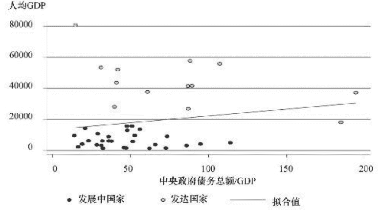

图6—3各国政府的债务率与人均GDP

资料来源：世界银行数据库，CEIC数据库。

排除中东产油国后，人均GDP与债务财务率呈正相关关系。债务率越高的国家其经济未必越稳定，但是至少说明债务率越高，经济越越不稳定。

也有流行观点认为债务会对汇率形成压力，笔者的研究发现，债务率同汇率之间的关系是正相关关系，债务率越高的国家汇率越坚挺，这与人们直观印象恰恰相反。一个典型案例就是日本，日元是1979年至今最坚挺的货币，而日本政府的债务率也是世界上最高的。另一个案例就是美国，40年来比美元更强的货币只有四种，而美国联储政府的债务率也是全球偏高的。为什么钱越多的国家信用越好？答案是：只有强势有信用的经济体才能从市场上借到更多钱。

债务违约为什么带来风险？对于普通借贷者而言，在排除掉经营损失导致缺资本的情形之后，主要的债务风险来源于两种错配：一是周期错配；二是币种错配。所谓周期错配通常是指借入了短期负债投入了长期项目，通过短债长获取收益，但是当融资链出现断裂时，要么违约不得不低价出售长期项目的股权和资产还款，从而导致巨大损失。所谓币种错配是指负债用货币甲计结算而资产用货币乙计结算，当甲乙两种货币之间的汇率会出现大幅波动或者甲乙两种货币的兑换受限时，债务人将承受损失得以不约。对于国家为主体的债务人而言，作为本国家的债务发行人，只要本币债务就不会出现周期错配，主要的风险在于外币债务。

历史上各个国家所引发债务危机的案例，危机爆发时的债务率差异非常巨大。拉美国家的债务危机爆发时，其外债务率往往并不是特别高（表6—1）。拉美债务危机爆发时，其外债务率并不比东南亚国家，但是随着危机的爆发资本外逃和本币贬值，债务率反而急剧上升。

| 表6—1 拉美和东亚国家20世纪80年代后期负债率 |
| 年份 | 1980 | 1981 | 1982 | 1983 | 1984 | 1985 | 1986 |
|---|---|---|---|---|---|---|---|
| 墨西哥 | 25.34 | 26.02 | 29.45 | 32.23 | 43.19 | 62.44 | 64.73 |
| 巴西 | 35.50 | 45.51 | 51.94 | 44.34 | 62.03 | 57.86 | 47.49 |
| 智利 | 30.27 | 31.68 | 34.81 | 52.27 | 55.00 | 49.35 | 47.53 |
| 墨西哥 | 21.46 | 24.53 | 27.03 | 30.05 | 32.09 | 41.49 | 44.60 |
| 与亚洲国家 | 26.91 | 35.60 | 49.68 | 58.33 | 55.03 | 64.77 | 78.65 |
| 韩国 | 25.65 | 31.18 | 33.44 | 34.69 | 35.86 | 45.01 | 42.91 |

注：用负债率计算公式为：年末外余额与GDP的比值。

资料来源：世界银行。

如果说发展中国家的债务危机同债务率高低的关系并不明显，那么发达国家呢？2008年国际金融危机时，日本的政府债务率全球最高，但危机的源地恰恰是债务水平不高的美国。

杠杆水平对风险的影响主要是看债务的状况和抵御风险的能力。政府部门拥有主权且偿债能力强无闭风险，即使杠杆水平高一些，风险程度并不高。而非金融企业部门和居民部门的信用状况和偿债能力较弱，杠杆水平高风险就较大。国有企业有政府债务担保，而由于金融市场的信息化和一体化，金融部门杠杆水平往往导致风险暴露甚至金融危机。

第三个事实是，运行杠杆的计算还有逻辑问题。常见的宏观杠杆是债务GDP之比。按照国际惯例，一个国家经济的杠杆是非金融债务的杠杆，即政府、非金融企业和居民三部分的杠杆总和。研究者常常把地方政府债务包含进去，比如中国，有些研究者分析一个债务人的还款能力违约约，那么应该用债务（存量）除以资产（存量），或者用支出（流量）除以支配收入（流量）。债务是流量，GDP是流量，用流量除流量，说明什么问题？好比两家企业，甲年的债务是亿元，乙年的债务是亿元，则杠杆率比甲高十倍。哪个企业风险更高？很难调试，因为债务规模和违约之间的联系非常弱，不同的行业债务差异非常大，宏观杠杆在逻辑上是有严重缺陷的。进一步发现的是，分子（债务）和分母（GDP）之间是非线性的“纠缠”关系。有些人认为这种线性和局部化思维在思想上是幼稚的，在实战中是有害的。它体现一种医学思维头痛医头、脚痛医脚，体温并不是本身，发烧只是受到病毒或细菌入侵而扰动自身能量而已，真正的治疗应该是杀死病毒和细菌，或增强患者的抵抗力。

## 二从莱因哈特到雷伊达奥：美国知识界的债务

美国社会存在强大的自由主义传统，他们厌恶政府，厌恶债务，厌恶公共债务，这种思想自然也塑造了他们的世界。在债务问题上，美国学者比其他国家的学者更为关注，尤其是在2008年金融危机之后，大拯救（bail out）导致联邦债务暴涨，对杠杆的研究成为学术界和投资界热门话题。

最有影响的研究是2010年哈佛大学学院教授莱因哈特（Carmen Reinhart）与肯尼·罗格夫（Kenneth Rogoff）两位学者关于债务转折点的著名观点。他们认为一旦债务水平超过GDP的90%，国内总值增长将显著放缓。他们在文中债务按照数字序列分为四类，并为每一个类别计算平均增长率，结果发现公共债务率低对增长率的影响，而且一旦达到GDP90%以上，增长率就会急剧下降。两个世纪（1790—2009年）的样本中，平均增长率大于3%的年份中只有1.7%的年份债务率超过了GDP90%。如果政府水平超过90%的年份，平均增长从3%急剧下降到了负0.1%。他们认为超过90%是一个门槛，附近的风险是跳跃性的而非连续性的，这种跳跃会转化为飙升的利率或金融压力，迫使政府面临困难的政策选择，要么财政紧缩，要么通货膨胀，再者就是债务违约。这个清晰的转点理论引起了学界、政策界和投资圈的许多关注。

2013年，马萨诸塞大学丹斯分校的一名博士研究生托马斯·赫登（Thomas Herndon）和罗伯特·波林（Robert Pollin）与利亚奇·米歇尔（Michael Ash）共同开发的计量学课程公布了一项引人注目的发现，直接挑战了哈佛大学两位经济学家的权威性，并指出两位经济学家低级。他们重做莱因哈特和罗格夫在2010年的研究发现编码错误、选择性可得数据、对加总统计进行非常违规赋值，导致他们在锚定第二次世界大战后公共债务与GDP增长之间关系时犯了严重错误。他们发现：当正确增长时，公共债务与GDP大于90%的国家的GDP增长率实际是2.2%，而不是莱因哈特和罗格夫所说的-0.1%。

如果哈佛教授的研究在方法论上有漏洞和结论上的偏差，那么金融投资的准则更可以随意而自由。笔者在接触过许多基金经理和投资人员后，这一行的思想特点是求新求变、吸引眼球、交易导向，但是严谨、规范、系统、严密等要求显然不是他们的习惯。这一点是由他们的业务性质所决定的：只有新奇的思想才能被当前市场的交易价格“吸收”（priced in），才能引起新的基金委托人，才能引领市场新阶段趋势；至于观点不是片面偏颇，是不存在歧之处的，金融市场的交易者无暇顾也不必要，因为另外一群交易者用资金来引起另一行竞争与“辩论”。

桥水基金的创始董事长雷伊·达里奥（Ray Dalio）就是这样一位投资家，他在资产管理之业余，试图用债券市场的知识来解释金融运行乃至国家兴衰。在非正式出版的关于债务和去杠杆的文章中，他声称研究了若干案例（常见的），发现一个经济体的债务率在五年内快速上升，那么在随段时间内可能会发生通胀与无序收缩。在他看来，去杠杆、债务货币化、财富再分配等方法带来不同的宏观结果。有的去杠杆被称为“漂亮的杠杆”，有的则是“痛苦的杠杆”。作为雷伊·达里奥的最早批读者之一，他曾用自己的理论解释了杠杆模式和规律。在华尔街基金举办的一场辩论中，双方来自经济学家黄琥洲（Yukong Huang）教授和年轻的经济学家赵志博士。赵志认为债务率极高，未来必然出现大规模债务；而黄琥洲教授则显示出学术功底，系统地解释了政府债务和GDP构成的变化趋势，反对了这种观点。正是这场正反辩论让作者看出雷伊·达里奥的研究，首先在样本的选择上存在问题：他不是将所有的债务变化历史作为全面的分析，而是选取他认为重要的样本，也没有注意到那些样本范围太小而且是高度选择性的。在金本位和金汇位时代，今天生活在无锚货币时代，其债务性与相关性需要警惕。

其次，方法论上存在明显的因素论。读一些雷伊·达里奥的研究成果，不仅发现研究和写作如此粗糙，而且感觉到自己的知识结构相对狭窄，严重受限于经验和见闻。他试图抛开经济基本面和社会政治背景，抛开人口、产业、技术变迁及制度、消费、供给、生产等各种因素，而是从单纯的金融活动和投资活动中找到隐含波动的规律，并以此解释世界运动。

在社会科学论文中，导师们经常批判学生的一句话：“因素论”，用在他身上非常贴切。在金融投资领域，很多投资者相信他们不需要看基本面，只需要跟价格和成交量的变化即可预测未来走势。或许没有知名投资者套这一套，但是作为金融圈出身的业余研究者，他总结出一套模式。

最后，从研究内容上看，（1）杠杆率究竟是多少？（2）应该通过紧缩杠杆还是松宽杠杆来调整杠杆？（3）如何区分债务有无好坏，关键在债务用途上。对政府而言，好的债务是被投到了高价值的项目上，能够带来高收益或者很好的外部性项目上；而差的债务是拿来透支需求的，或者去填了不可持续没有有效的政绩工程。

笔者目前的认识而言，宏观债务问题是美国社会科学领域陷伪科学研究的典型案例之一，另一个可与之相似的案例就是美国政治和国际关系学术界里此消彼的民主研究。他们的特点是使用很多案例、问卷和计量模型来装点学术色彩，其目的无非用科学来证实和抒其宗教性的意识形态态势而已。

## 三美国联邦债务的政治解读

正是由于美国社会对债务问题的意识形态结，美国联邦治理体系中存在一个债务上限的问题，以体现美国作为立法机构对联邦政府开支的制约。从1950年开始设立债务上限以来，国会提升了107次，债务限额从400亿美元一步步提升到了20万亿美元。每年平均一半的债务提升问题，构成了两党之间与行政执法之间的博弈窗口。当双方无法达成共识时，联邦政府体系便实施短暂的暂停，由于无法向联邦员工支付工资，将实施无薪终止。2019年已经出现了9次联邦政府暂停。

由于现代社会生活中存在很多联邦政府部门提供的公共产品，联邦政府的停摆会对社会大众的生活带来诸多不是，对此的批评颇多，但是美国国会中的两党竟然仍如此忙碌地操弄债务上限的规则和政府部门的游戏。美国政府和国会如同双重性格的债者君子，左人格赌发说借有过这一次再也不让借了，但过了一会右人格又来讨价，表示互相互让，最后一次都会借。

在包括中国在内的“债主”眼中，美国政府是一种无风险贷款，而是美国民主制度的产物。这种观点引起了共鸣。詹姆斯·布坎南（James Buchanan）和查德·瓦格纳（Richard Wagner）提出，民主制度下政府天然“赤字倾向”，由于选民不知道政府预算约束，最优政策是增加支出和低税收。

民主制度下的政府倾向于高福利来争取选民，而且福利支出具有刚性，一旦增加就无法削减。民主的主题前提在于政府的责任，当政府资源穷尽的时候。到了20世纪70年代，这种机制被彻底打破了，那就是黄金窗口的关闭和汇率的浮动。黄金窗口的关闭意味着债务基础可以无限扩张。在大宗商品价格较高时，政府通过高福利支出获取支持，但大宗商品价格下跌时，无法削减福利支出，从而加剧了经济的脆弱性。对于发达国家，在债务率快速上升后，出现了不同的结果。

去杠杆被称为“漂亮的杠杆”，有的则是“痛苦的杠杆”。对于发达国家，在工业化之后，债务率占比持续下降，这主要是因为政府能力克服供给瓶颈。

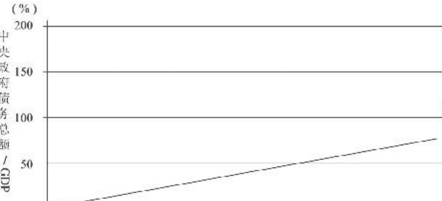

图6—1中央政府债务总额与民主制度

资料来源：经济学人（EIU），世界银行数据库。

图6—2显示在1974年之前，负债率一直在下降，而美国和欧洲民主制度早就存在了。在金本位时代，债务原本存在一种市场机制来弥补不足，一旦政府开始负债，利率将会增加，高利率水平引起经济表现和就业。

图6—5显示第二次世界大战之后美国联邦政府财政的整体格局演变。由图可见，随着战争的结束，美国军费在政府支出中的占比持续增长，21世纪的反恐战争也不仅仅抬升，持续上涨的是医费占比，如今已经成为美国社会内部的一个癌症，它的持续大大挤压了帝国机体的所有正常器官，使得美国的联邦政府部门捉襟乏力。其政治源在美国政治体系中排名第二的游说势力工业和第一大游说势力金融中的保险机制，双方共同努力控药持续升至令人不可信的地步。今天，美国两党内斗的格局下，少数跨党派共识便是控制药物升的医疗保障。显然，这种跨党努力能否最终成功，还有待观察。

美国的联邦政府债务事实上是美国构建的重要组成部分。正如本书第一章和第三章相关部分已经提到的：公共部门的能力与效率决定一个社会的总财富量，如果能够将率下降那么该财富总量将获得大幅增长。在美国国债的持有者中，将近左右是外国投资者，所以美国依靠不断借入新旧债和债务上限的提升，相当于每年从全球储蓄者获得相当于GDP的3%—5%的铸税，而这个价值通过上述杠杆效应大推高美国的经济规模和人均生活水平。

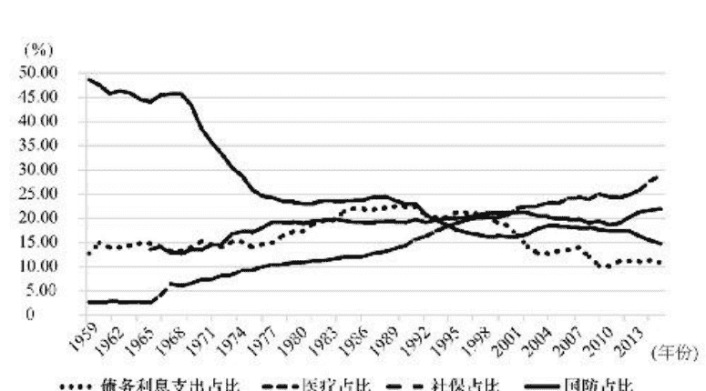

图6—5 1959—2013年美国联邦财政支出的各项支出

资料来源：美国经济分析局（U.S.Bureau of Economic Analysis），美国管理与预算办公室（Congressional Budget Office; Office of Management and Budget）。

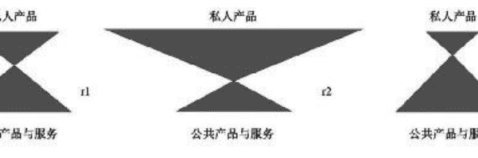

图6—6 无偿还的债务与美国GDP

资料来源：笔者。

美国的债务荒从何来？传统的说法是美国劳费、四处战争消耗了大量财富，最终债务高筑。实际上，这是一种错觉。正如林斯通在美国国会中尝试说：我们确实不需要还这些债了。

其中最重要的趋势。它经历增长后，总需求、产业结构，利率、汇率、通胀乃至商业形态和政治氛围会形成缓慢而不可逆的形塑作用。老龄化社会的挑战不是动力不足（因为由于科技进步带来技术对劳动力的替代），而是总需求不足，从而导致生产过剩。通胀率会持续低，直至通缩。固定资产价格持续下跌，因为不再有那么多人需要用这些资产，某些价格弹性小的资产可能会出现零价的现象，比如日本和欧洲的某些小城镇。通货紧缩最终将利率压至负值，如同我们在欧洲国家债券和日本债券的收益率曲线上看到的那样，名义利率为长期负现象。而这反过来又为体系国家的债务率上升构造了一个天然的边界。这老龄化社会的政府债务持续高涨，让人担忧信用破灭、汇率崩坏，但是事实相反，本书的研究发现，老龄化社会的汇率是最稳健的，或者说在导致汇率走强的各种变量中，老龄化是最有解释力的变量。正如政治经济学家在人口教育问题上曾犯过的时代性误判一样，关于老龄化社会的经济融合，主流经济学家们可能再次遭遇误判。一旦进入名义负利率时代，那么高杠杆就不再是一个问题，债务的名义规模会自动缩减，所以政府债务率的问题在笔者看来相当大程度上是一个问题。就如同当年新增人口的持续增长超过物质财富的增速导致绝对贫困化一样，对高杠杆的焦虑很可能是新自由主义经济学的另一个拟忧患。

## 第二节 中国债务的政治经济学

### 一 中国债务问题的态势

大约2015年以来，中国的债务问题引发了全球性的关注，许多人根据各种理论和数据认为中国经济即将面临硬着陆，某种形式的债务危机可能会触发人民币的大幅贬值。为了澄清种种误解，有必要系统地梳理一下中国整体债务形势。

中国的债务形势可以概括为几个特点。

第一，政府部门的债务率来说并不高，中央政府的债务率较低，地方政府的债务率相对较高。通过与全球主要经济体的债务率的比较，我们毫不发现，中国政府部门的债务率是偏低的。全球最高的政府的债务率（200%以上），而美国联邦政府的债务率为107%，欧洲各国中央政府的债务率在60%—150%（各国不同的计算口会有差异）。中国中央政府的债务余额GDP占比约为20%左右，而且很多赤字（财政赤字/GDP）保持在3%以下。

一个有趣的现象是，许多市场研究者经常将中国地方政府的债务加到中央政府的余额上，以此数据与西方国家比较。对于这种不一的处理方法，他们的解释是：西方公共部门的中央和地方之间财政权清晰而独立的，中国的政治体制意味着地方政府最终需要由中央政府补助和买单，所以应该加总计算。这种理由显然在政治学和财政学上存在明显的缺陷。但是即便受其逻辑（如图6—8所示），也难以得出中国公共部门债务率企高的结论。以2017财年为例，中央财政余额约为13.47万亿元，地方法定债务规模约为18.58万亿元，两者和为32.05万亿元，当年名义GDP的权重约为38.76%，远低于60%这一所谓国际债务率警戒线。

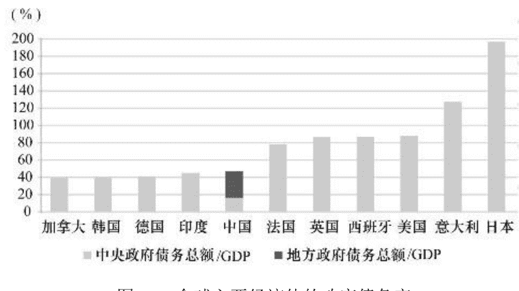

图6—8 全球主要经济体的政府债务率

注：日本未使用2016年数据外，其余均为2017年数据。图中除中国外，均为中央政府债务率。

资料来源：CEIC数据库，Wind数据库。

中国债务的争议之处，在于各种隐性地方债务的规模估算及其风险。地方政府的广义债务中，又可以分为不同的组成部分，按财政部门分类分为三类：政府负有偿还责任的债务（法定直接债务）、政府负有担保责任的债务（法定或有债务）以及政府可以承担一定救助责任的债务（非定的或有债务）。后类债务正常情况下由债务人以自身收入偿还，无需政府承担偿债责任，也称为政府有担保的债务，其中包括城投债务、地方融资平台的银行贷款。此外，随着近期债务与社会资本合作项目（PPP）的开展，项目中的政府资本与银行贷款债务也应当纳入政府的隐性债务。

根据国家领先权威的官方数据，截至2013年6月末政府债务中，作为直接债务的政府负有偿还责任的规模达10.8万亿元；而政府或有债务总额6.9万亿元，其中政府负有担保责任的或有债务为2.6万亿元，政府可能承担一定救助责任的债务为4.3万亿元。根据笔者的朋友张教授的估算，2012年之后的5年内，地方政府法定债务总量从8.8万亿元增至2017年的18.58万亿元，年均增速16.03%；地方政府或有债务总量从2012年的6.84万亿元增至2017年的23.57万亿元，年均增速28.04%，增速明显快于地方政府直接债务。从区域来看，江苏、浙江等东部省份绝对规模较高，因此债务率偏低；而债务压力高的省份主要在西部和东北。中央对地方隐性债务快速增长带来的风险非常重视，每两年就会实施全面排查和整顿。

二，债务结构呈现明显的差异，家庭部门债务率低而企业债务率高。根据央行发布的《中国金融稳定报告》，截至2017年末，中国非金融企业部门杠杆率为163%，在相似经济体中位列第一，远高于美国（106%）、日本（103%）、欧、俄罗斯（76.6%）、印度（73.4%）和巴西（73.5%）。家庭部门低而企业部门高，反映了一个基本事实：债务主要是为了生产和投资而不是消费。当我们讨论债务风险时，不能只看债务规模，应该看债务GDP比例。如果是借了钱，那么支出转化为消费者的收入；如果借了钱，那么未来的还款还需要进一步开展。

三，中国的债务主要是人民币计价的国内债务，且债务对应的资产规模非常巨大。从全球经验来看，所谓债务风险主要表现为周期错配和种类错配。中国的储蓄率非常高，由于在发展的过程中，主要是靠内源融资而不是外源融资。人民币计价的债务在宏观属于国内不同部门的债权关系，由于存在政府财政政策和央行货币政策的护航，因而未被认为是真正的宏观风险。外源融资中，中国主要是靠外直接投资FDI而不是人民币计价的债务。近年来人民币计价的债务也有明显的增长，其动因是因为人民币利率较高而人民币的基准利率太低，许多货币投资者利用进口出口和跨境投资的便利，通过借入美元或日元负债而持有人民币资产的交易（carry），以此追求利差和汇差带来的双重优势。但是总体上看，企业的跨境融资规模远小于中国官方的外汇储备。更重要的趋势是，随着人民币的国际化，越来越多的国际官方储备资金和养老基金、资产管理公司等投资者开始进入人民币市场，与中国一起来承担中国经济的风险，分享红利。这一体制转变将极大降低宏观债务风险。

## 二 杠率率探索与教学

金融危机之后的十年间，中国的宏观债务率大幅升高。根据国际清算银行的数据，2006年第一季度，非金融部门的总体经济杠杆率为141.8%，10年后的2016年这一数字大幅升至237.6%，2017年甚至在第四季度实施了去杠杆政策，该指标仍一步升至241.5%。在中国这一时期的杠杆率快速升高，笔者认为源自内外重重因素。

内部因素是经济增速的目标值。保障增长是为了就业扩张。为了对抗2008年金融危机对中国经济的冲击，政府推出了一系列刺激计划，通过各种方式进行杠杆扩张，在短期内创造了巨大的债务量。这种快速增长导致了人口龄化结构的特殊性问题。对于企业的管理层而言，未来的升迁往往取决于经营企业的资产规模而不是盈利情况，其债务风险往往在任期内爆发，在很多时候也有主管部门和地方政府的兜底，所以部分国企负责人表现出明显的投资和负债冲，而是那些较为谨慎的国企负责人难以提拔重用。

外部因素是全球市场对中国的拉动作用。金融危机之前，2002—2007年，“入世”帮助中国打开全球大门，出口增速每年维持在20%以上。金融危机之后，全球经济增长倒退，中国市场份额的扩大意味着另一个份额的萎缩，中国贸易商品的竞争力提升意味着另一个国家的相对下降。在一个开放市场体系中，对债务风险的影响在地区分布上是不对称的。在国企和民营企业之间，正如经济学家张教授所说的，存在某种隐形。国企在政策上、信贷上优于民营企业的待遇，相比之下，融资成本较低且规模更大。3/4的资金流向了国企，而只有1/4流向了民企。民营企业的效率偏低、盈利能力弱、财务上软弱，国有企业偏负债水平为中国经济质量问题。

从全球来看，老龄化与债务率升高是高度相关的，发达国家30年的债务上升空间在十年内走完了。老龄化意味着社会需求的相对萎缩和经济增速的下滑，为了维持中央的目标增速，东北等地年轻人口流出、老龄化严重的地区不断增加杠杆以投资补充消费。当然，这还需要更多的实证检验。

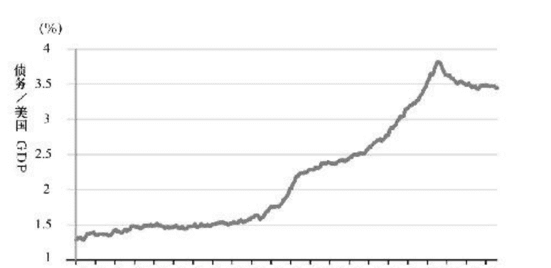

图6—9 美国债务杠杆率的转向（1952—2016年）

资料来源：联储银行（Federal Reserve bank of St. Louis）。

此外，笔者从政治经济学的视角提出一种设想：老龄化也能解释很大一部分杠杆增长。

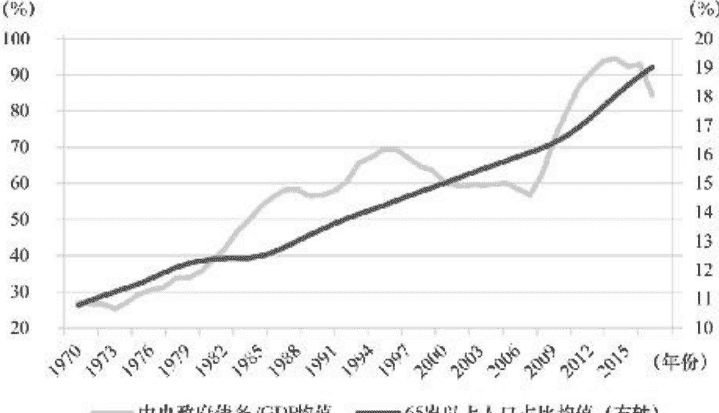

图6—10 西方国家老龄化过程与债务率升高趋势（1970—2015年）

资料来源：国际货币基金组织，世界银行。

中国杠杆率的快速抬头引发了国内外的警觉和批评，尤其是2015年高杠杆牛市的崩塌随着美元强势周期的到来，引发了中国金融市场“股汇双杀”的动荡和资本外溢的局面。在此背景之下，在达里奥的“去杠杆”理论影响下，从2016年1月开始，中国启动了一轮自上而下的金融去杠杆，成为“三去降一补”供给侧改革的重要组成部分。在此后的两年里，融资环境开始加速变化，越来越多的企业和地方政府的融资平台发现资金链面临断裂的困局。不断加码的政策趋势和信贷实体之间的恶性循环引发了各种金融风险，此前作为金融创新的P2P开始泄雷，大量城投平台违约，民企债务风险凸显。

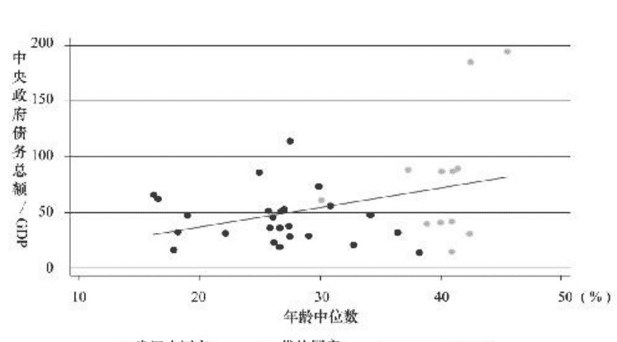

图6-11 各国老龄化程度与债务率回归

注：年龄中位数为2012年数据，债务率数据为15—17平均值。

资料来源：UN data。

私营工业企业的资产负债率从2017年12月起明显上升，在去杠杆的背景下，负债扩张速度反而加密，显示出现现金紧张、财务状况恶化的趋势。随着去杠杆与监管增大，利率被极大限制，原本可以通过多元化渠道获得融资的民营企业经营困难。这种政策的连续性导致了政府部门的债务快速高涨，市场出现了连续的局面，许多企业失去了主动权。

### 如何解决民营企业融资的问题

民营企业融资的问题，是由政府部门的债务占了太多的。在整体上看，由于政府部门的债务规模巨大，银行和其他金融机构不愿意给民营企业提供贷款，因为其收益率无法覆盖其风险，必须要求更高的回报。通过对融资链各个环节的调研，笔者有发现，为什么金融系统放给中小企业风险高？

首先是因为创新型企业通常没有足够的抵押物，也没有足够可靠、完整的财务报表反映其真实经营情况。其次，即便有了抵押，当违约发生，银行需要通过诉讼保全贷款，周期特别长，牵涉的精力巨大，而中小企业的规模通常较小，银行的人力是有限的。最后，政府可以提供部分资金帮助中小企业提升其信用。目前，政府通过金融系统设立的各类政策性措施，由于不是由市场主体按照市场逻辑来分配稀缺的金融资源，带来的负面代价大于综合收益。这些基金并没有真正缓解中小企业融资困难的问题，反而引发暗箱操作和逆向淘汰，那些有人脉、公关、包装的企业通过整合和影响力获得资金，而那些全技术专注经营的企业更加困难。

基于以上分析，笔者提出了如下对策：

第一，应当扩大中小企业的抵押物。目前，银行基本上只认房产，因为在中国的法律系统中只保护房屋和土地。中国的物权保护个人和企业的各类权利，除了房屋和土地使用权之外，还把企业应账款列为财产产权。可是，在今天的司法实践中，并没有用用具有充分见和潜力的司法，并没有把它运用好。如果是大型企业，比如地方国企，向他们的伙伴采购商品和服务时，使用国家提供一种格式式的质押承诺，这在应账款质押登记系统上注册确认之后，银行可以将相关中小企业的信贷债转换为各级政府、事业单位、央行和地方国企的债权。由此，大量的创新性中小企业将因此获得低价的流动资金信贷支持。公共部门每年的采购规模大约接近GDP的33%上下，2019年的经济规模应该在30万亿元人民币左右。如果这30万亿元的债权可以通过上述方式转换为企业在银行中的高质量抵押物，那么他们的实际融资成本将大幅降低。

第二涉及银行抵押物处置的诉讼，应当开通绿色通道，快速处理。通过事上传资料，专门部门快速验查真实性，缩减银行和其他金融机构为追回贷款所需实践和人力成本。商业银行从出现不良贷款到诉讼结束，每笔至少两年，资料数量非常巨大，人力和时间成本非常异常。原因在于每位法官手里积压了8000多件案子，即使高效工作也足够退休。这源于司法公共事务的投入不是，司法和执法的各个流程设计并不符合现代市场的内在要求。银行的必然反应应该是这类小规模的信贷业务。

的来源，应当主要从现有的各个地方政府和各个行业系统针对行业和本地地区的创新企业提供的各种扶持资金转移过来。目前的各类扶持金目繁多，市场操作规模太大，非市场化透明明显，其结果往往是劣币逐良。

功夫在诗外。要实现民营企业的繁荣局面，关键的难点和痛点往往不在这些企业和企业本身，也不在银行信托等机构，而是在公共部门的改革和创新。融资难题的解决，恰恰需要政府的巧妙作为，需要对物权的扩大保护，需要国央企业私人部门的信用延伸。

## 四 中国债务的改进空间

从宏观来看说中国的债务压力上升并非什么致命的事情，但是中国的债务安排还有很大的改进空间。笔者认为通过一系列改进，可以使得中国的债务更加可持续，并使得中国与世界市场体系的关系更加良好。

首先，是推进中央与地方财权的重新分配，让中央债务规模，地方控制债务比例。1994年的分税制改革具有其特殊的政治性，设计者特意将大部分税收收入纳入中央，少部分留给地方，并将大量的债务连锁的责任交给中央。由此导致此后20多年中央和地方的债务状况差异巨大：越向上层越宽裕，越向地方财权越困难。这样的安排有其政治好处，但是会造成整体的不经济和政策错位，因为中央的成本低于地方的融资成本高。2013年，党的十八届中全会的全面深化改革报告提出了中央和地方财权的重新分配，此后税收合并、房产的监控，司法和环保等系统的财权上收，都反映出现调整的趋势。但是到目前，这方面的进展还不能到位。地方政府通过招商引资发展经济，甚至自己直接承担企业的角色，这种GDP竞赛对于工业化过程中的可能是一种不错的制度安排，但对于高速发展向高质量发展转变，一切工作都要“以人为中心”的新时代中国特色社会主义建设来说，这种制度恐怕已经不再宜。地方政府应该回归公共产品的提供者的角色，应该回归人民服务的初心和本质，否则很容易越位和缺位；在经济功能上越位，在政治功能和社会功能上缺位。未来的全面改革应当与人工智能和通信技术的快速发展相结合，

其次，可以降低GDP的目标，扩大GDP增速的弹性。经济增速不是越快越好，是要与就业和其他约束条件相匹配。全球范围内，许多发展中国家的高增速其实是没有意义的，因为随形的汇率波动会导致其回归原始，如同商人那样只跟随快速旋转的笼子里的白老雀一样，跑了半天还在原地。通过长期追求高速，通过财政政策刺激积累债务负债，通过货币政策刺激会导致通货贬值（非工业国家）或者资产泡沫（工业化国家）。中国的人口结构决定了我们不需要高速增速，继续寻求增长拉高增速必然费力不讨好。让增速回归基本面，并对于我们的经济规模超越美国成为全球第一大体，只要贸易部门的竞争力提升，将会持续上涨，用国际市场估计我们未来30年的复合增长率仍然是全球大国的第一。不容经济增速下滑，保持一定的财政空间，避免资产泡沫，可以为未来的全球性极端尾部风险的（如巨大危机和地缘冲突）留足够的政策空间。

最后，引起改革和发展资本市场，增加股票直接融资比例，扩大和打通债券市场的广度和深度，管好影子银行。企业部门杠杆水平上升与中国股权融资的发展缓慢是密切相关的。长期以来，非金融融资的发展受到多种因素的制约，其中最重要的问题是决策者对市场的理解能力和治理能力。在进入21世纪以来到2018年，非金融行业内股票融资占社会规模的比重有两年超过5%，其余十五年均低于5%的占比为1.9%；在此期间，非金融企业内股票融资年度同比增长八年为负增长。融资结构得不到改善，股权融资处于缓慢发展的颓态状态，非金融部门杠杆就难以有效实现。换言之，如果能够通过综合性的举措，推动非金融企业部门股权融资增速超过债务融资增速，就能有效控制企业部门杠杆水平。带有注册色彩的科板的推出体现了最高的战略能，但其成功就需要国内主事者的专业能力和操控

中国债市的市场目前处于半封闭和碎片化状态，这与全球大国的地位和人民币国际化的时代要求不适应。打造一个全球开放的统一挂接的人民币债券市场以涵盖储蓄资金对流动性、高信用等级资产的需求，这需要改善全球经营失衡、提升对全球经济运行中的主权国家都有实的意义。除了美国国债市场之外，欧盟的财政分散的因而不可能这样的统一债券市场，日本、印度的体量又太小，所以只有中国才有可能提供美元国债之外与之媲美的第二个无风险资产大池子。

开门的同时还有管住后门，管理好影子银行是未来结构性稳定的必要性。与企业部门杠杆水平快速上升相关的2011年之后的影子银行大幅增长，这可以通过委托贷款、信托融资和非标理财之类主要产品的发展中清晰地看到：2011—2017年均增速高达80%左右。由于这些融资方式的监管明显不足，不存在准备金率的调节，也基本不受资本充足和拨备覆盖要求的制约，因而有不少风险隐患。

### ### 债务评级的霸权

### 二 霸权如何形成？

现代意义上的信用评级产业，出现在20世纪初。20世纪7年代之前，评级机构的主要收入来自投资者的订阅费，评级机构提供精准分析。自20世纪80年代自由主义开启后，评级机构经营模式由主动评级转向委托评级，由于监管带来各种衍生品不断涌现，增加了市场对第三方评级的需求。在美国范围内成功推广的政策，全球市场从传统上封闭的市场变为开放和高流动性的市场，美国评级业务不再限于美国，美国评级霸权逐渐成为全球标准。发展到今天，全球评级市场高度集中在三大级机构手中。目前全球认可的评级机构共有12家，其地区分布如下：

表评级机构地区与分布

| 地区 | 评级机构数量 | 占比 |
| :--- | :--- | :--- |
| 北美 | 14 | 17 |
| 欧洲 | 12 | 11 |
| 亚洲 | 9 | 6 |
| 中亚 | 2 | |
| 新兴市场 | 21 | |
| 非洲 | 1 | 2 |
| 印度 | 2 | 2 |
| 中国 | 2 | 6 |
| 及其及利亚 | 2 | |
| 埃及 | 1 | 3 |
| 泰国 | 1 | |
| 菲律宾 | 2 | |
| 巴西 | 2 | |
| 南非 | 2 | 2 |
| 合计 | 17 | 100 |

资料来源: Ahmed Naciri, Credit Rating Governance: Global Gatekeepers, New York: Routledge, 2015, p.14.

但是在这些众多竞争者中，穆迪、标普和惠誉三家占据了95%的市场份额，形成了双寡头的状态，市场越来越受到行业惯的影响的影响，发行的企业主要由这三个级机构获得。在所有参与信用评级的银行和公司中，穆迪公司涵盖80%的银行和78%的公司，标普公司涵盖37%的银行和66%的公司，惠誉公司涵盖27%的银行和8%的公司；就信用评级收入而言，穆迪和标普总共占据了77%，国际占据了剩余收入15%。这种双寡头的格局的形成，既有市场和技术因素，离不开美国政府的干预和保护。

从技术上看，评级行业本身存在天然的“高门槛”，使得新入者难以与其巨头竞争。评级行业的初期投入大而边际成本低。多年的业务使得巨头在全球积累了40多个分支机构、雇用的大量评级分析师、积累相当广泛的专业知识和巨大的数据库，并发展出复杂的评级模型。更重要的是，三大级机构通过高额计费与客户形成了利益绑定，尤其是关键客户建立了长期的合作关系。企业在提供内部信息时可以尽量选择对自己有利的数据，而三大级机构也会提供咨询，从而改善客户的评级。由于信用评级机构不需要为自己提供的评级服务承担法律责任，三大级机构可以利用权重来整合重要客户，让人得到满意的。这种与重要客户的商业关系维持了他们的市场份额，又提高了市场准入壁，让其他级机构更难以与其竞争。

但重要的是美国政府对三大级巨头垄断性的护持，信用评级是美国少数采取垄断保护的行业。首先，美国政府设置了行业准入。1975年，美国证券交易委员会（SEC）认证、标榜、惠誉三家公司为“全国认定的评级组织”（NRSRO），并且规定国外资本在美国金融市场上市，必须接受由NRSRO的评级的评估。在此30年后，证券交易委员会一直限制其他进入评级市场，更是设置阻碍阻止国外评级机构进入美国市场。此次，证券交易委员会对三大级巨头的监管非常宽松，平均每年进行一次例检查。欧盟曾多次要求增加评级机构的透明度，包括公开其评级所采用的模型和相关数据更新，美国当局局表示拒绝，理由是评级模型为评级机构的核心竞争力，应作为商业机密加以保护。其结果三大级机构不受外界监管和约束，其评估也不算挑战。最后，美国政府直接承认三大级机构的评估结果，并将其作为监督金融机构的重要指标——规定银行、保险公司、养老基金不能购买低于一切级的债券，美联储要求其投资级必须获得三大级。这在无形中将民间中介服务转化为公权，增加了话语权和垄断性。

+ 13
+ 14
+ 15
+ 16

笔者认为这种观点不能准确把握。关于全球化和金融部门的章节讨论的那样，全球化使得其公共部门很容易被资本集团操纵，正如穆迪集团、黑石集团、道富等都是共同的所有者。

表主要评级机构及其所有者

| 评级机构 | 持有者 | 占比 |
| :--- | :--- | :--- |
| 穆迪公司 (Moody's) | 邓界街 (Dun & Bradstreet) | 2.5% |
| 标普 (S & P) | 麦格恩-霍尔 (McGraw-Hill) | 60% |
| 惠誉 (Fitch) | 阿纳克斯 (Finalase) | 40% |
| 日本投资国券株式会社 (JCR) | 美国海特 (US Health Corporation) | 金星 |
| 晨星 (Morningstar) | 英国 Joe Marcus | 37% |
| 克尔债券评级 (Kroll Bond Agency) | 玛士麦克伦公司 (Marsh & McLennan) | 28% |
| 琼斯 (Jones) | 华孚 | 31% |
| DBRS | Dominion Bond Rating Service | 华孚 |

资料来源：雅虎财经，https://finance.yahoo.com/?counter=1。

## 二 现有信用评级体系的治理缺陷

对现有信用评级体系的学术研究和批判相当丰富，主要集中在以下方面。

首先，付费模式导致的激励扭曲和系统性腐败问题，会降低评级结果的公正与准确性。现行的行业规则由发行人支付评级服务的费用，而不是投资者和获取信息，因此发行人和投资银行可以“购买”评级，这种利益导向的商业模式损害了评级机构的内容，并且增加了争取客户而形成的内在冲突。它使得评级机构有力地给予发行者更高的评级，以免客户流失到其他级机构。发行者也为了高估信用评级，最终导致评级行业偏离了公正独立的原则，高估信用结果。在经济形势良好的时候，这种系统性的高估会引导市场忽视危机、推动信用泡沫。

2008年美国次贷危机：评级机构根据行业规则和证券复杂度的不同收取不同的费用。结构性金融产品由于其结构的复杂性，评级费用也远高于普通债券，成为评级机构收入和利润的最重要和增长快的来源。在巨额利润的刺激下，三大级机构对结构性金融产品的评级结果明显优于传统的债券评级。数据显示，2007年美国次贷规模约为13.8万亿美元，三级通过提供次贷产品级服务获取的总收入为18亿元。而在美国证券交易委员会2008年的调查中发现，一些对高风险次贷金融产品进行级的技术人员直接参与了评级费用的商谈，是级机构利益导向影响最直接的证据。这种利益导向在一定程度上助长了长期贷款的泡沫，为金融危机的全面爆发埋下了隐患。

其次，主要评级机构的风险评估能力和评估模型的可靠性与合理性得不到保证。三大级在金融危机中人为失灵的表现，除了其本身的收益问题外，也和能力较差、缺乏职业道德有关。学者关注评级机构的业务能力问题，包括评级模型保密导致行业透明度、评级指标选取的不合理以及部分因素不可忽视，使得评级结果的准确性大打折扣，对经济金融风险预警能力不足。评级机构的分析师往往是刚毕业的年轻经济学家或数学家，缺乏工作经验和社会阅历。他们在需要分析的数据规模巨大，且面临尽快发布报告的时间压力，因此评级结果缺乏准确性，且由于重复使用相同的测试标准，评级机构逐渐迷失在自己的评级方法中，无法敏捷捕捉市场的结构性变化。

虽然三大级机构将评级程序和计算模型视为商业经营，不对对外开放，但是从其评级指标的选取中，也可以发现存在的问题。部分指标在其主国家债务债券中所选取的指标无法定义，部分指标在其主国家债务债券中所选取的指标无法定义。反过来，像日本的评级表现更为宽容，平均评级结果与亚洲有巨大的偏差，达到73%。评级机构作为华尔街的一部分，带有很强的自由意识见，影响了对发展的立场。三大级机构倾向于根据共识中的自由化、私有化、全球化来衡量发展和发展前景，新自由主义意识形态等手段，成功在经济领域操控了各类部门。正如全球化和拉美模式是最典型的案例：如私有化、自由化、全球化加剧了外部的脆弱性，金融崩溃、政府动荡、社会动荡，导致国家陷入陷阱。

最后，作为金融市场一部分，评级行为本身具有特点。按照索罗罗斯的说法，评级功能可以分为认知函数与执行函数。在认知中，参与者的偏向是决定未来价格的要素；在执行中，参与者的偏向可能会造成失真。评级机构和被评级之间存在一系列关系。评级机构用一些定量指标——负债率、盈利能力、现金流量来衡量国家，然而事实上盈利能力和现金流量是客观的衡量标准，只要保持较高的级，获得增强的信贷扩张将持续下去，形成泡沫。显然，信用评级的特征意味着实现自我预言，这种特征更容易引发资产价格泡沫。正如齐尔伯弗里德所言，“我们生活在两个超级国家之间，一个就是美国，一个就是穆迪，美国可以用炸弹摧毁一个国家，穆迪可以用级级毁一个家。”三大级机构对话语的差异，致使它们有能力操控的定价，直接影响国家的主权与安全。

以欧债危机为例，2009年12月，标普、惠誉、穆迪连续下调了希腊的主权信用级，拉开了欧债危机的序幕。此后，尽管欧盟批准希腊援助计划向希腊提供贷款、通过财政紧缩方案促使财政一体化，三大信用机构仍然下调希腊的主权级：

2010年5月10日，欧盟批准750亿欧元援助计划，IMF可能提供2500亿资金救助希腊。
2010年6月14日，穆迪下调希腊主权信用级至垃圾级。
2010年9月7日，欧区区域批准为希腊提供第二笔贷款，总额65亿欧元。
2011年1月14日，惠誉下调希腊主权信用级为BBB-级至BB+级，级展望为负面。
2011年7月21日，欧区17国领导人在布鲁塞尔举行峰会，最终裁定对希腊实施第二轮紧急救助方案。
2012年2月27日，标普宣布欧洲金融稳定基金（EFSF）级前景从“发展”下调至“负面”，希腊主权级在垃圾级中进一步下调。

将欧洲国家的债券降为垃圾级，意味着大量的养老基金和资产管理公司不得不卖出相关金融资产，由此导致利率的进一步升高和经济的进一步紧缩。这种“严厉”的评估几乎扼住了希腊、葡萄牙等高负国家在资本市场上融资的可能性，使得欧债的救助措施失效，希腊经济前景黯，危机持续蔓延，最终三大信用机构进一步下调欧区成员的主权级。这就形成了自我实现的预言和自我增强的恶性循环——信用评估等级的走势呈现阶梯局面（如图6—12所示）。

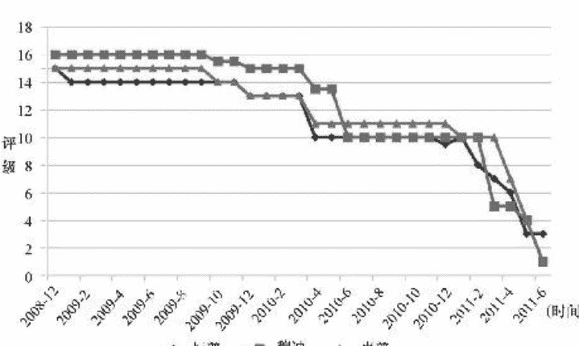

图6—12 2008—2011年三大评级机构对希腊的主权评级

们改革评级的结构和规则提供了契机。探讨如何改革正当其其。

首先，透明度和责任作为现代治理的基本准则应当在评级行业得到应有的体现。华尔街的政治影响力保护了三大评级机构的特权，让他们免于公开其评级模型，以及评级结果承担法律和财务代价，这其实是体制性腐败的结果而非生态的合理组成部分。在中国开放本土评级的过程中，应当以法治和市场化人为条件，要求三大评级机构在内的所有评级服务者公开其评级模型，至少其模型背后的理论依据和历史可靠性，并以同样标准相互比较和监督。如同药品企业公布报告和临床实验结果一样。如果药品企业不公开疗效和临床效果，也不对疗效和副作用负责，那么必然药假泛淫。同时，评级机构也必须对其评级报告的重大损失承担部分责任，若是某笔关于AAA的债券违反了规定而评级机构没有及时预警，那么应该将该笔业务的评级费用缴纳证券监督管理委员会或者受相关诉讼的人民法院。即便这种象征性的廉价程度与投资者的损失全在一个数量级上，至少能让评级机构不再为评级费用引入人为而高抬评级。评级机构的能力应该处于公开的监督之下，具体的办法是要求每个评级机构根据其研究和模型，在媒体上公布全球范围内政治风险的标准化预测，并对其每年的准确率进行排名。这样的排名一方面有利于公众和用户更好地理解和对比其价值的可靠性；另一方面也有利形成评级机构之间强化自身专业能力而不是为了客户需求的竞争力，从而打破现有三大机构的差异性。

以此，改革行业主体也是一种可行的探索。评级服务不是只能由营利企业来承担人才合理吗？恐怕未必。评级涉及到市场秩序、经济信心和巨大的（正向与负向）外部性，因而具有公共产品的特征，使得新的私人企业来把持这种公器才产生了上述治理缺陷。公应当回归公权力，全球性的公器更不能让一个私人部门来把持。以此者，我们应该在全球范围内建立非营利性的评级机构。[25]有效的方法是政府或几多边机构如世界银行、亚行、金砖银行、亚行等共同发起，成为受政府监管的评级组织。不同于维持的其他评级机构分享市场份额，或者政府监管，强行扭转评级机构经营模式的改革思路，这是一种“替代性思维”，即建立一个独立的市场、投资方、融资方，无利益关系且非利润向的新的国际评级组织来替代现有的评级机构。其可行性在于：

第一，这种评级组织在性质上是非营利且利益中立的，其背后的支持者是财团，在成立之初就能获得足够的公信力；二，其服务对象主要是政府的公共部门，并且应当成为公共部门投资融资过程中唯一被指定的评级机构。第三，由世界上主要的多边机构共同形成的评级组织，在组织规模、专业人才以及能力上具有一定优势（准确性），相比于其他个人评级机构更为具备，而这些会进一步转化为评级的权威性和市场份额。

评级主体除了升级为国际多边机构的附属机构外，国内内部可以由具职责的评级师如同律师一样以个人名义提供服务，并对其结果承担个人声誉的责任。上文提到的多边国际评级组织可以为其任职的培训、考核和资格认证，并追踪和监管其生涯的记录，对于那些有重大错误或道德问题的人员应当取消其评级优势。这种程度的改进，国际公共部门的非营利性服务和监管，又有个人从业群体的竞争和淘汰机制，不能提升评级的准确性和正性，而且能够降低一部分融资成本，此学者主张的信用评级机构的经营模式从发行付费转变为用户付费[26]具有现实可能性。

最后，如何在进一步的改革开放提升中国国内的评估治理水平和竞争格局也是值得探讨的方向。目前，中国国内现有的融资格局和评级质量到底的问题，也存在行业过早开放的问题。三大

评级机构，别是大国际、中信国际、联合信用，共占了中国资本市场95%以上的份额。赖于2006年购入中信49%的股权，到2019年仍持有其30%股权。同年香港新华财经收购上海海东62%的股权，2007年惠普收购联合信用49%股权，2008年标普与上海新世纪签署战略合作协议，大国际成为了中国唯一的主要信用评级机构。可见从主义意识形态的影响，开放变成了一个政治纠正，与国际实践中中国化为标准。国内全面模仿甚至直至引入了美国评级行业，却没有有意到美国模式的重大缺陷和美国机构主导地位可能给中国经济金融安全带来危害。

在日本20世纪80年代以来，第一程度上的政府管制策略使得信用评级机构越发越边缘化，本土的两大顶级评级机构（贷款信用报告R&I和格付研究所株式会社JCR）在日本国内金融机构和财政部的支持市场份额和评估能力都有大幅提升，得到了发展，[27]其背后的经验教训我们能够进一步的研究和借鉴。

[1]之所以不包括金融部门，是因为金融部门作为全社会的资金中介机构，其杠杆率与上述三个部门之间存在重复，在此在衡量实体经济杠杆率通常予以排除。

[2]Reinhardt,C.M. and Rogoff,K.S.,"Growth in a time of Debt”,American Economic Review, Vol.100,No.2, 2010,pp.573-578.

[3]学者与莱因哈教授在世界银行2015年春季会议上就其债务形势形成交流，此后收到的PPT，本书中提到第二次世界大战后全球主要经济体的债务变化趋势源自其。学者者核心主张，但觉得Reinhardt教授是一位满口胡言的处而努力研究。

[4].[美]马斯·赫顿][美]英克尔·阿什][美]罗伯·洛林，《高通杀经济增长吗？——对莱因哈和罗夫判别，《政治学评论》2015第6期。

[5]张明：《中国债务规模几何？，《财经》2018年7月23日。

[6]《中国金融报告（2018）》、《2018年1月3日，中国银行网站，https://www.gov.cn/finance/2018-11-03/content_53377.htm。

[7]笔者在对比时发现，曾经见到一些毫无意义的原本是两个国家不同民族聚的矛盾，莱茵亚地区相对富裕，莱茵亚地区则贫困，要求中央政府开支必须在基础设施等获得平衡的结果是出现了一些经济，比如两个山头之间。

[8]子债务数据采用All Sectors, Securities and Loans; Bills of Dollars, Seasonally Adjusted.for Gross Domestic Product。

[9]连华：《反思中国杠杆》，2019年2月25日，http://www.chinaacet.cn/index.php/article/id/5540。

[10]这种具有技术因素，也有制度原因。技术上，随着低成本和其他高技术的出现，在投资者付费的经营模式下，“免费的问题日益严重。同时，金融市场对高质量信用的需求亟拓展，单一投资者很难维持一个团队。制度上，信用评级被引入美国资本准则（Net Capital Rule），发行人不再为评级付费。参见Levinich,Richard,Majnoni,Giovanni and Reinhart,Carmen,Ratings Agencies and The Global Financial System,NY:New University Press,2002,pp.33-35;Cantor Richard and Parker Frank,“The Credit Rating Industry”,Federal Reserve Bank of New York Quarterly Review,1994,Vol.19,No.2,pp.1-26。

[11]Rhee,Rating Industry”,Northwestern Law Review,Vol.108,Issue 1,Fall 2013,pp.85-138.

[12]国际清算银行:http://www.bis.org/2011年数据。

[13]John C.Coffee,Jr.Gatekeepers:The Professional and Corporate Governance,Oxford:Oxford University Press,2006.

[14]孙立军：《信用评级就是金融标准，《东方早报》2010年7月14日。

[15]日本最大的信用评级研究所自1990年起申请进入美国市场，历10年后获得批准，在开展业务过程中受到诸多限制。即使2006年的《评级改革法案》了市场准入，美国证券交易所2003-2008年间给其他的评级机构签了认证证书，如A、M、日本格付研究所、伊根—琼堤等，都是这些评级机构还没有与三大机构竞争的能力。信用评级行业的新入者由于缺乏可靠的信用评级记录，很难找到客户。但可怕的是，如果没有第一个客户，又无法形成这样的评级记录。Coffee John,Jr:“Rating Reform: The Good,The Bad and The Ugly”,Columbia Law and Economics Working Paper,2010,No.359,p.4.

[16]邱绍洋：《评级真相》，中国经济出版社2013年版，第22页。

[17]Hee,Robert J.,“Incentivizing Credit Rating Agencies under the Issuer Pay Model Through a Mandatory Compensation,”Banking & Financial Services Policy Report,2014,Vol.33,No.4,p.10.

[18]邱绍洋：《评级真相》，中国经济出版社2013年版，第71页。

[19][美]诺伯特·嘉拉德：《国家信用评级世纪评论》，孙森等译，东北财经大学出版社2014年版，第103—109页。

[20][德]姆尔东克·霍滕斯特：《评级机构的秘密权力》，王鲍逸译，上海财经大学出版社2015年版，序言—1页。

[21][美]诺伯特·嘉拉德：《国家信用评级世纪评论》，孙森等译，东北财经大学出版社2014年，第103—109页。

[22][美]塞缪尔·亨廷顿：《社会中的变化》，王冠等译，上海出版社2008年，第69页。

[23][美]乔兑、索罗斯：《金融炼金术》，孙忠译，海南出版社，第6页。

[24]引自史菲里德曼《纽约时报》，2012年第9期。

[25]危机后，国际评级机构的改革见“Universal Rating Group（UCRG):History”,http://www.ucrgating.com/about/history.html。

[26]Rhee,Robert J.,A Critique of Proposals to Reform the Credit Industry（with a Comment on Future）Banking & Financial Services Policy Report,2013,Vol.32,No.3,pp.14-24.

[27]Gotoh,Fumihito,and Sinclair,Timothy J.,Social Norms Strike Back; Why Financial Practices Failed in Japan,Review of International Political Economy,2017,Vol.24,No.6,pp.30-51.

# 第七章结论

作为全书的总结，笔者觉得有必要向读者提示一下本书的若干之处，它们可以归为两大类：一是对流传广的谬见进行了批判，批判对象集中在自由主义经济学的理念及其方法上；二是本书的研究内容提出了一系列独特的观点和主张，概括如下。

## 对流行见的批判

首先指出的一种思想上的错误是用武断和随意的求法来讨论多维的社会政治关系。社会是一个动态的、复杂的生命体，社会科学研究不可避免地将问题进行某种程度的简化才能开展。但是有一些分析者试图将问题简单化的时候，他们倾向于找一个分子来代替分母，然后用这个指标的大小对于这些治庸的常见，相当于用一个体温计为目标体，然后假装把病治好了。这是研究者在社会面前无能的表现。在人口问题上，马尔萨就开始用GDP代替人口，要求控制人口的数量以便忽略了分子与分母之间的钩关系。人就是财富的分配者又是财富的创造者，减少人口会导致经济活动的下降。极端而言，假如地球上没有人的话，就没有富有可以，而只有少数人活着的话，这几个人的生活是非常贫困而低效的，如同在海岛上的。在债务风险上，许多人认为债务率过高或上升太会导致经济的崩溃，他们试图建立抑制措施做大GDP，却注意到债务会产生GDP，消灭一种债务就会抑制GDP的增速。这种混淆了微观债务和宏观债务，微观主体有债务的影响而宏观主体可以征税印钞，即使对于微观主体而言，用债务量衡量收入（GDP流量），这样的求法对于揭示风险没有大意义。事实上，对于国家债务而言，真正需要的是货币的种类和国民储蓄。在利率决定问题上，许多经济学家认为投资和储蓄的比例决定利率的走向，但是他们忽略了投资本身可以创造更多的储蓄，投资不是一个中间变量而已。

对实际财富的最终需求其实是国际国内消费，投资带来的产出只有满足了消费才有意义，所以当经济过热的时候，调控的着力点应该是消费而不是投资；把握未来利率趋势的关键在于放弃储蓄和消费力量的变化。上述三种错误理论的共同点是随意确定分母，而理论家们犯错是因为缺乏对对象的整体理解和准确把握。

表7—1 本书列的三类错误理论

| 理论名称 | 分母 | 分子 | 备注 |
| :--- | :--- | :--- | :--- |
| 生存积累理论 | 消费 | 投资 | |
| 财富积累理论 | GDP/人 | 财富创造的资本者 | |
| 资本积累理论 | 债务/GDP | 债务是剩余的阶级，政府是其首 | 阶级差异、资本者 |
| 决定分配理论 | 分配决定投资 | 财富/份额 | |

资料来源：学者整理。

本书要批判的第二类错误理论主要是政治经济学思想上忽视了影响深远的底层。对于美国而言，对于处于体系之外的发展国家而言，美元输出所伴随的美国贸易差导致了部分国家出口导向的，但是美元体系内的不稳定性也带来了巨大的冲击。美国金融部门对其内政外交和意识形态的掌控，开启了20世纪80年代之后新自由主义全球化时代。全球市场开放带来的美国效益和生产率提升，使得整个世界的生活水平有所改善，但是其收益和代价的分布存在不对称性。特别是在美英等国的内部，金融资本和科技资本从全球化和去监管浪潮中获良许多，而农业地区掌握大量选票的白人蓝领成为相对受损者，由此为美国本土民主主义于逆全球化势的抬头。

了。后金融危机时代，美国的经济复苏很大程度上依赖超常规货币政策的护航，美联储负债表的大幅扩张和长期利率环境带来了显著的再分配效应：美国股市在十年内从6000多点涨到了2.7万点，民众生活感受到的实际通胀率高于公布的所谓核心通胀率，但美国房产和收入中位数并没有明显上涨，拥有数字股权的富人源于货币政策而变得更加富有，而依靠卖出劳动和养老金储蓄生活的中产和中下层根本没有大改善。货币政策的再分配效应引发了美国的民主主义，导致了特朗普当选这样的非常正常政治的出现。未来年后，美国企业债泡沫终将被破灭，美国中部人民的经济状况将再次遭受重重击，他们的民主主义可能再次向极端极化倾向，2020年或2024年的美国大排除异势力登台的可能性。

关于央行的货币政策，本书解释了央行政策独立性的初衷。即使美联储的利率政策，也无法摆脱来自自身的干预和压力，在政策在2002—2005年以及2015—2017年的利率政策表现均衡明显。小布特执政时期，格林斯通主政的美国利率周期长期压低了利率从而有助于和财富的竞争帮助了美国的泡沫化，而奥巴马执政后，欧伦在2016年底之前连续三年推动帮助民主大党，在民主党大失败后快速引起缩胀，其行为的前后差异显然无法用美国经济的表现来解释。特朗普更是无颜地指责特朗普的货币政策。

对于收益曲线的远端利率，本书认为春春秋能够指示利率波动的长期趋势。各种财政与货币政策能够市场暂时地偏离人口结构决定的基本面，是从长期来看，利率走向是有规律可循的。从幼儿到青少年的阶段，是净消费者，该阶段人口规模的扩张将驱动利率上行；从40岁至65岁的人口或者老年人口则是净储蓄，该阶段人口规模的扩张将驱动利率下降。欧洲和日本的名义人口现象其实其人口结构“少子老化”的必然结果。

关于汇率的涨跌，本书主张开非贸易部门，而仅仅以可贸易部门的竞争力来讨论和预测汇率；汇率的本质是一个人在可贸易部门的国际竞争力的反映。通过实证研究，笔者发现汇率的大幅贬值通常发生在这样一些国家：人口结构年轻，未能真正实现工业化，政府弱势明显，民众平均教育水平不高，认知能力有限，笃信与世而不是不是望在现世的努力与成就。反过来，强势汇率的背后往往是这样的人：强政府、高税率、高工业化水平、智商高和教育水平，人口老化而世俗化。绝大多数发展国家的货币汇率将是国际主流货币持续大幅贬值的，所以他们所公布或者预测的经济增速只有政治和宣传意义而没有有经济和投资参考价值。

# 参考文献

## 一 中文文献

### （一）专著
- 翟东升：《中国有什么前途——中国对外经济政策及其战略潜能》，机械工业出版社2015年版。
- 《管子·牧民》，李山脚注，中华书局2009年版。
- 《资资〈新书下〉卷·大政上》，阎益哲等注，中华书局2000年版。
- 《老子·第四十九章》，李存山校注，中州古籍出版社2008年版。
- 《论·颜渊》，中华书局2006年版。
- 中共中央马克思格列宁斯特著作编译：《马克思·恩格斯特全集》（第26卷），人民出版社1958年版。
- 《孟子·梁惠下》，方泽译，中华书局2010年版。
- 中国人民大学国际货币研究所：《人民币货币国际化报告2016——货币国际化与宏观风险管理》，人民大学出版社2016年版。
- 《尚书·多方》，王世辨译，中华书局2011年版。
- 《尚书·周书·泰誓》，王世辨译，中华书局2011年版。
- 程翊：《吕咣咏应诞疏》。
- 戴金平：《全球货币量化宽松：何时退出？》，厦门大学出版社2012年版。
- 付丽丽：《日元国际化与东亚货币合作》，商务印馆2010年版。
- 黄薇：《汇率制度与国际货币体系》，社会科学出版社2014年版。
- 黄宗义：《明夷待录·原君》，中华书局2011年版。
- 李巍：《制衡美元:政治领导与货币崛起》，上海人民出版社2015年版。
- 罗思义：《一盘大棋：中国命运》，江苏文艺出版社2016年版。
- 潘英丽：《国际金融中心：历史演变》，上海人民出版社2016年版。
- 潘奎：《比较政治学》，北京大学出版社2014年版。
- 潘宇：《贞观·政要》，山西古籍出版社2009年版。
- 邱仰林：《评价经典》，中国经济出版社2013年版。
- 曲谱：《危机之选择：国内汇率制度》，上海人民出版社2012年版。
- 司马光：《资治通鉴》，中华书局2009年版。
- 文一：《伟大的中国革命——发展》，清华大学2006年版。
- 徐天新、王红生：《世界史（现代卷）》，人民出版社2017年版。
- 薛波等：《国际金融研究》，上海财经出版社2009年版。
- 荀子：《荀子·大略》，孙安邦译，2003年版。
- 张振：《国际经济霸权：1933—1945》，人民出版社2006年版。
- 周弘等：《德国马克思与经济增长》，社会科学出版社2012年版。

### （二）译
- 阿尔弗雷德·马格尔：《经济学》，廉亚译，华夏出版社2005年版。
- 阿尔弗雷多·萨赫洛等：《新自由主义批判》，陈刚译。
- 埃里克·韦纳特：《富国为什么富有，穷国为什么穷？》，杨涛译。
- 艾麦德·麦德·莫萨：《大而不倒之谜》，周世豪译。
- 芭比·埃塞尔林：《资本全球化：一部国际货币》，麻爱译。
- 卡尔·波兰尼：《我们时代的政治与经济》，冯鸿译。
- 卡尔·波兰尼：《巨变：当代政治与经济》，黄民译。
- 凯斯·金德伯格：《1929—1939世界经济萧条》，宋承先译。
- 史蒂芬·哈：《人为制造的脆弱性：银行危机和信贷稀缺的政治》，廖曙译。
- 凯斯·威尔德：《发达与不发展》，高钰译。
- 凯斯·金德伯格：《世界霸权（1500—1990）》，高祖贺译。
- 戴维·斯坦伯格：《汇率低估政策的制度研究》，王宇译。
- 德隆·阿西莫格、詹姆斯·罗宾：《国家为什么会失败》，李增译，湖南技术出版社2015年版。
- 嘉塞尔：《利息理论》，陈恺如译，上海人民出版社1999年版。
- 弗朗西斯·加文：《黄金、金钱与权力：国际货币体系关系的政治》，严莱译。
- 雷德·基米特：《下一轮伟大的全球化》，姜明译，中信出版社2007年版。
- 德·弗兰克：《白银链：重视全球化中的东方》，刘赵成译，中央出版社2008年版。
- 古列文维奇：《困难时下的政治：五国应对世界危机的比较》，袁明旭、天亮曙译。
- 霍布布斯恩：《极端的年代：1914—1941》，郑明译。
- 哈瑞·丹丹：《人口崩墟》，萧潇译，中信出版社2014年版。
- 杰奥贝尼·阿瑞玛：《漫长的20世纪：金钱力和我们社会的根源》，乃亚强译。
- 杰斯里·弗里里：《货币政策：汇率政策的政治经济学》，孙冉、刘东译，机械工业出版社2016年版。
- 拉尔斯-F.威维：《金融改变一个国家》，李军译，机械工业出版社2011年版。
- 芳伦斯·米切尔：《美国的反省：金融如何压倒实业》，钱峰译，东方出版社。
- 理查德·诺德：《外交》，符捷译。
- 罗伯特·J.塞尔：《大通胀：财富的过去》，鲁刚译。
- 罗伯特·吉尔泽：《国际关系政治学》，杨宇译。
- 罗伯特·吉尔泽：《全球经济学：解读国际秩序》，杨光译。
- 罗伯特·吉尔泽：《全球化：过去与未来》，杨炯译。
- 罗伯特·吉尔泽：《美元汇率下的东亚储蓄》，何宏译。
- 罗伯特·吉尔泽：《商业与联盟：国内政治》，德罗夫译。
- 罗伯特·吉尔泽：《资本论》，马克思·恩格斯特林译。
- 罗伯特·吉尔泽：《新教伦理与资本主义的精神》，陈瑞译。
- 罗伯特·吉尔泽：《国家信用》，孙勇译。
- 罗伯特·吉尔泽：《评级》，孙勇等译。
- 罗伯特·吉尔泽：《资本论证》，何昆译。
- 罗伯特·吉尔泽：《资本与利息》，何德超译。
- 罗伯特·吉尔泽：《强弱国家》，朱雷译。
- 罗伯特·吉尔泽：《美国的霸权：对国际滥用》，廖清译。
- 罗伯特·吉尔泽：《金融体系》，孙忠译。
- 罗伯特·吉尔泽：《汇率制度选择》，P.廷译。
- 罗伯特·吉尔泽：《政治经济学》，陈福生译。
- 西斯格蒙：《政治经济研究》，胡骏、李玉民译。
- 苏苏·斯特兰：《国家与市场》，杨宇光译。
- 罗伯特·吉尔泽：《变化中的政治》，王冠华译。
- 斯蒂芬·沃尔特：《美国权力：对全球回应》，郭胜译。
- 斯蒂格利泽：《让全球流浪》，雷丹、朱有根译。
- 托马·孟·尼古拉斯、阿德·思诺：《贸易论（三卷）》，为群等译。
- 奥尔里克·霍斯特特：《机构的秘密权力》，王逸译。
- 亚历山·温特：《国际政治的社会理论》，泰亚青译。
- 翰·乔乔：《货币史：从公元800年开始》，李广乾译。
- 尤瓦尔·赫赫利：《人类简史（从动物到上帝）》，林俊宏译。
- 孟夫·E.斯蒂格利泽：《不平等的代价》，张子源译。
- 尤肯·凯西：《资本部：国际金融变迁史（1780—2009）》，陈皓译。
- 朱迪斯·艾尔德、罗伯特·贝欧：《观念与外交政策：制度与政治转型》，刘东、于军译。
- 詹姆斯·R.巴斯、小杰·勒诺德·卡普里奥和罗斯·列文：《金融守护人：监管机构如何捍卫公众利益》，杨诚译。
- 泰尔：《布雷森森林货币史：美元如何统治世界》，符捷、陈盈萍译。

### （三）期刊报纸
- 陈雨露、王芳、杨明：《作为国家战争冲突的货币国际化问题，《经济研究》2005年第2期。经验证——兼论人民币的国际化进程》。
- 刘刻平、方淋坤、叶华：《一带一路”货币区块参照人民币锚隐性分析，《国际金融财经》2018年第10期。
- 杜晓宪：《发展中国家锚住汇率制度的新理论分析，《安徽大学报》2006年。
- 贺水：《论后期中国本位制下的汇率变动，《社会科学》2006年第6期。
- 黄琪轩：《技术起源的历史透视——政府主导的市场进步，《上海大学报》2013年。
- 赖斌：《货币复本的设计与终结，《金融博览》2016年第1期。
- 李向阳：《布雷森森林体系的演变与美国霸权，《世界经济》2005年第6期。
- 李彦：《世界货币：走向选择，《世界经济》2005年第6期。
- 刘晓辉、张利刚：《资本账户自由化，国际选择，《国际金融研究》2015年。
- 陆寒宾：《再议本位和年代危机：起因，《社会科学》2008年。
- 罗伯特·蒙尔迪、王娜：《国际货币体系的重建：基于国际比较，《厦门大学学报》2012年。

## 二 英文文献
- Ahmed Naciri, Credit Rating Governance: Global Gatekeepers, New York: Routledge, 2015.
- Allan H.Meltzer, A History of the Federal Reserve, Vol.2, Book 2, Cambridge: Cambridge University Press, 2008, Chapter 8.
- A.O.Hirschman, The Strategy of Economic Development, New Heaven: Yale University Press, 1958.
- Eichengreen, Global Imbalances and the Lessons of Bretton Woods, Cambridge U.S: Mit Press, 2010.
- Charles Tilly, Troubling Confessions, Coercion, Capital, and European States, AD 990–1992, Hoboken, New Jersey: Wiley-Blackwell; Revised, 1992.
- C.P.Kindleberger, Formation of Financial Centers: A Study in Comparative Economics, Princeton: Princeton University Press, 1974.
- David Baldwin eds., Realism and Neoliberalism: The Contemporary Debate, New York: Columbia University Press, 1993.
- D.Porteous, The Geography of Finance: Spatial Dimensions of Intermediary Behavior, Aldershot: Avebury. 1995.
- G.H.Stern and L.J.Feldman, Too Big to Fail: The Hazards of Bank Bailouts, Washington: Brookings Institution Press, 2004.
- Howard Reed, The Preeminence of International Financial Centers, New York: Praeger Publishers, 1981.

B.J. Moore, “A Global Currency for a Global Economy”, Journal of Post Keynesian Economics, Vol.26, No.4, 2004, pp.631-653.

Carmen M. Reinhart and Kenneth S. Rogoff, “The Modern History of Exchange Rate Arrangements: A Reinterpretation”, The Quarterly Journal of Economics, Vol.119, No.1, 2004, pp. 1-48.

Cesar M. Rodriguez, “Economic and Political Determinants of Exchange Rate Regimes”, International Economics, Vol.147, 2016, pp. 1-26.

Christopher Crowe and Ellen Mead, “Central Bank Independence and Transparency: Evolution and Effectiveness”, European Journal of Political Economy, Vol.24, No.4, 2008, pp. 763-777.

C.R. Henning, “Choice and Coercion in East Asian Exchange Rate Regimes”, Working Paper 12-15, Washington: Peterson Institute for International Economics, September, 2012.

David K. Backus, Gregor W. Smith, “Consumption and Real Exchange Rates in Dynamic Economies with Non-Traded Goods”, Journal of International Economics, Vol.35, No.3-4, 1993, pp. 297-316.

Dongsheng Di, Warren Coats, Yuxuan Zhao, “Why Does the World Need a Reserve Asset with Hard Anchor”, Frontiers of Economics in China, Vol.12, No.4, 2017, pp. 545-570.

Eduardo Levy-Yeyati and Federico Sturzenegger, “Classifying Exchange Rate Regimes: Deeds vs. Words”, European Review, Vol.49, No.6, 2005, pp. 1603-1635.

E. Philip Davis and Christine Li, “Demographics and Financial Asset Prices in the Major Industrial Economies”, Public Policy Discussion Papers, April 2003.

M. Flandreau, “The Economics and Politics of Monetary Unions: A Reassessment of the Latin Monetary Union, 1865–71”, Financial History Review, Vol.7, No.1, 2000, pp. 25-44.

Fumihito Gotoh and Timothy J. Sinclair, “Social Norms Strike Back: Why American Financial Practices Failed in hospitalization”, Vol.56, No.4, 2002, pp. 861-887.

G. Selgin, “Salvaging Gresham’s Law: The Good, the Bad, and the Illegal”, Journal of Money, Credit and Banking, Vol.28, No.4, 1996, pp. 637-649.

H. Singer, “The Distribution of Gains between Borrowing and Investing Nations”, The American Economic Review, Vol.40, No.2, Papers and Proceedings of the Sixty-second Annual Meeting of the American Economic Association, May 1950, pp. 473-485.

Jeffry Frieden, David Leblang, Neven Valey, “The Political Economy of Exchange Rate Regimes in Transition Economies”, Review of International Organizations, Vol.51, 2010.

J. Lawrence Broz, “Political System Transparency and Monetary Commitment Regimes”, International Org. 4, 1963, pp. 475-485.

J. Marcus Fleming, “Does Financial Politics under Fixed and under Floating Exchange Rates”, IMF Staff Paper, Vol.9, No.3, 1962, pp. 369-380.

John Geanakoplos, “Demography and the Long-Run Predictability of the Stock Market”, Brookings Papers on Economic Activity, Vol.2004, No.1, 2004, pp. 241-307.

John Geanakoplos, “The Ideal Inflation-Indexed Bond and Irving Fisher’s Impatience Theory of Interest with Overlapping Generations”, The American Journal of Economics and Sociology, Vol.64, No.1, 2005, pp. 257-306.

J.R. Hicks, “Mr. Keynes and the ‘Classics’: A Suggested Interpretation”, Econometrica, Vol.5, No.2, 1937, pp. 147-159.

Kenneth Austin, “Systemic equilibrium in a Bretton Woods II-type International Monetary System: The Special roles of Reserve Issuers and Reserve Accumulators”, Journal of Post Keynesian Economics, Vol.36, No.4, 2014, pp. 607-634.

M. Shrolek, “High-Tech Exports from Developing Countries: A Symptom of Technology Spurts or Statistical Illusion?”, Review of World Economics, Vol.143, No.2, 2007, pp. 227-255.

Mundell Robert A., “Capital Mobility and Stabilization Policy under Fixed and Flexible Exchange Rates”, Canadian Journal of Economic and Political Science, Vol.29, Review of International Political Economy, 2017, Vol.24, No 6, pp. 1030-1051, pp. 22.

N. Birdalls, T. Pinckney and R. Sabot, “Natural Resources, Human Capital and Growth”, Carnegie Endowment for International Peace Working Paper, 2001.

Nou Roubin and Jeffrey Saches, “Political and Economic Determinants of Budget Deficits in the Industrial Democracies”, European Economic Review, Vol.33, No.5, 1989, pp. 903-933.

Ostfeld M., A.M. Taylor, “Sovereign Risk, Credibility and the Gold Standard: 1870-1913 Versus 1925-31”, The Economic Journal, Vol.113, No.487, 2003, pp. 241-275.

Orazio P. Attanasio and Guglielmo Weber, “Consumption and Saving: Models of Intertemporal Allocation and Their Implications for Public Policy”, Journal of Economic Literature, Vol.48, No.3, 2010, pp. 693-751.

Paul Krugman, “Vehicle Currencies and the Structure of International Exchange”, Journal of Money, Credit and Banking, Vol.12, No.3, 1980, pp. 513-526.

Paul S. Calem and Gerald A. Carlino, “The Concentration/Concentration Relationship In Bank Deposit Markets”, The Review of Economics and Statistics, Vol.73, No.2, 1991, pp. 268-276.

Pedro Alvarez Ondina, Jose Luis Perez Rivero, Saul de Vicente Queijeiro and Maria Rosalia Vicente Cuervo, “The Determinants of Choice of Exchange Regimes in Latin America: A Mixed Logit Approach”, Cuadernos de Economia, Vol.34, 2011, pp. 55-61.

Peter Gourevitch, “The Second Image of Domestic Politics”, International Organization, Vol.32, 1978, pp. 88-91.

R. Roberts, “Choice of Exchange Rate Regimes in Six Central American Countries”, IMF Working Paper, 2003, pp. 5-7.

E. Farhi, P. Gourinches and H. Rey, “Reforming the International Monetary System”, CEPR research paper, 2011.

Fahrettin Yagci, “Choice of Exchange Regimes for Developing Countries”, Africa Region Working Series, The World Bank, No.6, 2001.

Gold Commission Report, Washington, D.C.: US Congress, March, 1982.

Jeffrey A. Frankel, “No Single Currency Regime is Right for all Countries or at Times”, NBER Working Paper, No.7338, 1999.

J. Lawrence Broz, Jeffry Frieden, Stephen Weymouth, “Exchange Rate Attitudes: Direct Evidence from Survey Data”, IMF Staff Paper, Vol.55, No.3, 2008.

Luis I. Jacome and Francisco Vazquez, “Any Link between Legal Central Bank Independence and Inflation? Evidence from Latin America and the Caribbean”, IMF Working Paper, 2005.

Maurice Obstfeld and Kenneth Rogoff, “The Mirage of Fixed Exchange Rates”, NBER Working Paper, No.5191, 1995.

Michael B. Devereux and Charles Engel, “The Optimal Choice of Exchange-Rate Regime: Price-Setting Rules and Internationalized Production”, in Magnus Blomstrom and Linda S. Goldberg, Topics in Empirical International Economics: A Festschrift in Honor of Robert E. Lipsey, NBER Book, 2001.

Michael G. Paapaioannou, “Determinants of the Choice of Exchange Rate Regimes in Six Central American Countries”, IMF Working Paper, 2003, pp. 5-7.

Milton Friedman, “The Role of Monetary Policy”, The American Economic Review, Vol.58, No.1, 1968, pp. 1-17.

Ohn C. Coffee Jr., Rating Reform: The Good, The Bad, and The

Ugly”, Columbia Law and Economics Working Paper, 2010, No.359, p.4.

R.E.A. Farmer, “Qualitative Easing: How It Works and Why It Matters”, National Bureau of Economic Research, 2013, pp.405-413.

Robert E. Scott, “Unfair China Trade Costs Local Jobs”, Economic Institute Report, March 23, 2010.

Shengzu Wang, “Does Monetary Policy Credibility Matter for Exchange Rate Volatility? A Small Open Economy Case”, Paper on the 43rd Annual Conference of the CEA, 2009.

S. Lall QE Working Paper Series – QEHWPS44 Page 1 Working Paper No.44 “The Technological Structure and Performance of Developing Country Manufactured Exports, 1985-1998”, 2000.

Virginie Coudert and Marc Dubert, “Does Exchange Rate Regime Explain Differences in Economic Results for Asian Countries”, CEPEI Working Paper, No.2003-05, 2004.

## （五）互联网资料

- Center for Responsive Politics, “Interest Groups Summary: Financial/Insurance/Real Estate”, https://www.opensecrets.org/industries/indus.php?Ind=F.

- Consumer Education Foundation, “Sold Out—How Wall Street and Washington Betrayed America”, March 2009, p.15, http://www.wallstreetwatch.org/reports/sold_out.pdf.

- Fahrettin Yagci, “Advantages and Disadvantages of Exchange Rate Systems”, 2001, pp.4-6, http://www.sanandres.esc.edu.ar/secondary/economics%20packs/international

F. Bergsten, 97ca-00144feabdc0.

John Williamson, “Are Intermediate Regimes Vanishing”, Speech Given at the International Conference on “Exchange Rate Regimes in Emerging Economies” Tokyo, Japan, 1999, https://piiie.com/commentary/speeches-papers/are-intermediate-regimes-vanishing.

L. Spaventa, “Economists, Economics and the Crisis”, August 12, 2009, http://www.voxeu.org/index.php?q=node/3862.

M. Pettis, “An Exorbitant Burden”, Foreign Policy, September 7, 2011, https://foreignpolicy.com/2011/09/07/an-exorbitant-burden/.

Paul Krugman, “O Canada: A Neglected Nation Gets Its Noble”, Slate Magazine, 1999, http://www.slate.com/articles/business/the_dismal_science/19

## 后记与致谢

科研工作与教学之间是相辅相成的关系，“货币、金融与汇率的政治经济学”最初是笔者讲授多年的研究生课程。从最初曾借鉴英美同行业课程“以其音使人昭昭”，直到逐步形成自己的理论体系和核心观点，再到最终写出一本专著，竟耗了10年时间。每次想起自己曾教过的那些可爱认真的学生们（他们基本上是各省高考文前80名、理科前500名的优秀学生），总觉得自己的研究还不够充分，多少有些迷子弟，很可能愧视他们的天赋与热忱。在本书付梓之际，再给学生上课时，笔者心里有了底。

本书的编稿和写作过程中，得到了许多方面的支持和帮助。在海外，首先值得提到的是笔者的好友朱宁博士。作为资华尔街资产经理，他经历了20世纪90年代初至现在的三个周期，许多金融和货币事件他都是参与者，对经济金融问题的理解力非常寻常。笔者在全球金融市场的许多知识直接或间接地与他的交流和辩论。笔者的交友 Warren Coates将整个职业生涯都结束在IMF的业务之外，以及与世界银行宇轩先生的合作非常有助于笔者对全球货币体系的构造和内在优点有更深彻和系统的理解。Andrew Walter教授的研究与本书有着不少重合，与他的多次交流也对笔者很有帮助。

事实上2009年最初准备本课程的参考书籍就是他在伦敦政经学院（LSE）任时的教材。美联达拉斯分行行文教授对本书的第一章基础部分提供了详尽的批评和建议，帮助本书提升了基础理论与思想水平。此外，伊利诺理工大学的Khairy TourK教授、香港中国银行的王卫博士、香港大学的肖敏教授、世界银行的石正芳博士、英国国际战略研究所(IISS)的Paola Subacchi博士，与这些专家的频繁学术交流都给笔者的研究和本书的写作带来了各种启发。

在国内，作为中国人民大学国际市场的特约研究员，笔者在陈雨露教授、永绿教授、宋柏博士等人的领导下，多次参与了《人民币国际化报告》的编写，并因此与市场平台聚集的各路专家和领导保持了高质量、高频率的交流，尤其是魏本、张鹏等资深专家的合作受益匪浅。丁凡教授和滕健教授让他的非正式思想交流伴随着书籍的整稿，丁老师本人是政治经济学大家作家，他组织的中国十余次报告让我接触到许多政治和政策名家，包括张宇教授和宋良军等人。中国人民大学的杨光斌教授、北京大学的潘姚教授、上海社会科学院及复旦大学的黄仁华教授，以及其他在本书中给予支持的朋友，向此表示衷心的感谢。
