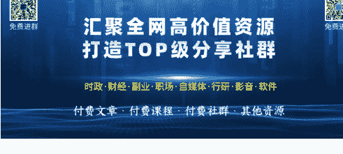

# 想要成事，必须学会造势

原创：U 君 公众号：赢在8小时之外 25年10月8日

事和势，是两种对立又相辅相成的能量。

前者是具体的、客观的，后者是抽象的、主观的。

如果你只是上上班、做点小生意，你就聚焦于具体的事务即可。

但是，如果你想做大事、赚大钱，你就不能顾低低头做事，还要学会造势。

如果你只会做事、不会造势，那么你将会非常辛苦，付出再多也没有可观的回报，而且大家都会记住你的好。

只要你掌握了造势的精髓，那么做什么事情都会事半功倍，并且所有的人事都会任你调遣、任你驱使。

今天跟大家分享5个造势的思路。

## 1. 师出有名

刘备和曹操都统一天下，他们走的路线虽然不一样，但是思路是一模一样的，那就是“造势”。

刘备在起兵阶段，自称是“中山王之后”，就是为了让大家认可的“汉室宗亲”的正统地位。

这样的话，其他姓氏的英雄豪杰才愿意聚集过来，心甘情愿地佐佑他、为他卖命。

曹操在造势的时候，走的是另外一条路线：扶天子以令诸侯。

他控制了汉朝的皇帝，就相当于控制了一个公司的法人和公章，从此发布的任何指令都能正言顺、师出有名。

其实，两个人都“造势”的核心逻辑是一致的：刘备以“汉室宗亲”锚正统身份，曹操靠“扶天子”掌控合法权威。

他们通过构建“不可替代的价值背书”来达到三个目的：降低外界信任成本、凝聚核心资源、建立竞争优势。

我们在创业、赚钱、做生意时，该如何借鉴这一维度的呢？有两个方向可以发力：

### ① 出身正统

电视里卖药的那批“老大夫”，每个人都说自己是中医世家，自己是第十几传人，这跟刘备备自己是“中山靖王之后”没有区别。

大家并不会考证你的真实血统，但是只要你敢说，就就人敢信。

类似的，类德、同仁很多传统大品牌也都在讲自己的传承，而不讲他们的产品到底有多好。

英国、法国的很多奢侈品、珠宝品牌的宣传口号是“皇室专供”，只要有了这个标签，其他的话全部都掉了。

### ② 核心认证

卖奶粉的品牌声称自己的奶粉获得了欧盟认证，卖电饭煲的品牌声称自己的电饭煲通过了日本认证。

这些资质就像曹操的“公章”，是开展业务的“合法通行证”，有了它，不仅能合规经营，还能在竞争中形成“你没有我有”的壁垒。

做自媒体、抖音也是同样，有些大V给自己搞了一堆噱头，又是什么会长，又是职业心理咨询，又是 MBA讲师……

还有一些国产服装品牌（比如某世登、某莱尔），他们打出来的旗号就是“远销世界50多个国家”，以彰显自己的国际化。

实际上，只要碰到这种宣传口号，我一律判定为非韭菜品牌，大概率质次价高。

但是，多数消费者是没有脑子的，他们真的会为这些口号不实、无从考证的号而去购买。

## 2. 他山之石，可以攻玉

老实人在追女人时，把全部精力都放在女人身上，功利心很，所以对方的防御心理也很强。

但是，聪明人都懂得造势，要在环境上做文章，要借他人人口。

比如，如果你想表白，可以先营造环境、烘托气氛，比如在看烟花的时候，或者在风景特别优美的地方。

因为当浪漫的气营造出来之后，对方的心门就是打开状态，这时候你表白成功的概率就高多了。

或者，借别人人口来造势。如果你们都是大学生，那么不要总是给她买衣服、礼物，而是要经常给她买水果，大家都能受益。

俗话说，人言无情短，你经常给她送惠，她们自然不会说你坏话，反而会在她面前夸你。她对你印象一般，但是身边夸你的人，她也会觉得你很好。

在职场上也是如此，如果你觉得自己对公司的贡献很高，想让自己升薪，不要傻乎直接跟老板摊牌。你可以通过侧击来造势，比如鼓励同事或者客户去老板那里说你多么到位。如果有以上的人在领导面前吹风说你优秀，老板可能会给你。

## 3. 营销造势

拿知识付费这个赛道，实力和造势是辅相相成的，缺不可。

网上，无论是创业、职场、个人成长领域，实力的人如牛毛，能赚钱的人却寥几。原因就是，他们不会造势，或者屑于造势。

拿VIP社群举例，如果让更多的人加入，我就经常在外面展示社群里面的热闹，有人在里面分享成功的经历，有人里面表达感谢，有人里面辩论……

总之，即使社群很冷清，也要营造出一种“火热”场景，这样才会更多的人想要，然后社群才能真正火起来。

Fake it till you make it，就是这个道理。

任何东西和服务的道理都是一样的。一方面，你时刻宣传“已经购买了好处”，另一面，你时刻传达出来一种态度：由于购买人数实在太多，马上就没有名额了。

郭德讲过这样一个故事：京城里有一位的剧大师，家里穷得吃不上饭了，前一天后天听说有一位大户人家请他去，于是他每天家里撑着家里人，而且家里堆了很多麻袋，假装里面了大米（其实是稻壳）。

等到大户人家的管家上门谈事宜，他不满意地说：“现在家里边的粮食堆成了山，不吃不缺。我之所以愿意去，纯粹是想出去散心，不是为了赚钱，因为家里憋得太难受了。”他越是这样，管家开的价钱越高，生怕他不愿意去。这就是营销造势的威力。假他跟管家实说：“我已经没有接到活了，全家人都快饿死了，终于给你盼来了……”这时候管家一定会狠狠杀价，甚至还会觉得请他来太便宜了，不值。

记住，即使腹中空空，也不要表现出饥饿。这是弱点，也是一种耻辱。在商业社会里，越让人知道你饿，就越找不到食物。

## 4. 频繁出现

世界上很少有人能实现“四两拨千斤”的效果，大家无非比谁出场的次数最多、频繁。

举个例子，很多人都说苹果手机和特斯拉汽车很少做广告营销，全靠产品质量过硬以及粉丝们的口碑传播。

我不这样认为，我觉得无论是乔布斯、库克、马斯克还是特斯拉，他们都是营销高手，也是造势高手。

比如，他们的形象和言论频繁占据各大社交媒体的头条，这本身就是一场盛大的广告营销和造势活动。

其实在市场营销领域，有一个专业词汇叫“占领心智”。只要你的形象、产品口号占领了消费者的心智，那么你就可以肆意销他们。想要达到这种效果，最好的办法就是“频繁出现”。

举个例子，我很喜欢看史玉柱的营销心得，当他在创作脑白金这款产品时，就通过频繁在电视上打那种“明朗上口”的广告来占领消费者的心智。

比的，“孝敬父母百百金”，“送礼就送百金”，他通过这些口号，把自己的产品跟“孝道”和“送礼”进行了绑定。那么以后消费者在过年回家看望父母时，自然很有概率选择他们的产品。

搞网赚也是同理，无论你写文章还是拍视频，你必须频繁输出作品，最好是日更。在这种频繁的信息灌输下，大家就会逐渐熟悉你、信任你，进而你这里成交、买单。

## 5. 资源汇总

| 序号 | 公号/社群 | 原价 | 领域 |
| :--- | :--- | :--- | :--- |
| 1 | 生态有 | 276/年 | 创业、线索 |
| 2 | 宝藏吃瓜 | 365/年 | 时政、历史 |
| 3 | 记忆/树倾 | 599/年 | 成长、成长 |
| 4 | 欧洲出口 | 328/年 | 时政、历史 |
| 5 | 内内王术 | 699/年 | 职场、经理 |
| 6 | 人人视角 | 599/年 | 金融、财经 |
| 7 | 外人的视角 | 699/年 | 时政、频繁 |
| 8 | 源源涨并 | 4166/年 | 时政、成长 |
| 9 | 守护人感 | 599/年 | 时政、经济 |
| 10 | 江宁好政 | 568/年 | 时政、国际 |
| 11 | 太政党/增 | 1399/年 | 金融、财经 |
| 12 | 书闲文 | 599/年 | 时政、历史 |
| 13 | 水果大夫 | 10000 | 时政、经济 |
| 14 | 洪源的观世界 | 4356/年 | 经济、财经 |
| 15 | 金融通割/北海山 | 4576/年 | 股票、行业 |
| 16 | 雪哥的世界 | 2999/年 | 时政、经济 |
| 17 | 飞龙术 | 365/年 | 财经、经济 |
| 18 | 来联锦阅 | 599/年 | 经济、财经 |
| 19 | 密探财经 | --- | 房产、财经 |
| 20 | 在六八小时之外 | 365/年 | 成长、市场 |
