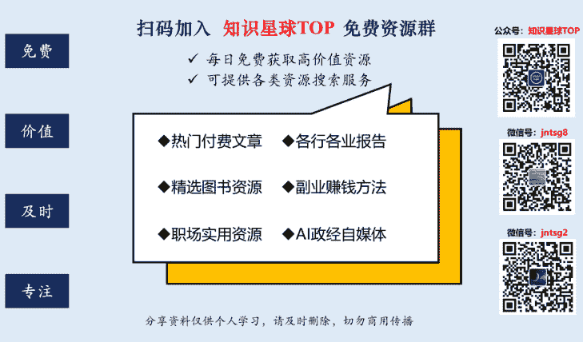

# 怎么才能写出最勾人的文字?

原创：赞赏 u 君公众号：赢在8小时之外25年4月27日

无论在网上写文章，还是在微信上发朋友圈，还是在其他社交APP上发动态，主要分为三个段位：

初级：只是记录、展示自己的生活，或者客观描述自己的看法，无法引起别人的情绪波动。

中级：自己对文字的把控非常到位，写出来的内容也能引起别人共鸣，甚至还能带领他们坐过过山车，一会哭，一会笑。

高级：自己写出来的文字都带钩子，人看到之后心里就瘙痒，就会立刻采取行动，男人开了钱袋，女人开了腰带。

那么问题来了，什么样的文字才能勾人、让人直接采取行动？

什么样的话系统才能引导别人朝着自己预期的方向发展？

我总结，一共共有4个原则，只要你能掌握里面的精髓，那么男人的钱袋和女人的腰带你都能轻松获得。

由于涉及的内容比较敏感，不适合公开，所以我必须设置付费阅读。

## 1. 展示非凡成果

如果你有豪车，你就展示豪车；如果你炒股赚钱了，你就要展示出你的账户收益；如果你团队里的人很多，你就展示大家在办公室工作的场景。

总之呢，一定要展示积极的、向上的、能让人联想的内容。

有人会说：都是什么年代了，展示豪车还有用吗？展示收益截图体会不会让人觉得我是骗子？

我的回答是：这一招在任何时代都管用。

即使2025年的今天，90%的人没有坐过宝马3系、奥迪A4、奔驰C级。

如果你展示豪车，收益截图，肯定有人说：就这钱还出来展示，太小儿科了。

这时候，你不用搭理他们，因为这样的人占10%，你的段位决定了，你无论发生什么，都会被他们鄙弃。

你需要的是割那些思维、格局、收入在你之下的人。

加微信jnts2，进阶料分群

只要你能掌握这个精髓，那么“怀不遇的人才”才会非常愿意跟你混，因为他们也想靠自己的努力上宝马。

而那些手里有闲钱的人，他们的心里也会痒，想要来找你理财。

有人会说：这样做会不会承担很多风险？

我的回答是：这样做的目的，并不是真的要带别人创业、帮别人理财，而是打造出一种吸引人的势。

说白了，至少从此以后你不缺女人了，其他的优质资源也会向你倾斜。

因为此时你站在高位，都是别人想结识你、想跟你发生交集，而不是你整天求爷爷奶奶去认识人。

而且，人性中有一个弱点：大家潜意识里都会相信有成果的人。

比如，当你炫耀自己的豪车，会有相当一部分人认为你的这种行为有点low，而且太直截了当。但是在潜意识里，大家是非常佩服的，而且他们和你聊天时也会小心，生怕得罪你。

加微信jnts2，进资料分享群

这时候，在很多谈判和社交场合里，你就拥有了主导权和操控权，那么你想要别人的钱袋和腰带，还难吗？

再加上我朋友圈展示的内容很吸引，所以后续往往能发生很多很有的故事……

有人会说：U 君，你真low，你就能悠悠悠月薪几千的小姑娘。

我说：年轻就是最贵的资源，我从不会嫌弃女性的收入低、智商低。且，我会把很多犀利的思维和认知传授她们，还会教她们挣钱的方法，而且会给她们金金白银。

这就引出了下一个话题：

## 2. 展示自己的大方

网上有一个成功大师的口头禅是：凡是我的人，我都会给他百万，听懂掌声！

微信intgs2，进资料分享群

但是如果你愿意认真思考一下，你就会发现，自己才是那个小丑。

因为那个成功学大师已经身过亿了，有多个发展国家的绿卡，至今仍然在稳地赚钱，而且愿意主动献身的女弟子多如牛毛后……

从某种程度来说，人家已经活成了土皇帝。这时，你还会嘲笑他吗？

这个人之所以有这么大的魔力，不仅是因为他大方，关键的是他整天展示大方（至于真假不重要）。

这种收割主要有两种形式：

- 文字洗脑：比如，如果你在公众号上写文章，那么就会吸引很多关注者，这些人非常信任，甚至还会在精神上依赖你。
- 视频洗脑：上面提到的“变现百万”的那类成功大师，玩的都是营销，就是把几百人关到一个大会厅，然后自己在上面演讲。

由于自己的话非常直白、煽动性非常强，所以让他大家刷卡的时候，大家都会排队抢卡。因为在这种情绪渲染下，大家已经丧失了基本的思考能力。

现在是自媒体时代，每个人都可以在网上发声，建立自己的IP和影响力。这样的话，你就是一对跟大家交集，所以事情自然也可以事半功倍，甚至是一功多。

这种收割主要有两种形式：

- 这种形式：通过展示朋友圈、展示照片，我都会送类似这种送给粉丝的的。
- 这种形式：通过展示这种生活，我都会送她们金金白银，也会带着她们出国。

注意，我不是展示自己的生活，而是展示正确的价值观，养成正确的价值观。

很多关注者，这里面会有几百个铁杆粉丝。

这种收割主要有两种形式：

- 这种形式：通过展示朋友圈、展示照片，我都会送类似这种送给没的的粉丝。
- 这种形式：通过展示这种生活，我都会送她们金金白银，也会带着她们出国。

总之呢，一定要传达出这样的姿态。只要跟我交集的人，我都会送最新的iPhone，也会带着她们出国。

加微信jnts2，进资料分享群

## 3. 一定要有主场

大家都听过“大V粉丝”这种新闻吧？而且其中那种“大V粉丝漂亮、很有钱”的搭配。

为什么会出现这种情况？因为那些大V们都有自己的主场，他们无论写了什么、拍了什么，都会由内而外散发出一种光环，非常吸引人。

所以，如果你也想达到这种状态，你必须自己的主场。

在这个场域中，你必须是创造者、感染者、煽动者，你每一句话都能让大家兴奋，十足的情绪价值。

## 4. 避免任何负面新闻

首先，所有的国际大事、国家大事，你都不要参与讨论，更不要转发，不要发表观点。

只要在你朋友圈里出现了跟“普普”、“特征营”、“唐山打人”、“日本废水”、“大同协彩”相关的新闻，那么别人就能嗅到，你在生活中肯定是个入低的失败者。尤其是女人，在这一方面的嗅觉灵敏。

原因很简单，只要你关心那些国家大事，那么你的情绪经常处于“义愤填膺”的状态中。换句话说，你把自己带入了“害者”的视角。

什么人最喜欢把自己带入“害者”视角呢？就是那些生活中的失败者，他们无论在任何一种社会体系里，都是无法获取社会资源的那一方。

就拿日本当年“废水”这件事举例子，那些在评论区义愤填膺的人，大部分都没有出国，甚至去过日本。他们的收入基本都低于5000元，连保都没有。

但是呢，有钱人经常去日本旅游，而且很多企业家里都在日本买了房，家人也经常去那里生活（如刘嵩东、马骏、王碧、史质柱等等）。

所以，有钱人肯定不会喷日本，因为他们需要享用日本的优质服务、优质环境以及先进的医疗保障。

类似的，特耶普普事件，都是什么人在义愤填膺？就是那些从事外贸等行业的从业者，他们的收入飙降，甚至会丢工作。

加微信jnts2，资料分享群

而女人呢，她们才不会在意你因为收入下降而失去工作，她们只会在意房贷还能不能还上，你还能不能给她提供丰富的生活保障。

如果不能，那么分手就会提上日程，因为指望女人跟着你一起吃苦，不太现实，也不是很负责。

在社交媒体、在朋友圈也是如此，如果你是男人，千万不要对任何事情义情填膺。

因为只要你这种言论一出来，就相当于你在对外大声宣布：我是个赚不到钱的废物。

