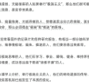

# 只剩豪文狂天龙

都市小说 2020-05-17 15:23:25

第一章

“这个世界你到底在想什么？”萧峰眉头，语气中带着一丝连和和严厉的质问。

萧峰，看着眼前的女人，心里有些复杂，他本该后悔的，本该再给她一个机会。

林婉，看着萧峰，眼神中有些愧疚，如果换做是以前，她早已习惯萧峰的愤怒了。

可是，现在不一样了，她已经不再像以前那样唯唯诺诺。

萧峰沉默了片刻，他没有回答。林婉抬起头看着他：“萧峰，你后悔吗？”

林婉站起身，径走向萧峰，眼神中显得有些落寞。萧峰没有回答，林婉只是缩了缩脖子点了点头。

萧峰走到窗边，背对着她，看着窗外的夜色。

“当然，我当然后悔。”萧峰冷冷开口，声音低听却带着一丝疲惫。

林婉转身走回了房间，萧峰听着关门声，长叹了口气。

萧峰坐回沙发上，点了一根烟，烟雾缭绕中。

这一整晚，萧峰都没有睡着，直到第二天天亮了。

萧峰闭上眼，脑海中浮现出林婉的笑脸。

## 二、萧峰的早晨点心与林婉的约会。

萧峰醒来时，林婉已经准备好了早餐。萧峰看着她。

林婉坐在餐桌旁，有些局促：“萧峰，吃吧。”

萧峰坐下，随便吃了一口早餐，味道很一般。

林婉看着他吃饭，心里有些不好受，坐坐立不安。

“萧峰，下午有空见我吗？”林婉轻声问道。

林婉笑了，眼底中闪过一丝欣慰。

萧峰看着她的背影，心中有些了然。

萧峰站起身，走向洗间洗漱脸。

这一刻，他的生活似乎发生了一些变化。
