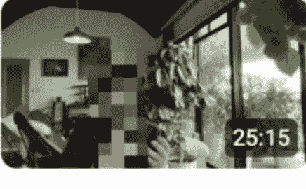
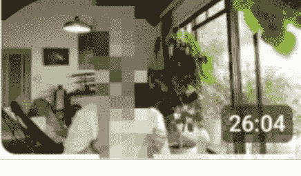
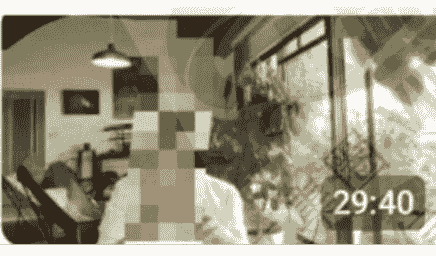
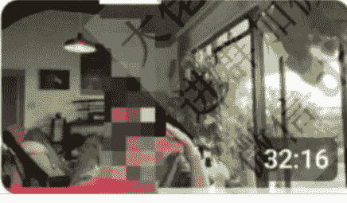
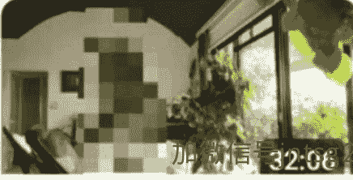
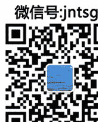
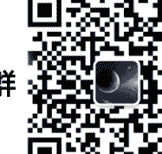
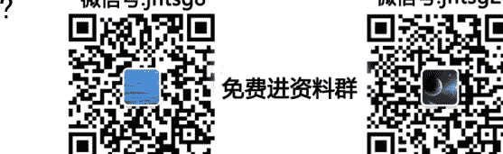
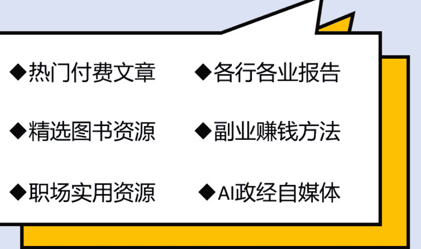

# 拆解一个年入250万元的YouTube账号

原创：赞赏U 君 公众：赢在8小时之外2025年5月24日

我都要观看、收听两个小时以上的YouTube内容，比如国外的一些纪录片、名人访谈，以及国内的一些时事点评。

我知道，上面的中文内容是良莠不齐的，有的非常实，有的很夸张。

但是这些都不重要，我最在意的是他们的收入情况。

YouTube上最赚钱的中文博主应该应该是“李子柒”“王老高与小茉”这些人了，他们年入千万应该是轻松的。

注意，我说的是光靠播放量带来的广告分成，不包括接广告、直播、卖货等额外收益。

因为YouTube就是这样一个平台，只要你的视频有播放量，只要你开了广告分成，那么那个平台就会很大地把广告收益的一半分给你。

言归正传，今天我要拆解的这个YouTube博主，他已经做了4年YouTube了，到目前粉丝有35万左右。

微信号jntsg2，免费进资料群

他一共发布过2067个视频，2.46亿次播放，总收益大概在1000万人民币左右。

我之所以要拆解这个人，是因为他的视频就是坐在镜头前从头讲到尾（即兴发挥、不是念稿），没有任何剪辑和修饰的。

换句话说，他完全是靠谈的内容胜，跟李子柒、老高与小菜这些人都完全不是一个套路（后者都是团队负责剪辑）。资料群：jntsg2

所以，我认为这个人的案例非常有价值，值得我进行拆解。

但是，由于这个个人是个争议很大的人，讲的内容也有点敏感，所以我必须要把本文设置成付费闲读内容。

我除了拆解这个人的账号、分析他的创作思路、剖析他的收入，还会讲解YouTube的创作机制、分成机制。同时，我也会提到微信公众号与YouTube的共同之处。

目的是给做媒体的朋友提供一些启发和思路。

当然，如果你不能访问谷歌和YouTube，你你就不要继续向下阅读了，否则我跟你再说多也是空谈。

另外，本篇内容不许赠送，因为你赠送给错的人，可能会给我招致灾祸。

加微信号jntsg2，免费进料群

这个人的名字就在下面这张图片里，我不方便使用文字打字来的，因为他的名字都是敏感词：伍岳散人

## 欠薪800、烧了你厂子：一代打丝螺与他们的前辈“自伤讨薪…

- 7.2万次观看 · 17小时

## 银行降准降息刺激消费：靠60岁以上的老人们，撑不起内循环 ·上海政府要颁布“禁止出国令”？假新闻。但中国人以后出国、移居……。

- 9.4万次观看 · 1天前

## 开播四周年的数字与心里话：全部收入近千万人民币；2067个视频…

- 8.1万次观看 · 3天前

## 闲聊武汉枪击案：揭秘中

加入群免费进资料群

微信:jntsg8
微信:jntsg2

## 国民到底有多少枪、通过什么途径来…… 18万观看·4天前

免费进资料群

可以看出，他几乎每天都会发一条视频，视频背景就是他坐在家里，在镜头前闲聊(他用的苹果手机，不是专业相机)。

不做任何后期的剪辑和处理，中间也不会插入任何音乐、转场或者引用其他视频的片段。

从技术角度来看，他的风格非常简洁、非常朴朴。

至于视频的内容，主要就是点阵时下非常热门的新闻，比如最近发生的“武汉枪击案”“欠薪800元烧毁厂房”这类新闻。

由于这个人物目前在日本，所以他聊的内容百无禁忌，口无遮挡，直击本质。我想这也是他有很多铁杆粉丝的原因。

那么问题来了，他这个35万粉丝的小帐，凭什么能在4年里收入1000万人民币？

### 1. YouTube的分成机制

YouTube视频博主的收益方式有很多种，但是最主要的就是广告分成。

加微信号jntsg2，免费进资料群

比如，当你的粉丝量、播放量达到门槛之后，就可以开启广告计划。你的视频一共是30分钟，里面可以插入广告(都是系统插入的，有的能跳过，有的不能跳过)。跳过广告、观看广告、点击广告的收益是不一样的。

当然，如果观众充了会员，就直接免广告，博主也会获得一部分分成。就我今天要拆解的这个博主来说，他的账号共有200个视频，收益一共100万人民币，简单计算一下可以得出：他发布的每一个视频收益是5000元(每个视频平均在5千-1万之间)。

为什么YouTube能给创作者这么高的分成?原因很简单，YouTube属于谷歌旗下的产品，而谷歌是世界上最赚钱的互联网公司(市值2万亿美元)。

微信号jntsg2，免费进资料群

YouTube这种平台，从维度上来看，从来不要流氓，而是切实地给创作者广告分成（可能高达50%）。所以YouTube才能成为全世界最多的视频平台。YouTube跟抖音、TikTok这类平台比较，我觉得一点意义都没有。即使这些平台的用户量、市值在维度来看，还不YouTube的万分之一。

### 2. 对原创度的保护

YouTube对原创保护非常严格，假设你录制一段视频，里面有其他视频片段，而这段视频在YouTube上可能侵权了。一旦有人举报，而且系统判定你侵权，那么平台打击力度非常大，多次就会永久封号。所以，如果你是原创的，就大胆往YouTube上发布即可，不用担心会被搬运。即使有人搬运，也只能是在外平台（比如抖音、B站）。

微信jntsg2，免费进资料群

但问题是，世界上除了YouTube之外，没有第二个平台给创作者带来广告分成以及版权方面的保护。从这个角度来看，像YouTube。比如你在YouTube上发布，即使不带货、直播、注册公司、不开网站，只要你的视频有流量，你就获得广告分成(流量主)。而且在那些大小小的平台上，YouTube有两个原因：

① 它给你提供真实的版权保护。不仅在YouTube上没人敢搬运你的内容，即使有人把内容运到了其他平台。拿我自己来说，有时候我会把YouTube上的文章稍加改动，然后发布到知乎，但是会出现这种情况：我把YouTube上的文章复制到知乎发布，结果知乎后台提示“您的文章与知乎上的某篇文章重合”，就是我的文章。

加微信jntsg2，免费进资料群

我就在知乎上进行投诉，当天知乎后台就把那篇文章删除了，还对那个搬运者进行了处罚。

② 目前在市面上所有的平台，只有YouTube会给分成。你可以搬运文章到其他平台，又是微博、知乎、小红书、百家号、今日条...但是放心，那些平台一分钱都不会分给你。我早说过，那些平台都是邪恶的平台（包括抖音），他们运营的宗旨就是：勾引创作者去平台上创作内容，但是一分钱都不会分给你。一旦你自己变现，他们会想办法给你限流、封号。他们就是要用创作者免费的内容把平台搞活，然后平台自己赚广告费。

所以，如果你问世界上良心、最为创作者的两大平台，那就是YouTube和微信公众号。

加微jntsg2，免费进资料群前提你得创作真实、大众的内容。

### 3. 如何用YouTube挣钱?

很遗憾，目前在XX地区，不支持访问YouTube，更不允许你在上面发布视频。

但是，有一些人确实在大地区，他每天也在YouTube上发视频赚钱，这是怎么实现的？

最靠谱的办法这样的：某人去海外留学或者务工期间，在当地有固定住所、有银行卡、有纳税证明这些，然后就可以在当地申请YouTube账号（申请运营，不是简单注册账号）。这样的话，即使他回到了国内，仍然可以继续运营YouTube账号，然后获得丰厚的收益。

还有一些人可以通过国外朋友的帮助，也可以在国内搭建稳定盈利的YouTube账号。像李子柒那种公司，也可以申请专门的、合法的国际网络，在国内经营YouTube业务。

加微信号jntsg2，免费资料群

当然，只要在大地区无论访问YouTube还是运营YouTube，都是有法律风险的。我自己是这样认为的，只要你不点赞、不评论，而且发布的内容不涉及“政治”，几乎是没人管的。

# 扫码加入 知识星球 免费资源群

- 每日免费获取价值资源
- 可提供各类资源搜索服务

| 热门付费文章 | 各行行业报告 |
| :--- | :--- |
| 精选图书资源 | 副业赚钱方法 |
| 职场实用资源 | AI财经自媒体 |

公号：知识星球TOP 微信信号：jntsg8 微信信号：jntsg2

分享资料仅供个人学习，请及时删除，切勿商用传播
