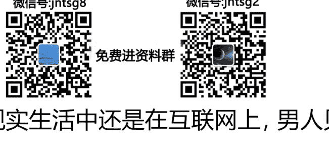
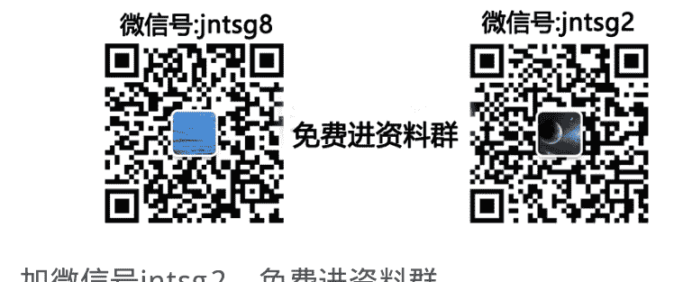

## 女人内心深处的 8 大秘密

原创：赞赏 U 君 公众号：在8 小时之外 2025年6月25日

之前在《男人内心深处的 8 大秘密》这篇文章里我说过一个大胆的观点：男人是一种性色起的动物。

无论在现实生活中还是在互联网上，男人看到一个性成熟的女人，脑子里蹦出来的第一个潜意识一定是在跟她开车。

或者说，男人看到一个女性的瞬间，一定是从“性”的角度出发去衡量她。

不管那个女人是个底层的、清洁工、外卖员、小商贩，还是端庄的官员、教师、医生、甚至是军人、警察……

对于男人来说，没有任何差别，只要对方不是特别丑，那么男人一定先从“那方面”去审视她，审视她的身材，审视她的脸……

不信你不去看带弹幕的电视剧，只要出现一个面容姣好的女人，即使她已经去世了，弹幕都会有人说：趁热XX……

女人会觉得男人的这种想法很荒谬，但是男人都明白，这些都是男人潜意识里的真实想法，只有不过敢表达出来了。

因为当初造物主就是这样制造男人的。

每天都会产生数亿精子，就是为了让他扩散，尽可能多地跟不同女人开车，而且从 20 岁-80 岁一直有开车能力。

那么问题来了，女人基因携带了哪些男人完全相反的属性？他们的潜意识里又有哪些不为人知的秘密呢？

今天跟大家分享一个女人内心深处的 8 大秘密，全文一共 4000 字，由于绝大部分都是敏感内容，所以我必须设置付费阅读。

### 1. 女人很难对弱势的男性发情

女性的天性就是强势的，如果一个男人比自己矮、比自己穷、比自己笨，那么自己很难对他产生好感。

即使在各方面都跟自己势均力敌的男性，也很让女人动心，否则她大概率觉得自己吃亏了。

在哺乳动物的世界里，雌性只会对强壮、强势、有领地的雄性发情。

人类虽然异于动物，有了文化、文明和道德，但是写在基因里的这个本能还是很难抵的。

女人很难对弱者或者被主导的男人动心，即便使用理智道德强制自己做不到，就像“人吃饱后无法强迫自己生饥饿”一样。

在影视作品里也是如此，“霸道总裁爱上我”这种剧情永远有市场。

不过，凡事都有例外，有一小部分女人属于那种“同情泛滥”“母爱泛滥”的情况，越碰到弱势的、悲惨的男人，她越有保护欲。

至于，还有一个女人热衷于跟渣男XX。

当然，大部分女人还是强的，无论她们怎么宣扬男女平等，潜意识里她们依然希望能男人来拯救自己，带领自己成长。

### 2. 女人很难拥有真正的爱情

99%的女在考虑情感、婚姻问题时，总是会考虑物质、金钱、利得失。因为没有纯情，所以做事绝情。

在感情世界里，女性的绝情程度远远高于男性。

举例子，在过去的这 5 年里（亚晴+不景气），有很多婚姻案件都是因为男人的经济来源出了问题，甚至破产了。

一旦出现这种情况，女人跟男人离婚的概率非常大。

从世俗角度来看，如果一个男人连活好自己都费劲，甚至背负巨额债务，那么就不应该找个女人跟你一起吃苦，而且也不会有女人愿意跟你吃苦。

从基因角度来看，女性择偶时肯定遵循“慕强”的原则，而且这个原则不会因为多年的恩爱或者共同的后代而改变。

如果你还没有感受到迷人的残酷本能，是因为你还在她的选择列表里足够强大，一旦哪天你变弱了，就会有很多不可控的事情发生。

或者可以这样说，当经济方面没有出现危机时，你可以跟女人谈感情、爱情、亲情。

但是，当经济面临巨大的危机时，你还想拿出来感情说，那你就有点自取其尊了。

所以，如果你是一个男人，你一定要记住，经济才是男人的立身之本，你在其他任何维度失败了，都不算真正的失败。只有在经济维度失败了，你才算彻底的失败。

### 3. 女性才是求偶关系的主导者

很多人以为，男性才是感情中的主导者，但这句话只说对了一半。

在确定关系之后，或者发生了实质性的关系之后，男性才是主导者。

在整个求偶阶段，女性才是主导者、引领者、释放信号者。

俗话说，男追女、隔层山，女追男、隔层纱。

在现实生活中，女性释放求偶信号的情况更多一些，成功率也更高。

比如，如果个女生对你感兴趣，或者被你吸引时，大概率会主动联系你，和你分享很多生活中的小事。

在接触的过程中，如果她对你有意，大概率会释放“我很软”的姿态。

即使她的智商比你高，也很可能会把“我这么笨啊”挂在嘴边，这是在给你表演的机会。

反之，如果一个女人特别喜欢跟你讲道理、处处都纠正你，表现得比你聪明、比你强势，那么她大概率看不上你。

所以，越是条件很普通的男人，越应该注意观察女人发出来的这些信号。

如果女人对你不感兴趣，你去主动人家，大概会无功而返。

当然，有一部分绿茶女人会对很多男人释放暧昧的信号，一定要注意甄别、筛选。

其实甄别的思路也很简单，如果她对所有男人都是同样的姿态，那么你在她心里根根没什么分量。

如果她只对你这样，那么可能对你有。

### 4. 女人喜欢被征服的感觉

表面上看，女人喜欢给她安全感的男人，最好事事都能顺着她、满足她。

但是，这样的生活很快就会让她厌倦，因为女人喜欢被征服的感觉，你给她的安全指数就相当于你的服从程度。

你的服度越高，对她来说价值越低。因为太容易被掌控，所以怕失去，哪怕你再优秀，她也很难产生感觉。

其实不光是男女之间，很多人人际关系都是如此。当你很优秀又不给她安全感时，她就会充满危机意识，会失去你。

另外，想要获得女人（或者在人际关系中的下位）的绝对忠诚和绝对付出，你必须让她感受到价值。

当一个女人在男人面前小心翼翼时，这段关系才是牢固的，而且她会感受到爱情的美妙。这就就好，那些嫁给富豪、领着钱的女人，一定比那些嫁给普通阶层的女人幸福。在“掌控权力”方面，女性比男性擅长一些。举例子，如果男人月薪万，女人月薪千，在这个家里男人说了算，那么婚姻能稳定下去。一旦女性月薪变成5万，超过了男人，话语权到了女人手里，那么婚姻概率会崩溃。职场上也是如此，女性总是比男性强势，因为她握了权力，就是要刁你。

### 5. 女人更容易看菜

在看菜方面，女性比男人更加势利。

有一个段子是：为什么有些女性明明装穷，但是经常装富？因为她怕穷又怕富。其实不论男女，人类本性就是嫌贫富，在择偶维度，女性的双标现象比男性更加严重。女性在低价值男性面前，她们异常冷；但是在高价值男性面前，她们异常热情，仿佛可以献身。

### 6. 漂亮女人择偶更困难

漂亮女人对男人的作用正好相反。

越是漂亮、身材好的女人，追她的男人越少，因为大多数男人都知道自己没戏。但是普通的女人就不一样，只要她能释放一点信号，就会有一堆男人围过来。我认识一个男人，他只跟微胖、胖女人交往。一方面是自己确实不喜欢胖女人（经验丰富的男人一般都不会喜欢），另一方面是由于胖女人的自尊心低，容易得手。之前我就听过一个国外的PUA大师讲过一个理论：秋季追女人成功率更高，因为进入冬季时，哺乳动物会繁殖。而女人发胖之后，自尊心、自信、自我认同就会降低，这时男人追求的成功率就会大大提升。但是性别换就不会有这种情况。

顺便说一下，PUA的全称是 Pick-up Artist，意为“搭讪艺术家”，俗称“恋爱大师”，并不是广大网友认为的“洗脑术”。

### 为什么很多男人讨厌“女性独立”？

因为女性一旦经济独立、思想独立了，自尊心就会大大提升，这时候男人想要追她就变得更难了。

### 7. 女人很难拥有真朋友

女人是一种害怕孤独的动物，所以才有“闺蜜”这种角色的存在。比如，逛街要拉上闺蜜，旅行要拉上闺蜜，甚至相亲也要拉上闺蜜帮忙。

但是呢，女性想要真朋友，难处还是比较大的。因为女性的嫉妒心理天生比男性强，80%的闺蜜会因为钱翻，90%的闺蜜会因为男人闹翻。这里说的“为男人闹翻”，不是因为两个人都上了那个男人，而是一个女人正常谈恋爱时，她的闺蜜会说坏话，故意拆台。可能是出于嫉妒，也可能是她意识到了“即将失去你”产生的一种恐惧心理。所以才会出现这样一种情况：情侣矛盾之后，女的好闺蜜都会分手，男方的哥们都会劝和。好蜜跟女人说：天下的好男人多的是，而你这么优秀，你为什么要偏偏看上他？好哥们跟男人说：你就这种货色，能有个女人看上你就不不错了，还要什么自己？你小子真的是身在福中不知福。

实际上，这对感情里的男人和女方都是5分左右的普通人。所以，从某种程度上来说，女人的闺蜜越多，她的人生就会越悲剧。

那么问题过来了，女人可以跟男人成为朋友吗？男女之间有纯洁的友谊吗？答案：没有。一个男人只要喜欢跟一个女人玩，肯定有“那方面”的意图。如果一个男人对一个女人没有“那方面”的想法，那么根本就不会跟她多说一句话，更不可能做朋友。

### 8. 女人喜欢被男人激发出羞耻心

女性被封建礼教束缚几千年，越这样越容易出现反差的快感。可以说，男人如果全程都是“正人君子”的形象，那么女人会觉得非常无聊，不会兴奋，更不会发情。但是，如果男性能适当说一些让人羞耻的话挑逗，女性表面可能会生气，但是内心可能会激起一丝涟漪。而且会回味很久、兴奋很久，甚至期待下一次羞耻的降临。这种男人也一样，只不过女人的反差和刺激更大。当然，挑逗和流氓是有清晰界限的，如果你们确定关系了，也开了车，这时候适当说一些“开放性”的语言就属于挑逗。如果你们还没有确定关系，你就跟女人说一些开车的话，那就属于流氓。
