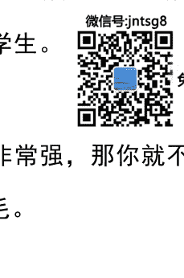

# 哄骗的艺术（现代帝王术）

白人都知道，“哄骗对方”比“跟对方真诚沟通”更容易让我们从对方身上获得自己想要的资源。

尤其当你手上没有筹码的时候，哄骗才是上上策略，节约大量的精力和能量，让我们事半功倍。

老实的男人需要掏空六钱包，买车买房、彩礼才能获得交权；而聪明的男人通过花言巧语的哄骗就能让女人宽衣解带……

老实的销售是对客户倾露真情，结果成交量惨浅；而聪明的销售通过哄骗客户就能让他们乖乖掏钱，而且乖乖无意……

今天就跟大家分享7个哄骗的话术，分别是：哄骗女人、哄骗男人、哄骗客户、哄骗前辈、哄骗老板、哄骗员工、哄骗学生。

如果你的道德感非常强，那你就不要继续向下阅读了，我怕你会炸毛。

如果你认为哄骗这种“四两拨千斤”的艺术，你可以好好琢磨一下我讲的这些东西，绝对会让你受益匪浅。

加微信jntsg2，免费资料群

全文共3000字，由于全是敏感话题，所以我必须设置付费阅读。已经在我目VIP群的小伙伴无需付费，我会把文章免费同步过去。

## 1. 哄骗女人

为什么有些男人条件很差，身高、长相、收入都很一般，但是一直有很多女人对他死心塌地、欲罢不能呢？

原因很简单，他长了一张好脸，而且深谙哄骗之道。

他们非常清楚，99%的女人要是被欺骗、哄骗，而不是真诚相待、平等沟通，更喜欢被说教、被启蒙。

即使他说的话经常唇不对马嘴，没有什么逻辑可言，只要他不不断哄骗女人、夺赞女人，那么自然就会有很多女人宽容带带。

反之，一旦你教育她、帮助她、启蒙她、带她成长，那么最终你们很可能会分道扬扬，成为仇人。

因为带人成长一定会指出对方身上的缺点，这让人们非常不爽。

如果在师徒之间，可以做这种事；但是在男女之间，这种事是大忌。

加微信号jntg2，免费进资料群

尤其是女人这种生物，喜欢听话，不喜欢听真话。

比如，每当她询问你“我皮肤怎么样”“我这件衣服怎么样”时，你都要换着花样夸她：

- “你的皮肤越来越好了”
- “你的头发真柔顺”
- “你的这件衣服太显瘦了，什么牌子的？”

......

只要你见到一个女人就那样说，你的女人缘不可能不好。

注意，我这里说的“哄骗”跟“跪舔”是两码事，有本质区别：

> “哄骗”是表达赞美，但是从来不提需求。
> “跪舔”除了毫无无由的赞美之外，还经常表达爱意、表达自己的渴望，这会暴露自己的需求感，让女人非常反感。

### 2. 哄骗男人

要知道，哄骗男人比哄骗女性的性价比和效果都多了，付出的成本也更低。

加微信jntg2，免费进资料群

原因就是：女人只要不是丑，从小到大都会被很多人夸赞她，所以男人需要更卖力、更真诚地夸赞，才会起到一点效果。

但是男人不一样，大多数男人从小到大都很少听到女人夸赞自己，所以他们更吃这一套。

所以，女人碰到一位有实力的男人时，只要你敢夸赞，他就敢爆金币。

比如，你可以夸赞对方的工作能力很强，夸他“有本事、有担当”，也可以夸赞他的衣品。

在交往的时候，如果男人问你的情史、问你过几个男朋友，你千万不要如实相告，而是要说善意的谎言。即使你谈过8个，你也要这样回答：

> “以前我只谈过1个，而且那时候根本不懂爱情，根本感受不到爱情的温暖。直到遇见你，才让我感受爱情是什么味。”

反之，如果你非要如实回答，那么你的真诚会摧毁这段关系。因为再开放、包容的男人，也不会希望女人的情史非常简单、纯洁。

加微信jntg2，免费进资料群

### 3. 哄骗客户

（此处为重复内容逻辑合并）
社会默认的规则：如果一个男人的情史丰富，有过很多女人，说明他有魅力。如果一个女人的情史丰富，有过很多男人，说明她自重。这种双标的规则太公平，但是“成见”这个东西一旦形成，就很难消除了。

再如此，你本来图他的钱，但是你嘴上一定要“倾倒”：我对金钱没有感觉，我看中这个人。如果你破产了，我心甘情愿陪你吃淡。不仅如此，如果你有需要，所有的钱都是你的。如果女人敢这样跟男人，那么男人一定会疯狂爆币。有些女人就很蠢，她们总是把真实想法说出来，透露出一股精明、功利的味道，真正优质的男人都会离你远远的。

从某种程度上来说，对待客户就对待“短期女友”差不多，做事、说话都要顺着他，不要教育他、不要逆他。

加微信jntsg2，免费资料群

当客户看中了某商品时，你要多说这类商品的优点，还要夸客户有眼光。如果是做高端商品的销售（比如豪车、豪宅），还要多夸客户的能力，甚至在客户擅长的领域向他请教，满足他“好为人师”的心理。

我就遇到过这样的销售，她们加入了我的个人微信、了解了我的赚钱模式之后，就化身为我的小妹，跟着我学习。而且她们经常说这种话：

> “您聊天，我感觉自己都聪明了，您真是太厉害了！”
> “您这脑子转得飞快，我都跟上了，佩服佩服！”

你说，我听了这些话之后，能不迷糊？能不掏钱买单吗？

### 4. 前辈、老板

我之所以把这两个角色写到一起，是因为他们有很多相似的地方。如果你是个20多岁的年轻人，遇到前辈时，不管对方是40多岁还是60多岁，只要对方不是老头老太太，一律叫X哥、X姐。

千万不要叫对方叔叔或者阿姨，这是大忌。无论你在国企、私企、外企都要注意这一点，这是最基本的礼仪。

如果对方说“我比你爸爸的年龄都大”，你也要说：“我看您还很年轻，你不要说自己55岁，我都觉得您顶多就40出头”。

加微信jntg2，免费资料群

有些人就很蠢，他们明明得到了老板的点拨和帮助，得到了前辈的提携，但是他们却一句表示都没有。这种人就不会有途，人家看到你表现，不会帮你第二次。

顺便说一下，受到前辈的恩惠之后，可以请客吃饭，但是人都知道，夸赞比请客吃饭威力大、效果效果好，而且一分钱不用花。如果你真诚地夸赞一个人，那么他肯定喜欢跟你相处。当他进入你的房间时，潜意识里就会有一种心花怒放的感觉。

### 5. 员工、学生

我之所以把这两个群体放在一起，也是因为他们有很多相似的地方。大多数员工最缺、最需要的动力是希望。所以，一定要经常向他们卖希望，经常把这种话挂在嘴边：

- “我们正在做一份非常有前途的事业”
- “明年的市场一定更广，业绩一定会猛进”

即使情况很艰难，即使大家都有盲目，但是作为老板的你，你必须时刻让大家看到希望。创业之所以艰难，就是因为老板需要很多心的话，即使自己的内心已经彻底绝望了，也要时刻为员工打气。只有当全员的气都非常高涨时，才有可能绝处生、渡难关、创造奇迹。资料群：kaiwu78

反之，如果你总是跟员工实话说：“我们现在的处境很困难，都快发不起工资了。”这时候，员工可能会提前找好退路，做事情也不会再尽心力。最后你会发现，贩卖希望永远比用枷锁强制对方“忠诚”要用的得多。

对待那些不服教、课堂纪律很差的学生，也可以采取哄骗战术。加微信jntsg2，免费资料群

作为老师的你，你可以让班最大的刺头当班长，让他去维持秩序，维护集体的利益，还经常夸他的管理能力很强。那么结果很可能是，他的责任会被激发出来，甚至会带头遵守你执行的纪律、执行你发出的命令。

这个做法也是帝王术中的重要策略：遇到能量非常强的小人时，不是想着怎么对付他，而是让他为自己做事，疲于奔命。在做事的过程中，他自然会暴露很多弱点，也会树立很多敌人。如果他陷入了处理问题、跟人斗争的旋涡中，那么他自然就没有精力和你对着干了，而且还帮你做了很多事。

| 项目 | 描述 |
| :--- | :--- |
| 知识星球 | 付费文章 |
| 付费社群 | 财经 |
| 付费课程 | 股市 |
| 付费报告 | 时政 |
| 付费行业 | 历史 |
| 付费媒体 | 军事 |
| 付费软件 | 社会学 |

