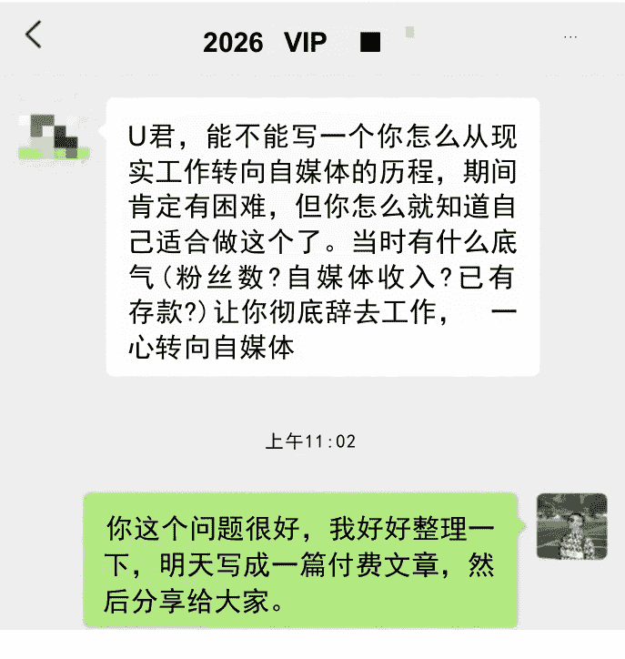

# 我是怎么摆脱“打工人”身份的?

原创：U 君  公众号：在8时之外 25年7月26日

昨天在VIP群里，大家在讨论“医学专业研究生转型”这个话题时，有的群友和我聊我是怎么摆脱打工人身份、自己创业的：

U君，能不能写一个你从现在实操工作转向自媒体的历程，期间肯定有困难，但你怎么知道自己符合什么底气做了这个？当时有什么底气（粉丝数？自媒体收入？已有存款？）让你彻底辞去工作，心转向自媒体？

上午11:02

这个问题很好，我好好整理一下，明天写一篇深度文章，稍后分享给大家。

我觉得这个问题很有价值，所以我打算专门写一篇文章来聊这个话题。

由于全是干货内容，而且是写给“游戏场间的玩家”的文章，所以我必须设置成付费文章。

全文一共3000字，已经在VIP群里的朋友无需付费，我会把文章免费同步过去。

加微信jntg2，免费进资料群

如果你是个小打小闹的人，把人看得很重，做事情总是畏手畏脚、得患得失、斤斤计较，那你就不用继续向下阅读了。

因为我说的每一步都需要“豁出去”的精神。

要知道，社会角色大概分为四种：打工者、自由职业者、老板和投资人。

打工者想要向上跃迁，一共突破4个关键点，下面我就结合自己的真实情况跟大家进行剖析。

大学毕业之后，我只上过两年多的班，国企、私企、外企都有（我，我很喜欢跳槽）。

然后我就发现一个问题：每天早9晚9、每周工作6天、每个月拿几千块工资，这件事情很荒谬。

一只野生的松鼠、小鸟都比上班得自在。

我不需要学习经济学、社会学和心理学，我就天然知道这件事有问题。

我当年在国企工厂上上班时，大部分同事都认为人生就是这样，熬到退休就可以了。

加微信jntsg2，免费进资料群

但是，我觉得他们已经中毒太深，无药可救了。

注意，我说的是物理意义上的“无药可救”了，因为很多人从50岁开始就百病缠身，能不能活到65岁都很难说。

当我产生了上面这些念头之后，我就开始寻找灵感、寻找榜样，好在我又赶上了互联网非常发达的年代。

无论在油管、B站还是喜马拉雅之后，都有很多优秀的“非上班族”在分享他们的圈钱经历、人生经历。

有的是自由职业者，有的是老板，有的是投资者。

我能从他们身上吸收两种能量：主观的人生态度+客观的赚钱思维。

他们对待生活就像游戏一样，可以在这个时空里自由驰骋，不受各种条件和观念的约束。

有人会问：在哪里找到这种优秀的大佬？

我说，你随便打开一个新媒体平台，那些记录视频、音频、创作文章的博主里面，至少有一半的人不是上班。

加微信号jntsg2，免费进资料群

另外，胆量也是很重要的先决条件，如果你总是在前怕狼后怕虎，这也不敢，那也不敢，你还是老老实实上班吧。

比如，我辞职、跳槽时，根本不会在意父母、领导的意见，历来是我行我素。

因为我非常清楚：他们无法我的人生托底，我只能靠我自己。所以我，我不能听他们的意见。

## 2. 客观条件

我是2013年大学毕业的，之后就赶上了新媒体和自媒体的爆发时期，不管是微博、微信、B站还是喜马拉雅，随便乱搞都能涨很多粉丝。

积累到粉丝之后，就可以接广告、做付费社群了。

我说过，大概在2015年前，我接一条广告的费用就是1000多元，做付费社群时，有时候一天的收入就突破了1万元。

体验“日入过万”的快感之后，我自然看不上月薪几千块的工作。

这时候，那些前辈跟我说，听起来跟梦一样。

加微信jntsg2，免费进资料群

在我看来，如果一个人在独立收钱方面，每个月的收入能达到工作的3倍以上，那么就可以考虑单干。

你看那些大学毕业的大佬（比尔盖茨、乔布斯、扎克伯格），基本都是找到了商机，赚到了第一桶金，才决定辞职。

所以，我不鼓励大家盲目辞职，你必须找到自己的“赛道”。

## 3. 创业类型

因为我在大学里的专业是石油化学方面，现在做自媒体，这种情况属于“跨行”。

想要创业，需要兴趣、特长、这些因素，至少要占一个。

加微信jntsg2，免费进资料群

2014年前后，他的月薪高达5万，那时候我们在工厂上班的一个月拿千块。
