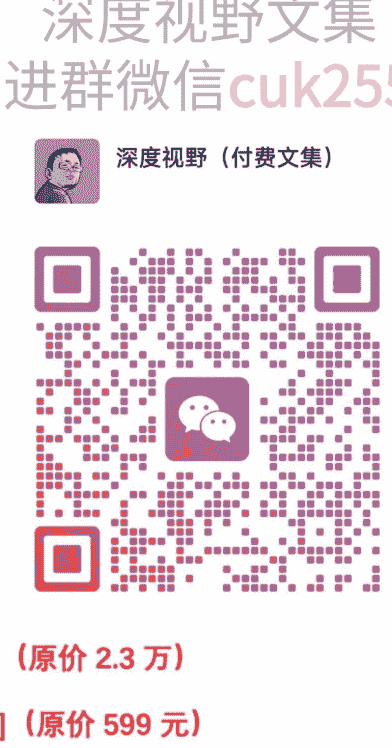

# 真正有用的信息，根本不在市面上流通

原创：赞赏 U 君 公号：赢在 8 小时之外 25年5月17日

去年张泽锋老师推出了“高考志愿咨询服务”，售价近 2 万元。

但是，课程推出，很快就有上万个家长蜂拥而至，纷纷报名。

有人说，这明显就是割韭菜项目，那些家长是不是脑子进水了？

还有人说，现在互联网和人工智能这么发达，孩子适合报考什么专业，你上网搜一下不就可以了？

这就涉及到一个非常经典的问题了：真正有用的信息，会在市面上免费流通吗？

答案是否肯定的，如果你的父母是信息闭塞的普通上班族，那么你在面对报志愿的时候，还得付费教高人。

而且，在这个关键性的问题上，AI 也帮不上什么，它只会给出一些冠冕堂皇的回答。

再如此，我想学习一门编程语言，我就需要知道在市面上什么样的程序最稀缺、收入最高。

同时，我还要客观评估自己的智商，以及那个编程语言的难度如何，然后我才能全身心地学习。

这两条信息，我能免费从网上查询到吗？

答案是否定的，我只能付费咨询几个经验丰富的 IT 从业者，从他们那里获取最快的信息。

另外，我也会付费加入一些大神程序员组织的社区，每天要关注，他们平时在聊什么内容，我要从那些只言片语获取有用信息。

最后你会发现，真正有用、有价值的信息是不会在市面上流通的。

不要觉得现在互联网和 AI 发达，穷人也能轻松地获取到有用信息。

大错特错。

穷或者那些没有付费意识的人，每天只能吸收那些垃圾的、有毒的信息，会强化他们的愚味。

下面我就跟大家分享 5 条，针对穷人的、关于获取信息的心态转变。

如果你不在认知和心态上发生这 5 个转变，那么你将会一直沉浸在有毒的信息粪坑里，不能自拔。

## 1.必须养成付费意识

首先我想请你反思一下：在一天的时间里，你过的视频、收听的音频、阅读的文字、参与讨论的社群有多少比例是付费的？

如果上面提到的这几种信息类型，你获取的都是免费的信息，那么你就不可能做出英明决策。

就像我刚才提到的那两个案例：真正有能力为别人指导“报考大学、选专业”的人，怎么可能免费指导别人？

真正知道“什么编程语言上手、而且市场上稀缺这种程序员”的大佬，怎么可能把自己的经验免费分享给别人呢？

他们大概会组织收费社群，或者有偿咨询，你做的就是花钱把他们的信息买过来，为自己用。

只要你有付费意识，你做任何事情都会事半功倍，少走很多弯路。

就拿U自己来说，我在“学习日语”这件事情上，一共才花了几千块，然后就顺利通过了 N2 考试（最低等级是N5，最高等级是N1）。

但是，有一个老哥带着自己学习，那样就轻松多了。

很多人也知道，学习技能、学习语言要花钱找老老师，但是在“获取关键信息”方面，就舍不得花钱了。

在我看来，信息比技能还要值钱，别看一条信息只有三言两语，甚至是简单的 yes 或者 no，但是如果它是某个大佬提供的信息，那它就价值连城。

所以，如果你也是底层穷人，一定要胆地花钱买技能、购买信息。

## 2. 关注大佬分享的只言语

在四年前就开始投“纳指”和“中概”这两支基金了（大家可以在公号里搜索这两个关键词。是搜索，不是后台私信，也不会评论）。

在过去的 4 年里，我至少写过 10 篇文章，来谈我之所以会买这两支基金的逻辑。

但是呢，每次我都会上一句话：我不推荐任何人入场，因为任何支基金和股票，在未来都有暴跌的可能性。

蠢蛋听了之后可能就害怕了，聪明人听了之后可能就跟投了。在2022-2025这3年里，纳指和中概分别增长了 77%和 45%。

当然，作为自媒体从业者，我为了让文章能够顺利通过审核，我还是要加上一句：

我不推荐大家盲目买入，任何一支股票或者基金在未来都有可能暴跌。”

其实你去看那些大佬的文章，基本都是这种棱棱两可的，他们不会明确告诉你：就买这支，就买那支。

一方面，平台不允许推荐股票；另一方面，未来是涨跌，确实没有人能预测。

万一你买了之后，就一路暴跌呢？你肯定要去找“推者”算账。

所以，你真正要学习的是那些大佬思考的逻辑。

如，U君自己的投资逻辑是这样的：

如果一家公司是在“非发达国家”注册和上市的，那么我肯定不会买它的股票。

我之所以愿意持有中概（里面是京东、美团、阿里巴巴、腾讯、携程这些公司的股票），因为这些公司大部分都是在某个海岛注册（比如开曼群岛）、在米国上市的。

如果某公司在美国上市，而且用户高达几亿、十几亿，那么我还是很看它的。

而且，我自己受巴菲特的影响，我是坚定的“长线者”“价值投资者”。之所以愿意持有苹果、微软、丰田、三星这类股票，是因为他们他们在全世界都很好，深受用户的喜爱。

所以，我可以做到一个月不看什么K线、止盈、止损这些名词。

当然，如果某个大神玩的是短线，人家就是研究K线的，快进快出，最后赚到钱了，你也可以学习他的逻辑。

总之，每个人的交易逻辑和思考方式都不一样。光是做自媒体、社群、变现时，也会遇到很多“流派”，必须在学习的过程中逐渐找到自己的流派和风格确定之后，接下来你吸收的信息才会入脑。

## 3.高价值信息的成本极高

如果你也在某个行业里取得过成果，你应该清晰地认识到：我自己付出了巨大的成本和代价，才得到的信息，肯定不会把它分享出来。

因为大多数情况下，把自己积累的宝贵经验分享出来，那么自己的利益就会受损，运气也会差。听起来像是玄学，其实是天道。辛苦获得的信息和经验，一定要花个钱，否则就负了自己的付出。

反过来你明白：大佬肯定不会把价值信息免费分享给人。最后的结果就是：精英群体掌握着价值信息，底层穷人每天靠免费信息。

随着层次的递减，供应就开始减少。最低的人只能维持生活，精神供应几乎是零。真相是很简单：穷人之所以明白、不愿意承认“购买优质信息”的重要性，是因为他们没有没有过价值信息，明白这件事情成本有多高。

他们会陷入一种恶性循环：自己生产的东西很廉，自己购买的东西又廉。为什么U君一直建议大家花钱？为了将这些钱去购买优质信息。

## 4.时间、能量和信息是此彼长的

瑞士有一位物理学家叫施普伦，他提出过著名的理论“施普伦三角”（Spending Triangle）。

他认为，时间、能量和信息是此彼长的关系。人类完成的每一工作都需要这三个维度配合，如果其中一个维度的消耗特别少，那么另外两个维度就要特别多。

比如，你在做自媒体时，从高人那里吸收价值的信息，你只能付出很多时间和精力，甚至要多走10年路。比如，你想用最快的时间掌握一门技术（或者编程），那你就得从专业人士那里获取干货，能让你少走10年路。比如有人脑子很笨，但是力无穷，他在很多场合也能轻松。穷人是怎么操作的？他们的能量、时间、信息三个维度都很虚弱。在能量维度，他们每天都跟垃圾人接触，任由垃圾人吸食自己的能量，不能自拔。在时间维度，他们最擅长的就是浪费时间，大部分空闲时间里，要么刷短视频，要么玩游戏，要么跟朋友聊八卦。在信息维度，他们从来不肯为信息花分钱，从来都是获取免费的、垃圾的、有毒的信息。所以穷人不可能事。

## 5.信息影响人的能量场和思维习惯

我有个VIP群，里面每天聊都是这些内容：某个群友的文章又上热门了，流量主收入几百块，然后他分享了一些热门的心得；某个群友搞网赚钱了，日入几千，然后他分享了一些收钱的心得……昨天在群里说了这样一句话：听有成果的人分享，收获很大。大佬圈即使闲聊，也能收获能量。如果是免费的群，里面一群吹牛不老家伙，肯定产生不了这种感觉。所以我建议大家退所有的免费群（包括同学群和亲戚群），因为他们无法为你赋能，还会吸食你的能量。原因也很简单，免费的社群里，每天提供的肯定是不值钱的垃圾信息，但是很多人对此甘之如饴，因为他们已经养成了吃垃圾粮食的习惯了。

反之，如果你养成了每天都要优质精神粮食的习惯，慢慢地，你的能量场也会变强，思维习惯也会变得正向。

# 深度视野优质集群（链接优质社群，助你成功）

全部包含以下内容：限时年费188/年 加微信cuk255

- ① 吃瓜群众倍时圈加时群对话（原价 365 元/年）
- ② 子明私享汇（内）内部文章
- ③ 政事室（顾子明）付费内容再送顾子明群聊
- ④ 米联储闲闲【作者米穗》（原价 599 元/年）
- ⑤ 欧洲金雀会员专属文章（原价 328 元/年）
- ⑥ 砖瓦仁内部圈（原价 400 元/年）
- ⑦ 卢克文青读书会专属文章（原价 699 元/年）
- ⑧ 鉴茶财经星球（原价 3310 元/年）
- ⑨ 猫哥的视界星球（原价 299 元/年）
- ⑩ 新新周【独家】原价 1498 元/年
- ⑪ 杨世光在钱煽（原价 2200 元/年）
- ⑫ 蒜森财经星球（原价 1600 元/年）
- ⑬ 激异付费文章（持续更新）
- ⑭ 司马林解课末选全套音频和全套书籍无删减（原价 2.3 万）
- ⑮ 虚构三部曲民国梦、帝国争亡、不被理解的MAO（原价 599 元）
- ⑱ 卢克知识星球（原价 268 元/年）
- ⑰ 额外再送：卢锐新浪爆付费专栏、三村丰老王、三花九洞文集

不定内容：......更多资源将去了......

*

