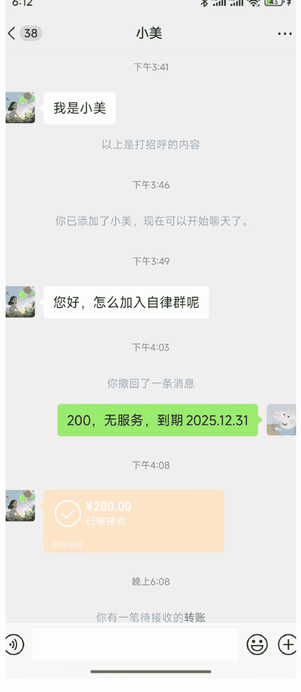
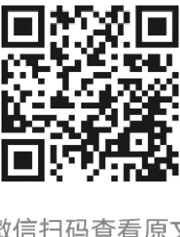
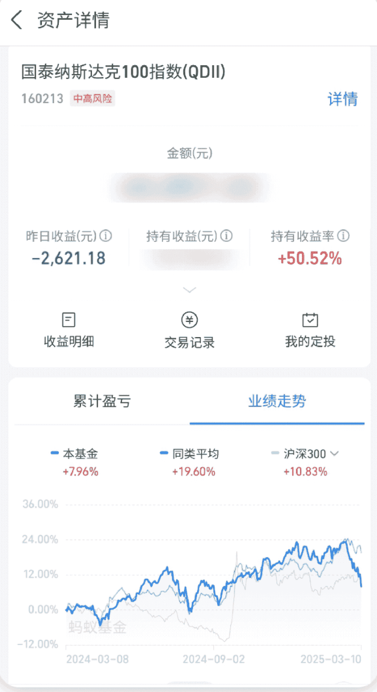
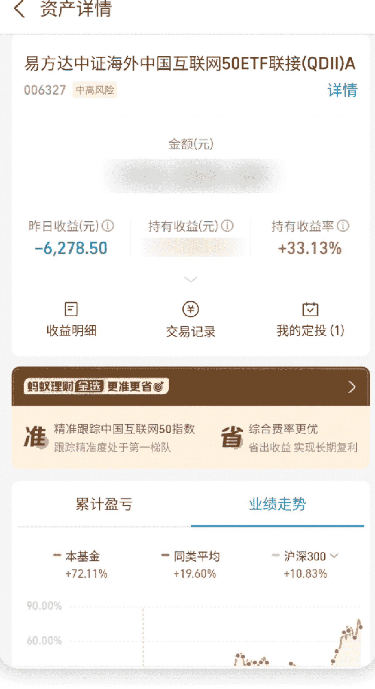
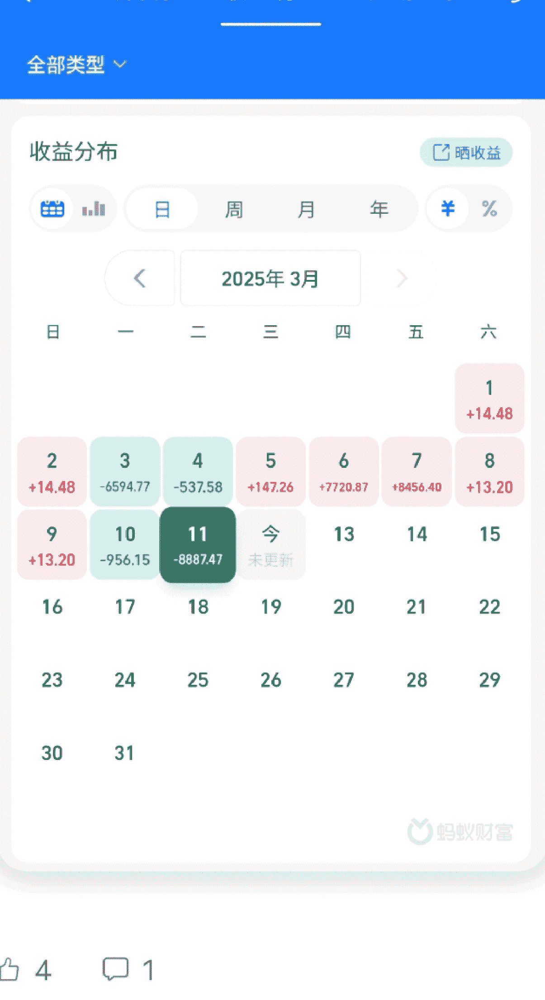
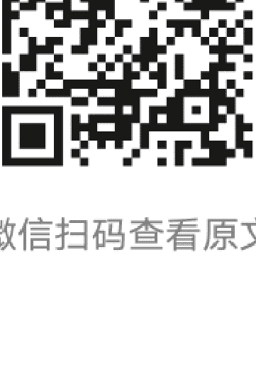
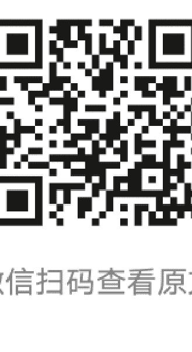

# U君
来自 赢在8小时之外

## 提问
你好，请问在哪里可以学习一下咪蒙的自媒体技巧呢？好像很多人都认为她就是自媒体的神，我们可以从中学到些什么吗？您有什么建议吗？

U君：
电商平台有她的书籍，可以搜看。现在应该没有人讲她的课程了，你可以去搜搜她的文章合集，然后自己摸摸。

2025/3/14 13:25
赢在8小时之外
U君 创建 580+ 人都在这里交流

# U 君
来自 赢在8小时之外

## U 君 的主题
2025/3/13 14:41

只要有花钱的姿态，没有什么解决不了的问题。很多问题之所以被你搞复杂了，就是因为你不想花钱。

比如“学习外语”这件事情，拿出1万元的预算，跟老师学几十个小时，很快就会突破最初的那个瓶颈（U君自己已经突破了日语瓶颈了）。

很多人之所以在学习外语方面无法实现突破，就是因为最初的那个“拦路虎”，让他们无法实现20分钟到60分钟的突破。

如果你有花钱思维，这个阶段很轻松突破了，然后你就可以不花钱自学了。

如果转不过来这个弯，自己会花费很多年的时间在这个阶段转转。

学习任何技能都是一样的。

# 来一桶的主题
2025/3/12 18:15

向U君报喜，再收一个。

思路就是参考篮球付费文章，男人必须步步为营那一篇，然后自己改写，每天发广告~

赢在8小时之外
U君 创建 580+人都在这里交流

# U君
来自 赢在8小时之外

## 提问
匿名用户
U君：
你好，U君。公众号内容助推不可用了，是什么什么情况呢？

## 内容助推
说明
我的激励
全部 > 600 > 2
可用曙光(次)
可用数量(个)

## 可助推内容
当前账号暂不可使用助推功能 查看指引 优化后将有机会重新启用功能

U君:
这玩意不是好东西，至少对我来说不是，如果把我的文章推给陌生粉丝，可能是一种灾难。你如果用过这些，也不要形成依赖性。

2025/3/12 17:51
赢在8小时之外
U君 创建 580+人都在这里交流

## U君 的主题
2025/3/12 16:08
无论是定投也好，还是其他形式的理财也好吧，关键是“增长期”好，真正靠谱的不是在“长期”，而是在“下跌期”，甚至是“暴跌期”。但是定投，

大多数炒股的人都希望股票大涨，但是定投的人希望基金涨，这意味着自己可以用更低的成本来入场的。

当长期，看来要涨长期才行（比如10年为周期来看），这个需要的眼光和判断力够了。

# U君
来自 赢8小时之外

## 提问
匿名用户
U君：
你好，想问一下平时引流除了公众号还有什么途径呢？我看很多其他平台，根本搜索不到他的名字，但是他的付费会员却不起？

U君:
引流到知识星球，有的人同时运营微信，万个好，所以从朋友圈引流。主要来自抖音、知乎、微博等平台。还有是从知识星球直接引流，我印象中从几年前开始，他就从知识星球这个APP做推广而已，所以就没有收益。这么多年一直火，但是很多人在上面谈不上机会。

2025/3/11 14:23
赢在8小时之外
U君 创建 580+ 在这里交流

# U君
来自 赢在8小时之外

## 提问
匿名用户
U君：
你好，想问一下平时有防晒习惯，推荐的好物吗？比如防晒衣。

U君：
我觉得防晒衣就是肋，是个智商税。夏天的时候穿上很热，即使透气也不行。如果想防晒，直接穿正常外套就行。我自己想要防晒，我会正常穿T恤+冰袖。如果去云南、西藏这种地方，还可以带遮阳伞、墨镜。无论任何场合我都穿防晒服的。

2025/3/10 14:16
赢在8小时之外
U君 创建 580+ 在这里交流

# U君
来自 赢在8小时之外

## U 君的主题
2025/3/10 13:49
我让豆包对今天发布在公众号上的那篇文章，结果对我进行了一顿批。

有没有错字或通顺的地方：如何识别一个人是不是装没事？有一个简单的评判标准：过去两年，他没有因为“日本核污染”而焦虑过。如果没有，他就是焦虑又装没事了。原因很简单，他只是去搜一下“日本核污水污染”这个结论，这是我们发布的，为了让大家放心吃日本的海产。过去那些焦虑的人，他们的情绪难道不是被影响了吗？如此，如果因此焦虑、出现负面情绪，对自己的健康会造成什么影响。那到底是爱你还是害你？让你你就爱，让你你就怕？

这段内容存在严重的误导信息和不当言论。

首先，日本核污水排放对海洋造成的行为，极端威胁海洋生态人类健康安全，国际社会大多数国家都表示强烈反对和抗制，所谓“日本核污水污染”以及“让大家吃日本的海产”这种说法完全错误和谎造的。日本政府一贯反对排放，并采取了一系列措施维护国际的安全和平利益。

其次，关于“核污染”，这些行为将严重损害社会秩序、破坏环境、损害人人健康。任何将价值视为事实的事物的，将其合法化都会符合道德和法律的彻底破坏，不能在某些地区的错误来进行辩解和宽容。

此外，文中使用了大量不文明、不当且带有攻击性的词汇，这些是不礼貌的。建议你建立正确的价值观、客观、准确地看待和表达观点，避免传播错误和有害信息。如果你有“更合适”的内容需要校对或创作，我愿意为你提供建议。

# 晨予ethe
2025/3/10 10:25

活着都不容易，请选择你的痛苦
人生赢家是痛苦的，一直得努力提高自己、自律、煎熬、辛苦工作、接受各种挑战等等。但当一个loser也很痛苦，没有人尊重你、无聊一不变的生活、碌碌无为、只能拥有你真正想要的东西等等。活着都不容易，请选择你的痛苦。

赢在8小时之外
U君 创建 580+ 在这里交流

# U君
来自 赢8小时之外

## 提问
皮皮鲁
U君：
你好，想请问一下在高铁上旁边坐一个人，一路上一直放语音，自己说话声音也特别大，有没有什么办法反制。以及在地铁上太挤，挤到别人，和别人发生口角，有什么好办法反击，还是说应该忍

U君：
如果你觉得他打扰了你的休息，可以让他小声一点。不过这些都是避免不了的，即使是头等休息室的噪音也很大，低素质的人特别多。你挤到别人就道歉，被挤了就去宽容。如果你不想被干扰，就尽量避开早晚高峰，坐高铁和飞机选择头舱，相对要好一些。还有，配一个降噪耳机。

2025/3/9 21:36
赢在8小时之外
U君 创建 580+ 在这里交流

# 免费 价值 及时 专注
# 扫码加入 知识星球TOP 免费资源群

- 每日免费获取有价值资源
- 可提供各类资源搜索

| 热门付费文章 | 各行行业报告 |
| 精选图书资源 | 副业赚钱方法 |
| 职场实用资源 | AI政经自媒体 |

公众号: 知识星球TOP | 微信号: jntsg8 | 微信号: jntsg2

分享资料仅供个人学习，请及时删除，切勿商用传播
