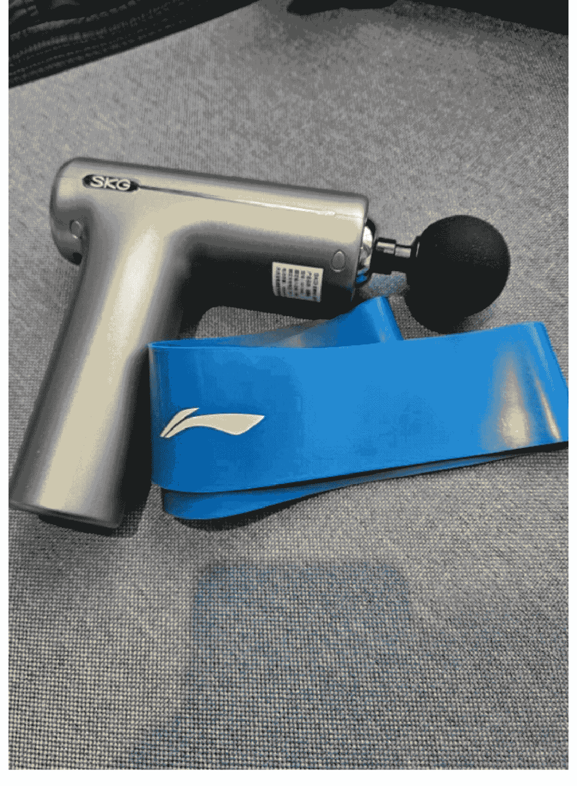
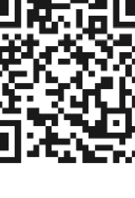
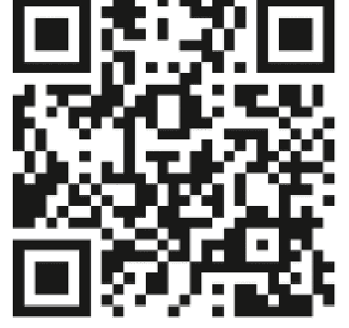

# U君的主题

2025/3/5 13:56

做了8节课运动恢复之后，我我自己也会用弹力带和筋膜枪，于是我也买了这些装备，直接在家里训练、放松。如果我没有去康复训练的话，根本不想去买这些，即使买了也不会用，看教学视频也用没，因为没有信心感，没有现场指导来的踏实。

康复中心的康复师还是比较有水平的，他们能懂核磁报告各种影像（跟三甲医院的医生诊断结果），而且在运动康复方面给予专业指导。

比如此时，要放松肌肉压力，就要在不伤关节的前提下，增加大腿、小腿、臀部和腹部的肌肉量。

这时候，就要做一系列肌肉动作，比如弓步蹲、单腿转臀、哑铃合等这些词，有很多老师在教你。

如果你只看视频练运动，但是你还是完全盲目完全跟着他们去学习，很容易练到错的错误，甚至受受伤。

就拿“膝盖碰脚尖”这一个原则来说，不同的人会有不同的解读的。

所以，类似这些健身训练，前期最好找专业的人来指导自己，等到自己完全掌握要领之后，就可以自己在家里练练了。

# 赢在8小时之外

U君 创建 580+ 人都在这里交流

微信扫码查看原文

## U君

来自 赢在8小时之外

### 提问

匿名用户

U君

U君，团队中很多人都反馈被总公司总经理经理打压得很抑郁，很难受，目前整个团队士气也不高，我作为团队二把手，在夹缝深感无力，曾对团队人员沟通事项与总经理沟通过，但无果，加之团队领导为70后，感觉沟通确实有效。在积极安抚团队人员时，但感觉给大家的心理疏导小过甚微，目前团队士气很差，部分人员已提交离职申请，想问下这种情况下我该做什么？

U君：

只要不是你的公司，你就不要去操心。你需要考虑的是这两个问题：你今年能赚到多少；万一离职之后还能不能找到更好的下家。至于其他乱七八糟的事情，你考虑多也也没用，徒增烦恼。谁抑郁了、谁想离职了，这些你都不用去操心，否则他们的能量就会转嫁到你的头上。

2025/3/5 13:26

微信扫码查看原文

## U君

来自 赢在8小时之外

### 提问

Alex

U君

U君好，想问一个心态的问题。
最近看到一些比较比较好的关于赚钱的文案，但自己尝试改写出来的时候，心里会有一点不踏实。
具体原因是我我自己还没有在网上获得实质性的收入，这时候写这些文章，会不会自己还没学成就要去教别人？所以有点心虚。硬要写出来的文章，也没有那种坦荡的能量。
请U君帮忙看看如何突破？

谢谢

U君：
你是大多数人的思维和担心，得改。如果你自认为一篇文章能收到钱，那么你就去写、去收钱，钱收到手之后，自然就不会心虚了。

2025/3/4 22:24

# 赢在8小时之外
U君 创建 580+ 人都在这里交流

微信扫码查看原文

## U君

来自 赢在8小时之外

### 提问

匿名用户

U君

U君，第一次租房，钱不是付给链家平台的吗（就像购物，点外卖）？支付宝免押租房怎么样呢

U君:

免押租房应该属于那种房东把房子全权委托给中介打理了，正常情况下房租和押金还是付给房东的。无论哪种情况，应该都都不用担心。

2025/3/4 13:18

赢在8小时之外
U君 创建 580+ 人都在这里交流

微信扫码查看原文

## U君

来自 赢在8小时之外

### 提问

珍惜

U君

U君，看了关于您写作的分享，该怎么训练自己调动读者情绪的能力，从哪些方面下功夫专项训练这项技能？才能做到，像您一样，让读者哭，让读者笑，等等等……进行情绪的操控？像游戏设计师一样？

U君：

我也不敢说自己有这个能力，不过，最能打动人的一般都是自己真实经历过的事情。可就是，凡事不要光看表面，要沿着一个脉络一直往下寻找，找到事情的本质和本来。想要得大家的眼泪或者欢，多跟那些大导演、大编学习，他们才是调动情绪的高手。如何让自己的变得更幽默或者更煽情，这些都是有方法的，改有时间我专门写一下这两个方面，也会把文章同步到咱们星球。

2025/3/3 20:43

# 赢在8小时之外
U君 创建 580+ 人都在这里交流

微信二维码查看原文

## U君

来自 在8小时之外

### 提问

匿名用户

U君

## U君，这个待遇真的是吗，还是被夸大大了？

+ Apologize
河北四线城，民企
1. 企业年金
2. 补充医疗
3. 每年打3000块，药卡
4. 优费800，蛋糕，月饼，不加班，取暖3000+
5. 早晚不打卡，有事可以溜走不扣钱
6. 出差也算一份收入，补贴每天3-5万不等
7. 双休，不加班，早饭免费，晚饭免费，晚饭免费
8. 法定假日不加班，请假
9. 孩子补助，班级，住院
10. 办公室零食管
11. 公司举办各种活动，基本就有奖金，均价50-100
12. 不卷，领导特别好，同事也都可以
13. 待一个月W+ 河北

U君：
看得是什么工作内容，如果是做鸡、鸭、或者游戏，那么在四线城市还是有可能。只不过这类金领，是不会面向社会招聘的。
2025/3/2 18:23

> 赢在8小时之外
U君 创建 580+ 人都在这里交流

## U君

来自 赢在8小时之外

### 提问

匿名用户

U君

U君你好，我经常外出跑，领了驾照后朋友说开车技术并不是很好，比较特别的是变道时，旁边有大车心里就慌。
现在的问题是，我没有车子方便，经常都是打车，每个月打车大约千左右，现在纠结是买二手的油车，还是贷款一台十万内的智能电车，主要也想省钱，目前还有房贷，存款没多少。

U君：
开车跟自行车差不多，就是熟巧。我的经验是，开车之后，大概会有那种不足。如果是我的话，预算我会买二手的油车，因为贬值慢，适应的路况和天气。
2025/3/2 18:05

# 赢在8小时之外
U君 创建 580+ 人都在这里交流

## U君

来自 赢在8小时之外

### 提问

匿名用户

U君

U君，有推荐的雨伞吗？买了很多雨伞都是坏，尤其是遇到大风的时候容易被吹翻。您觉得要买晴天用的还是雨天的用的一把，有必要买两把吗？

U君：
雨伞应该能满足你的需求，200多元。不过，伞是一种很容易丢的物件，如果买太贵的有点可惜。
2025/3/2 17:16

> 赢在8小时之外
U君 创建 580+ 人都在这里交流

## U君

来自 赢在8小时之外

### 提问

王家东…合一

U君

U君您好，外出旅游常规大包，有什么样的旅行包或者折叠包推荐吗？方便

U君：
一方面，要少带衣服和物品，这是一个心理上的调整，比什么都重要。如果想要折叠的书包，那种双肩包，收纳起来就像拳头一样。
2025/3/2 10:42

# 赢在8小时之外
U君 创建 580+ 人都在这里交流

# “路径依赖”就是亏杀手，又是利器

本文是2025年3月1日公众号（U君笔记）的付费文章。

“路径依赖”是一个物理词汇，又是一个心理学词汇。

这个词在最初的含义是：刚出现马车时，两个轮子之间的距离是1435毫米（原文误为米），后来又出现了火车，两个轨道的距离也就没变。

当当时的铁路有了最早的范围，如果想要的话，那得重新拆除所有的铁路，那样本身就太大了。

所以，这条路径一直沿用到了今天。

红灯系统也是如此，开始推行现代体系的几个国家采用的“红灯、绿灯”系统，那么其他的国家也纷纷学习用了这个系统。

这样约节省维护成本和教育成本（尤其是欧洲那些已经相互相同的国家之间）。

所以，“路径依赖”这件事是自然而然的，就是成本化。

但是，这还是在现代社会中，是为了能够节省成本、将利润最大化；用不用，甚至可以直接毁灭一家公司。

下面就跟大家聊聊“路径依赖”的三个点和五个点，都赚钱、商业、管理有关。

要点1：底层逻辑。

我早在第一本书讲心理学的书中读到这样一个观点：如果可以的话，尽量不要跟着那些“吊丝逆袭”的老板。

因为他们习惯说谎、吃苦、打压的强势管理下。

之所以会出现这种情况，并不是这些领导心眼有多贪，而是他们自己本身就是“贪便宜、吃受”的路径一路走到的今天。

所以，他们把这种奋斗奉为圭，非常依赖这种管理路径，而且缺乏现代的、人性管理的逻辑。

相比之下，那些出身比较好的领导就不会出现这种情况，他们从不会谎欺骗，也不会鼓励吃苦。

他们更懂得把格局放大，不会抠毛疵。

要点2：“老实人”很容易被时代淘汰。

## U君

来自 赢在8小时之外

### 提问

Alex

U君好，想问一个心态的问题。
最近看到一些比较比较好的关于赚钱的文案，但自己尝试改写出来的时候，心里会有一点不踏实。
具体原因是我我自己还没有在网上获得实质性的收入，这时候写这些文章，会不会自己还没学成就要去教别人？所以有点心虚。硬要写出来的文章，也没有那种坦荡的能量。
请U君帮忙看看如何突破？

谢谢

U君：
你是大多数人的思维和担心，得改。如果你自认为一篇文章能收到钱，那么你就去写、去收钱，钱收到手之后，自然就不会心虚了。

2025/3/4 22:24

# 赢在8小时之外
U君 创建 580+ 人都在这里交流

## U君

U君，第一次租房，钱不是付给链家平台的吗（就像购物，点外卖）？支付宝免押租房怎么样呢

U君:

免押租房应该属于那种房东把房子全权委托给中介打理了，正常情况下房租和押金还是付给房东的。无论哪种情况，应该都都不用担心。

2025/3/4 13:18

## U君

U君，看了关于您写作的分享，该怎么做训练自己调动读者情绪的能力，从哪些方面下功夫专项训练这项技能？才能做到，像您一样，让读者哭，让读者笑，等等等……进行情绪的操控？像游戏设计师一样？

U君：

我也不敢说自己有这个能力，不过，最能打动人的一般都是自己真实经历过的事情。可就是，凡事不要光看表面，要沿着一个脉络一直往下寻找，找到事情的本质和本来。想要得大家的眼泪或者欢，多跟那些大导演、大编学习，他们才是调动情绪的高手。如何让自己的变得更幽默或者更煽情，这些都是有方法的，改有时间我专门写一下这两个方面，也会把文章同步到咱们星球。

2025/3/3 20:43

## U君

U君，这个待遇真的是吗，还是被夸大大了？

+ Apologize
河北四线城，民企
1. 企业年金
2. 补充医疗
3. 每年打3000块，药卡
4. 优费800，蛋糕，月饼，不加班，取暖3000+
5. 早晚不打卡，有事可以溜走不扣钱
6. 出差也算一份收入，补贴每天3-5万不等
7. 双休，不加班，早饭免费，晚饭免费
8. 法定假日不加班，请假
9. 孩子补助，班级，住院
10. 办公室零食管
11. 公司举办各种活动，基本就有奖金，均价50-100
12. 不卷，领导特别好，同事也都可以
13. 待一个月W+ 河北

U君：
看得是什么工作内容，如果是做鸡、鸭、或者游戏，那么在四线城市还是有可能。只不过这类金领，是不会面向社会招聘的。
2025/3/2 18:23

U君你好，我经常外出跑，领了驾照后朋友说开车技术并不是很好，比较特别的是变道时，旁边有大车心里就慌。
现在的问题是，我没有车方便，经常都是打车，每个月打车大约千左右，现在纠结是买二手的油车，还是贷款一台十万内的智能电车，主要也想省钱，目前还有房贷，存款没多少。

U君：
开车跟自行车差不多，就是熟巧。我的经验是，开车之后，大概会有那种不足。如果是我的话，预算我会买二手的油车，因为贬值慢，适应的路况和天气。
2025/3/2 18:05

U君，有推荐的雨伞吗？买了很多雨伞都是坏，尤其是遇到大风的时候容易被吹翻。您觉得要买晴天用的还是雨天的用的一把，有必要买两把吗？

U君：雨伞应该能满足你的需求，200多元。不过，伞是一种很容易丢的物件，如果买太贵的有点可惜。
2025/3/2 17:16

U君您好，外出旅游常规大包，有什么样的旅行包或者折叠包推荐吗？方便

U君：
一方面，要少带衣服和物品，这是一个心理上的调整，比什么都重要。如果想要折叠的书包，那种双肩包，收纳起来就像拳头一样。
2025/3/2 10:42
