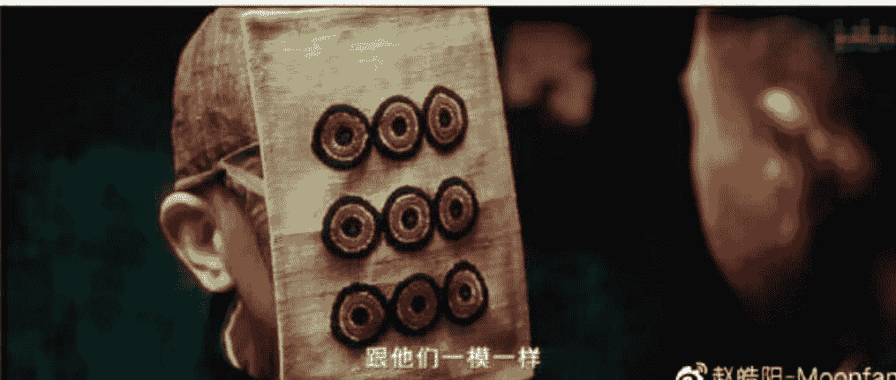
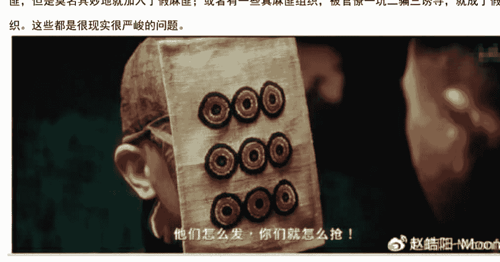
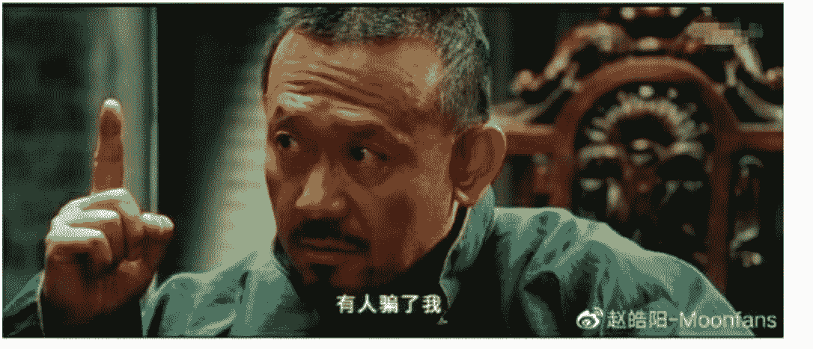
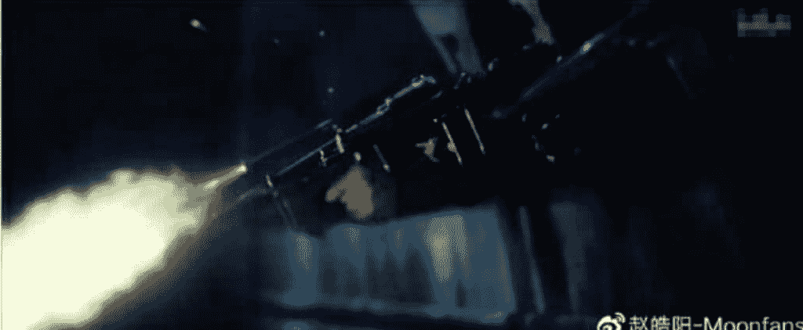
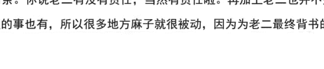
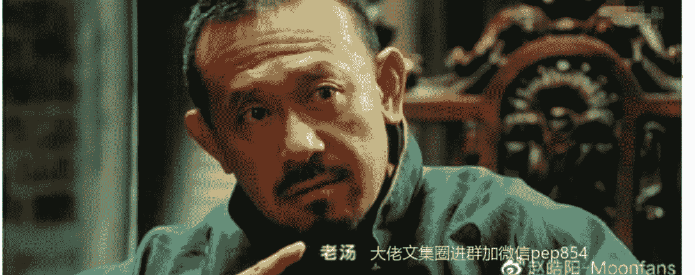
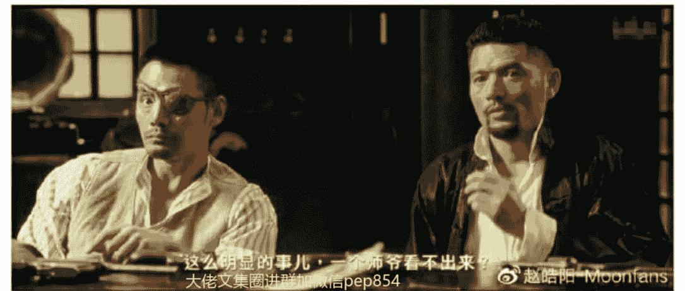

# 【补】1967真假麻匪火拼：再晚五分钟，张麻子就成了俘虏

2024-06-21

文/赵皓阳

这已经是四年前的文章了。因为前两天在武汉，在东湖泛溜着溜着就达到了东湖宾馆了，就想起这件事了，睹物思人啊！

1967真假麻匪火拼：再晚五分钟，张麻子就成了俘虏

赵皓阳-Moonfans 2021-07-26 删除

文/赵皓阳
去年十月。

赵皓阳-Moonfans
2020-10-12 16:24 来自微博
发布了头条文章：《1967真假麻匪火拼：再晚五分钟，张麻子就

深度视野大V文集cuk255 有温度高质社群cuk255

## 1967 真假麻匪火拼：再闹五分钟，张麻子就成了俘虏

文/赵皓阳
赵皓阳-Moonfans

那一年是公元一九六六年，麻子宣布了了他伟大的设——人人都能参与麻子、人人都能成为麻子。但是从实践中出来各种各种的问题，比如说真麻子、有假麻子，假麻匪还要给运动搞破坏。本来麻子只是为了群众的事要交给群众解决，真理却不明白，群众也会在大口大嘴辩论成长。结果后来发现越来越不对：第一，因为麻子妥妥——要文打不要武斗，结果武斗禁止了。第二，麻子已经发现了，有人制造了一批“假麻匪”——扛着红旗反红旗。

深度视野大V文集cuk255 有温度高质质cuk255

第三，麻子令五伍，政府和军队不能干涉群众拉架，结果发现现在人在拉架。第四，有人明明相当真麻匪，但是莫名其妙地加入了假麻匪；或者有些真麻匪组织，被官像一坨一坨坏二骗三引导，就成了假麻匪组织。这些都是很真实很严峻的问题。

在不可避免的武斗中，很明显假麻匪有人在暗中帮忙——他们使用了军队的武器，有军家属甚至现军人直接加入假麻匪参与。后来真麻匪反制，抄了假麻匪的军械仓库，缴获了一批武器；结果就有人说，真麻匪已经严重威胁到姚秩序，必须让军队介入剿灭——合正反话都是你们说了。

深度视野大文集cuk255 有温度高质量社群cuk255

这个现象出现最严重的地区，一是重庆，二是武汉，所以那年的七月十日日前后，麻子和工作组先后前往武汉，决心考察一番假麻匪的问题，但是这一去，就险象环生。

武汉的假麻匪有一个吹牛皮的自我称谓——“百万雄师”，在麻子与武汉调查期间，兴风作威所欲为，不断攻击真麻匪的据点。最严重的一天是七月二十日，百万雄师包围了张麻子的营行——武汉东湖馆。这种行为在历史上有一个专有名词——兵袭。

> 赵皓阳-Moonfans

# 下内内容 V+会员可见

## 四年后再发一遍：

当时麻子身边的人都非常紧张，以数的人潮已经包围了牢脚，别说要伤害他，就是画一点脚都要掉命了。夫人麻子赵娇说，这种局势已经失控了，你的安全完全没有保障。麻子很生气，说我不走。我不信人气伤害我。我要看到是谁在背后煽动民众，误导人民。

麻子的脾气就是这么，有时候有点小孩子。《平津战役》里有个王将军，因为华野部不命令士兵自进攻，导致整个王军如惊之鸟跑回家，没抱了他们的孩子，麻子气坏了——但是他生气的方式是惩罚自己，穿着章站在雪里，说你们都不听我指挥，那我就把自己给坏掉吧。后来喻齐亲自出来，把大衣披在麻子身上，好劝功夫，才把麻子交给指挥部。

所以麻子认真了，九头牛也拉不动，但是形势万分危急，夫人好找到老二，让老二动麻子。老二二次动，麻子从东湖走到码头，刚跑到码头，“百万雄师”的人潮二次冲进旅馆，撤离的人都受伤了。这一次极其极其严重的事情，甚至都不用对政治了。麻子是从什么开始走的，因为他相信群众是被煽动的，群众不可能伤害他，但他可是要看到是谁在背后煽动的，所以脾气上来了。为什么麻子会怪老二？因为老二是西地的。这是没说的，解放军放了一个大城市，就要在大城市留下干部，典型的三野、上海、南京，就属于他们的“山头”。不过中山非常注意。

当时麻子身边的人都非常紧张，以数的人潮已经包围了牢脚，别说要伤害他，就是画一点脚都要掉命了。当时老二是有理之中，麻子和老二已经产生了嫌隙。麻子请老二宰，是想制造军事，是想让老二打架；但是老二虽然是将，打仗无敌，政治却没那么好，有时候搞越大，搞得麻子很被动。此外老二确实有些怂，有些事情做的不地道，尤其是老婆和儿子；关键是很多人的普遍水平比较矮，再加上老二身体不好，经常闹在床，乃是那些“亲”就胡乱搞，成事有余。你说老二没有资质，再加上老二胀之后，很多地方麻子就很被动，因为老二最后找复的。也有让他找一个名字叫老二吧。最臭的就是《将军，你不能这样做》，麻子直言“我是忠的，我打过架”，还有很有名的“我是要的”，这句名言出自处。这封信是批评老二，老二表示之后，麻子就毁了这封信，因此只有只言流传。

> 赵皓阳-Moonfans

而故事还没有结束。李东走后兄弟们去了上海，去了浦东，开始吃着火锅唱歌的生活。老干嘛，在期间期间了那么多苦，所以用宝贵外买进口车是可以理解的，盖几座小洋楼享受一下生活是可以理解的，叫几个学生女服务员也是可以理解的。

而老二是“可以理解”中的典范，这位仁兄为了给自己盖小洋楼，下令推了一座幼儿园，并消耗了几万宝贵的外汇小洋楼装备现代化设施。这件事在当时引发了巨大的反响，一位诗人专门创作了一首诗《将军，你不能这样做》，很快风靡全国：

在这新长征的路上
且前进的后人
和前进的法律一道
大吼一声：将军不能 这样做！

只能说啊，麻子苦了心肠，但是兄弟们真的不是给力啊。

最后再说一下这件事情的结尾，一看麻子的苦良心。按照这里说统天子符的事，在古代是要追族的；别说古代了，你就是斯大林遇到这种事，你有几个脑子给我子弹。但是老二的处理仅仅是撤职而已，麻子自己害怕并将其扩大，特别强调“我是我要的”。这就是麻子的特点，苦良心，他相信自己同志本质是好的。

示威，又严打了老二，可谓一石二鸟。这种事情在历史上没有充分证据，没有证据的事情就不写了。

## 深度视野优质集群（链接优质社群，助你成功）

全部包含以下内容：限时年费188/年 加微信cuk255

- ① 吃瓜群众倍时圈加时群群对话（原价 365 元/年）
- ② 子明私享汇（含）内部文章
- ③ 政事室（顾子明）付费内容加送顺顾子明群
- ④ 米联储寂美【作者米横】（原价 599 元/年）
- ⑤ 欧洲金雀会员专属
- ⑥ 砖瓦内部
- ⑦ 卢克文读书会专属文章
- ⑧ 鉴茶财经星球（原价 3310 元/年）
- ⑨ 猫哥的视界星球（原价 299 元/年）
- 十 才新周【独家新闻（原价 1498 元/年）
- 十一 杨世光在钱塔（原价 2200 元/年）
- 十二 森森财经星球（原价 1600 元/年）
- 十三 激泽异读付费文章（持续更新）
- 十四 司马林解读末选全套音频和全套书籍精准割（原价2.3 万）
- 十五 虚构三部曲[民国梦、帝国争亡、不被理解的MAO](原价 599 元）
- 十六 卢克文星球文章（原价 268 元/年）
- 十七 额外再送：卢户元新微博付费专栏、三村丰老王、三花九洞文集
