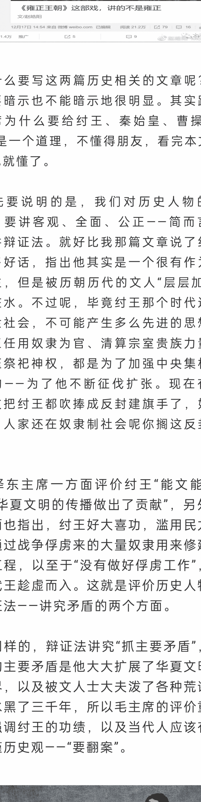
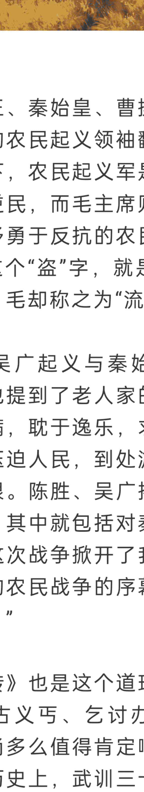
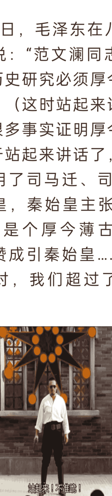
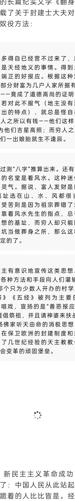

# 刘备为何能一呼称王，曹操不是

在东汉末年的大乱世中，刘备和曹操都是杰出的英雄人物。但为什么历史的洪流中，曹操却被一尊称帝，而刘备却不是？

刘备出身寒微，甚至可以说是织席之徒，但他却能一呼称王；而曹操出身名门，是汉之后，他却没能一呼称帝？

这并不是一个偶然，也不是一个历史的巧合。从历史的角度来看，这背后其实有着非常深刻的政治考量和心理考量。

刘备的成功，首先在于他找到了一个旗号，这所谓的“仁义”旗号。正是因为他标榜了仁义，他得到了百姓的拥护；正是因为仁义，他得到了无数士人的支持。

而曹操虽然很有才华，但他行事过于严酷残忍。他推崇的是“唯才是举”，这种做法在那个时代虽然能招揽大量人才，但却让他无法获得广泛的民心。

其次，刘备的成功并不是仅仅依靠仁义。他更是一个极具政治政治家。他能够在关键时刻抓住机会，不断扩大生存空间。

在与曹操权力的争夺中，刘备屡屡失败，但他总都能重新站起来。这种极强的生命力，是曹操所不具备的。

最后，刘备的成功是因为他符合了那个时代的某种期待。在汉朝崩溃的边缘，人们渴望一个复兴的机会，而刘备作为皇室后裔天然具备了这种合法性。

所以，刘备为何能一呼称王，曹操不是？这并不是因为曹操不够优秀，而是因为他的选择与时代产生了矛盾，而刘备却契合了时代。

刘备的成功在于“仁”，而曹操的失败在于“权”。

## 赵琳

电影《无战之》是导演高濑广在2009年执的一部战争片。

这部电影讲述了一个关于战争、人性以及在极端环境下生存挣扎的故事。

在电影的开头，我们看到了生活在二战背景下的日本士兵。他们并不是冷酷无情的战争机器，而是有情感、有梦想的普通人。

然而，随着战争的进行，这些士兵的生活发生了巨大的变化。他们被迫面对残酷的现实。

在激烈的战斗中，他们开始反思战争的意义，并在生存与道德之间进行痛苦的挣扎。

电影通过细腻的刻画，展现了战争对普通人生活的毁灭性影响。

《无战之》截图

### （四）战争中的人性、生存与抉择

这部电影告诉我们，在极端的环境下，人性依然面临着考验。士兵们在残酷的战争中，必须做出严严的抉择。

这不仅是生存的斗争，更是灵魂的战争。电影深刻探讨了人内心的挣扎。

在战争的阴影下，人光辉显得如此微弱却又如此珍贵。

电影通过对这些细节的刻画，引发了观众对战争和人性深层的思考。

它不仅是一部关于战争的电影，更是一部关于人性的赞歌。

当我们看完这部电影后，会深深感受到和平的珍贵。

这种抉择在每一个时代都是永恒的话题。

在《无战之》中，我们看到了日本对对历史的深刻反思。

这种反思让电影具有了深厚的底蕴。

它提醒我们，不要忘记历史，才能更好地走向未来。
