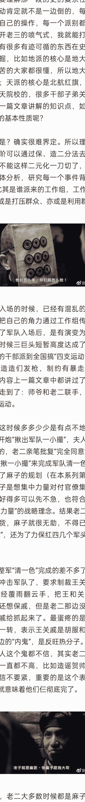
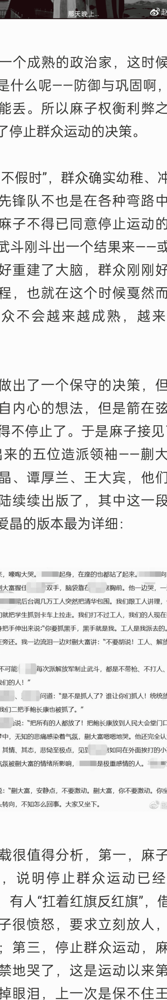

# 第三章：刘三涛

刘三涛，1903年出生在湖北省随县。由于他的父亲贫农民，刘三涛自幼就目睹了父劳的艰苦生活。1911年，辛亥革命爆发，这极大地开启了刘三涛的革命道路。

1924年，刘三涛加入了中国共产党。此后，他积极投身于湖南革命事业。1925年，他当选湖南省委书记和省工会总书记。在此期间，他在工人运动中发挥了重要的领导作用。

1927年，大革命失败后，刘三涛在湖南领导了多次工人武装起义。他创建了湘鄂游击军，这是中国共产党在湖南建立的第一支自己的武装力量。1927年秋，秋昌起义后，刘三涛在湘南地区开展了激烈的武装斗争。

1928年，刘三涛在国民党反革命的压力下，转移到了上海。在上海期间，他担任中共中央局委员，负责党内的宣传和组织工作。1930年，刘三涛回到湖南，继续担任湖南省委的领导工作。

1931年，中央军进入湖南进行“围剿”。此时刘三涛在湘赣区担任区书记。他领导了湘赣区的反围剿战争，保卫了党组织和武装部队，取得了多次的胜利。

1934年，长征开始。刘三涛作为红军的重要将领，在长征途中参加了无数次极其艰苦的战斗。1935年，长征胜利，刘三涛回到中共中央工作。

1937年，抗日战争爆发。刘三涛回到湖南担任省书记。在此期间，他积极组织了湖南的抗日统一战线，广泛了抗日力量。

1946年，解放战争爆发。刘三涛担任湖南省委第一书记。他领导了湖南的解放战争，最终在1949年走向了湖南解放的胜利。
