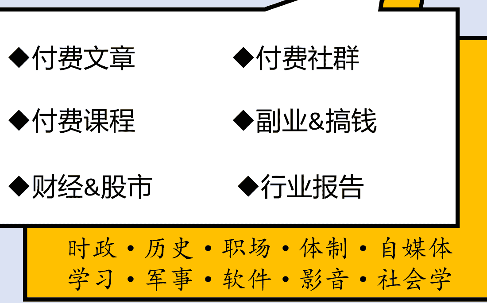
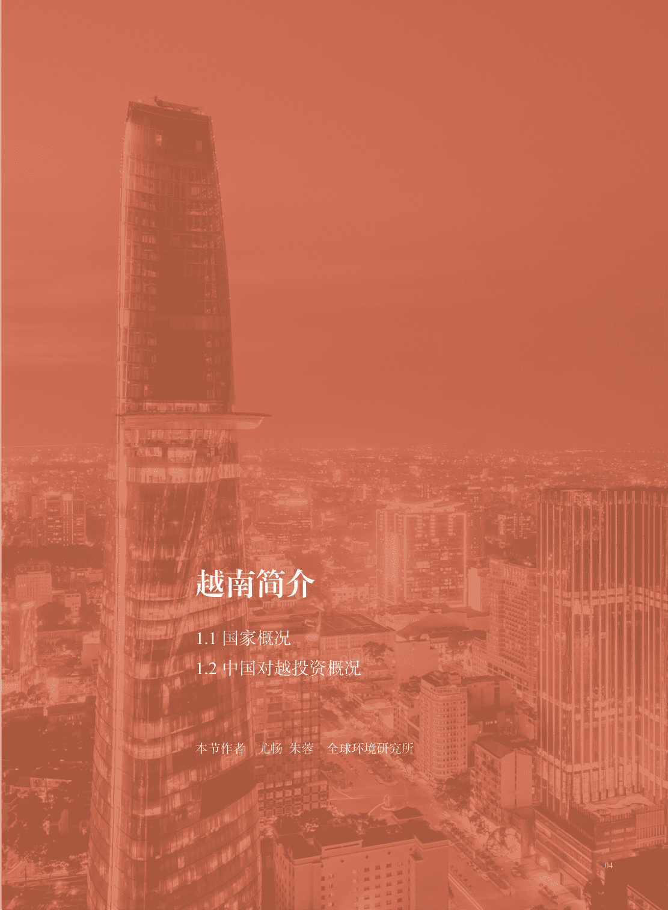
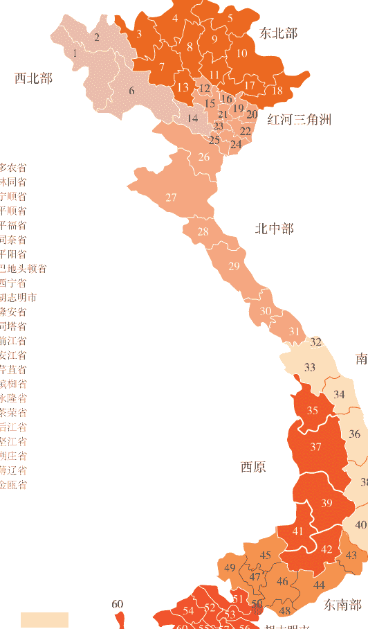
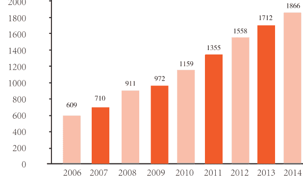
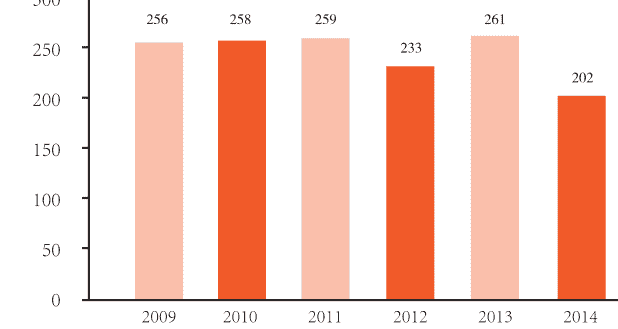
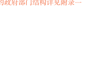
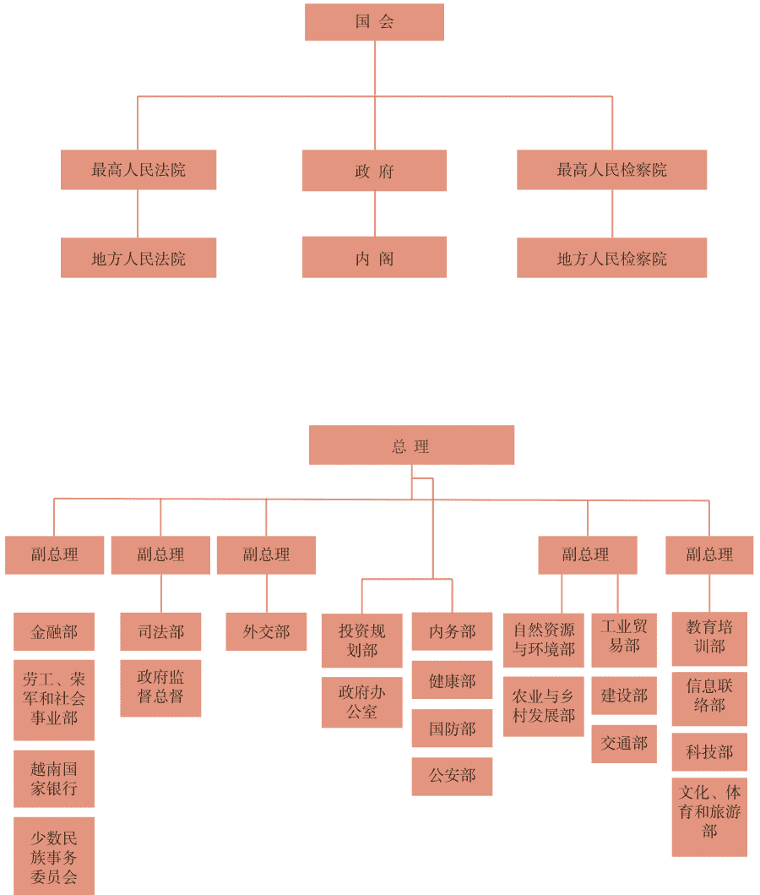
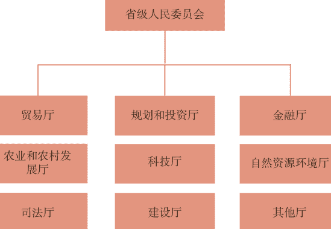

“出去”观察系列报告
全球环境研究所海外投资、贸易与环境项目组

# 越南的外国投资管理体系、环境政策与中国企业对越投资、工程承包——案例分析

## 知识星球TOP 资源分享社群

汇聚全网付费资源
让更多人获取高价值信息

- 付费文章
- 付费社群
- 付费课程
- 副业&搞钱
- 财经&股市
- 行业报告

时政·历史·职场·体制·自媒体
学习·军事·软件·影音·社会学

公众号:知识星球TOP
微信信号:jnts8
微信信号:jnts2

添加微信 免费进群

“走出”观察系列报告
全球环境研究所海外投资、贸易与环境项目组

作者：高树娇 William J. Schulte 允畅 杨琦佳 朱蓉
编辑：William J. Schulte 朱蓉
校对：李芳芳 朱蓉

# 机构介绍

全球环境研究所（Global Environmental Institute, 简称 GEI）于 2004 年在北京注册成立，是一家非营利性环境机构。GEI 从全球视角出发，结合当地实际情况，探寻中国及全球环境问题的解决方法，为政府提供前瞻性的政策建议；并通过开展解决路径，推广投资贸易与环境、能源与气候变化、生物多样性保护、以及社区发展最优实践。自成立以来，GEI 已在中国二十多个省、市、自治区，以及南部、东南亚和非洲等地区实施项目。

在海外投资、贸易与环境领域，GEI 致力于推动中国政府出台相关的政策，对企业海外投资的环境进行规范和指导；增强国土环境治理能力，推动中国政府制定相应规章，规范投资环境的行为；提高企业的环境能力，履行环境和社会责任，防控环境风险。

GEI 已推动并参与了与国家林业局、商务部分别于 2007、2009 年《中国境外可持续森林培育指南》和《中国境外森林资源利用指南》，以及由商务部、环境保护部发布的《海外投资合作环境保护指南》，并在老挝、柬埔、桑提托比、刚果等国家和非洲开展了可持续投资的涵盖项目、实地研究和能力建设。

# 致谢

报告编写组成员谨此向佛蒙特法学院中美环境法合伙项目表示感谢，感谢对其研究及撰写工作的大力支持。同时也感谢 GEI 执行主任金嘉女士、环境规划环境政策部主任蔡忠信先生、GEI 海外投资、贸易与环境项目经理任的悉心指导；以及 GEI 项目官员季坤、张经纬、实习生荣、刘淳宇的支持和翻译贡献。

# 版权与免责声明

本报告的研究资金来自美国国际发展署 (USAID) 支持的佛蒙特法学院中美环境法合伙项项目。报告内容仅代表作者观点，并不代表 USAID、美国政府，以及文中提到的相关机构的意见。

本报告版权为全球环境研究所 (Global Environmental Institute，简称 GEI) 所有。任何单个人或个人在使用、复制、抄录、传播本报告的全部或部分内容，均应注明内容来源。对于不当转载或使用本报告内容引起的人民纠纷、行政处理或其他损失，GEI 不承担任何责任。

对于不遵守声明或其他违法、恶意使用本报告内容者，GEI 保留追究其法律责任的权利。

# 前言

2000年中国政府提出“走出去”战略，中国对海外直接投资规模逐增长，2011年至2014年连续位居全球第三。

中国企业作为“走出去”的主体，在提高基础设施水平、拉动经济发展、促进当地就业等方面获得了东道及国际社会的普遍认同。在“走出去”的过程中，企业开展可持续发展的经验得到了丰富，公司治理水平有所加强，并日益维护东道国家、环境和社会的和谐。

当前，中国的对外投资合作具有新的阶段特征。2014年经理基金会成立，2015年“一带一路”倡议正式提出，2016年亚洲基础设施银行正式业务，对海外直接投资带来了新的战略机遇。随着越来越多的企业在基础设施建设等具有重大环境和社会影响的领域开展投资，国际社会对对外投资的要求越来越大。中国企业在对外投资的可持续发展已成为需要关注的问题。

全球环境研究所（GEI）作为中国的政府、非营利性机构，从2005年开始关注海外投资的可持续发展。我们通过开展研究和实地调研，推动中国企业开展海外投资，提高对外投资的环境治理水平，为海外企业的环境和社会效益提供建议。GEI海外投资、贸易与环境项目在国际自然保护组织（WCS）和美国哥华大学法学院中美环境影响评估的项目（VLS）支持下，联合国规划开展了“中国在东南亚海外投资调查”项目。我们对投资管理制度、环境政策进行研究，并通过大量的研究和实地调研，收集数据并分析中国企业矿业、基础设施等对当地的影响，以此得出结论，形成“走出去”系列报告。

作为案例报告的开头，本报告介绍了越南的对外投资体系，分析越南环境政策和法律要求，并选取了三个案例，从微观层面展示企业在投资过程中面临的机遇和挑战。这些案例涉及煤电厂建设项目、中国铝矿采与与氧化生产建设项目，以及工业园区开发项目。案例研究包括调研、访谈当地政府、东道国利益相关方以获得全部的信息。同时说明的是，由于投资利益相关且复杂的东道国环境局限，本报告仅从环境和社会角度描述和关注中国企业。

# 目录

- 报告摘要 01
- 1. 越南简介 04
- 1.1 国家概况 05
- 1.2 中国对越投资概况 08
- 2. 越南投资管理 10
- 2.1 法律框架 11
- 2.2 政府部门 12
- 2.3 允许及受约束投资范围 13
- 2.4 投资登记与许可 14
- 3. 越南的环境政策 18
- 3.1 法律框架 19
- 3.2 环境保护主管部门 21
- 3.3 环境影响评价和环境保护计划 23
- 4. 燃煤电厂案例分析
- 4.1 行业概况
- 4.2 项目简介
- 4.3 煤灰污染
- 4.4 政府和企业回应
- 4.5 分析和建议
- 5. 铝矿开采与氧化铝生产案例分析
- 5.1 行业概况
- 5.2 项目展望
- 5.3 各利益方
- 5.4 政府、企业回应和措施
- 5.5 分析和建议
- 6. 工业园案例分析
- 6.1 行业概况
- 6.2 项目简介
- 6.3 工业园的环境和社会要求
- 6.4 措施
- 6.5 分析和建议
- 小结
- 附录 1 术语
- 附录 2 越南政府结构图
- 附录 3 越南环境政策及相关法律列表

# 报告摘要

越南位于中南半岛，南部接中国、西部邻老挝、东部邻泰国，国土面积33万公里，人口942万。越南1986年开始由计划经济转向市场经济。经过十多年的发展，成功由人均收入低于100美元的最不发达国家转变为人均收入超过2000美元的低收入国家，人均国内生产值（GDP）在东南亚国家中排名第八（2014年）。凭借低的劳动成本和低税率吸引了大量外资投资，外资成为越南增长的重要动力。在各行业，制造业和房地产是外商投资的重点，截至2014年累计外资总额为75%。

2009至2014年，越南吸引的外资有所下降，净流量从256亿美元下降至202亿美元，GDP占比从26.3%下降至10.8%。为了解决这一问题，越南政府在2015年颁新的《企业法》和《投资法》，放宽外商投资的行业，简化审批程序，提高企业的自主权，以鼓励和促进投资。

2014年，来自中国的越南外资投资占总额的2.1%。中国投资未成为主要的外资来源，但在近年来增长，2009至2013年间直接投资量由1.1亿美元至4.8亿美元。截至2014年，越南中国投资项目180个，总计79.5亿美元。中国投资的行业分布与越南行业的整体分布情况相似，主要位于制造业（70%）和房地产（10%），也有零售、餐饮等。

在基础设施、能源开发等行业，越南企业通常以工程的方式进行合作，直接投资较少。以电力行业为例，截至2013年有一个小型水电项目，其余水电和火电项目均为工程承包。在矿业行业，绝大多数中小型石和天然气、铁、锡、铜、镍和金属冶炼项目均由越南企业投资。

[1] UNCTAD Stat.
[2] Vietnam Ministry of Planning and Investment, Brief on Foreign Investment in 12 months of 2014. 2015.1.16.
http://www.mpi.gov.vn/Pages/tinbao.aspx?pageinfo=2644&id=289.
[3] 中华人民共和国国家统计局、国家外汇管理局。《2013年中国对对外投资报告》[M] 北京：中国出版社
[4] Vietnam Ministry of Planning and Investment, Brief on Foreign Investment in 12 months of 2014. 2015.1.16.
http://www.mpi.gov.vn/Pages/tinbao.aspx?pageinfo=2644&id=289.
[5] 越南，2015.
[6] Bao Q, Le TH, Tran VI et al. Extractive Industries Transparency Initiative and Implementation Perspective in Vietnam[2011].
https://eiti.org/files/vietnam-scoping.pdf

# 1. 国家概况

越南位于中南半岛南部呈呈“S”型，北接中国，西部邻柬埔亚、老挝，国土面积33万公里，位居世界第65位。海岸线3260公里，南部邻印度尼西亚、马来西亚、菲律宾和泰国。

越南地形多样，北部是高原和红河三角，西北是山岭，中部多山，南部为湄公河三角。从南向北，红河三角分为东北、西北、中部等地区，共有58个省和5个直辖市。

2014年，越南人口约932万，排世界第十三，人口中位29岁。市场压力巨大。越南共有54个民族，其中京族最多，占全国总人口的86%。三分之一的人口居住在低洼的南部地区。越南的首城市河内人口710万，河内是越南第二大城市，胡志明人口347万。

越南南北气候差异，但总体以热带季风气候为主，夏季炎热，降水量较高。全国大部分地区年平均气温在22℃左右。南部气候变化大，有旱季雨季节，每年7-9月台台风季节，北部中部也有台风。

越南的森林主要位于北部和南部地区，2011年森林覆盖率为3.9%。适宜种植面积，2013年森林覆盖率为20.7%。越南南部有2360万公顷的水源，水提供了全国三分之一的需求。在矿产方面，越南拥有石油、铝石资源，铝矿产量全球排名前列，金、铜、铁矿储量十分丰富。海岸线长3260公里，拥有丰富的海底和海洋资源。

在经济方面，越南自1986年启动经济改革，从计划经济逐步转向市场经济。经过二十多年的发展，越南人均收入从不足100美元的最不发达国家转变为中等收入国家（2014年为2014美元），并在2007年加入世界贸易组织（WTO）。2006年后越南GDP年均增长率达15%，2014年GDP为1866亿美元。

在国外投资方面，越南较低的劳动力成本和低税率优惠政策吸引了大量外资，已成为越南创新的重要动力。2009年至2014年，越南外投资中实际使用量从252亿美元下降到202亿美元。2014年国外外投资有185亿美元资金，集中在制造业。2014年越南吸引外投资254.5亿美元，占GDP的12.6%。吸引外投资额位居第三列，除了住宿和餐饮、社会服务、批发和零售、交通仓储、农林业、矿行业外也被吸引了国外投资。

### 图 1 越南地图

- 西北部
- 东北部
- 红河三角
- 中部
- 南部
- 西部
- 胡志明市
- 湄河三角

1. 云省
2. 莱州省
3. 老庄省
4. 河江省
5. 高平省
6. 山省
7. 安省
8. 广宁省
9. 北越省
10. 山市
11. 太原省
12. 福寿省
13. 和省
14. 河南省
15. 北越省
16. 江江省
17. 广宁省
18. 海防省
19. 海源省
20. 海防省
21. 兴安省
22. 太平省
23. 越南省
24. 南定省
25. 宁顺省
26. 清洪省
27. 右安省
28. 光光省
29. 广平省
30. 云江省
31. 承天省
32. 越南市
33. 广南省
34. 文双省
35. 嵩省
36. 平定省
37. 嘉莱省
38. 高安省
39. 多乐省
40. 胡福省
41. 亚贡省
42. 林冈省
43. 宁源省
44. 平源省
45. 平碧省
46. 庆寿省
47. 平南省
48. 巴头省
49. 西宁省
50. 朔市
51. 绥安省
52. 同榜省
53. 广江省
54. 安江省
55. 五福省
56. 朔棉省
57. 永隆省
58. 茶荣省
59. 永江省
60. 广义省
61. 刘庄省
62. 海江省
63. 全阮省

东北部
南部
中部
红河三角
三角洲
西北部
西部

### 图 2 越南 GDP, 2006~2014

数据来源：UNCTAD STAT

### 图 3 越南吸引的外国投资流量，2009~2014

[12] The Socialist Republic of Vietnam Online Newspaper of the Government. FDI Densities in Total Investment and GDP in 2002–2012.2013.3.28.
http://news.chinhfu.gov.vn/Home/FDI-densities-in-total-investment-and-GDP-in-2002-1012.2013/3.17458
[13] Vietnam Ministry of Planning and Investment. Brief on Foreign Investment in 12 months of 2014. 2015.1.16.
http://www.mpi.gov.vn/en/Pages/inhbai.aspx?id=26445&idem=289.

单位：亿美元

[14] 中国对越南的关系 人民日报2001.08.31.
http://www.people.com.cn/GB/shenheng/2526729/6282/20010831/549103.htm
[15] 作者对中国越南投资的见解 越南内2015.

## 1.2 中国对越投资概况

中越的经济合作在1970年至中越边境冲突期间主要处于停滞状态。但与许多国家相比仍处于初期阶段。1991年，中越外交关系正常化，两国的经济合作自此进入新阶段。1992年，中越签署了投资协定[14]，鼓励中国对越直接投资增速较快。1991年越南有1个直接投资项目，1999年为76个[15]，截至2014年底，投资项目个数增加至1089个，累计投资总额达79.5亿美元。

[16] Vietnamese Ministry of Planning and Investment. Brief on Foreign Investment 2015.01.16.
http://www.mpi.gov.vn/en/Pages/imbai.aspx?id=26654&ckkey=289

虽然中越累计直接投资项目为1490个，但从规模上来看，平均项目的投资规模高于2506.7万美元。在各投资国家中，韩国、日本、新加坡和台湾位首，占越南外来直接投资总额的54%。中国投资位第九，

据胡志明市统计，在越南的中国企业约有100家，大部分为中小企业，中国企业的数量低低于10%。从项目规模上看，平均每个项目的投资规模高于700万美元。在行业分布上，中国对越投资约有70%流向机械、轻工及加工制造业，约有10%流向房地产行业，其他则流向物流、餐饮等行业。

# 越南的投资管理体系

## 2.1 法律框架
## 2.2 主管政府部门
## 2.3 允许及鼓励的投资范围
## 2.4 投资登记与投资许可

本作者：冯畅 全球环境研究所

## 2.1 法律框架

2006年起，越南的外国投资管理依照1996年颁布的《外国投资法》执行。加入WTO，《企业法》和《投资法》于2006年7月1日正式实施，对本国和外国投资者的管理纳入了统一的法律框架之下。

《投资法》对越南的投资活动进行了规定，内容涵盖投资过程、投资鼓励措施、对投资权益的保护等，以及外国投资和越南对外国投资的规定。《企业法》对外资独资企业内的各类企业设立的管理和运营发展作了规定。依照《企业法》，国内投资者可以选择有限公司、公司等多种类型设立企业。

为确保《企业法》和《投资法》的顺利实施，越南政府相继颁了以下实施指南：

- 法101/2006-ND-CP，外国企业登记许可、重新注册和变更指南；
- 法108/2006-CP，关于《投资法》的说明和实施指南；
- 法102/2010-CP，关于《企业法》的说明和实施指南；
- 法43/2010-TT，关于企业注册登记流程的指南和说明。
- 通过14/2010-TT-BK，关于法43/2010-ND-CP企业注册申请课程和流程的说明。

随着时间的推移，越南对投资活动的法律逐步完善：投资企业登记费、手续费、投资政策、支持措施。2014年11月26日，越南国会会议通过了新的《企业法》和《投资法》。越南新法自2015年7月1日起正式实施，解决了了两部法存在的问题，在立法和发展企业行为监管上改善了越南的投资环境。

新投资法的最大变化是对行业实行方式进行重新调整，放宽了投资者限制。新《投资法》简化了审批程序，将禁止投资经营的行业从51个减少到6个。根据新法，企业的自主经营权有所提高。新法颁布后，支持性细则也得到制定和修订。

## 2.2 主管政府部门

计划与投资部 (MPI) 是中央一级的投资主管部门。MPI负责起草与投资活动相关的法律政策、提供投资指导和咨询，并与其他部门的协调工作。MPI负责评估需要由国会或总理决定的投资项目。MPI的总部位于河内，在琅志市和全国各地都有代表办公室。

在省一级、省级人民政府直接管理的外国投资活动，并向省内的非工业区项目发放投资许可。具体的管理工作，如果省级投资活动的注册、评估和投资许可的发放由省计划和投资厅 (DPI)负责执行。如果投资项目位于工业区内，该项目的注册、评估、投资许可发放、以及监督和管理工作由省工业区管理委员会负责。

除主管投资的政府部门外，其他相关政府机构也会参与到外国投资的管理工作中。MPI 和 DPI评估投资项目时经常向所属行业的主管部门寻求意见，以确保投资项目符合相关行业规定。

## 2.3 允许及鼓励的投资范围

2006 年《投资法》依据许可制度将不同行业别类为三类类型：1）禁止行业，禁止境内国内和国外投资；2）受限行业，限制国内和国外投资；3）限制外国投资行业，仅对外投资进行限制。新《投资法》不再有“限制外国投资行业”的类别，并对禁止和受限行业调整如下：

- 禁止行业：包括售卖《投资法》附录中一所列的所有试剂和野生毒品；售卖国际贸易法附录之一的动物，或者《投资法》附录三中所列的濒危和拯救性野生植物种类；参与违法活动；购买和售卖人类、人体组织、器官；涉及人类及生殖的商业活动；生产或受禁止的商业商品。

[7] 2014年《投资法》、第6条。
[8] 2014年《投资法》、附录四。

- 受限行业：涉及国家资金、国家安全和秩序、社会安全、社会道德准则，公众健康的项目属于受限行业，共计267项限制投资行业。

对于鼓励和支持的投资项目，越南政府提供多种优惠政策，包括免税企业或部分投资期间的所得税；减设备、材料、以及其他项目进口税；以及对土地税、土地使用费和土地使用税的减免。

新《投资法》第16款详细列出了可以申请鼓励和激励措施的行业。包括：高科技、新技术、新材料；科学技术、软件和数字内容产业；电子产品、关键机械产品；防御行业、农业和先进领域提供服务的；农产品生产和加工产品；收集、处理或使用废物；在城市地区开发公共交通；教育和医疗相关领域；有利于老年生活质量的活动；基础设施密集型企业。

此外，对于困难地区、工业区、出口地区、高科技区和经济活跃地区，投资额为60亿越南盾以上的项目注册或获得许可；以及矿业投资和其他按照法律需要污染环境的行业。

## 2.4 投资登记与投资许可

外国投资5%以下，或通过注资、购买股份等方式非直接投资的项目只需投资登记。投资者向相关主管部门（如省级计划、工业区管理委员会）提交申请材料，主管部门在收到申请材料后5日内发放投资登记。若申请未通过，相关部门将出具说明。

外国投资者占5%以上的项目需要申请投资许可。申请投资许可的项目根据其性质、影响和规模的不同，报国会、总理或者省级人民政府批准。

由国会批准的投资项目包括：
- 对环境有重大影响的项目，包括a)电站、b)国家公园、自然保护区、农业土地使用面积超过50公里的、改变风林、海岸陆、改变耕田土地性质超过500公里的；
- 在山区重新安置或在其他地区重新安置超过万米的；
- 项目需要的政策或机制必须由国会提供。

[10] 2014年《投资法》，第31条。
[11] 2014年《投资法》，第30条。

报经理批准的投资项目包括：
- 1) 投资额超过5万越南盾的项目；
- 2) 环境和社会影响重大的项目。具体包括：a)在山区重新安置超过万米的或在其他地区重新安置超过万米的；b)发展航空；c)开发港口；d)探测、开采石油和燃气；e)开赌场；f)生产草原；g)在工业区、出口区和经济开发区开发基础设施；h)开发海洋运输，包括网络建设在内的通讯业务、森林恢复。

[12] 2014年《投资法》，第32条。

报省级人民委员会批准的投资项目包括：
- 1) 按照法律规定需要投资许可，但不属于国会或总理决定项目。具体包括：国家招标、转移或让土地的项目，以及按照法律转移技术进入列表的项目；
- 2) 建设在由省级人民委员会决定其投资政策的工业区、出口区、高科技区和经济区内的项目。

### 投资申请材料

依照《投资法》第33条的规定，报省级人民委员会决定的投资项目需要向 DPI提交申请材料：
- a) 项目申请书；
- b) 项目申请单位基础材料；
- c) 项目基本信息，包括投资目标、规模、资金运作计划、地点、时长、用工需求、所用的效益措施、影响评估、经济效益等；
- d) 投资人财务信息，包括投资者两年财务说明；母公司承诺的财务支持；金融机构的财务支持；投资人财务能力担保和证明文件；
- e) 土地使用需求和权利使用土地的证明，如土地租赁合同等；[13]2014《投资法》，第34条
- f) 项目所用技术说明，包括项目名称、来源、程序、特殊性、主要机械设备等；

由总理和国会决定的项目除了上述项目基本资料外，还需要提供以下文件[13]：
- 项目所在地的土地计划、移民和安置措施（如适用）；
- 初步的环境影响报告；
- 项目环境和社会影响的评估。由国会决定的项目还需要提供机制和特定政策的建议（如适用）。

### 投资许可审批流程

对于由省级人民委员会批准的项目，DPI 将在完整申请材料后35日内向投资者发布审批结果。主要审批流程如下：
- DPI在收到完整材料后3日内，就其专业内容向政府部门发送评估申请；
- 受辖与评估的相关部门在收到申请材料后15日内，向DPI反馈意见；
- 项目涉及土地的政府主管部门在收到DPI要求的5日内，提供相关地图并进行评估；
- DPI在收到申请材料后25日内向省人民委员会提交评价报告，报告内容包括项目基本信息对申请材料各项内容的评估；
- 省民委员会会在收到申请材料和评价报告的7个工作日内对投资项目作出决定，若申请未通过，需出具书面通知并说明原因。

由总理和国会批准的投资项目有相似的审批流程，由于需要将材料提交到更高级别的政府部门，审批时间有相应的延长。

## 环境政策

### 3.1 法律框架
### 3.2 环境保护主管部门
### 3.3 项目环境影响评价和环境保护计划

### 环境影响评价

如前所述，环境污染与环境破坏随着越南经济在过去的三十年中经历了快速增长而日益严重。为了解决环境退化问题，越南政府制定了相应的管理制度和法律框架。外国投资者希望成为伙伴，参与健康、可持续的经济建设，需要明确的环境保护政策。

- [1] 1992年《越南宪法》第12条。
- [2] 《环境保护法》，文号No.29/1993.12.27（简称1993年《环境保护法》）。
- [3] 1993年《环境保护法》第6条。

自1992年采取保护措施写入《宪法》以来，越南对环境保护制度和法律进行了持续的改进和更新。1993年12月27日，越南政府颁布了《环境保护法》，奠定了基础。《环境保护法》明确“在环境工作的机构应当履行本法所规定”。随着经济增长，越南认识到环境保护执行不够。2005年1月，越南完成了《环境保护法》的修订，对环境影响进行了更具体的规定，要求环境影响评价、完善对有害废物场所的登记，并引入了社区责任。接下来的几年，越南发表了一系列命令和通告，对《环境保护法》进行说明。2014年6月，国会通过了第二次《环境保护法》修订（简称2014年《环境保护法》），新法自2015年1月日起生效。

- [4] 自然资源与环境保护2010.2003（第8号）。http://www.fao.org/legal/detailfiles/natural_env_strategy.pdf
- [5] 《环境保护法》，文号No.52/2005/QH11.19。https://www.environmentalinsights.org/media/Law/2020/vn-Environment-Protection
- [6] 环境保护命令（Decree）是政府发布的文件，其中环境保护实施的法律方法。
- [7] 环境保护通告（Circular）是指导性发布的文件，其中环境保护实施的法律方法。
- [8] 文件No.86/2009/ND-CP，关于执行《环境保护法》中若干指导意见。http://www.fao.org/legal/detailfiles/vietnam-8029
- [9] 法No.29/2011/ND-CP，关于环境污染、环境影响、环境保护的要求。http://www.fao.org/legal/detailfiles/vietnam-2068
- [10] 2014年《环境保护法》，第29~34条。
- [11] 2014年《环境保护法》，第146(1)~(2)条。
- [12] 2014年《环境保护法》，第39(1)条。
- [13] 2013年《越南宪法》，第43条。
- [14] 2013年《越南宪法》，第3、14条。
- [15] 2013年《越南宪法》，第30(1)条。
- [16] 《土壤法》，文No.13/2003/QH11.2003.11.26。http://moi.gov.vn/vcliep/Lists/Vu%20tho%20dat/View_Detail.aspx?id=5869
- [17] 《环境保护法》，文No.29/2004/QH11.2004.12。http://theworldbank.org/sites/default/files/environmental_protection_law_and_development_vietnam_2.pdf
- [18] 《化学品法》，文No.06/2007/QH11.2007.11.21。
- [19] 《生物多样性法》，文No.20/2008/QH12.2008.11.13。https://monre.gov.vn/environment-development/Pages/dataset-on-biodiversity-2008.aspx
- [20] 《水法》，文No.06/2010/QH12.2010.10.17。
- [21] 《环境保护法》，文No.57/2010/QH12.2010.11.14。http://www.moi.gov.vn/vcliep/Lists/Vu%20tho%20dat/View_Detail.aspx?id=1048
- [22] 《环境保护法》，文No.69/2010/QH12.2010.06。http://www.moi.gov.vn/vcliep/Lists/Vu%20tho%20dat/View_Detail.aspx?id=1048
- [23] 《水资源法》，文No.17/2012/QH13.

### 自然资源环境部

依照1993年《环境保护法》的规定，2002年，越南政府设立了自然资源与环境部（MONRE），以加强统筹全国环境保护工作。

### 自然资源环境厅与地方人民委员会

地方的环境工作由 MONRE 下的自然资源环境厅和五个直辖市的相关部门执行。自然资源环境厅同时受 MONRE 和地方政府管理，主要负责地方资源、水资源和环境保护的管理。省级、区级和社区级的人民委员会也有相应的环境责任和义务，省级人民委员会的环境职责包括制定环境政策、保障环境保护战略和法律的实施、开展环保教育项目、管理环境证书等。区级和社区级的人民委员会负责监督当地环境保护政策的实施、开展环保宣传等等。

### 其他相关政府部门

除 MONRE 及其所属的环保部门外，其它相关政府部门在越南的环保工作中也发挥了重要作用。2014 年《环保法》要求各部委和 MONRE合作，在其职责范围内执行《环保法》，与 MONRE协调发布有关环境保护的联合通知，并向政府报告环境保护工作。如果农业或农村部需要配合 MONRE 执行《环保法》中关于农业生产、进口品、植物保护化学品...

- [29] 2014年《环境保护法》，第143(1)条。
- [30] 2014年《环境保护法》，第143(2)条。
- [31] 2014年《环境保护法》，第142条。
- [32] 2014年《环境保护法》，第142(3b)条。
- [33] 2014年《环境保护法》，第142(3a)条。

### 环境资源与环境警察局

2008年，越南总理颁第132/2008/QDTT-g规定，在MONRE下建立环境局（VEA），协助MONRE执行《环保法》的所有规定。在此之前，越南政府还设立了由公安部领导的、在全国各省和直市设有办公室的环境警察。环境警察局主要负责检查、监督企业环境保护执行情况，处理环境违法案件。

# 环境引起

2014年《环保法》第22条规定了对环境报告的基本内容要求。环境报告必须对可能造成的环境负影响进行全面评估，对项目计划所在地及周边环境的自然、社会经济环境现状进行评价，预测产生的垃圾、填埋废物处理措施，并列举评价对减少环境影响的措施以及相应预算。

[39]《环境命令》，第22条。

[40]2014年《环境保护法》，第19(2)条。

开发项目需要在“准备阶段”完成环境影响报告评价[40]。在这个过程中，项目所有人必须向项目所在地区居民委员会和“受项目影响的机构”送环境报告草案、征求意见[41]。区级居民委员会和相关机构应当在15个工作日内对环境报告进行回复[42]。

[41]《环境保护法》，第12(5)条。

此外，项目所有人还要向社区委员会召开会议直接受项目影响的社区居民的意见。社区会议由项目所有人和村级居民委员会共同，并邀请社会政治机构、社会专业机构参加。村里许多村民参加，对参与方的观点要记录在会议记录中[43]。环境报告必须纳入居民委员会和社区的咨询意见。

[42]《环境命令》，第12(5)b条。

[43]《环境命令》，第12(6)条。

[44]2014年《环境命令》，第22条。

需要指出的是，虽然《环境保护法》把环境报告的性质说是公开文件，但是没有对项目所有人是否要在当地公开环境报告进行明确确定[44]。如果项目咨询会没有公开环境报告，那么人士将无法对环境报告做出实质性的反馈。

[45]2014年《环境保护法》，第131条。

[47]2014年《环境保护法》，第19(1)条。

### 环评报告流程

环评报告完成后，项目需要将报告和环评评审提交至相关机构。在各政府部门中，MONRE负责环评法律附件 III 项目中的环评许可；其部级机关负责在其职权范围内，但没有列入附件列表的项目环评许可；国防部和安部负责对未列入附件 III 中涉及涉及及安全的项目在其职权范围内的环评活动进行工作[48]。以上情况之一，应按照法律要求需要开展环评的，环评报告需要提交到项目所在地省级人民政府的委员会进行评审。

环评许可机关可以设置一个委员会，至少由 7 名成员组成的环评评审委员会。委员会至少有 30% 的成员要有 6 年以上的环评经验[49]，评审委员会的作用是为环评许可机关通过环评提供意见和建议。经评审委员会后，环评许可机关可以取得其他机构、研究所、机构或环评专家的意见和回复[50]。依照环评法规定的，MONRE 应在“收到符合条件的之日起开始”的 45 个工作日内批复的项目环评申请，其它相关环评许可申请应当在 30 个工作日内完成[51]。法规定，项目如有环评许可机关可以修改环评报告的内容在审核期间已完成的报告，项目负责人需向环评许可机关提交最终环评报告，环评许可机关可在 20 天内决定是否通过报告。环评许可的决定必须以书面形式发布[52]，对环评不通过的，应当解释不通过的原因[53]。开发所需的许可证和其它相关许可只有在项目通过环评后方提供。

### 环评计划内容

环评计划需要包含以下内容：(a)项目地；b)项目类型、生产规模、贸易和服务等；(c)所需材料和燃料；(d)可能影响环境的项目废物和其它；(e)处理废物的方法和有效的环境污染防治措施[54]。

环境污染防治措施

项目负责人在项目开始前向相关机关提交登记环评计划。省级政府负责以下项目的环评计划登记：(a)在跨两个区域开展的项目；(b)将在污染海域进行，并将废物通过陆地处理的项目；(c)根据 MONRE 定义，可能造成不良影响环境的项目[55]。上述之外的项目，需要在所在区级人民委员会进行登记并获得批准。项目环评许可可在收到申请后十日内予以登记或拒绝申请。

### 管理及处置

[62]2014年《环境保护法》，第26、27条。

对于需要进行环境影响评价的项目，项目人都必须遵守环保报告许可允许的所有要求、环保措施和环境保护承诺。项目人在完成环保工作并通过环保许可机关查询后可以进行验收运行项目。环评考核可在15天内完成对项目进行环境影响的检查工作并予以认证。“如需要复杂的环境标准进行分析，”可将审核时间延长到30 天。

[63]2014年《环境保护法》，第27(2)条。

在项目运行期间，项目人都需要向环境管理机关汇报项目的环保工作和环保信息。具体而言，组织机构、管理园区、出口工业区、高新区、工业综合区、贸易村、以及生产、商业、服务设施的个人都需要将环评实施的所有信息向省级环境委员会的环境管理机关管辖范围内的环境信息。此外，项目在开始后受项目影响的当地社区可以向项目所有人通过直接对话或书面要求索取环境信息。

[64]2014年《环境保护法》，第28(2)条。

[65]2014年《环境保护法》，第30条。

[66]2014年《环境保护法》，第46条。

[67]2014年《环境保护法》，第17条。

越南政府发布了一系列法规，对违反环境行为进行了详细规定。例如，项目人都若没有获得环评许可，将被处以2亿盾（约13000美元）罚款。相关管理机构可以要求项目拆除设施，由于违法行为造成的环境污染处理（Decree No117/2009/ND-CP）。

# 永新燃煤电厂二期案例

- 4.1 行业概况
- 4.2 项目简介
- 4.3 粉灰引发的风暴
- 4.4 政府和企业回应
- 4.5 分析和结论

本节作者：磊树 环境规划

4.1 行业概况

越南燃煤电厂是由越南国家电力集团（EVN）委托华包进行设计、采购和建造的。2015年4月，一场大风引起了粉尘，严重影响周边居民的生活，并引发了公众抗议。为此，电力不仅在设计方案和技术上受到质疑，还因粉尘活动中遭受了经济损失。尝试解答中国企业如何避免环境风险、提升企业形象和竞争力。

[1]越南煤资源介绍|煤网，2011。http://www.coal.com/CoalNews/ArticleDisplay_27.html
[2]UNCTAD.
[3]Asian Development Bank, Sector Assessment (Summary); Energy, Hanoi and Ho Minh City Power Development Plan 2011-2020。http://www.adb.org/sites/default/files/linked-documents/4693-f01.pdf
[4]Le Nyet Anh and Tran Hai Thi, Vietnam Energy, Industry and Regulatory Framework, 2015.http://www.report.com/report/vietnam-energy-and-regulatory-framework/
[5]越南煤资源介绍|煤网越南拥有丰富的煤炭，是东南亚第三大煤炭生产国，也是世界第三大煤炭生产国。积累的越南公司发电总量为65亿瓦，主要分布在鸿湾、广义、广宁等地。越南电力公司直接管理电网，负责发电的生产、销售[1]。参照地形自然资源，越南北部以水电网和燃煤为主，中部以水电网和燃油电为主，南部自20世纪90年代以来建立了许多煤电厂和燃油电厂。越南电网根据地理位置和负荷分布分为北部、中部和南部地区。21世纪初，越南的大部分电力由水电供应。近年来由于经济发展的快速增长，越南的水资源已不能满足日益的需求。2005年至2012年，人均GDP由623美元增长至1716美元[3]，年均增长率15.6%。用电需求年均增长率12.6%，用电量由532亿千度增长到1203亿千度。2011年，越南总发电量1087亿千度，其中水电占比37.6%，燃煤占比19.8%，燃油占比3.6%，其他种类占比0.5%。面临电力供给不足，越南政府鼓励大力发展燃煤电厂。《2011-2020年电力规划及2030年远景目标》，计划到2030年全国燃电机容量为3.6万万，占全国总装机容量的48%；到2030年燃电机容量为7.5万MW，占总装机容量的50.5%。

电力行业的发展需要投入资金。根据《2011-2020 年电力规划及2030 年远景目标》，2020 年计划电力总投资额为 488亿美元，2030 年计划电力总投资额将扩大至 750亿美元。通过吸引内、外国资本投入电力行业，越南政府在 2005 年启动了电力改革，并致力于建立具有竞争力的电力市场。自 2011 年起开始按照电力市场调整，并计划于 2016 实现市场化。竞争性市场将在 2015年至2020年间试点运行，拟于 2020建成。虽然越南政府鼓励私有和外国投资电力，但电力行业仍以国家电力集团（EVN）为主。目前 EVN 是全球最大的发电企业，也是唯一的售及配电企业，中国企业主要以EPC身份参与越南项目。

4.2 项目简介

永新燃煤电厂位于平顺县（Tuy Phong）新水市，面向越南南部地带，距离志明市60公里。永新二期是发电中心项目，配备两台622MW电机组，预计年发电量72亿时。业主 EVN 委托上海电气集团（简称上海电气）作为项目总承包，负责项目的策划、采购和建造（EPC合同）。项目于2009年建成，2010年8月开工。2014年12月电厂投产运行720小时可靠性后，1号组于2015年3月初步验收（PAC），2号组于2015年3月21日获得 PAC，上海电气完成电厂移交，组进入商业化阶段。2015年3月至2016年9月为电厂保修期，上海电气继续派遣技术人员提供维护。质保结束后，EVN 将签署最终验收书（FAC），上海电气的技术团队全部交付。

[8]越南电力市场调整政策及电力建设，第36期。
[9]作者对上海电气（越南）有限公司的咨询。越南内部。
[10]作者对上海电气（越南）有限公司的咨询。越南内部2015。
[11]Locals Rally as Plant Continues to Pollute[N]. Viet Nam News.2015.4.18.http://www.vietnews.vn/society/269247/locals-rally-as-plant-continues-to-pollute.html
[12]作者：上海电（越南）有限公司的采纳。越南河网2015.4.3。
[13]Vietnamese Orders Coal Power Plant to Reduce Pollution Following 30-hour Protest[N]. Thanh Nien News.2015.http://www.thanhnienvn.com/vietnamese-orders-coal-power-plant-to-reduce-pollution-following-protest-45234
[14]Binh Thanh Trees to Tackle Power Plant Pollution[N]. Vietnam Net,2015.7.16.http://english.vietnamnews.vn/fms/environment/136158/binh-thanh-trees-to-tackle-power-plant-pollution

4.3 粉灰引发的风暴

自运行以来，永新二电厂每天排放粉煤炭1500吨。因为粉煤炭的尘土和污染，越南发生了一场震动全国的抗议事件。2015年4月14日下午，约500名民众聚集抗议在永新二项目办公处。上海电（越南）有限公司已完成移交作业，粉煤尘雾应由部长负责直接从办公处撤离，并于当晚聚集上千人前往北交纽1号公路，聚集了30个小时，造成了长达20公里的交通堵塞，交通一直到早上6点才恢复正常。抗议期间，警察维持试图引导交通，群众聚集并抛掷石头，造成约90名警察受伤。

在升级之前，周边居民已经多次投诉粉煤炭污染。平顺省省长和越南政府要求电厂采取措施改进治理，以减轻环境污染，电厂一直没有采取行动。越南政府于12月对污染处处15处越南，处以约万美元的罚款，但电厂尚未采取任何污染治理措施。随着持续的污染积累，最终一场大风吹来，抗议由此爆发。

4.4 政府和企业回应

在此事件后，全省引起了广泛关注。平顺省长和越南领导在14当天赶赴永新市进行调度。16日，相关负责人作出回应，要求环保管控污染问题，并派遣当地政府官员缓解电厂周边压力，防止污染再次发生。越南要求立即执行以下整改措施：场堆覆盖治理，粉尘散逸到周边地区，新生的粉煤炭存储在电厂内。

[15]Government News 27/4; Socio-Economic Performance on the Agenda Meeting(N). Vietnam Net,2015.4.27.http://english.vietnamnews.vn/fms/government/12945/government-news-27
[16]Power Plant Relocation[N]. Vietnam Energy,2015.5.7.https://olovietnam.vn/news/en/power-plants-relocation.html
[17]Vinh Tan Power Plant Pollutes Air[N]. Saigon News,2015.5.https://saigonnews.vn/vn/4196/vinh-tan-power-plant-pollutes-again.html
[18]Government News; Socio-Economic Performance on the Agenda Climate Change[N]. Vietnam Net,2015.4.24.https://vietnamnet.vn/government/12945/government-news
[19]Calvin Gordon. Industry Growth[N]. The News,2015.https://www.thenews.com/business/business-growth-4684
[20]Vinh Tan 2: khong bao doi nghe[N]. http://tooitre.vn/vinh-tan-2-20150416/khong-bao-doi-nghe-73346
[21]同上。
[22]QCVN 22:2009-BTMT 火电烟气规范。

2015年5月，公司在职期间对该事件进行了调查，公司负责人详细介绍期间的环境影响和污染防治措施，用电来治理北方南部存在的污染问题，发现困难，由于当地缺乏先进的领先设备，造成锅炉对流型锅炉的影响，提高了锅炉效率；还能处理废水；SCR脱硫系统、火电除尘器、FGD装置、沉积装置，在控制污染方面，新的污染物监测显示，电厂的废气、废水、废渣处理均符合越南标准。在试运行阶段对粉尘运输和洒渣处理均有洒水，电厂并未发现粉尘的污染和污染。然而，在抗议事件中也承诺了道歉，政府和当地居民表示诉求的主是责任方，公司有责任要对此事件发生后对此次事件作出道歉。

## 2. 加强人员培训项目等后续服务，加强土壤环境管理能力

然而云南经济在改革改革开放后快速增长，但仍有一些行业处于起步和发展阶段，存在技术、管理人员短缺的问题，现有工作人员的专业水平常由于经验不足而存在差距。

在某新二期项目中，电厂的污染物主要是二氧化碳、氢氧化物、氮氧化物、污染和粉尘。污染物的控制情况与环境质量相关，污染控制设备及运行情况密切相关。“建成后，严格按照操作规程做好环境管理是防止问题出现的关键。某新二期正是因为项目主体在粉尘运输和储存环节没有采取洒水和覆盖措施，最终酿酿成了惊动全国的意外事件。

因此，企业在开展工程总包项目时，不仅应当适当规定关于运行项目的环保、健康、安全（EHS）政策，还要在项目运行和维护阶段为相关技术和管理人员提供专门培训，使其熟练掌握污染控制的关键环节和措施，以有效防控环境和安全问题。如果出现管理不善、操作不当的问题，最好应及时向项目主体指明问题、提出建议，帮助其尽快采取改进措施。

在设计和施工阶段，项目 EPC 应当遵守当地有关规定，尽可能多招当当地工人。制定规章制度时应注重当地人生活习惯，关心职工需求，培养职工的劳动技能，提高管理人员的管理水平，赢得誉。

# 林同铝土矿开采与氧化铝生产项目
案例分析

- 5.1 行业概况
- 5.2 项目简介
- 5.3 各方质疑
- 5.4 政府、企业的回应和措施
- 5.5 分析和建议

本章节作者 龙杨 朱寰 全球环境研究所

林同项目是越南的首个铝矿与氧化铝生产项目，由越南国家煤炭矿集团投资，中铝国际股份有限公司负责项目工程总承包，合同总额 4.66 亿美元。由于投资规模和潜在的环境影响较大，该项目在赤土污染、征地和土地恢复、劳工安全和经济效益等方面引发批评，受到了社会各界媒体的广泛关注。本案例聚焦了在东道政府主导产业发展的背景下，中国企业如何争取先机，但仍需应对社会的质疑和挑战的现象。案例探索了在开展越南投资和项目承包过程中，企业如何减少环境和社会影响，与政府、社区等利益相关方沟通、达成共识。

## 5.1 行业概况

越南的铝矿资源和开发计划

铝矿是含有铝的氧化物，是提炼铝矿的主要来源，分布于地下 0.8 米至 2 米之间。越南的铝矿，储量为世界第四，居亚洲第四、澳大利亚和巴西之后。虽然资源丰富，越南的铝矿开发规模较小，与其他铝资源丰富的国家的开发情况对比见表 1。

### 表 5-1 铝矿储量五国家的储量与产量，2009—2014

单位：万吨

| 国家 | 2009 | 2010 | 2011 | 2012 | 2013 | 2014 | 储量 |
| :--- | :--- | :--- | :--- | :--- | :--- | :--- | :--- |
| 几内亚 | 1560 | 1740 | 1760 | 1780 | 1880 | 1930 | 74000 |
| 澳大利亚 | 6520 | 6840 | 7000 | 7630 | 8110 | 8110 | 650000 |
| 巴西 | 2820 | 2810 | 3180 | 3400 | 3250 | 3250 | 260000 |
| 越南 | | 3 | 8 | 60 | 10 | 25 | 210000 |
| 亚几 | 782 | 854 | 1020 | 934 | 944 | 980 | 900000 |

* 数据来源：美国地质调查出版物《铝矿与氧化铝》2009—2015，http://minerals.usgs.gov/minerals/pubs/commodity/bauxite/
* 数据来源：自美国地质调查出版物《铝矿与氧化铝》2009

2006年，越南共产党第十次全国经济大会通过了原材料的出口，并决定将矿采采购纳入国家经济发展计划。越南总经济局规划了发展矿采业的现代化计划，将该行业推至2025年以前投资158亿美元。2007年11月，总理阮英勇发表了第167号决定，规定，对矿产的开采和氧化氢生产的区域划区域，以及配套基础设施的实施计划进行了规定。计划2010年氧化氢生产量达到70~100万吨，2015年达到600~850万吨，2025年达到1300~1800万吨。

[2]Decision No. 167/2007/TTG.

越南的矿采开采和氧化氢生产的区域划区域，中部高原试点项目位于越南同省（林同县），氧化氢项目均由国家煤炭矿集团（煤炭集团）投资，中铝国际股份有限公司（中铝国际）负责项目总承包（EPC）。由于矿采项目资金较大，具有重大的环境影响，越南社会各界对中部高原试点项目表示关注。然而，为止167号决定，氧化氢生产项目未落实。

### 矿采开采的环境影响

由于矿采分布在土壤层，因此必须防止土壤堆填造成土地变形。消除环境影响的普遍措施必须在开采完成后恢复土壤、进行绿。通过恢复，矿区恢复到开采前的状态，恢复当地生态系统。为生产氧化氢，采出的矿会被破碎、研磨，然后加入高浓度溶液中，过滤出溶于溶液的二氧化硅、混合物。用碱液浸矿的过程中，其中氧化氢随滤液流出水中，产生红色或橙色的矿渣，——赤泥。赤泥中含有强碱性，并且会有毒金属元素，这些物质一旦进入土壤或灌入水，造成严重污染。从矿采区中分离出来后，一般矿渣堆放在专门开采的水池中，其水分的渗透发生渗透到土壤还是堆场。如果堆场的位置由于自然或人为因素改变，造成的危害更加严重，可能污染水源、损害农业渔业生产、人体健康。如果使用有效措施，赤泥可能造成土壤污染、导致人类呼吸疾病、扬尘可能会覆盖周围农场。

根据环境保护2008年第21号令的规定，申请矿采前，企业须对项目规模、自然资源部和环境部、省级人民委员会提交环境影响报告，获得批准。在完成采矿活动后，申请者须对环境进行修复。所有相关费用反映环境影响报告和可行性研究中，自然资源部与环境部或省级人民委员会组织评审。

[3] Decree No. 21/2008/ND-CP.审批将于报告后的30天内完成。如果是采矿或其他计划，相关公司须在提交采矿执照之前完成环境保护工作，获得相应居民批准。

在土地使用方面，《土地法》规定矿物开采和加工只能在“非农业生产或贸易”的土地上进行。企业可以通过国家或其他个人租赁土地，向相关部门提出改变用途的申请。使用土地改变许可需要审批，申请人需提交材料，需要30天的时间。以采矿项目涉及森林的，林地用途的改变必须符合《土地法》等相关法律要求，以及有关部门的森林发展和保护总体意见。林地用途改变的许可提供以下材料：投资项目的详细资料、投资打算。用途改变的环境报告、由相关部门通过的林表面补偿计划以及相关部门的批准。依法获得土地使用权，《土地法》第49条规定改变用途的需满足以下条件：在获得土地租赁的基础上，遵守采矿许可证的条款，遵守采矿、遵守采矿时间；采取适当的措施保护环境，处理废弃物，防止对周围土地使用者状态造成破坏；在项目结束后，土地使用者应将土地恢复到土地规定的状态。

## 5.2 项目简介

2008年6月，中矿集团董事长纪彦与中矿集团签署合作协议。同年，中矿集团与中矿国际签约，共同负责。工程总包由中矿国际负责。氧化氢生产项目包括采矿厂、分拣设备以及年产65万吨的氧化氢厂；项目的支持设施有两个水池和一个赤渣储备库，耗费4.66亿元。

- [4]中矿国际绍琼聚铝氧化化项目(N)国务院国有资产监督委员会公告2008.7.30，http://www.sasac.gov.cn/88614/n326/387847.html
- [5]南方南林新贵莱铝矿项目(N)2013.6.25，http://www.cnac.com.cn/investor/2013/6/25/13271305533688.html
- [6]瑞林同绿氧化矿项目2014年产量/计划书(N)中矿国际2015.2.12，http://www.cnac.com.cn/investor/2015/2/12/142370090939843.html

南林项目于2008年开始建设，2011年建成。由于红土地设计调整、南雨季节影响进度、行政手续不完善等原因，经过多次推迟后，项目于2014年6月正式进入主生产阶段。

2014年，氧化氢厂产量为48.5万吨，达到设计能力的75%。大部分产品用于出口，主要供应中国、日本、韩国市场。南林项目在2014年带来了1.57亿元的产值和898万财政收益。如果达到设计产量，该项目预计年产值达到2亿元，供约市场270万吨的工业产品。

## 5.3 各界关注

- [7]中国在越南开发投资计划(N)。领先。http://www.it.com/info/detail/2009_05_7490.html
- [8]Thayer, A.A., Political Economy of Vietnam's One Party: Challenges and Reform
- [9]Urge the Party and State(N)。Vietnam Net http://english.vietnam.vn/special/economic-reform-surge-the-party-and-state/

项目启动初就受到了各界的广泛关注。2008年，少数环保人士对林同项目没有环境评价就开始开展活动。2009年，越南将林同项目交给总总理Nguyen Thi Bui女士向总理发表意见，表示对林同项目的环境、越南国家安全对项目表示关注。同样，越南国会议员向国会提出报告，要求林同项目投资规模超过2亿美元，但没有按照要求报告，要求国会对其调查。

- [10]Unskilled Chinese workers into Vietnam(N)。Vietnam Net.2009.26.http://www.vietnam.net/News/665.htm
- [11]Bauxite Mining in Lam Dong at Risk(N)。Vietnam Right.2015.5.13.http://www.vietnamright.com/2015/05/look-back-at-the-bauxite-mining-loss/
- [12]Duong, A Look Back on Bauxite Mining Project: A Big Loss(N)。Vietnam Right.2015.5.http://www.vietnamright.com/2015/05/look-back-the-bauxite-mining-loss/
- [13]MOIT, Enterprise disputes on Bauxite Projects(N)。Vietnam Breaking News 2016.http://www.vietbreakingnews.com/2016/06-disputes-on-bauxite-
- [14]After many years, authority still struggles to justify bauxite projects(N)。Pan Nature 2015.4.9.http://www.pannature.org/2015/04/after-many-years-vietnam-authority-struggles-to-justify-bauxite-projects/

此后，当地政府对林同项目的益处甚至引起了质疑。报告指出，林同项目经费高昂，投资回报低，铝矿和氧化铝工厂在地上交通不便，最终将获得经济损失。目前，氧化铝工厂尚未投入生产，一些人士认为由于越南政府对中越铝矿开发的技能培训尚欠到位，认为是中国国际集团采用的技术，而非越南本土技术。

## 5.4 政府、企业的回应和措施

对于对林同项目的质疑和批评，2008年少数环保人士的抗议并没有得到政府和企业的回应。随着元将军以及越来越多的学者和政府官员公开反对该项目，越南政府一方面坚持林同项目将继续进行，另一方面以举办讨论会的形式，回应各方的反对意见。

- [15] Thayer, Carlyle A., Political Legitimacy of Vietnam's One-Party-Challenger-Responses [J]. Journal of Contemporary Asian Affairs, 28(4): 47-70. http://jnals.sub-uni-hamburg.de/jcaaf/article/view/170.
- [16] 同上。

2009年，当反对声音日益高涨时，阮晋明总理指示要求商业工业部对该项目提交申请，要求修改项目。副总理负责召开关于铝土矿项目的国家会议。副总理在会上表示“要评估林同项目研究的方法”，并下令修改项目方案，要求项目对环境的影响

- [17] Deputy PM urges bauxite plant's safety operations. Vietnamplus, 2014.http://www.vietnamplus.vn/deputy-pm-urges-bauxite-plant-safety-operations/

## 5.5 分析和建议

作为影响项目，项目未进行环境影响评价就开始引发公众的质疑。林同项目得到了以总理为代表的越南国家领导的支持，因其潜在的巨大环境和社会影响引起了社会各界的广泛关注和反对。林同是越南第一个土矿开采和氧化矿生产项目，它在建设和运营过程中遇到的问题预示着行业发展面临的挑战，对后续项目有重要的借鉴。

在环境方面，项目未进行环境影响评价就开始引发公众质疑的火索。相关工程申请投资许可时，未达到国立议会批准，又加入了包括议员在内的政府人士的质疑。以武元甲将军作为代表的自军、学界精英的联名抗议，更是将项目推向了曝光、社会关注的聚光下，使其受到来自各方的质疑和评价。

面对对方质疑，以许凯明为首的决策者迅速回应和反对，一方面举行研讨和讨论听取对方意见，通过调整项目计划解决其环境和社会影响；对反对意见作出回应；另一方面表示林同项目对越南土矿行业具有战略性意义，逐步推进项目建设。在政府积极争取意见、透明回应质疑的情况下，虽然对质疑意见看到，但只是起到了推广优化的正面作用，没有提升为可能导致冲突和关注的影响。

通过对项目拟融资方案的改变和意见看到反对对中国工人的反对可以看出，越南政府和社会在开采和资源领域仍然保持保守和谨慎态势，限制外国企业进行投资。由于中国技术和行业经验有限，越南在工程承包方面并不允许中国企业进入，且项目规模较小的外包引起了当地居民更大范围内的不安。在越南政府拥有强大影响力的政治精英发展土矿开采和氧化矿生产的背景下，中国企业已取得先机，但仍需要与越南社会各界的交流和互动，在技术、环境和社会方面赢得认可，才能在全球竞争中脱颖而出，获得更多的投资机会。

基于对目前的分析，针对已进入越南土矿开采和资源开发的企业提出以下建议：

- 1.严格遵循法律，采用行业最佳实践
矿项目往往具有重大环境和社会影响，因此受到环保组织、项目地区社区、居民等方面的密切关注。在项目设计和设计阶段应获得政府许可，完成环境影响评价，采用行业最佳实践控制和消减的环境和社会影响不仅可以增强项目本身的社会信度，还可以避免在项目执行过程中遭遇审查或反对造成的延误和额外影响。

- 2.2014年，中国五大进出口商发布了《中国对海外投资行业责任指南》（下称《指引》）。《指引》参考了国际同行业标准，对海外投资企业的组织治理、对公平运营、供应链管理、人权、劳工实践、职业健康安全、环境和社区参与等八方面的工作进行，对操作措施和实施路径进行了详细描述。企业在越南开展投资或工程承包的过程中，可以参与《指引》优化投资方案和企业管理制度，也可以申请《指引》试点，参加五大进出口会提供的培训活动。

## 2. 在亚太越南解决利益相关方诉求

由于企业、政府、项目民众的优先考虑事项有所不同，各方对于同一个项目的看法和意见往往不同。企业对企业的诉求发展中，越南中资企业的当地员工、环保机构、对国居民、媒体流交流等可能会遇到一些问题。企业其实经常关注当地对项目的评价和意见，但对于质疑或反对意见声音大时进行正面回应。一些企业是因为没有建立合适的机制，也有企业认为是被质疑之时会出现异见人，回应也不够积极，所以保持沉默。

通过网络渠道，当投资项目受到反对或质疑时，项目应及时与意见方进行沟通、解释、信息公开、听证会等方式，可以消除信息不对称而导致的误解。对于言之有理的反对可以听取意见，进一步优化项目方案，可以更好地完成项目建设。在越南项目中，越南所取的措施能够获得企业信任。

在企业制度和项目中，可以通过调研、第三方咨询以及各方参与等方式来解决利益相关方的主要诉求，将其纳入项目设计，可能在项目前期获得企业认可。此外，企业可以建立项目信息公开机制，针对质疑和反对意见向有关披露信息，与意见人士进行坦诚和对话，消除潜在冲突。

## 3. 建立越南交流机制，开展负责任、可持续的投资

通过越南当地组织和政府的采访了解到，中国企业较少参与越南官方机构组织的企业会议和对新政策的培训等活动。在此类会议和培训中，许多国家企业以往能够就政策提出自己的意见，甚至某些能提出政策建议。中国企业由于长期处于状态，可能不能向政策部门表达自己的困难，损失了影响政策、解决问题的重要道路。

基于此，建议建立专门的部门或委托专员，负责与政府、社会组织机构以及当地人员进行沟通和交流工作。企业应该了解政策变化、各种意见和当地工作。并将这些信息告知涉及方企业已经开展的工作、面临的困难和需要的政策补助。中国企业应与越南各地共同建设友好的投资环境，建立有效的社会企业责任机制，开展负责任的可能的投资。

# 龙江工业园区案例分析

## 6.1 行业概况

## 6.2 项目简介

## 6.3 工业园的环境和社会要求

## 6.4 龙江的措施

## 6.5 分析和建议

本章节作者：杨杨佳 环境规划

## 6.1 行业概况

龙江园区是目前越南有的两个中资园区之一，由浙江东江管理有限公司建设，主要面向电子、木制品、设备生产、建材制造。面对越南政府的环境要求，龙江园区在建设过程中符合当地法规，依据长期规划，还为园区配备了完善的措施，在福利方面积极履行社会责任。总结龙江园区经验：截至2013年9月底，越南全共有289个工业区，15个沿海经济区，累计吸引投资700亿美元。

## 6.2 项目简介

龙江工业园区位于越南南省新福县，由浙江东江管理有限公司投资。龙江园区占地600公顷，包括540顷工业区和60顷住宅园区，项目总投资1.05亿美元。龙江园区产业规划为：电子、机械、木制品、轻工业、农林产品、橡胶、人造纤维。园区一期已经开发，共有24家企业入驻，预计园区全部建成后，吸纳100至200家企业，年产值45亿美元。

### 6.3 优惠政策

| 税种 | 优惠内容 |
| :--- | :--- |
| 出口税 | 免税 |
| 进口税 | 构成固定资产的各类物资、货物免税 |
| 企业所得税 | 免税15年 |
| 增值税 | 免税 |
| 利润税 | 免税 |

### 表6-2 亚洲企业名单

| 序号 | 企业名称 | 所属国家 | 行业 | 投资额(万美元) | 面积(公顷) |
| :--- | :--- | :--- | :--- | :--- | :--- |
| 1 | 海亮(越南)铜业有限公司 | 中国 | 铜管 | 5500 | 17.1 |
| 2 | 越南南康食用有限公司 | 中国 | 食用油 | 400 | 2.0 |
| 3 | 江南包装越南有限公司 | 中国 | 包装 | 300 | 1.5 |
| 4 | 方正电机(越南)有限公司 | 中国 | 电机 | | 1.5 |
| 5 | SUNJIN VINA MEKONG CO., LTD | 韩国 | 动物饲料 | 600 | 3.1 |
| 6 | 越南思顺胶加工有限公司 | 中国 | 食品 | 500 | 2.0 |
| 7 | 乐新捷体有限公司 | 中国 | 显示器支架 | 1200 | 4.8 |
| 8 | 越南新东亚工艺品有限公司 | 中国 | 纺、加工 | 100 | 1.2 |
| 9 | UNI-BAN EDIBLE OILS CO., LTD | 新加坡 | 米醋油 | 120 | 1.5 |
| 10 | 天虹锦龙纺有限公司 | 中国 | 纬准 | 35000 | 56.3 |
| 11 | NISSEI ELECTRIC MYHO CO., LTD | 日本 | 电器 | 470 | 3.0 |
| 12 | LOCK & LOCK LIVING | | 厨房用具 | 15000 | 25.8 |
| 13 | EBSUYA(越南)有限公司 | 日本 | 塑料制品 | 750 | 2.0 |
| 14 | 浙江国际营养股份有限公司 | 马来西亚 | 饲料食品 | 354 | 3.0 |
| 15 | 坤瑞(越南)实纺有限公司 | 中国 | 纺织品 | 4100 | 12.3 |
| 16 | 广上铁铸(越南)有限公司 | 中国 | 不锈钢铸 | 470 | 1.0 |
| 17 | 三奇(越南)材料责任有限公司 | 中国 | 无纺布制品 | 1000 | 1.6 |
| 18 | 越南水峰包装用品有限公司 | 中国 | 塑料制品 | 866 | 1.5 |
| 19 | 凯达亚业(越南)责任有限公司 | 中国 | 塑料制品 | 200 | 0.6 |
| 20 | 越南万邦邦业有限公司 | 台湾 | 鞋类制造 | 1500 | 7.7 |
| 21 | JL精靖工业有限公司 | 台湾、英国、澳大利亚 | 模具制造 | 300 | 1.1 |
| 22 | 笠普工业(越南)有限公司 | 香港 | 胜衣 | 400 | 2.0 |
| 23 | 笠营(越南)工业有限公司 | 台湾 | 充气 | 2200 | 2.8 |
| 24 | 华昌(越南)科技有限公司 | 香港 | 生产加工 | 1612 | 3.3 |

### 6.3 工业园的环境和社会关注

越南对工业园区的管理较为严格，对于工业园区的环境保护工作，《环保法》进行了规定：

- 工业园区必须设有专门部门，工业园区规划和运行必须符合法律的要求；
- 环境监管方面，工业园区要向当地主管部门按照法律规定汇报环保工作；
- 环境监督方面，工业园区必须依照政府要求，按照法律规定汇报环保工作；
- 工业园区通过有效管理进行环境监测数据，依法向公众公开；
- 工业园区按照法律要求设置集中污水收集和处理设备，安装在线监测设备及流量，污水处理达标后，当地环境部门的检查企业将受到处罚。工业园区开工前必须进行环境影响评价，根据法令2015/10/ND-CP关于环境保护计划的附录III，第25条规定：外资企业根据需要提交环境影响评价报告，由环保部门批准。

## 6.4 龙江的措施

对越南政府提出的环境和社会责任，龙江在建设过程中坚持合规经营，努力融入当地社会。龙江采取的措施包括：

- 1.深入遵守法律。遵守当地法规是境外投资成功的关键。龙江作为中资企业，园区在建设过程中严格遵守法律法规要求，还与当地政府沟通，及时了解政策、法律法规的变化。与此同时，为企业提供财税、环保、社会责任方面的培训，帮助企业熟悉当地的环境和法律法规，减少不必要的冲突。企业自身重视当地法律的同时，获得了越南政府突出贡献。

- 2.配置完善的设施。自2007年建以来，合理规划园区功能，对企业提供良好的环境。园区已建成8000m³污水处理厂，运行过程中对企业排放的废水、废渣进行收集、统一处理，确保污染最小化。

- 3.遵守社会保障要求。执行越南政府2015年规定的工资标准，最低工资为30万越南/日。社会保障方面，为劳动者缴占工资22%的社会保险、医疗保险。

- 4.积极履行社会责任。龙江工业园区在开发过程中，十分注意和当地政府的沟通，努力融入当地社会。雇了大量的越南工人，解决了当地上千名居民的就业问题，并为当地经济发展做出了重要贡献。参与周边学校办学，为贫困居民建设住房等公益事业。招商引资方面，龙江工业园区多次参加越南南政府联合举办招商会，吸引符合当地政策需求的企业入住园区。招商引资过程中，出于环保合规的考虑，龙江工业园区拒绝了许多印染企业的入园要求。由于严格遵守当地法律，得到了当地政府和社区的认同。2014年的动乱没有受到直接影响。

### 6.5 分析与结论

龙江园区在开发过程中，不仅自身严格遵守法律规范、注意和当地政府沟通、努力帮助国内企业学习法律知识、履行环境和社会责任，减少了越南社会对中国企业的指责和误解。基于龙江工业园经验，我们对越中资企业提出以下建议：

- 鼓励企业在越南投资。龙江园区作为越中投资提供了良好的生产环境和经营平台。园区提供厂房并协助办理各种投资执照和手续，可以有效减少企业前期投资费用，压缩时间成本、尽快到正常的生产经营活动。园区所提供的法律培训和咨询服务可以减少企业因不熟悉当地投资政策和风险而产生的风险。此外，提供完善的基础设施和污染物处理设施，可以让企业避免出现问题和由此引发的影响。

- 鼓励高企业赴越南。随着改革开放进程的加速，越南国内经济不断发展，产业政策和环境标准不断提高，不符合当地投资标准的企业难以立足。一些在中国国内面临的高成本、高污染企业曾转移到越南，但终会遭遇失败。因此应当在中越两国投资政策的引导下赴越南的高新技术企业跨境投资，促进了中越技术交流、推动当地经济的发展。

- 鼓励投资开发境外园区。中国在越南已经完成了两个开发区的建设，但是与日本、韩国相比，还处于起步阶段。对越南的投资带动了增长。

## 1、采用先进标准，将环境保护作为企业竞争力之一

随着经济的发展，越南越来越重视环境保护，相关法律法规、技术要求也参照国际标准。东道标准、中国标准和国际标准的比较选用，在未来成为工程难以解决的“门槛”问题。企业应当有前瞻性，主动选用较高的标准，尽可能选用业界先进的污染控制技术，将环境保护提升为企业竞争力的之一，以应对政策变化和环境意识提升带来的环保需要。

## 2、加强培训等项目后服务，加强企业主环境管理能力

然而经济在开放后增长速度快，一些行业仍处于后期，在技术、管理方面存在短板，以及我们有工作人员专业在工程承包时，应当制定关于项目运行的健康和安全 EHS 政策，应在过程中维护培养为企业主的相关知识和管理人员进行专门培训，使其掌握污染控制的关键要素、以有效控制环境和安全问题。如遇到不同的问题，应当向企业主主动报告、提出建议、帮助企业尽快采取改进措施。在设计和施工期间，项目 EPC 应当遵循有关规定，尽可能招募当地企业，制订制度是应当注重当地员工的学习习惯，培养员工的劳动技能，提高管理人的水平，赢得声誉。

## 3、公开项目进展，让利益相关方诉求

由于企业、政府、项目民众的优先考虑事项有所不同，各方对于同一个项目的看法和意见也可能会不一致。在我们在对企业的访谈中发现，越南企业在企业主管理期间，和环保机构、组织等团体、媒体方交流时都面临了相同的困难。某些企业非常关注社会对项目的意见，但由于对诉求或负面意见引起回应，应当加深考虑和误解。

在企业制度和项目管理方面，可以通过调查、第三方咨询和公众参与等方式来实现利益相关方的主要诉求，将其项目方案，能够在项目运行前公开。此外，企业应当建立透明信息公开机制，针对质疑和意见对观点披露项目信息，与意见人进行和平和对话，消除偏差、缓冲冲突。

## 4、建立交流沟通机制，负责良好、可持续的投资

通过对越南政府和组织的调研，我们了解到中国企业少参加越南南方机构组织的企业会议、关于新政策的培训等。在此类会议和沟通中，其他企业能够能够往政府政策提出企业意见，在此时甚至提出政策建议。中国企业由于入较短，无法对政府政策表达自己的诉求，导致了错失影响，解决问题的重要局面和机会。

基于此我们建议企业建立专门的部门或聘用专人，负责与对接相关组织机构、媒体、以及当地人的沟通交流，及时了解政策变化、各方意见和意见人诉求。基于这些信息，告知利益相关方已经开展的工作、遇到的困难，以及所需的政策改进或信息反馈。中国企业应与越南各界建设良好友好的环境，建立有效的社会企业长期机制、负责任的投资。

# 附录1 缩略语

| | |
| --- | --- |
| DPI | 省计划与投资厅 |
| EHS | 环保、健康和安全 |
| EIA | 环境影响评价 |
| EPC | 项目工程总承包 |
| EPP | 环境保护计划 |
| EVN | 越南国家电力集团 |
| FAC | 最终接受书 |
| GDP | 国内生产总值 |
| GEI | 全球环境研究所 |
| MONRE | 自然资源与环境保护部 |
| MPI | 计划与投资部 |
| NGO | 非政府组织 |
| PAC | 初步接收证 |
| PECC2 | 越南第二电力建设咨询股份公司 |
| SEA | 战略环境影响评价 |
| USAID | 美国国际发展署 |
| VEA | 越南环境署 |
| VLS | 佛蒙特法学院 |
| WCS | 国际野生生物保护学会 |

# 附录2 越南政府结构图

# 附录3 越南环境政策及相关法律列表

| 名称 | 法律 | 发布机构 | 发布日期 | 备注 |
| :--- | :--- | :--- | :--- | :--- |
| | | 《越南社会主义共和国环境法》 | 越南社会主义共和国 | 2013年11月28日 | • 第3条，“国家……保护环境，保护人权和公民的权利。” 第14条（第一项），规定‘应’按照法律和法规统一规划，保护和保障。” 第25条，规定，“公开环境信息，组织和开展活动或参与、监督，” 第30条，“公众有权监督环境保护。” 第36条，“任何人都有权对破坏环境的行为和保护环境的行为进行举报。” 第43条，“对造成污染、破坏环境和生物多样性损失的组织和个人，应予以严厉、进行追责、赔偿和消除影响。” |
| | 《环境保护法》 第55条/2014/QH13号 | 国会 | 2014年6月23日 | • 第二部分第13-17条，关于“环境影响评价（SEA）的要求的。” 第三部分第18-28条，关于“环境影响评价（EPP）的要求的。”  第四部分第29-34条，关于提供和公开环境信息，包括环境报告、环境信息保护、社区权利、公众参与和环境纠纷解决、保护措施。” 第46条，关于社区保护和、“社会利益接纳。” 第113条，关于环境监测技术、生物多样性保护、环境保护保护、修复和生态系统服务。” 第144条，“气候适应的机制。” 第145条，“关于鼓励个人和组织参与环境保护活动的各项权利。” 第146条，“鼓励个人和组织参与环境保护法的权利。” 第160条，“对于个人和组织违反依法违法行为的责任。” |
| 第 35 条，要求评价，“调水”工程的环境影响 | | | | 第 22(3e) 条，要求“国家水厂”纳入规划，并在环境影响报告通过后进行施工；第 302 条，要求由省级环境主管部门组织开展环境影响报告验收；第 53(1a) 条，要求单位对“调水”工程活动预留足够的环保资金；第 53(2b) 条，单位和个人应当采取具有足够的环境保护措施，方可获得许可。 |
| • 2010年11月30日 | | | | • 溯源对环境有害的产品（包括农药）的环境影响进行评价。 |
| • 2010年11月15日 | | | | • 12 条，企业应当选用清洁生产技术和管理措施提高资源利用率。 |
| • 2010年6月17日 | | | | • 13 条，能够产生污染的项目应当使用环保技术管理措施，确保污染物排放符合国家标准和规定。 |
| • 2008年11月13日 | | | | • 2 条，“保护和恢复生物多样性”；“保护与人类共同保护生物多样性的权利和义务。 |
| • 2014年11月26日 | | | | • 35 条，因国界转移的投资者、政府、个人对可能造成跨界影响的责任。 |
| • 34 条，对可能产生环境影响的项目申请书应包括拟采取的环境措施，投资者有权对修改和完善。 | | | | |
| • 47 条，有关部门应当涉及环境的项目进行监管，包括环境保护措施的实施 | | | | |
| • 1 条，有关部门应当对环境影响的项目定期提交报告。 | | | | |

| 法令 | | | | |
|---|---|---|---|---|
| 《森林保护和开发法》 | 第29/2004/QH1 | | | |
| 《土地管理法》 | 第13/2003/QH1 | | | |
| 《环境保护法》 | 第57/2010/QH12 | | | |
| 《资源利用法》 | 第50/2010/QH12 | | | |
| | | | | |
| 第 7 条，自然资源与环境部（MONRE）是国家主管 | | | | |
| 第1条，土地利用应当具有经济、社会效益，并确保保护。 | | | | |
| 第23条，土地利用区域在批准后，其能够确保保护。 | | | | |
| 第63条，土地利用区域内应当采取措施，防止环境污染。 | | | | |
| 第94条，所有的土地者应当遵守环境保护。 | | | | |
| 第107 条，所有的土地者应当遵守环境保护。 | | | | |
| 第32 条，自然资源与环境部作为“警察”机构，负责对违法行为的处罚。 | | | | |
| 附件1和附件2提供了环境影响评价的指南。 | | | | |

| 国会 | | | | |
|---|---|---|---|---|
| 2012年 | | | | |
| 2003年11月26日 | | | | |
| 2004年12月3日 | | | | |
| 2015年2月15日 | | | | | | | | |
| 第2 条，要求所有环境影响评价的人向当地人民委员会提交。 | | | | |
| 第14 条，要求环境影响评价的项目在影响区域社区举行意见。 | | | | |
| 第15 条，要求环境影响评价的项目在影响区域社区进行意见。 | | | | |
| 第16 条，对环境影响评价的项目向当地人民委员会报告。 | | | | |
| 第18 条，要新建项目或扩大规模的，应当进行环境影响评价。 | | | | |
| 第20 条，要求环境影响评价的项目承担环境影响报告。 | | | | |
| 第25(2) 条，根据具体情况，要求新增许可提供新的环境影响评价。 | | | | |
| 第31 条，根据具体情况，要求新增许可符合《环境影响评价》。 | | | | |
| 第32 条，具体条款，要求要素符合环境影响评价。 | | | | |
| 第6 条，要求环境影响评价具有可行性。 | | | | |
| 第7(2) 条，环境影响评价的要素包括环境影响评价委员会的意见、有关部门的批准、项目实施所采取措施、批准许可的生效日期、项目在环境影响评价完成后环境保护措施进行监测。 | | | | |
| 第8 条，环境影响评价中与环境保护有关应当检查其有效性。 | | | | |
| 第9 条，自然资源与环境部负责监管、管理环境影响报告和环境影响报告的审核、验收。 | | | | |
| 第10 条，对于环境影响评价和环境影响评价，由农业和农村委员会进行审核和答复。 | | | | |

| 决定 | 规定号 | 部门 | 日期 | 备注 |
| :--- | :--- | :--- | :--- | :--- |
| 第25/2014/QD-T1g | 总理 | 2014年3月25日 | 规定了自然资源与环境部下属越南环境保护管理局 (Vietnam Environment Administration) 的职能、任务、权利和衔接机制。 |
| 第19/2007/QD-BNMTT | 自然资源与环境部 | 2007年11月26日 | 规定了提供环境影响报告服务的条件和规程。 |
| 第13/2006/QD-BNMTT | 自然资源与环境部 | 2006年8月9日 | 对环境影响评价委员会的组织和活动进行了规定。 |

装帧设计;可可可青设计顾问机构

www.cogreesign.com

全球环境研研所

全球环境研研所

全球环境研研所

官方微信

官方网站

地址:北京市朝阳区亮鸣南路14号塔路园外外交办公楼1单元032室

邮编:100000

电话:86-10-8532-5910

传真:86-10-8532-5038

电子邮件:gei@geichina.org

网址:http://www.geichina.org

